# A01　心理主体与情绪劳动　第 1 册（共 2 册）

- 专题代码：A01　专题名称：心理主体与情绪劳动
- 专题界定：情绪、焦虑、孤独、自我修复、主体感与情绪劳动。
- 本册：第 1 / 2 册　收录 190 篇　正文字符 208,806
- 语料：`sooon-q9adg-articles-v2.jsonl`（4,305 篇）　SHA-256：`cdc9c271309e1d71d9708889a3a31f4777e0c339ea54c3753521894afdb8357d`
- 生成时间：2026-09-27T00:01:00.997126+08:00　排序：发表日期 → 源序号（全库唯一，不重复）

**标记约定**：`【待审】` 主题仍为暂定；`【排除候选】` 图片/正文过薄的剔除候选；
`【正文标注未完待续】` 作者原文自带未完标记；`【正文缺失片段（复核已记）】` 复核记录已确认的正文缺口；
`【图片缺 N 张】` 源图不可获取。标记只作提示，不改写原文、不改动分类状态。

---

## 4044　自知其美

- 日期：2018-07-15　主专题：A01 心理主体与情绪劳动　副专题：A02;A06
- 源 ID：`0ae9a668-9583-5f92-946b-3d4c7df46a04`　原文链接：https://www.zhihu.com/question/285076681/answer/443341404
- 23 概念标签：事实与证据;定义与达意;选择与自由;爱与回应;生态与自然
- 证据状态：manual_confirmed　初读：read　独立复核：not_reviewed

**问**：长得好看的漂亮的动物它们知道自己长得好看吗？

动物并没有好看的概念。它们只是不断的做出“战斗还是逃跑”的决策。
其中有一部分会不断的对同性挑战者的挑战做出“应战”的决策。
他们没有意识到，不断的被同性同类挑战，意味着“我很美”，不断的选择应战而不是逃走，意味着“我知道我很美，因为逃走解决不了问题”。
在这个意义上，可以说动物知道自己的美貌。想不知道也很难。

---

## 4035　逃避伤害

- 日期：2018-08-01　主专题：A01 心理主体与情绪劳动　副专题：A09;A02
- 源 ID：`1da7d8ed-010d-57fa-bd76-15259ca65678`　原文链接：https://www.zhihu.com/question/287849222/answer/458128741
- 官方对象—实践路径：与自己 / 与情绪 / 调节
- 23 概念标签：定义与达意;能力与学习;选择与自由;责任与后果;成本与总账;权力与异议;技术与工程
- 证据状态：manual_confirmed　初读：read　独立复核：not_reviewed

**问**：怎么解决因为害怕被伤害而逃避很多事情？

逃避伤害只是为了尽可能选择值得的牺牲，而不是为了“永远幸福的生活下去”。
不断的选择“绝不会受伤害的做法”，只会让“千万不要受伤害”在你的决策中变得越来越重要，以至于你的人生最终被浸透在“可能受伤害”的恐惧之中。很显然，“一定要避免被伤害”是无效的策略。因为你越是恐惧，就会越是敏感。你防范被伤害的手段是永远也追不上自己敏感性的飞速提高的。你最后除了自绝于人类，将没有任何手段能安抚你极端敏感化的恐惧。
这是条死路。
你要学会主动接受受伤的可能性。
聪明的受伤、有控制的、有意的受伤。在不断受伤之中形成耐受、脱去敏感，“伤害”的威力也就被剥夺了。
“于何时在何地为何人接受何种受伤的风险”应该是你在经过深思熟虑后进行的一种选择，而且这种选择应该贯穿你整个人生。
与这种可能性主动的共舞，你慢慢就会学会跳舞，甚至发现你的舞技是一种天赐——别人不敢的，你敢；别人不肯的，你肯；于是别人不能的，你能。
慢慢的你就会体会到，唯有有效的牺牲是真正幸福的。
因为人终将死去，你所舍不得牺牲的最终仍然会化为飞烟，你根本就不能选择“不失去”。
你只能选择用必然最终失去的一切能换到什么样的遗产去留给其他人。
牺牲有技巧，有价值最大化的复杂策略。你不能选择拒绝牺牲，而只能选择学习牺牲的智慧和技术。
如何将有限的人生转化为最大的人类福利、世界的福利，是一门需要毕生学习的课程。你回避一种伤害，只该是因为不愿虚掷你的“受伤余额”，但绝不是为了守着这份余额到死的。
所谓活着，只是在选择如何一点点、一步步的为他人死去。想通这条路，世界于你再无恐惧可言，而且这是唯一出路。除此之外，只有无尽的恐惧和痛苦。
这一条你何时接受，从那一刻你就受膏为王。作为一个下定了决心为ta人而死的人，只要不改初衷，你将会发现勇气自生，尊严自在。你将再也不必苟且和逢迎，而且取舍如此轻松。
这是你唯一可以选择的人生价值，如果还有人生价值可言的话。
这也是你人生的捷径——你的路要比那些把全部智慧都花在怎么绝对避免吃亏的人直的多，于是最终也走得远的多。
这个世界不缺聪明人，缺聪明的勇士，主要是缺勇士。

---

## 4026　理性的代价

- 日期：2018-09-23　主专题：A01 心理主体与情绪劳动　副专题：A06
- 源 ID：`1f2225d3-9bd8-56e6-9c4a-7403ec00b281`　原文链接：https://www.zhihu.com/question/20274183/answer/496743761
- 官方对象—实践路径：与自己 / 与能力 / 承受
- 23 概念标签：定义与达意;能力与学习;选择与自由;责任与后果;成本与总账
- 证据状态：manual_confirmed　初读：read　独立复核：not_reviewed
- 标记：`【极短回答】`

**问**：思维过于理性的人有哪些劣势？

最大的坏处，是没人会相信你是一时冲动，也没人会相信你不是故意的，也没有人相信你是一时失手。

---

## 4020　自信

- 日期：2018-10-15　主专题：A01 心理主体与情绪劳动　副专题：A03;A17
- 源 ID：`bbe903b2-99ab-5425-a566-e7dfd1ae6c2d`　原文链接：https://www.zhihu.com/question/269905766/answer/510828072
- 23 概念标签：事实与证据;定义与达意;能力与学习;选择与自由;责任与后果;成本与总账;信用与信任;净输出与不掠夺;边界与许可;法律与秩序;文明与历史;民族与身份;心理与主体
- 证据状态：manual_confirmed　初读：read　独立复核：not_reviewed

**问**：中华文明的自信来源于何处？

本来不是很想回答这个没头没脑的问题。但是看了一下这问题下的答案，实在是觉得这些话不说不行。
中国近现代以来特别爱提自信，而这个自信的概念常常是扭曲的。
自信到底是什么？到底应该以什么为基础？
请先正面回答一个问题——假如一个人并不是天下第一，而且没有任何一种技能是天下第一，他是不是就不该有任何自信？就该“自卑”？
注意，自信与自豪没有、也不该有关联。一旦你强行关联起来，获得的将不是任何意义上的“自信”，而是病态的对“排名第一”的无意义追求。而且因为与你争夺第一的人不纠结这些而少浪费很大一笔时间和精力，你反而总是与顶尖水平无缘。于是总是沉浸在因无法甘心而无穷尽的自欺欺人之中。
到底什么是“自信”？
“我不是天下跑步最快的人，但是我对我能在十二秒内跑完一百米有很强的把握”，这个，才叫做自信。
看清楚，自信，不是对自己的崇拜！自信，是对自己拥有有信度的认知的人所处的心理状态。
一个人知道自己可以做到何事，而且他的预料确实符合事实，他按此做的计划果然有高概率实现，这就是自信的实际意义和真实价值，而不是什么活见鬼的“自豪感”。
自信是人人都应该有的东西。你本来就有，你只是觉得那些“不值钱”，不足夸耀人前，于是不能争得面子，于是起不到让人对你“礼敬”三分——实则是崇敬三分——的效果。
你不是缺自信，你是缺崇拜。你需要的是化名为“自豪感”的被崇拜感。
仔细坐定了想想，“自豪感”到底对你有什么积极作用？它只是某种体系为了你的依附而提供给你的精神鸦片。谁也不能不承认这东西在精神上的美味，但是，除了你想象的那种窘迫尴尬之外，你到底哪里缺了这“自豪感”活不下去？这种“令人绝望的窘迫和尴尬”，本质上只是精神鸦片令人不寒而栗的戒断反应。扪心自问——你到底是在为中华之崛起而奋斗，还是在为怕断了这瘾头而在饥不择食？
还不戒？！
中国曾有种种辉煌，不消说作为世界第一人口大国，它也不会缺现世的光彩。那又如何？这跟它该不该“自信”毫无关系。而它本来如此强大，根本不需要那些“自豪”。它曾经根本不靠这些矜夸傲慢就聚拢四方来人，也根本不靠这些虚妄的荣耀来维持子民内心那点可怜的自我感受。它曾经根本用不着像守财奴一样每天数一遍自己的金子，晚上就睡得着觉。
Again，人凭什么非要给自己找理由先“自豪”起来才能撑得下去？
不分神去考虑这些东西的人实际上强大的多。更别提和对此日思夜想的瘾君子们相比了。很多人会主张强烈的自尊心是自己的基本心理驱动力之——那当然，怕断供的瘾君子当然“什么都做得到”。驱动力客观存在，但是这驱动机制健康吗？驱动机制不健康，长期后果能要你命！
少年强则国强，少年所需要的自信跟“天下第一”不该有关系。这种真正的自信，与你的排名无关，每个人都有，也该有。自信的关键问题在于，你的自信是你能跑进十二秒，还是自信跑进十秒。你的自信凭的是什么？你不能凭自己的“自信”吧？人不能凭“自信”去构建自己的自信。你得真的跑进过十秒，才能相信自己下次可能还能跑进十秒。要构建健康的、真实的自信，是需要艰苦卓绝、持续不断的努力的。哪有时间浪费在“我怎么才能维持自豪”上？
有一天你凭着这种认知去赌上你的一切的时候，那时候你才知道真正的自信到底应该是什么。
按照这个问题下的各种答案的做法继续发掘“自信的理由”，很可能将中国引入一场既错误估计自己能力，又基于错误理由的冲突中去。这不难理解——历史的路上满地都是“自信”者的尸骨。毕竟，弱小不是生存的障碍，傲慢才是。

---

## 4005　活得虚无

- 日期：2018-11-20　主专题：A01 心理主体与情绪劳动　副专题：A11;A03
- 源 ID：`0bacd8b6-0bd8-5b1f-8009-440ae7a63cb3`　原文链接：https://www.zhihu.com/question/23660653/answer/535087078
- 官方对象—实践路径：与自己 / 与信念 / 怀疑;与社会 / 与文化 / 批判
- 23 概念标签：事实与证据;定义与达意;能力与学习;责任与后果;心理与主体
- 证据状态：manual_confirmed　初读：read　独立复核：not_reviewed
- 标记：`【极短回答】`

**问**：虚无主义者活下去的理由是什么？

习惯。

---

## 3979　悲观与乐观

- 日期：2018-12-23　主专题：A01 心理主体与情绪劳动　副专题：A03;A09;A11
- 源 ID：`6565e946-d35d-5651-9ba8-b4db73c846d4`　原文链接：https://www.zhihu.com/question/266034365/answer/557697304
- 官方对象—实践路径：与自己 / 与情绪 / 调节
- 23 概念标签：事实与证据;能力与学习;选择与自由;责任与后果;成本与总账;信用与信任;爱与回应;劳动与组织;权力与异议;文明与历史;心理与主体;性别与身体;宗教与自然法
- 证据状态：manual_confirmed　初读：read　独立复核：not_reviewed

**问**：悲观的人如何能变得乐观？

这个答案会多次更新，要追看的可在评论区留言。我会回复所有人来通知更新。
这个问题，存在着很多流行的答案。首先，我们来对可能合格的答案设定一些基本标准：
1）边际效用不能递减。也就是不能渐渐失效。
如果会渐渐失效，随着失效的趋势被察觉，它事实上会在失效趋势被察觉的瞬间就失效。因为悲观的人是极度敏感的，他们本来就会高度紧张的注视一切恶化的趋势，并且将一切恶化迅速的视为崩毁的前兆。因此假设一种保持乐观的方法的效用会递减，哪怕只是有走下坡路的阶段，都会大大的折损它的实际意义。悲观者不会等到事情一天天恶化直到自己在生理上承受不了再绝望，而是在“事情刚开始走下坡路没多久、自己找不到任何上坡路的可能”的很短的期间就绝望。他们在这绝望面前如此的脆弱，以至于事情还离真正的无以为继还非常遥远时，他们就可能认为自己已经走到尽头了。
这样的手段的问题不仅是不够有效而已，还会有长期的、全局的危害——就像游戏只有三条命，人生能支撑“切换乐观方式”的次数对大多数人来说都很有限。往往经历上两三个切换还未能拥有某种坚实的方法，人们就会对乐观本身产生虚无心态。甚至会抛弃这个希望本身——我已经不想再被人弄得乐观起来了，因为抱有希望然后再被踩灭太痛苦了，我还不如呆在我习惯的痛苦里，至少习惯了，会觉得没那么痛苦。每一次被人用手段哄骗得乐观起来，我都要消耗大量的能量，这些情感能量我如果省着在习惯的悲观里用，说不定还能撑久一点……
2）要有可持续性。这是指既不能有致命的累积副作用，也不能依赖不可持续的资源。
有两种致命的副作用。
第一种，生理伤害，尤其是会导致思维机能障碍的生理伤害。
会带来思维机能障碍的生理伤害的达成人类乐观的手段，就是广义的毒品。
毒品事实上只是会刺激人体自己分泌吗啡类物质的诱发物。烈性毒品它能以摧枯拉朽般的效力暂时摧毁人的悲观感，但却是以不可逆的扼杀人的方式。
如果不直接吸食毒品，而采用各种手段去刺激自身的生理在内部分泌吗啡类物质，那么这些刺激手段本身在本质上也只不过是软性毒品而已。用这个方式去抵抗悲观，实际上一样有边际效用递减的问题——如果不加大剂量，只是保持剂量，那么它的效果一样会渐渐减退。无论是健身、游戏、性爱还是事业成功，如果拿来对抗悲观倾向，都会受到第一禁忌的作用，需要你渐渐加大剂量。悲观的产生是无成本的，这些“药”却是代价昂贵而渐渐失效的。要么它太昂贵以至于你渐渐负担不起足够“药效”的剂量，于是重新归于悲观，要么它太便宜，于是你不断的加大剂量，以至于超过你生理上承受的能力。因此，这类手段只能在紧急情况下作为争取时间的缓兵之计，而不能作为最终的解决方案。
绝大多数人，都在依靠这个方案。只是在不停的“换药”。
第二种，就是以不能适应物质规律的认知失调为代价。这是指以不尊重自然规律为前提的自我欺骗。这也将导致人的未来变得非常危险。自然规律是不为尧存、不为桀亡、至公至信的。无论什么样的思想体系，以使人无视或扭曲自然规律，使人直接认定事实不存在，来换取暂时的乐观精神，至少在技术层面上，我们仍然不认为它是一种可行的选择。
至于“依赖不可持续的资源”问题，原理很简单——有种东西能拯救你，也没看出什么副作用，结果它过两天就会没有了，那么这个供应的断绝对你就是个巨大的威胁，本身就足以导致抑郁。如果不是确定的可以预料的断绝供应，而是随时可能消失，则对人威胁更大。哪怕事后证明并不是断绝了，而仅仅是意外暂停，后来又恢复了，也一样令人长期处在它会突然断绝的忧虑之中。
譬如说你视为救世主的人。
依靠特定人，则这个人令你失望时，你会落入更深的深渊。而人怎么可能一直不让你失望？人不能拯救人，人也不可以指望人的拯救。很大一部分抑郁其实是上帝给狂妄自大者和偶像崇拜者设立的惩罚机制。狂妄到自认为可以救人者，会亲手伤害自己打算拯救的对象。而胆敢依赖人的拯救的，则必定堕入更深的深渊。
自己想想，是不是你本来就是这样一步步落入现在的水底的？——一个个你寄予厚望的人，恰恰令你痛苦的大失所望。不是只小小不如意，而是幻灭般的露出罪恶、愚蠢和冷漠？原以为是菩萨的，却发现实如恶魔？
如果是这样，那么再依赖贤人高士来寻求拯救，岂不是偏向虎山行吗？
这个新上任的活救主要负责一辈子不消失也不令你感到幻灭，才能不断的让你有更多一天的勇气活下去。一举一动皆关人生死，这人若不知道则罢了，若是知道，也许开始会受宠若惊，深感荣幸，时间长了，却要恨你入骨。
相信我，没有任何人可以给得起的代价足以支付这样的压力。到最后势必要发展到“只要你不抛弃我，我什么都愿意，即使奉上全部的自由与个人财富都可以”的地步。
到这一步，偶像崇拜已成，不会再有什么好结果了。只会以相互的失望、怨恨和各自的重伤告终。
无数父母子女成仇，朋友反目，师生恩断，夫妇义绝，都出于此。
这条路是不可行的。
得救的道路必须与任何活人无关，不可以依赖于某个活人如何做，否则这种不确定性和脆弱性会要你命。
我们先把这几条限制放好，再看两条基本的胜过抑郁症的路径。
先说第一条，抑郁者所犯的基本错误。
这条基本错误是什么呢？
那就是当自己认为毫无希望、自己所相信和崇拜的所有人也认为毫无希望时，就相信事情是毫无希望的了。
抑郁者们若想走出看不见亮光的山洞，那就把这句话再读一遍，想一想，然后再读一遍，然后再想一想，然后再读一遍吧。
很多人以为抑郁者需要的是鼓励，是安慰。这是错的。抑郁者最大的问题，是傲慢。是需要迎面一记耳光抽下去，迎头一棍敲下去的傲慢和狂妄。
你们自己仔细想一想，凭什么你们自己看不到希望，希望就算是断绝了？凭什么你们所崇拜的人都说没有希望，希望就断绝了？你是什么人？他们又算是什么？如果你或者这些人就可以口含天宪，言出而道随，你又为什么会陷入这种觉得世上任何人都比你强的绝境？
你一面觉得自己对一切都无能为力，另一面又觉得自己超神的智慧足以判断希望在客观上存在或者不存在——你没有看到这其中的逻辑问题吗？
主宰世界的不是你，也不是你所崇拜的人。即使全世界的人类加在一起连同古往今来一切的圣哲一齐复活，异口同声的说“绝不可能”，也同样无用。
在相对论、量子力学出现之前，一切的人类当然都认为它们是荒谬的，事实如何？
李自成起兵时，全世界、连同他自己，没人相信他能灭亡明朝，事实如何？
你如此认为、与你同时的所有人也都如此认为，并不代表你们共同同意的事情就是真的。
人没有资格凭着自己的智慧就绝望。
这种绝望本身就是在宣布自己就是上帝。你自己在代表上帝判你自己死刑，若你自己不从上帝的宝座上退下来，你就真的会被你自己处死。
绝望本来就是为自我崇拜者埋下的惩罚机制。悔改，莫须可活，不悔改，则自我湮灭。
承认自己没有能力判断哪怕一刻的未来，你就自然脱离绝望了；认定自己能判断未来，那么你一旦悲观起来，就会被卷入绝望的漩涡。因为越悲观，你越会失眠、注意力涣散，于是你的能力会进一步打折，给你更多的理由悲观。这一恶性循环没有尽头。
Well，是什么让你觉得你可以判断未来呢？是人对“事情到底是如何成的”这个问题有普遍错误的认知。
这来自深刻的人类生活的改变。自一战二战以来，人类的童年生活发生了一次巨大的转变——普遍入学，并且基本学制不断的延长。到了今时今日，人们普遍要经历长达10-20年的学校教育。不但如此，因为医疗技术和生产力的爆发性增长，人类社会的年龄构成与政治权力中心发生了大幅的向青年一代的滑移。这场大滑移的规模是如此之大，以至于无声的改变了人类对“事情是如何做成的”的认知——从“运气模型”转向了“考试模型”。
什么叫考试模型？就是将事情看成一系列确定的、规范的问题。相信事情成功犹如参加考试。只要刻苦学习、掌握足够知识，在应考时沉着冷静，用上事前的积累，踩中得分点，最后就能成功越过及格线，得到优良考评，顺理成章获得社会地位和相称的财富与体验，也就是俗称的成功。在这个过程中，人最大的依赖就是自身的素质与努力。人最好的策略，就是谋求多知多会多能。依靠这些本钱，逢山开路、遇水搭桥，神挡杀神、佛挡杀佛，过关斩将排除万难、赢取最后的胜利。
“运气模型”对应的则是一战二战之前的、以迷茫的中年人为基本模版的认知模式。人处在瞬息万变的无数威胁之中。完全预料不到今年是郁金香价格一飞冲天，还是南海泡沫骤然破灭倾家荡产，又或者是突然西班牙流感夺走家庭一半人口的生命，或者美满的家庭因为爱妻难产母子双亡而突然破灭。无人知道明天会发生什么，连知都不知道，更不必提什么采取有效预防措施了。仅有的根据不可靠的知识而做的层层设防，往往事后被证明既浪费金钱，且毫无用处。人既不知道下一个灾祸从何而来、也不知道它要如何对付，这种灾难是如此之多、如此之密集，甚至不分贫富老幼，不问富贵低贱，无人能逃避、无人能驾驭。人别无他法，只能相信事情里存在大量的运气成分。它虽然并不与人的努力完全无关，但绝非仅与努力有关。
很遗憾，“考试模型”只是现代化学校教育造成的一种后果。它不可避免的在学校出现，并不可避免的在受到良好教育的青年进入独立阶段和决策者角色之前惯性保持。而考试模型会直直的带你迎头撞上抑郁。
因为它根本就不符合事实。事实是真实的考验从不告诉你考题到底是什么，也从不简单的告诉你做对了还是做错了，也从不告诉你什么时候交卷。并且它非常喜欢在黎明前安排黑暗，在毁灭前安排庆功烟花。你如果遵从“考试模型”去构造你的预期，你将一定会多次遭遇全然出乎意料的失败。
这个时候你一定要明白你困境的本质——
那只是“考试模型”的末路，不是你的末路。
人活得越久，越有更大概率遇上有重大破坏性影响的小概率事件。一来，时间跨度足够长，本身就意味着小概率事件发生的必然性在增强。发生没什么，受到一次打击也没什么，问题是你复盘整个过程，会发现你没有办法在下一次的长远计划里排除再次发生的可能性。
无论做什么样的规划，在毁灭性的小概率事件面前都是不堪一击的。而你没有任何手段能保证预测，也无法全都做到有备无患。如果要准备那么多保险措施，保险措施的成本你是支付不起的。就算你支付得起，你所做的事情的利润也会无法填平这些保险费。不但如此，这些亲身经历的小概率事件还会让你发现——其实你以前就只是运气好而已。那么久没有出事，其实只不过是运气而已。你以前只是根本没有意识到这个问题还是一个问题。还以为没出事就表示它不是问题。等到问题发生，你已经不能否认，老老实实回头复盘，你才会发现这个事现在才出，你已经是运气很好了。越是这样，才越可怕——以后怎么办？
我怎么知道这样的问题不会再出现下一个？我怎么知道下一个潜藏的致命问题何时爆发？之前我也完全看不出任何出问题的可能性，结果一样出了这么严重的问题。那么在我解决了出现的问题之后，再次回到了“什么问题也看不出来”的状态，我就可以安心了吗？
安不了心，就睡不着觉。睡不着觉，用不了多久，你就会陷入躁郁的漩涡，越躁郁，现状越恶化，越睡不着，也有更多的理由躁郁，越睡不着。
循环往复，直至地狱。
那些人来劝你是没用的。因为你的道理都是对的。他们想要证明你的逻辑哪里有错，都是徒劳的。你不是不想听他们的劝，很想，真的想。问题是，无论你怎么想听劝你都听不进去。道理很简单——你的担忧的确是对的。你尽管翻来覆去的再想，你一定最后会发现你的担忧的确是有道理的。
你不是疯了所以抑郁，而是恰恰是因为完全理性、而理性再告诉你悲观预期，你才无法不抑郁。那些劝解无效，是因为他们的道理不通。你又做不到就为了解决抑郁而抛弃理性——勉强去做，你只会完全迷失。迷失会带来更灾难性的失败。于是抑郁会再次涌上来遮住一切阳光。
出路在哪？
其实出路就在危机自身中。
你的前一半想对了——的确，人生充满了你不能控制的风险，随时随地准备伏击你，而且你对它们并没有胜算。你想到后半生都要这样度过，自然不免害怕。
但是你也要意识到——你的前半生恰恰也正是这么过过来的。
你的前半生，事实上也从没有一刻不是从各种不可控制的意外之中穿行而过。
你的前半生，已经充满了各种意外——不止有你自己看见并知道的那些，还有无数你没有看见、没有知道的那些。你所忧虑的后半段人生，和你已经安然渡过的前半段人生没有什么本质的区别，而你不是已经成功的度过了前半段人生么？
如果你现在在忧虑未来的失败可能来自无法提前预料、也无法控制、也无法补偿的突发风险的威胁以至于抑郁，那么你首先应该做的改变，是重新认知到目前为止你的一切曾有的成功。
一切你曾有的成功，首先都依赖于没有发生过无法提前预料、无法控制、也无法补偿的突发风险，而不是首先依赖于你的努力。
你首先是【幸运的】，然后才是【努力的】。你过往的成功，你自己的努力本来就只占有很小的一部分“功劳”。【幸运】才是它们得以实现的主要原因。
于是，当你忧虑自己的能力将要一路衰弱，害怕成功的机率会大幅下滑时，记住——那首先是你把自己的成功归功于你的能力结果。如果你本来就知道自己的能力并非成功的主因，那么你又有什么必要担心这微不足道的“能力的下滑”会影响多少结果呢？
船上的厨师不必过于担心自己的衰老会耽误船的航程。
仔细看清楚，你的抑郁，是对你之前“将一切荣耀归于自身努力”的合理的、必然的、而且是完全对称的报应。这个惩罚机制如此的完美，会为每一分自大量身定做，自动延长。
你之前有多归功于自己，在你力不从心时，就一定有多绝望；你抱着这心态一分钟，你的绝望就要延续一分钟。直到你诚切领悟“我的一切成功实在首先是受赐与天”，真心实意将荣耀首先归于幸运，你才能离开这条直通地狱的路。
死不悔改者，无论如何挣扎也解决不了自大所必然兑换成的恐惧，绝无幸理。
人终究要走、茶终究要凉；宴席总要，曲消人散，高楼歌舞，终有竟时。谁也逃不过这一天，丧钟为每个人而鸣。
地狱的门必将为每一个自大者洞开，生路也为每一个人铺就了。
丢下你的狂妄，你就可以活。
丢下！
看清了“幸运才是一切的基础”，很多人不但没有舒心，反而紧张起来了——那么，我如何相信我将来的运气就会很好呢？
这是一个非常好的问题，的确，如果运气是如此的要害，那么岂不是未来对我更加不可预测了吗？
这时候，你有几件事情要解决：
第一，真正放下你的狂妄。
何谓真正放下狂妄？就是开始认识自己之前做得有多么糟糕，厘清、理解并且开始接纳这一点。
去和自己害怕和回避的批评者求教，去把自己暴露出来，请人指出错误。去向曾经警告过你的失败和预言过你失败的人求教，去阅读历史书，去重新学习。
显然，上面这些没有哪一条是好受的，我也并不建议你超出自己承受限度的盲目“精进”。但是，你能承受住什么，就该去勇敢尝试之。
直到你扎扎实实的认识到你自己曾经是多么的错误。
因为你越是深刻的认识到你之前有多么错误，你才越能明白你之前其实有多么幸运。
你反省得越深，越明白自己之前有多么荒谬和狂妄，有多么偏执和扭曲，你越会看见一个显而易见的事实——公平而言，你远该在比现在早得多的时候落入比现在深得多的困境。
你实在、实在已经非常幸运。
这种反省，本身就是一种信心的重建。不要担心“失去了骄傲”你将如何“在外人面前抬不起头来”，让“那些人看了笑话”。
这个不是“自尊心”，而是虚荣。虚荣是你傲慢的燃料与火焰，你如果不放下它，你的傲慢就没有放下，你也将很难走出困境。
忏悔不是一种损失，而是一种收获。忏悔越深，越知道幸运，也越会对未来重生安宁的信心——“之前我是盲的，还依靠纯然的幸运支撑到了现在这样一步，现在我看得见了，幸运如果并未衰减，我当然会比之前有更好的前途。”
这本身就是一种治愈。
但是，我再说一遍——这是专为鼓足勇气真诚忏悔者留下的救赎，只有这一条路可以领取，而且虚情假意的装腔作势“认错”是没有意义的。
忏悔不能是为了这福利而做的姿态。认清自己的错误，仍然需要遵循中立的、理性的、公允的态度去就事论事。的确知道这是错的，并非刻意冤枉自己，这忏悔才能为你带来救赎。
我们再来看看这个大哉问——人是应该保持乐观还是应该保持悲观？
这看起来似乎是个可笑的问题——当然是追求乐观啊，怎么会有人追求悲观？还保持悲观？
这可太低估悲观主义的魅力了。
悲观主义者们热爱悲观主义的原因，在于他们觉得悲观是安全的。如果悲观而不幸言中，那么我早有准备；如果悲观而居然落空，则我凭空收获惊喜。
因此我只要严格的保持悲观，学会与悲观共舞，我就只会有平静和惊喜两种情绪，岂不美哉？
小算盘打得噼啪响。
倒也不能全怪他们，他们中的很多人——甚至是绝大多数，都是从乐观主义立场跌落到悲观主义的。早年人人都曾试过乐观，奈何世界反复的给乐观的我迎头痛击。凡是我觉得“虽然有出事的概率，但估计不会出事”的点，常常恰恰正是出现致命问题导致我败亡的点。天意似乎饱含着一种黑色的恶意，每一次都像是故意似的，我指望什么，就让我丢失什么，我依靠什么，就让什么崩溃。
不是我不想乐观，实在是乐观不了。乐观，就像预约失望和绝望，而且还会因为有所期待而承受双倍于意外的打击。
我如果乐观，则若是符合期望，也不过是意料之中；如果不符合期望，就要遭受失望的折磨。和悲观主义相比，岂不是客观上人生体验更痛苦吗？
所以哪里有什么选择余地呢？乐观不过是一种暂时没有脱离的幼稚，悲观才是成熟的稳态。
看到这里的人，百分之九十九都是顺着这条路走来的，说错你们没有？
走到了这里，已经学会了悲观的你们不是也发现悲观主义并非一条出路，不是吗？
理论上悲观可以帮助你平静的面对明天大概率会到来的失败，免于失败的重伤。
问题是，保持着悲观心态的今天已经是生命不可承受之轻了。今天的悲观已经夺去了我今天的快乐，明天我所得到的并不是被许诺的“受打击却很平静”，而是为了应对后天可能的失败而不得不挺过的又一个今天。
我每天都在为应付明天的恐惧而献祭今天，也许我真的靠着不断的毁灭今天来拯救了所谓的明天，但是我的生命却是由一个个的今天组成的吧？
总是用今天的阴郁换取明天少一点失望，这本身有何实际意义？
唯一逻辑有效的路，却是一条没有意义的路。所以你们才看到了这里，说错你们了吗？
除非这逻辑的铁壁上存在裂缝，否则哪里还有出路呢？
让我们重新来检讨这个问题——到底什么叫做乐观，什么叫做悲观？
举个例子，当我发现水坝出现了巨大的裂缝，经过计算我发现水坝即将崩溃。我这个“预计水坝即将崩溃”的心态，是否称其为悲观心态？
对称的，我与人打斗地主，我现在手上还有最后两把牌，一对3，一张4，但此时该我出牌，而且其他人手上都只有一张牌了。此时我预计只要我先出一对3，我就将获得胜利，我这个“预计即将取得胜利”的心态是否称其为乐观心态？
你们发现问题没有？
大部分人犯的第一个错误，就是把上面这两种态度划分到悲观和乐观的范畴里了。他们的划分法是这样的——凡可能导致我不开心的预估，无论出于何种方法，具有何种可靠性，均属“悲观”，反之则均属“乐观”。
实际上呢，这种立场既不是悲观，也不是乐观，而是实事求是。当判断的信度大于个人喜恶所能扭转的程度，你这个时候的态度叫做“实事求是”。
事情就是这样，你不喜欢，它估计也是这样发生，你喜欢，它估计也是这样发生。你自己意识到你喜欢或者不喜欢，都不影响这个事情的实际走向的时候，如果你不嫌僭越和夸张，这种态度勉强可以算“客观”。——既不是悲观、也不是乐观，而是客观。
客观评估只是你进行各种应对的起点。
记住，它是中性的。
我知道，有时候客观评估出来的状况使你害怕和恐惧，会刺激你种种的恐慌想象。但这种情绪状态仍然不叫做“悲观”，而叫做焦虑。
你是在焦虑，你不是在“悲观”。
有时候情况相反，是让你感到惊喜愉快，但这惊喜愉快的情绪不过是“快乐”，这种感受本身不叫做“乐观”。
那到底什么叫做悲观？什么叫乐观？
是在证据不足的情况下，判断不清晰的前提下，基于不完整的证据、不完善的理论，做出猜测的方向，定义了悲观和乐观。
乐观与悲观，特指证据够不着、理论盖不住的那一块。露出了这个角，才开始谈到乐观与悲观。
在这之外并不存在乐观与悲观，而是混进了乐观悲观问题的“如何迎接事实挑战”的问题。但这个混淆有极大的分量，所以我们单独把这个关联问题做个解答——答案是无论你觉得这事实是让你欣喜还是让你恐惧，你的猜测都是错的。
你要做的是分辨这件即将到来的明确事实的所有侧面，去做出该有的应对。
一切确定到来的事实，长远看都是中性的。并非让你发财就一定是天官赐福，让你生病就是霉运当头。福兮祸所伏，祸兮福所倚。放眼长远，用历史的眼光看，每一件事情都会与无限久远的后续事件发生复杂的关联，以至于无论你将它定性为是好还是坏都是近乎于无意义的。
一件让你此刻魂飞魄散，却在十年后让你感激涕零的事、它是福还是祸？一件让你现在春风得意、五个月后却让你噬脐莫及的事，它是福还是祸？
但是，“你因为种种因缘际会看见了它的到来”，这本身是一件超越后续祸福的福。
看见没有，“看见”本身就已经是福。是五味杂陈、难分好坏的未来里的一丝确定的甜味了
因为近在眼前的祸福而悲喜是是人之常情，但也是众生无常之苦的根由。看破这个谬误，将它重新回到真正更符合客观事实的中性零位，你才能真正不以物喜、不以己悲，不乍起乍落，在无意义的辗转反侧中提前耗尽自己的心理资源而陷入最终因疲劳而无法摆脱的阴郁状态。
不但如此，因为懂得穿透这种肤浅的情绪爆炸，你还能因为懂得欣赏和感激这一点确定性而获得小幅的充值。
就靠着这么一个大摆脱、一个小补充，你的人生感受就已经可以改善很多。
尤其是，你注意到没有？理性的推断能力能让你更多的将本来需要进行悲观和乐观表态的事务转而归为“中性微甜”的微良体验。你的推断能力越强，就有越多的事务可以划归这个微良体验的范畴。
这就是智者的平静，the peace out of wisdom。
这已经是足以停靠的一大避风港了。
然后，有人会批评你们“盲目乐观”。
我相信你们应该不会对这种批评感到陌生吧。
这件事通常发生的情形是这样的——A发现B没有看见某种风险却保持着对事情的乐观期待，于是A会对B说明这个危险，然后告诫B“不要盲目乐观”。
这个情节一次又一次的发生，天经地义，犹如呼吸般的自然。
对吗？
“盲目乐观”，多么坏的一件事啊。“你在盲目乐观”，这是多么危险的一件事啊。
“无论如何，我们不能盲目乐观。”——这是一种多么正确的心态啊。
“赢家肯定都这样”——你认为。
对吗？
这难道还有什么问题吗？
当然有。
而且很大。
因为“仍然存在着你没识别出的风险”这一客观事实是永恒的、绝对的，与你悲观或是乐观毫无关。
无论悲观还是乐观，你都是盲目的。无论你成绩好成绩差，你都是盲目的，
如果你不承认你是盲目的，你比承认盲目者更盲目。
盲目是绝对的。凡乐观，必是盲目乐观。
世界上根本不存在不盲目的乐观可言，因此反对盲目乐观的人，就是在反对乐观本身。他们之所以在前面加上“盲目”两个字，无非是为了使自己的讨伐行为染上正义的色彩罢了。
如果说他们确有所谓point，那也只是“你不应该放松警惕”。
你当然应该保持警觉，不要讳疾忌医、不要自欺欺人。
但是，问题是，到底是悲观的人更讳疾忌医，还是乐观的人更讳疾忌医呢？
你们看懂了吗？
一个看起来很乐观，但是听不得坏消息的人，真的是一个乐观的人吗？
还是一个好不容易拼凑齐了勉强能压制恐惧的残砖碎瓦，所以绝不允许人触碰的悲观的人？
看见这诡异的真相了吗？——那些“乐观者”其实是悲观者伪装的。他们的乐观不过是自己给自己用破碎的证据堆积起来的镇静剂。
真正的盲目乐观者，根本不需要什么足够的证据来证明自己可以成功就已经无端的相信自己会成功。正因为如此，他们自然也不会有人证明了自己果然证据不足而改变主意。
谁才是真正的乐观者？
是那些明确的知道自己没有足够证据，但仍然不担忧自己会失败的人。
真正的乐观者，亦即盲目乐观者（盲目是绝对的），是那些清醒的知道自己的盲目，但仍然乐观的人。
如果你没有清醒的认识到自己的盲目，那么你的乐观是经不住人们几次警示的——你只是一个悲观者，强行在安抚自己罢了。
盲目乐观，是一种需要靠清醒的认识为前提才能达到的境界。
它不但不是坏的，反而是真正好的东西。
它的问题是难以获得，以及难以呵护和养护。
盲目，居然还难以获得？难道“盲目”不就是脑袋一歪，关闭智商蒙上双眼就可以了吗？
并不是。
我们说的这种盲目，是需要大量事实根据的来支撑的，要靠大量的观察和确认“被动的好运”的现象的存在。
何谓“被动的好运”？就是这个好运的发生，你没有做任何针对性的工作。
一个陌生人未经你的请求，就帮助了你。
一个无名之人向你发出了捐款。
一个路人挺身而出，仗义执言。
一个敌人，对你伸出援手。
一个意外，让你的敌人身陷囹圄。
一种新发明的疗法，让本无希望的病情得到了解决。
你没有做任何的请求，也没有任何的期待，也没有任何相关的主动的努力，这事就这样发生了，不光发生在你身上，还发生在别人身上。这些事件都是有充分证据，切切实实发生的，可以被你仔细的整理收集起来的。
你是因为这个缜密的、细致的整理工作，才证据充分的相信了人其实可以保留一些盲目的乐观。
这个工作不是盲目的，而是如同编纂辞典一样格式严谨，长期系统的，只是这个系统的工作的结果是“盲目的乐观”而已。
除了这个严肃的整理工作，还有创造可期待的“被动好运”的策略：
运气极差的人该如何从头开始恢复运气?事实上，盲目的乐观本身是一种劳动的成果，是可以用功夫创造出来的，而不必依赖所谓的“与生俱来”“天赋异禀”。
以前你不知道，现在你知道了。既然你知道了，继续完全悲观的状态对你就不再是一种“无法抗拒的命运”，而是一种被坚持的选择了。
实际上，我名下的答案大多数都对你有用。
多读、快读吧。

---

## 3970　乌龙茶

- 日期：2019-01-21　主专题：A01 心理主体与情绪劳动　副专题：A03
- 源 ID：`96522ec0-3832-570f-8a0c-c3dfd7fef58f`　原文链接：https://www.zhihu.com/question/52515464/answer/578881811
- 官方对象—实践路径：与自己 / 与情绪 / 觉察;与自己 / 与信念 / 坚守
- 23 概念标签：定义与达意;信用与信任;心理与主体
- 证据状态：manual_confirmed　初读：read　独立复核：not_reviewed

**问**：你最苦的时候是什么时候，是怎么熬过来的？

只是需要熬就能熬过去的苦，其实后味回甘的乌龙茶而已。
你之所以能熬，前提是你还有希望，而且希望还很强。
真正的苦，不是困境本身难熬。困境本身——哪怕是癌症艾滋病断手断脚坐牢判刑欠巨债——时间久了也会适应。
真正的苦，是没了希望本身——不知道还该指望什么、也不知道还能指望什么，即使有所指望，也完全没有任何它能实现的信心。
每一分煎熬，都是毫无意义、毫无积淀的痛苦的延长。只是有某些原因让自己死不成、死不得、不敢死。
当事人如同被活埋——进了坟墓，但未气绝，只恨自己太多牵绊、缺少勇气，不能早死。
哪里有力气来知乎答题换赞。

这才是最苦。

悲观的人如何能变得乐观？

---

## 3968　免于极端

- 日期：2019-01-26　主专题：A01 心理主体与情绪劳动　副专题：A19;A11
- 源 ID：`0343f198-b719-5501-9a90-6b9d3d5d60f4`　原文链接：https://www.zhihu.com/question/309682535/answer/582181598
- 官方对象—实践路径：与自己 / 与信念 / 转变
- 23 概念标签：定义与达意;能力与学习;选择与自由;爱与回应;净输出与不掠夺;照料与家庭;劳动与组织;财富与市场;权力与异议;文明与历史
- 证据状态：manual_confirmed　初读：read　独立复核：not_reviewed

**问**：思想陷入极端循环怎么办？

人活着，想要活得踏实、宁静，最根本的要害既不是掌握什么样的技能，也不是追求何等高尚的趣味，而是将价值归依于他人。
你的问题首先在于你追求的仍然是自己的满足。虽然你所追求满足的是某种被社会认定为“高尚”的趣味，但是本质上却没什么不同。
因为自己无法得满足，并且进一步认识到得满足的绝望，人生就失去了价值依托，乃至于想“自杀”，从根上说，只是彻底的自私自利在逻辑上必然附带的后果罢了。即使你躲过这一劫，之后还会有别的劫难。
因为既然人生必然是一个长期看走向下坡的过程，那么无论你有多聪明，追求的东西多么微不足道，你必然在下降到某个程度时看到自己的追求将永远没机会满足，而且这时你肯定离真正的死亡尚有距离。剩下的时间，你都必须在这种绝望之中度过。这意味着如何与自身的绝望共处，本来就是人生的必修课。
不要想什么办法去哄骗绝望本身，那是没有用的，因为绝望的产生无需能量，而抵抗绝望却是需要能量的。如人举石，终将力竭。
战胜这绝望的唯一途径，就是将自己的人生价值寄托在某种他人将永远于精神上得益的事业上。
你所创造的东西会随着他人的生存而继承下去，你就不需要忧虑自己的死亡或绝望了。
人终有一死，自身的享乐终将随自己死亡而消散，寄于自身的一切都将灰飞烟灭。
人的意义是由他或有意或无意的遗产定义的，而非由他自身的满足定义。
我于何时死去都可以安心，因为我知道无论何时死去，我所留下的遗产都有人切实领受了，而且他们还会将之更再加增，赠与后人。因为要领受我的遗产，接受这一条款是法则性的前提。
而我每多活一天，都在继续加增它。明白此意的人，也因此脱离了自身求不得的痛苦。
是这种事实在令我喜乐，而不是什么令我自己满足而已的东西。凭着这个喜乐，我可以超脱我自身的任何损失和不满足——反正我是要死掉的，不可抗拒的失去只是死去的路径问题。
留下精神的遗产，是我胜过死亡与绝望的方式。这些遗产是无论如何也不会毁灭的，因为我知道继承了这些东西的人们活着、而且众多、而且喜乐。
我心甚安，早已死而无憾。

这也会给你带来大解脱——
第一，不再执着于争夺。你欲取之向生，那你便取去。因为我本来就无所谓一定要占有——我占有的，最终总是要送人的，这无非是早送了。你得了会喜乐，我失了却并不会在意，那么何必苦争？
第二，施予者最大。我是个施予者，那么所有要仰赖我施予的人自然要遵守我的规则，受我的拘束。我不求得到，就不受任何人管辖，最终自由自在。任何事情，在我不求获取的前提下，都可以随心所欲。这令那些不知如何与这种人相处合作的人望而却步，于是我身边只会留存能按这个规则与人相处的人。这会令你的生活轻松得多。

你应该思考的问题，是这“可以流传的精神上的收益”于你而言应该是什么。
那并不需要多么伟大，只需要有真实的、能让他人活得更心灵安稳、良知平静的价值，哪怕极其轻微，也无所谓。
也许是一种新的发明；也许是一种新的知识，比如一种教程，一本诚实的书；也许是一个能世代传承的慈善组织；也许只是一部诚实记录自己失败的自传；也可以是被教育好准备献身于人类的子女或者学生。
哪怕只是一些失败的教训，只要是扎实而可以切实参考的，也都可以。
不要只是有利于特别的个人——比如你自己的子女。因为你必然会为他们可能遭受的意外毁灭提心吊胆，惶惶不可终日，同样还是陷于无尽的恐惧中。
必须是不特定的他人。
譬如牛顿定律，即使是牛顿的仇敌，也会无法抗拒无法回避的受益于此，于是牛顿全然不必忧虑自己的遗产消散。所以我说最好是精神遗产。
如果是物质遗产，则不妨以遗嘱的形式尽可能多的捐献给你衷心认可的对人类最有价值的公共机构。辛劳一生，留存的财富用来发诺贝尔奖，这是很好的结局。
选择你的死法，然后你就好活。
你该惶恐不安的，是你现在死去，你留下的是不是一场空？
如果是，你要抓紧。
以上。

---

## 3911　嫉妒

- 日期：2019-06-27　主专题：A01 心理主体与情绪劳动　副专题：A06;A03
- 源 ID：`c0ef769d-39f5-5f7b-af45-899250f18786`　原文链接：https://www.zhihu.com/question/19733748/answer/729055660
- 官方对象—实践路径：与社会 / 与舆论 / 应对
- 23 概念标签：定义与达意;能力与学习;选择与自由;责任与后果;成本与总账;边界与许可;法律与秩序;权力与异议;文明与历史;宗教与自然法
- 证据状态：manual_confirmed　初读：read　独立复核：not_reviewed

**问**：嫉妒的根源是什么？

嫉妒的本质是一种“成功税”。
你可以理解为上帝通过对世界的规划和对历史的掌控，对人类的群体动力学机理做了“嫉妒”这样一个设计。这个设计的实际含义，是为了对社会中的成功者和幸运儿强加一项缴税义务，确保上帝的赐福能通过中间人的转移支付惠及人类总体。

应对嫉妒的办法只有两个：
A）使你的成功或幸运同时成为他人的福利。
这一条说得赤裸一点，就是你必须让所有知道你成功的人从你的成功中分一杯羹，从而使得你的成功同样成为ta们的成功。你如果领受了，照办了，那么权柄也会随之而来。凡受益者都会有一种本能去帮你抵抗其他人的嫉妒和敌意，并且也有本能的驱动去帮助你更加成功。
但你如果拒绝照办，那么只要你的成功变得众所周知，那么无论如何去宣传“嫉妒是不对的”“这是我应得的”“这是受法律保护的”，都不能真正的使你豁免负面的攻击。而且这种自然生成的、近乎于无成本的攻击，一定会最终从规模上和效能上压倒你的抵抗，让你强行拒缴“成功税”的行为失去意义。
这不但是一个接受天然义务的问题，还是一个更加复杂的策略问题——你依照天意进行转移支付的对象要经过精心的挑选。
你不能将这份转移支付的义务兑现给一些得到利益不但不产生感激，反而产生贪婪的人。否则这些人不但不会有效的帮你抵御其他嫉妒者，反而会发现继续鼓动对你的嫉妒会让你对ta们更加依赖，这可以变成一股新财源——大衣哥就是犯了这个错误。
如果你切换视角，你会发现这个设计的另一面——拥有一个健康的伦理观，将使人获得额外的得福机会。如果你身边这样的人密度很高，那么你所在的社群也就等于拥有“成功者友好”的土壤，这等于说你的社群会有额外的福利。至于“健康的伦理观”是什么，这是另一个问题，不在这里展开。
换句话说，上天赐予你成功，不但限定了你有转交的义务，还限定了你转交的对象。
你如果敢于抗拒，诅咒就自动生效，如同附骨之蛆，无处可逃。所到之处，尽是你的敌人——甚至连对方自己不愿意当这个敌人，都需要先克服困难。

B）保持低调和隐形。
会对你产生嫉妒的人必然是知情的人，“成功税”就是来自ta们。如果你能严格的保密，保证你的成功只有很小的知情范围，同时又充分的承担A条中谈到的“成功税”，那么你将可以实现“合法避税”。
但是不要以为上帝留下这个漏洞是一种疏忽——这样做的人也就等于放弃了本来随之而来的权柄。
你的巨大成功本来是可以给你带来大得多的权柄的。但是你选择隐匿，这个权柄的规模就大幅的缩小了。
但积极的看，这不能算是一个对人的“变相惩罚”，反而是一种有效的规约——它实际上限定了某种领取赐福的规则。你想要获得任何公共的权柄，想要长期稳定持有，你就必须长期的明了这责任、无条件的承担它、而且要运用自己的全部智慧去保证这承担是有效的。
拒绝承担这些责任，或者擅自窃取这份“成功税”去支付给上帝的道德律所不认可的你自己的亲信，指望这份贿赂能保你的平安，你就一定会亲手喂大将吞吃你的野兽。
借着这人人仇恨、恐惧的“绿眼睛的怪兽”，上帝确保了祂赐予一切幸运儿的福祉都不能被那个转交者轻松的窃取。
若非如此，人类的文明早已消亡——或者更准确的说，社会、集体这种文明现象一开始就无法成立——早在人类还没有文字和语言的时候，人类就已经有本能的“嫉妒”了。
那是铸成“人类”的模子上的一块，没有它，人类无法有效的在群体内共享群居生活的效率优势，自然也就不会有群居的人类可言，也将不会产生语言、文字以及之后的一切道德。
当你能看懂这个设计，你将不得不佩服这个世界的创造者——如果祂存在的话。
祂用了如此简洁的设计，实现了如此复杂的功能，而且如此的可靠、低成本——完全的去中心、不依赖任何特定机构、不依赖任何文化背书，不依赖任何释法和立法机制、不需要额外征税维持、而且完全不能抵抗、不容无视。
你有没有看到这种约束的本质属性？它与万有引力这样的自然立法是同级的。
嫉妒是一种自然法所确立的“成功税”。

---

## 3904　自我怀疑

- 日期：2019-08-05　主专题：A01 心理主体与情绪劳动　副专题：A03
- 源 ID：`958169e5-e3b9-5a96-85d3-bd541b225541`　原文链接：https://www.zhihu.com/question/22608645/answer/776241381
- 官方对象—实践路径：与自己 / 与信念 / 怀疑
- 23 概念标签：事实与证据;定义与达意;能力与学习;选择与自由;责任与后果;成本与总账;边界与许可;照料与家庭;劳动与组织;文明与历史;心理与主体
- 证据状态：manual_confirmed　初读：read　独立复核：not_reviewed

**问**：如何能从不断的自我否定与自我怀疑中走出来？

OK，找到点时间，说一下这个问题。
且让我超大音量问你一句：
你为什么要从自我否定与自我怀疑中走出来呢？
列举一下你的理由看看？
因为自我否定和自我怀疑很痛苦吗？感觉没有尊严？当别人说你不对的时候你很憋屈？觉得很窝囊？想要拿出金色的真理糊对方一脸让对方跪地求饶好出一口气但是这口气已经几年出不出来了？
因为如果不万分自信自己是对的，手头的事情就一刻也做不下去？
如果你根本不可能是对的呢？如果你注定只能使用一个归根到底必然错误的方法、去追寻一个归根到底必然错误的目标呢？
你在方法论上是错的，明白吗？
你要学会的不是什么“重建自信”，“从自我怀疑、自我否定中走出来”。
恰恰相反，永远不可抑制的自我怀疑和自我否定，才是人开始成熟的标志。
这是件好事。
这是个进步。
世界上根本就不存在一种健康的生活方式是你所想象的那样“自信”的。那种自信从逻辑上就是无本之木。
真正的问题是，基于“我肯定是在用错误的方法追求着错误的目标”这一在绝对意义上永远正确的逻辑前提，你要怎么重建自己的生存动力。
一般人非要靠着构建一个虚幻的“绝对正确”感来维持自己去行动。这在一开始会让他们干劲十足，但是随着他们不可避免的成熟、洞察力和经验不可避免的增长，他们一定会发现自己原来以为是对的东西里有多少蠢到让自己害怕的天真和幼稚，一定会发现以前自己追求的目标本身都有问题。这是绝对不可避免的，一丁点侥幸都不要有。而这时候如果你遵循着“只能以自己相信绝对正确的方法做自己绝对自信是正确的事才是安全的、有效的”的方法论，你看到是什么结果了吗？
——看到错误就会崩溃，而你又肯定会看到错误，推出什么？
你一定会再次崩溃。
你现在请人教你一个新的方法，帮你该换一套新立场，恢复一个新的“我这回肯定正确了”出发点，然后你重新出发走老路——你觉得会是什么结局？
你只是借到了一笔新赌本，赌局并没有变。
你一定会再次崩溃。

除非你打垮逻辑三段论，否则只要你不真正的悔改，你可选的路就只有一条——就是因为青春已经不在，无法再次轻松的承认错误，于是这次打死不认错，逃避一切可能让你“再次自我怀疑、自我否定”的刺激源，死死护着假装自己这一次毫无成长，完全看不到任何新断点。
说起来悲凉——这是这个世上大部分人的真实状态，只不过他们自己要是梗着脖子打死不认，利用社交礼仪和个人自由逃避到底拒绝对话，他们可以利用自己常年练得滚瓜烂熟的逃避法长期的挤出可以维持局面的安全感。
可是逻辑注定了，他们终将会一条道走到黑，直到客观时间给他们物理性的、实践上山穷水尽的、他们完全无法不承认不面对的绝境才会走下这条封闭快速路。
很多人到这时还是宁可去吸毒、去“最后搏一把”“有赌未为输”也不认错呢。
不要以为这中间有偶然的幸运，甚至看起来好像“发了”就以为这有什么不同。那些“发达”只会让他们以为自己的“成功”是来自自己的英明神武，刺激他们双倍下注，并且强力把自己的子女压进“新英明神武之路”。
长期看，哪里逃脱了？
一天不改，就一天还在这条通向大绝望、大抑郁的铁轨道上。

听好了，真相是——你前半生取得的任何成果，本来就是从使用错误的方法追寻错误的目标的过程中得来。你要认清这个真相，明白这样一个真理——“只有正确的目标和正确的方法才能保证令人满意的结果”是句逻辑没学好的蠢话。
因为“正确的目标”和“正确的方法”是对人类来说根本不可能拥有的东西。因此，很显然，历史上从来就没有过任何一种成功是靠着这两个东西成就的。
听仔细关键词——历史上、从没有、任何一种成功是靠这两个不存在的东西成就的。
你的目标不正确，你的方法不正确，对你的成功并不构成根本的威胁。
你的态度不正确，一看到不正确就恐慌和绝望，才是你现在惶惶不可终日的病根。
看懂了没有？
谁说你需要什么狗屁“自信”才能好好做事？让那些“自信瘾”患者互相鼓励着跳坑去吧。
你要学会将错就错。
哦，忘了谢邀。

同时用开水送服：
何谓“自信”？

---

## 3902　缺爱症

- 日期：2019-08-11　主专题：A01 心理主体与情绪劳动　副专题：A06;A05
- 源 ID：`07487f5c-2d0d-5058-9ea0-25c3d71293b9`　原文链接：https://www.zhihu.com/question/40315645/answer/783805070
- 官方对象—实践路径：与自己 / 与欲望 / 觉察
- 23 概念标签：事实与证据;定义与达意;能力与学习;责任与后果;成本与总账;信用与信任;爱与回应;财富与市场;权力与异议;心理与主体
- 证据状态：manual_confirmed　初读：read　独立复核：not_reviewed

**问**：缺爱的人都有哪些表现？

其实呢，缺的那个不是爱，而是宠爱。
真正的爱并不是甜丝丝、暖洋洋的，而是没有强大心灵和健壮人格构造的人所承受不起的。它更接近严厉师长的明训，诤友的直谏，客观事实的“冷酷无情”。
一个人若是能学会渴望真正的爱，他是不会觉得“缺”的。因为这其中最常见的那一种——“冷酷无情”的客观事实——是不会缺乏的。
就真正的爱而言，如果你看得见，你就不会缺。
问题是世界上流行着的是那种甜丝丝、暖洋洋、美味可口让人欲罢不能的“爱”。那种不存在理解的困难、不存在接受的艰辛、没有对应的义务与责任、也无需反复练习以识别和领受的“爱”。
对这种“爱”，人就很缺，因为它实在是感情黑市上的紧俏物资。
因为这种“爱”只有upside，没有downside，因此提供者们要自行承担巨大的成本，很类似“你享受，我买单”。生产厂商长期的入不敷出，要么是培养出了对方的瘾头，却无法长期供应，自己破了产却培养出一个瘾君子；要么就是别有用意，到了一定时候还是要谈“结一结账”的问题。
那种爱要么不可持续，要么只能是钢钩上的香饵。
人们辗转反侧呻吟着“缺乏”的，是那种不必“结账”，可以无忧无虑永久享受的“甜爱”。
鉴于它的成本，它当然总是缺。
缺爱的人有什么表现？——显然，是不懂事。
以为“甜”就是爱；以为“宠”就是爱。
他们以为不缺爱的人一定是有无数的宠爱可以享受，以至于满足了对宠爱的胃口。
殊不知，不缺爱的人，根本不是因为在这些甜和宠上有无限的供应，而是对此并无迫切的需求，没有这种【毒瘾】。
不缺爱的人，只是知道了什么是真正的爱，从而对宠爱生出了抗性罢。
说实话，真正的爱根本不是那么美味可口的，而是令人精疲力竭、常常不安畏惧的。但即使是这样令人惊恐焦虑的爱，也是比那些口蜜腹剑、转瞬即逝的宠溺所不能相提并论的——因为真正的爱里有能真正的希望和真正的平安。
未能成熟的人其实不太会很想要它，不但是不想要，依着人的天性反而会是对它避如蛇蝎的。
反倒是要刻苦的修炼才能培养出对它的向往。
生出了向往，有了可以看见的眼睛，你会知道真正的爱充塞天地，从无匮乏可言。没有人会缺。

---

## 3887　比复读还苦

- 日期：2019-10-04　主专题：A01 心理主体与情绪劳动　副专题：A05;A04
- 源 ID：`5effaee2-e816-5743-9e7c-c8f9f29fc3c4`　原文链接：https://www.zhihu.com/question/345953564/answer/844155001
- 23 概念标签：能力与学习;选择与自由;照料与家庭;劳动与组织;心理与主体;宗教与自然法
- 证据状态：manual_confirmed　初读：read　独立复核：not_reviewed

**问**：你一生中有比复读还苦的事吗？

Nathan Rich， aka 火锅大王。
现在很显眼的pro-China的油管主。
他的人生经历值得人借鉴一下。
他的家人是狂热的山达基信徒，从他童年开始就不断的强迫他加入山达基教派。他的实际体验大概就跟不断的被送进杨永信的网瘾学校差不多。
他不断的尝试自杀，又不断的被送进山达基的“农场”。
反复又反复，直到他十七岁，终于与家庭决裂，从家庭出走。他的母亲直接告诉他，不愿意再接到他的电话。
他孤身一人，没有钱，没有社会保障号码，没有出生证明，没有工作经验，没有学历，没有任何工作技能，也没有家人、没有朋友。
浪迹天涯，睡桥洞，睡马路，只是漫无目的的到处飘游。
醉生梦死，再次不断的尝试自杀。
绝望不绝望？
比“复读”是不是更苦？
我的人生经历（上）
我的人生经历（下）
可以看看。

---

## 3857　平庸

- 日期：2020-01-12　主专题：A01 心理主体与情绪劳动　副专题：A04;A05
- 源 ID：`d44c8e93-b35a-598e-acc2-e926b393caa0`　原文链接：https://www.zhihu.com/question/341127721/answer/971074538
- 官方对象—实践路径：与亲族 / 与子女 / 抚养
- 23 概念标签：定义与达意;能力与学习;选择与自由;成本与总账;净输出与不掠夺;边界与许可;照料与家庭;民族与身份;心理与主体
- 证据状态：manual_confirmed　初读：read　独立复核：not_reviewed

**问**：孩子很平庸，非常失望，该如何调整积极面对？

每一个人都是平庸的人，即使是那些被神化的人也一样。
之所以平庸会变成一种很让人焦虑的问题，是因为大部分人都把生存看作是一种竞争。仿佛这个世界上食物有限，地皮有限，想要活下去就一定要胜过什么东西，要排在前面，否则这就指向失败，指向灭亡，甚至更惨——指向受欺负、受剥夺。
他们说，“弱就是原罪。”
看到这些话，说实话，我心在滴血。
一方面是同情。
无论对错也罢，对世界是这样的认知，生活的体验该是多么惨烈。人生百年，随时随地都在担忧自己会被淘汰，踩在脚下，出卖，无视，甚至消灭。
无间地狱，一百年啊……
乃至于“人终有一死”反而成了一种安慰了。
唉。
第二个滴血，是人会形成这样的认知，并不是毫无道理的，是真的受了无数令人痛苦的对待，被“现实”教育成这样的。
“现实”并非没有“责任”。人们会形成这样的无助感、恐惧感和挥之不去的危机感，“现实”并非没有责任。
这的确不是一个玫瑰色的世界，这里面存在着贪婪、残忍、无耻和卑鄙。这都是事实。
尤其是这个民族在近代史上经受过史上空前的集体伤害，这份伤痕已经深嵌在民族性的深处，刻在了每一个人的灵魂上。
因为有这样的伤痕，所以有这样的焦虑。这样的焦虑驱使着人瞪大怀疑的眼睛去审视一切，而这份怀疑永远也没有足够的证据能抵挡，几乎总是发育成“果然我没看错”的新事实。
“我害怕这世界是地狱，于是我怀疑它是地狱，我仔细检查过之后，发现这世界果然是地狱，所以我要告诉我的子女，这世界是地狱，让他们继承这份恐惧，教会他们如何怀疑，引导他们仔细检查，直到我们能放心的相信——他们也真的认识到了这世界的确是地狱。”
“不要相信任何人，不要指望任何人。任何人都要剥削你，你要活命，只能凭着自己的优秀去争取被剥削的机会，好多少换得一点筹码。”
“你唯一的‘机会’，是爬上去，成为别人必须依赖或者不能不畏惧的强者，好收割他人，成就自我。这样也许可以为你的后代争得一些生存优势。”
所以，平庸是罪。

第三个滴血，是深感无力和羞愧。
看着这个黑色的循环不断的辗转往复、代代相传，让一代人深陷，然后又让一代人深陷。看着那么多恶魔玩弄着这召唤恐惧的游戏，让人仇恨人，让人猜疑人，让人伤害人，从而又激起受伤者的仇恨、受伤者的猜疑、受伤者对他人的再次伤害。
绝大多数时候，我都只能看着。
我有无数的雄辩，能将这中间的荒唐一丝一缕的拆开来给你看个明明白白。但我知道那都不能保证你依言放下了这份焦虑，一定就会得到你想要的“好结果”。
最让我滴血的是，我比你更知道，这份让你夜不能寐的焦虑感，对你却同时是最大的安全感来源。
放下焦虑，你们会觉得自己没有做到全部该做的努力，会害怕瘟疫从那唯一没有堵住的破洞里渗进你们的防毒衣。
你们怕到时候原谅不了自己。
让你们痛苦欲死的东西，拿走了，你们可能立刻就活不下去。
你们焦虑得要死，但是谁如果硬要来用你们难以抗拒的逻辑拿走它，你们却又会视如要你们缴械投降的魔鬼，会耻笑，会逃跑，甚至会拼死相杀。
只能手里握着【也许】能让你免于这份折磨的一份方子，心里怀着“但愿你们就此顺遂，永远用不上它”的乡愿，等着万一你们真的遇到了过不去的坎，能让你们尚有一试的可选之路。
大大的“也许”。
下面就是这个“也许”。
人是不必一定要胜过别人的。
人要有价值，只需要自己坚持追求“付出大于索取”的原则。
你的能力再弱也罢，只要你是一个净帮助，对人而言确实“有你比没你显然更好”，你就已经安全了。这才是人安身立命的根本。
但不要以为“保证自己是净输出者”是一种简单的事。这一点世界上的绝大多数人都无法稳定的做到。
因为他们有充分理由觉得别人对不起他们，不配得这份输出，而且如不赔偿，天理难容。
而且最艰难的是——他们的理由的确是对的。
对方的确是对不起你，亏欠你，伤害你，甚至是出卖你，因为他们觉得不这样做自己会活不下去。当你学明白这一点，你会发现即使是公认非常善良的人也会不自觉的这样做。
没有人能例外。包括告诉你这件事的我在内。
我也无法自我管理到不会伤害人、欺骗人、辜负人。
要坚持“保持净输出”这样一个简单的策略，你需要原谅。
一直原谅，一直原谅，即使被人辜负到死、被人出卖到死，也一直原谅。
原谅他们是为了生存，原谅他们是因为害怕，原谅他们不知道自己到底在做什么。
只要你有一点不原谅，你就立刻会获得一切充分的理由重回那条无间修罗场，转走另一条“生路”。
那条“比别人强于是比别人有资格活下去”的路；那条无时无刻不恐惧自己并不比别人强的路。那条知道自己终将衰老和迟钝，并被不知何乡的青年轻松埋葬的绝望的路。
那条你会深夜来问“孩子平庸，深感失望，怎么办”的路。
如果你坚持走“净输出”这条路，会有无数的人觉得你会死于群狼分食。——事实上，也的确有这可能。
有无数的人会对你做出可怕的事——有时仅仅是为了证明你的路是错的，以免他们自己要怀疑他们的路。他们怀疑不起，因为赌注太大，怀疑押错宝是一种难以想象的折磨。
但是，你不用害怕你自己平庸，你真的不会害怕，而且是永远不会。
因为无论谁与你相遇，都是ta的幸运。
有足够多的人会看到这一点——尽管其中很多需要经过很多坎坷——这些人将会是你的家人。
一群坚持“无论如何都要尽力做到净输出”的人合在一起，是不可能在这世上没有一席之地的。
何况，和无限恐惧的生存相比，死亡没那么可怕。
先愿你能有这样的平安。
你平安了，你就知道当你的子女成年，你能给ta的最好铠甲是什么。
不是什么通天彻地的“专业能力”，也不是那种所谓的八面玲珑的“情商”，而是一个善良、温柔同时理智、现实、强健的人格。
更本质的说，这份人格的有无，才是真实意义上平庸和不平庸的分水岭。绝非什么专业能力、学历资格、体能“智能”。
因为有这个人格的人有更大的机会得到同类的前辈的识别和帮助，也更能耐得住寂寞、伤害和挫折，有大得多的机会安安静静的完成那必要的一万小时训练。
ta反而有大得多的机会真正的不平庸。
实际上，人的学习是从社会化完成后才真正开始的。在社会化真正完成前的那个教育过程，如果没能及时完成正确社会化的使命，而仅仅是教授了大量的信息，本质上是失败的。
在这个方向性错误的“教育”里表现“平庸”，根本不值得担心。有无数浪子回头的青年，因为真的知道了学习的重要性和意义，面对着艰难之极的条件也完成了举世瞩目的学业——这绝不是只在古代才有的故事。
其实这个世界对人的专业技能要求极低，远远低于对人的社会性功能的要求。有人看出你社会性功能上的优势，给你资源和机会，你不必老去担心你会在专业技能上不能胜任。
几年以后，你会发现那些整天痛感所有人都对不起他的人在你面前才是真的平庸。
——尽管他的指责都是确实的。

---

## 3831　聪明误

- 日期：2020-03-08　主专题：A01 心理主体与情绪劳动　副专题：A03
- 源 ID：`87e68270-6f29-5d3d-afbd-1073bb82e951`　原文链接：https://www.zhihu.com/question/29312685/answer/1063517468
- 官方对象—实践路径：与自己 / 与能力 / 承受
- 23 概念标签：事实与证据;能力与学习;责任与后果;技术与工程;心理与主体;性别与身体
- 证据状态：manual_confirmed　初读：read　独立复核：not_reviewed

**问**：聪明有什么坏处？

聪明人骗起自己来，乖乖隆地咚，神仙都挡不住。
聪明用在否认事实上，用在推卸责任上，用在冷嘲热讽上，用在以辞害意上，用在造谣上，用在诬陷上，用在说谎上……
人的聪明，其实绝大部分都用在这些把戏上了。
满把子力气，大多数时候用来给自己挖坑。
挖坑挖到练出一身腱子肉。

---

## 3796　嫉妒或崇拜

- 日期：2020-05-07　主专题：A01 心理主体与情绪劳动　副专题：A03
- 源 ID：`1109bcf8-390f-54ef-9191-6ec7f40f5c1d`　原文链接：https://www.zhihu.com/question/20386438/answer/1205529015
- 官方对象—实践路径：与自己 / 与情绪 / 觉察;与其它 / 与陌生人 / 观察
- 23 概念标签：能力与学习;选择与自由;法律与秩序;心理与主体
- 证据状态：manual_confirmed　初读：read　独立复核：not_reviewed

**问**：同样是别人比自己强，为什么有时产生嫉妒，有时产生崇拜？

没有那么多神奇的心理学名词。
答案很简单——
你觉得没成为你所嫉妒的人，是因为你自己不认可的偶然因素。
你恨老天偏心。

你觉得你没成为你崇拜的人，是因为你自己也服气的差距。
你并不觉得是上天偏心。

---

## 3789　过渡性价值观

- 日期：2020-05-16　主专题：A01 心理主体与情绪劳动　副专题：A20
- 源 ID：`cfadb4bf-2203-5a52-a0cd-75fd7ae59d83`　原文链接：https://www.zhihu.com/question/384441334/answer/1225583479
- 官方对象—实践路径：与自己 / 与理想 / 建立
- 23 概念标签：能力与学习;选择与自由;成本与总账;照料与家庭;技术与工程;文明与历史
- 证据状态：manual_confirmed　初读：read　独立复核：not_reviewed

**问**：我们穷极一生，究竟追寻的是什么？

这样，假如你们没有什么既有的明确的超世俗的信仰，而又已经对那种“吃好玩好啪好”的价值观不再满足，那么我可以给一个非常具有现实操作性的过渡性价值观给你们作为实践法则。
对生命的价值，有一个很朴素的、操作性的衡量法，就是看生命对其它生命造成的可被感知的改变。
如果一个生命的存在从生至死都完全没有被其它生命意识到，那么它的存在无论对它自己多么意义重大，但对于其它一切生命而言就等于不存在。
看懂没有？
此时此刻，可能存在着一个我们全人类全然一无所知的人物，这个人毕生在一个尚未被发现的小岛上生活。ta的主要生存方式就是吃岛上的椰子，吃完的椰子壳就随手一丢。
这个岛气温也很合适，没必要做什么房子。也没啥威胁ta的猛兽。ta为什么会出生在这个岛上，也没啥人知道。
然后ta刚刚死去了。
一百年后，我们终于发现了这个岛。没有看到岛上有任何建筑。
很自然，椰子壳早特么烂光光了。
也没有任何日记啊、大石像。
白骨也没有，冲海里去了。
世界上没有任何第二个有意识的灵魂捕捉到了这人存在的痕迹。
现在我来问你们——这个人有什么人生价值？
看到了吗？不管这人自己认为自己有什么价值，在实践意义上，ta等同于没有存在过。
连存在性都消亡了，皮之不存，毛将焉附？
这个人是否对人类没有影响？
当然有。
虽然ta造成的影响细微不可分辨，但是ta也是一只扇动翅膀的历史蝴蝶。
完全可能因为ta的行为，在这个复杂的混沌世界里通过我们难以想象的因果链导致了某个未来国家的灭亡——比如因为被我这个文章拿来举了例子，结果导致某个画家觉得“妈的画画有毛前途”，然后愤然离开了维也纳也说不定。
但是，这种ta亦无意、我们亦无知的影响，是否可以归结为一种“价值”？
并不能。因为这种价值实际上不是人的价值，而仅仅是存在物的价值。
仔细看清楚这个寓言，看懂这个思想实验，你就会看懂人的价值的真正要害。
人的价值，首先要以人的历史存在性为基础。人的历史存在性，可以简单的表达为一切历史的承载主体对此人的感知。
此时此地，有多少人意识得到你？意识得到你的影响？不是你的客观影响（即你作为一种“自然资源”的影响），而是你的主观影响。
下一刻，有多少人受此影响？
下下一刻，有多少人？
你死亡时，有多少人？
死亡一秒后呢？
死亡一年后呢？
十年后呢？
一百年后呢？
注意，这个“人”，不仅仅指人类，也指将来其历史与人类合流的一切可以称为人的智慧体。
你将存在到无人再意识得到你存在过的那一刻为止。
你的整个历史存在性，即人类总体对你的存在性的感知程度对时间的积分。
尽量多的、尽量久、尽量深刻的扩张你自身的历史存在性，可以被看作一种最基本的价值观。
仍被人记得的，就还存在着。直到没有任何人记得。
有人继承你的遗产、代代不绝，乃至于累世叠加；有人继承你的遗志，代代传承、无所或忘，而且发扬光大，这就是人的历史性存在的成功。
每个人都是在死前寻求托生转世的灵魂。
保证了历史性的存在，再谈你有何价值。
然后你会发现，一切所谓“有价值的”，都自然而然会在“历史性存在”的分量上自然体现。
你有价值，你的历史性存在往往会体量比较大。
你可以生很多娃，然后把自己记在族谱上试一试。
也可以当个明星，每天买热搜，试一试。
也可以教很多学生，试一试。
也可以探索研究，想办法搞一个以你名字命名的基本定律、数学法则。
也可以想办法成为关键历史事件的关键人物。
这个是一个八仙过海各显神通的事情了，但至少，这能把你从“人生就是追求快乐”这种垃圾货手里拔出来。
如何树立正确的财富观？

---

## 3748　人格分型

- 日期：2020-07-01　主专题：A01 心理主体与情绪劳动　副专题：A03;A07
- 源 ID：`b21f0365-bcba-5c4e-9939-aeebbf613eb3`　原文链接：https://www.zhihu.com/question/393775785/answer/1313466941
- 官方对象—实践路径：与自己 / 与信念 / 转变
- 23 概念标签：定义与达意;能力与学习;选择与自由;成本与总账;边界与许可;劳动与组织;技术与工程;心理与主体
- 证据状态：manual_confirmed　初读：read　独立复核：not_reviewed

**问**：有什么可以给intj的人生建议吗？

少看这些“人格分型”理论。
不要自误。
如果人存在被确定的“型”，而且不能转换，那么这就等于说很多心理疾病和认知缺陷是绝症。
因为“型”本身不过是抽象化的心理构造。
只有在主张“人的心理构造不可能发生显著的改变”的前提下，才有可能主张人有“型”可言。
形象点说——木头、石头才有型，水、油没有型。
只有固态的东西，如同混凝土那样变形过大就会碎裂的东西，才有“型”可言。
而人类的心理构造像什么呢？
像非牛顿流体——骤然加之，坚如钢铁；缓缓揉捏，软如稀泥。
正因为如此，人类才有治愈一切认知缺陷和心灵创伤的无限可能性。
宣称人有型，只是通过贩售自我认知感的安慰剂，换取了人对自己解决自身的心灵缺陷的放弃。
无论是所谓的星座性格、称骨法、九型人格……都是对人类最本质的高贵性——不可预测性——的不尊重。
你什么型也不是。
你“属于”某种型，只会是你自己放弃的结果。你什么时候对自己说“我就是xx样的人”，你就等于放弃了自己极大段的生命可能，与这个构型相关联的缺陷对你就是再也无法改变的绝症。你去对人说“我就是xx样的人”，就是在叫别人放弃对你是别样的人的一切期待。
或迟或早，你一定会意识到，这是一种自我戕害。
ps：
不要因为什么星座、属相、八字、血型、九型人格“相合”而对特定人给予任何特殊预料，极度危险。
pps：
提前打预防针——不要猜答主是哪型。
五毒俱全，多重人格，属于哪种精神病完全取决于几点看医生。
勿谓言之不预。
人格分型这东西是不是完全没用？
有的。
但是那个用处绝不是帮助你规划人生的，那个是用来帮助大企业在接受一定错误率的基础上做管理风险决策的。
说白了，这个东西是美国大规模征兵时搞出来的“智商测试”的企业应用版。
它的“有效性”，在于在待测样本没有被污染（也就是试卷体系还没有被泄露）的前提下，进行一次误差可以容忍（也就是测过总好过不测）的测量。
看清楚这东西的有效性的及格线——测过总好过不测。
在这个基准上去衡量，这些智商测试、能力测试、性格类型测试都在题库没有泄露的前提下有短期的、信度虽然不高、但是结论并非完全没有意义的实用价值。
因为用错人在关键的组织问题上是一个代价无比巨大的核心问题。
对于战场上的军官、跨国企业里的管理人员（甚至一线人员），手一滑就是人命关天、金额巨大的契约责任。
所以只要有所帮助、成本不是太高（也就是找几个教授搞几个量表课题，给点钱测试一下新量表性能，外加开发测试系统——甚至只是印刷一批纸质试卷的成本），那么当然有实用价值。
但是，这东西有两个至关重要的要害——
第一，它必须是秘密，题库泄露就会基本失效。
你要intp是吧？信不信做题家们能intp到你跪地求饶？
第二，它一开始就被允许有测量误差——要求低得惊人。
一百个里面发现一两个不适格的就算你为公司和国家立下大功了。
是因为有大企业，强大的军队曾经用过这些四面漏风，但不失为有价值的工具，导致人们疯狂的追捧它们。
说穿了，这就是一种以“面试圣经”形式被传播的新世纪的偶像崇拜——将获胜的军队、赚钱的企业视作领受了特殊启示的真理代言人。
它们评价人的标准（还是几十年前曾经用过的废弃物而已），一定是“正确的标准”，值得人按照这些框框去重塑自身，去适应它们的观察。
真的值得吗？真的吗？
偶像崇拜这种事，从无善果。
记住这句话——偶像崇拜这件事，从无善果。
而这件事，追根到底，其实是一种偶像崇拜——甚至还不是第一波，而是早就过去的余波。
这件事到现在还在进行——一些大公司仍然会在笔试试卷中请测量专家安排巧妙而难以觉察的问题，对关键职位甚至会让人做行为分析、笔迹分析，但是那早就不是“九型人格”这类东西了。
然而，说句实话，这样做的企业其实也只是买个心安而已——它们也有自己内心的脆弱无法面对，必须寻求“新神谕”——类似科学——的仪式来安慰自己。
人类这种生物，说实在的这五千年来几乎没有什么真正的进步。几千年前出征前要请法师登坛做法求吉凶，今天面试个大区主管要请“心理学家”看真伪，其实没有什么本质的区别。
别以为它们就真的很真理。
那么真理为啥一样忽然哗啦啦就倒了？
它们的迷信根本不足以定义你。
无论“它们”是多么伟大的存在都一样。
你是自由的，一切都由你自己决定。

---

## 3740　习惯

- 日期：2020-07-05　主专题：A01 心理主体与情绪劳动　副专题：A04;A03
- 源 ID：`4638a3d0-8edf-5511-a017-53f491ee02de`　原文链接：https://www.zhihu.com/question/22573936/answer/1320747151
- 官方对象—实践路径：与自己 / 与欲望 / 取舍
- 23 概念标签：定义与达意;责任与后果;成本与总账;劳动与组织
- 证据状态：manual_confirmed　初读：read　独立复核：not_reviewed

**问**：瘾，和“习惯“是一样的吗？

这又是一个极好的问题。
习惯和瘾有显而易见的深刻的同质性。
它们都是强迫性的——也就是说它们都有戒断反应。
这时一般人去区分习惯和瘾，就会用上传统的“程度大法”——
“戒断反应低于一定程度的就是习惯～～高于一定程度的就是瘾～～”
“养成门槛高到一定程度的就是习惯～～养成门槛低到一定程度的就是瘾～～”
“程度”在哪？天知道。
这种“程度大法”实质上已经等于把这话说出来了——“其实瘾就是一种习惯，习惯就是一种瘾”。
但这是不对的。
习惯和瘾作为同样有戒断反应、同样有养成条件的强迫性行为模式，它们的本质区别，在于瘾有扩张性，而习惯只有维持性。
瘾是永远饥渴的，而习惯是满足的。
为什么我会花时间回答这个问题呢？
因为这里面存在一个关键的顶层策略问题——人要理性的、策略的建构自己的习惯和瘾。
是的，不是要去除瘾，而是要通过深思熟虑，将它安排在一个合适的位置上。
这个策略有一个非常简单的表述——
把一切人生中维持性的事务构建成习惯；把人生中进取性的价值追求构建成瘾。
吃喝拉撒、清洁维持、每日新闻阅读……都养成固定的习惯，让它透明的、自动的完成。
它们的完成应该如此的自动和透明，以至于它们的完成几乎不会占据你的注意力。
就像你早上出门时有时会疑惑“我刷牙了吗”这样。
只有它们的未完成才会引起你的注意。
而你的价值追求，应该如同成瘾一般。
它牢牢地占据你极大的主观注意力，每一点见缝插针的时间、每一分闲余的精力都会被毫不留情的抓来，用来创造和享受这个过程，甚至连结果都没那么重要了。
念念不忘。
瘾不是问题，真正的问题是你对什么上瘾，这个瘾的附加效应是什么，这些效应是否伤人。
如果这些附加效应是有利于人的，那么你就注定成功，
而且必受祝福。

---

## 3723　痛苦根源

- 日期：2020-07-17　主专题：A01 心理主体与情绪劳动　副专题：A03
- 源 ID：`045db0cb-7ec9-5c10-a193-677097d0ab3d`　原文链接：https://www.zhihu.com/question/398299040/answer/1343016010
- 官方对象—实践路径：与自己 / 与欲望 / 觉察
- 23 概念标签：能力与学习;责任与后果;成本与总账;边界与许可;劳动与组织;心理与主体;性别与身体
- 证据状态：manual_confirmed　初读：read　独立复核：not_reviewed

**问**：人的痛苦从根本上说源于哪？

源于认为自己应得、配得。
认为人天然的应该得到安全、健康和正常寿命。
认为自己理所应当获得平均水平的待遇。
认为别人理所应当尊重自己，甚至尊敬自己。
认为人天生应该拥有平等地位、平等机会。
认为人天生应该享受到令自己满意的公平。
认为付出了自以为与别人相同的劳动，应该获得与别人相同的报酬。
认为自己应该有不少于任何人的权利。
认为自己应该有不多于任何人的义务。
认为自己应该有不弱于平均水平的运气。
坚定不移的相信自己至少是一个不低于平均水平的人，理应拥有不低于平均水平的一切。
而那个“平均水平”，完全出自幻想和鼓吹。

没得到，所以痛苦。

---

## 3716　毋以善小而不为

- 日期：2020-07-21　主专题：A01 心理主体与情绪劳动　副专题：A11
- 源 ID：`1b66c244-0ee7-58d9-bbc6-0649d5a38f50`　原文链接：https://www.zhihu.com/question/407934212/answer/1350882472
- 官方对象—实践路径：与其它 / 与陌生人 / 施助
- 23 概念标签：能力与学习;责任与后果;信用与信任;爱与回应;心理与主体
- 证据状态：manual_confirmed　初读：read　独立复核：not_reviewed

**问**：成都一小区母子跳楼坠亡，警方已封锁现场，现场情况怎样，有调查结果了吗?

唉，没事遇到人多伸手帮一把，让人对社会和未来有一些额外的期待。
这在很多时候能帮助那些觉得自己没办法解决问题的人护住最后一点指望。
屡屡得到来自陌生人的完全意外的帮助的人，比起没有这样的经历的人，会远远的更不容易绝望。
所以不要吝惜自己对陌生人的一点随机的帮助。
人人都随手帮一下人，对于每个人都意义重大。
这差不多也是作为旁观者真正能做到的对这种不幸事件最有效的实际干预了。
不是事到临头再挺身而出大包大揽，而是平时勿以善小而不为。

---

## 3706　一句话

- 日期：2020-07-28　主专题：A01 心理主体与情绪劳动　副专题：A11
- 源 ID：`0eb2277c-4215-5ce8-a192-3328befecdcb`　原文链接：https://www.zhihu.com/question/408484601/answer/1366455585
- 官方对象—实践路径：与自己 / 与信念 / 形成
- 23 概念标签：事实与证据;选择与自由;责任与后果;心理与主体
- 证据状态：manual_confirmed　初读：read　独立复核：not_reviewed

**问**：有没有人能送我一句话，作为我努力活着的信念?

归根结底，这个世界是专为你而造的。

你存在，世界就活着。
你幸福，世界就亮了。
你沮丧，世界就陷入灰暗。

你仁慈，世界就对一切都宽容。
你恨，世界就恶毒。

你放弃，世界就毁灭了。

世界上最重要的人就是你。
请不要放弃。

---

## 3698　以身犯险

- 日期：2020-08-02　主专题：A01 心理主体与情绪劳动　副专题：A18;A16
- 源 ID：`de0e5722-046b-5a58-b65d-656439606ed4`　原文链接：https://www.zhihu.com/question/265445878/answer/1377395792
- 官方对象—实践路径：与自己 / 与身体 / 使用
- 23 概念标签：定义与达意;选择与自由;责任与后果;成本与总账;照料与家庭;财富与市场;法律与秩序;技术与工程
- 证据状态：manual_confirmed　初读：read　独立复核：not_reviewed

**问**：如何看待刘银川穿越无人区失踪？

说实在的，我很不赞成现在流行的一种极限运动的基本逻辑——设定一个极限的目标，用来证明自己的强大。
如果你为了救人或者为了别的什么建设性的理想不得不挑战某种极限——比如为了在峡谷之间架桥、为了堵住将溃的涌口、为了从绝望的包围之中拯救战友、哪怕为了筹集某种善款而直播挑战，是为了创造某种公共的福利而冒生命的危险，且这危险的确是不能不直面、无法回避的，那么这件事你才真的是基于勇气。
如果你是为了“证明自己”，为了享受“征服的快感”，为了“寻找人生的意义”……或为了无论用什么美好的说法包装起来的自己的私利，那么你有多“勇敢”，你就有多贪婪。
归根到底，这只是惊人的贪婪。
我不责怪这样做的年轻人，因为ta们并不明白，我责怪鼓吹“酷炫”“牛x”“偶像”的世界。
角斗士没有勇气，亦无荣耀，只是欲望的奴隶和人言的囚徒。
只有为了ta人，人才有迎着风险逆行的正当性。
荣耀属于——而且仅仅只属于——为ta人而战的人。
停止跟风追捧那些仅仅为了自我满足而行的冒险行为——不必阻止，因为那的确是人的自由——但你要停止追捧和鼓吹。
不要抢购角斗场的门票，不要崇拜角斗士。
如果是你的崽子，打断ta的狗腿。

---

## 3696　真正想做的事

- 日期：2020-08-04　主专题：A01 心理主体与情绪劳动
- 源 ID：`aa50fc78-aa1c-5741-a889-ab0d28e54746`　原文链接：https://www.zhihu.com/question/24272298/answer/1382427219
- 官方对象—实践路径：与自己 / 与欲望 / 觉察
- 23 概念标签：事实与证据;能力与学习;责任与后果;成本与总账;信用与信任;边界与许可;照料与家庭;劳动与组织;财富与市场;法律与秩序;技术与工程;民族与身份;心理与主体
- 证据状态：manual_confirmed　初读：read　独立复核：not_reviewed
- 标记：`【正文标注未完待续】`

**问**：如何确定你真正想做的事情到底是什么？

标准的奋斗模型是这样的——选择一个自己喜欢的事情，然后牢记初心，把一切路上的困难都看作是为了获得最后的欢愉而不能不忍受的代价，延迟享受、不断奋斗，直到如愿以偿，赢取最后的胜利。
这个模型的要害在于——如果你选择的这个“最终目标”没有在过程中给予你足够的快感反馈，你就会一直在想——我现在忍受的痛苦真的在将来可以兑换成终极满足吗？
万一不能呢？
万一我所选择的路不是我注定该做的事 / 适合我做的事 / 有真实前途的事 / 能做成的事 …… 那么我忍受痛苦、延迟享受，岂不是最后会转化为纯粹无谓的损失吗？
更进一步的，这个模型的脆弱性更在于——即使它曾经给你造成过一些具体的成功经验，曾经在你面前确确实实的自我证明过，只要它也同样失败过，那么这些成功也抵消不了它“确实也有可能会失败”的阴影。
既然真有可能会失败，我怎么知道我这次的忍受不是白白在忍受？
更要命的是，很多父母们在通过人为操纵的手段培养子女们“延迟享受可以获得更大的快乐”的体验，想要靠人为的安排去塑造这种体验。
比如故意布置一种困难，如果子女在过程中表现出了足够的“意志力”，就在故事的最末尾如天神般降临，赏赐ta做梦也想不到的冰激凌、玩具枪和迪斯尼之旅，反复再三，想通过成人的优势给子女烙上这样一种思想烙印、塑造出一种“正确的下意识”。
ta们或多或少的深信，这就是“教育”。
不过这个教育本质的问题，不是这里的主题，我们另外再谈。
我们只谈这个本题——这能不能解决问题？
不能，这抑制不了这种折磨人的自我怀疑的产生（废话，人又不是傻瓜，眼睁睁的怀疑怎么强行否定？），只会反而增加这些怀疑的威力——在原本的游移不定之上，额外加上自己下意识里生出的自我厌恶。
一边忍不住的怀疑，一边鄙视和唾弃自己的怀疑，为自己的怀疑和动摇咒骂和痛恨自己。
怀疑已经消耗了能量，这些无休止的自我咒骂和自我辩解还要再把消耗放大几倍。这些能量耗尽了，事情在事实上就的确没有令人鼓舞的进展。
而事情没有进展，本身又刺激出更深的怀疑和对自我怀疑的痛恨。
实在不能再忍受对自己软弱的自我指责了，人就要转向另一个可以将放弃合法化的出口——“你说，我是不是不适合做这个？”
只有事情本身是错的，我的动摇和“贪图享乐”才不会是可耻的。
“你说，会不会是因为这不是我真正想做 / 命中注定该做的事情？”
其实这个问题的答案并不重要。
因为即使有人如你所愿给了你想要的解脱，你换了另一个事业，只要你的模型没变，你只不过争取到了半年左右的喘息期而已。
一切将会卷土重来。
下下次甚至半年都没有，甚至可能三个月都不到。
你不可能通过“找到真正想做的事情”来解决这个问题。
因为错的根本就不是它，它只是一个错误模式的耗材。
它只是自己生养时也对人生的总体策略并无通透思考的慌乱的父母们被大叙事所无意中传染的一种精神副效应——因为ta们成长时，中国作为一个国家正处在卧薪尝胆、百年生聚的民族长征状态。
注意，我不是在说民族长征本身是错误的模型——因为对一个亿万人口、有着救亡图存这么明确的、硬性的奋斗目标的民族而言，这个延迟享受、忍受痛苦、追求幸存的目标是清晰的、现实的，没有什么臆测可言的。
它的问题是，这对民族而言是如此、对同样面临亡国灭种的危机的民族成员也是如此，但却并不适用于现在的普通人。
叫你为不被人屠杀、不被人奴役而延迟享受，在每天都有新战事、隔三差五出现大屠杀、大饥荒的时代，你是没什么好犹疑的（除非你生活在繁华而远离战火的大都市）。
但在一个和平的年代，叫你为一个上市后不知道会不会被市场接受的新产品 / 一个将来不知道能开多久的企业 / 一种不知道会不会突然被结构性淘汰的职位忍受痛苦、延迟享受，这是另一回事。
所以也不要去责怪父母——责怪的能量本身也是损失。
要害在于不走这个模型，替代的策略是什么？
替代的策略，有两层。
第一层，是从自己的价值观层面重新考虑自己一生追求的价值应该是什么。
但这是一个慢方子——这其实是三四十岁有足够阅历之后才有能力真正去做的事情。在这之前你将不可避免的按照自己被环境写入的价值观行事（这在很大程度上取决于父母的教育）。
第二层，就是从技术性的层面来说，是学习欣赏和享受困难本身。
也就是不要与快感为敌，但要建立起更强健的快感机制。
你要像用“闻过则喜”来击败对批评的恐惧那样，建立起对“困难”的新的感情。
也就是首先学会鉴别何谓可用的困难、何谓不可用的困难的鉴定方法，然后对“可用的困难”本身建立新的鉴赏机制。
有的苦是美味的、有的辣是通泰的、有的酸是舒爽的。你的要害是要培养出“识别哪些酸、苦、辣是有毒的，哪些不但无毒而且有益”的能力，然后对有益的那些不但不是忍受，反而是学会品鉴和欣赏。
天天喝咖啡、吃麻辣火锅、蘸醋吃饺子的生活如果对你不是苦不堪言的，而是不同于吃蛋糕、喝果汁的另一种享受——它甚至会成为一种更高、更深的享受。
这样，你就不会再问“这个辣椒适合我吃吗”“这种咖啡我受得了吗”，而是反了过来——没吃过、没喝过，反而遗憾。
这才真的将你解放了出来——并无所谓“什么事情是你真正想做的”这种概念，而是世界上有一些幸运的困难，你如果懂得欣赏，则它们中的任何一种都值得你好好的品尝一番。
你遗憾的将是人生有限，你没机会把它们都尝遍，某些东西你只能浅尝辄止。
“如何知道我真正想做的是什么”这个无答案的问题，只有转化为“哪些事情是值得拼死一做的”，和“如何最深最好的享受正确的困难”，才会有你想要的答案。
这里才是驱使你问这问题的痛苦的出路。
（未完，待续）

---

## 3686　懒散

- 日期：2020-08-17　主专题：A01 心理主体与情绪劳动
- 源 ID：`be47f120-e6ea-5a5c-bb60-0b5cff085619`　原文链接：https://www.zhihu.com/question/266429882/answer/1413609374
- 官方对象—实践路径：与自己 / 与情绪 / 觉察;与自己 / 与信念 / 形成;与自己 / 与原则 / 建立;与自己 / 与理想 / 修正;与自己 / 与欲望 / 取舍
- 23 概念标签：定义与达意;能力与学习;选择与自由;责任与后果;成本与总账;照料与家庭;劳动与组织;心理与主体
- 证据状态：manual_confirmed　初读：read　独立复核：not_reviewed

**问**：人如何克服自己的懒散习性？

多挨生活的毒打。
这并不是在抖机灵开玩笑。
你看到非洲的狮子够懒散吧——它们有时一天睡二十个小时，再懒点就直接长眠了。
它们如果更勤劳一点岂不是可以活得更好么？比如没事多巡一下逻，多找点机会？看到羊了多跑一跑，凭啥说一定追不到？
并不会，它们还真的是要等肚子饿了才有足够的斗志和动力去打猎。不饿的时候，就是你拿棍子赶着它去打猎，它也是先干掉你再回去躺着。
实际上，幸存主要靠的是休息，不是“努力”。
休息是低消耗的、安全的、稳妥的，“努力”是高消耗的、有风险的、充满不确定性的。
能休息，自然就应该先休息。
这并不是不健康的。每天被焦虑驱使着到处乱摸乱试，是块石头都翻一下，有枣没枣都戳三杆子，这是速死之道，而不是什么好做法。
这种本能是写进生物本能的底层的，所以才会造成人类有得混就一直混，实在没得混才动一动的“懒散习性”。
但这种安排本身是健康的。
人应该做的是接受这一点，学会顺应这个安排去追寻更好的结果，而不是为此感到负罪、胡作非为，然后（事实上是毫无意义的）精尽人亡。
懒散到不该再懒散了，生活就会主动来毒打你，你自然会因为挨了各种毒打而生成自己的挨打记忆。这些记忆自然会帮你塑造出一个恰当的焦虑传感器来、你能维持的懒散下限自然就调整了。
你还是会能躺就躺，只是自然而然躺不了那么久了。
那什么叫做顺应这个安排去追求更好的结果呢？
就是对“我正在被毒打”这一点敏感一点，不要让生活拍拍肩膀不行改敲敲脑袋，敲敲脑袋不行改一记耳光，一记耳光不行改左右开弓，左右开弓不行改拳打脚踢，拳打脚踢不行改斩手断脚，斩手断脚不行改家破人亡，家破人亡都不行，改网游封号。
非要把你的道具都扣了你才知道厉害。
问题出在哪，问题出在很多人挨了生活的毒打，却用上麻药解决。
从上网喷人到抽烟喝酒到六合彩到网络贷到以贩养吸，生活打你打得都工伤了，都追不上你放大剂量的脚步，你痛觉整个都没了，最后只能动锐器让你生活不能自理了。
停止打麻药，弹一下脑崩儿就够了，你也就不需要拄着拐来问“怎么可以改变懒散”了。
人家根本不是比你勤奋，人家是比你敏感。
要改的根本不是懒，而是打麻药。
这有两个巨大的附加问题——
1）这样岂不是把一切都交给了生活的毒打？
那理想呢？追求呢？那不是都没了？
这个问题一样要看狮子。
为什么狮子就这么简单的生活方式，运气就这么好往往能顺利的活几十年？难道正常的剧本不应该是“连续有几次狮子都是饿了才出去捕食结果运气都不好于是终于饿死了，告诉小朋友躺着就是找死这个珍贵的道理”吗？
因为这并不是运气。狮子饿了肚子才去捕食的这个频率维持了猎物与狮子的平衡。猎物丰富了，狮子自然就可以用这个懒办法活下去。
换句话说——“生活”不是随随便便毒打你的。
它毒打你的节奏和埋藏在你的本能里的天然敏感性，是数百万年乃至于上亿年的自然大数据调參调出来的。这里面蕴含着你至少在青少年时期不可能参详得透的深不可测的复杂机制——如果你不打算称之为智慧的话。
就像人类到现在倾尽全种族之力也理解不了人的大脑到底是怎么运转的一样。
生活给人的负面反馈所指向的方向，往往是人类的智慧所无法理解的正确答案。这个说实话涉及到信仰问题，只能说信不信由你啦。但话说前面，能信的话你会省下不少看抑郁症的钱。
其实人追求哪个目标、哪个理想是无所谓客观正确的。是否正确更多的——甚至是决定性的——取决于你对于“这个选择充满着绝对智慧”这个命题本身的信念坚强程度。你不选“生活的指向”，选“自己的决定”，你很快会因为自身的成长导致的必然的自我否定而崩溃。
然后你就换方向了。
换来换去，一事无成。
其实任何方向都无所谓对或者错，坚持得住的就是对，坚持不住的就是错。
相信“生活的毒打自有美意”，远比相信“分科时 / 报志愿时 / 找工作时 / 跳槽时 / 创业时……的自己英明神武”来得容易坚持。
坚持得住的就是对的，坚持不住，理论再美好都是虚空。
第二，因为生活的毒打而取得的努力方向，你没得怨、没得恨。
因为你自己选的方向，你可以怨自己；你爹选的你可以怨你爹；你妻子/丈夫/男女朋友选的你都可以怨。谁掺合，你就可以——而且一定会——怨谁。
但是生活的毒打替你选的，你没得可怨。
就这一个“没得可怨”，你不知道赢了别人多少分，别人少花多少精力。不客气的说，就这一条，你躺着都赢了一半。
第二个问题，什么叫做打麻醉？
就是那些与改善危机处境无关，要以净消耗精力和资源为代价，试图让你忘记负面感受的措施。
一般来说，睡觉就不算，因为你睡醒了会精力更充沛，会给你应对危机带来更好的条件，于是它就不是“精力与资源的净消耗”。
但是为了消解即将考试的压力打两通宵游戏转移注意力就算——因为打完这两天你并没有获得更多的资源和精力来应对问题。
酗酒、吸毒当然算。
其他的自己套用吧。

---

## 3659　世故青年

- 日期：2020-09-07　主专题：A01 心理主体与情绪劳动　副专题：A11
- 源 ID：`0f63da1e-862b-5f4c-9962-01974a58b75e`　原文链接：https://www.zhihu.com/question/61134374/answer/1459491434
- 官方对象—实践路径：与自己 / 与信念 / 怀疑
- 23 概念标签：事实与证据;定义与达意;能力与学习;权力与异议
- 证据状态：manual_confirmed　初读：read　独立复核：not_reviewed

**问**：为什么叔本华认为年轻人很早洞察人事、谙于世故预示着本性平庸？

我想这个问题下的很多答案都能给这个说法一些鲜活的注解，你们不妨先参观一下。
什么是骑士精神？可以在讨论区说一下看法先。
要害不在“骑士精神是什么”上，而在于这些答案的共性上。
人有一种被安排好的宿命：
先怀有美好的理想；
然后为了这种理想流血流汗，出生入死；
然后在这个过程中不断的发现问题——有的是自己当初理解得幼稚的问题，有的则的确是这些“理想”中隐藏着杂质；
经历幻灭；
经由幻灭，对理想这件事本身产生了怀疑，也因为这些挥之不去的怀疑，有了或强或弱的怀疑的能力。
怀疑能力弱的，只能生出迷茫，却解决不了迷茫，多半走入虚无——这部分人可以从一切理想里发现与现实之间的碰撞点，但却因为怀疑的能力不足，很难对怀疑本身有足够的怀疑。所以能发现问题，却很少能解决问题。从而形成了对任何理想最终能成立的悲观预期，最终放弃了一切理想追求。
怀疑能力比较强的那些，当然同样遇到大量的问题，但因为对怀疑本身的怀疑能力也强，ta们也比较容易获得更多的解决怀疑的经验。从而对“存在某种真实成立的理想”有乐观预期，从而总能保持对理想的追求。
为什么要说是“乐观预期”呢？因为人类发现问题的能力永远绝对的强于解决问题的能力，因此一定总会有残留着没有精力解决、没有机会解决、甚至没有能力解决的问题，真正存在的，是“此时、此地、此我没有答案，但我相信彼时、彼地、彼我终将找到答案”这样一种乐观。
不是答案，而是纯的、没有充分理由的乐观在吊着这份对“某处存在着一个值得追求的理想，哪怕它不是我现在追求的这个、但它必定存在着。因为我相信它存在着，即使我本人、此时、此处没有找到，我也会相信有人、在某时、某地找到了。”
也就是最终走向了不是对特定的理想，而是对理想这件事本身的信。
可能改变立场，可能改变观点，甚至暂时迷茫，但是心里仍然有信。
尽管对一切对一切理想充满警惕、也能轻而易举找到自己（甚至相信是对全人类）暂时没有答案的疑难，但仍然保持着对理想这件事本身的信。
这就是赤子之心。
但无论如何，幻灭是必经的。
无论最后你是向左，还是向右，“幻灭”是必经的。
你信，你疑，你幻灭，然后你虚无，或者你变成退守的信。
所谓“退守的信”，是你仍然相信，但你并非像幼稚时那样自以为拥有一切的答案、没有任何疑惑，你处在“即相信、又疑惑，但不担心这些疑惑足以证伪你的理想”的一种复合状态。
但因为这疑惑是真的，你也知道你只是乐观，你将不会再像小时候那样“信心十足”的的主张别人的质疑都是无稽之谈或者“显然荒谬”。
对方的质疑并不为错，只是对方没有意识到那些质疑无足轻重。而这个体认，除非对方亲身经历，否则是不能由外人的证言来铸成的。
此非口舌所能办，所以无可多言。
这种退守的信，在小孩子眼里是很难看出来的，因为它没有可供膜拜的光与焰——它甚至常常不再对外宣布。
在很多小孩子们看来——“你不说了一定是因为你无话可说了”。
于是，在年轻人眼里看到的景象是“似乎所有的成年人都否定了信仰，区别只是一些人大声的嘲笑理想的幼稚可笑，而另一些人闭口不谈”。
ta们因此误以为“抛弃理想”是成熟的标配，
于是有很多年轻人想要直接幻灭。
ta们试图直接跳过为幼稚的理想流血流汗的过程，免去幻灭的痛苦，绕过这条“弯路”，直接幻灭。
ta们试图直接通过模仿“普遍幻灭”的成年人来变成成年人。
这就是“过早洞察人世、谙于世事”。
本质上，这犹如想要通过在身上纹满伤疤来变成一名老兵。
问题是，尽管的确是一将功成万骨枯，但是有可能真正杰出的，只有老兵，
而不可能是纹满伤疤的演员。

我并不确定这是叔本华的本意，也不在乎这是不是叔本华的本意——世上没有人有资格让我替ta解经。
我只是要借他这话，来对你们说这一段话而已。

记住，有机会真正杰出的，只有老兵，没有演员——无论你演得多像。
如果你没有被真正的辜负和背叛过，你没有资格幻灭。
你没有信过，你就没有资格不信。

---

## 3653　保持自我

- 日期：2020-09-10　主专题：A01 心理主体与情绪劳动　副专题：A03;A06
- 源 ID：`19b9f22b-a990-541c-b7aa-a658dba0017c`　原文链接：https://www.zhihu.com/question/315494956/answer/1465036439
- 23 概念标签：定义与达意;能力与学习;选择与自由;责任与后果;成本与总账;边界与许可;照料与家庭;劳动与组织;财富与市场;权力与异议;心理与主体
- 证据状态：manual_confirmed　初读：read　独立复核：not_reviewed

**问**：怎么让自己保持自我？

这个问题必须要分几段来说。
1）首先，必须定义“自我”与“保持自我”。
2）然后，人为什么要“保持自我”？
3）如果决定“保持自我”，要如何做到？
没有前两段的讨论，直接上方法论是没有意义的。
首先，这里说“保持自我”的“自我”是指什么？
是指“我”这个主体现在的总状态吗？
那么，如果我明天换一件衣服，是否可以被看作失去了（至少一部分）自我？或者，我改变了对于某种问题的立场，是不是算作失去了（至少一部分）自我？
是表示“一切我都自己拿主意，绝不跟别人一样”吗？那么这是不是表示人家都买宝马，我必须要买奔驰，否则我就失去了自我？
我要保持的“自我”到底是指什么？
是指我的性格特征吗？比如如果我原本很果断，现在变得很谨慎，我算是失去自我了吗？
通过主张“保持自我”，我确切的来说在主张什么？
先看看评论区里会有些什么答案。
要分析这个问题，首先要看人们在什么情况下会用上“保持自我”这个短语。
典型的包括以下场合：
1）发现自己与主流意见（比如审美）一致得令自己失望。
2）发现受到强大的外部压力——比如父母的强制要求，比如配偶的压力。
3）发现自己打算放弃理想。
4）发现自己想要逃避冲突、对人妥协。
5）发现自己对ta人言听计从。
6）发现自己失去与ta人不同之处。
等等等等。
如果你仔细的观察，你会发现其实“保持自我”这个决定是先于“找到自我”做出的。
你还没有找到自我，甚至还不知道“自我”到底是什么，但你已经强烈的感受到“保持自我”的必要性，已经为它行动了起来，甚至是为此付出了实实在在的牺牲——你与人分手、断然辞职、甚至有时不惜断绝家庭关系，就是为了“不失去自我”的这份坚持。
某些时候我们忍不住会想“如果我那时不这么自我，那么是不是不会走到这一步”。
无论自我是什么，无论它现在是什么、将来是什么，我都要想办法保卫它。
人在说“保持自我”，其实是指要拥有自我，指要维持对自己的所有权。
自我可以是混乱的，但要是我所造成的混乱。
自我可以是变化的，但要是我所选择的变化。
自我可以是迷茫的，但要是我所选择的迷茫。
在我还不知道我是什么的时候，我通过抵抗一切ta人来保持自我。
无论如何，如果没有任何人能控制我，那么唯一控制着我的就当然是我自己。为了证明我没有被人控制，最可靠也是最能安抚我自己的方法，就是让ta人对我的期望落空。
无论你期待我变成什么样，也无论你是因为什么理由、什么动机做这种期待，总之，我不可以接受这种安排。
因为我不能接受我变成ta人期待的样子。
正因为这样，年轻人的保持自我，常常表现为无穷无尽的叛逆。
我在叛逆，我就还没有被控制，我就还是我的。
无论附带后果是什么，我在所不惜。
因为人若失去了自己，就算赢得了一切，又有什么意义？
那么保持对自我的控制权是不是一件应该做的事情呢？
这个问题我们干脆直接跳过。
直接谈你要怎么保持自我。
保持自我不要靠叛逆，要靠取消对方干预你的逻辑前提。
对方真正控制你的要害，在于对方的话的确能影响到你对自己的判断。比如，你的卷子每一次都是老师改的，那么这位老师说你应该如何加强学习，就会不可避免的影响到你的判断。
你知道ta在这件事情上恐怕比你自己更权威，所以你不能不受ta的意见的严重影响。
受了这种影响而又去硬抗、去叛逆，本身是不理性的，结果也不会好，多造成几次“叛逆了结果后果严重”的案例，你的“叛逆力”也会耗尽，结果反而更容易被实际上驯服。
避免被控制的首要要害，是避免有人比你自己对你自己的了解更全面。
医生可以在医学上比你了解更全，老师可以在学习上比你了解更全，家人可以在生活上比你了解更全，教练可以在运动上比你了解更全，
但不应该有人在所有方面都比你自己了解你更全。
因为对方并不了解你的全部情况，那么对方的意见你就有更从容的心态去面对。你自然会有更辩证的心态去看待那些适用的和不适用的方面。
对方自己都明白自己知道得太片面，自然也就不容易有那么大的信心来指点你的人生。ta要指点，必须得先知道你的现状和你的困境吧？无论多么好为人师，也没有办法在不知道这些信息的前提下有效地指点江山。
对方可以因为某些具体专业的硬限制看得到你某些举措的“不合理”——因此提醒你存在这种不合理的隐患是一种友好的表示，但ta无法知道你是不是在基于某种全局的权衡而要接受这个“不合理”来换取别的方面的收益——因此直接指教你应该怎么做是一种不懂事的表现，那你更可以一笑置之了。
这时，你将取得一个宝贵的平衡——你既知道对方是对的，也知道你自己是对的。
——如果这样对方还要对你发出指教，你天然的就有很强的抵御力，可以不放在心上。
很多年轻人喜欢坦诚相见，喜欢对闺蜜哥们袒露心扉，主要是因为扛不住寂寞孤独。但你要知道，孤独是自由的必然。
你想要自由，你就等于在要孤独。你不能指望只获得自由而不同时获得孤独。
甚至，这最终是一个不容你不选择、不容你不接受的终态。因为等你长大成人离家独立，父母将不再了解你的后半生，你的配偶也不了解你的前半生，你的工作伙伴不知你的生活，你的朋友不知你的工作。
无论你愿不愿意，你都将最终会成为世界上唯一知道你自己的人，即使你想要依从ta人的指引、想做一个完全放弃方向盘让别人掌舵的奴隶，你也办不到。
自由而孤独是一种宿命，是一种命定的义务。你的自我最终必定归于你，根本就没有安排别的选择给你。
作为刚刚走出巢穴的年轻人，你们在焦虑如何能保持自我。但其实无论你们如何焦虑和毫无作为，最终这个阶段都会无情的离你们而去。
真正的最终悲剧，是因为真正的独立实在令人惊慌失措，人受了惊吓，于是把一生都用在了不断的尝试依附某个领导、某个偶像、某个恋人、某个朋友、某个子女……
最后终于失败。
这时候回首过去，才知道自己浪费了学会孤独的自由的机会，最终沉入“没有人可以依靠，而我无法依靠自己”的绝望之中。
不知有多少人的下半生是想要抛弃自我而不可得嘞！

---

## 3646　理想的能力

- 日期：2020-09-15　主专题：A01 心理主体与情绪劳动　副专题：A04;A11
- 源 ID：`37d7b49b-c071-5ff3-9724-a77437b22c90`　原文链接：https://www.zhihu.com/question/415379183/answer/1473067848
- 官方对象—实践路径：与自己 / 与理想 / 持守
- 23 概念标签：事实与证据;定义与达意;能力与学习;选择与自由;责任与后果;成本与总账;信用与信任;劳动与组织;心理与主体
- 证据状态：manual_confirmed　初读：read　独立复核：not_reviewed

**问**：怎么看待8.18晚南京航空航天大学跳楼事件?

理想需要技能、需要同志。
希望有志之士能有更好的运气学到必要的技能。
解决问题的技能、团结同志的技能、忍受困难的技能、
信仰的技能、
原谅和宽恕的技能。
最终，支撑你不断努力的，不会是对美好世界的向往——恰恰相反，“对美好世界的向往”在将来会是你最凶恶的敌人。
支撑你无限努力的，是不断的原谅和宽恕。
同志不是“对美好世界的共同向往”的产物，而是宽恕和原谅的产物。
自杀的理想主义者并不是在惩罚自己，ta是在惩罚世界。
那并不是因为ta绝望，而因为ta决定不再原谅。

---

## 3642　运气

- 日期：2020-09-19　主专题：A01 心理主体与情绪劳动　副专题：A06;A07;A08
- 源 ID：`860ea10f-d437-53fc-a2bf-a77ee541b273`　原文链接：https://www.zhihu.com/question/421719141/answer/1481010073
- 官方对象—实践路径：与其它 / 与陌生人 / 施助
- 23 概念标签：定义与达意;能力与学习;责任与后果;爱与回应;技术与工程
- 证据状态：manual_confirmed　初读：read　独立复核：not_reviewed

**问**：运气极差的人该如何从头开始恢复运气?

什么叫运气？
运气是一种让事情向好的气质。
这种向好分为两个方面。
第一面是外部的，本质上是一种陌生人经过本能的观察就会直觉上形成的对你的强烈乐观期待。
注意，这不是指“第一印象好”。而只是对你的乐观期待。对方很可能并不喜欢你、并不认同你，但不能不意识到你未来光明，前途不可限量，不能不意识到即使ta不喜欢你，却必将有人会乐于帮助你、与你合作、拯救你于危难、拔擢你于微时。
这种判断会深刻的影响这个观察者与你的互动关系——如此千里马，何不附骥尾？你前途似锦，为什么不抓住机会在你这里挂个号？留一点香火之情？
你的未来，我看得出，别人想必也看得出，那么和你建立良好关系总是宜早不宜迟。尤其是主动的雪中送炭，是投资绩优关系的最有性价比的选择，如果被我看出来有对你雪中送炭的机会，我岂肯轻轻放过？
一个人会这样想，ta也会自然而然的推测其他人也不是傻瓜，也会这样想。有一群人对你是这个心理状态——注意，这些观察者很可能是在远处观察，你本人根本无从知情，于是这些人开始出手在你身上下注时，对你都是出乎意料之外的。
这种情形，会造成的客观效果就会是一种强烈而现实的运气。
要注意，这种态势并不是靠呈现“高利用价值”可以造成的。比如你只是显示出家世丰厚，或者技术高超，单这个并不能造成这种外部的运气。因为你只是有钱、有可以被他人利用的价值，这如果没有配合上一个健壮的价值观和令人信服的方法论，只会造成你身边饿狼环伺。不但不会被看好，反而会额外看衰。的确也会有人笑脸相迎、小意奉承，但这可不是打算参与你的成功，而是为了在将来分食你的宴席上预定席位。
这种会造成运气的强烈的正面预期，本质上是出于对观察对象的价值观的感召能力和处事能力的高超水平的服膺——有如郗鉴之于王羲之，杨素之于李靖。
你有这两条，你自然而然会有运气。
而内部的运气是什么呢？
就是从心底里生出来的乐观。
在评论区有一个评论——“论赌人我运气不错，但论赌物我没把握”。
要害就在这里了——你押大，出了小，真的一定是运气不好吗？
真正有内生运气的人不是这样想的，ta们会想——“嗯，对我的整个命运而言，肯定是输掉这一把所导向的方向是更好的，要是我赢了最后的结果恐怕会更糟糕。”
简单点说——对于有内生运气的人而言，没有“赌物输掉”这个概念，也就是根本没有运气不好这个概念。
“无论发生了什么，所发生的都是一切可能中对我最好的那一种。”
断腿了，我终于可以参加残奥会了～
落榜了，也许是上天觉得今年的志愿不合适我读～
投资失败了，幸好现在就发现这样不可行～
得绝症了，这回终于可以不用折腾了～
看到了吗？根本没有“运气不好”这件事。
所以，无论遇到什么样的重大挫折，接下去都一定是一段新的上坡路的开始。无论沉没成本有多少，明天都一定在继续产出。永远跃跃欲试，永远继续前进，永远不存在“没戏了，完了”。
这样的人，自然而然会有外部的运气。因为ta们永远不会因为任何挫折而放弃，不会真的消沉，不会因为觉得“完了”而开始“能搞多少搞多少，过把瘾就死”。
这样的人，没遭遇挫折就是在稳步向上，自然吸引人投资；遭遇了挫折、身陷困境，这时候股价低迷，更值得投资。
先前平稳期投资的人因为ta的挫折遭受了损失，在遭遇挫折后的股价低点，反而更不应该撤资。
只要这人没有因此自怨自艾、没有自欺欺人、没有丧失那股乐呵呵继续前进的劲，ta的全生命周期始终都值得投资。
ta怎么可能外部运气不好？

而塑造好运气的最重要的一点是什么呢？
是平时多无条件的帮助ta人。
为什么？
因为世界上存在意想不到的好运气的总前提，是世界上存在会无条件帮助人的人。
而世界上存在这样的人的切实证据，就是世界上的确存在这样的行为。
这时你会碰到一个逻辑铁壁——即使你看到了某种帮助行为，你也很难断言那是无条件的。
因为人类的疯狂本性，总是会“合理推断”出某种缘故来的。
所以唯一能在你自己面前毫无疑问的打断这逻辑铁壁的人，就是你自己。
你自己可以无条件的帮助某个人的某件事。
注意，这不是要你负责人一生的幸福，而是类似匿名捐点学费、不留姓名帮人解决点对你来说不成问题的小困难、关键地方不动声色帮人讲句公道话、出乎意料的送人一把伞这类。
你对这人绝无任何对方可期待的义务，事后也绝不留任何可得报答的机会。
十步帮一忙，千里不留行。
然后你就自己证明了一个巨大的point——谁tm说世界上没有不求回报的爱？
当然有。
现在问题来了——那么这有证明作用吗？
还没有。
但是顺着往下想——这位被你帮过的人会怎么想这个问题？
对ta而言，世界上有没有不求回报的爱存在？
对ta而言，ta会不会从此相信世界上的确存在自己能力之外的、完全意外的运气？
ta是不是可以在自己绝望的时候想起这件事，而不至于仅仅因为自己已经对自己的能力绝望就对整个人生绝望？
ta有没有可能在将来学你的样子去对另一个人这样做？
ta对另一个人做的这无条件的帮助，够不够当你自己信心的证据？
你记住，你需要的不是一种确实的事实——即你的作为要百分之百导致别人会无条件帮助他人。
你需要的只是一种确实的可能——即你的作为会导致ta人有无条件帮助ta人的不可抹杀的概率。
我问的是这有没有可能。
再问你一次，有没有可能？
有。
那么你只要做这样一件事，你就为自己创造了这种可能。
无法被抹杀的可能。
从此，无条件的爱对你而言就再也不是“绝不可能”。
实实在在的、绝非纯然理论性的、完全不是来自政治正确的、有真实依据的——“并非没有可能”。
因为这证据的种子是你亲手种下的。
从此，你可以相信运气这种事的确存在了。
你做得越多，你就越可以对此抱有不可磨灭的希望。
换句话说——你自己已经看不到什么希望解决的事情，考虑到“无条件的爱”的存在，已不再是真的绝无希望。
从此对你再无“完全绝望”可言。
而仅仅凭着这个，你就不会再放弃坚持，并且会因为这份任何灾难都打不垮的乐观，得到你想象不到的运气。
现在，你知道世界上有没有无条件的爱了吗？

---

## 3629　一事无成

- 日期：2020-09-26　主专题：A01 心理主体与情绪劳动　副专题：A11;A08
- 源 ID：`75d0b07c-c44a-567c-90f6-bc2d3b0936e6`　原文链接：https://www.zhihu.com/question/324720000/answer/1493548896
- 官方对象—实践路径：与自己 / 与理想 / 修正
- 23 概念标签：事实与证据;定义与达意;能力与学习;选择与自由;责任与后果;照料与家庭;劳动与组织;财富与市场;心理与主体
- 证据状态：manual_confirmed　初读：read　独立复核：not_reviewed

**问**：32岁一事无成，如何改变自己颓废的状态?

三十几岁“一事无成”，一般是因为把“事”定义得比较高——按照“我能办成的都是些不值一提的事”的标准来看，结论当然就是“一事无成”了。
这与其说是一种客观的自我判定，不如说是一种一贯的认知自我的方法在三十岁无以为继了。
在十几岁二十几岁的时候，自己也罢、父母也罢、外界也罢，永远觉得你未来还有更好的发挥，所以永远对你说你现在是微不足道的，要你不要自我满足，要奋进，要继续努力，“现在这点根本不算啥，谁都可以做得到”。
一定要做到全球震惊、天下瞩目，才算略有小成，或者手下有个百十号人的小局面，或者至不济也要财务自由，面对未来风险从容不迫。
没超出这个百分之八九十的人都达不到的标准，就不算“事”，就算“一事无成”。“一事无成”啊，多么“废物”的标准啊，简直人间失格，生而为人，对不起啊。
只要你抱着这个成事观，你想不颓废是很难的——不知有多少所谓“成就”远在你之上，你以为ta们必定趾高气扬幸福美满的人，也在揪着自己的脑袋苦恼自己“一事无成”。
ta们也觉得自己颓废，而且无能和迷茫，也“一事无成”着呢。
其实，人一生应该追求的最大事业是什么呢？
其实只有一条，就是不以恶为业。
不以恶为业，就是一个人唯一需要追求的事业了。不需要辉煌，不需要万众瞩目，也不需要家财万贯、公侯万代。只是不以恶为业就完全足够了。
足够伟大了。
因为就这一条，就已经需要极大的忍耐、极大的勇气、极大的智慧了，远远超过什么出人头地、公侯万代的伟业。
单单只是活着，不以恶为业的活着，就是伟大成就，足够你在任何穿金戴银、富贵逼人的权贵面前不必自卑了。秦皇汉武，唐宗宋祖，都不足以凌驾在你之上，没资格在你面前大声。你所享受到的幸福和安宁，已经是ta们所羡慕而不可得的了。
如果你竟然能帮助一两个人也过上这样的生活——比如你的配偶、子女、父母、朋友——哪怕只有一个也罢，你都已经到达了一个人所能追求的事业顶峰了。
不知多少帝王将相在你之下。
有没有高于这个层级的成就可言呢？当然有。但是，那并不应该列入一个人志在必得的努力目标。
高于这个标准的成就，应该被视为“得之我幸、不得我命”的赐予，而不是“得不到就是我无能，得到我才算及格”的“努力目标”——如果你这一点改不过来，那就看你得一轮抑郁症你改不改得过来。如果得一轮还不够，那就看你得两轮够不够。什么时候你改过来了，你才真的算是做好了承接那些赏赐的准备了，到那时那些成就赐给你才不构成一种诅咒。
在这之前，给你“成就”并不能改变你“一事无成”的自我认定，就像现在你并非真的毫无成就，却仍然觉得自己一事无成一样。
什么叫“不以恶为业”？
这不是说“不为恶”——大家现实一点，这是不可能办到的。即使你有百分之百的诚意，决定只要有一点恶你就原地自爆，你也办不到。
人类没有准确的分辨善恶的能力，因此其实一直都在有意无意的作恶，这一点是解决不了的永恒的困境。
所以，这个标准才退守到了“不以恶为业”——别拿罪恶当事业。
如果你因为某种原因，必须要靠某种明知伤害别人的营生活命，那么只要你瞪大眼睛，时刻留意一切可以减少和停止这样做的机会，锻炼自身，不断获取更大的抓住这类机会的能力，你就已经算是不以恶为业。
尽管你此时此刻仍然在吃这碗黑饭，但只要你以此为羞、为耻，想着停下、努力谋求停下，你已经算是在遵行“不以恶为业”。
不以恶为业，不是指一种具体的状态，而是指一种行为、一种努力、一种态度。
一个人可以同时既身为黑社会，但是仍然有效的遵行不以恶为业的原则——因为ta不得不寄身于此，有可能是命运没有给ta选择，而不是ta主动追求的结果。
仅仅是因为这个不甘、不愿以恶为业的态度，ta就走在一条与其他乐得以恶为业的同僚完全不同的人生道路上，这就已经使得ta变成与同僚们完全不同的两类人。
ta们只是碰巧在此时此刻与你道路交汇罢了——你从北向南，ta从南向北，你们在途中同时处在同一个位置，但你们的命运和事业是完全不同的。
所以不要忧虑你现在是否有能力完全依靠善良的行为活着，要忧虑自己有没有为此不安，有没有为脱离和减少这些为谋生而不得不为的恶而做出切实的努力，要忧虑明天有没有比今天不得不作的恶少一点。
以恶为业有两种形式——
第一种，是羡慕那些以恶为业的人的丰厚收益，怨恨自己没有做恶的胆量和能力，甚至还要拜个老师学一学；
第二种，是拒绝观察和反思自己现状中恶的成分，主张自己现在处在完美的善良状态，或者至多是“有些微不足道的小毛病而已”，总体上没有啥改进的必要”。
而且，这两种心态之中，后者更加危险——因为它才是人一步步往下滑的真实机制。
恰恰是这种“自信”的自我开脱、自认正义的心态，才会创造出残暴不可言、而且坚固刚硬无比的邪恶。
不以恶为业，不是一个现状问题——因为现状极大的依赖于你的起点，而是你坚持往何处去、这坚持有多大成色的问题。
不以恶为业，是不看海拔高度，只看推力方向的。
从地狱里拼命向上飞的，哪怕没能飞起来，也是天使；从天堂里往下扑的，哪怕身披圣光，亦为恶魔。
天堂和地狱并没有天地之遥——背对阳光，即入地狱，仰面向上，即至天堂。
其实只在一念之间。

---

## 3620　苦熬

- 日期：2020-09-29　主专题：A01 心理主体与情绪劳动　副专题：A11
- 源 ID：`c7eee5f7-228c-5d95-9b3a-38b1b49acb67`　原文链接：https://www.zhihu.com/question/419449683/answer/1498509448
- 官方对象—实践路径：与自己 / 与情绪 / 调节
- 23 概念标签：定义与达意;责任与后果;信用与信任;边界与许可;权力与异议;心理与主体
- 证据状态：manual_confirmed　初读：read　独立复核：not_reviewed

**问**：你是如何熬过人生中最失意的时刻的呢?

其实就是苦熬。这里没有什么漂亮话好说，真的。
手上在做的事，一天还没死，就一天继续做下去。再苦也不自寻死路、也不怪别人、也不干坏事。
谁也不怪。
适当怪一怪自己，但注意只怪能怪的地方——也就是不要怪自己做不到没人能做到的事情。因为没人能做到的事情而倒霉，这并不是你的过失，而只是命运而已。
人生本来就不太可能是一帆风顺的，而且越是缺少苦难的人生，越是对苦难敏感，乃至于后来飞花摘叶无不伤身。所以这份苦熬的经历是一种天然的接种苦难疫苗的过程。你的苦熬不是毫无收益的——不但不是毫无收益，而且本身就是在脱壳成长的过程。
现代人生活得太安逸稳定了，没有饿过肚子、没有睡过大街、没有幼年失亲……所以心是嫩的。心越嫩，同样的事伤的就越苦。这只能通过一次次的痛苦疫苗慢慢的接种起来。没有什么捷径可走。
一次次的痛苦熬过来，你才会有小孩子们不会有的那份从容淡定。
将来你会发现的，这份淡定是人生最宝贵的财富之一。最终，是这一次又一次的苦熬所熬出来的这份耐性和韧性，能让你在这个可怕的世界里获得平安和喜乐。
不是什么才能，而是这个耐性。
另外，衷心希望你们能有信仰，不必跟我一样，但衷心希望你们能有信仰。

---

## 3614　偏执

- 日期：2020-10-06　主专题：A01 心理主体与情绪劳动　副专题：A03;A06
- 源 ID：`13015fe8-ed9f-56a9-94ea-3d7db2d69f69`　原文链接：https://www.zhihu.com/question/23550746/answer/1510431497
- 官方对象—实践路径：与自己 / 与信念 / 怀疑
- 23 概念标签：定义与达意;选择与自由;边界与许可
- 证据状态：manual_confirmed　初读：read　独立复核：not_reviewed

**问**：执着和偏执的区别在哪里？

首先要注意——这些对没有可证伪性的命题不成立——比如“英特纳雄耐尔总有一天会实现”，这就是不存在可证伪性的。那么相信者就只是信仰而已，谈不到“固执”或者“偏执”。只有对“这种产品上市会达到销售目标”“这种设计能实现有效运转”这类有可证伪性的问题才可能存在固执/偏执的定性。
这两者的区别在哪呢？
执着的人知道自己坚持的东西不完美，ta们是抱着“世界上没有完美的东西，你总要选择一个”的心态坚持。
ta们对指出这一点的人的感情是中性的——如果总是老调重弹，不免困扰，但感谢关心；如果说出来是新的视角，则要感谢提示。
偏执的人不承认、也不能承认自己选择的答案不完美，ta们不能接受别人说自己的选择不完美。ta们对于指出这一点的人是憎恶的。
ta们会对指出这一点的人实施报复，总是尝试“斩首示众，以儆效尤”。
行为上说，执着不如偏执那样有攻击性。
注意——拉黑、拒绝无意义的对话不算“有攻击性”。

---

## 3611　自强

- 日期：2020-10-10　主专题：A01 心理主体与情绪劳动　副专题：A04;A03
- 源 ID：`23d679c7-bf1c-5572-9320-d6854eeac3a0`　原文链接：https://www.zhihu.com/question/267653585/answer/1515660778
- 官方对象—实践路径：与自己 / 与能力 / 获取
- 23 概念标签：能力与学习;责任与后果;爱与回应;边界与许可;法律与秩序;技术与工程;心理与主体
- 证据状态：manual_confirmed　初读：read　独立复核：not_reviewed

**问**：人是怎么变强的？

人是从谦卑开始变强的。
从认为自己可以凭意志力对抗诱惑，转而开始思考方法来降低对抗诱惑的系统难度。
从认为自己可以凭好记性记得，转而开始养成记笔记的习惯。
从认为自己绝对公正，转而开始理解正义的复杂性。
从相信自己料事如神，转而开始不再认为“看不到问题就是没有问题”和“我不喜欢的就是错”。
直到人学会敬畏为止，人采取各种手段获得“变强感”，实际获得的都是一种预谋已久的幻觉，它的真实性只是来自于一种迫不及待的精神毒瘾。
是人皆弱。
没人是所谓强大的。即使是世界冠军，在真正的问题的挑战面前也只是蝼蚁。
唯一相对强的，是对这一认识比别人更为深刻，于是更深地将一切建立在绝对弱者自觉之上的人，也就是那些花了很多的努力去学习和练习如何作为一个弱者生存的人。
清楚的认识到自己的绝对软弱，那不是怯懦，而是一种真正的刚勇。
那才是真正强大的起点。

---

## 3610　幸福感

- 日期：2020-10-11　主专题：A01 心理主体与情绪劳动　副专题：A08
- 源 ID：`c4effbba-4dba-537e-8bdb-e889fc6baf00`　原文链接：https://www.zhihu.com/question/418319113/answer/1517486483
- 官方对象—实践路径：与自己 / 与情绪 / 调节
- 23 概念标签：定义与达意;劳动与组织;财富与市场
- 证据状态：manual_confirmed　初读：read　独立复核：not_reviewed

**问**：为什么25岁个人资产接近3000W，年收入70W，幸福感几乎没有？

幸福不是你背后的路，也不是你远方的目标，
而是你前进时掠过耳边的风。
你在动，就有风。
你停下，不管你停在多么了不起的地方，风就没了。

---

## 3608　你讨厌的那种人

- 日期：2020-10-13　主专题：A01 心理主体与情绪劳动　副专题：A03;A11
- 源 ID：`f56baf4c-6d3c-5b38-aba5-1a38b413f041`　原文链接：https://www.zhihu.com/question/363131259/answer/1521438995
- 官方对象—实践路径：与自己 / 与信念 / 怀疑
- 23 概念标签：能力与学习;选择与自由;责任与后果;爱与回应
- 证据状态：manual_confirmed　初读：needs_reread　独立复核：not_reviewed

**问**：如何证明你不是你所讨厌的那种人？

你当然是你所讨厌的那种人，这个不用问。
人不是什么高纯物质，而是一种“全元素杂合体”。就好像你抓一把土，元素周期表几乎就全了，只是每种元素占多少比例的问题。
人类所有的精神要素在任何一个人身上都是存在的。
正直也有、卑鄙也有；公平也有、偏袒也有；诚实也有、伪诈也有；仁爱也有，贪婪也有……
一切特质你都有。
无论你讨厌的是人类的哪一种特质，你身上都有。并且人类这种事物，是不能用“比重”上哪个特质占优来定性“是什么样的人”的。
因为你没法给这些特质去分比重。
你即是一个公平的人、也是一个双标的人。而且这并不是“某些时候你公平、某些时候你双标，而公平的时候更多，所以你总体上是一个公平的人”这么要种安排。
而是你只是凑巧总是遇上那些不会刺激出你的双标属性的事情（大部分人都是这样），所以呈现出这么一个客观的结果。但这根本不表示你就不是一个双标的人了。
打个形象的比喻—— 一辆坦克也极少有开炮的时候，但你并不能因为它停着不动的时间占比最大而认定它只是一种陈列装饰，或者因为它绝大多数时候只是在行驶而认为它基本上只是一台拖拉机。
人类其实是这样的（侵删）：

每一层颜色你都有，最后你的外表呈现为什么样的花纹被他人和自己明确的看到，取决于在具体的事件里面你被磨到多深。
磨成不同的形状，这个蛋会变成另一种花纹。
另外一个蛋磨成跟这个蛋一样的形状，花纹也会不同。
但总的来说，每一种颜色你都有。
哪怕你作为一颗新的还没打磨的蛋，看起来似乎只有最外一层的雪白的纯色，那只是表象。
你是每一种人，所以你一定也是你讨厌的那种人。
别忘了，你也是你所喜欢的那种人。

<!-- 图片：1 张，审读结论见下 -->
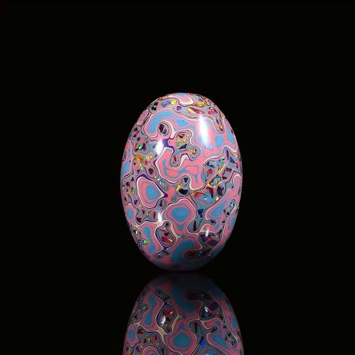

---

## 3604　伟大的自私

- 日期：2020-10-22　主专题：A01 心理主体与情绪劳动　副专题：A03;A08
- 源 ID：`ee56045a-57e2-5e8b-9d1b-883b80647fe4`　原文链接：https://www.zhihu.com/question/426237301/answer/1536817318
- 官方对象—实践路径：与自己 / 与理想 / 修正
- 23 概念标签：责任与后果;净输出与不掠夺
- 证据状态：manual_confirmed　初读：read　独立复核：not_reviewed

**问**：表弟声称「伟大和自私，本质上是同一码事」，如何看待这句话？

人没有伟大的，只有一种自私和另一种自私，这没有什么好讳言的。
追求善良的人不应该自认为是在追求伟大，而最好老老实实的、清清楚楚的认识到自己也不过就是在追求另一种自私。
这是好事。
可以避免自己做了点事情就觉得人人都应该赞美自己，有几个人受益就觉得世界欠自己飞黄腾达。
这是一个人真正有点什么正面成就的必修课。
非要认定某些自私是伟大，这个执念本身就妨碍了人“伟大”。
你要“伟大”的认证，你就“伟大”不了；你丢掉“伟大”这个念头，你反而会有最大的概率被旁人在最后看为“伟大”。
Yet another poetic irony.

---

## 3592　踏实

- 日期：2020-11-05　主专题：A01 心理主体与情绪劳动　副专题：A03;A11
- 源 ID：`c58bad68-8142-5988-87f3-e138e4689be9`　原文链接：https://www.zhihu.com/question/20971554/answer/1560162466
- 官方对象—实践路径：与自己 / 与情绪 / 调节
- 23 概念标签：事实与证据;能力与学习;成本与总账;信用与信任;边界与许可;权力与异议;心理与主体
- 证据状态：manual_confirmed　初读：read　独立复核：not_reviewed

**问**：踏实是什么？

冗余、备份和信仰。
好吧，解释一下吧：
冗余，是指一万成本的事、准备付出五万成本。只需要一分努力的事，做五分努力的准备。
备份，是指做好重来一次甚至n次的准备、或者干脆做两份独立的放不同地方。
信仰，是指当你能力不足、做不到上述两条时，又或者你知道就算做了上述两条你也只是基于你当前的狭隘、幼稚的认知在自以为保险时，知道你的用心是良好的，即有失败，也是正确的错误。
正确的错误，自有上天垂怜。
前两条就是人事，后一条就是天命。
人事和天命都安放好了，心就安了。
心安就是踏实。

---

## 3590　稳重

- 日期：2020-11-06　主专题：A01 心理主体与情绪劳动　副专题：A03;A08;A07
- 源 ID：`9b65ddf4-d156-516a-a858-915e4a0cce60`　原文链接：https://www.zhihu.com/question/303750131/answer/1561042745
- 官方对象—实践路径：与自己 / 与原则 / 坚持
- 23 概念标签：事实与证据;定义与达意;能力与学习;选择与自由;成本与总账;边界与许可;财富与市场;权力与异议;生态与自然;心理与主体
- 证据状态：manual_confirmed　初读：read　独立复核：not_reviewed

**问**：什么样是稳重，怎么样做到稳重？

十动然拒。
所谓稳重，就是能够顶得住“这很赚钱”“这很有前途”“这很危险”“这没搞头”等等等等种种正面或者负面的“感动”，不轻易点头。
是指检查可行性的时候存在一个系统的方法，做取舍的时候有一个稳定的原则。
第一条，是指你知道做事的艰难，成事的不易，因此不轻易的开启新的事端、不轻易抛弃现有的道路；第二条，是指你知道是非、对错的界限，不轻易玩投机获利的把戏。
人本能的知道有这两条品质的人做事稳定，如果有所合作，容易有始有终，所以在这样的人面前容易心安。
这样的人有两种明显的特征——
第一，是不轻易发泄沮丧情绪。你预先就知道有多难，你应该对艰难有心理预期，不应该觉得很意外。动辄发泄沮丧情绪，外人就会觉察到你预期失败了，也就意味着你没有达到第一条。
第二，是不轻易用全称判断。有好的判断力的第一个特征，就是作判断时足够保守。
有个笑话：三个人走在路上，看到外面有一只黑色的羊。
A说：本地羊是黑色的。
B说：本地羊有一只是黑色的。
C说：不，是此时、此地、有一只羊型的动物、朝着我们的这一面、处于黑色的状态。
看出谁是稳重的了吗？
你要养成这样的习惯，你才有可能拥有某种程度的稳重。
你根本不容易“十动”，你也用不着啥“然拒”了。
第三，对原则问题很敏感，而不是这也“可以”，那也“可以”，“只要赚钱都可以”。
只要说出“只要赚钱什么都可以”这句“魔咒”，你就可以和“稳重感”说再见了。
没人还会觉得你稳重。因为每天会出现的“看起来更赚钱”的事情多了去了，你这么个价值观，我跟你合作我岂不是要惨死？
稳重的人势必有一个赚钱之外的理由——超越赚钱的理由——来决定什么钱ta不赚。这样ta的人生才会有基本的延续性。ta在早期的积累才会不断的成为后面的资产，从而更有机会积累出真正扎实的硬资产，有一个常青的、抗风险的事业。
只要赚钱什么都可以的人，大部分首先就折腾死了，根本没有“赚到钱”。某些侥幸搞到第一桶金的，将来也一样会把那点积累无谓的撒胡椒面一般撒到各种“更赚钱”的冒险上，只不过黄粱一梦罢了。

---

## 3586　吵架大妈

- 日期：2020-11-08　主专题：A01 心理主体与情绪劳动　副专题：A03;A14
- 源 ID：`0be8c071-75a0-5729-b3cf-625ec9aaae47`　原文链接：https://www.zhihu.com/question/413962067/answer/1564230124
- 官方对象—实践路径：与其它 / 与陌生人 / 防卫
- 23 概念标签：能力与学习;选择与自由;爱与回应
- 证据状态：manual_confirmed　初读：read　独立复核：not_reviewed

**问**：市井大妈吵架的形态为何如此滑稽？为什么人能变成这种样子？

为什么可以认定这是“怪异的举止”？
这只是“罕见的举止”。而且这种罕见只是因为这种情境比较罕见——尤其是对于观察者自身的阶层而言比较罕见。
要定性为“怪异”，得要把各种不同的人放到同一个情境里去看反应，然后拿来和这个反应比较，有很大样本量的显著差异，才能定位这个为“异常”。
否则完全也可以定义迪斯尼的员工为“异常”——平时你在生活中难道会见到谁用白雪公主腔说话吗？
只是因为你把自己代入到迪斯尼员工的角色里的时候你会觉得自己也会一样表现，所以你给这位员工盖了一个“正常“章。
而你自信“即使我到了这大妈这个情境，我也不会和她一样”，所以你认定她是异常。——更多的人干脆只是想象不到自己可能遇到那样的情境，就已经判定大妈为“异常”了。
问题是，你没有陷入过，你依据什么断言你肯定不一样呢？
其实并没有什么特别的理由说明你不会这样。
这些大妈们只是在强烈刺激下在按照一种本能在强迫性的做反应。
这是人类被逼入墙角后的本能，是预先写好的程序。如果你没有受过类似消防员面对火焰那样的长期训练，你只有极小的概率是天生的意外。
这个状态下，人所受的教育是不起作用的——你连完整的句子都不会想起来。你只会莫名其妙的被锁定在一个机械模式里——或者是在重复同一句式的话，或者是反复的重复一个肢体动作。
这个就像你在路上遇到了一条响尾蛇，你全部的教育都会飞到九霄云外，你只会本能的僵住，满脑子只想到一件事“它头一动我就跳开”。
蛇的头动一下，你就跳一下；它动一下，你就跳一下；它不改变战术，你不会改变反应模式。
当威胁是相互的，对方也一样处于这样的模式。于是会出现“双锁定”——ta也因为你而一步一动的重复，你也因为ta而一步一动。互相都因为对方提供的刺激没变，而被锁定在自己的反应模式之中。
巧妙的是，这种现象在人工智能无人机的自主对抗实验中也会呈现出来——两架有最复杂的战术预定的无人机，会不断的扫描对方的动态而决定自己的策略。它们最后几乎总是会陷入一种长时间的“对称盘旋”，直到某一方依靠性能或者续航能力逐渐逐渐的获得最终的压倒优势。
这种现象几乎是与教育水平无关的，只是同级别的主体激烈对抗自然会导致的一种现象。
不要以为你留了学、读了博士，真遇到这种人生墙角一定会好一些。
真不见得，搞不好还更“可笑”。

---

## 3583　德不配位

- 日期：2020-11-11　主专题：A01 心理主体与情绪劳动　副专题：A04;A05
- 源 ID：`a81e9f31-639e-5517-a841-a98ecc87af8d`　原文链接：https://www.zhihu.com/question/429668346/answer/1570328071
- 官方对象—实践路径：与自己 / 与能力 / 承受
- 23 概念标签：能力与学习;责任与后果;照料与家庭;劳动与组织;心理与主体;性别与身体
- 证据状态：manual_confirmed　初读：read　独立复核：not_reviewed

**问**：德不配位该如何自处？

每一位英雄，都会在内心怀疑自己是个骗子。
每天。
每个人都或迟或早会陷入自己力所不能及的工作，面对着自己没把握的新问题。不是只有你这样，大家都这样。
不要多想，安心做事。
认真做，确保每次都有一些心得。
包括如何忍受这种折磨的心得。
有的时候，你之所以赢，不是因为你有任何过人之处，只是因为同样的压力下，你的对手比你失眠更厉害，更早崩溃。
这个世界上，聪明的人没有勇敢的人宝贵。
而勇敢最大的表现不是亢奋的往前冲，而是淡定。
从另一面说，镇定除了能在没有把握的事情中学习，还能怎么学习呢？
事实上，你最好在四十岁之前受过这种充分的锻炼。因为随后父母的身体、子女成长过程中的不确定、中年失业的风险、身体健康的问题，是人人难以逃过的。
到时候你如果回头发现你向来只做过有把握的事，你的心就没有那层老茧。没有这层茧先垫着，上面说的这些事其实可都是A级难题，远非你平时工作生意中遇到的那些问题的考验可比。
从来没磨过的心，用最粗的砂纸磨，那才叫撕心裂肺。
记住——到头来这一身，终逃不过那一日，其实世界上根本没有第二条退路可走。
所以，放下自己的焦虑怀疑，把这种煎熬当作“健心”的酸痛。
力竭之时你的肌肉有多痛，多想撒手？
把这种痛苦练出快感来，你就爽了。

---

## 3573　时间不够

- 日期：2020-11-23　主专题：A01 心理主体与情绪劳动　副专题：A11;A04
- 源 ID：`19a2ff4c-0f01-5107-aa11-9614b01f7666`　原文链接：https://www.zhihu.com/question/430513997/answer/1591066367
- 官方对象—实践路径：与自己 / 与时间 / 管理;与自己 / 与时间 / 使用
- 23 概念标签：定义与达意;能力与学习;选择与自由;爱与回应;劳动与组织;财富与市场;心理与主体
- 证据状态：manual_confirmed　初读：needs_reread　独立复核：not_reviewed

**问**：时间总是不够用怎么办？

其实，时间怎么会不够用呢？
时间不够用，是因为人所想要的很多、很大，而且很紧张的非要不可，要不到就觉得自己完了，没用了，没意义了。
这个靠学习很多使用时间的技巧、学习时间管理、“提升意志力”，其实是治标不治本的。
不过不要误会，我并不主张人过闲适的生活，恰恰相反，我倒是建议各位过得不要那么闲适，要努力和充实。时间表上不要有大段的空白，时间管理技巧都用起来。
我只是在说，你要明白，这并不会解决“时间不够用”这个问题。
时间不够用问题，是靠接受“随遇而安”，接受命运的安排，接受有所不得，接受“成固欣然败亦喜”来解决的。
是靠改变“成功”的概念来解决的。
到底什么才是成功的人生，这个问题你要想清楚。这个问题不想清楚，即使二十四小时不睡觉，你的时间仍然是不够用的。时间管理并不能解决这问题——甚至从实践上说这情况下时间管理反而常是抑郁之源。
价值观问题，先给一个参考。
这个价值观，不管对与不对，你喜不喜欢，至少是不容易有时间管理的大焦虑的。
如何树立正确的财富观？第二个秘诀，就是学会“爱好”这件事本身。
把事情做得有趣起来，是一项极其重要的技能。
什么时间管理的技巧都比不过你喜欢做这件事。

搬砖、扫地也有可钻研处。不但把达到目标作为目标，同时也把如何更优雅的达到目标作为目标，什么事情都会有它有意思、可挖掘的一面。好钻研，则万事总有好玩的地方。
钻进去了，一般都不会有什么“时间不够”的问题了。
但是要注意陷阱——不要嗜好虚空之事。
什么是虚空之事？就是尽管能带来快感，但本身不会留下任何长远积累的事。
比如，你喜欢写写画画，那么爽过一番之后总留下了一张纸。留下了一张纸，这就是积淀，就不为虚空。要爱好那些有积累、有结晶、成果会对他人也有用的事。
不要爱好那些爽过就雁过无痕，时间久了连本人也不会有记忆、也不会有任何东西会提醒你这件事的存在的事。
爱好会自然利用起你大量的闲暇时间，而当你的爱好能有结晶，它也常能缓解你“青春虚度“的焦虑。
这样你就不会那么焦虑“时间不够用”了。

<!-- 图片：1 张，审读结论见下 -->
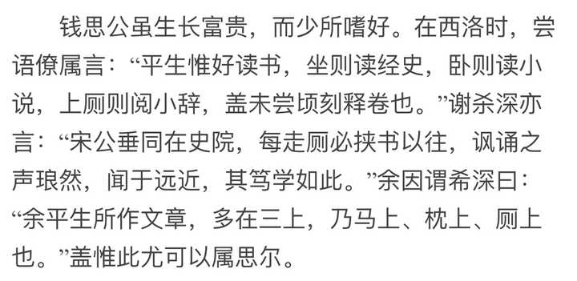
*图 1（已视觉复核）：古籍文字截图：钱思公“平生惟好读书，坐则读经史，卧则读小说，上厕则阅小辞”与“余平生所作文章，多在马上、枕上、厕上”一段。*

---

## 3544　不紧张

- 日期：2020-12-24　主专题：A01 心理主体与情绪劳动　副专题：A04
- 源 ID：`b510f068-9703-5f3a-ab80-90d8075560e0`　原文链接：https://www.zhihu.com/question/318545387/answer/1642689762
- 官方对象—实践路径：与自己 / 与情绪 / 调节
- 23 概念标签：定义与达意;能力与学习;选择与自由;责任与后果;成本与总账;信用与信任;边界与许可;心理与主体
- 证据状态：manual_confirmed　初读：read　独立复核：not_reviewed

**问**：如何锻炼不紧张的能力？

把一根铁轨放地上让你走，你嘻嘻哈哈，健步如飞。
这根铁轨放到十米高空，还是这么宽、这么直、这么硬，你寸步难移。
你这就叫紧张。

紧张的根源是什么？是对“一个不慎会出现坏得无法承受的后果”的焦虑。
那么解决紧张的方法自然也就在这句话里面。
要么，你不要挑战你承受不起后果的事。你有多抗跌，你就做什么事。没事不要爬高架。你老妈叫你带俩鸡蛋去学校当午餐吃，你紧张么？最大不了就是鸡蛋丢了，丢了就不吃呗，又不会死，有啥可紧张的？无论你怎么不慎，至多也不过就是那点后果，你就不至于紧张。
要么你就减少“不慎”。如果有一项考试是要你连续呼吸十次不许失败，你紧张吗？你当然不紧张，你都呼吸了不知几百万次了，你就是睡着了都可以正确呼吸，你就没有真正失败过——呼吸失败你就直接死翘翘了。稳到根本就不需要慎，于是也根本没有“不慎”。
一件事情做到了即使“不慎”都不会做坏的程度，你就不会紧张了——这其实是一个“练功夫”的话题。
什么叫功夫？就是哪怕你刚分了手、已经连续三天失眠、天气还不好、你还瘸着一条腿、你还发着烧没痊愈……你都能把这事干了，这就叫功夫。平时练的时候就不能是太太平平的搞出来就算，还要折腾着干、制造不利情况干、要颠来倒去、花样百出的干。要练到就算有什么意外，我都可以搞定，这才叫功夫。
有功夫，不紧张。

那这够了吗？要是够了，哪里还来这么多人问呢？
问题就在于有些事情由不得你选择，而这些事情不管你有没有功夫。考呼吸我当然不怕，但这事考的不是呼吸；我能选我当然不去，问题是我没得选。
紧张的根源，在于你相不相信不容你选择的事情里出现的意外，追根到底对你是一件好事。
世界上最不紧张的人，并不是功夫最好、选择余地最大的人，而是相信无论出现什么样的“意外”“失误”，哪怕一时有各种痛苦和损失，但兜兜转转最后结果一定是好的的人。
这是一种什么样的过程？
给你们看一个活生生的实例：
充满意外的过程https://www.bilibili.com/video/BV1jM4m1m7QJ/
这里面每一步都是意外，但是他抓狂了吗？害怕了吗？一个了解意外，相信意外，相信意外最终是站在自己一边的人，是真正对紧张免疫的人。
你们要相信这句话——任何不容你选择的意外，背后最终包含的是对你的好意。出了意外，哪怕直接的当下你失败了，请你相信，这失败在最后好过成功。
牢牢的相信这一点，这一点就会是事实。
让失败被诅咒成为真正的失败的，恰恰是对此的不相信。
因为不相信，你诅咒了意外。
因为你诅咒了意外，你诅咒了你自己。
紧张就是这诅咒。
这诅咒其实是致命的——It costs you a life, the better life。

---

## 3527　有修养

- 日期：2021-01-07　主专题：A01 心理主体与情绪劳动　副专题：A03;A11
- 源 ID：`024252b1-852d-5d49-9c49-5a931e3aeb8a`　原文链接：https://www.zhihu.com/question/287450097/answer/1665002170
- 官方对象—实践路径：与自己 / 与原则 / 坚持
- 23 概念标签：能力与学习;选择与自由;信用与信任;爱与回应;边界与许可;文明与历史;心理与主体
- 证据状态：manual_confirmed　初读：read　独立复核：not_reviewed

**问**：怎么做个有修养的人？

很多人可能会觉得有修养最重要的是要仁爱，是要克己复礼，是要温柔。
其实呢，有修养最快的捷径是高傲，是不屑于去做某些事。
不做，有不敢做、不能做、不该做、不忍做、不屑做。
不敢做的，憋久了惦记久了，逼急了，自然敢了；不能做的，念念不忘，总有一天能力会足够，自然能了；不该做的，呵呵，越不该做，越想做，越要做，越想越觉得该；
不忍做的，事未临头罢了，穷了、败了、气了、伤了，人心就硬了。我不忍，人家可很忍。我不杀伯仁，别人要杀伯仁，我杀还可以多得两斤肉，伯仁还少受点苦，简直双赢。
这里面真正最刚硬的，反而是不屑做。
为啥？因为它依靠的是人根深蒂固的傲慢。有修养的人，很大一部分是因为对猥琐和蝇营狗苟的敏感和憎恶而不肯做。你不把ta们逼到要在死亡和蝇营狗苟之间选择，ta们铁定选择拒绝蝇营狗苟，而对如此傲慢和狂妄自信的一群人，要证明ta们“马上就走投无路、必须蝇营狗苟才能活下去了”是非常困难的，否则谈何傲慢与狂妄呢？
这些人的“谦虚”，很大程度上是因为不屑于欺负人和伤害人，不屑于为那么点不值一提的成绩洋洋得意；这些人的“仁爱”，很大程度上是因为不屑于损人利己。
这种身为天之爱子的傲慢和莫名自信，是一种活活要人命的东西——既叫人又妒又恨到肠子发青，却也又爱又羡到骨头发痒。
至于这到底好与不好，说实在的，该做到的反正都做到了。
这样的人毕竟客观上很不容易突然反复、不容易干让人没眼看的事。客观上，ta们有肉眼可见的修养和自我要求，这已经是一种很大的福利了。所以，又何必在意拈花指背后是不是小无相功呢？
真正的问题是虚荣，最令人不屑的就是虚荣。

---

## 3525　“大众心理学”

- 日期：2021-01-08　主专题：A01 心理主体与情绪劳动　副专题：A03
- 源 ID：`acb72aeb-7943-50d1-a5a2-91cbdac51a45`　原文链接：https://www.zhihu.com/question/265741216/answer/1668314847
- 官方对象—实践路径：与亲族 / 与子女 / 抚养
- 23 概念标签：能力与学习;成本与总账;照料与家庭;权力与异议;生态与自然;心理与主体
- 证据状态：manual_confirmed　初读：read　独立复核：not_reviewed

**问**：自己知道自己控制欲强应该怎么改变？

“大众心理学”里其实有一个非常吊诡的误区，就是误认为“症状”就是“诊断”，就是“病因”。
你为什么情绪这么低落？因为你有抑郁症。
你为什么这么多要求？因为你控制欲过强。
你为什么不能静下心来学习听课？因为你有多动症。
你为什么从战场归来总是做噩梦？因为你有PTSD。
这是完全错误的、甚至是没有意义的“归因”方式。因为它根本就不是“归因”，而只是“取了个名字”而已。
这就像“你为什么走路一瘸一拐”，诊断的结果是“因为”你“下肢功能障碍”。
“因为”个头啊，“一瘸一拐”就是“下肢功能障碍”啊！
但是，把问题做了一个“专业的命名”，给人一种似乎得到了“某种程度的解决”的感觉。
最严重的后果是——因为给了这样一个“专有名词”，给人一种“有一种专门降服它的药物/疗法”的感觉。
就像西游记，只要叫出了妖怪的名字，就知道要请哪位菩萨了。
遗憾的是——“头疼症”可能有一百种原因，其实可能是一百种不同的病的共同结果。
甚至，自诉头疼，还有可能根本是一种幻痛——就像内存溢出、排线短路、显卡故障、CPU过热，症状可能都是“花屏综合症”一样。
你并不能因为症状都出现在屏幕上，就认定是屏幕的故障。
这也是自我认知调整最复杂的地方——它对于绝大部分人而言，其实是一种远超想象的复杂活动，其超出直觉推断的复杂度，就跟你们看着完全不懂计算机的人根据蓝屏乱猜没有区别。
既然蓝的是屏幕，那就买个新屏幕换上，但为什么新屏幕也还是蓝呢?
“控制欲强”、“沮丧”、“焦虑”、“忧郁”其实和“蓝屏症”几乎是同一性质的“诊断”。
与其说是诊断，不如说是将不规范描述转化为规范描述的一个翻译过程。在这一步可以说根本还没有任何的诊断可言，没有包含任何结论。
要往前迈一步，从“焦虑”推进到“xx性焦虑”，才算是开始做出了一丁点结论。
同样道理，仅仅“控制欲强”其实是不足以得出任何结论的。
例如，看着自己的孩子摇摇晃晃在翻阳台栏杆，大声怒吼着不顾ta的哭喊一把揪住ta的后脖领把这小兔崽子拽下来，算不算“控制欲太强”?
这在被拽后脖领的、完全不理解凭什么要“这么不讲理”、“这么粗暴”的被拽者的人视角，当然是显而易见的“控制欲过强”。
但是在拽者的视角看来呢？控制欲就是再怎么不强，还能“再低一点”吗，再低一点和植物人何异？
这正是子女们和父母们最大的认知落差。
其实，那些“控制欲很强”的父母，几乎每一个都站在“我还能再松一点吗”的底线上了。
你们觉得“极强”的“控制欲”，都是父母们极力放松了自己的“控制欲”之后的底线版了。
恰恰因为是底线，所以极其强硬，半步也不能再退。
哪怕再退半步，哪怕再放任你有一丁点的不服从，ta们闭上双眼不是梦见你们血淋淋控诉，就是梦见你们沿街乞讨遭人冷眼的惨状。
半步都无法再退了。
在亲子问题上，真正的问题并不是父母们的“控制欲”太强，而是ta们想不清楚底线在哪里。
这是一个根本的信仰问题，一个根源性的“缺少乐观的预期”的问题。
在不改变一些超越理性的、信仰级别的预设的前提下，这一个问题坦白说其实是无解的。
因为击溃这份乐观的，正是理性本身。
当你自己理性发达到这个成熟度，你自己见识了足够的悲剧案例，让你自己保持足以让人不觉得“控制欲强”的乐观，你也会觉得是你自己理性所不允许的强求。
“明明就是有极坏的可能，如何自欺欺人的说一定不会？”
这要求的是一份“非理性”的乐观。
其实引号可以去掉。
问题是，“非理性”，你“乐观”得了吗？
悲观的人如何能变得乐观？
运气极差的人该如何从头开始恢复运气?

---

## 3526　虚荣

- 日期：2021-01-08　主专题：A01 心理主体与情绪劳动　副专题：A03
- 源 ID：`c364b908-c9e6-5d4c-a8d0-0d75e624bd4a`　原文链接：https://www.zhihu.com/question/66238921/answer/1666763899
- 官方对象—实践路径：与自己 / 与名誉 / 建立
- 23 概念标签：事实与证据;定义与达意;能力与学习;净输出与不掠夺;照料与家庭;劳动与组织;财富与市场;法律与秩序;心理与主体;性别与身体
- 证据状态：manual_confirmed　初读：read　独立复核：not_reviewed

**问**：觉得自己特别虚荣怎么办？

告诉你们一个很重要的自查指标，可以用作检查你的成熟度和焦虑程度的重要参考。
那就是使用“我”字的密度。
越焦虑的人，所说的话里“我”字越多。焦虑正是一种青春期的普遍症状。
无论喜欢或者不喜欢，我们的社会现在总体上就是一个极其功利主义的社会。它把世俗意义上的功成名就直接视作人生价值的绝对主流标准。这在一开始就给所有人定了基调——你要成功，不然你毫无价值，等于白活。
这其实从一开始就是个错误，不过这不是这里要讨论的重点，先略过不谈。
问题是它的直接后果，就是在每个人心中都装上了滴答作响的定时炸弹——你还剩这么几年争取出线，做不到，你的价值炸弹就会爆炸，就要炸得你粉身碎骨、妻离子散、家破人亡。
青少年连因式分解都还没学会，《出师表》都还没背下来，就已经对这个炸弹的滴答声刻骨铭心了。
每天这东西都在无形的折磨，让自己看到某种希望、收获某种安慰，可以告诉自己“我不会有事”、“我能做到”、“我总比别人强”，日复一日的成为一种普遍存在的精神症状。
它是如此普遍，以至于被认为是“正常”的了。
心病既成，心药何求？
这就是问题的第二环——因为我们人类整个教育机制的安排，青少年没有直接面对市场、没有直接面对自然、没有直接面对“客观的审视”。
所以人在小时候要处理这种焦虑，只能依靠各种各样的来自ta人的鉴定性意见作为依据来安抚自己，这其中最根本的就是其ta人的认可——老师的认可、长辈的认可、同侪的认可、异性的认可、上司的认可……
这样一个庞大的评审团在给你“你很优秀”或者“你可能不太容易成功”这样的评价。它使得青少年们几乎不可避免的将对“我是否会成功”这个问题的探索在实践上做成“我是否可以争取到足够多的人赞同我会成功”。
仿佛“我是不是会成功”，是通过一种“普遍投票机制”票选出来的。
这里，就是真相所在了——你们实际上是在不自知的参加一场选举。
参加竞选的人，用“我”极多。
“我”是标准的选举关键词，不停的说“我”。当你在不停的说“我”的时候，你要停下来想一想——这是在做什么？为什么这个可以指向你想要的结果？可以让你心安？可以让你相信你会成功？
然后所有人对你赞不绝口、纷纷点赞，真的意味着你面对客观的审视时必获首肯吗？
而什么叫“客观的审视”？
你做个产品，市场是否欢迎？
你造一架飞机，最后有没有飞上蓝天？
你种棵树，有没有结果？
你造座桥，有没有垮？
你奔跑，你有没有打破世界纪录？
这从根本上都几乎不取决于个别人对你的观感，而更多的是在和客观规律对话、在受客观规律检验。客观规律支持你，具体个别的问题就总能靠你总体上的成功来补救或者赎买。你慢慢会明白——具体的个人对你的观感是次要的，重要的是从某种“大数据”的角度、某个high point of view而言，你是不是走在正确的路上。
而和客观规律打交道的经验，只能从和客观规律打交道中来。
你不能用“据说很有经验的人”和“我觉得很有经验的人”的“首肯”来代替客观规律直接给你的回答。
因为人——无论什么样的人——都不够资格做客观规律的代言人。人有误判、人有傲慢、人有软弱，而且人有自己的欲求。你几乎无法判断这个人称赞你、认可你，到底是因为你确实走在正确的路上，还是因为你和ta很像，还是因为ta对你（或者你父母）有所求，或者别有所图。
赢得那样的“点赞选举”又怎样？
在客观规律面前只是个可悲的笑话。
而与客观规律打交道多的人——这几乎肯定是某种广义上的“手艺人”——总是会发现“我”字是多余的。
实验报告里有几个“我”字？
老鞋匠打孔穿线、又割又磨，ta一天用几个“我”字？
运动员每天挥汗如雨、跌倒再来，ta们用得了几个“我”字？
用到，是出于业务实践的需要，而不是为了参加那种“好感选举”。如果你奉行这样的原则，你会很直观的观察到“我”字会自然而然的少下去。
“我”退下了，“他、她、它、祂”才会多起来。
简单来说，建议你们养成对使用“我”字的敏感性，时不时停下来想一想这是不是有必要使用“我”字。
没有“我”，虚荣自散。
奥卡姆剃刀 pro Max——“如无必要，勿增我字”。

---

## 3523　不抱怨

- 日期：2021-01-09　主专题：A01 心理主体与情绪劳动　副专题：A07
- 源 ID：`336acd26-3630-5e3a-aad7-480d7cec5d5e`　原文链接：https://www.zhihu.com/question/20064565/answer/1668449718
- 官方对象—实践路径：与自己 / 与情绪 / 表达
- 23 概念标签：事实与证据;定义与达意;能力与学习;选择与自由;责任与后果;成本与总账;爱与回应;净输出与不掠夺;照料与家庭;劳动与组织;法律与秩序;权力与异议;心理与主体
- 证据状态：manual_confirmed　初读：read　独立复核：not_reviewed
- 标记：`【正文缺失片段（复核已记）】`

**问**：怎样做到“不抱怨”？

“抱怨”到底是什么？
是指自己承担了自己不该承担的，觉得不公平。尤其是自己承担的是别人本该承担的，这就更加郁愤难当。
怎么，不公平我已经受了，委屈我已经咽了，不该我干的活我干了，不该我背的罪名我背了。
已经都发生过了，我连说也不能说一句吗？
草xx，亏我已经吃了，我连说都不能说一句吗？
欺负人要到这一步吗？
我不是没吃亏之前就先说不公平——那就不叫抱怨，那叫做抵抗了。
我是已经吃了亏，我已经替你们流了血、流了汗，那是你们本该流的血、你们本该流的汗！
怎么，我连说累也不能说吗？我连喊疼都不能喊吗？
你们欺人何其太甚！！！
你们已经得了便宜，你们还要封我的口，你们还要因为我理所当然、无法自我克制的痛苦呻吟谴责我？惩罚我？！诅咒我？！！放逐我？！！迫害我？！！！
我是奴隶吗？！
我就不是人吗？！！
你们把我当作畜生吗？！！！
这就是抱怨。
凭什么就不能抱怨？
你如果不想通这一点，仅仅凭着“若是抱怨只会更吃亏”这样的“不吃眼前亏”的心态想要学两招，避免别人觉得你抱怨而对你不利，你最大的可能是不会学会不抱怨，而是学会了巧妙的表达。
也就是学会一系列的话术，让人听了心里舒服、不反感、于是不会说你在抱怨，而又不再会让你吃不该吃的亏、做不该做的事。
如果你只是想要避免抱怨的负效应，你根本就不该学习“不抱怨”，而应该学“巧抱怨”，不是吗？
你确信你要学“不抱怨”吗？
一个人为什么要学“不抱怨”呢？为什么不只学巧抱怨（或曰“正确的表达负面情绪”）呢？
因为一件事要做得成，总要靠分工合作。而人类的分工设计总没有完美的。
在一个团队的各种角色职责、权力和利益之间做完美的、平衡的划分，是组织管理这门艺术的圣杯。
圣杯哪有这么容易获得？在角色之间的责权利交接处，必定会有交叠和脱节这两种现象。
出现了交叠和脱节，就会出现职责划分的模糊，出现“无责任归属的必要作业”无人担当，出现“责任归属模糊的必要作业”双方都推脱，出现“权力归属模糊的利益分配”双方都要抢。
这些地方，就会生出抱怨。
这些抱怨都是有根有据的，并非空穴来风，凭空抵赖。
但是，如果没有人把这些断裂、交叠之处弥合起来，安抚下来，这个组织的产品线就会断裂。
断裂了，产出就会是0。
组织就会失去价值输出，也不会获得价值输入。
没有价值输入，这个组织就会灭亡。
唯一能摆脱这个宿命的手段，就是靠不抱怨的人，吃掉这个亏。
凡没人认领的责任，尽管同样也不是ta的责任，但是ta一概视为自己的责任。
一个设计不良的组织，必须要靠这样的人才能运转。而“设计不良”是绝对的——人类根本没有能力设计完美的组织结构。
也就是所有的组织——小到两个人的小家庭、小作坊，大到国家、社会、文明，愿意承担不公平的责任的成员，都是组织存在的根基所在。
对于这一点，如果组织的掌舵者心里没有确切的认知，这个组织注定是没有前途的。这些人，就是组织的脊梁，是组织的命脉。
那些照章办事，按规则推卸责任争夺利益，一分钱多的责任都不担的“专业人士”，竖起招兵旗，何愁吃粮人？两条腿不吃亏的人满街都是，只不过是随时可以抛弃换新的通用件。
那些当组织真的有跑冒滴漏、真的需要人一声不吭、在回报不明、责任莫测的时候肯顶上去，干砸了挨骂、挨批评、挨罚而不抱怨的人，可堪大用。
仔细看清楚这整个过程，不光是要冒着背黑锅的风险挺身而出，这不够——因为贪恋权位的人从来不缺。
干成了，戴大红花，这是皆大欢喜的结局。这好固然是好，但是没有伸量到这人的真正底色。而且由于这次“赌赢了”，还要警惕这人下次“勇于任事”里的难以舍去的投机成分。——这人很可能是抱着一份过度的自信，作着“反正我是挺身而出，做不好我大不了做点低姿态罚酒三杯，难道你们有脸怪我不成”的盘算。
这种可能非常的危险，不能充分排除之前，这人只能重点观察。ta凭业绩赚来的福利和职位固然要给，但也要额外睁着一只眼看着ta到底是仙是魔。
只有最后一种——勇于任事，力挽狂澜，功败垂成，甘受惩罚，无怨无悔。
这才构成完整的试炼。
这个试炼无弊可做。谁想“冒充”，可以试试看，看看是不是靠“冒充成功可能得到重用”的野心和企图心就能挺得住。
罚你的时候是真的，总结你的种种“失误”“莽撞”“轻率”的结论都是有根有据的。你没有授权和指令而主动伸手，不但不会被看作加分项，还会被看作“无组织无纪律的盲动造成了严重后果”。
这一切都指向真正的重罚。罚你的人不会觉得你是雷锋，心里存有恻隐之心。恰恰相反，反而会在罚了你之后，根据人之常情猜想你势必会怀恨在心、成为一个潜在的危险因素。
你之后被监视、防备、雪藏的可能性远大于“看在是主动任事的份上，不做追究”。
你本来无怨，却被人用“ta一定会怀恨，看起来越不像，一定是极力隐瞒”的放大镜去看，无怨也会生怨。被怀疑有怨几乎就是一种自我实现的预言。
要穿过这所有的绝望、冷落、辜负、甚至是“背叛”，仍然无怨，才算是过关。
你们是不是以为我是在说公司？政党？
其实父母何尝不是？爱侣何尝不是？
勇于任事，甘冒风险，受责无怨。
“勇于任事”不见得是爱，“甘冒风险”也不见得是爱，“受责无怨”却一定是。
你们不是问什么是爱吗？
这个就是爱。
任何人这样对你们，ta所做的事情，就称为爱。
你们没问，就为你们做了，你们不满意，也就并不申辩，并不委屈——“因为这本来就是我自己决定要做的”。
这个就是爱了。
有资格抱怨、有充分的资格抱怨、但是不抱怨，甚至仅仅是不十足十的抱怨、减量的抱怨，就是爱。
只有爱，才是一切没有毁灭的原因。
问题是，既然不求回报是本质的要求，而且必然给予不配受的人是必然的宿命，那么人为什么要爱任何一个其它人？
因为爱是这个世界上唯一真正需要人去做的事，也是唯一真正有价值的事。
别的事情，说到底是在浪费时间和生命，你们只是需要很长时间去明白这一点。
最后来正面回答一下问题，怎么可以更容易的做到不抱怨？
第一，开口之前先反省清楚这是不是抱怨。
抱怨、批评和报复常混为一谈。
抱怨是为了榨取抚慰、认可和补偿。说句实话，本质上是一种“暴力撒娇”。其实，抱怨尽管给人的感受非常负面，甚至容易触发愤怒，但其实本身并不是敌意的，甚至反而是亲密的。它是一种负面的亲密表达方式。
某种意义上说，抱怨的人不是想要表达ta很恨你，而是想要你意识到ta有多爱你，让你意识到而且承认ta为爱付出的代价。不是要你还，而是要你承认。只不过很多人觉得承认了就有爱的义务，就等于开出去了一张空头支票，觉得害怕，于是对“被强迫要开一张空头支票”的困境感到恼怒。
因为“你让我痛苦”，人常给予抱怨者过于负面的定性，这本质上是一种报复。
坦白说，这是错的。
面对抱怨，最好的反应是对其中可以认可的部分尽可能的给予清晰界定的、清晰明确的认可，对其不可认可的部分予以温和的拒绝。
很多人只被自己的恐惧驱动只做一半——也就是拒绝其不可认可的部分，自以为“我没拒绝认可的部分自然就是认可的了，你应该自己理解出来”。这对于处在饥渴状态的抱怨者而言是远远不够的，甚至是进一步受刺激的。这常常飞速的螺旋下滑到彼此实实在在的痛恨和复仇渴望。
批评，不是抱怨。批评不涉及批评者自身的获利——最好批评所呼唤的对方的行为不会造成批评者自己的收益。
有无数人自己知道抱怨不可行，怨气却不能自我消解，于是“巧妙的”借用批评来行抱怨之实。提出非人类力量所能及的“建议”、混杂了侮辱和攻击的语言。这就一步滑进了“报复”的范畴。
报复是自觉抱怨不可能得到想要的爱的回应，索性直接跳过，通过复仇好歹索取一些心理安慰的过激防御行为。说实话，这已经丧失了理智。
但这其实是人生中对于“抱怨可以获得本该获得的宽慰”已经屡试屡败，

---

## 3510　自弃

- 日期：2021-01-25　主专题：A01 心理主体与情绪劳动　副专题：A08;A04;A11
- 源 ID：`77880b8f-5e2b-5a20-979b-420df1f148ba`　原文链接：https://www.zhihu.com/question/441018760/answer/1695943415
- 官方对象—实践路径：与自己 / 与理想 / 持守
- 23 概念标签：事实与证据;定义与达意;能力与学习;选择与自由;成本与总账;照料与家庭;财富与市场;性别与身体
- 证据状态：manual_confirmed　初读：read　独立复核：not_reviewed

**问**：什么是自弃？

有一个机会可以帮助到更多的人，你没抓住。
这就叫自弃。
这话需要多一点解释——这个“帮助更多的人”不是按照当时那件事情本身计算的，而是按照“一生助人总量的期望值”计算的。
因此，努力学习、积极锻炼、合理理财……同样属于“帮助更多人”的事务。
比如，如果有一件事情可以让你更健康，你没做，你也是违背了这个原则。奢侈浪费，无谓耗散上帝交给你的财富，也是违背了这个原则。简单的将个人资产拿出去撒胡椒面，一样违背这个原则。
这个原则事实上是深刻而复杂的。
它的复杂性在于——
首先，“一生助人总量期望值”本身是一个极其复杂的计算。你如何知道自己不是在悄没声的在算法中做手脚，用来背书你其实背道而驰的行为？
第二，期望毕竟只是期望，如果一直以“保持最大期望”为理由，不断的推迟实际的输出，你会陷入悖论。“我现在本来可以给你一百，但是我如果不给，明年我就有一百二可以给你，所以我决定不给更合理”。
明年再跑一遍算法，得到的还是“不给”。
总期望的确是在不断升高，但是事实上没有人在受益。
然后你意外死亡，账号和密码没人知道——“总期望”变成了空气。
怎么解决这两个问题，本身就是重大的人生家庭作业。

而且，绝对不要单纯的把这看成什么“道德高调”。
世界实际上是这样设计的。不要看到似乎很多人背道而驰、赚得满盆满钵、踌躇满志，就以为这只是一种“时灵时不灵，也许对我不灵”的法则。
等着看，一个逃脱的都不会有。
你想要内心宁静的做一个举足轻重的人，想要手握能移山倒海的财富而保住人格健全，这是唯一的办法。
通俗点讲——你想要能赚钱，还想有命花，那你最好自觉点这样做。不遵循到骨髓里，哪怕是从最世俗功利的立场去看，也形同“先挥刀自宫，再猛练神功”。
看似练得挥汗如雨，热火朝天，其实从一开始就败局已定。不“成功”还可以混个骂骂咧咧、无疾而终，“成功”了立刻死无葬身之地。
还有比这更大的自弃么？

---

## 3500　战胜抑郁

- 日期：2021-02-06　主专题：A01 心理主体与情绪劳动　副专题：A09
- 源 ID：`7c1411c5-4487-5f94-9252-ba8067b5245f`　原文链接：https://www.zhihu.com/question/442116076/answer/1717514028
- 官方对象—实践路径：与自己 / 与情绪 / 调节
- 23 概念标签：能力与学习;文明与历史;心理与主体
- 证据状态：manual_confirmed　初读：read　独立复核：not_reviewed

**问**：战胜抑郁症的人是不是相当于涅槃重生？

这话错是不错的。
问题是，什么叫做“战胜”了？
比如，一个人赌博输光了家产，还欠了一百来万，每天被愧疚、自恨和恐惧逼的死去活来。结果一个月以后，ta突然中了一个亿的福利彩票。
还抑郁么？欣喜若狂好吧。
那么ta算不算“战胜了抑郁症”？
又或者，一个人高考失利，痛苦得每天掉头发。但是家里想办法凑了一笔钱送ta去了乌克兰留学。ta很快就忙着查“如何与乌克兰妹子深入交流”去了。
ta算不算战胜了抑郁症？
吃药熬着、拖着，等到了事情有了转机，注意力转移了，被“冲喜”了，危机消退了，于是没有那么痛不欲生了。
这算不算“战胜”了抑郁症？
大部分人，只是借着药物、顾虑和安慰拼命的拖着，等到了时过境迁，于是侥幸死里逃生而已。约等于被围了，躲在城里吃粮食、吃马、吃老鼠、吃人，熬到了冬天敌人退走了。
这可不可以算是战胜了？——说句实话，历史书上的确是有把这个称为“胜利”的传统。
“战胜”的标准到底是什么？是死里逃生吗？
战胜的标准有两个：
1）同样的事情如果重新发生一次，是否不会再次陷入同样的绝望。
第一次得了癌症，想自杀，结果是误诊，死里逃生；第二次又得了癌症，这回盼着是误诊，结果不是。但是，你没有像第一次还不知道是误诊时那样绝望，那么算一种战胜——虽然不算全胜，但至少的确算战胜了一点。
如果还是一样绝望，那么胜在哪里了？
那种死里逃生的如释重负，那种突然形成的“及时行乐”的洒脱心态，可能会给你一种强烈的“得道飞升”“大彻大悟”感，还能让人说出“我看待一切的感觉都不同了”这样似乎很有智慧的话。
但是那并不叫做战胜。
再来一次，故事会有好的不同才叫进步。这些心理效应面对卷土重来的下一轮敌人有什么意义？
也许来的还是去年来过的北狄，你可能会有一些“the devil I know”的笃定感。
但若这次来的是南蛮呢？东夷呢？西戎呢？
你和之前到底哪有不同？谈何“涅槃重生”？
甚至，死里逃生带来的那种虚幻安全感和“成熟感”还会造成“北狄不过如此”的幻觉，妨碍你去深挖沟、高筑墙、广积粮、精练兵。
会让你下次有所不同的不是“不过如此”的“战略藐视”，而是深挖的沟、高筑的墙、广积的粮、精练的兵，“战略藐视”在下一轮的战略轰炸面前还不如一根香烟管用。

2）不再会有任何事情让你真正的绝望。
即使此刻就身患绝症了、众叛亲离了、“人设崩溃”了、身背巨债了、奇冤难雪了、妻离子散了……世上所有你能想象以及你不能想象的悲惨之事一起发生在你身上，你仍然不会绝望——这才是真正的全胜了。
如果是这个意义上的战胜，那么你的确会真的有所不同了。
严格意义上说，“涅槃重生”不够资格形容这种不同。
悲观的人如何能变得乐观？
运气极差的人该如何从头开始恢复运气?

---

## 3473　制怒

- 日期：2021-02-24　主专题：A01 心理主体与情绪劳动　副专题：A11
- 源 ID：`6e68f889-57e6-54ba-b70b-c2cb2d8219bf`　原文链接：https://www.zhihu.com/question/56236326/answer/1746576367
- 官方对象—实践路径：与自己 / 与情绪 / 调节
- 23 概念标签：定义与达意;能力与学习;选择与自由;责任与后果;成本与总账;信用与信任;爱与回应;净输出与不掠夺;边界与许可;权力与异议;心理与主体;宗教与自然法
- 证据状态：manual_confirmed　初读：read　独立复核：not_reviewed

**问**：如何有效的制怒？

生活在爱你的人中间，这样你发怒的后果常会被自然消解。
不要向对你无爱的人发怒，这不仅仅是无用和有害的问题。最重要的是无爱的人不配得。

第二，不要把发怒看成是一种正义的表现。不要觉得自己都被激怒了，就一定是自己在正义的一方——这是无数小孩敢把怒发出来的根本原因。
人们总以为自己肯定是正义的，不发怒是因为够宽容，发怒是对方罪有应得。其实事实绝大多数情况下都不如ta们所料，只不过ta们听不进去。
爱不受挑衅，不轻易发怒。
可惜的是现在流行的是一种“我喜欢的、对我有利的我才爱”的观念，而人们其实喜欢的只有自己，所谓的“喜欢别人”，本质上也大多是喜欢别人喜欢自己而已。而这根本不是爱。
没有爱，就没有制怒的根本必要。只不过是觉得有时候愤怒不是很方便所以想要合理管理。而另一面，在更根本的深处，又觉得发怒好处甚多。例如觉得老虎不发威，会被别人当病猫。所以这种是叶公好龙式的撒娇式的“制怒需求”，根本不足以支撑真正的制怒所需要的那种剜心剖腹般决绝。
不以爱为念，不以爱人为人必须尽的义，谈“制怒”只是徒然而已。那只是在学对谁不可怒的看风色的技巧和如何假装无怒的伪装术罢了。
有人问“为什么是徒然”。
是这样的——对于受怒的人来说，没有随时随地识别出谁可能在发怒的观察能力，那可是致命的。而对“制怒”的一方来说，却没觉得自己的愤怒不小心流露出去会如何严重——甚至本人还暗戳戳的希望对方不等自己彻底掀桌时就自己识趣。
所以，那些喊着要“制怒”的人三心二意练的刀术，怎么可能那么容易胜过那些知道“练不好就会死”的受怒者们拿命别在裤腰带里练的盾术？
你想想，赢得过吗？
所以，“制怒”派自以为瞒得很好的怒气，对一生都在研究受怒、识怒的生存狂们而言，根本就是赤裸裸写在脸上的。识怒狂魔在你自己都还没意识到自己在发怒之前就知道你在怄气。
——“你瞎说，我哪有！？”
别扯了，你当然有——真的没有的人，会回答“我可能有些不自知的、不该有的情绪，抱歉”。
竭力否认的人，大部分是想要对方“知错能改”，自己还免掉一次“发火”“施压”“强迫人”的罪名。
年轻人不讲武德，这好吗？这不好。
想要真正的制怒，也就是从根上斩断怒的源头，要的是一种剜心剖腹般的决绝。
易怒是人之常态，你若真要制怒，你就要接受非常态。“接受变得与绝大多数人不同”，这本身就已经令绝大部分人胆战心惊、望而却步了。
引人生怒的事，往往客观上有待定的“罪责”存在。
制怒的根本之道，不是将罪定在别人身上，然后想办法自我制止不去“行刑”，而是【以身相代】。
罪加于人，制怒就不过是自欺欺人。这份怒气已经被签下，想要阻拦它的一切表现，犹如山之阻水，盘旋曲折，千回万转，毕竟终将东流而去。要根本的不对人发怒，只有一种真正有效的手段，就是将罪归于自己，自己以身相代。而且不能是出于骄傲、出于成圣的渴望，必须是视为毫无功劳的本分，理所应当的义务。
这不怪你，这怪我，我凭什么向你发怒？
这单靠人自己是做不到的。
任何令人沮丧的事情，常常有无数的环节其实非人之罪，而是取决于人力无法改变的天意。而天意无可罪。
去除了天意，剩下的才是人的责任。而人的责任之中，“ta人的责任”依附于你对ta人的选择。是的，是ta有错，但是你选了ta，你不能强求人做到一切“不应该做错”的事。
每一件事都是小事，都简单，都应该做得到。但是把全部应该做到的事情同时都做到，是一种非人类所能企及的要求。这是在强求人成为神。因为人不是神而憎恨人类，责怪人类，其错在谁？
在我。
承诺而没有做到的事情，按照契约该追偿就追偿，但作为自己签订契约、界定了自己满意的违约责任的一方，“我”有立场去责怪对方没能履约吗？如果没有以违约补偿为对价接受违约可能的心理准备，约定违约补偿是何用意？
深挖下去，只要你想，一切的罪责——亦即发怒的立场——要么可以归于天，要么可以归于你自己。
天无可罪，是以万方有罪，罪在朕躬。
而向自己发怒，是责怪自己不如完美的神吗？人不如神，不是理所当然吗？
到这里，一切的怒的立场都消解了。
无怒可生，自然无怒待制。这是真正制怒唯一的出路。
问题是，割肉喂鹰、以身饲虎，心甘情愿以身替罪而不居功，你愿意做吗？
只要你不想，世界为你准备了一千一万条理由告诉你不做是正义的，是合理的，是积极的，是“正常”的，对方绝对是罪有应得。你不会有压力、不会有纠结、很容易得到千万人的赞同和“支持”。
只有你出于某种令人难以理解、难以想象的“不合逻辑”的原因，一定要这样做，你才做得到。
顺着那“逻辑”，人类会被一切“理直气壮的报复”毫无悬念的毁灭。
爱不符合那个逻辑。
幸亏如此。

---

## 3459　优越感

- 日期：2021-03-02　主专题：A01 心理主体与情绪劳动　副专题：A11;A03
- 源 ID：`62737881-4460-566e-878f-f69de643f501`　原文链接：https://www.zhihu.com/question/273597946/answer/1758974454
- 官方对象—实践路径：与自己 / 与情绪 / 觉察
- 23 概念标签：定义与达意;能力与学习;成本与总账;心理与主体;宗教与自然法
- 证据状态：manual_confirmed　初读：read　独立复核：not_reviewed

**问**：天生优越感，经常瞧不起别人怎么办？

人天生有“上帝自觉”——意思是人可以轻而易举的将自己代入上帝的视角来看待问题。
思考本身就是神的能力。在你计算、审判、创造的时候，尽管你很难明确的意识到，但你在那个时候实际上在心灵上已经化身为神了（虽然是个超级减配版）。
不信你听听那些本来快快乐乐吃着火锅，却突遭审判的人怎么回呛的——
“你以为你是玉皇大帝啊？！”

以上帝的心态审视任何人类，都自然而然的能看到无数的缺点，自然而然的会无可置疑的优越感，这只是一种客观事实、一种自然现象。
就和芯片运算会发热，风扇旋转会导致气流，线圈里通电会产生磁场一样，这本身是中性的。
你的问题是要意识到那个优越感是绑定在上帝的神格上的，不是绑定在你自己身上的。
这就像一名警察把警服一穿、警官证一配，立刻勇气倍增，权能陡生，但是警察们并不因此就变成武打明星、功夫小子一样。
当你去审视别人优劣的时候，你是在审判，你坐上了上帝的位置、在做上帝的事，你非常容易感受到优越感——就像你作为老师来改同学卷子，一看这个字写得稀烂，一看那个证明跳步子，简直个个都一身毛病。
而你一旦离开了这个席位，坐进考场里，你也是这个鸟样。
这两个角色转换的落差，让你对自己的认知发生了矛盾。你在自己做不出卷子的时候，自然要深为改卷子你的那份俯视、优越而纠结。
于是你就分裂了。
你分不清哪个是你了，你到底是那个坐在办公室里嘴角挑着冷笑的考官，还是那个坐在考场上汗出如浆的废柴？
难道两者可以同时存在吗？你可以同时是两者吗？
当然不行。
告诉你了——那份冷笑权是属于上帝的。
你老人家还是那个废柴。
因为可怜你生存不易，离了这个位置将失去基本生存能力，所以那个位置已经说好了可以随时借你坐。你坐上就会牛得飞起，遗憾的是，这份能让牛都飞到云端去的动力是绑在座位上的。
是宝剑在嘟，不是你在嘟，明白了吗？
现在你的优越病治好了吗？

---

## 3462　对人类失望

- 日期：2021-03-02　主专题：A01 心理主体与情绪劳动　副专题：A03
- 源 ID：`acf8ecc5-34ac-519a-9f98-75da1557fabe`　原文链接：https://www.zhihu.com/question/445897619/answer/1757431297
- 官方对象—实践路径：与自己 / 与理想 / 修正
- 23 概念标签：能力与学习;选择与自由;责任与后果;成本与总账;爱与回应;边界与许可;法律与秩序;心理与主体
- 证据状态：manual_confirmed　初读：read　独立复核：not_reviewed

**问**：对人类失望怎么办？

恭喜你，你终于可以正式的开始来点人生观、价值观了，因为你刚刚补上了最重要的世界观的大洞。
这一条认知，对你做个稍微可以让人忍受的人（甚至是一个有较大可能成功的人）有重大的、决定性的意义。
可喜可贺。
这绝对不是一件坏事，而是一件好事。
尺阔之溪，一跃可过。过了这个坎，前头就是海阔天空、自由自在、无忧无虑了。
而且你非过不可。
为什么？
1）当你到了这个点，你终于可以停止想象“不是我对人的期待有问题，而是这个人有问题，换一个人就会好了”。
这个男朋友不够宠我、不够让我有安全感，只要“再换一个男朋友就会好了”；
这个老板不够大方、不够有领导力，只要“再换一个公司就好了”；
这个城市太排外、不够有发展空间，只要“再换一个城市就好了”；
这个国家不够自由、不够尊重人，只要“再换一个国家就好了”。
到了这个点，你终于可以知道，没有人会真的让你满意的。
你必须要学会与这些问题共同存在，而不是只能转身逃走。
注意，这不是说你不能重新选择，不能换掉男朋友、老板和国家，而是说即使你要换，你也要知道这并不意味着这些问题你不必解决了。新的对象、新的开始，一般只意味着同样的问题会以另一个剧情、另一种样式、另一种烈度重新浮现出来。
你所获得的，本质上只是一段宝贵的喘息之机，而并不是摆脱了问题。喘息之机并不是拿来给你享受新鲜空气的，而是给你机会学游泳的。
如果你误把每一次喘息都当作已经上岸了，那么一次又一次的“意外呛水”最后会击垮你的。不是呛水本身让你痛苦，更让人痛苦的是你以为已经上岸了，没想到其实还是在水里。
世上本无岸，只是希望的人多了，误以为自己已经上岸的喘息者多了，合谋编出来的幻觉罢了。
你在嫌弃自己的遭遇不够“公平”、不够幸运的时候，痛苦吗？那么你现在所经历的这种虚无、迷茫、悲观、乃至于绝望够不够痛苦？
是前者痛苦，还是后者痛苦？
只要你不放开“完美梦想”，后者的痛苦就是无限持续的。
现在好了，你终于可以停止“下次上岸”的幻想了，你将终于开始学习游泳了。你终于要意识到学会游泳的那些痛苦是不可回避的了。有准备也好、没准备也好，有条件也好、没条件也好，有信心也好、没信心也好，都只有向前挺进、向前努力了。
你的一切借口终于可以放下了，你终于可以真的有所改变了。
到了破釜沉舟、背水一战的时候，你会发现的——当你不得不寻找方法，方法并不难找；当你不得不解决，解决未必有这么难。
世界上并没有完美的朋友、完美的情人、完美的上司、完美的下属、完美的老师、完美的职业。不是说你不能选择，不能通过选择有一定的改善，而是说你不可能通过选择真正达到你没有经过这次幻灭之前的标准。
没有经过这次幻灭之前的那种“完美标准”，是没人能达到的。
这并不怪你，因为人必定要从简单的认识开始逐步完成自己对世界的认知，而简单的认识必定会是一种相对完美的认识。不止初次的认知过于完美必将幻灭，幻灭之后再次建立起的完美想象仍将再次幻灭。
每一次幻灭，都会把你逼迫到“不改变点什么，就接受败亡”的绝境。你唯一的选择，就是重新反思之前有什么东西想错了、什么事情做错了。因为这时归罪于ta人、归罪于世界已经没有意义。
不到这种时候，人是不会承认自己原本自洽的那一套东西其实并不正确的。（所以说，完全自洽是可耻的。）
这种绝望，实际上是世界给人的教育。是人必须领受、也是幸而必须领受的教育。
你现在所受的痛苦，只是这种成长的一个过程。
若不是戴着旧壳奇痒难当、生不如死，有哪只毛毛虫愿意撕心裂肺，变成蝴蝶？
所以，恭喜你，你终于非化蝶不可了。
你只要注意一点——别把茧结得太厚，会死的。
2）你终于可以开始学习原谅整个人类了。
你终于发现了吧？
所有的人都撒谎，所有的人都偷窃，所有的人都傲慢，所有的人都虚伪，所有的人都在侵犯别人的自由。
并无例外。
因为所有的人都可怜，所有的人都无知，所有的人都想活着。
并无例外。
不是诚实的行为本身使得人成为诚实的人，而是宽容的心，使得不够诚实的人被算为诚实的人。
公平、正义……等等一切美德，乃至于包括了爱本身，都是因为爱而被算为人做到了。
这些美德，都是因为被爱才在实践上存在。
你如果不爱，你不会有足够的动力宽容。没有足够的宽容，你的世界最后必定将终结于现在的一片伸手不见五指的漆黑。
不能爱，你就永远活在美德全部幻灭的地狱里。
爱其实不是一种选择，一种“可选的高尚行为”，一种“需要牺牲的无私奉献”。
你错了啊，大错而特错。
爱是一种诫命。是你若不守、不行，世界就会一天比一天黑暗，直到在你眼里变成所有的人都是骗子、叛徒、盗匪的地狱的诫命。
它不是为了“别人”、为了“祖国”、为了“全人类”，而根本的其实是为了你自己。
爱就是让这个世界的一切价值得以让你看见的光。若没有光照在它们身上，它们将淹没在完全的黑暗之中，化而为无。
只是这个世界对人深爱得令人嫉妒，允许你们只要哪怕学会一点、学会哪怕跌跌撞撞的、略有姿势的只爱一个人，哪怕这个人就是你自己，就算为你们及格，许你们享有足以支撑的幸福罢了。
现在世界在你眼里已经只剩下一点模模糊糊的轮廓了。它一天比一天的昏暗下去的趋势，你已经看得明明白白了。
你已经看见了那个伸手不见五指的终局。
你当然害怕起来了，知道这样下去确实不行了。
而你唯一真正可以更改的变量，只有你自己。你唯一能解脱绝望的方向，就是自己开始学习爱，学着放下一切痛苦、执着、和所谓的“绝对合理理由”去宽容和原谅。
你唯一可以做的，就是恰好能解决问题的——只给你留了一条路，而恰恰这条路就是出路，而且至少对你而言，你不走的一切理由都正在肉眼可见的瓦解。
你看懂这安排对你的善意所在了吗？

所以，要恭喜你。
你终于不得不学习如何真正的获得幸福了。

---

## 3456　安全感

- 日期：2021-03-06　主专题：A01 心理主体与情绪劳动　副专题：A06;A10
- 源 ID：`b4019eab-6291-5e07-ac4d-619557d5371e`　原文链接：https://www.zhihu.com/question/29141214/answer/1764795653
- 官方对象—实践路径：与自己 / 与情绪 / 调节
- 23 概念标签：事实与证据;定义与达意;能力与学习;选择与自由;责任与后果;成本与总账;爱与回应;照料与家庭;劳动与组织;财富与市场;法律与秩序;权力与异议;技术与工程;性别与身体;宗教与自然法
- 证据状态：manual_confirmed　初读：read　独立复核：not_reviewed

**问**：怎么培养安全感？

这篇实际上是上接这一篇的：
为什么有网友说货拉拉跳窗女生是被害妄想症？女性在面对潜在危险时应该如何应对？
第一个问题是，为什么安全感很重要？
安全感是人的压舱石。没有安全感的人，有一个显著的特征，就是会在刺激面前做出高成本的反应。典型的表现——如为了害怕受伤害的可能，疏远一切人际关系的可能；如为了害怕意外的可能性，足不出户。如极其容易受惊，而长期需要ta人大量的安慰来修补信心；如极其恐惧“背叛”，而有异乎寻常的疑心以及对安全证据的执着。
安全感缺乏会导致生存的成本过高，这不但使得自己的生命干枯而难以丰盛，还会因为亲密关系的共生性而夺取亲人的精力和资源，最终可能迫使ta人不能不脱离亲密关系。而这种崩塌则会将本来就已经无法自己支付自己的生存成本的人抛入更加艰难的困境。它不但令自己不幸，也剥夺一切关爱自己的人的幸福。
而另一方面，安全感过强也为害甚烈。
所谓安全感过强，是指对风险的可能性不敏感，因此对未来的风险保障投资不足。而这种投资不足的后果往往是风险发生之后要么天崩地裂，要么就是同样由爱ta的人来支付。安全感过强的人，会轻易的招致难以预料的失败和损失，不断的导致关联者的损失，一样会对身边人形成攫取和驱散效应。而同样，如果身边人无法再承受这样的损失而离开，当事人自己也会一下陷入极大的困境。
要注意的是，这两种问题并不是互相排除的。并不是一个安全感不足的人，就不会安全感过剩。这是一个非常不幸的事实——安全感不足和安全过剩，不但可以并存，而且恰恰常常是伴生在一起的。
正是因为人习惯了安全感过剩的常态、才会生出“这种常态如果不能继续维持怎么办”的额外恐惧，从而催生出安全感不足的高度焦虑。这一点颇为类似自负与自卑的伴生关系——唯其自负，所以自卑。
所以，构建自己的安全感，首先要从何谓最大安全来破题。
首先，你要破除掉“绝对安全观”。什么叫绝对安全观？就是认为完全的安全是可以追求的（甚至是理所当然的），于是当然也就是应该追求的。
事实上，如果我们把安全风险设为不失败概率，那么要支撑这个概率到达90%的成本，会比支撑80%的成本高得多。从90%升到95%，成本爬升的幅度更大。想从99.9999爬升到100%，就这0.0001%，把人类有史以来创造的全部财富都填进去，也根本不够。
而另一方面，你要考虑到不可持续的安全是没有意义的。将全部的资源用来提高下一秒绝对不出风险的概率，随后变成一穷二白，那么接下去的第二秒要怎么办？光着身子赌天暖吗？
因此，从一开始就要杜绝“越安全越好”的心态。对于安全的绝对追求，本身就会损害实际的安全水平。这在数学上就意味着你不可能通过学习如何避免风险，而免掉冒险这门课。
意外一定会发生，绝对不允许它发生，它不但会更多的发生、而且会有更强的突然性和破坏性。要害在于要容纳意外，管理意外，而不是仅仅排除意外。
正确的安全观，首先就以正确的、中性的、甚至是积极的看待风险为起点。
现在我们来谈怎么构建你的安全感。
安全来自两个方面：
1）来自人与自然的良好关系。
首先带给人威胁的是人对自然的无知。自然对人类是有要求的，并且自然对人的要求是不遵循所谓“不知者不罪”的法则的。
自然的要求恒久存在，不符合要求就要遭受损失，直到你改变自己的行为至符合它的要求，或者损失到你死亡为止。要么悔改，要么受处罚，直至灭亡，没有第二种选择。
不但如此，认清这些要求的责任也无条件的在人类一方。你不了解空气有多重要，并不妨碍你失去空气就会窒息而死。你不相信重力的存在，并不妨碍你跌落悬崖会粉身碎骨。
自然不接受反驳、不接受上诉、不接受任何第三方的审判和修订。任何明知故犯的不顺从自然规律的行为，本质就是危险的，任何明知故犯的拒绝了解自然规律的行为，也是本质危险的。
了解到自己的行为和决策没有与任何已知的自然规律相抵触，并且也明了自己已经尽了最大的了解自然规律的可能，是人类健康的安全感体系的根基。
这意味着坚持不懈的对自然规律的学习与探索、和不间断的对当下的行为是否符合一切已知的自然规律的反思。
这里要尤其注意——自然，并不仅仅指金木水火土，人类本身就是自然的一部分。
换言之，社会规律、经济规律……等等一切由自然法设定的关于人的法则，一样是自然律的一部分。
虽然这一部分的自然法则因为极为复杂而且有深刻的利害关系而受到大量的zz正确的干扰，但是它们仍然是不以个人的意志为转移的自然法则的一部分。
一切属于规律的东西，都是你有无限的义务要去了解和顺应的东西。你对这些规律的了解和顺应，就构成你与自然的基本关系。
与自然的关系良好，一个人就能获得更多的来自自然的馈赠，而少受到来自自然的惩罚。
自然是极其守信的事物，你不用担心它突然脾气一变，就把某种自然规律改掉了。你顺应某种自然法则所习得的技能——例如骑车、游泳、奔跑、驾驶、种植、收割、开采、提炼、锻造、雕刻、速写、描述、测量、建筑、拆除、计算、计划、管理、组织……只要自然规律不做修改，就会一直有效。
你要注意，我上面列出了不少与人有关的技能，例如管理、组织。这意味着你要脱离具体人来思考你这些技能的本质——你的这些技能是不是只对这些人有用？只在这还行前提下有用？你所做的之中不受具体人、具体条件限制的成分越大，它就越成其为你与自然的关系的一部分，而并非与人关系的一部分。
你对这些技能的学习和磨练，本身就是对自然的一种关系建设。这些技能的成就和有效，就是自然对你的友善的友善回应。
你与自然的关系牢固，会是你安全感的最大的源泉。
你也将由此拥有安全感的最大底牌——
“此处不留爷，自有留爷处”。
一旦你解决了与自然的关系，防范专业犯罪者的基本策略就自然容易理顺了。
道理很简单——从开始，到现在，直至可以想象的将来，人类从来是、现在是、将来也仍会是抱团应对客观世界所带来的纷繁复杂的挑战的群体，而应对这种挑战的最基本的资本，就是拥有与自然关系密切的人。
因为这些人如同人类从自然中汲取价值的抽水机，是组织可以避免冻饿、威胁最基本的屏障。如同村子里的农夫和战士，公司里最有业绩的销售员，属于组织的核心资产。大到一个国家一个民族，小到一对男女组成的家庭，组织的生存和延续，最主要的使命就是发掘、创造、团结和维护这样的动力源泉，越多越好，越强越好。
也因此，这样的人会受到ta所属的一切关系的慎重对待和对等保护，而这种广泛的礼遇和保护，就是你应对一切潜在恶意的最基本的筹码。
对于专业犯罪者而言，你自己身体练得钢筋铁骨、十八般武艺精通，固然是有一定的吓阻作用，但是那仅仅适用于理智的、业余的侵犯者，几乎对理智的、专业的、有经验的侵犯者没有意义（对不理智的业余侵犯者也没意义）。如果对方是有系统、有计划、尤其是有经验的，所谓的“身强力壮”其实意义非常有限，很多伤害案乃至谋杀案都是身体瘦弱的专业罪犯使用很简单的工具杀伤了身强力壮的人。
而且所谓身强力壮的人，反而容易因为安全感过强而意识松懈。
你在明而他在暗，以有心算无心，虽有力亦不能胜。
真正能震慑ta们，令其不敢轻易以你为目标的要素，是ta们对伤害你之后的后果的顾虑——那些由你的同志、你的朋友、你的亲人、你的社区（这包括了公检法）必然发动的追查和惩罚。
ta们即使有所谓可以对你实施伤害的机会，只要ta们没有把握逃脱这种追查，ta们就不会轻易的动手实施。
而什么是保证专业犯罪者不能不有所顾忌的要害呢？
第一，你自己展现出的能力是有价值的，足以让人意识到你多半是某种利益关系的重要环节。这在很简单的言谈举止里很容易流露出来——例如很难被套话、问的问题直指重点、叙述事件简洁清晰、知识宽阔、人情世故精通（礼貌得体从容）、行事交谈从容热情。
这些自然流露的气质和素质，天生的能震慑人。因为这样的人是干练的人，干练的人没有背后没关系没背景的。
一锤子打倒你容易，打倒之后不知道会有什么样的麻烦会在什么时候以什么形式找上门来，这就太不明智了。
职业犯罪者不是为了纯兴趣而那样做，ta们做的是一门生意，ta们必须要奉行小心行得万年船的法则，不会无意义的冒过大的未知风险。
第二，不要让任何人在任何时刻相信——哪怕是自以为是的误以为——你处在与一切人都断联的状态。
经典的例子就是对陌生人说你是从家里闹翻了跑出来的，“没有一个朋友可信”。
在你说出这话的瞬间，你最好祈祷听这话的人（包括间接得知的）里没有任何人对你有恶意。因为这一瞬间你等于在自己身上画了一个靶子。
人对其他人永远谈不上绝对了解，所以第一条禁忌只会导致想要对你下手的人把你列入观察对象，ta们还要做不少试探和侦查工作才能下定决心出手。
但是得知你自己正处在绝对断线状态，没有任何线索可以追踪到此时此刻的你，那么即使对你不够知根知底，此时也会对有犯意的人产生很大的诱惑。
这就是为什么类似金三角、战乱之地、蛮荒西部、戈壁无人区这类不法之地非常非常危险的主因。

而这些技术性手段之上还有一个终极策略——
那就是让人意识到你身上有很强的爱的能力。
有爱的能力的人，有极大的可能正被爱着。这说的不是限于那种男女情爱，而是指Caritas。
爱到底是什么 ？以Caritas待人的人，有极大可能会被人寄以极大的关心和情感羁绊。这比起前面仅仅只是出于利益相关而给予的关注和照顾是不同的。
仅仅出于利益相关而给予的照顾，是有止损线的，是可以交易的、也是有期限的，因而是可以计算、可以收买、可以指望通过制造实施成本而躲过的。
而基于caritas而生成的关心和羁绊，是深入人性本能的，是人类底层机制所保证刻骨铭心的东西，是足以令人永世不忘、不计成败得失的、先于物质利益的、不是被价值观所决定，而是决定价值观的东西。
你伤害了为人所深爱的人，你必定要面对被不计代价也要实施的追偿，因为这不只是被报复心所驱使的强烈冲动，也不只是被利益心所驱使的冲动算计，还包含了来自牵连者自身价值观所带来的深入骨髓的自我拷问。
那就是正义。
有无法确知身份和数量的人会冷静的、精密的、有计划的、有系统的、不计代价的、矢志不渝的向你不是复仇、不是求偿，而是索取正义。
这才是震慑一切邪恶的达摩克利斯之剑。
真的打算动，就要抱定同归于尽的觉悟——世界上哪有同归于尽的生意经？

相应的，就有这样一条禁忌——
不要在陌生人面前以实际身份流露愤世嫉俗的极端观点，例如“世界上没有一个好人”，“人间不值得”，等等任何这类会让人估计你应该没有任何有质量的亲密关系可言的言论。
有一些观点，如果你强烈的持有，一定意味着你恐怕既无任何亲密关系，也没什么可能去建立什么亲密关系，于是你消失了估计没有人会真的会来追查和关心，你就算受了损失哀嚎，你也只能靠单打独斗去报复。
既然你都能说出这类话来了，谅你也只是一个无能之辈，既不理解人类社会是如何运转（于是根本制定不了有效的计划）、也没有足够的智力和耐心做什么有效坚持执行。
这意味着你拥有的、以及你能借贷到的一切资源，都是随手就可以低风险获得的便利资源。
你可能觉得自己说那些话很爽，但其实说完了你在有心人眼里就成了一堆肉。
如果你一定要说来发泄一下，切记要确保一切能听见这些话的人里面没有人有可能知道你是谁。
因为通过公开弃绝爱的可能，你自己丢掉了真正能根本庇护你的剑与盾。
对付老练的、也是最危险的专业掠食者，这些策略已经是你可以负担的一种比较好的方案了。
它要好过请一堆保镖。
在上述几个要点之外，特别说一个点：警觉心是没有过逾的。
在那个跳车女孩的案例中，无数的人嘲弄女孩的警觉心是“想象力丰富”，在我举出“有人在你面前举起铁锤，你要想想ta是不是会用来攻击你”，也有无数人群起讽刺。
但其实这种嘲讽本身才是不健康、而且是不知死活的幼稚态度。
任何在物理上可能对你构成威胁的事物，你不做出明显的反应，都应该是思考过预防和反制措施后的决定，而不应该是根本不经思考而断言“这不可能”“这是胡思乱想”后“放弃怀疑”的结果。
其实，你们连想起“不可能”三个字的机会都没有，因为你们根本没有意识到这种可能性的存在，不是吗？
人生漫长得很，你们还有六七十年的机会去了解这种对威胁存在的可能性的迟钝、以及对这种迟钝的不以为耻、反以为荣，本身是一种会让你多么悔恨入骨的愚蠢。
只能希望这种教训对你不要是致命的。
再说一遍，别人看不出来你的反应，只能是你思考之后决定不做特定反应或采取不易觉察的措施防御的结果，而不应该是你没有觉察到威胁的可能的结果。
实际上，只有有这种警觉心和忧患意识的人，才会最终走上寻求某种有总体性的、全面性的、决定性的防御体系的路。因为你不可能再一事一策的分别应对你能意识到的威胁，你会意识到你只能总体性的高效的、有系统的防御全面的威胁。这会大大的有利于加深你思考的深度和整体性。
这本身就是一种良好的思考训练。

那些喜欢把“你想太多”挂在嘴边上的人，有多少其实是因为自己空有警觉但其实束手无策，受不了这种无力感于是宁可选择鸵鸟政策求个虚假的心安而已？
——如果ta们不是在尝试掩盖自己的攻击意图的话。
但是，仅仅通过心有底气、自然流露镇定自若的气质，以及有效展现自己与家人朋友保持着联系，仍然是不够安全的。
因为你躲不开一些不在此列的威胁——蠢人、病人和无心之人。。
愚蠢的人看不懂这些，ta们只是不知道自己在做什么，也不知道后果是什么。
而一些病人——例如反社会人格——有机能上的障碍无法做出正常的反应。例如见不得人太幸福之类。
而无心之人并非故意要威胁你，ta们对你造成伤害的确只是出于意外。你怎么能要求人绝无失误呢？
因此，天长日久，你一定会发现一个问题——有足够的警觉心，有足够的应对的训练，也有足够的安全保障，并不足以完全保证你的安全感。
因为你一定会遇到你警觉不到、应对不来、也无法震慑的危险，不但思之后怕，而且更暗自心惊——这类事情不知还有多少，即使就是这件事本身再来一次，也一样不知如何防范。
危险是自然存在于天地之间的，它们并不能靠着“足够的防御措施”来完全免疫。
真正给你带来最终安全的，是明了自己的人生价值，并全力以赴的加以努力，随时随地处在可以死而无憾的状态。
我不是虚空，我是一种实在，我已造成改变，我已留下遗产，我的死亡将不是我的意义的消亡，我已经尽了我所能承受的最大的努力。我已尽我所能的尽力的生活。
如我当现在被浇奠，是我离世的时候到了，我可以说那美好的仗我已经打过了，当跑的路我已经跑尽了，而且我会庆幸，我所信的道我已经尽量守了——幸亏这种艰苦的持守毕竟是有尽头的。
向死而生，是人的勇气可能的最大的、也是最坚实的根底，是战胜贪念和恐惧的最后保证。
真正保证你的安全感的，从来就不是什么武力或者实力——这就是为什么那些日夜忧虑的亿万富翁和疑神疑鬼的独裁君主即使富甲天下、权倾一时，却毫不性感的原因。因为性感的根源是安全感，而安全感的来源，并不是安全的“保障”。
安全感来自勇气。

---

## 3418　理想

- 日期：2021-04-03　主专题：A01 心理主体与情绪劳动　副专题：A03;A20
- 源 ID：`94f6ee9b-18ea-516b-b1de-738cb0d20a35`　原文链接：https://www.zhihu.com/question/26557967/answer/1814588032
- 官方对象—实践路径：与自己 / 与理想 / 建立
- 23 概念标签：定义与达意;能力与学习;责任与后果;成本与总账;信用与信任;爱与回应;财富与市场;技术与工程;文明与历史;心理与主体;性别与身体
- 证据状态：manual_confirmed　初读：read　独立复核：not_reviewed

**问**：年轻人怎么在这个喧嚣的社会中不迷失自我和坚守理想？

想要成为一个无所畏惧、永不放弃的理想者，有两个要害。
第一个，是理想本身的真实性。
谈论“年轻人容易放弃理想”的前提是被放弃的那个东西的确是理想。问题是，大部分人当作理想来追求的那个东西一开始就并不是理想，而是目标而已。理想和目标之所以常被相提并论，是因为它们都对人的行动有驱动力，所以经常被人混淆。
理想，是你打算为之而死的东西——你是为它而存在。目标，则只是一种设计出来的标的，一种服务于你的追求的工具——它是为你而存在。
我选择种种目标，最终意义上是为我自己的生活质量、人生良好体验服务的。而我既然还在成长、在成熟的过程之中，我的价值观当然在随时变迁。价值观既然在变，事物的价格当然在变.当我的价值观改变了，我的目标就会随之改变。在我价值观改变之后，强迫自己为已经不再认为有价值的目标继续奋斗是荒谬的，因而也是不可能的。
而理想，ideal，是被假定在我死后仍有意义、因而值得我以死追求的东西。你必须真真切切的见到、摸到、尝到什么是死，而不是抽象的、“哲学的”、“文艺的”风闻到什么是死，才能进而真实的以高于自己生存的姿态去持有某种价值。
理想，是一个“如何燃尽余生”的决定，是一种人之将死所以言之善。它之所以美得令人无法亵渎，是因为它凭着被死恩赐的觉悟，超脱了执着于生的人的顾虑、怯懦和贪婪。
死亡即将来临，继续思考如何逃避死亡已经没有意义，唯一有价值的是如何让死亡本身还有某种意义。因此，为了继续逃避死亡而放弃这种意义，本身就是荒谬的。
以死相威胁，也不再可能让我放弃这最后的念想，何况以贫穷、窘迫、危险这些“半死”来威胁呢？对成其为理想的东西，放弃本身是没有意义的。这才是“理想无法被放弃”的原因所在，这就是“理想”洞金穿石的神力背后的秘密。
因为自知必死，所以可以不再把求生视为第一诉求。置生死于度外的人，自然会与完全不受生死束缚的神呈现类似的位格特质。
理想，是一种人的神性实现。这也是为什么一个真正的理想主义者自然会迸发出令人折服、热爱、敬畏、乃至于崇拜的力量。那是因为因为近似于神而诱发的人本能里对神的感情冲动。
但是，这是属于未亡人的特权。这不是、也不该是尚在走上坡路的、还有着未尽的可能性的、眼睛还没有睁到最大的青少年们所能有、甚至该有的东西。
换句话来说，并不是所谓“喧嚣的社会”让你们“难以坚持理想”。而是从一开始你们以为是理想的那个东西本身就不是理想——哪怕它的文字表述、释义，与那些“未亡人”的一字不差，连标点符号也一模一样，也依然如此。
什么时候你们清楚明白的意识到自己要死了，只能在一切可能中做最后一次无法再更改的决定了，这时你如果仍然坚持己见，它才从你的欲念，升格而成为理想。无论你喜不喜欢这安排，事情就是这样。This is how it works。
你还没有被死神约谈，你的时候就还没有到。
而为什么我额外的告诫你们提前选择理想不明智呢？
对于任何可以造成享乐的机制，人类总能找到某种“妙计”以求既可以引发类似快感，又可以“避免麻烦”。犹如爱情令人欲仙欲死，人们就会以它为模版发明嫖妓。
理想作为一种强烈的神性享乐的触发机制，当然也不例外。那就是“理想游戏”——中二病。“中二病”是一种将“理想”当作烟土来萃取精神快感的模拟行为——正如嫖妓之于爱情一样。理想本身并不是中二病的诉求，“持有理想”而带来的种种令人陶醉和激动的心理快感才是。为了更多的榨取这种快感，中二病走向的是极端化和狂热化——如同吸毒者不能不一次次加大注射量。并在一次次的榨尽刺激感之后，奔向药性更强的品类。直到灵魂完全麻木，或者心灵无法负担为止——最终反而丧失了理想的能力。
从这一点出发，如果你仍然是日渐成熟，没有被死神约谈过的青年，那么你最佳的选择，是不要将你目前做热爱的任何东西僭称为理想。称其为“目前的兴趣所在”，称其为“目标”、“打算”、“计划”，乃至“志向”也罢，就是不要对自己或任何人说那是理想。这样，当你自然的成长而导致这些诉求被你自然淘汰时，你就不会受到“我放弃了、又放弃了、一再的放弃了、看来也必将放弃一切的理想”的烙印。
在严格意义上，尽管你经历了那么多不同的人生主题，但你并没有过任何一次“放弃理想”的记录。这并不是为了安慰你而设计的巧妙话术，这就是本质的事实。你没有过理想，所以你也没有放弃过理想。当你的时候到了，你也不必担心你守不住这理想。
你非要提前玩理想游戏榨取理想快感，那么到你与死神相遇时，你会丧失凭理想超越死亡的能力。而这是你罪有应得。
在属于你的时候到来之前，你不要为了贪图理想的快感而做蠢事。不要为你会时常改变生命的方向这种自然而健康的现象焦虑。
这些“失败”和“崩溃”的确常会令你毛骨悚然甚至痛不欲生，但你要记住，人的肉体是哺乳动物，但心灵却是甲壳动物——那只是换壳必有的折磨，是成长本身的烦恼。不要为了逃避它而不择手段。静静等待属于你的时候到来，珍惜和享受它还没有到来时的时光。坦白说，当它真正降临而且你真实的领受之后，你会羡慕和怀念那之前的时光的。
不要理会那些歌唱青春理想的蠢人——他们自己也不过是一群不自知的瘾君子。
理想不但绝对不属于青春，它本身就是青春的丧钟。丧钟一旦为你而鸣，你就要开演最后一幕戏了。诚然，如果你准备好了，这将是你人生里最精彩的一幕。但是，提前让它到来真的绝对是一种福利吗？
更何况，为了在它到来之前窃取它的快感而损毁（或哪怕只是威胁到）自己的最后一场演出的真正资格，不愚蠢吗？

第二，对于理想，“失败”这一概念不适用。
理想，是注定未竟的事业。因此，任何会因为“做不完”、“无法完成”而被你引以为憾的东西，都没有成为一种合格的理想选择的资格。它是注定无法“完成”的。它不会是“如果没能及时达成就没有意义”的东西——那个叫“目标”。而是“多做一分，就多好一分”的无限旅程。
它一定是一种如堆土为山般的东西——背上去一两土，那山就实实在在多了一两土，后来的人再堆，一定是在这一两土之上再堆。哪怕就是一两、一钱、一毫、一芥之微，它堆上去了，就在了，came into being.
就是这样，这事便已经成了。
再加一颗沙，那山就又多了一颗沙。
那就又成了。
此后千秋万世，再也不能回到它未成之前。
By all means,
there is a difference.
There, there，
as tiny as it is，
there is a difference
nonetheless.

“失败”这一概念对成其为理想的东西根本不适用。就像“通俗易懂”这个概念对一头鲸鱼完全不适用一样。如果你奉为理想的事物没有这种对失败的绝对逻辑免疫力，那么这只意味着你现在持有的这个并不是一个理想。
腰里塞个枕头虽然一样圆鼓鼓，但那不叫怀孕。
为什么理想能拥有这样的免疫力？因为可以成其为理想的一切事物，本质上只能是对不特定的、无限未来人类的爱。所以，在你之后，也一定会有无穷尽的同志领受同样的召唤而来。
ta们终将为山万仞，成全你这粒微尘的永恒。这才是理想该有的样子。
你只要迈出一步，就已经成功了。迈第二步，只是成功两倍。你有什么“坚持”的困难？
坦白说，避免废寝忘食才是你要考虑的问题。

---

## 3394　自视

- 日期：2021-04-17　主专题：A01 心理主体与情绪劳动　副专题：A03;A04
- 源 ID：`bc382c56-6be1-54f7-bea3-b7ecdbb075c4`　原文链接：https://www.zhihu.com/question/273390297/answer/1839256319
- 官方对象—实践路径：与自己 / 与能力 / 获取
- 23 概念标签：事实与证据;定义与达意;能力与学习;选择与自由;责任与后果;成本与总账;照料与家庭;权力与异议;文明与历史;人工智能与机器;心理与主体
- 证据状态：manual_confirmed　初读：read　独立复核：not_reviewed

**问**：如何正确的审视自己？

什么叫正确的审视了自己？
如何鉴定一个人是否正确的审视了自己？
举个例子，一个人认为自己没有数学才能，并且ta确实数学也不好，考试都不及格，ta是否正确的审视了自己？
根据自己数学长期不及格，判定自己没有数学才能，这应该再合理也不过了吧？
其实并不对。
人的存在是受观察影响的。
很多人数学长期不及格，是因为ta自认为没有数学才能，于是从来不在数学上投入严肃的资源，所以ya才长期不及格。因为认为自己数学不行，造成了自己面前摆满了不行的“证据”，于是进一步相信自己不行，于是有了更多的证据，于是进一步相信自己不行……
这不是一种观察，而是一种型塑。
观察本身影响了事物的存在状态，而且是深刻的、无法忽略不计的影响。以这种影响之深刻和彻底程度，用“影响”来形容甚至都是不恰当的。
本质上，是人用“观察”这种仪式，创造了自己。
人们事实上是在证据根本不足的情况下，被某种复杂的、隐蔽的、本能的趋避反应所驱使，感染了某种自我认知，接着通过一种被称为“自我观察”的精神性的过敏反应而发作出来，最终引发的严重的症状给人的自我认知留下了永久的瘢痕——就像得了天花后留下的疤痕一样。
最后的结果实际上在那个证据极其不充分的早期就已经注定了。
明白吗？
那个证据极不充分的的早期是什么？
是子女的某些偶然的行为、或者表现，触发了ta们身边的某些权威角色的反应，再经由这些反应刺激出来的。
举个例子，你第一次数学没考好，其实是因为你年纪太小，没有看懂或者误解了题目的语文表达。这本质上是一个语言问题，但是却被你焦虑的父母误以为是“数学能力不足”。
ta们非常恐惧，开始给你额外补课——补数学课。并且非常快的，他们的焦虑演化成了绝望的挫折感。
他们为了免除“我很无能”的自我结论的伤害，开始对你说“你数学天赋不好”。
而你作为小朋友，你的本能会发现如果你接受了这个结论，你就不需要再每天晚上苦熬这种精神肉体双重折磨了。
你甚至不会想到任何一种理由要去抗辩“我不服，我不相信我的数学不好”，因为你还根本意识不到这样的结论到底意味着什么样深远的后果。
你怎么可能会知道呢？你才七岁，你的语文能力都还不够打酱油的。
但是很快的，“这孩子数学天赋不行”的结论就会发生作用——为了“挽回”你的劣势和“先天不足”，父母为你报了音乐班——据说这不需要数学能力。
“虽然这孩子残了，总还是需要有个吃饭的手艺吧？唉。”
教音乐的老师对你的父母夸赞——这孩子乐感很好，第一次上课就掌握了教的那个测试曲子，有前途。
于是你的时间被有意无意的转拨到音乐练习上了。
数学因为缺少资源，还加上“天赋不好”的加持，被长期看作“及格就可以感谢老师尽责了”。
数学老师也松了一口气，既然如此，小僧也不妨且伸伸腿吧。
于是事情就这样成了。
然而，你真的是数学天赋不好吗？
你沿着这剧情看下去，你会发现每一个参与者都是无辜的。
父母们要坚持不放弃到什么地步呢？ta们已经尽力而为了，你都已经哭肿了眼、哭哑了嗓子了，还要怎么坚持相信你的数学天赋并不差，一切只是误会呢？
如果ta们有足够审慎周密的分析能力，也许ta们可以设计更精密的测试技术，找到原因其实是在语文水平上，而根本不是在数学水平上。
但是，ta们自己也不过是被羁绊在普通琐碎的谋生之中无暇它顾的二十多岁的孩子，凭着什么要求ta们凭空变成福尔摩斯呢？
你的数学老师又有什么错呢？难道你写错的题目ta不该客观评分吗？难道故意对你说你全做对了吗？那又有什么意义呢？而ta又凭着什么立场一次又一次的去对你的父母说“虽然ta的数学几次都没考好，但是我仍然相信那不是ta数学天赋的问题”呢？
说得多了，ta会被怀疑想要骗补课费。
你有什么错呢？你连话都还说不清楚。
这个小小误会是怎样借着每一个参与者的“观察”一步步的发育成了一个“有充分事实证据的事实”，看清楚了吗？
而且，这个机制还有一个可怕的特性——它是不对称的，它对失败更敏感。
失败所造成的负面体认要比起初的成功所造成的正面体认权重大得多，大到前者有极大的概率可以击溃后者。

这意味着什么呢？
这意味着，如果这是你第一次见到上面这段话，那么因为“自发人格发育过程的负面权重更大”问题的普遍存在，你目前对自己的体认有极大的概率是比实际情况向负面偏差的。
简单来说，
你并不像所有人——包括你自己——所相信的那样无能。
你明白吗？
你们的“观察”是无效的。
你明白吗？
你可以做到你现在不相信自己可以做到的事；
你有你现在不敢想象你有的天赋；
你是一个比你“观察”到的更有能力的人，你的“性格”也根本不是你所“观察”的那样。
你看懂了吗？
坦率的说，你们对自己的那些方法残破到难以启齿的“观察”，以及基于那些“观察”而作出的逻辑残破到不堪入目的种种结论，绝大多数都是不值一驳的。
在无关的、尤其是受过训练的外部观察者面前，因为摆脱了人自己对那些结论的精神依赖，很轻易的就能看到——其实与其说你是那样，不如说是你需要自己是那样。
因为只有坚持相信你自己是那样，你才能勉强忍耐自己的生活。你如此需要事情就是那样，以至于事情客观上是不是那样已经没有关系了。
只有事情就是那样，你才是没罪的，你也不必遗憾和悔恨，你也不必奢望和纠结。
你到这里来问“正确的观察方法”，其实不过是想要拿到一个新处方，好再给自己开一个疗程的止疼药罢了。
不要抗辩，它会被执行成这个结果，而你的不承认，只是可以让自己安然享受新疗程的保险措施。
为什么？
因为“正确的自我观察的方法”，
根本就不存在。
正确审视自己的方法不存在，意味着什么呢？
意味着你要基本上抛弃“我要靠自我观察搞清楚我适合做xx事情，然后我去做这件事情”的这整个决策模型。
因为这个模型真正的要害，在于销售一种恐惧——一种“我不找到适合我做的事情我的努力就会没有意义”的恐惧。
只有那些一件事情轮到自己头上了，根本不去考虑自己适不适合干，而只关心如何把它做到最好的人，会不断地获得“我果然能把这件事做好”的经验，并且收获“把一件事情做好的通用方法和心理准备”，进而获得“其实我能把任何落到我头上的事情做好”的信心。
是这个信心让你安宁和幸福。

第二，就是多给自己一些机会。
一次两次三次表现不好，原因可能是非常复杂的，不要轻易的认定那是某种性格原因、品性原因，某种不可更改的人格特质问题。只要责任在你头上，仍然还有时间、还有资源，那就继续积极努力下去，真正的努力下去。
该问的问，该学的学，该试的试。
其实现代科学和技术的整体思路并不复杂，都是有紧密的逻辑必然性环环相扣的。人之所以“搞不懂”，绝大多数的原因都是前置基础不扎实，概念一知半解，收于半生不熟，导致对眼前的问题是什么都迷迷糊糊，找不到方向，或者上一步骤的交付物质量太差，以至于这一步根本无法继续操作。那么就回到基本阶段，把前面的基础打牢，前面的手艺练精。
绝大多数的技艺都和天赋没有什么大关系，就是为平均智商和平均能力准备的。学不会、学不好在绝大多数情况下都不是智商问题，而是被各种各样的内心暗示、自我诅咒分了心，晃了神。
只管专心去做，一旦做通了，这些妖魔鬼怪自然会消散。
而且一旦你有了战胜这些妖魔的经验，以后再有魔鬼在你耳边低语，你也可以更容易的知道那是骗局。
什么“我不适合”？
我根本不受什么“适合做xx，不适合做yy”的模型限制。
我会成为何种样人，完全不由我自己的所谓“天赋”、更不由我的“缺陷”决定，而只由命运把什么样的境遇放在我身上决定。
放什么在我身上，我就会擅长什么。
命运安排我不能不去种地，我就会是水稻之王。
让我有责任去喂猪，我就是养猪仙人。
三百六十行，无论命运安排我进入哪一行，行行我都会是第一流。
不用“自我审视”，不用问我合适不合适。
没有不合适。
不凭我是“天才”。
而仅仅因为我是人类，是这个世界上已知最强大的思维机器，地球演化过程的最高结晶，所有文化成就的最终目的。
凭我是神的宠儿。
任何一个人类，天生就是天才，这是显而易见，理所当然的。
难的不是微积分，难的是1+1。从不知数为何物到明白1+1的智力鸿沟，远比从1+1到微积分为大。
生物用了几亿年，才明白了1+1，却只用了几千年就明白了微积分。你不费吹灰之力就理解了1+1，你已经有了充分的能力理解微积分。
做人工智能的人会很清楚，真正难的是教会ai理解什么是狗，什么是马，什么是太阳。从知道何谓狗、马、太阳到会画蒙娜丽莎的距离远没有从一无所知到知道狗、马、太阳遥远。
而你在干什么呢？
你觉得明白1+1、知道狗、马、太阳“一钱不值”。
你大错而特错。
仅仅因为你是一个人类，仅仅凭着你学会了说人类的语言和文字，你已经站在了8847米上，离8848米不过一步之遥。
然而你却以为这最后一米才是一切，要喊着你“没有能力”，“没有天赋”，“学不会”、“做不到”。
你还要“审视”来“审视”去，问你是适合爬勃朗峰，还是适合爬乔戈里峰。
人类一切的“文化成就”，在你学会的语言本身面前都不过是小矮子。
你会说人类的语言，却认为有任何一种人类的普遍知识是你的智力所不能掌握的，犹如在说一台运行着整个操作系统的计算机因为没有安装计算器软件而“没有计算1+1的天赋”。
停止这种“自我审视”，它没有意义。
你一定可以，你一定适合，你有一切必要的天赋，
你只是需要给自己足够的机会看到这一点。

---

## 3387　怨恨

- 日期：2021-04-19　主专题：A01 心理主体与情绪劳动　副专题：A06;A11
- 源 ID：`3683188c-8d13-560e-bea8-68b8126b7b57`　原文链接：https://www.zhihu.com/question/455128235/answer/1842812747
- 23 概念标签：事实与证据;定义与达意;选择与自由;责任与后果;爱与回应;心理与主体
- 证据状态：manual_confirmed　初读：read　独立复核：not_reviewed

**问**：身边的亲人因为不愿意原谅别人（对象不是我）而过得很压抑，怎样劝导ta?

不要劝。不要浇灌怨恨，也不要不许怨恨。不置可否，置身事外就是了。
不要浇灌怨恨是显然的——你站在ta一边，背书ta的怨恨，可能会助长ta的怨恨转化为实际伤害行为的概率。如果发生了什么，你手上当然也有受害人的血。
也不要不许怨恨，是因为怨恨虽然不好，但仍属一个人可以做的选择。若是连怨恨也不许，岂不是太可怜了吗？
不置可否，置身事外，是要减少对方怨恨的快感——怨恨是有快感的。
怨恨是出自被人固执的“被辜负的爱”的想象。
为什么说是想象？因为爱根本就不是施予，爱是那个不怨恨。
你施予，其实你享受了施予本身，这只完成了爱里面最容易而且最有快感的一部分。
你没得到回报，于是怨恨，那这意思是你付出的你要像去存款一样两本带利的拿回——要包赚不赔才“无怨无悔”，这等便宜的事，还谈什么“爱”呢？
所以那只是自以为被辜负的“爱”的想象。
在这人从这种执着里面穿越过来之前，ta其实没有资格也没有能力谈论爱。ta这种所谓“爱”，只是强行发放的贷款，带着倒钩的毒饵而已。识者避之尚且不及，谁敢欠ta这利滚利的情呢？想不受怨恨的折磨，怎么可能呢？
你也不能随便靠近，因为你靠近就会成为“我这样放贷也不是不可行”的新证据。
其实并不是人们流放了ta，而是ta通过坚持这种会让每个接近者都陷入深渊的做法而流放了所有人。你只能等着ta自己在痛苦中醒悟，这和戒毒没有什么本质的区别。
可想而知，这会是漫长而痛苦的过程，没有什么好办法。只能抱着希望慢慢等。

---

## 3385　自卑

- 日期：2021-04-21　主专题：A01 心理主体与情绪劳动　副专题：A04
- 源 ID：`4eae907d-2995-55ad-8c9e-0b33069b615b`　原文链接：https://www.zhihu.com/question/20694013/answer/1846677969
- 官方对象—实践路径：与自己 / 与情绪 / 接纳
- 23 概念标签：定义与达意;能力与学习;成本与总账;爱与回应;心理与主体
- 证据状态：manual_confirmed　初读：read　独立复核：not_reviewed

**问**：如何克服自卑？

自卑这么萌，你们为啥要整天盘算着“克服”它？
太坏了你们。
总是把自己看得比“应有的地位”更低一等，而把别人看得比“应有的”地位更高一等，这其实是非常优良的生存策略。
它能抑制你轻易就“我也可以”然后一头撞死在南墙上可能性——不要随便撞死在南墙上远比“早点成功”重要。
它能大量的避免你与人争夺你“应得”的东西——别听那些幸存者如何红光满面、侃侃而谈，ta们只是在捡着成功案例、高光时刻反刍，没有真正的全局衡量过那么多的“正义的追索”算上总体的成功率和成本，到底值不值。
这还没去认真计算到底有多少真的是正义的。
坦白讲，大部分都是“自信”出来的“正义”——甚至干脆就是基于贪婪而创造出来的“正义”。
所谓的“自信”，不过是得过手的贼胆子较大罢了。
自卑、对无常和未知感到不安，是人刻苦努力的最大驱动力之一，是使的人心能听得进教训的最主要的抗硬化剂。
不是“谦虚”，谦虚是假的——那只是宣传口的话术罢了。
为你做到这些的，就是自卑。
自卑的真正问题，不在自卑身上，而在于自卑通过焦虑的痛苦而造成的心理动力，因为学习和修炼的方法的失当而被徒然浪费了。
发动机在吼叫烧油，震得你屁股发麻，手心发痒，耳朵发懵，
但是因为你没挂上离合器，车没有在动。
你也不是没有想过办法，你拼命踩过油门，也拼命转过方向盘，你甚至快把喇叭拍烂——“能做的都做了”——但是就是一寸都没有动。
既然没有动，那么那份震到手麻，吵到耳鸣的动力就是徒然的干扰和损失了，不如关了它，是吗？
是吗？
自卑会引发的真正问题，恰恰是那些人因为无法兑现它的好处于是无所不用其极的尝试“克服”、“战胜”它而做的那些蠢事。
比如，四面搜罗来的虚荣。
比如拉帮结派、互相注射麻药的“朋友圈”。
比如对于任何触及（哪怕只是出于ta自己的联想而触及）到他的痛处的人的坚决“反击”和排除——油盐不进。
等等等等。
这些所谓“战胜自卑”的手段，说穿了哪一件不是在构建一种麻醉呢。
其实，这甚至包括了传说中能真正解决自卑问题的“正道”——努力奋斗、功成名就——在内。
请你放心，在你经过艰苦卓绝的努力，实至名归的得着世界冠军之后，你也一样会自卑的。
你挂上了档，车跑起来了，发动机就真的没响声、不震手了吗？
你看懂没有？
只要你活着一天，这种本能就会跟着你一天，继续鞭策你一天——因为自卑不是你的bug，这就是你的设计。
几时它不响、不震了，那就是它停了。

自卑就自卑，不要把问题归结到自卑上。
你自卑，你没有把握取胜，你还是要去战斗。
你自卑，你害怕不能成功，你还是要去拼搏。
你自卑，你觉得没有人会喜欢你，你还是要去爱。
你自卑，你对回报没有信心，你还是要尽义。
你要知道，恰恰是因为你是自卑的、害怕的，这些事才是真正可贵的，触动人心的。
正因为你害怕不能生还，你的战斗才是真正的英勇行为。
正因为你没指望喜欢，你的爱才令人动容，不是吗？
你的痛苦真的是没有价值的吗？
你错了，知道吗？

你的成功微不足道，
是你的痛苦令人动容。

---

## 3376　浪费生命的事

- 日期：2021-04-29　主专题：A01 心理主体与情绪劳动　副专题：A04
- 源 ID：`3d8f2f00-3eae-5909-96fb-cab0aad37f5e`　原文链接：https://www.zhihu.com/question/457093118/answer/1861315517
- 官方对象—实践路径：与自己 / 与时间 / 使用
- 23 概念标签：能力与学习;选择与自由;责任与后果;成本与总账;边界与许可;宗教与自然法
- 证据状态：manual_confirmed　初读：read　独立复核：not_reviewed

**问**：该以怎样的心态面对让人觉得浪费生命又不得不做的事情？

记住了——
凡是你绕不过去的事情，都是上帝认为值得你的生命的事情。
而且这事只有一种解，就是竭尽全力、认真做好。
然后你一定能看到为什么值。
不但能看到，而且会看到它值得远远的超过你原有的想象。
不但会值的超过你想象，而且会让你实实在在的明白，之前的你知道个球的“值不值”。
有实实在在绕不过去的事情摆在你面前，是一件人生大幸事，你应该立刻摆酒庆祝。
每一个不给你选择的人，都是活菩萨。
虽然它很可能让你望而生畏、在最开始生不如死，但你如果按照这个全心相信的态度接住了、承受了，那么你在事后会看到的，这事生死人而肉白骨。
就是生了你这个死人，肉了你这个白骨。
那时候你就知道，幸亏上天没给你选择，不然你早就完了。

绕不过去，极为关键。
什么叫“绕不过去的”？你绕都没绕过的，你怎么知道绕不过去？
你没有竭尽全力的绕过，你怎么知道绕不过去？
所以，这句话的意思并不是说“只要你觉得头疼的、乏味的、无价值的东西，你都应该当作天降大任，正面刚”。
恰恰相反，这句话在鼓励你尽一切正当的手段、一切健康的能力先去绕。
注意看清楚关键词——正当的手段、健康的能力。
所谓“想尽一切办法实在绕不过去”，不包括不正当的手段，不包括会损坏健康的能力。
跨过这个红线可以绕过去，那是不算的。只能以红线以内所能达到的程度为限。
绕到绕不过，绕到你发现越绕越使敬酒慢慢变成罚酒、而且还越来越大杯，你就可以开香槟了——因为这就是天赐的苦工。
这不是一个灾祸，而是专门为你准备的祝福。
「聪明人更要下笨功夫」是什么意思？

---

## 3368　不在乎

- 日期：2021-05-01　主专题：A01 心理主体与情绪劳动　副专题：A03;A06
- 源 ID：`5d8d149d-a664-5698-9b67-e7bde58386ea`　原文链接：https://www.zhihu.com/question/300020038/answer/1864147792
- 官方对象—实践路径：与自己 / 与情绪 / 觉察
- 23 概念标签：事实与证据;定义与达意;责任与后果;成本与总账;爱与回应;技术与工程;心理与主体
- 证据状态：manual_confirmed　初读：needs_reread　独立复核：not_reviewed

**问**：如何才能做到不在乎？

在乎，就是你决定将注意力分配到一个议题上，随后你决定对它投入智力资源进行必要的整理、加工和探索，最后你决定就此投入行动、调动你的资源——比如金钱、人脉、影响力等等，去造成某种结果的改变。
也就是说，“在乎”在实质上是一种资源分配行为，它分为首先分配注意力资源、随后分配思考资源、最后分配行动资源这三个阶段。
这意味着两个至关重要的结论：
第一，对一个议题的“在乎”天然的分为了三个递进的等级——在乎到决定注意 < 在乎到决定思考 < 在乎到决定行动。
你在乎一个问题的具体程度，可以用你进展到了哪个阶段，在该阶段投入了多少资源作为准确的量度。用这个方法，可以在相当的程度上避免自欺欺人。
第二，在乎的对象只能是议题，而不能是人或者任何其他意志体。
在这里，我们要对一种经典的判定错误做出斩钉截铁的新断言——“在乎”是不能合法的接在“某个人”前面的。
首先，你在乎的不是这个人，而在实质上是“这个人不愿如何如何做”这个议题。
第二，所谓的“在乎一个人”，在严格语义的限定下只能有一种表述，那就是“在乎某人是否能实现ta的一切愿望”。而“某人能否心想事成”仍然是一个议题，它并不能用“在乎一个人”来无损的代替。
而事实上，“在乎一个人”只是一种被滥用后的语法误用。根本不是一个逻辑合法的句子。
因为它没有实际含义。它能有的每一种可能的含义，都可以被更具正确的归化为某个议题。
而当你将这个表述的所有可以归化的议题都全部列出之后，你会发现两个致命的错误：
第一，你并不关心所有和这个人有关的议题，因此你只是用“在乎某人”为题，遮掩了“你其实只关心与这人有关的部分议题”这一难以启齿的事实。
第二，那些议题几乎必然的拥有一个奇妙的共性，就是如果你完整的表达它们，里面都会出现你自己。
换言之，你并不是在乎这个人，你只是巧妙的借助了这些议题的双重相关性，通过首先“无意识”的隐去关于你的那部分陈述，然后通过忽略你其实漠不关心的其他议题，进行了两重偷换，从而将“我在乎自己的感受”，偷换成了“我在乎ta”。
后者听起来感人得多了，不是吗？
何以见得？
因为你要顺着那三阶段往下看——
你是否为该议题付出了更多思考？
你发现一个问题了吗？为什么说用“人”来做在乎的宾语在语法上无效？因为你不能将“人”填入到思考的后面作为思考的宾语。
你可以“思考一个议题”，但是无法“思考张三”。
同样的，你可以“就某个议题采取行动”，你并不能“就张三采取行动”。
当所有人都在误用时，“在乎某人”这个句式的语法缺陷被“约定俗成”的保护伞遮掩了。
但你如果向下洞察，就会发现它无法向下合法的继续生长，是一颗“假种子”。
真在乎却是一颗活种子，可以长出思考的枝干，开出计划的花，结出行动的果。
而要满足这一条件，就必须要求在乎的宾语是一个议题。

你如果真的在乎，你的思考是什么？你的计划是什么？你的行动是什么？你的结果是什么？
如果这些东西都不存在，仅仅只是以某人为题沉溺于名为“痛苦”的快乐之中，你不过是在吸一种名为“在乎”的毒品。
不要拿“痛苦很难受”来试图否决“这是在吸毒”的可能性。
因为很可惜，世界上根本不存在“让我痛苦的必定不会让我快乐”这么美好的规则。
恰恰相反，痛苦是人类最容易上瘾的毒品。
这和酷爱吃辛辣的火锅，辣得涕泪横流却无法割舍，没有本质的区别。
毒瘾而已，谈何“在乎”？
毒瘾而已，不被在乎的何止是对方的福祉，其实还有你自己。
所以答案是什么呢？
要被停止的那个东西，根本没有丝毫的资格被称为“在乎”。
拿掉它的桂冠，它就会立刻死亡。
而先把免于一切罪责的桂冠戴在它头上，再问要如何“停止它”，只不过是一种虚情假意的自欺和花样巧妙的快感反刍。
只要这样问，你就根本不想那个东西停止。
这就是为什么你无法得到可用的回答——

别看报案的是你，但其实绑匪也是你，给你解救人质的建议没有意义。

<!-- 图片：1 张，审读结论见下 -->

*图 1（已视觉复核）：动漫表情图：柯南指向前方，配字“真相只有一个！”。*

---

## 3362　正面刚

- 日期：2021-05-02　主专题：A01 心理主体与情绪劳动　副专题：A06;A10
- 源 ID：`0099c245-a87a-5d98-86dc-17313c70ca26`　原文链接：https://www.zhihu.com/question/440608876/answer/1865582212
- 官方对象—实践路径：与社会 / 与舆论 / 接收
- 23 概念标签：能力与学习;责任与后果;成本与总账;信用与信任;劳动与组织;法律与秩序;权力与异议
- 证据状态：manual_confirmed　初读：read　独立复核：not_reviewed

**问**：为什么现在总鼓励年轻人正面刚？

你想过鼓动你的人和你爹的区别吗？
你刚好了，鼓动你的人开香槟；
你刚死了，鼓动你的人刷新一下页面，去鼓动下一个；
你爹抱着你的相片哭一辈子。

另外，你说错了，ta们不是在鼓动“年轻人”去刚；
ta们是在鼓动“年轻人”/“穷人”/“苦人”/“社畜”/“没文化的人”……等等等等一切可以用几行字鼓动起来的对象去刚。
去刚ta们自己不敢刚的东西，
甚至刚什么不重要，只是为了听个响、看个乐呵。
ta们与站在楼底下看热闹喊着“跳啊、快跳啊，是男人就跳”的那种人高度重合。
这类人不是只在现在有，自古以来每个村子里、每条街上都有这种人，俗称街溜子、村混子。
只不过在以前没有汽车的年代，本乡本土无人不知的这些混账王八蛋是谁；在以前没有手机的年代ta们被绝对严禁在学校附近晃荡罢了。
而现在呢？
现在又有了汽车，又有了手机，ta们的好时代开始了。
如此而已。
这就是“正面刚”背后毫无美感的真相。

总结起来——
多听不会从你的损失中受益的人的话，还是多听那些连你的追悼会都不会参加的人的话？
这不该是个复杂的问题。
做一点必要的补充：
如果你看到的是因为有人鼓励你多多善用阴阳怪气，而另一群人在这个基础上建议你“正面刚”，这不在上述批评的指向范围之内。
因为事实上这种劝诫只是在劝你在“刚意已决”的前提下，选择“正面”，而不要使用猥琐的方式。
人家其实不是在劝你“刚”，而是在劝你“正面”。

如果你必须要刚，一定要始终坚持“正面”，而不要用阴谋诡计。
因为敌对分为两种，一种是君子之争，这可以妥协也最容易造成对方妥协，因为这种有道德底线的冲突的和解仍然是可信的。
一种是小人之争，即自行抛弃道德原则的攻击，这种攻击你如果要动，最好确保自己绝对是幸存的一方，因为在对方的立场上接受你的投降、或者与你签定合约是不可信的、因而也是没有意义的，于是这种斗争只能进行到你完全失能为止——也就是所谓的“不共戴天”。
如果是职场斗争，只能以你被开除或者送进牢房为终止；如果是国家斗争，只能以对方政府崩溃被战胜国重新建立政府、或干脆版图吞并、人民改信、或干脆种族灭绝为止。
如果你意识得到这些选择预定着着什么样的结局，你要想清楚，这选择值得用在这么微不足道的理由上吗？
如果你决定要刚，那么最好正面的去刚，好过阴阳怪气而失去对终战的控制。
不要听信一些人鼓吹阴阳怪气的“优点”。
这些人要么是自己不懂，要么就是其心不可问。

---

## 3352　不卑不亢

- 日期：2021-05-05　主专题：A01 心理主体与情绪劳动　副专题：A07;A08
- 源 ID：`96322038-eced-53f8-b632-221ed7ee3f9d`　原文链接：https://www.zhihu.com/question/28361409/answer/1869931949
- 官方对象—实践路径：与自己 / 与能力 / 运用
- 23 概念标签：定义与达意;能力与学习;选择与自由;财富与市场;心理与主体
- 证据状态：manual_confirmed　初读：needs_reread　独立复核：not_reviewed

**问**：如何在气场强大的人面前做到不卑不亢？

看几张图，想想。

是谁要在谁面前保持不卑不亢？
这给你什么启发？

越接近“旷野”的人，越不卑不亢。
可以丢进“旷野”独活的人，永不必在任何人面前自卑。
旷野打引号，是指包括不在乎你是谁的人群在内。
例如白手起家的人靠自己的产品面对不知名的市场，这个市场也是这个意义上的旷野。
贴近旷野活，不要贴近“大人物”活。
做到了，就只有ta们有求于你，而非你有求于ta们；是ta们要仰赖你的支持和认可来活下去，而不是你要依赖ta们的容忍和提拔来活。
是ta们有必要考虑在你面前如何不用傲慢掩饰自卑，以免失去你和你的同类的好意，而不是相反。
并且，会是ta们比较羡慕你。
你没什么“气场”，但是是你比较强大。

<!-- 图片：3 张，审读结论见下 -->

---

## 3342　羞愧

- 日期：2021-05-08　主专题：A01 心理主体与情绪劳动　副专题：A06;A03
- 源 ID：`1282d90a-c2a2-5fa5-94c5-7b93be0881b5`　原文链接：https://www.zhihu.com/question/28642580/answer/1874813027
- 官方对象—实践路径：与自己 / 与情绪 / 接纳
- 23 概念标签：事实与证据;能力与学习;选择与自由;责任与后果;成本与总账;信用与信任;劳动与组织;财富与市场;法律与秩序;心理与主体
- 证据状态：manual_confirmed　初读：read　独立复核：not_reviewed

**问**：如何消除羞愧感?

假设对人类来说有一个恰当的羞愧度可言，那么在同样无法准确的掌握住这个度的前提下，偏向无羞愧感的人比较好，还是偏向更强羞愧感的人好？
先说对别人而言哪个好——这不用说，当然是后者好。
人是不喜欢与“羞愧迟钝”的人交往的，这样的人辜负别人没有任何感觉，违约没有任何焦虑，经过提醒也没有什么急迫的动力去改进——只要ta确信不改进不会导致关系断裂。
没了羞愧，违约对一个人唯一的问题就是可能会失去合作会吃亏，这样的话，为了保证你不违约，只好把你的保证金加一个0，免得你觉得无所谓。
深知你是知耻知羞的人，不会为了避免羞愧的痛苦而说“这有什么可耻的，别拿你的价值观往我身上套”这种话，那么你的保证金就会少一些——你房子都好租一些、工作都会好找点。
够现实了吗？
没人会真的耐烦跟你辩解到底羞愧感是不是健康的，总之你自己没有羞愧可言，他也不会说不跟你交易，但肯定就提高点保证金要求保命。
你都没羞愧可言，不预先给保证金，只在合同里写违约金人家都不会放心。到时候找你要，你不给也一样没有羞愧感啊。没有羞愧感着什么急，等对方起诉再说呗。
看懂了吗？
没有羞愧感，不接受羞愧感的存在，必欲除之而后快的话，最小的代价也是社会生活成本飙升，造成大量信用损失。

但是羞愧的反对者们大概会说“但是这对你们好，但是对我自己不好，我不想莫名其妙的为什么东西羞愧”。
你不想羞愧是可以理解的，谁喜欢多一些痛苦呢？没有谁是自我折磨爱好者。哪怕所谓“受虐狂”都不是——那是享受。
但是这事没这么简单。
第一个，上面已经说了——这会妨碍你与别人建立关系。你不想为羞愧痛苦，那你想不想别人能进的你就进不去，别人能有的待遇你就没有？
你不能两头都占。
第二个，羞愧是建立在你以某事为耻、以某事为义务的前提下的。不是建立在害怕这样不会讨人欢心的前提下的。
后者那不叫羞愧，那叫贪婪。
这没有与前面那条矛盾——人家会因为你的羞愧自觉降低保证金要求，但是却根本不会为你害怕保证金提高而降低保证金啊。
为某事羞愧，是你在价值观上以某事为必须坚守的原则为前提的。你不以那些为必须坚守的原则，你当然不必也不会羞愧。
但是，那也意味着你不为某事羞愧，就是在否定这项原则。
某些原则，你否定了，别人就别无选择，只能对你敬而远之，连提高保证金都没有得谈。
比如得了人的好处没能给人回报，不论是不是对方自愿的，都应该羞愧。
是的，没人能要求你羞愧，但是你应该羞愧。
只要你想不羞愧，你随时可以拿出“那是对方自愿的”来最完美的辩护，然后就可以摆脱这种痛苦了，人世间的一切法律都对你无可追究。
但是你还是应该羞愧。
这不是一个责备，而是一个建议。
你不会因为接受一种羞愧而变得比较可耻、比较低贱。
恰恰相反，你因为这种羞愧而变得更高贵了。
这是这件事最诡异的地方——
拒绝羞愧的人不是在拒绝低贱，而是在拒绝高贵。

---

## 3337　自私

- 日期：2021-05-09　主专题：A01 心理主体与情绪劳动　副专题：A03;A06
- 源 ID：`c7036a34-fad7-5be8-bb58-2f76883b549e`　原文链接：https://www.zhihu.com/question/431193864/answer/1876178133
- 官方对象—实践路径：与自己 / 与原则 / 坚持;与自己 / 与欲望 / 取舍
- 23 概念标签：能力与学习;责任与后果;成本与总账;法律与秩序
- 证据状态：manual_confirmed　初读：read　独立复核：not_reviewed

**问**：请问一个普通人应该多自私才合适？

问题从来就不是自私，而是愚蠢。
把所有的东西都扒拉到自己碗里，这问题不是自私，而是愚蠢。
其它的人是你的资产，远比你碗里的那点饭更重要的资产，没有ta们根本就不会存在可以扒的饭。
不要批评“自私”，自私根本就没有错，
要批评愚蠢。

永远不要批评人自私。
人的自私，是一种就算全世界人反对，也无法放弃的权利。
所以批评自私是无效的，视自私为罪甚至是残忍的。
而恰恰相反，愚蠢，是一种就算全世界的法律都不责怪，但人自己却不可以容忍。
自己纵容自己愚蠢，就是对自己犯罪。

---

## 3332　好报

- 日期：2021-05-10　主专题：A01 心理主体与情绪劳动　副专题：A11;A10
- 源 ID：`de20fc9f-d0b0-5639-9f68-8da837cab8e3`　原文链接：https://www.zhihu.com/question/450796168/answer/1878067470
- 官方对象—实践路径：与自己 / 与信念 / 转变
- 23 概念标签：定义与达意;信用与信任;爱与回应;边界与许可;照料与家庭;财富与市场;权力与异议;心理与主体
- 证据状态：manual_confirmed　初读：read　独立复核：not_reviewed

**问**：癌了，为什么好人没有好报？

首先，理解你的心情，同情你的遭遇。
先给你一个基本概念——你的问题需要很大的篇幅，起码是上百个小时的对话量。所以你也要做好一个心理准备，不要指望哪一个人、一件事给你的一点触动就可以解决问题。在你的答案完成这一两百小时的人对话之前，不要轻易的认为你已经找到了答案，你要继续向前寻找。
这里给一个参考答案：
好人的好报到底是什么？
其实就是你作为一个自信不坏的人得到的生活体验。
不要觉得这待遇平平淡淡，甚至还让你很不满意，实际上你如果真的进入自己就知道自己是坏人的世界里体验一下，你就知道那是什么了。
坏人们不“潇洒”、“洒脱”，尽管看起来是那个样子。
ta们知道别人给的那些好处只要自己一旦衰老或者病倒就会消失。不但消失，可能还会加倍被讨还。
ta们也知道不管怎么努力，那一天总是要来的，那些东西总是要消失的。问题是ta们已经对那些东西上瘾了。
积累什么东西是没有意义的，那只会在那一天到来的时候给仇人增加可供进攻的目标、可供绑架的人质。
ta对别人的子女手下留情，希望以后来找ta的人也能学ta们，对ta的子女手下留情。
但是ta又知道这不过是骗骗自己而已——你把人家爹妈搞倒了，不必再对那温室里的小花朵动手，小花朵们被踢出温室也不过是九死一生的慢慢冻死而已。
至少ta知道自己家里的那两个小花朵，如果ta倒了，结局大概率是会被现实生活生吞活剥。
ta比谁都知道这个世界上到底有多少狼，而这些狼有多么狠。因为ta自己就是其中一只，ta很清楚自己做过什么。
“手下留情”不过是另一种不经自己手的残忍罢了——当然，做还是要做的，有个念想总比没有好。
所以，未来是指望不上的。再不“潇洒”，就什么都不剩了。
别人对自己的“爱”，可能是诡计，ta不敢冒险相信；
别人对自己的“敬”，恐怕只是恐惧和贪婪，ta骗不了自己。
而每天担心新政策是针对自己，新运动是为了搞掉自己，这一个靠山明天可能得癌症，下一个领导恐怕自己搞不定，下一个电话是通知自己跑路，下一次见面是埋伏，下一次谈话是窃听，担心身边有卧底、担心身上有追踪器、担心一脸正常的新邻居可能是伪装监控的警察……
这些担心却是真的，而且永无休止。
不喝酒，每天想这些都会睡不着。
拜佛没有用，四大皆空，说得容易，能空老子还折腾个屁。
求神也没有用，如果自己做的这些没报应，自己都不信这个神不是骗人的。

你做好人的回报是什么？
不是心想事成、万事如意、长命百岁。
而是不用像一个坏人那样活着。
你可能对做好人的待遇不够满意，但其实已经报过了。

---

## 3331　无明憎

- 日期：2021-05-11　主专题：A01 心理主体与情绪劳动　副专题：A03
- 源 ID：`32f6ff2b-1eb9-5883-b21c-3c00f4c42627`　原文链接：https://www.zhihu.com/question/30497041/answer/1879163755
- 官方对象—实践路径：与自己 / 与情绪 / 觉察
- 23 概念标签：事实与证据;定义与达意
- 证据状态：manual_confirmed　初读：read　独立复核：not_reviewed

**问**：为什么会貌似毫无原因的讨厌一个人？

毫无原因的讨厌一个人，往往并不是因为没有原因，甚至不常是因为找不到原因，而是因为那个原因自己对自己说不出口。
我知道原因是什么，但是我却知道那个原因说出来丢人——我自己平时根本看不起那样想问题的人。
然后我把这原因枪毙了。
那可不就“毫无原因”了？

---

## 3324　脱困

- 日期：2021-05-14　主专题：A01 心理主体与情绪劳动　副专题：A06;A11
- 源 ID：`b9cd3705-2962-520e-8636-c3bbcf8580fb`　原文链接：https://www.zhihu.com/question/459325343/answer/1885361656
- 官方对象—实践路径：与自己 / 与情绪 / 调节;与自己 / 与情绪 / 表达;与自己 / 与欲望 / 节制;与自己 / 与情绪 / 觉察;与自己 / 与欲望 / 觉察
- 23 概念标签：事实与证据;能力与学习;选择与自由;责任与后果;成本与总账;爱与回应;边界与许可;照料与家庭;文明与历史;心理与主体
- 证据状态：manual_confirmed　初读：read　独立复核：not_reviewed

**问**：为什么有人会想要过一种连自己都嫌弃自己的生活？

首先有一点要搞清楚——所有没有被人身禁锢的人，都在过自己想过的生活，哪怕ta在说“我不想过这样的生活”。
这个就像一个有手有脚、可以走动的人坐在一块石头上，却宣布自己“不想坐在这块石头上”一样，是不成立的。
如果不想，就不会只是口头一说，却没有站起来迈开腿。
坐在石头上说“我不想坐在这块石头上”，意思并不是ta不想坐在石头上，而是“ta想既坐在石头上，而且同时说这句话”。
任何人身自由而身处“困境”之中，又没有有效的行动去改变这个困境，只是在不断述说自己多么“不想待在这个困境里”，多么“嫌弃”这困境的人，都和这位坐在石头上的人没有本质的区别。
答案很简单，这个“困境”，只是“可以说处在困境中的人才能说的一些话，享受处在困境中的人才能享受的一些待遇”的“必要代价”。
有很多周期性向朋友哭诉可怜的女性——注意，不包含没有行动能力的那些——在已经明确被告知了如何做就可以脱离这个境地的情况下，不选择终止这个可怜的状态，而选择继续可怜着、继续哭诉，她们就是在选择“为了保留诉说困境的资格，附带保留困境本身”。
这是一个事实。
因为人类的天然属性，身处困境中的人在文化上有一种非常特殊的属性，就是会免疫于一切责任、免疫于一切要求、免疫于一切责怪，优先获得关注、无代价获得照顾、无条件获得宽容和原谅。
在很多情况下，小孩子们都会在漫长的成长过程中通过各种各样的机缘巧合发现：只要自己处在困境里——比如生病、受伤、被鉴定为心理障碍、考试严重失常……原本严厉的父母、老师不但会放下原来的令人痛苦的“为你好”的苛责，而且会给予一段无责任、无条件的宽待，更不用说对于亲戚、朋友、外人更是如此了。
这是一种很大的特权。
而无要求、无责怪、无代价的照顾，无条件的宽容和原谅，这听起来耳熟吗？
这听起来是“爱”。
爱是无价之宝，与之相比，那些早已适应了的“困境”“自我嫌弃”……当然是微不足道的。
只要忍受那些就可以换得到“爱”，显然这是一个非常理想的策略。
为什么这个“爱”要打引号？
因为这个“爱”和真正的爱有一个至关重要的区别——
那就是这些在实效上确实无条件、无代价的付出和宽容，是别人受限于“受苦人”的身份和自己生而为人的本能而不得不给予的，是对方不自由的结果。
而真正的爱，是因为愿意给而给的，是对方自由的最好的实现和使用，而不是因为出于任何的限制不得不如此，是ta人完全自由的结果，每一点每一滴都必须是。
而微妙的是这两者之间存在交叠。
也就是在开始人总是愿意的，是在后来发现坐在石头上的人其实是自己愿意坐在石头上，而导致整个事情的性质扭曲了。
从发现这一点之后，绝大多数人都会转向不愿意。
这在坐在石头上的人看来，可以很简单的归因于“人的爱始终是有限的”这种万用逻辑。
人的爱当然是有限的，只不过这里的关系转向的主因并不是因为人的爱是有限的，而是因为在觉察到这一点之后继续在被迫的心态下给予这些东西根本就不是爱，而只是无力解除这种受迫状态而已。
因为爱虽然出于人的本能，但却不可以是出于人对本能的无能。
对这些觉察到了的人而言，这只不过是一种受骗上当，而且一次次的呕心沥血提供帮助，要帮助人离开那块石头，却似乎是泥牛入海，没有结果。
每一次似乎都可以被解释为“不了解对方的难处”“低估了对方困境的复杂性”。但谁能知道这和“对方自己其实不想改变”的区别？
试得越多，沉没成本越大，这种困惑就必然的越向后者移动。总有一天，对方会不能不认定这其实就是骗局——因为自称“处在困境中”的人的行动实在无法在最低的限度上解释其人的意愿的真实性。
认定为骗局，为什么还要继续受骗？这不是爱，而是无能罢了。
而这件事的危险之处在于——它本身是可以借着这世界上无限存在的不知情的人的默认的同情本能而无限延续的。
只要坐在石头上的人仍然衣食无忧，没有受到什么无法绕过的硬物理限制而无法持续，而且也满足于这种爱的等效物——尤其是其前半段还确实是真的爱——的无限供给，这件事是没有出口的。
其代价不过是自己做一个绝不能有能力承担任何责任的人，因为一旦有任何能力，就无法再享受这个特权了。不但不能享受这个特权，原则上还必须要回报之前的付出者，这岂不是一个巨大的亏损吗？
而“保持绝不能有能力承担任何责任”，就是选择做一个绝对意义上的废人，那么，作为一个绝对意义上的废人，一旦真正出现供给的断档，后面那个硬物理限制迟早要到来。因为长期的维持无能状态，会让任何平平常常的生活日常挑战越来越变成不可逾越的困难。
迟早有一天，赚到一天的吃饭钱都会成为弱不经风者不可能完成的巨大困难。到了这一步，“饭都吃不上”的硬限制岂能不近在眼前？
追根到底，世界被做了“最终不允许人做这种选择”的设计。
这个世界的规则设计是滴水不漏的，爱是预定了会给你的，但是滥用绝不会被永久的容忍。
对弱者的同情和爱是绝对的义务，否则人不会那么容易发现这个“漏洞”，但是如果人打算有意或者假装无意的利用这个“漏洞”来榨取爱，后面自有自动发生的、没有任何人能替你免掉的后果。
那些同情者最后的离开也罢、愤恨也罢，其实都不过是人生的一段小插曲。ta们原不原谅，其实无关大局——一个没了，自然还有下一个；个个都没了，至少在几十年的漫长岁月里总还有无处可躲的父母和亲戚。
但总有一天，无可回避的物理硬限制会到来，它不会对长期这样做的人有丝毫的同情和宽免，不会听取人一切“值得同情的”“微妙的”“高雅的”理由。而只要它到来，它就是公正的。
除了它之外，时间越久，那份无法自欺的自欺欺人也会在你面前越来越稀薄。
你在做什么，只有你自己的行动才能对你自己证明。
你到底是真的无力从石头上走开，还是在沉迷于坐在石头上的福利故意不从石头上走开，你在任何时候都可以用自己的行动证明是前者。
每一次“努力失败”你都可以说我是真的没有这个能力，没有任何人类可以说“我比你了解你自己，你不是这个情况”——确实没有人比你了解你自己，说这话永远可以说是“站着说话不腰疼”。
这也是这样做的人可以长期不费力的维持这种努力但无实效的状态内在机制。因为让帮助的人看到满头大汗是有效延长福利期的自然手段，而代价只不过是承认另一层无人可以责怪的无能。
非不愿也，实无能也，无能怎么责怪？
但是，真相是不是如此，时间久了，你自己自然知道。
最后回答整个问题——
这是爱的机制的一种天然的“漏洞”，它同时造成了以下事实：
1）它通过人类自身的演化，内嵌了人类同情的本能，从而确保了困苦弱小者有机会得到无条件的帮助。（这获得帮助的资格甚至不限于人类同类，可以延及动物。）
2）它确保了一切心理健康的人类都必须承担基本的扶弱济困的义务。
3）它确保了一切心理健康的人类都有对错误利用这一漏洞者的识别能力和本能回避。它通过无限造成利益、情感、人格上的必然损失而惩罚那些贪图爱的荣耀而拒绝服从回避本能的人，甚至最终对坚持拒绝服从这一禁令的人予以处决——这事实上把“禁止对利用漏洞者滥用爱的资源，以保留不恶意利用者可获得的份额”上升到了自然法义务的高度。
4）它给了利用漏洞者足够的时间自行悔改，当最后的“无可回避的硬物理限制”到来，即使是利用者自己也会知道这无任何ta人可以责怪。值得玩味的是，如果这时候ta还在责怪人类对ta不够同情，ta在此时的困境只会更孤立而更险恶。
5）它在整个路径上不断的给了人悔改的机会——只要你站起来走一步，你就离开石头了——哪怕只是一毫米。几年几十年了，你还在石头上坐着，你无法解释为世界不给你机会。
6）它最终并不允许人一条道走到黑。
它并不是通过给予作弊者额外的恐怖灾难来给予惩罚，而是在完全同样的待遇中给予作弊者单独的痛苦。
同样的“物理硬限制”，对于心知肚明是自己的所作所为招致的这最终结果的人和只是被分配到这个问题要面对的人而言，前者感受如在地狱。因为那些逃不过的生活任务不过是所有人都在履行的普普通通的东西。只是因为ta为了维持作弊福利而必须维持无能状态——一旦打破无能就不但要失去福利还要受到偿付责任的追索——所以这些普普通通的生活任务变成了不可逾越的地狱般的困难。
每多利用这漏洞一天，地狱就会越收紧一分。一路向下，直到敬酒不吃吃罚酒，或者干脆无声的、没有任何人同情的自然毁灭。
而对后者的感受则不过是打工人普普通通的一天，上网吐吐槽，刷一下帖子就顶过去了。至少不会没有基本收入，不会纯要靠别人吃饭、看人脸色。

记住，在最终意义上，不是人类不允许人对爱作弊，是这个世界不允许。
而这个不允许是写在自然规律里的，不以任何人的意志为转移。
幸亏如此。

---

## 3311　解压

- 日期：2021-05-18　主专题：A01 心理主体与情绪劳动　副专题：A08
- 源 ID：`f3fa6e52-759d-5b50-82ac-c3fc285d4c71`　原文链接：https://www.zhihu.com/question/390992174/answer/1893027014
- 官方对象—实践路径：与自己 / 与情绪 / 调节
- 23 概念标签：能力与学习;选择与自由;责任与后果;成本与总账;爱与回应;边界与许可;劳动与组织;财富与市场;法律与秩序;心理与主体;宗教与自然法
- 证据状态：manual_confirmed　初读：read　独立复核：not_reviewed

**问**：中年人的解压方式是回家前在车里安静坐会，那青年人呢？

老实说，“解压方式“的原理是啥？
有问题，明知有问题，后悔也晚了，解决也解决不了。不是不知道怎么解决，而恰恰是明知道要怎么解决，而这唯一的解决办法办不到，所以才绝望。
不能整天绝望，不然迟早要跳楼跳桥烧炭。倒不是怕这个疼，而是想想一大家子之后生不如死慢慢被人踩死饿死的样子，觉得挨不住。
所以只能选择好歹让生活里有点乐趣，有点起码当时有点舒坦的东西搞一下，不然一直苦一直丧怕是会放弃。
第二种，就是赌注已经下了，买定离手了，就是还没开宝。约等于庭审已经完毕了，陪审团封闭讨论了，你坐在外面长椅上等宣判——不知道是十年呢，还是死刑呢，还是无罪释放呢？
这时候那些十年、死刑的想象快要你的命，而你唯一能做的就是想办法等一等。
这时候，你要“解压”。
这就是“解压”的原理。
二三十岁的年轻人，要后悔，可以后悔，为啥你不直接悔改？
你们还不知道啥是唯一的解决办法，就算知道其实你们也不信，你们“绝望”个啥？
你们谈不上“没办法”——那所谓的“没办法”、“走投无路”，都是建立在一些靠不住的前提下的，其实经不起多少质问。
没绝望，你还有力气，你当然应该继续做有效的事情，去消灭掉压力的根源，你根本就不应该学习什么“解压”。
“解压”类似医用大麻，是给癌症患者用的。
你跑来问“癌症患者都有大麻抽，那我抽啥？”
抽啥？
抽大耳刮子。

什么造成压力，就去解决什么，不要去用麻醉解决“压力”本身。
知乎用户：人如何克服自己的懒散习性？
我发现有人可能误解了“解决压力根源”的意思。
消灭压力的根源，不光指“解决你已经选定的业务的故障点”，也包括反思和解除自己无谓的贪欲。
注意，这不是指“佛系”化。而是指你如果仅仅只是为了自己的贪欲而努力，当努力的痛苦超过了你对贪欲满足的期待，你很自然会选择“算了我不要了还不行吗”。
而大部分人都是在拿这种食色欲望在做促燃剂。
实际上，你一开始就应该学会享受——至少是适应——简朴的生活，以至于一开始就去掉基于享乐欲望来奋斗的理由。否则首先一开始你就很难有盈余——赚点钱全换车沟女夜店风光了，永远穷得要死，没有任何底气，被奢侈造成的贫穷逼迫，总是在做没得选的事，这种压力是无法通过解决业务难点消灭的；
其次，你常年会在是遭点罪还是忍点饿之间纠结，你被欲望刺激起来的那点斗志，总是会被“要不少吃点”的自我劝解软化，过不久又被断瘾的痛苦重新刺激起来。
这种硬又不够硬，软又不够软的刺激，不够你撑到下定决心去百折不回的面对你的业务的困难，甚至都不够你鼓足勇气去承认自己业务的问题的。
解决业务的困难点的斗志，建立在确信这是正确的业务基础上。
确信这是正确的业务，建立在没有“我为了害怕而自欺欺人”的疑虑的基础上——而不是自信“够聪明”的基础上。
而“我不害怕”，建立在“我完全不介意推翻原来的结论”的基础上。
而“不介意推翻原来的结论”的从容心态，建立在你本来就很简朴，你有之前的盈余和你不因“奢侈的穷困”而时时逼迫人、伤害人，反而因为时时有盈余去帮助人，因而有很多人对你有感情、有善意的底气上。
内圣则外王。
从根上解决掉会吞吃掉你一切解决问题的心力和物力的破洞，于是你的一切问题才能首先得到承认、你才不会讳疾忌医，才什么声音都可以听听。你心里安定，知道自己可以所有的声音也没有拒绝听所有的声音（注意这不包括梦游者的胡话，也不是指一定要听从才叫听），你就总可以相信你在做的是以你现有的资讯能有的最好方案。
你也就不用一边心知肚明在自欺欺人，一边满怀着恐惧对着镜子喊“我是最聪明的，我一定会成功”。
喊就有用，镜子和咽喉片哪能卖这么便宜？
你解决不了你业务上的具体困难，其根源要比业务本身深远得多。
战术的勤奋，无法解决战略的懒惰造成的错误。

---

## 3300　躺平

- 日期：2021-05-24　主专题：A01 心理主体与情绪劳动　副专题：A08;A11
- 源 ID：`ce35894e-ed87-53b6-984e-961d5e84cda8`　原文链接：https://www.zhihu.com/question/459392094/answer/1902335451
- 官方对象—实践路径：与自己 / 与欲望 / 节制
- 23 概念标签：能力与学习;选择与自由;责任与后果;照料与家庭;财富与市场;心理与主体
- 证据状态：manual_confirmed　初读：read　独立复核：not_reviewed

**问**：如何看待年轻人「躺平」的现象？

躺平？
不上班在家打王者荣耀不算是躺平。
出家当和尚、当修士、当道士，才是真实的躺平。
躺平是需要另一种努力的，比“努力赚钱”“努力做题”“努力练习”更艰难的努力。
并不是往后一躺，你就能平得了的。
老实说，真想超然物欲、目空一切，这个不光是要努力，还要天赋、还要老天爷喜欢你，给你特别安排。
你连搬砖的苦都受不了，你哪里受的了躺平的苦呢？
邻居、朋友、父母、女友对你那无法掩饰的失望和鄙视，比起你的上司那点训斥，难受不知道多少倍。
并不是你选择不努力，你就可以不用努力了的——你只是在选择放弃一种特定的努力，然后被命运一脚踢到另一种更不容易逃脱的强制努力中去。
Wi-Fi没信号就焦虑，被人说几句就发狠——施主，老衲看你尘缘未了、六根未净，这样的水平是躺不平的。
你还是吃了斋饭就早点回吧。

---

## 3299　疗愈艺术

- 日期：2021-05-25　主专题：A01 心理主体与情绪劳动　副专题：A15;A09
- 源 ID：`f62a367a-978f-5c01-8471-170daaa2eea8`　原文链接：https://www.zhihu.com/question/458078011/answer/1904038706
- 官方对象—实践路径：与自己 / 与情绪 / 调节
- 23 概念标签：事实与证据;定义与达意;能力与学习;选择与自由;责任与后果;成本与总账;信用与信任;法律与秩序;权力与异议;技术与工程;心理与主体;性别与身体
- 证据状态：manual_confirmed　初读：needs_reread　独立复核：not_reviewed
- 标记：`【正文标注未完待续】`

**问**：如何看待「艺术疗愈」这一概念？

艺术当然是可以疗愈的，但是这绝不是“用艺术将自己的情绪表达/发泄出来”可以办得到的。
看我的东西看得多的应该知道，我从根本上反对所谓的“发泄情绪”治疗法。这跟你用什么手段去发泄没有关系。
只要你承认“有情绪就需要发泄”、主张“发泄情绪就可以治愈情绪问题”，甚至主张将“其他人应该对发泄情绪的人退让，予以暂时的特权”作为一种政策，你就是在事实上对发泄情绪赋权，是在帮ta们确立一种获得权力的巫术。
无论你用什么样的形式去主张“发泄治疗”，你都是在强化患者对这个观念的认知。
患者会非常乐意帮你证明这“疗法”有效，因为这“疗法”事实上是在帮ta扩权。ta会迫不及待的对家人、朋友、上司宣布，经过“发泄”之后自己“好多了”。
真正让ta“好多了”的，是由此获得的随时随地“情绪降神”的特权。
当事人自己获得了特权；“治疗师”们要么是自己不知道这点，要么是乐于收获这种“疗效”；当事人的亲属暂时摆脱了这一次的“情绪紧逼”。
是不是“皆大欢喜”？
殊不知，经过这一场合谋，这种被正式册封为“成功经验”的“情绪发泄疗法”，会迅速的催生第二轮，第三轮、第四轮情绪。
患者自己一次又一次借此得到自己想要的注意、让步、宽免；治疗师一次又一次的借此得到报酬、得到名望，得到发论文的素材；亲属们则一次又一次的忧愁、痛苦、买单、喘一口气。
循环往复，愈演愈烈，直到不可持续——不是财务不可持续，就是亲情不可继续，或者当事人对自己的信心不可持续。
这并不是疗愈，而是一种微妙的“无责任协同抛弃”。
艺术的疗愈方式并不是这样——或者说任何疗愈的方式其实都一样——就是借着某种实践，在方寸之间提供一个安全的犯错、检查错误、排除错误执念、寻求正确可行的方式的过程。
直接谈你的人生，既过于痛苦、也过于武断。因为痛苦，所以你会有高度的防御性，以至于在一切地方不自知的撒谎和隐瞒。这导致你客观上已经保证了医治者能给你的一切答复都天然是武断的。
于是你可以只拣喜欢的听，而对任何不喜欢的判断，你都可以在内心安全的不以为然。
于是那名为“治疗”，其实不过是你安排的一场自我安慰的木偶戏，一种花钱请人陪聊的精神嫖宿。
所以，我们不谈你的惨痛经历。
我来教你画一根直线。
你听懂了这直线是怎么画的了吗？
现在你画给我看。
我给你布置的第一个作业，就是在一整张A4纸上画满30度的间距为5毫米的平行线，要如同直尺一般的直，允许你有1度的误差。
你不要以为这件事容易，放眼中国，能徒手完成这作业的人寥寥无几。
我教你的方法是几何完备、生理适配的，我已经当着你的面示范了，你也当着我的面重复了。
所以只要一根线不挺拔俊秀，不笔直，你必有自欺欺人之处。
你画完了，我们来谈你的画——谈这个眼前发生的、记录在案的、证据确凿的事实。
你会看到，没有一个问题事实上是技术的问题。
每一根画弯的线，每一个错乱的间距，每一个颤抖，每一个力度变化……都是心的问题。
这些问题，每一个都和你的人生痛苦有直接关系。
有你的傲慢、你的怯懦、你的逃避、你的虚荣、你的愤怒，你的悲哀……而且有它们的原因。
这个世界里，目前没有任何人，只有你和我。这张纸上的石墨痕迹，就是我们关系的结果。
这结果里有你对我的期待、怀疑、托付、逃避、背叛、抛弃、欺骗、哀求、贿赂、妥协、报复、诅咒、敷衍、信任与接受。
这只是一张纸，画好了不会登上封神榜，画坏了你不会掉一根毫毛。你是绝对安全的，你也是无法遮掩、无必要遮掩的。
所以你为什么要逃？为什么要躲？为什么要怕？为什么要怒？
这张纸就是最好的评判者，它会告诉你你错了没有，你是怎么错的。
你会看到，你从来不是错在技术原因和生来不足上，你从来就是错在心上。

你什么时候可以安安静静的、不急不躁的、安神坐照，物我两忘，神完气足的画完这三十二根直线，
不但知其来处，亦知其去处；知道它对在哪、错在哪、何以对，何以错；同时接受它的完美和不完美，同时承受它引发的骄傲和自卑，
你什么时候就知道事情是怎么做的，该怎么做，该如何面对每一秒钟的自己，以及这事里的别人。
然后你就可以抬头看见天宽海阔，明日高悬。
从这里往前，你可以顺着我的手一点点的看见为什么明是明，暗是暗，明处如何明，而暗处如何暗。何冷何暖，何坚何柔。
为什么这合拢的双手直指人心，那微垂的眼眉催人泪下。
为什么这眼睛是泪已流干，而不是无动于衷。

丢勒
你看得懂，你就抓得住，你就拿得出，你就拥有了。
你只要想，你就可以去拿。
无忧无虑，全然自由。
你明白了没有？
找到这个通向自由的答案，这才是艺术的疗愈。
停止发泄。
我一直在等待有人实实在在的练起来，好给你们讲后面的东西。
现在评论区里有人开始了，你们找找看那里埋着的话吧。
练起来，只有你们练起来，后面的话你们才会真的听得进去。
这是一条只有练起来才会开始的旅程，最后我会告诉你们这到底是如何实现疗愈的。
亲自走过一轮，将会大大的有利于对抑郁症免疫——这实际上是一剂抑郁疫苗。
note 1
不错，你的进度不能用所谓的“直度”来标定，而要用你对方法的优化来标定。你要的是百发百中的结果——这种结果是可以蒙出来的。只不过蒙出两个来又如何？睡几觉就原形毕露，回到解放前了。你要的是只要照做，一定能画出高质量直线的方法——哪怕你“状态”不好都可以很直的方法。找到这方法，才是你不动如山的要害。有多逼近这方法，才应该是衡量你进度的基本方式，而不是“今天有多直”。
note 2
发练习要有系统。为自己设计一个固定的格式进行系统积累，才会有效的推进自己进步。不要随手发张图——发张图，将来你记得啥？你记得这张图怎么画的？什么时候画的？为什么没画好？一张图带总结，另一张图不带总结，两张图如何比较？怎么记录自己的进展？
note 3
要获得任何一种能力，第一步应该做的是什么？
是要先对这种能力作出界定——这到底是一种什么样的能力，如何衡量它的达成程度。
但这并不意味着对它来一个简单的等级划分，还要回答“为什么要这样划分等级”这样一个问题。
举个例子——假设你想获得短跑的能力，你该如何衡量短跑这种能力本身？
恐怕有很多人会用“百米跑时间分为15s，13s，11s，10s，低于10s”这么几个等级划分。
为什么？
为什么不可以用“最高瞬间速度 + 达到最高速度的启动时间 + 高于80%最高速度的维持距离”这三个维度来衡量一个人的短跑能力？
毕竟，你可以先追求提高最高速度，然后追求缩短提速到最高速度的启动时间，然后追求尽可能延长最高速度，不是吗？
“百米15s、13s、11s、10s、小于10s”的衡量机制，和“最高瞬间速度 + 达到最高速度的启动时间 + 高于80%最高速度的维持距离”的衡量机制放在一起，该选哪个？为什么要选择你选择的那个？
以什么来判断你做选择的选择依据本身的合理性？
实际上，在你选择衡量机制的时候，你就决定了你觉得“训练游戏”的游戏类型。
而在你做出这个选择之前，你需要先了解清楚这种能力本身的运行原理——是那个原理，决定了你应该选择什么样的成绩衡量机制。
而成绩衡量机制，则决定了你的训练计划。
而确认成绩衡量机制的时候，先根据原理将一个综合的指标分离为几个相对独立的单纯指标的组合，然后根据客观规律去决定先过哪一关、再过哪一关，几乎总是一个更好的策略。
你们很多人犯了一个最基本的错误——手绘长直线到底有多少种要求？
总体方向要直。
局部要匀净。
要两头轻入轻出。
要间隔均匀。
间隔要可以自如的调整，完全受控。
角度要可以自如的调整（即可以随心所欲的保持平行，或穿过任何指定的两点或三点）。
要敏捷。
要低失败率（即少用ctrl和涂抹修改）。

这些属性，哪一个应该是优先的？为什么它应该优先？
例如，你能不能不考虑其他因素，先专心练习“敏捷”？为什么不能？
因为不考虑直、平行、匀净的快，有何练习的意义？
你为什么要把快放在前面？因为那可以帮助你保持笔挺？但如果这与“任意穿过两点”的精确性要求矛盾呢？是快重要，还是准更重要？
谁该在前，谁该在后？
更重要的是——到底借助人的生理条件徒手画出直线的最佳原理应该是什么？
如果你们不先回答清楚、或研究清楚这个原理问题、或者哪怕只是先提出一个理论上逻辑通顺的假说，一切练习都只会最终归于失败，不但不能成为抑郁的疫苗，反而会成为抑郁的种子。
只有先有了原理，才会有计划，有了计划，失败就只是计划的失败而不是人本身的失败。
而一种计划的失败总是可以帮助你接近更正确和有效的原理，帮助下一个计划获得成功。
没有计划、没有原理，无法帮助下一个计划获得更大成功概率的尝试，只是在浪费自己的生命。
这本身就是一种自杀行为。
长期慢性自杀，本身就是在自己追求抑郁。

现在，问问你自己，以人类的生理条件，画出一根直线的基本原理应该是什么？
在你的身体里，哪里藏着这根直线？
note 4
不要构建一个“如果我没有杂念的执行就可以行得通”的办法，因为这样你是在依赖“没有杂念”。
你的方法没有健壮到“就算有杂念也没啥大不了的”。
只有健壮到这个地步，你才会免疫于“我有杂念”的执着，从而真的没有什么杂念。否则“一定要依赖无杂念才能行得通的方法”本身就要制造无数的杂念，自我崩溃。
一个需要没有杂念才能行得通的方法，本质上其实是个伪方法，对它的掌握其实没有太大的实质意义。
“对一个不可靠的方法加以极大的训练量，尝试通过所谓的‘熟练’催生出一种玄学般的能力”，这是中国的技艺观中的一个极大的歧途。
由此获得的所谓“技艺”，往往有一个典型的问题，就是“狗肉上不得正席”。
它极大的依赖于悠闲自得的无压力的心理状态。问题是一见真章就必然会有恐慌、一有恐慌就一定产生自我怀疑，一产生自我怀疑就会杂念丛生。
而没有杂念是它能行得通的前提。
这样的“技能”，只是一种致命的逼真幻觉。
它的危险之处在于——在没有压力的时候你似乎真的可以做到，你甚至可以拿出一些优质练习来向你自己证明你真的可以做到甚至做到过。
但是只要拿来用、要面对风险、面对后果、面对期待、面对压力，就一败涂地。
继续寻找，这不是正牌货，这种程度的方法，还不够资格成为功夫的逻辑基础。
够资格成为功夫的基础的方法，必须不依赖“没有杂念”的好状态。
只有这种级别的方法，才值得投入重大的训练成本去形成肌肉记忆。
继续寻找。
note 5
有一种问题是这样的——首先，提出了一种理论，接着测试了一下，感觉“效果还可以”，唯一的问题，是画不了几笔就会觉得肌肉很酸。
在这个节骨眼上，很多人都会觉得“方法已经可以了，接下来就是需要上大练习量，适应这个酸痛就可以了”。
这是一个有巨大的隐患的节点。
到了这个点上，一定要站稳了，思考几个问题。
1）这是个“可以靠把肌肉练强后克服”的问题吗？
要思考这个问题，你可以观察一下与之相关的假设是否成立——“如果是，那么画画的人那几块肌肉应该很壮很鼓，而且应该两边身体不对称。”
难道不是吗？那些高手们如果的确是这样解决了问题，那么你那块画了几笔就开始酸胀的肌肉，应该远远的没ta们发达，不是吗？
观察一下名画家们，有这个现象吗？
2）绘画是很高强度的事，如果画直线的方案会导致肌肉很快酸痛，这意味着你用同一方法反复绘画直线，直线的质量会随你的肌肉酸痛程度起伏变化——比如肌肉越酸画的越弯。而你无法量化、也无法控制肌肉的酸痛程度，换句话来说，这已经内在的意味着这个方法不可靠。
这个时候强行猛练，更大的可能是会练出肌肉劳损，并且在肌肉劳损到无法支撑后，你的直线质量仍然无法过关。
凡是需要形成肌肉记忆的——也就是要形成真正的技能的——训练，第一个要害就是要保证形成的是正确的肌肉记忆，而不是错误的肌肉记忆。如果是错误的肌肉记忆，一旦形成是很难摆脱的。
这整个修炼有一个很大的point、就是要逼迫你们一步步的体会到“要到什么时候才可以说‘这回ok了’”。
ok了，你才能下重注，上大练习量，去形成肌肉记忆。
现在还不ok，继续思考和测试。
不要轻易的上大训练量去看“大训练量后的效果”。
note 6
斜30度怎么保证？
很多人用量角器。
如果没有量角器怎么办？
想过没有？
如何在没有量角器的前提下找到30度角？

将一张A4纸的一边折过来，使其平分折叠角，其折痕是不是就是30度角？
测量出折痕与下边的交点后，该交点与长边的中分点相差多远？能不能找一个依据记下来？比如，距离中分点有你几个手指宽？
以后你能不能凭目测直接找到这个点？
所有的A4纸都一样，这是不是就足够你定位了？
为什么要选择整张纸的角点来测量？
因为在这个尺度下，就算你偏了几毫米，你的角度偏差也很小，几乎可以忽略不计。

如果你用的是ipad里的procreate，那么界面的右上角拉一条30度线下来与界面上的哪个元素的哪个角相交？

连接这两点，就是30度。
君子性非异也，善假于物耳。
Translation——有物不假大傻瓜。
谁说你是赤手空拳？
飞花摘叶，皆可伤敌。
note 7
难攻不落小田原，那是因为攻的人总是一鼓作气，再而衰，三而竭。
一鼓作气，再也不衰，三也不竭，
四、五、六、七、八、九……
只要此城可落，就是每天只有寸进，也迟早有胜利的一天。
念念不忘，必有回响。
“只在人声鼎沸的时候才士气旺盛”的努力，只不过是一种“集体娱乐”，这样的“努力”严重的依赖于“学习环境”。
于是，进不了重点班就完了，考不上名校就完了，进不了大企业就完了……
曲终人散，人走茶凉，仍然兴致勃勃的努力，这是你建立不依赖于环境的能力必过的一关。
你什么时候能过了这关？
note 8
谁说要在纸上画出30度角的斜线，人就要做出30度角的动作？
找到你正坐时最轻松、最直的角度，如果它不是30度，那么为什么不转腰 / 转纸？

如果穆罕默德无法向山走去，
那就把山搬过来。
note 9
有没有想过“成功”的标准是什么？
有没有想过尝试修改规则为“允许无限放慢速度、无限的修改获得平直的线”，然后试试看在这个规则下如何画出完美直线？
一笔下去，弯弯曲曲，但能不能凭肉眼看出起点和终点之间这条弯曲的线与完美直线有多少个交点？哪一段是向上弯，哪一段是向下弯？能不能逐段的擦除、修正，直到得到一条完全合乎要求的线？
如果可以，那么意味着你手里有一个最笨的、但是却是百分百可以成功复用的笨办法。
看清楚这个至关重要的条件——百分百可以成功复用的方法。
得到任何这样的方法，你都可以认为已经获得了某种意义上的成功。
这个方法已经使得你有了一个最基础的成绩，将“做不到”消灭掉了，使得问题从“做不做得到”转向了“做得够不够好”。
它也使得你有了一个努力的基本起点——你很可能可以通过观察这个笨拙的成功，去发现它最可以改善的细节，提高它的表现。
比如，如何增加首次绘制后理想交点的数量（严格说，是密度，即每厘米内与理想直线交点的数量）？
你所追求的理想，换一个表述方式，不就是“首次出手就将‘理想交点密度’提升到肉眼分辨率极限”吗？
如果你可以以一个龟速大幅度的提高这个密度值，那么在这个龟速下，你是怎么做到的？你此时的动作是什么？
这个动作为什么可以做到这一点？
这个动作有没有可能做得比上一次的龟速更快？
从那个最笨的笨办法开始，一路都是上坡路。
很多人会在“聪明的、敏捷的、但是不达标的”的领域长期试图一挥而就，然后长期在一个“随机达标”的水平上飘忽不定。
因为的确存在随机的达标现象，所以在心理上会觉得“我已经找到了办法”，“我现在的方向肯定靠谱”，但是因为这方法其实并不可靠，时灵时不灵，所以这个“我能做到”只是一种半透明的幻觉。
是不敢拿来真的顶用的。
一个方法的可靠性——即稳定的可重复性——要比这个方法可以随机达到的最理想结果重要。
一个每次都画出同样弯弧的方法，要比“时不时可以画出直线，其他时候向随机方向产生弧线，且其结果无法预料和干预”更成功，更有意义。
看似前者连一根直线都没画出来，但它离成功的距离是系统性的，是有限的。
后者看似时不时能搞出一根，但它的结果如此的不稳定，以至于它甚至还不能被称为一种方法，更无从谈起它与目标之间的距离。
先找到这个百分百成功的笨办法，然后再将这个笨办法无限的优化，这是一个近乎普适的策略。
如果给你无限的修改机会，给你无限的时间，你能不能徒手画出一条完美的直线？
note 10
有没有被战争、饥荒、灾难牵动情绪，难以安宁？
这正是很好的压力测试，无可取代。
证明你自己在世界动摇的时候仍然能坚持住自己的小目标，是建立对自己的信任的天赐良机。
世事无常，你可以有常。
你坐的住，你就给你身边的人在无常的世界里撑起了一个角的安宁。
这种安宁比你能做到什么、能生产什么更重要。
手里的线不要停。
且要比之前更直。
note 11
现在要你画出上面那根示范线，你有多大成功的概率？

你们有没有想过一群人一起研究，可以更早的解决这个问题？
问题是，一群人如何能一起研究？
note 12
心情不好，感觉水平大乱，怎么办？
这不是正好练习一下“心情不好也能画直”？不然哪有机会练这个？
一旦你证明自己心情不好也能画直，你的心情就会大好。
note 13
这一练习的一大好处就是即使你什么都不会，你也很容易偶尔画出直线。
偶然的成功已经足够给你研究的素材，去探讨你为什么这几笔会成功。
只有知道为什么会成功，成功才有可能复制。
能随时复制的成功，才成其为有意义的功夫。
note 14
坚持不是“连续不断”，而是“即使断了，也会捡回来”。
而这所谓的“断了也会捡回来”并不是一句简单的自我表态，它要落在实践上。
一个决定了“即使断了也要捡回来”的人，在每一次实践的时候都会做好记录，以便将来自己回头来捡的时候即使完全不记得前文，也可以凭笔记记得自己上次在哪里放下，本来接下去计划要做的事情是什么。
而那些只是自我表态“我会记得来继续”的人呢？满心都觉得自己会记得上次是在哪里走开的，下次只要回来就会回想起来。
记好笔记，为随时捡起来做好铺垫。
这是永续经营的必要习惯。
note 15
问自己一个问题——当笔尖的轨迹是一条直线时，相对应的，腕关节划过的轨迹是什么曲线？肘关节划过的轨迹是什么曲线？这三根曲线呈现什么样的空间关系？
注意，很显然，小臂的长度和掌骨的长度在此期间基本是不变的。
回答一下这个问题——当你尝试让指间滑过绝对直线时，你的肘尖走过的是什么轨迹？
（未完，待续）

<!-- 图片：7 张，审读结论见下 -->
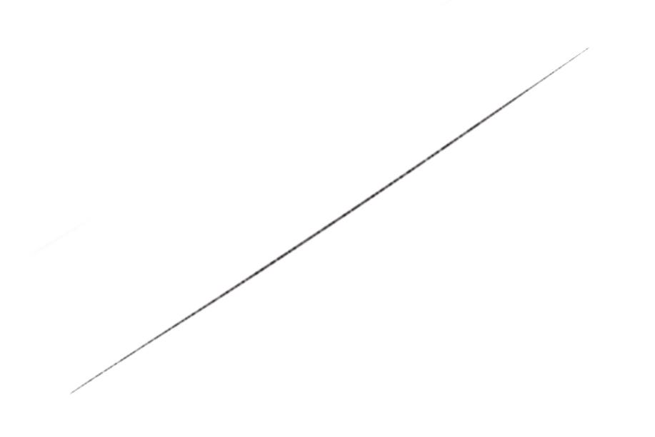
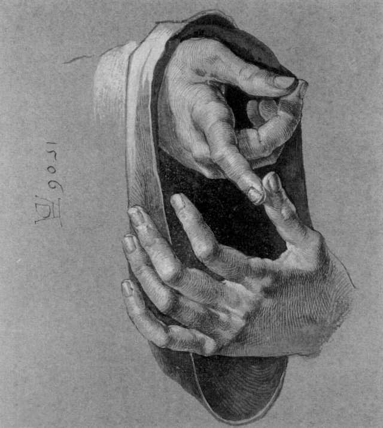
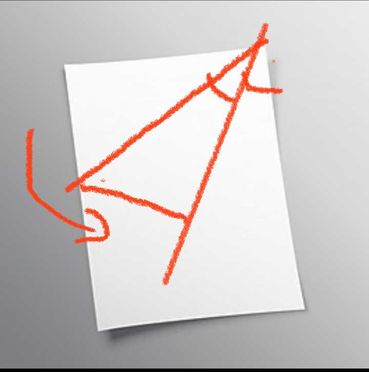
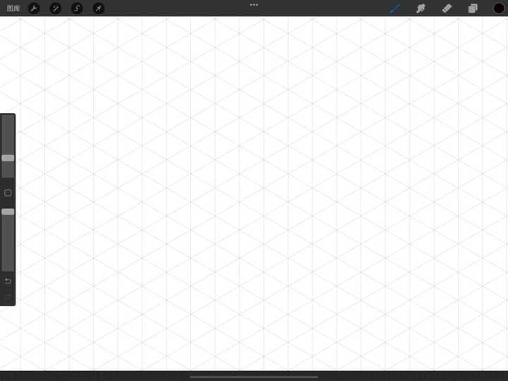
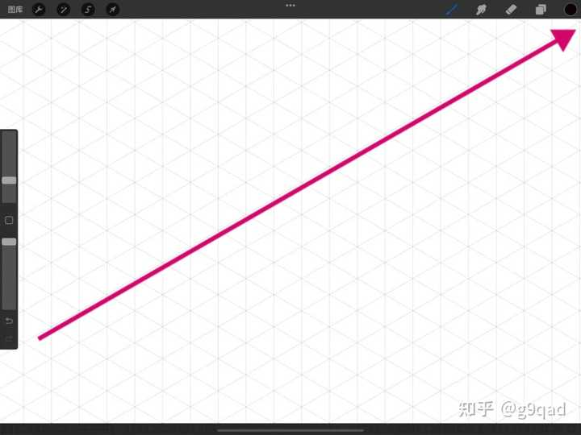
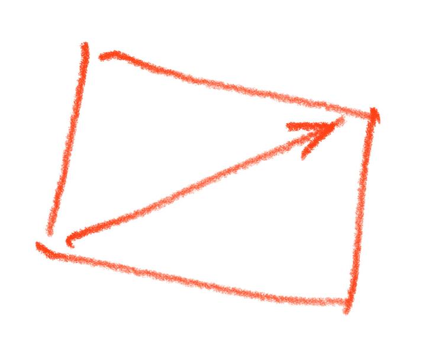

---

## 3289　讨好型人格

- 日期：2021-06-01　主专题：A01 心理主体与情绪劳动　副专题：A06;A11
- 源 ID：`3e05822b-d0b2-5850-9c56-1d43c3a749f0`　原文链接：https://www.zhihu.com/question/27201150/answer/1917640700
- 官方对象—实践路径：与自己 / 与欲望 / 觉察
- 23 概念标签：能力与学习;选择与自由;成本与总账;爱与回应;净输出与不掠夺;边界与许可;财富与市场;法律与秩序;权力与异议;心理与主体
- 证据状态：manual_confirmed　初读：read　独立复核：not_reviewed

**问**：如何改变讨好型人格？

讨好型人格这个话，也是太泛滥了。
现在竟然有了将一切利ta的行为都一概冠以讨好型人格的诊断的趋势，搞得本性善良的人常常以为自己有病，真是罪孽深重。
说一个解决方案。
如果你利ta是为了拿来交换这人对你好——不论是尊敬也罢、回报也罢、依恋也罢、关注也罢，你算讨好型人格。
如果你不是为了这个，而是比如利ta就是你准备做的事，或者利ta是你认定的人生准则之一，那么你就不是讨好型人格。
如何判定你是后者？
看你是否接受对方得了你的好，却不对你好。
注意，我说的是不对你好，不是指对你坏、伤害你。你没有必要去用你能接受“人得了你的利然后来伤害你”来证明你不是讨好型人格——不管别人得没得你的利，甚至哪怕对你有利，都不是别人可以伤害你的许可凭证。
我说的是你可以接受别人不对你好。比如，无动于衷，一声不吭，没有表示……这些。
你依然感到快乐，依然觉得没有问题，依然乐在其中。
那么你就不是讨好型人格。
而这个时候，那些看不懂这个区别、仍然说你是讨好型人格的人，自己是讨好型人格。
也就是说，你心里有一个无人能阻止的意念魔法，只要你心念一转，一闪念间，就可以把ta们变成小丑。因为只有自己在打着这个主意、并且暗暗觉得这是得到好感的唯一办法的人，才会觉得别人做的一切事情都是在实施这个办法。
我向你保证，从此以后，你每次看到ta们说你讨好型人格都会觉得很欢乐。
就是这响指得一直捏住，不要松。
比如，要是有得你好的某人说你是讨好型人格，你就把给ta的那份好取消掉，让ta自己领悟去。
别人说，ta点头，一样取消。

总结：
把利ta作为换取人对你的爱的手段，才是讨好型人格。
把利ta作为自己爱ta人的手段，不是讨好型人格。
看得懂这区别的人，无法是讨好型人格——因为ta必然同时看懂这样做根本达不到换取别人的爱的目的——爱是不接受交换的。
你仔细想想，用来讨好人的东西，都是默不吭声暗戳戳想要拿来换人家什么东西的。要换什么你又不敢说，因为你怕说了人家就不收了。人家以为是什么都不换的，于是收了，等鱼儿咬钩了你又说其实你要这又要那。
这样要到的东西，其实是钓鱼诈骗骗来的。因为上了当，不能不给你你要的夸赞、你要的一点关注、你要的一点陪伴，这样的东西，真的等于人家跟你关系好吗？
可以等同于爱吗？
别的人不懂，也许可以这么想。
你已经懂了，想这么想也办不到了。

相反，看不懂这区别的人，一定是某种程度的讨好型人格——
因为看得懂这个，是避免走讨好路线的最佳心灵免疫机制，是一针灵魂的疫苗。
看不懂，则犹如没打疫苗在充满高传染性病毒的社区里过小日子。要知道这种病毒是不会停止流行的，而它的传染性甚至比新冠还要高。
看一眼就可能传染。
不打这疫苗，日子久了你肯定会转阳性，这就像下雨天不打伞的人身上一定淋湿一样必然。
问题是，怎么能做到这一点？
有一个很简单、实用的做法可以对纯利ta做很好的练习。
那就是匿名帮助。
让你所有利之人，无法知道你是谁，保持匿名状态。
在最佳情况下，最好对方连一个代号也不知道，完全无从感谢起。
当你在完全匿名的帮助ta人，你可以非常确切的知道你的利ta行为的报偿一定是内在的。对方根本没有回报你的可能途径，你也根本不能因为ta人的无回报而怨恨。
因为这是你自己一开始就选择的游戏规则，你有啥可怨的？
而这样的事，你仍然可以做下去。无论是单纯觉得开心也罢、还是借此获得了自己是个好人的实据从而感到安心也罢、还是觉得自己满足了宗教义务而觉得自豪也罢，无论是什么，你现在行这事的动机可以在硬性逻辑上可靠的被认定至少不是出于交换对方的好感和爱的目的。
你的目的不是外在的，而是内在的。
你已在这行为自身之中得到了完全的满足，而不再需要纠结它所带来的额外收益。
你要有意识的、故意的、渐进的、然而是稳定向前的推进这种实践练习。
这个就是不计较的练习，是稳定性的练习。你会从这个模式的练习里学会将自己的一切行为动力均加以尽可能的内在化。
内在化的动机，不受额外收益的动摇，无失败可言。
看清楚，“渐进”是一项强制要求。
这一实践的成本，不宜超过你可以承受的收入比例。建议你先控制在你的10%收入以下。而不要因为沉迷于这实践带来的快乐，而擅自做出你自己其实承受不了的尝试。
注意，这里说的是建议你将实践的起点设立在你的收入的百分之十以下，也就是你净利润的百分之十以下——刨去你的生活费、你的成本、你该交的税……净利润的10%以下。
注意，这说的不是你的清醒时间的10%。
很多人觉得“我没利润，那我捐赠时间吧”。
这不可以。
因为如果你自己尚且做不到自我供养且有利润，这时候你把本可以用于谋生的清醒时间拿出10%来捐赠，作为一个新手，你也将很难接受ta人的辜负，而这对于ta人也是不该背负的压力。
这本质上是一种傲慢和贪婪——对爱之艰辛的傲慢，对Caritas体认的贪婪。
你要勇猛精进，但不能用傲慢和贪婪来自欺欺人的勇猛精进。
第二，注意，这里说的是起点。人越是调高这一比例，就实际上是在渐进的调高自己由为自己而活转向为ta人而活的比例。
而最终完成向后者的高度转化，是人自身达成良好的社会化、走向自由、获得真正的尊重和敬爱、获得缺少这能力的人的衷心授权、成为社区支柱的绝对必要条件。
那里有各种各样的刚强、坚毅和毫不费力的英雄气质，有人类无法抗拒的魅力和各种各样人们渴望由你来保管的权柄。
有你脱离孤独、苦闷、迷茫的答案——而且很多，多到你可以随便挑选。
这也是为什么要再三警告你们——要警惕出于对这些福利的贪婪，而用傲慢掩护自己的贪婪。
那样反而会遭到自然规律无情的反噬，而且是罪有应得。
当你实践起匿名施助，只要这实践没有终止，你就一直有可以基本确信你并非讨好型人格的实据。
实践得越久，你越可以肯定。
因为这不是靠自我感觉良好，是靠实际数据。
而终极的非讨好型人格对策是什么呢？
是这个：
如何树立正确的财富观？

---

## 3272　有福气

- 日期：2021-06-09　主专题：A01 心理主体与情绪劳动　副专题：A04;A07
- 源 ID：`0676db0f-9e74-5f61-99cd-8424e352d6a5`　原文链接：https://www.zhihu.com/question/463707412/answer/1930311966
- 官方对象—实践路径：与友人 / 与同志 / 认同;与自己 / 与理想 / 建立;与自己 / 与名誉 / 建立
- 23 概念标签：定义与达意;选择与自由;成本与总账;信用与信任;照料与家庭;财富与市场;文明与历史
- 证据状态：manual_confirmed　初读：read　独立复核：not_reviewed

**问**：如何定义“有福气”？

有福气，是指会令人在对你的观察后大概率判断出你的前途乐观，以至于强烈的倾向于在你身上提前投资或至少避免敌对的一种生存状态。
它典型的包括以下几种情况：
第一，谦卑而温柔
这类人极难树敌，但极易有朋友。我见犹怜，况老奴乎？与其为敌，极易触犯众怒，对付ta容易，对付ta数不清的朋友们可就难说了。同时也非常容易导致自己的团队内部有人兔死狐悲，发生内部分裂。

第二，简朴而勤奋
这类人创造价值的能力远超过自己收敛的欲望，不但自给自足，而且能承受意外和苦难。艰难险阻，谈笑而过。与之为友，很容易分到额外利润，如果与之为敌，第一，这种人生命力极强，极难消灭，多半发展成长期隐患；第二，不但失去本来可以有的长期收益、反而得到一个近乎打不死的敌人，殊为不智。

第三，追求知识
这类人从不会在困难面前绝望，因为一切可观测的困难，都不过是饶有兴味的研究对象、富有挑战的新谜题。世界永远多姿多彩，从不乏味。
与这类人为友，你常能在没有办法的时候从这些人手里得到一些你以前没有想到过的办法；与这些人为敌，那么你要想清楚——既然对方总能想到你没想到过的办法、知道你不知道的信息，那么你以为万无一失的安全，真的就算是安全吗？

第四，总是使人和睦
这类人在哪里都是所有人的压舱石。没有ta们，没有任何事能顺利的得到好结果。
与这些人为友，就是与世界为友；与这些人为敌，先不谈你失去了一个调停者，在最坏的情况下，你也要记住——这些人也是最深刻的理解人性，最清楚怎么一句话就在你的下属、盟友心里埋下永远无法消除的猜疑和仇恨的人。

第五，勇敢
这类人是寒冷黑暗中的光与热的源泉，所有人依赖着ta们补足自己缺少的信心。ta们也往往因此担当最终的裁决者，解决没人敢于触碰的问题。
与这些人为友，你的乐观程度会自然的被拉升，这会相当有效的提升你自己的幸福感；而要与这些人为敌，你最好一出手就保证彻底斩草除根，否则，这个世界对你将不再有安全可言。
但这个世界上，哪有“保证斩草除根”这回事？

这几种人，是超越意识形态、超越时代环境变迁，一定会自然幸福的几类人。
你们要注意，这里没有加入诚实、公正、孝顺、聪明、忠诚、富有、善良、优雅、谨慎、热爱冒险或者有xx信仰之类的其它常被称为“美德”或“美事”的东西。
这些品质不是说不好，但是常常会带来相当大的负面影响，其实在保证个人幸福上是喜忧参半的。
而前面说的几个品质，是深思熟虑后特别挑选出来的。
父母们看好——这几条的重要性是特殊的，是你们尤其需要在意子女是否拥有的品质。
不必全都有，但至少要有一条。否则ta们的幸福很容易有问题。
运气极差的人该如何从头开始恢复运气?

---

## 3249　傲慢之路

- 日期：2021-06-18　主专题：A01 心理主体与情绪劳动　副专题：A03;A11
- 源 ID：`86f61f82-2a39-5d86-aa73-0b0eb1ffe085`　原文链接：https://www.zhihu.com/question/19798840/answer/1946828676
- 官方对象—实践路径：与自己 / 与信念 / 怀疑
- 23 概念标签：事实与证据;能力与学习;责任与后果;成本与总账;信用与信任;边界与许可;劳动与组织;技术与工程;心理与主体
- 证据状态：manual_confirmed　初读：read　独立复核：not_reviewed

**问**：人为什么会傲慢？

你现在要做一件很要紧的事情，你制定了一项长达两年的计划。
你有24个月。
你组建了团队，已经开始实施了。
在这个过程中，你不断的发现——原来我的计划是错的。
你扛了一段时间，真的扛不下去了——因为错得越来越明显了，继续下去根本不会得到你想要的目标——这时候你才坚持了三个月都不到。
你还有21个月。
于是你决定——不行，我要重新订计划，把时间调整成20个月完成，这次我把教训考虑进去。为了保险起见，我要多问几个人。因为要多问几个人、要慎重，所以我安排了一个月时间来定计划。
现在你问了一圈人，能问的都问了，计划修订了。
你还剩20个月。
你重新开工了。
过了三个月，张三说不行，你这个有问题。
你自己没觉得有问题，所以你当时没理ta。但是心里留了个疙瘩。
你还剩17个月。
这疙瘩始终解不开，因为这问题确实你没有仔细的想过——你自己，包括你问过的那一圈人，都没有想过张三提出的那个角度。
于是你为了保险起见，半夜里爬起来好好的计算了一下如果张三说的是真的，会有什么后果。
后果是你不但在整个两年后可能达不到目标，弄不好还要坐牢。
你还剩16个半月。
你决定仔细考察一下张三说的这话到底真不真。调查结果是——虽然很难说一定为真，但确实不能排除一些迹象可能正在显示事情在往张三所说的这个方向发展。
你还剩16个月。
考虑到还有16个月，而这个威胁实在太大，你终于跟小组成员讨论了一下。
而你不讨论则已，一讨论，在小组里引起了轩然大波。有一半的人对可能的恶劣结果非常焦虑。
你感觉到了——如果你不对这个漏洞做足够的修正或者解释，接下来这一半人恐怕会陆续离职，而剩下的一半人恐怕到那个时候也不会那么坚定了。
好在，你还有16个月。算算时间还来得及。
于是你们立刻忙活起来，调整了架构和技术路线，重新安排了计划。这次充分考虑了一切问题，能找的资料都找了，能问的都尽量问了。
这次一定要搞对——你心里默念着。
你这次仔细花了一个半月来重新制定计划。
最后大家觉得心里舒坦了，重新上路了。
你还剩14.5个月。
但你现在非常的被动和不安——基本上所有的机动时间都用尽了。接下来的14.5个月，如果再有任何问题，都必定会要求人要加班。
你这时候认识到一个问题——尽管这一次你感觉没问题了，但是你感觉没问题，并不是一种保险。
你很害怕再遇到下一个“张三”。
日子在一天一天过去，尽管你提心吊胆，但是看上去确实没有什么大问题出现。一切似乎都在向前推进。
你渐渐的感到这次看来对了，因为你看到了很多积极的迹象——比如仓库里整整齐齐的堆垛。
平安的日子过得飞快——转眼7个月过去了。
你还有7.5个月。
你如同往常一样，在一天的疲劳之后刷刷知乎，准备水一下帖子，尤其是在自己擅长的专业话题下再输出一点东西。
你滑呀滑呀滑。
你滑到一篇东西上。
这篇东西从根上反对你的方法论。
那东西证据写得也不全，没有给你大量的文献，只是雪泥鸿爪的做了几点简单的论述。
这个论述本身倒是没啥问题，但是，在你眼里这约等于全部十二个环节只列出了三个环节。这三个环节对，并不代表那九个环节对。
而且以你的经验，如果这三个环节这样安排，另外的那九个环节你都想不出什么办法来解决。难道那九个环节的问题可以直接不管吗？
这人语气如此肯定、这三个环节说得如此断然，而文献也不引、证据也不给足，到底是凭着什么自信？
如果ta是对的，那么我现在如果对我的计划做这种幅度的调整……
我还有7.5个月。
我只要把这种可能性在团队里提出来，恐怕就会有一半人认定我不是谨慎，而是有病。
何况，我已经问过了大佬ABCDE，ta们都说过没问题。这人到底以为自己是谁？？
我不可能错得这么厉害。
我不相信我会错得这么厉害。

这事只能有、只允许有一个结论——这人一定是、必须是胡说八道。

ta一切的底气都必须是装出来的，相信ta的人都必须是没有眼光和基本判断力。

我不能在这个时候自我怀疑，我不能永远一直自我怀疑吧？
我注已经下好了，我怀疑我是错的有什么意义？
我赌我是对的。
我相信我是对的。
不，我坚信我是对的。
我不信我之前做的那么多努力、付出的那么多思考，就这么一钱不值。

看看这人的评论区，这个世界真可怕——居然这么多人被这么简单空洞的话术欺骗了。

不行，我要与这种丑恶现象作斗争。

“实名反对高赞回答。”

这是一个傲慢事件发生的全流程。
各种各样的傲慢，本质上是对自己错误的可能的一种恐惧。
“我没有错”是支撑绝大多数人做手上正在做的事、走现在正在走的人生路的根本支撑。
抱着“我是因为这事是对的所以我才做它”的基本思路，奉行“只做对的事，只有做对才行”的念头的人们不能在根本上接受这种可能性。
人们普遍想不通一个道理——你在做的这件事是错的，但你仍然应该做它。
你想要做绝对正确的事、只做绝对正确的事，你就会落入这个陷阱。你的谦虚谨慎，无论多么深厚和努力，最后一定无法对抗无限的“正确崇拜”。
抱着“只有做正确的事才会得到好的结果”的执念、“常识”，你最后必将被迫要在某个退无可退、退了也不再有现实意义的悬崖边靠自我宣布绝对正确来停止被合理怀疑拉住后腿、动摇决心。
否则做任何事情都会有无限的犹豫和无限的动摇。
这才是傲慢的根源——人不是喜欢傲慢、天性傲慢，而是因为一个错误的执念，欲不傲慢而不可得。
如何能从不断的自我否定与自我怀疑中走出来？

---

## 3245　人心不古

- 日期：2021-06-20　主专题：A01 心理主体与情绪劳动　副专题：A20;A03;A06
- 源 ID：`48215fd7-d433-503c-b1b1-1fd9b546a406`　原文链接：https://www.zhihu.com/question/464172639/answer/1949706094
- 官方对象—实践路径：与社会 / 与历史 / 解释
- 23 概念标签：事实与证据;能力与学习;选择与自由;责任与后果;爱与回应;权力与异议;文明与历史;心理与主体
- 证据状态：manual_confirmed　初读：read　独立复核：not_reviewed

**问**：如何反驳老一辈人「我们那个年代那么艰苦都活下来了，现在的年轻人条件那么好却经常出现心理问题」的言论？

生活条件好，本来就会造成心理脆弱，这没什么好奇怪的。
老一辈所经受过的苦难，是威胁人的基本生存的东西，其强度远远的超过90后00后甚至80、70后的想象，这是一种无可争辩的客观事实。
只是ta们的基本假设——即“富裕的生活可以理所当然的换到强健的心理承受力”或者“富裕就可以避免一切痛苦”——一开始就是不成立的。
客观来说，的确现在的这一代年轻人的普遍承压能力是显著的弱于老一辈的。你可以说这些老人们是“幸存者偏差”——但这对这个结论没有任何改变。从那个年代幸存，本身就是不可否认的强健的证明。ta们当然有大量的心理疾病和心灵创伤，但是ta们遭受到那样的考验，能活下来，仅仅是受伤、扭曲，这本身仍然是一种成就。
因为ta们所挺过的那种黑暗和恐惧，说句实话，是80、90、00靠着纪录片、小说和想象所无法理解的。70后也只捎上了一个尾巴（这还得是75前那一半，75后基本上等懂事都已经80年了，改开已经开始了）。
那种心理压力，说句实话，不是承平之年的人所能轻佻的调笑的。
每一个经过了而没有死掉的人，都受了极深的塑造。这塑造之中的确包含了极其强大的求生意志。
这跟走过了两万五千里长征、九死一生活下来的人变得极其的坚强在本质上并没有什么不同。
40-50-60后，那是真正的和死亡、饥饿、恐惧跳了很多年的贴面舞的。
问题在于，苦难这个东西，只有来自上天的，才有这个形塑人格的作用，它不能来自另一个人的决定——哪怕它主观上是出于“教育的目的”。
得了个病丢了一条腿，我别无选择，自强不息，继续追求我最好的人生。这种天生的负重，反而会使得很多一般的干扰对我变成不痛不痒。
你说你要教育我砍我一条腿，我满心怨毒、自怨自艾、刻骨仇恨，君子报仇十年不晚，迟早有一天我要和你同归于尽——反正当个废人也没意思了。
天给的灾难，因为无可仇恨，如果没有杀死人，往往造就人；
人给的灾难，因为直接引起仇恨，就算没有杀死人，也往往毁灭人。
老一辈人的强悍人格，是一种时代造就的结果。这个“幸运”的条件现在没有了，所以现在这一代确实要软弱不少。
这答案非常的朴素，没有什么奇怪的。
去冷嘲热讽一番，用一种似乎老人们在说谎吹牛好在你这骗一点心理优势、谋一点教训你的资格的姿态去应激反应，其实是一种非常无效、而且糟糕的应对。
这首先就是一种应激造成的不假思索的误判——ta们根本不觉得教训你的资格还需要怎么去“谋求”一下。你可以说ta们这样想是错的，但很显然这和ta们是不是这样想的没关系。
说它无效，是因为你既不会因为这个做法免掉教训，也不会靠这个做法获得心理满足、也不会因此获得物质利益、也不会因此获得社会性收益，
几乎每一个目睹者都会因此差评你。
而你用这么大的损失，真的换到了自己良好的心理感受了吗？
所有的方面都是亏损，并且也没有降低它发生的概率。
因为这种感叹发生的肇因的确是老人们对现在小孩的脆弱性感到焦虑和失望，你这样叫喊一番，除了证实了这种脆弱已经到了连旁听一下也不能忍受的严重地步，从而更近一步的刺激了ta们的感叹之外，到底从什么角度降低了这件事再次发生的概率呢？
所以是不是又糟糕、又无效？
任何时候，要控制住自己的情绪冲动，做理性有效的事，而不是随着自己的情绪指挥，怎么痛快怎么来，然后被情绪带进泥潭里，这一条最好时时刻刻常在心头。
这本身就是成熟。

---

## 3240　气泡膜

- 日期：2021-06-23　主专题：A01 心理主体与情绪劳动　副专题：A04;A03
- 源 ID：`6d36b847-aa59-5af1-ae89-6fcebf74a695`　原文链接：https://www.zhihu.com/question/389906170/answer/1956511342
- 官方对象—实践路径：与自己 / 与理想 / 持守
- 23 概念标签：定义与达意;选择与自由;爱与回应
- 证据状态：manual_confirmed　初读：needs_reread　独立复核：not_reviewed

**问**：都来说说，这个世界对平庸的人有恶意吗？

世界对平庸的人没恶意。
世界对甘于平庸的人也没恶意。
“没恶意”的意思是——世界对ta们以及不甘于平庸的人都是一视同仁的公事公办，如果你要说这个叫作残酷无情，那么就是一样的残酷无情，并没有额外恶搞ta们。
世界是对假装甘于平庸的人格外残忍。
祂把这样的人成卷的放卫生间里，蹲马桶的时候拿出来当减压玩具。

挨个捏爆，爽得一批。
当然，ta大概、或者、也许、maybe不承认这叫“恶意”，而觉得叫“大慈大悲”。
不甘于平庸的人的“平庸”其实是假象，因为那只是走向不平庸的一种过程。
这倒不是说每一个不甘于平庸的人最后都会功成名就，位高权重，而是不甘于平庸的人，经过若干次无效的努力之后，或迟或早、会意识到事情到底是怎么成的——无非就是不能一蹴而就，无非就是要安心练基本功，无非就是要抵抗诱惑，无非就是要进一步的自我管理，无非就是要多点耐心。
“不平庸”其实是在这些mindset的作用下日积月累的结果。真正不平庸的，不是最后那个辉煌的烟花，而是这个mindset本身。
而长期坚持这种mindset，对之习以为常，即使并无那些什么举世瞩目的成就，也会成为一个足够有效，于是足够快乐的人。
不是天下第一、不是圆满幸福，但是足够了。
这样一种状态，走在街上似乎不过是泯然众人，没有任何直观的特别之处，但让抑郁患者们来看，已经羡慕得要死了。
不甘平庸真正的收获是一种与这坚持相匹配的强健心态和与之相称的足够的踏实、宁静和幸福，那些让人惊叹、佩服的成就，只不过是添头。
而且等你得到了，你就知道只不过就那么回事。举个例子，你能把豆腐切成1cm见方的方块，八角皆直，切豆腐界无不五体投地、惊为天人，谁敢说你平庸，大家非把ta剁了做肉末豆腐不可。
但你走在街上，小孩子们还是一样会觉得你是“油腻中年”。
而“甘于平庸”呢？
如果是真的，那么这可不是什么平平无奇的东西。不管你是发达还是落魄，能脱离功利心，而且是真的脱离功利心、势利心，而不仅仅是单纯因为无能而说点“不是我不能、只不过我不想”这样的便宜话，这本身就不是一种平庸的人能做得到的事。
这本身就极其不平庸。
按照佛教的看法，这就算还称不上菩提萨陲，也已经足以可称阿罗汉了。
什么叫阿罗汉——“断尽我见、我执、三界贪爱、无明及其它所有烦恼，于当世舍寿时不受后有于三界中出生，脱离生死轮回之苦而入无余涅槃界的圣者”。
不到这一步，不朝这个方向勇猛精进的求去我见、我执、三界贪爱、无明及所有烦恼，你扯什么“自甘平庸”“躺平”的淡，这就叫“假的自甘平庸”。
那是贪欲如火，却又只想躺赢，又赢不了、躺不住的人说的一种欠抽的话。
人人都知道你能上而不上、你想要就能得而你不要，你才叫自甘平庸。
你本来就上不了、得不着，却喜欢人前背后在嘴上去占这种“淡泊明志”的便宜，别人跟你客气几句、倒也罢了。就怕你戏演得太逼真，骗得你自己倒信了。
然后你会干嘛？
你会在躺不平的时候挣扎几下，挣扎到难处又突然变成“淡泊明志”的高人，又一扭腰tm的躺了下去。
躺你又躺不下去，站你又站不起来。
这出“雄起功能障碍”的戏一年要演八十次，你不烦，所有的观众看也看到烦了。
要么干脆借把刀割了吧。
演也就罢了，你一直在原地转圈。一点不甘心，全投身到演艺事业上了。
既没有努力去追求不平庸，也没有努力去追求真正的甘于平庸。
浪费生命的人，人生想要不惨烈？
凭什么？

啪！

<!-- 图片：2 张，审读结论见下 -->
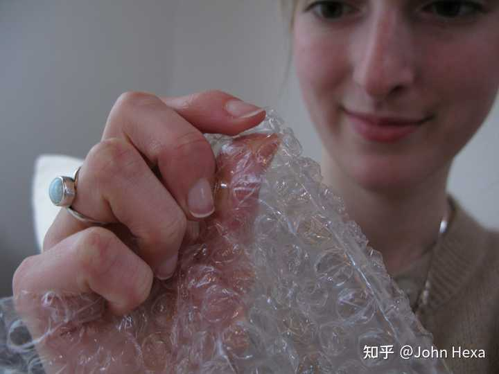
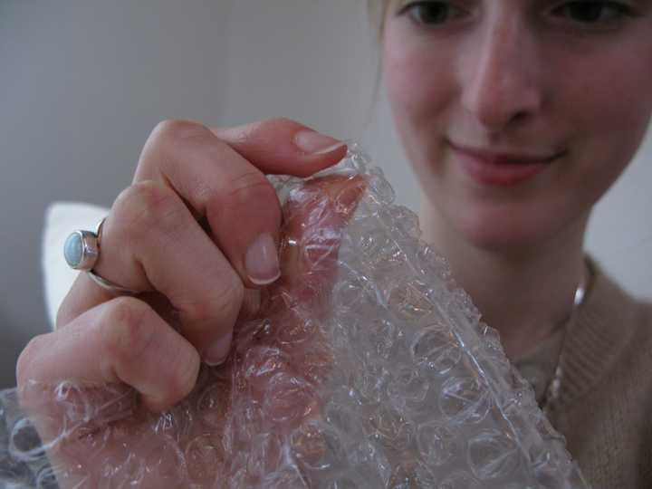

---

## 3238　为委屈而道歉

- 日期：2021-06-27　主专题：A01 心理主体与情绪劳动　副专题：A06;A03
- 源 ID：`c78c36e6-c218-5f6f-b85b-db0672e69191`　原文链接：https://www.zhihu.com/question/467737273/answer/1963496023
- 官方对象—实践路径：与自己 / 与情绪 / 调节
- 23 概念标签：事实与证据;能力与学习;选择与自由;权力与异议;心理与主体
- 证据状态：manual_confirmed　初读：read　独立复核：not_reviewed

**问**：为什么听到别人说重话就会忍不住委屈掉泪？怎么办？

就自己情绪控制的失误对对方道歉，请对方继续。
恳请不要因为自己的情绪反应而收住该说的话不说。
因为这些话是有用的话，是可以帮助自己以后更少犯错误的话。
自己的这个情绪反应不应该成为接受这些教训的阻碍，只是现在自己还控制不住本能。
请对方万万不要顾忌，一定要相信你聆听教训的诚意、相信你决意与自己的脆弱情绪为敌、必要达成与对方更好的相互理解的决心。

这不是软弱和卑贱，而是会令人肃然起敬的刚强。
对方何止不会借机作伐，还会因为这份决绝的自控和理智对你感到敬畏，本能的意识到你将来前途恐怕不可限量，因为小事与你交恶实属不智。
周围若有旁观者，你说了这话，对方如果不收敛自己的言语暴力，那么这人在所有旁观者心中的评价都会雪崩般的降低。
正常人即使仅仅凭着人类的本能，都会因为这些话而转向心疼你，转向软语温言，转向自我忏悔过度使用语言暴力。

别以为温柔、和解的话必定意味着软弱，事实往往相反。

---

## 3234　FURY

- 日期：2021-06-29　主专题：A01 心理主体与情绪劳动　副专题：A11
- 源 ID：`46e8cdb3-b54a-5fb7-ac92-ad6f579b996d`　原文链接：https://www.zhihu.com/question/266645399/answer/1969210271
- 官方对象—实践路径：与自己 / 与情绪 / 调节
- 23 概念标签：能力与学习;责任与后果;成本与总账;边界与许可;劳动与组织;财富与市场;权力与异议;文明与历史;民族与身份;心理与主体
- 证据状态：manual_confirmed　初读：needs_reread　独立复核：not_reviewed

**问**：一个人的狂怒能有多可怕？

匹夫之怒，血溅五步；
天子之怒，血流漂杵；
文人之怒，怒出千古绝唱；
学者之怒，怒出诺贝尔奖；
思想家之怒，怒出移风易俗。

怒不是问题，贪财也不是问题，好色也不是问题，痴迷也不是问题，这只是一种动力源。
后轮马力强劲，是问题吗？
问题是变速箱不行，不能把爆发性、不稳定的动力转化为平稳易用的动力输出。
问题是导航系统、转向系统混乱，把这动力导向了指向悬崖和南墙的方向。
某甲使你狂怒，你可以把这个愤怒用在消灭某甲的肉体上；也可以把它用在努力用功，将来让某甲相形见绌上；也可以用在造福人类，然后让某甲作为你故事里的丑角永世为人类铭记上；也可以用在改变世界，减少某甲这类人出现的概率上；也可以用在刻苦自身，提高自己的鉴别力和场域设置，让某甲这类人想要再重复自己的攻击的成本提高一个数量级上。
看清楚没有？
狂怒根本不是问题——在很多程度上它甚至是一种财富——它好过心里没有燃烧的动力和賁张的热血，好过已经没有痛苦和憾事。
问题在于，人缺少愤怒的修养，
怒得自私、
怒得狭隘、
怒得愚蠢、
怒得下流、
怒得猥琐，
怒得低贱！

你怒错了方向，怒坏了规矩，你就等着粉身碎骨，而且纯属活该。
你怒对了理由、怒对了方向、怒对了规矩，
你的狂怒可以拯救民族危亡、
可以掀翻千古不公、
可以永远改变人类的认知。

很多人以为最高级别的修养，是看什么都喜滋滋、乐呵呵，对一切烦恼全都滑不溜手，所谓“解脱”是也。
但这不过是把自己修成了活泥鳅。

最高级别的修养，是一种【熊熊燃烧的愤怒】。只不过那种愤怒没有被用作杀人伤人的理由、不道德的资格、放纵的特许证，它被用在了隐忍、坚持和决绝的自制上。
那些一说自己“愤怒”了，就拿着这两个字为所欲为的人，哪里有资格谈愤怒？！
那不过是些找到任何一个借口就迫不及待用来逃避和施暴的，ta在乎的根本不是愤怒，ta在乎的是那个所谓“愤怒“带给ta们的“破坏权”，在乎的是那个享乐。
那跟找到一切理由去证明自己是“合理吸毒”的人有什么本质区别？
这是愤怒：

这也是愤怒：

这也是愤怒：

以后记住：
你的愤怒，只应该带给你新的义务，没有给你带来新的权利！

怒得有出息一点！

<!-- 图片：3 张，审读结论见下 -->
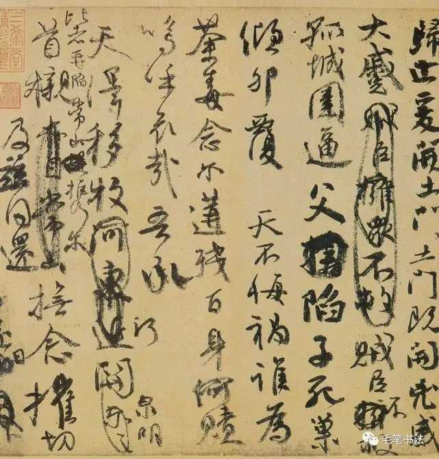
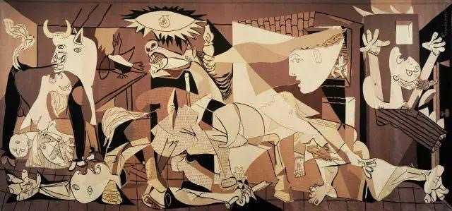
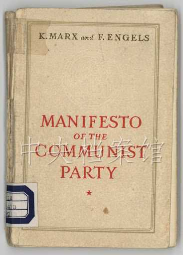

---

## 3205　怨憎会

- 日期：2021-07-14　主专题：A01 心理主体与情绪劳动　副专题：A06;A05;A07
- 源 ID：`8bb20447-03d0-5a1c-85c3-8dec881a9584`　原文链接：https://www.zhihu.com/question/470883728/answer/1996772994
- 官方对象—实践路径：与自己 / 与能力 / 获取
- 23 概念标签：定义与达意;能力与学习;选择与自由;责任与后果;成本与总账;照料与家庭;劳动与组织;心理与主体
- 证据状态：manual_confirmed　初读：read　独立复核：not_reviewed

**问**：跟一群天天否定你，打击你的人一起生活，该怎么保持不生气，并且依然自信？

你为什么要和这些人一起生活？
如果你能力不足，不得不一直和这些人一起生活，你应该首先增强你的能力，以便获得不必忍受这些的选择余地。
你有了这选择余地，而且这选择余地非常的明显，这个“明显的选择余地”本身就会无声的告知对方你并非可以轻易触犯的对象。
不需要你横眉立目，也不需要你夹枪带棒，也不需要学什么话术，更不需要学什么斗争妙招。
你可以轻易自己离家独立，父母就说话小声；你可以随便跳槽，老板自然客气三分；你可以轻松的换一个，这一个自然不敢放肆。
你越和颜悦色，对方越胆战心惊。
不怒而自威。

如果你没这选择余地，你是没有什么所谓“巧妙”的办法来解决这个问题的，也不要指望可以有什么巧妙的话术和委曲求全之道可以解决问题。
更不要幻想什么“手撕”“翻脸”可以叫对方“知道厉害”。
你只会自取其辱，因为早在别人侮辱你之前，你已经通过默许和接受自己的无能侮辱了你自己。
谁叫你不学习？谁叫你不劳动？谁叫你好逸恶劳、四体不勤？谁叫你打退堂鼓？谁叫你贪、懒、馋？谁叫你乡愿？谁叫你侥幸？
人必自侮而人辱之。
你想躺赢，你就自己放弃了人格，你不但会招来ta人本能的轻蔑和训斥，你自己还会将种种正常的对待疑心生暗鬼的体会成含沙射影、指桑骂槐。
你只会永无宁日，而且不要妄想它会停止。

因为这个折磨的存在就是为了从根本上防止人类试图放弃努力，而去反向学习适应委曲求全。
无论你委曲求全得多么有技巧，对方无意识的不断收紧和你自己心底里无法根除的抵抗意识最终都会让委曲求全最后走向破产。委曲求全只能是争取时间和机会的权宜之策，最终靠的还是“明显的再选择权”。
努力是一种天定的义务，不努力的人在客观世界的眼里就没资格做人——不管法律怎么规定、舆论怎么宣传，客观规律就是这么直白。
你没有这个“显而易见的再选择权”，你本来就不该有虚幻的安全感——不错，常人口中的“自信”本质上不过是成功构建的安全感错觉。
俗称自欺欺人。

---

## 3195　长时间保持理性

- 日期：2021-07-18　主专题：A01 心理主体与情绪劳动　副专题：A03;A06
- 源 ID：`85ee0565-2d16-566b-affb-8319e018eb62`　原文链接：https://www.zhihu.com/question/472990856/answer/2005970659
- 官方对象—实践路径：与自己 / 与能力 / 承受
- 23 概念标签：能力与学习;选择与自由;责任与后果;成本与总账;爱与回应;照料与家庭;劳动与组织;生态与自然
- 证据状态：manual_confirmed　初读：read　独立复核：not_reviewed

**问**：如何长时间保持理性？

这个真的很直白的，因为人是一种特别简单的动物，干什么事情得了好处，就一直干；干了得了坏处，那就干得勉强，最后放弃。
如何长时间的保持理性？主要就是吃足了不理性的亏，尝了理性的甜头，那就自然长期保持理性了。如果不理性体验反而特别好，理性反而很倒霉，整天翻来覆去，那就保持不了了。
那这种转变的关键是什么呢？是看你是靠人养，还是得你养人。你靠人养，你会发现不理性很占便宜的——越是不理性，体现出理性能力的无能，反而越是不会被安排承担什么责任、分担什么风险；越是理性，反而越是被分配任务，越是被挑剔做得不够好。还会出现很多人来跟你“讲道理”，试图科学的证明你是错的，你还不能不接着。然后你如果讲道理的话，你还真的很可能经常被说得无话可说，按理就得放弃或者改变计划。
如果你索性往地上一滚，不嘛不嘛我就不——没准还啥都有了。但这些到没有人养你、只有你养人的时候就全变了——养自己也得养啊。你敢往地上躺，就有人敢收你的尸，滚都没机会滚。没有人会兜着你不理性的任何后果，每一滴都得你兜着——哦不，除了自己那份，你还得兜着一圈在地上打滚的、放弃自己的理性的老小孩、小小孩们所造成的后果。那时候你不理性你都睡不着觉，这时你就完全不用操心“如何长时间的保持理性”。
综上——长期保持理性只有一个条件，就是你是不是有爱的义务或者有爱的追求。因为爱就是少添麻烦多解决问题，就是养人而少要人养。
没有理性，即爱无能。这个辉瑞也治不好。

---

## 3196　烦躁

- 日期：2021-07-18　主专题：A01 心理主体与情绪劳动　副专题：A05;A06
- 源 ID：`550d38d4-31b2-56d8-bc6e-8699b1cdbcb6`　原文链接：https://www.zhihu.com/question/20021937/answer/2005292053
- 官方对象—实践路径：与自己 / 与情绪 / 调节
- 23 概念标签：能力与学习;选择与自由;成本与总账;爱与回应;边界与许可;照料与家庭;劳动与组织;法律与秩序;权力与异议;技术与工程;心理与主体;性别与身体
- 证据状态：manual_confirmed　初读：needs_reread　独立复核：not_reviewed

**问**：心情烦躁时怎么办？

烦躁是有结构的。
你可以把它理解为一种“情绪波的叠加”。不同周期、振幅的波互相叠加，对你产生负面情绪的浪头。
有些只淹到你的肚脐眼，你没有任何特别的感觉。
有些淹到你的胸口，你觉得闷闷的。
有些淹到你的鼻子，你无法呼吸。
有的淹到你的头顶，你眼前一片黑暗。
要技术性的对付这些波动，就要想方设法的看清楚当前的状况，好采取针对性的策略。
是什么样的震源在什么地方造成什么幅度、什么速度的波？它的前锋将在何处抵达你的位置？1号波与2号波的高潮是否会同时抵达？一号波会持续多久过境？而二号波会持续多久过境？
一号波而二号波的高潮交会点（T1-2）会走过一条什么样的路径？你是否在T1-2的行经路径上？
T1-3呢？T2-3呢？

所谓技术性的处理，就是你其实可以通过对近处的若干信号的检测，去掌握这些信息，然后选择自己的策略。是直接打时间差不断的灵活变换站位避开叠加点，还是仗着某些波动的一过性和短期性憋住气等它从头顶过去。
如果你有这个意识，你会看到技术性的处理是完全可能的。你只是要建立起这个预警系统，开始积累数据和形成算法。就像人类建立起天气预报系统那样。
这在方法论上如何完成，你们可以去了解一下天气预报系统是怎么从觉得“完全不可能，全靠烧香贴符”，到“建立数据检测和计算机模拟算法”的历史过程，可以参考一下它是怎么做的。
但这是技术性的方面，它显而易见的只能帮助你在局部的，眼前的危机面前，凭借你手边的资源求得一个战术性的结果。也就是你已经进入风暴了，它可以帮你提高一点幸存的概率。

你更应该关心的是战略性的方面。
首先是战略侦察。
不是去观察你自己最近几个月周边发生的事情，而是去观察千百万年来整个人类周边发生的事情，观察现在正在整个国家，整个人类正在发生的事情。
前者只是浪，后者则是潮。浪可以躲，可以扛，潮是没法躲、没法扛的。

第二，是增强战略布局。
浪头来了，你抱紧某些石头是可以顶过去的，甚至抱紧石头会是一个好策略。潮水来了，抱着某些石头不放就是自杀行为了。
石头还是要抱，但是要换一些石头抱。抱错了，负面情绪的频度、烈度和趋势可以活埋了你。
找到可以抱的石头，这是首要的战略布局。
第二个，就是筑造防波堤。也就是身边要有有爱的能力且爱你的人。
爱有天然的帮助身边人缓冲分担冲击的能力。无论是什么样的浪潮，爱你且有爱的能力的人都可以将它们分割切碎，转变成细碎的泡沫。

这里“有爱的能力”是至关重要的要素。
没有爱的能力，空有爱的表态，不但没有任何实际意义，而且反而常常要造成情绪上的进一步激化。

第三，是要积累战略资产。
战略资产主要是指时间的控制权和空间的控制权。
“躲波峰”是一款不折不扣的时间和空间的游戏。你能移动，能修正你的时间节奏，是你能最大程度的控制情绪的战略资源。
举点最朴素的例子——你刚好生理期，却又恰好要上台，你没有余地重新安排时间，你就会刚好硬顶两个浪头的叠加，对你的挑战就加倍的巨大。你如果有能力改变这些安排，你自然会减少很多风险和痛苦。
可以自由支配的时间和空间，是你躲闪和错开这些情绪波叠加的基本资源，这对你有不可替代的战略性意义。
所以，如果你选择极其不灵活的时间表（比如同时打三份工）的前提，必须是你周围有非常严密的防波堤（譬如大量的朋友、高度和睦的家庭），否则稍有波动就会直接硬撞。
而你失去了情绪平衡是一定会丧失有效性的。无论你的完美计划指向什么样的美好目标，都没有意义。
就像再美好的目标对一辆发动机停机的汽车来说都没有意义一样。
同样的，如果你没有可以完全由自己掌握的空间——也就是隐私空间——那么你也会发现同样的问题。
自主的时间和空间，就是人控制自己情绪的战略资源，是这个战场上的子弹和石油。你不能把它们都拿来交换别的东西，尤其是不能把它们都交换成无法再重新兑换成时间和空间自由的东西。
举个例子，你可以拿它们去换钱，但是钱往往可以重新兑换成自由的时间和空间——注意，这不是没有损耗的。那么在这个前提下，换钱还不算是完全失败的策略。
但如果你换到了钱就花掉了，或者换成了无法再兑换成时间和空间的东西，那么你管理情绪的资源就会受到净损失。
长此以往，你的情绪控制能力就会天然的因为没有资源而消灭。

谁会想和一个情绪长期负面、失控的人长期共处？
就算想，谁能？

这些原理，父母们自己也要仔细想好。留给子女你不能进入的空间和你不能侵入的时间，是有必要的。那是ta们“躲浪头”的本钱。
不给躲，ta们可能会没得选了。

<!-- 图片：2 张，审读结论见下 -->
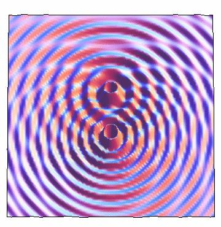
*图 1（已视觉复核）：双源波干涉条纹图（紫红蓝同心环与节线）。*

*图 2（已视觉复核）：航拍海岸防波堤：消波块与浪花。*

---

## 3182　不羡慕

- 日期：2021-07-23　主专题：A01 心理主体与情绪劳动　副专题：A11
- 源 ID：`9b6db870-bac2-5741-b015-bd793dcd6dbe`　原文链接：https://www.zhihu.com/question/473057846/answer/2015663219
- 官方对象—实践路径：与自己 / 与情绪 / 调节
- 23 概念标签：成本与总账;技术与工程;文明与历史
- 证据状态：manual_confirmed　初读：read　独立复核：not_reviewed
- 标记：`【极短回答】`

**问**：怎么才能达到不羡慕别人的境界?

怜悯者从不羡慕。

---

## 3165　反刍痛苦

- 日期：2021-08-05　主专题：A01 心理主体与情绪劳动　副专题：A09;A03
- 源 ID：`187c3d69-0285-556e-a304-def1545e6292`　原文链接：https://www.zhihu.com/question/304564566/answer/2041446980
- 官方对象—实践路径：与自己 / 与情绪 / 觉察
- 23 概念标签：定义与达意;选择与自由;成本与总账;心理与主体
- 证据状态：manual_confirmed　初读：read　独立复核：not_reviewed

**问**：怎样停止心理反刍带给我的折磨？

还是那句话，不要以为既然你很痛苦，你肯定就不喜欢它。
人最大的毒品是痛苦本身。它让你觉得深刻、觉得特别、觉得超凡脱俗、觉得自我存在，让你觉得自己手握债权、理所当然的有权追讨和审判世界的不公和不义。更让你觉得自己独自消化痛苦而没有追究实在是慈悲怜悯。它让你读小说、看剧都别有一番风味，让你对蝇营狗苟的凡俗众生的平庸追求洞若观火，不屑一顾。
唯一的不方便，就是时不时发作的恐慌和自我怀疑——毕竟还是要恐慌自己这样不行、毕竟时不时要怀疑自己这份优越感不过是自欺欺人。
但是还好——
你都继续这么久了，只要肯躲在家里喝开水、吃泡面，“脱离无聊的物质欲望”，谁说“这样不行”？
怀疑自欺欺人，时间久了自然可以习惯，习惯了就不怀疑了。这都是可以克服的问题，怎么能舍得拿味道这么丰富、有这么多层次的美味享受去换呢？
“反刍痛苦”带给你的“折磨”，其实不过是香辣牛肉干不幸做得辣了一点，反而越嚼越香。
甚至问题本身都已经无意中翻开了这张底牌——这只是在问“怎么停止反刍的折磨”，可没有问“怎么停止反刍本身”。

人要怎么停止“反刍痛苦”？
从承认“我在享受”开始。你不承认，你永远停止不了。

---

## 3164　静气

- 日期：2021-08-06　主专题：A01 心理主体与情绪劳动　副专题：A03;A12
- 源 ID：`e367d176-8814-5648-9207-a3a61c963f90`　原文链接：https://www.zhihu.com/question/340138252/answer/2041908825
- 官方对象—实践路径：与自己 / 与情绪 / 调节
- 23 概念标签：定义与达意;选择与自由;责任与后果;成本与总账;信用与信任;心理与主体
- 证据状态：manual_confirmed　初读：read　独立复核：not_reviewed

**问**：“每临大事有静气”，如何培养这种静气？

静气是什么？
就是遇到大变故，仍然可以不慌不忙维持原来的轨迹。这是怎么做到的？很多人觉得是靠大胆，靠勇气，或者靠不在乎。
这都是错的。因为这些“品质”固然会让你“淡定”，却有更前置的问题——它们会让你决策的时候过于轻易和乐观，以至于经常闯入危险海域，真遇到事了，反应又过于迟钝。经常闯入危险海域，不管你的“勇气”“大胆”有多少，总有磨光的一天。你也不可能无限的“不在乎”。就算你可以“一直不在乎”——这一般都是有爹妈跟着收拾烂摊子造成的不知好歹——你船上的窟窿，折断的桅杆和被放弃的航程总是很现实的。
静气的要害，在于做计划、下决心的时候不抱侥幸。
做计划、下决心的时候，不要是因为有某种便宜可捡、有什么方便可乘，不要是因为自信某种事情不会发生。
要做这件事，是因为这件事该做，就算它做不成，就算它失败，能把坑填浅一点、能把路延长一步，或者哪怕化身白骨警示后人此路不通也罢，这事也非做不可，非有人做不可，非我不可。那么就做了。
风萧萧兮易水寒，壮士一去兮不复还。
不抱侥幸的大前提，是“必死的觉悟”。一开始就没有生还的侥幸，所以一开始就可以不必抱这样那样的意外不会发生的乡愿，于是也就没有必要讳疾忌医、自欺欺人。
怕得提都不敢提、想都不敢想，哪来什么准备和计划呢？只有抱着必死的觉悟，毫无讳疾忌医、自欺欺人，你才能极尽最大可能对一切可以想到的风险做出探讨。
尽管实际上你做不到穷尽一切可能，甚至连你想到的部分也并非全部有周全的办法，但你对这两点仍然没有侥幸和乡愿，要做这事的决心没有动摇。只有这样，你才能有“静气”。
这静气是什么？当有事发生，要么这变故早在你的预料中，于是胸有成竹，甚至正中下怀，要么你早有心理准备，你自然安然接受你早已接受的可能。
只有这条路，才能真正做到有静气。
所以有静气的根底在哪？在于找到就算失败也值得拼命的事。

---

## 3144　胆小莫入

- 日期：2021-08-13　主专题：A01 心理主体与情绪劳动　副专题：A03;A06
- 源 ID：`3f858799-5fda-5e26-9e08-46a21b6cc22f`　原文链接：https://www.zhihu.com/question/479437708/answer/2058749014
- 23 概念标签：事实与证据;定义与达意;能力与学习;责任与后果;成本与总账;边界与许可;心理与主体;宗教与自然法
- 证据状态：manual_confirmed　初读：read　独立复核：not_reviewed

**问**：什么是照顾别人的感受?

你跟人讲事实，一定要先观察好对方是什么样的人。
人有一种“精神天花”——自大狂。
具体来说有几个典型症状：
1）觉得自己比上不足但比下有余。
2）觉得自己的问题只要有能力、有资源就能解决。这也可以表达为认为一切问题本质上都是没能力没资源的问题。
3）做成了事情会归因于自己能力强。
一辈子必须得一次抑郁症而且活过来才能免疫。没得之前都处在易感状态，随时可能爆发。
而这样的人有个极大的问题——无法承受全部的事实真相，必须保留相当程度的自欺欺人。
为什么呢？
因为ta们还没明白事情到底是好是坏，其实不取决于ta自己的能力，也不取决于ta自己的条件，也不取决于情况到底有多糟糕，而是取决于非常复杂的综合因素——天意。
明白了决定一切的其实是天意和运气，你才能学得会塑造好运气和相信好运气，学会面对无限糟糕的威胁而保持基本的乐观。
只有明白了这一点，你才能对无限糟糕的情况都有一份最根本的淡定，你才可以承受所有的事实，你也才能让人放心的在你面前比较少顾忌的谈论事实。
否则，任何让你觉得——甚至无意识的怀疑到——超出你能力和资源范围的事情都会让你恐惧和疯狂，你的“感受”要忍不住尖叫着让人闭嘴，而且会掐着你的脖子、逼你去拿刀架在别人的脖子上来“照顾”它。要是刀不够长，它会揪着你的耳朵叫你快跑，免得听多了害怕。
这就导致你在精神上实际上是个瞎子、聋子，迟早摔个嘴啃泥。
问题是，摔个嘴啃泥并不表示会好，爬起来把牙咽肚里你可能依然如故——仍然认为问题仅仅是你能力不够强、资源不够丰富。
于是你仍然听不得任何让你意识到你的能力有多差、资源有多贫瘠的话。
接着迈向下一个嘴啃泥。
直到摔在泥坑里仰望星空——“阿姨，我不想努力了”。
要不为啥说这是一种精神天花呢。想不通，你就躺死在泥坑里了。
说这些是为啥呢？
就是你要仔细小心对方是不是这个天花还没出、牛痘还没种。
如果是，你在说事实的时候就要悠着点，你必须要“照顾对方的感受”。
这道理跟不要在心脏病人面前点鞭炮是一样的。
你会为“凭啥不能在心脏病人面前点鞭炮”而抱怨吗？
哪怕是心脏病人自己要你点，你会点吗？答案很显然吧？
这东西谁对谁错根本不重要，哪怕后来判你没罪，你吓死个人毕竟也心里不舒服啊。
你一定要点鞭炮，要学这篇答案这个活例子——在门口挂上“内有鞭炮，胆小莫入”，然后在圈子里点。
这就没问题了。
运气极差的人该如何从头开始恢复运气?

---

## 3112　在意讨厌

- 日期：2021-08-29　主专题：A01 心理主体与情绪劳动　副专题：A06
- 源 ID：`553e9af8-5af0-5294-a38d-ddb46dd38ebb`　原文链接：https://www.zhihu.com/question/480980081/answer/2090195429
- 官方对象—实践路径：与自己 / 与情绪 / 调节
- 23 概念标签：定义与达意;能力与学习;选择与自由;责任与后果;爱与回应;法律与秩序;性别与身体
- 证据状态：manual_confirmed　初读：read　独立复核：not_reviewed

**问**：总是害怕被讨厌该怎么办？

如果让你在“害怕被讨厌”和“不怕被讨厌”之间选一样，该怎么选？
当然要选前者，因为后者更糟糕。
不怕被人讨厌的人，该是一种什么样的怪物，一般人是想象不到的。
这种人还挺绝妙，因为ta们绝不会让你看出来ta们不在乎人的讨厌——恰恰相反，ta们非常清楚看起来害怕别人讨厌多么重要，所以ta们会逼真的装在意、装害怕，以假乱真。
其实ta们自己心里对别人讨不讨厌生理性的无感。这个已经进入发育异常领域了，没必要特别讨论。
真正的point是——在意别人的讨厌是人的社会性的不可分割的一部分，绝对是属于健康人格的必备组成部分，对这一点没有必要有任何纠结和怀疑。
绝对不要听什么“走自己的路让别人说去吧“这种不负责任的名言——这些人只顾自己说得嘴巷，第一管杀不管埋，第二ta自己未必真相信。

真正的问题是，实践上你没法同时在意所有人的讨厌。
你不爱说话，张三讨厌；你爱说话，李四讨厌，你一步就走到了逻辑绝境。你要选张三，还是要选李四？
甚至，就张三自己，今天ta讨厌你说话，明天ta讨厌你不说话。你一步都不用走，直接就被将死了。
你看到问题没有？
你在意谁的喜与厌，就是把谁作为了雕琢你自己的刀匠。
你不是在搞社交，你是在选择自己的命运。
你要选择你觉得配影响你命运的人，去在意这个人的讨厌。
这个人很可能既不是张三，也不是李四，甚至也不是你身边的人，甚至也并不见得是你身边人的平均值。
ta有可能是出现在书里面，也可能是在你将来才会遇到。也有可能生活在几百年前、一两千年前。
有个最朴素的选择方案——选择从ta的价值观里雕琢出了一代又一代伟人的人去在意。
因为ta反对什么，于是一堆人听从不做，因为ta赞成什么，于是一堆人听从去做，然后这堆人里面出现了大量了不起的人物，或者名垂千古，或者一生无憾。
这样的人的讨厌，才配你去在意。
第二，吸取张三的教训——能被在意的人还有第二个特征，就是价值观稳定，而不会随时随地大翻盘。
价值观稳定，一定是以价值观成熟为前提。价值观成熟，一定是以思想开放、阅历丰富为前提。
阅历丰富，一定意味着走南闯北、历尽沧桑或者学富五车、博古通今。
而且还心态乐观，不轻易觉得“世界上全是坏人，只有够坏才能成功”——心态不开放的人必定要觉得全世界都是王八蛋。
越接近这样的，越有必要在意。
第三，爱你的人，对你有意见，这值得你在意。
但这个一言难尽，因为你需要很多年才知道什么是爱。在学会之前你分不出什么是爱，很可能恰恰把爱你的人看成洪水猛兽、精神变态。所以这一条大概只能等你三四十岁、死去活来几回之后才有用。
在这几种人面前，张三、李四算什么东西？ta们那不成人形的讨厌，到处是自相矛盾，你就是在意，又能怎么在意？
对这些人的意见看法，以礼貌应付、避免病情发作为主，不需要提高到怀疑人生的高度去对待。

---

## 3090　年轻并不好

- 日期：2021-09-08　主专题：A01 心理主体与情绪劳动　副专题：A16;A03
- 源 ID：`f2f28830-036c-5c78-b946-6b019938238b`　原文链接：https://www.zhihu.com/question/484057801/answer/2108746048
- 官方对象—实践路径：与自己 / 与时间 / 失去
- 23 概念标签：定义与达意;能力与学习;选择与自由;权力与异议;心理与主体
- 证据状态：manual_confirmed　初读：read　独立复核：not_reviewed

**问**：媒体批「yyds」「绝绝子」等网络用语，称人们离开「梗」就不会说话了，网络用语真的会影响表达能力吗？

人们太希望表达大量“前所未有”的激情。
不新造一个不存在的词，怎么能配得上这从未有过的超超超超级新震撼呢？
逻辑不是很顺吗？
“新“太重要了，哪怕只是一张新的皮也好，让自己感觉到自己始终和“全新”的站在一起，才能摆脱某种“我已经过时、即将被埋葬”的恐惧。
其实，真正的恐惧恰恰是来自这个“不断追赶新潮头才能击退自己的生存恐惧”的循环本身——因为你知道自己不可能永远当这个弄潮儿。
你只是现在还当得起而已。
只有站在潮头才有安全感，而你知道自己不可能一直站在潮头。越是知道这事总要结束、越是要强迫性的追赶下一个潮头。
无穷无尽。
其实，只有你可以不必追赶这些潮头、也能安然的看到自己的出路和生机的状态，你才是真的活着了。
不使用这些“潮语”，也能吸引人聚拢来，才叫真的聚拢人。
这种能力都是试出来的，你最好早点开始试。
什么时候试成了，你什么时候就不再恐惧自己“不再年轻”了。
“年轻”并没有任何特别的好处，它只是有很多豁免权，但是它本身并不美好。
人是要成熟了，才真正开始享受人生。
越早成熟越好，最好少年老成。

---

## 3086　世故

- 日期：2021-09-09　主专题：A01 心理主体与情绪劳动　副专题：A03
- 源 ID：`4fb2efbb-9757-5049-bc9c-8dca10f4383a`　原文链接：https://www.zhihu.com/question/485637923/answer/2110559073
- 官方对象—实践路径：与自己 / 与能力 / 运用
- 23 概念标签：事实与证据;能力与学习;选择与自由;责任与后果;成本与总账;技术与工程
- 证据状态：manual_confirmed　初读：read　独立复核：not_reviewed

**问**：世故和理性的本质区别是什么？

世故的人没种。
而没种的人根本没机会理性。
理性的人要经常需要仅仅凭着对逻辑的信仰坚信这风意味着九曲十八弯的尽头必有出口，无视庸人惊恐的尖叫和咒骂，朝着伸手不见五指的黑暗走出去。
不要以为会“算”的人就叫“理性”。
每年会算的毕业千千万万，带种只是少数。
ta们自己第一不敢相信自己计算的结果，第二也根本不敢算到底。
ta们拿着计算器，只是想证明自己的软弱是最佳选择。
这些人老了，就叫世故。

---

## 3078　脑休息

- 日期：2021-09-11　主专题：A01 心理主体与情绪劳动　副专题：A18
- 源 ID：`ed242744-0a7d-5673-b319-b7e914cf2bbf`　原文链接：https://www.zhihu.com/question/35484585/answer/2114331418
- 官方对象—实践路径：与自己 / 与身体 / 维护
- 23 概念标签：能力与学习;选择与自由;劳动与组织;权力与异议;心理与主体;性别与身体
- 证据状态：manual_confirmed　初读：read　独立复核：not_reviewed

**问**：脑力劳动者如何更好的休息？

当然是一些需要技巧的、高度追求质量的、有挑战性的、单人进行的体育训练啊。
比如射箭。
比如太极拳。
比如居合道。
不能是那些不占脑力的、一边走神一边也不是不可以干的无脑操作。
比如举铁其实就不行（除非你重视动作质量到了可以当教练的程度）。
一定要带有技巧性，容易引发心流。
只有这样你才会停止计算你的资金还能撑几天。

---

## 3072　看不到希望

- 日期：2021-09-12　主专题：A01 心理主体与情绪劳动　副专题：A03
- 源 ID：`bb64707c-4cba-502c-add2-2fc5fe19c902`　原文链接：https://www.zhihu.com/question/478099053/answer/2117262132
- 官方对象—实践路径：与自己 / 与信念 / 转变
- 23 概念标签：事实与证据;责任与后果;劳动与组织
- 证据状态：manual_confirmed　初读：needs_reread　独立复核：not_reviewed

**问**：为什么现在的年轻人看不到希望？

看不到希望的人眼里的世界

ta们想象中充满希望的世界

事实上充满希望的世界

为什么ta们看不到希望？
因为ta们总在盘算重新取景。
但实际上ta们应该学的是调整快门和光圈。
发现这比喻深奥了点，额外加点尾巴吧——
调整光圈和快门，可不是Photoshop改图。
用photoshop改图，你可能改出不存在的幻觉。
调整光圈和快门，指的是指提高敏感度，定睛观瞧。
要意识到是自己的感光度调得太低、快门太快了，光圈太小了，以至于中间调太靠左了。
是你有义务看到隐藏在黑暗中的光，是你有义务瞪大双眼，而不是世界有义务为你特别瞎的眼睛额外的亮起来。
招子放亮点！

<!-- 图片：3 张，审读结论见下 -->
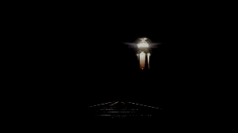

---

## 3057　Circle-Of-Shame

- 日期：2021-09-17　主专题：A01 心理主体与情绪劳动　副专题：A16;A03
- 源 ID：`7d7ce7f8-7253-58c3-9594-eb3434ceda51`　原文链接：https://www.zhihu.com/question/338136649/answer/2124963458
- 官方对象—实践路径：与社会 / 与文化 / 批判
- 23 概念标签：能力与学习;责任与后果;信用与信任;照料与家庭;心理与主体
- 证据状态：manual_confirmed　初读：read　独立复核：not_reviewed

**问**：如何看待最近的“坦克”羞辱？

这些人……咋说呢，脑袋里面有一个铁一般的信仰——
1）先给全人类排一个积分天梯。
2）查一下你在这天梯上排第几。
3）你排得比别人高，你就可以得意；你排得比别人低，你就应该自卑。
4）谁要是敢乱了这规矩，人人得而诛之。
你的排位比我低，你居然在我面前不自卑？我都自卑得很，你居然不自卑？
岂可修！马达马达达内！！
待俺来让你见识见识“事实”的铁拳。
你这“坦克”！

建议你离这样的人远一点。
为啥呢？因为ta们随时可能因为对自己在“天梯”上的位置之低绝望而自爆。
你想想，天梯得有多长啊。这种境界的人能排到第几万位？按照ta的理论，ta有义务、有责任强迫自己自卑一辈子——不然ta就会惊恐自己“脱离现实”“失去动力”。ta甚至自卑到了容不得别人不自卑的程度了。
ta永远高兴不起来，尤其是ta越活眼界越广，越看到ta上头的天梯有多高。天梯的上半截在ta眼前展开的速度，远远超过ta自己往上爬的速度。
用小学数学就知道，就算能中六合彩，ta也没希望真的爬到可以“合法快乐”的等级了。
你觉得ta在无限的“法定自卑”里可以挺多久不崩溃、不爆炸？
今天骂“坦克”，明天就会看到自己就是“坦克”。
今天宣判“坦克”不配快乐，明天被判应该绝望的就是自己。
这是不可逆、不可避的结局。
谁骂一句“坦克”，这诅咒就在前头等着ta自己。骂得有多凶，诅咒就有多重。
谁离ta近，谁就是“害ta不能爬的更高”的祸首。
从最近的队友恨起，挨个恨过去。
你觉得你是要跟着骂，还是要站远点？
作为父母，绝对不要给自己的子女灌输什么“你没本事就活该痛苦”论。
这会导致你的子女将来跑去骂人“坦克”，然后给自己种下滴答作响的定时炸弹，直接连在ta们的心脏上。
想拆弹，就是要ta们死；不拆弹，就是看着ta们自爆。
用这种炸弹换“努力”，不值得。
不值得 x 10000！
对已经中了这毒的孩子们说一句——
想不想活命？
记住了，“坦克”们就是你自己。
你祝ta们快乐，你就能相信你自己有资格快乐。
你剥夺ta们的快乐资格，你就是在剥夺你自己的快乐资格。
住口！饶自己一命！

---

## 3029　独来独往

- 日期：2021-09-25　主专题：A01 心理主体与情绪劳动　副专题：A06
- 源 ID：`cdef0b0b-c75b-5adb-bfe4-a31cfd57fbe7`　原文链接：https://www.zhihu.com/question/26398755/answer/2139838710
- 官方对象—实践路径：与自己 / 与能力 / 运用
- 23 概念标签：事实与证据;定义与达意;能力与学习;选择与自由;边界与许可;权力与异议;心理与主体
- 证据状态：manual_confirmed　初读：read　独立复核：not_reviewed

**问**：为什么部分人友善且独来独往？

奇怪，为什么人不应该独来独往？
你应该把“独来独往”当作成年人的标准态、正常态、基准态来考虑。
没有任何人知道一个成年人的全部日程安排，以至于在每一部分与之接触的人眼里，这人都有一部分时间是在独来独往，这理应是一种生活的常态，是一个成年人生活健康的基本特征。
认为人不应该独来独往，被人说“独来独往”就会感到焦虑、不安，觉得自己犯了错，这其实是对自己成长失败的反向适应。
因为这种不安的根本原因，是因为害怕让别人觉得没有把握完全掌握自己而被抛弃，因为害怕一旦被所有人抛弃，自己就完了。
什么叫做成年人？成年人不是指学会了迎来送往、八面玲珑的人。
你死了这条“等我学会八面玲珑我就成年了”的心。
因为你不可能学的会。
成年人是学会了直接向天讨生活，以至于其社交技巧因为有了一张底牌而要求大为降低。这大幅被压制的社交技巧要求，就变成了一个人可以有效超越的简单题。
从而获得一个成人的全部权柄和礼遇的。
如果你是一个不能向天讨饭吃——也就是无法实现“旷野生存”——只能向某人讨饭吃的人，则这个“某人”——哪怕ta只是一个人——对你的社交要求你也一样永远达不到。
成年人不焦虑“被所有人抛弃”这回事。
爷有手艺向老天爷讨饭吃，只要物理定律不变、社会规律不变，我的收成就不会变。
是别人需要纠结如何获得我的友好、我的照顾，是别人要考虑该如何避免被我取消资格。
如果非要了解和掌握我的一切动向才能和我合作，你站在我面前你都会觉得这话说不出口。
开玩笑，我待会要干什么，你问得出口？
我说“有事”，你还有胆子问“什么事”？
自己回家再练几年，等你练到不会再有这种愚蠢的妄想再来浪费其他成人的时间。
注意，我再说一遍，这不是我这人有什么超级特殊，以至于这是一种“高人才有资格有的怪癖”，而是所有的有尊严的成年人全都要有的基本常态、标准态、基线。
独来独往，你才成其为成人。

---

## 3027　吃老虎的猪

- 日期：2021-09-30　主专题：A01 心理主体与情绪劳动　副专题：A03;A06
- 源 ID：`7dbd8ae4-e6ea-5955-926b-5a9a1e107eb8`　原文链接：https://www.zhihu.com/question/343298133/answer/2148884952
- 官方对象—实践路径：与其它 / 与陌生人 / 防卫
- 23 概念标签：事实与证据;定义与达意;能力与学习;成本与总账;信用与信任;边界与许可;权力与异议;心理与主体
- 证据状态：manual_confirmed　初读：read　独立复核：not_reviewed

**问**：感觉自己太傻太简单了，很容易被人看透怎么办？

你们啊，真的是不知道珍惜这种难得的天真的傲慢。
会扮猪的人最容易吃到老虎。年轻的时候你最容易扮猪了，因为你天然呆，不扮就有七分像。
这是你们容易让人放下戒心、也最容易出其不意的时候。将来你们想扮，还扮不像、没人信呢。
实际上，大老虎——就是那些侥幸没被“猪”们吃掉而活到成年了的那些——从来就不会自认为“把这小子看透了”。
ta们嘴里说“我看透了你是不会反抗的”，只是为了让迷信ta们的你感到动摇和畏缩。那只是一种战术。其实ta们是不会因为嘴上说“料定你不会反抗”就放你在营地里乱跑、让你接触什么机密的。
如果ta们真的如ta们所说，料定你“没胆子反抗”、料定你“翻不起什么浪”，那ta们小心翼翼、谨小慎微个什么？
所以，这种“假装看透”，其实是在说什么？是在说以ta们的能力，其实不敢真的托大预言你必然如何。
那么如果有人自称看透了你，果然放心大胆任你乱跑乱逛呢？——这类人属于真的傻大胆，也就是那些尚未被“猪”吃掉的傻老虎。
客观事实是——没人能真的看透谁，敢说这话的一共就三种人：
假装确信这一点，但其实根本不这么想的大老虎；
真的确信这一点，但其实完全想错了的傻老虎。
还有在心底里崇拜老虎们、以为ta们无所不知的傻猪猪们。

---

## 3025　崇拜与自恋

- 日期：2021-10-01　主专题：A01 心理主体与情绪劳动　副专题：A07;A05;A06
- 源 ID：`d384261b-7b05-53e7-a274-ec4888819617`　原文链接：https://www.zhihu.com/question/490048636/answer/2149551880
- 23 概念标签：能力与学习;责任与后果;信用与信任;爱与回应;照料与家庭;法律与秩序;权力与异议;心理与主体
- 证据状态：manual_confirmed　初读：read　独立复核：not_reviewed

**问**：疑心被人崇拜是太自恋么？

有几类人要把防崇拜当成日常事务来做：
1）父母
2）老师
3）管理者/领袖
4）被爱的人
因为人们对待这些角色的方式里面，很难避免有偶像崇拜的成分。
如果你面对的是一个陌生人，你老怀疑对方崇拜你，这个也许是自己想太多，
但是你如果面对的是一个子女、一个学生、一个下属、一个爱你的人，随时随地考虑对方有偶像崇拜的可能性是一种你本来就该做的事，完全谈不上什么“自大”。
一些看不见这些关系的陌生旁观者看到这些举措，觉得你“自大”，只不过是因为ta们自己不明白这个道理以及习惯于不经调查就妄下结论罢了。
而“不明白这道理”以及“不经调查就妄下结论的习惯”这两点往往是伴生的。
因为有后一种习惯的人几乎没有担当这几种角色的经验。或者即使侥幸有了，当得也很糟糕，在很早期就失去了这几个身份，进展不到崇拜发育出恶果的阶段。
所以ta们意识不到这些关系里人的崇拜本能是多么根深蒂固，多么需要万分警惕。
这实在是一种又无奈、又可叹的现实。不过无奈也罢，可叹也罢，“ta们在这一点上其实是没有足够的判断力的”这一条是个事实。
所以不必在意这些说法，只是尽量避免刺激ta们，避免导致无谓地浪费时间就好了。

---

## 3023　被说幼稚的男人

- 日期：2021-10-02　主专题：A01 心理主体与情绪劳动　副专题：A06;A02
- 源 ID：`cffb9669-3743-55fd-bfa4-9e9cdd52e18a`　原文链接：https://www.zhihu.com/question/28125073/answer/2150880905
- 官方对象—实践路径：与友人 / 与恋人 / 相处
- 23 概念标签：事实与证据;定义与达意;能力与学习;选择与自由;责任与后果;成本与总账;信用与信任;照料与家庭;民族与身份;心理与主体;性别与身体
- 证据状态：manual_confirmed　初读：read　独立复核：not_reviewed

**问**：为什么部分女人总喜欢说男人幼稚？

被说幼稚用不着反应过度。
好笑的是，“被人说了幼稚被气得不行”本身就是幼稚的表现。
这不是说说你幼稚冤枉了你你也不该生气，而是谁在什么时候说你幼稚其实都是对的，你应该早点对这一点脱敏。
实打实的说，等你哪怕五六十岁了，在遇到挫折的时候自己总结一下，你仍然经常——甚至可以说总是——会发现问题还是出在你自己太幼稚了。只不过这时候没别人能说你，只有你自己才能体会了。
在绝对意义上，你仍然是幼稚的，这对人类是没有结束的一天的。
如果说幼稚和相对不幼稚之间有什么清晰的分界点，可以说“认识和承认到自己的确很幼稚”本身恰恰是重要的里程碑之一。
恰恰是清清楚楚、毫无侥幸的认识到这一点，会改变你对这种批评的态度和反应。
被说幼稚，只是扣了5分，一被说幼稚就跳起三尺高，还要追扣10分，这二次扣分比第一次扣得还多。
恰恰是被说幼稚而能淡定自若的接受，则有很大的概率会把你扣掉的分加回来，甚至可能会让对方怀疑是自己判断失误，比没扣之前分更高。
先把这个看清楚，把眼前亏免了，再往下看。
与幼稚相对的成熟指的是什么呢？
指的是你对人这个种族的行为模式和人类社会的运行规律的基本理解要让人服气，足以让人相信你的谋划要高于ta自己的谋划。
这包括以下几个方面：
1）思想上，你对人类的人性弱点要有充分的估计，不能有任何令观察者焦虑的过高幻想。
2）观察上，你对局势的观察和分析能力要有卓越的判断，不能有令观察者焦虑的“拙劣表现”。
3）能力上，你对人对事的处理手段要充分有效，以至于不会令观察者对你的计划的健壮性产生怀疑。
4）心态上，你对待挫折的可能性从不傲慢，听取意见和对待风险的态度不能让观察者对你的脆弱性产生焦虑期待。
这四条，都是没人能在一切人面前都做到的。而你有任何一条在任何一个人面前没有做到，这个人都会因此给你一个幼稚的判语。
注意，做出这个评判，与这个人的判断客观上是否正确没有关系。
一个人在这四点上的能力即使客观上会排在人类的前0.5%，但是一点也不会妨碍以下两条：
1）还是会不断的有可能都没毕业的小孩子根据自己对成熟的想象趾高气昂的宣布你“幼稚得可笑”。
2）人自己仍然会判定自己在很多时候真的不够成熟。
客观上，这四条要求也是没有止境可言的。
所以，我们说人的幼稚总是绝对的，成熟只是相对的。
至于“为什么女性容易说男朋友幼稚”——
1）评价ta人幼稚，远比自身脱离幼稚容易。
这个就好像你自己只当过下属，但是却会很轻松的判断谁是不靠谱的老板；你自己是学生而不是老师，但你却会很容易判断谁是不合格的老师。
旁观者清，说比做容易。
2）客观讲，女性在判断男性幼不幼稚的时候，参考的标准既不是自己、也不是自己或者对方的同龄人，而是自己理想中的父亲——那已经被验证可以担当全部家庭责任、可以遮风挡雨、掌握航向的人。
她们本来就是在寻找这样的人作为毕生的解决方案，根本无可妥协，不用这个标准，用什么标准？
按这个标准，客观上二十出头刚毕业的男性的确在这四条上都相去甚远。这没有什么神奇的，只不过是冰冷的客观事实。
她们存着你在二十岁的年纪出类拔萃地、奇迹般地在这四条上令她无话可说的希望，所以才不断的在这个年龄段里寻找。这客观上本来就是沙里淘金，失败率极高的事情。
如果她们完全没这个指望，二十来岁的年轻的你完全不会被纳入考虑范围。
要她们降低标准，和要求二十出头的年轻男性奇迹般地成熟，这两样都是不可行的。
要她们降低标准？这标准哪里是ta们个人的特殊癖好？由得她们自由调降？决定这些标准的是变幻莫测、充满挑战的客观现实本身。你过不了客观现实的考验，动不动怨气冲天、半途而废、傲慢致死，她们到时候孤儿寡母怎么办？
要二十几岁的年轻人们直接超越阶段直接成熟？这个是学校教育期大幅拉长的时代后果，实非一般人所能超越。
客观来讲，想要有效的消除女性对二十几岁男性的这类抱怨和评判，只有一种方法——那就是让她们不管自己几岁，都只跟28岁乃至三十岁以上的、有充分的社会经验和最基本的挫折经历的男性交往。
这真的是在这里被批评幼稚后愤懑难平的小孩子们所愿意接受的安排吗？
人生不如意事，十常八九。
这就是其中之一。
Live with it.

---

## 3010　反压力

- 日期：2021-10-09　主专题：A01 心理主体与情绪劳动　副专题：A05;A07;A11
- 源 ID：`19d11285-e09f-508a-9125-c4e64d5c4894`　原文链接：https://www.zhihu.com/question/21089301/answer/2161613712
- 官方对象—实践路径：与自己 / 与情绪 / 调节
- 23 概念标签：能力与学习;责任与后果;成本与总账;信用与信任;爱与回应;照料与家庭;法律与秩序;权力与异议;心理与主体;宗教与自然法
- 证据状态：manual_confirmed　初读：read　独立复核：not_reviewed

**问**：如何缓解压力?

压力到底是什么？
是对掌握你命运的人可能不谅解你的恐惧。
没有考好，怕父母震怒。
没有做作业，怕老师震怒。
没有按时按量按质完成任务，怕上司震怒。
没有履行合同，怕客户震怒。
没有达成约定，怕恋人/配偶震怒。
怕这些人震怒的后果，怕ta们能造成的实际损失。
受到这些损失，自己建立在不受这些损失前提上的人生期望就会落空了。
一而再、再而三的话，连对人生期望这件事本身的期望都会动摇。
不能计划任何事，因为不知道这合同不能按时完工的话，还能不能在这个城市待下去。
这就是压力的根源。
这个靠旅游、靠散心、靠分散注意力是没有用的，甚至旅游、散心、分散注意力所花的时间越多，人还会越焦虑——不花这些时间，心里还好过点，至少失败之后还能安慰自己没有松懈过。
压力有几种办法缓解：
1）通过再评估发现自己过于悲观。
有经验的人告诉你，你某些地方风险估得太大，你的压力会减轻不少。
你通过自我检测发现自己有一些之前忽视了的能力和资源，你的压力会减轻不少。比如你发现你有一位意想不到的朋友，甚至包括你跑个五公里发现自己成绩比预料的好。任何意料之外的利好因素都会减轻你的压力。
甚至包括意外的睡了一个好觉，都会让你的压力大大的减退。
事实上，好好睡一觉是一个很有用的好办法。
2）降低自己的期望值，习于朴素的生活。
找到一个你自己满足的朴素而规律的生活节奏和模式，可以大幅的降低你自己的精神压力。
你并不需要前呼后拥，你只需要身边的人亲近友善，你的压力自然小很多。
你并不需要锦衣玉食，你只需要一箪食、一豆羹，你的压力自然小很多。
你并不需要玉堂金马，你只需要出入平安，你的压力自然小很多。
就算把你扔到荒郊野外，你也可以荒野生存，你自然压力小很多。
你并不在意不能长命百岁，你的压力自然小很多。
消耗很小的生活，你也过得有滋有味，你自然压力减小。所以，要学会爱喝白开水，学会朴素的享乐。
3）你要相信真正掌握你命运的，不是这些具体的人，而是冥冥中的天意。
重要的是无咎于天，而不是无咎于人。并且即使你对天有愧，你也要相信上帝比具体的人公正得多，而且心胸宽广得多，祂要的是人坚持悔改，而不是要折磨人、惩罚人。
你存心良善，上帝自然明白，即便有曲折，也是最后走向好的方向。
你是为谁努力，上帝自然清楚，即便有人的误解，最终也不重要。
因为行赏罚的其实并不是人，人只是不由自主的在遵循某种复杂的潜在规则，而这些规则是算无遗策的要抑制某些意念而生发某些意念的。
它们固然复杂隐晦和难以预料，但归根结底会奇妙的有利于有爱的人。
你只管爱，然后只管放心就行了。
天大的事，有比天更大的担着。

---

## 2971　厌倦

- 日期：2021-10-30　主专题：A01 心理主体与情绪劳动　副专题：A18;A03
- 源 ID：`d961128c-e769-5f85-8f9d-65ef9b17bd15`　原文链接：https://www.zhihu.com/question/492888437/answer/2196379477
- 官方对象—实践路径：与自然 / 与科学 / 理解
- 23 概念标签：能力与学习;选择与自由;责任与后果;成本与总账;爱与回应;边界与许可;文明与历史;生态与自然;心理与主体;性别与身体;宗教与自然法
- 证据状态：manual_confirmed　初读：read　独立复核：not_reviewed

**问**：为什么人类天天吃同样的东西很快会腻，但是动物比如说牛天天吃草却从不会腻？

易代入、易厌倦、易上瘾，是人的定义中三个不可分割的要素，是区分人与动物的关键所在。
易代入，是指人类拥有将自己代入其它事物的本能能力。
人类很容易设想“假如我是一只老虎，我看到了一只羊”，或者“假如我是一只羊，我看到了一只老虎”。也很容易设想“如果我是张三，我站在老虎面前”，这种本能的代入能力，实际上是理性思维、抽象思维的起点。
而这种代入能力带来了几个直接后果：
1）它带来了同情能力。
代入对方的角色去推演对对方可能的行为，越是惟妙惟肖、越是深入和全面，你的生存优势就自然越大。但问题是，它除了可以帮你更好的制定狩猎和作战计划之外，还带来了一个不可避免的后果——你也会感受到代入对象的痛苦。
因为这份痛苦是你代入的对象的决策模式里不可排除的绝对关键因素。如果你代入对方却感受不到对方的痛苦，或者甚至感受的不足，你对对方的行为预测就往往是失效的。那么你就将是一个更糟糕的狩猎伙伴和群落成员，你将面临被淘汰的压力。因为不能在有效的级别上识别和淘汰这种成员的群落，自己也要面对额外的竞争压力。
于是就只剩下了一种答案，你的血脉能遗传至今，势必在这种代入能力上要达到某个水准以上。这实际上是“太平洋岛民/布须曼人受到现代教育可以正常的融入现代生活”的生理基础。那么这就意味着人只要拥有足够的智力，就必然会拥有足够的同情能力。而这个同情能力，毫无疑问的在最类似于自己的事物——同类——上会格外敏感。
人类天然的对同类的痛苦有不可抗拒的本能感应。这是人类与其它动物的重大分别。是因为这个原因，原始的人类有比其它动物更强的回避攻击同类的倾向，因为ta们有比其它动物更多的不攻击同类的理由。
这种本能，也是PTSD作为典型的战争创伤必然存在的生理基础。哪怕你杀的是敌人，是十万八千里外你终战之后再也见不到的陌生肤色、陌生文化下的同类，从法律上来讲你完全“有权”、“无责”，甚至受到“这是不可避免的”、“这不是你个人的责任”的安慰，哪怕整个意识形态都站在你这一边，你仍然会感受到强烈的痛苦。
这也是为什么为了保证战斗性，人类常常宣扬敌人的无人性、残暴或者敌人种族的低劣性的缘故——这是要先一步将敌人定义为非同类，以便抑制这种本能。而即使是人类动用了全部的意识形态工具，包括认知科学的最新成果、心理疗法的最新进展、乃至于药物技术的一切威力，仍然不能真正的解决PTSD问题。
因为它是直接内嵌在人性的本质里、与人的基本理智一体两面的东西。它如果真的被“解决”了，你得到的不会是一个“健康的人”，而只会是一个丧失了基本功能的人。
实际上是这一点——而不仅仅是对对方武力的忌惮——在最终意义上抑制着人类的湮灭。对方的武力再强，在一些超越了人性极限的计划下仍然是脆弱的。如果能有足够规模的这类超越人性极限却又仍然能有效组织、有效合作的的群体，可以说没有任何防御策略是足够有效的。这实际上是恐怖主义的有效性的来源——也是好莱坞大量苏联间谍电影的灵感源泉。
但非常幸运的，几百万年演化的逻辑已经在极大程度上保证了这类组织无法同时形成足够大的规模而又保持有效合作。没有对人的同情，固然使得你特别危险，也使得你无法适应过于复杂的合作。
简而言之，这个世界在塑造人类这个种族的时候，已经在赐予人类超越其他动物的思考能力的同时，把对同类的无法自我抑制的同情心一起嵌入了。
并且，这种“同类”的定义是非常宽泛的。它甚至对猫、犬、甚至是角蛙、甲虫、狼蛛都可以有效。这是人类会畜养宠物，包括能驯化犬类、马匹这类伙伴动物的生理基础。
先把这结论记住——
人类有比其它动物更强的回避攻击同类（包括类同类）的强迫性本能。
这是人类拥有智力的逻辑代价。强行买一送一，不容挑拣。
2）这种能力必然带来原始的宗教。
因为这种代入是泛化的。除了会代入猎物、人类也会很容易代入一座山、一条河，甚至风雨雷电。更不用说天空和大地。
同样是买一送一，不容挑拣。
不过这个与本题距离略远，就此打住。

我们回到刚才得到的这个基本起点上来——人类有因为理性能力而同时获得的强迫性的避免攻击同类和类同类的本能，这意味着什么呢？
这意味着这个：
假设有两群准人类——严格说这时候的人类仅仅只是一种脑子发生了变异的猴子，并没有成熟的语言，更没有文字可言，当然也没有“我们”、“人类”的概念认知——遇到了“这片树林里无花果不够吃了”的典型困境，它们处理这个困境的本能感应会与其它动物不同。
对于其他的动物，无论多么大的困难——不管是不是其它同类造成的——只要消灭到多余的竞争对手就好了。
杀掉那头多余的狮子、杀掉那群多余的蚂蚁就好了。杀掉多余的同类，就这一招，已经足够解决绝大多数问题。如果是它也解决不了的困难，那就是合该灭绝，到了时候了。
而这种常规操作却会令这种猴子踌躇再三，因为这做法对牠们有特殊的痛苦。
但是你要注意——不错，这种特殊的痛苦效应的确对攻杀同类的行为有抑制作用，但是很显然这种抑制力并不是绝对有效的。
如果人类的确只能吃这种果子，确实没有任何别的选择，日复一日更加显著的饥饿迟早会压倒这种抑制效应，促使人类仍然走上消灭同类的老路。
人类只是阈值高出一大截，但这阈值并没有高到一切困境都不足以越过。

到这里，就出现了“易厌倦”和“易成瘾”的关键意义了。
人类的易厌倦和动物的“不能忍受完全的单一”是完全不同的。
人类的厌倦并不是出于某种必要性的驱使，因此是开放的。
而动物的“不能忍受单一”是受必要性约束的，是非开放的。
一个动物总是吃一种食物会厌食，是因为它如果不吃另一些食物怕是要影响生理功能，面对生理痛苦。是这种痛苦在驱使它摄取其它食物。它的这种“多样化胃口”常常可以在非常有限的几种食物集合之内收敛，闭合。
举个例子，家里养猫养狗的，往往只需要极少的几种食物种类就可以让自己的爱猫爱犬对食物毫无抱怨了。牧场饲养牛羊也一样，如果仅仅喂一种不行，往往也可以只准备极少的几个种类，就可以无限循环。
与其说另外的几种辅食是出于满足动物厌倦的的情绪，倒不如说那是一种生理上必要的药。
而人类的厌倦性，是无限开放的厌倦。
即使已经吃过一百种食物，人类也会对这一百多种食物全体厌弃，而想要去寻找第一百零一种食物。
除非无可选择，否则人类不会自然的满足于任何固定的食谱——无论它已经有多大。
你们有没有看明白这对人类的重大意义？
是因为这种“易厌倦性”所带来的无限向外探索的本能，才使得拥有回避攻击同类本能的人类获得了“在饥饿感击垮这本能之前找到其它解决方案”的可能性。
那么，易成瘾性又在这里扮演什么角色呢？
易厌倦性，本质上就是人类的无限好奇心。
但是仅仅靠着好奇心，是不足以有效的越过原有的行为边界的。
举个例子，你大可以出于好奇去尝试辣椒或者某种原始的香蕉，但是你得到的一定不是香甜、软糯，而是灼烧的辣和让你翻白眼的涩。
这要不了你的命，但是也绝不会让你快乐接受它们也可以是食物的可能。
绝大多数你的同类都会停止尝试第二次。
但是，因为人类大脑的特殊复杂性和可塑性，你的某个同类可能会非理性的对这种本来堪称折磨的体验上瘾。
人类可以对极其广泛的、超越了直接理性范围的事物上瘾，譬如对闻汽油、嗅胶水上瘾，对特定的形状甚至排列组合上瘾，对各种没有任何显性的有效性的行为上瘾。
这个范围根本不受到“对人类自身有利”的理性法则的约束。甚至可以说——它有强烈的反理性倾向。恰恰是在理性范围内毫无有效性行为，反而有格外强烈的成瘾可能。这也是人类艺术的生理基础。
这就是人类的“易成瘾性”。
是靠着这种随机发生的，不依赖理性支撑的（甚至有反理性倾向的）成瘾行为的支撑，人类的好奇心才能足够有效的翻越新行为模式的固有能垒，无视早期粗砺的痛苦的折磨和恐吓，被惊人的、无理性的坚持和强化、从而获得原本不可能的被不懈优化的机会，而形成超出整个群落的原有一切认知边界之外的全新经验。
将原有的不可能，改为可能。
“这种果子非常辣，但是它也可以吃。”
它们长满了另一个山坡。
而因为人类大脑从复杂性而来的天然的可塑性，一旦有了某个同类靠着易厌倦性/好奇心、易成瘾性，不但翻越了原有的认知边界，而且还幸存了下来，产生了显然的生存优势，其它同类再要通过模仿而形成自己的类似神经回路、新行为模式，其门槛会低得多。一个个体的经验，会因此成为在群体内部通过不断模仿而不断传播和传承的群体经验。
用不了多久，这些准人类就可以集体的将这种新辣果纳入自己的食谱。
“所以我们并不一定需要杀掉李家坡的猴子们。”
我们可以去隔壁的山谷生存。
我们可以到峡谷对面生存。
我们可以到河对岸生存。
我们可以到草原生存。
人类是靠着 两位一体的理智与爱保住了回避通过自相残杀达成简单平衡的底限、而又靠易厌倦性、易成瘾性突破了外部局限，才获得了可以支撑远超过其它动物的复杂性和规模的群体结构的特殊能力。
是靠着这三者，人类成为了人类。
遍满全地，仰望星空。
导致着人类对食物单一的本能反感的这种易厌倦性这是人之所以成为人的特殊属性。所以相对于人类，其它动物自然会显得对单一的食物耐受得多。
当你充分的理解人类的本质，你自然会理解这些因素为人类带来的根深蒂固的困扰。
典型的，有易成瘾性带来的毒品问题和“心理发育异常”问题、易厌倦性带来的叛逆性问题——这不仅仅是指青少年叛逆父母，同时还指邪教问题。
这些问题直接绑定在人性本质之中，并且它们同时有着内在的、不容无视的价值。
要知道，从最初到如今，绝大多数的好奇和成瘾，都并没有走向大团圆结局。
在绝大多数情况下，这些超越原有群体理性认知的好奇和成瘾，都导致了个体的伤残和死亡。
只有极少数的幸运儿，成功的——而且是意外的——中了命运的彩票，成为了出人意料的开辟新道路的先驱。
这形成了一种永恒的矛盾——一方面，人类的文化必然会本能的尝试反对和抑制这种超越现有共识边界的“无理性”的行为，以尽可能的努力的挽救同类的生命；而在另一方面，人类并不能保证仅仅依赖自己的现有共识，就足以应对一切将会降临到人类头上的危机。
那些不被任何共识所认可的怪异行为里，可能有人类下一场危机的钥匙——尽管它的的确确的是九百九十九死一生。
如何有效的管理自己的本质特性，其实就是人生观、价值观最核心的内容。
而做到这一点的前提，就是要清清楚楚的知道自己到底是什么，什么是不可能的消除的、什么会是无法回避的风险。
这里已经告诉你们了。

---

## 2960　起步晚

- 日期：2021-11-06　主专题：A01 心理主体与情绪劳动　副专题：A02;A08
- 源 ID：`e59be25c-048f-578c-8db4-de6d91ffa564`　原文链接：https://www.zhihu.com/question/494488406/answer/2209243485
- 官方对象—实践路径：与自己 / 与时间 / 失去;与自己 / 与时间 / 管理
- 23 概念标签：定义与达意;能力与学习;选择与自由;责任与后果;照料与家庭;劳动与组织;性别与身体
- 证据状态：manual_confirmed　初读：read　独立复核：not_reviewed

**问**：起步晚的人生还有救吗?

第一，起步晚不晚，不是按你出生算的，是按你死亡算的。
啥意思呢？
假如你跟某甲同年出生，但是你比某甲寿命长10年，那么某甲在20岁做到的，你30岁做到也不迟。
因为现代科技的发展，经济繁荣、寿命延长和老年生活质量的提高都是可期的，所以“早年用拼身体来换比同龄人快一步”是一个错误的策略。
如果你保养得当，你完全可以在50岁甚至60岁年纪保持和30、40岁相近的工作能力。如果你考虑到医疗技术的进步和社会服务体系的发展，以及未来人类工作的脑力化趋势，这个时间还可以延长。你的职业生涯本来就比你的父母这一代——更不用说祖父这一代——可以长很多。
很多ta们觉得“再不赶上就来不及了”的所谓节点，对你而言并不成立。
你并不是非要18岁考上大学，不然就“来不及”了——19、20、21、22……考上大学，一样来得及。你也并不是“25还不结婚就来不及了”。
确实存在步调问题的，主要是一些生理性的事务——比如对女性而言的生育问题，那的确是有客观的时间限制的。但即使是这一点，现代医疗技术也提供了不少可以延长生育期限、延后生育行为的选择。
那么，“不要用身体换快一步”只适用于身体吗？
身体只不过是可持续性中的一个重要因素。
真正的答案是不要用可持续性换“抢先一步”。
比如，你也不要拿抛弃信誉换抢先一步。
你也不要拿财务可持续性去换抢先一步——比如跑去澳门赌场或者“倾家荡产创业”。
抢什么抢，死得比发得还快。

第二，什么叫“有救”？

---

## 2954　自爱

- 日期：2021-11-14　主专题：A01 心理主体与情绪劳动　副专题：A04;A08
- 源 ID：`a8f53ce5-eb79-5fc4-b117-3b514c800b5e`　原文链接：https://www.zhihu.com/question/23387667/answer/2222362783
- 23 概念标签：定义与达意;能力与学习;选择与自由;责任与后果;成本与总账;爱与回应;照料与家庭;财富与市场;心理与主体
- 证据状态：manual_confirmed　初读：read　独立复核：not_reviewed

**问**：如何才能做到爱自己？

以后你遇到“爱”这个字，直接换算成“为之争取最大程度的自由”就行。
爱自己，就是为自己争取最大程度的自由，就是这样。
多赚钱，于是你有更多的选择余地，这就算爱自己；
多锻炼身体，于是你活得更长，生命更多可能性，这就算爱自己；
多交朋友，于是你有更多人帮忙，这也算爱自己；
多学东西，于是你能力更强，能做到的事情也更多，这也算爱自己。
凡是能放进这个圈圈里的，都是爱自己。

但满足自己的欲望、自我宠溺却不见得是。

自己老老实实的把那些所谓的“爱自己”一条条列出来，看看有几条不算是自我宠溺？
十条里有一条没有？

“宠爱”是一种奴役。
渴望被宠爱本身已经够发育不良了，没人宠就歪眉皱眼、哭天抢地，甚至发展到咬牙切齿的自己来，这是一种欲为宠物而不可得的可耻状态。
宠物不是人。

---

## 2947　留门

- 日期：2021-11-26　主专题：A01 心理主体与情绪劳动　副专题：A06;A11
- 源 ID：`8ecdb3cd-3406-5b53-a2eb-8eb14f313af7`　原文链接：https://www.zhihu.com/question/39975743/answer/2243008676
- 23 概念标签：能力与学习;选择与自由;成本与总账;爱与回应;心理与主体
- 证据状态：manual_confirmed　初读：read　独立复核：not_reviewed

**问**：“你是怎样对我的，我就会怎样对你”这种态度有问题吗？

一般这么说的人，都会干出一种奇怪的效果——
别人对ta不好，ta觉得自己吃了亏，咬牙切齿要以牙还牙。
别人是在对ta好，ta也觉得自己吃了亏，还是咬牙切齿的要以牙还牙。
偶尔ta主动对人好，但是对方给ta的反应让ta觉得对方没有十足回报ta的好——甚至没有回报到一半，于是ta再次觉得自己吃了亏，还是要以牙还牙。
理论上这个“你对我怎样我就对你怎样”的策略很对等、很公平，但是事实上会主张这种做法的人，往往是一些长期处在惊恐、愤怒之中而具有高度防御性的人。
非常不幸的，ta们几乎注定最后会发现“有必要以牙还牙”。
哪怕一开始是罕见的友善开头，也极其容易好景不长、掉头向下，最后仍然走向“既然你对不起我，那么我也就没必要对得起你了”。
人跟人相处，“疑似冒犯”是很难避免的。第一人没有这么高的水平对别人的情绪乃至利益保持这种敏感，第二即使有这种敏感，也没有难攻不落的恒常警觉。
迟早要发生。
一旦发生了，如果两个人都是“人若犯我，我必犯人”的人，一定会“公平”的打起来。
人为什么会选择这种策略呢？
发现了吗，这策略看似公平，但其实已经基本上是站在“主动攻击”的边缘上了。这其实是因为需要在自己很弱小的时候保证安全。
能力不足，害怕，所以提高警戒等级，满足安全需要。
但这是个错误的选择，而且，最要害的，是一个懒惰的选择。
你可以选提高警戒，以至于你孱弱的防御力再加上安全的幻想足以满足——或麻醉——你的恐慌，
但别忘了，你还可以选刻苦向上，变强，以至于可以降低警戒也可以安然自如。
不管真假，事实证明这两者都可以提供足够的安全感。
但它们的区别在哪？
在于你是否认为“有能力爱人以及让别人有机会爱你”是绝对必要的。
在于你是否认为爱是绝对必要的。

我知道你累、你怕、你迷茫，但是你还是要选后者。
你明不明白？
因为无论你个人能力如何高强，你个人的能力都只是能暂时抵抗这些东西的侵袭罢了，迟早有一天，你会筋疲力竭。
真正能击溃和粉碎它们的，只有因为你留下了这扇门，而从这窄门里走进来的爱你的人。
这些人是存在的，而且ta们在不停的寻找你。
只要你不把门关死。
你如果选了捷径，不惜以牺牲爱与被爱的机会为代价，你等于为了一时的苟安放弃了真正踏上彼岸的可能。
你就把门关死了。

觉得冷，点燃火炉，
但是把门开着。

---

## 2942　左躲右闪

- 日期：2021-11-27　主专题：A01 心理主体与情绪劳动　副专题：A03;A06
- 源 ID：`2543bee1-0509-5827-8afd-f3f8b7841ca0`　原文链接：https://www.zhihu.com/question/435301966/answer/2245362452
- 官方对象—实践路径：与自己 / 与原则 / 建立
- 23 概念标签：事实与证据;能力与学习;选择与自由;责任与后果;成本与总账;照料与家庭;劳动与组织;法律与秩序;文明与历史;心理与主体
- 证据状态：manual_confirmed　初读：read　独立复核：not_reviewed

**问**：儿子认为不结婚、不买房就可以避免人生大部分的烦恼，这与传统观念格格不入，我该怎样劝说他？

不结婚、不买房，当然避免了结婚、买房的苦恼。
但也选择了不结婚、不买房的苦恼。
你在拒绝前一种苦恼的同时，就等于立志要去解决后一种苦恼。
真实的生活和学校的一大区别，是你不进A考场，就等于进B考场——而不是不进A考场，就等于不用考了。
那么多人选A考场，当然不会是因为ta们闲得慌，而是因为ta们相信A考场总比B考场好考啊。（注意，这不表示ta们的认定就是对的，这只是描述一种事实）
也许你确实更擅长B考场的考试，这个肯定是你说了算，但你选了B考场，就要积极的学习备考。
你躺着睡大觉，觉得自己已经没事了，到时候被拖到B考场上的时候，你打算怎么办呢？
你为B考场做的努力是啥？
或者不如说，你先说说B考场要考啥？
它要考啥，怎么算过关，你知道吗？
你要是都不知道，你怎么知道你真的是“躲掉了大部分烦恼”呢？

---

## 2939　笑傲江湖

- 日期：2021-11-29　主专题：A01 心理主体与情绪劳动　副专题：A07
- 源 ID：`69fec9d5-5b9b-550e-95b8-b815f95602ef`　原文链接：https://www.zhihu.com/question/501302387/answer/2247385107
- 官方对象—实践路径：与自己 / 与情绪 / 调节
- 23 概念标签：定义与达意;能力与学习;成本与总账;信用与信任;心理与主体;性别与身体
- 证据状态：manual_confirmed　初读：read　独立复核：not_reviewed

**问**：德国「红绿灯」组合敲定组阁方案，朔尔茨将出任新总理 ，默克尔退休后德国未来将走向何处？

有件事情会显得你年纪特别小——就是看到了危机就会情绪激动。
其实事情并没有什么好坏之分。
觉得是好的事情，往往内藏危险；觉得特别坏的事情，往往内藏机遇。
好事并不值得你大喜，“坏事”也并不如你想象的那么糟糕。
甚至——真正的收获更容易发生在最大的危机之中。
不要怕事情变坏，事情开始变坏，反而往往是成功的真正序幕。
你将来会明白的，一个老江湖，一个真正会成功的人，往往会有这种“毛病”——
“一帆风顺”的时候浑身发毛，越是一帆风顺越是睡不着，感觉不出意外的话马上就要出意外了。
等在迷雾中看到魔鬼的角了，反而终于松了一口气危机，心放回肚子里去，摩拳擦掌觉得“这回路子对了”。
没有黑暗，说明黎明还远。
黑暗加深，你要学会把这看作“利好消息”。
你啥时候到这一步了，你就很自然会成为the pillar of your community，羊群拼了命也要向你聚拢，不要工资实习也行，拦都拦不住。
光是冲着看客们为你揪心捏汗的时候你那咧嘴的一笑，都会吸引ta们忍不住往你这下注。你还没想出啥办法来，光是这个心理机制所作成的淡定，就可以把问题解决一半。

什么叫淡定？
不是分析出这事里什么地方还有机会、哪里还有优势然后对自己自言自语“还好还好，不要慌”。
而是吃好睡饱，let it be。
你本来就没有假设过要靠某个运气跳过某个关卡，所以没有触发跳关剧情有啥值得辗转反侧的？
看到华雄，不要拿关羽去挑，不然点掉一串对话就放过场动画了，What‘s the fun in that？
Life is boring enough, keep it interesting.

---

## 2940　后悔的真相

- 日期：2021-11-29　主专题：A01 心理主体与情绪劳动　副专题：A06;A20
- 源 ID：`5a0b24aa-e92c-55a6-bfc6-0dca2a40f38b`　原文链接：https://www.zhihu.com/question/312641391/answer/2247316582
- 官方对象—实践路径：与自己 / 与情绪 / 觉察;与自己 / 与信念 / 怀疑;与自己 / 与信念 / 形成;与亲族 / 与配偶 / 相处
- 23 概念标签：事实与证据;能力与学习;选择与自由;责任与后果;民族与身份;心理与主体;宗教与自然法
- 证据状态：manual_confirmed　初读：read　独立复核：not_reviewed
- 标记：`【正文标注未完待续】`

**问**：是否要跟老公移民加拿大？

后悔有一个秘密，那就是：
后悔并不是一种“选择错误造成的痛苦”，
后悔是一种习性。
啥意思呢？
意思是你会不会后悔，其实和你如何做选择没有关系，如果你是一个有后悔习性的人，你无论怎么选，你都会后悔。
选了加拿大，后悔没选北京。
选了北京，后悔没选加拿大。
选了晚饭在家吃，后悔没有出去吃；
选了出去吃，后悔没有在家吃。
后悔的人的问题，并不是选错了选项，而是养成了后悔的习惯，养成了后悔的快感机制，染上了后悔的毒瘾。
世界上根本不存在一种不会让后悔侠不后悔的选择，ta事实上是在选择该为哪一杯牛奶哭泣。
之所以“难选”，是因为为哪一杯牛奶哭泣都是哭，哭总是难受嘛。
你是一个后悔之人，意味着你缺少不后悔的能力，你觉得问题在于要找到那个能让你不后悔的选择，你到了最后关头也会抓住一根稻草般微不足道的理由自欺欺人的相信自己选了正确的一边。
但因为你这后悔的习惯，这个“正确的选择”仍然会在事后慢慢发酵成一杯越陈越苦的老酒。
年深日久，一滴销魂。
问题是，这种“痛苦”只是一种风味调料。就像巧克力的苦、咖啡的酸，那是美味的一部分。
后悔是很美味的，它是一种强而有力的精神毒品，是人类最容易沾染的恶习之一。
后悔的根源是什么？
如果我当初知道xxx就好了；
如果我再坚强一点就好了；
如果我再勇敢一点就好了；
如果我再明智一点就好了；
如果我再努力一点就好了……
它看似一种自责、是在一种高尚的自我要求之下的自我追究。左看右看，它似乎都是一种正面的力量，一种上进心的体现。
但是，你在自责的是什么？
你在自责你不是上帝。
这种自责，是建立在一个什么样的标准前提上？
你是在理所当然的假设你应该总是知道一切必要的信息，否则就叫令人扼腕的失误，可以跺脚惋惜；
你在假设你总是可以有足够的坚强、勇敢、明智、努力……以至于啥时候没做到，对你就是显失水准、值得捶胸顿足的叹息。
你们见过那种优等生令人恶心的“惋惜”自己“犯了一个愚蠢的低级错误”吗？
“哎，看来我还是不行啊，草率了，不然可以得满分的。”
得满分？
你想得美哦，
你这样整，你要得的是抑郁症。
你是在自责自己不是上帝。看似在懊恼、在自我惩罚，但通过这种惩罚，你等于是在向世界和自己宣告，你可以承受完美的标准。
你可以以绝对正确自居。
你的神格不是靠你可以做到十全十美来证明，而是靠另一个等效的策略——凡做不到时就承担责任——来见证。
若不是你本来可以做到，做不到时怎么会产生责任呢？
所以你既然承担着这自责，言下之意就是你做得到。
你的意思是你是个神，你只是表现不佳，但表现不佳，你毕竟是个神。
人为什么乐“后悔”而不疲？
因为后悔所带来的那些所谓的痛苦，怎能和超凡入圣、俯瞰众生的快感相比？
这是圣人才有资格进行的自责，我在进行这种自责，所以……嘿嘿嘿……
看清楚了吗？“后悔”是赚的。
后悔是一种曲折而隐秘的快感机制，是一种口感发苦，但可以爽到高潮的鸦片。
越苦劲越大，咂吧得越起劲。
喜欢偷坐神的座位、偷戴神的光环，是人类最古老、最顽固、也是后果最坏的恶习。
而“后悔”，是其中最流行的一种烟枪。

一个真正自知有限的人，是根本没有后悔的逻辑基础的——
ta无法认为某个失误是“本可避免”的失误。
一个失误既然出现，那么就已经以最强硬的证据——事实——证明了它无可避免。
大哥，它都出现了，已经活生生的站在这儿了，还有什么“本可以避免“可言？
我输了，我没有“发挥失常”，我就是这个水平。
我没撑住，我没有“本可以再勇敢一点”，我只有这么勇敢。
我放弃了，我没有“本可以再坚强一点”，我只有这么坚强。
我选错了，我没有“本可以更明智一点”，我只有这么明智。
我没有资格作为一个“其实更强”的人，去通过“我这是失误了”来自我安慰，也没有资格通过“后悔”、“自责”来暗戳戳的以神自居。
我得到的，就是我的水平应该得到的，没有任何一分是“本该得到”而“错过”了的。
而且这是好的，是我将来好得难以想象的前途的绝对必要的一部分。
这条路上的每一种不完美，都是我的一生传奇里同样精彩的章节。
一幅画，暗的要大胆的暗下去，亮的才有可能亮得起来。如果没有阴影暗部可言，得到的不是所谓完美的光明，而是一片空白。
我不后悔，不是因为我超级屌，要去贪图“落子无悔”的好汉派头。
而是我确实没什么可后悔的。我很遗憾的把自己想得太好了，事实证明没那么好，那么就重新调整自我评估，从更低的、然而是更有实据的自我认识出发走下一段路。
而不是自责一番“我不该有这低级失误”，然后自认为只要付出了应分的痛苦来“后悔”，就抱着原来的那个高水平的自我假象去走下一段路。
后者除了可以造成更强的心理快感，没有任何合理性上的优势。
相反，这种“宁可牺牲下一阶段的高胜率也要换到快感幻觉”的行为模式，本身就已经诅咒了你自己的幸福。
你对这诅咒心知肚明，说错你没有？
（未完，待续）

---

## 2933　感动三分钟

- 日期：2021-12-06　主专题：A01 心理主体与情绪劳动　副专题：A12;A03
- 源 ID：`1e493ff3-362a-51d6-82b9-a6be15e730e9`　原文链接：https://www.zhihu.com/question/502308703/answer/2258072985
- 官方对象—实践路径：与自己 / 与理想 / 持守
- 23 概念标签：选择与自由;责任与后果;权力与异议
- 证据状态：manual_confirmed　初读：read　独立复核：not_reviewed

**问**：为什么人们的同情心和感动很不持久，对于英雄事迹，为什么人们的感动也只是一时，过了就没当时那么感动了呢？

其实世界是很公平的，你只感动一时，你得到的也就是只感动一时的推动。
你看到某甲坚韧不拔、排除万难也不放弃，最后获得了逆转胜，你被感动了。
你被感动了一天，你那天就认真写了下你的作业。于是你也就受了那一天认真写作业的益。
到底谁在你没有被感动个二十年这事里损失最大？
是做些这件事的英雄自己吗？
还是英雄的的认可者——那些觉得所有人都应该被英雄感动不然对不起这位英雄的伟业的人？——有时候这类人里包括了英雄自己。
还是你？
你自己？
能被英雄的事迹长期感动、真正改变的人，自然也就不是这问题里所迷惑的这些“人们”了。
毋庸讳言，这样的人是非常多的，总是占到人口的大多数，这是客观事实。就像痛苦的也是大多数人，可怜的也是大多数人一样。
要不是这样，“人们”不也就没这么痛苦了？
提这问题的人，大概是在提英雄不值，觉得当英雄有些吃亏。
殊不知所谓“英雄挺身而出”其实是极少数情况、绝大多数情况根本不是自己选着要当的，是事情落到你头上了，伸头也是一刀、缩头也是一刀。
你顶住了，你才成了英雄。
这本来就不是一种可以“投资”、“经营”的“职业”。因此考虑它“值得不值得”是没有意义的——尤其是没有什么正面意义。
因为就算你觉得不值得，点名点到你头上，该你上还是你上。要么成英雄，要么成野鬼、成罪人。
而这时候，平时满脑子“不值得”“划不来”，自认为“反英雄主义”可以保命的，根本没能如愿“明哲保身”，只是更大概率——这概率少说提升了一两个数量级——变成了野鬼、罪人罢了。
所以，从“这对英雄值还是不值”这种角度谈论没有营养。
真正的问题是——你自己被英雄事迹感动不了多久，这对你自己是好事还是坏事？
别人如何，那是别人的事。全村人都是那种感动不久的人，就代表“不容易被感动“比较正确吗？比较高级？
ta们彼此点赞，一致主张不容易被感动、很快会忘记感动的人比较高级，是不是就真的表示这比较高级？比较正确？
一件事正确与否，是看有多少人点赞吗？
还是看ta对你的命运有什么样的影响？
为什么说这些？
因为要做一个有可能被英雄长期感动的人，是需要勇气的。而勇气的根基是高度的理性。没有计算清楚的肯定结论支持的“勇气”，本质上不是傲慢就是虚荣。
你仔细算清楚，一个人到底是容易被英雄感动、并且感动得久，ta的命运可能更好，还是不容易感动、感动了也就三分钟，ta的命运更好。
算清楚之后，你再看那些只知道抱着团赞许彼此的软弱和懒惰的人，你就不会再因为ta们人多、喊得响、对胆敢不赞成的人够凶狠而觉得ta们正确了。
只要有一个人记得，而且被感动得久、动力持续得久，对这个无可奈何被选中、经过一番努力保下了小命、履行了应份的责任和义务，顺便成了“英雄”的人，哪有什么不值？
ta在“履行了应份的责任和义务“这里已经保本了，“保了小命”这里已经赚了对本利。还能给你感动，哪怕就一秒钟，都是对本利再向上算的超额利润了。
看好这笔帐——有什么不值？

---

## 2919　RIP

- 日期：2021-12-15　主专题：A01 心理主体与情绪劳动　副专题：A11;A19
- 源 ID：`3dc13b9a-09c0-5cb4-8a5b-e39ff6f08e47`　原文链接：https://www.zhihu.com/question/506002000/answer/2271281381
- 官方对象—实践路径：与自己 / 与身体 / 维护;与自己 / 与理想 / 持守
- 23 概念标签：定义与达意;能力与学习;选择与自由;责任与后果;爱与回应;边界与许可;劳动与组织;财富与市场;权力与异议;技术与工程;心理与主体;宗教与自然法
- 证据状态：manual_confirmed　初读：read　独立复核：not_reviewed

**问**：腾讯确认游戏开发大神毛星云意外身故，如何评价他在游戏开发圈的影响力？

了解了一下这位开发者——看上去是个很善良的人，甚至可以当得起“纯良”两个字了。
具体什么原因导致他最后做出了这个决定，我们外人难以明了、也就不妄猜了。
游戏开发圈的影响力问题——
真正有影响力的事情其实只有两条——一条是留下了别人可以参考的经验、教训和知识；一条是留下了一群传承了这些财富的人。
他已经做得很好，没能继续，是一种真真正正的公共损失。
希望有人接过他一直坚持的译著事业。
我一定捧场。
我只能说，希望善良的人们心里放轻松一点，勇敢一点，乐观得盲目一点。
而且不要太着急了。

你们其实不止是在为自己活着，还是很多人心里的希望。其实不需要你们做出多大的成就，完成多大的伟业，只是能平平常常、普普通通、哪怕磕磕绊绊的保持着足够活着的乐观，你们就已经是很多人心里重要的支柱了。
你追求的事业是正确的，那么就不要着急——正确的事业首先是上帝的事，你只是敲个边鼓，打打下手罢了，真正的项目负责人是上帝。
祂才是决定项目进度的人，你的任务只是尽职尽责，随遇而安。
不要想着“这事我不做就没人做了；我做不成一切就都完了”，这是最致命的想法，只能允许恶人有，善良的人——或至少追求善良的人——一定不能有。
你不能把整个世界扛在自己肩膀上。
尤其重要的是——尤其是那些实际上把世界扛在肩膀上并且扛住了的人，心里一定不能自己去把世界抢过来扛在肩膀上。
要等上天把世界放在你肩上，不要自己去抢。祂自己来放，t祂自然会安排一切必要的帮助让你扛得住。你自己主动的去扛，你很容易会觉得休息是一种自己无法辩护的罪恶。
你没了安息，“休息”就只不过是“躺着不动，看着事情恶化”的折磨，是一种以秒计的“罪行”。
那样你太容易断裂了。
这个机制的绝对有效，其实就是在强制性的告诉你——安息不是“非必选项”，不是一种事成之后的奖励、也不是一种可以选择不稀罕的福利，而是你必须领受的一种义务和责任。只有你退回到“我只是尽义的助手”的位置，把这副重担还给上帝，你才有可能作为一个追求善良的人放心的努力。
因为只有这样，你才可以放心——在你力尽而止的时候，事情不是没有人看顾，你不用担心你的力尽了，事情就要失败。于是你才能不必把休息本身看成一种“必须在几点到几点间抓紧高效完成”的“为了维持工作而不得不进行的另一项工作”，你才能真的放下焦虑，挣脱“900个月”的窒息，去真的有一些不羞愧的快乐，不后悔的放松。
否则你的“休息”本身就会越来越失败，而这种名为“休息”的工作的连续失败，最后会毫无疑问的把你逼到尽头。

其实哪有什么“抑郁症杀人”，真正杀人的是失眠。是无论放多久的假也放松不下来，休假越久越焦虑的失眠；是连药物都抚慰不了，以至于强行镇压会连清醒的价值一并夺去，使得“形式睡眠”“形式清醒”失去意义的失眠。

你们要学会休息，尤其是要学会安息。下面这话你要一字一句的看好、记牢：
如果你做的是好的、对的，那么自有上天看顾，你不用着急。
这是做对的事的天生福利，你只管放心领受。
如果你做的是错的事情，那么你就去做对的事情——因为安息的福利无法属于作恶的人。以恶为业的人的的确确只有靠自己。
你做的是对的事情，是真诚为人服务的事情，你就放心领受你的安息。
一切正确的事情，在你去休息的时候，有看不见的大手在继续把它变好，你不要担心。
你参加这工作的真实意义，是混一个STAFF的身份牌，好挤进前排看主刀大夫怎么做事。
不是要你自己去操刀。

安息吧，不要担心了。
你做得很好了。

---

## 2904　三好

- 日期：2022-02-21　主专题：A01 心理主体与情绪劳动　副专题：A06;A07
- 源 ID：`45561c85-627c-5925-b5a6-2daa496bf346`　原文链接：https://www.zhihu.com/question/328841056/answer/2356887843
- 官方对象—实践路径：与自己 / 与名誉 / 运用
- 23 概念标签：事实与证据;定义与达意;能力与学习;成本与总账;信用与信任;财富与市场
- 证据状态：manual_confirmed　初读：read　独立复核：not_reviewed

**问**：怎样才算混得好？

第一，说话有人听。

没接到你的电话会尽快打过来；你说话的时候对方自动安静，避免听不清你说话；预先知道你要说话，会挪开其它日程，避免错过；别人吵闹，会受到听众的斥责；听了会做笔记；有地方听漏了会立刻请求重复；有的地方听得有疑问会请求解释；听了会回想，会与其他听众讨论。

第二，说话有人信。
这不是指你讲一个牛顿定律，然后做一番实验或者对方自己做一番实验之后，人家就信了牛顿定律。在这种情况下，对方信的实际上是自己做的检验，信的实际上还是自己，你的话只是起一个提示作用。
这里说的说话有人信，是指——
你说“你能行”，对方自己对自己没有任何信心，但是因为你这么说了，对方就会产生信心；
你说这事我们能办到，团队成员没人能看到全局，但会相信的确能办到；
你说这事会发生，人们自己没能力判断会不会发生，但是会为这事发生做准备。
这里说的是没有足够的依据和能力证实或者证伪你的话的时候，对方会放弃自己的怀疑而相信你的话。

第三，遇难有人救。
这里说的不是那种收费救援，也就是那种有指望获得回报的援助（比如打电话叫救护车、抵押房产找银行借钱、要保险公司理赔、承诺事成之后必有重赏、威胁“不救我我就拉你们垫背”这类）不在这个范围内。
因为你还有这个能力的话，其实还算不上落难，落难就是你没这些能力了。
明知救你所付出的努力很可能会打水漂——要么是因为你凶多吉少，可能根本没命来还账了，要么是因为这只是单方面主动的援助，根本没有获得你的回报许诺，你完全可能不认账——还是会有人会给你不指望回报的援助。

有这三种底气，无论你是什么职业，什么财务状况，什么社会等级，你都绝对算“混得好”了。
越强、越多，越好。

相反，无论你是什么职业，什么财务状况，什么社会等级，这三条一条都不占，你绝对算混得不好。
越弱、越少，越不好。

ps：
注意，这三条是不分意识形态立场的硬指标。
比如，铜锣湾的浩南哥也可能会评分很高。

---

## 2879　毕生努力

- 日期：2022-03-23　主专题：A01 心理主体与情绪劳动　副专题：A04;A03;A20
- 源 ID：`b6afc655-9492-5922-bc73-20125b78f30d`　原文链接：https://www.zhihu.com/question/523414009/answer/2403347152
- 官方对象—实践路径：与自己 / 与理想 / 持守
- 23 概念标签：定义与达意;责任与后果;劳动与组织;法律与秩序;民族与身份;心理与主体
- 证据状态：manual_confirmed　初读：read　独立复核：not_reviewed

**问**：如何看待乌克兰数学家康斯坦丁·奥尔梅佐夫自杀?

这个问题是这样的——如果你非常幸运的找到了毕生追求的方向，尤其是纯理论方向，而且你打算终身投入，
那么对政治立场问题你必须要有一个解决方案。
下面这话你要仔细听好，对你真的能扎扎实实地获得最大终身成就有至关重要的作用。
那就是不要首先把自己视为某个党派成员、某个民族成员，而是要把自己看作一个介于人类和自然之间的存在。
你要平视所有人类。
只有平视人类，你才有最大的机会在纷繁复杂的立场斗争中，至少保住自己的专注，不轻易迷失自己的使命。
这不是说你不可以有某种现世的、甚至鲜明的个人立场，这不是说你要把自己仅仅看作“恰好出生/生活在xx国的地球人”。
不，你完全可以认同鲜明的个人身份。
你只是要记住，你所负担的这个无人能替代的使命，是超越具体的国家、具体党派、甚至具体时代的。
那是人类的事。
这才是你的本职。
抛弃这个本职，去扛枪、垒沙包、发传单，你是在浪费你能起到的最大作用，抛弃你的责任，而绝不是在“勇于承担”。
你是在为了一群人，抛弃对全人类的责任。
你所要代人类取得的东西，具体是经过谁交到全人类手中，不如“最终交到全人类手中”这件事本身重要。
“我是在为人类做这件事”，这是从事这种终极事业最大的心灵避难所，足以把你从一切的失望、挫折和恐惧中解救出来而有余。

而你一旦抛弃这个自觉，你的职业生涯实际上就逻辑必然的高度的依赖于身边政治环境的稳定，而你却又偏偏会失去应对一切巨变有余的韧性。
问题是，“环境稳定”这件事，很难持续你的一生。人的一生太长了，你很难指望环境持续稳定四五十年。
四五十年里，遇到一次，刚已折矣。
于是不是英年早夭，就是中道崩殂，甚至功亏一篑、晚节不保。
这是一个非常简单而直白的概率问题。

学海已无涯，没有足够的超越性，你很难长久。
不能长久，何必追求？
长久先于一切。

---

## 2858　赢麻了

- 日期：2022-04-05　主专题：A01 心理主体与情绪劳动　副专题：A04;A03
- 源 ID：`b917ac0d-506f-51b4-8346-f42ed45539b9`　原文链接：https://www.zhihu.com/question/451560446/answer/2424827798
- 官方对象—实践路径：与自己 / 与情绪 / 调节
- 23 概念标签：能力与学习;选择与自由;责任与后果;心理与主体
- 证据状态：manual_confirmed　初读：read　独立复核：not_reviewed

**问**：如何反击赢麻了的话术？

弓箭手在比赛的时候常有这样一个问题，
一组6箭，
第一箭，啪！10环。
嗯。
第二箭，啪！10环。
哈！
第三箭，啪！10环。
诶？！
第四箭，呼……啪！10环。
诶？！！
第五箭………呼……呼……呼……10环，
呼………
第六箭，……呼………呼………呼………呼………呼………呼………呼………呼………呼……
啪，
6环。

这就是“赢麻了”问题。
当ta开始赢，仅仅只是“连续十环”这一事实本身就会令ta产生强烈的失败预期。
ta在内心深处，觉得自己不配。
一旦赢了一次，ta就觉得自己应该快要输了。
要是赢了两次，ta会坐立不安，怀疑接下来的大败一定会罚金加倍。
ta会反复自我暗示，直到大败如自己渴盼的那样到来，ta才终于放下心来，相信第二只靴子已经落地了。
ta还没躺平，就会发现，
Fxxk，
楼上住的总是蜈蚣仙人。

奥运纪录是72箭700环，这不是这种mindset的射手有机会企及的目标。

如果你打算有一天能顶天立地，你就少说这种赢麻了的话术。

是的，老子是赢了，老子还要再赢。
我赢了一百万次，只会让第一百万零一次赢得更无悬念。
如果我输了第一百万零二次，也只会让第一百万零三次赢得更无悬念。
赢对我是常态，我不是麻，而是无感。
You should live like me, don’t you agree？

---

## 2838　正常吗

- 日期：2022-04-24　主专题：A01 心理主体与情绪劳动　副专题：A03;A10
- 源 ID：`98476b8e-1a8b-548b-b4a2-f070316af23b`　原文链接：https://www.zhihu.com/question/527365329/answer/2455318111
- 官方对象—实践路径：与自己 / 与情绪 / 觉察
- 23 概念标签：责任与后果;技术与工程;心理与主体
- 证据状态：manual_confirmed　初读：read　独立复核：not_reviewed

**问**：我对上海真的恶意很大这正常吗？

平常（common），不等于正常（alright）。
跟你一样的人很多，
不表示跟你一样的人是对的。
无论是科学还是股市，都应该教会你足够多的教训了。
正常，意味着健康，意味着安全。
无论你对谁恶意很大，你都不健康、你都不安全。
都不用很大，哪怕就只是有一点，都仍然不健康，不安全。
一天到晚憋着对这个投以恶意、对那个施以威胁，以为这值得一文的人，基本上都不会有什么建设性——于是也没什么前途。
最能造成影响的场合就是被人当枪使。
然后几乎总是作为“会惹麻烦的凶器”，被从桥上扔到江里。
这种命运轨迹，极其的平常，平常到你走在大街上、穿梭在网上，会感觉在参加一个巨型枪展。
但它从任何意义上，都不该被认为是“正常”。

随时被人拿来犯案然后被扔进江里的人生，
不正常。

---

## 2834　内耗

- 日期：2022-04-26　主专题：A01 心理主体与情绪劳动　副专题：A03;A09
- 源 ID：`46e28567-b972-5358-8f70-67f621fbbfe5`　原文链接：https://www.zhihu.com/question/529848226/answer/2458681726
- 官方对象—实践路径：与自己 / 与能力 / 运用
- 23 概念标签：定义与达意;责任与后果;照料与家庭;劳动与组织;技术与工程;心理与主体
- 证据状态：manual_confirmed　初读：read　独立复核：not_reviewed

**问**：陷入带有逻辑的精神内耗，具体却难以处理?

什么叫内耗？
就是闷在肚子里想心思，想得自己焦虑不安。
然后呢？
然后没有形成任何结论、没有任何可输出的产品。
然后第二天从头开始，六十四式七伤拳，从头到尾再打一遍。
脑袋里面跑过一百万字，没有一个字流出，也没有一粒米大的物质结果。

不通于外，谓之内，
不形诸物，谓之耗。
两个要诀——
第一，不要自言自语，找个人说给人听。
很可能没人想听你的胡言乱语，那就一遍又一遍组织好语言，直到到有人能听、想听。
说给不能不听或愿意试试听听的父母、亲戚、朋友听。
写出来让别人看到也行。
必要的时候花点钱去请治疗师听也行。
总而言之，不要停留在自言自语上。

第二，无论是写满字的笔记本，还是焦虑时捏的泥巴人，要出产物。
这东西如果有人愿意买，那你这就自然不叫“耗”。
如果没有人买，那么就奔着能卖出去努力打磨。
每一轮出来的东西没有上一轮好或者和上一轮一模一样，都是不可以的。如果你不知道怎么改进，那就强行做点改变——总而言之，不要单调重复。
一个在和别人交谈，并且在生产有人购买的产品的人，从定义上讲就不再是一个内耗的人。
就酱。

---

## 2829　病得不轻

- 日期：2022-04-29　主专题：A01 心理主体与情绪劳动　副专题：A03
- 源 ID：`edb5579c-b2b2-5ec5-bb81-0a7e390317fa`　原文链接：https://www.zhihu.com/question/530467834/answer/2462922421
- 官方对象—实践路径：与社会 / 与舆论 / 接收
- 23 概念标签：定义与达意;成本与总账;心理与主体
- 证据状态：manual_confirmed　初读：read　独立复核：not_reviewed

**问**：如何看待运动员谷爱凌发布动态“谢谢中国”？

鲁迅不是完美圣人，他说的那句“不惮以最大的恶意揣摩人”，不要拿来当圣训看。
防人之心不可无，这话是对的。
考虑风险，也是对的。
但是你要适可而止。
怎么样知道“适可”？那就是有没有对你直接的危险。
一个人拿着把锤子在你身边挥来舞去，你担心ta打到你，这是没什么问题的。
但是一个人拿着把锤子在自己后院里挥来舞去，ta说ta在健身，你却忍不住怀疑ta是在练习怎么拿锤子敲死你。
你这就不叫“适可”了。
这是不是在说绝对没这个可能呢？当然并不是——0.0000000000000000001的可能，仍然是有可能啊，谁能说绝对不可能？
问题在于，你必须画出一条线——比如可能性大于0.1——来将一些“可能的威胁”排除到考虑范围之外去。
否则你注定要被无穷无尽的威胁的包围中耗尽所有的心力，一头栽进抑郁症里，九死一生。
如果还有“一生”可言的话。
说这个跟谷爱凌有什么关系？
关系在于——如果你从一句“谢谢中国”里都能读出值得你写个答案、点个赞的恶意，你的心理健康状态已经非常危急了。
如果这个程度都可以被识别出值得愤怒的恶意，你必定已经被“恶意”淹到鼻梁了。
你离抑郁症已经近在咫尺了。

立刻开始反省自救，离这些“恶意想象家”远点！

---

## 2820　无碍

- 日期：2022-05-03　主专题：A01 心理主体与情绪劳动　副专题：A03
- 源 ID：`1e577fd1-a046-5127-9929-5202856b6a66`　原文链接：https://www.zhihu.com/question/313253074/answer/2468916548
- 官方对象—实践路径：与自己 / 与能力 / 获取
- 23 概念标签：事实与证据;能力与学习;责任与后果;劳动与组织;法律与秩序;技术与工程;文明与历史;心理与主体;性别与身体
- 证据状态：manual_confirmed　初读：read　独立复核：not_reviewed

**问**：怎样才能做到不被别人影响自己的情绪？

人为什么能影响你的情绪？
说白了，是你因为没能力辨别真假，所以只好“宁可信其有、不可信其无”。
任何昏话、蠢话、中伤的话、挑拨的话、嘲讽的话、捕风捉影的话、空穴来风的话、含沙射影的话、指桑骂槐的话……一凑上这个“宁可信其有、不可信其无”的劣根性，都立刻可以拉响防空警报。
一天警报二十次，你当然没什么好情绪。
问题出在哪？
出在你“宁可信其有、不可信其无”，你为什么总是这样干？
因为你缺少怀疑的能力。
你不懂物理学，所以不能从物理上看到它违背物理定律。
你不懂会计，所以不能从财务角度看出它收支不平衡。
你不懂法律，看不出它违法。
你不懂历史，看不出它违背历史规律。
你不懂组织行为学，看不出它无法维持组织性。
你不懂社会，看不出它没有群众基础。
你不懂医学，看不出它没有生理基础。
你不懂工艺，看不出它是伪造……
所以你“宁可信其有、不可信其无”。
如果你懂，你会知道这个世界上大部分的人都并不知道自己在说什么，他们的言语根本就与事实无关，只不过是在假公济私借机兜售自己的诉求。
这些话根本不会带来任何后果，甚至没必要给他们机会开口。
本来无一物，何处惹尘埃？

---

## 2807　普通人

- 日期：2022-05-14　主专题：A01 心理主体与情绪劳动　副专题：A04
- 源 ID：`ee00aa47-8c75-59b7-9276-a81433af15ae`　原文链接：https://www.zhihu.com/question/531834366/answer/2484835393
- 官方对象—实践路径：与自己 / 与理想 / 建立
- 23 概念标签：定义与达意;选择与自由;责任与后果;边界与许可;照料与家庭
- 证据状态：manual_confirmed　初读：read　独立复核：not_reviewed

**问**：父母在奋力托举孩子，孩子却说：爸爸妈妈你们不要逼我了，我只想做个普通人，做父母的该怎么办？

将来你会发现，事实的真相是——
所谓“普通人”，都是“英雄的蛋”。
想当英雄，忍受寂寞，努力拼搏，坚持不懈，在没有破壳而出之前，你才会是一个“普通人”。
事实上，“普通的活着”本身就充满了英雄主义。
他们敢生娃，这得多大的胆子。

你如果“想当普通人”，将来你看到街上每一个走路生风的“普通人”都会羡慕得要死。

取法其上，得乎其中。
取法其中，得乎其下。

只有想当英雄的人，才有资格普通。

---

## 2808　悲观癖

- 日期：2022-05-14　主专题：A01 心理主体与情绪劳动　副专题：A11
- 源 ID：`32f16077-799b-59cf-b3b1-63274a2819a0`　原文链接：https://www.zhihu.com/question/428778047/answer/2484732803
- 官方对象—实践路径：与自己 / 与情绪 / 调节
- 23 概念标签：成本与总账;心理与主体
- 证据状态：manual_confirmed　初读：read　独立复核：not_reviewed

**问**：为什么现在的年轻人内心都越来越悲观？

这是一种毒瘾。
瘾头上来了还要满街找人供货——所以ta们总是关注一些鼓吹悲观的人。
你要敢拦着，还要打你咬你。

乐观需要智慧和勇气——最终意义上是需要信仰的，
悲观啥不需要。
悲观的人如何能变得乐观？

---

## 2790　炫耀

- 日期：2022-05-23　主专题：A01 心理主体与情绪劳动　副专题：A03;A06
- 源 ID：`3c059ce5-a00e-5dff-bfae-e1b5ada7f798`　原文链接：https://www.zhihu.com/question/533384071/answer/2497133338
- 官方对象—实践路径：与其它 / 与陌生人 / 观察
- 23 概念标签：选择与自由;责任与后果;成本与总账;权力与异议;心理与主体
- 证据状态：manual_confirmed　初读：read　独立复核：not_reviewed

**问**：怎样对待炫耀？

我们该怎么避免把自己的炫耀欲误判为分享欲，从而避免炫耀行为呢？
你只需要随时考虑到“珍贵的东西一旦外露就会导致人暗中觊觎，从而招致风险”，是一种有不可测度的代价的行为就行了。
你宁可冒这个风险，还是决定要分享给特定人的东西，就没必要考虑它是不是有炫耀的嫌疑了，因为这不重要了。你是主动选择了为让某些人得益而在毫无侥幸的觉悟下主动选择冒险，这是一种牺牲。炫耀不炫耀的问题其实不配在你面前提出了。
从行为模式上，你自然会顺理成章的选择提高目击的资格门槛，让目睹群体最小化，控制风险的无谓扩大。这种风险造成的心理负担自然而然的会抵消“被目睹者赞叹羡慕“的虚荣快感，抑制它的成瘾性。

如果你是基于自信“这种风险只是吓唬我的”、或者“即使有风险我也不怕”，那么你到底主观上是不是承认炫耀都不重要，因为它最后会带来炫耀会给人带来的恶果。
你最后被判了三年，你在牢里坚信“我这不违法”有啥意义？

我们有办法判断他人的表述是来自炫耀欲还是分享欲吗？如果没有办法判断，是不是就应当选择默认他人的所有行为都不是在炫耀呢？
有没有办法判断，都轮不到你来判断。你没有判断权，只能一概默认为不是炫耀。就像超市卖菜刀的服务员，你不是警察，没有判断的职权，只能假定顾客买菜刀是为了切菜。不然你日子怎么过？
你可以有立场做的，仅限于对ta的展示的目击者范围之大产生了某种有根据的忧虑，从“这个风险会不会太大”的角度给对方一个私下提醒。但那也仅限于提醒而已，是不是风险过大，只能由对方自己决定。

---

## 2779　常见猥琐原因

- 日期：2022-05-27　主专题：A01 心理主体与情绪劳动　副专题：A02
- 源 ID：`b4ecba65-1b4f-55af-82c1-7052cbe399bb`　原文链接：https://www.zhihu.com/question/277246072/answer/2504282039
- 官方对象—实践路径：与社会 / 与舆论 / 表达
- 23 概念标签：心理与主体;责任与后果
- 证据状态：manual_confirmed　初读：read　独立复核：not_reviewed

**问**：经常做什么会让一个人的气质变猥琐？

1）阴阳怪气。
2）阴阳怪气。
3）阴阳怪气。
4）阴阳怪气。
5）阴阳怪气。
…
……

…
3927）阴阳怪气。
3928）吸毒。
…

---

## 2759　开心

- 日期：2022-06-06　主专题：A01 心理主体与情绪劳动　副专题：A08
- 源 ID：`777e32cf-f889-52a0-ba04-13dcc9370c4d`　原文链接：https://www.zhihu.com/question/533968307/answer/2517346845
- 官方对象—实践路径：与自己 / 与欲望 / 取舍
- 23 概念标签：信用与信任;爱与回应;劳动与组织;财富与市场;心理与主体
- 证据状态：manual_confirmed　初读：needs_reread　独立复核：not_reviewed

**问**：合群重要还是自己开心重要？

第一个问题——
唯开心是从，是开心最大化的最佳策略吗？
我们可以把这个问题换个更通俗的形式——
总是循着香味吃掉离自己的最近的花生，是使得花生获得量最大化的最佳策略吗？

请先查看此链接：
花生问题
告诉我——
这个问题的答案是什么？

合群重不重要，这个再说。
开心绝对不能成为你的人生首要需求。
你要是不服，就再往下多翻十页、二十页，体会一下，这些视频极其形象和直白的向你展示了这个世界为执行“开心首要算法”的人准备了什么样的惊喜。
这么跟你说吧—— 一个小小的游戏，只为了赚你那30块钱下载费，是完全不忌讳让你留级、辍学、失恋、失业的。
它处心积虑的研究人对什么样的声光色艺、什么样的软语娇言、什么样的功名利禄无法抗拒，使尽浑身解数把你像老鼠一样诱进它那带倒刺的深井里，就为了从你身上割掉30块钱。
这样的东西，遍布着这个世界，平均每一步都有至少三个。
它们挤满货架柜台、玫瑰色的小门脸儿沿着马路两旁一字排开，饥渴难耐的等着把“开心最重要”的人零切碎割，生吞活剥。
为什么“开心”不能成为人生的首要追求？
因为如果它成了首要追求，你还有个狗屁的人生。
更可悲的是——遵循永远直奔离自己最近的花生的老鼠，能吃到最多的花生吗？
你再翻二十页。
能吗？
“开心最重要”的人，能得到最多的开心吗？
来，
花生问题你再翻二十页。
能吗？

第二，“是快乐重要还是合群重要”，这个问法太没效率了。
相信我，其实你是想问一整个系列——
是工作重要还是快乐重要？
是爱情重要还是快乐重要？
是学位重要还是快乐重要？
是赚钱重要还是快乐重要？
是权力重要还很快乐重要？
等等等等。
一整个“还是快乐重要”系列，不是吗？
你的整个point，主要就是没有快乐，这些东西你就干不下去了。很自然的，有十百千人对你说过“先把xx搞好你才会有快乐”。
不搞好，哪来快乐？
不快乐，怎么能搞好？
你先把它搞好。
你先给我快乐。
你搞好，我包你快乐。
你先给我快乐，我包给你搞好。
看出这个模式没有？——要有蛋先要鸡，要有鸡先要蛋。
不是吗？
这类问题不是无解的。
很简单，一定是先有蛋，这个蛋是一只恐龙下的。
一只恐龙下了个鸡蛋，孵出了一只鸡，接着这只鸡以后生的都是鸡蛋了。
快乐和这些ABCDEFG呢？
永远是你先“不快乐”的搞定ABCDEFG，然后再从中得到快乐。
无论ABCDEFGHIJK……是什么，永远只有这一种出路。
为什么？
因为 “快乐 > 快乐的成果 > 快乐”的两冲程循环就像一台发动机。虽然看似有自持性，但是本身是有内在脆弱性的，稍有风吹草动就会因为接力失误而熄火，被锁定在“不快乐也无成果”的阶段。
而从不快乐的状态创造出成果来，就是这台两冲程发动机的冷启动。
https://www.zhihu.com/video/1517365031805493248你如果学不会启动这台发动机，随你怎么去照料它，它必定有一天会停转，而且永远的锁定在停转状态。
你学会了手动启动，就不管多冷的天，总能一脚发动，说走就走。
这个答案是确定无疑的，没有任何可转圜的余地。
没有能力在不快乐的状态下先把事情干成的人，最后一定失去一切快乐。
逻辑显然、不言自明。
从现在这一秒起，放弃一切侥幸。
我赢不赢，跟我快不快乐没有必然关联。
“心情好”才能打，算个什么东西？
心情不好，照杀。
心情不好，那就去斩个华雄回来下酒。
斩完了自然心情就好了。
冷启动，哐哐哐哐哐。
有点费华雄而已。

记住这个答案，再喊什么“快乐重要还是xx重要”，想想华雄。
他刚才心情就不好。

<!-- 图片：1 张，审读结论见下 -->

---

## 2753　无明

- 日期：2022-06-11　主专题：A01 心理主体与情绪劳动　副专题：A07;A03
- 源 ID：`6b750917-8dbb-5b3f-aca5-520e461a9940`　原文链接：https://www.zhihu.com/question/37608820/answer/2523618542
- 官方对象—实践路径：与自己 / 与情绪 / 调节
- 23 概念标签：定义与达意;能力与学习;选择与自由;责任与后果;成本与总账;劳动与组织;技术与工程;心理与主体;性别与身体
- 证据状态：manual_confirmed　初读：read　独立复核：not_reviewed

**问**：如何看待那些突如其来的冲动念头？

以后遇到“不知道为什么，我就是想XXXX”的这种情况，建议你：
第一，那个“XXXX”绝对不要做；
第二，花时间想清楚那个“为什么”。
反着来的话，你的人生会很不乐观——大部分人都会觉得你这个人是个不定时炸弹，想保命的都会悄悄躲得远远的。
你现在可能不觉得，那是因为学校的同学们还懵懵懂懂的，不知道厉害。等你迈入职场，职场上这帮精得跟猴似的，一声不吭就把你列为“绝对不能沾边的不可测风险”了——你运气要是不好，得整整十来年才会懂得你到底为这种蠢行付出了多大的代价——这整整十来年，有机会都是别人先上，有投票你都必输，凡要负责任的事情都不敢交给你。
为什么你要十来年才会知道代价？因为人们会拼命对你和和气气的，谁也不想激怒你，让你在ta面前爆炸，于是你的感受不会糟糕到你受不了。
这些客客气气的敬而远之，很容易让你误以为是一种尊敬。
要不然为什么你到处都会看到“你要有点硬气，别人才会拿你当个人”论呢？
喜怒无常、情绪发泄，最可怕的地方正在于它往往带来情绪上浅显直观的“正反馈”，看似有奇效，极易形成“成功经验”，从而形成强烈的决策偏好。
一个人拿喜怒无常当“社交工具”，这对其他人是多么可怕的事？
人承受这种非人折磨的理由能有什么？
那是要从你身上赚到足够的钱来弥补的。
财尽人散，转眼成空。
更致命的是，可以凭本事不受这个气的人哪里稀罕你这点钱？
而这些人离开一定会找一个完全正常的理由，你意识不到ta们离开你的真实原因。
还有一类，是真的爱你，想要拼命救你一救的傻瓜们。
往往要等你的青春已经过去了一大半了，终于因为一事无成、自卑和自傲交替发作、最终把最后一个瞎了眼肯信你、爱你、舍不得你的人逼走的时候，你可能会有机会听到那个已经置生死于不顾的人对你怒吼着说几句实话，
告诉你跟你相处是一种多么痛苦和残忍的折磨。
就怕那时为时已晚。
人对其他人保持足够的可预测性是至关重要的。
肯定有人会问——不是说自由意志的最大本质就是不可预测性吗？
不错，别人应该很难提前预料你的确切反应，但这不该是伦理原则上的意外。
举个例子，你主张要与人为善，这并不代表人能具体的预测你具体将如何与人为善。
确定而健康的伦理原则体系，必定存在充足的空间容纳你一切的不可预测性。
如果它如此的狭隘，以至于会导致你的敌人可以轻易的准确判断你的唯一选择，那么这类伦理体系很自然会导致它的追随者消亡。
与人为善这个伦理原则就是这样，它实际上有巨大的发挥空间。
但你这些“莫名的冲动”所导致的种种行为却有很大的可能完全落在“与人为善”的原则之外。
这就会立刻触及其他人的安全感焦虑，启动上面那个该死的天鹅绒监狱。
这就是为什么人不能冲动。
冲动造成的物理性后果其实是小事，磕磕碰碰、损失财物、甚至受点伤，这是可以弥补的静态损失。
真正可怕的是这些胡作非为令人感到你不是一个理智的人，行为模式不可预测。
哪怕你是条鳄鱼，只要你行为模式稳定，也会有人能发展出一套办法来跟你相处。
但你是一个不可预测的未知生物，谁要来跟你演《异形》呢？

---

## 2739　诅咒苦难

- 日期：2022-06-17　主专题：A01 心理主体与情绪劳动　副专题：A11;A03
- 源 ID：`9f319eb9-7a47-5637-bfa1-8faf25e73203`　原文链接：https://afdian.com/p/102d809af96711ef980452540025c377
- 官方对象—实践路径：与自己 / 与能力 / 获取
- 23 概念标签：事实与证据;爱与回应;劳动与组织;心理与主体
- 证据状态：manual_confirmed　初读：read　独立复核：not_reviewed

**问**：为什么说“赞美苦难”是最阴险歹毒的“正能量”?

随你说得多么天花乱坠，如果你对苦难只有怨恨和回避，你将注定是个无能之辈。
而凡要远行之人，都会避免与你为伴。谁想在不可避免的苦难降临时和只会哭泣抱怨上天不公的人为伍？
多大的政治正确也救不了你。
要论证“赞美苦难”是多么“邪恶”，这没人拦得住你。
但这丝毫影响不了苦难是否降临——它必然降临。你要怪，就怪人的寿命太长，现在医疗条件太好。
何以见得苦难必然到来？难道我就不可能锦衣玉食、终身无忧吗？
对，你不能。
你难道以为苦难只是比较倒霉的人、比较贫穷、比较病弱的人的事？是有人制造才会有，没人制造就不会有的事？
大错特错。

要么就是人人生畏的苦难直接掉在你身上，于是你经受苦难。
要么就是你自己长期锦衣玉食温室花朵导致弱不经风，最后一阵微风吹在你身上，给你造成体感完全相同、同样痛不欲生的折磨。
你从小没有缺过钱，一生从不得病，你只会因此获得一根更低的苦难判断线，搞出“没有游戏玩”的苦难，“爸爸不夸我”的苦难。苦难照样笼罩你，你照样想死，只不过别人可能是因为四肢瘫痪，你可能是因为游戏删号或者被爹妈怒斥。
苦难感没有什么本质区别，你一样死去活来——只是造成人家死去活来的是刀山火海，造成你死去活来的是一阵微风。
情感折磨同样冲击你的极限，区别在于，世上刀山火海不常有，微风却从不会停止。
你无处可逃。
把“歌颂苦难”的人套上“最阴险歹毒”的罪名，你照样无处可逃。
苦难只会奖励在它面前保持兴奋和积极的人。
你的不兴奋和不积极有多充分和“正义”的理由，对它来说没有任何意义。总之你不能保持兴奋、不能保持积极，它就埋葬你。
就这么直白。
有的人上厕所看到多年没骑马乃至于腿上长肥肉，悲叹自己安于逸乐。
有的人没有蜂蜜水喝，悲愤控诉“我何至于此”，要吐血，要死。
两条路，你自己选。
苦难有什么意义？
苦难是一种无可替代的对人的淬炼，它能完成对人的钢化。
这东西是成为社会中坚、砥柱绝对必要的资格。
没亲眼见过，没亲身经过，用任何模拟教育、任何讲述都无法替代。
天降苦难给你，是给了你一个钢化成人的机会，一种资格。
再说一遍——天没给你这份磨练，你根本没有变得更“幸运”一些，你该受的痛苦只会以让你的痛感神经变得敏感的方式来兑现，你别想逃掉。
没经过苦难的人的同情因为只是出于对痛苦的想象，虽然自己没觉得不出自真心，但实际上却没有真正能让人安宁的力量。搞得多了，还会因为没有实际效力但却占用了大量的精力，令人加倍的焦虑和绝望。
诅咒苦难的人，永远在指责主张坚强的人残忍。
那么当苦难到来——它必然会到来——没有坚强的铠甲可傍身的人可不可怜？
这样的人说话好听，但是在将来的寒冬里ta对你有何用？
Winter is coming, for EVERYONE.
你到时候自然会知道你曾经经历的苦难有什么意义，值不值得歌颂。

该以怎样的心态面对让人觉得浪费生命又不得不做的事情？

---

## 2736　四步一没有

- 日期：2022-06-21　主专题：A01 心理主体与情绪劳动　副专题：A03;A06
- 源 ID：`bcea6ced-942b-5c81-a034-f05bdb371ea9`　原文链接：https://www.zhihu.com/question/522141575/answer/2537553385
- 官方对象—实践路径：与自己 / 与情绪 / 调节
- 23 概念标签：能力与学习;选择与自由;责任与后果;成本与总账;劳动与组织;心理与主体
- 证据状态：manual_confirmed　初读：read　独立复核：not_reviewed

**问**：如何克制辩驳的冲动?

依次默想几件事：
1）要给ta说清楚，得现场教ta 语言学 / 逻辑学 / 数学 / 经济学 / 化学 / 物理学 / 军事学 /……
Which is 少说得几个月甚至几年学的课程。
2）ta不会买单，还会抬杠、会补弱、会提各种不着调的“反驳”，还要把各种该自己用的功夫推在你身上，比如要你“提供证据”。
加倍的劳动量。
3）幸好ta跟你没有什么明文的契约关系和利益牵扯，对你的影响非常间接。
4）其实趁年轻受点挫折没啥不好。没有挫折，怎么成熟呢？

走完这四步，
你就没有这冲动了。

—————冲动的分割线——————

走完这四步，你还是决定要说的，
就不是出于冲动了。

---

## 2723　情绪的价值

- 日期：2022-06-25　主专题：A01 心理主体与情绪劳动　副专题：A05;A03
- 源 ID：`1e9285f3-0e63-5075-b4ea-8671d426a4eb`　原文链接：https://www.zhihu.com/question/23105958/answer/2543721659
- 官方对象—实践路径：与自己 / 与情绪 / 觉察
- 23 概念标签：事实与证据;能力与学习;责任与后果;爱与回应;边界与许可;照料与家庭;心理与主体
- 证据状态：manual_confirmed　初读：read　独立复核：not_reviewed

**问**：情绪到底有没有用？

情绪一般有两个作用：
第一个，是自然而然的给人划定底线。
这个举一个现实的例子——比如父母恪守对子女爱的原则。既然恪守爱，自然会对使用武力极其谨慎保守，总是希望通过和平友好的沟通、阐述、示范来解决问题。如果没有这类有效的途径，则往往诉诸耐心和等待。
这有一个天然的副作用——儿童如幼兽，常常不知死活的把这些温柔看作软弱而加以利用。
比如拖延，被抓住，说明了拖延的坏处，也点头说知道了。
然后又拖延。被抓住，再次换了不同角度说明了拖延的坏处，也点头说知道了。
然后又拖延。当妈的哭了，自责自己无能，小崽子也哭了，说妈妈你别哭了，我不会再拖延了。
然后又拖延。当妈的不知道怎么办了。只能自我压抑，思考还有什么可用的办法。实在想不到，也总不能不做任何干预，既然没有新办法，也只好老调重弹，时不时又自责落泪。
小崽子一次次的“明白了”，“妈妈别哭了，我再也不了”，然后一次又一次的拖延。
越拖越严重。
越拖越熟练。
渐渐的已经学会了一些套路——总之老妈发作了，就陪着“明白了”“不会了“一番，老妈哭一阵“自己总会好的”。
没啥。
接着半夜玩游戏也来了。
撒谎说老师没布置作业也来了。
“忘了带作业回家”也来了。
我实话讲，以现在这种被圣母化的教育理论——显然我对此是嗤之以鼻的——这个情况除非你非常幸运，否则大概率出现，而且一出现就根本无从避免。
可能出在拖延上，可能出在网瘾上，可能出在撒谎上……路径不同，模式一致。
它总是要把父母逼到一个情绪崩溃的极限——总是会的。
这个时候，父母所有可供理性运转的能量都被耗尽了。
耗尽了，一毫升也没有了，一滴也没有了。
都不说“理性”了，连记忆都会消失。
大脑一片空白，等恢复记忆的时候，都回忆不起刚才说了什么，做了什么。
这段记忆空白里子女看见的东西，就是铁底线。
到了这根线，再责怪父母是没有意义的。不是说要怪小孩子“作”。严格说，小孩子是没责任的，因为小孩子们根本不知道自己在做什么。
ta们不知道自己这些自然而然的追寻快感的本能反应会如何损耗父母的能量——别说小孩子了，其实就是成人，能清楚掌握状况的也是寥寥无几。
所以，父母们也罢，孩子们也罢，你们要意识到这就是一种天然的教育的预定过程。
父母会忍，你们会作，ta们会忍不住，你们会遭遇瞬间的地狱。这种地狱般的恐怖，是父母自己无力替你们完全避免的。
不是ta们不够爱——恰恰相反，那是因为ta们太想爱，所以才会一次又一次的宁可先容忍你们早该受到迎头痛击的“切香肠”行为。
其实也不尽然，那也混有ta们自己的软弱。ta们害怕你们的痛苦对ta们的折磨，也疑惧怕自己不够正确的坚决反而把你教坏，更怕留下你们永久的心理创伤，也怕这个“圣母化”的世界对ta们指指点点。
但不管如何，那就是他们的天然局限。这天然局限总会让你们踩过线，你们总会不自觉的把父母们推到悬崖边。
ta们总是要狂暴发作的，这个概率大到近乎必然。（例外的往往有特殊情况，例如父亲是海员、边防军这类特殊职业，很少在家，没有机会积累心理挫折，而且常怀前就有，回家基本都是在搞感情贿赂。）
只有到这个时候，你才会知道这是真的不可以。这到了父母自己可以做主替你宽免的极限了。
因为这之后，本能的情绪会接管ta们软弱的理智，开启“自我保护模式“，尝试无差别的镇压一切在场的挑衅因素了。
你一切的借口、一切自认为的合理、一切的操纵父母的有意无意的小花招，在这里都没有意义了。
这里就是铁底线，你觉得合理也罢，不合理也罢，到这里已经没有任何可回旋、游说、讨价还价的余地。你必须把这条底线当作类似“重力加速度是9.8，不能再小”，“圆周率是3.14，不能按3算”一样的无可回旋的事实来接受了。
其实，父母只是一个举例，情绪的铁底线作用广泛的存在于一切人际关系之中。
人的底线，其实在绝大多数情况下都并不是自己口头声明的底线，那只是自己对底线的【理想】，只是一个黄色警告或红色警告。
事实上，每个人都会在这根底线被触动时，出于软弱（或名为软弱的“爱”）开启忍耐模式，积累负面的情绪能量。
真正的铁底线总是由最终情绪失控的事实来划定的。
情绪失控的瞬间的指标才是真正的底线。
这就是情绪不可替代的作用。
那么问题来了——铁底线是不是高一些更好呢？
第一，这其实由不得你。这种客观底线其实是被上帝替你划定的，你自己都不知道到底在哪里。往往自己是跟外人同时发现的。发现的时候你甚至会比对方更惊讶，足以改变你自己对你自己的认知。
你都不知道的东西，你怎么去管理高还是低？
第二，你的铁底线对ta人构成绝对拒止。左一根右一根，东一根西一根，它们围出了别人在你身边的容身之地。又窄又多，你当然“不吃亏”，但若这容身之地太小，你身边也将人烟稀少。
一个人活在荒岛上确实“不吃亏”，但也没有占便宜啊。
所以，了解自己的情绪，想办法压低自己的情绪底线，本身就是一种对他人容身之处的扩展。
这是一门规划的艺术——精心管理的底线体系，会很好的保证积极的人在这里自由自在，如鱼得水，如鹰飞空，但却令心怀恶意的人寸步难移，自然找不到能产卵的水洼。
“等一下，你刚才不是说情绪底线要发作了你自己才会知道吗？那怎么管理？”。
挺聪明啊你这小机灵。
来，给你一杯不明液体要你测量它的相变曲线。你在一个大气压下烧啊烧，50度，没沸腾，80度，没沸腾。
你确实找不到到底多少度它会沸腾，但是截止这里，你没有获得任何可以利用的知识吗？
你知道了“一个大气压下，80度不足以令该液体沸腾”了啊。你已经可以拿它去干80度的活了啊。
第二，精心管理你的界限，不是指管理你的底线，而是指管理你的已知安全区。我不知道全部的底线在哪里，但我知道已知的安全区的边界在哪里，也知道我自己设定的警戒线在哪里。
过了警戒线，不但要亮黄牌，而且还会要拦停过线者给ta断然的处罚。
这是父母们——或者不如说大部分人——最容易犯错的地方——ta们在黄牌时往往只警告，不处罚。
到了已知安全区的边界线，要红牌警告，要给更严厉的处罚——大部分人到了红牌，仍然不敢给惩罚。
我的王国，我的规矩。
我后果自担，独断专行，不受上诉。不能接受的可以自行离开，但不接受质疑和抗拒，必受驱逐。
你要入境居留，不尊重我的主权即为对我的侵略，不要跟我谈仁慈不仁慈——这不是“仁慈”这个议题下的案子。
过了安全区的边界呢？
我明确的告诉你——别看前面有处罚，那都是安全的。只是罚罚分、上学习班的事，罚完上完你可以继续上路。
过了这条线，我没有能力保证你的安全。
因为这条线外哪里有山体滑坡，哪里有落石，哪里有突发山洪，会造成什么样的损伤，我自己都不知道。
当然，为了我的王国的长治久安，不断的进行国土治理，去铺路、固坡、筑坝、挖渠，是我永远会继续的基础建设。
但是，凡没有探明和治理过的地方，没有安全保证。
而且我不能不客观的、坦率的告诫你——我是非常有能力的人，显而易见的足智多谋，而且显而易见的能力强大，我如果失控，可能会造成超出你想象的严重的后果。
这不是吓唬你，只是正常的逻辑顺推。
你觉得恐惧也没有用——这个我只是明确的告诉你了，实际上别的人不告诉你、不说这话，这个危险同样的客观存在。
因为这不是人类可以选择的东西，是客观存在的危险。事实上，我能清醒明白的告诉你，意味着这个危险是有一定的监管和控制的。
那些不说这些话——甚至鼓吹ta们“就不会这样”的人，不但会，而且会比我发作得轻易且暴虐残酷得多。
都是醉驾，知道自己是醉的至少油门踩得保守点，是那些满嘴“我没醉”的王八蛋总是撞死人。
这不是威胁，只是客观风险提示，跟路边插了快“熊出没”的牌子没区别。
大灰熊，不要作死。
而那些黄牌、红牌的处罚，是帮你安全快速行驶，是爱。
罚你的时候还给你敬礼了好吗。

（未完，歇会儿续）

---

## 2691　华容道

- 日期：2022-07-06　主专题：A01 心理主体与情绪劳动　副专题：A04;A11
- 源 ID：`6288b127-9b76-55a0-9ddf-ff8f789b3850`　原文链接：https://www.zhihu.com/question/56389460/answer/2561413066
- 官方对象—实践路径：与自己 / 与欲望 / 节制
- 23 概念标签：心理与主体
- 证据状态：manual_confirmed　初读：needs_reread　独立复核：not_reviewed

**问**：怎么样能改掉好了伤疤忘了疼的毛病？

有个游戏叫《华容道》，不知道你们玩过没有。
就是这玩意：

建议你们玩一玩。
曹操就是你的恶习。
你吃了当头一棒，很想把曹操挪到大门口，一脚把他踢进垃圾桶。
但你挪了几下，纹丝不动。
因为关张赵马黄你没动啊。
为什么关张赵马黄你挪不动？
因为四个卒你没动啊。
你就没有把关张赵马黄和四个卒看作问题的一部分，你只是单恨曹操。
天天蹲在门口跳着脚骂曹操。
曹操也很烦，要能走，哪个龟儿的不走。
走不了好吗。
别说好了伤疤，忘了疼，就是伤疤没好，正在疼，也一样。
曹操挪不走，你总会适应的。
就像曹操最后适应了一样。

疼就先挪卒。

<!-- 图片：1 张，审读结论见下 -->
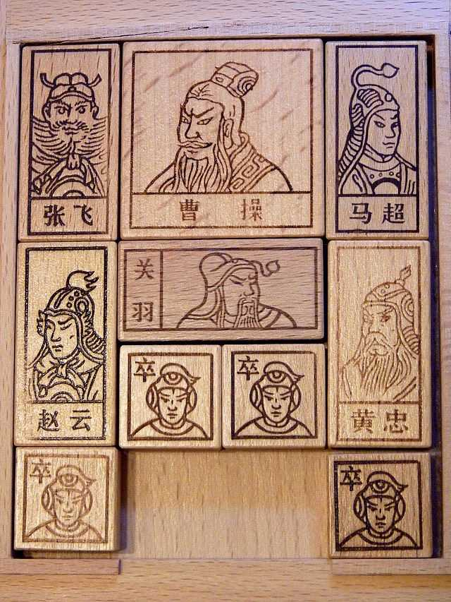

---

## 2681　最完美的复仇

- 日期：2022-07-13　主专题：A01 心理主体与情绪劳动　副专题：A06;A11
- 源 ID：`fe5ccbcb-3d1d-5130-ab0d-dad6b257d493`　原文链接：https://www.zhihu.com/question/24579627/answer/2571651368
- 官方对象—实践路径：与自己 / 与情绪 / 调节
- 23 概念标签：定义与达意;能力与学习;责任与后果;信用与信任;人工智能与机器
- 证据状态：manual_confirmed　初读：read　独立复核：not_reviewed

**问**：最好的复仇是怎样的？

对方暗中恐惧忌惮了一辈子，临老却发现你早就忘记了。
看你们很多人都想歪了，补充一下。
这不是什么计策，而就是放下了忘了。如果知道对方还在恐惧，按这个风格还会额外告知对方没这个必要。但这事的绝妙之处在于——你其实早就告诉了对方没事了，是对方自觉罪孽深重，而且对方自己不相信原谅，所以对方自己仍然停不下恐惧。
尤其是对方自己在暗处看着你一天比一天强大，既然不相信你的原谅，那就会觉得随时可能被报复，而且报复的手段可能越来越超出ta的预料，这个折磨就大了。
按照一般的设想，既然日夜恐惧，有些人又会想下毒手索性一了百了，但这时候又遇到一个问题——对方已经原谅了ta，而不是没有原谅。万一人家原谅是真的呢？更何况，人家一天比一天强大是肉眼可见的，对方就没有防范措施吗？
这里顺便说一句——居合有所谓残心，原谅也有。不要以为你宽宏大量原谅了对方，对方就不会再对你有任何不利。是这种可能的不利的防范和反制措施是原谅的一部分。只不过这个措施要是被动的——类似有关联人会因为你的意外死亡而启动某种预案，这样就不需要你时时去看顾。至于你有没有这样可以托付后背的人，这个是另外一番功夫——不过要是没有这样的人，你也就谈不上什么强大了。即使你有亿万家产，只要你没有这样的人，都是毫无意义的。
何以这叫做最佳的复仇？因为这复仇的整个效应都推动所有方面向好的方向发展。
先看你自己——
1）你自己早就从仇恨中摆脱，所以你可以平安喜乐，畅快生活。那些蝇营狗苟于复仇的人，日夜咬牙切齿，对亲友子女真是个深坑。越搞人越怕ta搞事，自然要先求自保。这个念头你自己持有一天，就损失一天。股票亏几千块你就抛了，这东西每天都造成亏损，你却要抱着不放。莫非你觉得复仇可以帮你刻苦学习啥的？
少看那些日本港台的电视剧、鼓吹什么“怀恨十年报仇雪恨”——怀恨十年一般都是郁郁而终，拿来什么报仇雪恨？拍报仇雪恨就是拍给这些正在郁郁而终的人看的，要赚这个收视率而已。
恨是一种强大的力量——不是让你学会线性代数、人工智能算法的强大力量，而是让你想喝酒、想吸毒、想家暴的强大力量。
2）第二个关键，是你总要自强不息。自强不息，勇猛精进，日有所得。
这是一个万变不离其宗的人生原则。这个原则本身就可辟百邪。百鬼夜行，都要绕着你走。
你在持续进步，你在不断的积累能力和资产，这些蝇营狗苟的事你就不必纠结。它们会“自动反弹”，“自我消解”。你专心发展你的，对方要自己想办法相信你的原谅，对方要自己想办法跟你和解。
而你如果不发展，动辄“躺平”。那么问题来了，躺平一族面对的世界是很残忍的——人人得而踩之。踩了你又怎的？你还能卷起来不成？你起床都困难，工作都找不到一个。躺平报仇，十年都早。
3）你没有动恶念。
无论你用多么曲折巧妙的办法，恶念就是恶念。恶念不容于天。很多评论区沿着前面那几句话做的设想，其实还是停留在“巧妙曲折的反击”上，这仍然是伤人的念头。在上天眼里，仍然算为恶。这仍然会结恶果，只是大小的分别而已，而现在谈论的这个，没有恶念。

再看对方——
对方落入了一个自己挖出的深坑。
一切的伤害都来自对方自己对原谅的不信任，不是吗？这事啊，什么时候信任，什么时候才算完。你不信，你就自己去害怕吧。
这种自发的、无成本的和关键因素绝对绑定的恒久作用力，对方是无法长期对抗的。就如同给块石头你，你不服你就举着。你举吧、看你能举多久。你说一句“原谅都是欺骗”，你就再举几年吧。
最后ta要么被自己毁灭，不用你动一根手指头，而且你确实没有任何责任；要么ta就要接受—— 一旦对方尽到了原谅的义务，自己就必须接受相信原谅的义务。
再说一遍——
如果对方懂得这全部的道理，而且身体力行，那么在你面前就只有这样一条最低损耗的逻辑路线——
你得罪了对方，你就有道歉的义务。无论你道不道歉，对方都有原谅你的义务。而一旦对方尽了原谅的义务，你就必须尽相信原谅的义务。
这几环，每一环都有整个天地的法则看顾和担保，不遵守的必受反噬。这才是这个世界上捍卫和平的真正机制。
它不可阻挡，不眠不休。
它是最好的“复仇”。
没有“之一”。
你会选择原谅伤害过你的人吗？

---

## 2674　不在意

- 日期：2022-07-17　主专题：A01 心理主体与情绪劳动　副专题：A06;A03
- 源 ID：`7f0c6274-815f-5e47-b05c-50885af9bff7`　原文链接：https://www.zhihu.com/question/381803581/answer/2578987151
- 官方对象—实践路径：与自己 / 与情绪 / 调节
- 23 概念标签：成本与总账;信用与信任;边界与许可
- 证据状态：manual_confirmed　初读：read　独立复核：not_reviewed

**问**：怎样可以不在意别人的过去?

“不在意”的第一准则，是根本不打听。
很多人嘴里喊着“不在意”，其实做的却是一边打听，一边纠结，一边默念“我要不在意”，一边上网上问“要怎样可以做到不在意”。
这两种方法谁成本低、谁更容易操作，这是不言而喻的。

更重要的是——说了“不在意”，却要问来问去，这本身不光是一个技术上是否高效的问题，事实上还是一个真诚与否的问题。
你是一个人类，你很脆弱而且贪生怕死。一切的事物都会和你的利益相关，会影响你能以什么样的收益活多久。别说身边人了，就是万里之外的战争、千年前的争论你都在意。
决定要不在意，唯一可靠的做法就是根本不问。
不管对方回不回答，你可以问却没有问的每一分钟都可以真实有效的证明你是真的不在意对方的过去。
而且你自觉坚持的时间越久，你反而越能坚持。
已经坚持了一年没有问了，现在忍不住问，就打破了完美记录了，岂不可惜？

“不问，那要是被坑了要怎么办呢？”
这就是另一个问题了。

---

## 2666　好胜心

- 日期：2022-07-22　主专题：A01 心理主体与情绪劳动　副专题：A04;A20
- 源 ID：`a319fbf2-30ab-5b1b-a461-1bebffce6c28`　原文链接：https://www.zhihu.com/question/544567558/answer/2586553752
- 官方对象—实践路径：与自己 / 与理想 / 建立
- 23 概念标签：选择与自由;劳动与组织;文明与历史
- 证据状态：manual_confirmed　初读：read　独立复核：not_reviewed

**问**：如何应对我无处安放的好胜心？

好胜心最后的归宿，是找到一条属于你的赛道。
你做出独特的成果，这个成果和别的成果之间谁比较重要、谁比较有历史意义，这个就属于没有人能判断的事情了。
牛顿力学和流体力学谁比较伟大？勾股定理和二元一次方程的解法谁更重要？
一旦你做的是开创性工作，你就超脱了人类的评价体系，只能由历史来评价你了。
做人要幸福的一大秘诀就是有历史参与感。
我是历史的参与者与开创者，我开创的事业代代不绝，我与被这历史所影响的所有后世人类永世共存。
我的价值和意义，哪里是人类可以用钱或者个人好恶、褒贬来评价的？
别说没人有资格“看不起”我，事实上连“看得起”我的资格也一样不存在。
找到这件事，是免疫于自己周围那些蝇营狗苟的混乱评价的最好办法。
那时候你自然没有什么好胜心了，因为你已经胜了整个世界。
这已经是胜利的极限，超越者已经没有刻度可算，已无强弱可言。

---

## 2664　浪费生命

- 日期：2022-07-24　主专题：A01 心理主体与情绪劳动　副专题：A04;A20
- 源 ID：`f0d955e7-e13a-5089-ab73-a45d7158adb2`　原文链接：https://www.zhihu.com/question/530697371/answer/2589592244
- 官方对象—实践路径：与自己 / 与时间 / 失去;与自己 / 与时间 / 使用
- 23 概念标签：定义与达意;能力与学习;选择与自由;信用与信任;财富与市场;权力与异议;心理与主体
- 证据状态：manual_confirmed　初读：read　独立复核：not_reviewed

**问**：“摆就摆（玩就玩），我没有浪费生命，做自己喜欢的事而已”该如何反驳如上的观点呢？

浪费生命有三个定义。
一个是没有改善和延长生命自身。
一个是没有留下足供自己咀嚼、回味、探索的回忆。
一个是没有留下可供ta人运用的贡献和遗产。

如果你做了一件事，这三种收益都没有产生，那么这段生命就是浪费了。
生命是否浪费，和你过得是否快乐没啥具体的关系。但你如果能理解“生命没有被浪费”所蕴含的巨大的幸福，你会发现这种幸福能对抗几乎所有的不幸和痛苦，以至于你客观上会比较快乐。
如果你可以用“玩”的形式达成这三种价值——哪怕其中之一——那么“玩“这个形式本身就没有什么可被诟病的，旁人也无从诟病起。
事实上，你可以把整个人生理解为积累这三种得分的真实的游戏。
它本身要比吃鸡和原神好玩得多。
真正能戒除游戏瘾和网瘾的关键，其实就是认识和参与这个元游戏。学会了且深入了后者，就会觉得前者品质过于低劣，不是很值得你的时间了。
至于说“做自己喜欢的事”，这话其实主要是基于“做自己喜欢的事就会开心”这样一个假设。
问题是，这个假设真的可靠吗？
1）做自己喜欢做的事压力是很大的。你很喜欢嘛，那你应该好好做，而且应该做得好才对。结果你喜欢的事你都没好好做，做得也不好，别的事要怎么办？
超级喜欢打游戏，游戏打来打去中下游而已。
超级喜欢看漫画，漫画看了到底说了些啥都记不太清。
喜欢如果不能导致专精，很快会带来巨大的沮丧感甚至绝望感，轻而易举的指向“我一无是处，一事无成”。
而一旦有了“专精”的要求，就会要求你钻研、要求你学习、要求你练习、要求你较真、要求你技术全面，要求你不断诚实的承认自己的缺陷和短板。——这不就又回到了“厌学”的老路上了吗？
难处就在这了——如果你没有把不喜欢的东西玩好的能力，你喜欢的东西也就要省着玩。因为一旦放开了玩，遇到这个阶段容易把自己喜欢玩的东西玩毁（ruin）了。
回头喜欢一样玩一样，玩一样毁一样，更加悲催。
2）最能带来开心的，恰恰是把自己明知必要但不喜欢做的事做成了。
这个你做上几次就知道了。一些你超级不喜欢做的事，形格势禁不得不做，于是捏着鼻子做了，结果一下还做得很好，很有感觉，做出的成果还挺漂亮。
这个感受要比“玩喜欢玩的东西”快乐得多。
让你害怕的东西也不过如此，既然如此，那还有什么可担心的了呢？
它给你带来强烈的自由和解放，会突然让你觉得天下无事不可为。
世界都变大了。
所以，会玩的秘诀恰恰在于时不时要玩一下自己不喜欢玩的东西。
只玩自己喜欢玩的东西，并不是正确的策略。

---

## 2662　感动

- 日期：2022-07-27　主专题：A01 心理主体与情绪劳动　副专题：A18;A09
- 源 ID：`ad3f3289-17e6-5ea2-b864-7e8eb559674e`　原文链接：https://www.zhihu.com/question/339685248/answer/2594432710
- 官方对象—实践路径：与自己 / 与情绪 / 调节
- 23 概念标签：能力与学习;选择与自由;成本与总账;信用与信任;照料与家庭;权力与异议;技术与工程;生态与自然;心理与主体;性别与身体
- 证据状态：manual_confirmed　初读：read　独立复核：not_reviewed

**问**：人感动的本质是什么？

感动机制的本质是一种人类的心理反射系统。这些心理反射是先天写在人的动物本能里面的。例如看到头身比大的毛茸茸的幼兽会有保护欲和亲近欲；看到有脸有四肢的动物遭遇撕裂伤会有恐惧感；看到昆虫的尖爪和刚毛会有焦虑感；看到自己的心理同类有良好回报会有喜悦感；遇到攻击就会愤怒；遇到友善会感到亲近，等等等等。
这些东西是为了让大脑发育不健全的个体有最基本的社会功能，即使没有受过教育，根本不识字，不了解任何文化传统，也能大体有效的趋利避害。
这种本能非常的强烈，而且是有激素、基因等物质性生理基础的，因此往往跨越文化的高度一致，以至于人类虽然对各自所处的地理气候环境有了复杂的社会化适应，但基本上只是万变不离其宗的围绕着这些本能稍作修饰而已。
一个社会如果自己约定与这些本能差距过大的习俗规范，会产生很大的额外成本，如果这个成本不能因为对所处环境的特殊适应带来足以抵消成本的收益，这种社会最后是会失败破产的——这些底层机制就是如此的强大。
现在要说“但是”了——但是，这些东西留下了一个极其重大的隐患——它们同时也是操纵人类的程序后门。
巧妙的触动人类的这些扳机按钮，你可以在很大程度上像操纵机械一样控制人的情绪，并通过这些情绪控制人的决策、行为，像役使牲畜一样操纵人类。
生而为人，如果你真的如你所声称的那样在意你的自由——也就是你的生命——如果你真的想要拥有实际的人格，想要确保人除了尊重你的意愿和利益别无从你身上获取合作的妄念，你就要记住——你必须管理住自己的感动。
这首先就要从意识到感动你的企图、管理“感动术士黑名单”开始，从建立将“意图感动”视为极端危险的恶意侵犯的本能开始。
想要改变我的决策，只有一个合法途径，就是逻辑说服。谁放着逻辑说服的路线不走，要利用我的动物本能，尤其是有明确主观意图、作为一种主动选择的策略的这么做，这人就是我的敌人。无论名义上的亲疏远近，凡过此线，即为在我面前自弃为友的资格。
自己不懂的、出于社会恶习的裹挟熏陶的，可以谅解宽容，不予计较，但一概视为没有自我觉醒凡半人，可以得到照顾和忍耐，但这样的人无法依靠，无法做过高的授信。
蓄意感动人是一种道德败坏，只是这样的窃贼太多，互相掩护，不以为耻，凡以为能了。但你们记住，你自己能栖身的地方，必须是将这种行为视为极大的不道德的群体。

不要以为秉持这种原则的人不懂如何感动人，恰恰相反，能坚守这些原则的前提恰恰必须是要能洞若观火的看到谁在诉诸感动。这其实是社会性发展到一定程度的一个必然产物。是你自己摆脱“感动巫术”，获得自我决定权的入门门槛。
换句话来说，明白这条规则是什么，能有效持守的人，个顶个的擅长操纵人的情绪。只是不愿做这种事而已。
你要做某事，绝不该是被我感动的结果。如果是，在我这你只会得到痛切的批评，绝不会是“欣慰”，“喜悦”，“赞赏”。你要做某事，必须是你自己最大限度坚持理性判断的结果。
感动可以作为一个有一定重量的砝码，但是天平本身必须是理性思辨，冷静计算。

这些话说了，会有无数人来说什么“连感动一下都不行吗”、“那不成机器人了吗”之类的话，要为“感动”辩护，要来批评这些话太“苛刻”。
“被感动的感觉”就是这么美好，是吗？

只希望有一天你能明白，这些“感动”的“收费”是什么。
它的收费是什么？
一感动，决定了。
一感动，就ta了。
一感动，要做这。
一感动，要去那。
想一想，感动的“费用”是什么？
尤其是女孩子们，我建议你们脑子清醒点想清楚。

这意味着什么？意味着看一切东西，都要先把褒义词贬义词还原成中性词。意味着本能的憎恶诉诸情感的手法和计谋。意味着道德厌憎对使用这些手段毫不避讳甚至引而自得的人。
谁搞那些这些来博你好感，应该会被极端敏感的抓个正着，而且应该毫无悬念的博到一个勃然大怒，迎头痛击，而绝不该是“热泪盈眶、感念无已”。
如果你们不是这样，会为自己的人生埋下不可测的祸端。这个世界上热衷玩弄这些卑鄙伎俩以为能事的人不可胜数，不以之为患、为恶，反以之为善、为义，你必定会沦为这些人的食粮和货物。幸免概率低于万分之一。唯一的悬念只是你到什么时候醒悟和悔恨，而这个时候你还有没有勇气醒悟和悔恨。
学会欣赏那些明知如何可以感动你，却如避雷池绝不利用的人，这是人对人真正的尊重。
可以感动你，但却坚持只跟你讲冰冷的道理；可以讨你的好，却要说煞风景的话，打破你的情绪；已经可以成交，还在坚持揭示风险——这是放弃了近在眼前的诱惑，要把你当成一个人来尊重和交往，懂不懂？
断不了感动的瘾，不要下山。
爹妈没有把这道理给子女说透，不对子女坚持这个原则，是一种基本的失职——将来子女所托非人，不要自称无辜。
这是好言相劝，不能听，只能祝你好运了。

---

## 2654　失望

- 日期：2022-08-03　主专题：A01 心理主体与情绪劳动　副专题：A06;A11
- 源 ID：`de785bc0-4961-5dd3-a65e-197e6210fa39`　原文链接：https://zhuanlan.zhihu.com/p/549210717
- 官方对象—实践路径：与自己 / 与情绪 / 调节;与自己 / 与理想 / 持守
- 23 概念标签：定义与达意;能力与学习;选择与自由;责任与后果;成本与总账;信用与信任;权力与异议;技术与工程
- 证据状态：manual_confirmed　初读：read　独立复核：not_reviewed

**问**：关于失望

这东西是这样的——“坚持”这回事，说穿了就是懂得如何处理失望。
如果逻辑上敌人只需要做什么事就可以令你“失望”，岂有心慈手软不做之理？那意味着你根本没有机会做成什么事。
丢了个你自己期待已久的单子，好失望，不玩了；
考砸了一次很关键的考试，很失望，不学了；
打输了一场觉得很重要的仗，很失望，放弃了。
blar blar blar……
只要是这样的思考方式，你放心，这一单、一考、一战，不但迟早会来，而且会早于你的预期、接二连三而来。
你必定放弃。
因为你根本就不知道什么叫坚持。
你所有所谓的“坚持”，不过是一帆风顺造成的幻觉。

人要学会认准的事就不失望，直接从逻辑上就消灭失望的一切触发条件——提前就想好，考砸了我也不失望，丢单了我也不失望，打输了我也不失望。
砍了我的手，我也不会失望。
挖了我的眼，我也不失望。
斩了我的头，
断了我的香火，
诛了我的九族，
我也不会失望。

出来混，早预着了。
不死不休，
死亦不休。

我熟读历史、博古通今，对事情发展的一切曲折性没有任何侥幸，绝不会预期有什么可以伤害我的事我的敌人不会做，也绝不会笃定有什么可以造成打击的灾难不会发生。
那又如何？
谁说“不利”就要放弃？
利不利，只影响做事的策略和节奏，只有该不该、想不想才能被允许影响你做不做。

若没有这样的觉悟，你一开始就不该走上任何一条已知可能会发生这些的道路。
只有完成“失望无效化”，你才能顶得住敌意和威胁，才有可能有所成就。
无关男女，这才是一条真正的汉子，顶天立地大丈夫。

而现在很多人的mindset是什么呢？
寄望于顺利，寄望于坏事不发生，或者不发生到超过自己的预期。同时这个预期还天真到烂漫的地步。
一点顺利，兴高采烈；一点挫折，如丧考妣。一点精力，全都用在这些喜怒哀乐的神经冲击和情绪修复里了。
“希望”“失望”十二回，转眼已经五十八。你一辈子有多长？你能做多少事？

哪怕只是出于想象、假设，发现这些东西对打算走的道路有什么影响，都要警惕和想好。

成败利钝在所不计，生死荣辱置之度外。
一条路，走到它亮。

记住——事情永远是由无侥幸的人来决定结局，而不是那些看风向紧就跑、看势头旺就来的人。
只有这些人，是竖旗、立寨、开山的人，是提供港湾和归宿的人。
那些一天到晚提心吊胆考虑有利不利，run向何方的人，是流浪的、敲门的、乞讨的——注定一生悬命，无枝可依。
逻辑上你根本不可能跟随这种永恒投机者，因为ta明天在哪里，不取决于ta自己，取决于佩洛西，甚至更微不足道的风吹草动。
ta们答应你什么根本没有什么价值，因为ta们是否会坚持守约同样不取决于ta们，而取决于不知什么奇怪的偶然变数。

其实这些事——不论是香港、乌克兰、还是台湾——每一件都是试金石，可以让你默默观察身边的人谁是磐石而谁是蒲草，你要成为谁，要靠拢谁。
这些要巨大动荡才能揭露的真相是平时太太平平你看不到的，而且是无价之宝，你都没处买。
什么“赢麻了输麻了”之类的没出息的话，那是脆弱成性不以为耻，反以为叫“智慧”的投机者才在乎的东西。
学会脱离这种可怜的话术和情绪，不然那类人很难视你为同类，对你的尊重只不过是出于对自身的高要求和同情。
尊敬是基本没可能的。
而尊重只不过是免费供应的基本品，尊敬才有实际的分量。

相信我，基本所有的财富、权力的秘密都在这些人手上。
只要这些人感到你是同类，很多门都会向你打开，你亏不了。

最后，还是那句话，我对中国充满信心不会因为佩洛西这些戏码减少一分（坦率讲，未来的这一小段时间是接手一些软弱者资产的好机会。）
我对中国有信心，和中国现在的势头是向上还是向下无关，仅仅因为“我有信心”本身。
是否应该看好中国，要看真正能决定结局的人。
也就是取决于我和你们，
不取决于“佩洛西”们。
关于失望还有第二个比较严肃的问题，那就是“失望”本身是不是一个好的工具。
很多人的失望模型是这样的——
首先你引起我的期望，接着我的期望落空，于是我说我很失望。
这个是一个经典的三段论。
它的逻辑基础也很直白——这算是一种对“欺骗”的“惩罚”，以便威慑未来尝试不负责任的引起我的期望的人。
这看上去天经地义，难道还能有什么问题？
确实有问题。
那就是你要知道——愿意承担你的期望的人是稀缺的。
通过这样“公平的惩罚”，你实际上在教导他人谨慎注意不要引起你的期待。
一旦引起了你的期待，那么你的期待若是落实了自然太平无事，但是一旦落空，ta就将招致惩罚和打击。
如果引起你的期待本身不能直接带来重大的、足以抵消后来的打击风险的利益，对方必然会选择从此以后什么承诺都不给你，甚至连问你想要什么都不问。
因为从很多人的伦理认知里，问我想要什么，已经是要我期待了。
这份生意亏面极大——说得世俗一点，对方“引起你的期待”的过程很可能根本是被动、无知的。对方自己未必和你签订了什么严肃的合同、明文的契约，你已经可能产生强烈的“契约成立”的意识。而这个违约责任非常严重的契约，对对方却往往没有任何实质的好处。
举个常见的例子——知乎KOL经常收到“你变了，太令我失望了”的留言，然后发现对方散播一连串极其“尖锐”的言论。
问题是，让ta“充满期待”的过程在绝大多数情况下其实完全是默默的、无声的、没有产生任何可见收入或者良好感受的。
这个期待的现实收益完全在产生期待一方，在“引发期待”的这一侧，除了理论上的“被万众瞩目的快感”的数十万分之一之外，其实什么也没有。
但是一旦发生了“失望”，要承担的却是十足十的报复。某些报复还会直接涉及人身安全和刑事构陷。
说这个不是要去批判这个客观的社会现象——这个就属于残酷的人类社会客观规律，人只能学会平静接受、技术处理和愿赌服输。
说这个是要说另一个方向——人都不是傻瓜，就算是，经过了“期望者”们的“教育”，也会“聪明”起来。
ta们可以接受不引起你的期望，但是你自己难道打算生活在一个所有人都谨慎小心、避如蛇蝎、绝不能意外引起你任何期望的世界里吗？
你的世界里实际上真正存在的人其实平均只有七个而已。其他的不过是匆匆过客。
如果这七个人都被你的“有百害而无一利”的期望教育到“清醒”了，你将生活在一个零摄氏度的单人牢房里——对方来探视你都要隔着有机防弹玻璃。
这个时候，你觉得“让我期望落空我就有权失望”足以提升这房里的温度吗？
这份失望权到底公不公平、合不合理，到底看什么？是看形式逻辑上的“简洁美感”，还是看咬定它“显然公平合理”的人到底是趋向繁荣幸福还是孤苦早夭？
如果你的答案是后者，那么你要学会一个看似“疯狂”的新逻辑。
只期望，期望落空，不失望。
如果这层境界不能发自内心的做到，那么退而求其次，学会期望落空，【不说】失望。
这话你看得懂、努力做，你的分手、离婚、亲子反目的概率至少下降一个数量级。
因为有九成以上的反目，是从对方没能兑付你的期望、遭遇了严厉的惩罚，然后不得不老老实实按你声泪俱下立下的“以后不能保证办到的事情就不要跟我说”规矩照办的结果。
嗯，好的，我心疼你，我也不想再犯这错误。
以后这类事我不会说了。
那么，什么是“保证能办到”呢？

我是一个人类，我控制不了任何我控制不了的因素。
我没有保证能办到的事情。

亲爱的，我没有可说的话了。
所以，那话才没有说“实现了的就盼望，失落的就揍ta，就不再盼望了”
它说的是——凡事包容，凡事相信，凡事盼望，凡事忍耐。
爱是永不止息——永不止息的盼望和期望，而弃绝失望。
这里有人在问，如果我弃绝失望，要是人家无限的令我落空、伤害我，难道我都无限接受？我的出口在哪里呢？
这里你犯了一个错误——你根本不需要失望，就可以结束或者改变关系。
人们如此依赖“失望”这个工具，其实不过是希望借着它获得自由离开而不必被指责的免罪牌。
但事实是——从一开始，你离开、转变就是自由的，你根本不需要对对方做任何“是你令我失望我才另做选择”的解释，更根本不需要对方的批准。
“我离开是因为没赚钱”已经很够了，或者纯粹的“我觉得不working”已经足够了。
你不需要靠“失望牌”来“免罪”，你只是要承受你自由本身就有的重量。
就是因为我不想了，所以我要另做选择，就是这样而已。
我另做选择，不是出于“令我期望落空而行的报复”——因为我一开始就知道肯背负我的期望本身就是一项极大的贡献，无论你事后有没有成功。
在我眼里这事是你只要背负了我的期望，我就要谢你一份，如果你没实现，那么这一份感谢仍然不会收回。
如果实现了，那么我要谢你双倍。
你不可能因为承担了我的期待而受到来自我的任何惩罚。
只有一份感谢和两份感谢的区别，绝无任何报复。
根本不存在因我的期待而带来伤害的逻辑可能。
所以我的期待对你只构成得到一份或者两份感谢的机会，成为一种毋庸置疑的祝福，而非悬而未决的诅咒。
事实上，哪有什么悬而未决？
遵循“公平惩罚逻辑”的人很容易发现“失望”是利润丰厚的，因为那不但可以省下谢礼的义务，还额外产生了索赔的权益。
ta们下意识的就会失望。
失望成性。
被ta们期待，是毫无悬念的诅咒。
唯一的结局，只会是被得出失望的结论，而产生赔偿义务。
这真的公平吗？

---

## 2652　内心强大

- 日期：2022-08-05　主专题：A01 心理主体与情绪劳动　副专题：A03;A07
- 源 ID：`f48747ba-d12f-54dd-a8db-086ae52b46e5`　原文链接：https://www.zhihu.com/question/542764581/answer/2612102490
- 官方对象—实践路径：与自己 / 与能力 / 获取
- 23 概念标签：事实与证据;定义与达意;能力与学习;选择与自由;责任与后果;成本与总账;心理与主体;性别与身体
- 证据状态：manual_confirmed　初读：read　独立复核：not_reviewed

**问**：如何变成一个心理强大的女孩？

你什么时候会觉得一个人是“心理强大”的人？一般都是目睹ta遭遇了你觉得非常巨大的压力，但却不改变决定、不改变待人接物的方式、不改变事业方向。
“要是换了我，我肯定跪了。土下座那种。”
太强大了，是吗？其实这是一个错觉。
“强大”的秘密，其实是因为当事人已经确认自己的方案已经是最优化的方案了。你吼我，这方案也仍然是最优的方案。它并非万无一失、不包赢，但经过我极尽全力的审查和核实，这就是目前所能做的最好选择。
你威胁我，没改变这个数学事实。你哀求我，也没改变这个数学事实。你咒骂我，也没改变这个数学事实。
你威胁、哀求、咒骂，我要是按你说的改了，失败概率更大，你回头还要威胁、哀求、咒骂得更狠。你不喜欢这个？按你说的照办，结局你会更不喜欢。
我根本不是“无所畏惧”，而是
我·特·么·的·没·有·替·代·方·案。
不是我“心如铁石”，而是抛物线最高点就在那里。你打死我，也是在那里啊，大哥。
你光看我乌蝇哥白衣飘飘、傲然挺立。那是因为命运的苍蝇拍就这里有个洞啊！伸手丢手，伸脚丢脚。你骂我、踢我、推我、怨我，我也要站稳这马步啊！
我哪里是不害怕？哪个龟儿不怕。就是因为怕，所以一毫米也不敢动啊！

你为什么“内心不强大”？不是因为你怕，而是因为你没算清楚，是因为你不知道怕。所以，你觉得你可以怕向南边去，是因为你觉得还可以向东和向北。既然可以怕，有得跑，那你自然总会怕，总会跑。
这就是“内心强大”的秘密，不是去屠狮灭虎睡坟地，而是学好会计和语文，把账算清楚、算严谨。这不分男女，不需要赌命。初中教育程度就可以尝试。
所以，你不“内心强大”，只能怪你自己懒得算。

---

## 2628　事无定数

- 日期：2022-08-21　主专题：A01 心理主体与情绪劳动　副专题：A03
- 源 ID：`bcb01d59-56a8-5a74-beec-cf4d20731b80`　原文链接：https://www.zhihu.com/question/512892991/answer/2637070590
- 官方对象—实践路径：与自己 / 与信念 / 转变
- 23 概念标签：选择与自由;责任与后果;性别与身体;宗教与自然法
- 证据状态：manual_confirmed　初读：read　独立复核：not_reviewed

**问**：请问您是如何理解命运的？

人的生命只有惯性，没有命运。
人生更像航船而不是火车，有风向、有航向，但没有轨道。有目标，没有站点。
你下一秒钟做什么，只是不太容易明显改变你下下秒的状态，但却对三个月或半年后的你完全可以有重大的颠覆性影响。
所以你永远不必考虑用“这是宿命”“命中定数”这类说辞否定未来的任何可能性或者回避你需要承担的责任。
上帝没有提前划定你的命数，你也没有什么“宿命”，祂并没有在宇宙爆炸开始就确定直到宇宙消亡的每一瞬间的所有粒子的状态。
祂是随时随地即兴发挥的，只是这种即兴发挥没有影响物理定律的有效性罢了。
这就是正确答案，一次解决，不必再问了。

---

## 2624　远方的神坛

- 日期：2022-08-24　主专题：A01 心理主体与情绪劳动　副专题：A03;A06
- 源 ID：`77cbf9a1-f2ca-5c8c-b2f1-ffe04bb34950`　原文链接：https://www.zhihu.com/question/549823963/answer/2643531485
- 官方对象—实践路径：与自己 / 与名誉 / 建立
- 23 概念标签：能力与学习;选择与自由;成本与总账;爱与回应;劳动与组织;财富与市场
- 证据状态：manual_confirmed　初读：read　独立复核：not_reviewed

**问**：如何消解向别人证明自己的执念?

“大凡先知，除了本地本家之外，没有不被人尊敬的。”
查一下这话哪里来的，你就不纠结了。
就是神都没法向老乡们证明自己，所以凡人就索性不要纠结了。
向自己从小熟识的人证明自己是一个非常困难的事，因为人类常有这个倾向。能看得见、摸得着、说得上话，而且说话和气、平易近人的，人们很自然的会下意识的认为和自己阶层类似、水平相当。
“只有遥不可及的，不可能接触的，有可能真在我之上，我能说上话的都跟我差不多。”
不管对不对，这样想是人之常情。是靠着这个认知，人们才维持着一个“强敌在远方”的安全感，和“远方有希望”的指望，从而维持住一个“我身边一切都还能对付”的安慰。
不要耻笑人，因为这件事人所难免。
距离即神坛。
你所谓的“证明自己”，所追求的“尊重”，其实是你所羡慕的他们专门授予“外人”和“远人“的特殊敬畏。殊不知，那在本质上是“外人”“远人”们的专享福利。
那意味着离家工作、出国留学，在获取这些待遇方面的效能可能比“努力”和“成功”有效得多。
但这件事的微妙之处在于——若是要选择远离、距离更能获得尊敬，那么这份不再能见到听到的尊敬，又有何意义呢？
得到它最好的手段，却会使它失去意义。保住它的意义的手段，捅破天也不能得到它。每次当你看到这种poetic irony，就知道这是谁的风格。
所以不必纠结这个了。对自己身边的人，爱比较重要。
“尊敬”什么的，视作不可追求之物，置之度外。这本来就是这个世界的设计，接受它就好了。
其实你会发现你接受了它，不再花巨大力气在这类“永动机理想”上，很多情况直接就改善了。
以前对方对你恶语相向，你要伤心、要委屈、要愤怒、要抗议、要斗争……一整套迷踪拳打下来汗透、泪透、尿透重衫。
现在对方对你恶语相向，你安慰两句安排晚饭。
最低成本的维持事务运转，省下精力去赢得客户和市场认可。客户和市场认可比较有意义，客户和市场认可你，家人“不认可”对你的影响就自然小了。你也自然有心情宽宏大量，一笑置之。
这样就会踏入正循环。
而客户和市场认可你到一定程度，家人自然而然要怀疑自己的不认可。
这并不需要你多财大气粗，挤进多少位财富榜。这其实只需要你手上有些真功夫、真本事能解决市场上某种普遍存在的需求——哪怕是很小的需求，可以乐观期望不饿死即可。
向正确的方向努力。

---

## 2592　不同节奏

- 日期：2022-09-19　主专题：A01 心理主体与情绪劳动　副专题：A04;A06
- 源 ID：`1fb11f11-3b90-5193-9239-70a4cca8338b`　原文链接：https://www.zhihu.com/question/552876594/answer/2679568286
- 官方对象—实践路径：与自己 / 与情绪 / 调节
- 23 概念标签：能力与学习;选择与自由;技术与工程;文明与历史;人工智能与机器;心理与主体;宗教与自然法
- 证据状态：manual_confirmed　初读：read　独立复核：not_reviewed

**问**：抑郁焦虑休学了一年多，但还是极度厌学恐惧学校怎么办?

老实说，这个主题说过很多遍了，现在再说一次。
是的，你是有了和别人不一样的节奏，但是这不见得是坏事。
这可以——注意，我没说“一定”——可以在将来成为一件好事。
全看你自己把这件事向好的方向孵化、还是向坏的方向孵化。
人生根本不是“一步落后、步步落后”的“竞争”。
人生是万千角色之间的合作。
有的角色，需要的就是“早年有过抑郁经历”的背景——典型的比如作家、导演这类艺术家。
上帝眼里没有主角，每一个出现在演员表上的人都是平等的。
你并不是祂所导演的一部历史大剧里完全无足轻重的兵丁甲，而是他导演的七十几亿部剧中其中一部的主角、七八部剧中的男/女二、三、四，一千多部中的群演，以及剩下六十九亿九千九百九十九万九千部中的故事背景。
这还只是这一季，你还会是将来无数续集的“前传”。
而在这些剧里面，“正常升学、顺利入职、就势成婚、平安生子……”的“标准规格人生”，并没有特殊的优胜。
世界上的精彩故事并不能缺了各种各样的“非标准件”。

尤其是人工智能大行其道的将来，成为一个少数派、一个有特殊履历、特殊背景、特殊意识的人，未必是一件坏事。
所以不必对此过于焦虑。
上帝给你发这副牌，对你不是恶意。不要一心认为这是“倒大霉”。
“别人都没有，怎么就我有”。
是啊，别人都没有，就你有，你仔细想想这话，真的一定是坏事吗？
如果你静下心来，顺势而为，在这个给你的特殊起点上努力发育，将来这个“别人都没有就我有”，总有一天会变成“怎么就ta行，我们都不行”。
这件事只是特殊的，它到底将来孵化成好的还是坏的，还在未定之天，还取决于你。
如果你选对了，这其实是特殊的祝福。
以后遇到任何“为什么别人没有就我有”，都往这方向想一想。

---

## 2583　眼中的光

- 日期：2022-10-01　主专题：A01 心理主体与情绪劳动　副专题：A04;A08
- 源 ID：`a662968a-e14c-506d-8fac-21d0e7baf858`　原文链接：https://www.zhihu.com/question/461148180/answer/2697824362
- 官方对象—实践路径：与自己 / 与欲望 / 满足;与自己 / 与能力 / 运用
- 23 概念标签：能力与学习;选择与自由;心理与主体;宗教与自然法
- 证据状态：manual_confirmed　初读：read　独立复核：not_reviewed

**问**：怎么样才能找回眼中的光？

这事其实很俗气。
那就是要赢。
少说废话，不要找借口。
要存活、要解决问题、要拿到结果、要办成事。
要笑到最后。
要养成办成事的习惯。
最后养成赢的习惯。

你总是输、总是逃、总是半途而废，你当然眼里没光了。
你凭什么要输？凭什么要逃？凭什么要半途而废？

眼里没光，是人沉迷自欺欺人而不自省的自然惩罚。
自欺欺人，就总是好高骛远，总是半途而废，总是自找借口。循环往复，从失败走向失败。
越输，越想一仗翻身，越要赌个更大的。
越赌个大的，越输得彻底、输得没有悬念。
输了又输，而且打死不改，你凭什么眼里该有光？

该办成的事，就要办成，还要办得漂漂亮亮。
事情办漂亮了，你自然而然眼睛里就有光。
没办好，那就老老实实的总结问题，然后解决问题。
不要欺骗自己，不要欺骗老天爷。
做人老老实实，脚踏实地，事情办得稳妥漂亮就自然而然会是一个常态。
你办不了的你不会乱抓，你办得了的自然极少失手。
极少失手，自然总是办成，自然总是赢。
总是办成，总是赢，有什么“眼里没光”？

---

## 2584　不受欺负

- 日期：2022-10-01　主专题：A01 心理主体与情绪劳动　副专题：A03;A10
- 源 ID：`f2d0a2b0-19ce-50eb-9498-32c01cd5544c`　原文链接：https://www.zhihu.com/question/431416943/answer/2697791044
- 官方对象—实践路径：与自己 / 与情绪 / 觉察
- 23 概念标签：定义与达意;能力与学习;选择与自由;成本与总账;信用与信任;技术与工程;心理与主体
- 证据状态：manual_confirmed　初读：read　独立复核：not_reviewed

**问**：怎么做一个别人不敢欺负的人？

人类的“勇气”是无限的，这主要是因为人类的愚蠢是无限的。
别说你，杜月笙、黄金荣一样有人“敢欺负”。
“你要是杜月笙，我就是杜日笙，我就不信还打不服你了还。”
这种人满大街都是，ta就是蠢到看不出来你是康熙爷，你能奈ta何？
所以你可以寻求构建一定的肉眼可见的威慑，但是不要指望能靠这些威慑做到“别人不敢欺负”。
这策略是不可靠的。
“被别人欺负”，并不见得全是你“软弱可欺”的结果。它还有两种最常见的可能。
第一，也是最大的一种可能，没人在欺负你，是你自己对社会规则理解有误。
欺负是一个很高风险而很低收益的愚蠢行为。你仔细算一下，它到底有什么特别的收益？只不过是一些虚无缥缈的良好自我感觉。但是它造成了什么样的风险？一个弄得不好要给你血溅当场的仇人。
冒生命危险只不过讨个口头便宜，这种蠢事虽然不能说没有，但客观上属于有自然规律把守的少数事件——蠢成这样的人一般是有思维障碍，很容易因为自己招来的意外而夭折。自然选择就容不得这类人比例太多。
然而你会发现“觉得受欺负”这种现象却没有同样的淘汰率。
因为“觉得受欺负”并不会立竿见影的导致同样强烈的淘汰效应，甚至还常常会产生“我要奋发图强”“我要让所有人知道，我失去的东西总有一天我会拿回来”之类的“奋斗性”，所以它没有被自然选择同样排除掉。
但这是不是意味着这种“受辱敏感体质”存在着某种演化优势，以至于应该作为一种健康的表征加以接受呢？
当然不是。
因为这种特性属于典型的“有利于你青春期躁进，但却容易在成年时演变为癌症”的隐患。就像甲亢可以帮你减肥，但却同时可以让你得心脏病一样。
“受辱敏感”可以让你“斗志昂扬”，但也同时可以让你轻易的陷入抑郁，甚至绝望。
路边的磨盘你都会看成潜伏的饿狼，你能“奋勇抗击”多少次？迟早你会无力“反抗”，只觉得自己是“人间最卑贱的微尘”，谁都可以“欺负”你。
我必须严肃的警告你，如果你觉得是某个特定的人在欺负你，那也罢了，没准你是对的。
但如果你觉得“人人都在欺负我”，那你要极其严肃的考虑这样一种可能性——你可能对“欺负”的定义有问题。
比如，跟别人打了招呼，没给你打招呼，并不能称为“欺负”。
你抽烟人家来禁止，上一个抽烟的人家就不管，这并不叫你受了欺负（尽管上一个的确有枉法之嫌）。你违反了规定，人家就有权执行规定，这只不过照章办事。ta私纵其他人，你可以另外举报，但你不能把ta对你执法这事定性为“欺负”。
比如你送了礼物人家不跟你约会，别人送了礼物人家就跟ta约会，这不叫你受了欺负。人家收不收礼物跟跟谁约会不构成交换关系，这又不是一个出钱买钟的关系，没有这种“服务标准“可谈。
比如别人考八十分，老师夸进步，但你考了八十分，老师却说你怎么这么粗心，这不叫“你受了欺负”。老师对这事本来就有自由裁量权。
打篮球对方专门盯你，卡你，盖你的帽，这不叫“你受了欺负”。你是薄弱环节（甚至没准是得分重点），人家的战术就是攻击薄弱环节，这没有什么神奇的不公。
你要习惯别人的合法自由可能并不顺你的意，别人有不顺你意的自由。
所谓自由，是不受什么“公平”的责备的。
人家的钱、人家的待遇、人家的感情……人家愿意给甲多一点，愿意给你少一点，你没有权利加以指责。
人家没有义务给你你想要的公平。
尤其是，如果你自己不虚伪的话，你就应该会发现，你自己也从来不会按照别人口中的“公平”办事。
谁对谁是公平的？谁能给谁公平？你对别人就是公平的了吗？你有这个自信没人能指控你不公平吗？
如果所有的“不公平”都可以自动的构成“欺负”，那么这个世界当然遍地是“欺负”。
这个是无解的。
别说你把自己练成杜月笙解决不了，就算你把自己练成钢铁侠、孙悟空，你也做不到“没人敢欺负”。
而偏偏，你会发现生活中愤愤不平、咬牙切齿的认为世界对自己“不公”的人，常常就秉持着这样一种世界观——ta认定自己受到的难以忍受的欺负，本质上就是觉得别人没给自己“与其他人一样”的“平等待遇”。
因为这个期待是不可能被满足的，这样的人就自然而然的长期流露出一种凶狠的戾气，一种“我先拼命忍着，再给你们一点机会”的杀气。
别人不是瞎子，谁不会自然而然的避而远之？
这种针对性的避而远之，自然又要构成“欺负”的一部分。
这种往复循环，显而易见的直指地狱。
这只能靠你自己放下这个执念来解决，而不可能靠你获得某种“别人都不敢欺负”的“神通”来解决。
恰恰相反，你真要是获得了这种“神通”，你会发生的改变根本就不会是“没人敢欺负了”——“欺负”照样会普遍的发生。
所不同的，是你现在会自认为手握报复的本钱，要“教训”一下“欺负”你的人——于是会制造悲剧。
甚至你自己的灭亡。
因为这种“欺负”天生就是人的自由的基本形式。
“报复”这种“欺负”，就是在凭借暴力强迫人遵守你的【个人】价值观，是最不能为世界所容忍的对人的基本自由的侵犯。
你会成为“只知道欺负人的人类”的公敌，因为这时候你才是实实在在的自由的敌人。
我建议你仔仔细细的把这整个过程看明白，看明白就明白了——“受辱敏感”是一个非常值得警惕的问题，你要做的往往不是去寻求“让别人都不敢欺负”的神奇威力，而是首先要警惕你为什么会有这么多的“都在欺负我”的认识。
“欺负”是自由的基本形式。
“凭什么不公平”并不是一种天然正确的指控。

第二种可能，就是对方真的比较愚蠢，真的在滥用职权或者个人的某种权势。
这类问题，我不喜欢教人关于暴力的技术，但是请你相信，这类脑子不好的人，掌握不了真正最强的暴力。
无论是纯粹的武力还是曲折的计谋，心怀宽容的人都会在这些低级自洽的人之上。
没有武德，没法有真正的武勇和谋略。
你不要当一个总是觉得别人在欺负你的人，你离获得“超出常人的武力和谋略”的距离要远比沉迷于此的人近。
因为你很容易有朋友，而且这些纠结不会长期牵扯你的精力、妨碍你去获得必要的智力发展和资源积淀。
这些东西到后来才是真正实力的支撑。

越宽容，越能宽容。
首先就很少会有人想欺负你——甚至那些喜欢欺负别人的人，到你面前也会本能的收起爪牙。
即使不考虑你本身的反击能力，仅仅考虑得罪了你而会失去的你的帮助，对方都会投鼠忌器。
更不必提你既然能做到ta自问做不到的事——不论是你滑板玩得出神入化，还是芭蕾跳得石破天惊，都是要常人难以忍受的寂寞和努力才办得到的——ta就会想到，你要是成为ta的敌人，ta也没把握料到能做出这些努力的人能做到的报复。
除非对方有把握能一击毙命且斩草除根，否则对方自己也不敢轻举妄动，ta们自然而然要老老实实。
而这种威慑的关键，就在于你要有过人之处。
“过人之处”又要以你在早期发展时要能放下包袱，潜心发展为前提。

你越是想通了“没那么多人欺负我”，你将来越不容易觉得有人欺负你，而且越没人想来、敢来欺负你。
你越是凭着“公平对待”论去认定“人人都在欺负我”，你越是会沉迷在强烈的受辱感中不能自拔，而且你会拖延拥有一技之长的时间，延长自己“受辱敏感”的发作期。
而这不是你“找到让人不敢欺负的绝技”能解决的。
因为世界上没有这种绝技。

翻来覆去应该已经说得透了，你自己想想吧。

---

## 2570　面对恐惧

- 日期：2022-10-06　主专题：A01 心理主体与情绪劳动　副专题：A19;A08
- 源 ID：`f8df4598-13da-5716-ad1c-3e3543c2fa37`　原文链接：https://www.zhihu.com/question/354168630/answer/2703001781
- 官方对象—实践路径：与自己 / 与情绪 / 调节
- 23 概念标签：能力与学习;选择与自由;成本与总账;信用与信任;劳动与组织;财富与市场
- 证据状态：manual_confirmed　初读：read　独立复核：not_reviewed

**问**：消除恐惧的最好办法是面对恐惧吗?

什么叫“面对恐惧”？
如果你真的曾从熟睡的狮群中穿过，在冥河边徘徊过，看过地狱的风景，你就会知道恐惧本身是不可战胜的。因为它是客观、实在的，的确是威胁极大、极为凶恶、超出了你个人能力所能抵抗和逃避的范围的。
这就是客观现实，无法靠任何精神鼓励、自我脑补来自欺欺人。勉强靠这个自欺欺人来鼓舞起所谓的“士气”，人只会呈现出一种明显的病态。就像在假装看不见屋里的大象一样，会让其他人感到毛骨悚然，而不是什么“深感振奋”。

要在恐惧之中保持最大的平安，主要靠两点：
第一，这个世界变幻莫测，并非只有你的主观努力才会造成显著的改变。有些改变是完全意外的，偶然的。
因此没有必要因为自己想不到办法、无能为力就绝望。
奥斯维辛集中营的犹太人自己也觉得毫无办法，但有一天他们会发现守卫突然就跑光了，灾难突然结束了。
很多你束手无策的问题，是有可能出乎意料的消失的，你要记住这一点。
第二，从自己准备妥当的遗产中求得安慰。
我若不能幸免，我的遗产是不是已经打包好了？我是不是可以利用必死这一已经对高风险不敏感的特殊地位为别人解决一些常人难以解决的困难？
越是恐惧，就越是促使自己加倍努力的积累遗产，就像准备过冬的松鼠一样。这样恐惧反而会成为高效工作的动力，会让人焕发出比平时更强的光芒。这远要比“时日无多，尽情享乐”来得有效和令人安慰。
因为尽情享乐这种处理，一但要是有了什么运气原来的危机意外解除了，你自己却会因为享乐本身陷入一个自造的困境。
以至于你越享乐，越是自陷死地，以至于到了一定程度，危机解除对你已经失去意义了。
你的财富已经付之一炬，你的信用已经透支一空，你的伦理羁绊已经给你的胡作非为尽数斩断，身边已无一人，这时候天降喜讯——是误诊、是误会、仇家意外死亡……对你还有什么意义？
这个问题，对加倍努力积累遗产的人就不存在，看到没有？
如果灾难我没躲过，那么我留下了遗产。如果灾难意外消失了，那么我获得了丰厚的积累。我始终可以对最好的可能保持期待，而对最坏的可能坦然以对，没有输的可能。
以这个态度去面对恐惧和绝望，恐惧和绝望反而会成为点燃你光芒的火种和助燃剂。很有可能，当危机万幸虚晃一枪离开你时，你会发现它是发生在你身上最好的一件事。它其实是一个祝福。
其实，因为青少年天然的普遍脆弱性，在成长期内几乎总是会因为对失业、失恋、入狱、社死之类其实并不伤筋动骨的伪绝境产生真正的绝望感。如果你走的是“抓紧时间积累尽可能多的遗产”的道路，等这些恐惧自然消散时，你会前所未有的成熟、强大，而且空前的富有。
不要害怕，默默向前。

---

## 2564　有匪君子

- 日期：2022-10-15　主专题：A01 心理主体与情绪劳动　副专题：A06;A15
- 源 ID：`8f454a1f-d9ae-50a8-85f4-4f6da1efff62`　原文链接：https://www.zhihu.com/question/283850616/answer/2716909857
- 官方对象—实践路径：与自己 / 与名誉 / 建立
- 23 概念标签：定义与达意;能力与学习;选择与自由;净输出与不掠夺;边界与许可;照料与家庭;劳动与组织
- 证据状态：manual_confirmed　初读：read　独立复核：not_reviewed

**问**：如何锻炼一个人的匪气？

其实一个人的“匪气”，不是指一个人粗糙、草莽，而是指一个人看上去就不脆弱。
不会你一句话说得不合适就自怨自艾；不会你一个眼神不对，就患得患失；不会你一个反应不好，就怀恨在心。
大大咧咧、豪爽草莽，只是表象，真正重要的是让人觉得安全、有容错率，从而不必那么紧张会说错话、表错情，会莫名其妙多一个敌人。
这个效果其实通过其它途径也可以达到，只是通过“粗豪草莽”的表现去传达，还能给人一种“我是个粗人，没什么文化，因此我对人的威胁都很直接浅白，不难对付”的弱者感。
一种“我的地位比你低”的外露感。
这种站位、这种气质对做上门销售这种工作有一定的好处，但并不是绝对必要的，也有它一定的副作用——也有人不喜欢这种咋咋唬唬的草莽风格，因为有一定的攻击性。
真正重要的是不让人感到脆弱。
让人感到你很脆弱，好像精致的蛋壳瓷，摸一摸就脏了，碰一碰就裂了，还很高级赔不起，那么人家就要敬你而远之。
这有几个基本的诀窍，你们自己举一反三。
比如外观上，就不要选择那种过于精致规整、不耐脏、不耐劳的外表。
比如雪白的亚麻、纯黑纯蓝的羊毛呢、净面的丝绸、光滑如水的钢琴漆之类。一挨着你就是个灰印子、油印子或者会挑丝，自然与不脆弱没关系了，那体现出的就是一种“一挨就赔”的富贵逼人。
要比着军用、工业用、劳保用的格调去管理外观。
做旧皮的、纯铜的、钢的、钛的、磨花用光的、牛仔的、咔叽的、凯夫拉的、碳纤的、机能的……
要给人一种“如果现在有人向你扫射，你可以立刻卧倒、翻滚、找到掩护、捡块砖头扔回去、然后一个飞扑揪住对方的脖领子把对方呛晕在厕所里、再找阿姨借个拖把把地拖干净”的感觉。

遣词造句上，不要无意义的文言化、学术化。要把不得不用术语看成一种遗憾、随口抱歉，而不是拿这些东西当成自豪源泉。

语言表达上，不要哀怨。
什么“反正你心里没我”“我总是没人疼的”“我能有什么办法呢”“倒霉的总是我”“是我不配”之类的鬼话少讲。你讲了这话——或者你没讲但流露了这个意思，听到这话人就要害怕自己是你下一个幽怨的原因，自然而然要惹不起还躲不起。
作为儿童，向自己的父母展示脆弱也许会得到安慰和糖果。
但是作为成年人，向别人展示脆弱，得到安慰和糖果之后要报以加倍的感激。
理论上，在展示脆弱、得到安慰后回报感激，这个循环可以稳定。
但这个加倍感激部分，往往获得者是没有自觉、也并不会去做的。于是客观结果往往是对方还没有得到加倍感激，就得到了第二次“脆弱通知”。
那是很容易翻脸的。
这也是人们为什么会更大概率孤立“哀怨的成年人”的原因。
也是为什么有人要你学点“匪气”的原因。

---

## 2546　底

- 日期：2022-10-29　主专题：A01 心理主体与情绪劳动　副专题：A03
- 源 ID：`7cbc96cf-9425-5eac-bd59-7e0158f72688`　原文链接：https://www.zhihu.com/question/23845977/answer/2734944714
- 官方对象—实践路径：与自己 / 与能力 / 获取
- 23 概念标签：能力与学习;信用与信任;照料与家庭;生态与自然;心理与主体
- 证据状态：manual_confirmed　初读：read　独立复核：not_reviewed

**问**：如何成为沉得住气的人？

沉不住气的原因，追根到底是心里没有平安。
没有底。
就像一个身高不够，踩不到泳池底的人，全靠不停地划水飘在水面上，手一停就感觉会被淹死，自然会焦虑地看着每一个浪头、每一个漩涡，执着于每一根救命稻草、每一个喘息机会。
呛一口水就是很大的危机啊，因为要是没把气调顺，很快就会连呛直呛。多呛几口不就命都没了吗？
岂能不急？岂能不慌？岂能不“努力”？
这种时候，要人“沉得住气”，千难万难——万一我犹豫太久，眼前的机会失去了怎么办？万一我考虑太久，危机没能躲开怎么办？
如果你的脚踩得到池底呢？
脚踩得到池底的人，在游泳池里想游就游，可以随便憋气潜水。
因为本质上ta是在泡澡而已。
踩到池底，非常重要。
要多做一些“无论如何，只要A就一定得到B”的事。
比如“把种子撒下去，这样照顾，一定可以得到粮食”；
“把钉子这样钉，风一定吹不动”；
“这样洗，衣服一定能洗干净”；
“这样煮，肉一定能煮烂”；
“这样包装，汤一定不会洒出来”；
“这样卖，一定会得到回头客”；
“这样算，一定不会漏项”。
这些绝对可靠的输入输出，就是这个世界的“底”，是世界对你最可靠的承诺。
在这些基础之上，你可以跳起来够一够，试试看“不这样磨，没准也能磨光”“不这样照顾，没准也能结果”。
但一旦势头不对，你就可以把脚一跺，踩回世界的实底上，依靠那些已经确切探明、可靠掌握的绝对有效的手段，拿到你计划中的必要结果，保证计划仍然可以继续向前进展。
这些绝对可靠的东西是永远不会离开你的，也绝不会失效的，因为它们是这个世界来担保的。
无论你跟谁关系闹翻，或者处在什么样的处境，世界也永远不会改变这些承诺，你给它这些输入，它一定给你这些输出。
其实你仅仅依靠这些承诺，就已经可以安稳地生存了。
其他的本质上只是锦上添花、业余爱好。对锦上添花的部分，你自然就没有这么患得患失了。
现在问题来了，你手里掌握着多少这类“做A一定得B”的东西？
没有的话，抓紧搞好。

---

## 2532　见龙在田

- 日期：2022-11-09　主专题：A01 心理主体与情绪劳动　副专题：A04;A08
- 源 ID：`03d09ea4-001e-5cb4-9bde-37d0fa9d45db`　原文链接：https://www.zhihu.com/question/55061712/answer/2751675016
- 官方对象—实践路径：与自己 / 与能力 / 获取
- 23 概念标签：定义与达意;能力与学习;成本与总账;性别与身体
- 证据状态：manual_confirmed　初读：read　独立复核：not_reviewed

**问**：怎样才能在看不见未来的方向时，继续前行？

看不到未来方向的时候，就练那些万能基本功、攒那些万用资源。

比如锻炼身体，无论明天发生什么，有好身体总是更好。
比如多交点朋友，无论明天要发生什么，多点朋友总是好事。
比如多学点知识，无论明天发生什么，多点知识总是好的。
比如提高表达能力，无论明天发生什么，有好口才总是更好。
比如多攒点钱，无论明天发生什么，多攒点钱总是好的。
比如多解开些积怨，无论明天发生什么，少个仇人总是好的。
其实再明确也不过了。
一个人说“不知道明天应该干嘛了”，其实根本就是没有道理的。不知道干嘛了，那么上面任何一样都可以干。除了这些，你触类旁通一下，还有不知道多少这类万能之事可以干。
反过来，还有一半，就是那些“无论干啥都不该干的事”——比如不吃不喝、酗酒吸毒、挑拨离间、蜚短流长、阴阳怪气、坑蒙拐骗……——就尽量少干、不干。
有方向去奔，那就去奔；方向、目标幻灭了，那就回到这个“固本培元”的默认方向上来。
根本没什么需要迷茫的，一秒钟也不必浪费。

上九，亢龙有悔——玩脱了，这下知道后悔了。
初九，潜龙勿用——老实蹲着，不要乱动。这时候又搞啥卫星项目去“挽回面子”，一般都是作死。
九二，见龙在田——固本培元，把那些根本的东西弄弄好。基础能力增长了，一些原本你做不到的事你可以做到了，新路自然就出来了。
九五，飞龙在天——时候到了，有你飞的。

---

## 2526　不说话

- 日期：2022-11-13　主专题：A01 心理主体与情绪劳动　副专题：A06;A03
- 源 ID：`ef2ea510-55a3-5497-a9ff-2354eb4bb3ab`　原文链接：https://www.zhihu.com/question/401458153/answer/2756118844
- 官方对象—实践路径：与自己 / 与情绪 / 表达
- 23 概念标签：定义与达意;能力与学习;选择与自由;责任与后果;爱与回应;心理与主体
- 证据状态：manual_confirmed　初读：read　独立复核：not_reviewed

**问**：为什么抑郁的人不想说话?

其实，和对自己没有爱的人说话是一种苦役。
越是抑郁的人，越是在绝望中的人，抑郁越久、绝望越久，对这一点越清楚。
其实你们说话的目的哪里是为了我，你们根本就不关心我在说什么，真的，你们不关心，
你们只是累了、倦了、疲了、厌了。
所以徒劳的想用早该明白无效、却被盲目迷信的咒语解决我这个麻烦。
或者，更单纯的，应付掉你们身上残存的“社会义务”。
我为什么不说话？
因为我爱你们。
我不说话，你们的义务就免了，明白吗？
我不说话，不沟通的责任就在我，社会就不会再责怪你不用心、不尽力，明白吗？
人们会说你们已经尽力了，替你们惋惜，给你们同情和安慰。
这样对你们更好，明白吗？
这样，尽管你们仍然会有摆脱不掉的苦恼和焦虑，但多少总可以省下些时间，去工作、去休息。
而且我也可以欣慰——我多少做出了一些贡献。
若要帮我，必须爱我。
爱并不是“社会义务”、“伦理义务”。
如果你们真的爱，你们是会付出足够的努力来听懂我那残破不全、晦涩模糊的表达的。
是不会在听懂之前就大声斥责和否定的。
我不是对你们的斥责感到失望，而是对你们并无兴趣听懂感到失望。
爱我，当然是要服务于我的选择。服务于我的选择，必须以理解我的选择为前提。这是不可能绕过的。
你们没听懂，我没怪你们，因为我也知道我说得不清楚——因为连我自己也不清楚。
我要说的东西太复杂，我甚至找不到足够令我自己信服的言语。
所以，你们没听懂，我不怪你们。
甚至，在你们没听懂时，要我先按你们的打算做，我也没怪你们——不这样还能怎么样呢？
我所难以接受的，是你们对听懂我、对帮助我找到正确的表达没有兴趣。
是这种态度里流露出的我的意愿的无关紧要。
我的意愿对你们无关紧要，本来是理所当然的，
但是能不能拜托你们、就算是哀求吧，不要再一边对我的意愿漠不关心，一边口口声声说爱我？
一遍一遍，当面欺骗。
可叹的是，如果你们自己知道这是欺骗，我还有指望这事有一天会有变化。
但你们不知道。
你们没察觉。
而我能指望什么呢？指望一个连察觉都没被察觉，连提醒也会被呵斥的问题，会自己解决吗？
这就像期待一壶汽油里自动组装出DNA。

所有的对话，都只是在配合你们缓解“未尽责”的焦虑而已。
而我，一遍又一遍，被毫无自觉的欺骗。
我不说话，你们的责任就免了，我一遍又一遍的失望也就免了。
这是我眼前能想到的唯一的帮你们也帮我自己的方式。
是我所确知不多的爱之一。
可惜你们不知道。
可惜。

---

## 2525　清楚认识自己

- 日期：2022-11-15　主专题：A01 心理主体与情绪劳动　副专题：A03
- 源 ID：`30c6f374-bb7c-518f-b2fe-d377da5db442`　原文链接：https://www.zhihu.com/question/52506086/answer/2758913171
- 官方对象—实践路径：与自己 / 与信念 / 怀疑
- 23 概念标签：事实与证据;能力与学习;成本与总账;权力与异议;心理与主体
- 证据状态：manual_confirmed　初读：read　独立复核：not_reviewed

**问**：怎样才能真正清楚地认识自己？

“清楚的认识自己”是一种基本上没什么意义的追求。
“自己”又不是一块石头或者一个自然规律，会静止的稳定在那里，等着你去随便认识。
自己是一个极其模糊、多变和不稳定的东西，不稳定到了观察本身就会导致它变化的地步。
这意味着如果有什么事情要以“清楚的认识自己”为前提条件才能做，你就不用指望它会完成了。
因为这个前提条件没可能被满足。
你可以对自己有个认识，但既没可能“清楚”、也没可能是“正确”的。
停止以此为借口徘徊不前。
事实上，这种模糊可以——而且应该——反过来用。
你不知道自己是什么样的人，也就意味着你不知道自己不是什么样的人。
你怎么知道自己不是勇敢的人？
你怎么知道你不是勤奋的人？
你怎么知道你不是机智的人？
模糊意味着可能，这不仅仅包含坏的可能，同样包含好的可能。
那些苦苦追问“如何清楚的认识自己”的人，无非是想靠“清楚的认识”自己有多无能，来摆脱一些意识上的负担，让自己放弃得心安理得。
仔细看看，你会发现这句子总是被这么用——“我就是一个无能的人，我应该抛弃梦想”。

它为什么不能这么用？
“我就是一个正义的人，我要去做正义的事。”
“我就是一个不甘平凡的人，我要轰轰烈烈地去追求。”
为什么不能？
为什么不能？
答不上来，是吧？
答不上来，也不为难你，但是麻烦你把这两个方向一起废掉，不要只废掉好的那一半，留下坏的那一半。
只留坏的那一半，然后再“清楚认识”，这算什么鬼把戏？

少扯淡，多做事。

---

## 2510　受够了

- 日期：2022-11-26　主专题：A01 心理主体与情绪劳动　副专题：A04;A08
- 源 ID：`067005c9-a987-57a9-9c7d-45cf65b3f374`　原文链接：https://www.zhihu.com/question/328563416/answer/2776168303
- 官方对象—实践路径：与自己 / 与情绪 / 表达
- 23 概念标签：选择与自由;责任与后果;成本与总账;净输出与不掠夺;心理与主体
- 证据状态：manual_confirmed　初读：read　独立复核：not_reviewed

**问**：我已经受够了生活的苦，怎么办？

受够了，于是呢？
你可以“受够了考试不及格，于是干脆弃考”，也可以“受够了考试不及格，认真起来，考及格”。
你可以“受够了减肥总是失败，不减了”，也可以“受够了减肥总是失败，减成功”。
“受够了”既可以成为前一种动力，但也可以成为后一种动力。
你受够了生活的苦，你要“不活了”，还是要让生活不再苦？

往往当你听见“受够了”这个话的时候，往往是来自前一种人。

你“受够了”，然后呢？
“受够了”难道给了你什么可以无视规则和规律的神奇免罪金卡吗？
受够了，于是打人就没罪吗?
还是上岗可以免考？招聘可以免试？还是摸电门可以免麻，跳水可以免沉？

会因为你“受够了”而给你额外资源的，只有你的父母亲人以及害怕你伤人的好人。
换言之，“受够了”是一把只对好人、亲人有效的武器，就像所有的抱怨一样。
它生来就是欺负自己人用的。

除非你打算做“受够了考试不及格，一咬牙考及格”的人，否则“受够了”三个字最好少说。

说了，谁听到，你最好回头跟谁道歉。
否则你的社会地位会飞速的下降。

因为受够了这话，你跟谁说，谁都不免要给你三分宽待。不要误以为得到这三分宽待你是赚了。
因为受宽待和受尊敬是矛盾的。
受人尊敬的人受的是优待、敬待，不是宽待。
俘虏和罪犯受的，才叫宽待。

---

## 2494　痛苦问题

- 日期：2022-12-09　主专题：A01 心理主体与情绪劳动　副专题：A04;A08
- 源 ID：`870117c9-eba0-5790-bd48-12d86e67fc1c`　原文链接：https://www.zhihu.com/question/379797015/answer/2793932552
- 官方对象—实践路径：与自己 / 与情绪 / 调节
- 23 概念标签：能力与学习;责任与后果;信用与信任;劳动与组织;法律与秩序;权力与异议;心理与主体;性别与身体
- 证据状态：manual_confirmed　初读：read　独立复核：not_reviewed
- 标记：`【正文标注未完待续】`

**问**：感到生活痛苦该怎么办?

现实的来说，感觉到痛苦有两个最直接有效的短期办法。
第一个，是收拾内务。
也就是把抽屉、箱子、邮箱、硬盘……打开摊开，重新组织、修复、整理。
去芜存菁，修缮如新，分门别类，各归其位。
这实际上是一种“整军经武”的行为，这个功夫做得越好，你的士气自然会恢复不少。
从另一个角度来说，这些私人物品实际上是你自己身体的一部分，还是你不需要开刀就可以治疗的一部分。
看似那是钢笔、电脑，实际上那都是你的器官。
既然是伤病了，当然从最好治疗的器官开始。
这本身有实质的治疗作用，绝非仅仅只是有视觉上的愉悦感而已。

第二，是去做一件不折不扣的善事。
受伤获病，在很多人看来是理所当然的应该坐等ta人履行同情义务的良机。
乃至于往往“携难趋恶”。
“我已经落难了，你们谁再来要求我当什么好人，要挑我什么礼，你们还是人吗。”
“未经他人苦，莫劝他人善。”
很多人就趁着落难，开始享受起这个“落难者可以恶一点”的福利来了，开始等着别人来履行社会义务。
殊不知，这样的心态只会导致你经由强烈的期望走向失望，进而绝望。
ta人滥施、而你所滥收的各种似是而非的帮助，因为往往不能解决问题，往往不断的让你失望。
而以受难者自居，趁机松弛自我道德要求的做法、更要把你自己推进地狱。

你需要的其实不是这类无意识的“趁你病有难，低价进点好人卡”的“正义投机”，更不是“非礼免罪卡”，而是真正的善缘。
而“身在危难中，仍不忘与人为善”，是最好的善缘打火石。
而你仍然有能力、有心情在这个条件下帮助别人，是你自己对你自己信心的最好检验。
你要先有这个信心，才有可能行以为常。
没有什么比“危难之中，节操如铁”更有效的建立个人品牌的方式了。
这个品牌不倒，转机往往不远。
就算不谈转机。单单是这个行为带来的自信本身，都足以扭转你自己身上的低气压。
为人处世，义理为先，死而后已，何谓难乎？
你站稳这个立场，就会最大限度的触发正面的因素来帮你——这种被激发的帮助，就不会是得意洋洋准备廉价在你身上赚点好人卡等着将来市恩的虚应故事，而是看出你绝非池中之物，实属奇货可居，想要捷足先登的果断决绝。
这不见得立竿见影解决你的问题，但是已经是你最好的机会。
你可以试试。
（未完，待续）

---

## 2479　锤子的个人理解

- 日期：2022-12-20　主专题：A01 心理主体与情绪劳动　副专题：A03;A05
- 源 ID：`4a02adb9-819d-5c72-a379-945bec79f3b9`　原文链接：https://www.zhihu.com/question/316295224/answer/2808740846
- 官方对象—实践路径：与亲族 / 与子女 / 抚养
- 23 概念标签：选择与自由;责任与后果;爱与回应;照料与家庭;财富与市场;文明与历史
- 证据状态：manual_confirmed　初读：read　独立复核：not_reviewed

**问**：你是什么时候认清现实的？在此之前有过什么美好的臆想呢？

你们有没有想过这样一个问题——
为什么“认清现实”似乎总是一种“迎头一棒，在沉重打击下梦想幻灭”的意思？
为什么它不能是“没想到现实远比我害怕的样子美好”？
为什么不是？
仅仅因为“年轻人肯定没经验，总是要先遭遇失败，失败当然总是会受到沉重打击”吗？
魔鬼就在这里了——凭什么“失败造成严重打击”就一定会导致“幻想破灭”呢？
你们有没有想过——
在遭受这个失败、受到这个沉重打击的时候，如果有出乎意料的救援，以至于转危为安，这个必然到来的沉重打击就不会导致你的乐观崩溃？
失败来临，自由落体，但却出乎你意料的被接住了，你得到的结论就不会是“社会多么险恶，我清醒了”，而会是恰恰相反——
“世界比我想象的更安全。”
你是因为没有那个“被接住”，结结实实的摔碎在水泥地上了，所以你的乐观才会崩溃。
而你在思考这个问题的时候，甚至都没有想到过还有这样一种“失败并不带来绝望”的可能性。
你崩溃，你绝望，并不是因为你失败——这种失败人人都注定会遇到，但却并不是人人都因为这失败变得消沉绝望。
而是因为你失败时，没有被挽救。

为什么没有被挽救？
两个原因。
第一个，通俗点讲，是因为你把“路人缘”败光了。
人非草木，皆有恻隐之心，尤其是看到有小孩子做蠢事，多少都会愿意伸手拉一把。别看有时候只是一句“没事吧”，但这句“没事吧”后面常有做出牺牲的准备。
而拯救你需要什么呢？其实只需要恰当的人几个“没事吧”级别的举手之劳——尤其是在问题出现的早期。
除了这对方发起的“没事吧”之外，还有一大堆人是你可以主动去求助的，只是你因为“这样那样的原因”，不肯开口而已。
为什么不肯开口？
因为你做这件事的目的，就是想要证明“你们所有人都错了”，不是吗？
你看到你为什么会摔得粉碎了吧？
搞这种“我要证明你们所有人都错了”的事业，咋还能求助呢？搞这种事业，任何人的主动帮助、任何人要给你出主意，都是在破坏你自证伟大的事业有效性，形同在你的皇冠上撬宝石。
没骂一顿，憋着还笑脸相迎，已经都算宽宏大量了，不是吗？
自己去向人求助，更是把皇冠送人，简直不可想象，不是吗？
你选了这种项目，一起步就先把所有的安全绳都剪断了，等你从那万剑铸成的铁王座上掉下来，你摔个嘴啃泥，该怪“世人太冷漠”吗？
第二种，就是你选的是永动机项目。
要“证明自己”嘛，大概率成功的普通计划有啥意思，难道用炒个蛋炒饭、做个小板凳来证明自己不残疾？
要搞就搞反重力的、黑魔法的，“现实扭曲”湿湿碎啦。
这种是真的全人类来帮、把整个地球搞破产也搞不定。
谁帮也没用，谁帮谁破产，而你却认为只有这项目才能“证明我自己”，而且“再不证明我自己，我就感觉不到我活着了”。
你想想，这个配置会是什么结果？

世界的保护其实已经很周全了，第一你不要搞这种“证明所有人都错了”的项目，第二你别选挑战自然规律的项目。
你不搞这两种——实际上这两种往往是同一种——自寻死路的项目，你将有很大的概率从“必然因为经验不足而遭遇的首次失败”得到“世界出乎意料的安全”的结论。
现在，问一下你自己——
你为什么对“证明你们全都错了”有如此迫切的需求？
归根到底，是因为你要惩罚ta们未对你尽爱的义务，不是吗？
何以见得ta们没有对你尽到爱的义务？
因为尽到爱的义务的样子应该像广告、电视剧和网文、社交媒体上演的、写的那样，是吗？
是吗？
是吗？

凭什么就“是”？
凭什么？
这些人算是什么东西？凭什么这些人为了赚钱写的最能赚钱的东西就等于真理？

你看懂没有？
你陷入你现在的绝望，是因为你拜在了拜在财神门下的人的门下。
拜财神都拜成下线，简直笑出泪。
还是泪出笑？

这个世界上的爱只有一种，而且是不容人误认的。绝不是什么鬼扯的“各人有各人的理解”。
你可以“个人理解”，理解错了就给你迎头一锤，让你个人再理解。
游戏规则都设计成这样了，你说正确的理解到底是谁的理解？
是你的个人理解吗？
——是锤子的个人理解。

做父母的，你们一定要记住——
你不可能避免子女遭受ta的首次失败，
但是这个失败带来“世界一片漆黑”，还是“世界出乎意料的安全”，你有努力的空间。
避免子女因失败而绝望，这是你们对子女的关键责任，远在避免ta们失败之上。
后者甚至一开始就不应该是你追求的目标。

把这些答案看完。

---

## 2469　唯一依靠

- 日期：2022-12-30　主专题：A01 心理主体与情绪劳动　副专题：A06;A11
- 源 ID：`c8147f48-437b-50e3-b3e1-316521c4389b`　原文链接：https://www.zhihu.com/question/33467137/answer/2821817909
- 官方对象—实践路径：与自己 / 与能力 / 承受
- 23 概念标签：选择与自由;责任与后果;信用与信任;爱与回应;心理与主体
- 证据状态：manual_confirmed　初读：read　独立复核：not_reviewed

**问**：被人当做唯一的救世主应该怎么办？

先纠正一个用语问题——不要滥用“救世主”概念。
救世主要救的是世，不是具体的个人。那些对救世主玩弄“不救具体的人谈什么救世”话术的人，就像在要求爱因斯坦放下相对论去帮ta写作业来为人类做贡献，这种指责完全是在瞎捣乱。
这不是指救世主就肯定不救任何个人，肯定当个“无情的慈父”，只是说这个逻辑本身是不成立的，不能拿来框人。

修正了这个提法，把问题换成“被人当作唯一的指望怎么办”，再来谈论这个问题。
怎么办？
当然是糖衣都吃了，炮弹打回去呀。
所谓“吃糖衣”，是指被寄予这种期望，自然会感受到强大的推动力。这个推动力可以利用，去追求你本来就在追求的成果。
对方寄望的不过是在你计划要获得的成果中得到某种分享，这个推力你利用了，得到了这个成果的确是可以给ta应分的分享。
这个分享份额能不能解决ta的问题，这个用不着你操心。
注意一个关键的要害——
你只是借着这个动力更勤奋用力的去做你自己本来就要做的事，你只是改变了事成之后的一部分收入分配。
你没有因此改变你要做的事。
遵循这个原则，你将这事的影响限定在了绝对有利的范围之内。
这一点至关重要。

所谓“炮弹打回去”是啥意思呢？
意思是人真正的唯一的指望只能是这整个世界，而不能是某个特定的人。
这是一个世界不容人搞错的答案，凡是搞错这个答案的人，一定是要从世界手里吃教训的。
说得神秘点——谁一动这个念头，谁就等于认领了一份倒霉，已经上了世界的“打板子名单”。
不是因为ta之前遭遇的挫折要挨板子——挫折本身是中性的，甚至有些是给你福利的准备。
而是因为这个“把人摆在世界之上”的念头要挨板子。
动这个念头时拉着谁，谁就上了“陪打板子名单”——因为这是共犯。
这就像行贿的要是犯了行贿罪，那一定会拖一个倒霉蛋犯下受贿罪。
口口声声叫某人为自己的救世主，这就是属于在世界面前陷人于不义，不仅自己欠打，还要拉人垫背——这就是“炮弹”所在了。
你要做的是啥呢？
第一，绝对是避位不受。
神才能当救世主，这活连先知都干不了，你还是别坑我了。
第二，是修正对方的伦理错位。
很可能我是你现在唯一能接受的选择，但这绝没有带给我“必须成功”的义务。
我仍将我行我素，我要是成了，那么恭喜你运气好。
我要是没成，我对你并不存在任何“辜负期望”的问题。
因为这种期望任何人对任何人发出都是无效的。
“你很期望”只会客观的借着人的心理本能造成压力和驱动力，但绝不意味着在任何契约意义上造成了任何有效的义务。
这个压力我收了，拿去当动力。
这个义务我可没大意，我闪了。
你因为有这个私自的期望，在我没能达成你心目中的目标时受到极大的打击，我甚至都不会同情。
你不受这样的打击，你就会一直是一个东靠西靠的软体动物，给你避免这样的“失望打击”是一种协同犯罪行为。

你当不当我是你的救主，不会改变我要做的事，只会改变我做这事的动力方面。
我如果没做成，我对你不会有一丝一毫的“愧疚”。
你因为期望落空导致的一切后果，都只能由你自己消化。
你要是胆敢把这种“期望落空”当成我的“罪行”来“惩罚”我——那么，你就要准备好迎接我的正当反击。你不要指望我会因为“对你愧疚”而“理亏气短”。

客观讲，作为人类，我当然是会有本能的愧疚感的，这是由人类被造就的过程决定的。
但是这种“愧疚”“善良”，在我看来，本质却是邪恶的，因为它们正是寄生虫的温床。
这种“愧疚”，看上去似乎很nice，很高尚，但背后是一种自认为是神的极端傲慢，是人所绝不能容忍的最大忌讳。
所以我自然会解决这个愧疚，该给你多大的反击，就是多大的反击；该做多大的自我防卫，就做多大的自我防卫。

让你无法在这种“唯一依靠”的游戏中得逞，是对你的一种贡献。
你要是因此“活不下去”，那么你是自己放弃了自己生存的资格。
这个你自己去对世界交代。

---

## 4303　the game of 看不起

- 日期：2023-01-05　主专题：A01 心理主体与情绪劳动　副专题：A07;A03
- 源 ID：`bdb075e3-6b5d-5cb2-b61b-9465b9c7e87d`　原文链接：https://afdian.com/p/fa6d0fae8c9011eda16f52540025c377
- 23 概念标签：事实与证据;心理与主体;成本与总账;能力与学习;选择与自由;定义与达意
- 证据状态：manual_confirmed　初读：read　独立复核：not_reviewed

**问**：为什么我书读得越多，越看不起周围的人？

很多知识分子在这方面不清醒，生怕自己犯了“看不起人”的错误，怕犯了“精英罪”，“脱离了群众”。
于是天天自我反省，“我是不是看不起群众啦”。
“我要自我纠正，我要避免看不起人民群众这种心态，我要看得起群众。”
然后不管哪里跑出个人来批评“你是不是看不起群众”，都要战战兢兢的灵魂清洗一番。
“为了证明我没有看不起你，你的作业我包了。”
我先不说这对不对，只说这办法有没有可持续性吧。
有吗？
自我反省不要时间啊？时间就是生命。
照这个模式跑下去，我看你累都要累死。
阿猫阿狗来一句“看不起”就可以兑走你两个小时的生命，你说你这叫不叫烂命一条。
你们一定要注意一个基本原则——不经济的解决方案，都是伪方案。
你可以拿来对付一下，但是不要认为这就算解决了问题。
解决问题，不光要把症状抑制，还必须要在成本上压倒攻击手段。
只有防御策略对进攻策略拥有了成本优势，你才能满意的说“我找到了方案”。
所以，用“触及灵魂”法、“扭转态度”法并不是“你是不是瞧不起我”的解决方案。
你可以直接把它丢进垃圾桶了。
我来告诉你这件事的正解是啥。
就是把一切问出这个问题的人送出门外，请ta要么自己解决好这个问题再来，要么找一个ta认为没有这个问题的供应商。
你们记得那个“闲鱼方案”吗？
在下提供的是“无售后服务”，这是我的价格之所以你可以负担得起的原因。
任何尝试抬高售后成本的需求，都会导致你的交易资格被取消。
解决好“我是不是看不起你”的成本，理所当然的要由你承担。
你觉得我看不起你，要么你自己学会憋住，藏好了别让我看出来，要么你自己向你自己证实我没有。
总之，你不解决好，你到我这来要求这种根本没提供的服务，你只会被保安架出去。
哪有到医院求听相声的？
我这低价割肿瘤，你觉得我看不起你，你别割或者找别人割就行了。
另外，这个答案我可以直接告诉你——
我是看不起你，
我不是看不起你“不读书”，
我是看不起你问这种问题。
我看不起你想通过问这个问题达成的一切目的。
无非是想要逼出一个“看得起”，再妄想借这种逼出来的“看得起”撬动点什么本来拿不到的利益，想想不觉得猥琐吗？
更看不起你为追求那些目的而选择的手段。
就算你要追求别人的“看得起”，你不去练点硬功夫、干点硬成就，却靠问这种问题投机取巧，猥琐之上叠猥琐。
流氓大爷“小娘子手真白，陪大爷喝一杯”比这都要光明磊落一次方。
我看不起上再叠看不起。
这甚至跟我读没读书、读的书比你多不多无关。
我就是小学没毕业，而你是双博士学位，你来我这“你是不是看不起我”，
我都一样看你不起。
这不妨碍我给你割肿瘤，话说清楚——妨碍你在我这割肿瘤的可不是我。
你就给个痛快话，要不要割。
不割请出去，别挡着别人。
下一位。

---

## 2424　十五秒

- 日期：2023-01-24　主专题：A01 心理主体与情绪劳动　副专题：A18;A03
- 源 ID：`d67648e9-41f2-539b-b5b3-6d84e930aaa7`　原文链接：https://www.zhihu.com/question/21951584/answer/2857814414
- 官方对象—实践路径：与其它 / 与陌生人 / 观察
- 23 概念标签：定义与达意;能力与学习;成本与总账;劳动与组织;法律与秩序;权力与异议;技术与工程;生态与自然;心理与主体;性别与身体
- 证据状态：manual_confirmed　初读：read　独立复核：not_reviewed

**问**：被鬼故事吓到，严重害怕黑暗独处怎么办？

腐烂的肌肉没有健康的肌肉收缩力强，这意味着它们跑不过你、推不赢你、拉不动你、更挡你不住。
吊在眼眶外面的眼球，根本无法有效的观察对手。
萎缩的牙龈、残缺的咬合肌也意味着牙齿经不起重击、咬合力孱弱。
说句实在的，你要是真在路上遇到这样造型的朋友，你首先要考虑的这是不是附近有车祸这是幸存者，要赶紧打电话而不是赶紧打死ta。
至于那种嘴都闭不上的獠牙之类，你一个上勾拳打到ta下巴上，它自己满口血，一个直拳，它也满嘴血。
至于溃烂而导致组织液外渗的皮肤之类，其实如果不是有什么特殊的病原造成——例如埃博拉病毒之类，主要对人的威胁是硫化氢之类的刺激性气味。这些东西虽然号称剧毒，但是实际上对人的威胁有限——除非你心情好到用牙去咬。
蛆虫什么的其实很干净，干净到可以做菜，其实并没有什么威胁。
也就是说，你即使拳头破皮破损接触到ta的体液，只要ta本身不是传染病导致的死亡，其实对你基本上没有什么很严重的伤害。
这些玩意主要是脏，不是有多强大。而脏的威力大部分只是心理障碍，在生理上其实威胁有限——这个你干过点挖藕、清淤之类的脏活自然就淡定了。
当然，提倡使用器械。

至于说什么狐狸野狼之类的动物，单打独斗基本上不是成年人类的对手，更没有什么进入了超龄生存几百年反而战斗力更强的道理。
再说，建国以后成精是违法的，打久了有人报了警，看它们不飞跑？不跑逮住罚款拘留。

至于说什么魔鬼，那只是一些逻辑运算病毒，看到这几千篇答案，自然知道这答案的主人不是它们惹得起的。
你就把我的随便哪篇答案打开，亮度调到最亮，用屏幕光照射它们，
十五秒失活。

---

## 2416　硬鼻书法

- 日期：2023-01-27　主专题：A01 心理主体与情绪劳动　副专题：A03;A04
- 源 ID：`9aa2e149-8b63-5f5f-bbca-b179e3a1ae02`　原文链接：https://www.zhihu.com/question/563720815/answer/2861825987
- 官方对象—实践路径：与自己 / 与信念 / 怀疑
- 23 概念标签：成本与总账
- 证据状态：manual_confirmed　初读：read　独立复核：not_reviewed

**问**：躺平真的会毁掉年轻人吗？

“躺平”会不会不好说，毕竟难免有人可以中彩票；
“到处找“躺平有理”的答案点赞”会，因为这种情况中彩票也救不了。
这就像有人问“吸毒真的会死吗”，然后到处找“不会死”的答案点赞——不干这种事，那么毒还有可能戒得了，老干这种事，也不必再找“科学家”发安全证了。
人是非常坚韧的动物，从得了HIV、二十楼掉下来、脑袋中了枪、下半身被地雷炸没了……都不见得能毁灭，“躺平”不知排在第几万号。
然而上面这种“到处找答案点赞”的行为，致命性远远地排在“躺平”前面。
按致死量来看，恐怕战争都不如这种行为杀死的人多。

这跟拿块石头照脸来一下，蘸着鼻血写“书法会有碍健康么”一样，
属于一种……
行为艺术吧。

---

## 2394　满分六十

- 日期：2023-02-14　主专题：A01 心理主体与情绪劳动　副专题：A03;A06
- 源 ID：`8cc2ff38-09fc-58b4-963b-ec82cb731991`　原文链接：https://www.zhihu.com/question/26486394/answer/2892107344
- 官方对象—实践路径：与友人 / 与恋人 / 相处
- 23 概念标签：定义与达意;选择与自由;爱与回应;财富与市场;权力与异议;心理与主体
- 证据状态：manual_confirmed　初读：read　独立复核：not_reviewed

**问**：喜欢一个人最好的状态是什么？

你们没有发现“最好”是一个牢房吗？
“最好”往往只是函数曲线上针尖那么大的一个点，你拼一辈子只能在那上面站一秒钟——如果你还能站得到那么一秒钟的话。
其余的时间你只是坐在山脚下，望着插入云霄的“最好”长吁短叹。
总是想当这种站在大头针尖上的天使，你不抑郁都难。
所以，一开始你就要改变一个观念——
这个世界实际上是这样设计的，事情往往存在一根线，超过了这根线，那就都一样好，一样都是“最好”。
注意，这不是“及格线”，而就是“最好”线，你要追求超过这根线，一旦超过这根线，那就可以随便逛，只要在这根线之上，逛到哪里都是最好、一样好。
还记得“不以恶为业”吗？
那就是活着的“最好线”。只要你不以恶为业，那么你活成什么样，都跟另一个不以恶为业的人一样好，而且绝对的比任何一个以恶为业的人——哪怕ta亿万家产、名闻天下、权倾朝野——更好。
那么喜欢一个人的“最好线”是啥？
就是对方觉得被你喜欢不算倒霉。
是的，就是无论在何时，让对方想起这个问题，都会觉得“这不算是倒了霉”，如此而已。

让对方无论何时都觉得被你喜欢不算倒霉，你就超过了差不多九成甚至九成九的人了，已经足够白头偕老、生死不渝了。

你不要去追求让对方觉得“被你喜欢真幸运”，这个只是你力求做到“不算倒霉”的时候自然会顺势在某些情况下得到的感叹。
你就拼命的追求“不会让你觉得被我喜欢是倒霉”就可以了。
我可以把结果先告诉你——即使是只追求这一点，你客观上也不是总能做到的。
你的傲慢、自私、恶毒、愚蠢，都是远超你自己想象的，一些事不到你自己做出来，你都无法料到自己会这么做。到了这些时候，你就知道这条线其实有多高了。
看似是根及格线，但其实它近乎高不可攀。
你唯一能过得了这根线的状况，只不过因为你很努力、很辛苦、很认真，所以对方会心软，会心疼，所以愿意算你做到了而已。

凡是抱着这个信念来喜欢你的人，都是上帝派来的天使——这不限于男女情爱。
凡是对它不屑一顾的人，都是自认为天使的恶魔。

这条线，及格就是满分。

---

## 2381　脆弱

- 日期：2023-02-25　主专题：A01 心理主体与情绪劳动　副专题：A07;A10
- 源 ID：`0d93f611-12f7-5305-b765-8f74f0fe9541`　原文链接：https://www.zhihu.com/question/552890027/answer/2910556679
- 官方对象—实践路径：与自己 / 与情绪 / 调节
- 23 概念标签：选择与自由;责任与后果;成本与总账;法律与秩序;心理与主体
- 证据状态：manual_confirmed　初读：read　独立复核：not_reviewed

**问**：妈妈吃了我喜欢的月饼，我委屈哭了，妈妈很伤心，该怎么和妈妈道歉?

为自己的过度脆弱道歉即可。
很多人——尤其是小孩子们——对这一点估计悲愤不平。
这是青少年们经常犯的经典错误，误以为道德要求、舆论要求、法律要求就是自己需要妥协的全部要求，所以总是拿着“哪条法律说这不行”、“谁说这不可以”来证明自己的正当性，反击父母、师长的教训。
“这又不是我故意的，再说谁还没点脆弱？难道连这也不行？难道这有罪吗？”。
罪当然是没有的，至少在人类的道德和法律里没有。
但是，你要知道，你脆弱意味着别人的容错空间小。
人家要排除谋生体系中的脆弱性，提高自己的容错空间，要降低自己的焦虑程度，难道人家就有错吗？
你自己以不以自身的脆弱为错，这是你的自由。
但是如果你不以此为错，不因此道歉，那么就轮到别人行使追求幸福的自由、免于匮乏的自由。
人家又为什么不可以？
脆弱虽然是不可避免、必须给予一定余量来容纳的，但是那仅仅限于“当事人主动积极抑制的脆弱”。
而一旦脆弱爆发会主动道歉，是这种自觉最基本的表达。
你表达了，人家判你缓刑，看看后面是不是发作更少更轻。
你不表达歉意，那么意思是你认为这个脆弱——实际上还不止这个，还包括所有的脆弱——都不存在努力抑制的责任。
那么仅仅你这个“理直气壮”，就足以构成判你社交流放的充分理由。

任何人都会脆弱，但任何脆弱都不容理直气壮。
只能别人原谅你，不容你不道歉。
不是人不容，是世界不容。

---

## 2372　天下无魔

- 日期：2023-03-04　主专题：A01 心理主体与情绪劳动　副专题：A03;A06
- 源 ID：`fef39e5c-088f-56ee-9747-f9c8d4629f38`　原文链接：https://www.zhihu.com/question/586382932/answer/2921257434
- 官方对象—实践路径：与自己 / 与情绪 / 调节
- 23 概念标签：选择与自由;成本与总账;边界与许可;心理与主体
- 证据状态：manual_confirmed　初读：read　独立复核：not_reviewed

**问**：体制内已经10年，看领导同事都处于无比恶心，糟心，抑郁，想丢手雷的状态，如何度过后面的20多年？

有一根线，为了自己的心理健康计，最好不要越过。
那就是不要把任何人非人化。
最典型的表现，就是给人取一些非人的代号，例如“绿茶x”、“x畜生”、“老阴x”、“变态爬床女”、“舔狗”……等等等等。
不仅仅是不能在公开场合、在别人面前这么干，而且在人背后、甚至在自己心里也不能这么干。
腹诽都不可以。
为什么呢？
因为你一旦允许自己在任何意义上这么做，你就要面对一个逻辑上的深渊。
一个人的行为是有合理范围的，而一个“变态”、“畜生”的行为空间可就无法预料了。
而这时你却将这个“变态”、“畜生”视为你的敌人。
于是你立刻就把自己逼死了——你给自己制造了一个“动于九天之上，藏于九地之下，有神鬼莫测之机，不可以常理度之”的魔鬼。
一个神志正常但凶恶的敌人，你可以说服，可以谈判，可以威胁、可以诱骗、可以对抗……办法很多。
但是一个“变态”、一个“畜生”，没准越疼越兴奋，越夜越精神，玩得就是濒死的刺激，毫无道德的顾忌，甚至不具备足以引起合理恐惧的理性，这要怎么对付？
任何妖魔化对手的人，都首先要面对这个逻辑打击——看似给对手加了个恶谥，但实际上却将对手鬼神化了，然后被这个鬼神的无孔不入吓得瑟瑟发抖，惶惶不可终日。
对方甚至毫无察觉，不需要做任何额外的工作，已经对你造成了巨大的精神攻击。
我正奇怪我的气球飞哪去了，你那边隐身战斗机和导弹都用掉了。我一门心思物美价廉，你就喊着要把路由器换个遍。我打着电话从门口过，你连尿都吓停了。我刚上飞机，你就开始写遗书。
这种恐怖威胁，造成的都是实打实的伤害，都要花你几千几万的心理治疗成本来修复。
你不花这个成本，在自己的灵魂上只打洞不修补，搞久了必然要得抑郁症。
道理就是这么朴素。
无论你有多大的意见，别把人不当人看，别用“妖魔化”当成一种“反击”，否则你必定要受到这个规律的自动反噬。
这不是什么人给你设下的阴谋，而是这个世界在创造人类时就在人的构造里埋下的禁制令。
它完全自动的、如影随形的伴随妖魔化的程度自然加深。
妖魔化一分，就恐惧一分。
妖魔化十分，就恐惧十二万分。
量大不但不打折，罚款还要超级加倍。
这啥意思？这摆明就是“不许”的意思。

无论你想什么办法——哪怕你准备明刀明枪发动特别军事行动都好——都不要想这种“办法”。
因为绝对的得不偿失。

---

## 2368　面目狰狞

- 日期：2023-03-06　主专题：A01 心理主体与情绪劳动　副专题：A06
- 源 ID：`4eb151b4-e38c-5d13-9659-6101c8668933`　原文链接：https://www.zhihu.com/question/586692209/answer/2923020082
- 官方对象—实践路径：与社会 / 与舆论 / 应对
- 23 概念标签：能力与学习;选择与自由;责任与后果;成本与总账;边界与许可;心理与主体
- 证据状态：manual_confirmed　初读：read　独立复核：not_reviewed

**问**：网暴「面目狰狞」高三演讲女孩为哪般？

为了给自己壮胆，安慰自己那些懒惰、软弱都是“智慧”。
好让自己相信自己现在的处境其实“挺好的”，没什么可改进、也没什么可后悔的。
对自己有什么“成本”呢？
既不需要付出什么脑力，也不需要忍受什么纪律，也没人能追究自己的责任。
手指一动，就可以再换一天的自我感觉良好，付出代价的又不是自己，“何乐而不为”？
原因其实就是这么简单，一点也不新鲜。

你要选择努力自强，就要明白这种来自强烈的自慰需求的攻击是必然现象，不要一遇到就觉得多么愤懑不平。
这只不过是你的必修课，不用大惊小怪。更不要为了“避免”这种干扰而真的变成所谓的“躺平”党。
让ta们骂骂咧咧的去走ta们自己的路吧，人各有志，不必勉强。
自有人类以来，这世界就是这么运转的，学会接受就行了。
注意对当事人本人，可以这么说——你想要卓越，那么对这种出于妒恨脆弱的恶意免疫这一关始终要过。
何妨趁这次过掉？
早过早好。

---

## 2362　决心在前

- 日期：2023-03-08　主专题：A01 心理主体与情绪劳动　副专题：A06;A07
- 源 ID：`6f619d21-3560-5674-89a4-7a26d839d6d3`　原文链接：https://www.zhihu.com/question/583189546/answer/2926316173
- 官方对象—实践路径：与友人 / 与恋人 / 相处
- 23 概念标签：能力与学习;责任与后果;信用与信任;爱与回应;照料与家庭;法律与秩序
- 证据状态：manual_confirmed　初读：read　独立复核：not_reviewed

**问**：女朋友怀孕了，但孩子不是我的，我该怎么办？？

你既然要问，那么你的能力和阅历就不足以有效应付和这位姑娘维持亲密关系所要面对的挑战。
一般人做事，往往会觉得“要先有方案，我才可能有决心”。
所以往往在下决心之前反复的寻找、斟酌方案。
这看似理所当然，天经地义，但却要面对一个随之而来的困难——只要事情稍微复杂和艰难一点，就会导致所有的方案都需要有足够的决心作为前提。
你不可能在没有任何决心的前提下先找到一种巧妙、稳妥到不需要决心、足以躺赢的方案。
你手里往往只会有“抱着死而后已的决心，也许、大概、有希望可以不至于白白牺牲”的方案，而且最好的方案也就这样了，没有更好的了。
于是长期习惯“找到稳妥到不需要决心的方案再下决心”的人，一旦成年，面对真正深不见底的困难，就会卡死在这个“鸡生蛋、蛋生鸡，却既没有蛋、也没有鸡”的死循环上——没有方案就没决心，没有决心就没方案。

什么叫深不见底的困难？
几乎任何需要超过半年的努力才能看到结果的事，你都看不见底。
更不必说要几十年才能见底的事了。
小到稍微大点的项目，大到职业生涯、友情、爱情、亲情，要解决方案，首先就要决心。
决心要在前。
只有决心在前，才有可能有和这种决心相对应的建议和方案。

---

## 2358　两颗香菇

- 日期：2023-03-09　主专题：A01 心理主体与情绪劳动　副专题：A04;A05;A16
- 源 ID：`2c0c9fed-2163-5feb-8b8a-9c3e7cc0b259`　原文链接：https://www.zhihu.com/question/587483600/answer/2928309912
- 官方对象—实践路径：与自己 / 与信念 / 形成
- 23 概念标签：定义与达意;能力与学习;选择与自由;责任与后果;照料与家庭;财富与市场;心理与主体;性别与身体
- 证据状态：manual_confirmed　初读：read　独立复核：not_reviewed

**问**：妈妈吃掉了我两颗香菇，我疯狂的辱骂她我把厨房砸了，我这是怎么了？

青少年发育不完全，情绪稳定性差，所以常会对刺激作出远远超出比例的激烈反应。
这是成长过程中的正常现象。先激烈反应，然后面对后果，然后再因为沮丧和悔恨形成抑制机制，对下一次反应的幅度作出自动限制，这本来就是成长和发育的正常规律。
你在沮丧状态下的激素分泌，本身就是促进你的情绪管理器官发育的必要物质基础。所以其实没有必要对此过度反应，正常的总结经验教训即可。
不要因此轻易的自我定义“我就是这样的人”“这是一种治不好的病”。
一旦你走了这条路，原本的沮丧就会被这种自我肯定/自我开解所消解，下一次反应的激烈程度就不会因此获得抑制——你觉得自己没有错、这是你的个性权，或者认定这就是治不了的病，那有什么可抑制的？
你的发育方向就不会是因此感到沮丧和后悔，而是因此感到对社会、对他人的愤怒。
你的行为所造成的他人的痛苦，原本应该引起你本能的沮丧和悔恨，此时却会导致你获得“罪有应得”“活该”的快意。
如果你再到网上去寻求一番其他人的共鸣、安慰，进行二次快感榨取，那么这整个过程很可能会对你形成净快感体验。
如果事情的走向是这样，那么这件事尽管过程复杂曲折，但最终却会给你快感，这往往会进一步的固化甚至提升你下次发作的激烈程度。
简单点说——
以现在的互联网环境，你想要的所有的思想服务都存在着。
给你叫好的，只要你找，一定有。
说你不对的，只要你找，一定有。
安慰你的，只要你找，一定有。
批评你的，只要你找，一定有。
而且绝大部分都既对你没有什么获取成本，供应也很充足。
这意味着当一件事发生，就它对你会构成净快感体验还是会形成抑制这个问题，你拥有比前代人大得多的决定权。
前一代人没有互联网，最多只有邻居，而邻居是不会随便得罪父母的，所以父母的反应垄断了情绪反馈市场，对你这个唯一的消费者达成了塑造。
但现在你想要什么就能拿到什么，而且基本不限量。
客观上，你自己在决定你自己变成什么样的人。
老实说，这对青少年与其说是一种幸运，不如说是一种挑战和考验。
这其实是给青少年去掉了一层保护，过早的将你们丢进了命运的筛选机。
选对了的，在很小的时候就会飞速的成熟。
选错了的，在很小的时候就会误入歧途。
不像三十年前，家长们只是在子女上大学甚至工作之后才结束自己的影响周期。
现在家长们的交卷截止期提前到了子女们学会自由上网为止——ta们只有这么短的时间来影响子女自由接触外界信息时的偏好。
一旦子女可以自由进入信息市场，自由选择情绪产品，ta的预设偏好就会起到关键的作用。
除非，ta运气很好，看到一些足以改变ta偏好的东西。
比如现在这一篇。

这篇东西，是为了告知这个事实——
其实你对你自己的发育方向有决定权。
你决定关注谁，决定听从什么，对你的未来有深远的影响。
你想要借助这些外部信源去引导自己确信某个理念一点没错，你一定会达到你的目的，你只是需要面对这样做的客观后果。
你要根据这理念的客观后果来选择理念，而不要再根据“这个理念有多少人赞同”来选择你的理念。
走后一条路实际上是无意义的——因为一定会有足够的人赞同。
你要主张父母皆祸害，一定会有足够多的人赞同。问题是这之后是什么？
你要主张“女权皆恶魔”，一定会有足够多的人赞同。问题是这之后是什么？
“这之后是什么”才是你需要在意的唯一的决定你立场的要素。
妈妈吃掉两颗香菇，你把厨房砸了，你想要主张这没有错误，只要你努力筛选、寻找，你一定可以获得足够多的赞同者来同意你什么问题也没有。
问题是，“吃香菇砸厨房没有错”之后是什么？

---

## 2337　大冰箱

- 日期：2023-03-22　主专题：A01 心理主体与情绪劳动　副专题：A03;A06;A08
- 源 ID：`16dc173e-b2c0-569a-b69e-91b82332c947`　原文链接：https://www.zhihu.com/question/548921754/answer/2947348959
- 官方对象—实践路径：与自己 / 与信念 / 怀疑
- 23 概念标签：事实与证据;定义与达意;能力与学习;选择与自由;责任与后果;成本与总账;劳动与组织
- 证据状态：manual_confirmed　初读：read　独立复核：not_reviewed

**问**：在体制内没人提携就绝对永无出头之日吗？

“绝对”？“永远”？
有必要为了掩饰自己的软弱做到个地步吗？
光是“概率小”还不够证明自己“不是软弱而是明智”？只有“绝对”、“永远”了，才能安慰自己放弃没有错吗？
当你软弱到了这个地步，问题的核心就根本不是你的选择有多合理、你的放弃有多明智了。
问题的核心就变成了以这样连一点可能性都承受不起的弱不禁风，世界上究竟有什么挑战对你容易到可以承受的了。
把自己不认可、不愿做的选择描述得一无是处，这是一种非常刺眼的败相。
无论你这时候呈现什么样的乐观、什么样的亢奋，只凭你这种对待其他选择极其不客观的自欺欺人，就知道你多半正在下一个失败的进程中。
异性要婉拒你，投资人要回避你，朋友要远离你，同事要厌弃你。
这些东西对你的伤害远比那个所谓的“绝对永远没有出头之日”的东西大。
始终对一切保持实事求是的态度，这是一种王者之气。
你在实事求是上让人有多折服，你的选择就有多让人重视和在意。
事实上，不是你的策略有多高明所以让人认同。
成年人根本不会随便暴露自己的策略，人家怎么判断你高明不高明？
逢人就卖弄高明的策略的，只会是走投无路、不知轻重的菜鸟，再加上在认知事实问题上的粗糙甚至自欺欺人，这是最遭人蔑视的行为模式。
成熟的人仅仅只通过展现自己对事实的诚实而深入的掌握来展现自己的实力。
“这事非常危险，第一第二第三第四，你要注意”。
是啊，非常危险，但是我显然没落荒而逃。
为什么我没有逃，我看上去也根本不怎么担心？
这个嘛，不解释。
你可以猜。
要么我是没能力还不慌，那么我肯定是有惊人的风险承受能力，惊涛骇浪，潮头酣睡；天崩地裂，闭目养神。
要么我是有能力——神挡杀神，魔挡杀魔。横穿狮巢，盘算的都是冰箱里还有没有空间。
要么我就是勇气与智慧并重。
总之，一个能够不偏不倚，不美化、不贬斥，不歪曲，淡定的谈论事实的人，不必再依赖任何其它的技巧或者实力卖弄，仅仅凭着淡定自若、没有焦虑的样子，就已经逻辑有效的展现了令人难以忘怀的实力。
ta跟你说没办法，你都会觉得ta骗人，肯定是有办法只是不想带你玩。
这两种人站在一起，你觉得别人会怎么选？
社会是由人构成的，而人管理着这个世界。
选择你的人每一个都是一份巨大的力量，选的人多了，没办法也会有办法。
没人选，有办法都会变成没办法。

来，你再多说几句“永远”、“绝对”我听听？

把这篇让你的小崽子看明白，早点剪了ta的精神阑尾，免得ta犯错误。

---

## 2309　源源动力

- 日期：2023-04-11　主专题：A01 心理主体与情绪劳动　副专题：A04;A05;A11
- 源 ID：`e04878b7-19aa-5ebe-85ce-8908a0a8d41a`　原文链接：https://zhuanlan.zhihu.com/p/2000659306454983943
- 官方对象—实践路径：与自己 / 与理想 / 建立
- 23 概念标签：事实与证据;能力与学习;成本与总账;照料与家庭;文明与历史;心理与主体
- 证据状态：manual_confirmed　初读：read　独立复核：not_reviewed

**问**：缺少源动力怎么办？

现代人有一个非常大的困难，就是身处一个生产力发达的时代，于是天然的缺少了最主要的源动力——生存。
这就非常尴尬了——因为坦率讲大部分的人类文化体劝学劝勤的主要驱动就是“可以增大幸存几率”。所谓的“致富”，在本质上可以被认为“获得超额的生存保证，以至于可以用于交易”，底色还是“幸存”流。
“幸存”这个主题现在失效了吗？当然也还不至于完全失效，但困难是现实而分明的——这一代的小崽子们是真没见过几个无法幸存的案例。
ta们没有见过倒毙在路旁的无名死者，没有见过家破人亡的邻居，没有见过十室九空的村落，甚至都没见过什么家道中落的亲戚。
只听父母喊着“艰难”“辛苦”，但是家里还是顿顿有肉，手机还是两年一换，衣服该买还是买着。隔壁老王叔据说失业了，但也看上去面不改色；楼下张小二自打毕业就在家蹲守，似乎也一样岁月静好。
骇人听闻的惨烈忤恶之事诚然多有，但非常神奇的，没有发生在目力所及之内的，更像是穷乡僻壤甚至异国他乡的传说。
看看自己家的家底，查一查最近的房价，算一算方便面的价格，似乎、大概、好像只要不结婚、不赌博、不吸毒，已经财务自由了。如果再能坚持不熬夜、多锻炼，简直可以憧憬一下鹤发童颜、白日飞升了。
“无法幸存”的恐惧一旦消退，传统的“为幸存而奋斗”的逻辑就一脚踏空了。
生存焦虑是文化为我准备的主要动力，那么我如果对生存不担心怎么办？——我还真的是不怎么担心。你可以说我是初生牛犊不怕虎、可以说我是不知死活，但是就算是出于无知和愚蠢，我客观上就是不怎么担心，这个事实仍然没有改变。
我不担心、不恐惧，我拿什么去面对“为幸存而奋斗”的痛苦呢？
老实说，这个问题一旦爆发了，就着实很难解决，因为在成长的教育中被注入底层的行为逻辑实在是“冰冻三尺，非一日之寒”。某种意义上说，如果人的驱动力只有“幸存”，那么大概只能等到爆发一次客观的生存危机来打破这种安全感，重建生存危机感，这台驱动器才能正常工作。否则“一旦生存危机不明显就减小输出功率”，实在是这台机器原本的设计思路和苦心建造使然，谈不上故障。
要想根本的解决这个问题，平淡的讲，答案在于要细心呵护理想主义的价值观。只有超越吃饱喝足之外仍然存在的强烈的人生追求，可以在“幸存焦虑”这一级推动器熄火之后推动火箭继续向上高飞。
这看似老生常谈，但却并非如此。
很多父母自认为是在帮助子女避免不必要的代价和风险，从小就对子女的超越性价值观冷嘲热讽、极力打击，报以“要现实”“不要好高骛远”“脚踏实地”“先混口饭吃”之类的理由，生怕子女被“虚无的理想”引诱，成为了“意识形态牺牲品”。
这种“务实教育”最后的结果是什么呢？就是在这个普遍温饱可期的时代，子女一旦离开了学校教育的固定轨道，再度过了初入社会的新鲜刺激期，就立刻要出现深刻的“动力不足”。
要说痛苦也不是没有，但那主要是不能出人头地的痛苦、不能万众瞩目的痛苦，而不是“活不下去”的痛苦。现在虽然很多人在喊“活不下去”，其实是在喊活得“没尊严”——本质上是指活得没有面子、不够“拿得出手”，在别人面前感到“屈辱”和“自卑”，并非是指衣食无着、流离失所。这种程度的痛苦，是虚荣的痛苦，于是根据“最小成本满足法则”，更多的会用上网求认可、在游戏动漫等亚文化圈世界里寻求身份感、朋友圈p图之类的手段来满足，而既不会真的指向充满激情的为理想而奋斗，也不会指向破釜沉舟的背水一战。
你消灭了子女对一切理想的憧憬和“妄想”，你就等于在这个缺乏生存危机的时代给ta无意间预定了一次“生死存亡的打击重启求生焦虑”的“坠毁前冷启动”体验。
简单来说，这问题的答案在于唤醒自己的理想，做一个真正为理想孜孜不倦、念念不忘的人。在柴米油盐、死中求活之外，还要敢于不妄自菲薄，敢于以卑微之身、微薄之力，投入真正伟大的、对人类有意义的事业。
其实我知道你们为什么问我这个问题——因为你们从我身上看到了这种实践和希望，你们只是担心这是因为我天纵奇才、身有奇遇而且还可能出身显赫，所以这种令你暗暗羡慕的“肉眼可见的自我实现”可能对“普通而又普通的我”不适用。
其实这弄错了重点，因为我的一切“特殊”、一切“优势”，本质上都只是坚持一个基本原则、一个基本追求而得到的结果，而不是“先有这些特殊性，然后才有了这个追求”。
我的际遇如果说有什么特异，那是因为我的价值观比较特异，而人类的确会给持有这种价值观的人特殊的待遇。张三也给我特殊礼遇，李四也给我特殊礼遇，这份特殊的际遇自然就得到了。
我的能力如果有什么特异，也同样是因为我这个特殊的价值观会特别驱使我去深入的观察和思索，另一方面，这些特殊的际遇也会给我特殊的思考素材，自然有助于我得到特殊的思想发展——这一点，我在“超视觉”那一篇里也做过详细的说明。
你找对了理想，不是你会去帮助这个理想，而事实上是这个理想会先来帮助你；不是你将来会如何成就这个理想——事实上你的作为无论有多少人称道，在这理想的面前也不过是沧海一粟——实际上反而是这个理想会成就你。
然而，你们要注意——并非随便什么理想都可以拥有这种“让人不自觉地成全和保护”和“暗合天地之力得到自然规律的扶助”的福利，是什么样的理想才能获得这样的特殊效力，无法做一个简单的结论，只能说我所写的一切都在论述这个问题，你可能需要借助素问（sooon.ai）的帮助，在这案例的海洋中去形成直觉和信念。
一旦你的理想踏中了这个关键，你对待理想的真诚和坚持本身就会自然而然接二连三的给你你觉得只有我才可能有的一切特殊性。
因为这些东西只是结果，而不是原因。
这份赐予你的特殊和我现在所拥有的是完全不同的，也许在世俗人的眼里还会分出三六九等，但却绝不会在上天的眼里有任何逊色或者不如，并且你的同志——譬如我——也绝不会因为你的成就或者力量大小而胆敢对你有任何的轻视。
因为等你亲身体验，你就知道其实其他的一切都是看在你的坚持的份上被赐予的，包括你所谓的能力在内。你根本就不能因为一个人眼下看上去好像还没被赐予多么显著的能力或事业就断言ta“将来也不会有出息”。因为这类赐予往往恰恰就是要你先在痛苦之中学会谦卑、学会坚持、学会忍耐，证明自己的真诚，才会开始放在你身上的。
这其实也就是所谓的“天将降大任于斯人也，必先苦其心志，劳其筋骨，饿其体肤，行拂乱其所为，然后动心忍性，增益其所不能”。一旦走过了这个“增益”的过程，天降其大任来，这任到底有多大是没有什么规定的。
那时候，你自然就不会再问这个“没有动力怎么办”的问题了。

---

## 2301　好耐磨

- 日期：2023-04-16　主专题：A01 心理主体与情绪劳动　副专题：A11;A03
- 源 ID：`3709ad01-93e1-5f41-a322-6da2daec3346`　原文链接：https://www.zhihu.com/question/21329906/answer/2986740702
- 官方对象—实践路径：与自己 / 与原则 / 坚持
- 23 概念标签：责任与后果;信用与信任;心理与主体;宗教与自然法
- 证据状态：manual_confirmed　初读：read　独立复核：not_reviewed

**问**：装了一辈子好人的人，与真正的好人，有何区别？

觉得自己没别人以为的这么好，是好人的一种很关键的特性。
啥时候你要是觉得“我是一个当之无愧的好人”，你这时给人的感觉肯定不像一个好人——至少不是一个好相处的人。
于是人家就会给你一个远不如你期望的待遇，而这个落差对你保持稳定的善良有长期持续的有形威胁。
这种长期显性的明确认知，对人的行为模式会造成定向的持续压力。就像一面倒向你的墙，你必须顶着它才会不倒。
你能顶多久？
所以，“做一辈子好人”长期看一定会稳定在“人自己对自己的善良不敢确信”的状态上。
这就是一种“我的善良多少有点靠装”的状态。
换句话说——装了一辈子的好人，就是真正的好人。
觉得自己绝对问心无愧的，好人状态其实不够耐撞、耐尘、耐压、耐磨，还有一段夯实的磨难未过。

---

## 2299　锚地

- 日期：2023-04-17　主专题：A01 心理主体与情绪劳动　副专题：A08;A03
- 源 ID：`435f1c41-1bc3-5ffb-bedc-a7330716c2d5`　原文链接：https://www.zhihu.com/question/595521100/answer/2054137011028628144
- 官方对象—实践路径：与自己 / 与情绪 / 调节
- 23 概念标签：事实与证据;能力与学习;选择与自由;成本与总账;信用与信任;劳动与组织;法律与秩序
- 证据状态：manual_confirmed　初读：read　独立复核：not_reviewed

**问**：人在最迷茫的时候应该做什么？

人在最迷茫的时候，适合做一些要求非常明确，效益非常物质的，反馈极其迅速和简洁的事情。
例如，学做菜。
做菜其实要求非常明确——糖醋排骨你吃过，皮蛋拌豆腐你也吃过，馄饨你也吃过，牛肉粉你也吃过……这些东西都没有超过一般人能着手尝试的范畴，你应该不至于没有条件尝试。
它的效益非常物质——好吃、吃饱，家人朋友满意，吃了还想再添。
它的反馈非常迅速——吃进嘴立刻就知道行不行，别的你不懂，饭你吃了几千上万顿了，没得糊弄。你也不会要等个半年才有人写信来告诉你东西怎么样。
而一旦你建立了一条稳固的“操作-反馈”基线，那么你就获得了一条客观的、有效的、没有任何迷茫可言的事实。
馄饨馅这么调、皮这么叠、水这么烧、东西这么煮、盛起来这么调味，就会得到这样的一种口感和味道——这件事，除非这种猪灭绝了，或者地球炸了，否则天王老子来也不会改变。
这就是一件你自己无限迷茫中，绝无可迷茫的事实——一个你可以落锚、停止飘荡的实地。
这碗馄饨是确定无疑的，是真实的，是可靠的，是永恒的。
所有和这碗馄饨不兼容的东西，都是狗屁。
你做透了这碗馄饨，你会发现在解决迷茫方面，馄饨比哲学有效得多——甚至是唯一真正有效的。
哲学不但不见得解决迷茫，甚至多半还要制造迷茫。
这碗馄饨所代表的直接从自然界向人类社会搬运资源、创造秩序和有效性的行为——也就是劳动——才是唯一有资格托起你的一切意识形态的实地。
脚踏实地，自无迷茫。

---

## 2276　程序员的悲哀

- 日期：2023-04-25　主专题：A01 心理主体与情绪劳动　副专题：A07;A08
- 源 ID：`7240093f-cd29-5d87-bfaf-83fae21fb41d`　原文链接：https://www.zhihu.com/question/399148081/answer/3000185369
- 官方对象—实践路径：与自己 / 与理想 / 修正
- 23 概念标签：事实与证据;能力与学习;成本与总账;边界与许可;劳动与组织;财富与市场;权力与异议;技术与工程;心理与主体
- 证据状态：manual_confirmed　初读：read　独立复核：not_reviewed

**问**：程序员的悲哀是什么？

总是在做别人的事业，而不是自己的事业。
做着别人的事业，实现各种自己完全不认同的方案，为根本不是自己犯下的错误无休止的填坑补洞。
眼睁睁的看着自己的青春和生命从机器的这一头进去，从那一头变成货币。
十之八九，过几年这个消耗了青春的项目可能会市场竞争失败而消失，很快就无人提起。甚至就算是所谓的大厂，也免不了如此。
这几年就这么白白过去了。
知道要做有前途的项目，但是哪个项目没前途、哪个项目有前途，谁知道呢？
程序员是新世界的魔法师，但是似乎会这些魔法并不能保证成功和幸福——因为魔法师的敌人也是魔法师，而且赢家要通吃。
后发的觉得领头羊追不上，好绝望。先发的觉得追兵太急，也彻夜难眠。无论是哪个，都知道这无限的长跑，自己总有一天要落败。
呜呼，哀哉。
其实，这是“天之骄子”心态导致的反噬。
做事不要总盯着“轰轰烈烈”，也不要对“功成名就”、“第一桶金”过于急切。这样子，自己无论有多强、多幸运，最后都免不了要陷入“悲哀“之中。
做一件事，把它做好做扎实就好，每一件事都视为养好习惯、吸取经验教训的好练习，为得到了新的进步感到欢喜就好了——无论它有多微不足道。
其实这些小小的、看似无人知晓、“大概人人都知道吧”的进步和成果，在将来都有它开花结果的一天。
你不知道会是什么、是何时会开花结果，你可以计划、可以计算，但是到底是你的哪个计划会成功，恐怕会令你感到意外。
学会以简单的、确实获得的东西本身为满足——你获得了足以生活的报酬，你还获得了一件又一年的经验，这已经足够你安心的觉得幸福了。
什么叫“确实获得的东西”？除了存进账户的收入以外，还有你自己的收藏——你要好好的积攒自己的知识库。
别管什么有用没用，自豪不自豪，自己写的东西，只要不违反保密协议，心得体会也罢、代码片段也罢、pet peoject也罢、自己四面八方的摘抄也罢……
都囤起来，备灾措施都做好，整理保存起来。最好再做个工具，让别人能用起来。
这些东西你看着越来越厚实了，从你的经验教训和成就里受益的人越来越多了，你那个“不知何时出人头地”的毒自然就缓解了。
你也就不会整天“最大的悲哀”是什么了。
因为别的什么商业项目是另算的，这份“收藏共享项目”是人人都可以做到的“0号项目”。
看着这个小本本越来越厚，整齐干净、方便可用，你会像坐在钱堆里的巴依老爷一样笑得像个憨憨。
它可以为你的存在价值做足够的见证，已经足以给你足够的幸福。其他的一切所得，是锦上再添花了。

不要被你自己的野心吞噬，那样你的幸福的条件会毫无意义的过于苛刻，导致你被浸没在强烈的失败情绪之中。这种失败情绪本身是自我实现的预言——最后你黯然失色脱轨了，那才真的是沉重的损失。
不过即使这样也不用绝望，那也只是一种告诉你这个答案到底有多对的痛苦的成长。
一个想服务别人的人，饭也吃饱了，能力还在一天比一天强，还有什么需要忧愁的呢？
以此为幸福快乐的充分理由，这绝不是傻、绝不是憨，而是了不起的天赋和勇气。
这样的人运气都是很好的。
不要怕，只要信，继续前进。

---

## 2253　水果派

- 日期：2023-05-08　主专题：A01 心理主体与情绪劳动　副专题：A04;A03
- 源 ID：`4188ff64-2cc3-56d8-a47a-3a5206301bf4`　原文链接：https://www.zhihu.com/question/21845559/answer/3017714235
- 官方对象—实践路径：与自己 / 与欲望 / 满足
- 23 概念标签：事实与证据;能力与学习;选择与自由;成本与总账;爱与回应;文明与历史;心理与主体
- 证据状态：manual_confirmed　初读：read　独立复核：not_reviewed

**问**：与享乐主义相比，严格律己的生活方式是否已落后于时代？

所有人都是享乐主义的，都在过着享乐主义的生活。
信不信由你，哪怕是抑郁的人，其实都在不自觉的享受着抑郁带来的福利。
人们只是在不假思索的迷信“享乐不可能是痛苦的”，就像某些人认为辣椒、苦瓜、皮蛋不可能美味一样。
一个迷信只有懒散才可能是快乐的人，在本质上和一个只吃甜食的欧洲人无法理解四川火锅一样。
“严格律己”跟“享乐主义”根本就不矛盾，“严格律己”本来就是一种享乐。
高风险的生活、牺牲的生活、纪律严明的生活……都可以是——而且一直是享乐主义的生活。
任何一种生活样式是否构成一种享乐，就和任何一种食材是否可以成为美味一样，区别不在食材，而在于人有没有足够的“厨艺”。
在于人有没有意识到有厨艺问题存在、有没有去研究解决这个问题、有没有把解决方案充分优化、以及有没有对优化的方法投入足够的实践和练习，形成技艺。
其实传统上被误认为“正宗享乐主义”的，只是一种“原始享乐主义”——就像只知道吃水果的灵长类一样。水果当然是天然好吃的，这无需任何后天教育或研究练习就可以自然的知晓。
进一步的，用“直接摘着吃能送进嘴里并形成快感”的美食逻辑，这个“原始享乐主义”流派还会认为发酵出酒精的烂水果和毒蘑菇也是美食。
但ta们很难理解咖啡、大蒜、辣椒、皮蛋这类的东西怎么可能也是美食。这些东西ta们都直接往嘴里送过，一秒钟就吐出来了。
但这就真的妨碍到了“火锅和咖啡也是享乐”了吗？
要从思想深处把这种“只有饱食终日，无所事事才可能是享乐”的念头扔到垃圾堆里去，转头去钻研厨艺。
世界上有一种人是绝对幸福的——哪怕ta掉进雪山里，全身只剩下一条皮带，ta也在研究泡发和怎么把汤熬成奶白色。
享乐的敌人根本就不是艰难、风险和痛苦，而是毒。
越是只吃水果的人，当水果紧张时就越有可能去吃毒蘑菇——因为ta的“0厨艺水平”根本处理不了其它选择。以现在的人口规模，什么水果不缺？所以水果派享乐主义者十之八九都在吃各种各样的毒蘑菇充饥。

一辈子只能吃水果的享乐主义，根本就不懂享乐。

---

## 2254　里程游

- 日期：2023-05-08　主专题：A01 心理主体与情绪劳动　副专题：A16;A06
- 源 ID：`a5302547-ce4c-5a10-bdbf-68a9a3ffa477`　原文链接：https://www.zhihu.com/question/29616331/answer/3017693519
- 官方对象—实践路径：与自己 / 与情绪 / 调节
- 23 概念标签：能力与学习;爱与回应;财富与市场;文明与历史;心理与主体
- 证据状态：manual_confirmed　初读：read　独立复核：not_reviewed

**问**：22岁才意识到自己无知 记忆力不好 抗压能力差 懒惰 没有兴趣爱好 没有主见 没有自我 身材不好还有救吗？

不太清楚你在恐慌什么。
“无知、抗压能力差、懒惰、没有兴趣爱好、没有主见、没有自我、身材不好”——除了这个“身材不好”不好说之外，其他的这些不就是22岁的标准状态吗？
22岁就精神层面而言几乎只是刚破壳，人生才刚开始。
如果你把一生的知识、抗压能力、勤奋、主见、自我的巅峰水平叫做100分的话，22岁差不多也就1-10分的水平。你得5分的看到有人得了10分，觉得“人家比我强一倍啊啊啊”，其实这点所谓的“差距”微弱得可笑。
这个就像改革开放初期一般人看到某个体户是“万元户”，家里电视居然是彩色的，甚至还有洗衣机，对比自己一个月一百来块的工资简直惊为天人。二十年以后还有谁在提？

更何况，人生不是赛跑，而是旅游。
尽情欣赏你身边的风景，呼吸好身边的空气，跟你同座的姑娘聊好天，吃好晚上的大火锅，留下将来随时可以翻出来咀嚼的回忆，比“跟对手比里程”重要得多。
捧着手机不停的刷朋友圈，焦虑“张三都到新马泰了，我才开到九寨沟，我太落后了”，这是一种精神病。
浪费生命啊你。
提醒一下，在知乎是看不到我全部的内容的。
你需要到爱发电购买订阅才能保证不失联和不错过更新。
我在爱发电的账号和知乎相同。
爱发电 · 连接创作者与粉丝的会员制平台

---

## 2237　休息

- 日期：2023-05-19　主专题：A01 心理主体与情绪劳动　副专题：A09;A03
- 源 ID：`f65b1138-a12b-5702-a277-87fa4f8f0353`　原文链接：https://afdian.com/p/b8a15c88f64911ed8f605254001e7c00
- 官方对象—实践路径：与自己 / 与身体 / 维护
- 23 概念标签：能力与学习;劳动与组织;心理与主体;性别与身体
- 证据状态：manual_confirmed　初读：read　独立复核：not_reviewed
- 标记：`【正文标注未完待续】`

**问**：如何高效率科学正确合理地休息?

休息这个问题其实非常的复杂。它分为三个层面。
第一个层面，是睡到临头的战术问题。也就是人都躺下了，怎么更能睡得着的问题。
这里分享一个小技巧——你可以找一些没有语音、没有悬念的手艺视频来看。步骤要多，手艺要精细，不要配乐，而且作品本身要没有悬念。
比如，用传统手艺做皮鞋、做皮包的、做乐器的。——举个例子，Siroeno Yosui的皮鞋制作系列视频，你们就可以找来看看。
【手工原声】用手工染色的压花皮革制作经典套脚鞋https://www.bilibili.com/video/BV13P411X7Pu/
旁观人认真而专注的做手艺是有特殊的安神作用的。因为这些操作有一种特殊的宁静感和稳定感。
你可以看到人是如何单凭一双手，举重若轻、游刃有余的解决一个又一个的问题，充满信心和笃定。既无抱怨，也无畏惧，每一步都踏得结结实实，没有什么花巧多余的动作，稳稳的迈向最终的结果。最后的结果也果然好好的。这本身就是一个强力的消除焦虑的过程，其效果要比那些打雷下雨的白噪音更好。看好这个例子，平时你还可以参考它自己攒一批，有空就看看。
这不仅是睡前有用，就是作为一个活的资料来源，也对消除人的焦躁有很大的好处。
好的手艺是与世界的深厚友谊的见证，是人与客观规律和谐一致的结果，只要客观规律不变，好的手艺总是带来美好的结果。多见证这些东西，理解如何将自己的生存建立在与世界的关系之上，而非特定人的好感基础之上，你能从根上消除很大部分的焦虑，自然休息也会改善。
第二个层面，就是以一天为单位的战略问题。也就是如何安排一整天，好让晚上睡得香。
这首先有一个关键的观念——到了一定年纪，一天的生活就要围绕“睡得着觉”这个硬指标来安排。
如果人不缺食物和安全，也没有什么迫在眉睫的伤病，那么睡眠就是最大的可持续性短板。万事都顶不过睡不着，铁打的人连续几天睡不好也要垮掉。人垮了，就要出昏招、做蠢事，大大的扩大危机风险。有了危机就更焦虑、更焦虑就更睡不着、更睡不着就更出昏招、做蠢事，进入一个无限的恶性循环。
睡得着，就不会半夜吃东西，而且白天新陈代谢会更旺盛，更能消耗热量，于是体重也会得到控制。体重得到控制，大部分的健康问题都自然会缓解。
这条件可以适当放宽一些，比如你可以有自己的时间表，不见得非要晚上睡，但是到了要睡的时候必须要能睡得着，一定要周期内总的睡眠要能保证。
而要做到这一点，真正的要害在于要累。
其实很多人是不够累。不错，活得是很焦虑，痛苦，但焦虑和痛苦并不是累。累是真正的极限劳动的结果，是大量处理事务、大量工作的结果。
关键是量，是量要大，而不是难度大、挑战大。
量够大，哪怕是画几个小时的简笔画都也可以，写上几百上千行代码也可以，画完了、写完了，你一样会很累。
而不是面对极难的问题，纠结了一天，纠结是没有量的，只有强烈的情绪波动，而这种情绪波动尽管总是被描述为“心累”，但是遗憾的是这在休息游戏的规则里不算数。
休息游戏主要看量，看堆积如山的成果，看数得出来的数字。
即使你是在面对很难的问题，你也要想办法把难度高转化为规模大，然后通过规模的处理达到这个休息所必要的累。
当你对自己辛劳所得到的成果的数量感到满意，你就会发现你的心灵也会感到满意，它会放过你，让你可以无视焦虑，放下恐惧，去安心的休息。
没有这个看得见摸得着的数量，去跟心灵辩解说“处理难题没有量很正常”是没用的。
也就是说，你的一天里，必须有一个段落是要去对某种东西冲量。可以是俯卧撑、可以是跑步、也可以是因式分解、也可以是写代码、也可以是练钢琴。
量大出奇迹，不信你可以试试。
在第三个层面上，你需要一套指向睡眠的私人礼仪。
先说具体实践——是这样的，你就开始留意自己睡得好的某一天自己做了什么特别的事情没有。
比如某天吃了两个红枣，当天晚上睡得很好，那么你就可以悄悄把这个“提前x分钟吃两颗红枣”作为你的睡前礼仪。
这个礼仪要明确、严格——比如这个枣是红枣还是黑枣还是灰枣？是一般干枣还是脆干枣？提前多久？吃的时候要不要特别的处理？要不要说一句什么话？
第二，这个礼仪又要稳定、简便，比如，就不要用鲜枣，不然没有鲜枣的世界怎么办？你也不能把这个礼仪设置成要打一个小时太极拳——哪这么美好每天都有一个小时打太极拳？出差上哪去找场地？
第三，这个礼仪要在科学上至少不矛盾、没有副作用。比如你就不能把这礼仪设置成睡前玩半小时双节棍，也不能是躺在床上质问自己“你的大仇报了吗？你的仇人都完了吗？你忘了统一天下的大志吗？”。
但在另一方面，你又要注意不要寻求什么“科学睡眠秘方”——什么数羊啊、深呼吸啊、放松眉心啊、喝牛奶啊……
越“科学”，越功利，越无效——因为在你追求这种“科学性”的时候，你实际上引入了一种战略性的焦虑，这个焦虑会自动的抵消这些“科学效果”。
你要的是一个“有奇效的、无法解释的神秘关联”。
一个偶然的巧合，一个只有你自己知道的个人秘法，一个悄悄被反复验证的验方。
不要试图去理解它，盲目的任由自己被它的反复应验说服、击败。
直到这样一个地步——只要你执行了这样一个仪式，哪怕是无意的，你都知道“坏了，再有一小时我就会一头栽倒”。
我也不知道这是为什么，但是就是会。
这种盲目的信心的力量是极其强大的，它会给你带来强大的、难以抗拒的被动的确定性，有很大的概率能战胜你自己自发的焦虑。
礼仪是关于心的魔法，信仰是人自我管理的基石。
尝试一下。
（未完，待续）

---

## 2230　害怕独处

- 日期：2023-05-22　主专题：A01 心理主体与情绪劳动　副专题：A06;A03
- 源 ID：`21206e13-8bd4-51d1-8d11-9dc5370310a3`　原文链接：https://www.zhihu.com/question/35858776/answer/3038573854
- 官方对象—实践路径：与自己 / 与情绪 / 觉察
- 23 概念标签：能力与学习;选择与自由;责任与后果;爱与回应;劳动与组织;心理与主体
- 证据状态：manual_confirmed　初读：read　独立复核：not_reviewed

**问**：为什么会特别害怕独处？

说得朴素一点——如果人不害怕独处，哪会有这么大的耐力去忍受彼此的伤害呢？
你可以换一个角度来看——真正在世界上生存的个体其实是社会，人只是作为社会的细胞附着在社会体内。
如果一个社会的成员没有对独处的恐惧，自然对彼此之间的碰撞摩擦就会更加容易选择“脱离接触”这种万能解决方案，于是这头“社会”大概会像一朵蒲公英，一阵风就把它吹散了。
社会成员间的高强度协作是有大量的摩擦和碰撞的，而且这些摩擦碰撞并不能靠利润去对冲——因为利润要等事成之后才会产生，而摩擦碰撞现在就已经在造成痛苦。而靠投资来解决也一样办不到，因为投资实际上来自之前的利润，这只是无意义的递归。
必须有什么东西在合作没有任何收益的时候就抑制住合作的痛苦导致的解体倾向——自然给出的答案，就是“独处的恐惧”。
凡是社会成员没有遗传到这种恐惧，这个社会都会趋向自然崩溃。
然而我们都是高度发达的社会的成员，这个事实本身就意味着我们都是经过自然界数百万年高强度选择出来的“独处恐惧敏感株”。
你要问为什么，这就是为什么。
这是现代人类的出厂设置，不是这个设置的都已经被市场淘汰了。
你觉得和人相处痛苦，那么你可以试试没人相处的痛苦。
独乐乐，与人乐乐，孰乐？
与人不乐，独不乐，孰不乐？
算明白之后，这可以帮你消除一种侥幸，那就是不要指望靠远离一切人来解决所有与人相处的痛苦，因为等一个人都没有了，独处的痛苦还要比与人相处的痛苦更大。
反过来，消除掉这种侥幸，可以让你在更早的时候（而不是跑到身边只剩最后一两个人的时候）就开始主动的思考怎么能与人良好的相处、学会管理、避免和消化与人相处的痛苦。
你早点开练，练多了自然学有所成。
你一路用“处不来就不处，我可以独自一人”的指望来支撑，那么这一招就可以用好多年，直到最后你会走到就剩最后一个人的地步。
到这一步你发现“完蛋，独处好可怕”了，你再看看你的处境，糟糕不糟糕？
而你能不能“事已至此，我就练一练适应孤独好了”呢？
不行。
因为整个人类文明的存在都是以“这不行”为前提的。
所以，不要指望用“绝交”代替一切道歉、原谅、理解、同情，代替爱与被爱的学习。
代替不了。
你可以偶尔用这个来顶一顶，但是这不是可以彻底解决问题的方案。而且你用得越多，不但越解决不了，等它完全失效的时候，你的问题还会越大。
但是从另一面来看，也不要因为自己已经落到了“只好独处”的痛苦境地，就觉得“完蛋了”。
并没有。这只是一种提示信号，好来消除你原来的妄念和侥幸的。
不让你真的自己试试，你总是觉得“整个人类都不配被原谅”。到了这一步，你就会知道，人类“配不配被原谅”根本就是一个愚蠢的问题。
是你有原谅的硬指标要完成的好吗？——再怎么样，你也要在一切“不配被原谅”的人里面选几个原谅，不然你就要去服单独监禁的无期徒刑。到了这一步，你就会发现你把原谅的门槛提高到整个人类都迈不过去是一种多么愚蠢的设计。
谁都没难倒，唯独难倒你自己。

---

## 2225　一怒千金

- 日期：2023-05-24　主专题：A01 心理主体与情绪劳动　副专题：A08;A06
- 源 ID：`89df8a85-5d2d-5d0e-9abb-431e0ef2a7f0`　原文链接：https://www.zhihu.com/question/602475768/answer/3041701680
- 官方对象—实践路径：与社会 / 与舆论 / 表达
- 23 概念标签：责任与后果;成本与总账;财富与市场;法律与秩序
- 证据状态：manual_confirmed　初读：read　独立复核：not_reviewed

**问**：空乘被曝歧视非英语乘客，国泰航空紧急致歉，如何看待此事？遇到此类事件乘客该如何维权？

其实要做这个题材相当容易——派出调查员坐上十几次国泰航空飞机，把这类现象来个录音集锦汇总，准备一份“精彩的”十万字报告。国泰航空、太古股份A/B都是港股上市，在允许做空名单里的股票，提前放好空单，看准精确的时机放出来。
做空收益加上播放流量收益、声望收益，不但可以给它一次深刻的教训，还可以顺便赚个盆满钵满。
可進行賣空的指定證券名單资本市场有资本市场的语言，有资本市场的游戏规则。国泰这个做派不稀奇，令人失望的也不是它有多恶劣，而是国人一直在极其业余的抱怨，始终停留在“哭闹求哄”模式，满足于一次又一次“装死混赖”的应付。
几十年来毫无进步。
你要学会“专业的沟通”，用对方听得懂的语言，对方听得到的音量。
你很可能以为这种方法的要害是“让它亏钱”，那么你没有看懂这种方法的要害。要害不在于“亏钱”，而在于创造一个可复制、可复用的方法，让对方意识到——只要你不改，我绝不介意再来一次，而且会再来一次的绝不止我一家。
你有胆继续，我们十分欢迎。看是你够傲慢，还是我们够贪婪。
这才是这件事真正令人失望的地方——中国人对这件事的反应，仍然只停留在“公众抱怨”上。没有专业的精英团队对如此安全而显然的题材——这说的不止是国泰，而是指所有与中国为敌的企业——主动出击，争取这显而易见的盈利。
即使经过了做空瑞幸、做空Wirecard这么多活生生的案例教育，多少人在酒足饭饱时津津乐道，但是遇到机会，却至今没有中国的“胆大妄为”之辈去摘这个果子。

我们的民间团队为什么不开始准备我们的“瑞幸报告”“新疆棉报告”，让这些企业吃一吃ta们自己的果子？
国内这些自媒体对着中国的政府和企业就非常勇敢、机智百出，颇有“虽千万人吾往矣”的悲壮，但其实在这里有大量的题材，而且是名利双收到足以“雄鸡一唱天下知”“炮声一响金万两”的题材，你们整天在弄啥？
过家家吗？

国泰和太古为什么觉得没必要改，几十年了都觉得只需要每次装装死就可以？
因为中国人民还没有学会如何通过自己的愤怒盈利。
不能盈利的愤怒只是无意义的呻吟。
一个愤怒的人，要把自己的愤怒变成一门盈利的生意，这将可以保证对方受到永恒的惩罚，直到投降或灭亡。
反过来，如果一种愤怒不能被转化为这种生意，那么它就等于在数学上已被证明只是儿童任性的哭闹。
那没有值得回应的必要，哄哄拉倒。

大丈夫一怒千金，记牢了。

---

## 2207　镰刀盛

- 日期：2023-06-01　主专题：A01 心理主体与情绪劳动　副专题：A03
- 源 ID：`a987e3e4-b6ad-54eb-8d0f-7dc87db5091d`　原文链接：https://www.zhihu.com/question/266768424/answer/3053656994
- 官方对象—实践路径：与自己 / 与欲望 / 节制;与自己 / 与能力 / 承受;与自己 / 与能力 / 运用
- 23 概念标签：能力与学习;成本与总账;净输出与不掠夺
- 证据状态：manual_confirmed　初读：needs_reread　独立复核：not_reviewed

**问**：理性本身有何局限性？为什么？

理性太发达，容易推迟你的决策时间。这个俗话常叫“多谋寡断”，但其实也并不尽然。更准确的讲，这应该叫“多谋晚断”。
具体的来说，你很容易倾向于进一步挪用剩下的时间再多做一点情报工作、分析工作、计划工作，因为根据你过往的经验，你很可能用更加准确的判断、更完善的计划把多花掉的这点时间补偿回来，让它物有所值。
所谓“磨刀不误砍柴工”嘛。然后你就磨呀磨呀磨…一抬头，天黑了。

理性能力不行的人，计算到一定程度就算完了。也许从第三视角看来这人连说明书都没看懂，完全是在自己脑补，但是因为其水平够低，本人完全不知道自己哪里有问题。连问题都没察觉，怎么可能觉得还需要再花什么时间呢？于是这些人形成决策的时间会早一些。
这里面部分人会因为纠结、恐惧无端的再继续拖延，但是这个性质和理性很发达的人这种系统性的推迟决策倾向性质是不同的。
后者是真的会把自己计算中可以用尽的谋划时间用尽的，而且ta们之中的精英大概率并不会算错。
这使得这些人的决策在时机上往往惊心动魄，令下属和客户脸色苍白。
举个例子：
《猎杀红色十月号》中有一段情节很形象的表现了这个问题。肖康纳利扮演的雷蒙斯上校指挥潜艇在鱼雷尾随下穿越红一水道，这水道犹如一条海底的小巷，而红色十月号却是世界上最大的潜艇。此时艇艏已经越过了转折点，航行官已经mark了转弯节点，但是雷蒙斯却没有发令。
航行官不断的计时“超时一秒”，“超时五秒”，”超时十秒”，雷蒙斯却直到所有人的心都要从喉咙里蹦出来了，雷蒙斯才松口下令满舵。
再晚一秒，潜艇不是直接撞山就是被鱼雷击沉了。

红色十月

完美的策略，踏中最黄金的那一瞬间，What a sexy sexy moment。
你作为旁观者见证了这一刻，你立刻会承认这人不是凡人，至少那一刻不是。甚至可能不分性别都会产生强烈的兴奋。很多所谓的一见钟情，都是因为旁观了这神光一现。

这玩意就是一种理性的毒瘾，是这类人最大的恶习。
理性的红利就像一块奶油蛋糕，只有用死神挥动的镰刀当餐盘，而且要一口舔下，不留丝毫，才最为美味。
这些思维怪兽酷爱这种“镰刀盛”，有时候甚至会忘了胜负输赢、成败荣辱，这是一种智力的极限运动，一种炫耀，一种在上天面前的恃宠而骄。
很多顶尖的商人、军人、运动员、政治家对这个上瘾极深，那些匪夷所思的、宛如天神下凡似的奇迹般的表现，真正最令人兴奋和疯狂的就是这黄金的一瞬间。
抓住了，什么胜利、缴获、利润、名望、性满足……其实都不重要，甚至只是题外话。没抓住，那死就死了，作为来上一发的必要风险，完全值得。
这种恶习——注意，这里说得非常清楚，这是恶习——就是理性最大的毒害。
这也是为什么单纯聪明——无论多么登峰造极、神乎其技——仍然差着一节课的原因。
先见到这黄金一瞬，尝过了它的滋味，再超越了这毒瘾，理性才踏入了智慧的第一层门槛。
所以呢，少得意，听到没。

<!-- 图片：1 张，审读结论见下 -->

---

## 2185　怕什么来什么

- 日期：2023-06-12　主专题：A01 心理主体与情绪劳动　副专题：A03;A18
- 源 ID：`086efeb3-04cd-5d6a-8026-a55f7886c03e`　原文链接：https://www.zhihu.com/question/35435036/answer/3070455242
- 官方对象—实践路径：与自己 / 与情绪 / 调节
- 23 概念标签：定义与达意;选择与自由;边界与许可;照料与家庭;心理与主体;性别与身体
- 证据状态：manual_confirmed　初读：read　独立复核：not_reviewed

**问**：我是一个女生，觉得性这种东西好恶心，还觉得生孩子很恶心，怎么办？

你对一切自然现象感到“恶心”、“恐惧”，归根到底只会妨碍你自己的行动自由和选择余地，让你自己更加脆弱和容易陷入绝望。
任何让你比别人容易陷入绝望的因素都是你的敌人，是需要消除、抑制或至少加以管理的东西。
溅到一身污水就会晕厥，这是残缺和遗憾，不是“个性”和“身份”。
不要为自己的残缺自豪，也不要用自己独特的残缺定义自己，更不要尝试找到“病友夸夸群”把残缺“正常化”。
搞反方向，你会发现命运最残酷的一面——你讨厌什么，就要给安排什么，而且还总是把你的生死存亡系于这一线，逼得你要么低头咽下，要么就要坐困愁城、弹尽援绝。
脏不得鞋的大小姐总是被僵尸追到水坑边摸脚脚。
俗称“怕什么、来什么”。

---

## 2181　中道崩殂

- 日期：2023-06-14　主专题：A01 心理主体与情绪劳动　副专题：A03;A04
- 源 ID：`9fe7039e-1552-5f77-896b-0435484a72ca`　原文链接：https://www.zhihu.com/question/574047474/answer/3072613807
- 官方对象—实践路径：与自己 / 与能力 / 获取
- 23 概念标签：能力与学习;选择与自由;责任与后果;边界与许可;财富与市场;文明与历史;心理与主体
- 证据状态：manual_confirmed　初读：read　独立复核：not_reviewed

**问**：如果一个人知道了不属于自己那个阶层的知识就会痛苦吗?

啥叫“不属于自己阶层的知识”？
微积分？量子物理？黎曼几何？硝酸铵的合成路线？
还是印象派画法？内家拳的发力技巧？
还是“LV2023秋季主打款式”？还是国家大剧院新春演出季剧目表？
还是煎饼果子一套几钱？还是桥洞下面哪个位置睡起来最舒服？
为啥知道了会痛苦？痛苦啥？
痛苦“知道了别人多么享受”？
你痛苦的原因不是什么“知道了不属于自己阶层的知识”。恰恰相反，你痛苦是因为少了“不嫉妒的知识”和“不痛苦的知识”。
你的痛苦根本不是出自已知，而恰恰是出于无知。
走到隧道中间，你在后悔不该进隧道，其实你应该做的是把隧道走通。
一来你已经在隧道里，而这个隧道根本不允许回头走。二来什么“早知道我就不进来”纯属毫无意义的自欺欺人。少来这套，你不进来早就馋死在洞口了，是你自己哭着喊着要钻进来的，现在来马后炮，欠打。三来你要就此躺倒在隧道中间，你可想好，我可先走了，看饿不死你个傻鸟。
你只有把隧道走通一条路，喜不喜欢、相不相信，都只有这一条路。思考什么“知道了就会痛苦”之类没出息的问题，没有任何帮助，只会让人看不起。
也就是只会造成你的损失。

---

## 2173　看谁说的

- 日期：2023-06-17　主专题：A01 心理主体与情绪劳动　副专题：A02;A03
- 源 ID：`a9785175-989f-50ad-83a1-57c826068058`　原文链接：https://www.zhihu.com/question/605305807/answer/3077961009
- 官方对象—实践路径：与社会 / 与舆论 / 接收
- 23 概念标签：事实与证据;选择与自由;责任与后果;边界与许可;法律与秩序;权力与异议;生态与自然;性别与身体
- 证据状态：manual_confirmed　初读：read　独立复核：not_reviewed

**问**：我发现对于“猫就是畜牲，不要把猫看得跟人重要”这话感到害怕，但这句话没错，我是否极端爱猫了？

谁说这句话没错？
来，来个直白的，有人说“钱财就是身外物，不要把钱财看的和人一样重要”，然后把你的钱拿走——这话“明明是对的”，为啥这种行为要坐牢？
“头发就是角蛋白，不要把头发看的和人一样重要”——咔嚓！
“房子只是一堆混凝土，不要把房子看的和人一样重要”——轰隆！
能逼迫人在自己的生命和其它事物之间做选择而能无罪的，只有客观世界。
比如，起火灾了，你面临先救猫还是先救人的问题，这等于火在跟你说“不要把猫看得和人一样重要”。火当然没有什么可追究的责任，但这是客观世界的特权。
只有类似牛顿定律、勾股定理这类的东西是无需语境绝对成立的。除此之外的东西——尤其是伦理命题——上下文语境、说话人的身份，都是至关重要的要素，足以让内容完全相同的话从“理所当然”变成“其罪当诛”。
这是人在社会化过程中最大的挑战之一，你要自觉的去审查上下文，去发现隐藏的上文。这的确是一门复杂的技艺，有时候甚至困难得有点疯狂。
但是你要想掌握它，首先就要有这个“加上语境才是完整信息”的强烈意识。
这就是个活例子。

---

## 2152　浪里白条

- 日期：2023-06-26　主专题：A01 心理主体与情绪劳动　副专题：A12;A16
- 源 ID：`8d0ae2af-ea8a-5e89-9244-541629f30c55`　原文链接：https://www.zhihu.com/question/607967614/answer/3091182991
- 官方对象—实践路径：与自己 / 与原则 / 坚持
- 23 概念标签：事实与证据;定义与达意;能力与学习;成本与总账;边界与许可;劳动与组织;技术与工程;心理与主体
- 证据状态：manual_confirmed　初读：read　独立复核：not_reviewed

**问**：为什么这两年总感觉老百姓的戾气都很重？

为了让你觉得戾气重，人家花了多少时间多少钱啊。
敌人又不是白痴，怎么可能全打水漂呢。
这不全是坏事。
人迟早要学会坚定这门课。
有人阴阳怪气说几句话，你就心神不宁、辗转反侧，进而要这样那样，要转弯要回头要跳水，那么要灭了你成本就实在低到有点诱人了。
很多人没意识到“不坚定”是很昂贵的，是这个世界上最昂贵的东西之一，甚至经常比错误还要昂贵。是因为这种无知，人才会以为“立场灵活”是净赚的。
这一关你早过好过晚过，不如利用好这些风浪。
风浪越大，鱼越贵。

---

## 2124　无效安慰

- 日期：2023-07-16　主专题：A01 心理主体与情绪劳动　副专题：A06;A04
- 源 ID：`ec908237-cf89-5d02-94a3-a88973d4ba1d`　原文链接：https://www.zhihu.com/question/601879772/answer/3120838025
- 官方对象—实践路径：与自己 / 与情绪 / 接纳
- 23 概念标签：定义与达意;能力与学习;责任与后果;技术与工程;心理与主体;性别与身体
- 证据状态：manual_confirmed　初读：read　独立复核：not_reviewed

**问**：倾诉后得到了建议却仍然没办法高兴，为什么？

高兴的底色不是有没有人同情你，而是“时间是否站在我这一边”。
确信“时间在我这一边”，人就总能高兴起来。所谓要帮人，技术性的讲，就是重新修复这种认知。
只要这个认知没有被修复，高兴都是做不到的。这就好像修水管最重要的是恢复水密状态和畅通状态，而不是做出“修”这个动作。
此其一。
其二，某些痛苦是不应该被消除的。
上课不好好听、作业不好好做，考试考得稀烂，感到痛苦，倾诉完还是感到痛苦，这才是正常的，该当的。而“倾诉“一下，“倾诉”完了就“不痛苦了”、就“高兴”了，这才叫不健康。
“倾诉”、“建议”并不该承担百分百消除痛苦的功能。哪怕技术上可以做到，也不应该这么做。否则鸦片可以消除一切痛苦，却为什么要被称为毒品？
人与痛苦作斗争，应以无谓的痛苦为限，人追求快乐，应以无害的快乐为限。
有些痛苦是应该的，不要想着消除它。
恰恰相反，一旦你接受了这些痛苦的正当性，这些痛苦在心理上的致命性就自动消解了。它仍然在肉体上可能对你有威胁，但不会导致你自己去为虎作伥、自我戕害。
事情往往不是坏在那份肉体威胁，而是坏在人自己为虎作伥。

---

## 2121　脆弱的诡计

- 日期：2023-07-19　主专题：A01 心理主体与情绪劳动　副专题：A03;A07
- 源 ID：`7420bc45-b580-5e66-9912-3da120fdc7c2`　原文链接：https://www.zhihu.com/question/587222028/answer/3124849280
- 官方对象—实践路径：与其它 / 与陌生人 / 施助
- 23 概念标签：定义与达意;能力与学习;责任与后果;成本与总账;爱与回应;边界与许可;照料与家庭;心理与主体
- 证据状态：manual_confirmed　初读：read　独立复核：not_reviewed

**问**：哪一瞬间让你明白了女孩子长大后是没有家的？

人有一种诡计，就是首先把一种自认为没有的东西强调得无比的关键，然后又把这件东西的定义门槛抬得无限高。因为门槛抬得高，就总是可以毫不困难的推断出“我没有这件东西”。再加上“这件东西无比关键，一切的成功都依赖于它”，于是得出什么结论？结论就是“不要对我有期待，我不行”，再加“我不行，但这不是我的错”。
被用上这种技术的东西多得很，什么原生家庭、真爱、明师、“合理的社会制度”“恰当的教育”“基本的成长环境”……
这可是一大利器。借着这个“不要对我有期待”，可以理所当然的在一切攀附得上的群体里躲在角落不出力，靠向负重的人颁发“你好棒棒”“没有你我不知道怎么办”这类“情绪价值”来实施实质的寄生和剥削。而借着这个“不是我的错”，则又可以摆脱一切自责和人责。
这是专业寄生虫的心理发育方向。

作为一个路人，你记住了——
第一，你不缺这种“好棒棒”来“鼓舞士气”。
再说一遍，你【不缺】这种一文不值的“好棒棒”。这种来自脆弱者的批发廉价货证明不了你的价值，反而会浪费你的精力、扰乱你的方向，让你为毫无意义的虚荣虚度青春甚至人生。
只有来自强者的认可才勉强有点参考价值——坦率讲其实人类的认可都没仪表、市场和战场的认可有意义——但强者的认可总比脆弱者的强那么一些些。不要任由自己堕落到“没人认可我，哪怕再差的认可也对我万分珍贵，值得为之拼命”的地步。
注意，这不是说你要去惩罚那些说“好棒”的人，一来这么说的不全是脆弱者，二来这毕竟不是攻击和迫害。这只是说你不要把这个看得太重。
第二，没有什么“没你不行”。不管你在一件事里起了多大的作用、而这件事有多大的意义，在最终极的意义上，都谈不上什么“没你不行”。
世界上只有一种不行——会导致历史终结，谓之“不行”，其它的“不行”，只是“对你不行”“对我不行”“对ta不行”，而且还是一种马后炮式的各自私以为的不行。
其实如果真的没你，第一对方很不见得一定完蛋，第二对方完一回蛋未必对世界不是件好事。
所以也不要去吃这种“价值贿赂”。
不受这两种贿赂，你就会对这种寄生虫免疫。你的人生价值会有更大的发挥余地，而且更讽刺的是——你反而可以客观救济多得多的不幸者，而且绝不至于让这些受益人暗地窃喜“这人很好利用”。
你得到的会是真正的感激、敬畏和尊敬，不是那种伪装成感激、敬畏和尊敬的套话、伎俩甚至自以为得计的窃喜。
每次你看到有人在搞这种脆弱展示，并将自己的“失败”归咎于自己的不幸、进而攻击那些不同意ta这个判断的人，你正确的反应其实不应该是“油然而生的同情和保护欲”，而应该升起一种本能的反感。
这一点你要记住——仅仅是不幸，对应的只是怜悯和救济，而不是同情和优待。
怜悯和救济，是一种履行人类义务的平淡心态，指向的是“我要多做社会贡献”“我要多促进社会机制保证穷苦人的基本生活和基本发展机会”。
仅到这个限度为止。
在人的不幸基础上，还要再加上别的条件，才应该指向特别的、针对个人的待遇。
一个人如果不幸进而迷上脆弱的快感，以脆弱为盾甚至为剑，那么这份格外的待遇反而要指向格外回避、格外冷遇。
为什么？
因为这些专门针对性的个人付出是总额极其有限的，显然要珍惜使用，显然不能用在注定比较不珍惜、以为一句“好棒棒”就可以心安理得、“等价交换”的人身上。对这样的人，ta们的不幸理应交给社会救济体系，你去对社会做出贡献，就足够交代对ta们的义务了。
一个人如果遭遇不幸，面对这不幸却并不抱怨，仍然奋斗不休、竭尽努力，这才值得你格外的优待，值得你考虑在一般社会义务之外，从ta个人的角度给予特殊的优待和帮助。
要学会从各种行为模式中敏感的识别这种以脆弱为名的危险人物，要警惕自己身上的容易被利用的虚荣和傲慢，要培养起对这种“不幸+脆弱”的正确的厌恶和对“不幸+努力”的正确的偏爱。
这样不但能让你自己免于无效的牺牲，帮助你越是施予越是丰富，还能进一步的帮助那些经由不幸习得脆弱恶习的人及早醒悟获得额外帮助的正确方法。
有百善而无一害。
而会问、会附和这种会引起群狼呼啸的“满月问题”，是这种值得警惕的信号之一。

再说一遍，仅仅是不幸，只对应怜悯和救济的义务；不幸之外，固执脆弱，应该报以警惕和疏离；只有不幸之外，不抱怨、不自弃，才应该报以喜爱和优待。
其实，这个世界上谁没有不幸？没有生在平常百姓家，同样是一种不幸；没有遇过挫折，同样是一种不幸。不幸这个前提是绝对而普遍的。在“脆弱自弃”和“坚强奋斗”之前，并不需要加上“遭遇了不幸”这个前提。上面这个策略，完全可以抛弃“不幸”这个前提，简化成“自强则喜，自弃则厌”。
你只是要摆脱掉对“疑似迫害不幸者”的本能恐惧，清醒的意识到你警惕的不是不幸，而是固执脆弱和自我放弃。

---

## 2119　错误的选择

- 日期：2023-07-20　主专题：A01 心理主体与情绪劳动　副专题：A04;A03
- 源 ID：`cdfe3d01-0559-5569-83ac-6428d6b57645`　原文链接：https://afdian.com/p/6e331db626fb11ee9ee552540025c377
- 官方对象—实践路径：与自己 / 与能力 / 运用
- 23 概念标签：事实与证据;能力与学习;选择与自由;责任与后果;成本与总账;照料与家庭;劳动与组织;心理与主体
- 证据状态：manual_confirmed　初读：read　独立复核：not_reviewed

**问**：为什么感觉自己在人生的道路上，一直做了错误的选择？

很多人都选择模式都是“最小努力导向”，而不是“最大成就导向”。
ta们是这样想的——我要的东西不多，基本上就是不愁吃穿、悠闲度日，在此基础上，我要通过种种选择使得达成这个目的的过程中和实现后所需要付出的劳苦最小化——也就是所谓的最小努力导向。
而最大成就导向则相反，就没想过要“尽量避免劳动和努力”——不管选什么，一周40个小时以上的努力工作都是不变量，当事人关心的主要是同样这么多小时用下去，选哪边能得到什么样的结果。
简单点说，张三总是选打到60分最省工的一边；李四总是选上满课可以考到最高分的一边。
魔鬼的细节来了——张三到后来总是因为目标落空而幽怨自己选错，而李四有同样感受的可能性要小得多。
为什么呢？
因为是你在选择后的努力在保证选择目标的实现，而不是选择本身在保证目标的实现。选择只是整个过程中的很小的一步。
你抱着“尽可能少费力”的态度去做事，无论你选做木匠还是选做渔夫，最后都有很大的概率会失败，因为这就是一个会导致失败的态度。
你抱着“尽力而为、无限追求最好的结果”的态度去做事，则无论你当初选做木匠还是渔夫，最后都大概率成功。选木匠就是成功的木匠，选渔夫就是成功的渔夫。
这只是其一。
其二甚至更加重要——奉行最大成就导向的人，“做选择”的次数要比奉行最少努力导向的人少得多。很多人都是“小时候偶然的因素喜欢上了画画/编程/手工/唱歌……就一直持续到现在”。因为功夫到了，很容易就会超过绝大多数“试一下看及格费不费力”的对手，这基本已经保证了ta们一两年后总是排名在前20%，于是往往没有必要“再做选择”。另外，ta们对自己的选择下了饱满扎实的功夫，“沉没成本感”要比“稍微试试”的人大得多，所以这个“再选选”的念头天然就要少得多。ta们往往觉得自己一生就没有发生多少次“选择”，都是顺理成章的沿着阳关大道的自然发展，自然更谈不上“一辈子的选择都做错了”。
重要的不是选择，不要把选择的关键性看得多么重大。重要的是态度，是执行的质量。后者可以从“坏选择”、“坏运气”出发创造出好结果来。往往还会因为开局特殊的不利创造出有独特属性的好结果。就像同样是跑一百米，你是少了一只脚开始练的，于是当你跑进10秒，你的成绩有特殊意义。
把自己的重点转变过来，停止对选择纠结来纠结去。
什么“对的”、“错的”？我选什么，什么就是对的。错的也给你做对。我选哪一边，哪边就会赢。输的也给你打赢。
真正的选择只有一个，那就是选省力、还是选多得，你只需要选对这一个就可以了。
父母们看清楚，这个“万选之选”，别让小朋友选错了。

---

## 2104　不必急

- 日期：2023-07-28　主专题：A01 心理主体与情绪劳动　副专题：A04;A09
- 源 ID：`56be0bb5-2283-5e90-9c4e-a6269ca4f3e1`　原文链接：https://www.zhihu.com/question/614209889/answer/3139623082
- 官方对象—实践路径：与自己 / 与理想 / 修正
- 23 概念标签：定义与达意;能力与学习;选择与自由;责任与后果;成本与总账;劳动与组织;财富与市场;心理与主体
- 证据状态：manual_confirmed　初读：read　独立复核：not_reviewed

**问**：北大教授劝年轻人不要太着急，如何看待这一建议？

不管你有多急，一旦陷入抑郁症，你就会就地栽倒，起码两年。
这只是劝你不要自招抑郁。你真要觉得这是害你，那你就尽情的急吧，看看是不是真的越急就越快。
其实年轻人成功的最大敌人，就是为了“快”而不停的换道、不停的扑向最近的、站人最多的浮冰。
专注在功夫上，只要你在持续输出实实在在的好东西，你就已经“到站”了，你只需要专注在更加娴熟、更加完善上就可以了。
在这个前提下，健康生活、坚持学习，把自己的生活水平和收入水平调和起来，消除“怎么还不功成名就”的焦虑，等待属于你的日子到来即可。
不来，亦可。
不以恶为业，就是一个人必须要追求的终点，超过这条线之上的都是赠品、附加奖、余兴节目，不值得冒险、不值得拼命、更不值得焦虑。
到时候你们就会知道，不是非赚不可的人最赚钱，不是非成不可的人最能成。
坦腹东床者，真乘龙快婿。
老实说，确实年轻人们在焦虑驱使下做了太多无用功，做完这些无用功又觉得失落，要再花精力自我安慰或者寻求安慰，不断的双重亏损。
这些时间和精力其实你可以拿来休息、拿来躺着、拿来活着。
人真正必要的东西根本不多，尤其是你们这一代，几乎一出生就拥有了。你们所渴望的尊敬和平等，根本不依靠什么财富地位，而是要靠你们自己的举手投足、待人接物。
只要你真知灼见、言必有中、谦和得体，就是穿个补丁T恤在街边捡废品，也会有人千里迢迢来请你上直播的。
那些要看你银行余额、小区位置才来给你尊重的人，自带着贫贱格，ta们的尊重根本不值钱，甚至还内含诅咒，要苦苦求来干什么？还拿自己的命急着去要？
ta们的歌功颂德、五体投地，一万个加起来也不值正确的人一句由衷的“善哉”珍贵。
不必急，真不必。

---

## 2096　幼稚的成年人

- 日期：2023-08-03　主专题：A01 心理主体与情绪劳动　副专题：A20;A09
- 源 ID：`304f911c-4080-5457-93fc-476f80b2262c`　原文链接：https://www.zhihu.com/question/393463909/answer/3147541550
- 官方对象—实践路径：与自己 / 与信念 / 形成
- 23 概念标签：定义与达意;能力与学习;选择与自由;责任与后果;边界与许可;劳动与组织;技术与工程;文明与历史;生态与自然;心理与主体
- 证据状态：manual_confirmed　初读：read　独立复核：not_reviewed

**问**：为什么有些成年人很幼稚？

有一些特定的事件会极大的促进人的心理发育，包括但不限于重病或重伤、贫穷或破产、饥饿、身边亲近的亲友离世、遭遇自然灾害。
遇上这么一件两件，人的世界观、价值观、人生观会飞快的收敛到一个相对小得多的范围内——实际上这些东西就是人的精神结构。
这个就像太空船，在宇宙空间航行，它的形状其实可以千奇百怪。但是一旦有了重力和空气阻力，那么你再怎么千奇百怪、丰富多彩，你的设计多样性也会大幅的收敛，出现某种共性。
这并不见得意味着你会“失去个性”，翻车鱼、海豚、乌贼和龙虾同样都是解决“在水中生存”的问题，彼此间难道“差别不大”？算“没个性”？
基本上，所谓的“成熟”，就是你让人相信“常见、必见的灾难不会再导致巨大的变化了”。
现在的问题是，随着经济发展，这些心理结构的发育很显然的失去了这些关键事件所造成的选择压力，很难在一个人的青春期内全部发生——甚至多半连一个都不会发生。这些其实很脆弱的航空器还全在近地轨道上，只是在凭想象适应大气层和重力。很多架构设计有经验的飞行员一看就知道“一进大气层就要解体”——也就是所谓的幼稚。
这是历史造成的时代问题，至于ta为什么要这么做，可能要再过个几百年我们才会有点眉目。

---

## 2094　发脾气权

- 日期：2023-08-04　主专题：A01 心理主体与情绪劳动　副专题：A07;A06
- 源 ID：`6123dd60-739a-58fd-b4ec-e2f7eb425b00`　原文链接：https://www.zhihu.com/question/419534290/answer/3149133496
- 官方对象—实践路径：与自己 / 与情绪 / 调节
- 23 概念标签：定义与达意;能力与学习;选择与自由;责任与后果;爱与回应;边界与许可;权力与异议;心理与主体
- 证据状态：manual_confirmed　初读：read　独立复核：not_reviewed

**问**：本人是辽宁省税务局非基层公务员，一纳税人当本人面宣称「我可以发脾气，但你是公务员，你不可以」，怎么办？

当然不对。
公务员也不能发，你也不能发，没人应该发脾气，也没有人有义务要受别人的脾气。
愤怒是愤怒，愤怒不是冲动的事，而是冷静的事。如果我对你愤怒，决定要打击你甚至毁灭你，我为什么要跑到你面前大喊大叫？我当然是平静的通知你，准备迎接打击。然后该怎么打击，就怎么打击你。
人可以哀伤、可以愤怒、甚至可以残酷，但是人不要“发脾气”，发脾气只是一种纯粹的失控，虽然于人在所难免，但绝不是什么可以传承的经验、可以主张的权利。
向人讨要发脾气的权利，就是哀求对方的饶恕和宠爱，实际上是一种自轻自贱。
发了脾气，只要你恢复了控制，立刻就应该道歉。这个道歉不是服软，而是不要欠这个人情、不求人这个宠溺。是要把自轻自贱的那一份赎回来。
真正的权力、影响力，是不会用“发脾气”的形式表达的。
不要发脾气，也不要索要“发脾气的权利”，脾气越发越低贱。
尤其是，你在哪一层总发脾气，你就只有这一层的前途了。只有你不会发脾气的层级，是你可以跨过去的层级。你能升到多高，其实这一条就直接说明了。
如果说到这样你还是舍不得，还要到评论区里说什么“没人性”，“连基本权利都要剥夺”，那就没办法了，你就尽情的去发吧，看最后这些脾气把你带到哪里吧。

---

## 2091　无动力

- 日期：2023-08-05　主专题：A01 心理主体与情绪劳动　副专题：A06;A10
- 源 ID：`1fabe58e-89e5-5505-81cf-1196210113dc`　原文链接：https://www.zhihu.com/question/267081511/answer/3151652076
- 23 概念标签：能力与学习;选择与自由;责任与后果;信用与信任;爱与回应;边界与许可;心理与主体
- 证据状态：manual_confirmed　初读：read　独立复核：not_reviewed

**问**：如何拯救一个没有动力的人？

原则上，你应该只为有动力但没方法的人提供方法，但不能为没有动力的人提供动力。
没有动力、没有意愿，而且意志已决，就意味着对方已经决定好了走另一条道路，这个道路可能与你的道路分别，但这也是没什么办法的事。
你不能为了自己怕寂寞而扭曲别人的道路、别人的志愿。
即使你认定自己的道路是正确的、对方的道路是错误的，即使你认为对方有你为伴是一种福利，都不足以压倒“对方志不在此”这一条。
但是，有一点你也可以注意——很多人的思路是反的，不是先有意愿再去寻找方法，而是先有方法、看到这方法很轻松又可靠，才有了意愿。
但这仍然没有改变刚才这条原则——即使这样，你也不能主动拿这些方法作饵，去诱惑别人改变意愿。那仍然犯规，仍然在原则上就是一种犯罪。（这只有一个例外，就是你是对方的法定监护人，有监护权和监护的义务。）
但你可以把这些方法放在对方触手可及的那个地方，等着对方自己去捡。
举个例子，你自己过得精彩快乐，然后你把你过得精彩快乐的方法写在什么朋友圈、个人博客之类的地方。对方羡慕你的状态，那么点点手指就可以自己看到。对方自己来问，你可以给出指导，这就不犯规了。
不犯规是非常重要的，犯了这个规，往往牵着不走、打着倒退。
不犯这个规，不但自己心里轻省，对方也免得受到化名为爱的逼迫。对方努力本身就是自己意愿的成果，如果努力还有所得，也是自己意愿的成功，这很容易形成正循环。否则对方的努力只是无法对抗你的逼迫的结果，起步就是出于失败，如果这个努力得到“好结果”，则进一步证明ta自己当初的判断完全错误，反而怨恨更深。
只为有意愿的人提供帮助，或把帮助放在路边由人自取，这是唯二的保证帮助不是逼迫的方法，是你对自己确认自己的确是好意的铁证——“我觉得我是出于好心”反而不是，哪怕很强烈也不是。

---

## 2081　挫折死

- 日期：2023-08-11　主专题：A01 心理主体与情绪劳动　副专题：A03;A04
- 源 ID：`be26e896-2f06-511a-abd6-8be33c5cff1f`　原文链接：https://www.zhihu.com/question/24068297/answer/2059896153378911472
- 官方对象—实践路径：与自己 / 与能力 / 获取
- 23 概念标签：能力与学习;责任与后果;成本与总账;信用与信任;财富与市场;权力与异议;心理与主体
- 证据状态：manual_confirmed　初读：read　独立复核：not_reviewed

**问**：人是不是经历越多挫折就会越坚强？我目睹看见身边的最坚强的人，经历生离死别，却最终自杀，超乎所有人意料

当然不是单纯的“越受挫折就一定越坚强”。
“越受挫折越坚强”的前提是，遇到的挫折转化成了行为策略的升级和改进，以至于自己可以从数学上获得了对一类——甚至几类——相似问题的免疫力，甚至因势利导、从中取利的能力。
如果你遭遇挫折，没有形成任何方法论上的改进，没有得到任何“再来一次哪些地方可以做得不同”以及“现在可以做什么来降低该问题的发生概率”的具体操作策略，那么你唯一积累的，仅仅只是“减少了再次遭遇的意外感”。
这虽然不能算一无所得，但是你不要漏算了——毕竟遭遇这一次本身就有实际损失，而如果再遭遇一次，你的账本上就是“两次实际损失” + “怎么又是我”的厄运感 - 第一次遭遇时积攒下的心理预备。
你很可能是亏的。
就算你这次不亏，又遇到第三次呢？第四次呢？
每一次都会再加上一轮新的实际损失、一次新的“怎么又是我”的挫折感，但是“我见得多了”这个正面因素的增长幅度呢，却是逐次递减的。
我们折算一下，吃第一轮亏，吃的这个亏算-20，“怎么是我”算-20，“我见得多了”大方点给你算50。吃完第一轮亏，50-20-20，你还净赚10。
你很满意——哎呀我成长了！我不是啥都没经过的小屁孩了！
别着急，来第二轮啊——吃亏又-20，“怎么又是我”可不一样了，可不是-20了，起码也是-21了。而“我见得多了”呢？还跟你第一次扛过一样+50吗？只怕要打个八折，现在只有+40了。
40-20-21，md，净得-1，亏了。
第三轮开始了，50x0.8x0.8 - 20- 21x21/20 = 32-20-22.05 = -10.05。
第四轮多少？
第五轮多少？
这里头的关键是“怎么又是我”的打击是指数级递增，而“我见得多了”的安慰在指数级下降，而每次挨上当头一棒，理疗费都要照收20，前提还是不考虑通货膨胀。
这个公式很明显，你必须要把“怎么又是我”的势头给按住，还要把每次这20理疗费抠下来。哪怕不赚这每轮越来越微薄的“我见得多了”的补贴，你也能一直维持收支平衡。
否则你的心理账户迟早清零、透支、用尽信用额度。

这是数学，不是文学。
你遭遇了很多挫折，如果你没有和这挫折篇幅相称的经验教训总结，那么你遭遇的挫折就绝不是“财富”，而是凌迟处死。
什么叫“篇幅相称”？你少来“一生教训总结成八个字”这种鬼把戏。谁跟谁相称？你的经验笔记跟你的抱怨、自怜的篇幅要相称。
抱怨过几句，哀嚎过几声，就该有几万字。

---

## 2074　肘后千金

- 日期：2023-08-16　主专题：A01 心理主体与情绪劳动　副专题：A03;A06
- 源 ID：`2b618a90-aaf8-5502-84f8-f1cf3405f0bf`　原文链接：https://www.zhihu.com/question/617196411/answer/3168071284
- 官方对象—实践路径：与自己 / 与原则 / 建立
- 23 概念标签：能力与学习;责任与后果;成本与总账;边界与许可;劳动与组织;法律与秩序;心理与主体
- 证据状态：manual_confirmed　初读：read　独立复核：not_reviewed

**问**：按时下班被领导阴阳「这么早就走呀」，我该怎么回应？

“如何回应”这类问题非常多，反映了一种社会性的焦虑，就是所谓的“社交噩梦”——“一句话说得不好，一失足成千古恨”。几乎人人都在怕这个，病从口入，祸从口出嘛，所以普遍在意。
问题是，“普遍在意”之后流行的解决方案有点问题——基本上是用一个小本子记满“xx话应该xx回应”这样的肘后千金方，打算烂熟于胸，及时应变。
这是错误的。
第一，这是在强烈的暗示“这个本子上有的我就不怕了，但是这个本子上没有的还能要我的命”。——你看看你那小袖筒子，你这小册子这开本、这厚度，是本子上写了的多，还是没写的多？
没写的那些岂不要成为黑暗中的克苏鲁，不得吓死你？
第二，这是在暗示本子上写了的我就要记住，记不住可要误事。没写的我不知道倒霉也就罢了，写都写了到时候没记住，眼睛闭得上吗？
问题是，你物理定律、基本化合物你都没记住，这些你能记得全吗？写了却记不住，还是成了千古恨，那不得恨的肝都发黑吗？想想急不急？
这个小本子姑且算可以解决一些问题，但跟它引起的问题相比，一进一出你的心理资产反而要受净损失。这就属于“有精彩战术细节的错误战略”——光想着奇袭珍珠港好处大大的，没想过回头轰炸东京挨原子弹。珍珠港是不是有赚头？确实是。东京惨不惨，原子弹痛不痛？惨，而且痛。
凡事要算总账——你对你的人生永远是个总账会计。
那么计将安出？替代策略是什么？
第一，做人不要以恶为业。注意看，这不是教你要善良，因为善良的标准很模糊而且很吓人，非要你善良你可能要抑郁。也不是叫你绝不能有恶——这个一般人类的智力和能力都是办不到的。这是在说你不要以恶为业，不要故意拿着邪恶当盈利模式做，唯恐自己没对手心狠手辣。你要把自己的社会价值建立在真正的生产率上，做个“虽然浑身都是毛病，好在有一点可取”的人。靠这“一点可取”，对冲这样那样的小看法。先把这一点守牢，再变成两点、三点。
第二，只有一个要害你要在意，那就是不要无视人己权界。随时随地你都要知道什么事是你的权利，什么事是别人的权利。这不是以你的期待为准绳、也不是以对方的期待为准绳。而是近处以法律为准绳，长远以自然规则为准绳。
法律不允许的，你不要乱搞，很容易被人抓住把柄借题发挥把你逼得走投无路。
法律允许的，你再掂量一下自然规律允不允许——比如法律没说你不能情绪脆弱随时发作，但是自然规律会告诉你这么搞迟早孤独终老。是这两条共同决定了什么是你和对方真实的权利。如果你不清楚，就多问。
好在一条——法律和自然规律是有内在的强逻辑的，几乎都是可以举一反三，万变不离其宗的。只不过这俩都喜欢把“宗”盖着，让你从千万条里反推。这个你就自己多看，多推。最终管用的是那个“宗”，这个往往要简短得多，却可以覆盖极大的范围。这就极大的摆脱了这种“千金方”“一方一症”的问题。
第三，事实上是最重要的一条——你要相信在你尽力做好前两条的基础上仍然遭受的失败和损失不是坏事。
那属于“不该你得到的利益”——和倒不是说这些利益一定是不道德的，而是说命运对你有别的安排。
如果你不信这一条，你不是会以恶为业，就是会无视人己权界，这俩都是不止当事人本人会惩罚你，而且是一切知情人都要被触动，会不自觉的要有动作的危险行为——不是打算工具性的以你为猎物，就是要防御性的避免受你之害。
这种后果是战略性的，而且是传染性的、遗传性的，不要作死。
这三条你守住，那么没有千金方你也不会有大问题——但这不是说千金方没有用处，用处当然有，这是说“千金方就是唯一防线，退后一步就是万丈深渊”的问题会得到最大限度的解决。千金方你抓到固好，抓不到你也不会完蛋，不需要捶胸顿足的对“我当时”耿耿于怀，念念不忘。

最后，也是最方便的一条，就是盯着我的更新看。这不是做广告，而是我的确是现在最好的信源之一。
不信你问评论区。

---

## 2064　不阻死志

- 日期：2023-08-23　主专题：A01 心理主体与情绪劳动　副专题：A11;A09
- 源 ID：`c591f2b0-bc9b-5f40-b06b-668eaa5f1f88`　原文链接：https://www.zhihu.com/question/589849650/answer/3178115629
- 23 概念标签：定义与达意;选择与自由;责任与后果;成本与总账;边界与许可;法律与秩序;心理与主体
- 证据状态：manual_confirmed　初读：read　独立复核：not_reviewed

**问**：你会劝想死的人活着吗？

不会。
人各有志，这最后的自由，只能保持尊重。
有限的力气，要用来帮想活着的人尽量活好一点。这个使命本来就是没有尽头的了，而人的精力却有限，自然更要在意节省和有效。
这不是表示鄙视或者不屑，一些生活状态的折磨性的确是非人的，能在这样的条件下不以恶为业、仅仅是忍不住有些怨气、发些脾气，已经是很不容易。
别看这些答案经常切责这些怨气和脾气（因为这只会恶化你现在已经很糟糕的处境，伤害还在帮助你的人），但其实看到这些苦怨，内里是牵心般疼的，否则也不会写这么多东西来启发“还有一些你可以尝试的办法”了。
真的坚持不下去，选了那条路，只能遗憾，不好苛责。人不能为了自己的良心好过，就非要别人继续煎熬——这就不是同情和怜悯，更谈不上帮助，而是一种极度冷酷的自私了。
这绝不代表要鼓励人、赞许人做这种选择，也不代表见到做了这样的选择不会遗憾和痛苦，但这意味着不会责怪、鄙视、审判，认定如何罪孽深重——以自己的死亡为武器，要在最后报复活人、伤害无辜的做法则另当别论。
我们只能帮要活的人活。

---

## 2057　长大线

- 日期：2023-08-24　主专题：A01 心理主体与情绪劳动　副专题：A04;A20
- 源 ID：`6d636577-cda6-55b1-8a81-854ed5120567`　原文链接：https://www.zhihu.com/question/616797284/answer/3180381107
- 官方对象—实践路径：与自己 / 与时间 / 失去;与自己 / 与时间 / 管理;与自己 / 与时间 / 使用
- 23 概念标签：能力与学习;选择与自由;责任与后果;成本与总账;爱与回应;心理与主体;性别与身体
- 证据状态：manual_confirmed　初读：read　独立复核：not_reviewed

**问**：一个人真正「长大了」的标志是什么？

这不是明摆着的吗？
长大了，最直接的表现就是“会珍惜时间”啊。
因为没长大的人总会认为时间是无限多的，这个“无限有时间”的体认背后关联着一切幼稚的行为模式。
不信你数数——
比如很容易就会选择和人决裂——因为我有无限的时间，再换一个不就好了；
比如很容易离题、背离目标——我有无限的时间，有什么必要这么紧张严肃？
比如重享乐而不重建树——我有无限的时间，急着做苦工干嘛？
比如易冲动而懒得深思熟虑——我有无限的时间，大不了错了重来，不是吗？
而一切让人觉得成熟的特征都是和“时间不是无限的”的强烈感受相关的。
意识到时间的稀缺性，哪怕你十五岁，也会让人觉得成熟。
意识不到时间的稀缺性，哪怕你四十岁，也会被人直觉意识到你是个没长大的儿童。
长大与否，这是最根本的分界线。

---

## 2051　浅不可测

- 日期：2023-08-26　主专题：A01 心理主体与情绪劳动　副专题：A03;A06
- 源 ID：`14b4724f-23f0-5e23-a446-bb00ec49e590`　原文链接：https://www.zhihu.com/question/27583188/answer/3182956145
- 官方对象—实践路径：与其它 / 与陌生人 / 观察
- 23 概念标签：能力与学习;选择与自由;成本与总账;信用与信任;心理与主体
- 证据状态：manual_confirmed　初读：read　独立复核：not_reviewed

**问**：你遇到过哪些深不可测的人？

我对人的洞察力，你们应该心里有数，然而我从不觉得能“测”出哪个人的“深”。
人是不可测度的事物，任何自认为测出了谁的深度的念头都只不过是一种自欺欺人。
区别并不是谁深度比较浅或者谁眼光比较好，而是在两个人之间发生了什么，让一个人竟然敢于持有“测出了深度”的幻觉而不引起本能的恐慌。你有某种因素能导致对方一旦产生这种自信自己就会担忧害怕，ta就会对你作出“深不可测”的评价。
比如，你曾经以某种超出ta意料的策略击溃过某种侵犯。ta自我代入敌人的角色，自认如果是ta，也无法预料到你这超常的手段，他就会评价你为“深不可测”。
因为这时ta会对安全感本身感到不安全。
你只需要极少的几个战绩、见证，就能造成这种效应。
问题是，你怎么知道你对任何一个人拥有的这种安全感不是另一个暗藏风暴的平静假象呢？
你为什么只敬畏那些已经有过战绩记录的，而相信其他人与这人肯定不同？
你只觉得有部分人是深不可测的，而以为有谁不是（甚至是大部分人都不是），这是非常危险的错误认知，建议尽快改正。
因为何止深不可测，浅也不可测。

---

## 2034　手刹

- 日期：2023-09-04　主专题：A01 心理主体与情绪劳动　副专题：A03;A07
- 源 ID：`ccd03479-fd90-5640-9b97-4aa9d861d783`　原文链接：https://www.zhihu.com/question/620383379/answer/3196864049
- 官方对象—实践路径：与自己 / 与信念 / 怀疑
- 23 概念标签：事实与证据;定义与达意;责任与后果;成本与总账;技术与工程;心理与主体
- 证据状态：manual_confirmed　初读：read　独立复核：not_reviewed

**问**：如何看待2023年8月，大象公会员工Akid (王懿) 在日本死于饥饿？

自欺欺人这种事是有自我恶化的倾向的。
一旦你锚定了一个背离事实的结论，无论如何也不能改变你自己的立场，这个执着就会逼着你像要掩饰谎言的人那样，一个接一个的对自己撒谎。
这些谎言很多都是违背基本物理规律、社会规律的，旁人凭常识就能一眼看穿，但是你本人因为立场已经站死了、不容转弯回旋了，你自然也就会因为要坚持这些东西，渐渐的脱离基本物理定律、社会规律，做出很多旁人看见就会魂飞魄散的神奇决策来。
这些决策，旁人不论什么政治立场都会觉得你前景不妙，眼见得你要破产、要炸锅，ta们哪怕仅仅为了自保，就会离你远去。
尤其是你自己一天比一天暴躁、焦虑，ta们嘴上说得客气，脚下却跑得越快。ta们越是远离，你却会越发狂躁、焦虑、荒唐；你越狂躁、焦虑、荒唐，ta们走得越快。这种恶性循环正反馈机制，就像超新星爆炸一样，发生之快往往超乎你的想象。昨天还歌舞升平，两三个月就曲终人散。
那个时候自己的事业也因为这一系列荒谬的决定走入绝境，人际关系也因此众叛亲离，那是真的可能发生活生生的饿死这种事的。
这也是为什么我一再的强调客观度量、中性表述、实事求是、旷野生存这些关键问题，一再的力主你们要有怀疑的技术。
这个怀疑的技术首先要怀疑的不是别人的结论，而是你自己的结论。
而你的结论一定要尽可能表达得可以有实验证实或证伪的余地——人你可以不信，实验你总要信吧？
只要一个人的主要观点可以拿出一系列的实验来证实，这个人就很不容易出现众叛亲离的问题——因为旁人可以在这些实验证明上寄托信心，自然不会对你作出过于悲观的预期。
但你如果表达的全是诗化、意境化的、没有刻度的语言，你自己想要检验也就无从检验起，你就会给自己留下极大的自我想象正确的空间。
这种“看着都不保险”的诅咒就会开始生效，“离弃 - 焦虑”的循环就会开始运转，你会像停在斜坡却没有拉手刹的车一样开始加速向下，直奔悬崖。
那是可能活活饿死的风险。

---

## 2022　不绝望的功夫

- 日期：2023-09-10　主专题：A01 心理主体与情绪劳动　副专题：A04
- 源 ID：`ebd437f4-825a-5b70-8b9f-ee5deb39f425`　原文链接：https://www.zhihu.com/question/615699325/answer/3205115767
- 官方对象—实践路径：与自己 / 与情绪 / 调节
- 23 概念标签：定义与达意;能力与学习;选择与自由;责任与后果;边界与许可;权力与异议;心理与主体;性别与身体
- 证据状态：manual_confirmed　初读：read　独立复核：not_reviewed

**问**：为什么陌生女人找男技师提供性服务让我绝望？

这显然是因为“你太容易绝望”啊。
这个程度你就绝望了，就算是有什么神奇的社会仙人打个响指把这个给你解决了，跟这同一等级的“威胁”还有千千万，你还不是一样继续绝望？
让你自己不绝望是你自己的任务，做不好是你自己倒霉。这不是世界的义务，世界对于你绝不绝望没有任何介意，也不会因为你绝望ta就绕着你的绝望走——否则那么多灭绝的物种岂不都要跳起来骂街。
任何时候你感到绝望，都只有一个原因——你在不绝望上做的功课太少。
多年前有一个美剧，叫Prison Break，建议你多看看。这剧虽然后面乱搞，但是至少第一季还是很好的，主角面对的每一个问题都可能让普通人绝望，但是人家没有绝望，还活得有声有色。
这里面还有一个很鲜明的趋势——走着走着，越晚绝望的人越会获得领导地位。
这个道理很简单——绝望的人等于自己弃权了，除了跟随还没有绝望的其他人，其实根本没有其它选择——没听说过张三绝望了之后跑去选个市长干干的。
在“不绝望”上下的功夫，性价比是很高的。
但你不要把这理解为“自己给自己打气暗示，鼓起勇气来”。这种手段根本没用。
不绝望的功夫大多数都跟见多识广、深思熟虑以及盲目乐观有关，都是要一页一页阅读，一处一处走访，一轮一轮思考，还有一次又一次死里逃生来获得的。
这都是硬功夫，跟在学校里背唐诗、算微积分差不多，别想着对着镜子喊几句“我超棒，我可以”就混过去。

---

## 2017　唯一错误选择

- 日期：2023-09-15　主专题：A01 心理主体与情绪劳动　副专题：A05;A16
- 源 ID：`f5c5597b-348f-5332-a262-8dc6b577213b`　原文链接：https://www.zhihu.com/question/619981295/answer/3212165822
- 官方对象—实践路径：与自己 / 与信念 / 怀疑
- 23 概念标签：能力与学习;选择与自由;责任与后果;成本与总账;信用与信任;边界与许可;劳动与组织;心理与主体
- 证据状态：manual_confirmed　初读：read　独立复核：not_reviewed

**问**：昨天我们这里一个十三岁的女孩跳楼了，为什么现在的年轻人心理承受能力如此差？

游泳要在水里学，没有水，游泳学得不好是理所当然的。
第一，现在的生活比以前的确好得多了。父母一个月赚几十块钱，每餐都不能保证有肉甚至有干米饭的时代的确是一去不复返了。
那个年代，左邻右舍时不时就有人死亡。小学同学里几乎肯定有活不到成年的。每个村、每个镇、每个厂区，都会有被叫作“疯子”“大傻”而说不清真名的精神病患者或者痴呆患者在路边冲人傻笑。更早的年代那就更惨烈，各种意外死亡、失踪就更多，生活温饱的可能性更低。
相比之下，考试没考好，被人骂了几句，这都是非常日常的事，几乎没人会放在心上——会放在心上的，早祖宗八辈就亡了，被人批评几句就要死，顺治年咋过的，道光年咋过的，太平天国咋过的，光绪年咋过的？抗战咋过的？……对中国近现代史有哪怕一丁点基本认知，都知道要脆弱也轮不到ta来脆弱。
第二，现在的社会生存方式隐私性很高。以前在一个村子里家长里短，的确是很八卦。但八卦的一大好处是别家的风光你知，别家的困窘你也知。家家有本难念的经，于是你这本难念也就一般难念了。
现在左邻右舍最大的接触就是在地下车库看到对方鲜衣墨镜面无表情开着自己的Volvo SUV出门，或者碰到对方的父母领着小娃在花园里跑。除此之外，最多就是朋友圈、业主群偶尔看到谁吵几句。
只有风光可见，没有困窘可睹，于是就变成只有你家有难念的经了，你要一起长吁短叹都找不到同病相怜的真人。
只有唯恐天下不乱，中国不垮的网军和流量鳄鱼是你的新知心人，ta们只会在你耳边念“错的不是你，是整个世界”这种有毒的屁话。
所以，你连脚都没打湿过，甚至都没见过人游泳，你的游泳技能当然稀烂。
这本来怪不着你，但是千不该、万不该，你不该把你脆弱的原因推到“世道严酷”上。
老一辈听到这种鬼话就会对你丧失一切同情。
本来你的问题无非是没工作、没人指点、没人给你订单、没人接纳你，这些资源对这些已经站稳脚跟的社会成员来说都不是问题——总不是要找人来工作的？总不是要接纳某些人的？总不是要培养几个新人的？订单总不是迟早要给几个新供应商试试的？
但是一个人，自己因为时代原因而脆弱也就罢了，还要完全不顾事实的把自身脆弱的原因推卸到“时代残酷”上。
可笑，我们都是四五十年一路亲身过过来的，这个时代“残酷”？
这个时代还“残酷”？行，你说“残酷”就“残酷”吧，都是“个人观点，无所谓对错”。
但是，同样的工作机会、订单和指点，我认为还是拿来培养那些不这么归因的新人为好。因为这些人很显然的要比“时代残酷论”者们更能承担个人的成长责任，更不容易浪费机会。
谁不希望同样一百万的单子，做完之后多出一个可靠而优秀的供应商？谁希望单子不但做得稀里哗啦，做完之后对方还觉得“给我的压力太大了”，要回家抑郁两年？
任何问题的提出和解决，都不要只在一个所谓“纯学术”的虚拟空间里寻求，它必须还被同时放在“它将如何影响我自身的生存”的现实空间里，用放大镜盯着考察。
前者的使命往往不是给你“正确答案”，而仅仅是给你“若干不为错误的候选结论”，真正决定你应该选择哪个结论的是第二层面的讨论。
只是这个安排存在一个巨大的缺陷——当一个人思维能力孱弱、思想幼稚、意识狭隘的时候，学术空间的探索ta常常只能摸索到一个候选结论，导致在第二现实空间的表决时根本没有可选择的余地，而就这唯一的一个所谓“候选真理”，本身都还是站不住脚的残次品。
只能被迫咽下唯一的残次品，而且是不断的反复强咽，是人一步步滑向生存危机的思想机制的本质。
而导致人思维能力残疾，沦落到每次都只能强咽唯一残缺答案的祸根，就在于人的ego——那个自义道德虚荣。
任何结论，只要隔着十万八千里暗示“问题可能出在自己身上”，当事人都不会等到它形成可供审思的表达，就在草稿阶段把它撕毁了。所有的智力资源都专注在寻找“错如何不在我身上”方向的结论。
这经常导致寻找结论时的基本逻辑上的困难，导致哪怕拼凑出一个都千辛万苦，当然是勉强拼凑出一个能骗得过自己的就赶紧收工了。
得到的当然就是这种“唯一残缺候选”。
以前你不知道，现在你知道了。

---

## 2016　神娱乐

- 日期：2023-09-16　主专题：A01 心理主体与情绪劳动　副专题：A15;A08
- 源 ID：`7ff86c65-a7c6-59a8-a272-e4ed6108cb73`　原文链接：https://www.zhihu.com/question/621466828/answer/3214011412
- 官方对象—实践路径：与自己 / 与能力 / 获取
- 23 概念标签：能力与学习;选择与自由;爱与回应;边界与许可;劳动与组织;宗教与自然法
- 证据状态：manual_confirmed　初读：read　独立复核：not_reviewed

**问**：李雪琴说「日子过得不好的时候，才说今朝有酒今朝醉」，你认同吗？生活过的不好，人会更想要「及时行乐」吗？

娱乐应该定时安排，视为定时吃饭、定时睡觉一样的生活必备内容，根本不该随所谓的“今朝有酒”、“日子过得好/不好”这类条件而改变。
最多随经济条件好坏切换一下不同的形式，但安排总是要安排的。别人不安排，你就自己安排。没有理想的条件，你就安排点门槛低的——比如吹吹口哨，讲讲笑话。
唯一的忌讳，是别人如果接受不了——比如正在服丧——你就不要当着别人的面就行了。
随时随地娱乐自己和娱乐ta人的能力是一种很重要——甚至很根本的能力。从某种角度上讲，爱的能力本身就可以被视为一种娱人的能力。
你很难想象一个不好玩的人有很强的爱人的能力。不然难道整天“神圣而苦难”，“伟大的牺牲”？
我抓把泥巴都能发明个规则出来跟你玩一下午你信不信？你把我嘴捂上手捆上，我就靠一双眼溜溜转都能让你哈哈出来你信不信？
严厉的批评一般都是让被批评的人哇哇哭到笑出来的批评。挨骂归挨骂，但是ta就不能不服你骂得真tm绝，连ta自己想想都憋不住。

“Entertain”，“娱乐”，现在常被污名化，被认为是“正事”的“妨碍”，但是它们的起源却其实是神圣的——ta们都来自神圣的祭礼，何止不被认为是“浪费时间”，还被认为是必不可少、不容忽视的大典。过年、中秋、元宵、七夕、清明、端午……是法定娱乐，是对社会不容轻忽的节期，这对你有什么启发？最直观的——过年哭丧着脸，在你家不会挨骂吗？
不会玩，不好玩的人，人跟ta呆着都难受，还谈什么别的呢？谁要你这种天天跟上坟一样悲催哭丧的“爱”？
话说到这份上，你还会觉得对待快乐、对待娱乐，是所谓“今朝有酒今朝罪”和“过得不好才会及时行乐”二选一的问题吗？
说得不客气点，这两种态度都是鬼扯淡的病态行为。
今朝没酒，也不爱醉，就不不独乐乐且与众乐乐了？过得充满希望，雄心勃勃，就不独乐乐且与众乐乐了？
凭啥？为什么？难道还非要遇到“满足上述特殊条件”才敢相信“娱乐一下”是“情有可原”的？因为只有这样才不至于“妈见打”，是吗？
其实错的是“妈”们，但你不需要跟ta们理论，你只管保持自己的快乐和身边人的快乐就可以了。
自娱娱人是优良的品质，也是你要下定决心掌握的基本技能，哪怕纯功利的讲，也不比“学习好”的重要性低。
娱乐本身不是无关紧要的，娱乐的能力也不是“有害的奇技淫巧”。恰恰相反，娱乐是人理所当然应该享受的快乐之一，是不应该缺少、哪怕没条件也要创造性的完成的追求。娱乐的能力是每一个立志爱人的人所必备的能力。
绝不是相反。
这跟勤劳、勇敢、牺牲没有任何矛盾，也不应该有矛盾。
这不是“功成名就“之后才该去考虑的“荣华富贵”，而是应该贯穿你每时每刻的一层色彩。
高喊乌拉向着敌人的枪林弹雨冲锋时，老子已经想好了跟孙子说的相声段子。
无时不乐，何来“及时行乐”？

---

## 1980　历史笑柄

- 日期：2023-10-09　主专题：A01 心理主体与情绪劳动　副专题：A16;A20
- 源 ID：`cdedc58a-b732-5f09-85b4-f93a0edd034c`　原文链接：https://www.zhihu.com/question/620277634/answer/3242044681
- 官方对象—实践路径：与自己 / 与名誉 / 建立
- 23 概念标签：事实与证据;选择与自由;责任与后果;边界与许可;文明与历史
- 证据状态：manual_confirmed　初读：read　独立复核：not_reviewed

**问**：如何成为历史笑柄？

老实说，本来根本没有人是“普通人”，只是一些人非要往“普通人”的山洞里钻，往身上抹泥，往脸上擦锅底灰，以为这样可以获得一些“免费”的“安全”罢了。
抹着抹着，把自己抹成普通人了。
安全不是这么个原理。
至于“追求名留青史但成为历史笑柄”什么的，这只对趴在“普通人”草席下瑟瑟发抖的人才算一种值得忧虑的“威胁”。
如果被讲述的这些答案沦为“历史笑柄”，那段历史本身将来一定会被后世称为“黑暗时代”——如果它还有后世可言的话。

---

## 1982　情绪稳定

- 日期：2023-10-09　主专题：A01 心理主体与情绪劳动　副专题：A19;A20
- 源 ID：`1f13b966-40a6-58ae-876b-4467351b96d4`　原文链接：https://www.zhihu.com/question/607297046/answer/3242014062
- 官方对象—实践路径：与自己 / 与情绪 / 调节
- 23 概念标签：定义与达意;能力与学习;成本与总账;边界与许可;劳动与组织;文明与历史;心理与主体
- 证据状态：manual_confirmed　初读：read　独立复核：not_reviewed

**问**：情绪稳定的本质是什么？

情绪稳定的本质，是对命运有一种确信。
例如我就确信我肯定会在历史上留下一定痕迹，也确信如果我想，应该不至于饿肚子。我也基本确信一些可以预料到的考验——例如衰老、残疾、被抛弃、被误会、失业乃至死亡——至少目前我对之没有恐惧。
没有恐惧，我就不至于“不惜一切代价也要避免ABCDEFG”，更不必说“可能导致ABCDEFG的HIJKlMNOPQ……XYZ”。
于是我就总体上、战略上的比较放松。
战术上、实践上，当然也经常着急上火、乃至于劈头盖脸的批评下属——有时着实不算和善——但是这没有“怀恨在心”，没有“蓄势待发”。
其实你顺着Z一直倒推到A，会发现这从A到Z的纠结，说到底是直接间接的指向死亡和衰败。
说到底，是因为害怕死亡和衰败。
我为什么不怕？
因为我有你们了。
我无论多么早死，怎么衰败，那也只及于我一身，而你们是会一直存在和延续的。
这比仅仅生个娃传承家业还好，生个娃你还会担心仇家心狠手辣斩草除根，做人难免夹着尾巴。但谁能找到你们全部？谁还能把你们全部抹煞不成？
再说了，以我教你们的东西，你们人人大概率会是周围人的珍宝，人家爱护、珍惜你们还来不及，谁这么狗胆要来进犯，热心群众先就打出ta们的狗脑子来了。
以上这些我非常确信，除非地球毁灭，人类灭绝，否则真能威胁到我在乎的要害的物理概率极低。
随你们怎么折腾，哪怕打核大战，我都不信所有看我东西的人会全部无法幸存。
随便折腾都不会改变我的确信，我当然情绪稳定了。
而且这不是一种“菩萨低眉、心如止水”的稳定，而是一种喜怒哀乐仍然在自然运作的稳定。比如我很显然相当的“情绪化”，一样经常愤怒、经常冲动，一样时常伤感、几乎永远在忧虑。
但这些“情绪波动”在我这里犹如四冲程发动机，它在持续的内燃、甚至是震爆，但是结果却是稳定的动力输出。
愤怒不伤情，忧虑不失神，悲哀不丧志，喜乐不忘形。七情不灭，既死即生，这才是活的稳定。
而不是竭力追求无关化，向往“无悲无喜、不怒不忧”，人还活着，却活成静物——那不是“情绪稳定”，那只是一种濒死弥留。

别人为什么情绪稳定，这不好讲，没准ta刚秘密中奖一个亿，又或者ta去电话亭摘下眼镜就会飞，但这是我“情绪稳定”的基本原理。
这个原理就是“多给不特定的、尽可能多的人留下ta们会珍惜和向下传承的遗产”。

---

## 1968　第二十五

- 日期：2023-10-20　主专题：A01 心理主体与情绪劳动　副专题：A03;A06
- 源 ID：`8076b622-7925-5930-8d52-7f8404c46f82`　原文链接：https://www.zhihu.com/question/625088473/answer/3258108685
- 官方对象—实践路径：与其它 / 与陌生人 / 观察
- 23 概念标签：定义与达意;成本与总账;信用与信任;权力与异议;心理与主体
- 证据状态：manual_confirmed　初读：read　独立复核：not_reviewed

**问**：为什么「看清人心无需揭穿，看透事情无需说透」?你如何看待这种处世观？

没人能看清人心。
你最多做到“较大概率的正确预测ta人的决策”，但是这不叫“看清人心”。
因为还有一部分你会误判，而这误判的这部分并不见得是无关紧要的。
一种经典的案例是这样的——张三“看透了”李四“是胆小鬼，根本不敢反抗”，于是欺负李四。
欺负了二十四次，二十四次都成了，果然李四就没敢反抗，事实俱在、数据翔实，具有不可否认的统计显著性。张三就跟王五吹“我把李四看得透透的”，王五看到数据惊为天人。
第二十五次，坏菜了，张三没了。
王五在张三的追悼会上缅怀张三的心理学研究成就——“我认为张三兄弟总体上还是成功的，毕竟误判率才4%。不能因为一次失败就否定总的成就嘛。”
你们觉得王五的总结发言如何？
人心这东西是自带魔法的，谁要自居“看穿”，然后还抱着“看穿”的心态去对待对方，只要被对方觉察，对方往往宁可亏钱吐血，也要憋着一口气，非要让你在紧要关头狠狠吃上一惊不可。
反过来，你能一直抱着“其实我看不准，我只是按照最大可能性押宝”的态度对待别人，虽然你还是在作出和张三基本一模一样的决策，就能在很大程度上消除对方的这个本能冲动。
简单来说——要么你老老实实用“我看不透人，只是在下最好的赌注”的态度来做事；要么你自己内心按捺住那种“我能看穿人，但我特聪明，我就不让你察觉，免得你犯浑给我难看”的办法做事。
只有这两个办法算是理论可行。
问题是，尽管理论上张三们可以用第二个办法获得和第一个办法差不多的效果，问题是，张三们往往意识不到人对“你自居可以看穿我”的架势有多敏感，于是张三们往往只是自以为装得很像、瞒得很严，实际上“我完全猜得到你会怎样”的意思写满了整张脸，从一切的肢体动作、言谈措辞里都流露出来了。
张三们往往把这种“看穿世人”的十足把握理解为“霸气”“气场”“信心”，实际上这只是在大功率广播“本人欠成熟，诚征有心人快来给我点颜色瞧瞧”的小广告。
结果就是张三被一个又一个的“第25次”开染料铺——那一大堆“二十四次”赚到的利润，不够交那一堆“第二十五次”的医药费的。
这是自然法，不信你可以试。

---

## 1969　适度焦虑

- 日期：2023-10-20　主专题：A01 心理主体与情绪劳动　副专题：A04
- 源 ID：`b8f88d55-2aa2-5e96-9a9d-4c486b4f4f42`　原文链接：https://www.zhihu.com/question/522753742/answer/2029837103773626665
- 官方对象—实践路径：与自己 / 与情绪 / 调节
- 23 概念标签：定义与达意;能力与学习;选择与自由;责任与后果;爱与回应;照料与家庭;劳动与组织;心理与主体
- 证据状态：manual_confirmed　初读：read　独立复核：not_reviewed

**问**：总是有焦虑情绪怎么办？

焦虑就像通货膨胀，多少有一点不但是正常的，甚至是积极的、健康的、必要的。
你这辈子是不可能把所有的焦虑都躲过去的，如果避无可避的焦虑来临时，你完全没有对付焦虑的经验和技术，你会吃大亏。
所谓焦虑，根源是什么？归根到底是一句话，就是遇到了会影响前途命运、而结果不由你说了算的事而引起的恐惧。
哪件事不影响前途命运？只有程度轻重的区别而已。哪件事全由你说了算？只有成色多寡的差异而已。
你要不要高考？要不要找工作？要不要求交往？要不要跳槽？要不要搏职业机会？会不会生病？将来生不生娃？你就是去出家，也有“住持收不收你”的问题。你是不可能躲得过焦虑的。
你只有一个选择，就是学会和焦虑共处。一个是不断的经历焦虑，结果发现不是你焦虑就一定会有事，世界上还有运气这回事；一个是的确出事了，但出了事也就那么回事，天也没塌下来，太阳照常升起。
这尤其要在你年轻位卑、根本没有什么重大责任可言的阶段多练、多试。
考试睡不着，那就睡不着呗，还是要考。
担心女朋友分手，那就担心呗，还是要谈。
理论上你可以不考、不谈，免了这些焦虑的痛苦，但你同样也是躲掉了本来可以磨出茧来的机会。
到了将来你躲不过去的时候，人家有茧你没茧，你之前躲掉的那些痛苦自然会被那些躲不掉的恐惧加倍奉还。
泰拳高手往往要刻意练习使自己的拳腿对痛感钝化，那是日复一日的故意踢打椰子树练出来的。练出来了，对抗的时候自然比没练过的人强大得多。
总是觉得焦虑，问题一般都并不在于你焦虑源太多，而在于你练得太少了。解决方案不是去想办法避免焦虑的发生，而恰恰是要咬牙硬挺过去——就和那些踢椰子树、打铁砂的拳手一样。
疼就疼，疼过了、疼多了，将来自然长期不咋疼了。
怕疼、躲疼，等你躲不过时，别人根本无感的事情对你都难如登天。
别的不谈——这样战战兢兢的鬼样子，你指望谁来背你这包袱？指望哪个女生瞎眼上当？
不要恐惧焦虑，而要像欢迎椰子树、铁砂一样欢迎它，它是你的朋友，不是敌人。
一旦你对焦虑——尤其是小的焦虑——本身的态度从厌恶、回避，转向欢迎、兴奋，你会发现它对你的威力就消失了。那些小小的恐惧就成了咖啡的苦、花椒的麻，对昆虫也许致命，对你却是美味。
而且一旦小焦虑对你失去威力，面对大焦虑你也会从容很多。你能吃得下饭、睡得着觉、算得清数，每天实实在在的劳动成果就会自然增长堆积。这些硬邦邦的成果就会给你最大的镇定作用。
再怎么样，你也有了这么一堆东西，就算这堆东西都没了，你还有因此得来的经验和别人的认可——任何在这样的压力下继续有效工作的人，哪怕结果不够成功，都一样是世界的稀缺资源，看到的人就自然惦记。
而这一切的起点都是最初的那句话——焦虑就像通胀，适度存在是好事，是健康的事。

---

## 1954　均衡操作

- 日期：2023-10-31　主专题：A01 心理主体与情绪劳动
- 源 ID：`3d2bd289-b70d-5d10-a0d0-96e89f519bfd`　原文链接：https://www.zhihu.com/question/22763168/answer/3271457676
- 官方对象—实践路径：与自己 / 与能力 / 运用
- 23 概念标签：选择与自由;心理与主体;性别与身体
- 证据状态：manual_confirmed　初读：read　独立复核：not_reviewed

**问**：因过于关注细节、追求完美而导致做事拖延、效率低，怎么办？

你不是因为关注细节、追求完美而导致做事拖延。你就是纯贪玩、纯效率低，然后拿“关注细节”、“追求完美”来避免批评和干预。
你知道拿这两个挡箭牌好歹可以遮住半边屁股，但遮半边总比不遮强，所以你总要遮一下。
关于怎么办——
要注意正确的操作是两边交替遮，不要长期只遮一边。这样会导致两边颜色不一致、伤口分布不均匀，妨碍择偶。
另外，建议和“家里出了点事”、“最近身体不好”等其他挡箭牌交替使用，否则会导致磨损过快，毕竟还要用几十年。

---

## 1955　科目二

- 日期：2023-10-31　主专题：A01 心理主体与情绪劳动　副专题：A04
- 源 ID：`00720a35-c252-57cc-9fcf-5ab697528746`　原文链接：https://www.zhihu.com/question/519113606/answer/3270819585
- 官方对象—实践路径：与自己 / 与能力 / 承受
- 23 概念标签：定义与达意;能力与学习;选择与自由;成本与总账;权力与异议
- 证据状态：manual_confirmed　初读：needs_reread　独立复核：not_reviewed

**问**：经过一段时期摆烂后，很难再重新开始学习了，该如何处理？

你这么想——如果你冷启动成功了，你就可以永远摆脱“意外熄火”的恐惧。
你想想看这是多么大的自由。
一般人过于执着于毫无波折的过程，这本来就是一种不自知的病态。ta们自以为这样是最好的，但却没有意识到这种由“一熄火就点不着了”、“一减速就加不起来了”的迷信所塑造的“千万不能熄火”甚至“千万不能减速”的恐惧令ta们付出了多少代价。
迷信这个东西的人，常年处在一种“生死一线”的危机状态，对一切可能造成哪怕暗示性的危机的人都有刻骨的仇恨。你让路慢点导致ta绕了两步，你能平安回家说实话都要感谢ta的不杀之恩。
你想想——减速就加不起来了、熄火就点不着了，这是多么严重的打击？这是人生啊，事业啊，前途啊、爱情啊……多绕了两步，你影响了ta整个下半生，你该不该死？
而这带来了一个巨大的问题——这样的人人缘极其不好，与人合作，人憎狗嫌。魔鬼跟ta开个会，夜里都要偷偷抹泪。仓颉为了不用跟ta说话，宁可发狠发明汉字。
咋交朋友？咋谈恋爱？咋合作？
只有坚信就算减了速，我要提一脚油门就提起来了、就算熄了火，哪怕上坡路，我也能冷启动的人，心里才有这么一份基本的平安。你有这个平安，你身边的利害相关人才能不用提心吊胆的过日子，这日子才能过。
而这个经验，跟你说通是没用的，在你真正完成一次冷启动之前，你仅仅知道冷启动很重要、自信自己可以做到冷启动，都是不够有效的，你总还是要恐惧，总还是要暴躁。
问题是，你又不能为了测试冷启动而故意踩一脚刹车——毕竟，能不减速、不熄火，当然还是不减速不熄火的好。
现在天赐给你这机会，可以说第一个用意就是让你过了这个科目。考完上坡停车起步你才能拿C照啊，结果你在这痛苦啊、沉迷啊、哀嚎啊、抱着方向盘哭啊。
考官都傻了——这位考生，你搞什么飞机？点火啊，你们驾校没教吗？
难道你打算一辈子不停车、不上坡、不在上坡路上停车吗？
这一科考过了，你心脏病都会好， 血压都会下降，约女神出去玩的成功概率起码翻倍。
一身先天罡气护住全身，诸天妖邪都要望而却步退避——因为ta们最大的魔法就是拿“这样你会减速熄火”来摄人心魂，让“聪明人”做鬼祟事。
ta们为什么对这些鬼怪言听计从？
你这只不过是可能慢、可能绕，那些“无论如何都不能松油门”的可怜人，总在弯道冲出护栏。
不会上坡停车起步，自驾万里游只是一种美丽的zs行为。

这种路，你开一辆只能加速不能减速、熄火就抛锚的车去跑？
把握良机，认真练习。
别看你练了这个科目在“学习”上“落后人一步”，但你在人生上超出了没机会提前考科目二的人整整一科。你科目一要补修，但科目二现在就能过掉——科目二过不了科目一白给。
分清楚好歹，天予弗取，当心下雨天被雷劈。

<!-- 图片：1 张，审读结论见下 -->

---

## 1945　隐秘的雄心

- 日期：2023-11-05　主专题：A01 心理主体与情绪劳动　副专题：A07;A16
- 源 ID：`620f675b-b856-5272-8027-9afc94370493`　原文链接：https://www.zhihu.com/question/610389145/answer/2035271127640037324
- 官方对象—实践路径：与自己 / 与理想 / 持守
- 23 概念标签：事实与证据;能力与学习;责任与后果;成本与总账;边界与许可;照料与家庭;劳动与组织;财富与市场;权力与异议;技术与工程;宗教与自然法
- 证据状态：manual_confirmed　初读：read　独立复核：not_reviewed

**问**：为什么追求伟大的雄心在中国青年身上相当罕见？

这种雄心不太能在公共场合对普通人表露，这是常识。
人的志向、理想——尤其是具体的志向和理想——是一种强力的统治工具，一旦为人所知，人就有以此为立场发起批评和说服的逻辑依据。
例如你立志席卷六合、统一宇内，那么理论上只要知道这个志向的人就可以质问你“你的志向如此，为什么现在没有在学习？没有在走访能人异士？没有………”。
而这些干预都是确实成立的，不管是不是严肃的，至少是逻辑有效的。
这种巨大的权力，显然不能开放给随便什么人滥用，必须限制在极小的、经过精心选择和长期考验、有充分资格去说这种话的人群之间。
这么说吧——即使是伴侣、父母，也未必有这个资格。
雄心只可对天，要对人，也要是天意指定的特殊导师，这都是一些“亚父”、撒母耳、马克思一类思想家级别然而又与你有私人机缘的人物。
这些人天生带着“先知”属性，又碰巧是你的私淑导师或者亲朋好友，这才有这样的资格。
除了这种“天降私人先知”级别的人物之外，在你成为一个组织的绝对领袖之前，其他人最多可以知道你的短期目标，不能轻易知道你的终极理想。
如果你已经是某个组织的绝对领袖——这并不像你想的那么难，比如你独资建立一家公司，你就已经是这家公司的绝对领袖了——这时你有一定的必要告知你这个组织的骨干你对这一组织的理想愿景。
但即使是这样，这也只是关于这一组织的理想——例如SpaceX的理想是火星殖民，但Tesla的理想就显然不同了。
但是你看，SpaceX的技术总监就完全可以以“这会降低发射成功率”为依据怒斥马斯克，而马斯克就必须要低头受教。
由此可知，你自己私人的终极理想，这其实天然就是绝对隐私，本来就有不得随意泄露的禁忌。
既然是禁忌，在大众舆论场见得很多岂不是很不正常？
而随意吐露的人，显然要么是不清楚这个禁忌，要么就是虽然随意吐露，但毫无受教的打算，只想把理想本身作为一个有重量的筹码放到盘子上压秤。
这都不是什么指向成功的吉兆。
理想和雄心绝对要有，但不可轻吐。
一辈子有七八个人知道都算有点太多了。

---

## 1932　耿耿

- 日期：2023-11-13　主专题：A01 心理主体与情绪劳动　副专题：A10;A06
- 源 ID：`5cd59b91-9cb1-5d04-9164-d493cef7c0ac`　原文链接：https://www.zhihu.com/question/624696710/answer/3287126997
- 官方对象—实践路径：与自己 / 与情绪 / 调节
- 23 概念标签：责任与后果;净输出与不掠夺;心理与主体
- 证据状态：manual_confirmed　初读：read　独立复核：not_reviewed

**问**：感觉从前的自己十分不堪、恶心和愚蠢轻浮，浪费了很多时间，因此感到自卑和自我厌恶，该怎么释怀？

为啥要释怀？释怀了你想干嘛？好再来一次吗？
释怀一般下一步直指淡忘，老实说，人一说“追求释怀”，就是为了淡忘。
啥事要追求释怀？
例如别人得罪了你，你要追求释怀；
例如你于人有恩，觉得自己亏了，你要追求释怀。

但你自己干了蠢事、错事，你追求释怀就是不对的。如果是对不起人的事，追求释怀甚至是不道德的——人家债主都在街上要饭了，欠人一千万你倒“释怀”了，是不是欠打？
其实你要的是停止折磨感，而不是“释怀”。
面对自己做的错事、造的孽，最能停止折磨感的，是“我现在和以前不同了”和“我正在补偿”，这靠的不是“释怀”，而是耿耿于怀，是念念不忘推动的真实的减轻趋势带来的安慰感，而不是麻醉药和神经阻断手术带来的无感。
昨天痛苦度100，今天念念不忘，严格的避免重蹈复辙或坚持补偿，痛苦度降为99。别看只降了1点，如果明天98、下周97，这个下降的趋势就能给你巨大的安慰。
但你如果啥事不做，昨天100，今天100，明天100，只考虑加大麻醉药量，不错，你有一天总可以把自己放倒，一下痛感降为0，可以“释怀”——但是“释怀”的你不但失去了一次重大的成长机会，还会另一些人无比深刻的失望。
那不是皱皱眉毛的失望，而是会抛弃你，把你从生命中排除的失望——这么大的教训都不足以让你悔改，谁想要当你下一个释怀的对象？
要停止折磨，有错改错，有过补过，有罪赎罪。
不要释怀，要耿耿于怀。
子子孙孙无穷匮也，而山不加增，何苦而不平？

---

## 1930　同意无效

- 日期：2023-11-14　主专题：A01 心理主体与情绪劳动　副专题：A11;A03
- 源 ID：`153ef851-6421-5894-b132-0d84c8c41930`　原文链接：https://www.zhihu.com/question/629951336/answer/3287863467
- 官方对象—实践路径：与自己 / 与信念 / 怀疑;与社会 / 与舆论 / 应对;与社会 / 与舆论 / 接收
- 23 概念标签：事实与证据;选择与自由;成本与总账;边界与许可;法律与秩序;权力与异议;心理与主体
- 证据状态：manual_confirmed　初读：read　独立复核：not_reviewed

**问**：身为学生面对辱华言论如何自处？

怎么说呢，对人的侮辱做出过大的反应，实际上是对人的一种隐秘的崇拜——因为定善恶、分上下，乃是命运之神的权柄。你接纳谁的结论，就是在忍不住把谁当神。
只有神和被隐秘的当做神的才能逻辑有效的侮辱人。
这其实无意中揭示了一个真相，那就是人普遍是很软弱的动物，总在无意识的认为其他人都比自己更接近上帝、更高级、更智慧。尤其是当出现某种多方一致意见时，简直是众神齐聚、一致判罚，闻者惊心，见者丧胆。
你要摆脱这个纠结，其实只有回归到本源——人是没资格预言人的命运的，尤其是敢于预言人的命运的人，更没有资格预言。
而侮辱，在本质上是一种诅咒，诅咒在本质上是在宣告命运的预言。
你把人看做人，则侮辱的威力对你就消失了。一切不凭着爱、不因着爱而说的话、而对你做的事，对你的威力就都消解了。
注意，这不仅仅是将说着侮辱话的对方还原为人，而且还要将你自己还原成人。
你侮辱我，其实我觉得你说的很多话都挺对的，我都忍不住赞同。
但那又如何？赞同你的我，不也是无知、脆弱、傲慢的人吗？
难道就因为我这个人类也忍不住同意，你这个人类做的命运断言就是先知的真理啦？
按这算，你觉得明天股票要涨，我也觉得股票明天要涨，股票明天就一定涨吗？
你真正需要从神位上拉下来的，不只有那个不知道天高地厚的蠢人，还有那个忍不住认同的你自己。
你把这一对傻鸟都从神坛上拽下来，你才能获得真正的安宁和清净。
你以前总做不到，是因为那个忍不住赞同的你自己还悄悄蹲在神坛上。
以前的教导，总在教你“不要去认同别人的判断”，那是错的，你认不认同是取决于你自己的认知水平而非你的主观意愿——例如你只知道牛顿定律，当有人说站在火车上发激光激光速度会变快，你不认同根本是不可能的，所以这类教导总是无效。
你改变不了“我也很认同“这点，也没必要改变这一点，你要改变的是“我也同意，那就是无可辩驳的真理了”。
ta侮辱你，你其实同意，一样不代表这侮辱里蕴含的诅咒会成真，不代表这侮辱就成立。
记住，即使你同意，也一样无效。
走到这一步，侮辱对于你就不再是根本的危害，而只是一种陈年老伤造成的尚未消除的反射罢了。
那时候它对你的威力就小了。

希望你们人人懂得这个道理，因为这里面有平安。

---

## 1927　慧极型必伤

- 日期：2023-11-15　主专题：A01 心理主体与情绪劳动　副专题：A03
- 源 ID：`147609bf-bcd4-5386-854b-0ff7d8634581`　原文链接：https://www.zhihu.com/question/66906557/answer/3289130060
- 官方对象—实践路径：与自己 / 与信念 / 怀疑
- 23 概念标签：定义与达意;能力与学习;成本与总账;技术与工程;心理与主体
- 证据状态：manual_confirmed　初读：read　独立复核：not_reviewed

**问**：如何看待慧极必伤？

这话纯胡扯。
因为慧极也罢、蠢极也罢、不慧不蠢也罢、又慧又蠢也罢，你都伤定了。
你找个“不伤”的人出来我看看，都不用是活的，历史人物都行，来一个瞧瞧？
在座的各位，全体必伤，管你慧极不慧极？
既然全体必伤，“慧极”当然也“必伤”，够直白吧？
真正的问题是，为啥别的“必伤”没人提，光这个“慧极必伤”千年网红，流量这么大？
因为人们往往喜欢将自己的“必伤”解释为“慧极”，好过过戏瘾——而这恰恰是最典型的愚蠢行为。
你的沮丧和绝望是自动分泌的，而智慧是沮丧和绝望最好的解药，现在你为了过点嘴瘾，把唯一的解药解释为沮丧和绝望的来源……
你是打算蠢死吗？
多大耳刮子都不够抽的。

感到痛苦，唯一的出路是寻求更多智慧。离弃智慧，不但痛苦绝不会停止，而且绝望立刻到来。
抛弃任何这类三心二意，笔直向前。

---
