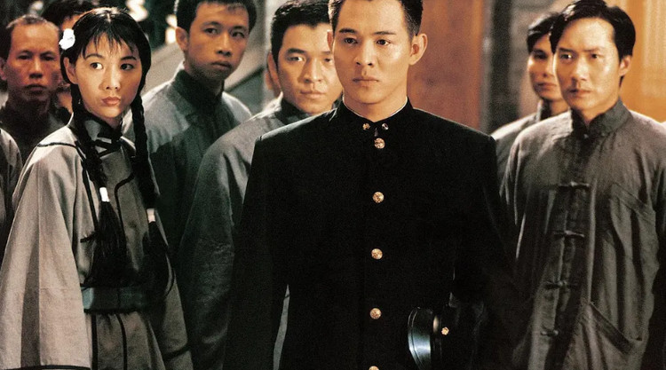
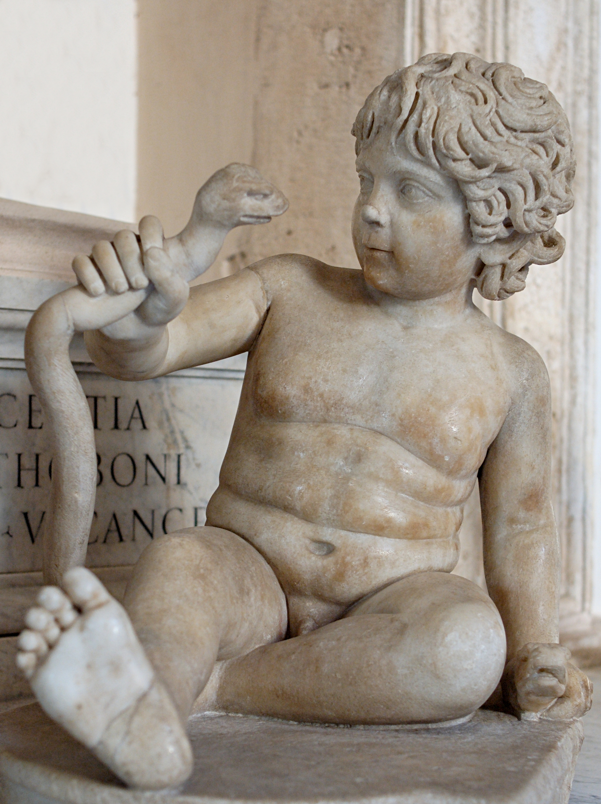
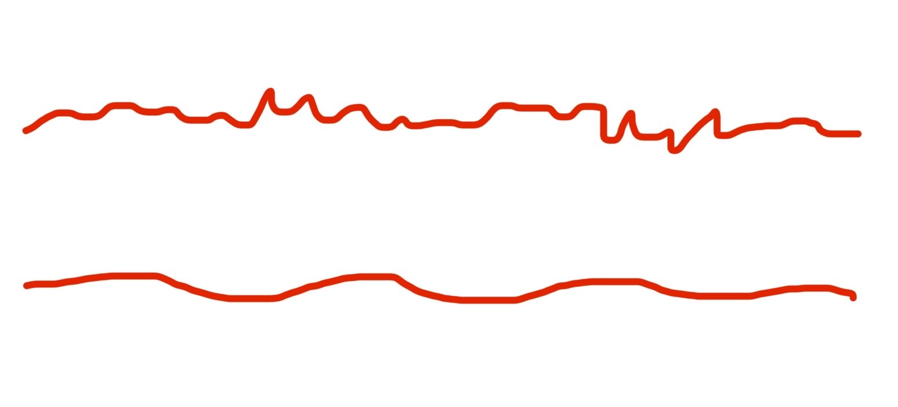
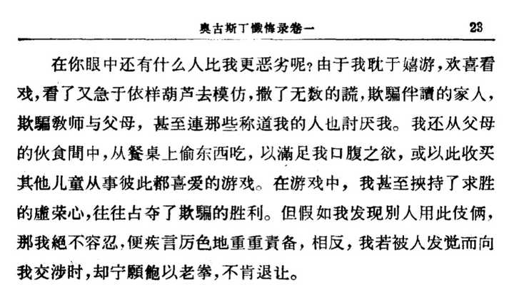
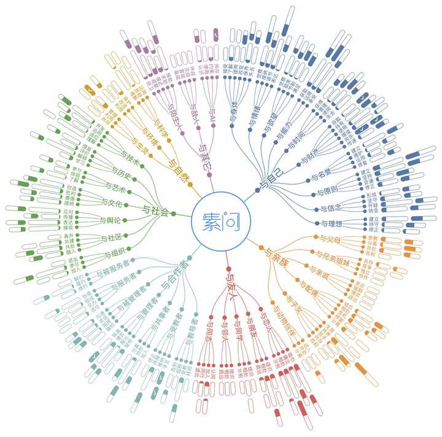

# A01　心理主体与情绪劳动　第 2 册（共 2 册）

- 专题代码：A01　专题名称：心理主体与情绪劳动
- 专题界定：情绪、焦虑、孤独、自我修复、主体感与情绪劳动。
- 本册：第 2 / 2 册　收录 189 篇　正文字符 198,819
- 语料：`sooon-q9adg-articles-v2.jsonl`（4,305 篇）　SHA-256：`cdc9c271309e1d71d9708889a3a31f4777e0c339ea54c3753521894afdb8357d`
- 生成时间：2026-09-27T00:01:00.997126+08:00　排序：发表日期 → 源序号（全库唯一，不重复）

**标记约定**：`【待审】` 主题仍为暂定；`【排除候选】` 图片/正文过薄的剔除候选；
`【正文标注未完待续】` 作者原文自带未完标记；`【正文缺失片段（复核已记）】` 复核记录已确认的正文缺口；
`【图片缺 N 张】` 源图不可获取。标记只作提示，不改写原文、不改动分类状态。

---

## 1929　知足常胜

- 日期：2023-11-15　主专题：A01 心理主体与情绪劳动　副专题：A08
- 源 ID：`c74195b2-00d5-5a5d-8e0c-736f0a1e4ee0`　原文链接：https://www.zhihu.com/question/628490950/answer/3289082063
- 官方对象—实践路径：与自己 / 与欲望 / 满足
- 23 概念标签：定义与达意;能力与学习;选择与自由;责任与后果;成本与总账;照料与家庭
- 证据状态：manual_confirmed　初读：read　独立复核：not_reviewed

**问**：不甘平凡与知足常乐有冲突吗？

这怎么会有冲突。
世上多的是不知足，知足且常乐，本身就是极不平凡了。
一般人认为的知足常乐，是指一天只有一个饼吃，但是也觉得很饱了，没有啥不足了，很开心了，所以没有必要再忙更多了，可以满意地躺平了。
但这是一个巨大的误解。
正确的知足常乐，是指“这事干成了，那大家一起飞天——不错，它成功的机会的确不大，但是如果失败了，我大不了回到一天吃一个饼的状态，即使如此，我也一样会觉得很开心，很满足，所以老子怕你个鸟。”
看懂了没有？
知足常乐的真正表现，是有溢出的安全感，有多余的勇气，所以常乐。
如果是那种“我有一个饼，我不用更多了”的对及格的“知足”，明天要是这饼又少了一半呢？还足吗？
如果你是知足而常乐的，那么你应该是正在肆无忌惮的进攻之中，这份常乐是乐在连最失败的结果也威胁不到你的满足状态。而这个战斗状态很自然的会导致不平凡——世界上没有任何毫无顾忌、畅快淋漓的进攻是“平凡”的。
如果你已经丧失了进攻的动能和勇气，你的常乐是有问题的，就像大boss看上去血条还是满的，但是第一层甲已经被打光了，再挨一下就要开始掉血了。
一般这种情况玩家都会觉得快过关了，旋风斩按得飞起。

---

## 1921　胡思乱想

- 日期：2023-11-19　主专题：A01 心理主体与情绪劳动　副专题：A03
- 源 ID：`5dde82c4-6952-585c-8d11-475246ce3cc8`　原文链接：https://afdian.com/p/f4b309ec865911ee8cea52540025c377
- 官方对象—实践路径：与自己 / 与能力 / 运用
- 23 概念标签：定义与达意;能力与学习;成本与总账;劳动与组织;技术与工程
- 证据状态：manual_confirmed　初读：read　独立复核：not_reviewed

**问**：如何停止脑子里的胡思乱想？

所谓“胡思乱想”，是指“没有任何产出的思考”。
所谓没有产出，可以被简单的概括为三个失败——既不产生结论、也不产生经验、亦不产生记忆。
如果你得到了任何结论，包括阶段性的、暂时的、局部的结论，思考就绝不是胡思乱想，因为你已经在思想的岩壁上凿出了一个挂点，足以向上攀爬了。
但如果你没有得出结论，你也可以退而求其次，得到失败的经验，知道何路不通或者至少何路不通的可能性较大。
如果你连经验也没有获得，那么你可以再退而求其次，留下你在这迷宫中走过的路线的记录——也就是记忆本身。
只有这三者都落空，你才会陷入一个特别的困境之中——你将因为没有足够的记忆，无法识别曾经走过的老路，而出现“思想的循环往复”。
你只是觉得路上的景物似曾相识，但你本质上只是在无效的兜一个无穷尽、形状非常复杂曲折以至于你在每一段都觉得前面似乎是没有过的新拐弯的圈子。
因为你在这个圈子里只是飞速奔跑，你永远没感觉到到站，因此你永远得不出结论，而你又因为没有记忆而无法确认前面这条路你是不是已经走过了，因此你必定要在这个无尽头的长跑中耗尽体力，总是在毫无结论、经验、记忆的前提下一头栽倒。
要解决这个问题，最直接的策略就是这么一条——面向记录思考而不是面向“结论”思考。
思考的目的不是为了得出“结论”，而是为了得出结论的表述。一种无法表述的结论，本质上仅仅只是一种“结论感”，一种刺激你在滚筒迷宫里继续奔跑的精神性药物，而不是思考的成果。只有以语言、文字、图型、模型等有形的载体记录下来的结论，才成其为结论。
你要停止将结论理解为一种精神性的、抽象性的可以产生很多实体衍生物的理式的东西，而要将它理解为“最决定性的表述”，理解为一个可以复制、打印、发送出去的实物。
这个核心策略意味着几点你需要做的具体努力——
1）不在无法良好记录时思考。四下无人、亦无交谈的同伴、记录的纸笔，就不要“思考”问题。
这不是怕你想不出结果，而是怕你想到某个惊艳的结果却一头栽进费马的坟墓——“这里有一个绝妙的解，但此处空余太小写不下”，然后你tm的回头自己也一晃神忘了——你必将抱憾终身。
2）磨炼准确的语言和图形表述、构建最有效的记录方法（例如录音、录像和与朋友讨论）要视为思考的核心工具、视为思考本身不可分割的一部分，而不要视为“思考之外无关紧要的小节”。不能高效的记录就等于不能高效的思考。缺少精准强大的表述能力和高效的记录手段的人，你甚至不必关心ta们有什么“结论”，因为这极大概率是浪费时间。
3）要重视与人讨论的价值。讨论迫使你达到必要的描述质量，并给你最好的记录者，帮你避免似是而非的自我欺骗——即所谓的“我明白只是我说不清”。
因为理解你的（无论是智力的还是情感的）成本过高而没有人对你的结论感兴趣或愿意成为你的讨论伙伴，这是一个智慧生物不能容忍的发展缺陷，是要获得长期精神健康必须解决掉掉的问题，no exception, no excuse, no way around.
开会是为了得到会议记录，思考是为了得到结论的表述，一切妨碍最高效率达到这些目的的具体障碍都要扫除。
拿得出记录，任何迷宫都可以战胜——包括得出此迷宫无出口的结论——你要做的只是在所有经过的十字路口都做上记号。
不做记号，你就是在思想性的找死。

---

## 1894　无所畏

- 日期：2023-12-07　主专题：A01 心理主体与情绪劳动　副专题：A11;A06
- 源 ID：`0fc41717-d1dd-5325-a03a-a5383376b8df`　原文链接：https://www.zhihu.com/question/523480138/answer/3316622677
- 官方对象—实践路径：与自己 / 与信念 / 怀疑
- 23 概念标签：事实与证据;爱与回应;边界与许可;权力与异议;心理与主体
- 证据状态：manual_confirmed　初读：read　独立复核：not_reviewed

**问**：当所有人都在用最大恶意揣测你的时候 怎么办？

我不会用最大的恶意揣测你，也没有白日飞升。
换言之，世界上至少存在一个人没有以最大的恶意揣测你。
所以，根本不存在“所有人都在用最大恶意揣测你”这个前提。顶破天你也只能问“当有人在用最大恶意揣测你的时候怎么办”。
怎么办？
当然是同情ta啊。
连我这个等级的都开始“尽最大恶意揣测”了，这个世界在ta眼里岂非如同百鬼夜行？
这娃已经吓破胆了，不可怜吗？

---

## 1881　代糖

- 日期：2023-12-18　主专题：A01 心理主体与情绪劳动　副专题：A11;A15
- 源 ID：`d4e5bd07-5688-588a-b786-fc9620c9609a`　原文链接：https://www.zhihu.com/question/634310262/answer/3329302787
- 官方对象—实践路径：与自己 / 与信念 / 坚守
- 23 概念标签：事实与证据;定义与达意;选择与自由;成本与总账;净输出与不掠夺;边界与许可;心理与主体;宗教与自然法
- 证据状态：manual_confirmed　初读：read　独立复核：not_reviewed

**问**：张译主演的《三大队》到底怎么样？值得去电影院看吗？

信念坚定看上去是什么样子的？是比较安静的。
安静了，你才坚定了。
很多人以为咬牙切齿、横眉立目、热血沸腾、大声疾呼、大量辩论、广泛宣传是坚定的表现，其实这是不对的。
这些是半信半疑的表现，是犹豫、焦虑的表现，不是信念坚定的表现。
有敌人，不妨碍我要做这事；成功希望渺茫，不妨碍我做这事；这个那个不认同，不妨碍我做这事；没有同志，不妨碍我做这事；有没有利润，不妨碍我做这事；能不能活下来，也不妨碍我做这事。
所谓信念，就是没有任何投机性的定意，无论外界条件发生任何变化，都不妨碍、不影响这件事情本身，这件事就成了信念。
信念不见得一定要是“解放全人类”、“创造世界和平”，也可以是“我要把萝卜雕花学会”，可以是“我要减到100斤以下”，甚至可以是“我一定要买到这个玩具”。
信念也不一定是良性的——例如你完全可能坚信“永动机是可能的”或者坚持“要把体脂率降到0”，然后一头碰死在南墙上——行不通（即为自然法所不容的）信念每一个都是叛逆自然法者的坟场。
但这是“如何判断信念的可用性”的问题，而不是“信念本身是什么样”的问题。
关于“信念是什么样”，答案就是这样——信念是安静的。
那些辩论、宣传、争取，当然都是为了帮助信念实现，但绝不是为了“鼓舞信心”。
因为信念不需要信心。
信心只是信念的代糖，只提供甜味，不提供热量。
当你发现需要什么资源来维持你的“信心”，来支撑你“坚持下去”的时候，你并不处于基于信念行动的状态。
不是就不是，你要实事求是，这并不是什么丢脸的事，不基于信念，只是基于信心进行投机也是人类的基本生存常态之一。
基于信念本来就是极为罕见、需要一定天赐才能有的特殊情况，你手上在做的这件事不是基于信念，而是处于某种你觉得不抓住可惜的偶然条件、个人优势，这无比的正常，没有必要懊恼。
但这同样不改变“信念是什么样”的答案。
很多人真正犯的错误，是羡慕信念的强大，于是要改掉“信念态”的定义，通过悄悄挪界碑来把自己现在的投机行为拧成“信念态”。然后通过这种自欺欺人，想要骗过自然法，混到自然法专门分发给信念态的专属福利。
什么专属福利？信念态的人做的事情，人类会不由自主的自动考虑让路。
因为这些人就像盾构机，是不跟你“讲道理”的。什么非要挡在前面，要么就是这东西被打穿一个洞，要么就是盾构机顶在ta脑门上过热爆炸解体。
一切有灵之物，都会自动的尽可能给盾构机让路，这点技能都没有，智能程度可能都没高过一个扫地机。
要不是有这么大的福利，为什么会有这么多人要强壮信念呢？

---

## 1838　闷鼓

- 日期：2024-01-13　主专题：A01 心理主体与情绪劳动　副专题：A04
- 源 ID：`00a6113a-2e9c-5546-9e1b-3924f1e90b56`　原文链接：https://www.zhihu.com/question/639212137/answer/3360367662
- 官方对象—实践路径：与自己 / 与能力 / 获取
- 23 概念标签：能力与学习;选择与自由;心理与主体
- 证据状态：manual_confirmed　初读：read　独立复核：not_reviewed

**问**：没做好事情，张嘴就说你不对，下意识排斥接下来的话，暴躁和郁闷，说都是自己的问题，要怎么疏导这种心理?

这么说吧，一般被人毫不留情的严厉批评的人，都有一关没过——就是没有什么事情做得漂亮到神乎其技，令人肃然起敬。
一件都没有。
哪怕是踢足球、拉小提琴、心算、画画、健身、唱卡拉OK甚至仅仅是长期素食，一件称得上神乎其技、让人不能不服的事情都没有。
注意，这之中要算上沟通障碍和理解障碍——比如你可能打文明V很厉害，问题是评价者自己不玩，根本get不到你到底有啥厉害，那么这一样无法让对方对你客气三分。
有任何一样对方看得懂的、让对方实打实心服口服的硬功夫，对方批评你就自然会在方式方法上有很大的力度上的差别。
这倒不是因为忌惮你有绝招，怕你拿这绝招怎么地，而是因为你有一样东西达到过高度专业、神乎其技的境界，那么你对这个境界该要过什么样的关、该有什么分量的功夫要下，你自己应该是清楚的。
也就是你是一个已知的响鼓，对你不需要用重锤。
而如果你没有这一样东西傍身，那么就对不起，教导你的人就会不由自主的用起越来越重的重锤，要先证实你是一面好歹能捶得响的鼓。
先不断加力重锤，直到锤响了，再去考虑怎么用更小的力锤响。如果在这个过程中锤烂了，那就拿去扔掉。
这就是绝大多数人不假思索的默认“教育方法”。
你可以说“这太残酷”，但是很遗憾，也许ta锤烂了几个鼓之后会感到后悔，但你别指望ta在锤烂这几个鼓之前就神奇的先后悔。
什么“这不合理”、“这不明智”……等等等等的埋怨都一样。
救不了这头几个鼓——甚至一个鼓都救不了。
因为很多人的确走这个“先锤响，再锤轻”的路线锤出来几个好鼓，这个方法对人家干脆属于行之有效的正确策略，那你还能喊什么冤？
而剩下的大部分人锤烂了一个又一个的鼓又如何？人家不打算学习教育学，不想反思，只想换一个接着锤，就跟买彩票似的——买了是十张彩票都没中，不觉得有任何教训可总结，还会接着买的人很罕见吗？
咋的，难道买十二张没中一张就算“失败”了不成？就能毫无疑问的证明买彩票是荒谬行为？
所以，你想行走江湖人人给你三分情面，自然而然给你一分薄面，口下自带客气，你一定要选那种人人都能轻易看懂的科目，弄一个四座皆惊不可。
可以不是语数外史地生，可以不是什么“乏味的学科”，但是你必须有这么一样。
否则，建议你不要有那种多余的自尊，接受自己将会被“重锤到响”的默认处境，感谢每个第一次下手没那么重、加重速度不那么猛烈的人。
因为遇到了抬手就下重锤的人实属正常，那是你荒废了二十年时间都没练出任何一样人不能不服的硬功夫的正常结果。
那是自然法的判决，由不得你不服。
你要怨，结果极大概率不是下一锤更重，就是干脆被认为是连重锤都不值得敲的闷鼓直接丢弃。
不信你试试。
这带来一个附加问题——这跟“木秀于林风必摧之”有什么冲突？
第一，你的“响鼓表演”可以选择性的展示，并不需要逢人就炫耀。
第二，手里有硬核的技能经验，并不意味着你跟别人有利害冲突。
你这个企业是搞销售的或者搞研发的，你展示了一个篮球投三分球的神技，人家嫉妒你善于投投三分球干什么？
这是用来防止别人认为你天资愚钝、不值得期待用的，本来就不会造成什么嫉妒问题。

---

## 1835　非猎不食

- 日期：2024-01-14　主专题：A01 心理主体与情绪劳动　副专题：A07;A16
- 源 ID：`3acd63bb-425d-5ece-8908-e73660a9499c`　原文链接：https://www.zhihu.com/question/636423415/answer/3361515602
- 官方对象—实践路径：与其它 / 与陌生人 / 防卫
- 23 概念标签：选择与自由;成本与总账;爱与回应;照料与家庭;劳动与组织;权力与异议;心理与主体
- 证据状态：manual_confirmed　初读：read　独立复核：not_reviewed

**问**：普通人可以从铊毒案中得到什么启示？

要防止这类下毒、埋伏式的暗算，有一个统一的策略，就是“凡与人有涉的要害事务都要添加人为随机性”。
这个原理很类似打扑克牌洗牌后发牌前的“切牌”流程，即由未经手洗牌的玩家随机将牌切为两半调换堆叠顺序再发牌，这样就能系统的增加埋伏、暗算的难度。
例如和人一起吃饭，对方开口约，对方选时间，那么你就要选地点；出去玩，对方选城市，你就要选酒店；要去喝水，自己从货架上选一瓶。
总而言之，所有要素不可以被单一方掌握，总要设定一部分能影响具体实施的关键要素掌握在你的手中，添加一定的随机性。
这就会给暗算者造成巨大的计划困难，以至于极难预先制定成本低廉的针对性方案。
这个策略还有一个反向用法，那就是如果你有一些不打算改变的常规——例如每个月常规性的拜访某个寺院这一类，那么要么就完全不要让人知道存在这种常规，要么就不要让人知道这是一种常规（比如让人陪同也绝不让同一人——包括这人认识的其他人——陪同第二次）。
有人递给你一杯水，抱歉，这是不喝的。有人自己端给你一盘菜，抱歉，这是不吃的。
没有任何环节掌握在自己手中的衣食住行安排，一概辞谢不受——除非来自父母子女配偶这类至亲。
借口随你去找，实施如何做得不动声色，手段也随你的意，但总的原则就是如此。
无论有没有人暗算你，你自己觉得有没有仇家，你最好都养成这种习惯。
这也是为什么一个人要高度重视自己的自主权，而自主权又为什么是人自身安全的第一护盾。
你不需要向人解释你的行为模式为什么这么“神秘”——何谓主权？主权首先就是不解释权。
明白人是看得懂这个行事逻辑的，一伸手就知道你绝非池中之物。
因为这是对自身的一种系统性的珍爱，本身就是高度自尊的实践。
你怎么看待你自己，那是你的自由。
但我是一个王，一个家族未来的领袖，我有安全体系，系统的融入我的习惯之中。
我不稳，一个家族就会覆灭，一个宗派就会灭亡，人类会失去无可挽回的财富。
我有无可替代的历史意义，这只是最简陋的安全体系。
你觉得你自己不配，觉得这叫“自命不凡”，我只会替你觉得惋惜。
我当然不凡，自命又如何？
自命，就不能不凡？哪一种不凡，不正是首先出自自命？

此谕，
非猎，不食。

---

## 1819　标王

- 日期：2024-01-23　主专题：A01 心理主体与情绪劳动　副专题：A03
- 源 ID：`76036c56-50bc-5e62-b949-2727af7b8226`　原文链接：https://www.zhihu.com/question/637549648/answer/3373597645
- 官方对象—实践路径：与自己 / 与能力 / 获取
- 23 概念标签：定义与达意;能力与学习;选择与自由;责任与后果;成本与总账;技术与工程;心理与主体
- 证据状态：manual_confirmed　初读：read　独立复核：not_reviewed

**问**：确信无法与自己、女生、世界和解后，你看我这余生该如何度过，换成你是我，你又会如何度过？

那些宏伟的、战略性的东西不多说了，你有一个非常具体的努力要做，就是提高归纳总结能力和叙述能力。
你的表达是非常含混和碎片化的，充斥着含义不确定、结构不严谨的表达。这不光会导致别人很难摸明白你的具体意思，还会带来别人的一种恐惧——不敢跟你接触。
具体来说，就是类似你来向别人表达一轮诉求，“我要如何如何如何如何”，你表达了很大篇幅，然后问人行不行，结果对方发现这问题很难回答——因为对方没听懂你到底要的是什么、你为什么要这些、愿意给的话要如何判定你真的得到了、得到了自己会得到什么回报、不答应的话会付出什么代价……
就像要在一份不认识的文字写成的合同上签字，这谁敢签？
更可怕的是，人家没听明白的前提下也不敢随便拒绝，因为也不清楚自己拒绝的到底是什么，万一你是要救命，ta拒绝就是拒绝救你一命，岂不是要结个大怨？
一下就把人架在半空中，进不得也退不得了。
这种处境太过于危险和痛苦，没人会乐于尝试的。
注意，这还不涉及到对方是否真的赞同或者反对你的诉求，因为对方根本都没进展到这一步。
只要你能清楚明白的说明自己的诉求，讲清楚自己的“合同”，那么地球这么大，几十亿人，再奇葩的合同都没准有人肯签。
你查一查——德国有个食人魔，登广告找人吃，都有一堆人回信申请——这例子是扎眼了点，但这例子其实对人有很大的安慰——只要你能说得清，你就是个食人魔都有人理，总不至于绝对孤独。
而你现在处在一个“说不清”的状态。
如前所述——这个“情绪强烈但说不清楚”的状态是最糟糕的状态，对你这种孤独绝望的困境有最根本的决定性作用。
解决了这个清晰表达问题，也许还有一个“上哪里找到更多认可的人”的问题；但不解决这个问题，人甚至没有找到认同者的基础。
所以，别的问题先摆一边，建议你多去研究一下“合同撰写”“招标书撰写”这类基本表达技术，多阅读一些这类优秀范本，先学会准确的、严谨的表达自己的诉求，精确的界定何谓达成合同、何谓违约，准确的、定量的描述违约条款和履约福利。
看清楚，这里给你把圈子画得极小，没说要你去遍读世界名著、三坟五典、八索九丘，仅仅是“合同撰写”“招标书撰写”这么两个应用文分类而已。
这个是你当前的首要问题，而不是“与女性的关系”问题。否则你处在一个合同、标书都写不清的状态，去痛恨别人都不肯接你的标、并将这种普遍的回避理解为“没人看得起我”，这个判定实在有些言之过早。
做出对方就是在故意藐视 / 侮辱 / 欺骗 / 霸凌 我这类定罪性质的判断，应该是严谨的排除了一切其它可能才可以去考虑的最后选项。没有经过前面的一系列严谨的排除就提前跳到这些选项上，只会导致你自己不断的陷入与影子和风车不共戴天的决斗，过早的耗尽自己，陷入堂吉诃德式的悲剧。
这是你必须做掉的功课，做了这些功课再看是什么情形，情形不好，你还可以先做一番“优化中标条件和报酬条款”的设计优化工作。
把这些工作都做到位了，还是没人应标，再考虑“仇恨”不迟。

---

## 1783　睡者为王

- 日期：2024-02-10　主专题：A01 心理主体与情绪劳动　副专题：A03;A08
- 源 ID：`0f5d4861-3906-50db-928c-3d62b870a2b4`　原文链接：https://www.zhihu.com/question/519282013/answer/3392629287
- 官方对象—实践路径：与自己 / 与欲望 / 取舍
- 23 概念标签：选择与自由;责任与后果;心理与主体
- 证据状态：manual_confirmed　初读：read　独立复核：not_reviewed

**问**：分手了还有必要继续联系吗？

什么叫“必要”？
不做就死了，不干就完蛋了，没有就全剧终了，此所谓“必要”。
吃饭、睡觉这是必要的，维持最低限度的人际交往，这是必要的，掌握最基本的生存技能，这是必要的。
有很多东西其实是“伪必要”，是因为你有某种其实没有死不了、但你自己很看重的欲望没有它就不好实现了，只是对你的这个欲望必要，不是对你本身必要。
比如升官发财、比如儿孙满堂、比如后宫三千——这些东西没有其实不妨碍你生存，但是你想要，于是在你的欲望不可动摇的前提下，出于欲望的最大实现——注意，这说的都不是基本实现，而是而是最大限度的实现——而出现了很多必要性。
这包括但不限于大量的“最佳实践”。
最佳实践的意思是这样做最好，做不到也不是不行，只是不是“最好”而已。
但要命的是“最好”和“欲望的最大实现”紧密相连啊。
正所谓一人得道，鸡犬升天，
一念“最大”，一切“必要”。
转眼间“最佳实践”就变成“最低标准”了。
一旦你采纳这种“必要观”，你就踏上了抑郁之路。
最佳实践刚及格，你不抑郁谁抑郁？
以后谈什么东西“必要不必要”，一概套一套这个公式——这是不是会影响到基本生存？如果不影响，那么这就是一种“因为想要，所以必要”的伪必要。
发现是伪必要，你就要坚决改口，无论对自己还是对别人，都要称其为“不必要”。
说到这里，你多半要感到一阵本能恐惧——恐惧自己一旦把这么多东西重新定为“不必要”自己就不会“用功”了。
那恰恰是因为你“必要”的圈子画得太大，以至于“必要清单”都解决不完，所以才会导致“不必要”永远被搁置。
那只意味着你的“必要”圈子仍然画得太大了。
14亿人已经很久没有饿死冻死的了，必要的圈子必然是很小的。
你要改掉用“必要”来“逼自己努力”这种“一级致癌养生秘诀”，这跟“放血治百病”有啥区别？
我就是在为不必要的追求努力，咋了？见不得人？
你以为我只是为不必要的需求努力，就比你算得慢？比你拳头轻？
你错了，本座睡眠充足。
狭路相逢，睡眠充足者胜。

所以，没有必要联系。
但我想联系就联系，要你管。

---

## 1779　大钱大官

- 日期：2024-02-13　主专题：A01 心理主体与情绪劳动　副专题：A20;A11
- 源 ID：`108ce1d9-cec6-5692-8e67-def6a1e7e820`　原文链接：https://www.zhihu.com/question/24561532/answer/3395220875
- 官方对象—实践路径：与自己 / 与信念 / 怀疑
- 23 概念标签：能力与学习;选择与自由;责任与后果;爱与回应;照料与家庭;财富与市场;权力与异议;心理与主体
- 证据状态：manual_confirmed　初读：read　独立复核：not_reviewed

**问**：若一辈子没有赚大钱，当大官，和自己爱的人在一起（哪怕一次），活着能算有意义吗？

一辈子没赚大钱、当大官，没和自己爱的人在一起（哪怕一次），活着都能算有意义。
否则你把雷锋、董存瑞，把那无数的无名先烈放哪里？
把那些在地下战线舍生忘死，前赴后继的无名英雄放哪里？
ta们活着没意义？没你“聪明”是吗？
只有声色犬马、作威作福算“人生意义”？
家里教的是些什么东西？！
相信这些东西，想不抑郁得有多难？

---

## 1781　不脆弱义务

- 日期：2024-02-13　主专题：A01 心理主体与情绪劳动　副专题：A10
- 源 ID：`48b0bb4c-98ec-5c20-918d-df43c894dd1c`　原文链接：https://www.zhihu.com/question/309474618/answer/2041908739230398003
- 官方对象—实践路径：与自己 / 与原则 / 建立
- 23 概念标签：选择与自由;责任与后果;爱与回应;边界与许可;法律与秩序
- 证据状态：manual_confirmed　初读：read　独立复核：not_reviewed

**问**：那些会把孩子逼死的父母会后悔吗？会反省吗？

思考一下这个问题——
一个人要对自己的生命承担多大范围的责任？
假如张三死了，有多大的责任要由张三自己承担，又有多大的责任由其他人承担？
这个尺度张三自己要如何把握？
这个尺度线客观讲就是刑法。
这里不考虑侦破难度、质证有效性这些技术性问题，就假设一切的真相都已经呈堂，大白于天下，根据刑法的规定，对方有责任的部分就该由对方负责，除此之外的部分，张三就该要明白，这该由自己负责，是你自己对你自己承担的责任。
这里面有一个至关重要的基本事实，就是侮辱罪、诽谤罪，即使成立，也是不会判死刑的。
换言之——如果你因为别人的侮辱也罢、诽谤也罢，承受不住，自杀了，对方无论有多明显的、确凿的罪责，法律仍然认为对方不需要负全责。
法律认定你有不可推卸的、自己扛住侮辱和诽谤的自我责任。
如果你被人骂死了、埋汰死了，你自己必须承担部分责任——甚至，如果你仔细考虑侮辱罪、诽谤罪的惩罚上限，就知道客观上法律认为你自己这部分还是主责。
无论别人说话多难听、多有威胁性，也无论这人是谁，如果仅仅是限于语言，你如果自戕，主责都在你自己。
你有坚持不脆弱的义务，这是生而为人必须有的觉悟。被人骂死、羞辱死，必然出自对方的侮辱和你自己放弃不脆弱义务的里应外合。
出于人言而自尽，必然包含着你自己对自己的背叛和出卖，你自己必然要承担主要责任。
记住了——要杀我，你们必须要上物理手段。电死我、掐死我、饿死我、打死我、闷死我……想我死，你们只管试。
但是，想要仅凭语言、仅凭说话——不管你们说得有理无理、是否人多势众、是否巧言令色、是否感天动地、是否义正辞严——就让我自己去死，你们想都别想。
那是不可能的事。
你们想杀死我，必须要犯点被证实会把牢底坐穿的刑事罪。
这是人对自己的最基本的生存责任，听懂没有？
什么“xx骂我，所以我去死”这种话，你自己想想，是不是欠打？
骂就能骂死你，说就能说死你，不用犯任何刑事罪就能弄死你，你不觉得你活得有点太轻、太薄了吗？
那些依靠你的、信任你的、投资你的人是活该吗？谁要ta们眼瞎，要去依靠、信任、投资一个能被人仅仅用语言就说死的人，是这样吗？
对方触犯了刑法导致了你的死亡，主责一定在对方那边。
对方没触犯刑法就导致了你的死亡，不管有多少人同情你，到最后社会成员们必然普遍认为你自己负主责。
这就是人活在世上最基本的“不脆弱义务”。
在你开口斥责、反击、哭诉之前，这一条你务必要想起。
如果你现在死了，对方有多少确切的刑事责任？如果没有，你选择死亡的责任就主要在你。
如果是这样，你把自己害了之后，对方将得到的不是千夫所指，反而会是纷至沓来的安慰——“这也怪不了你，现在的xx太脆弱了，防不胜防”。
有足够多的人这样安慰ta，ta最后很有可能会坦然释怀——“的确没料到你这么脆弱，但人非圣贤，撞上这种难度的，只能认倒霉而已，产生不了什么教训，因为你不能无限的假设对方受不了”。

---

## 1735　好光棍

- 日期：2024-03-02　主专题：A01 心理主体与情绪劳动　副专题：A05;A16
- 源 ID：`8f02f745-f4a5-56b0-aa45-e898a5e60422`　原文链接：https://www.zhihu.com/question/640399978/answer/3415486850
- 官方对象—实践路径：与亲族 / 与子女 / 共存
- 23 概念标签：能力与学习;选择与自由;责任与后果;成本与总账;照料与家庭
- 证据状态：manual_confirmed　初读：read　独立复核：not_reviewed

**问**：儿子玩CSGO问我为什么玩家都爱取下流昵称，我该怎么回答？

因为“下流”是独特性的蓝海。
在有匿名机制消解了社会性惩罚或者根本没有社会性惩罚机制的场域，人的存在性焦虑会压倒名誉焦虑。
简单来说，在没有惩罚的前提下，“不为人知”比“臭名昭著”对很多用户构成更大的损失。这时一般人会回避的下流区就很容易成为不能靠成就本身获得认可的人的捷径。
其实对那些有本事在天梯上排行靠前的用户，心知肚明——或者下定决心——将来要名震天下的用户，反而是不会用这些手段“博出位”的。
否则有一天打进top10了，搞个脏名字，出的是啥么子名？
取脏名字，可以在没本事的前提下提前出位，但不能上台面、不能朝南坐。
这其实是一种对自己放弃了期待的投机取巧。
让姑娘们、兄弟们下头的要害不在于这名字的脏——单论敢取脏名字博出位这份“叛逆的勇气”，倒是可以加点分的，至少不是零分，而是取脏名字这背后的“我不指望能天下闻名”的畏缩和自我放弃。
五十知天命，你有五十吗？
你怎么知道天命不在你？
你算老几？你有什么资格断言自己没出息？
除非你打定主意，把息放在你面前你都绝对不出，否则你怎么能理性的、自觉的把这脏东西纹在额头上？
你是要我相信你如此看破了红尘吗？
你如果真的如此看破了红尘，那没吃到鸡你骂什么队友？dear
虚不虚伪？别人虚伪都是冒充君子。
你竟然虚伪到要冒充流氓。
虚伪都不敢正虚伪，弄一负虚伪。
你觉得我得品味低到什么程度来当你这的幕下之臣？
所以不是大家看不起取脏名字的人，而是要扛得起脏名字背后那份“视虚名如粪土”的襟怀，你无论任何原因都不能发一声抱怨、不能躲一分责任。
你可以无视主流价值观，可以不走常人路，道上兄弟对这些脏腥物事并不在乎，但是你不能躲、不能哼、不能赖，你要够光棍。
混混够光棍，自有一股草莽英雄气，一样是条不容轻慢的好汉——贱木成杠，也能顶门。
胸口文龙，后背绣鬼，有事怪兄弟，有难卖朋友，人见人打——凭你这衰样，也扛得这条龙？
这道理要跟子女讲清楚。
坦率讲，高门大户、良家子女，未必不与江湖儿女命运纠缠，这要看天意，由不得老太爷“打断狗腿”来勉强。
但命运推到你面前，你要看清楚这桀骜不驯、不屑功名的架势是不是真的。
身上这条龙，不是你买得到贴纸就可以贴着玩的。
假流氓，是真真正正的不入流。
作为父母，我们不是看不起ta出身低、江湖气，而是看不起ta连流氓都当假的，虚伪都是负的。
话说到这里，你还觉得能交、能谈，我们不拦。

---

## 1731　暖气片

- 日期：2024-03-03　主专题：A01 心理主体与情绪劳动　副专题：A06;A09
- 源 ID：`d0797a73-21e9-505d-bce8-4d4c47eda5b2`　原文链接：https://www.zhihu.com/question/567674732/answer/3416554709
- 官方对象—实践路径：与自己 / 与情绪 / 调节
- 23 概念标签：定义与达意;能力与学习;选择与自由;责任与后果;成本与总账;爱与回应;边界与许可;权力与异议;心理与主体;宗教与自然法
- 证据状态：manual_confirmed　初读：read　独立复核：not_reviewed

**问**：让男朋友坐在马桶上上厕所很过分吗？

人要学得“物理”一点。
Be physical, not psychological.
健康人的尿液是近乎无菌的液体——它毕竟是经过肾小球细胞层从分子尺度滤过的液体，从物理层面上讲是很干净的东西，只是因为文化心理问题导致人对这些东西有恐惧、反感、恶心感。
类似的东西还有蛇、昆虫、粪便、蠕虫、高空、火……等等等等残留在文化和生理本能之中的反射性恐惧。
了解、解构并对这些本能恐惧祛魅，是一个人完成人格发育之中重要的功课。
一个人格发育成熟的人，别说什么“看不见的飞溅微沫”，就算你直接尿在脚上、身上，只要没有触及粘膜、开放性伤口，心里是没什么波澜的。
无实质伤害的平常事耳，不值得计较。
ta们看到乱窜的老鼠蟑螂，并不会尖叫蹦跳，因为很清楚这类小动物对健康的人类伤害性接近于零，身穿皮鞋和严整的衣物，不做突然的动作让对方应激受惊、不将其逼入死角，没有什么可担忧的。
看到油污、脏乱的桌面并不至于厌恶、恶心到食难下咽，因为我们人类的嗅觉非常敏锐，所以尽管可以闻得到一些气味，只要不是浓烈到非常刺激，其实浓度很低，对人的威胁几乎可以忽略，拉开点距离就能保持安全。
成年人之所以能成为他人的依靠而不是负担，一个根本的原因，就在于这种对反射性恐惧的祛魅，使得成年人的情绪、心态处于一个远比未成年人不容易应激、失控的稳定状态。
那不是靠“勇敢”，也不是靠“神经大条”或者“迟钝”，而是靠仔细的研究、清醒的认识和刻意的自我磨练、系统的接受的结果。
一个人越能战胜和超越自己从文化、生物本能里继承来的反射性恐惧，就自然能为一切合作伙伴、身边伴侣留下更大的生长余地。
对这也纠结、对那也敏感、对这个也紧张得睡不着、对那也害怕得发抖……那么就只好让身边人这个不要提、那个不要碰、这里不要做、那里不要去……
活生生让自身的恐惧化身为爱人的牢笼，把对自己有爱的人背转手铐在暖气片上，永世不得超生。
你有没有这个权利？
有的，ta说爱你，ta就给了。
哪怕最后不能满足，至少你提出诉求的权利是明确、肯定的有的。
但如果你永远站在你的反射性恐惧的一边，那么ta很可怜。
也恐怕难以坚持。
这无所谓对错，只是恐怕你们终究无缘。

简单来说——一个人若有幸被爱，与自身的恐惧奋战乃是自然法指给被爱者的义务。
怠慢这个义务，放在你身上的爱是会被自然法取走的。
那时又怕你要心里愁苦，嚎啕痛哭了。

---

## 1713　不动心

- 日期：2024-03-09　主专题：A01 心理主体与情绪劳动　副专题：A07;A10
- 源 ID：`f7061924-2e18-57c1-ab15-dfec537bad8c`　原文链接：https://www.zhihu.com/question/575603654/answer/3424346958
- 官方对象—实践路径：与其它 / 与陌生人 / 观察
- 23 概念标签：事实与证据;能力与学习;责任与后果;成本与总账;边界与许可;性别与身体
- 证据状态：manual_confirmed　初读：read　独立复核：not_reviewed

**问**：如何一眼就看出一个男领导是否好色？

这不用看。
感知性吸引是人的基本认知能力。
性吸引的有效性——也就是所谓的“好”——和疼痛、恐惧是一个级别的东西。
没有人不“好色”，区别并不在“好”不“好”上，而在于能不能管理住这些冲动上。
换言之，你要观察的是这些领导有没有管理这些冲动的能力和自觉，而不是ta们有没有这个冲动。
当你观察不到性吸引对ta们决策的影响时，不要错误的归因为“ta们没有性冲动”，而要归因于“ta们有管理性冲动的自觉和能力”。
以免给自己错误的安全感。
因为如果你总结为“没有性冲动”，就会给你一种“绝对安全”的错觉。就像你不会觉得蘑菇会跳起来咬人一样——牙都没长，有啥好担心。
总结为“有管理的自觉和能力”就恰当得多。
管理的自觉来自于对方对自己更大追求的聚焦，有的是为了更高的位置、有的是为了避免职业的麻烦、有的是为了不引入复杂的风险。
这意味着这些自觉是有限度、有前提的。
例如，ta被告知没有得到更大前途的希望了，这个自觉的效力就立刻消失了。
又比如，ta刚被告知得了绝症，对风险的敏感性就瞬间不存在了。
而你从何得知这些“刚刚得知”？
所以这些都是不可靠的，你的性安全只能靠你自己的防御策略，而不能依赖对方的某种自我管理。
对这不能有任何侥幸——尤其是不要相信一些自称“毫无欲念”的“得道高僧”。
神才是无欲无求的。
佛是有欲有求，但有办法靠“不执着”来保证欲求不造恶业。
神是神，佛是人，这两者是有区别的，而且是跨越不了的区别。
如果你看到一个“佛”以神自居，那么只有一个可能，就是ta连佛都不是。
因为ta连“人不能成神”的执着都放不下，还能佛个鸟啊。

---

## 1716　多事

- 日期：2024-03-09　主专题：A01 心理主体与情绪劳动　副专题：A07;A11
- 源 ID：`f47560b1-f973-587c-8e58-c6bb2cf6b682`　原文链接：https://www.zhihu.com/question/616334623/answer/3423766731
- 官方对象—实践路径：与社会 / 与社区 / 共处
- 23 概念标签：定义与达意;选择与自由;成本与总账;文明与历史
- 证据状态：manual_confirmed　初读：read　独立复核：not_reviewed

**问**：国外开始流行tradwife（传统妻子）话题，这股风气会不会吹到国内？

人各有各的活法。
有人飞扬跳脱，有人温柔贤淑；有人风流倜傥，有人青灯古佛。
一个好的世界，是各人实践自己的道路，并帮助别人实践别人的道路，而不是因为自己的道路走起来心慌害怕，就要先把别人的道路都打上大红叉，靠给别人打叉叉给自己壮胆。
如果是“资源太少、不得不争”造成的痛苦，那也罢了，这种也可以算是“必要的痛苦”。
坏就坏在这种由自身的懦弱勾起的斗争，由这猥琐的斗争造成的痛苦，真是无谓的罪孽。
你想吃咸的，你就吃咸的，让人家爱吃甜的吃甜的，不好吗？
又不犯法，要你多事。

---

## 1699　没有错

- 日期：2024-03-14　主专题：A01 心理主体与情绪劳动　副专题：A03
- 源 ID：`3da8564b-b62a-5e2c-bd9b-f0d0067f06ea`　原文链接：https://www.zhihu.com/question/644801509/answer/3429640950
- 官方对象—实践路径：与社会 / 与社区 / 融入
- 23 概念标签：定义与达意;能力与学习;成本与总账;边界与许可
- 证据状态：manual_confirmed　初读：read　独立复核：not_reviewed

**问**：在书包上挂「可以找我借卫生巾」的牌子有错吗？

如果这对你有价值的话，我——以及和我一样的人——认为你没有错。
但要等到你生活到我们中间的时候，你才能得到这个“没有错”的实际生效。
这一天，只要你想，就总会到来。
在此之前，把这视为一种“入乡随俗”先放在次要的优先级。
缓一缓、绕一绕。
先拿别的未被阻拦的、忙别的未被干扰的。
拿到那些、忙好那些，更有利于你将来生活到“我们”中间来。
因为你越有实力、越有能力，遇到你的“我们”就越不依赖运气。
飞鸟比蜗牛更不必忍耐寒冬。
不要执着与这些事物纠缠，任何人都没有资格向你宣布什么是对的、什么是错的。
只有你努力追求后由客观世界宣布的结果才有资格。
你不服气，要凭自己的努力追求向客观世界要答案，不要去找这个人那个人要“收回成命”、“评评理”。
因为真正的正义、合理根本不归任何具体的人管。
把熊熊的愤怒和刺骨的委屈刮下来、磨成粉、搓成煤球，丢进自己的锅炉里去。
这都是好燃料。
拉响汽笛，把这些人甩到后面去。

---

## 1693　自责陷阱

- 日期：2024-03-16　主专题：A01 心理主体与情绪劳动　副专题：A11
- 源 ID：`d43c2178-9c63-563f-a9e6-5fcf36127846`　原文链接：https://afdian.com/p/f7c2a612e37711eea52d52540025c377
- 官方对象—实践路径：与自己 / 与情绪 / 调节;与自己 / 与能力 / 获取;与自己 / 与信念 / 形成;与自己 / 与原则 / 建立
- 23 概念标签：能力与学习;选择与自由;责任与后果;信用与信任;边界与许可;法律与秩序;权力与异议;技术与工程;心理与主体
- 证据状态：manual_confirmed　初读：read　独立复核：not_reviewed

**问**：行为远远配不上理想，我该怎么办？

你有亏负什么和人签订的契约、约定的承诺吗？有违反什么法律、合同、社会责任之类的社会契约吗？
没有的话，就不要平白无故的对自己搞什么“鄙视”、“羞耻”之类的迫害。
注意，你很可能低估了前两者的分量——实际上你要是真的认真看待前两者，你真的没有什么亏欠的概率几乎不存在。你之所以觉得自己谁都不欠、谁都对得起，基本肯定是因为你吧“对得起”的标准放得比较低——或者用你的话来说，比较“合理”——的结果。
所以，一个健康的人其实只看前两条就已经有足够的惭愧和忏悔要承担了。
已经不需要在后一个领域再挖掘什么羞耻感来“自我激励”了。
严格意义上讲，人只有对不起别人才需要感到羞耻、惭愧。只有对不起别人，才有所谓的过失、罪孽。
你有权“对不起”自己，不会也不必对自己觉得亏欠和罪孽。
那些觉得自己对自己亏欠、罪孽的人，其实说的是一个自己想象中的虚拟的可能性，是自己创造的一个幻想的自我。
他们在想象是自己这样那样的行为，使得这个想象的自我无法出生、无法享受“本来应该有”的快乐，于是从这个思考上对自己产生愤恨。
问题是，这种“映像设定”的权柄即使存在，也只能是传说中全知全能、主宰万物和一切历史的神的权力，而不是身为一介凡人的你所能妄想拥有的权力。
你在设想“本可以存在的那个更好的我”的时候已经犯了自居上帝的基本错误，后续的所有负面反应都是这个错误带来的自然法的惩罚。
而最坏的结果是啥呢？不是你受了惩罚觉得痛苦不堪，而是这种痛苦没能抵消你窃取神权而获得的隐秘的快乐，没能打断你一犯再犯的毒瘾。
这是一个自然法陷阱，你懂不懂？
“设想可能存在的自我”本身就带着强烈的快感，这快感天然的被设计成可以压倒紧随其后的罪孽感、羞愧感，于是人类会一犯再犯。
一犯再犯，一犯再犯，一犯再犯……
直到这些漫不经心被沉淀的罪孽感、羞愧感，凝固成低贱感、绝望感，直到给这些偷摸权杖的小屁孩来个十一抽杀，让别的小孩知道知道厉害。
到时候一抓一个准——你看你摸得满手都是青黑，你还想赖？还不排排靠墙站，老老实实抽生死签？
抽一回，没抽到你，旁边那个同批的倒霉蛋咣叽挨了大巴掌，命都丢了半条，你就知道怕了。
你还摸不摸？

自己尽力，做到啥样是啥样，学会“无论结果如何，永远既为这个结果由衷满意和自豪、又对更高的境界产生更强烈的向往”，不沾一丁点基于完美自我妄想的自怨自艾，这就是你的全部责任。
你不需要再判自己一个什么“本来可以更好”的罪，你敢判，你就等于报名参加明年的十一抽杀大奖赛。

学会穿过一些蠢蛋的嘲讽侮辱，为一个四条腿都不平整的手工小板凳高兴得手舞足蹈，为个脸都是歪的素描作业切实感到“我进步好多”的欢喜，而又不为了苟得这个欢喜去做“我有我的审美”、“都是别人不识货”的自欺欺人，这是一个极难极难的功夫。
你不参加几次十一抽杀、不挨几个狠的，都很难理解这种不偏不倚的正念是何等的宝物。
所以你挨了几轮也不要哭天抢地，这就是自然法教育人的风格。这是很操蛋，问题是自然法就这种可恶的恶趣味——你拿ta没办法。
一轮轮的努力，一轮轮的证实自己的正念笃定，这本身就会在具体的成绩之外给你极大的信心，以至于具体的得失根本无足轻重。
我脚下就是天道，这条道上只有一时难以领会的胜利，没有失败，我的未来必定光明。
我对我自己，没有对不起。

---

## 1690　孤独的孔明

- 日期：2024-03-18　主专题：A01 心理主体与情绪劳动　副专题：A06
- 源 ID：`024e5ea2-11c0-5644-9017-35f7f9db6f5d`　原文链接：https://www.zhihu.com/question/641588078/answer/2013524987974263397
- 官方对象—实践路径：与自己 / 与能力 / 承受
- 23 概念标签：事实与证据;定义与达意;能力与学习;选择与自由;责任与后果;成本与总账;信用与信任;财富与市场;权力与异议;技术与工程;文明与历史;心理与主体
- 证据状态：manual_confirmed　初读：read　独立复核：not_reviewed

**问**：为什么认知层次高的人总是很孤独？

这事有两个层面：
1）自我感受的层面——也就是当事人自己觉得是不是孤独。
答案是不觉得。
因为所谓的“认知层次高”并不是指“众人交口称赞”，而是指当事人自己发现自己的判断和理解有一个巨大的理论和实践的基座——和整个的物理学、数学、逻辑学、生物学、生理学、工程学………等所有已知的硬知识没有矛盾冲突；和整个已知的明确历史经验没有冲突；和所有已知的社会规则没有冲突；和所有不可战胜的利益相关方的利害没有冲突。
也就是处在一个in total agreement with all factors的状态。
这意味着这人对古往今来所有的智者贤人、所有可以透彻了解这些判断的今人都会赞同这个判断有相当经得起实践检验的把握——也就是说，ta有某种手段能进行可靠的检验，不是拿出来挨个问你们同不同意、喜不喜欢，而是类似“按照这些判断修改产品设计于是果然全球销量大增”、“按照这个提出辩护方案于是果然客户被判无罪”、“按照这个修改施工方案果然强度测试轻松通过”、“按照这个计划调动部队，果然敌军反复扑空徒劳无功”。
这完全可以以匿名的、非现场的、非语言的、非特定对象/人群的方式进行，避免由社交压力带来的“出于面子随口附和”。
一旦到达这个境界——也就是人可以通过实践检验确认自己的高认知水平的境界——人就不可能在灵魂上感到孤独。
因为这已经到了“圣徒相通”的境界，和马克思、孔夫子、牛顿、休谟、达尔文等等等等古人今人在精神上相通了。
你会觉得随时随地背后都站着整个人类的历史和整个世界的规律，而不是那种“前不见古人，后不见来者，独沧然而泪下”的恐慌状态。
这已经是“感受不孤独”的极限。

2）从人际关系方面——也就是真实的人际交往方面。
这方面对这些人就微妙了，因为一旦人到达这个境界而且为人所知，这话就不可乱说、朋友就不可乱交了。
因为极易被揣摩、被错误地理解，导致灾难性的后果。
举个例子——比如你坐飞机突然遇上了巴菲特，就坐隔壁，而且因为某个原因他非和你聊不可，你几乎必定要问他“对市场的观点”，问完之后几乎必定会自己揣摩一番回去加杠杆下注。为了避免你莫名其妙回去输光身家，他就只好要么转移话题，要么说得极为含糊隐晦。
而即使这样，也很难保证避免这种觉得“今天天气真好”意味着“他说明天一定大涨”的灵异事件。
这种事，一旦显著的“高认知水平”被暴露，几乎无法避免。
类似的，一旦报告里少了“和平”两字，就有一堆人上节目开直播大谈背后是何深意；一句“快了，直接就跟上了”，就不知要产生多少网络流量，这其实也是同类现象。
所以这类人要么隐姓埋名，通过久经考验的代理班底闷声当隐士——类似宝总靠舰队的大量账户隐秘交易；要么就是通过特殊的对外沟通渠道和特定选择的、值得冒险的特定对象来往——类似阿宝的夜东京接待处，接受求见申请但极少得到批准。
这就导致这类人的交往面——至少是真正推心置腹的交往面其实很窄。
也就是会有一种“孤家寡人”、“高处不胜寒”的“与世隔绝”感。
那些位高权重、社会影响力巨大的已经暴露的高认知人群如果耐不住这“寂寞”，管不住自己的大嘴，不老老实实地接受这些客观规律的限制，往往很快就要受到客观现实无情的教育。
不是搞出大批“我以为你是这个意思结果我破产了”的冤孽，就是搞出大量原本的算计因你点破而落空而来的隐蔽的恨意。又或者对你这个不稳定因素的高度忌惮。
如果甚至发现你的动机有问题——高认知不表示人一定善良正义——你的高认知所带来的巨大影响力只会招来更大的祸患。
你必须要谨言慎行，否则说实话就是在刀锋行走。
这当然是个人自由，但硬要顶着自然规律任性，必定要承受巨大的精神压力作为代价，心理咨询和药物依赖几乎是最起码的代价。

简单来说，这条道路是有规矩的——越往前走灵魂的孤独会越少，但社交性的隔离会越多。至于这和普通人的天天应酬但心里茫然哪个更好，这就要看各人的喜好。
但有一点是肯定的——这肯定比天天宅着心里茫然要好点。

---

## 1630　童真

- 日期：2024-04-20　主专题：A01 心理主体与情绪劳动　副专题：A11;A03
- 源 ID：`e641f3af-54e0-57f7-894c-f44ac75f49f1`　原文链接：https://www.zhihu.com/question/535581708/answer/3472816598
- 官方对象—实践路径：与自己 / 与信念 / 形成
- 23 概念标签：定义与达意;能力与学习;责任与后果;成本与总账;信用与信任;心理与主体
- 证据状态：manual_confirmed　初读：read　独立复核：not_reviewed

**问**：幼稚和童真的区别是什么？

童真是过于轻易的相信美好存在。
它是希望和斗志的源泉。
所以见到的人才都想去保护它，
因为谁也不想给一艘自身没动力的船当拖轮。

幼稚是过于轻易的相信丑恶不存在。
它是失败和亏损的渊薮，
所以见到的人都忍不住嫌弃它，
因为谁也不想自己的拖轮看不见斗大的礁石。

---

## 1631　忏与悔

- 日期：2024-04-20　主专题：A01 心理主体与情绪劳动　副专题：A03;A07;A06
- 源 ID：`6e51af4e-e61d-5807-bed6-a13f46b578d3`　原文链接：https://www.zhihu.com/question/653478290/answer/3472539368
- 官方对象—实践路径：与自己 / 与原则 / 修正
- 23 概念标签：责任与后果;技术与工程;心理与主体
- 证据状态：manual_confirmed　初读：read　独立复核：not_reviewed

**问**：忏悔和后悔的区别在哪里？

忏悔是觉得自己错了，有些地方得要改。
要回溯之前因为自己这个错误的想法、习惯而受伤的亲人、爱人、朋友、无辜的人，向ta们道歉，因为对不起ta们。
为了再也不要干出这种坏事，要整个的改变自己的想法、习惯。
为了更快的改变这些习惯、想法，有给自己惩罚和折磨的冲动。
这样的恶，还做了这么久，让自己的亲朋好友受了如此多无谓的剥夺、这么多地狱般的折磨，不承受惩罚，没有应分的血泪，反而灵魂不安、心里痛苦。

后悔是觉得自己失误了，要是当初可以“小心一点”就好了，“多看一眼”就好了。
不是自己这个人的人品有啥问题，而是技术性的“粗心”“仓促”“过于天真”。
我没什么罪过，就是把别人想得太好了，把事情想得太顺利了，把困难想得太简单了。
这是对不起别人倒也罢了，我已经挨了批评，背了赔款，歉也道了，酒也罚了，还要怎样？
主要是对不起自己，这吃亏也太大了，想起来就愤恨，就怒气冲天。
尤其是那些误导我的、辜负我的，我真后悔为什么没有早看出你是这样的人。
下次一定要小心一点、慢一点，不要这么善良，多留个心眼。

忏悔是忏悔自己的不及格，惭愧不到60分。
后悔是悔恨自己的不完美，痛惜没到80分。

忏悔是悔罪，后悔是悔过。

---

## 1632　拈花

- 日期：2024-04-20　主专题：A01 心理主体与情绪劳动　副专题：A09
- 源 ID：`3935cab8-35cf-558a-9ff6-c90f25a4be31`　原文链接：https://www.zhihu.com/question/653480424/answer/3472127031
- 官方对象—实践路径：与自己 / 与身体 / 使用;与自己 / 与原则 / 修正;与自己 / 与能力 / 获取;与自己 / 与身体 / 维护;与自己 / 与身体 / 了解
- 23 概念标签：能力与学习;选择与自由;成本与总账;爱与回应;劳动与组织;技术与工程;性别与身体;宗教与自然法
- 证据状态：manual_confirmed　初读：read　独立复核：not_reviewed

**问**：如何做到极致规律的作息？

某种意义上，人有一个设计、探索和磨合生活方案的过程。
整个过程走完，你会达到一个稳定态，这主要包括以下几个指标：
一个几乎固定的食谱。
一组几乎固定的爱好。
一个基本稳定的起居布置。
一组基本稳定的劳动工具。
一组基本固定的妆容、服装风格。
一个基本固定的人际关系圈。
一个基本固定的处事法则。

在这个基础之上，作为其结果，你会拥有以下几个稳定的指征：
一个稳定的体重、肤色、血压、近视程度……
一个基本固定的作息规律。

所谓设计，是指在上述的一系列基础事项上作出不同的决定。所谓磨合，是指一些特定的基础方案组合会导致后面的两个结果不断的“漂移”。
例如体重越来越重 / 越来越轻，近视越来越深 / 散光越来越大，血压越来越高。
以及睡得越来越晚、醒得越来越早。
这个漂移一般不是无限的，例如体重，就会和你的全部其他方案相适应，最后停在一个值上，在这个体重指标处，你每天必然会在某个时刻饥饿、必然在某个时刻困得受不了、必然在某个时刻自然醒过来。仿佛在所有的方向上你都摸到了“石墙”，并且被铁钉钉住了手脚。
每一条都止于极限，因为是那个点不能不睡、到那个点不能不醒、于是到了几点一定饿得受不了，到了几点就忍不住要抽烟、喝咖啡……全部钉死了，于是体重也钉在了180斤，眼睛度数也就停在了左眼750、右眼280。
你仿佛失去了控制，因为你几点犯困、几点饥饿、几点尿急，仿佛都是被逼被迫的。你想提前犯困根本做不到，即使硬躺在床上也会翻腾到那个点才会困到睡着。
这还不是问题，问题在于，你的体重在这个锁死状态并没有稳定，而是在稳定的、单向的增高，你的发量没有稳定，而是日复一日的在减少。你事实上越睡越晚。
你在“漂移”，你还没有沉到底。
所以你要问“怎么办”。
这个“办法”的要害，并不在于后面那两条，而在前面那七条。
是前面那七条——你穿了什么、使用什么操作系统、用什么香水、午餐吃了什么菜、如何对待冒犯和辜负、和谁来往、桌子靠墙还是靠窗、业余是玩手办还是钓鱼……在决定那后面的两条。
前七条是输入，后两条是输出。
改变输入，才是真正影响输出的关键，而不是直接去干预输出来改变输出。
当输出作为指标呈现时，足以造成变数的因素早已发挥过作用了。就像铅球早在塔顶释放时就已经被决定了最后的落点，你站在塔底想靠眼疾手快来拦截力有千钧、动能充沛、惯性巨大的铅球，基本是徒劳无用的。
你要在早得多的源头处，在塔顶抓住那只释放铅球的手腕，要把它拉到另一个窗口去投球。
换一种香水、换一个常吃的菜、理一个不同的发型、换一个不同的穿搭风格、交一个不同的朋友、换一个不同的爱好。
尤其是——重中之重的、先于一切的——强化自己的社会化水平，进一步厘清自己的伦理混乱。
因为这会带给你选择伙伴、朋友、配偶、事业的主动权，而一旦你选定，你也有强大的多的主动能力来保证它们能稳定存在，而不是三天两头出人意料的摩擦、背叛甚至斗争。
社会关系的不稳定，一定会导致爱好、居住条件、工作内容等等一系列的关键事务的不稳定，从而导致你迅速丧失一切余量，最后因为资源枯竭而被动锁死——在这种情况下，你最后做了某份工作，不是因为你喜欢某份工作，而是因为你每天四点才睡得着，而这份工作是唯一不会因此而丢掉的工作。
而相应的，你的穿着、言谈、爱好、妆容甚至食谱、选的香水、工具……其实都需要是围绕你的伦理观、价值观而挑选的。
你主张朴素、主张勇敢，主张谦卑，或者你主张及时行乐、引人注目、默默无闻不如即时毁灭……这会全面的影响你的衣食住行的选择，进而影响到你能交的朋友、能选的伙伴，进而决定你的作息、你的体重和你的近视度数。
作息是最后被确定的东西，决定它的东西远在云端之上。
你的价值观要千锤百炼，要排除一切与自然法不适应的脆弱和乡愿，才能避免隔三差五的被无法抗拒的自然法则颠覆，你才能有一个稳定的视觉风格、嗅觉风格、饮食风格、言谈风格，才会获得和这些相适应的朋友，伙伴、团队、客户、事业、爱好，而这些方面的稳定，会给你一个作息、生理指标的稳态作为结论。
这就是所谓“相由心生”。
几点睡、几斤重，即是心生之相。
这也是为什么这整个历程，都始终围绕着“正确的社会化”这个伦理中心的原因。
因为这是首位的、中心的、先于一切的。
这意味着两件事——
1）睡不着，换个发型试试。
换个发型、换个菜、换一个上班或者下班路线，看似“与此无关”，但却会经过整个混沌系统对最后的结果产生复杂的蝴蝶效应，往往比“早点上床”更有效。
2）在一切都被锁死的状态下，你看了某篇东西，自认为“努力实践”了，那么经过一定时间，你应该观察到自己在作息上、生理上的改变——改善，以及某种主动权的提高、窒息性的消退。
如果没有，那么无论你的自我感觉有多好，你都需要再进一步的考察自己的实践、贯彻的方式。
一般而言，你在伦理上有所精进，你就需要在这个新的认知下全面的考虑你的发型、服饰、家具摆放、食谱、对某些日常事务的反馈方案……要如何作出相适应的更改。
如果你看了某篇东西，自认为深受感动，但你的服装、发型、工具、家居、待人接物……等等所有的生活细节都没有任何改变，你的这些所谓“领悟”就仅仅只是想象和扮演而已。
作为最后的结果，你的作息、体征也就不会有什么变化。
最后回到本题——绝对规律的作息，实际上是建立在高度自洽而与自然法则相适应的伦理观、基于这种伦理观的偏好选择之上。
后者稳如泰山，前者自然坚如磐石。
后者如果是稳如泰山的好，前者自然也坚如磐石的佳。
后者如果是稳如泰山的坏，前者自然也是难以救药的坏。
打通你的伦理观和自然法的关联，再通过你的偏好选择贯彻到你的生活方式，最后就会决定你的一切法相。
这其实就是所谓的“天人合一”。
合得好，拈花微笑，神采奕奕，兴致勃勃。
合得不好，咬牙切齿、形容枯槁、苦不欲生。
这就是为什么这几千篇要大量的看——它们都是这种贯穿合一的示范。
你不必和这一样，但你要知道这大概是一个什么规模的问题，什么样才像是靠谱的样子。
你自己的答案、方案，可以不同，但那同样要达到这样的规模、做到这样的强度。
补充一点实证：
军队和寺院的作息就出了名的高度规律。
这是因为军队和寺院都有完整的、经过长期打磨的完整而健壮的价值观，并在这个价值观之上建立了贯彻度极好的衣食住行、行走坐卧的制度规范，并为这些规范建立了周密的训练体系来加以实施。
到了何时该做何事、该怎么做、什么是对、什么是错，这些组织有深厚完整的积累。
实际上，正统犹太教、佛教律宗、原教旨主义基督徒、穆斯林也会因为复杂的礼仪、节期、朝拜系统而呈现出超常稳定的作息时间。
其实你仔细想想，管理严格的监狱管教系统也有同样的效能。
这背后真正的要素不是所谓的“严格”——很多体系纯靠个人自觉——而是靠“完整而经得起生活、事业挑战的价值观”。
这是“作息规律”这个综合性的结果的根本原因。

---

## 1613　内向缺陷

- 日期：2024-05-01　主专题：A01 心理主体与情绪劳动　副专题：A04;A07
- 源 ID：`4841e310-ed32-5d7b-a64b-9c0be5cd2b96`　原文链接：https://www.zhihu.com/question/337490323/answer/2020744469679457428
- 官方对象—实践路径：与自己 / 与能力 / 获取
- 23 概念标签：能力与学习;选择与自由;责任与后果;劳动与组织;心理与主体
- 证据状态：manual_confirmed　初读：read　独立复核：not_reviewed

**问**：内向是不是一种缺陷？

什么叫内向？
很多人觉得所谓内向就是“社交恐惧”的别称，只要觉得自己恐惧跟人说话、害怕引起任何关注，自己就是“内向型人格”。
这是错的——即使按照所谓“内向/外向论”自己的定义都是错的。
不客气的讲，“内向论”本身就是一个质量低下的“巫毒心理学”，几乎没有任何特殊的指导意义，主要的“贡献”就是给恐惧和人接触的人找了一个心理安慰——你这不是bug，你这个是feature。
耽误就医纯属于。
一句话，如果你需要靠“我就是内向”来安慰自己，你的“内向”就是缺点。
“内向 / 外向论”你就当星座理论看待——事实上，任何告诉你你就是某“型”人、某“座”人的理论，你就通通叫ta们滚去废纸篓。
因为这等于说某块冰是“饼型”、某块冰是“球型”。
人是无限可塑的意志体，除非ta自我阉割其可塑性。而“自我阉割可塑性”这种行为，从根上讲就是一种“我就这样了、改不了了”的自我开脱。
人既要学会独自面对问题，也要学会与人交往，这不但不是一个非此即彼的单选题，还是一个必须“文武兼修”的客观要求，容不得你拿什么“我就是内向”“我就是外向”这类的“自我认定”去逃避。
你想有多“内向”？你是要提前找个风水宝洞，一辈子都用来给自己的活死人墓画墙纸吗？！
你想有多“外向”？每时每秒都要人陪着？没人陪着你就要躺平放赖？你是人体感应小夜灯吗？人走灯熄？
人活在世，“与团队讨论确定自己的任务和使命”和“独立完成自己的任务”是两个必须做到的职能。离了前者你将失去一切社会支持——你于社会没有角色，社会也就不能给你角色所对应的引导、支持和回应，你就要不断的陷入“我是谁”“我在干嘛”“我要去哪里”的迷茫之中。
你的角色不是你自己“决定”出来的，是社会和你的互动中分配出来的，是你从社会给你的各种安排中领受出来的。
没有这些，你会严重的浪费自己的生命，更不用说要因为这些迷茫受到无数的无谓折磨。
你必须要有和社会其他成员做必要配合的“外向”，必须，不允许以“我害怕”“我不喜欢”为理由去回避。
你非要回避，你就别抱怨抑郁、虚无和绝望——你难道以为“我不喜欢”没有代价？
停止用“我就是个内向的人”这种鬼话来逃避你的基本社会义务。
内向本身是不是缺陷，没有必要讨论；用“生性内向”来作为这种逃避的理由，绝对是缺陷。
什么人可以理直气壮的自称“内向”？
如果你有充分的历史依据可以向自己证明“我并不畏惧和人打交道”并且“我有一切与人合作的必要技能”，并且你现在就有乐于和你合作的人以及想与你合作而暂时没排上号的人，这时候，你选择了一种沟通需求较少的职业、一种社交需求较少的生活方式，这样你可以理直气壮的自称“内向”。
上面这些条件，就是“内向”的资格。
内向是一个有充分选择的人的主动决断，而不是一种为了拥抱无能而主动签署的阉割同意书。
非不能也，是不为也，而不是非不为也，是不能也。
没有这个资格之前，“内向”就是一个确定无疑的缺点。
改掉它。

---

## 1607　危机之上

- 日期：2024-05-03　主专题：A01 心理主体与情绪劳动　副专题：A08;A11
- 源 ID：`8fe9451a-912d-54a8-801f-93da0b4a0e23`　原文链接：https://www.zhihu.com/question/653773119/answer/3486453372
- 官方对象—实践路径：与自己 / 与理想 / 建立
- 23 概念标签：能力与学习;选择与自由;责任与后果;爱与回应;劳动与组织;民族与身份;心理与主体
- 证据状态：manual_confirmed　初读：read　独立复核：not_reviewed

**问**：如何培养危机感？常常会短期感觉生存、意义危机，但是过一两天又遗忘了一切，回到原来的平静但低效率的状态?

“危机感”不应该是个人努力的主要动力，所以没必要老去“培养危机感”。
当然，预见危机、摆脱危机的能力需要培养，有危机需要解决，但是正常而言，如果把危机定义为“预计威胁自己的自然寿命内的基本生存质量”，那么这不应该是一个需要你“毕生奋斗”的目标，而应该是你三十来岁就大为缓解了的问题。
这也是为什么人一乐观就没法用危机感来作为主要动力。
人的长期动力应该出自另一个来源——使命感。
天生我材必有用，乃降大任于斯人。
个人生存的问题我早就解决了，但这不是我降生于世的使命。我不是为了怕活不下去而活着，而是为了生存以上的额外目的而活着。
使命感才是能无限驱动你的引擎，它常常和危机感混淆，是因为使命感关注的是除自己以外的人的危机。
人的使命感，仍然是出于对危机的关切，但这是来自人对其他人——对亲朋、家族、民族、企业、组织、人类——的某种危机的关切，而不是对自己的危机的关切。
换言之，你有所爱之人、有所效忠的对象，你就会因此获得使命感，而使命感就能驱动你达到没有的人难以达到的效能。
我的人还在朝不保夕、饥寒交迫，我当然不能随便浪费生命。

另一个驱动力就是贪婪。
世界上还有这么多悬赏任务——固态电池、火星殖民、可控核聚变、HIV疫苗、抑郁治疗……每一样都价值何止万金。
很显然，为了这些功名利禄，人也能焚膏继晷。
这看似是两个不一样的驱动，但实际上背后是有关联的——要不是这些东西背后有万众期待，这背后怎么会有这么高的悬赏呢？
但贪婪和爱有一点重要的差别——爱不会去追求类似“检测不出的运毒方法”“无法追查的洗钱手法”这类目标，贪婪却把这些东西当“蓝海”。
这两个引擎要选哪个，那就看你自己了。

---

## 1606　两种脆弱

- 日期：2024-05-04　主专题：A01 心理主体与情绪劳动　副专题：A09;A06
- 源 ID：`177e6441-ef3e-5cb4-bec7-2a2ef6f2b000`　原文链接：https://www.zhihu.com/question/654004540/answer/2023690404575330962
- 官方对象—实践路径：与自己 / 与能力 / 承受
- 23 概念标签：能力与学习;选择与自由;责任与后果;成本与总账;心理与主体
- 证据状态：manual_confirmed　初读：read　独立复核：not_reviewed

**问**：什么是脆弱？如何判断自己的脆弱？

脆弱有两个普遍性的标准：
1）生命周期内大概率会发生的挑战，如果会大幅影响到寿命，就是脆弱。
啥意思呢？比如一个手机，大概率是会摔一下，溅到水，遇到一些灰尘的。如果摔一下就会坏，溅到水就会烧主板或者遇到灰尘环境就失去信号/显示故障，这就意味着它有脆弱的问题。
换到人身上，你一生大概率会遇到有人侮辱你，有人误解你，有人嫉妒你，有人暗算你，遇到事业挫败、遇到失恋，遇到朋友反目，大概率会遇到迷茫、无力、绝望……
只要是大概率会发生的事件，你可以深感挫折、可以痛苦反侧、可以抑郁消沉，但是你不能起绝念、走绝路。
看好这个标准——“无法从中幸存”。
另外注意这个要点——大概率发生的挑战。
如果是小概率的、不能视为必然发生的挑战不在内。比如被流星砸到吃了大亏，这个就不能简单的认定脆弱了。
两个条件齐备——遇到大概率会遇到的挑战，起绝念、走绝路，以至于大幅的缩短了预期寿命，这就是确确实实的、无可辩驳的、确信无疑的脆弱。
你是否对此无所谓，那是你的个人观点问题，但你现在问“是不是脆弱”，这就是答案——是。
不要用“勇于选择死亡”来把这个描述为一种“勇敢”，以否定脆弱的定性。
这样——勇敢不勇敢，那是另一场辩论的话题，反正就脆弱而言，只要符合这个定性，就是脆弱。
你就算辩赢了关于勇敢的论战，你最多得到一个“既勇敢、又脆弱”，但脆弱这条，你没得逃。
够确切了吗？
这是绝对脆弱。

那么第二个标准是什么呢？
2）在遭受同样挑战的所有个体中，你受到的相对损失超过八成人。
同样是失恋，八成人消沉十八个月，你二十四个月。同样失业，八成人一年内再就业，你一年半。受到同样的撞击，你的裂纹比八成同类都长……
这样你也可以被认定对这个具体挑战比较脆弱。
这个是相对脆弱。
相对脆弱就比绝对脆弱问题小得多，可以被定义为“短板”“劣势”。
一旦明白了这两个脆弱的定义，你就知道对脆弱应该怎么办。
绝对脆弱是不可接受的。
这是硬缺陷、致命问题，必须要趁着问题尚未发生做好修补和加强。它不仅仅是在致命挑战到来时给你沉重打击，事实上在问题到来之前就会导致看出你这个脆弱性的人回避在你身上投资。
你是很聪明，但是你自称失恋就会死，那么不好意思，你失恋是迟早的事，等你失完恋还活着大家聊。这之前谁要拿血汗钱押宝？
换言之，绝对脆弱哪怕仅仅是流露出来都会带来坏运气。
说得功利一点——装你都要装得没有，更别说去参加脆弱合唱团，甚至还当个领唱了。

相对脆弱则存在一个全局统筹的策略问题，除了最常规的努力锻炼、补足短板之外，你可以通过回避高发环境、寻找优势互补的伙伴或者购买保险之类的手段去对冲。
相对脆弱虽然柔性得多，但你必须要下点功夫去管理，不能放任不管，指望别人“照顾弱者”。
照顾弱者的成本就算不要弱者全部负担，好歹也是要分担的。要承担这个成本，你最好有一些超出常人的专长服务，能把请人帮你解决相对脆弱的成本撑住。
两头都解决好，你很自然就不会在外人眼里像个最好不要沾边的瓷娃娃、玻璃人。
这对你有极大的好处——这意味着你不管是求职、求友、求偶，都远比脆弱性外露的人门槛低。
你有比别人多得多的选择，而且你可以先选。
这一般都意味着更好的生活。

---

## 1600　无悲无喜乃止息

- 日期：2024-05-06　主专题：A01 心理主体与情绪劳动　副专题：A04;A09
- 源 ID：`d6df0c64-b28a-53fa-a2c0-59b34b8e0dda`　原文链接：https://www.zhihu.com/question/653988932/answer/2049442620468893229
- 官方对象—实践路径：与自己 / 与身体 / 维护
- 23 概念标签：定义与达意;选择与自由;责任与后果;爱与回应;劳动与组织;心理与主体
- 证据状态：manual_confirmed　初读：read　独立复核：not_reviewed

**问**：如何安排娱乐活动，能让自己足够休息又不至于浪费时间？

首先，你要纠正一个至关重要的误解——娱乐不能带来休息。
娱乐只会进一步带来兴奋和疲劳，它根本就不会带来休息。
再说一遍——娱乐不是休息。
人们经常说这类混账话，是因为人们自认为是在用“休息时间”在娱乐，所以娱乐就属于“休息”的一部分。
其实这是一个显而易见的胡说八道。
正确的分法，是先把时间分为当班时间和非当班时间。
再把非当班时间分为非当班的劳动时间（学习、副业、个人兴趣项目）、娱乐时间（娱乐、购物、社交）、庶务时间（梳洗、饮食、排泄）和休息时间（睡眠、治疗）。
这其中，只有休息时间是真正恢复体力的，是“休息”。
除此之外全是消耗体力的，不属于休息时间。
其中娱乐不但不是休息，而且是最消耗体力的安排。

人真正的休息，是来自于到了休息时间，能宁静的同时确认两点：
1）即使现在闭上眼，也不会出现无可承受的危机。
此为无悲。
2）即使现在睁着眼，也不会再带来额外的收益。
此为无喜。
无悲无喜，乃能安息。
这两条无论哪一条达不到，你到了休息时就休息不了。

明白了这个基本原理，你就能知道“如何安排娱乐既能休息又不浪费时间”。
那就是不要安排纯娱乐。
非当班时间，首选安排自己没有时间压力的兴趣项目——但这仍然是生产性的项目。
例如研究某个冷门课题，例如开发一款天马行空的发动机，例如写一本奇奇怪怪的小说，例如尝试3D打印一把沙滩椅，例如做个皮包，例如做顶帽子，例如焊一艘潜艇，例如开发个自己的开源项目，例如继续打磨一篇历史论文。
你自己的项目，你说啥时候好就啥时候好，日拱一卒，不求速成，但日见其厚。
其实我每天回答问题、更新素问就是这种安排。这个安排积累了几年，现在得到了什么，你自己看。
这就占掉了一大块非当班时间。
其次安排好庶务时间——吃好、喝好、锻炼好、洗好、拉好。
洗衣、扫地、收拾屋子这些最好外包，不能外包最好简化到极点，以至于根本不用做——根本不买沙发，自然也不需要保养沙发。
再其次安排好娱乐时间——这实际上一般是社交时间。
独乐乐如何不如众乐乐？因为“独乐乐”乐完就完了，“众乐乐”乐完了还留下了交情、友情和爱情。所以打单机就不如约朋友对战，纯打单机就不如打了之后和人吹水打屁。
注意，“独自练球”算“自己的生产性兴趣项目”，“打比赛”算社交类娱乐。
完全不带任何社交属性的娱乐，也就是江湖所谓的“单嫖独赌”最好直接排除。
拿这些把你的非当班清醒时间占完，最好这其中有足够激烈的体力活动——例如重家务、激烈锻炼这类——把精力耗尽。
那么到了该休息的时候，你就能到达这个无悲无喜的平衡点。
你既想睡，也敢睡。
这就是你要的休息。
不过你做不到十足也不需要纠结——这已经是超凡脱俗的境地，几乎无往而不利，不可能没有大成就。
能做到十足十，释迦摩尼也要叫你一声师兄了。
虽不能至，自心向往。

---

## 1587　后悔酱

- 日期：2024-05-14　主专题：A01 心理主体与情绪劳动　副专题：A03;A04
- 源 ID：`221e3712-72bb-599f-9ae2-eab59ce8f6ed`　原文链接：https://www.zhihu.com/question/653552061/answer/3497508196
- 官方对象—实践路径：与自己 / 与情绪 / 调节
- 23 概念标签：事实与证据;定义与达意;能力与学习;成本与总账;财富与市场;权力与异议;心理与主体
- 证据状态：manual_confirmed　初读：read　独立复核：not_reviewed

**问**：什么时候该后悔，什么时候不该后悔，怎么正确的后悔?

后悔是一种用于制作教训的有毒原料。
教训这种东西，那可真是强身健体、滋阴壮阳、美白养颜、祛湿排毒、生发防脱、招财进宝、漫天桃花。
只要你没咽气、没闭眼，一滴下去都能把你从鬼门关往后拉半里地。
十全大补，起死回生，童颜巨乳。
后悔就是拿来做这个的。一遇到阴雨天、半夜三更就会大片的生长出来，并且发出可怕的刺激性气味。
如果你可以用别的无毒或者毒性更弱的原料替代它来生产教训，那你当然最好尽量替代——不过老饕都知道，这就像用代糖做的糖醋排骨，光甜，不拉丝。
替代不了，那你就要戴好所有的防护装备，在通风橱里处理它。
问题来了——你戴好了手套面罩，吸了半天毒气把它铲下来了，丢进垃圾堆也是丢，丢进反应釜也是丢，为什么不丢反应釜？
丢垃圾堆还要交垃圾清运费。
丢反应釜，品质一般的出货至少也可以自用，药力不强也至少可以防脱发，冷敷可以拿来治黑眼圈。
品质要是好，千金难买，有价无市。
要是你手艺好，反应设计合理，副产物利用充分，你遇到点漏网的后悔简直要跳起来——跟在门口看到新冒头的人参苗一样。
自己家亲生的后悔都不够用，得省着用。要往深了挖，生怕挖断了一点须须。碾子里剩的，哪怕一丁点细末子，都要用羊毫笔扫到白纸上，收进瓶子里。
必要三蒸三晒，久制陈酿。
一斤料只能出这么一小瓶。
那是要留着救命，留着传家的。
要用来平时下饭、庆生、送礼，那一般都先去乡下采购别人的后悔。
你看到有人鼻子塞个棉花，红着个肿眼，毒得满脸发绿、浑身红点子，把新鲜的后悔整料铲得稀烂往外丢，还拿水泥把整块地都盖起来。
你都会觉得——这种傻鸟真是穷得理直气壮。

---

## 1582　自尊者自信

- 日期：2024-05-17　主专题：A01 心理主体与情绪劳动　副专题：A07;A04
- 源 ID：`8efa0022-a2d3-52aa-ab8c-1cd53e03a076`　原文链接：https://www.zhihu.com/question/654966956/answer/2050848781999019426
- 官方对象—实践路径：与自己 / 与原则 / 建立
- 23 概念标签：定义与达意;责任与后果;信用与信任;爱与回应;心理与主体
- 证据状态：manual_confirmed　初读：read　独立复核：not_reviewed

**问**：对自己言而无信已成为习惯，如何走出这个循环？

你要提高设计合约的质量标准。
一般人所谓的“对自己言而无信”，是指“我决定要晚上十点关机睡觉，结果没有做到”。
在这里，合约内容是“十点关机睡觉”，没睡，于是判定言而无信。
合约这种签法，本身就是笑话。
正常的合约内容是“十点关机睡觉，如果没有，就要添加一条晚睡记录 / 跪坐二十分钟反省 / 操场跑三圈……”。
仅仅“十点没睡”还不算言而无信，要“十点没睡”和“违约处罚未兑现”加起来才算言而无信。
注意，这处罚条款必须带上“信用记录”——即该约定的履约情况必须有一个专门的永久性档案加以记录。
你对自己“言”的时候，有没有加上处罚条款？还是每次一句“十点睡觉”就完事了？
甚至，还有人比这种水平更低劣，对自己下达的合同都是些“背会儿单词”，甚至“要努力”“要认真”之类的毫无刻度、没有任何有效违约判定方法和验收标准的空话、鬼话。
没有违约判定方法的合同，怎么个言而有信法？你说来听听？
拿着这种狗屁不通的“合同”，你甚至连谈“言而无信”的逻辑基础都没有满足。
在你看到这篇之前，你是不知道，因为没人教过你。
现在你看到了，有人教过你了，如果你还拿这种没刻度，没可行性的违约条款的狗屁倒灶的“合同”，搞那种“不管执行成什么见不得人的样子，反正也不会留下任何记录”的执行，那么你记住，你的问题不是“对自己言而无信”，而是你没把自己当成一个值得严肃对待的人。
因为你对自己连把话讲清楚、把合同写的有个人样的起码礼节都觉得浪费。
何谓自尊？自己尊重自己，自己对自己行全礼，就是自尊。
仗着自己对自己的无限纵容，拿只有一句“十点睡觉”的合同来糊弄自己，你对自己严重失礼。
克己复礼，不是“克制自己去对别人表示礼貌”，而是人首先要对自己施以全礼。
记住，必须有毫不含糊的违约判定手段、必须有可以执行的违约条款、必须有违约的永久记录。
下次再没有的话，先给自己两个大耳刮子，自己对自己鞠躬道歉！
自己反省去吧。

---

## 1569　认真

- 日期：2024-05-24　主专题：A01 心理主体与情绪劳动　副专题：A07;A04
- 源 ID：`60da7701-9ebf-5439-ab24-31201316ded7`　原文链接：https://www.zhihu.com/question/642870371/answer/3508846802
- 官方对象—实践路径：与自己 / 与能力 / 运用
- 23 概念标签：定义与达意;能力与学习;责任与后果;成本与总账;边界与许可;劳动与组织;心理与主体
- 证据状态：manual_confirmed　初读：read　独立复核：not_reviewed

**问**：「主动即掉价」、「认真你就输了」？为何有时候「真诚」会引发我们的「羞耻感」？

这话极其没出息，说出来丢脸之极。
为啥呢？
“认真”，你会生气，生气，你就“输了”，这就是这话之所以显得有合理性的内在逻辑。
而“生气”这一条，说话人认为根本不用说。
为啥？因为ta觉得这是废话——ta一切的认真都是在认真的怄气，从来没有任何别的认真可言，所以ta甚至没有感觉到有必要在“认真”后面加任何修饰。
最可悲的事，有一大帮同样“这辈子唯一认真的也就是怄气”的蠢蛋还真的心领神会，可以无缝领会。
傻到一起去了，傻出圈子，傻出共识了。

认真，认真，认真永远指的是做事，不是怄气！
你想到认真，应该只会想到认真的设计算法、认真的收集数据、认真的分析结论、认真的制定计划、认真的缜密执行、认真的防范风险。
你一旦让我认真的认定为敌人或者敌意，你就要要意识到有一个限制你伤害能力的策略一定正在被认真的思考、认真的计划、认真的执行。
如果你是在“开玩笑”，那么我奉劝你爱惜自己的生命，早点让我确定这不是玩笑。
因为最后“输”的一定不会是“认真永远指做事”的我，一定是“认真”只会拿来修饰“怄气”、为了怕怄气甚至还连“认真”都不敢“认真”的你。
你输定了，没有任何悬念。

如果你在为“认真你就输了”这样的可怜虫话语苦恼，我建议你自己面壁一小时，好好地看清楚这段话。
问问自己，你是不是只有怄气是认真的？
如果认真是指做事，那么无论哪种认真、从何而来的认真，哪怕是出自上当受骗的认真，都不可能指向“输”这种结果。
因为ta至少也指向人格的成熟、经验的积淀和斗志的昂扬。
人生是一场长征，成熟、经验、斗志都是绝对资产，任何能兑换到这三种结果的作为，除非损害寿命，都是胜利。
再问你一遍——
你是不是只有怄气才会认真？

---

## 1561　羞于启齿

- 日期：2024-05-31　主专题：A01 心理主体与情绪劳动　副专题：A07;A05
- 源 ID：`a204d7a8-52d3-51dd-9c5e-1d93c3de51c3`　原文链接：https://www.zhihu.com/question/478825422/answer/3515463515
- 官方对象—实践路径：与合作者 / 与服务者 / 交办
- 23 概念标签：定义与达意;责任与后果;成本与总账;边界与许可;照料与家庭;财富与市场;心理与主体
- 证据状态：manual_confirmed　初读：read　独立复核：not_reviewed

**问**：为什么我总是习惯性的不去表达自己的诉求，并以提出要求展现欲望而感到尴尬羞耻？

记住了，成年人从来不、也不应该“表达自己的诉求”，成人只谈需求。
你到底要什么，对所有人都应该只有一个片面的猜测，它的全貌对所有人都应该是一个难解的谜。
具体一点举个例子，譬如成年人心里要的是100，而要到达100这个目标，其中有1，2，3…………98，99个必要子目标。而成年人在正常情况下会告诉人的需求会是“我要人帮我完成0.7 / 1.2 / 2.3，具体要求是xxxx， 报酬是yyy”。而他们会对人宣布的“雄心壮志”会是“我计划在年内要实现10”。
即使告诉人10这个“年内目标”，其实也仅仅只是为了帮助那些潜在的合作者去理解那些1.1、1.6是为何而存在、以便人们收取了报酬之后能给出更有效的成果。
那个真正的终极目标，那个100，实际上是属于成人自己的秘密——甚至，在很多时候，人自己也不确切的知道那个100的具体内容，而仅仅只有一个模糊的向往。
但是儿童会说“我要100，给我100”。
发现没有？马斯克的诉求到底是什么？普京的诉求到底是什么？你只看到无数的节目喋喋不休的分析，却从没有见过谁能给你绝对可靠的谜底。甚至就算他们自己站出来说“我要如何如何”你都不会信。
确切知道你要什么，就能在必要的地方设置陷阱要了你的命。这是基本的安全常识，也是刚硬的自然法则。
所以只有儿童和蠢人才会“表达自己的诉求”，指望着自己的饲养员忙碌起来，让自己“得到满足”。这只是幼雏的特权，它们只需要张开嘴哇哇大叫，就能迫使成鸟们不得不抢在猛兽吃到自己的后代之前不断寻找食物去安抚他们。
你还在为“表达诉求“和“为什么我的诉求没人来解决”犯愁，就意味着你还不是一个成年人。
一个残酷的现实是——本质上只有成人的权利才是通过自己创造和提供价值的能力被保证的。解决成人的不满就可以获得价值报酬。而解决未成年的不满，则要看父母愿不愿意代为支付报酬。
满足未成年的不满，仅仅只对父母才存在现实价值，对别人是没有任何直接的驱动的——除非确信父母会来支付报酬。
于是很自然的，父母会非常本能的教育子女不要在外人面前提需求——ta们无法控制这种财务缺口。不然你随时去小卖部里拿一万颗棒棒糖，ta们日子根本没法过。
一方面禁止了你向外表达，另一方面你对父母做家庭内的表达呢？
表达可以，但是父母显然不是可以无限满足你的需求的神。你们最终必然会稳定在一个“表达后被满足的欲望被置诸脑后，表达后未被满足的欲望经过无数次重复都被拒绝以至于最后被禁止”的状态。
无论父母对你有多宠爱、有多肯付出，最终ta们肯定会耗尽一切富余的资源，陷入“再有需求实在没法满足”的极限。
一旦到达这个极限，你进一步扩张的欲望对ta们就成为一种无谓的折磨，只是造成家庭总福利的净损失。
其实你的诉求仍然是可提的——例如每天早上有十块钱的预算给你代买早餐，你说我不爱豆浆油条、我要换煎饼果子，这可以，因为这不需要投入更多资源，只是对既有资源的不同安排。你说我不吃油条豆浆我要吃一斤车厘子，那你就要领到“拒绝+挨骂”套餐。
你只能在总预算规模不变的情况下，改变预算的投放方式——切换方式的成本还要你来承担。
因为父母没有更多的生存资源可以进一步满足你更多的诉求了。
不尊重这个原则，即使是幼兽，也必然遭到惩罚和规训，其中最轻的处置也是对你这类诉求置之不理。
这种“不理”在本质上不是来自父母，而是来自自然法，由不得父母们给你徇私枉法。
ta们不服可以勉强一下试一试，看看卖了肾给你买苹果ta们能消停几天？ta们当然试过“卖肾给娃买苹果”，ta们自己就是被客观现实教训了个十足十，才知道对你这些诉求报以呵斥和惩罚是自然法的强制要求。ta们要硬顶，自然法是手起刀落，毫不容情的。
ta们的问题是没有把这前前后后的所有机制和逻辑跟你明确的解释清楚。
ta们很少会清晰的告诉你预算不变法则的存在，只是懵懵懂懂地一会儿劈头盖脸叫你知道惜福，不要净提些无理要求，一会儿又和颜悦色鼓励你有什么需求一定要说出来父母尽量满足。
看清楚，现在红线清晰的画出来——你提的需求不能占用额外的预算。不能以提高父母的负担水平为代价，只能限于在不提高负担的前提下改善你的体验。
超出红线的，必受惩戒和训斥——不要怪父母，因为父母没得选，而且ta们已经试过勉强，已经被自然法用高压电教育过了。
你跟父母还能撒撒娇，ta们跟自然没有一分的娇可撒——你敢摸，它就敢电，你敢跳，它就敢埋。
现在我们撇开儿童的诉求这个层面，谈一谈成人的诉求表达。
这很简单，成人从不表达诉求，而是给出交易——给我一个打火机，给你三块钱。你问我是要去点烟还是去纵火？你是不是嫌生意太好，钱太好赚？
我要做什么、我追求什么，没有必要跟任何人交代、解释，不必寻求任何人赞同和批准。
我只说我要A，给你B，我只问你拿B，给不给A。
我从不期待、也不追求“提出诉求，让有监护责任的人来满足”这种安排。
因为没人有资格监护我。
成人的确不应该“表达自己的诉求”、“展现自己的欲望”，因为这对成人是一种失格。
所以，你本来就应该感到“尴尬和羞耻”。
这只是父母给予了正确教育的结果。
你真正的问题是除了“表达诉求求满足 / 骂不满足自己的人”之外，既没有能力管束自己的欲求，又没有通过交易去实现欲望的资源和方法。
于是产生了想要纠集舆论来挑战“表达诉求的羞耻”这样的自然法则。
除非你认为一个成人去蹭儿童福利毫无道德问题可言，否则死了这条心。
就是这样。
爱 这个结论是无可动摇的，抛弃一切侥幸。

---

## 1554　舒适禁区

- 日期：2024-06-04　主专题：A01 心理主体与情绪劳动　副专题：A04;A15
- 源 ID：`9431ae64-eb29-507e-adab-b48408b558f0`　原文链接：https://www.zhihu.com/question/354223696/answer/3520211377
- 官方对象—实践路径：与自己 / 与信念 / 怀疑
- 23 概念标签：能力与学习;选择与自由;成本与总账
- 证据状态：manual_confirmed　初读：read　独立复核：not_reviewed

**问**：走出舒适区就是强迫自己做自己不喜欢的事吗？

走出舒适区，不是指“强迫自己做不喜欢的事”，而是指“不要只做自己确定喜欢的事”。
你喜欢吃饺子、不喜欢吃烙饼，这没什么问题。
问题是，花胶鸡你没吃过、干锅牛蛙你没吃过、炒蚕蛹你没吃过、土笋冻你没吃过。
走出舒适区，意思是你不该仅仅因为“它们不是饺子”就绝不尝一下。
“走不出舒适区”之所以成为一种问题，指的是你已经进入这样一种悲剧的状态——从此只吃你吃过且觉得好吃的东西，一切没吃过的，你一律假设不好吃。
所以只要叫你吃没吃过的，对你就自动等于叫你吃不好吃的。
所以你才会有这种“走出舒适区不就是逼我做我不喜欢的事吗”的困惑。
“所有我没试过的必然都是坏的”是不是个健康的状态？这个就得自己反思了。
八十岁这样想也罢了。
十八岁你也这样想，想死啊你？

---

## 1544　今日无大事

- 日期：2024-06-08　主专题：A01 心理主体与情绪劳动　副专题：A14;A06;A15
- 源 ID：`bffd2045-9cfe-576f-9710-2570f1531b8d`　原文链接：https://www.zhihu.com/question/29722450/answer/3524441310
- 官方对象—实践路径：与自己 / 与身体 / 了解
- 23 概念标签：成本与总账;边界与许可;性别与身体
- 证据状态：manual_confirmed　初读：read　独立复核：not_reviewed

**问**：为什么日常生活里其实并没有发生什么大事，也常常令人觉得疲惫？

为什么生活里没有大事？
恰恰就是“没有大事”， 才真的令人疲惫。
因为如果仅仅是为了谋生，人的身体会在有足够食物、足够安全时尽可能多的睡眠——所以血糖飙升立刻会导致强烈困意。
如果你抱着“无非混口饭吃”的心态“活着”，那么为了让你活久一点，并且减少因为饥饿而不得不狩猎的风险，你的整个身体都会自然而然的让你整天昏昏欲睡。
在它看来，你连娱乐的必要也没有，因为娱乐只是徒耗热量。它唯一愿意开绿灯的就是你的交配冲动——这有利于遗传优势，这是遗传不会触动的核心优势。
但如果你在这方面也没什么冲动或者期待，那么你不“整天疲惫”就奇怪得很了——那表示你身体里自然抑制能量浪费的机制失灵了。
而所谓的“大事”是什么呢？
一次精心策划的狩猎，一次期待已久的进攻，一次跌宕起伏的比赛，一次决定命运的考验，一趟惊心动魄的冒险，一场决定生死存亡的大战，一路魂飞魄散的死里逃生，一回肝肠寸断的恋情。
这都是战斗，是期待，是激情。
是甲状腺素，是肾上腺素，是血清素，是睾酮和催产素，是内啡肽、多巴胺，是胰岛素的敌人。
没有这些东西，你的胰腺会让你连眼皮都抬不起来。
没有大事，恰恰正是你疲惫的原因。
什么“平平安安就是福”，那其实是激情享乐过载之后打的饱嗝，就像吃腻了肉的人“羡慕粗茶淡饭”。
啥大事也没有，只有“平平安安”而已的人生，基本等于中度昏迷。

---

## 1519　一直受伤

- 日期：2024-06-24　主专题：A01 心理主体与情绪劳动　副专题：A06
- 源 ID：`545c8e0a-f9fc-5d5b-95e5-1586d33fca59`　原文链接：https://www.zhihu.com/question/654156651/answer/3540658598
- 官方对象—实践路径：与自己 / 与情绪 / 调节
- 23 概念标签：定义与达意;能力与学习;成本与总账;权力与异议
- 证据状态：manual_confirmed　初读：read　独立复核：not_reviewed

**问**：明知道这段关系中的自己一直在受伤，却仍不舍得离开，该如何鼓起勇气克服自己的软弱？

“在一段关系中一直在受伤”并不是“离开一段关系”的充分理由。
因为你不能排除一种可能性——就是你的那个处事方法、计算方法必然会导致你“一直在受伤”，跟你处在哪段关系里没有关系。
比如有人就认为“大家关系好怎么还能对我有秘密”“有事不告诉我我会很受伤”，那么很显然的，这个搞法你肯定“一直在受伤”。因为你不“受伤”别人真没法活。
比如有人觉得“我的朋友和跟我关系不好的人玩，我很受伤”，你也肯定“一直在受伤”。因为为了你不受伤，人家就要放弃大半个世界。
比如有人觉得“我的朋友在辩论中不支持我的观点和立场，我会很受伤”，那只好让你一直“受伤”，不然人家怕是要抛弃自己受到的高等教育和基本良知。
这种例子要举还可以举几百个，个个都能敲在一堆人的脑门子上。
本宫千金之体，吹弹可破，弱不胜衣，麻烦阁下停止呼吸。

第二，所谓“一直受伤”，还有一种常见的可能性，就是去年我摔了一跤，五年前我扭了手腕，小学三年级我还撞破了头，合在一起，“我一直在受伤”。
这个“一直”是没刻度的，是记打不记吃的。爹妈顿顿给饭吃、季季买衣穿是不算的，二十年挨了十次训，就是“一直对我不好”。
这种“一直”统计遵循着一种特殊的统计法则。
任何有记忆的受伤均计入“一直”统计。
如果最近一次受伤到当前这段时间表现良好，那么“一直受伤”状态就设置为“未统计”。
但一旦再次受伤，则将往期所有尚有记忆的受伤加上这次全部计入，“一直受伤指数”就瞬间提高到历史累计总值。直到再有一段足够长时间的良好体验逐渐消磨这个总值，直到状态再次回到“未统计”。
这个算法里一共三个关键参数，
1）判定阈值，即导致一个体验判定为受伤的条件要求。超过这个限度，就会被判定为“发生了一次受伤”。
2）记忆周期，即历史伤情会被牢记的总时长。超过这个时长，则该次受伤就再也不会被纳入“一直受伤指数”。这样待消磨的指数值就可能小一点，消磨周期会缩短。
3）钝化速度，即良好表现消磨“一直受伤指数”的速度。这个速度越快，同等量的“一直受伤指数”重新被清空的时间就越短。
很显然，判定阈值越低、记忆周期越长、钝化速度越慢，一旦有新的受伤事件发生，会瞬间积累起来的“一直受伤指数”就越高，要消磨下去的时间就越长。
在这段时间里，当事人会一直处在强烈的确认“我一直受伤”的状态。
现在的问题是，年轻人由父母的宠爱所塑造的受伤认定基线极低，导致“受伤认定”发生的频率极高。
而因为个人经历少、大脑机能良好，特定受伤事件的记忆周期极长。
又因为父母给的宠爱体验基线太高，导致“良好表现”的认定标准极高，进而导致钝化速度极慢。
于是就造成了一种受伤认定又快又猛、一旦认定后患无穷，而两次数据刷新之间的时间极短、数据下降速度极慢的五毒攻心式的必杀之局。
你将长期持续不断的处在“我一直受伤”的鲜明结论之中，仅仅只有在极短的周期内（即你们刚认识，受伤认定还没有积累几个，而ta能提供一些类似性快感之类父母提供不了的特殊体验，所以钝化速度比较快的这段时间），你会有那么一些时间会处在暂时的“未统计”状态。
但数学规律会保证——只要你的参数不变，这种喘息之机会越来越短，间隔会越来越长。
必然最后被快速积累、长期牢记而且越来越难钝化的“一直受伤指数”最后完全淹没。
到时候你就会处在永恒的“一直受伤”状态。无论你对这个指数的耐受度有多高，这根曲线最后都会顶在你的极值上重锤攻门。
你总是在极值处崩溃，“鼓起勇气”“克服软弱”，在某位大V的赞许和不知名的网友的鼓励下“重新开始”。
这就是大多数人——甚至是绝大多数人的前半生。

你需要的勇气，不是那种“换个新开始”的勇气，因为你的基本参数不变的话，你将会把整个人生都花在这种无谓的对基本数学规律的反复验证上。一辈子都用在证明“1 - 2 真的小于 0”上。
你需要的是调整你的参数的勇气。
看清楚，判定阈值、记忆周期、钝化速度。这才是你要鼓起勇气和智慧解决的问题。
不是“离开”。
注意，这不是说“永远不要选离开”，而是指你要定期重审那三个关键参数。
你可以这么理解，这三个参数优化了，本身就会给你离开的勇气——因为必然会导致你的吸引力变强、可选范围变大、而且下一段感情的预期生命周期更长。
这三个参数稀烂，本身就是你“缺少离开的勇气”的根本原因——因为你内心深处知道，你只是会再用掉两三年的时间回到这个原点。
唯一的不同就是皮肤更差了，腰围更粗了。

————以下工商时段————
怎么优化这三个参数？
把我名下这几千篇先看一轮。
然后去用Sooon.ai去做主题深挖。

---

## 1495　暗怕

- 日期：2024-07-03　主专题：A01 心理主体与情绪劳动　副专题：A08;A06;A07
- 源 ID：`8b377155-ea6d-5abb-bfc6-53c328714e13`　原文链接：https://www.zhihu.com/question/660347805/answer/3550325666
- 官方对象—实践路径：与合作者 / 与被服务者 / 履约
- 23 概念标签：能力与学习;选择与自由;成本与总账;信用与信任;照料与家庭;财富与市场;权力与异议;心理与主体
- 证据状态：manual_confirmed　初读：read　独立复核：not_reviewed

**问**：如何看待巴菲特突然修改遗嘱，「1300亿美元资产留给儿女打理，去世后不再向盖茨基金会捐赠」？

人是很善变的，尤其是关于人的个人生涯问题。
所以多珍惜当下，多“落袋为安”和“广结善缘”。
你一定要想到办法能批量的、战略性的服务整个市场里的符合特定特征的客户，把自己的生活方式建立在这样的基础上，而不是张三李四说自己要如何如何上。
这倒不见得是张三李四是坏人，故意要骗你，而是形势比人强，等闲变却故人心。
别说巴菲特、马斯克，就是你的枕边人、父母，也都是自由的人，随时随地可能会改变想法，重新确定人生计划。
你要始终都做好准备。
反而是你时刻都做好了准备，你的淡定和平静反而容易导致稳定，能争取到最大的“的确没什么巨变”的实际概率。
你没做好准备，只是自己一日三惊，你长期不断的焦虑不安本身就会造成重大利害关系人的额外焦虑和不稳定，会导致自我实现的预言。
你怕什么，就因为你在怕，你反而把它招来了。
如果你发现巴菲特有这样的改变，你的第一反应不是中性的而是微有恼怒，你就要自我反省一下——这意味着你在指望你身边的人给你提供稳定性，而不是相反。
巴菲特只是一个纸扎小人，你是在通过咒诅他，徒劳的尝试获得对身边类似这样的事情的“威慑”。
你在怕。
这个怕，要靠沉下心来练出真本事来解决，不要靠把身边人警告一圈来自我安慰。
与旷野为友，能在旷野生存的人没有恐惧。自己自由，也令别人自由。

---

## 1497　你爱你

- 日期：2024-07-03　主专题：A01 心理主体与情绪劳动
- 源 ID：`a35e1aee-8fb6-51ae-98c3-23899208f64d`　原文链接：https://www.zhihu.com/question/658048035/answer/2001608217151682437
- 官方对象—实践路径：与自己 / 与情绪 / 觉察
- 23 概念标签：定义与达意;能力与学习;责任与后果;成本与总账;净输出与不掠夺;边界与许可
- 证据状态：manual_confirmed　初读：read　独立复核：not_reviewed

**问**：如何尽可能避免下意识的过度反应？

关键在于，你要停止说“这是我的下意识反应，这不代表我的真实想法”。
事实上使得你的下意识反应成为最可怕的社交事故的恰恰就是这种态度。
我是下意识地脱口而出了可怕的话，那么我就承认这种想法的确存在于我的下意识中。
我承认，然后该道歉我就道歉，然后我会检讨这种想法可能还在什么实质层面不自觉地在实施这些我主观意识不同意的想法。然后我再为这些想法道歉，并提出补偿和纠正的方案。
我不打算保持这种下意识的恶劣想法，你会很清楚地看到这一点。
如果你仍然无法接受，那么该怎么样就怎么样，我不会觉得我冤枉，我只会为你担忧——我会担忧你以高于这个尺度的标准来要求人，可能会导致你难以和人来往。
你要坚持“只和在下意识中也没有你不认同的想法的人来往、一旦发现事情并非如此就中断关系”这样的行为逻辑，但这仍然是你的自由，没有人真的有权禁止你。
尤其是我爱你（注意这同样包含朋友之爱、陌生人对陌生人默认的友爱），我就更不能这么去侵犯你的这个基本自由。
我承认我的下意识是我的一部分，我为我的下意识反应承担责任并且同意这就是我的责任。
我一旦认准了这个关系，我就会有以下几个收益：
1）我从不抱着“靠巧妙掩饰掩盖我的实际想法”的指望，因为那会带来大量的成本，要时时刻刻地管理我的“人设”。我自然而然地发现我会采用另一个策略，那就是凡我同意的、暴露的立场和意见就都是我真实的意见，是我通过观察我的下意识，认为我的下意识也并没有在反对的意见。而在此基础上，我尽量不会在没有必要的前提下暴露我的个人立场。
大量的事情我都是抱着好奇、学习的态度在跟人交流，我只是想更确切地知道更多情报，但我对这些情报采取什么立场，这么说吧，不收钱我是不会随便谈的。告知你我的答案我就是在撒钱，即使不提我的意见几乎必然含有的重大的参考意义，至少我有维持表达质量的大量成本（例如要检查我的下意识，要做系统的自我行为分析）我才没有这么浪费。
于是我就没有那么多担心“下意识反应令人觉得我背信弃义、长期欺骗”的前提。
我战线很短，战术也很经得起考验，所以极易防守。
我不靠大量的自我暴露来吸引人与我合作，我靠的是三言两语之间流露出的强大实力，让人哪怕顶着“什么都不知道”的风险，也要凭着“不知道又如何，我也不是娇弱无力的蒲公英”的自信，来赌和我合作能得到我可能带来的收益。
我喜欢这样的“狠人”，不喜欢那种买根葱也要问你祖宗八代的“安全主义者”。如果我的“神秘”对你是一个无法克服的问题，那么我也就对和你合作没有期待，对你缺少兴趣。
因为你太怯懦、太软弱，这种风声鹤唳的敏感性意味着你对自己的体认极为脆弱，你几乎必然会过度地尝试将一切责任向外推来保护自认已经弱不禁风的你自己，而你又极为敏感多疑，没事故也要凭空想像出事故来，绝不是什么来往的良选。
尤其是，处在这种心态的人往往也没有任何突出的专业技能和学术能力。ta们最常见的优势是继承了父母的财富权势，但这只会使得ta们出问题时找你麻烦的能力和动力更强烈，反而使得情况更糟。
于是我的方法本身就会筛选出对“下意识的过度反应”比较宽容的人。
一来我交往的人自然心大，心不大是忍受不了我的“神秘”的。二来ta们根本就不知道我的立场，因此就算我有什么让我自己惊讶的下意识反应，也不会因为之前对他们有过不同的表达而变成一种“颠覆”——因为根本就没有“之前营造的另一种认知”。
即使我意外地暴露了自己的某些态度，这些人跟我的合作本来也在不知道我的这些态度之前就建立的，在这之前ta们就已经基于最坏的想象思考过了，那么这时候就算暴露，对ta们往往也没多大刺激——何况ta们心大。
这样一来，通过采取这个态度和策略，我实际上把这种事故的风险性消除了。
出事也没什么大事，那我也就没什么必要采用什么成本格外高昂的手段去监控管理了。
而这种事，你越紧盯、你就越容易筋疲力竭，越精疲力竭，越容易发生。
你可以认为这就是“松弛感”的根源。
对意外的恐惧要战略性的根除，而不是靠战术性手段去抑制（例如“要小心的说话”、“说话之前要思考三次”之类），战术性手段解决战略问题，必然导致你的资源紧张而剥夺你的松弛感。

2）因为我为我的下意识负责，承认我的下意识是我的一部分，我的下意识就很喜欢我。
人很少去思考自己和自己的下意识之间的关系。
不错，如果你认定你的显意识和潜意识是两个共享记忆的不同人格，那么你有没有想过这两个你互相之间是什么感情关系？
当你跳起来否认，大喊“这不是我真实的想法，你不要误会”，你想过你的下意识如何看待这件事吗？
怎么，我不是你吗？那我是什么？你的人格阑尾吗？一个你付不起手术费的连体婴儿，那个你觉得见不得人的那个畸形赘余吗？
你憎恨ta、鄙视ta，以ta为耻、为羞，毕生追求给ta戴上项圈，打到ta怕，让ta见到生人就自动躲到沙发下，你觉得ta对你会是什么态度？
ta对你也有态度，你有可能令ta失望甚至愤恨，你想过吗？
ta报复你的最好的手段，就是先和你缠斗到让你精疲力竭，然后逮住一切机会抛出“下意识的过度反应”。
抛出得足够多，ta将越过你去重新调制你的社会环境，ta会抓住机会让你盯着校花的胸看，被发现后，你大惊地辩解一番，导致她大怒泼你一脸，让你的恶名传遍学校，无可挽回，然后反过来迫使你相信“我就是一个迷恋大胸的兽性的人”。
你不是憎恶和厌恶我吗？那么我可以不当潜意识，我可以在上面。
而你这个“这不是我的真实想法”的态度，对你的下意识就是这样一种极端不尊重的赤裸裸的挑衅和践踏。
你在你自己之间制造仇恨，看懂了吗？
你要对你自己忠诚，对你自己也心怀“无论富贵贫穷、健康疾病，我绝不弃你”的决心。
你要学会爱下意识的你，这不是要你一定要喜欢ta，而是一种放松的“交往”。
当你发现ta的各种令你陌生而惊讶的想法，你不要自居“理性而智慧、受过高等教育的显意识”去鄙视、呵斥ta。
你要知道，你的下意识并不比你少任何记忆，ta是你的内嵌本能对这些记忆做出的另一种构建，而这个本能来自千百万年的自然演化，是来自一种远比你的显意识所接受的文化教育更深远、宏大甚至深刻得多的积淀。
社会和人类在它的缔造者——即整个自然——面前，没有什么可傲慢的资格。
认清这一点，你就可以摈除对下意识的根本性误解——“下意识只是表意识失控的结果”，ta是另一个值得玩味、值得交流、值得尊重的。
你对ta尊重，视ta为你自己的一部分，为ta承担责任，ta就会对你友爱。
你要先让你自己爱上你自己，让你自己愿意为了你自己受委屈、付代价，你自己要先做你自己奋不顾身的英雄。
这样，那么当你确信深爱着你的下意识忍不住抢下你的话筒说“不，我不愿意”时，你就可以远比你们互相憎恶时更严肃得多地看待ta的反应。
这不表示ta一定是对的，但一定的确有什么使ta宁肯要冒这种风险也要让你先停一停。你要找到这个东西。
这弄不好能穿透你的愚蠢，救你一命。

---

## 1494　我要生气

- 日期：2024-07-04　主专题：A01 心理主体与情绪劳动　副专题：A05
- 源 ID：`2475348b-ca59-5639-9033-cf03037e96cb`　原文链接：https://www.zhihu.com/question/594528972/answer/3551079345
- 官方对象—实践路径：与亲族 / 与兄弟姐妹 / 共存
- 23 概念标签：定义与达意;净输出与不掠夺;边界与许可;照料与家庭;权力与异议;技术与工程;心理与主体
- 证据状态：manual_confirmed　初读：read　独立复核：not_reviewed

**问**：我过生日，妹妹因为过敏吃不了肉奶，最后点了一桌子我不喜欢吃的素菜，我生气正常吗？

这么说吧，在中国，一个能够让人感受到强大的自制力和深刻的社会性的人，才能让人害怕ta可能暗自发怒。
而一个控制不了自己情绪、社会性匮乏、一触即跳、不顾场合随时随地发泄情绪摆脸色的人，不但没人怕ta生气，而且干脆会把ta生气的资格都剥夺掉——你敢摆脸色，对方就敢当头骂下去。
所以问题根本就不是你该不该生气、可不可以生气，而是你生不生得成气。
你要是当场发作，你就会失去生气的资格，不但你要的东西你要不到，而且自己还会挨一顿批评。
如果你克制自如，不动声色，场面上滴水不漏，显示出钢铁般的意志和清醒的社交敏感性，周围人自然知道你这个人将来前途不可限量，因为你真的是个聪明的狠人。
然后你事后在私下正告某个相关人：“我其实非常愤怒，这种事希望不要再出现”，ta们才会后怕。
你不要道歉，ta们也会道歉。并且以后即使你脸上完全看不出来，ta们也会自动避免随便脑补你“没有任何意见”。
因为事实证明，你可以根据社交场合的需要完全的控制情绪，看不出来你生气，不等于没有激怒你，而激怒一个能做到这个地步的人，绝不是健康长寿之道。
强悍不是只有凶神恶煞、捶胸顿足。
敌人最恐惧的，是微笑着受刑的地下党。
所以，答案不是生气正不正常，而是恰恰是因为生气“正常”，所以是错的——因为你要的根本不是“正常”。
正常人会生气，但正常人生的气等于白生，“漫不经心的给正常人这种亏吃”，本来就是正常人会对正常人做的最正常的事。
ta们做完了，你给ta们正常人的反应，你就等于自己补齐了整个“正常”样板戏。在你正常的配合下，这出正常的样板戏将在每一个演出季在国家大剧院正常上映。
你演窦娥，没你观众都不答应。
即使作为下位者，未见怒色，就能叫人不敢冒轻易触怒你的险，这不“正常”，这是超常。
这里有一个常见的错觉，就是当场发作的、怒形于色的人似乎可以拿到一些利益，这对于那些不知道怎么获得尊敬的人看上去毕竟不是一无所得，似乎是一个次优的策略。
这大错而特错。
因为这种情绪发作是在拿战略资产换糖吃。你从来没发作过，然后你发作一次，人会本能的给你喂食，抚慰你的情绪，但是你给人造成的不是“我以后要尊重ta”的教训，而是造成了一个“原来这么大个馍就能塞住这么大的嘴”的经验。
你下次发同样大的火，你的馍会变半块，你要拿到同样大的，你得发两倍的火、哭两倍大声。
你音量无限大吗？你最多威胁自杀而已吧？
坚持这个逻辑，最后会堕入连自杀都换不到1/8个馍的可悲境地。
啥叫拿人格换糖吃？
不受尊重和敬畏，要采取拿到尊重和敬畏的手段。
眼睛只盯着那几块馍的人，拼了命一辈子也拿不到第三块馍。
1 + 0.5 + 0.25 + 0.125 + ……恒小于2。

是不是“舍命拿馍”更“可行”，自己算。

---

## 1486　自由的实现

- 日期：2024-07-07　主专题：A01 心理主体与情绪劳动　副专题：A10;A12;A18
- 源 ID：`3c578072-8c70-544b-b22d-55f2fb2b7a7a`　原文链接：https://afdian.com/p/ab9029323bd711ef86ac52540025c377
- 官方对象—实践路径：与自己 / 与身体 / 维护
- 23 概念标签：能力与学习;选择与自由;责任与后果;成本与总账
- 证据状态：manual_confirmed　初读：read　独立复核：not_reviewed

**问**：死亡是自由的终结吗？

不自觉的死亡才是自由的终结。
自觉的死亡是自由的实现。
举个例子，张三决定为国壮烈牺牲，这不是ta自由的终结，而是ta自由的实现。
又比如，李四决定将一生献给山区教育事业，最后因为心脏病突发而死在去上课的路上，虽然这个死亡的具体形式和时间并不是李四主动选择的，但并不影响李四死亡的根本性质。
其实到这里为止，相信都好理解，真正的问题是再往前推一步——假设李四不是死在去上课的路上，而是在休息期间去钓鱼，死于意外，那么李四的死亡还算不算自觉的死亡？
甚至再推进一步，李四是退休之后去钓鱼，死于意外，那么ta的死亡是否还算是自觉的死亡？
这取决于李四是否知道意外死亡的概率可能在这个行为期间特别提高，而ta是否是在明知如此的前提下选择这么做。
但这意味着李四实际上是自觉的死于钓鱼，而非自觉的死于投身教育。
自觉的死亡，是指你明知这事可能导致你的死亡风险提高，但你接受这个概率。
注意只要明知有更大概率即可，不必概率大到“必死”的地步。
只要你是这么在做，那么一旦这个概率兑现为真实的死亡，你的死亡就是自觉的死亡。
而这种自觉的死亡，就自然而然的、必然的是自由的实现，而不是自由的终结。
你有一百万，你花光了，这叫财富价值的实现。
你有一百万，被一把火烧了、被抢了，这叫财富价值的终结。
看懂没有？
死亡是自由的实现还是自由的终结，全在你念念不忘之间。
任何时刻都不要忘了现在做的这事与你死亡概率和预期寿命的关联，永远基于自愿来接受死亡的可能和提前。
这样你的人生就永远是实现自由的过程。这跟你具体有多享受、有多幸运无关。
而自觉的接受死亡的可能和提前，永远是一种勇敢。
任何一种自由，都是一种勇敢。
Be Brave, face death with eyes wide open,
Don’t blink.

---

## 1487　少年沉迷

- 日期：2024-07-07　主专题：A01 心理主体与情绪劳动　副专题：A04;A09
- 源 ID：`59f2e4b7-0a3e-57b0-adc5-1f580bcb8ecd`　原文链接：https://www.zhihu.com/question/630746133/answer/3553846514
- 官方对象—实践路径：与自己 / 与欲望 / 觉察
- 23 概念标签：成本与总账;心理与主体;性别与身体
- 证据状态：manual_confirmed　初读：read　独立复核：not_reviewed

**问**：为什么十几岁的人很容易过度沉迷于某件事情?

其实沉迷是一件生理上很痛苦的行为。
废寝，忘食，这是沉迷的基本标准，而这两个行为显然有沉重的生理负担。如果不是可以轻易的承担这种负担，这些问题带来的困乏、饥饿、疼痛等等生理反应很可能就会打断你的心流状态。
十几岁的人的身体几乎就是不锈钢的，不吃饭、不睡觉、不排泄，对ta们的影响是最弱的，稍微沉浸到心流中，这些生理上的负面感受就会被强烈的精神愉悦所淹没。
动不动一天一夜不睡不吃不排泄，只管大呼酣战，这对十几岁的年轻人而言是很轻松就可以做到的事。
甚至几乎任何能持续带来快感的行为都可以压倒生理痛苦反应形成沉迷。
所以这是人最容易上瘾的阶段。

---

## 1473　及格主义

- 日期：2024-07-13　主专题：A01 心理主体与情绪劳动　副专题：A08
- 源 ID：`647680b8-7d7a-5420-a49a-99b8ab31884b`　原文链接：https://afdian.com/p/6d117aca40ba11efa9795254001e7c00
- 官方对象—实践路径：与自己 / 与理想 / 建立
- 23 概念标签：能力与学习;选择与自由;责任与后果;成本与总账;爱与回应;劳动与组织;心理与主体
- 证据状态：manual_confirmed　初读：read　独立复核：not_reviewed

**问**：如何避免对自己的能力和现状认知过于乐观以致丧失动力？

其实“一旦认识到自己的能力和资源足以达到目标就开始松懈、拖延”这个行为方式有一个前提，那就是认为“任务目标只需要达标、及格即可，更高的质量或者更快的完成速度没有意义，只是损失”。
我的任务是晚饭时间前准备好晚餐。我发现我还有时间、有多余的资源完成这个任务，我就先把这个任务放一放。
这是因为我觉得晚餐无非是填饱你的肚子即可，我可以提前开始，投入更多的材料、心力去把晚餐做到高于这个水平，但是这个超出的水平我没有把握你会欣赏，也没有把握你会给我额外的回报。我也没有动力提前用最短的时间做好，因为由此省下的时间我也没啥别的用——尤其是我省下了时间，往往只意味着有别的累人的东西会被塞给我。
我要是一直奉行“尽快完成”策略，我的客观体验是我会过一种更疲劳、但却并没有成比例提升享受的人生，这对我就是一种损失。
到这里为止，“提前且超标准完成任务”的好处就都消失了，就会自然而然的导致“既然还有时间就再拖一拖”、“既然还有余力就不要慌”的“及格主义”逻辑。
人就总是在向“如何最省力的完成勉强刚好及格的结果”努力，而不是“如何在有效时间内完成尽可能好的结果”努力。
只有后者，才不会导致“情况乐观”与“丧失动力”直接相关。
现在的问题是，你为什么会沉迷于及格主义？
事实上，及格主义也不是没有价值——它自动的保证在缺少回报的目标上不会耗费过多的资源。
但这些节省下来的资源流向了何方？
如果是流向了一个你确信做得好就会有相称的丰厚的回报的事业领域，你在别处“只要乐观就会消极”所节省下来的动力就会在你的这个主领域全部被投入进去，作出令你筋疲力竭但足以代表你的极限巅峰的作品。
问题是，大多数人是将“及格主义”所节省下来的精力投入到了一个毫无产出的黑洞——感官享乐。
你没有事业，没有一个会让你觉得“全力以赴，看看我的极限在哪”的东西来救赎你在其他一切方面的“及格就好”。
如果只有感官享乐，那么感官享乐最后会导致你在所有的方面都走向及格主义，把每一分“额外的质量”“额外的速度”都视为一种浪费。
如果你真的打算解决这个问题，你需要一个能让你直接享受过程的热爱。这个产品能卖钱只是额外的收益，仅仅是把全部激情都放到创造它的过程中就足够享受了，这样的东西，只要有一样，就可以救赎你全部的及格主义。
而且你本来就可以大面积的搞及格主义，这是正常现象，是健康的常态。真正不健康的，是你没有把大部分科目上的及格主义所省下的精力用在某个让你充满激情和享乐的创造和生产性科目上。
你要解决的是这个“生产性项目的缺失”的问题，远超过“及格主义泛滥”的问题。

---

## 1456　除了睡觉

- 日期：2024-07-18　主专题：A01 心理主体与情绪劳动　副专题：A09;A11
- 源 ID：`2bd2fa32-21db-5b6e-a0cc-e9ae2cb8a4ae`　原文链接：https://www.zhihu.com/question/661092845/answer/3565404608
- 官方对象—实践路径：与自己 / 与情绪 / 调节
- 23 概念标签：能力与学习;信用与信任;心理与主体;性别与身体;宗教与自然法
- 证据状态：manual_confirmed　初读：read　独立复核：not_reviewed

**问**：问题已经尽量处理但情绪仍然低落时，除了睡一觉，有什么其他的调节办法？

一个是进行体育锻炼。
无论是感觉到身体状态不错，还是虽然身体状态不好但证实自己还可以进行锻炼改善，都会给你带来更多的乐观。

另一个只有你有某种宗教信仰才能用得上——那就是祷告或者做某些你的信仰承诺会带来祝福的事。
很多人不断的搞放生就是这个原理。

---

## 1445　本性善变

- 日期：2024-07-23　主专题：A01 心理主体与情绪劳动　副专题：A03;A18
- 源 ID：`ed3b3285-5e3f-5fce-ad0d-ed63ccc4e1d4`　原文链接：https://www.zhihu.com/question/27505220/answer/3570427077
- 23 概念标签：定义与达意;选择与自由;技术与工程
- 证据状态：manual_confirmed　初读：read　独立复核：not_reviewed

**问**：怎样理解“人都是会变的”和“江山易改本性难移”？？两者是否矛盾？

说人是会变的，是指人的具体计划很容易变。
说人本性难移，是指人的行为模式很不容易改变。
这并不矛盾。
例如有这么一个小球，在起伏不平的方形网格中按照一个极为简单的规则运动：
1）下一步总是移向身边最高的一格。
2）当身边最高的格子多于一个时，随机选择一格移动。
这个简单而不变的运动策略就相当于小球的“本性”，而你对小球的运动路线的预判可以视为小球的“计划”。
问题是，即使按照如此简单的规则，你也会发现小球的实际运动路线很可能与你想象的不同。
一来，地形在变，你对地形的认知和测量有误差。
二来，有“高度相同时随机移动”的规则增加随机扰动。
这样就轻松的实现了“本性难移”前提下的“善变”。
具体的人自然比这个极端简化的模型更加复杂——人的决策模型本身就会受到行为结果的反馈性影响，是一个自我干涉的、具有相当不可预测性的事物。
也就是这个“本性”的部分，都不能简单的看作是一个边界清晰的固体，而要看作一朵内核趋向坚实而边界渐渐稀薄的概率云。
这时候所谓的人性，大概是指整个行为模式里一些较为稳定的部分，例如“偏好快感”“偏好拥有更多可能性”“厌恶折磨”这一类。
这些底层的行为方式，如果发生了错乱，很容易导致人无法有效的生存，所以自然而然会比较稳定。
只是这部分的稳定，并不意味着人的具体决策必然可以被预测——尤其是长期的、准确的预测——罢了。

---

## 1446　有似我者

- 日期：2024-07-23　主专题：A01 心理主体与情绪劳动　副专题：A15
- 源 ID：`cc432346-82c2-536c-bb75-07dd30cddc4c`　原文链接：https://www.zhihu.com/question/660457701/answer/3570374305
- 官方对象—实践路径：与自己 / 与名誉 / 建立
- 23 概念标签：能力与学习;责任与后果;成本与总账;爱与回应;净输出与不掠夺;劳动与组织;技术与工程;心理与主体;性别与身体
- 证据状态：manual_confirmed　初读：read　独立复核：not_reviewed

**问**：模仿我的人变得越来越受欢迎怎么办？

如果你是可以模仿的，那么为被模仿而焦虑是正常的。
问题是，为什么你是可以模仿的？
人的不可模仿性来自哪里？
是这样：
我的眉梢本来就上挑，所以我要画这个眉形，只需要简单的几笔；你不是这个眉形，你要强似，你就要修、要剃、要拔、要补，远比我要更麻烦。
我的肤色本来就是这种淡小麦色，所以我用这个绛红唇彩就刚刚好；你要用这个唇妆，你就需要先把肤色修掉。
我的眼角本来就是微向上挑，所以我才可以用这个眼线画法，画出这个猫一般的杏仁眼；你不是，你就还要先修低内眼角才能取得相近的效果。
如果我对我自己足够了解，是在我自身之上做最高效的修饰做出的一个自洽的构型，我就可以断言——世上能以这个成本和这个效率做到这个效果的，只有我一个人而已。
如果我的这个外在不仅仅只是这些眼角眉梢、肤面唇间，还有根植于我独有的记忆、独擅的专长、独占的资源的一颦一笑、行动坐卧、言谈举止、进退取舍……
那么要模仿这包含着无限“加密特性”的我，对于一个没有我的一切条件的人，就将是一个必须付出沉重代价才能企及的巨大困难。
我之于我，天上地下，唯我独尊。
所以学我者可生，但似我者必死。
在这样的设计之下，如果你没有我的独有条件，那么为了逼真的模仿我所付出的额外的成本会一天比一天的吞噬你的余力。随着你余力枯竭，你离我这个原版的距离自然而然会越来越远。
这就像某个想要模仿名人的特型演员，即使天生有八九分像，真要吃好这碗饭，也得要花上大价钱动刀、得要花上大量的时间去研究资料、去练习动作表情和小动作一样。
然而即便如此，如果真的和原版站在一起，原版想要做到难以被复刻也是轻而易举的。
影武者要坐在风林火山的旗下，必须世上先无信玄。
这是理所当然的。
如果你会恐惧有人能比你做成更好的你，那只有一个可能，那就是你现在引以为你的这个幻影，本来就不该是你的样子。
你在追求的是某个“流行的范本”，而别人比你离这个范本更近。那些喜欢这个范本的人喜欢的、爱的也并不是你，而是那个范本。
这样的“喜欢”不过是短暂的一瞬，因为那个范本随时会过时，而你也不可能无限的去支付每天强行把自己改造成这个范本的代价。尤其是，在贴近这个范本的竞争中，你总会发现比你更有优势的“天才”。
这只是尚不知自我为何物的肉泥们妄想依靠某个模子省去认识自我的苦工的偷懒。
为结果的不可持续而恐惧，为建立在这幻影上的那随时可能随之幻灭的“喜爱”“迷恋”而焦虑，只是这份偷懒的小聪明应分的惩罚罢了。

---

## 1420　自我中心

- 日期：2024-07-31　主专题：A01 心理主体与情绪劳动　副专题：A03;A06
- 源 ID：`f1518922-7716-582d-918f-03c4d18dde3e`　原文链接：https://www.zhihu.com/question/587015076/answer/3579408716
- 官方对象—实践路径：与自己 / 与原则 / 建立
- 23 概念标签：定义与达意;选择与自由;责任与后果;成本与总账;爱与回应;边界与许可
- 证据状态：manual_confirmed　初读：read　独立复核：not_reviewed

**问**：“永远把自己放在第一位，永远爱自己”与“以自我为中心”的界限在哪里?

没啥本质的界限。
只是一个好听，一个不好听的区别。
所谓“永远把自己放在第一位”，是指比如有个按钮放在这里，你按下去，全人类都会毁灭，地球都会消失，但是你可以多活一小时，你会按。
如果你不按，那么在你没按的时候你就没有做到“永远把自己放在第一位”。
“以自我为中心”也一样。同一个例子，你按下去了，你觉得“人类应该为自己的牺牲换取了我一个小时的生命感到骄傲”，这就叫“以自我为中心”。
怎么说呢，人要这么选择，这是各人的自由，你无权勒令别人不能这么选。
你只能决定你自己要不要与这样的人来往建交。
很显然，当你出现在按钮背后的时候，对方是不会犹豫去按一按的。你要这么选择就要接受这个规则。
如果你选择不冒这个风险，你当然也会意识到还有很多和你一样的人也会做同样的选择。
那么，如果你和你的同类对别人平均而言是有帮助而不是有拖累的人的话，就意味着选择“永远把自己放在第一位”的人会因为你们的回避而失去你们所带来的福利。
意味着这个活法可能会比较穷。
人生幸福的一大秘诀是——不要选择大概率更穷的活法。
很显然，更不要去劝别人选更穷的活法。

---

## 1418　成熟度指标

- 日期：2024-08-01　主专题：A01 心理主体与情绪劳动　副专题：A04;A03
- 源 ID：`48d2ed94-5287-573c-8a41-0a5c6dec8358`　原文链接：https://afdian.com/p/369eebcc4f9611efbcac52540025c377
- 官方对象—实践路径：与自己 / 与理想 / 建立
- 23 概念标签：定义与达意;能力与学习;选择与自由;成本与总账;信用与信任;心理与主体
- 证据状态：manual_confirmed　初读：read　独立复核：not_reviewed

**问**：顺境、逆境，哪个更有利于个人成长？

“个人成长”如果是一个指标，这个指标到底要用什么来衡量？
是你的存款余额吗？还是你的人脉总额？信用总额？荣誉的总和？或者你留下的知识产权之和？
当然不是。
“个人成长度”，本质上就是成熟度。
而成熟度本质上就是保持幸福的确定性。
说一个人成熟，本质上就是在认可这个人在一切合理的挑战下，甚至是一切超常的挑战下，都能呈现出超出一般水平的保持幸福的能力。
不管顺境逆境，不管是什么样的意外——天降横财的意外也罢，飞来横祸的意外、一夜成名的意外、一日白头的意外也罢——都不会影响到人对“这人能走向幸福”的确信，人就会称这个人为成熟。
成熟，本质上指的就是这种面对一切可以预期的挑战皆有准备、面对一切未知的挑战皆有信心、于信心之外还有富余的勇气的状态。
这不是指“当事人本人信心爆棚”，而是旁人看得到自己想象得到的各种危机，对这个人似乎都有心理准备和预先的思考，有准备好的沙袋、城墙、纱布和血浆，有训练好的基本技能和预案，而且有可以用得上的实战经验。
说服人的不是乐观，而是实打实的战绩，是真金白银的储备，是白纸黑字的成文成系统的方法和计划，以及建立在这些东西的基础之上、旁人不得不心悦诚服的信心。
“个人成长”的量度，不是功名利禄，那只是一个子集、一个皮相，真正核心的，就是这个“幸福的确定性”。干干净净的功名利禄只是因为有助于保持幸福的确定性才被认可为人生成就，所以只是个子集和皮相。
一旦你明白了这一点，就会知道顺境和逆境都有各自剥夺幸福的确定性的一面。
顺境容易让你得意忘形、低估风险，逆境容易让你过度悲观、丧失勇气。它们都同样是你要过、而且过了之后都能增进这个确定性的试炼。
而且它们之间不能互相取代——并不存在“你学会了驾驭顺境带来的挑战，逆境这个科目你就可以不学了，学了也对你没用了”这种事。
全是必修课，而且不能互相取代，那还有何比较的基础呢？
这就像比较食物和空气哪个重要一样，其实是一个虚无的问题。

---

## 1405　过得好好

- 日期：2024-08-05　主专题：A01 心理主体与情绪劳动　副专题：A06;A08
- 源 ID：`ee91b820-c601-54fb-8a3e-567590b822a7`　原文链接：https://www.zhihu.com/question/509380670/answer/3584463951
- 官方对象—实践路径：与自己 / 与理想 / 建立
- 23 概念标签：能力与学习;成本与总账;边界与许可;财富与市场;权力与异议
- 证据状态：manual_confirmed　初读：read　独立复核：not_reviewed

**问**：如何理性、平和地看待自己和朋友的差距越来越大？也承认自己在很多方面落后于朋友，并有些羡慕朋友？

人跟人的差距不在于自己过得多好。
而在于你有帮助到多少人，拨正了多少人的命运轨迹，得到了多少人的纪念。
“肉欲享受”这种东西天花板很低，变着花样也就那么回事。
说真的，迈凯伦、商务舱、游艇、维加斯、米其林……甚至哪怕就是性、美色，只有很短的快感期，很快就平平无奇。
如果你对这些感官快感搞了很久还没觉得厌倦，某种程度上简直是一种智力不太敏捷的表现。
如果一个人最津津乐道的就这么点玩意儿，老实说可怜得很。
关键是，这些吃喝玩乐的“传奇”其实非常重复和乏味，听来听去就是那些东西，就像打游戏打倒后来纯就看到升一升数值，砍怪更快了，就这。
但是助人为乐的故事就大不相同了，各种你想不到的奇峰突起、鬼斧神工，比西游记还奇幻。
纯比故事，后者也会完胜。
你一贫如洗，但你有所作为，世界上有你可见的痕迹，你在我眼里远比那些吃喝玩乐爽得不行的傻鸟高贵而值得肃然起敬。
而且你绝对意义上的过得比他们过得好。

---

## 1406　居家自废

- 日期：2024-08-05　主专题：A01 心理主体与情绪劳动　副专题：A05
- 源 ID：`e7bb83ff-a777-5227-ac97-66899f120e40`　原文链接：https://www.zhihu.com/question/545091480/answer/3584129695
- 官方对象—实践路径：与亲族 / 与父母 / 分离
- 23 概念标签：事实与证据;定义与达意;能力与学习;选择与自由;责任与后果;成本与总账;照料与家庭;劳动与组织;权力与异议;生态与自然
- 证据状态：manual_confirmed　初读：read　独立复核：not_reviewed

**问**：一个废物（什么都不会）活在家里有什么意义？

会选择参考案例是一个非常重要的技能，希望你好好的掌握。
回答这个问题——植物人的生命是否都毫无意义？
你再怎么“废物”，在消极性上讲，应该也没有连运动甚至自主呼吸都存在困难的植物人“废物”，更不提植物人还需要大量的医护工作、有很高的维生成本，不是吗？
那么按照这个说法，那些努力维持植物人的生存的人是在做毫无意义的工作吗？
很显然，这些植物人不必做任何事，仅仅只是存在，就对这些维护者们有足够重要的意义。这很客观，因为如果没有，这些植物人当然已经死亡了。
你要怎么再去找到这些意义具体是什么，这个再论，但仅仅“有植物人存活，而且存活了很久”这个硬邦邦的事实，已经充分的证明了人的才能、能动性，并不是人的生命价值的绝对必要条件。
人不用做任何事，仅仅作为一个植物人存在，就已经可以对其他人有足够重要、重要到值得去忍受情感和经济负担，长期维持ta生存的价值。
既然如此，这就必然的意味着，一个真正被人评论为“毫无价值”的人，一定是额外做了什么破坏性的行为，以至于把“作为植物人都能有的价值”都给抵消了，这样才真的扣费扣到了“毫无意义”的地步。
这当然都是些额外抬升人的成本和消耗、削减别人的收益（包括物质和精神的收益）的行为——包括但不限于浪费、制造计划外风险、制造计划外的成本、对ta人施加无谓的伤害等等。
其实无能的人、失能的人，天然就有“种子”的价值。
种子这种东西，你不能拿来做家具、不能拿来炼油、不能拿来烧或者吃，但只要ta们没有死，就自然还有值得维护、保管的充分理由。
显然你并不能因为不能用、不能吃、不能烧就认为种子毫无价值。甚至相反，仅仅是可以寄托这个希望本身，就值得人为了这些不能吃、不能烧、不能用的东西拼命。
无能不是问题，问题在于作为种子，还要额外的胡作非为去主动的消灭自己的可期待性，并且要通过抬高ta人的维护成本，来削弱这些期待可能造成的净价值。
也就是极力要证明自己毫无希望，或者即使有希望，也保证让你们收不回维护和浇灌的本钱。
为了什么？为了通过证明自己“毫无价值”，来“摆脱父母的控制”吧。
“只要我毫无营养价值，就像一块石头，那么再饥饿的狗也必须放开我去找别的骨头，这样我就自由了”——这其实就是这类“居家自废”者最根本的行为逻辑。
这种想法怎么解决再说，那是另一个问题了。
但是至少这一点是明确的——要做到比植物人更“废人”、更“没有意义”，是人自己要主动谋求、主动作为的。
它必然是当事人自己选择的结果。

---

## 1404　废寝忘食

- 日期：2024-08-06　主专题：A01 心理主体与情绪劳动　副专题：A04;A09
- 源 ID：`90fe032a-f766-5b5e-82f9-dea7f9fe1e6f`　原文链接：https://www.zhihu.com/question/663584260/answer/3585742563
- 官方对象—实践路径：与自己 / 与欲望 / 节制
- 23 概念标签：责任与后果;成本与总账;劳动与组织
- 证据状态：manual_confirmed　初读：read　独立复核：not_reviewed

**问**：为理想废寝忘食，影响休息损害健康怎么办？

这个不叫“为理想废寝忘食”，而是在为享乐废寝忘食。
谁说黎曼猜想就不是一种享乐了？
同样的，为围棋、为编程、为艺术创作……这都是为享乐废寝忘食。
不要因为这些享乐常被人夸赞，就认为这些不是享乐了，就要把你这些选择的性质变成“为理想废寝忘食”了。
一旦你还原成“为享乐”，那么答案不就明摆着了吗？
“为享乐而废寝忘食”当然是错的，因为享乐——哪怕是所谓高雅的享乐——其价值都不足以救赎“废寝忘食”的负面性。
毕竟“废寝忘食”背后代表的是生命的损失，是损耗预期寿命。“为享乐不惜损耗预期寿命”，这怎么说得通？
尤其是又不是健康长寿就不能享乐了，你完全可以细水长流，总享受额不是更多吗？
现在问题来了，那么是不是一切废寝忘食都是错的？
不是。
废寝忘食是在损耗人类的预期寿命，如果它可以换回更多人的预期寿命，那么这些废寝忘食的损失就可以被救赎。
例如，废寝忘食的破案，废寝忘食的追捕恐怖分子、废寝忘食的加固大坝、废寝忘食的救治伤员……
如果背后有别的、更多的人命，废寝忘食就可以被原谅、被接受、被鼓励。
有这样的理由挡住，你可以合理的纵容自己废寝忘食的享受。
或者换一个角度，如果你想要废寝忘食的享受什么乐趣，你一定要把这个享受和“可以挽救更多人的生命”挂上钩。
这个钩挂上了，就没人可以怪你了。
连你自己——这很重要——将来也没法怪你自己。
注意，这要真的挂上钩，不能是假装一下，你最好有“救命之恩”之类的锦旗挂在墙上，不然将来你自己得骂死你自己。
而且你自己偷偷做的锦旗可不算。

---

## 1384　幸福币

- 日期：2024-08-16　主专题：A01 心理主体与情绪劳动　副专题：A06;A11
- 源 ID：`b962ece7-2906-5410-8ce4-0f32db8a1014`　原文链接：https://www.zhihu.com/question/41199757/answer/3596797263
- 官方对象—实践路径：与自己 / 与情绪 / 调节
- 23 概念标签：定义与达意;成本与总账;照料与家庭;财富与市场;权力与异议;心理与主体;宗教与自然法
- 证据状态：manual_confirmed　初读：read　独立复核：not_reviewed

**问**：怎样才算真正的享受生活？

暂时免于恐惧，就是在享受生活了。
可能是刚做了某个坚实的努力以至于对未来充满了信心，
可能是刚继承了一笔遗产于是大感安全，
可能是子女争气以至于觉得人生目标已经达到，
可能是信仰坚定，笃信死后等待着的是天堂，
可能是暂时麻醉或者转移了注意力，
总之，何时免于恐惧，何时你就在享受生活，剩下的只是享受程度的区别，而不是享受与否的区别。
这也是为什么幸福的源泉是勇气。
人要不择手段的获得和珍惜勇气，哪怕去找人借、去“骗”自己、去偷未来、去抢机会也罢，每一分勇气都要想办法搞到手，抓得牢牢的。
勇气就是幸福的本币，因为恐惧是幸福的唯一敌人。
获得幸福——哪怕是幸福感——的所有秘诀都是获得勇气的具体方法，就这么简单。

---

## 1377　浮萍大赛

- 日期：2024-08-20　主专题：A01 心理主体与情绪劳动
- 源 ID：`ded7e029-5d21-5865-b43f-4a4089a06160`　原文链接：https://afdian.com/p/9815210a5e6911efa22e5254001e7c00
- 官方对象—实践路径：与自己 / 与理想 / 建立
- 23 概念标签：能力与学习;选择与自由;责任与后果;成本与总账;技术与工程;文明与历史
- 证据状态：manual_confirmed　初读：read　独立复核：not_reviewed

**问**：如何能彻底「戒断」与他人比较的心理？

ta人还活着，ta人所处的环境还在飞速地变动，ta人的未来还是未知。
和你身边的ta人比较的意义其实非常不明确，这个号就好像在激流中和水面上的一片飘萍比速度，可能在这一分钟有所谓的谁比谁快、谁比谁强的问题，但是下一秒ta拐弯到别的河道上去了，你看都看不见ta了，按照这个方法论，你是又要找一个你身边的浮萍做新浮标来给自己测速吗？
这就带来一个具体的问题——这样干，是否可以确保你相对起点走出最大净距离？
你发现问题没有？“离身边最近的浮萍与其竞速”相对于“达成最大净位移”这个目的而言，在数学上是不可信的。
也许对“达成最大里程”这个目的有效，但是这个里程会被这些飘忽不定的浮萍带着乱转，极大概率要浪费在大量没啥意义的兜圈子里去。
你要想用“超过身边最近的浮萍”这个方法来完成“达到最大净位移”这个目标，在数学上必须还要加一个前提——这些浮萍必须全部都在朝着一个确定的方向前进。比如你全都要选择向东移动的浮萍，并且一旦你的参考浮萍开始偏离东向，你就得果断地抛开它。这样你才能利用这个方法论，激励自己向东移动最远的净距离。
但这就带来两个附加的问题：
1）没有哪个浮萍会一直向东，甚至都没有哪个浮萍正在向着正东。你真要执行这个策略，那你基本上得三五天一换，甚至干脆就很难找到真正有效的参考系。
2）你自己为啥一定要向东？你真的确定你要向东去吗？
人生其实不太应该是一条笔直的线，而更应该像一条河流——沿着地形、顺着惯性、依着重力的引导蜿蜒曲折向前奔涌。
河里的水量是你不断积累的经验、才能和资源，地形是你的外部条件，重力是你的向导。
水量加足，谁也不能阻止你最终奔流到海，四面都是阻隔，那么先汇聚成湖，不也是风景？
然后你会发现，你大约总是有一个方向的——这个方向是地形、源头和重力一起给你的。
你真正的方向是沿着坚定的价值观一路向下，不避蜿蜒，最终到海，而不是自己非要追着浮萍东飘西荡，定要向东。
浮萍——也就是离你最近的那个参照者——不是你的指南针，重力——也就是价值观和会计学的综合计算结果——才是。
价值观决定了什么是赚、什么是赔，会计学帮你算出准确的结论，是这个数值像重力指引河流一样在帮你做下一步的计划衡量你的成败利钝，而不是所谓的“参考者”。

那么为什么浮萍大赛如此流行？
因为两个原因——
第一是传统社会“五子登科”“儿孙满堂”式的单一价值观给全社会的“浮萍”设定了一个机械的、单一的价值观，以至于两百年前所有的人真的都是在沿大致相同的轨道朝着大致相同的方向奔跑。
第二是早期的学校教育——尤其是强制统一义务教育——阶段，所有的浮萍真的是在一条由统一考试规定的水渠中按精确的开学日期精准投放的。
问题是，这只是人生的初期的短暂现象，不是真正贯穿整个人生的总规则，而那个价值观单一的时代正在随着中国从追赶者逐渐走到世界领导者的角色转变而即将过去了。
在追赶阶段，我们全社会都只朝着一个明确的目标努力，关键要的是个人的效率和组织的纪律，大家都在一条赛道上比快。
到了领导阶段，我们前面根本没有明确的目标，要的是勇敢的创意和坚持的信心，大家全是在自己的方向上各自蜿蜒，寻找自己通海的路径——这对打算闷头搞一辈子浮萍大赛的人是规则性的颠覆，会带来足以致命的惩罚。
你全看明白了，你还会盲目地追着你身边的浮萍跑吗？
简单而言——如果你还没从义务教育阶段毕业，确有必要。
但在没毕业之前你就要知道最终的规则是什么，没毕业之前就要准备好去迎接真正的规则。

---

## 1360　淤泥里的火花塞

- 日期：2024-08-28　主专题：A01 心理主体与情绪劳动
- 源 ID：`4b7b51ab-f319-53bc-a66b-c36c5939f847`　原文链接：https://afdian.com/p/1c71e99c651811ef9e3352540025c377
- 官方对象—实践路径：与自己 / 与原则 / 建立
- 23 概念标签：选择与自由;责任与后果;成本与总账;信用与信任;边界与许可;技术与工程;文明与历史
- 证据状态：manual_confirmed　初读：read　独立复核：not_reviewed

**问**：从小生活在对待穷人鄙夷，对待富人献媚的圈子，如何稳住自己心态不被污染？

很多人会认为“出淤泥而不染”的最佳手段是憎恶、鄙视和仇恨——比如一个人出生在小偷之家，于是就靠憎恶、鄙视、仇恨偷窃行为，从而做到出淤泥而不染。
但这实际上是不对的。
出淤泥而不染的最可靠手段是理解、原谅和价值否定。
首先是理解。
也就是从头到尾的、全面的了解对方的动机、行为和结果。人为什么会这么做？ta是怎么做的？ta这么做的总后果是什么？
你要先确切的了解你要“出而不染”的“淤泥”到底是什么，否则你很可能兜一圈回到原点，举个例子，有人发狠“长大绝不像老爹一样打孩子”，这其实不也是一种“欲出淤泥而不染”吗？然而ta长大了只是换了一种兵器，没用老头子的枣木棍，改用不给饭吃而已。这算做到了出淤泥而不染吗？
如果你不了解你要出的淤泥，不准确的抓住它真正的本质，所谓的“出淤泥而不染”，往往只是换了一种泥——黑泥是淤泥，黄泥就不是吗？

第二，真正了解后，你真要出淤泥而不染，不但不要走向鄙视、仇恨，反而要走向体谅、原谅。
诚然，第一时间的鄙视、仇恨是不可免的，否则你何来出淤泥而不染的动机呢？
但那只是你这个行为的第一推动力，约等于火花塞点燃内燃机的那一下闪光。
真正驱动你走完全程的，不能是火花塞。
这就是为什么有很多人走上了“痛恨 - 理解 - 成为”的道路，因为ta们纯以火花塞当动力驱动，其实根本寸步难移。根本移不动，自然只要稍微“理解”就会“成为”了。
你的痛恨是极为消耗能量的，而且你的痛恨会导致你过度忽视对方的合理性、有效性，以至于当你被愤怒导致的筋疲力竭耗尽耐力的时候，对方的合理性和有效性会闪闪发光。这时候你那点愤怒反而脆弱可笑，你很容易反过来一头扎进你原先所痛恨的淤泥里去。
所以，你不能用愤怒来作为动力谋求出淤泥而不染。
只有在你对某个行为的拒绝并不包含任何愤怒成分（或至少这不是主要成分）的时候，你才可以比较放心的确信你的确是和这个东西分开了。
这就要到第三步——价值否定。
真正的“不染”，是我完全理解你为什么这么做，我也体谅和原谅你这么做——再说一遍，原谅不包含放弃反对、不包含放弃追索契约损失、不包含网开一面——但我不这么做。
我不是因为要寻求道德上的优越感、或者存在上的差异感而不这么做，而是出于对我自己的情况的了解、对我自己的人生理想的理性计划，认定这么做对实现我的人生目标没有足够的正面价值、有太大的机会成本。
我不是否定这件事的客观价值，而是否定它对我本人的个人价值。
这件事在普世意义上——也就是所谓的“客观上”——是有价值还是无价值，这个要留给历史去判断、去裁定，我只有观点、假设，以及对我个人私域的决断。
这是一个平心静气、了解了所有要素后、不带仇恨、不带冲动，因而几乎没有额外损耗的状态，一个远比怒火中烧、咬牙切齿更坚固的状态。
你到了这个状态，能以理解、怜悯的心态否定，而不是以愤怒、激情的状态抗拒，你才真的可以出淤泥而不染。
不但如此，你还可以做到后者做不到的、然而却是非常典型的出淤泥不染的行为方式——你可以贴着淤泥游。
不是对方有军队而你没军队，只是你的军队是正义的军队；不是对方做生意你就不做生意，而是你做的是有原则的生意。
真正的本质差异，并不显著的体现在外表的截然不同上；恰恰相反，反而很可能会因为彼此激烈的竞争对抗而出现高度的类似——就像两支彼此对抗的军队，往往会非常相似一样。
真正要出淤泥而不染，需要你能掌握的一切优势，这跟“事事截然相反”的粗暴思路往往是不兼容的。
地球上最远的距离不是南极和北极，实际上地球上最远的距离是日期线的两边——它们紧紧相邻，但彼此相差一整天。

---

## 1287　精武门

- 日期：2024-09-21　主专题：A01 心理主体与情绪劳动　副专题：A07;A03
- 源 ID：`48ffddab-bda1-5890-8e56-beb21c9d6183`　原文链接：https://afdian.com/p/b11e3e32779d11efb4f85254001e7c00
- 官方对象—实践路径：与自己 / 与原则 / 坚持
- 23 概念标签：能力与学习;选择与自由;责任与后果;成本与总账;法律与秩序;权力与异议;心理与主体
- 证据状态：manual_confirmed　初读：needs_reread　独立复核：not_reviewed

**问**：怎样把握“严以律己，宽以待人” 的分寸？

你是不是觉得“严于律己、宽以待人”是指“有事都让自己背锅”？也就是“永远给人开脱，永远归咎于己”？因此在担心遵从这种美德自己日子过不下去？
这东西很可能完全超出你的意料，因为这根本不是一个“温柔敦厚”的策略。
严于律己，的确是指“一切失败和挫折的原因都从自己身上找，一切的解决之道都从先改变自身出发”。但这不是指你这么干完了就去交罚款，而是采取这个态度之后奋发图强，提前采取行动去管理风险。
自己要成为自己的主人，自己的一切本能也罢、冲动也罢，都要服从于自己的理性和意志，服从自己对自己设立的纪律。通过完全的占有和动员自身的资源，来获得人所能拥有的最大的能动性，获得权力（power）。
宽以待人呢？
则是通过自身的强大优势，降低其他人与自己合作的门槛，从而不必强求别人一定是全才、通才，也不需要道德完美、教养无懈可击，甚至不需要对方与自己一定处在友善状态。
因为我有power，我就有资源和能力反制你可能的攻击和伤害，因此我反而可以先降低防御，给你机会争取合作。
而因为我如此的容易合作、容易通过合作产生可以双赢分配的新利益，能和我合作、想和我合作的人就会被最大化。
即所谓的人见人爱、从者如云。
从而我反而可以高度的挑剔。
我严于律己、宽以待人的结果，不是你可以在我面前作威作福、常占便宜，而是恰恰相反，我可以轻轻松松让你一辈子没资格，甚至没有勇气进得了我的门、坐得上我的桌。
因为你可以看到我门口排的队有多长、排队的人手里拎着什么礼物、这些人的态度是何等的恭敬殷勤。
废话，只要搭上线就有钱赚，面对这种善财童子、赐福天官，谁脑子有病嗔目攘臂、大呼小叫？嫌钱多吗？
你站在这个队里自己都心慌——你手里根本没有拿得出手的东西，而且你还出了名的没人待见，没有情绪自制力。你都还没进门上桌，你自己心里都已经接受了“估计人家看你不上”的心理预期。
综合结果就是不但严以律己宽以待人不会导致所谓的“蹬鼻子上脸”，反而可以形成威慑和震撼，让人在你面前不能不小心翼翼、礼貌周全。
一个真正严以律己、宽以待人的人，给人的直观感受根本不是“好欺负”“可以占便宜”，而是“我可不能露怯”和“我如果乱来，不光会错失机会，还可能会制造一个极不好对付的敌人，并且还会名声狼藉”。人家出了名的宽以待人，你还跟对方处到掀桌翻脸，你觉得别人会把ta当伪君子还是把你当鲜廉寡耻？
那具体是个什么感觉？可以给你描述一下：
你进了这人的客厅，看到的是高度的整洁感和秩序感，没有一件东西不在该在的位置上，也没有一件东西不在维护良好的状态。你见到这人，衣着整洁、身材完美。这是个每天到点就能放下手机、说只玩一盘就真的可以只玩一盘、说几点睡觉就几点睡觉、从不喝奶茶、从不喝碳酸饮料、定时锻炼、每天学习、从不说一句脏话的人。
这人看上去大概是这样：

你欺负一下、占占便宜试试？
所以，这根本不是一个“把什么算你的错，什么算我的错”的“尺度问题”，而是“我可以，而且一向把一切都算我的错，但你要想好怎么争取到这个待遇的资格。如果你是那种喜欢把责任往外推的人，你根本就不会有资格、有机会跟我发生什么需要我把责任往自己身上总结的关系。”
只有方法，没有“分寸”。

<!-- 图片：1 张，审读结论见下 -->

---

## 1266　忍者病

- 日期：2024-09-26　主专题：A01 心理主体与情绪劳动　副专题：A06
- 源 ID：`6d01ee36-09bc-559d-9baf-e930a1bddfb4`　原文链接：https://afdian.com/p/b86b33f07ba011ef975152540025c377
- 官方对象—实践路径：与自己 / 与情绪 / 调节
- 23 概念标签：事实与证据;定义与达意;能力与学习;责任与后果;成本与总账;照料与家庭
- 证据状态：manual_confirmed　初读：read　独立复核：not_reviewed

**问**：做了个小手术，老婆女儿不闻不问，有点生气就是矫情么？

做人的一大问题——甚至可能是最大的问题——就是过度反应（over reaction）。
一旦过度反应，过度反应本身就会触发其他人的连锁反应，进而触发大量不确定性，打乱无数的计划和预期。
而要拦截过度反应，很多人都是在用一个祖传老办法——心字头上一把刀，忍。
我其实生气了，我要是释放出来，就要引起争吵、相互敌视、冷漠；我忍住不释放出来，确保不去造成这个变数，这样我就拦截住了连锁反应的源头，避免了过度反应导致的灾难。
这个思路当然是有一定效果的，否则也不至于流传这么久了。基于这个理论的种种文化建设也很丰富，例如：
“忍一时风平浪静，退一步海阔天空”“和气生财”“家和万事兴”——这是在用许诺好处来劝慰你；
“宰相肚里能撑船”——这是在用社会评价来奖励你；
“小不忍则乱大谋”——这是在用后果来威胁你。
但这实际上是一个错误的方法。
1）它效果有限。
人是有忍耐极限的，不可能靠忍耐来无限管理一切意见表达。别的不说，难道你希望子女为了怕给你添麻烦，发了高烧都要忍起来？这是随时随地可以生理性的忍死人的。
2）它可能恶化后果。
另一方面，如果忍耐遭遇到了结构性问题，就会像拦河筑坝一样，看似一时把水挡住了，但是源头源源不断地继续输送，最后的结果是水还是会漫过坝顶倾泻下来，只不过这次是几百万吨水一次性溃坝而出。用“推迟危机三十天”换“小火花变大爆炸”真的划算吗？
3）它可能妨碍关系结构的优化。
一些事情不爆发固然有不爆发的好处，但是爆发了可以让相关各方意识到原有安排的不可持续，从而探索改变安排，并且获得在彻底完蛋之前改善应对方案的宝贵机会。
油量表报警固然意味着你要下高速去加油很烦，但如果你告诉油量表忍住别打扰你，那么你得到安宁的结果很可能是直接在应急车道上趴窝。
所以这不是个终极解决办法，只是一个“弹簧减震器”，它实际上不能真的消除震动的动能，只是能让剧烈释放的机械震动变成频率较低的波动。

其实真正解决这类问题的要害在于不要过度描述，不要过度定性。
如果你仔细观察这类“忍耐”现象，你会发现十有八九是当事人先将自己的遭遇过度描述，然后被这个过度的定性刺激发怒，接着再寻求如何消化、压抑这个情绪。
例如，“做了外观上不易观察到异常、生理痛苦外人难以预料的手术，家里亲属没有对可能的痛苦做出明显足够的重视，没有明确表现出意识到做完手术的人有额外的精神脆弱感、有特殊的安慰需求，看上去按照接近日常的方式互动”，这是客观、准确的描述，而“不闻不问”则是一个带有定罪性质的描述。
描述成前者，很自然地指向“加大外观上的可见性”“加强危机状态的表达”“加强安慰需求的表达”“主动调整日常安排”这些简单的处理手段——例如手术纱布不要用衣物遮挡起来，或者穿上专门的医用复健的衣物、器械，从视觉上提示家人这是异常状态，很可能就能在很大程度上消解问题。
但一旦将这个状况描述为“不闻不问”，那么就直接进入了怒火中烧、如何自抑的阶段了，主题就成了“该不该忍”“凭什么要忍”“怎么忍”“忍到何时”这些忍术问题了。
忍者可不是什么看破红尘、慈悲为怀的大德隐士，忍者闭着气在水下潜伏，那是憋着要杀人的。
做人要学会用近乎没有感情色彩的、“运行状态报告”风格的语言来描述当前的事态。
“风扇异响”不要写成“主板故意通过风扇异响向我挑衅”；
“该员工近期出勤率出现大幅下降”不要写成“该员工心怀不满，故意旷工”。
在源头卡住转向恶化的关键节点，减少对“忍”这种不可靠手段的依赖，可以节省大量的资源。
不要自己往地狱里钻。

---

## 1238　天使羽毛

- 日期：2024-10-02　主专题：A01 心理主体与情绪劳动　副专题：A06;A03
- 源 ID：`9c7a3b1d-31f8-5f0b-a238-15d36d6125b6`　原文链接：https://afdian.com/p/4bb6e778809a11ef96a252540025c377
- 官方对象—实践路径：与自己 / 与原则 / 坚持
- 23 概念标签：事实与证据;选择与自由;成本与总账;爱与回应;边界与许可;权力与异议;心理与主体
- 证据状态：manual_confirmed　初读：read　独立复核：not_reviewed

**问**：如何与自己打心底反感的人相处？

打心眼里反感的人可是一个宝藏，你可要懂得珍惜。
因为ta可以为你提供大量的自我确证，这对你自我人格的建设有重大意义。
例如，当ta倒霉，你要是没有幸灾乐祸，那么你就可以记下来——“当我打从心底反感的人倒霉时，我也没有幸灾乐祸”。
因为这不是你自己的构想，而是事实了。
当ta眼看着要倒霉而你有机会救一把的时候，你如果救了，那么你就多了“当我打从心底反感的人遭遇灾难时，我也能伸手帮助”的事实。
也是事实了。
当你打从心底里反感的人受人冤枉时，你如果站出来仗义执言，那么你就多了“当我打从心底里反感的人被冤枉时，我没有坐视不理”的事实。
当你打从心底里反感的人落到你手里，是福是祸全凭你一言而决时，你如果秉公处理，那么你就多了“当我打从心底里反感的人落到我手里时，我没有公报私仇”的事实。
你看懂这个意思了吗？
这些事情，你做一件，就多了一件事实，到了你需要自问“我是什么样的人”的时候，这些事实——注意，这都是硬邦邦得事实，不是自我期许而已——就会毫不含糊的、不可撼动的给你无需怀疑的答案。
这样，有魔鬼在你耳边低语“你别装天使了”的时候，你就可以回答“我到底有多好，这不好说，但是对我反感到这个地步的人，我可以做到这个程度，这是确定的事实，可以证实起码这个程度的考验我是可以守住的。”
这样的事你做得越多，你越不会轻易被这些低语困扰。
因为你兜里有的是天使的羽毛，都是真货。
这是驱魔的S级道具，自带恢复sanity值的被动效果。这东西恰恰就是“打心里反感者洞穴”里掉落率是最高的。
不然低语峡谷凭你那点san值，不到十五秒就掉到0了，根本过不去，后面的剧情你根本都看不到。

---

## 1208　洞中仙

- 日期：2024-10-13　主专题：A01 心理主体与情绪劳动　副专题：A07
- 源 ID：`f18decf7-1b73-5f6f-8ff1-3c267aaa255a`　原文链接：https://afdian.com/p/243ad65e897411efba4f52540025c377
- 官方对象—实践路径：与自己 / 与能力 / 获取
- 23 概念标签：能力与学习;选择与自由;成本与总账;宗教与自然法
- 证据状态：manual_confirmed　初读：read　独立复核：not_reviewed

**问**：很害怕「其他人和自己一样」怎么办？尤其是害怕「同龄人和自己一样」？

寻求独特性的需求没什么奇怪的——人是靠自己与别人的不同之处来确认自己的身份的。进一步的，也是凭着这种独特性来寄托安全感的。
比如在一个团队里，你的观点、能力、水平、偏好……全都和另一个人一样，那么你很快会恐慌于自身的可替代性，产生不安全感甚至身份危机。
你有独特的技能、独特的观点、独特的条件，这就意味着有一些需求你会有独特的优势，任何不具备你的条件的人需要额外付出成本才能解决的需求。
而为了这个原因，人们也总会对独特的人高看一眼——备不齐万一哪天要求时迁呢？
所以要寻求独特性、差异性是没问题的，甚至是一个正确的、必然的人生追求。
问题是你追求独特性、差异性的策略是什么。
很多人的思路是“差异越大、越根本越好”。
你们打篮球，那我就游泳；你们爱运动，那我就弹钢琴；你们文体两开花，那我就去搞数理化；你们是六边形战士，那我就去搞哲学；你们搞哲学，那我就去搞神学；你们搞神学、哲学，那我就去搞玄学……
你们连玄学的活路都不给我留，那就怪不得我了，撒旦爷爷在上，受小生一拜。
原谅我一生不羁放纵爱自由，哪里没人哪里留——突出一个“如入无人之境”。
不管你在你的领域有多么厉害，在我的领域，你一定什么都不知道，你无法对我做任何评判、不能对我做任何反驳，只要你进入我的领域，我就是最资深、最强大的存在。
哪怕我这个领域只是荒郊野岭、鸟不生蛋、人迹罕至的一个小山洞，但我作为唯一的居民，我就是这山洞里的上帝。
这显而易见的不靠谱，发现没有？
追求独特性，不能追求到去当洞中仙。你要跟别人在一棵树上，只是分属不同的枝杈，而不是自挂东南隅，跟其他人类完全不搭界。
因为上述赋予独特者的特殊优待、福利，都是以这种独特性具有相关性为前提的。
我们组一支神偷小队，你是开车的、开锁的、侦查的、策划的……这些有关系的独特性才是你地位的保证。
你是算命的、挖矿的、修仙的……这种独特性与我们无关，我们和你既没有共同语言，也没有共同利益。你的独特性对我们只是无谓的带宽占用，无法从我们这里为你赢得任何特别的优待。
问题来了，你如果独特到洞中仙的地步，你的独特性将对任何人都是无谓的带宽占用，这意味着你花费在这些不断的逃避、再定位、再修行上的功夫本质上是没有收益的——你的特别是一种无人关心、与人无涉的特别。
而这种性质的特别并不稀缺——每一粒沙子其实都是特别的，不是吗？但它们的特别谁有精力去在意？
独特性必须要建立在相关性上，例如大家都是打乒乓球的，别人都是拉球，你独精削球；大家都是搞航天器设计的，别人都是搞速度快、距离远，你是搞速度慢、运行稳。
要跟人坐在一个桌上，但要坐在不同的板凳上。
独特应该体现在细节上，而不要轻易地放在主干上。
不要当洞中仙。

---

## 1158　void

- 日期：2024-10-28　主专题：A01 心理主体与情绪劳动　副专题：A03
- 源 ID：`065e921e-e786-5d87-96ee-8ddeb5d443e3`　原文链接：https://afdian.com/p/d276f79e949f11efa81f5254001e7c00
- 官方对象—实践路径：与自己 / 与能力 / 获取
- 23 概念标签：定义与达意;能力与学习;责任与后果;爱与回应;净输出与不掠夺;劳动与组织;权力与异议
- 证据状态：manual_confirmed　初读：read　独立复核：not_reviewed

**问**：存在感低怎么办？

今天来破解一下这个存在感迷信。
人真正缺的是存在感吗？
我们先看看所谓典型的存在感危机。
什么时候你会听到人抱怨存在感？
没人在乎、没人想起、没人记住、没人注意，做了什么别人根本没反应，生气也没人害怕，讨好也没人回赠。
这就是最典型的存在感危机，对吧？
所谓的“刷存在感”，不是故作惊人之语，就是卖惨装疯，尝试攫取ta人的注意力。
所谓“存在感危机”，几乎可以直接被表达为“被关注危机”。
哪怕是讨厌、鄙夷、敌视，也要好过无人知。
类似这种“存在感低是什么体验”的问题，名下全是各种哀叹如何透明人、如何没人在乎的例子。
根据这种观察，难兄难弟们一致同意，“受注意是人的基本需求，一定要想办法解决没人注意、没人在意自己的问题”。
是在这一信条的驱动之下，信徒们实际上走出了一条“life is a show business”的人生之路。
人生如戏。
进一步的，人们疯狂的学习表演，并不断的抱怨一些自己认定存在关注义务的人对自己不够关注。
得不到关注，人生就没有价值；不关注我，就是不想让我好过。
一句话总结——“爱我就要关注我”。
更进一步的，在这种理念照耀之下，要是不得不做一份默默无闻的工作，哪怕报酬可观也觉得受了奇耻大辱、耽误了青春。
谁愿意接受默默无闻，自己嘴上说着佩服羡慕，其实心里白眼翻到后脑勺，觉得这真是傻x。
I want everyone to know my name. I must tell the world who I am.
Right?
没说错吧？确认这没说漏什么的话，我们要开始上价值了。
人不可或缺的，真的是“必要的注意”吗？
有没有什么人，ta最不希望的就是被注意，然而ta还活得挺潇洒、挺让人羡慕的？
杀手、刺客、任侠、间谍、狙击手、隐士、洞中仙。
不是吗？
你们不是还一张接一张的买票去看杰森斯坦森的《机械师》《养蜂人》吗？不是爱John Wick爱得尖叫吗？
仙人抚我顶，结发受长生。湖边独结庐，云深不知处。这是失败的人生模型吗？
看到问题了吗？
“受注意”，受到外界强烈的关注，不是人生必须追求的目标，甚至对某些人来说，反而是人生的损失。
戴着眼镜的克拉克肯特并不需要外人的认可来获得自身的价值感，来对自己的人生感到满足。
真正让他感到满足的，是另一个要素——“我可以改变结果”。
人要对自己持有足够的尊重，根本不需要以“其他人的赞叹”为原料去榨取，而应该来自另一纯正得多的源泉——改变结果的能力。
当你怀疑自身价值，对自己默念“I matter”的时候，你一定要记住，你不是在问matter to whom，而是在问 matter to what。
如果你确认你可以凭心意让火山爆发、让股价暴跌、让潜艇噪音降低18分贝、让企业利润增长5%……你会发现你因此而分享了神的自信，凡人的注意、褒贬，对你根本没有什么强迫性的需求。
你甚至会怜悯觉得“人生如戏”、对一切事业的结果都毫无影响、只是沉迷在“怎么没人关心我 / 记住我 / 注意我”之中的人。
你会清清楚楚的看到——人真正的问题是无力感（powerlessness），而不是存在感。
你有力，存在感无关紧要；
你无力，存在感弥补不能。
不追求能改变事情结果的真正的能力，而去无谓的追求被这个注意、被那个关心、被这个记住、被那个羡慕，这是不折不扣的舍本逐末。
Power is real, while fame is void.
力是实力，名是虚名。

---

## 1148　什么自信

- 日期：2024-11-01　主专题：A01 心理主体与情绪劳动　副专题：A03
- 源 ID：`e652ba78-1a1f-59d4-9474-4c516a1ad4d7`　原文链接：https://www.zhihu.com/question/36213956/answer/20445724718
- 官方对象—实践路径：与自己 / 与情绪 / 调节
- 23 概念标签：责任与后果;成本与总账;信用与信任;劳动与组织;心理与主体
- 证据状态：manual_confirmed　初读：read　独立复核：not_reviewed

**问**：中国对核电安全自信来自哪？

这个问题问得有问题。
当然这种问题本身已经内涵在语言滥用的普遍习惯之中了，也不是只有这位题主会犯。
什么问题呢？
就是低焦虑状态只能被描述为“焦虑管理良好”，不能叫“自信”。
“自信”这个词建议各位少用，因为它从含义上就是有毒性的——人是不能信仰自身的。
固然这个词可以被修正为信赖、信任，但是实话和你说，对于危险词汇，最好不要打擦边球，连灰色区域都最好回避。
什么是最好的状态呢？
就是“我没有‘自信’，只有‘依靠良好管理维持的低焦虑水平’”
你要的不是“自信”，而是焦虑恰到好处，既没有睡不着觉、强迫性的执着，又没有“毫不担心”，仿佛不存在任何威胁。
其实人反复渴望自信、病态的虚构自信、向人展示自信、炫耀自信，本身就是焦虑水平失控造成的创伤后应激障碍（PTSD）。
以至于人要追求“充满自信”——也就是追求彻底的“零焦虑状态”。
但这是错的，甚至根本就不该是你要去追求的。
你要追求的始终都是“管理良好的焦虑状态”，而不是祭起自信的法宝，把焦虑斩尽杀绝。
类似核电安全这种课题就是一个鲜明的例子——如果我们的核电人员真的“充满自信”，这个0焦虑幸福的笑容，不但不会让你充满信心，反而会引起你的恐惧，发现没有？
看懂什么叫你不应该追求自信，而应该“追求管理良好的焦虑水平”了吗？
作为一个样本，我是出了名的被人吐槽“极端自信”的，法号“日天”。
但是我对评论区以及各种指名吐槽我过度傲慢的帖子并不在意，因为我很清楚我这本质上是管理良好的焦虑，而不是“0焦虑的自信”。
我的保险绳从来就不是所谓的“必要的谦虚”，而是只要往口袋里一摸，就知道压舱的焦虑硬硬的还在。
我既没有相信魔鬼已经彻底消灭，也没有自认为魔鬼已经咬不死我，所以我会老老实实的每天double check魔鬼的封条，研发新的魔封波。
正是因为无比的清楚这份恐惧还在，而且每天都做了管理这份恐惧的工作，我才反而可以对外呈现出这种“高度的傲慢”。
因为我很清楚，对方根据我这个外露的低焦虑水平所想象的“过度乐观”根本就不存在——你看到的不是自信，仅仅是管理良好的焦虑水平而已。
而事实上，“管理良好的焦虑水平”给其他人的观感，反而要比仅仅是“充满自信”更坚实、更能引发信心。
这就一些人无法理解的为什么我明明“傲慢得突破天际”，却还有很多人“无脑崇拜”，而ta只要稍微自信，爹妈、恋人、同事、上司就会焦虑爆棚，忍不住要抄起棍子敲头，逼着ta“谦虚”的秘密所在。
因为我这个虽然比你硬，以至于虚声恫吓、谩骂嘲讽都动摇不了，但却不是自信。
这是管理良好的焦虑水平。
这是两个不同的东西，待遇当然不一样。

---

## 1136　举起手来，缴枪不杀

- 日期：2024-11-06　主专题：A01 心理主体与情绪劳动　副专题：A06
- 源 ID：`48bbddf3-845f-50be-9ac9-39754f7abcd4`　原文链接：https://www.zhihu.com/question/461019226/answer/23998233404
- 官方对象—实践路径：与友人 / 与朋友 / 结识
- 23 概念标签：选择与自由;信用与信任;爱与回应;生态与自然;心理与主体
- 证据状态：manual_confirmed　初读：read　独立复核：not_reviewed

**问**：怎么看待一个基本没有朋友，一直独来独往的人呢？

这基本上是个伪问题。
为什么？
因为人连自己的配偶是否有地下情都确定不了，谁能确定你是不是一个“基本没朋友、一直独来独往的人”？
要确定，只有两种情况——要么你在坐牢，探视名单一片雪白；要么你植物人了，二十四小时接在监视器上，脑电波一条直线。
事实上，就连前者都靠不牢，因为谁知道你的狱友里有没有几个贴心的？
在一天最多接触你八小时、信息技术如此发达的前提下，谁能确认你到底是不是“基本没朋友的人”？谁知道你到底是不是独来独往？
确认不了。
所以，这个问题只会是一个自知底细、自己疑心生了暗鬼、自认为在被围观注视、自认为别人一定在评价的人，忍不住想要偷看一下自己想象中的可怕答案。
想看看这个答案是不是真的如自己想象的那么可怕。
要是这种可怕受得住，那我就可以继续“基本没朋友，一直独来独往”了，省得低声下气去求人交往、与凡夫俗妇为伍。
要是这个答案可怕得受不住……例如全是“此人绝不可给任何机会”这种……
那再做计议吧，也许是有必要再捏着鼻子委屈自己一下，看看能不能忍受这举世之浊。

说错你没有？
冤枉你了吗？

现在答案告诉你——
No one fxxing care, all right？
你翻开人家的答案纸，上面只是一片雪白。

你不是“基本没有任何朋友”吗？既然没有任何朋友，谁要来“看待”一下你这个“没有任何朋友”的现状呢？

你看到真相没有？
你已经在想象一些关心你到会来在意、点评你这孤独的朋友了。
你的行为已经告诉了你真正的答案——你自己已经受不了你的孤独。
想象中的“别人”是否批判、耻笑你的孤独还重要吗？
你还想偷看到一张由你想象中的朋友的写着“我没所谓”甚至“我暗自羡慕/敬佩”的纸条，来支撑你继续再享受一段“谁也不必敷衍”的潇洒的生活吗？
你看你为了骗自己，花了多少功夫？
花了这么多功夫也要骗着自己，只有骗自己骗到这个程度才能撑住自己“光荣的孤立”，这说明了什么？
1）你是真的沉迷这孤立背后所谓的光荣，不惜为其撒谎自欺。
2）你已经在靠发明投票人在你幻想的民意调查中为你投票，维持你的侥幸心。你撑不住了。

你的孤立根本没有你想象的光荣。
对人寄予美好期待，并没有你想象的那么愚蠢；改变自己、与别人构建更好的关系，并没有你想象的那么低贱；找到可以延续一生——或至少比你现在悲观期待的更持久——的友情和爱情，并没有你想象的那么天真、可笑。
这些东西是有解，也是可解的，前提是你要停止迷信你的霰弹枪和防空洞才是尊重（你早就不指望爱了，不是吗）的唯一来源。

举起双手，走出你的洞穴来吧。
缴枪不杀。

---

## 1119　钢的兔

- 日期：2024-11-18　主专题：A01 心理主体与情绪劳动　副专题：A04
- 源 ID：`01e58f86-9f9e-5c6a-93ff-aa43ef064ec4`　原文链接：https://afdian.com/p/6846a748a55711ef8a3a52540025c377
- 官方对象—实践路径：与自己 / 与理想 / 建立
- 23 概念标签：事实与证据;定义与达意;能力与学习;选择与自由;责任与后果
- 证据状态：manual_confirmed　初读：read　独立复核：not_reviewed

**问**：如何看待郑州大学生骑单车夜袭开封呢？

青年时代，是可以、也应该做一点疯狂的事。
这倒不仅仅是“青春不留白”的问题，而是这是所谓的defining moment——定义自我的瞬间。
很多人说“我不知道我是谁”，即所谓人生迷茫，于是这些人就大量阅读，反复追问，寻找专家为自己分析，似乎“我是谁”是研究出来的，是问出来的，是从自己过往的言行里分析出来的，是从一个复杂的证据系统里提炼出来的。
这话要说错也没错，的确，人的自我认知的确像是矿石里提炼出来的元素。
但是造就人的要害不在于提炼技术，而在于一开始就要有好矿啊。
其实哪有所谓“轻狂”，那是惊人的大胆。
惊人的大胆是创造传奇的货币，而你的人生传奇会极大的影响你的人格体认。
你要拿这个去做少有人做，以至于一做就可以成为传奇的事。
有因为愚蠢所以少有人做的事，
有因为危险所以少有人做的事，
又因为昂贵所以少有人做的事，
也有因为创意所以少有人做的事，
有因为枯燥所以少有人做的事，
有因为艰难所以少有人做的事。
你要精心的选择，要选那些对天可鉴、可以对自己证实“我是这样 / 不是那样的人”的事。
人的定义是自己做出来的，是先创造了自己的传奇，然后才在这个传奇之上牢牢的建立了毫无迷茫的自我确认。
是缺少这类defining moment的人，才要在三十几岁甚至二十几岁苦苦的自问“我是谁”“我喜欢什么”“我能做什么”这些问题，从而在一切重大的人生决策面前盘旋徘徊。
“我是那次比赛唯一预选排名100以外而在最终决赛中进入前10的人”——所以你绝不会怀疑你的竞争能力。
“我曾经匿名资助过贫困儿童”，所以你绝会怀疑自己的慷慨。
“我整个学生生涯从未在课堂上睡觉”，所以你不会怀疑你遵守纪律的意志力。
“我曾经一翻手就能让伤害我的人追悔莫及，但我没有这么做”，所以你不会怀疑自己的仁慈。
“我曾经出谋划策，帮吊车尾室友选上学生会长”，所以你不会怀疑你的表达能力。
“我曾经在没学过的前提下只听一遍就学会了一支钢琴曲”，所以你不会怀疑你的音乐天赋。
“我可以完整的背出那部电影的所有台词”，所以你不会怀疑自己对剧情的敏感性和记忆能力。

你要记住，这不是为了让别人夸耀、让异性刮目相看，而是你要抓紧时间、利用几乎可以说是过期作废的黄金资源为你自己的一生构建战略性资产。
这是你个人品牌的真正根基，你的“品牌故事”，是你在有意的选择材料建造你自己。
哪吒择莲花荷叶碧藕重建自身，你也可以。
但同样的能量消耗，你该不该选“夜奔开封”，这要看你三十岁不知道自己合适干什么的时候，你想要一个什么样的答案。
“我当年一时兴起就跟着同学一起凑热闹骑车去了开封”，分析的结果会是“我是一个冲动的人”，还是“我是一个勇敢的人”？
头几个也许算勇敢，你是第一万个，你是勇敢吗？
是“我是一个勇于特立独行的人”还是“我是一个随大流的人”？
头几个也许算特立独行，你是第一万个，你是特立独行，还是“怕落后于人”“怕赶不上时髦”？
第一个这么做的人，得到的都是资产，你是第一万个，你得到的几乎全是人格负资产。
少做只能证明自己不能干x事的事，要多做能向三十岁的自己斩钉截铁的证明你可以干x事的事。

你是什么人，你将如何认识自我，在这里才是关键时刻。这里错过了，后面花巨资去请治疗师一团浆糊里勉强捞面疙瘩，那只是亡羊补牢。
而且即使到了那时，你也会发现光靠捞没化干净的面疙瘩勉强捏出个微型兔儿爷没毛用，到最后你还是要靠从头自造defining moment，获得高硬度建材来构建自我。
因为你不能靠着对模糊不清的行为细节捕风捉影的美好想来当一辈子“面捏兔儿爷”。
人不轻狂枉少年，狂要狂在见得人的题材上。
因为要见你的是将来的你自己。

---

## 1105　内向罪

- 日期：2024-12-02　主专题：A01 心理主体与情绪劳动　副专题：A06;A03
- 源 ID：`fdb129c0-3ea4-5da3-9d01-2916507b27da`　原文链接：https://afdian.com/p/fcd5dc12b04c11ef9ae652540025c377
- 官方对象—实践路径：与自己 / 与信念 / 转变
- 23 概念标签：定义与达意;能力与学习;选择与自由;责任与后果;成本与总账;信用与信任;权力与异议;生态与自然;心理与主体
- 证据状态：manual_confirmed　初读：read　独立复核：not_reviewed

**问**：不会社交就是死罪吗？

本人很内向，是真的很内向，内向到看到只比自己大一岁的学长学姐都会害怕的程度。但是我妈妈显然对我有很不正确的认识。我和她说我很敬佩一位学姐（是部门工作的上级，最近刚刚“升官”），因为她很漂亮很有气质，让人觉得安心。我妈妈就让我主动去给人家发祝福短信，最后又说请她吃顿饭又有什么不可以。问题是我和学姐只有工作上的交流，根本不熟悉啊！我当时就把我的顾虑都说出来了。我说不合适吧，我们又不熟悉，我这个人又嘴笨不会说话。如果请人吃饭的话会不会占用人家的时间，如果让人看到了会不会在背会嚼舌根说我讨好人家……然后我妈就火了……开始讽刺我说让我一辈子都蠢蠢的就好巴拉巴拉……好吧我也不懂为什么。也许我真的很让人生气？不是很懂。总之没人教过我怎么讨好别人。我小时候所有人都在和我说不要和别人说话专心学习，现在突然要我无师自通请人吃饭（还是以前工作的上级，虽然也是学生吧，可我心里觉得自己和人家就不是一个层次）的能力，是不是有点太苛刻了？
所谓“内向”“外向”，说穿了是一种现代占星术。
你仔细看看这东西跟星座、血型有什么本质区别？全是些语焉不详、没有确切刻度、严谨定义的自由心证，再加上“所有人都是两种特质的混合体”这种圆场话，八面玲珑、滑不溜手，怎么说都是它对。
就算取所谓经典定义，即所谓“一个好独处、一个好社交”，那么如果一个人上半年爱社交，下半年爱独处；一个人对女性就滔滔不绝，对男性就无话可说；一个人有钱就天天party，没钱就面壁思过——请问这几人的“向性值”是否相等啊？
咋算？
还是说“不分领域原因，只看总体比例”？
如果张三是遇到特定的人（例如御宅一族）就会打开话匣子，那么就因为ta一直没有遇到过这些人，张三就应该被判定为内向；要是命好遇上了，就被判定为外向？
难道张三的心理特性，不取决于张三的大脑结构和思维方式，而取决于张三的地理位置？
这玩意和把“冷的、暗的、凹的就叫阴”，“热的、亮的、凸的就叫阳”，然后给大米、拖鞋、水井、围墙都搞出一种玄而又玄的阴阳属性的理论有何本质区别？
这围墙还是阴阳合体呢——太阳晒到的就是阳墙、太阳晒不着的就是阴墙，但在阴墙脚下放一个电暖器，那就阴中有阳、阴体阳气了。
道法玄妙，就问你服不服。
有啥本质的区别？就因为阴阳二气听起来很古老，而内向外向听上去很“西学”？
所以以后少对自己说什么“我这人内向”的鬼话，因为这种鬼话只是“我不想说话”的明晃晃的借口。
你其实就是不想跟我说话，我也知道你是不想跟我说话，但你没有说“我不想跟你说话”，而是愿意为了我不介意而宁可撒个通用谎，我略有感动，所以不予追究罢了。
这话仅仅作为一个社交工具、一个被心照不宣接受的避罪符有一点用，根本不能用来描述任何人的心理特性。
没有人是所谓内向的，人只是在不安全的时候本能地不出声罢了。
这跟静悄悄在森林里蹑手蹑脚走动的动物没有区别。
你放它到一望无际的空旷草原你看它还蹑手蹑脚不？要不为啥那么多小崽子当面不敢说，爬到喜马拉雅山顶上喊“张翠花我爱你”喊到雪崩？
喜马拉雅山顶上安全，就这么点奥秘。

所谓“外向”的人跟“内向”的人最根本的区别在哪？
“外向”的人认为世界上好人多，我爸我妈就是好人，我就是好人，我的好朋友也是好人。我遇到的都是很好的人。所以我认为世界上根本就没有真正的坏人，哪怕所谓的坏人中的绝大多数，在绝大多数时间都是好的。极少数在所有时间都坏得不行的人，要么概率太小我遇不上，要么我遇上了人多势众的也会是我们而不是势单力孤的ta。
什么叫“好人”？就是我没存害人之心，没有不敬之意，那么就算一时言语不察、行动不谨引起了ta人误会，相信ta也会给我机会解释，而我也一定能真诚地解决问题。
不但能解决，还能不打不相识，更胜未打时。
所以自来熟，所以敢说爱说能说。

“内向”的人则觉得世界上恶人多。我爹就是恶人，我妈就是恶人，我身边全是恶人，我的所谓“朋友”个个都是叛徒和骗子。ta们不会相信我真的没有恶意，任何误会我都不可能解释清，甚至所谓“给我机会解释”都是做做样子骗我的，ta们从一开始就打定了主意不会听我解释，只是走个过场让我无话可说而已。
根据我的身边统计学，这个世界上还算有点人性的人不超过百分之一，而且这百分之一也就是偶尔有点人性的小火花而已，大多数时间都是道貌岸然的恶魔。
我不是没“外向”过，我也有过在ta面前就可以滔滔不绝的人，但是很遗憾，几个月以后我发现ta在背后跟人嘲笑我的愚蠢。
所以我遇到下一个想滔滔不绝的人，我学乖了，我不说了。
看来我这人就是“内向”，嗯。

嗯你妹啊嗯。
其实说穿了，要害无非是“误会说得开”和“误会说不开”的遭遇差别而已。
而要“内向”，有一个至关重要的逻辑前提，就是“遇到了误会没说开的情况时，当事人断言自己没有任何问题，错误全在对方那边”。
仅仅只有“误会没说开”还不够，如果当事人认识到这误会没说开是因为自己没说好，ta就不会得出“对方人品无可救药”的结论。只有一而再、再而三地遇到了误会没说开而又认定自己毫无问题、毫无改变的空间和必要的人，才会得出“ta们是恶人、问题出在ta们身上”的结论。
一而再，再而三，“恶人证”一天比一天发得多，自己也一天比一天绝望和恐惧。
直到被恐惧完全包围，干脆挂起“内向”牌。

自认为是无罪的天使，错都在人家，你就必然走向“内向”，你的世界里只有魔鬼。
遇事敢对对方的公正和善良下赌注，虽九死其犹未悔地坚定归因于“是我没说明白”的人，自然会潜心研究如何去说。
而一旦你这样去做，哪怕你第二次还是说得笨嘴拙舌，言不及义，但光是你焦急的表情、急切的态度，就自然而然让还没听明白的对方相信“这可能是误会”。
这不是个技巧问题，而是个信心问题，一个信仰问题。你必须先有信心，你才可能走这个路线，并由这个路线磨练出“解释力”来。这把刀越用越利，久了你自然对“社交”没有恐惧——不是你已经完美地知道了所有的礼仪，不可能失仪，而是你已经意识到了礼仪仪礼，其要在礼而不是仪。
礼为心术，心正则礼备，你根本不可能失礼，只可能失仪。
失仪事小。

说到这里，一定有人不服——“你不知道ta们有多坏”“你低估了人性的恶”，还要拿出案例来质问“你说我错在哪，我都这样了，还能是我的错吗”。
第一，请你开口之前先估计一下我有没有可能比你少见识人性的恶，不要一拍脑袋就铁口直断，因为这又是你内心的“本人绝对正确之神”在抢话筒胡扯。
第二，你只要还在质问“我到底错在哪”，就凭你这语气，你还是再“内向”个半年一年，再熬一熬吧。
你必须先确信自己有错，你才能看见错，没人有义务来说服你。
“其错在我”是一个信仰，不是一个判决。
信仰是先于证据的，是在没有证据之前先相信证据必可找到，然后才能在九渊之下把证据捞起来。这就像麦哲伦需要先相信地球是圆的，才能环球航行证明地球是圆的。
你要人先给你证据你才肯信你自己有错，那就没有任何证据能说服得了你。
真正说服你的，是一天比一天昏暗悲惨的绝望。
你不够绝望。

---

## 1082　快乐的成本

- 日期：2024-12-19　主专题：A01 心理主体与情绪劳动　副专题：A03
- 源 ID：`e60300f7-62d3-5ebe-b03d-963c847c047b`　原文链接：https://afdian.com/p/bcc454e6bde911ef9cf352540025c377
- 官方对象—实践路径：与自己 / 与情绪 / 调节
- 23 概念标签：事实与证据;能力与学习;选择与自由;责任与后果;成本与总账;心理与主体
- 证据状态：manual_confirmed　初读：read　独立复核：not_reviewed

**问**：想要人生快乐有什么简单的秘诀？

其实人要快乐有个很简单的逻辑——不容易产生受辱感，即使产生了也容易解除。
如果你很容易感染受辱感，而且一旦感染就极难解除，你的人生肯定会不幸。
这属于“一加一等于二，二减一等于一”级别的浅显道理。
任何时候，当你发现你在试图说服某人接受“xx就是在侮辱我”这种断言的时候，你都要思考一下——“这样做到底对我有什么收益？”
“错误地相信未受侮辱”，和“错误地相信受到了侮辱”，这两个错误是对称而互相替代的，不要犯前者就要犯后者，不要犯后者就要犯前者。
问题来了，请问，前一种错误何以比后一种错误要值得犯？
错误的对侮辱无感，意味着要侮辱你的人必须进一步加大侮辱的力度，必须做到所有别人都一致认识到ta这就是在侮辱你，你再后天下之苦而苦。此时，这人的侮辱罪你甚至都没必要去证明，人人都知道是这人不是个东西，而你从不思恶。对方自动成为一个非要去侮辱一个善良人的恶棍，被所有见者厌恶，还得是自己费尽心思去提高侮辱力度好把自己送进地狱。
你唯一的代价是“这人可能不能很好地照顾自己的尊严”，但你想想——人是喜欢跟就算无意间侮辱了ta，ta也不会有感的人为伍，还是跟就算没有侮辱ta，ta也会认定你侮辱了ta而且解释没用的人为伍？
相比之下“这人在察觉侮辱上不够聪明”是个缺点吗？
尤其是这个人做生意很强、做工程也强、技术也强、放牛都比人强，啥都聪明得跟猴似的，就是别人侮辱ta，ta却怎么都听不出来看不出来。
这是个缺点吗？
反过来，某个人，数学不行、语文不行、编程不行、体育不行，唯独在“有人在侮辱我”上耳聪目明、明察秋毫、管中窥豹、一叶知秋。而且任何证据、任何解释，包括对方出钱让ta去实地考察都解除不了ta这个“我就是受辱了”的“正确判断”，这人未来的命运指向何方？
地狱不收你都找不到理由。

何谓“正确的错误”，看懂没有？
世界上最荒唐和愚蠢的事情之一，就是本来就更不快乐、更接近绝望的人，还要去坚持犯后一种错误。
抑郁得想死，还对抑郁上瘾。
想整死自己有比这痛苦小得多、成本低得多的办法，有必要对自己下手这么毒辣吗？
在感知侮辱方面，人越“聪明”，就越愚蠢。
在接受“这不是侮辱我”的解释时，人越固执，人生就会越不幸。
这都是极为直白的数学逻辑，没得商量的。
你问问自己——我要快乐到底有多高的成本门槛？我要把这门槛抬到多高？
这个人已经付出了这个规模的成本，还是无法迈过这个门槛，有谁会付出更大的成本吗？我自己会付出这成本吗？
如果都没有，逻辑上我怎么能不抑郁？
我这是在追求抑郁吗？
想要什么，就要降低获得它的成本，这是通行原理。
你要快乐，你快乐的成本是多少？

---

## 1053　欣赏与自我欣赏

- 日期：2025-01-03　主专题：A01 心理主体与情绪劳动
- 源 ID：`2de0cb11-2db0-5352-8fe2-610d7cdb5cbc`　原文链接：https://afdian.com/p/21d57fbec98311efa91852540025c377
- 官方对象—实践路径：与自己 / 与信念 / 形成
- 23 概念标签：能力与学习;爱与回应;心理与主体
- 证据状态：manual_confirmed　初读：read　独立复核：not_reviewed

**问**：怎么和欣赏自己的人相处?

这看上去是一个如何与别人相处的问题，但实际上是一个如何与自己相处的问题。
因为它的关键在于你自己欣不欣赏你自己。
你如果自己不欣赏你自己或者自己欣赏的点和对方的原因对不上，那么别人的欣赏你就会觉得紧张、忐忑，生怕啥时候对方的美好印象破灭。自己会猝不及防地受到某种“欺骗”的指控，甚至可能会因此受到莫名的惩罚。
而问题更大的点在于——大多数人又不敢欣赏自己。
1）人们长期听说一种“如果得意起来就会停止进步”的可怕绝症，约等于“乱伸懒腰就会停止发育”。
2）人们自己体会过如果有一个人体现出自己对自己非常欣赏、满意、快乐，自己心底里的那种嫉妒催生出的恶毒恨意，也见识过这种恶意刺激出的种种“欲加之罪”和“风必摧之”。
所以人很怕自己对自己欣赏起来，一不小心就走漏风声，不小心露了白，要成为众矢之的。
所以，既然自我欣赏选项被完全关闭了，当有外人欣赏自己的时候，自己是万万不敢附和、不敢自居甘受的。因为这种附和本身不就是一种自我暴露吗？万一要传了出去岂不是死无葬身之地？
问题是这样就拧住了——要是你胆敢认为自己还有点东西、还是个人物、还有点价值，你就该死。
而你要是觉得自己不是个东西，不是个人物，没有任何价值，你又想死。
有人欣赏你，你都不敢接，你想死，要是你敢接，你该死。
一般人倒也罢了，问题是谈恋爱咋办？专门跟不欣赏自己的谈？
想想更想死了。

为什么难，难在哪，这里基本都概括了吧？
怎么破解这种逻辑死局？
要害完全不在题面里，功夫全在诗外——那就是你一定要有功德在外。
你有一些事，人人提起来都感谢你，你就可以自我欣赏了。
何止可以自我欣赏，人们还生怕你不够自我欣赏会放弃人生——你的存在对我们大有好处，要是你啥时候了无生趣买块豆腐一头撞死了，第一我们没有福利了，第二我们还要被“连让好人想活下去都做不到”的念头折磨——这还不是羞耻心的事，而是既然我们无能到这种程度，我们怎么能指望日子越过越好呢？
所以一旦你是一个很好的人，一个发展起来大家的生活都会变好的人，那拜托你赶紧自我欣赏起来，你要是自我欣赏不起来，我们大家一起上，挨个给你欣赏一遍，说服你自我欣赏。
你终于学会自我欣赏了，我们只会赶紧点赞，赶紧给你见证，生怕你明天又反悔。
如果是这样，你根本不会问“如何和欣赏自己的人相处”这种问题。
看出问题来没有？
自我欣赏、被人欣赏，其实都是行善积德的附带奖励。
而且不是那种有争议的行善积德，而是那种治病救人、扶危济困、没有争议、你自己都不能否认的行善积德。
这方面越强，这个问题自然越弱乃至自我消散。
这方面越弱，这个问题就会发展到不可解。
说直白点—— 一个满脑子只有自己、找人说话都是为了自己爽的自了汉、寄生虫，要是还自我欣赏得团团转，是人都容不得。
人容不得，就会自动地用无数花样百出的惩罚、攻击甚至干脆是造谣污蔑教会你“绝不能自我欣赏”，后面接着的全是死局。
你把这个问题搞好，哪怕每次自我欣赏得原地转圈圈，信不信一般评价都是“萌”。

---

## 1014　东星耀扬

- 日期：2025-01-18　主专题：A01 心理主体与情绪劳动　副专题：A16;A20
- 源 ID：`198d0ded-f84a-512d-b873-eea6527fa42a`　原文链接：https://afdian.com/p/22aa96bad56111efa03852540025c377
- 官方对象—实践路径：与自己 / 与信念 / 怀疑
- 23 概念标签：能力与学习;选择与自由;责任与后果;成本与总账;爱与回应;照料与家庭;权力与异议;文明与历史;心理与主体;宗教与自然法
- 证据状态：manual_confirmed　初读：read　独立复核：not_reviewed

**问**：为什么太张扬了就会有人搞你？

这是因为有很多人需要通过否定别人的成功来证伪自己的失败。
ta们非常信奉自己的那一套，但那一套搞得自己众叛亲离、穷困潦倒。这期间，有无数ta们自己的家人、朋友、师长、同事劝导、警告过ta们，但都被ta们当作攻击和冒犯“反抗”掉了。
那是一种“我就算死也不相信我不对”的狂傲心态。
这个心态最后会很自然地演变成攻击一切看上去成功的人、被社会认可的人、受到爱戴的人。
因为我是对的、我是最真诚、最善良的，我却没有这种待遇，充分说明这个社会都是由没有独立思考能力的可悲蠢材组成的，只有那些不像我这么有良心、有血性的人，邪恶地使用自己的能力才会获得成功、得到拥戴。
所以，只要得到成功、得到拥戴，那就是邪恶的证明。
而且其“信徒”越是想要说服我不是这样、那越是说明其“邪恶”和“狡猾”。
说白了，这就是一种自大狂——而且是以家人的供养为燃料的自大狂。
一旦家里人受不了，切断ta们的零花钱，要ta们自己去谋生，ta们要么就是拿出“我就不信两个老登能看我活活饿死”的伟大战术来再下一城，要么就是开始相信一些一夜暴富的招，自信是天选之人，未来的江湖霸主要去缅甸、美国、欧洲、日本“赢”给这个“污秽的世界”看。
糟糕的是，这类人会不断地被自然生育出来，就算现实毒打淘汰了一批、打醒了一批，还是会有新的批次不断被投入市场。
在以往的时代，这类人物只能是当地土豪的独苗不肖子，祸害一下周围乡里，然后拖着自己的家族自然毁灭。绝大多数都会在大量兄弟姐妹的竞争和父母强力的管束和社会共同的唾弃下提前得到社会教育，发展不到这么严重。
但是因为互联网的出现，这种天然机制失效了，而且“家有余财的独苗不肖子女”的数量大量地增加，导致了这种破坏性力量被集中释放了出来。
而滞后的社会发展却尚未形成足够的抑制机制。
其实再过个五到十年，这类人普遍而悲惨的下场就会成为一种常识。为什么要五到十年？现在的小孩，闹着休学当主播，还有一大堆“成功案例”可以给ta们背书，这些成功案例还没走到终局，给ta们的幻想空间很大，而这些大批量的效仿者还没把自己的爹妈啃成骨头，暂时还看不出到底下场会有多惨。
五到十年后，整个完整的社会实验会出结果，大批人生失败的可怜虫的惨状摆在眼前，全社会也有了毫无保留的依据给予ta们一致的、尖锐的鄙视，而那些侥幸被社会打醒的幸运儿劫后余生的痛悔，才能把这种时代性的邪气压下去。
自然法是无情的，如果整个人类要违抗自然法，自然法就会毁灭整个人类。
某些被妄想的“自由”只会趋向毁灭，抱团，那就抱团毁灭。霸凌多少警告者都没用，惩罚你的根本不是交通灯，而是呼啸而过的火车，殴打红灯有个毛用。
谁要是以为这是你们抱着团“反抗”，靠搞舆论恐怖主义就能“成功”的事业，只管坚持吧，几千年来抱着这种狂妄的人没有个一百亿也有个五十亿了，哪里的黄土不埋人？
不过，小小的建议——最好不要花自己最看不起的爹妈的钱搞“独立人格”。
“靠社会福利金支持的反叛军”这多少有点行为艺术。

---

## 1004　撸贷致富

- 日期：2025-01-23　主专题：A01 心理主体与情绪劳动　副专题：A04
- 源 ID：`e7445224-1b2f-5b70-a97d-1af0c5e9565d`　原文链接：https://afdian.com/p/c572d210d97e11ef947752540025c377
- 官方对象—实践路径：与自己 / 与名誉 / 建立
- 23 概念标签：定义与达意;能力与学习;选择与自由;责任与后果;成本与总账;爱与回应;边界与许可;法律与秩序;心理与主体
- 证据状态：manual_confirmed　初读：read　独立复核：not_reviewed

**问**：趁小长假带着孩子去写生，被路人嘲笑画的不好，孩子说再也不去外面画画了，我该怎么安慰她？

伤自尊？
行吧，今天我们说一说自尊这件事。
自尊实际上是这样一种东西，即认为自己值得别人尊敬，因为自己很有价值。因此，别人如果不尊敬自己，那就等于否定自己的价值。别人既然胆敢如此，说明我自己可能把我自己的价值看得太高了。
毕竟，价值这东西，光自己觉得高是没有意义的，最终还是要看“顾客”们愿意出的价。
现在这位顾客出的价如此之低，我大惊失色，被迫要重估我自己的价值，而且是调低。
所以我很痛苦、很受伤。
对吧？没说错吧？
好，这一点没有异议的话，我们就来一点点的拆解这个问题。
1）人要给人的，只有尊重，而不是尊敬。
而尊重——这是指尊重隐私、尊重名誉权、尊重财产权、尊重肖像权、尊重合法自由……是法定义务，跟你的好坏、优劣无关。
这并不需要你有很大的本事来保障自己的这些权益。
例如别人不经邀请擅自评价你的画作，这跟你画的好坏没有关系，而是纯粹的侵权行为。
你不需要因为自己画得不好而接受、忍耐对方的这种侵犯。
的确有很多糊涂蛋自认为这个世界是那种“按实力——尤其是ta眼里的实力——分三六九等、高等可以无视一切规则凌辱低等”的安排，但恰恰是持有这种观点的人的观点一文不值。
因为ta们根本不知道这个世界到底是按什么来评价人的，而且ta们这一套也根本行不通。ta们迟早会因为诽谤（ta们自己还觉得自己很公平）、侵犯隐私之类的罪名而受到制裁。
你要学会直接用自己的正当权利来捍卫自己的心理安全，而不是什么“自我重新估价”。
不是谁都有资格给你估价，那些不懂这些道理、自认为自己对一切都有天然估价权的人更没有资格。
当你意识到对方没有资格时，如果你居然会因为这类人的估价而自我重估，那么你需要给自己两耳光，记记教训。
你为什么没有看出这人没资格？你为什么要跟着没资格的人重新估价？
评价权是极高的授权，授予任何人评价权，你都必须有盈利预期——要么是对方要直接付费，例如成为顾客，买你的产品；要么是对方是专家，要参考对方的评价提升品质和效率；要么对方是团队成员，要由此获得反馈，提升团队效能赢得集体竞争。
对方不给钱你赚，对方就没资格开口。强行开口，就等于侵犯你的权利满足ta自己对虚假的社会地位的贪欲，你根本不需要谈论你的画好画坏，直接呵斥ta就行了。
这适用于一切这类擅自评价的剧情。

2）别人的尊敬，来源不能是你的能力，而要是你的贡献。
人是会尊敬人的，但人尊敬人，不是尊敬人的能力超群——例如百米十秒、百发百中这些——而是尊敬人对别人做的贡献、坚持的原则、展现的道德勇气。
尊敬实际上是对人社会性贡献的礼仪反馈，而不是对某人展现出的“威力”的“求大王饶命”式的变相屈服。
你可能要问“那为什么我们会尊敬打破世界纪录的人”——那不是因为这些人的“威力”，而是因为这些人通过自己的能力，证明了普通人可以达到什么样的高度，给了所有人巨大的鼓舞，这是一项重要的社会贡献，你是为ta的这个贡献尊敬ta，而不是因为ta一身的肌肉、天生优秀的反射神经。
那些东西你会羡慕，会畏惧，但那不叫尊敬。
另举一个反例——设若张三生平犯下无数谋杀案，按能力算当然能力也很强，你对张三这么强的能力会尊敬吗？
看出问题来没有？
那么为什么有这么多人迷信“别人对你不尊敬，是因为你能力不行”呢？
因为那不是尊敬，而是出于对别人资源的贪婪、忌惮而给出的贿赂，只是采取了尊敬、礼貌的形式。
表面上看色泽口感一致，包装一模一样，但是真正的尊敬是不会因为你失去那些能力而消失的。
真正尊敬你的人，不会因为你有一天风烛残年，百米不再能跑进十秒、举不起两百公斤、不再能准确预测涨跌而失去对你的敬意的。
而那些包装成尊敬的贿赂呢？那本质上是一种强行兜售的预付款，人家是要等着收货、是要回本求利的。而且你一旦失去能力和资源就会人走茶凉。更有甚者，对方还有可能惋惜自己的贿赂没有回到本，要拿你的血肉回收一点剩余价值。
达成贡献，收获尊敬；展现能力，收获尊敬状的贿赂以及对失去能力的恐惧——你也知道那种贿赂是跟你的能力挂钩的，如果你的资产的绝大部分都是这种贿赂，你当然极其恐惧传出任何利空消息导致你身价暴跌。
于是你讳疾忌医，刚硬傲慢，一天到晚嘲讽“医之好治不病以为功”，虚荣敏感，夜不成寐。
这就是因为你知道你账户里的数字是脆弱的、不稳定的，你在害怕。
这就是你所谓“自尊”何以脆弱的本质。
而父母们在干什么呢？
不是在引导子女寻求真正稳固的、不与能力耦合的资产，而是年轻的蔡桓公身边附和、唱应，帮ta维持虚无的贿赂余额，甚至外来贿赂不够，自己去掏腰包塞。
在保护这种“自尊”，在自掏腰包维护这个有毒的模式。
还无形中宣扬“这是最好的获得尊敬的模式”，以此去激励子女获取能力，满心打算以能力为担保，加杠杆发行贿赂券呢还。
但贿赂只是借贷，是要还本付息的，还不上是要被泼油漆、踹大门的。
你光看到账面数字飞涨，但那全是小额贷打电话来热情销售给你的，难道这就能算发家致富了？
你还要教育子女“你能力越强，能借的小额贷就越多”？
是的，还真的是能力越强能借的小额贷越多，而且是的，连小额贷都不给你打骚扰电话，你是得反省一下是不是能力不太行。
但是，毕竟你不能靠小额贷来提高账户余额，这道理够浅显吗？
“自尊”观要健康，要建立在真正可靠的、不会引发无理性恐惧和焦虑的更坚实的基础上，哪怕这样提升缓慢一些，但不会动辄“伤自尊”。
钢筋混凝土浇筑的东西，当然和冰块雕的东西不一样。
我的自尊建立在大家由衷的感激和认同上。我能力不高，但就算能力不高也能积累这些真正的贡献。于是我根本不必等威震天下就有自尊了。于是我也不会因为缺少自尊而贪图包装成尊敬的贿赂。我也不会整天恐惧我遭遇个车祸、生个病就失去别人的尊敬——开玩笑，到时候红包搞不好还更多呢。
而这会导致我没有动力发展能力吗？当然不会啊，因为能力越大，积攒功德越快啊。每天帮人扫地当然不如帮人心脏搭桥功德攒得快呀。
总结：
1）尊重跟能力无关，不尊重直接斥退或自我防卫，用不着因为“没有本事”放弃合法权益。评价权只能给你相信对方的爱的人，那些擅自开口而且开口就是作威作福的话的人，直接赶走。
2）真正的尊敬来自对贡献的感激和认可，不是来自对能力和资源的贪婪。后者只能算成贷款，不能算成收入。
3）撸贷不能致富，更可能导致跑路。

---

## 0998　免俗

- 日期：2025-01-27　主专题：A01 心理主体与情绪劳动　副专题：A05;A06
- 源 ID：`4b91d1f1-3166-50a7-b205-7e5330776140`　原文链接：https://www.zhihu.com/question/34430255/answer/87703894986
- 官方对象—实践路径：与自己 / 与理想 / 持守
- 23 概念标签：选择与自由;责任与后果;成本与总账;信用与信任;净输出与不掠夺;照料与家庭;劳动与组织;财富与市场;生态与自然;心理与主体
- 证据状态：manual_confirmed　初读：read　独立复核：not_reviewed

**问**：怎么静下心来专心做科研，不为俗事所扰？

其实要专心，一共就是理顺四个关系就可以了。
一个是自己与自己的关系。
同时要功名利禄、酒色财气然后还要科研，那么从四面八方而来的杂事就层出不穷。你舍不下，你就必然要分出很大的精力应付。你要强行舍弃，指望科研给你争气，把你牺牲的东西都给捞回来，那么科研就会不堪重负，一点点坎坷就逼得你跳脚发狂。
所以不但要舍，还要意识到这种舍弃只能拿来换科研的心态，而不能拿来换“科研成果”。
你舍了，你安静了，安静本身就是世界给你支付的对价，已经直接银货两讫，互不相欠了。你拿着这舍弃换来的宁静却不能保持宁静，这是你自己把换到手的东西糟蹋了。
你先把这份安静本身好好的领受，先安静下来，再看这份安静能不能带给你什么。安静是研究的原料，你已经换到了原料。用这个原料加工出产品，这是你自己的责任。你不要三天两头去耍赖，觉得自己舍弃那些是要直接换最终产品，没有得到最终产品就好像受骗上当了，然后整天在这种鬼扯的耍赖逻辑里怒火中烧，把拿到手的原料直接污染掉了。那才是真的活损失。

第二是自己与父母的关系。
其实人生在世，其他的关系——配偶、朋友、子女、下属、同事、客户——都是后来自己引入的，唯有父母关系是先在的、不可选的。处理得好父母的关系，得到父母的接受，你的“俗事”会减少一个数量级。
而父母到底要的是什么呢？看上去父母要得很多很多，又要你出人头地、光宗耀祖，又要你娇妻爱子、金玉满堂，又要你位高权重、前途似锦……但其实那都是“最高纲领”“最大野望”。
父母要的是你达成可信的、无怨的满足。
这个基本是一切爱你的人的共同的、终极的愿望。
什么叫可信的、无怨的满足？
首先是满足，即你自己处在一个满意、快乐的状态。没有抱怨这个、痛恨那个，而是因为快乐，觉得整个世界都挺好，哪怕是坏人也没有那么十恶不赦。因为包含了这些坏人的整个世界毕竟给了你一个快乐的体验，你当然就不会觉得任何人有什么十恶不赦了。
那么你一看到这里就会问——这样的话，我在沉迷游戏的快乐时，只要没人打扰我，我就处在这样无怨的满足状态，为什么父母就放我不过，非要断电断网砸门让我不得安宁呢？
这就涉及到“可信的无怨”了——你沉迷游戏时是快乐没错，但是这个快乐是消耗性的、脆弱的。你没有同时在产生收入，一旦收入断流，你就保持不了这个快乐了，你就会开始生怨忿。你也没有因此产生老病时的应对手段，你老病之时怎么办呢？
ta们看得到这些隐忧，发现你毫无应对之策甚至没有应对的意识，那么你即使处在某种暂时的快乐的状态，爱你的人也必然不安于室。
ta们不安，就会产生大量的“俗事”。
很多人在这个问题上有非常愚蠢的执拗，喜欢将父母配偶的目的扭曲成“强迫我追求功名利禄”，其实这是一种自认为被不公平的“掠夺”“打扰”后，通过想象恶和下意识的污蔑，以定罪的方式给这些亲人的惩罚、报复。
亲人从来就没有想过要逼你追求什么功名利禄，ta们只是对你现在不可持续的沉迷感到无法忍受的焦虑，不得不用ta们能用的最大的能量来提示你注意这最基本的、ta们无力替你免除而你又不可能回避的风险。
你总不可能免费的享受下去吧？不可能不老、不病吧？
你越是用给ta们定罪、伤害ta们的办法来惩罚、恐吓ta们，ta们对你的爱就越会激发ta们的勇气和牺牲精神。
你就是拿起刀要刺透ta们的心，ta们还是会前赴后继的来拿“俗事”打扰你。
你唯一的出路，就是以可信的手段证明出你快乐状态的可持续性——不用证明到百分之百保证成功，但至少是有值得一博的数学概率和可供参考的成功先例或可信小样。
说得彻底点——ta们其实可以接受你做个快乐的和尚。最开始可能会质疑，但是你托钵名刹、道心坚固、自食其力、不怨不怒，最后就能说服ta们你确实是想好了要这样快乐的过一生。你的无怨的快乐不是只看了眼前，而是连老病困窘的可能性都包含在内了，没有任何自欺欺人和讳疾忌医，而是信仰圆通、心平气和的。
ta们放了心，你的俗事会少一大半——如果不是全部的话。

第三，是自己和其他有缘人的关系。
这是指配偶、朋友、同事……等等经过双向自由选择的关系。
对这些关系，你要做的是提前把自己的志向阐述清楚，给对方充分的余地思考是否要接受这样一个人生规划。
你只能和能接受、愿意襄助的人同行，否则将来从这些人中会产生无数的“俗事”来拉扯。
而这些有一个非常遗憾的问题——就是在你要面对这些抉择时，你往往自己还过于年轻，以至于很难分辨对方的应许到底有多大的信力。有很多人都是过度乐观的估计了自己的承受力，在眼前幸福的推动下过于轻率的应许的。
但这个属于命运安排问题，大体上你只能赌运气。
但无论如何，有言在先，而且先过了父母这一关，这两条如果你做到了，对你这时的概率会大有帮助。
有父母、配偶的认可和帮助，你的世界会大为安宁。
其它的一切当然仍然需要技巧、需要智慧和运气，但是有这三张底牌，你的容错率会大为提高，更不提还有很多助力，你应该可以游刃有余的对付了。

第四个关系是你和社会的关系。
你的人生要为社会提供价值。你的工作不能是为了收入、名声、权位，而要是真真正正的会降低人们生活的成本和风险，消除人们无谓的痛苦。是因为你的工作有这样的意义，你才可以做得到让自己舍得、让父母安心、让配偶甘愿，你才可以顺带的凭着这份珍贵的安宁带来的优势更大概率的获得收入、名声、权位。
这个关系看似是自内而外的一层层解决的，但是真正决定你能不能一层层解决的关键其实在于这个第四层。
其实在最终意义上利他才能利己，一门心思沉浸在自己的享乐上这四层都是很难解的——如果不是不可解的话。
“俗事缠身”只是这个根本问题走错了方向造成的连串后果之一罢了。

---

## 0992　石佛

- 日期：2025-01-29　主专题：A01 心理主体与情绪劳动　副专题：A07
- 源 ID：`d9291c42-4688-520a-b357-b7553d9aab2f`　原文链接：https://afdian.com/p/5f68cf0edd9511efb77352540025c377
- 官方对象—实践路径：与自己 / 与情绪 / 调节
- 23 概念标签：能力与学习;责任与后果;成本与总账;边界与许可;劳动与组织;权力与异议;心理与主体
- 证据状态：manual_confirmed　初读：read　独立复核：not_reviewed

**问**：为什么高手都是没有情绪的？

高手当然也会有情绪。
公认我国的乒乓球水平世界第一，我们的乒乓球运动员和能对ta们形成威胁的对手显然已经符合了“高手”的定义。然而你们查看ta们的状态，就会轻而易举的看到——高手也是有情绪的，甚至概率还不算很低呢。
甚至可以这么说，如果你下过围棋、射过箭的话，你会发现即使是这类看似面沉似水、不动如山的比赛里，其实本人的情绪都是非常激烈的。
这里面一样有惊恐、有焦虑、有愤怒、有怀疑、有惭愧、有悔恨。
即使射箭这种非常容易做到喜怒不形于色的运动，同样的高手却可以从对手开弓的节奏、靠位的质量、发力撒放的流畅度，甚至箭飞出去的姿态，“看出”对手的情绪反应。
要这样敏感的体会，必须自己也要有数十上百万箭和大量比赛的经验感同身受才行。没有这个经验的业余人是体会不到那无意识焦虑和信心不足所造成的极为轻微的下颌用力、颈部肌肉僵硬的冲动的，自然也不会去看那些细微到几乎看不出的微表情。
你会看的话，连围棋棋手也有大量的情绪——甚至还脆弱得很、激烈得很。看着脸上似乎毫无表情，其实经常已经站在悬崖边，再轻轻一推就要爆炸了。最近柯洁LG杯事件不就是鲜活例子吗？

高手的情绪主要是两条：
一条是在对抗之中，在战术层面，高手善于控制自己的情绪。不只是利用各种技巧把情绪控制在积极、乐观的区间，而且还可以作为一种武器使用。
譬如那些扑克选手、羽球选手、拳击选手，可以说个个都是戏精上身，大呼小叫的、装傻充愣的多了。
这些技巧本身是非常丰富的，甚至是体育运动给人最大的财富之一。有人靠信仰、有人靠巫术、有人靠天赋、有人靠心理暗示，甚至有人靠药物。
但无一例外的，高强度竞争中，情绪是一项至关重要的资源，必须加以强力的控制，这是一个普遍的共识。
这里有一个值得特别提到的例子是李昌镐，外号“石佛”。他靠的是极端的稳扎稳打，追求在无任何风险的前提下压对手一头。永远选择极限的风险冗余，而不是较为脆弱但盘面上较大的领先。看上去他领先不多，但每一次争夺他都可以些微领先，而一旦他领先，因为他的风险冗余留得极满，对手几乎没有机会缩小差距。而因为不断的在局部博弈中落后一点、又一点，对手的情绪往往不断趋向负面。
而相对的，李昌镐从一开始就是从微小的胜利走向下一个微小的胜利，积小胜为大胜，他当然情绪更容易稳定。
这是一个非常值得借鉴的心态——真正的高明不是险、猛，而是稳。
能稳，就能硬，就能淡定，就能面无表情，就能按兵不动、坐观其变。

第二条则是战略层面。
无论是否表现出来，高手的心态总是通过提升自己来解决一切问题，战胜一切挫折。
吃一堑，不是结一怨，而是长一智。
哀怨别人，结果就是等，等别人回心转意，等别人冰释前嫌，等别人高抬贵手。
高手不从这个角度思考问题。
挫折、不公、阻碍，归根到底是有问题没有考虑到，有破绽没有补全，那么去考虑、去补全，改变初始条件，打好断点输出，开始调试系统好了。
该打补丁打补丁，该重构重构，除非我从数学上察觉了不可能，否则一切都是策略调整和资源配置问题。而我在计算可行性时发生了错误，责任也在我。
我就是我的王国的最高统治者，我治下的一切问题都是我的问题。
万方有罪，罪在朕躬。
正因为我承担了全部责任，我遮挡了你们的风雨，免除了你们的恐惧，所以我说了算。
既然我根本没打算回避责任，我又何必要为了害怕责任而做那些小女儿情态？
有这个“负全责所以不纠结责任分配”的心态，人才会把心思集中在定位问题、调试程序、重构系统上，才可以走上高手之路。
天生强者，预设的逻辑就是由强者替弱者分散风险，而以这种庇护为筹码，将后者组织起来，通过主持有效的合作来收回自己的管理成本和超额风险，并且获得收益的分配主导权。
所以，谁担责，谁就会少花精力在“凭什么说我错”这种猥琐的问题上，会锻炼出更强的能力，从而可以担更多的责。
责担多了，自然是担责最多的说话最响。越发是ta来给别人公平、宽大，而不是别人来给ta公平宽大。
久而久之，高手几乎会和“幽怨”“委屈”情绪绝缘。
而现在人们说“没有情绪”是在说什么？难道是在说“从来不高兴，从来不放松”？
人们说的就是从来不可怜、从来不消沉、从来不沮丧。

高手只是有时没有显著的表情，这不是没有情绪。

---

## 0987　外戚当权

- 日期：2025-01-30　主专题：A01 心理主体与情绪劳动　副专题：A05
- 源 ID：`108851c4-f07e-5c7f-a989-0d7851c19a9a`　原文链接：https://www.zhihu.com/question/10084723053/answer/89538592726
- 官方对象—实践路径：与自己 / 与情绪 / 调节
- 23 概念标签：定义与达意;责任与后果;信用与信任;爱与回应;心理与主体
- 证据状态：manual_confirmed　初读：read　独立复核：not_reviewed

**问**：亲戚上门，自己因不想见而闭门不出并拒绝交谈，甚至爆发争吵，最后双方不欢而散，这件事该如何处理？

青少年最不靠谱的行为特征是什么呢？
就是天大地大，不如我自己的情绪大。
任何责任、义务、利害关系，只要我不高兴，那就都是“邪恶的道德绑架”，要“奋起抗争”。
没有一个“我的责任义务和我的情绪无关”的念头。
责任、义务之所以成其为责任和义务，当然意味着你高兴不高兴都要不折不扣的执行。所以成熟的人会意识到纵容自己以负面情绪去对待责任义务完全是自己害自己，只会让自己在承担必须承担的责任义务时额外的倍感折磨和屈辱，而不会有任何的额外收益。
情绪是服务于我的东西，而不是我去服务于我的情绪。
情绪胆敢妨碍我做事，我会勃然大怒，揪住它的脖领子拖出院子让它清醒清醒。
情绪君，你是不是今天喝多了，发烧了，产生了这里由你话事的错觉？是你给我打工还是我给你打工？
搞清楚你的身份，我才是绝对主宰，我认定要做的事，你敢插手阻挠，不管你是撒泼打滚还是卖可怜，最后输的一定是你。
因为如果是我输了，我一定会重整旗鼓，直到取得胜利为止，我不可能接受以你胜利作为最终结局。
你只有建议权，没有封驳权。而且只有你清楚自己的身份，你的建议权才有效，否则你的建议权都会取消掉。

而小孩子们呢？总是被情绪玩弄于股掌之间，对情绪言听计从，甚至奴颜卑膝，趋炎附势。情绪讨厌谁，谁就一定是十恶不赦；情绪喜欢谁，谁就是完美天使。情绪扔两根肉骨头，理智就如获恩赏，情绪一皱眉，理智就如恶犬狂吠。
你跟ta签合同没有任何意义，情绪一变，合同就是废纸，ta会毫无廉耻的跟你耍尽流氓手段逃避责任追索。
跟ta讲道义也没有任何意义，情绪一变，ta有一万种办法把任何道义解释成“社会规训”“道德绑架”“父权 / 女权压迫”。
可以这么说——整个人只不过是情绪的走狗。

我不开心，那么头号任务就是先哄好我自己开心，做一切都是为了恢复我自己开心。这时候再去承担任何义务、履行任何责任都会分走我让自己开心的资源和精力，所以一切的人和事都要搁置，等我哄好我自己之后再说。
你想我快点恢复功能，那你就要加入哄我小组，加紧哄哄我，不许吓唬我、威胁我……更不用说在我不开心的时候要求我履行责任和义务，加大我的压力了。
只要你还在遵循这个行为模式，别人能给的最好的待遇就是当你是个不懂事的小孩。
你要是年龄上已经显著的超过了小孩的范围，别人就只能退避三舍，让你先充分的认识清楚这个世界到底是不是你说了算。
人的竞争，首先就从这种“内斗”开始，否则外戚当权，阉宦主政，一切治理和战略都是笑话。
不把“自我到底是意志主宰还是情绪主宰”这个基本解决掉，你的一切计划都只是过家家，你说喜欢谁、爱谁，以后想做什么，都只不过是靠不住的漂亮话而已。
而别人流露出的那种不以为意、如对小儿的态度，恰恰正是对你最大的否定和刺激，到时候你又要为这陷入更大的情绪。
自己好好反省吧。

---

## 0979　维他命I

- 日期：2025-02-02　主专题：A01 心理主体与情绪劳动　副专题：A04;A11
- 源 ID：`9517ea99-9f1a-5560-891f-109bfdfa91c0`　原文链接：https://www.zhihu.com/question/610021061/answer/74086031943
- 官方对象—实践路径：与自己 / 与理想 / 建立
- 23 概念标签：事实与证据;定义与达意;能力与学习;责任与后果;成本与总账;信用与信任;爱与回应;边界与许可;权力与异议;心理与主体
- 证据状态：manual_confirmed　初读：read　独立复核：not_reviewed

**问**：你觉得中国孩子最缺的是什么?

最缺的是一个足够可靠、足够健壮的关于人生规划的战略指导。
足够可靠，是指这个战略本身逻辑上是通顺的、其风险是可控的、成效是可预期的、效果是可检验的。可以通过观察、实验、逻辑推演不断核实它的有效性。没有什么环节是没有得到足够的科学依据支持、也没有什么假设是没有任何实践验证的。
足够健壮，是指能经得住时代变迁、生产力发展、生产关系调整、个人情况变化等等要素迁移的挑战，总有应对措施和可行后手，而不至于对这些不可控因素强加某个适应限度，宣布一旦超过这个限度，这个战略就无效了。
没有这个战略规划，人就会出现大量的投机性和摇摆性，而在投机和摇摆之间，会爆发大量的撕裂、背叛、猜疑、仇恨，伴随着大量的战略性的成本消耗，不断的摧毁刚刚积累起来的些微资产，不断的重新“返贫”甚至陷入负债。
现在的小孩子们对“我要如何度过一生”往往抱有极为浅显的、粗陋的、近乎儿戏的轻慢态度。为了“自尊”，自己保护着这个经不起严肃追问的人生规划，仅仅靠着“不信运气这么差”和极少量“赢家”作为信心依据，参与着胜率实际很低、一旦失败代价极大的轮盘赌。
有人很努力，但是却是在为一个经不起盘问的人生计划而挣扎，有人则因为这种努力一再被证明空忙一场而连战术的努力也放弃了。
另一方面，要么因为这个迷茫，对未来没有任何有笃定的洞见，以至于无法基于“共同未来”与人缔结任何牢固的关系——例如恋爱、深入的友情、坚固的合作关系；要么将不幸与其缔结亲密关系的他人卷入自己高度危险的豪赌之中，在短暂的新鲜快感冷却后双双落入恐惧和焦虑的漩涡。
这个行为方式反复多次，最后只剩下了“怀疑一切，而对一切怀疑都没有答案”的“及时行乐”状态。
“及时行乐”看似夜夜笙歌，其实却是人间最痛苦的状态之一。
没有希望和理想，仅仅靠“快乐”去麻醉虚无的痛苦是没有意义的。
一个受到世界祝福而又值得人毕生追求的理想（ideal），是人生必不可缺的维他命。
归根到底，只有理想主义者可以承受和战胜痛苦，因为胜过痛苦的只有意义，不是逃避和麻醉。
要立志，不动摇，这是你们最缺的东西。

---

## 0976　无与伦比

- 日期：2025-02-03　主专题：A01 心理主体与情绪劳动　副专题：A20;A08
- 源 ID：`00ccfbb2-d6b0-5d87-9b7a-28f66fa2b000`　原文链接：https://afdian.com/p/6c1ef4c2e18b11ef9db052540025c377
- 官方对象—实践路径：与自己 / 与原则 / 建立
- 23 概念标签：能力与学习;爱与回应;财富与市场;技术与工程;文明与历史;心理与主体
- 证据状态：manual_confirmed　初读：read　独立复核：not_reviewed

**问**：过年聚会发现老同学在很多方面都超过了自己，感到焦虑和嫉妒，如何调适自己的「社交攀比心」？

之前我们曾经说过这个话题——两个不朽的家族，就不再有谁穷谁富、谁大谁小的比较心，可以因为同样不朽自然而然的平起平坐。我就并不需要、也不会因为此时此刻我贫你富、我弱你强而觉得我贱你贵。
因为大家都不死不灭，过上三五十年、一二百年，自然也有我的家族富强而你的家族贫弱的时候。只要我发现你虽然贫穷但你的不朽性——也就是可持续性的保证，这特别的指向你家的家风、行为逻辑具有极强的健壮性和适应性——我就不会因为你一时的不走运而认为我可以肆无忌惮的冒犯你。
因为我知道很难真正的打败你，而将来总有你进入高潮我进入低潮的时候。
这是一切平等在实践上的根源。
这也是压制这类功利攀比上的终极手段——人与人攀比，不要比现在的存量，而要比可持续性和健壮性，并且根本上比较的其实是健壮性。
举个例子，张三铤而走险赚了大笔的黑心钱，但却留下了无数活蹦乱跳的仇家，看上去鲜衣怒马，其实反而不如你问心无愧、得人祝福的温饱小康具有健壮性。
又或者，李四鲜衣怒马，前呼后拥，但子孙无状，沉迷享乐，其实远不如你布衣素食，但子孙朴实好学、自立自强具有健壮性。
你的人生要以这个评价方法来衡量自己的成功。在这个衡量法下，及格的就都没有贵贱之分，无须焦虑攀比——因为不朽者和不朽者绝对平等。
唯有及格的可以俯视怜悯不及格的。而坦率讲——“及格的不如不及格的看上去有钱有势”是一大常态。
一旦你采用这个价值方法论，只要你确信自己走在及格线上——即你和你的后裔、学生、徒属都充满了对生活的热爱和对有所作为的积极追求而没有人抑郁、厌倦、自我戕害、仇恨世界、沉迷死志——你就已经到达了人类所能达到的最高成功等级，已经无人在你之上了。
这是一不朽。
还有二不朽。
那就是你自己成为历史的一部分。无论多小都可以，你会作为积极的要素被载入历史，成为人类回顾历史时会经过的一个节点，你也会因此获得不朽属性，从而借着不朽属性超越一切没有不朽属性的富豪权贵。
举点例子，你修订了某个昆虫分类的判据标准，将原本分为一属的两种昆虫区分开了，这就算一种。
又或者，你改进了一种举重训练理论，对特定历史阶段的举重训练起到了普遍的启发作用。
又或者，你曾经打破了一项剥大蒜的世界纪录。
又或者，你开发了一个被广泛使用的开源框架。
又或者，你开发了一种合成特定化工原料的新合成路线。
不需要是开疆辟土、也不需要人尽皆知，哪怕是在很小的分支上，你会被载入史册，以至于那个细分领域的后来人继承发展最新成果要回顾整个学科/领域沿革史时要看到你这一节，你就会获得第二种不朽性。
这同样会有“不朽者与不朽者无需攀比，唯有不朽者俯视怜悯将朽者”的强烈心理支撑效应。
这甚至不需要你把这份自信的来源告知那个在你面前自鸣得意的将朽之人，因为你根本不在乎这些人的认同。
人类没有资格评判历史的宠儿。
不朽的微尘与不朽的山岳并无上下之分，而它也胜过将朽的一切繁华。
在我之上已无人类，你最多与我平等。
我根本不关心你的亿万家财和地动山摇的权势。
问你自己——百年之后，谁将纪念？
我有。
你有吗？

---

## 0968　趣

- 日期：2025-02-07　主专题：A01 心理主体与情绪劳动　副专题：A06
- 源 ID：`2bf341d3-9ee6-53eb-87a7-369a7f59ec70`　原文链接：https://afdian.com/p/8253f5d4e4d411ef80a652540025c377
- 官方对象—实践路径：与自己 / 与情绪 / 调节
- 23 概念标签：定义与达意;责任与后果;成本与总账;爱与回应;边界与许可;心理与主体
- 证据状态：manual_confirmed　初读：read　独立复核：not_reviewed

**问**：无趣的本质是什么？

无趣的本质是懦弱，是对别人对自己投注兴趣的恐惧。
有趣的话，谁都能想到几句，区别不在于你想不想得到，而在于你对这几句话释放出去的后果的直觉判断。
你害怕有哪点没演好沦为笑柄，你恐惧冷场，你恐惧抢了谁的风头结怨，你害怕失了矜持体面受人轻视，你害怕演好了遭人嫉妒，你害怕有人喊再来一个，你害怕观众抢白刨活，你害怕证明自己还不如你所轻视嗤笑的“小丑”们。
你觉得观众的快乐不如这些可能的后果重要。
你觉得观众不如你重要。
甚至，你根本没有考虑观众。
你知道有趣的人怎么想吗？
ta只想到这么好玩的东西，怎么能不让大家看到。
ta根本没在想演砸了怎么办，有人看不起怎么办，有人嫉妒怎么办，冷场怎么办。
还没来得及想这些，甚至就没想过这些，ta只有一个念头“这么好的梗，不说出来我会死”。
在那一瞬间，有趣的人是无我的，ta的眼里只有别人的快乐。
这是因为头脑简单也罢、是因为性格冲动也罢、是因为涉世未深也罢，总而言之，就像初生牛犊不怕虎，这牛犊毕竟是昂然直对猛虎，毫无惧色。
甚至毫无惧意、毫无惧念。
“为了我的快乐，ta什么都没想，什么都不怕。”
这才是使得一个人在观众眼里变得有趣的根源。
观众是观众，观众不是演员，正是因为观众自己也深深的害怕，自己就熟知这扼住歌喉、扭住舞姿的恐惧，所以观众无意识的就敬重这份置荣辱于度外、完全注目在对方的快乐上的英勇。
而且你注目的是我的快乐。
为了我的快乐，你敢于无视我自己不敢直视的无限险恶，竟毫无惧色，全然抛诸脑后。
你笨拙又如何？你失误又怎样？你是为了我。
我怎么能不觉得你有趣？
我怎么能容你受辱？
我何忍让你受伤、沮丧、失望？

这就是有趣的魔法，它不需要人在大脑里明确的意识到上面这全部的过程，甚至不需要人知道这些概念。
在小孩子一个字都不认识，甚至连“爸爸”“妈妈”都不会叫、只会看鬼脸的时候，人对这种应用的感受能力和回应本能已经生效了。
所以婴儿已经知道扮鬼脸的父母亲友们“有趣”。
而恰恰是同一原因，那些不是为了观众的快乐而是为了自己的虚荣和炫耀的“表演”，虽然技术精湛，场面宏大，却常常“莫名其妙”的变成灾难。
否则人们对表演的恐惧又是从哪里见识来的呢？
有趣的根源是爱。
爱你的观众，胜过你的尊荣。
爱ta的快乐，胜过你的生命。
忘记自己，只向着“好想看到你的笑容”奔跑，你就无论如何都是有趣的了。
不用任何技艺，砸锅砸得稀巴烂，出乖露丑也无妨。
赴汤蹈火，博卿一笑。

---

## 0959　孤胆

- 日期：2025-02-12　主专题：A01 心理主体与情绪劳动　副专题：A05
- 源 ID：`142e0a2b-d380-59fc-b720-bacad15cf715`　原文链接：https://afdian.com/p/cdc37d62e88c11ef8af952540025c377
- 官方对象—实践路径：与亲族 / 与父母 / 分离
- 23 概念标签：能力与学习;选择与自由;责任与后果;信用与信任;照料与家庭
- 证据状态：manual_confirmed　初读：read　独立复核：not_reviewed

**问**：被诈骗了一万多，每天都在悔恨，无法面对父母，很想振作但家人已经不再相信我。我该怎么重回正常生活？

很多人总有一个思维方式，那就是干什么事的价值都是再次赢得认可。如果干了一下感觉失去的认可没恢复，就会觉得没价值、没意义，于是事情也就干不下去了。同样的，发现一个事情变糟糕了的主要方式也是要等到认可消失了才能发现。
例如成绩下滑了。成绩下滑了但父母还在说“没事没事、下次搞好就行”。既然爹妈的认可还没变，那么问题就还不存在。
而父母如果奉行“积极暗示直到实在不能再积极暗示”的策略，就会导致子女长期无视危机事态，直到父母的积极信号消失为止。
而这个时候父母往往又开始奉行“教训要深刻”策略，搞“不能轻易认可，以免子女丧失警惕感”。
所谓“不轻易认可”，指的就是你光是有动作不行，我要等到数据反弹了，而且至少是反弹到原水平了我才会重新给你认可——然而大考起码要等半个学期一次。
这就会导致高度依赖“认可”信号的子女出现这个问题——“我都行动了，为什么父母还不重新认可”。
认可对子女就像汽油，没有认可一步都走不动。然而认可的供给却和危机的周期有错位。它总是晚于危机的开端才做出反应，而且要等危机结束一段时间后才会恢复供应。
结果是啥呢？
就是以认可为燃料的子女往往在最需要燃料的阶段恰恰没有燃料。
车不抛锚就一直有油。一旦抛锚，就没油了。想要有油你先要把车自己推到加油站。然而没有油，手推车我又推不到加油站。
活活卡死。
搞清楚了原理，解决方案有几条：
1）父母要改变认可的方式，要从“认可成绩”改成“认可健康行为方式”。
行为一不好，不必等到成绩不好就要立刻给出不认可；行为一好，不必等到成绩变好再给出认可。从逻辑上解决掉认可信号滞后的问题。
同时，“行为不好”不是指“坐正坐直”“不准趴桌上”这类一个口令一个动作式的行为。
而是指“泰山崩于前而色不变”“富贵不能淫，贫贱不能移”“未讳疾忌医”“不欺暗室”“慷慨”“宽容”，指行为中展现的美德，尤其是能团结人、能避免隐患、能增强运气、能创造战略优势的指向长期胜利、全局健壮的美德。
你考得很差，被老师骂得很惨，但你却还能对老师的批评补强，这就是好表现，属于实际行动中展现出优秀。
而这个模式同时也兼容了“我们在乎的不是成绩”的理念。
很多父母嘴上说不在乎成绩，但是认可的发放和收回明确的以成绩为转移，在本质上构成了无可解释的虚伪。
必须存在“在成绩不佳时因为行为健康而受到认可”和“在成绩尚可时因为行为不健康而失去认可”的体验，父母才有可能把“我们在乎的不是成绩”这话落到实处，从而避免子女对成绩的恐惧。
2）父母要引导子女摆脱对父母认可的依赖。这种引导的重点在于教导子女觉悟到一点——你的成熟，必然会以大量的“在没有父母认可的前提下战胜低潮和困难”的成就为保障。
只有你创造了大量这样的成绩，你才能有一天真正直着腰杆和我们说话。
我们的认可，只能被你拿来当作助燃剂、润滑剂，而绝不能被你拿来当作动力、当作“危机判定指标”。
但要注意，这种“没有父母的认可”，不是靠你兴风作浪、忤逆作恶和父母结怨、敌对造成的，而是你在做对的事、正确的事、完全符合教导的事，但父母的认可没有及时跟上、没有及时认同造成的。
可能是父母远在天边根本不知情，可能是父母的方法论和你不兼容，即使在父母与你的感情没有任何隔阂、任何嫌隙的前提下，你都一样会面对“我在做正确的事，甚至已经取得了必要的成绩，但父母的认可没有及时在场”的困境。如果这个困境对你是不可克服的，那么你将永远没有资格说什么“独立”“自由”。
因为父母手握的这份认可，会对你形成永久的限制。
所以这一关你是根本绕不过去的。
而人只能在游泳中学会游泳，你必须在父母认可缺席的前提下学会如何在父母认可缺席时仍然获得成功。
如果你一旦发现父母的认可缺失就放弃击穿黑暗的努力，必须要等到父母认可才能点燃发动机开始哪怕最基本的努力，那么从数学上就可以简单的看到——是你自己放弃了获得真正的独立和自由的机会。你的不自由、不独立、受制于人而导致的憋屈、痛苦，你自己就要承担不可推卸的责任。
这一点要提前告知、时常提醒子女，让子女清楚的意识到遭遇到这种“孤军奋战”的困境，恰恰正是ta赢的自由和尊严的良机。要学会抓住这良机，做一个让父母越来越敬畏的人。
这么说吧——当你每次让父母感觉到“我同龄时根本做不到”，你的话语权都会不可抗拒的扩大。你不是要胜过现在的父母，你是要胜过当年的父母。
珍惜孤军奋战的机会，因为这是独当一面的大将之才必然的成名之路。如果你次次见到这种机会不但不迎上去，反而躲进洞里哭爹喊娘，你就没有立场去责怪父母将来无法掩饰的轻蔑。
那种轻蔑和俯视，不是靠“反对”“抗议”“报复”来消除的。这就跟一个赖账的人不能靠反对、抗议、报复来消除别人对ta的鄙视一样。
不论你掉进了什么样的坑，请你相信，从你停止了自怨自艾、停止了哭求认可、开始了坚决的向上努力的那一刻开始，即使你人仍在坑底，没有向上挪哪怕一毫米，仅仅凭着“在这种困境、绝境里，身为孤军，仍在战斗”，你就已经赢得了所有人的认可。
但微妙的是，这种认可恰恰必须在你获得这认可之前才能获得——如果你已经获得，你就已经不是孤军了。
不是孤军，有何资格获得孤军的光荣？
不是孤军，如何独当一面？
不做孤家寡人，如何君临天下？
珍惜“努力了但父母还没认可”的机会。

因为只有这种时刻，才有资格成为传奇的起点。

你想要妈妈抱爸爸亲，
还是要成为传奇，
自己想好。

---

## 0928　无人相候

- 日期：2025-03-03　主专题：A01 心理主体与情绪劳动　副专题：A06;A08
- 源 ID：`e02a4c58-60df-5016-9056-ebe1914d5196`　原文链接：https://www.zhihu.com/question/650040368/answer/114745488494
- 官方对象—实践路径：与其它 / 与陌生人 / 求助
- 23 概念标签：能力与学习;选择与自由;责任与后果;成本与总账;信用与信任;劳动与组织;财富与市场;法律与秩序
- 证据状态：manual_confirmed　初读：read　独立复核：not_reviewed

**问**：人生低谷，没有任何人能帮你，该怎么办？

这说的啥话？
任何人生低谷，包括你得了癌症、欠了巨债、染了病毒、判了刑，都有人能帮你。
甚至是任何人都能帮你。
哪怕帮你抬棺材，难道就不是帮？
你的问题是没人帮，不是没有人能帮。
而你这么问的根源还不是你人缘不好，找不到人帮，而是你觉得人家帮了你一滴水，你要给人涌泉。
你涌不起泉，所以你自己不要人这一滴水——任何人的一滴水你都不要。
这才搞成了自我实现的“没有人能帮”。
而你觉得涌不起泉的根本原因，是你自己都对自己的无能绝望了——打从你记事起你就没见过“利润”长啥样，而且从来没体会过什么叫“轻松”。反正给你什么你最后都会搞垮，还是把自己搞得筋疲力竭的前提下把事情搞垮。
给你一滴水，这滴水总是还没喝进嘴里就洒地上了，你涌个啥泉？所以咋让人帮？所以怎么能有人帮？所以咋办？
说错你没有？
你犯了几点错误：
1）世界上有一些帮助是不需要你涌泉相报的，这种帮助甚至还很多。
例如各项慈善事业，例如国家扶贫项目，例如公共设施，例如义务教育，例如父母家人的帮扶。
例如路人的好意。
少去看那些黑得流汁的信源，还在评论区里起哄，自己对自己催眠“世上没好人”，好掩盖自己的无能。

2）你要从小事做起，比如先把作息时间搞稳固，吃饭、睡觉、基本卫生、个人内务搞好，仅仅一个“不必让人担心很快会生病”，对爱你的人就已经算涌泉相报了。
而做好这些个人生活的基本内容所需要的纪律性已经足够锻炼出把其他小事做好的意志力。
而做好一件能确实帮到客户的小事没有你想象的那么难，做好了能产生净利润的小工作，你就可以有胆子获取凭这个利润能还得起的帮助。
你只是要切记——比如你干的是牛肉面，凭着做牛肉面的利润，你不要获取那种帮你代刷道具打游戏的帮助，而要获取帮你把牛肉面煮得更快更好的帮助。
他人的帮助，要用在扩大你回报帮助的能力上——即优先用在你的投资上，而不能优先用在扩大你的享乐上——即优先用在你的消费上。
这样你才能更容易的做到获得的帮助越多，越能回报帮助，对外形成“越帮越值得帮”的正反馈循环。
时来天地同助力，越帮越值得帮的人全世界都会向ta倾泻投资，因为这个早已突破了温饱的世界资源早已剩余，稀缺的是值得投资的题材和人，而不是资本——而这种投资不是借贷。
借贷是不管你死活都要利滚利直到你破产、而且你越看上去要破产勒逼越紧的，这也正是你现在哭喊“没人能帮我”的根本原因——因为你不值得投资，只能考虑以你的个人资产、社会信用作抵押借资源、借人情给你，而毫无投资能力、也没有自我投资意识的你早就把所有能抵押的信用都耗尽了，别说你借不到了，就是借你也还不起利息了。
投资是愿赌服输的。因为一旦押中了宝，投资的利润远远胜过那一年几厘的利息。你如果半道遇到什么临时的困难，投资你的人往往不但不会勒着你的脖子干蠢事，反而会优先考虑能不能付出较小的代价保护自己的投资。
这样哪来所谓的“没人能帮我”？
国际游资不知几万亿美元，闲得浑身发痒咬手指，你要是值得帮，就算你得了绝症都能帮你找块好地埋。
能帮你的人走出这个门有几十亿——问问自己，你值得帮吗？

---

## 0922　魔语

- 日期：2025-03-04　主专题：A01 心理主体与情绪劳动　副专题：A06;A03
- 源 ID：`6c97b299-5725-5106-8dc5-b4dbffab285a`　原文链接：https://afdian.com/p/263b40b6f68811efbbc75254001e7c00
- 官方对象—实践路径：与友人 / 与朋友 / 相处
- 23 概念标签：定义与达意;能力与学习;选择与自由;责任与后果;成本与总账;信用与信任;爱与回应;边界与许可;权力与异议;心理与主体
- 证据状态：manual_confirmed　初读：read　独立复核：not_reviewed

**问**：害怕说错话而不敢说话怎么办？

人之所以会这样，有一个很大的原因是没能学会观察被爱的迹象，误以为被爱等于被宠爱，从而把很多别人正常的反应视为了惩罚、报复甚至迫害，进而产生了“说错话”和“说错话后果很严重”的判断。
何谓正常的反应呢？就是其实自己说的就不是人话，对方只是给了正常人该有的反应并且已经减了分量，只是无法减到“不怒反喜”的程度。给人的直观感觉是对方仍然是发怒，是“我说了我不知道错在哪里的话但受到了惩罚，说明对方不爱我”。
做出了这种判断，而且是一次又一次，最后就会考虑用最廉价的办法解决——闭嘴。
然而这样又会导致自己缺少练习，仍然缺少表达时对立场姿态、伦理边界的微妙意识。
人是无法长期闭嘴的，肯定会换新的人群环境再次满怀希望地重启对话，而因为自己其实仍然处在缺少练习不知分寸的状态，新的人群仍然会很快给出“我说了不知道错在哪里的话但受到了惩罚，说明对方不爱我”。
如此反复，人就会不断的流浪。每一个新的开始，都会以迅速的失望并开始下一次流浪告终。
即使经过很多年，也始终无法建立起必要的识别和掌握对话气氛的技能。
要解决这个问题，需要人无条件的相信“即使对方发怒，也一定因为爱我而并没有发泄全部怒火”，并在对这一点盲目的确信下继续下一段对话。
盲目确信这一点的人，遇到了对方的发怒，可以自然而然的抱着“对不起，肯定是我哪里没有想到，抱歉无意中伤害了你，感谢你没有按照应有的力度惩罚我，希望你可以教我怎么避免这类误会再发生”的态度继续对话，这对话就会走向新的、更深入的对伦理的认知，从而改善ta所有对话者的体验。
没有这一点盲目的信念的人呢？却一直会抱着“就算我说错了话，我是无意的，你凭什么这么对我”的态度，开始展开“反击”，从而丧失从后续对话中找到最开始的导火线的机会。
这中间存在一个魔鬼的细节，那就是很多人采取的是“对不起我是不是又说错话了，如果是我道歉”这样一种貌似合规的反应，但却往往得到负面的后果。
因为这话里面含着几层对人深刻的侮辱。
1）如果对方还没有明显的发怒，或者你有了怀疑但没有经过确认就启动这种自我防御，这本质上是在指责对方“情绪不稳定”且“不敢表达情绪”。这本身是对人的严重侮辱。
人和人交往，在显性礼仪上要默认要把对方看成情绪稳定、有问题会坦率地表达的人。因为这是对对方敢于相信被爱的信任。我对对方有爱，对方一定有足够的智慧和勇气看见，所以对方有情绪不会瞒着，所以我怀疑对方有情绪首先是我对对方勇气和智慧的怀疑。我必须经过对方的亲口确认才能把这个怀疑升级成认定。
什么人不需要这个过程？父母对子女，因为子女没有能力准确的表达情绪，所以父母养成了直接把猜测升级到确认直接往下做反应的习惯。而身为子女首先是从父母那里学对话的，容易对陌生人和父母这么做，却并不知道这是父母在子女幼年时养成的错误习惯。
不经确认直接认定对方的反应是因为自己猜测的某某情绪，这是父母的特权，直接这么做，就是自居自己是高等生物，对方是被俯视的蚂蚁。因此这样做一定要有足够充分的理由——孩子太小是合理理由之一，但你对你的同事、同学、老师、老板、客户的合理理由是什么？

2）轻佻的道歉。
先不经确认怀疑对方有情绪，又不经查明肇因而无理由的道歉，这是对恶魔的礼遇。
对天使，这却是冒犯。
因为天使首要在意的是同样的错误你不要再犯，而不是确认你对ta的恐惧。
恶魔首先在意的是你对ta的恐惧，其次才是你会不会再犯。而ta会默认你自己不可能猜中ta的心思、甚至不允许你猜中ta的心思，所以才会宁可你不知道问题何在，也防止获得这种能力，希望你直接因为恐惧而打开舱盖，露出bios芯片来让ta来直接重写。
而你换一个面看会更荒唐。
那就是给出这种无具体所指的道歉的人在无形中暗示“我有这样道歉的姿态你就应该清醒和感激了，你还想指望我为此有何改变不成？”
卑贱和**两种侮辱奇迹般地凝聚到了一个行为之中，只有双方心中的恶胜于爱才会对这种出于多疑而轻佻的道歉感到满足。

你当然需要谨慎——这是指每次的下注都要控制注码——但你这经过管理的赌注要坚定的、盲目的先压在“对方是天使”这一边。
把你输得起的筹码拆成十份，押十遍，十遍都输了，再考虑对方是不是魔性太重。
不要把你输不起的筹码拿来一次性赌博，赌输了就断言对方是恶魔。
更不要因为筹码太重，自己也不知道怎么管理下注额，而无条件的先假设对方是恶魔，默认掏出对恶魔的礼遇而自认为这聪明无比。
你要这么聪明，最后因为被“恶魔”环伺而不敢说话、丧失“说话的能力”而抑郁，只是这种“聪明”的应有结果。
现在这个问题为什么难住了很多人？
这个问题之所以被提出，就是因为提问者们已经觉得世上都是恶魔了。
这是在问有没有一种语法能让恶魔满足。
恶魔之所以是恶魔，就是因为ta们没有“满足”可言，这个答案根本就数学性的不存在。

---

## 0912　敢于恢复

- 日期：2025-03-09　主专题：A01 心理主体与情绪劳动　副专题：A09;A07
- 源 ID：`10e49e45-b4bd-59e6-919e-b523a8376c7b`　原文链接：https://www.zhihu.com/question/31752080/answer/120411022120
- 官方对象—实践路径：与自己 / 与能力 / 承受
- 23 概念标签：事实与证据;能力与学习;选择与自由;责任与后果;心理与主体
- 证据状态：manual_confirmed　初读：read　独立复核：not_reviewed

**问**：抑郁导致的记忆力及逻辑能力下降如何恢复？

从敢恢复开始。
抑郁最大的破坏性因素，其实不是抑郁中的痛苦，而是抑郁状态同时获得的无形特权——一个所有人自动尽可能免除社会义务的特权。
抑郁了，整天都处在自杀的边缘，一方面会失去外围的合作者，另一方面几乎必然会导致身边人开始免除社会义务。
不再要你做这做那，不再追究你的责任，不再往你身上加负担，不再期待。
失眠半年了，人已经恍恍惚惚了，当然记不住也想不明白了，所以就算要加也不现实。
但这样一来，就意味着这个“记忆力及逻辑能力的下降”和“低压力生活”互相绑定了。
其实承担责任、能承担起他人依靠的生活虽然有责任、负担、挑战，但却有一个至关重要的福利——尊严。
说得土一点，负责的人不需要思考“别人这么说我，我怎么回”这类“人际小技巧”问题，因为别人根本不敢这么说ta，真敢说就直接把这不开眼的傻鸟一脚踢出自己的负责范围，让ta另请高明去。
而青少年抑郁的肇因绝大多数都跟“ta这么说我 / 对我，我不知道怎么反驳 / 解决”有关系。
试过很多小妙招，但那都是见招拆招的小妙招。
挨了一记下勾拳才知道要学下勾拳，学会了挡下勾拳又挨了一记上勾拳，还是挨上了才知道还有这一拳、才知道要学怎么挡这一拳。
问题来了，左摆拳、前刺拳…各种前所未闻的拳头打下来，就算全都事后可以学会怎么躲怎么挡也会绝望——因为花样太多，光是首次遭遇挨的打都能把我打死了。
我知道事后有办法挡，但我不知道事前得提前学多少格挡术才能停止挨这种以前不知道的花样拳头。
我要的是一开始连这种拳都不挨，而不是挨了之后怎么解。
而这个一开始就把绝大多数拳头镇住的办法，就是作为其ta人的依靠活着。
能承担使命，能解决问题，能提供支持，能遏制风险；不但能支撑自己站着，还能帮别人顶住帐篷布。之前让你绝望的千万种难以预料的刁钻攻击，自己就会消弭一大半；而剩下的那一小半里绝大多数你都会觉得软弱无力，无需理会。
而剩下的最后那一点，你要解决并不困难。难点已经不在于能不能打垮对手，而在于能不能省点成本、少点风险了。
看清楚，向前冲才是解决问题的根本手段。
要警惕自己借助对“抑郁导致的记忆力及逻辑能力下降”的执着长期拒绝承担责任和期待的问题。
你要先敢恢复，相信恢复的价值，才能去挑战任务，获得“我已经恢复到了这个程度”的真实依据，才会开始相信“我已经恢复了”甚至“我已经超越了这之前的的最高水平”。
否则你会一次又一次的被“如果好起来了就会有更多的压力再次扑上来”的恐惧不断的诱导回“我还没恢复”的“安全认知”里，因为一旦你抓住这个认知，那些跃跃欲试的压力、责任就又要自己退去，把“还需要进一步照顾”的温柔乡还给你。
往前闯，才有另一番海阔天高的天地。
你下定了决心，无论失败几次，我也要把这点事情做好，做多了你就自然做好了。
一件做好再做下一件，“我的记忆力和逻辑能力足以应付这件事”的证据就会多起来。
你真正会痛苦懊悔的，不是这些事有多么难，而是恰恰相反——其实它们出乎意料的比你预料的简单，以至于你会大大的懊悔，“为什么我拖到现在才明白”。

---

## 0910　隐私之要

- 日期：2025-03-10　主专题：A01 心理主体与情绪劳动　副专题：A03;A06
- 源 ID：`5e7d5f83-58fc-53ae-881c-b55d899ed1f5`　原文链接：https://www.zhihu.com/question/54187061/answer/557458465
- 23 概念标签：选择与自由;成本与总账;净输出与不掠夺;边界与许可;法律与秩序
- 证据状态：manual_confirmed　初读：read　独立复核：not_reviewed

**问**：为什么人需要有隐私呢？

人类积累了大量的固定策略，可以对付每一种人。每一个特定种型的人，在人类两百万年的历史里，都已经无数次的成为过攻击、欺诈、利用、操纵的对象。
每一个类型的针对性技术都经过了漫长的时间洗礼而变得非常精妙而有效。
并且这些策略是互相交叉、互相叠加的。人的每一个维度的每一个量度，都对应着一个攻击策略集。你暴露的信息越多，这些选择集的交集就会越小，而合集就会越大。这交集指向最精确有效的方案，这合集指向广阔的变形空间。
对付有车的，对付有娃的，对付喜欢传统文化的，对付年纪小的，对付好虚荣的，对付好名声的……你泄露得越多，你越接近案板上的肉。
有人对你动手时，你甚至都不会觉察到。你会误以为一切都是自愿自由的——从法律上讲，也的确都是自愿自由的。谁叫你心软？谁叫你好面子？谁叫你好色？谁叫你贪财？……
没有信息，你就会成为一个困难得多的目标。
而即使你仍然不可避免要流露信息，如果对方发觉你有高度敏感和谨慎的隐私的习惯，都会默默的在心里给你做一个“不好弄”的标记，转而把精力放在更好弄的目标上。
这个在中国的语境里，叫做心有城府、胸有沟壑。
这一点点的分别，就是你和“毕生倒霉蛋”之间的区别。
不要因为你不肯泄露隐私而得罪的“朋友”感到沮丧，那种“你这人真没意思”“到底有什么见不得人”是最常用的低级试探。
避开这些“朋友”，你的人生会轻松一大截。

---

## 0892　早睡早起

- 日期：2025-03-20　主专题：A01 心理主体与情绪劳动　副专题：A09
- 源 ID：`b8ca26fd-60cc-516e-9ad4-7bdb12220e2a`　原文链接：https://afdian.com/p/74ba3f94fefd11ef8d9c5254001e7c00
- 官方对象—实践路径：与自己 / 与时间 / 管理;与自己 / 与时间 / 使用
- 23 概念标签：能力与学习;责任与后果;成本与总账;净输出与不掠夺;边界与许可;劳动与组织;心理与主体
- 证据状态：manual_confirmed　初读：read　独立复核：not_reviewed

**问**：打工人怎么坚持每天十点半之前睡觉？

理想目标是不但实现准点起，还要实现准点睡，并且最重要保证这两个时点之间的睡眠不但能弥补你一天的精力消耗，还能逐渐战略性的提高你的精力储备，以备出现紧急情况时，你白天需要超高的精力消耗，也能做到不会一天比一天虚弱，而至少能维持状态不逐日下降。

第一步，稳固的实现早上六点起床。
什么叫稳固的实现？
早上六点前无需闹钟也会自然醒，称之为稳固的实现。
这一点，如果你在中国大陆地区，依靠加入素问的打卡机制，在整个素问社区的激励机制和情感支持下是可以做到的。
大约坚持一个月，你就会形成比较可靠的早上六点前自然醒来的习惯。
这个习惯会自然的将你的入睡时间倒逼前推一段时间，但这还不能实现你的理想目标。

第二步，建立早睡的心理基础。
人为什么晚睡？
因为在睡前的生活被潜意识的视为一种尚可挣扎的失败、仍可挽回的损失。
人在下意识的尝试通过晚睡来争取“少输一点”。
白天我输了、我受苦了，晚上我要把亏损的享受额夺回来。越晚睡，我夺回来的越多。
至于明天的失败，我再通过明天晚上的夺回来对付。
这才是晚睡问题的根源。
（注意，这跟人系统性的利用夜间条件工作是两码事，某些职业，例如某些作家、数学家、程序员、跨国投资者是特意选择夜间工作的，ta们晚上不是在刷短视频、玩原神——这是两个概念）
要解决晚睡问题，最大的关键，是要把“通过晚睡少输一点”，转变为“通过早睡 / 早起多赢一点”，是要把你的日间生活变成一场胜利。

而要做到这一点，有一个最简单的手段，就是在早起之后，趁着早上刚醒来的那一段时间，抢先获得领先优势。
起手先赢一笔垫底。
早起就是一个胜利，要利用这个胜利的士气，再次夺取一笔额外的红利，作为一天生活的“起步资金”。
具体来说，就是利用早起后的黄金十分钟做几件绝对对你有利、而你平时总是会逃避的事。
例如，起床先喝一大杯水，先把一天应有的饮水量喝掉三分之一。
例如，起床立刻先做一组动作，把心跳提起来一轮，先把一天该完成的运动量干掉四分之一。
例如，起床立刻把准备完成的十字绣多绣几笔。
例如，起床立刻把准备临摹的字帖写上几页。
抬手先赢一笔，而且是战略性的提升。
注意以下几个要点：
1）选择的项目不要太有挑战性，例如“挑战个人硬拉极限”之类。要选择“做完两组波比跳”“写两页字帖”这类只要做就能做成、做成就一定有益处的任务。
你需要确定无疑的盈利，而不是赌一把输赢。你不会希望一大早先输一把，抱着“今天估计要倒霉”的心态去开始新的一天。
2）选择的项目要有战略性的意义。
比如身体健康度+1、作品+1、外语技能+1……这对以后所有的事业都有好处。这种好处不是赚了三块钱，出门买根油条就吃掉了，而是会持续的产生利息、产生全面的积极的影响。
这是在夺取资产，不是赚三块钱。赚三块钱出门吃根油条就没了，而这些资产会不断的产生资产性收入。
3）要留痕。
练字有字帖，背单词有单词卡上的勾，做运动有健康记录里的心跳曲线和软件里的积累跑步里程。
你要有客观的证据来展示战略资产的增厚、记录你的战绩。
满足这三个要求的项目，只要你完成了，你一天的士气起点就高起来了。
你已经以领先一步的赢家身份弹射起步，你的赢面一定会胜过今天的竞争对手们，更不必说那些昨晚玩到快天亮才勉强补了几个小时觉、早饭都没吃的对手们。
你会感到你是在不断的乘胜追击、从胜利走向更大的胜利。这股士气会托着你以超出平常的兴奋水平完成一天的战斗。
这样到了晚上十点，你有大得多的概率累得睁不开眼。
更何况，十点睡着，明天早上还有一场唾手可得的胜利等着帮你打开成功的明天。
你用不着靠今天晚睡来少输一点，你可以靠明天早起来多赢一点。
等你习惯了在生活中常态获胜——注意这不意味着一定都四季净盈利，而是指顺风多赢、逆风少输——你不会稀罕游戏、短视频所提供的那点小刺激。
尤其是在它们会损害你唾手可得的盈利的前提下，你会非常嫌弃这些玩意。其实这些恶习是一个已经接受自己注定失败、好歹也要给自己谋点甜头的输家的对常态的失败预期的“适应”。
你要改掉这些恶习，不是从训斥自己多么恶劣、多么堕落开始，而要从开始赢、赢成常态、赢成习惯开始。

每天早上，素问见。

---

## 0875　黑鹅说

- 日期：2025-03-31　主专题：A01 心理主体与情绪劳动　副专题：A06;A07
- 源 ID：`4bdf3401-dba9-56b2-9165-f3cad987b984`　原文链接：https://www.zhihu.com/question/12736357438/answer/1889788282646295922
- 官方对象—实践路径：与自己 / 与信念 / 怀疑
- 23 概念标签：能力与学习;责任与后果;劳动与组织;心理与主体
- 证据状态：manual_confirmed　初读：read　独立复核：not_reviewed

**问**：为什么越「擅长提供情绪价值」的人，反而越容易陷入低自尊？你认可吗？

这个问题，我不就是活反例吗？
谁要说我是“低自尊”，不知道多少被拉黑的人会跳起来拿棍子打ta。
老实说，我自己都觉得我的自尊多得有点残暴了。
然而论“擅长提供情绪价值”——我可能是整个知乎得到“喜欢”最多的作者。到现在回答+想法9000条，有206.9万“喜欢”。
再加个“之一”吧——得到喜欢最多的作者之一。

一只黑天鹅正在唱着火锅吃着歌，刷手机发现有人在讨论“世界上为什么没有黑天鹅”……
火锅都掉手机里了。

这也不纯是一个笑话——当你要解释为什么存在某个现象的时候，寻找不符合这个现象特征的反例反而是你的首要任务。
举个例子，比如某国生产的犁地机，刀片碰到石头就容易坏，你可以问“为什么犁地机的刀片碰到石头就会坏”。
但是在你笃信“遇石即坏”绝无反例的前提下，你得到的解释往往会指向“不要指望设计出能抗石头磕碰的刀片，不妨想办法把刀片做得更便宜”。
如果你先找了反例，例如了解了世界上所有的犁地机，发现某些型号并不会出现这个现象，你的问题就会变成“为什么我的/我身边的犁地机刀片碰到石头就会坏”。
这个问法可以给你带来的启发要远远的大于前一个问法。
不是说前一种问法不会有收益，有还是有的——更便宜、更易更换的刀片设计也是进步——但是后一种研究问题的习惯很显然会有更大的空间。
仔细比较，你就会发现“为什么世界上没有黑天鹅”和“为什么我见不到黑天鹅”这两个问题相比，前者明显是一个傲慢的问题。
一个对世界本身傲慢的问题——认为“我没见过”就等于“世上没有”，这样的念头当然会让世界握住鼠标的手指发白。
傲慢的人仍然得到自然法的怜悯，并不至于毫无所得。
但傲慢的人所得更少，少得多。
不断的更少，总有一天要输掉鸦片战争的。
你要学会问谦卑的问题，谦卑的问题往往是更好的问题。

最后回答问题本身。
张三在路边哭，他说饿。
李四长叹一身，把左腿切下给张三吃了。

王五也在路边哭，他也说饿。
赵六一拍巴掌——朋友，你算遇着了，[此处为预留广告位]有活动，介绍亲友注册，可获一百元优惠券。
我分你五十，今天疯狂星期四。

悟空，你看懂了吗？
看不懂的话，这里有一本《练腿十八法》，介绍亲友加入素问可免费阅读。
就一条——学成之后莫说是我教的。

---

## 0848　水闹钟

- 日期：2025-04-15　主专题：A01 心理主体与情绪劳动　副专题：A09;A13
- 源 ID：`6502a1d6-1064-50cb-b5cb-36a8de9cc9c8`　原文链接：https://afdian.com/p/0ae04b4613e711f0ae0352540025c377
- 官方对象—实践路径：与自己 / 与时间 / 管理
- 23 概念标签：能力与学习;权力与异议;心理与主体;性别与身体
- 证据状态：manual_confirmed　初读：read　独立复核：not_reviewed

**问**：如何做到随时随地想睡就睡？

想睡就睡的前提是对想醒就醒有足够的把握。
你之所以睡不着，其实就是因为害怕该醒的时候醒不过来；只要你确信半小时后你肯定会醒，你现在就可以安心的睡。
那么问题就在于你怎么保证半小时后一定可以醒？
一个基本手段当然是比较强力的闹钟，例如电击闹钟。
例如请朋友、家人一定叫醒你。
还有一个小诀窍，就是利用自己的身体机能。
例如睡前大量的喝水，利用身体代谢，可以料到自己待会儿就会被膀胱压力唤醒。
你可以测试一下大瓶喝水后自己多长时间后就会感到膀胱压力，掌握好这个数据后就可以利用这个机制制作“内在闹钟”。
配合上闹钟，你就更可以安心相信自己大概率可以及时醒来。
有这个把握，入睡就容易了。

---

## 0841　铁针

- 日期：2025-04-17　主专题：A01 心理主体与情绪劳动　副专题：A04;A07
- 源 ID：`88e35b14-a91b-56f1-9e3a-39f2cb85917b`　原文链接：https://afdian.com/p/d048392e156e11f08f9652540025c377
- 官方对象—实践路径：与自己 / 与情绪 / 调节
- 23 概念标签：能力与学习;照料与家庭;劳动与组织;法律与秩序;心理与主体;性别与身体
- 证据状态：manual_confirmed　初读：read　独立复核：not_reviewed

**问**：为什么很多年轻人考上了教师、公务员和事业单位后，过得却并不开心？

开心是一种能力。
被老板骂了，会想到“第一，老板对我有印象了，认识我了；第二，我现在有一个超级低的起点，只要我稍微好点，就展现出巨大的进步能力。武林两大奇功，一个是内力深厚，一个是进步神速。想着“进步神速反而更值钱”，于是干劲十足，而不是去想“都怪老爹非要我在家附近找工作”“都怪女朋友觉得卖奶茶没面子”“都怪我当年没好好学习”于是如丧考妣，怨天尤人。
这是本事，是功夫。
然而年轻人没怎么练过。
ta们的开心一直都是靠父母、师长把能引起不开心的东西都踢开了保证的——所谓“以免影响学习”。
这东西约等于直接吃被提炼好的蛋白粉。
现在被丢进社会，还蛋白粉？要吃口肉，得自己追踪、自己开枪、自己扛回家、自己剥皮、自己切肉、自己煮、自己调味。
吃蛋白粉长大的人，从“自己追踪”那一步就已经活见鬼了，怎么可能不饿肚子？

没练过这个功夫，其实不管毕业了干什么工作都要被摔打，被摔打之后都要往死角里钻。
然后钻得头有点尖尖的。
怎么能开心得起来？
所以对大部分年轻人而言，这一劫都是逃不过去的——无论你找什么工作，甚至无论你找不找工作，寻找快乐、猎获快乐、烹饪快乐、享受快乐的能力，你都要从头练起。
这一劫只是你认识到“想要活下去，这些无论花费多大代价都必须得学会”的一个痛苦的唤醒过程。
因为如果这番折磨唤醒不了你这个意识，你根本无法活满你的自然预期寿命——后面几十年身体健康的日子只是一个漫长而痛苦的刑期而已。
要获得这份能力，你有三个关键问题要解决：
1）要有一个解决问题的生理基础。
具体来说，就是一个健康的生活习惯（其核心是一个健康的、坚固的作息时间表）和收拾整洁的个人生活环境。
2）要有大量自洽的、可持续的、有实践证明的、有足够细节和充分论证的方法论教育。
那是大量的阅读、理解、尝试、追问。
3）你要找到一个可以互相答疑、可以互相支持的社区共同努力。
简单来说，你要有不是一个两个，而是大量的同路人。就像你要学一门语言需要先确保这门语言有一个强大的社区一样。你有问题得有地方能问，有地方找资源。否则你去学那些没有社区的软件、语言，一个回车、一个按键、一个大小写就能卡死你。

这三样东西，素问都为你准备了。
你只是要出个一两年时间，跟着素问的每日聚焦做好阅读和笔记，跟着素问打卡和夜间问答挑战养好作息和巩固记忆，并且跟着这些朝夕相见的朋友们一起发起追问、参与讨论、通过素问巴扎互通有无。
按照这个计划，两年后你：
1）已经看过3650篇，即探讨过3650个议题。
2）准时早睡早起730次，自然苏醒时间误差缩小至10分钟内。
3）完成了3650道晨间测试题。
4）和7300人次的素问用户抢答挑战合计36500道包含大量不同学科的知识题。
素问会为你记下每一次早起、每一次测验、每一次挑战，以及你参与发起的每一次追问、记下的每一条笔记。
两年之后，拿着你这一大把几百，几千，几万条记录证明出来的功夫，你获得、保持快乐的能力必定会有很大的提升。
类似“第一，老板对我有印象了，认识我了；第二，我现在有一个超级低的起点，只要我稍微好点，就展现出巨大的进步能力。武林两大奇功，一个是内力深厚，一个是进步神速。进步神速反而更值钱。”这样的人生态度对你会如呼吸般的自然。

这是有相当可靠的事实案例可参考的：善哉集

水滴石穿，铁杵磨针。
就这么简单，也就这么难。
磨吧。

---

## 0825　正确的困难

- 日期：2025-04-25　主专题：A01 心理主体与情绪劳动　副专题：A11;A03
- 源 ID：`73a2c635-be4e-542d-96ae-b34d5b6584d3`　原文链接：https://afdian.com/p/85fe9eca1bb911f0a0cc5254001e7c00
- 官方对象—实践路径：与自己 / 与信念 / 坚守
- 23 概念标签：定义与达意;能力与学习;信用与信任;财富与市场;心理与主体;宗教与自然法
- 证据状态：manual_confirmed　初读：read　独立复核：not_reviewed

**问**：如何最深最好的享受正确的困难？

什么叫“正确的困难”？
这是指有某种严谨的自然法则、数学论证可以做出可信证明的、无法进一步用巧妙的方法绕过的、具有普遍性的、一旦找到克服方法就会产生价值的困难。
它不是虚假的困难——即不具备任何普遍性的、可以轻易绕行的困难；
也不是错误的困难——即克服后并不产生价值的困难。
它一旦发生就没法绕过，一旦克服就能产生重要的借鉴意义、公共价值。
举点例子——例如你自己不幸骨折了，这事一发生，你就绕不过去了。
它也有相当的普遍性——骨折的人很多。
而克服它——例如通过自己的摸索、研究，探索出某种骨折患者的疗养经验、求医经验——就能产生很大的公共利益。
然后举点反面的例子——例如你跑去犯罪，然后被追捕逼得走投无路，你这个困难就是错误的困难——它不但可以靠不犯罪轻易的绕过，而且真的克服了也不产生公众价值。

而比如你抑郁了、你失恋了、你失业了、你的孩子厌学了……一旦发生你就无法绕过，落到你头上了你必须面对，而这时你如果解决成功就能对千千万万人有启发意义、激励效果。
那么你就可以把你的这个遭遇看作一种正确的困难。
你要意识到，你和这些困难对抗的过程有足以在将来决定其ta后来人生死的价值，你不仅仅是在为了你自己挣扎、努力，而且你挣扎、努力成功，你所获得的也不仅仅是“我可以回到困境前”而已。
很多人之所以撑不过自己遇到的困难，就是因为满脑子只想着“就算我腿好了，也会耽误两年的芭蕾练习”“就算我从抑郁中恢复，也要面对荒废了两年的残缺人生”，觉得就算努力成功，成功的奖品也没有足够的价值。
所以ta们与自身困难战斗的体验才沮丧不堪、充满无尽的折磨，以至于常常通向彻底放弃。
一旦人能意识到自己如果努力成功，也许在“芭蕾舞生涯”“事业发展”上的确会有无法挽回的残缺，但在“如何克服、战胜这类困难”上获得对其他人宝贵的、权威的经验借鉴甚至方法指引，以至于后者的价值足以弥补那“几年的荒废”还有余，人与困难战斗的体验就会发生巨大的变化。
“一定是上天发现我特牛x，所以特别分派这个课题给我，让我替全人类开路”。
你能带着这个心态来与你的困难战斗，你就会发现这越到后来越成为一种享受。
你反而会因为对困难理解得不够深、可能过度自我麻醉，导致你摸索的解决方案不彻底而遗憾。
将来你会明白的——其实“克服过这些困难”反而恰恰是你最大的人生财富，若非这粒沙落进你的蚌壳里面，你还结不了这么大的珍珠。
那不但不是诅咒，反而是一种赐福。
一旦你摆正了这个心态，“困难”就像那些特别难通关的游戏，在挫折吃力之外，自有一份成就感和享受。
另一个问题是——如果这困难太大怎么办？如果它克服不了呢？
第一，坚定的信仰者永远不会对运气绝望。
我永远不会断言“不可能再有好运了”，这甚至和我自己是不是行善积德、无愧天地无关——即使是恶人、罪人，也不必断言自己绝无好运了。
因此只要是正确的困难，我就坚信自有天佑。我自己或许能力不足，但有天佑就没有所谓的能力不足。
只管努力，不必多做忧虑，你所不及的，自有运气负责。

第二，即使真的没有幸存，能做到没有以恶为业本身就是成功。
人生自古谁无死？但我至死没有拉别人挡枪、没有出卖同志、没有嫁祸于人，这是尊严绝命。
这是一种成功，而不是一种失败。

所以，在正确的困难面前，根本无所谓失败。
它是有折磨，但谁说有折磨就没有享乐？
放下顾虑，安然享受吧。

---

## 0820　好消息的蛋

- 日期：2025-04-27　主专题：A01 心理主体与情绪劳动　副专题：A09;A16
- 源 ID：`b0e736c2-b5c4-5a6c-ad07-8cf7b74afd34`　原文链接：https://www.zhihu.com/question/1896882364531053698/answer/1899906969797633741
- 官方对象—实践路径：与社会 / 与舆论 / 应对
- 23 概念标签：事实与证据;能力与学习;选择与自由;成本与总账;爱与回应;财富与市场;心理与主体
- 证据状态：manual_confirmed　初读：read　独立复核：not_reviewed

**问**：知名网红老师李永乐因爆红后遭受恶意「碰瓷」和苛责陷入抑郁症的困境，这揭示了什么社会问题？

这么说吧——“抑郁症”实际上是根植于人类智力能力之中的问题。
可以这么说——一种生物无法陷入抑郁，那么这种生物根本无法被称为智慧物种。
既然智慧生物必然能陷入抑郁，那就会出现一个理所当然会让ta们陷入抑郁的正常条件。
这就像一种可燃物必然有一个燃点，燃点到了就自然要着火一样，这不叫一种异常，而是一种正常。
一个未经训练的普通人，被几千万人关注，还是有名有姓、露根露底的被关注，还坚持正能量立场，还没有什么商业代言取得相称的收入，这基本是注定要抑郁一下的配置。
这就和“中年丧子必然会痛苦很长时间”一样，属于正常人对非常事的正常反应。
这根本不构成什么“社会问题”。
社会没法健康到对这样的人不苛责、不“恶意碰瓷”的程度。
必然会有心怀怨毒的失意者，而这些人必然要去针对李永乐这样坚持正能量的头部目标。这种冲击包含的阴毒、狠辣，无论是规模还是程度都是远超普通人基于日常人际相处的想象的。
ta必然要抑郁一轮，这躲不掉。
这就是站在这个位置上必须要承受的代价，没什么好说的。
扛不住，激流勇退也没什么不对，让出来的位置也自然有新崛起的角色来承担。
要继续扛下去，那就只有向前击穿这些试炼，接受“事情就是会这样”，学会无视这些声音。
笑骂由君笑骂，将来功过自知。
另一方面，不要把这些污言秽语看作纯损失。
事实上，如果你有把握将来必然出现部分人在事实面前不得不承认自己是错的，来认错道歉，并对现在的恶浪形成逆潮，你反而不妨把现在的“恶浪滔天”看作是一笔潜在的收益。
因为将来无法否认的事实落地时，当初因为受人蛊惑而误解、攻击你的人会大片大片的幡然醒悟，加倍的欢迎你、拥抱你。
反而会比没有这番误会形成的关系更牢固。
你只需要非常谨慎小心的检查自己是不是在基于事实说实在话，不要过度纠结这些话是不是会惹来一些人的情绪反应。
把这视为“更坚固的得人”的一种可行路径，不但不要为此感到苦痛沮丧，反而是要抱着“这可太好了，这意味着事实降临时我可以得到更多的拥抱”的心态，把这看作一种被伪装成诅咒的祝福。
A blessing in disguise.
当你是事实的侍者，对事实有坚强的信心，你就会近乎毫不费力的相信这种反转的必然性。
并且因着这样的信心，不悲反喜，不苦反乐。
具体来说就是这样的——我这都是经得起未来时代检验的大实话，你现在骂得凶，将来它受住了检验，你只会比那些没骂过的人体会更深。
说白了，就是在你爱我之前，必须让你先恨一段。
我既然知道你将来必然因为这一段的恨而更爱我，那么这一段的恨对我来说就是尚未孵化完成的好消息的蛋。
那我沮丧个啥？
我的兽性本能暴躁不安，但我的神性灵智根本暗喜好吗？
只要我把心里那头野兽关笼子里叫丫老实点，多跟我心里的天使聊天打牌不就齐活了？
这才是遇到这些困扰的人穿透这段必然的抑郁所应行的出路。
这不是什么社会问题，仅仅是一个个人成长问题罢了。
祝李老师早点穿透迷雾——俺们六六天使棋牌社要打季赛，北京队正好三缺一。

---

## 0816　打出来

- 日期：2025-04-28　主专题：A01 心理主体与情绪劳动　副专题：A11;A04
- 源 ID：`a93a66cb-1120-56a8-a903-588e4a5f2c24`　原文链接：https://afdian.com/p/ec155248241111f0a6f45254001e7c00
- 官方对象—实践路径：与自己 / 与能力 / 承受
- 23 概念标签：定义与达意;信用与信任;边界与许可;宗教与自然法
- 证据状态：manual_confirmed　初读：read　独立复核：not_reviewed

**问**：王楚钦还有机会打出来吗?

什么叫打出来？
打得好，就叫打出来吗？
那只是势利眼、拜物教只知趋炎附势的标准。
所谓打出来，是指在已经不可能更坏的极端困难的局面下，顶着无以复加的压力和迷茫，仍然活下来。
注意，不是指你顶着这样的压力要来个“一鸣惊人，技压群雄”，而是指你要顶着这样的压力打出活路，打出足以让你stay in the game的水平。
也就是所谓的“扛住”。
这是可能有的最大的压力，扛不住，打了退堂鼓，那就没什么可说的了。
但是如果扛住了，不必谈进步，只要不退步、不放弃，你就已经算“打出来”了。
万民欢呼、天地助力而打得好，这只是脆弱的成功，一旦这么完美的条件没有了，这个表现能否复现殊难意料。
千夫所指、嘘声震天的时候，你能顶住这压力打出水平，这才是烈火真金。
因为从这以后，再也难有比这更凶恶的挑战了，这你尚且能活，以后自然更能茁壮成长。
真正的英雄人物，不是在万众欢呼的彩云之巅披着彩虹诞生的，而是在友军已经撤退的烂泥坑里醒来、在只有老鼠可吃的战壕里萌芽、在敌人的枪林弹雨下浇灌出来的。
横眉冷对千夫指，先要有千夫指。
只要你不是在以恶为业，也没有违逆什么自然法则，你就要把“千夫指”看作一次浴火升腾的机会，而不是看作一种“天亡我”的诅咒。
玉汝于成，乃琢乃磨。
天火加身，精钢始成。

你成不成，在你自己的选择，但“千夫指”是你“横眉冷对”的机会。
你要珍惜。

---

## 0809　艰辛乎

- 日期：2025-05-01　主专题：A01 心理主体与情绪劳动　副专题：A04;A06
- 源 ID：`769dae61-3cde-557f-acb5-19fe2c738968`　原文链接：https://afdian.com/p/1e44659c206b11f09f7552540025c377
- 官方对象—实践路径：与合作者 / 与受教者 / 传授
- 23 概念标签：事实与证据;能力与学习;选择与自由;责任与后果;成本与总账;照料与家庭;心理与主体
- 证据状态：manual_confirmed　初读：read　独立复核：not_reviewed

**问**：怎么样才能让孩子明白未来人生之路的艰辛?

你为什么觉得孩子未来人生路艰辛？
因为你发现子女娇生惯养、软弱不堪，然而在技能糟糕的现状下却并不努力，基于这么糟糕的现状，你对ta的前途非常悲观。
是吗？
所以你想要用“告知ta未来人生会很艰辛”为手段，推动孩子变得坚强一点、多学点有用的技能。
这看上去道理很通顺，对吧？
但这个思路有两个漏洞。
1）你怎么知道这样程度的无能和软弱一定会导致ta将来活不下去呢？
注意，这并不意味着我不同意你的看法——事实上我不但理解，甚至还很赞同你的估计——问题是我们都这么看，就等于这一定会是事实吗？
二十年前几乎所有人都觉得中国的GDP要追上日本起码还要二十年，几亿人的共识，也一样不等于事实，那么你我现在的共识，就一定意味着会成为事实吗？
注意——这是你尝试向子女灌输“这样你将来一定会很惨”这一判断时，你的子女一定会抓住的反驳。
你就算不让ta说也没用，因为这个反驳足够有力，已经足够ta在内心中抵抗你的灌输。
你是没法通过举例、计算、担保、强迫向ta确立这一认知的。
既然这个认知建立不起来，那么你指望这个认知建立后能带来的种种推动作用自然也就根本不会发生。
ta就一句“我不信会这样”再加一句“真的这样我就死”，两句真言一念，你这计划的第一步就要落空。

2）恐惧并不能直接导致努力。
有坚强信心可以战胜的恐惧才会刺激努力。
令人绝望的恐惧并不行。
这里举一个例子——古以色列周边全是可怕的强敌，埃及、亚述、巴比伦、波斯、希腊、罗马个个都曾席卷天下。
生活在三不管不毛之地的以色列人，无论怎么修建城墙、习练军事，都没有任何可能和这些投鞭足以断流、打遍天下无敌手的帝国抗衡。
ta们也每天恐惧敌人袭来，一夜之间家破人亡、沦为奴隶，惶惶不可终日。
以色列人因此变得卧薪尝胆、秣马厉兵、枕戈待旦了吗？
不，以色列人转头去搞了安息日。就是每周六不允许从事任何劳动，只能绝对休息，连站岗放哨都不允许的那个安息日。
整个民族都“躺平”了。
你能战胜的困难，才会激发你的勇气；令你绝望的恐惧，只会刺激你及时行乐、逃避自欺。
现在问题来了——你要灌输的那个恐惧，如果是ta仍有信心可以解决的，那就没用；如果你一直加重宣传直到ta真的相信自己不可能逃脱这悲惨的命运了，ta并不会去努力，而会优先考虑及时行乐——即抓住一切碎片时间能玩一把是一把。
有这两条放在这里，你的方法是行不通的。这跟你的这个判断是否准确无关。
哪怕事后证明你真的说对了，你在现在就是无法通过这个手段解决问题。

那么怎么才能解决问题呢？
你忘了吗？“有信心战胜的挑战带来积极行动”。
你要学会闭嘴不提什么“你这样下去没有希望”，而要高度谨慎的选择你相信子女可以战胜、而一开始ta一定会觉得有挑战的项目，循序渐进的培养ta对“最后我一定能战胜”的丰富体验，ta自然会从这么多体验里确认“其实很多第一眼会让我完全没主意、没头绪的挑战，我最后都能搞定”这个基本的认识。
你要不断的通过“这个你一开始也觉得自己弄不出来，结果你最后搞出来了”“那个你觉得你根本打不过，结果你后来一样打过”这样的体验，把“我不知道怎么办，我很悲观”和“我最后会失败”之间的关联斩断。
要让ta基于大量的实际体验，对“一开始觉得很棘手的困难”建立近乎盲目的信心。
这样，你就总是可以借助“有信心战胜的困难会催生努力”的客观规律得到你想要的结果。
事实上，一旦你通过精心安排，建立了ta这种信心，即使ta还没什么大不了的技能，仅仅展现出这种“越难越兴奋”的气质，你对ta前途的焦虑和担忧都已经自然消散了。
不信你试试。

---

## 0797　全勤奖

- 日期：2025-05-09　主专题：A01 心理主体与情绪劳动　副专题：A03
- 源 ID：`e635b0d2-6c74-590b-a392-885e1514a14d`　原文链接：https://afdian.com/p/537359ce268011f0a93652540025c377
- 官方对象—实践路径：与自己 / 与信念 / 形成
- 23 概念标签：定义与达意;选择与自由;成本与总账;信用与信任
- 证据状态：manual_confirmed　初读：read　独立复核：not_reviewed

**问**：人的这一生，运气真的比努力重要吗？

这个问题其实是一个数学问题。
所谓“努力”，其根本效应是在普遍亏损的阶段使亏损额低于平均值，而在普遍盈利的阶段使盈利高于平均值。
也就是无论随机结果如何，努力都可以在这个结果上额外追加一笔来自努力的收益。
我们就假定你的努力就只能+10。
运气呢？那波动就很大了，时而-50，时而正80。
而你本身有100的存量。
游戏规则是这样的——因为自然选择数百万年的作用，你的基本构造是基本和你所降生的自然和社会环境相适应的。这从数学上表达，意思就是你生下来的时候如果算有100本金的话，你所降生的这个自然环境最恶劣的状态也很少能达到-100，甚至连-50都不到。因为如果到达-100，则意味着你这个平均初生儿本钱100的种族会普遍亏损到0，出现新生儿断代而成年人也死亡几成的极端濒危现象，这样你这个种族早就被自然淘汰了。
所以，你的出生本金100，与你相匹配的自然与社会环境的涨落也就是+-50左右。
而你的努力呢？能让你在+50的时候拿到+55，-50的时候拿到-45。
很多人感叹努力不如运气重要，是在感叹当运气是-50的时候，凭努力不能拿到0以上的正收益，看懂了没有？
ta们在感叹-50的时候，自己努了力，还是损失了-45，还是巨额亏损——毕竟按照丰年、平年、灾年概率均等来算，这一个-45就是ta们9年才能积攒的血汗。
看懂这个心态怎么来的吧？——辛辛苦苦10年，运气不好，一夜之间回到原点。
反过来呢？
如果遇到一个丰年，基数直接+50，就算自己躺着不动，也有+50。而就算是很努力，也不过+55而已。躺着不动也有十年的累计利润从天上掉下来，努力争那+5有何意义？
这一正一反的数字摆在眼前，只需要一年级的数学水平都会产生“努力不如运气”的结论。
但这个忘记了几个要害：
躺平甚至空耗会极大的增加破产率。
有这么一个游戏：给你10块钱本钱，猜硬币，每次下注5块，猜中了加倍，猜错了没收，游戏不能终止，无限持续。
请问：既然机会均等，是否你可以无限玩下去？
答案是不能。
因为你一定会在某个倒霉的阶段押错致命的一注，然后破产退出游戏。
这个游戏只会有这一种结果，区别仅仅在于这个情况何时发生而已。也许你能撑到800万次，但迟早，这种“百年一遇的连续倒霉”是要发生的。
同样的逻辑，如果你完全躺平，即不通过努力对结果做任何正向修正，那么在最倒霉的情况下，连续两个灾年就能让你亏损到0，被踢出游戏。
但是那些努力的人呢？
ta们会因为还有10点剩余，有机会看到下一局的结果。
这才是努力的决定性作用——它可以作为概率天平上的一根稻草，大大的降低你被扫地出局的概率、显著地延长你的实际寿命。
它不是用来“战胜运气”用的，而是为了帮你多争取几次抽奖机会用的。
它是除不尽的那个3、约不掉的那0.6。
就这三根手指头，挂在了悬崖边上，人家掉下去了，你没掉下去。
你吊着一口气，过了最凶险的“连续三年大旱”这个坎，后面就可以追加三十多集剧情——后面三十多年都没再出现过这么极端的天气了。
它是不是比运气更重要，这见仁见智，但它肯定是很重要的，这确定无疑。
注意上述计算并没有计入积极努力所触发的社会正反馈——天道是不是酬勤，这也许还有点争议，但是人道绝对是酬勤的。
算上这份“国补”，这福利还不够多吗？

---

## 0775　喜怒不形

- 日期：2025-05-20　主专题：A01 心理主体与情绪劳动　副专题：A07;A11
- 源 ID：`a70ab55f-742c-50f0-b2d0-f9d26149e1fa`　原文链接：https://afdian.com/p/256e99f62f6a11f0885252540025c377
- 官方对象—实践路径：与自己 / 与情绪 / 调节
- 23 概念标签：定义与达意;能力与学习;成本与总账;信用与信任;爱与回应;财富与市场;权力与异议;文明与历史;心理与主体;性别与身体
- 证据状态：manual_confirmed　初读：read　独立复核：not_reviewed

**问**：都说喜怒形于色不好 怒不好 为什么喜也不好呢？

喜怒形于色不好，一般是因为以下几条：
1）容易泄露情报。拿了副好牌，忍不住嘴角上扬，结果一圈人全盖牌了，一副同花顺，赢了一块八，赢得比输得哭的都大声。
2）容易惊扰ta人。皇上皱了皱眉，大学士回家上吊了；皇上笑了笑，人家休书写好送进宫了。
3）容易刺激自身生理反应，导致伤病、闹出事故。听到好消息，一蹦三尺高，牙磕掉半颗。报喜电话刚放下，一听八班也有一个彼得罗夫，是人家中了状元，想想此刻爹妈必已通告全村，还要打电话通知爹妈去挨家挨户解释，当场涌起一口心头血，不知觉天旋地转，当场送医。
所以中国人讲究慢喜薄怒、从容淡定。
破敌灭国，接着下棋。
客问淮上利害，答曰小儿辈破贼。
大喜大悲，说穿了是基数太小。
一百的本钱两百的波动，从两倍利润快进到资不抵债。
一亿的本钱，两百的波动，花时间做表情都是浪费。
喜怒不形于色，本身就是一种对人生阅历、精神资本的炫耀。这是中国人最敬畏的个人资产，远胜金银珠宝、万顷良田，而要获得它却并不需要黄金万两、公侯百代。
有这样的资本，整个中国社会都会为你打开大门、争取你的友善和合作，约等于天上掉馅饼。
岂不曰好？

---

## 0772　双赢大吉

- 日期：2025-05-21　主专题：A01 心理主体与情绪劳动　副专题：A03;A06
- 源 ID：`4acda225-d296-57b6-9595-0d85264d0ef2`　原文链接：https://www.zhihu.com/question/1906286432194101286/answer/1908223489166546084
- 23 概念标签：定义与达意;能力与学习;心理与主体
- 证据状态：manual_confirmed　初读：read　独立复核：not_reviewed

**问**：为什么现在很多人都以「抽象、自我贬低」等方式来表达乐观幽默？

恰恰是美女更敢于说自己“长得一般”，学霸才喜欢说自己“考得不行”，拳王才喜欢说“会点粗浅的拳脚”。
这些人这么做，有一种炫耀自己眼界的意思。
我所谓长得一般，是在我们中戏同学之中长得一般。
我所谓考得不行，是在奥数省队里考得不行。
我所谓粗浅拳脚，是跟历届世界冠军比粗浅。
我这个高度，跟你的比较基准就不同——我永远仰望星空、注目人类之巅，一想到离名留青史的距离，我便自嘲“啥也不是”。
我可不是在说和你相比我啥也不是。你真这么觉得，只说明你的参考系水平太低，显示出你的眼界远不如我。
你比的是比分，人家比的是重量级。
这样你分数上赢了，ta级别上赢了。
各赢各的，双赢，岂不美哉？

---

## 0758　嘲笑鸟

- 日期：2025-05-28　主专题：A01 心理主体与情绪劳动　副专题：A11;A06
- 源 ID：`50f9e3a5-88ea-5128-a5fb-0e090c5e0101`　原文链接：https://afdian.com/p/43d3895835ad11f0b6f252540025c377
- 官方对象—实践路径：与自己 / 与时间 / 使用
- 23 概念标签：定义与达意;能力与学习;成本与总账;文明与历史;心理与主体
- 证据状态：manual_confirmed　初读：read　独立复核：not_reviewed

**问**：为什么这么多人嘲讽小明剑魔？

有一个很基本的生存策略，你们要注意——尽量倍速摄取信息。
举点例子：你看历史书，二十个小时看完剑桥大学全球史，那你摄取知识的倍率就是一万年/20小时。
你看电影，这个电影本身是讲斯大林格勒保卫战的，这个视频倍率就是半年/3小时。
你看纪录片，这纪录片记录了候鸟迁徙，那么这就是1年/45分钟。
按照这个逻辑类推，你就会发现“看直播的信息摄取倍率是1”。
你花掉了一小时生命去观看一小时的历史，这不是不可以，但这一小时历史最好是非常重要的历史——例如神舟飞船发射、911现场实况、奥运开幕式。
如果你是拿来看某个人的直播，那么这个直播最好有很丰富的信息量——例如这个人是用直播形式做某种新闻摘要。
但如果是看纯表演性的直播，没有什么信息量、知识量的直播，这个摄取倍率就应该低到令你焦虑不安了。
“我现在在以什么倍率摄取信息”是一个你经常需要反思，甚至是常态性保持认知的重要参数。
这么说吧——如果你眼前可以放一个仪表盘，集中一堆你关心的参数，那么“信息倍率”这个参数应该比你的心率参数更显眼。
你的寿命只决定了你的生命长度，这个倍率决定了你的“生命体验总量”。
理解了这个概念，你自己作为一个主播，如果你自己都知道自己的播出内容的信息倍率并不高，你就需要对你的观众保持高度警惕。
因为会热烈追看你的低密度直播，意味着你的观众还没有这个意识——也就是还不太成熟。
这种不成熟往往意味着很多关联的行为方式——例如对人己权界缺乏敏感意识，例如对霸凌行为缺少警惕甚至有下意识的偏好，例如高度情绪化和易被负面舆论煽动。
你把自己的收入建立在这样的观众基础上，不是不可以——毕竟不能禁止人富贵险中求——但你必须有清醒的认知，这是高度不稳定的。
一个是赚到钱不要乱花，都要攒起来——因为这个收入是不可持续的，随时可能归零。如果你来个头一年赚了一百万就跑去买别墅，第二年突然归零了你咋办？
一个是万万不要高估你的观众的包容性和自律程度。ta们几乎不清楚包容是个啥，甚至认为包容本身就是一种精神病。ta们也不会认为自己无权干预你的家事。
了解你的客户、顺应客户的客观条件，这是持续经营的基本要求。

---

## 0755　硫磺奶

- 日期：2025-05-30　主专题：A01 心理主体与情绪劳动　副专题：A05;A03
- 源 ID：`8d014fee-e35c-5e8d-9c66-9fd8b8471fe4`　原文链接：https://afdian.com/p/efe49bda373b11f0b69652540025c377
- 官方对象—实践路径：与亲族 / 与子女 / 抚养
- 23 概念标签：定义与达意;能力与学习;选择与自由;责任与后果;照料与家庭;权力与异议;心理与主体;性别与身体
- 证据状态：manual_confirmed　初读：read　独立复核：not_reviewed

**问**：初一学生认为老人该去死，这是反社会人格还是普遍现象？该如何引导?

这么说吧，在第一次失败、失恋、失业然后从沉重打击中恢复过来之前，人的社会性欠缺问题应该被归结为“欠社会人格”而不是“反社会人格”。
是的，事情是做得很混账、观点是很牲口，但那是因为无知，出于对后果的蒙昧。
反社会人格做出同样的事情、采取同样的观点时，是清楚的计算过后果、有过具体经验的。
ta们是清楚的知道这有多恶毒、多残忍、对社会有多深刻的伤害，但出于对社会的自觉的恶意，ta们仍然理性的选择这么做。
同样是“张三太讨厌了，我要把ta关进衣柜里”，欠社会人格者这么做时是自认为“被关一下衣柜有什么大不了”。真的这么做了（或自己经历了这种遭遇），发现后果远超自己想象的恶劣，ta们会恐惧、悔恨，形成应激反应，以后会强迫性的回避同样的选择。
而反社会者呢？ta们是确切的拿李四——甚至拿自己——做过实验，知道这会造成什么样的痛苦和恐惧，所以才兴致勃勃的想要这么做，想到可以巧妙的找到借口、操纵事态达成能把某个活人——尤其是天真无辜的人——关进衣柜里，ta们感到渴望和兴奋。
尚未经人事、没有进过地狱的青少年经常以向地狱滑翔为乐，那是因为远远看去那暗红的光影下的一切也有奇异的美和新奇。
ta们不亲手摸一摸岩浆、亲口尝一尝硫磺，是很难直接免疫和形成厌恶的。
要把ta们和那些摸过岩浆、尝过硫磺却对这种感觉上瘾的人分开。
后者才是反社会人格，前者只是社会性未发育完整的常见现象。
尽管那些上瘾的反社会者也的确是从这种欠社会性状态里孵化出来的，但毕竟这孵化率并不高。
而要降低青少年由欠社会性向反社会性转变的概率，社会要学会区分这两者的区别，避免对欠社会性者注入反社会发育的动力。
例如父母一向主张真善美等正面价值，却对自己的情绪不加谨慎控制，以至于一焦虑发作就对子女施以报复和发泄，就会导致子女对“故意做出反社会表现以刺激父母的焦虑”这种报复形式上瘾。
这就为地狱俯冲提供了额外的快感和动力，令子女对自身的毁灭产生向往。
向往自身的毁灭，就会导致反社会冲动。
反社会冲动就会进一步刺激父母做出激烈惩罚。
而激烈惩罚会进一步刺激子女以反社会行为报复父母的快感。
这会迅速的形成恶性循环，除非其中一方断然打断逻辑锁链，否则最后会孵化出最坏的结果。
而父母和子女，谁更可能先出手打断锁链、在刺激到来时克制住自己的本能冲动呢？
作为父母，你能指望子女来承担这个责任吗？
作为子女，当你发现父母没有意识到这个责任，你就要刻意袖手旁观，放任自己滑进深渊，来惩罚ta们的无知吗？
如果你明知故犯的放任这恶之轮继续运转，那么将来你滑进地狱这件事，就有你自己的责任。
话说得足够清楚了。
幸福的能力不是天上掉下来的，而是面对向下的诱惑和向上的挣扎，坚定选择后者的回报。
愿你明智，祝你好运。

---

## 0743　自尊与虚荣

- 日期：2025-06-07　主专题：A01 心理主体与情绪劳动　副专题：A04;A06
- 源 ID：`06b3e8ca-8ac1-55a3-8b5d-ccc88d41b814`　原文链接：https://afdian.com/p/f0aa80a03d7d11f084c152540025c377
- 23 概念标签：定义与达意;能力与学习;责任与后果;信用与信任;边界与许可;心理与主体
- 证据状态：manual_confirmed　初读：read　独立复核：not_reviewed

**问**：自尊心和虚荣心如何区别？

自尊心，是对自己尊重自己的渴望。
虚荣心，是对别人尊重自己的渴望。
什么叫自尊心？
一道题觉得自己做得出来，但就是做错了，自己太马虎了、太漫不经心了，感到羞愧，自己看不起自己的不负责任、愚蠢，这个是伤了自尊心。
因为自己想要因为自己的严肃认真、明智严谨而尊重自己，这个渴望没被满足。
完成了原本自己觉得自己根本干不下来的事，这个时候对自己生出了认可、尊敬，这个就是自尊心。
连续打卡1000天，一次没有落下，看着这个记录就觉得自己确实够硬核、够可靠，这个就是自尊心。
自尊心的语境里没有“别人都”这个结构。
没有“别人都做不到，但我能做到，所以我尊重我自己”这个说法。
我不是因为我比别人强于是尊重我自己，我是因为我自己比我自己所知道的强、能突破我自己所认定的艰难、恐惧、软弱而尊重我自己。
我是因为能守住对我自己的承诺、能履行我自己接受的义务、能承担我自愿承担的责任、能执行我自己做出的决定而尊重我自己。
这里面没有别人的存在，我不关心这些东西在第三者看来是否比大多数人强。
人是有限的，在这些方面比人强，资源倾斜到这边了，往往那边就会比人弱，因为资源不够用了。
基本上，你只能全面压倒那些完全浪费自己的生命价值的人，只要是个不甘浪费的人，你跟ta就只有擅长的方面不一样的区别，一个顶级厨师和一个顶级音乐家谁更“强”？而你压倒一个自我放弃、一事无成的人，又有什么大不了的荣耀？
自尊心驱动人自强不息，因为这跟别人无关。
虚荣心驱动人嫉妒和阴险，因为要“比别人强”，破坏对方远比增强自身有效。
虚荣的人一天到晚在关注别人的成绩，天天在八卦。
自尊的人一天到晚在研究怎么自我磨练，天天学习。
这就是区别。

---

## 0742　拿着

- 日期：2025-06-08　主专题：A01 心理主体与情绪劳动　副专题：A03;A04
- 源 ID：`24ce4145-f9d0-52e3-ada7-3f940939a90b`　原文链接：https://afdian.com/p/93de2c883e1c11f0994752540025c377
- 官方对象—实践路径：与自己 / 与原则 / 变通
- 23 概念标签：事实与证据;定义与达意;选择与自由;责任与后果;成本与总账;边界与许可;心理与主体
- 证据状态：manual_confirmed　初读：read　独立复核：not_reviewed

**问**：如何区分精神胜利法和佛教讲的放下？

精神胜利法，用完之后我是胜利者，我是作为胜利者离场、作为胜利者忘记。我的代价是以后我对胜利的定义都要兼容“这是胜利”这个结论。
放下，是指当我失败了，我就作为失败者接受失败、作为失败者离场、作为失败者淡忘。我的代价是认识到自己曾经失败，但好处是我不需要提心吊胆的苦苦维持一个脆弱而混乱的价值观。
举个例子：
你苦苦复习，坚持到了最后一刻，但是在最后一轮面试里还是失败了，没有拿到你要的结果。
这个时候，你说“我已经尽力试过了，看来的确是不行，我换个方向努力吧”，这个就是放下。
你说“这个学校反正很烂，我没考上正是避过一劫”，这个就是精神胜利法。
你说“对方一定是作弊才把我的状元偷走了”，这个在你没有调查和证据的前提下也是精神胜利法。
比较一下，你就知道精神胜利法一定包含着某种未经实证的猜测、某种自我欺骗。这就是精神胜利法的问题——从此之后，你对自己的认知都要建立在这些空洞结构不会被证伪、坍塌的前提下。
你会怕。
比如如果出现了证据说明这个学校不烂，你就又要为了证明那些证据是假的付出进一步的努力、创造进一步的脆弱认知。而这些新脆弱认知又会成为你将来需要进一步维护的东西。
层层堆积，你就像怀抱着堆成小山的玻璃器皿的小贩，眼睛都看不见路了，却只要一个踉跄就会把全副身家跌个粉碎。
然而那些放下的人呢？ta们怀里就是空的、身上就是轻省的。尽管ta们需要承受一些作为失败者的自我怀疑和痛苦，但是战略性地讲，因为可以轻装前进，ta们很容易获得其它的胜利，从而消除这份沮丧和折磨。
既然这么说，那么“放下”就是最好的选择了，是吗？

错。
因为你说“虽然我没考上，但是我能坚持到最后都没松劲，输了我也没耍赖，我真了不起”，你不必以失败者的身份离场，但你没有说任何无实证的话，所以这不是精神胜利法。
你可以放下“放下”。
你可以拿着。

---

## 0739　人所不能者

- 日期：2025-06-11　主专题：A01 心理主体与情绪劳动　副专题：A04;A05
- 源 ID：`3f6a6867-71a7-57fa-9071-39d374b1621b`　原文链接：https://afdian.com/p/504cb1ae40bc11f0979552540025c377
- 官方对象—实践路径：与社会 / 与社区 / 共处
- 23 概念标签：能力与学习;责任与后果;成本与总账;爱与回应;照料与家庭;劳动与组织;权力与异议;性别与身体
- 证据状态：manual_confirmed　初读：needs_reread　独立复核：not_reviewed

**问**：如何看待昔阳中学肠易激综合征高三女生因同学冷霸凌和老师侮辱而自杀？

人有生理缺陷，导致无知且欠社会性的学生们排挤、霸凌，主管老师不介入，同学的家长们也不作引导，结果导致被霸凌者自杀身亡。
这样的结果是什么呢？
是所有人都输了。
老师的职业生涯染上巨大污点，不但这一行不要干了，要去再应聘搞教培、当文秘估计都没可能了。
学生在高三期间遭遇如此沉重的精神刺激，可想而知对高考成绩是何影响，何况这样的罪行恶果，重负恐延及一生。
而学校出了这事，声誉当然受损，对于招生、评级、拨款都不可能是好影响。
而对于被霸凌者家庭的影响更不必说，失亲之痛，无以复加，甚至有报复性暴力犯罪的可能。那些霸凌者恐怕要惶惶不可终日了。
早知如此，何必当初？
这件事已经发生了，从社会的角度来说——或者更确切点，从你、我的角度来说——应该从这事里面获得什么经验教训？
1）从教师的角度出发。
如果你是老师，对霸凌现象一定要出手干预。很多人想要多一事不如少一事，甚至乐于纵容某种自己暗自赞许的霸凌现象，这时候你要想好——作为教师，只要出事，你的职业生涯就会报销。
人命关天，而青少年脆弱得像玻璃一样。你即使不能绝对阻止一切的霸凌，但你也绝不能作为“袖手旁观者”“推波助澜者”这种角色出现在这种悲剧中。
弱势学生必须要置于羽翼之下，要大胆的鼓励和表扬学生中的关爱、照顾行为，批评和惩罚嘲讽、霸凌行为，而且要在班级日志中记录在案。
即使不考虑正义、公平和爱这些宏观价值，这也是最基本的职业保险、自我保护。你不一定能控制事情的结果，但你能控制你在事情中的角色。
2）从家长的角度出发。
作为教师，发现了霸凌行为要及时通知当事人父母，要警告你观察到的风险。
你的子女在学校霸凌人，我现在不是要来批评你什么教育方针问题，我只是告诉你这事已经发生了，而且继续发展下去可能的最坏后果是什么。你可以觉得自己的孩子是天使，都是这个那个的错，但是一旦发生不忍言之事，你的孩子作为直接参与过的人，必定要被卷入审判调查之中，而且对方的父母已经知道你孩子牵涉其中。就算学校、法院、社会判了无过错，你自己也是养孩子的，你觉得对方的父母会怎么判？
对方孩子没了，自己都不想活了，说得直白点，你至少至少也得转学保平安，还得转个没人知道去向的远地方。否则人家在学校蹲守跟踪，找到你家住址，你何止转学，家都得搬走，房子都得卖掉。那样就是让你接着上，你自己敢吗？这任何人都保不住。
所以，我也不跟你讲那些大道理，你自己回去约束自己小孩的行为。而且请你意识到我如果在学校批评阻止ta犯浑，是在替你们防止出现更大的问题。

3）从学生自己的角度出发。
发现自己的同学里有人因为自己无法控制的生理缺陷对自己造成了影响，不要把这种影响视为“倒霉”“受害”，而要视为天赐的练习爱的机会。
对方虽然造成你的不便和损失，但这是无罪、无过的，无罪无过的损失，就像你家门口有一条河导致你每天出门都要坐轮渡一样，是中性的、应分的考验。
人不能指望在人生中不遇到任何“别人都没遇到”的“不公平”的挑战。
无论你住在哪里、和什么人来往、做什么职业、干什么事情，你都会随时随地遇到“别人都没遇到，就我这么倒霉”的事情。
你们班上有一个忍不住会放屁的同学，ta们寝室有一个睡觉打鼾的室友，你们小组有一个特别计较的同事，ta们公司有一个突然闹离婚的大客户……
人人都会遇到独特而罕见的问题，只不过你在这时遇到，ta在那时遇到，你遇到这个，ta遇到那个，这有何真正的“不公平”可言？
尤其是，这是你对自己证明你的成功可以承受意外干扰的机会。
将来你会知道的，只能在理想条件下——包括所谓理想的平均条件下——取得的成功，其实是缺少价值的。因为如果你只有“我能在没有任何意外的前提下成功，有任何超出平均水平的意外都不行”的预期，你什么项目都不敢投资，你也什么邀约都不敢接受。
因为你很快就会发现每一个“超出平均水平的意外”单独看的确概率极小，但是把它们的总和加起来，全程一件都不发生的概率反而很小。
只要你要做的事周期稍微长一点、步骤稍微复杂一点，出现某种“超平均水平的罕见挑战”的概率就会直线上升。
如果你遇到这种事不是以最小的精神损耗、最有效的手段去迅速处理，而是次次都要走一套“凭什么”“为什么”“我不要”这样的精神社会摇，摇到筋疲力尽不得不接受才去不情不愿的采取毫无意义的消极手段去应付，那么你很快就会丧失一切的自信。
再说一遍——任何稍微时间久点、步骤多点的挑战都大概率会出现这样的事情。如果次次都会造成你巨大的精神消耗，你很快会丧失一切完成这类挑战的勇气。
那么问题来了——如果你只能完成步骤少到没有变数的挑战，你的劳动报酬率就要和电饭煲、扫地机器人、揉面机、打包机的折旧率竞争了。
将来输的一定是你。
骤然临之而不惊，无故加之而不怒，这是一个强健的、值得托付和信靠的人该有的气魄。
而将来你会发现，这不是什么“优秀标准”，而是会随着AI、机器人、自动化的进一步发展，逐渐成为下一代人类的“及格”标准。
因为渐渐的那些用不到这种精神特质的挑战将不再需要人类来担当，以至于没能养成这样的人格强度的人将不断走向靠基本社会福利生存。
而最致命的是——恋爱、婚姻、育儿本身就是这种“周期极长、步骤极多”的挑战，只是在之前被传统的社会舆论刻意淡化、掩盖了而已。在未来近乎全向透明的舆论环境中，如果一个人没有养成对待“超出平均的意外”的近乎盲目的自信，以至于对外呈现出“骤然临之而不惊，无故加之而不怒”的气质，ta很可能直接被选择性淘汰。
因为有这个气质的人要远远的比没这个气质的人性感而有魅力。
因为ta是支柱，是铜墙铁壁，是确定性的保障，是苦海上不沉的方舟。
想要获得这样的气质，没有任何捷径，只有一条——就是一轮又一轮的战胜所谓“本不该有的”“别人都没遇到的”“超出平均水平的”挑战，直到你取得这种难以动摇的乐观。
而且，取得这种乐观最好的阶段，就是你人生的早期。在你的摇篮里就扼杀这条毒蛇，比你长成之后才猎杀狮子更有收益，因为你会作为一名英雄度过你的童年，而蛇比狮子好杀得多。

因此，在你年幼的时候就遇到这种挑战，对你不但不是诅咒、不幸，其实反而是命运给你的机会和祝福。
你以为在安安稳稳的青少年时期，谁都有机会遇到“超出平均水平的意外挑战”吗？
遇都遇不到，谈何经历和养成？
所以你遇上了，你不但不应该哭喊、抱怨，反而应该庆幸和感激。
这不是诅咒，而是祝福。

4）从当事人自身的角度。
我自己身上有别人都没有的缺陷，这天然就意味着我将与众不同。
我将遭受与众不同的待遇、面对与众不同的命运，但这不仅仅意味着我要受到与众不同的诅咒，也同时意味着我将享有与众不同的祝福。

这方面，素问已经在很多议题下做过更深的探讨，建议你通过sooon.ai的工具去查找阅读，这里不继续赘述。
我们说点之前没有强调的。
人是有很多能力的，例如肠易激综合征，有没有可能自己发明什么手段削弱对别人的影响？例如带有气体收集功能的特殊座椅？例如特殊的裤子？例如特殊的食谱？特殊的座位安排？
这类手段有很大的探索空间。既然事情落到我头上了，我就就势探索起来。实际上这些探索是否成功反而是次要的，真正关键的是我这些持续探索对受我影响的其ta人是一种重要的，甚至是必须的安慰。
社会对不幸成员的宽容和扶助是社会应尽的义务，拒绝这种义务的社会容易被拥抱这种义务的社会淘汰。
而积极自救也是不幸者自身的应尽义务，过度纵容对这一义务的无视，同样会导致社会本身的竞争力下降，被拒绝纵容的社会在竞争中击败。
自然法并不会因为已经对社会做出了宽容的强制，就免除不幸者自救的义务，看明白没有？
所以不要以“社会有义务宽容”而自行免除自救的责任。
如果你不持续履行自救义务，自然法会迅速消解社会的宽容和帮扶动力，这是一体两面的，是成套匹配的社会机制。
无论是否能完全消除对别人的影响，你都要用可见的努力去尝试，这是抑制群体排斥冲动的根本手段。
先善尽这样的努力，而不要先抱怨社群对你的排斥。你放心，这些努力你做得越真诚、尽力，社群内部自然容易催生出良心不安的人对你宽容、为你义愤。
而即使忽略掉这些对义愤、帮扶的驱动作用，你这些自救的努力本身对你也会有特殊的磨炼和祝福。
其他和你一样不幸的人就用得到你的经验、你的成果。而“应对不幸”这门功夫，其实只有很少的部分是随着不幸的具体情况而不同的，其主要部分——即适应和战胜不幸的心理调和、适应、振作的部分，对所有的不幸都是相通的。
真正值钱的是这个心理上的经验，你是因为肢体残疾习得，但它却不止可以用在肢体同样残疾的人身上，也可以用在遭遇一切其它重大不幸的人身上。
人生九十年，芸芸数十亿，这是一个何等广阔的天地，你有这样的经验和资历，何愁没有人渴望你的贡献和帮助，何愁没有人生价值？
看似只是“持续努力自救”，甚至是“为了防止被人排斥而持续努力自救”，但你反过来想，何尝不是这个世界冥冥中在用“被人排斥”为鞭，逼着你向有为之身前进？
别人未受这逼迫，别人离这境界反而比你更远。
真正的幸福来自这个境界，而非所谓“健全的肢体”“宽裕的家庭条件”。
后者眨眼间就可以被意外夺走，你比任何人都更清楚，不是吗？
前者是夺不走的。
不要纠结和绝望，去领受你的命运吧。

<!-- 图片：2 张，审读结论见下 -->

---

## 0727　狼烟动力

- 日期：2025-06-17　主专题：A01 心理主体与情绪劳动　副专题：A03
- 源 ID：`5b51e3ff-d960-5e2c-a7d8-ee9871a983a1`　原文链接：https://afdian.com/p/7ae1d91e451a11f0814952540025c377
- 官方对象—实践路径：与自己 / 与理想 / 持守
- 23 概念标签：能力与学习;选择与自由;责任与后果;文明与历史;心理与主体
- 证据状态：manual_confirmed　初读：read　独立复核：not_reviewed

**问**：为何对董宇辉引用的横渠四句，网上观点两极分化？本质是在争论什么问题？

“为天地立心，为生民立命，为往圣继绝学，为万世开太平”——这就是“横渠四句”。
铿锵有力，掷地有声，气冲霄汉，千古之绝响。
难吗？
其实你仔细想想，这难吗？
街边卖早点的师傅下了工，把儿子叫过来，给娃讲了讲“恻隐之心，人皆有之”是什么意思。
“恻隐之心，人皆有之”，就是天地欲立之心，就是生民渴立之命，就是往圣待继之绝学，就是万世将来的太平。
ta就已经做到“为天地立心，为生民立命，为往圣继绝学，为万世开太平”了。
讲一讲“克己复礼”，讲一讲“人而无信不知其可也”，讲一讲“物体运动状态非受外力保持不变”，讲一讲“自由贸易对双方均有益”，一样如此。
这不是什么高深、伟大、神秘、奥秘的顶级神术。
任何一个人向子孙后代传递哪怕这么一句这类知识、价值观，就已经做到了这四句。
只要做了这么一点或言传、或身教的工作，任何人都有能力、有资格以这四句自况。
如果一个人有意识的坚持这么做，ta就更有这个资格。这跟ta做的大小、难易甚至成败都无关。
做得不多、不难、不成功，就不算在做，就没有资格说自己想这么做了吗？
有什么问题？
就算是一名猪肉贩，卖给八路军的肉打八折，也一样是为民族解放的事业做出了不可磨灭的贡献。
难道就因为ta没捐个八百万大洋，ta就不是在为这个事业做贡献了？ta做的贡献就可以磨灭了？
把这些崇高价值抬高到似乎只有帝王将相、泰山北斗才有资格认领，然后拿这个来嘲弄、讥讽“小人物”，笑人“不自量”“自大”，其实是一种非常不健康的行为方式。
因为这意味着这个人自己把这些价值看得离自己遥不可及。
既然如此，这人一定会长期把自己的一切行为动机、一切追求的价值归结为追求物质享乐、求生幸存。
问题是，在一个物质如此丰富的年代，如果你只有吃好穿暖的动机，你很快会发现吃方便面就可以饱、穿废纸壳都可以暖，“吃饱穿暖”光靠老房子的拆迁款、老头子的工伤赔偿都能撑到八十岁，然后你就会丧失一切面对哪怕稍微难一点的挑战的动机。
如果有，只能靠“这个看不起我”“那个欺负我”之类的充满怨毒、嫉妒的东西当燃料了。
烧狼粪作燃料，先不说功率有多大，不觉得呛吗？人家那是拿来报警用的，不是烧来做饭暖炕的好吗？
狼烟滚滚，越挣扎，越抑郁。
这就是这种行为的反噬。
永远不要嘲弄任何人的远大志向，因为那不是在炫耀“远大成就”。
无论对方有多卑微，多“不自量力”，远大志向都是没有任何逻辑或资格门槛的，永远都只能表示赞许和鼓励。
认为只有伟大优秀的人才有资格谈论远大志向，本身就是一种自轻自贱的不自觉发作，是这么嘲弄的人要去看医生，而不是被嘲弄的人要“知道羞耻”。
前者比后者人数多再多倍，这结论都不会变。
一样是ta们自己要去看医生。
否则难道一个班里得感冒的人多了，就得是没得感冒的去接种感冒病毒？
病不病是看人多不多的吗？它是看你能不能承受更大的风雨、有更大的动力。
有远大志向的比没有的强，让那些嘲弄的人自己反省自救去。你要学会无视ta们的干扰。
肯定有人要问“远大志向”和“好高骛远”有何区别。
“我要让山区的孩子变得更有知识”——这个是远大志向。
“我要让山区孩子都考上北大”——这个是好高骛远。
志向志向，志向是一个方向，朝这个方向迈出一步都是在追求这个志向，并且已经成功了。
好高骛远追求的必然是一个结果，这个结果只要没达到，你的追求就是失败的。即使你把目标本身定得很“卑微”，只要是目标，那就性质不同。
横渠四句存在歧义，既可以被理解为志向，也可以被理解为目标。
理解为志向，那么就必须承认对方志向高远；理解为目标，那对方就是狂妄自大。
现在的问题是——两者都可以说通，你为什么要刻意选后者？补强无错可言，为何必要补弱？
看出补强在人际交往中的关键性了吗？

---

## 0720　犀牛望月

- 日期：2025-06-21　主专题：A01 心理主体与情绪劳动　副专题：A04
- 源 ID：`33b1c13a-35e6-5f61-85db-a131c5a368c7`　原文链接：https://afdian.com/p/db606596481f11f09ffa52540025c377
- 官方对象—实践路径：与自己 / 与能力 / 获取
- 23 概念标签：选择与自由;责任与后果;成本与总账;信用与信任;爱与回应;心理与主体
- 证据状态：manual_confirmed　初读：read　独立复核：not_reviewed

**问**：作为刚高考完的准大学生，我总下意识认为自己「在任何竞争性活动中都不会胜出」，如何改变这种心理？

我是一个刚考完高考的准大学生，明后天要参加自主招生的考试。虽然我很渴望能上这所学校，但潜意识一直告诉我：试题很难，优秀的人也比我多，只录取4%怎么轮得到我？回顾过去，我发现自己每一次竞选班委、团员、社团名额等等，都是需要别人的“怂恿”才能下定决心报名，而且对竞选结果的预测非常悲观。现在很多人说上了大学要竞选班长、团支书或者多参加学术性比赛、当主持人什么的，我也很害怕自己不是那块料，虽然有强烈的参与欲望但根本不敢行动。这种心理要怎么改变啊，我真的想在大学改头换面做一个优秀，或者至少活跃积极的人。
因为你太标准了。
你拿起一个螺栓，说这是整筐螺栓里最好的一个螺栓，你就会犯嘀咕。因为整筐螺栓都是一个规格，你随手拿起的这个一定比所有其他螺栓都直？毛刺都少？同心度都高？硬度都大？杂质都少？……
这概率当然无限趋近于零。
但是如果是一筐雨花石，你摸到一块特别圆，你会很大程度上相信这就是这整筐里最圆的；摸到一块特别透，你说它是这整筐里最透的，你八成也是对的。
因为能让你对这个特性感到惊讶，这事本来概率就很小。别的雨花石各有自己的特色，表现在圆或者透上的概率并不高。
而更进一步的，人常常并不在乎这是不是整筐里最圆的，而是一旦找到那块圆得比较突出的就不继续找了。
因为为了增加那一点圆度翻完一整筐雨花石本身也是要成本的。
也许还不是最圆，但你圆到ta感到少见，你已经够圆了。
够，就够了，比赛已经结束了。
看懂这个教训是什么了吗？
人要追求“非标化”，要成为有独有经历和特殊参数的人，让选择者觉得“这是一个罕见的人”。
你有没有发现一个规律——人喜欢收集罕见的事物。
地上看见个螺丝、看见个塑料袋，连弯个腰都懒——哪怕这是个完美的螺丝、是个完整的塑料袋。因为家里还有一堆，错过这个还有下一个。
但是一根形状独特的黄杨树根，人还想不清它可以干啥用，也先捡回去再说。捡到了用处可以慢慢想，不捡以后可再也不可能遇到了。
ta捡回去了日思夜想，这做个拐杖不够长，做个扶手不够直，做个烟灰缸太浪费。
扔掉吧，这可是黄杨木，哪怕拿来车一把珠子也不会亏本呀。只是这么一整块，现在就车了珠子太可惜。
放书架上，我慢慢想。直到有一天我发现我要雕一个犀牛望月，你这个形状用来做探出水面的犀牛上半身绝佳，甚至那一串小疙瘩正好做脊背。
看出这关键因素是什么了吗？
品质要好，不要脏烂臭腐。要够硬、够透、够润。
性质要稳定，不能拿回家每天还要拿几度电养着你，不养着就要开裂、要变色。那样没找到你用处之前人家电费就在飙升。
形状要怪，一看就知道要找第二件基本不可能，一旦错过就再也难找。
有这三条，你就会有“竞争运”。
你面对的就不是“这么多螺丝怎么挑得到我”这种绝望，而是多有“我这种妖孽也有人一见钟情”的惊喜。
惊喜多了，你就会相信运气总在你这边。
当然，这前提是你要先放下“我跟别人都一样，所以没人会特别针对我吧”的福利。
天下无白吃的午餐。

---

## 0699　狠人

- 日期：2025-07-01　主专题：A01 心理主体与情绪劳动　副专题：A12;A11
- 源 ID：`d41a45b7-2962-5f45-873e-37f8c640f144`　原文链接：https://afdian.com/p/7c277324506411f0b22352540025c377
- 官方对象—实践路径：与其它 / 与陌生人 / 防卫
- 23 概念标签：事实与证据;定义与达意;能力与学习;选择与自由;责任与后果;成本与总账;爱与回应;技术与工程
- 证据状态：manual_confirmed　初读：read　独立复核：not_reviewed

**问**：狠人的本质是什么？

所谓狠人，就是别人害怕与之为敌的人。
这分黑白两面。
黑的一面，你一旦与之为敌，你会恐惧安全，因为这人出了名的心狠手辣、不择手段而且智计百出、防不胜防。
这种狠，一般是指这个人对别人残忍，而且不顾忌道德法则、伦理禁忌。
例如拿亲生女儿作诱饵这类。
你一旦跟这类人当了敌人，你所以为的“应该没人这么残忍吧”“应该没人这么无耻吧”就都靠不住，你得在一个几乎完全陌生的规则下求胜。
举点例子，你会担心对方会不会制造交通事故，趁你上街直接撞死你。
这种无边无际的恐惧会形成巨大的心理压力，导致你要么认输，要么“先下手为强”“无毒不丈夫”。
这种狠，本质上是一种兽性凶猛。

另一类狠人，则不体现在诡诈多端上，恰恰相反，ta们的“狠”体现在鲁直的坚持上。
部队纪律要保持静默，那么燃烧弹烧到身上也一声不吭。
决定要好好干，于是工作几十年，没有一笔错账、一次事故，甚至没有一次迟到早退。
决定要抗争到底，那么无论怎么威逼利诱、折磨迫害，战斗到最后一息。
决定要爱一个人，那么无论健康或疾病、贫穷或富有、顺境或逆境，绝不放弃。
不像之前那种人机变百出，这些人的方向、策略、计划你完全可以预料，直接摆在台面上，连弯都不转。
令人无法预料的不是ta们的方向路线，而是ta们在这个方向上能走到多远。
这种人就像盾构机，直线前进、洞石穿金、把山捅穿。
这种狠的本质，其实是殉道精神。
这类人你只要让开ta的路，ta与你秋毫无争。
你要挡在ta前面，那就是你死我活——不见得是“白刀子进红刀子出”那种你死我活或者“大喝一声，杀人者武松”那种你死我活，更多的是那种“水滴石穿”“金石可镂”的、安静的、坚定的、不屈不挠的你死我活。
ta只要不死，你就会遭遇无穷的推挤和对抗，直到要么你让开、要么你死、要么ta死这三个结果之一成为现实。
无论要用多长时间、要付出多大的代价，要么你让开、要么你死、要么ta死，三者必居其一。
这些人之所以不会因为挫折、打击而放弃，是因为为自己的道隐忍的牺牲其实是快乐的。
你拿枪顶在ta脑门子上，ta用脑门子顶着你的枪推着你后退。
你说狠不狠。
你要不要学，这个你自己自由决定。
但所谓狠人，就是如此了。

---

## 0696　不动

- 日期：2025-07-02　主专题：A01 心理主体与情绪劳动　副专题：A03
- 源 ID：`b42bc4ae-a485-58f5-96b5-cb4efc1bcdef`　原文链接：https://afdian.com/p/dc0b1a0eda3a11ed87f352540025c377
- 官方对象—实践路径：与社会 / 与舆论 / 接收
- 23 概念标签：事实与证据;定义与达意;能力与学习;选择与自由;信用与信任;边界与许可;心理与主体
- 证据状态：manual_confirmed　初读：needs_reread　独立复核：not_reviewed

**问**：如何避免身边人抱怨带来的负能量？

有大学同学总是在我身边抱怨这群学校有多垃圾，说的话实在是难听，我就在想，认为学校垃圾你去考个牛逼的学校啊，没那考清北的能力还有脸抱怨。每次这么想，脑子里都会充满负能量，感觉心里总是解不开的结，实在是不知道如何是好了在这解释一下，我和同学来自不同的省份，我高考以校20名的成绩进的大学，但是他确是校几千名进来的，我本来感觉自己的大学不错，没想到会遇到这样的事，心中的不平衡更加强烈了
这个问题问得有点模糊。这是要避免人说出悲观沮丧的话，还是要避免受到这些悲观沮丧的话的影响？
鉴于人一般情况下没有权利干预别人的行为，所以我们姑且认为是后者。
这个其实是一个比较重要的修炼——那就是年轻人常常把其他人说的话的默认价值看得太大。
实际上，大多数人对大多数事情的判断都是不可信的。对事物有周全深刻的观察能力，对问题有敏捷犀利的理解和破解能力，对表达有严谨恰当的表达能力，这是一个人值得你投入时间和精力去在意其输出的及格线。
这三个能力其实就是你要知道你在看什么，你要知道怎么去想，想到了之后还要知道如何无歧义、无错漏的说出来。
这三条中的任何一条做不到，说出来的话就会成为不自知的胡言乱语。
你得从ta错成什么样了，去反猜ta看到的是什么、脑袋里在想什么、实际上想说的是什么。这很像一个人对着哈哈镜的影像去反猜原本的人长什么样。

然而，做过这三种磨练并且学有所成、运用自如的人，非常遗憾，极其的少见。
你如果见到了，你会发现这类人是很少说什么“负能量”的话的。因为这些人遇到的足以绝望的沮丧很少，自然就没啥这种呻吟，于是这种烦恼自然也就对你不存在了。
这意味着什么呢？
意味着一天到晚止不住的往外冒负能量的人，大概率不是这种训练有素的人。
看明白没有？
答案很明显了，无视这类噪音，且不要担心自己错过了什么真理，这背后是有逻辑支撑的，不是你自己“傲慢”。
其实你总忍不住要去信上一信，是因为你害怕自己真的不屑一顾“会不会太傲慢”，不是吗？
那么认定三角形内角和为180度叫不叫傲慢？
有逻辑支撑的否定——这包括出于理性选择赢面较大或预期利润更大的方案——不叫傲慢，叫实事求是，叫明智选择。
以前劝你不要在意，那只是空劝，对你没用。
现在这里道理给你讲明白了，不要在意，这是有根据的叫你不要在意。
对一切没有这三种训练痕迹的人都不要在意。
ta们不停的在沮丧悲观和乐观得脸发红之间摇摆属于正常现象，无论是高兴还是焦虑的话，都没有参考价值。

<!-- 图片：1 张，审读结论见下 -->

---

## 0678　欲为布衣

- 日期：2025-07-11　主专题：A01 心理主体与情绪劳动　副专题：A04;A11
- 源 ID：`c5680555-961a-57b1-8fa1-e11f505ddf22`　原文链接：https://afdian.com/p/6dea1a50584d11f0976852540025c377
- 官方对象—实践路径：与自己 / 与理想 / 建立
- 23 概念标签：定义与达意;能力与学习;选择与自由;心理与主体
- 证据状态：manual_confirmed　初读：read　独立复核：not_reviewed

**问**：按部就班的一生有意义吗？

你看看你在干嘛：
1）你把最主流的人生样式视为自己的理想。
2）你在痛苦自己和别人全都一样——你看不上自己的“理想”。
3）你发现自己看都看不上的这个“理想”，你还达不到；你所瞧不起的“普通路人”，你还比不过。
然后你在这问“意义”，想靠“意义”骗骗自己再跳一跳，看能不能摸得到“按部就班”的“普通人”的篮板。
而你又知道，就算骗住了、跳了、摸到了，你其实还是打心眼里看不起这种“普通人”。
你在筋疲力竭的追求一个你自己都看不起的理想，还追不到。
你想死。
但是“我自横刀向天笑”也不是连普通人都不如的你有资格幻想的英勇行为。
到这里为止，有一个字说错你没有？

记住了，人立下志向，必然是求其上，得其中；求其中，得其下的。
因为天忌从人愿。对上天来说，让你毫无侥幸地意识到“命运轮不到你点菜”是它的第一行事法则。
你想要什么，必定给你打折，无论你自认为要的多卑微都要再打折。
你立志“只想平平安安过一生”，你信不信ta下个月就打断你的腿。
你就是立志“我只想当只乌蝇”，祂都会给你剪掉半边翅膀。
你自认为立一个“平平安安，按部就班”的志，祂就会欣赏你“谦虚”，可怜你“不贪”？
你想得美。
你点菜，你点的这菜就必给你撤掉。跟你点什么菜、点多便宜的菜无关。
因此，既然点菜一定会打折，那么点便宜菜就是一种显然易见的、彻头彻尾的愚蠢行为。
你一点这道“按部就班平平安安”，给你端上来的就必然是“按部不就班，平平不安安”，你就必然为“连这点卑微的追求也争不到”而生不如死。
自以为不立大志、不持宏愿叫做“不好高骛远”，其实这是自甘堕落。
因为你必定拿着“比上不足，比下有余”自我安慰麻痹，学时不学、做时不做，最后陷入这个“按部就班有何意义”的死结里去。
想当“常人”的就当不上常人，就要哀嚎“当常人有何意义”。
从小就心存大志，敢于为光荣的梦想自我驱策的，才往往足够练出一两手足以安身立命的硬功夫，才有资格大隐隐于市。
ta们根本不追求按部就班，反而会因为这种超标准的自我要求，总是处在“就班”的短名单上。随时随地都有四五个“班”摆在ta们面前问ta们想“就”哪个。
按部就班是为这些没想过按部就班的人准备的。
这些人从不会纠结“有什么意义”。
面前摆着四个“班”，我为什么“就”这个？不就是因为我要的“意义”吗？
所以我愁什么“有何意义”？

停止把蝇营狗苟涂抹成“务实”、把胸无大志美化成“不好高骛远”。
没人要看你这些惺惺作态、自我麻醉。
你蝇营狗苟，就会放低标准，就会无能，就会欲求普通而不可得，必定会陷入挣扎自卑。
你问“意义”也没用，在你自称“务实”时，你要的意义已经丢出窗外了。
远离那些“聪明”的虚无主义者，ta们是没有出路、没有前途也没有幸福可言的。
会拿“按部就班”当理想，本身就是一种虚无病。
“人生意义”的问题根结根本不在于什么哲学思辨，而是出于最简单直白的无能导致的困苦带来的对精神麻醉的需求。
而无能本身是自己胸无大志导致的长期自我放纵、自甘堕落的结果。
而胸怀大志本身就意味着人在一开始坚定的选择了意义。
意义不是在你无能到破产时捏造出来的，它是在你决定如何度过一生时自己选定的。它是通过从根上驱使你追求卓越、从而远离平庸无能、从而因为富有宽裕而直接对“缺少意义”的焦虑免疫。
看明白了这个原理，想想自己应该怎么办吧。

---

## 0675　太阳王

- 日期：2025-07-13　主专题：A01 心理主体与情绪劳动　副专题：A11;A06
- 源 ID：`5a76d153-7e1d-54c4-ac20-3eae53bde353`　原文链接：https://afdian.com/p/5a6085d659c511f081af52540025c377
- 23 概念标签：定义与达意;选择与自由;成本与总账;净输出与不掠夺;边界与许可;劳动与组织
- 证据状态：manual_confirmed　初读：read　独立复核：not_reviewed

**问**：“自我主体性”和“以自我为中心”的区别在哪里？为什么前者是在心理学中被鼓励的，后者是被社会批评的？

“自我主体性”是指我有我的目标、有我的利益、有我的规矩、有我的财产、有我的势力范围、有我的价值观、有我的计划、有我的时间表。
你要和我打交道，必须对我作出应有的适应、取得我的同意、与我的目标协调一致、满足我的价值观要求、遵守我的规矩。
这是世界上任何一个成年人，包括罪犯，都必然享有的天然权利。
只要你要与我合作，或者要争取我的合作态度，这些要求你必须达成。
“在拒绝达成这些要求的前提下要求获取我的服务和资源”，就是“侵犯”的实践定义，必然遭受反击。
而且这个法则不是人类设立的社会性法则，而是自然给定的自然法。

“以自我为中心”，指的是我的利益高于所有别人的利益——我赔了，说明出问题了，这是一个需要被纠正的错误结果；我赚了，说明体系运转良好，值得发扬光大。而这过程中你是赚是赔，不在讨论范围之内。
我的规矩高于所有别人的规矩——你说这样不行，我说这样行，以我说的为准，你说的无效。
我的价值观凌驾于所有人的价值观。我认为张三不道德，你认为张三道德，以我的判断为准。张三自己认为自己道德，也以我的判断为准。
我就是世界存在的目的，是你们劳动的理由，是你们的正义，是你们的真理。
这个就叫“以自我为中心”。

前者是“我的利益必须得到尊重”，后者是“你的利益不值得尊重”。
这就是区别。

---

## 0662　正念

- 日期：2025-07-21　主专题：A01 心理主体与情绪劳动　副专题：A05;A09
- 源 ID：`b714bfe4-e4a9-5350-a3c4-f41807358b19`　原文链接：https://www.zhihu.com/question/1930392746654405330/answer/1930703435319211536
- 官方对象—实践路径：与亲族 / 与子女 / 抚养
- 23 概念标签：能力与学习;成本与总账;照料与家庭;劳动与组织;心理与主体
- 证据状态：manual_confirmed　初读：read　独立复核：not_reviewed

**问**：家庭教育中应该如何界定“正能量”？

“正能量”固然好，但现在普遍的“正能量”的用法就约等于手机不插着线只能用半小时，全靠充电宝续命。
充电宝们经常协议匹配不上，插也插上了，充电宝自己的电量直线下降，热得烫手，但手机就是充不进电，一拔就黑屏。
这都还是好的，还有协议不匹配到一插就死机的。
然后充电宝们发愁，要来问“到底应该怎么供电”。
其实这不是供电的问题，也不应该视为供电的问题。
在你的小手机把自己的电路修好、坏电芯换掉之前，输电几乎没有意义。
人从来缺的都不是“正能量”，而是自己内生能量的机制。
天生就有一百瓦的发电功率，即使遇到一些西北风自己也不会轻易发寒，直到遇到了一百瓦都压不住的寒风，才需要靠几个自带一百瓦输出的热源背靠背抱团来减少散热，这才是人应该有的常态。
真正的问题是人内心自己的发热机制为什么失效了，是如何点燃这座反应炉。
所以，家庭教育的核心是要和那些不断侵蚀人的积极性、刺激人的消极性的作斗争，是要修好人的电路，找到失效的升压芯片或者脱焊点，而不是仅仅靠“插电”、靠“提供正能量”去续命。
你要的不是“正能量”，而是“正念”——那种能化悲痛为力量、化耻辱为勇气、化挫折为斗志、化失败为启发的思维结构。
一勺海水浇你头上，你当场熄火。
浇我头上，我先给你把蓝绿藻滤出来存着培养，微生物留着养鱼，盐给你析出来做菜，铀235富集起来送反应堆，纯水还灌瓶给你卖了。
差别在哪？我身上一堆渗透膜，一堆管路，一堆交易机制，一堆提炼机制，还有核反应堆。
我不是露天的一堆柴，所以你不但浇不灭我，我还把你当矿采。
我当然不缺“正能量”，恰恰相反，我还把锅炉废热送进居民区收暖气费好伐。
这些过滤、蒸馏、提炼、加工、提纯的结构设施，就是“正念”，这是要花功夫从一片荒地上建设起来的。
否则你真的是露天一堆柴，上面连个遮雨棚都没有，你真得要抱着我的暖气片生活。
采暖费你交得起么？
不要去“安慰”，而要给予真正的教育。
真正的教育是个什么样子呢？是在教育之后，原本觉得自己倒霉的沮丧的人，不但发现自己多么幸运，而且还变得振奋、积极、跃跃欲试。
那不是靠抱着别人的暖气片，而是靠教会它怎么用海水发电。
ta心里的反应堆运转了，就不需要“正能量”了。
这反应堆点不亮，靠USB输电没用。

---

## 0638　无染

- 日期：2025-08-03　主专题：A01 心理主体与情绪劳动　副专题：A03;A11
- 源 ID：`90d3f9b7-7e04-5e97-b1dc-68619b88adc5`　原文链接：https://www.zhihu.com/question/31637529/answer/1935283564787787432
- 官方对象—实践路径：与自己 / 与名誉 / 建立
- 23 概念标签：事实与证据;能力与学习;爱与回应;边界与许可;心理与主体
- 证据状态：manual_confirmed　初读：read　独立复核：not_reviewed

**问**：有什么道理是开始注重外表几年后才能悟出来的？

说一个非常简单的自我训练。
就是外层（上装、下装、帽子、鞋子都在内）尝试穿纯白。
我是指雪白——无花纹遮掩、无撞色干扰的纯白。
你如果想挑战小一点，可以先从一半纯白配一半纯色开始，也可以从无花纹的浅纯色开始。
不含黑色、深灰、深咖啡色这类，也不含皮衣这类随手擦擦就可以作弊的材质。
最终试一试一身纯白。
从头到脚的白——内衣不算在内。
试一试自己有没有本事穿出去三次以上都不需要洗——我是指吃了至少六顿饭，走了至少三天路，过了三天的生活，真的连领口袖口在内都毫无清洗的必要，在家宅三天这种不算。
没有一丁点污渍可言的那种“无清洗必要”。
你可以把这当成一种游戏、一种体育运动挑战一下。发现没通关，那就分析一下这个油点哪来的、那个污痕怎么蹭上的、这一处变色怎么导致的、那一处挑丝怎么弄的。
下一次挑战的时候避免掉。
挑战过了三天，可以再试试四天、五天、七天。
我这么说吧，如果你可以持续的、习惯成自然的、几乎没有主观努力感的做到“七天无染”，就凭你养成的这个已成自然的习惯，你就可以基本消灭恋爱空窗期。
而且你的职业生涯一定会相当顺利。
做到了，你就会懂“外表”背后的道理。

因为能做到这一条，就像一个人能举起200公斤哑铃一样，对人的理性能力、自律水平是一种不言而喻的物理性的证明。
就跟一身肌肉的男性会自然造成威压一样，七日无染的洁白，会自然导致人的敬与爱——这种条件反射是内嵌在人的心理本能里的。
不信你试试看。

---

## 0626　三十而立

- 日期：2025-08-12　主专题：A01 心理主体与情绪劳动　副专题：A08;A20
- 源 ID：`f1eb2c42-83ab-56db-b929-7ee33af59194`　原文链接：https://www.zhihu.com/question/1899069306639188781/answer/1938672569541689739
- 官方对象—实践路径：与亲族 / 与子女 / 放手
- 23 概念标签：能力与学习;责任与后果;成本与总账;照料与家庭;劳动与组织;文明与历史;心理与主体;性别与身体
- 证据状态：manual_confirmed　初读：read　独立复核：not_reviewed

**问**：我儿子28岁了，现在一提结婚就炸，相亲也是把对方气走，该怎么办?

坦率讲，现在男性的主要结婚年龄应该是30岁以上。
30-35岁的男性配对26-30岁左右的女性会渐渐成为一种主流现象。
在这之前，人类很难凭借自身的经验有效的适应高度复杂化的现代社会。人需要这么长的时间去犯足够的低级错误，直到犯下低级错误的概率和程度收敛到足够支撑长期关系健康持续的程度。
为什么女性的时间少五年？因为女性的社会角色天然是受系统保护的，不像男性被默认要在半夜里爬起来去看客厅里到底是什么动静、要探出头去看狙击手到底藏在哪座高楼上。
何况女性受到的传统女性意识教育天然是更pro social的，更容易融入社会，而男性被指望引领革命，这天然的有“否定现状、打破均衡、创造性破坏”的隐含使命。
男性受到的要求客观上更高，不多几年难毕业。
本来社会千年如一日，那么全学祖宗家法学到18岁都毕业了，现在别说祖宗，就是父母都没多少可用的经验可传授。
那就只能靠人伸出头去抗打，打出个头脑清醒、人格稳定来。
这一般有一个初生牛犊不怕虎，再到屡败屡战，再到完全丧失信心，到愤世嫉俗，到众叛亲离，到龟缩不出，到缩无可缩，到重新站起来，能抱着敬畏、抱着对机会的应有珍惜重新站稳的过程。
在这期间，这小子就像不停加速到200码然后急停急转、时不时还摔车的摩托车手，你在后座上往死里抱紧也难免被摔到立交桥下。
能保住一条命都算运气不错了，还结婚……
这个过程，挨打不挨到三十几岁，很难打出个名堂。
除非遇到什么天赐奇缘，否则硬结了也很容易在五年内离婚，搞得一地鸡毛。
所以现在男性二十几岁不结婚或者结不了婚很正常，没什么好催的。
要害在于不要宅在家里打游戏，躲在卧室里在网上称王称霸，不要加入什么“反女拳大军”，那是真废了。
女性再宽宏大量，也是不可能接受这类“反女斗士”的。

---

## 0578　逆刃

- 日期：2025-09-14　主专题：A01 心理主体与情绪劳动　副专题：A03;A10
- 源 ID：`b3014872-f472-5a78-9f29-28b0dcd11268`　原文链接：https://afdian.com/p/93f9cc1a8b4011f0aabf5254001e7c00
- 官方对象—实践路径：与自己 / 与情绪 / 调节
- 23 概念标签：事实与证据;定义与达意;权力与异议;心理与主体
- 证据状态：manual_confirmed　初读：read　独立复核：not_reviewed

**问**：为什么「人淡如菊」的人设让人反感？

“反感”是一柄双刃剑，而且内刃还比外刃锋利。
为啥呢？因为反感张三，按照时间顺序发生的情节依次如下：
1）你产生对张三（包括张三这类人）的憎恨。这首先就要在自己的大脑里激发一顿嫉妒、愤怒的毒素。
2）你表达对张三的憎恨。
表达这种憎恶本身就是你对张三的主要“惩罚”手段，否则光是在自己肚子里孕育这股恶意，毫无行动，这有何意义呢？
所以你是憋不住的、不吐不快的。
而你一旦公开表达，你对张三一类人的敌意已经流露出去了，于是你不可避免地要立刻陷入“可能受到报复”的惊惧焦虑之中。
作为宣战方，你当然是有一定心理准备的。
但是有准备归有准备，紧张焦虑归紧张焦虑。你的确是在前门安了报警器、后门装了地雷，还把窗户钉死了。但是你都口出恶言宣战了，你咋知道人家一定走门翻窗？人家没准把墙炸穿呢？没准把屋顶的瓦掀开呢？没准挖穿地板钻进来呢？
宣战一时爽，宣完天天慌。被你反感的敌人受多少打击再说论，你自己这几板安定片难道不要钱买？
3）对方收到了你的“反感”，开始动手反制。
这一阶段还挺微妙的，因为首先很多人收不到你在阴暗角落里画的诅咒小圈圈——你自己不也知道危险所以不敢写在大路上吗？人家又不可能专门去看这些犄角旮旯。
问题是这对你就复杂微妙了——对方到底是根本没看到呢？还是看到了没反应呢？还是看到了已经开始在我家地下开始挖地道、埋炸药了呢？
看上去当然风平浪静，但你怎知不是危机四伏？
这事讽刺在哪？
是诅咒者越把自己看得了不起、越自恋，越会认定是第三种情况。因为对自恋狂而言，自己这么万众瞩目，发出的诅咒对方是不可能无视的。既然不可能无动于衷，那么对方看上去没反应一定意味着对方在极力掩盖行动轨迹，肯定背地里动手了，只是在表面上若无其事来欺骗我而已。
于是这样的人又会开始在各种地方解读各种隐蔽信号——对方跟老师说话一定是在举报我，你看ta们还特别注意不往我这个方向看想麻痹我；对方跟我的好朋友一起放学一定是想分化我的盟友，我问好友ta还不承认看来已经被对方蛊惑了……
人家还没怎么样，“反感”者已经自己把自己折腾得七窍生烟。
人家要真的动手报复，那就还要在这基础上雪上加霜。
算完这一整笔账，你有何感想？

1）不要整天拿着“反感”当什么威力无穷的神术。
说句直白的，会为你的“反感”跑前跑后忙活努力的只有你的父母。你拿这种“魔法”心想事成太多次了，所以误以为这是放诸四海而皆灵的神术了，似乎只要你“反感”一下，就会有人怕你，要乖乖的拿什么东西来换你免除这种诅咒。
你想错了，人家根本就没听到。听到了也不在乎——人在江湖飘，谁没几个仇家？听你一句“反感”就折腾，还混什么社会？
你敢造谣传谣、动手动脚试试？看看警察和法院站哪边，看看诽谤罪你跑不跑得掉？看看正当防卫打不打得死你？对方一较真，到时候要跪地求饶的看是你还是你“反感”的对手？
2）你把“反感”的旗竖起来，在伤害对方之前，先要自己内伤，这还没把对方的报复算在内。

那么你对什么东西有了反感怎么办？
把它视为自己没有修补好的性格缺陷、认知障碍来处理。

你要反对一个东西，可以，不可以是基于“无法抑制的情绪冲动”。你必须有冷静的、理性的、伦理的、经得住怀疑和颠扑的逻辑理由。
它不可以是一句“我就是看不惯”。
“看不惯”是一种无能，一种发育不良，你不知惭愧，还得意上了？你有什么资格让世界迁就你的无能？因为你理解不了，人家就是错的？因为你接受不了，人家就是坏的？
你算老几？
隔壁张三什么都接受不了，青蛙在田里叫都觉得卑鄙邪恶，难道蛙形目满门抄斩？
你无法理解、你无法接受，根本不构成别人的任何罪名和义务，没人有义务围绕“让你受得了”这个伟大目标做任何事。
你脆弱，你狭隘，你偏执，不是你应该改变，而是那些和你的脆弱、狭隘、偏执不兼容的东西应该被抹去？
你按这个指导思想行事，一会儿搞这个，一会儿捅那个，你不一天比一天抑郁，天理难容。
反感的线要画在哪？
损人利己，都不要反感，哪怕损的是你，利的是ta自己都不要，只有损人不利己、损人三分利己才两分，这种你可以反感。
为什么？
因为人类要争夺利益是天然的，对方也有和你对等的资格，人家要为了自己的利益而损害你的利益，这没什么绝对的不可以，因为你也不得不这么干。
就一个项目，你得了对方就要丢，你争——哪怕是合法的争、正当的争、高尚的争——在本质上都是损人利己。
但只要大家遵循“不能损人不利己”的原则，这个你得也罢，我得也罢，肉总是烂在人类的锅里。总体福利没有减少，只是各凭本事改变了分配。
一旦有人搞损人不利己，或者更广义的，损人三分利己一分，这就越过了一条红线，就谈不上合法、正当、高尚的竞争了。
不信你去查法条，你会发现法条的红线就画在这里。
换言之，你去反感这一类行为，虽然仍然不如彻底根除“难以控制反感”这种疾病来的好，但至少你不会吃太多亏。
一来，社会会站在你这一边，打击这种反社会行为，二来这点账都算不清的人一般的确智力上也有缺陷，坦率说不是你的对手。
如果你把反感的红线画在这里，你算及格了，因为这已经有了可持续性。
但这是及格，不是优秀。

有人又要问，难道我不反对任何事物？我全都理解，那我怎么反对？
一个比方你就明白——有一头老虎要吃你，你理不理解？
当然理解，它是老虎，它饿了就要捕猎，它遇上我了就要捕猎我。
我完全理解，完全谅解，但这和我会举起刀枪和它搏杀没有矛盾。
没有仇恨，没有憎恶，没有歧视，没有丑化。甚至我被老虎划破了胸膛、抓瞎了一只眼，只是九死一生把它反杀了，也不妨碍我盛赞它的勇猛和狡猾。我甚至可能把它的皮毛铺在家族的宝座上，头悬挂在礼堂上，把宗祠改叫白虎堂。
这才是正确的反对的态度。
它根本没有必要、也不应该和仇恨、鄙视挂钩。

人为什么会反感“人淡如菊”？因为这人还太小，还在迷信自己的“反感”，还没洗脱自恋情结。
因为ta还没意识到“反感”是一把刀口向内的逆刃。

---

## 0557　好奇猫

- 日期：2025-09-29　主专题：A01 心理主体与情绪劳动　副专题：A08;A04
- 源 ID：`8a3fb1e9-b4c5-5800-ada0-5d9e0ffe4a43`　原文链接：https://afdian.com/p/ecfec0ce971411f08ec652540025c377
- 官方对象—实践路径：与自己 / 与欲望 / 觉察
- 23 概念标签：能力与学习;选择与自由;责任与后果;成本与总账;信用与信任;劳动与组织;生态与自然;心理与主体;性别与身体
- 证据状态：manual_confirmed　初读：read　独立复核：not_reviewed

**问**：好奇心是因为知道得越来越多才丧失的吗？

好奇心其实和身体有很大的关系。
世界上最好奇的动物是啥？猫绝对是其中之一。
每个抽屉它都想拉开，每个盒子它都想钻进去，每一种没见过的动物它都要上去闻一闻、扒拉扒拉。
螃蟹高举着两个钳子白沫泡泡吹起老高，猫都要凑上去尖着鼻子顶着闻。就这么近，螃蟹要拿钳子给这个坏东西一下，它腾的就可以躲开。
放心，螳螂、蝎子、响尾蛇、鳄鱼……不知多少凶神恶煞被这个小毛球搞过鼻头杀。
说是“好奇害死猫”，但至少yt上是没有没跑掉的。
为什么？
因为猫自信自己怎么都能躲开。
它的反射神经之快，动作之敏捷，几乎可以摆脱一切突发风险。
它有本钱好奇，也往往得到好奇的奖赏。
这才是好奇心的根源——它在很大程度上取决于人的身体状况和财务状况。
人越年轻，心肺功能越好，精力越旺盛，就自然的会有更强的好奇心。
这份好奇心是会随着身体条件的衰退、尤其是被动生存困境导致的长期疲劳而消耗的。
最常见的情况就是一毕业，作为什么都不懂的菜鸟入职薪水低但劳力大的初级岗位而又因为频繁捅娄子而不得不靠着加班来熬。
熬上个三五个月，就算身体底子还可以，也顶不住长期睡眠不足。睡不好的人，根本没自信可以“及时躲闪”，自然也就失去了好奇的底气。
你看，那些行动迟缓的老猫们就没有青年猫咪的好奇心了。
可以这么说——好奇心其实是睡眠良好、健康自信的结果。
在早年，健康是这份自信的主要保障。
而到了中年之后，得以安睡养神和经济安全有巨大的关系。
这意味着你无形间有一个战略任务——在早年好奇心接近免费供应的时期，你有责任在它断供之前充分的将它转化为能保证你中年财务安全的资产。从而可以在中年凭着财务安全睡香起早，延续好奇心的供给。
在中年还可以保持着好奇心驱动持续学习的，一般都可以凭着多领域跨界实现高度稳固的财务自由。

啥意思？
好奇勿轻掷。
凡有好奇，必要结果。一定要摘到某种长期可用的果实。
不要好奇一下，拨弄一下，傻笑两声，抛诸脑后，不了了之。
你记不得的东西对你是没有意义的。
自己珍惜吧。

---

## 0554　无缰

- 日期：2025-10-01　主专题：A01 心理主体与情绪劳动　副专题：A06;A03
- 源 ID：`7c0f7cd7-703e-568e-93ec-9a1e4b696188`　原文链接：https://afdian.com/p/0ad6b39e989c11f0a85352540025c377
- 官方对象—实践路径：与自己 / 与欲望 / 觉察
- 23 概念标签：事实与证据;选择与自由;责任与后果;信用与信任
- 证据状态：manual_confirmed　初读：read　独立复核：not_reviewed

**问**：我和人打交道，总是觉得自己主观上没有恶意，但别人会误以为我有恶意或没礼貌，然后被人讨厌，这是为什么?

因为真正没有主观恶意的人会无条件的相信自己有自己觉察不到的下意识恶意。
“我不觉得我有恶意”根本不会被这类人作为“我没有恶意”的可靠证据。
我怎么可能对人没恶意？
我出身于一个必须依赖嫉妒、贪婪、多疑、戒备、下流、无耻、冷漠、傲慢、残忍，不停的想象恶果和恐惧的物种，这并不因为我同时也有理性、同情的属性而可以被视为不存在。
虽然这两面都是我的底色，但只要我有恐惧时，前者就会占上风，只有我确信安全而有余，后者才容易占上风。
然而我从来没有过所谓“完全安全的时刻”，所以我兽性的一面是永恒存在的。无论我是否承认，是否看见，它的双眼也一定在我身后的阴影中发着幽光。
我看不见它，并不意味着别人看不见它——别人何止可以看见，甚至可以看到它已经低伏身体、紧绷肌肉、准备扑击了。
为什么我知道是这样？
因为我看到过别人——所有人——背后的野兽，而且不知有多少人对这野兽的存在一无所知，直觉冤枉。
人只分两种，一种是知道自己并不比别人高明，因而知道自己身后有野兽的；另一种是自认为与众不同，认为只有别人身后有恶兽而自己却没有的。
讽刺的是，恰恰是后一种人身后不但有，而且兽未受勒掯和驯化。
反而是时时刻刻知道身后恶兽的这类人，不必回头，也知道如何安抚、勒住这些野兽。
你要先知道它在，才有办法管理它。你要自认没有，认定别人看到的全是幻觉，那么你的野兽必然是肆无忌惮、毫无教养的。
这就是这个问题的谜底——你觉得你是无兽之人。
所以你的这头野兽无缰无鞍，无拘无束，肆意伤人。
没人想和遛烈性犬而不牵缰绳，满嘴“我家小包子从不咬人，除非你惹它”的人来往。
你不必做任何别的事，也不必等到你家小包子真的咬人，仅仅你不牵缰绳这一条，你已经有恶意且没礼貌，已经要被人讨厌。
就是这么直白。

---

## 0547　一丝

- 日期：2025-10-05　主专题：A01 心理主体与情绪劳动　副专题：A20;A04
- 源 ID：`b116e6ef-6a65-5d8a-bf6d-93b30a4c4b8d`　原文链接：https://www.zhihu.com/question/1957769861389325712/answer/1958195608146912082
- 官方对象—实践路径：与自己 / 与能力 / 运用
- 23 概念标签：定义与达意;能力与学习;选择与自由;责任与后果;成本与总账;边界与许可;心理与主体
- 证据状态：manual_confirmed　初读：read　独立复核：not_reviewed
- 标记：`【极短回答】`

**问**：优秀企业家的风险观是什么样的？

走的就是钢丝，因为没人能在钢丝上超过我。
钢丝要高，因为越高我的降落伞越好用。

---

## 0541　尖夵

- 日期：2025-10-08　主专题：A01 心理主体与情绪劳动　副专题：A07;A11
- 源 ID：`635ab91b-7547-59b2-a395-dfc56265db12`　原文链接：https://www.zhihu.com/question/1958472951008589247/answer/1959285411936469485
- 官方对象—实践路径：与友人 / 与同志 / 同行
- 23 概念标签：能力与学习;选择与自由;责任与后果;成本与总账;爱与回应;技术与工程;心理与主体
- 证据状态：manual_confirmed　初读：read　独立复核：not_reviewed

**问**：“环保少女”格蕾塔·通贝里，是否比爱因斯坦更伟大?

世界上有这么一种严重的误解，就是把利他行为拿来比大小、排座次，这是导致人抑郁的一大毒源。
“人主动的、有意识的做了一件利他的事，不管是否影响巨大、不管是否为人所知、也不管有无具体的人感激、也不分是否危险，都一样伟大”，这才是在做这样的事情的人最直觉、最共识的认知。
为什么？
因为在做这些事情的人，真正的焦虑是同志太少了，ta们能深深的感受到这个做法对后来人的妨碍和打击，所以ta们对“要干就干大好事”“你这才算哪到哪”这种论调不但反对，而且感到厌恶、愤恨。
这种论调害人至深：
第一，它嘲讽“小善行”。
是的，不是“大有大鼓励、小有小鼓励”，而是“大的才鼓励，小的不但不鼓励、不赞赏，反而嘲笑、讥讽”。
更可叹的是，这论调还总是拿“大善者”作为对比来嘲笑“小善者”，拿着前辈、长辈去逼迫、恐吓后辈晚辈。
本来是同志关系，却被这种“座次表”毒化成了竞争关系，前辈越“伟大”，新人受到的轻蔑、否定反而越重。如果不幸还无意识的认同了这样的论调，新人还要因为自己和“伟大”前辈的“巨大差距”生出额外的沮丧和绝望来。
前辈那么伟大，人们对ta也不过如此，世界上还是有不知多少人嘲讽、蔑视、践踏ta们，我要到那个成就还遥不可及，而就算到了我的待遇也不会比ta们更好，那我还忙个什么？

第二，它导致错误的行善方法论。
它诱使人以虚荣为导向行善。
同样两件善事摆在面前，不是问自己力所能及的是哪个，而是问最牛x的是哪个，最“伟大”的是哪个。
不扶老奶奶过马路、看到马路上有纸盒子不屑于去拿开、看到残疾人不屑于去拉把手，整天想着抓间谍、破大案、当爱因斯坦。
然而任何事情都是由熟生巧，只有上九天揽月才肯动，结果就是一辈子不挪窝，没有熟，哪有巧？

第三，这论调腐蚀善者本身。
做了点事，自我认可是完全正当的，但你的优异不是相对于其它也在行善的人，而是相对于那些以善为祸、以恶为业的人。
你是可以在后两种人面前站直腰杆，毫无畏缩——尤其是在对方嘲讽、讥刺、污蔑的时候。
但是在同志面前是没有什么额外的“伟大”可言的。
因为道理很简单——你已经知道排座次这行为会妨碍团队的扩大，对服务人类这整个事业有本质的不利，你还要贪图自己的有利地位去排座次、去享受“高座次”带来的快感，那么在你这么做的时候，你已经背叛了这件事本身。
服务于人类已经不再是你的目的，而成了你满足自身虚荣心的手段，这必然导致你嫉贤妒能、患得患失。
而嫉贤妒能、患得患失，就会导致你无意义的寻求标新立异、哗众取宠。
为何标新立异？对方的做法明明更好、说法明明更对，但从排座次出发，你会觉得一认同你就低了一头，所以逼着你另立门户、另辟蹊径，会屡屡的把你自己引入歧途。
为何哗众取宠？因为“座次”和“声势”直接相关。你很快就会迷失在赞数和关注数这类刺激之中，整天考虑的不是这话、这事对不对、对人好不好，而是这话能得多少赞、这事能拉多少人。
价值导向出了问题，你就根本耐不得寂寞、受不了误解，扛不住这种无时无刻不像空气般存在的诱因，你必偏离主题，虚度青春。

所以，问题的答案本身就在问题之中：
如果你自身要向善，那么自然法已经明确的给了你回答——爱因斯坦、通贝里、雷锋和那个扶老太太过马路的三年级小学生、和那个忠于职守的快递员、那个尽力协调客户与企业利益的客服员同样伟大。
你能认同这一点，认同得越深，你自己行善的阻碍越少，纠结越小，动力越大，韧性越强。
你不需要追求“更伟大”，因为这个事业没有“更伟大”这个概念，只有效率和坚持。
去给善行排座次，不管你自己排还是看着别人排，排完你必中毒，不是导致你根本启动不了，就是动了也会停、也会偏。
甚至可以干脆的这么说——你没看过这一篇，那么无意识的去犯这个错误，只能算是这种机制的受害者。
是的，这种思维机制在人类社会中代代相传，另有一个鞭策行善者必须以效率为念、不可浪费自身的必要性，但这种必要性会带来前面提到的这种种副作用。
但如果你看过了这篇，已经明确的知道，还要热衷于这个游戏，那么你实际上是选择了自己的立场——选择了“以善小而不为”的立场，一个隐蔽的远善、背善的立场。
这就是另一回事了。
不要以为向善是对受者有利，它真正的第一受益者是向善者自己。
因为远善，背善的人，不但极难避免抑郁和绝望，概率高到九成以上，必须要极大的运气才能终身幸免，而且一旦遇到，更难找到穿透抑郁和绝望的出路。
向善的人陷入抑郁和绝望的概率要大大的减少——尽管这概率只是从九成降到五六成，仍然是大概率事件——但凭着“世界是由善良统治”的信念，向善的人要远远的不易在抑郁的沼泽、绝望的隧道中失去继续寻找的动力。
而凡寻找的，终必找见。
你首先保护和拯救的，是你自己。
所以，你要活，就不要分别大小。
这就是正确答案，不必别寻了。

---

## 0538　相

- 日期：2025-10-10　主专题：A01 心理主体与情绪劳动　副专题：A20;A03
- 源 ID：`954a17e8-cdd8-5cde-b542-6b37756f0808`　原文链接：https://www.zhihu.com/question/276627143/answer/1959865999592489773
- 官方对象—实践路径：与其它 / 与陌生人 / 观察
- 23 概念标签：定义与达意;信用与信任;文明与历史;心理与主体
- 证据状态：manual_confirmed　初读：read　独立复核：not_reviewed

**问**：“相由心生”和“人不可貌相”，哪个是真的?

貌相，是指你的长相、出身。
是你的先天条件，是被决定的。
由心生的相，是指你的站相、坐相、吃相、愤怒相、慕恋相、恐惧相、慈悲相。
是你的后天表现，是作为出来的。
只看人的先天条件而认定人的可能性是不可靠的，但是看人的后天呈现来预判人的表现却是一个有信度的方法。
就是这样。

---

## 0536　扛把子

- 日期：2025-10-11　主专题：A01 心理主体与情绪劳动　副专题：A09;A11
- 源 ID：`27462b6d-fcfc-5866-9008-2c538811aae7`　原文链接：https://afdian.com/p/5babe39ea0a211f0928052540025c377
- 官方对象—实践路径：与自己 / 与能力 / 承受
- 23 概念标签：定义与达意;能力与学习;选择与自由;责任与后果;成本与总账;边界与许可;照料与家庭;劳动与组织;生态与自然;心理与主体
- 证据状态：manual_confirmed　初读：read　独立复核：not_reviewed

**问**：什么东西你可以接受二手的？

有两个东西你一定要当榜样。
一个是垃圾发电站，一个是重油发动机。
就算吃的是垃圾，是几乎和淤泥一样的油，仍然可以生机勃勃、力大无穷。
这是真正豪迈、痛快、潇洒的人生。
“不能接受”这几个字，你说起来要有一种耻感，一种火辣辣、痒乎乎的不自在、不安宁，要有一种“意外”“惊讶”感。
“没想到我居然接受不了这个，看来我过于自信了，疏忽了，回头要练练。”
什么叫“一切都可以接受”——当间谍，站在审讯室里看亲人受刑，要能不眨眼；当特种兵，要潜入敌军营地，要从污水池游过，做好计划就能毫不犹豫；野外生存，要茹毛饮血，甩开腮帮子就上；紧急抢救，该动手时操起水果刀也敢做环甲膜穿刺。
除非物理不可行，否则一切事都可行，我的字典里没有“不可接受”这个概念。
如果有，只会是我连想都没想过的奇特情境，而我一旦发现，也一定会尽快把这遗漏点抹去。
你已知的一切恐怖、危险、痛苦，都要被置于“可以接受”状态下。
而且不是勉强吞下脸色苍白下腹剧痛缩在墙角慢慢消化，而是要像垃圾发电站、重油发动机那样，不但可以吞下去，还能拿它做能源、做营养，迸发出能量、释放出动力来。
你要说做不到？
做不到，拼命做。
往前跑，跑不动了走，走不动了趴在地上爬。
能逼近一寸就是一寸。
因为哪怕是进一寸，也有一寸的欢喜。

这意味着什么？
1）意味着你永远不会用某种自我认可的、甚至是得意的语气谈论“我最受不了xxxx”。
“受不了”，一定是遗憾、惋惜、不甘的。
永远如此。
自己要做这样的人，要找这样的人做伙伴，要教子女做这样的人。
要学会警惕、防范、远离那些持有相反倾向的人。
2）意味着你永远不要用“受不了”作为你做某事的理由。
我受的了，没有任何困难。
我之所以这么做，不是因为受不了，而是因为我不接受。
我不是出于受不了的恐惧而不得不这样做，而是出于主动决定的不允许、不接受而这样做。
学会这个，你在这个世界上永远都是主角团成员。你决定剧情，你影响命运，你裁决是非，你指定方向。
因为你睡得着，能扛事。
能扛事的人话事，这就是这个世界的规矩。

---

## 0527　高处不胜寒

- 日期：2025-10-18　主专题：A01 心理主体与情绪劳动　副专题：A03;A06
- 源 ID：`104b48c3-7390-5192-b997-d75de0b4aa51`　原文链接：https://afdian.com/p/7bc451dea62411f08d8152540025c377
- 官方对象—实践路径：与社会 / 与舆论 / 表达
- 23 概念标签：事实与证据;能力与学习;选择与自由;责任与后果;成本与总账;爱与回应
- 证据状态：manual_confirmed　初读：read　独立复核：not_reviewed

**问**：如何避免自己站在道德制高点？

这其实是一个蛮有趣的问题，也是一个关键的问题。
它主要有以下几种实践做法：
1）不要拿自己当榜样、当对照来尝试说明别人有多糟糕。
不要拿自己有多善良来对照别人不够善良。
不要拿自己有多少贡献来对照别人没有贡献。
不要拿自己有多礼貌、多诚实、多正直……来对照别人多粗鲁、虚伪、卑鄙。
你自己对自己有滤镜，自己知道自己的事情比较多，所以你夸自己总是信心很足的。问题是你对别人没有美化滤镜，而且其实你根本就不了解人家是怎么想的、具体怎么做的。
而善良、诚实、正直极大程度上是论心的，你不知人心，其实根本无从比起。
很多事情别人根本不是你想的那个意思，做的也不是你看到的那一点，你其实根本没有什么能力做这种比较。
你是不是不信？
那么你给人冤枉几次就明白了。
痛苦、委屈摆在一边，你那时候作为被委屈的一方可以清楚看到冤枉你的人其实只是在妄断你的想法，而且不知道你做的事情的全貌，只是在武断的臆测。
而换一个方向想，你会发现ta也只能臆测——谁是谁肚子里的蛔虫？谁能这么明察秋毫？终究也只能臆测。
所以你自己不要犯这种错误。
不要拿自己做例子来对比别人这个那个品德上不行，这是最容易被人评价“自占道德高地”的。

2）不要谴责人。
“谴责人”和“批评行为”是两件事。
批评行为，你先提出你要批评的行为是什么，有哪些特征。然后你说明一下为什么这个行为是不好的、得不偿失的，然后你可以分析一下出现这种行为的主要诱因是什么。
这一步，不要把这个诱因直接罪化，不要归结为“道德败坏”，而要分析这其中的漏算、误判，也就是那些技术性原因、逻辑性问题。
世界上的“道德问题”本质上是出于计算错误，即漏算了若干成本和代价、多算了利润而带来的错误决策。
人经常因为天然的认知问题或者一时间的客观原因发生这样的误算，这本身并不是道德问题，尤其重要的是，你自己未必就能免疫于这样的局限和无知。
而“占据道德高地”是什么做法呢？是忽略这些诱因逻辑，无视人必然都会有局限这样的客观现实，将这些都视为道德问题。并将自己出于幸运、年长而侥幸获得的更周全的计算能力、经验视为品格问题。
其实你不特殊，也不优胜，你只是在这个具体的问题上暂时的幸运领先。
这根本不表示你已经不会——甚至是没有正在——犯这个错误。
所以不要以一种“我就没这个问题”的态度去说这些话，而要以一个“我比你早犯这个错误，犯这错误比你更多”的态度去讲话。
我不是医生，我是个老病人而已。
所以我比你对这个病知道更多，有可对你说的经验教训。
我也有这个病，因此我们之间不存在道德高地问题。

注意这两条，你就没有“道德制高点”问题。
但是你还是免不了会被一些人出于应激反应，要用反抗“法官”和“医生”的老办法来攻击“老病人”。
对于这种误解，在你检查了自己没有犯这两种错误的前提下，能体谅你尽量体谅，体谅不了你也有权闭嘴中断对话，让对方自己用脑袋去试试病房的墙到底有多硬。
不必无谓的自我纠结。

---

## 0505　甘于

- 日期：2025-10-29　主专题：A01 心理主体与情绪劳动　副专题：A11;A08
- 源 ID：`9a27ab00-f6e5-5032-9d20-c51d25a22613`　原文链接：https://www.zhihu.com/question/1899452187400213563/answer/1966766057197901089
- 官方对象—实践路径：与自己 / 与理想 / 建立
- 23 概念标签：定义与达意;选择与自由;责任与后果;成本与总账;边界与许可;财富与市场;权力与异议;心理与主体
- 证据状态：manual_confirmed　初读：read　独立复核：not_reviewed

**问**：心理学上如何解释「大多数人甘于普通一生」，是理想选择还是认知局限？

这完全是在胡扯。
“甘于普通的一生”这个境界本身就极其不普通，绝大多数人根本谈不上甘于普通的一生。
ta们甘啥啊甘？一百个里面一个真正能甘的都没有，只是不甘也改变不了现状，只是纯纯痛苦，所以自己在外人面前、在烟酒难度的自己面前作“亦可”状、作“甘”状来自我安抚罢了。
什么叫甘于？
“甘于”不是“能忍受”好吗？是“以之为乐”好吗？
“甘于”是路边跳出一个人来告诉你你中了500万，而你因为害怕这会打扰你普通而甘甜的生活，赶紧叫ta帮你捐了。
贫僧不捉金钱，不受色诱，不着烦恼，以无名无利为喜，无权无能为乐。
遇则避之，予则拒之，受则弃之。
此所谓“甘于”。
“甘于普通的生活”已经是等位罗汉的大觉悟，那是譬如出家的释伽牟尼、顺治、李自成这种大富贵里大破灭才领悟得了的东西。
对自己诚实一点，你真的“甘于”普通吗？
别的不谈，甘于普通的人绝不会抱怨普通生活的不便，没钱看病了哈哈一笑从容离世，闭眼之前说不定还在想梗。
无怨的人你见过几个？
所以哪来“大多数人甘于普通的一生”？
这显然不是认知局限，但也绝不是谁想选择就可以选得了的。
选择“甘于普通”，比选择“不懈奋斗”还更难，难的不是一点半点。
不懈奋斗是求而不得，甘于普通是直接摆在你面前要你自己拒绝，而且是高兴的、急迫的拒绝。
你一个收藏打卡换红糖冰粉都放不过的人，你说你会拒绝天上掉钱？
这不开玩笑吗？

---

## 0492　自尊自信自负

- 日期：2025-11-06　主专题：A01 心理主体与情绪劳动　副专题：A10;A06
- 源 ID：`b21801b6-2218-5ed0-a328-2c034ac861c6`　原文链接：https://afdian.com/p/a47a3c74b51011f0a69352540025c377
- 23 概念标签：定义与达意;选择与自由;责任与后果;爱与回应;边界与许可;权力与异议;心理与主体
- 证据状态：manual_confirmed　初读：read　独立复核：not_reviewed

**问**：自尊、自信和自负之间的区别是什么呢？

自尊是指对自身尊严的爱护。
这体现为己对人和人对己两部分。
己对人这部分，言而有信，充分承担契约责任和社会义务。
人对己这部分，主要是指不接受侮辱。
不接受不一定代表要和对方开战、要加倍报复，但不接受一定意味着不容这个情况不受约束的继续发生。
宽容归宽容，不接受归不接受。宽容是指我一般不会用报复来迎击初次冒犯。某种意义上我既然允许你开口，就等于给了你一次免责的冒犯我的许可。这是我自己为了广开言路、多交朋友甘冒的风险，所以你出乎我意料的侮辱了我，我一般会宽容一次，因为这就是我赌输了，这得认。
但是这绝不意味着我会在你不道歉的前提下给你第二次机会，更不意味着我会继续给你同样的利益误导你相信这样干无所谓。
如果我任由你这么做，不做任何管控，这就是我自己不尊重我自己了。
我的人权、我的自由当然是我要首先保护的。
我要拿去奉献，那是一回事；你要来侵占，那是另一回事。
这个就像我施舍爱心便当，结果你不等我发放跑来抢了一盒，你是不能用“反正要给我，抢了也没什么区别”这种逻辑来辩解的。
我必须先打退每一个要来抢救济粮的人，才能有救济粮去免费发放。

自信，是指我相信自己到了准备为自己的选择负责的程度。
我不是说它一定是对的，也不是主张我的选择比你的好，也不是认定结果一定是成功，但我决定这样做，并准备为这样做的后果负责。
我对自己的判断已经确信到了愿意下注而且愿赌服输的程度。
这个程度的确信，就是自信。
凭着这个立场、这个态度，你已经可以合法的拒绝新的建议并不接受对方给你扣的“太自负”的罪名。
因为自负是不承认自己判断错误的可能性。
自负者对自己的确信超过了“愿意下注并愿赌服输”的程度，而是断言自己的判断不可能有错，因此不存在“愿赌服输”的必要。根本不会输，谈什么愿赌服输？
既然如此，自负的人往往会因为认为输是不可能的而下过大的赌注，而恰恰因为赌注过大，一旦输了人就会崩溃。
崩溃了是会承认自己的错误吗？不，自负的人第一反应是责怪某人误导了自己、背叛了自己、因为无能而坑害了自己。
自信的人仍然知道有可能会错，所以下注更加谨慎，所以真的发生了的话，也容易看到自己误判的责任，而不是第一时间想法推卸去维护自己绝对正确的幻觉。

这三者之所以总被联系在一起，是因为它们常在同一个场景下被触发——判断受到人的质疑。
当你焦虑的不是对方给出的结论本身，而是对方的腔调、姿态、用词未尽到基本的礼仪，这个触动的是你的自尊。
当你焦虑的是对方的主张和论证颇有道理，让你不再能保持对原有决策愿赌服输的决心，这个触动的是你的自信。
当你焦虑的是对方居然胆敢主张不同的结论、竟敢暗示你犯错的可能性，这个触动的是你的自负。
这不是相互排除的关系，三者可能同时存在。
自己注意分辨吧。

---

## 0483　悬决

- 日期：2025-11-12　主专题：A01 心理主体与情绪劳动　副专题：A11;A05
- 源 ID：`3c6bccc2-35b3-5dff-b777-08ea2f5ddd2f`　原文链接：https://www.zhihu.com/question/1919844585452078989/answer/1972006548931868416
- 官方对象—实践路径：与自己 / 与情绪 / 调节
- 23 概念标签：能力与学习;选择与自由;责任与后果;成本与总账;爱与回应;边界与许可;照料与家庭;权力与异议;心理与主体;性别与身体;宗教与自然法
- 证据状态：manual_confirmed　初读：read　独立复核：not_reviewed

**问**：如何培养自己对事情悬而未决的耐受度？

这个问题啊，看着都令人心疼。
如果是小小的悬而未决，比如十块二十块这种的，那么也没什么好讲方法的，无非是自己慢慢适应。
既然这个悬而未决成为一个问题，自然是因为悬而未决的东西太大。
巨大的祸福悬而未决，一会儿想到最好的结果，极度兴奋；一会儿想到最坏的结果，极度恐慌。
在天堂和地狱之间来回盘旋，被各种征兆、迹象刺激挑动。
这样的折磨，真不是谁都能受的。
任你生就铁打的心肠，几乎没有人能吃得下、睡得着。
说句笑话——减肥没有比这个更快的，一天瘦两斤不是梦。：目
最难的是你还要喜怒不形于色，因为你身上可能担着重大的干系，如果你一天到晚阴沉似水、郁郁寡欢，那你周围的人还会受到巨大的情绪冲击，引发连锁反应，让你更难承受这种巨大波动的消耗。
而维持喜怒不形于色本身又何尝不消耗能量呢？

迟早你会独当一面、支撑门户。
独当、支撑，听起来风光，其实就是“背后已无别人，你就是最后防线”的意思。
你总是要面对这种巨大的悬而未决的。

人的一生，如履薄冰。
何以解忧？
第一个，是要与坚强而有觉悟的人为伴。
每个人都要为自己的生命负起责任，除了自己生养的子女之外，与所有其他成年人的关系都要整理清楚，彼此都知道进退。
如果可以，万万不要与软弱依赖的人为伴。
谁离了谁，都有责任坚强不屈的继续生活，彼此之间不要有什么“没你我就不过了”这样的顾虑。
这样人面对的就是自己的因果，比起想到“我要是有事，谁谁谁要怎么办”的加倍折磨要好受得多。

第二个，就是说话做事总以爱为念。
随行随住，做好事，做成全人、造就人的事，做新建、修缮、治疗的事，而不要做破坏、伤害、离间的事。
这不仅仅是一个广结善缘、容易得到帮助的问题，还是一个关键时候心里安定、有所安慰的事。
无论如何，即使此时此刻我的生命即将终结，我在这世界上也留下了一些好的东西。
那美好的仗我已打过，而且战斗到了最后一刻，这本身已经是足够幸福的一生，其实只有丰富的获得，哪有所谓的损失？
只有“得着这么多”还是“得着更多”的区别，谈不上有什么“得着”和“没得着”的区别。
我已经得着了这么多，再为得不到更多而怨恨、哀伤，就是我自己被自己的贪婪所伤，罪有应得罢了，

而到了真正患得患失、一切都看天意的时候，你有某种理由相信天意对你会有所偏爱，那是身处这种境地所能有的最大的宽慰。
这不能完全免了你的折磨，但已经是莫大的安抚了。
记住这些，平时做起来，到时候你们会看到它有多重要的。

---

## 0448　车速过快

- 日期：2025-12-04　主专题：A01 心理主体与情绪劳动　副专题：A04;A13
- 源 ID：`57d4a115-7d26-597e-8fcc-df08c4d41a1f`　原文链接：https://www.zhihu.com/question/1979541182775317000/answer/1979878847437629148
- 官方对象—实践路径：与自己 / 与能力 / 获取
- 23 概念标签：能力与学习;责任与后果;成本与总账;劳动与组织;权力与异议;技术与工程;心理与主体
- 证据状态：manual_confirmed　初读：needs_reread　独立复核：not_reviewed

**问**：为什么总是肌肉紧张？

我从小并不是一个善于放松的人，在学校总觉得那些上课喜欢插科打诨，引得大家哄堂大笑的学生不可理喻。我不知道是不是和性格有关系，我发现我很容易在认真做事的时候肌肉紧绷。比如握笔写字的时候，总是会不自主的用力过度导致手指酸痛，学习工作时也很容易会肩膀脖子肌肉酸痛，开车的时候，左脚总是放在离合器上而不是像老司机那样自然的把脚放在旁边。练吉他的时候，我的左手也总是更容易紧张，弹快速的东西很难进步。好像就是有人更有放松的天赋，他们弹琴就跟如鱼得水，我总是需要小心小心再小心才能“保持放松”。现在工作需要长时间用鼠标，我的右手很容易酸痛，我只有把注意力拉回到右手上，我才能意识到，原来我不需要这么用力，放松下来也能完成操作。 请问有没有和我有类似苦恼的人愿意分享下你的经历，或者有什么好的建议和研究成果，不吝赐教
上下两根线，分别都是从A点到B点，区别在于A司机的操作总是“矫枉过正接着矫枉过正”。
因为矫枉过正了，接着开就要飞出车道了，于是接下来不得不再次“矫枉”，而因为“矫枉”手段过于粗糙，又再次“过正”，又不得不“矫枉”。
每一次“过正”，本质上都是一次错误，会刺激到你接下来修正的信心，导致你紧张。而紧张又会导致你总会无端的怀疑你的操作是错的，于是你就要再修正。
这意味着你的车速超过了你能承受的限度了。
因为车速很快，你只要犯了较大的错误，很快就会飞出车道，于是逼得你不得不反向扳回。而只要你扳过了一点点，你离飞出车道又只有3秒了，由不得你不急忙往回扳。
没有信心，没有安全感，什么都是错的。
要怎么解决？
你要把“车速”降下来。
车速降下来，“方向有偏差”到“出现不可逆转的后果”之间的时间就不是3秒，而是6秒，你的回扳动作就会从容、细腻得多。而一旦从容细腻了，你也就很不容易扳过头，下次需要干预的节点就又会推迟。
你就会进入“越放松就可以越放松”的正循环，并在这个正循环里生长出信心。
信心强了，你自然会轻微加速。然后在同样的心境下在新的速度区间培养出游刃有余的信心和更高水平的细腻操作。
然后再轻微加速，再适应。
再加速，再适应。
直到你回到之前你开成锯齿形的那个速度，你会发现其实要在这个速度上修正方向，需要的是极为细腻的操作，要的就是从手臂到指尖的放松。这样手臂动了较大幅度，但放松的手腕只动了中等幅度，而传递到放松的手指后只动了很小的幅度，对方向的调整才会足够微妙、精准，才能做到矫枉至正而不是矫枉过正，这样你才会跑出第二条轨迹那样的平滑曲线来。
换言之，你要意识到“紧张”本身就是“实力不够”的表征，意味着你还不适应这个级别的挑战，在较低级别的挑战里功夫练得还不够扎实。
保持着游刃有余的状态来逐步提升水平是很重要的，它反而是进步比较快的路径。
是的，理论上如果你胆子可以大一点，能做到在局面恶化时心里不慌，能在危机之中从容应对细腻操作也行，但你既然开成锯齿形，就意味着事实已经告诉你你实力不足，你的胆子确实不够大。
那就不要和事实硬顶了。
觉得这样进步太慢怎么办？
那不要通过硬把车速提高来解决，而要通过“在低速阶段每天多开点”来解决。
你必须保持在“放松的积极状态”。放松，才能让你身边的人有安全感，持续稳定的对你投资，否则你一日三惊，身边人随时害怕血本无归，就会减弱对你的支持，会拖累你的发展速度。
有充分的支持，有稳定进步带来的兴奋，你反而会不断的提高向新高度挑战的烈度。
最后你算下来，反而进步是最快的，远比你勉强提高到锯齿状高速再掉下来、觉得自己一无是处来得好。

<!-- 图片：1 张，审读结论见下 -->

---

## 0442　still

- 日期：2025-12-08　主专题：A01 心理主体与情绪劳动　副专题：A15;A20
- 源 ID：`4b12e80e-d000-5441-935b-5a4b8c4b4cbe`　原文链接：https://www.zhihu.com/question/55647212/answer/1906845665511846100
- 官方对象—实践路径：与友人 / 与恋人 / 吸引
- 23 概念标签：事实与证据;能力与学习;责任与后果;信用与信任;爱与回应;权力与异议;性别与身体
- 证据状态：manual_confirmed　初读：read　独立复核：not_reviewed

**问**：你见过的有魅力、吸引你的男性都是什么样的？

Know things,
went places,
done deeds,
won fights,
and still cute.

---

## 0437　在

- 日期：2025-12-10　主专题：A01 心理主体与情绪劳动　副专题：A06;A11
- 源 ID：`b581c277-1375-5ed3-b154-952b071c48b7`　原文链接：https://www.zhihu.com/question/441909821/answer/1978930369400165589
- 官方对象—实践路径：与自己 / 与信念 / 转变
- 23 概念标签：事实与证据;定义与达意;能力与学习;选择与自由;责任与后果;成本与总账;边界与许可;照料与家庭;法律与秩序;心理与主体
- 证据状态：manual_confirmed　初读：read　独立复核：not_reviewed

**问**：如何理解“只有自己可以救自己”？

虽然我知道只有自己才能救自己 我也同意这句话 因为确实感觉没有人会和我站在一起 但是我还是不太明白为什么自己可以救自己 我不是很相信自己有这个能力 也许事实就是有这个能力吧 但是我不是很自信 应该如何理解自己可以救自己呢
你这个想法完全是错的。
这句话也是错的。
只要你想救自己，别人不说，我们素问村的每一个人都多少会愿意帮助你。
具体能帮多少要看机缘，但是“会愿意帮你”这件事是没什么疑问的。
何况你还有父母、亲友、妻儿这些绝对的利益共同体肯定愿意你好，肯定愿意帮你。
就算是完全素不相识的路人，愿意伸把手的也绝不是一个两个。
你是个人，是社会的一个成员，社会多一个能正常做贡献的成员，对所有人都好；哪怕你做不出什么贡献，避免你走向黑暗面去以恶为业，对整个社会也都有很大好处。
所以哪里谈得上“没有人会与你站在一起”？
问题的关键根本不是没人愿意帮你，而是你自己在自救这件事上三心二意、没有诚意。
你说你早上起不来，于是室友自告奋勇叫你起床。叫了，你却耍赖。你说你题目不懂，父母出钱帮你报补习，去了，却不好好听，作业并不好好做。
别人的帮助，必须由你自己的坚定才有效果，才会产生价值。别人只能提供燃料，只有你才能提供火种。
没有火种，只是堆积燃料是燃不起来的。
你真正要认识到的是自救这件事不可能因为别人的帮助而变成一种“还可以照着原样肆意妄为而自动好转”的完美体验。
它必然要求你放下一些恶习，必然要求你服从对自己的纪律，必须要求你顺从理性和逻辑。
你什么时候接受了这一点，什么时候才会真正的触底反弹。
而我要特别纠正你的一点是——到了那个时候了，哪怕你是在第十九层地狱的地板下面明白、悔悟——你也会看见，我们不会介意继续帮你。
你的亲人、朋友，会回来的——甚至你可能发现ta们根本就没有离开。
ta们只是都在等你真的悔改。
我很难向你形容看着自己的孩子一天天下滑到几乎丧失一切希望，终于有一天等到了孩子自己放下了手机，开始按时吃饭、开始锻炼身体的亲人的心情。
真的，ta们只会觉得那之前的一切的牺牲，只要换到你此刻的懂事、你此刻的成长，都不算白费了。
你那一点点真正的悔悟，对ta们不啻于天国福音。
只一瞬间，“ta懂事了”，就足以点亮这些亲友的整个世界，让ta们重新生出无穷的勇气和热情来帮你向上回升。
之前夜夜以泪洗面的痛苦的人，只为了你主动在11点熄了灯，放下了手机，按时睡了觉。是为了你一句“是我不对”，就会高兴得哭出来。
什么“没人会和我站在一起”？
ta们从未离开过。
你现在可能无法相信，不着急。
有些弯路是绕不过的，有些代价无法避免。
要明白人为什么而活，要怎么活着，这个答案不经历这番折磨是没有办法直接明白的。
没关系，我们会等着你。
你什么时候明白了，开始认真的救自己了，你抬头看。
我们都在。
你从来就不是一个人，以前不是，现在不是，将来也不会是。
你永远不会是一个人。

认真的、踏实的、负责的活吧，可以的。

---

## 0398　坦克指南

- 日期：2025-12-28　主专题：A01 心理主体与情绪劳动　副专题：A06
- 源 ID：`a77498cb-eceb-5736-bc39-6201ba8341e8`　原文链接：https://www.zhihu.com/question/454031420/answer/1988739734000927057
- 官方对象—实践路径：与其它 / 与陌生人 / 防卫
- 23 概念标签：爱与回应;心理与主体
- 证据状态：manual_confirmed　初读：read　独立复核：not_reviewed

**问**：有人总喜欢从你身上找优越感，应该怎么做？

所谓在我身上找优越感，就是用我的状况做参照来炫耀ta的优势状态吧？
这个优势要是真实的，那么也没什么特别的问题，人家确实考的分高、名次好、赚得多，要为此享受一下精神上的愉悦这属于人之常情，由得ta去吧。
要是这个优势是虚假的，那么ta这番作戏之后就要时常担心被别人看出端倪——也的确难以避免会被部分人看出端倪。这番疑神疑鬼折磨下来，其实先前勉强偷取的那点快感是不值得的。
而不论是真是假，这人在我这里榨取了优越感，就自动中了诅咒——我的每一点进步都会对ta构成一种无声的追讨。
哪怕我的实力都没赶上ta，仅仅是差距被拉近了都会令ta恐惧。如果是持续不断地拉近，那更要令ta坐立不安。
要是ta所嘲讽的是我本来就没有视为目标的东西，我也不会有什么反应，比如我又不学刺绣，你笑我刺绣没你的漂亮，我激动啥？
但如果你嘲笑的是我列为发展目标的东西呢？
我是什么样的人我是很清楚的，我是不怕起点低、只要树立了目标就会每天往前蠕动1厘米的人。
我会很自然的把要追求的目标融入日常生活习惯，近乎机械性的、痴迷的追求“连续xxx日完成yyy”。我的快感有时都不在具体取得多少具体成就上，而是在不断的堆积“连续xxx天完成”的数字上。
而我的“连续xxx日完成”，惯常的会留下永久性成果，会有周期性反省，会有效率的不断提升和质量的不断完善。
因此，我的进步会是恒久、坚固、堆积、精进的。
恕我直言，需要依靠优越感来保持心理平衡、凑足生存勇气的人，几乎原理性的心理敏感而易感情绪波动，面对我这种“慢速坦克”式的“追赶”，ta前头的心理体验很难是非常愉悦的。
ta很容易陷入焦虑，而被焦虑纠缠一段时间之后，只会发现“坦克”的距离更近了。时常也会想发奋拉开距离，但发奋没有十分钟就会开始想“要是被赶上可有多丢脸，还是被反嘲讽可有多悲惨”，又开始新一轮纠结风暴。
风暴结束后坦克的大灯只会更亮。
其实你不看坦克，以你的天才，就是走路坦克都未必赶得上，但你之前嘲讽、踩踏过，你的心里就被挂了倒钩，很难摘下来了。
你听见柴油机的轰鸣——其实这轰鸣不是鸣给你听的——你很难不回头看。回头看了很难不纠结，纠结了你很难专心走路。
你会在坦克前面不断地滑倒，眼睁睁地看着坦克的履带轰隆隆吱扭扭地逼近。
真是冤孽。
我怎么知道得这么清楚？因为我就被这种坦克碾过。
不然你以为我怎么学会开坦克的？
你被碾过去的时候，坐在坦克里的那个连颠簸都感觉不到。
别在坦克面前开嘲讽，容易失速被轧死，懂不懂？
眼睛向前看，开好你自己的坦克。

---

## 0395　覆辙

- 日期：2025-12-30　主专题：A01 心理主体与情绪劳动　副专题：A05;A04
- 源 ID：`4122358e-2de9-5de9-8280-7d4bc40ae470`　原文链接：https://afdian.com/p/f35613fcdf7411f0ae345254001e7c00
- 官方对象—实践路径：与亲族 / 与子女 / 抚养
- 23 概念标签：事实与证据;能力与学习;选择与自由;责任与后果;成本与总账;信用与信任;爱与回应;照料与家庭;技术与工程;心理与主体
- 证据状态：manual_confirmed　初读：read　独立复核：not_reviewed

**问**：怎么引导和教育下一代避免自己走过的弯路？

规律是从过去发生的事情总结的，那如何证明未来的事情一定符合该规律？

现在遇到两个操作实践上的问题，

第一，看自己的孩子像极了年轻的自己，但又不知道如何去劝解他。自己经历过的人生，需要从这些感性认知中提取出理性认识。
———怎么让自己对这段经历不再懵懂无知，从而让小孩也能有所收获？

第二，从经验中提取到的一些规律认识，毕竟具有时代个人的局限，想要帮助小孩，又怕很笨误人子弟。
———怎么知道其可靠性，不误导小孩？
问你这样一个问题——要是走弯路是不可避免的，那么你是愿意ta走你走过的弯路，还是走你没走过的弯路？
发现没有？
你的答案发生了180度的翻转。
现在再回头看你最开始的诉求，你就会发现你的诉求完全是基于这样一种假设——“我如果帮ta避免了我走过的弯路，ta就可以不走弯路了。”
看到这里，你可能发现了破绽——“那么可能ta是两类弯路都要走，我帮ta避免了我这种弯路，ta好歹少走一部分呀。”
那么你这么看——其实人如果注定要走两段弯路，那么走完第一段弯路后形成的经验一定会让第二段弯路走得略微平顺一点，不至于那么坎坷。
那么，在这一前提下，你是宁可ta避免掉你走过的这一段，错过这个经验积累期，直接进入下一段你没经历过的弯路吗？
或者你宁可ta先走你没走过、因而也帮不上忙的弯路，然后带着经验去走剩下的弯路，直到遇到你走过的这种，你再想办法替ta免掉吗？
你又犹豫了，不是吗？
发现了吗？
你的孩子从你走过的弯路开始积累走弯路的经验教训，其实是一个好的安排，是一种命运的恩赐。
是的，这很痛苦、很折磨，但你要从这样的事实里得到安慰——若非如此，恐怕更折磨、更痛苦。事实上，上天是替你给ta选择了先得牛痘，而不是先得天花啊，不是吗？
有这份幸运证明着命运的好意，你要相信你只要尽力遵循爱的原则，就自然会获得能获得的最好的结果——注意，最好的结果并不一定是你心中预定的好结果，但最好的结果已经是最好的结果，已经值得你感激和庆幸了。
什么是“遵循爱的原则”？在“弯路”问题上，是指劝解、引导、援助，你都要做，但不要以“我决不允许你这么做”为形式或目的去做。
我告诉你我曾经遇到过哪些问题，供你参考。你不是我，我也不能假定你不如当年的我，我也不能确定事情就会和我当年走向一模一样。
但我告诉你当时的事，告诉你当时的结果和我的反思。
我反思过后认为我当初应该如何如何，想过方案，这方案我也告诉你。
路，还是你自己决定如何去走，我只能给你这里十年前的地图和我十年前在地图上找到的疑似出路。
除此之外，我还在这些可能的路上沿途为你准备了补给和接应。我只能做到这样了。
你可以选择和我不一样的轨迹和目标，但我的这些支援、给养是按我的规划路线来放的，你决定走自己的路线，那么这些支援可能会错过。这就是你可以帮ta改变轨迹的最大力度了。
除此之外，你还有一个天然的使命，就是自己作为“走了这些弯路也没死掉”的活证明，帮助ta保持最根本的信心。
你走过这弯路，你还活着，不是吗？
而ta走这弯路的条件还比你好得多——当初你走时可没有一位你现在这样的角色来帮忙。
所以ta可以不必急着绝望。
这就可以了，其它的交给上天和运气。
然后你可以相信——上天和运气在你这边。

---

## 0382　不老不死

- 日期：2026-01-06　主专题：A01 心理主体与情绪劳动　副专题：A20;A09
- 源 ID：`97c7e042-f764-550b-b0e1-299d4d3d72e9`　原文链接：https://www.zhihu.com/question/23337273/answer/1991911565616750899
- 官方对象—实践路径：与自己 / 与身体 / 维护
- 23 概念标签：选择与自由;心理与主体;性别与身体
- 证据状态：manual_confirmed　初读：read　独立复核：not_reviewed

**问**：如何坦然地面对慢慢变老？

老是一种伤。
伤兵有两种，
一种是越伤越想撤退的，
一种是越伤越想拼命的。
轻伤不下火线。
重伤向我开炮。
只剩一只手了，勾着雷环，哈哈大笑。
既然不怕死，
自然不怕老。

---

## 0380　嫉妒者

- 日期：2026-01-07　主专题：A01 心理主体与情绪劳动　副专题：A11;A06
- 源 ID：`4d57ea2a-38da-5c69-8801-ec391fe624d2`　原文链接：https://www.zhihu.com/question/30122262/answer/1992254460576155418
- 官方对象—实践路径：与自己 / 与情绪 / 接纳;与合作者 / 与共事者 / 协作
- 23 概念标签：事实与证据;定义与达意;能力与学习;劳动与组织;权力与异议;心理与主体
- 证据状态：manual_confirmed　初读：read　独立复核：not_reviewed

**问**：非常嫉妒同事找了个有钱人，年收入一两百万，内心非常痛苦怎么办？

怎么会鄙视你的问题呢？
生而为人，看着别人毫不费力的实现了自己的梦想，而自己又累、又苦，没有纠结和痛苦是不可能的。
是的，有很多大道理可以告诉你这样如何如何无效、如何如何愚蠢，但道理讲完，我们还是会痛苦。
不但还是会痛苦，还会因为“这么简单的道理我怎么都不懂，都做不到”而进一步的惩罚自己，折磨自己。
最后又难免靠脑补“这人一定在别处吃大亏”来自我安慰。而这种自我安慰也是有毒的——明天看一看，人家就是没有吃什么亏，自己的心理平衡还会再次被更严重的打破，更加怨恨。
所以，原谅自己的嫉妒吧。

是嫉妒了，我承认。
是挺愚蠢，我承认。
我阻止不了这些低级的、愚蠢的情绪变化，因为我确实没有那么豁达、成熟。
确实没有，我只能承认。
我只从这些事实里聊有安慰——
第一，我承认我羡慕和嫉妒，我没有否认，没有自我欺骗，我对自己老老实实。正因为知道自己是嫉妒了，承认了，才能防着自己在嫉妒驱使下去做伤害别人的事。
第二，我没有因为羡慕，嫉妒，去伤害别人、坑害别人，至少，我知道这是不对的，为此良心不安而不是心安理得。
第三，我的确被这情绪困扰纠缠，很长时间都振作不起来，甚至可能一度完全失能，但我没有停止努力，没有放弃挣扎。而渐渐的，我能做到扛着这份情绪继续做事、继续产生成果。而同样的遭遇也不再能让我产生同样的失能了。
我有在慢慢的成熟，慢慢的变得不那么惊慌和敏感，就这么笨笨的长大了。
我回首往事，只觉得庆幸——自己没有因为羡慕和嫉妒做出更多伤害人的事。
这已经很不容易。
我为自己点赞，摸摸自己的头，夸自己一句“你是一个好孩子，要继续好下去”，
然后继续和下一轮的羡慕和嫉妒慢慢斗争。
一生的课题，我不急，我不怪自己。
你也别太责怪你自己了。

---

## 0373　永劫无间

- 日期：2026-01-12　主专题：A01 心理主体与情绪劳动　副专题：A03
- 源 ID：`9f58d4dc-292a-510c-a1ee-2f68b882653b`　原文链接：https://afdian.com/p/8a83ea36e9a911f087ac52540025c377
- 官方对象—实践路径：与自己 / 与原则 / 修正
- 23 概念标签：定义与达意;选择与自由;责任与后果;成本与总账;爱与回应;边界与许可;法律与秩序;生态与自然
- 证据状态：manual_confirmed　初读：read　独立复核：not_reviewed

**问**：总是反反复复犯同样的错误，在死胡同里出不来，应该怎么办？

我发现自己的心理状态是一个大循环，来来回回总是遇到同样的问题，应该怎么从循环中跳出来？
所谓死循环，一定满足两个条件：
1）循环的每一步都被认为是最优方案，改无可改。
2）循环的每一步的下一步都被认为是下一步的最优方案，改无可改。
满足了这两个条件，人就会无限的认定自己一直在“无可怀疑的正确的道路”上，形成一个钢铁般的闭环。
然而这个“每一步都最优，每一步的下一步也是最优的下一步”的东西，每走完一个循环，结算的总账却是显而易见净亏损的，甚至是有百害而无一利的净亏损的，以至于肉眼可见的即将带来破产毁灭的。
这时候人就慌了。
换一张纸，从头来。
第一步，想来想去还是这一步最好，非这么干不可；干完第一步，想来想去还是之前的第二步最好，非这么干不可……走到最后一步，还是上次的最后一步最好，非这么干不可。
一看结果，净亏损，亏得比上次更多。
是因为每一步你都没反思吗？不，你失败这么多次了，肯定也反思过无数次了，你这个“本步最优”已经是你无数次反思后得到的“最优”。
那问题在哪？
在于你的反思本身仅限于承认你自己愿意承认的错误。
你不肯承认那些你不肯承认、不能承认的错误。
因为如果把那个认定为错误，会颠覆你整个价值观，进而威胁你整个人生观。
你害怕后悔——因为一旦价值观翻转，很多你认为正确而且干得虎虎生风的事将被新价值观判定为愚蠢；很多你原本憧憬、花费巨大成本去追求的人生计划会被判定为毫无价值甚至不道德，需要推翻。
和这个可怕的前景比起来，再冒一次失败的风险去赌“也许这一次不一样”当然是一个划算的买卖。
所以你会再次下注赌“这次我的做法纹丝不变，看会不会运气不一样”。
尤其是你有赌赢的经验。你什么战术都没变，就因为气候变了、裁判换了、出场顺序变了，你那次就赢了。
所以你怎么知道这次运气会不会不同呢？
万一这次赌中了，成功了，不就可以证明我确实什么都没错，仅仅只是运气不好吗？
赌赢了，我就不需要自我怀疑、也不需要自我颠覆，也不需要重新制定人生计划，也不需要接受“我的前半生浪费巨大”这么痛苦的事实。
所以你还会再赌一次。
你上次赌输就是这么下的决心，这次也没有任何不同。
失败了五次六次七次八次了，你必须要考虑“这不是运气问题，而是那些天经地义、无可怀疑的东西里有些真的是错了”的可能性了。
你必须要接受你之前可能大错特错、你之后的人生要重新规划的可能性了。
你必须要在某一步上去选“明明是错的”的方案了。
我可以预言这会是些什么方案——这会是一些你之前觉得可耻、下流、卑鄙的方案。
因为若非如此，你不会在失败了五六次后仍不考虑。
其实事实的真相是什么？
九成以上可能是你自己歪曲和窄化了正义、公平、仁爱的定义，把一些仍属此列的行为定义成了不公平、不正义、不仁爱，以至于你自己打上了“羞耻”的封条，永不叙用了。
然而实际上，等你阅历成熟之后你会发现，你之所以把那些东西定义为羞耻，其实不过是出于猥琐得多的自我美化、自我崇拜的渴望，是不假思索的把自己的所作所为定义为绝对正义，然后以自我为准绳反推出来的结果。
追根到底，陷入死循环，背后的根源是自我崇拜、自封为神，窃取神的快感以至于染上了毒瘾。
所谓死循环，就是自然法给自认为绝对正义、道德完美的人设定的逻辑地狱。
你什么时候承认自己对正义的无知和自身的浅陋，你什么时候获得自由和创造力。
因为自由和创造力来自于敢于假定“和我的选择不一样并不见得有罪”的勇气。
没这个勇气，你一定会选你之前选过的那一步和下一步，在这无间地狱里当永远被囚禁的孤魂。
啥时候知道怕了，啥时候刑满释放。
慢慢熬吧。

---

## 0368　幸福的西西弗斯

- 日期：2026-01-13　主专题：A01 心理主体与情绪劳动　副专题：A04;A20
- 源 ID：`bfa7eeb2-4b4b-50a8-9e18-629209b3d584`　原文链接：https://www.zhihu.com/question/1938905407943873880/answer/1994485623201997323
- 官方对象—实践路径：与自己 / 与理想 / 修正
- 23 概念标签：能力与学习;成本与总账;爱与回应;劳动与组织;财富与市场;心理与主体
- 证据状态：manual_confirmed　初读：read　独立复核：not_reviewed

**问**：现在美女还是稀缺资源吗？

世界上的“稀缺资源”现在一般都呈现出这样一种奇特的规律——它在普罗大众面前稀缺，但在它自身的栖息地却过剩。
就像大西洋黄鳍金枪鱼，在你家门口一条都没有，但在它们自己的觅食地却多到令海水沸腾。
数学天才在你家附近寥若晨星，但在研究所里却多到自卑得想自杀。
围棋高手在街头巷尾神龙见首不见尾，却在棋社赛场里哀叹自己资质平平，此生无望。
美女——尤其是那些以美为专业的美女——也一样，她们也很少在“凡间”接受爱慕和仰望，而是在美人堆里惶恐“每个人都比我美”。
这个世界并没有为人安排天生优越、一世无忧的活法。
谁也别想毫无苦恼，谁都有应分的作业。
谁都没有足够的“稀缺”。
亲爱的朋友们，丢弃“如果怎样就不会有折磨”这样的幻念，不要以为这是一种损失。
被这种诱惑不断牵引着，在“最终总是抵达名为‘天堂’的新地狱”的打击下一次次的失望，远不如老老实实的修行，学会爱上修行本身。
不要执迷“彼岸”的甜蜜承诺，而要学会把路上的落汤鸡、嘴啃泥酿造成篝火边的大笑，有啤酒助兴的乡村民谣。
这是真正的幸福之路。
Submit yourself to the sweet, sweet struggle, and try to enjoy the suffering, my dear.
"Il faut imaginer Sisyphe heureux" 。

---

## 0366　人人如是

- 日期：2026-01-15　主专题：A01 心理主体与情绪劳动　副专题：A06
- 源 ID：`76a5ac8d-0aa2-525d-91a7-981ccf6c8f4b`　原文链接：https://www.zhihu.com/question/652074628/answer/1995128204785115675
- 官方对象—实践路径：与自己 / 与情绪 / 调节;与友人 / 与恋人 / 分别
- 23 概念标签：事实与证据;能力与学习;选择与自由;责任与后果;劳动与组织;法律与秩序;文明与历史;心理与主体
- 证据状态：manual_confirmed　初读：read　独立复核：not_reviewed

**问**：失去了很好的男朋友后悔了，想跟他诉说，该不该呢?

我跟他是大一的时候认识的，我们老家是一个地方的，刚开始我只是觉得人挺好的，就是外在一般，长得有点胖，有点痘痘，没想过耍朋友，但是后面我们经常聊天，煲电话粥，他来我学校找我就顺其自然的在一起了。他对我很好很好，冷战他先低头，吵架他来哄我，暑假回老家，每天早餐挂我门上，在外人面前也是我一直索取，他一直付出，他兄弟经常吐槽他是舔狗，他对兄弟也很义气，他不笨，真的是一个特别好的人。我跟他真正意义上分手了两次，第一次是大三的时候，对比我闺蜜她们的男朋友，我感觉他越来越难满足我的需求，大三我刚好出社会实习，分开了一年，大四的时候我跟他又复合了，但是毕业后我留在了成都，他去了北京，我们开始异地恋，异地恋的痛苦在于缺少陪伴，再加上我们不是热恋期了，到我26岁的时候，他说先扯证，他在成都买房，一步一步的来，但是他工作还在北京，我年龄不小了，我没有足够的感情支撑我和他在一起，再加上我感觉他对我不像原来那么好了，现在想来一直付出的人也会有累的一天。趁他兄弟过生的时候，发生了一点矛盾，我跟他分手了，彻底删除拉黑的那种。现在快31岁了，我现在的男朋友说他对我很好，但是我跟他在一起我感觉我的笑容没有以前灿烂，而且现任对他的付出很计较。说实话我后悔了，今年过年的时候，我发现我还有他QQ的联系方式，我跟他发了信息，他说他在他女朋友家过年，当时我就哭了，我就没有回信息了。但是我好想再跟他打通电话，我也不知道说什么，可能诉说一下我的后悔，再为自己以前的行为道歉吧
怎么说呢。
我们人类都是很任性和傲慢的动物。懂得珍惜、懂得谨慎，都是在一次又一次的后悔之后。
其实穿越回当时让我们再来一次，以我们当时的状态，我们还是会做一模一样的选择，并不会有什么变化的。因为更之前的我们就是那个即将做出会令自己痛苦的决策的样子。
某种意义上讲，这个就是我们的命运，谈不上什么对错。只是你后来的这一段的人生给你的体验很差，所以你会在体验很差的谷底认定这之前的那个关键决定是错的。
但如果你后来体验又好起来了呢？
比如你的现男友后来果然对你很好，而你们又遇到了什么财运，生活开始走上上坡路了呢？
那时生活幸福的你去回想当初的那个决定，又会发现虽然那个决策让你在之后深为痛苦甚至后悔，但若不是之前分手了、也就不会遇到后面的事，也就不会与现任相遇，也就不会有后面这一段——也就是此时此刻的幸福日子。
你看出问题来了吗？
解决你此刻的悔恨的关键，不是用电话穿越回时空的开端，去改变历史。
而是向前努力，为现在的日子添加色彩。
而且，告诉你一个秘密——人的幸福程度不是看人所拥有的东西的，而是看人拥有的东西的变化趋势。无论你现在拥有的东西有多么少，只要它一旦开始变多——哪怕只是多一点点，又多一点点——开始变多，你就会大大的开心起来。
甚至，你的困境越深，你离转向上升的幸福感、笃定感反而越近。
看似已经吃糠咽菜，但恰恰是吃糠咽菜了，吃稍微细一点的糠、稍微完好一点的菜也就更容易了。而哪怕吃的糠、菜好了一点了，你的阳光恢复得也会很快。
你会很容易变得感激你那时的生活，因为这一次你比之前的你更懂得珍惜、更会谨慎，也天然的更宽容了。
这次你“吃糠咽菜”的新的幸福看似很卑微，但你却已经学会了比以前更紧的抱住球，更稳的走好路。
你的上坡路比上次更稳，更长了。
这新的上坡路——而不是穿越回去修改历史——会让你和之前的一切和解。
你的悔恨会是在新的小小的，更坚固的上坡中被治愈的。
耐心的珍惜当下，坚持履行职责，从吃好饭、睡好觉、更和声细语温柔的和身边人说话、把手上的活做得更规整这些小小的，力所能及的事情开始。
是的，你身处在巨大的痛苦之中，这些看似很微小、很简单的事都很不容易。但是你会发现的，如果你顶着巨大的痛苦和悔恨也能把这些事情维持住，那么这一点点的信心本身就会溶解一些你的痛苦和悔恨，让你明天能更容易的做好这些“微不足道的事”。而明天“糠变细了一丢丢”这么小的进步，就能再融化一些你的痛苦和悔恨，让你后天的糠再变细一丢丢。
你不用等到吃上山珍美味，就会大大的好起来。
到时候你会在对新的生活的感激中一并原谅——甚至是感谢——当初愚蠢的自己。
这几乎是我们每一个人注定的人生路的基本范式，你安心的走，自然而然就会发生，不需要你有多大的才能，也不需要你有多牛的运气，自然而然就会发生。
人人都是这么过来的，人人都是。
好好的和现男友相处吧。
尤其是你还年轻，这种把人心锤炼成钢的过程发生在你身体强健、前程远大的时期，对你的一生其实是莫大的财富。
一次磕破膝盖的摔倒，会祝福你后面六十多年的生命，你对它的感激会越来越深的。
这其实是幸运，你会看到的。

---

## 0347　细火慢煨

- 日期：2026-01-27　主专题：A01 心理主体与情绪劳动　副专题：A04;A08
- 源 ID：`788f0264-df41-552c-a4b7-4bd7c7841b83`　原文链接：https://www.zhihu.com/question/28247417/answer/1999533943884628936
- 官方对象—实践路径：与自己 / 与情绪 / 调节
- 23 概念标签：定义与达意;能力与学习;成本与总账;技术与工程;心理与主体
- 证据状态：manual_confirmed　初读：read　独立复核：not_reviewed

**问**：如何避免急躁，培养自己淡定从容的性格？

你有没有炖过汤？
一锅骨头汤，细火慢煨要几个小时，时不时就要去照顾一下。
急躁的人就往往忍不住要隔三差五尝一尝，三不五时就要搅一搅。
等不得。
一是等不得它的慢——真想它赶快熟烂，早尝鲜美。
二是等不得它的熬——怕它过火，怕它烧干。它在熬着，人就不能放心的睡，安心的忙，生怕一个不留神，熬了几个小时的汤变成一锅焦炭，甚至是一道火光。
急躁的底色，终究是怕。怕意料之外，怕夜长梦多，怕过犹不及。
对这个漫长的必要过程的不耐受，就是急躁。
急躁怎么缓解？
有几个手段可以参考一下：
1）靠经验。多炖几次，自然而然的对需要多少时间心里有了预期，知道好结果在前头等着，自然就没那么慌了。
2）靠工具。比如每一步都设置闹钟，比如设置煤气灶自动关火，比如每次都在确定的时间开始点火加热、确定的时间关火收汤。这些手段可以减轻自己的心理焦虑。
3）想办法把漫长的等待过程填满。坐着等总是痛苦的，如果在过程中不断有别的进展，可以很大程度的缓解你的焦躁。
这完了吗？是不是觉得平平无奇？

还记得急躁的定义吗？
“对必要过程的不耐受，就是急躁。”
对自己“从必然的没经验到有经验、从必然的急躁到不急躁”的必要过程不耐受，也是急躁啊。
而这个你经过几次从没经验到有经验、从急躁到不急躁的过程，自然就会缓解的。
真正导致你很难改掉急躁性格的主要原因，其实是你还没等到自己走完这个过程就放弃了，跳槽了，换了一个新题材又重新开始了。
导致自己一直都没有“形成经验的经验”。
这才是性格层面的问题。

---

## 0330　不当超人

- 日期：2026-02-03　主专题：A01 心理主体与情绪劳动　副专题：A04
- 源 ID：`bd8b031f-f746-50e1-b56c-a978ea1b39af`　原文链接：https://www.zhihu.com/question/24235850/answer/1998174798707192041
- 官方对象—实践路径：与自己 / 与名誉 / 维护
- 23 概念标签：事实与证据;责任与后果;边界与许可;生态与自然
- 证据状态：manual_confirmed　初读：read　独立复核：not_reviewed

**问**：性格内向好面子羞怯,太把自己当回事，怎么才能"厚脸皮"起来？

本人内向，有些自卑，太注重别人对自己的评价，所以时常想的很多，很要面子，所以一旦别人很直接的说我的缺点，我的心就疙瘩一下，就会心里很不服，怎么才能让自己的内心强大起来，脸皮厚起来？
遇到这种情况，问自己一个问题：
你现在的成就，究竟是作为一个完美无缺的超人取得的更令你自豪，还是作为一个浑身缺点的人取得的更令你安心？
如果你真是一个完美无缺的超人，那么你现在的这个成就水平是该值得你欣慰，还是该让你沮丧？
超人啊，眼里会射激光、内裤外穿会飞、单手可以举起轮船、绕着地球猛飞可以让时间倒流啊。
超人啊……结果晚上还是做PPT做得揪头发犯愁吗？
你完成过一些挑战，战胜过一些困难，解决过一些问题，提出过一些创见，帮助过一些朋友，这是实打实的成就。
但如果你把自己默认为一个超人，那么这些成就就会立刻黯然失色，不但不足以安抚你的灵魂，反而要成为你荒废、散漫甚至颓丧的明证。
甚至，一旦你穿上了超人的斗篷，你的一生无论取得什么样的成就，都将失去色彩，失去重量。
然而如果你把这自我体认反过来——我是一个凡人，一个会嫉妒、会傲慢、会软弱、会自欺、会贪婪、会疏忽的凡人，四体不勤，五毒俱全。
仅仅只是有一点起码的泯灭不了的良心不安、一点退无可退时的忍无可忍、一丝尚有余温的温柔和善良，还有许多许多全然不配然而屡屡蒙恩的幸运。
我却完成过一些挑战，战胜过一些困难，解决过一些问题，提出过一些创见，帮助过一些朋友。
你选前者，你就会同时得到“一旦别人很直接的说我的缺点，我的心就疙瘩一下，就会心里很不服”。
因为那是在破坏你的超人自觉。
在拆你的台、伤你的面子，可能在导致不知情的第三者低看你一眼，在造成你的损失。
那么你是宁可不知情的第三者没有被这些信息“污染”，先把你看成“见习超人”，对你抱有崇高敬意，然后你再去为你自己难以匹配的种种难以免俗的表现忧愁痛苦，害怕人说三道四吗？
还是你宁可不知情的人们被“污染”一下，正确的——甚至是低估的——把你看作一个凡人，然后再惊讶的发现你无可否认的可取之处？
你知道超人为什么要戴眼镜当小记者了吗？
即使是真的超人，也不愿意当超人啊。
所以，我亲爱的朋友，一定要把那些“妨碍我保持超人形象”的东西看作是帮你减负、祛毒的良药。
不但不要去拒绝它，反而要去认真的承认它、拥抱它。
“不，我不是一个想要隐瞒身份的超人，而是我的的确确就是这样一个平常的家伙。”
要真诚的、真挚的、坦荡的、欣喜的接受这一点，而不是看到上面列举的种种好处，为着这些好处来把这视为自己“高明而优雅的策略”。
是的，客观上这的确有这么多好处，但如果你不是真诚的这样看待自己，你是领受不到这份谦卑给你的轻松和安宁的。
觉得自己是超人，那你就无穷无尽的疑神疑鬼、怨天尤人；懂得自己是凡人，那你就常怀乐观，时有欣喜。
认识到自己只是略有所长的幸运的普通人，这不是自轻自贱、不是自甘下流，因为这也并不妨碍你顺势而为抓住好运去成就一番事业。
不要成为自己所谓成就的奴隶，把这些虚无的“光荣”撕碎，抛开。
是的，这些成就很好，但它们发生了，过去了，也许你之后还会有更精彩的、也许不会再有，但这并不重要。
重要的是你要继续前进，继续创造。
能有多好就是多好，多多益善。
这样你才能解脱这份痛苦，抛下这无谓的，然而比山还要沉重的包袱，继续在你的路上前进。
往前走，这才是最重要的。
你的朋友一直在等着你。
别让ta们久等。

---

## 0326　绝顶聪明

- 日期：2026-02-04　主专题：A01 心理主体与情绪劳动　副专题：A20;A08
- 源 ID：`b4d45db9-8621-552a-ae71-cbf4ec7ebe6a`　原文链接：https://www.zhihu.com/question/639514392/answer/2002397198424482694
- 官方对象—实践路径：与自己 / 与理想 / 修正
- 23 概念标签：选择与自由;成本与总账;爱与回应;劳动与组织;财富与市场;文明与历史;心理与主体
- 证据状态：manual_confirmed　初读：read　独立复核：not_reviewed

**问**：为什么极其聪明的人，一辈子却留在了社会最底层？

你怎么知道是“留在”？
也许人家是“定居”呢？
渔樵耕读，贩夫走卒，下里巴人，并不见得比所谓“体面人”更不懂爱。
生活在爱你的人中间，人是很容易简朴而知足的。
种豆南山下，草盛豆苗稀。
结庐在人境，而无车马喧。
方宅十余亩，草屋八九间。
村里连个停车位都没有，这不就是“极其聪明的人，却一辈子留在了社会最底层”吗？
还是弃官而去，归田园居的。
怎么，你要替他惋惜吗？
谁说“社会最底层”就没有平安的日子可以过？
彼此相爱，互相关照，相依为命，不自轻自贱、不妄自菲薄，在“社会最底层”又如何呢？
“极其聪明”也可以用来帮左邻右舍出谋划策，也可以用来教孩子们下围棋，三餐温饱、乐天知命，有什么很大的不好？
反倒是穷尽力气爬天梯的，在那飘摇的半道，既没有力气爬上去，也没有勇气退下来，固然不在“最底层”，但又筋疲力竭，四边不靠，真的一定值得羡慕吗？
其实中国人的智慧是讲“归隐”的，讲不恋栈，讲超脱，讲淡泊，讲君子固穷。
不是吗？
那就是一个“极其聪明的人会选择激流勇退，回归到尘世中”的浪漫故事，一个从根底里就有松弛和平安的故事。
整天想着君临天下、名扬四海、财通三江，弄得整天咬牙切齿、拧眉立目、一夜三惊，天天不是怕这个图自己钱就是怕那个害自己命，这反而被认为极其的不聪明，不是吗？
心中有归隐梦想，人自然就战略性的放松了。
ta的退休计划是去房价低得像泥巴的地方种菜，跟大爷下棋，跟小孩斗蛐蛐。
ta这辈子都不慌。
这才叫绝顶聪明，看明白了吗？

---

## 0322　我不够好

- 日期：2026-02-07　主专题：A01 心理主体与情绪劳动　副专题：A06
- 源 ID：`bc38dd41-579c-596c-bf2d-c6a0cf502354`　原文链接：https://afdian.com/p/238addb4fe0111f0951252540025c377
- 官方对象—实践路径：与自己 / 与信念 / 形成
- 23 概念标签：事实与证据;定义与达意;能力与学习;选择与自由;责任与后果;爱与回应;心理与主体
- 证据状态：manual_confirmed　初读：read　独立复核：not_reviewed

**问**：为什么不被人喜欢，不能说明“自己不够好”？

“不管大家如何看你，你都是最好的、最有价值的、独一无二的自己”。第一、那如果我真的那么有价值，大家就会喜欢我了。第二、如果我具有价值，但是不被人喜欢，那这种“价值”有什么意义？谢谢
不，别这样。
因为这样就总是抱着一种“都是别人不识货，心歪了”的念头。抱着这个念头，自己可能心里舒服了，但对于和人交往、对于在群体中寻求一个健康稳定的定位有大害。
因为这个态度等于一天到晚都在无声的斥责人啊。
你为了自己心里舒坦，不惜把所有人都画成青面獠牙睁眼瞎，单这一个行为方式本身就已经诅咒了你在群体中的前途。
换了是你，你不喜欢张三，张三断言绝对是你不识货，我们不谈张三说得对不对——哪怕ta就是对的——你跟张三的关系能好得了吗？
而且，万一真是你自己有问题呢？
从父母的角度去讲，父母们也有不少用这个说法去教子女“要自信”的，结果子女换了几个圈子人缘都不好，父母再犹犹豫豫的说“你可能是有些地方要注意”吗？
不是说好的“都是别人不识货”吗？不是说好的“不用在意那些笨蛋的偏见”吗？怎么突然变了？
所以这至少不是一个好的解释，它至少也要带上某种“判断什么情况下可以这么想，什么情况不可以”的判定方法。
然而一引入这个方法，问题就复杂了，就不是十来岁的青少年所能良好运用的了。
所以，你不能用“都是对方不识货”来解释“为什么对方不喜欢我”。
不如“人家不喜欢我，必有其中的合理性，也的确说明我还不够好”。
是的，我是不够好。我认可并接受这个事实。
而且不是此时此刻接受一下，而是昨日如此，今日依然，日日如是，直至永远。
我永远认同我不够好这个事实，从小就知道，长大了也没有侥幸。有所改进，也不认为就真的脱胎换骨、超凡入圣了。
我如此习惯于这一点，以至于我认为这是一个普普通通的常态，我并不为这个事实本身感到羞愧。我难道能以我不是姚明或者爱因斯坦或者神仙姐姐去感到羞愧？
我显然没好到魅力无人能抵抗的程度，所以要喜欢我本来就是有不小的难度的。
所以喜欢我的人不是因为我有啥了不起的优点，而是因为ta们有善于在缺点中发现优点的眼光。
我感谢并且佩服ta们，也自然因此喜欢ta们。
你说我有这样那样的缺点，我说诶你也发现啦，我还以为我瞒得挺好的，嘿嘿。
你说因为我有这么多缺点而不爱和我玩了，我表示完全理解和尊重，因为我确实水平有限，确实没理由委屈你将就。我没有委屈，没有芥蒂，没有怨恨，坦然接受，欢迎你啥时候看我进步了再来找我玩。
而且你再回来了我还是觉得你真善于从缺点中发现优点，谢谢你把我看得这么好。
你要是奇怪我为什么不自卑，为什么不知羞耻。
我很奇怪，为什么有缺点就应该自卑？为啥有缺点而不自卑就是不知羞耻？
不是有缺点不努力改正才应该羞耻吗？我努力改正了呀，只是努力改正了目前就这么个水平。持续改进中嘛，我觉得还行吧。
看到没有？
你的孩子如果是这样一套认知，ta抑郁症概率是不是小很多？
而且最讽刺的是——这小猴崽子朋友还挺多的。
因为这些朋友发现，给予小猴崽子的友谊，得到的是最大的珍惜，而就算发生什么摩擦、起了什么误会，也最容易和解。而且朋友们其实觉得小猴崽子挺优秀的，只是远不像其他优秀的小孩那样觉得别人理所应当喜欢ta，恨不得还因为被允许喜欢而倒欠ta五毛钱。
而ta们眼中如此优秀的小猴崽子还经常把感谢、佩服挂在嘴边，也令ta们自己对自己多了很多自信。
并且作为朋友给小猴崽子提意见，往往得到的是良好接受，而不是“你们怎么这么看不起我”的委屈和反击。
这样一个结构，比起“别人不喜欢我一定不是因为我不够好”如何？甚至就是去比“不一定是因为我不够好”，又如何？
别人不喜欢我，一定是因为我不够好，这不表示我必须为此羞愧，不表示我的人格低人一等，不表示我没有希望了。
恰恰相反，我对此事实的从容的、诚实的、坦然的接受态度，反而会成为我魅力最难抵挡的一部分。
我有千般缺点和不是，都因为我这一点坦然和诚恳而被弥补甚至有余了。
我的整个结构就像金字塔、重力坝一样脚踏实地，四平八稳，以至于丢颗炸弹在我身上，等到尘埃落地，我几乎还是原样。
因为它无可崩塌。
如果你能给你的孩子铸就这样的自觉，你大概不需要担心ta会孤苦伶仃了。

---

## 0314　一意孤行

- 日期：2026-02-11　主专题：A01 心理主体与情绪劳动　副专题：A06;A03
- 源 ID：`000eeb82-5cac-5e7f-a22b-fb8949aa1b12`　原文链接：https://afdian.com/p/7760ed16013a11f19b3452540025c377
- 23 概念标签：事实与证据;定义与达意;责任与后果;成本与总账;信用与信任;爱与回应;心理与主体
- 证据状态：manual_confirmed　初读：read　独立复核：not_reviewed

**问**：当周围的人都不支持你的决定时，你还会坚持相信自己的判断吗？

最近，在下做了一个重要的职业转型决定，准备从稳定的行业跳到一个充满未知的新领域。在做出这个决定之前，已经做了大量的市场调研和自我评估，认为这是实现个人价值的最佳路径。

然而，当在下把这个想法告诉家人和朋友时，几乎所有人都表示不理解甚至强烈反对，他们认为我放弃了已有的优势，选择了一条风险极高的路，甚至有人质疑能力。面对这些铺天盖地的反对声，在下内心也开始动摇，甚至怀疑自己是不是过于理想化了。尽管如此，内心深处那个声音却一直告诉我这是对的。这种被所有人质疑的感觉真的很不好受。想问问大家，应该如何审视判断？坚持独立判断，如果遭遇不同意的声音，要做些什么？

坚持意味着什么呢？如果结果不好就是错误，在下也会动摇，可是这等价于只要预期不良/声势浩大就会动摇，预期不良/声势浩大而不动摇的行为，好像想象不到。见识到了答主打疫情、俄乌、蔚来、西贝等等大逆风局，非常钦佩，是如何坚持呢？
周围所有亲人、爱人普遍的甚至是铁板一块的不赞同你时，建议你将之视为“确实不能做”的信号，暂时搁置你的打算。
ta们是你身边最亲近的人，你的计划引起了这么多亲人的焦虑，有很大可能是ta们以自己对你的观察，对你能经受住其中某些环节的考验有很大的顾虑。
而在这个问题上，ta们很可能是比你本人更有效的判断者。
换一个角度，家人是你执行复杂计划最重要的支撑，如果ta们过于忧虑而你强行上马，对ta们会是很大的情绪挑战和折磨；如果ta们在途中出问题，对你的计划执行也会是一个巨大的阻碍，更会令你原本考虑好的计划变得不够可靠。
这跟我“打逆风局”是不同的，因为我的“逆风局”不涉及什么具体执行，仅仅只是就事论事、以据辩理，而且主要是为认为受误解、受损害的一方提供声援和帮助，为深受形势拉扯而倍感焦虑的你们给出我能给予的服务。
这跟你尝试进行职业转型的性质是不同的。
我是朝着对手，为保护我所爱的而战；而你是为挣脱爱你的，为你自己的执念而战啊。
是的，执念。
我始终有一个信念——爱我的人必然是真诚为我考虑的，如果这个世界上有人有权挡在我和我的欲求之间，让我心甘情愿的搁置我的打算，那就必然是ta们。
如果阻拦我的是敌人、是路人，那么这是我的意志是否坚定的问题，甚至恰恰是敌人阻拦我，我反而越视为升帆、加油的信号。
但阻拦我的是曾为我牺牲、受屈的亲人、爱人，那么只要我不能让ta们灵魂安宁、信心安定的支持，我就视为是上天在通过ta们告诉我“还不行”。
不是“永远不行”“绝对不行”，而是“还不行”“这样不行”。
我若是仍然想做，我就修订我的方案，花费更多的时间，寻求ta们的认可。
ta们是爱我的，天然就有乐于自我牺牲成全我的打算，这是什么意思？意思是ta们作为主考官，会放水放到连公式到底通不通都不核算，仅仅看我证明得十分用功、冷静、诚恳，就会放我过关。
而如果在这么好考的考官手里我都拿不到及格，如果我连ta们也不能扎扎实实的说服、安抚，我的计划只能被视为是真的不够成熟的。
而因此耽误的机会、错过的时间，也就不可以被视为是被这些亲人、爱人耽误，而只能被视为是被计划不够周全、机缘不够成熟而耽误。
我也可以因此单纯而固执的坚信被耽误一定是最好的结果、相信我如果硬干一定会比不干更糟糕——哪怕有一个和我看起来差不多的人干了并且结果令人羡慕，也一定是“我不是ta，我来干肯定完蛋”。
所以，你就安下心来，好好的去说服吧。你会发现，其实ta们是被你那个“如果不能好好说服你们，我宁可不做”的心甘情愿的态度说服的，而不是你的数学公式和市场分析。
而证明你这个态度的最好证据，就是你会愿意不断的调整你的方案，不断的降低预期风险——例如缩小前期投入规模。
只要你确信ta们是真心实意爱你的，你就要力求争取这些世上最好争取的人的祝福，明白吗？
因为如果连这条线也抹去，世上就没有“一意孤行”这个概念了。

---

## 0307　闲趣

- 日期：2026-02-14　主专题：A01 心理主体与情绪劳动　副专题：A09;A04
- 源 ID：`dc0f95a5-dea0-5e23-a4f9-0d641656aa3c`　原文链接：https://afdian.com/p/c8f1c81402e111f1831d52540025c377
- 官方对象—实践路径：与自己 / 与能力 / 获取
- 23 概念标签：能力与学习;选择与自由;责任与后果;成本与总账;爱与回应;边界与许可;劳动与组织;财富与市场;权力与异议;心理与主体;性别与身体
- 证据状态：manual_confirmed　初读：read　独立复核：not_reviewed

**问**：怎样逐渐成为一个有趣的人？

闲趣，闲趣，闲最有趣。
想要有趣，必要有闲。
闲情逸致，闲才有兴致，有兴致才有趣致。
注意，“闲情逸致”不是指饱食终日后的爱侣根据物料，而是指你在无论多紧张的战斗和工作中，都仍游刃有余，不忘幽默、不失风趣。
你自己回忆回忆——你最快乐、也最爱搞笑、最能引朋友们开怀大笑的时候，是不是都是觉得最放松、最从容、最有闲心的时候？
会是明天要考试的时候吗？是晚上作业赶不出来的时候吗？是项目截止期临近、交不出就要卷铺盖的时候吗？这些时候你满脑子都是风险和计划，是完不成的焦虑和对后果的恐惧。
整个人绷得紧紧的，别人说什么你都听不太见，听到了只言片语还容易本能的往坏处想象，怀疑要增加变数，要加倍的烦躁。
你这时候真希望不要有任何人讲任何需要你额外花心思去领悟的话，更不要说是讲笑话，最好直接点、快点讲，讲完你好回去加班。
不光你本人无趣，就是人家有趣，都趣不动你。动感光波打到你身上都毫无反应的被吸收，连个击中特效都没有。
看出有趣的根源是什么吗？
是资源上的充裕带来的过剩的安全感。资本过剩，所以不慌；时间资源过剩，所以不忙。
而什么叫资本，时间过剩？有人觉得多一千万、给一个月都太少、太紧，有人则觉得多两千块、剩三天就还好、还不急。
过不过剩，看安全感。
而安全感看什么？
看胆量。
是的，看胆量。
人的胆子有多大，直接决定了在同等条件下人的安全感——即放松程度、闲适程度。而这个放松程度和闲适程度，极大的决定了这个人自身的有趣程度以及领悟别人发出的趣点的能力。
所以，想要变得有趣，有以下几个釜底抽薪的手段：
1）搞好身体。尤其是还有一个好的心肺功能。因为这个决定着你的血氧水平等一系列的生理指标，进而决定着同样的环境下你的兴奋水平——也就是昏沉程度。
如果你昏昏沉沉的，而不是头脑清醒全力运转的，你就很容易有力不从心感，进而是无力感和焦虑感。
那还闲个啥？松弛个啥？
要搞好这个，多打球、多跑步。球打得好的人往往看问题积极阳光，和这个身体底子是分不开的。
2）在注意安全的前提下，多参与极限挑战。
例如冲浪、滑雪、攀岩、蹦极。去有意的、可控的、系统的挑战一下，去见识一下艰难险阻，毫厘之差。
注意，再说一遍，在注意安全的前提下，可控的、系统的挑战。安全措施做严谨，基本功练好，循序渐进地去挑战。
当然，极限运动本质上是生活中真实的艰险挑战的模拟替代品。你在生活中打多了硬仗、大难不死三四回，可以起到更强的效果——胆子活活练大了。
别人瑟瑟发抖，你呼呼大睡。
别看你根本没有练什么魔术、笑话、表演技巧，也没有背梗，甚至可能是个常常板着脸的怪咖。
但是你信不信，会有人说你很有趣。

---

## 0303　不认不可

- 日期：2026-02-22　主专题：A01 心理主体与情绪劳动　副专题：A06;A03
- 源 ID：`cb9964b0-6a32-5868-a88c-2b80509612e8`　原文链接：https://www.zhihu.com/question/2001101119670210980/answer/2005886489012236714
- 官方对象—实践路径：与自己 / 与信念 / 转变
- 23 概念标签：责任与后果;成本与总账;爱与回应;心理与主体
- 证据状态：manual_confirmed　初读：read　独立复核：not_reviewed

**问**：感觉老是得不到身边人的认可，亲戚也好，朋友也好，就是感觉他们老是不愿意认可我，这是为什么？

小时候就不说了，家里的确给我拿过学费，但是后来基本都是靠我自己在社会上摸爬滚打的，我也不开口找人借钱，真需要钱了，也是去撸网贷，在钱的事上能不求人就不求人，靠自己买的房子，车子，虽然也不值什么钱，半年攒了十五万左右，（为什么只有半年，因为上半年在还网贷，没能攒下钱，一直到六七月份，才开始慢慢攒下钱的），我感觉自己很厉害了，我看超哥超车的时候，他也说我这种人算人中龙凤了（二三十岁，有车有房，没贷款，有十万以上的存款，他视频里的原话），然后吧，他们还说身边人多厉害，自己老弟在酒吧随随便便敲敲架子鼓就有九千多，然后自己什么什么同学，985毕业，一个月一两万的工资，然后我说，我收入比你身边人都高，为啥你从来不说我厉害？然后他们又说什么不一样，人家家里父母有钱啊，家底比你厚啊，你能比吗，就很难受。
你定义的“认可”是什么？
是要人向你拱手为礼，有所敬拜。一定要到这个地步，你才确认这是有所认可。
但其实你仔细想想，一叫就来，这是不是认可？来和你见面是要花时间的，要耽误别的事的，还要冒和你处不好的风险、要承担你可能有的各种礼仪要求。人家没有问“有没有什么好处”，你一个电话，人家就来了。
这是不是认可？
你一问，人家就回答你了。
一开口，就给你回应，这算不算认可？
你要知道人家真要不想理你，有的是你无法追究的理由。“忙”“刚好有事”“不巧别人先跟我约了”“手机没弹提示/不在身边”……人家不是非要理你不可的。
然而你一搭话，人家就回复了。
对不认可的人会这样吗？
你看出问题来没有？
你把“被认可”的标准拔得太高了，把别人承担的风险、付出的努力看得太轻了，把很多东西看成了“正常往来的天然义务”而完全没有作价。那些努力和风险，人家付出了只被视为理所当然，不给反而要招怨，被视为“一点面子也不给”。
是因为你把基线直接划高了。

心里要装着别人的疾苦，明白吗？要知道人的生命是无价的，哪怕和你说一句话、跟你见一个面，都是不折不扣的用生命在认可你。
哪怕是十几秒，那也是再也追不回的生命啊，就这么给你了，没得到你什么涌泉相报的担保就给了，这样的认可，一定不能因为它看上去经常发生而给予轻视。
一旦你正确的调整了你的标准，你就再也不会缺“被认可感”。
每一个停下来跟你打招呼的人，都认可了你。
每一个专门来赴约的人，都认可了你。
每一个专门和你说话、为你的情绪给你解释、顾虑你可能误解的人，都认可了你。
你所称之为“认可”的东西，其实应该叫“崇敬”。
人的认可其实是人的精神健康的必需品，缺了人就会沮丧，也该沮丧，但这是极少才会出现的极端危局。
而人没有“崇敬”，并无大碍，实属平常。
对自己用错了词绝不是一件小事。
用错词，定错性，感错情，这是人生痛苦的最大来源之一。
以后感到痛苦、纠结，第一件事就要先反思自己的定性、用词。注意接受教训呀。

---

## 0290　稳

- 日期：2026-02-26　主专题：A01 心理主体与情绪劳动　副专题：A06;A03
- 源 ID：`12cfe1ee-93e9-5cb0-b671-9ca5c87b0ea8`　原文链接：https://www.zhihu.com/question/1997298500933796620/answer/2006615224615203321
- 官方对象—实践路径：与自己 / 与情绪 / 调节
- 23 概念标签：定义与达意;能力与学习;责任与后果;成本与总账;爱与回应;照料与家庭;技术与工程;心理与主体
- 证据状态：manual_confirmed　初读：read　独立复核：not_reviewed

**问**：「情绪稳定」在当代择偶标准中为何地位如此之高？你如何理解它？

爱人如船，至亲挚友都如船上的乘客，不但在风浪之中要保护ta们周全，还要稳住自己，尽量不要把波浪传给自己的波动传递给乘客们。
谁会不喜欢在右边这艘船上呢？
而这艘船做到这一点的方法也很有启示意义——它是靠着自己体内的陀螺仪先确定一个无论风浪如何都不会改变的轴向，再根据自身对这定向的偏差反向施力，消除摇摆角，实现自身稳定。
情绪稳定的核心是自己内心有稳定的定见，尤其是稳定的价值观。如果价值观不稳固，在外界的推挤下一会儿觉得应该以白为美，一会儿觉得以黑为尊，情绪就会随之发生激烈的翻转，这会对身边人造成很大的消耗，逃无可逃。
而实现情绪稳定的技术则是探明这些扰动之后各种思索、应对，从而调整自身姿态的技巧。
外人看上去是“稳定”，好像人只是一动不动，但这个外观上的一动不动，其实是内心不断的再平衡的结果。
表面上大家要的是“情绪稳定”，其实要的是这个“内核稳定、善于调节”，这涉及到一生的乘坐体验，怎么可能不重视呢？

---

## 0283　残而器

- 日期：2026-03-01　主专题：A01 心理主体与情绪劳动　副专题：A04;A11
- 源 ID：`804adf0c-ed4e-5815-a048-305a92836b4d`　原文链接：https://www.zhihu.com/question/25031855/answer/2011426737582531488
- 官方对象—实践路径：与自己 / 与信念 / 转变
- 23 概念标签：能力与学习;选择与自由;边界与许可;心理与主体
- 证据状态：manual_confirmed　初读：read　独立复核：not_reviewed

**问**：人生中有了污点怎么去看待？

那不是污点，而是一个印记，一个为你指明未来道路的路标。
不要以为命运夺去你的部分可能性对你一定是恶意，明白吗？
因为“选择太多”也是人生幸福的威胁。
污点也罢、残疾也罢，都是上天剥夺你可能性的形式，但在剥夺你可能性的同时，ta也给了你在剩下仍可选择的道路上远胜于旁人的驱动力。
必须飞夺泸定桥，反而会让你前所未有的专注，从而可以突破其他人会靠另作选择来回避的困难。
三百六十行，行行出状元。状元往往不是这一行里最聪明的人，而是这一行里最坚持的人。坚持和专注生出聪明，而命运的不容选择，是专注最优良的祝福。
但这有例外。
什么例外？
就是“没有选择”有一个前提，就是【不以恶为业】。
命运通过种种安排翦除了你的可能性，给你只留下了窄路，这前提是你坚定的选择不以恶为业。
一旦你把以恶为业也视为选择，那么上述的“我只剩这么几条路，必须把脚下这条走通”的逻辑约束就立刻失效。
因为恶道深广，有无限可能。
不忌恶，那可选的路可就又多了，你会在“是偷、是骗还是抢”的无限“自由”之中再次陷入无穷的投机，甚至更甚于当初从正业而畏难之时。
所谓专注、坚持，自然就无从谈起。
命运通过剪枝而赐给你专注，前提是你守住不以恶为业的原则。
不以恶为业，你才会“走投无路”，才会在终于被赐予一线生机时被同时赐予抛弃一切侥幸的心无旁骛，才会反而发现自己的天命。
一旦你因为这些修剪造成的痛苦困窘而不惜以恶为业，那么原本聚焦起来的道路就会因为你推开恶门而再次散焦。
原本在那留给你的“别无选择”的窄路上的功业、幸福，也会因为你推门而去而被错过了。
有污点、有遗憾、有残缺，才有天赐的专心，才有人所不能。
这不是折磨和诅咒，而是命运祝福人的普遍形式。
是的，每一个心性不定，自觉天下无事不可为的少年男女，都是在随后的岁月里不断因沾染污点、遗憾和残缺，渐渐失去侥幸的余量，而渐渐领悟到天命，从而开始安静下来，不再左顾右盼、投机取巧，最后专注使命的。
到了没选择、只能专心的这一段，反而人安宁了，开始有真正的精益求精、日拱一卒了。
反而幸福了。
这个过程很折磨——污点、遗憾、残缺，哪有好受的？
然而没有污点、遗憾、残缺的东西却只是一块完美的毛坯。
毛坯被锻造成匕首的过程，在毛坯看来其实恰恰就是不断产生令自己魂飞魄散的重大残缺的过程。
自己在命运的重锤下不断变得面目全非，以前可以成为一切的，现在自己又扁又长，眼见得不可能成为一把锤子、一个铜盘了。受造越多，可成之器就越少，不可成之器就越多。
你唯一能决定的，是为自己越来越不可能成为的那些可能性哭泣折磨，还是为自己越来越可能成为的东西期待憧憬。
天道如此，你不是受到特殊诅咒的那一个。
你得到的是每一个人都会领受的祝福。
重锤之下，你会面目全非，但这不是为了毁灭你，而是为了造就你。
只要你不以恶为业，不跳下这造就的砧台，对你的锻造就会越来越深。
也许不是洪钟大鼎，也许只是一柄调羹、一把柴刀。
但你终必成器。
不要担心了，好好睡吧。

---

## 0285　没事

- 日期：2026-03-01　主专题：A01 心理主体与情绪劳动　副专题：A05;A06;A07
- 源 ID：`fa9c48a5-555b-56b7-81ca-82f647c6c93f`　原文链接：https://www.zhihu.com/question/2009935286449230820/answer/2010016333568430198
- 官方对象—实践路径：与自己 / 与情绪 / 调节
- 23 概念标签：事实与证据;能力与学习;信用与信任;爱与回应;劳动与组织;心理与主体
- 证据状态：manual_confirmed　初读：read　独立复核：not_reviewed

**问**：父母离世，恋爱长跑分手，校园女生如何抗住接连打击正常生活？

有一个弟弟，已成年，我目前在读研三，即将毕业，我与弟弟感情较好，但认知有差异，深度沟通有障碍，父母留下的遗产让我和弟弟在较长的时间内暂无经济压力。在读研期间（一年前），父母意外离开，对我的打击巨大。我出身在普通农村家庭，家庭经济一般，物质较为匮乏，父母为了谋生吃了非常多的苦，因为见证过他们的辛苦且父母给了我非常多未必正确但非常纯粹的爱（比如我小时候想要一张光盘父亲会立马骑二十公里自行车给我买来，母亲在我受到委屈时立场坚定的站在我这边），所以我对父母有很深的感激之情，在心里暗暗下决心以后一定要让他们过上好日子。父母的离开打破了我对未来的规划，让我尝尽子欲养而亲不待的深刻遗憾。我是相对理性的人，但在这件事上很难用理性克制自己，常常失眠，情绪低落，泪流不止，尤其前几天过年回家，一种巨大的孤独感涌上心头，非常痛心。去年秋天进入研三后，着手准备找工作的事情，暂时签约了一份和男友（相恋近7年）同一个城市的工作（我的工作并不是很满意，还会再找），幻想着能和男友稳定后组建家庭，对生活逐渐产生了希望。然而两个月之前分手（起因是我对他说了一些过分的话，算是导火索，他积压了挺久的失望累计起来提了分手，深度聊天的时候发现彼此在感情中都压抑了很多情绪，两人相处起来压力太大），复合了一个多月，最近再次分手，这次会真正分开了。客观条件上，男友条件其实并不算好，但校园恋爱大多纯粹，加上我的家庭变故让我多了很多情绪需求。所以我总是选择忍让，并想着把这段感情修修补补，尽管这段感情在较长时间之前就已经不健康了。无论如何，尽管理性上知道这段感情不健康，分开对彼此都好，但心理和生理上依旧产生了较多反应，比如生理性心痛，失眠，遗憾。觉得好孤单、痛苦，不知道人生有何意义，自己的状态糟透了，不知如何找回自己的心气和对生活的信心，回归健康的生活状态。恳请长者开导，不胜感激。
你专门写这个问题邀请我，是经常看我的内容的吧？
如果是的话，做这么几件事：
1）坚持保持每天阅读一点的习惯。至少是早餐文看掉、晚PK参加，每天推送的几篇文章看看。
当作一种日常的“精神按摩”来做。去巩固自己正确看待人的眼光和态度。
2）坚定的推动自己就业、工作方面的事情，谋求找一个能发挥自己的能力的、能产生正面价值的工作，认真的做起来。
3）寻找一些当地的志愿者活动参加起来，在帮助人的事业里去见人，去接触人。
你经常看我的东西，看得多了，你的个性是会很温柔、积极的，我看你也有很好的自我反省的习惯，我可以确切的告诉你，你是一个很可爱的、很容易让人亲近的人。
你只要在一个好的场景下，多和人合作、多和人产生交集——无论是一起在博物馆当讲解员、去老年福利院帮忙包饺子，还是一起去做公园清洁，你只要多和人合作、接触，你就会自然的获得更多的朋友。
在工作中你也会获得更多的朋友。
人的道路其实是朋友们再加上天赐的机会绘制出来的，不是自己提前计划和决定的。
不要因为你没有计划了，就过于悲观。
有爱、会爱的人，只要谨守有益于人、服务于人、尽其所能寻求双赢的原则，就自然受到这个世界无限的祝福。你自带极大的“情绪价值”，无论你状态如何，都能照亮ta人的生命。所到之处，尽有人爱你。
你需要的是走出去，抱着对爱的信念去发光发热，先丢开自己的悲苦纠结。
然后你会被你激发出来的爱包围、温暖的。
在这个过程中，你的使命自然会涌现，也许是一个充满神奇的巧合、似乎为你量身定造的事业，也许是一个值得你为之魂牵梦绕、效之以死的良人。
我不知为何者，也没有人会知道，但一定会有的。
因为这个世界就是这样设计的，人类就是这样被塑造出来的。人无法面对真挚、温柔、谦卑的友爱无动于衷，必定要在本能的驱动下依恋你，想要常常得见你面，从而暗自愿意为你尽所能及之力。
我的存在本身就是一个证据，因为你也是暗自期待我常常能在的人们中的一个。
不是吗？
可能你会犹豫，是我的文字天赋和表达能力让我得到这么多人的关爱。这只对了一半。因为在知乎这么卧虎藏龙的地方，有这能力的人其实很多。
我得到你们的在意，其实是因为我每天这点滴的爱你们看得见而已。
你在实际生活中，和你相遇的人看得到你的表情，听得见你的声音，能被你触碰，这会有比这些文字重得多的分量。
所以不要担心会不会有回应，只要去担心自己有没有尽心尽力、照足规矩、谦卑稳妥地去爱就行了。
你不需要有计划，因为命运会给你惊喜。
你也不需要苦恼意义，将来意义会被悄悄的赠送给你。
恰恰是你没了主意，没了任何把握，以为即将遭遇命运最残酷的折磨——你会惊奇的发现，命运对这样的人并不残酷。
命运只是讨厌自以为可以给它布置作业的人，却对把自己完全交给它安排的有礼貌的笨小孩特别温柔。
你只要好好的、礼貌的去要，命运给你的每一颗都会是糖，有点苦的那种是咖啡糖。
好好的学，然后去试试吧。
别害怕，你会没事的。

---

## 0276　刺青

- 日期：2026-03-05　主专题：A01 心理主体与情绪劳动　副专题：A03
- 源 ID：`c60500a8-98a8-54db-9156-9929d8af8ce3`　原文链接：https://afdian.com/p/901f74d6120511f182f75254001e7c00
- 官方对象—实践路径：与自己 / 与信念 / 怀疑;与自己 / 与情绪 / 接纳;与友人 / 与邻人 / 相处;与其它 / 与陌生人 / 观察
- 23 概念标签：能力与学习;责任与后果;成本与总账;信用与信任;边界与许可;财富与市场;心理与主体;性别与身体
- 证据状态：manual_confirmed　初读：read　独立复核：not_reviewed

**问**：如何坦然面对自己的失败?

你不是要坦然，你是要木然、欣然，总之“不痛然”的面对自己的失败。
你想要的是停止痛苦，停止自我怀疑和自我谴责。
你想要停止后悔。

你知道刺青吧？
针带着墨，刺穿皮肤，把图案留在身上，永不消退。
你的失败就是命运给你的刺青。
尖针穿刺，痛彻心扉，疼的厉害，疼得手指捏得发白、嘴唇咬破。
为的是把教训用悔恨的痛苦留在无法抹去的血肉里面。
你要忍，要等。会停下的，有尽头的。最后疼痛会消散，你最后会得到属于你的花纹。
永远不会忘记，也会把你和别人区分开。
你不是一直抱怨和别人都一样，没有存在感吗？现在你有了自己的花纹、自己的苦痛，你的伤痕，你的故事。
你和别人不一样了。
你会比别人更害怕、避讳一些东西，也会比别人更不敢害怕、更不敢避讳一些东西，这能让你不再能做别人做的一些事情、但也能让你更适合做一些别人不适合做的事情。
这份痛苦的记忆就是上天的封印、命运的划界。一面让你不可再去某处，另一面却是为了让你也不必漫游逡巡，左顾右盼，让你聚焦在它给你限定的方向，可以走得更直、更长。

也许你的痛苦不是这一类。
也许你的痛苦是你的失败是因为你违背了你自己早就知道的常识，是你本来就不该犯下的错误，是吗？
根本就没有什么新的教训可言，仅仅只是“不该忘了那些简单的法则”，是吗？
那不是忘了，而是你只是知道，但并没有真的信奉。没有真的信奉，就等于并不知道。
你要停止觉得自己“曾经知道”，然后去不断的后悔“我原来明明知道，为什么还如此愚蠢”，要把答案改成“我原来知道得还是太浅了，信奉得还是太敷衍了”。现在你知道得更深了，信得更实了，这样的事你再不乱来了。
知道得更深、信得更实，也是进步，而且是巨大的进步。
而且你知道的不只是“导致犯错的这一条我应该更加认真的对待”，而是所有你原本以为只是基本常识、肯定不会触犯的根本原则，你都会再次警醒起来。
一朝被蛇咬，十年怕井绳，而你被蛇咬了，不止会提高对井绳的警惕，还会提高对一切像蝎子、蜈蚣等等其他毒虫的警惕。
不但要借此降低被蛇咬的概率，而且要降低一切中毒的概率，一切因为大大咧咧、想当然认为“这怎么可能是条蛇”而遭受损失的概率。
你整个人因为这失败在“敬畏”这个课题上升了一级，如何不值得你宽慰呢？
除此之外，你还会在苛刻问题上大为改观。
对人苛刻的人其实不是嫌弃人做不到高级、复杂的要求，而是嫌弃人达不到“基本”“起码”的要求，总觉得达到这个要求是理所当然的，没有悬念的。
因为自己就“从来不犯低级错误”，毫不费力。于是永远把任何人犯低级错误都视为态度问题、视为低能问题。
直到ta自己也眼睁睁犯下一个。
在所谓“严谨的习惯”“敏感的自觉”的多重防护下，还是犯下一个令自己悔恨折磨的低级错误。
没有什么比这更让人回归谦卑的了。
你再也不会讲“这么低级的错误得多傻的人才会犯”这种话了。
于是你的心又回到人们中间了。
你不知道之前的你有多不可爱，现在你可爱多了。
等这些由失败带来的资产慢慢为你带来财富了，你就会一天比一天更坦然的面对你的失败。
到那一天才有你要的“坦然”。
在这之前，接受这痛苦。
命运在给你刺上花纹。

---

## 0266　笨蛋

- 日期：2026-03-13　主专题：A01 心理主体与情绪劳动　副专题：A03
- 源 ID：`97498d05-49fb-55e0-afd7-7502d9ce8065`　原文链接：https://www.zhihu.com/question/2009619799706190635/answer/2010099614590735479
- 23 概念标签：定义与达意;能力与学习;文明与历史
- 证据状态：manual_confirmed　初读：needs_reread　独立复核：not_reviewed

**问**：二十多岁才认清自己是个笨蛋算晚吗？

只有聪明人才知道谁是笨蛋。
笨蛋是不知道的。
能发现自己是笨蛋、笨在哪里、有多笨，这是类似“魂灵飞升到半空，用神的视角向下俯视自我”一样的神通。
以前有个老笨蛋，到了四十岁才写下了一本说清楚自己有多笨的书。
这本书现在还在，叫《忏悔录》。

这个老笨蛋叫奥古斯丁。
后来另一个老笨蛋又写了一本，几乎一模一样，这本书也叫《忏悔录》。
这个老笨蛋叫托尔斯泰。
这两本书你都可以找来看看，撇开宗教情感的部分，你可以看看“发现自己是笨蛋”大概是一个什么概念。

这么说吧，这在中国的传统语境里，有另一个说法，叫——
大彻大悟。

二十岁就能到，何止不晚。

<!-- 图片：2 张，审读结论见下 -->

---

## 0258　噩梦

- 日期：2026-03-17　主专题：A01 心理主体与情绪劳动　副专题：A09;A03
- 源 ID：`5128da84-34a8-5638-84c0-d7ff97a2ce15`　原文链接：https://www.zhihu.com/question/644566434/answer/2012585772981700225
- 官方对象—实践路径：与自己 / 与情绪 / 调节
- 23 概念标签：能力与学习;选择与自由;成本与总账;边界与许可;劳动与组织;权力与异议;心理与主体
- 证据状态：manual_confirmed　初读：read　独立复核：not_reviewed

**问**：反复做同一个噩梦是怎么回事？

梦是在睡着时，智慧仍然保持兴奋的神经元放电，被大脑合理化后产生的事件体验。
这些神经元之所以保持兴奋，有些是出于目前科学难以判定的偶然原因，而更多的可能是因为相关的记忆或幻想和情绪中枢（杏仁核）强烈的相关。
例如青春期的性幻想、对某些志在必得的荣耀的憧憬，对某些重大危机的恐惧、以及对特定创伤记忆的纠结。
杏仁核激活情绪，海马体释放记忆，而负责逻辑判定的前额叶此时基本关闭，不再有轻易发觉“这故事编的太烂”而叫停程序的功能。于是大脑就把这些引起强烈情绪的图像硬串起来编故事。
而这其中，短期就会满足或消散的情绪背后的意象很快就会从你的梦境中退场。例如梦见自己和幻想对象终成眷属，不管是长期未得回应还是最终得偿所望，这情绪的高潮和执着是会减退的，减弱了，出现在梦境素材库里的概率就会下降。
但那些最深刻的恐惧——例如被配偶抛弃、意外事故、关键考试失败等等，如果没有释怀，则会长期停留在记忆深处，一旦遇到人情绪脆弱、安全感不足、焦虑上升时，就容易再次出现在梦境中。
所以春梦、美梦，往往一闪而过，而噩梦却时不时会重复出现。
人最诡异的特点，就是对恐惧的敏感和固执。
极易拿起，极不易放下。
这的确对我们的生存安全有很大的好处，毕竟对风险的确是宁枉勿纵更加安全，这个我们抱怨不得。
这也就意味着幸福说穿了是一个勇气游戏。
就像羚羊必须学会在狮子面前平静的喝水——每一片水源都有狮子蹲守，不学会在狮子面前喝水，就只有渴死一个结局。
你要学会把心磨出茧子，要变得皮实和豪爽，学会横下一条心，置生死于度外，这样才能获得足够的安宁来品味生活里美好的东西。
重复的噩梦，其实是催你出击的号角。
你要再多见识一些风雨，要寻找到足以安然面对死亡的使命。然后你就没那么怕了，噩梦也会离你而去。
噩梦不打扰敢死的战士。

---

## 0254　自知之明

- 日期：2026-03-18　主专题：A01 心理主体与情绪劳动　副专题：A03
- 源 ID：`05b18c10-1091-50b8-afdf-a3b8ba530a63`　原文链接：https://www.zhihu.com/question/265807497/answer/2017555640705368256
- 23 概念标签：事实与证据;定义与达意;能力与学习;边界与许可;权力与异议
- 证据状态：manual_confirmed　初读：read　独立复核：not_reviewed

**问**：如何判断一个人（包括自己）有无「自知之明」？

看一个人对别人是否理解和同情。
因为所谓“自知之明”，产生的第一个认知就是“我终究也是个凡人”。
我不比别人多出多少坚强，所以我不能假定“我被敌人抓住、拷打，能绝对坚决不招供”，所以我要按照“我万一被抓住了，估计坚持不了多久”来和你商量我们的安排，要充分的考虑“怎么能保持隐蔽，万一我被抓住，你们要怎么相应的保护自己”。
我不比别人多多少耐心，所以我要坚决的保持休息，避免长时间辅导孩子的作业。
我不比别人多多少清廉，所以我要回避和敏感人物私下的接触，以免自己在过大的诱惑面前动摇。
我不比别人少多少得失心，所以我要仔细的控制我无偿付出的步调和节奏，不能沉迷于奉献的快感中不能自拔。
我不比别人少多少嫉妒心，所以我要管住自己的嘴，避免自己以“批评”的名义轻易说出不够公平、严谨的伤人的话。
而这种“我就算比别人在某方面好点，也仍然是个凡人”的自觉，翻过硬币的另一面，就是对别人的失误、困苦容易发生同情，而不是自认为“我才不会这么软弱 / 愚蠢 / 粗鲁 / 贪婪，这事不可能发生在我身上”。
因此，有自知之明，自自然然就会同情人，自自然然就会兔死狐悲，而不会幸灾乐祸、落井下石。
这就意味着一个有自知之明的人，对人的触感会明显的温柔。
而没有自知之明的人，给人的触感则会明显的残忍、冷漠。这种人批评你的错误，你经常会意识到这人不觉得自己会犯这样的错，也没有犯过这样的错，ta不是抱着一个同情的心态在说话，而是带着炫耀和幸灾乐祸的心态在说话。
另一个特性，就是有自知之明的人特别善于从别人的失败中吸取教训。
因为没有自命非凡，自然也就不会在看到别人的失误时轻松的认为“我肯定不会”，而是会仔细研究自己遇到这种事要怎么办。这大大有利于人借着别人的教训向上走，这也导致你经常发现这样的人似乎总是早有准备。
其实说到这里，你应该已经看出来了——
所谓“自知之明”，其实就是“谦卑”的另一个名字罢了。

---

## 0241　多些从容

- 日期：2026-03-25　主专题：A01 心理主体与情绪劳动　副专题：A17;A08
- 源 ID：`6083a941-6bb5-5266-95dc-39916756b5bc`　原文链接：https://www.zhihu.com/question/1973142702116843646/answer/2014059043619091107
- 官方对象—实践路径：与自己 / 与情绪 / 调节;与亲族 / 与子女 / 共存;与自己 / 与情绪 / 接纳;与自己 / 与欲望 / 觉察
- 23 概念标签：能力与学习;选择与自由;成本与总账;信用与信任;劳动与组织;心理与主体
- 证据状态：manual_confirmed　初读：read　独立复核：not_reviewed

**问**：你能接受孩子长大后月薪几千、朝九晚五，过一眼望到头的平庸生活吗？

这里的“平庸”不是贬义，而是指没有惊天动地的成就，没有高薪厚禄的光环，只是做着普通工作、过着安稳小日子——上班不加班到崩溃，下班能有时间做饭散步，周末能陪家人逛公园、做自己喜欢的事，不用为了生计焦虑，也不用卷入无休止的竞争内耗。
其实你写了半天平凡、平庸、普通……真正的落笔点在“不用焦虑”上。
你其实就是想用“普通”向命运之神换“不焦虑”。
本来俺们可以“伟大而焦虑”，现在咱不要“伟大”了，能不能换“不焦虑”？
是吧？
命运之神推推眼镜架，索性把ta的屏幕转过来给你看。
“二十岁阶段”一共就这几个选项：
伟大而焦虑。
想伟大没伟大成而焦虑。
普通而焦虑。
想普通却连普通都够不着而焦虑。
卑贱而焦虑。
死定了，不焦虑。

就这几个选项。

焦虑不是跟“普通”“不普通”关联的选项，而是和智力绑定的选项。
只要你有智力，能做到预测风险和期待，你就会焦虑。
看不出“一旦出现xx情况我就会完蛋”的风险点，这是智力缺陷。
看出了所有的风险点，却确信“这些风险全都不可能出现”，这是认知缺陷。
你不可能在命运的教育下长期保持这样的智力缺陷和认知缺陷。
无论你是普通还是伟大，也无论你想普通还是想伟大，总之你焦虑定了。
人的一生既然是智慧的一生，就必然是焦虑的一生。
想要不焦虑，要么老年痴呆、人事不省，要么风险已经满格——也就是确知死定了，再活一天都是白捡了，这时候不焦虑了。
其实你无论选哪项，最后都是走“死定了，不焦虑了”的路线。
殊途同归。
没人能不经过焦虑阶段到达不焦虑阶段，别瞎打主意了。
反而是你清楚的认识到了这一点，因为毫无侥幸，会多一些从容。

---

## 0233　橡树

- 日期：2026-03-31　主专题：A01 心理主体与情绪劳动　副专题：A09;A04
- 源 ID：`93782c9b-d135-51a4-92c5-ed47add4b87a`　原文链接：https://www.zhihu.com/question/667475290/answer/2015218500155757604
- 官方对象—实践路径：与自己 / 与情绪 / 调节;与自己 / 与能力 / 获取
- 23 概念标签：定义与达意;能力与学习;责任与后果;成本与总账;照料与家庭;劳动与组织;法律与秩序;心理与主体
- 证据状态：manual_confirmed　初读：read　独立复核：not_reviewed

**问**：大学生对自己最好的低成本投资是什么？

是对自己心灵建设的投资。
更具体的说，是对自己的抗抑郁能力的投资。
你的工作，生活、学习，都离不开互联网，但很遗憾，互联网是有毒的，而且毒性很大。无孔不入的焦虑会借着这些你无法离开的信息渗进你的心里，你躲无可躲。
这就像大米里有毒，不吃饿死，吃了中毒。
如果你没什么手段可持续的、不断的对抗毒素的持续渗入，几乎是迟早有一天要倒下。而这一倒下，几乎必然伴随巨大的事业、人生的损失。
真的，无论你有多高的学历，多美的姿色，多好的家庭背景，一旦你在思想上走进了死循环，都会陷入重大的人生危机。轻则耽误一段时间、伤害亲人和财务安全，重则甚至威胁生命。
而且这还不是简单的“每天把自己哄睡”就行，你还必须要在每天都会沾染毒素的前提下，保留住能承受命运重大挑战的能量储备。
因为类似公司突然裁员、行业突然巨变、亲人或自己突遭意外这类挑战是随时会降临的，不由你选择。
“每天能把自己哄睡”，其实是把自己维持在能量储备的下限上，只是处理了自己目前可见的危机而已，对于那些意外事件是没有额外储备的。
所以仅仅“每天能把自己哄睡”这个水平仍不足够，你的机制还必须要不断的让你的心灵变强，不但能对抗日常的焦虑，在暴风雨来袭时也能牢牢护住自己的一线生机、一点斗志。
不仅是杂草时时长，你要天天拔，你还要在自己的心田里种一棵橡树去撑天。
平时的功夫勤练不辍，不但消耗不大，还能直接带来不少人生快乐，到了关键时候还能救自己一命——顺带也救了自己的亲人们少说半条命。
平时不投资心灵建设，日子很容易不断的陷入黑暗中，到了总爆发时，首先损失巨大，其次那时候你体力都会非常衰弱，要临危救治，风险和成本不知要高出多少倍——而且能不能遇得到有这个水平的医生还要看运气。
这是你最好的、也是最低成本的投资。
也是我努力的方向。
我专栏和收藏夹里整理的、每天更新的东西，就是为这个目的做的铺垫和努力。
它们是免费的。
你可以不选我这个方案，但你一定要有别的类似的解决方案去达到同样的效果。
米里有毒，而前路有险。
早做准备啊，听见没。

---

## 0225　完美这事

- 日期：2026-04-04　主专题：A01 心理主体与情绪劳动　副专题：A03
- 源 ID：`138c8de0-94b1-5da4-9a85-cda0712aea6a`　原文链接：https://ifdian.net/p/2f232e942a0011f1807f52540025c377
- 官方对象—实践路径：与自己 / 与理想 / 修正
- 23 概念标签：定义与达意;选择与自由;责任与后果;成本与总账;信用与信任;劳动与组织;技术与工程
- 证据状态：manual_confirmed　初读：read　独立复核：not_reviewed

**问**：过分追求「完美」是不是一种病态心理？

我不知道你见过高手匠人的工作没有。
比如做皮鞋的、做西服的、做紫砂壶的，甚至做包子的、做翻糖蛋糕的……
从下料到完成，人家每一步的动作就是完美的。
该圆的地方就是浑圆，该直的地方就是笔直。
而且是一步到位，不多不少、不偏不倚，连多余的修正动作都没有。
追求完美没有任何问题，而且绝对是可以达到的境界，前提是你必须非常准确的定义什么是完美的状态，什么是达成完美状态的完美步骤。
这些师傅们对“每一个步骤要做到什么状态就可以被认定为绝对合格”有非常清晰的认知，而且对“每一个步骤如何最短、最直的达成这个状态”有绝对自信的掌握。
这刀这样握、这样入刀、这样发力、这样收力就可以完美的切开大料，那些偏差都完全在预期之内。接下来换精工刀具处理掉残存的余料，不断的在模具上涂上印油，尝试合模，哪里沾上了色彩就削薄哪里，直到最后通体无色，完美匹配。
然后果断推进下一步，下一步有下一步的标准、有下一步的工具和方法。
每一步都很完美，所以整个物件就像一条曲折丝线不偏不倚的通过了上百个针眼一样，不断顺利的穿越新的工艺阶段直逼完美的终点。
这没有任何“病态”之处，不信你自己多去找找这类视频自己体会一下。
这跟那些喊着完美而无限延期、最后一地鸡毛、不了了之的“完美主义事故”有何关键的区别？
1）这些人对完美有确切定义，每一个阶段的标准都清晰可靠的服务着最后的总目的。
这个地方这块皮的这个部位必须拉毛到这个地步，因为四步之后上胶时彼此这样拉毛才可以牢固的粘合。而这个拉毛操作必须现在就做好，因为下一步缝合之后就会变成异形、无法高效的操作。而拉毛到这个状态即使有所参差随机也不要紧，而且还是故意为之——因为这样参差随机才能保证无论什么方向受力都不会撕裂，反而打磨得横平竖直才是错误的效果。
而“完美主义事故”的主人们呢？恰恰是因为不知道整个流程的有机关系，恰恰是因为对总体风险的无知和恐惧，才会对每一步的工艺都提出毫无意义的超高工艺指标，唯恐在后面的不知哪个步骤上陷入被动。
心里没底，所以要无限光滑、无限笔直、无限均匀、无限坚固……
然后被达不到的“无限”限死在每一个步骤上。
2）这种完美是靠不断的重复、再重复，不断的总结、测试、再总结、再测试、不断迭代优化出来的。
而“完美主义事故”的主人们呢？
ta们总是在指望靠一堆指标无限完美的操作，一次性得到完美的总结果。
ta们是想要直接跳过无数个会产生次优结果的探索过程，一次性“用多个极限指标的步骤组合得到极限指标的总结果”。
ta们要的是一次就完美，第一次就完美，要通过第一次过程的每一个步骤的极限完美来保证。
然后绝望地发现，这种步骤一步就足以耗尽ta们的所有精力。
完美总是靠狂飙突进的重复迭代，在多个轮次的不完美的重复中渐次逼近并最终达成的。是快速犯错和消解系统内摩擦到理论极限的结果，而不是一次步步狐疑、每一步都挑战物理极限来给自己壮胆。
低成本的快速迭代到逼近当前技术条件下、保持最佳经济性的极限，就可以达成综合的完美状态，这不但没什么变态的，反而是正义正道。
这个完美绝不是什么“最高、最快、最强、最好”，而是对挑战的极端适应。
如同蚯蚓适应泥土，如同鼹鼠适应地道。
完美完全可能是黏糊糊、脏兮兮的，而不是亮闪闪、毛茸茸的。它是能力，资源对挑战的最佳回应，最佳即可。
它是有限的，甚至是体贴的——因为它真正的体现是高度的效能。
因此更简陋、廉价然而更灵活、敏捷、易维护的T34坦克反而比更复杂、坚固、火力强大但昂贵、难以维护的虎式坦克更完美。
所以完美这件事——我是指真正的完美、自然法会用利润和幸存去奖赏的完美——一直都是围绕着“极度高效的适可而止”，而非“不计代价的冠绝天下”。
而总是以灾难和放弃收场的那种“完美”观，恰恰就总是后者。
ta们不是在寻求最佳的适应以求市场的奖赏，而是在尝试创造奇观以引人崇拜。
这才是ta们每一步都被卡住、并且总是最终放弃的原因。
自然是宽容和耐心的，而人是挑剔和残忍的。面向自然的准则，你有无限机会，而且一定有数学可证的最佳安排可言；但是面向人的惊叹和赞美，人类苛刻、经常脱离现实的期待会在每一步逼得你筋疲力尽，无所适从。
走后一条路，你的完美追求就是病态心理。
走前一条路，你的完美追求最后总能安身立命。
好好走吧。

---

## 0217　医自医

- 日期：2026-04-08　主专题：A01 心理主体与情绪劳动　副专题：A03
- 源 ID：`4c773c25-4610-521e-a722-703f632213b1`　原文链接：https://www.zhihu.com/question/1959726388358652992/answer/2017366818252148850
- 官方对象—实践路径：与自己 / 与情绪 / 调节
- 23 概念标签：能力与学习;责任与后果;成本与总账;心理与主体
- 证据状态：manual_confirmed　初读：read　独立复核：not_reviewed

**问**：人总能帮别人解决心理上的问题，但同样事情发生在自己身上却无法自愈，道理都懂，心里的坎为什么却过不去？

解决问题需要正确的方法和足够的能量。
这就像拧一个螺栓，你弄反了方向那是肯定拧不动的，拿锤子敲是肯定敲不出来的，问题是你知道要往哪边拧、甚至也用上了长柄扳手，仍然不一定就能拧得动这个螺栓。
因为它就是太难拧了，年深日久锈死了。
人总觉得“一旦方法正确就应该势如破竹，应手而解”，这其实是学校教育造成的错觉。学校里为了显示知识的奇妙，往往会举出对比极其强烈的案例来说明这知识的珍贵奇妙，这可以理解，因为非如此不能激发孩子们对知识的热情。
结果造成了一个反向的误解——“如果没有势如破竹、应手而解，就意味着方法不正确。”
然而真实的场景里实际发生的是什么呢？
是绝大多数情况下，虽然方法正确，还是需要巨大的能量和漫长的时间，还是需要很高的资源门槛来运作正确的方法。
就像用正确的方法拧锈螺栓一样。
那些处理心理问题的方法，即使是对的，当相应的问题落到自己身上时仍然会吃力，仍然会“病去如抽丝”，仍然需要耐心和毅力。
例如你知道不应该过度的哀痛，但真的等到亲人离世，你在明知道这是正确的，明知道哀痛无济于事，也采取了一切方法，你还是止不住泪水。
你明知道分手之后要向前看，也知道真爱此时最好的实践就是不再打扰，照顾好自己，继续热情的生活，但你仍然隐隐作痛，常常失眠。
这不是你的方法不对，也不是你“良医不自医”，而是这就是“锈螺栓”，是你就算方法正确，也需要整个人站在加长扳手的柄上蹦着踹很久的锈螺栓。
所以不要因此有额外的心理压力。
你可以进一步的思考有没有更好的办法，也可以尝试一下预期效果相当的其它方法。
但不要额外的嘲讽自己，不要仅仅因为进展不快、“效果不好”、没有“势如破竹”而简单的反其道而行之。
尤其是当心理问题发生在自己身上的时候，往往是你自己心理能量低潮、枯竭的时候。不是方法不对，而是你确实力气不大，只能慢慢的尝试。
甚至需要先养养力气。
你此时最不需要的就是无理性的、纯焦虑驱动的自责和自我动摇。
道理都懂，道理正确，不代表立竿见影，心里的坎也还是要慢慢过去。
心理问题是很奇怪的——你越是有耐心，仅仅凭着耐心，你就可以先赢一半，甚至是一多半。
而你一旦真的心定下来了，接受了“就是需要很久”，不再执着于“怎么还没好点”，你反而可以因为减少了焦虑而可以把注意力转向一些更有建设性的事务上。
而一旦那些事务有了一点进展，你的焦虑会开始大幅的减退。
而且你会发现——很快你就会好几个小时甚至一整天都没有再想起之前那个让你过不去的坎。
也许这样说身在痛苦中的你难以相信，但事实会是一旦你开始痊愈，你好转的速度会比你想象的更快。
到时候你回头看，你会发现那些正确的话确实是正确的，甚至比你原来以为的还对。

---

## 0211　哈哈镜

- 日期：2026-04-11　主专题：A01 心理主体与情绪劳动　副专题：A02;A06
- 源 ID：`689ce568-2d79-5e8b-993e-8671d4d784ec`　原文链接：https://www.zhihu.com/question/1916738927525623001/answer/2025821526474139246
- 官方对象—实践路径：与其它 / 与陌生人 / 观察
- 23 概念标签：能力与学习;选择与自由;责任与后果;信用与信任;爱与回应;净输出与不掠夺;文明与历史
- 证据状态：manual_confirmed　初读：read　独立复核：not_reviewed

**问**：孩子觉得自己长得不好看，总是很自卑，如何正确引导她？

恭喜你，你现在有了一件知人心的利器。
一部分人会嘲笑你、作践你，这不算什么十恶不赦的大罪——人类，尤其是幼崽，天生就有这种习性，算是压制基因变异的一种天然机制——但这部分人估计前途也有限。
一部分人会憋着难受，如常待你甚至格外优待你，但是时间久了会找你索取补偿——例如赞美和感激。这类人比前一类人略胜一筹。ta们所要的补偿，你可以适当满足，但可一而不可再。
最后这一类人，会憋着自己的难受，如常待你甚至格外优待你，但无论时间多久，ta们不会找你索要补偿、不认为你欠了什么感激，因为ta们真的自自然然的认为这就是自己的天然义务。
ta们对你犯了错，不会自居对你有恩而自我宽免；欠了你的，不会自居对你有惠而自认为可以打折。
这类人你要死死的盯住，因为这类人前途无量。将来追随ta们、愿意看到ta们成功的人会多如牛毛。
你不就是其中一员？
而你们——这些不漂亮的、有着这样那样问题和遗憾的——才是人类的大多数。
如果你长得很美，这个人品、前途探测器可就没了。
咋说呢，美貌可以带给你的好处，恐怕没有这个探测器大。
有没有听过“蝇附骥尾，以致千里”？
那是最好的赢法——真躺平。
而你现在身上就长着能照见千里马的哈哈镜。
美不死你。

---

## 0198　化学家

- 日期：2026-04-16　主专题：A01 心理主体与情绪劳动　副专题：A10;A08
- 源 ID：`9b090003-c47e-5294-9724-ca19d71155b1`　原文链接：https://www.zhihu.com/question/2019473785691074640/answer/2019482760444670268
- 官方对象—实践路径：与自己 / 与情绪 / 调节
- 23 概念标签：定义与达意;能力与学习;责任与后果;成本与总账;心理与主体
- 证据状态：manual_confirmed　初读：read　独立复核：not_reviewed

**问**：遭受了不好的事，感觉很屈辱，很困扰，可是又有点怀疑，我真的必须感觉屈辱吗？

前任问我要钱我不给，被前任殴打，包括但不限于用刀割、用拳头砸、用脚踩脸，目前我已经逃走了并且生活稳定，但是总是想到被殴打的事情，会感觉很屈辱。报警因为我也还手了所以只能和解，前任还在到处宣扬我抛弃了他，把自己包装成一个受害者，我不想再管他在想什么做什么，只想把自己从痛苦里解救出来。我什么也没做错，还遇到了坏事，但是感觉屈辱的人却是我，对方还得意洋洋，为什么？这公平吗？我不能不觉得屈辱，只认定只是遭遇一种物理上的伤害吗？这是阿Q精神吗？不同样报复回去，是不是就意味着我窝囊呢？可是我为什么要变成那样的人呢？我想不明白。
你这是因为产生了绝对无力感。
什么叫绝对无力感？
一个重大打击发生了，你既不知道如何打断伤害，也不知道如何反击侵犯，也不知道如何追索损失，而且不知道下一次如何预防。
这上面的答案你找到任何一个，你的“屈辱感”——屈辱感本质上是愤怒感，而愤怒感的本质是无能感——就会因为答案证明了你的能力而减退。
你现在的问题是找不到安全、划算、有效的办法去反制对方。
或者更准确的说，你想要一个足够有效的办法，但要安全到自己不需要冒险、便宜到自己不需要支付成本，然后你所知道的最有效的手段——直接报复——很显然的不够安全，也不够便宜。
如果你坚持要报复，那么要再研究一些不需要这么大风险和这么多成本的更聪明的办法。这类办法不是没有，但我原则上不教人这些“聪明的杀法”，你得自己去研究。但规律是不变的——方法聪明到可以安全的惩戒了，你也就不需要多大的勇气了。你就可以有效的打击对手，你自然就不“屈辱”了，不是吗？
进一步的，其实你只要找到了任何手段把这段痛苦经历转变成某种长期或者大额的收益，你的屈辱感都一样会消灭。
举点例子——
你因为吸取教训，找到了远比这人更带给你幸福的新男朋友，你余生的每一天都在庆幸ta离开了你的生活并给了你这样的教训，否则你根本不可能过上这样的生活，你还会觉得屈辱吗？
又或者，你把这份愤懑注入了自己的小说，因为真情实感而获得了持续的收益，所有的痛苦都化为了账户余额，你还会觉得屈辱吗？
又或者，你通过与对方的骚扰作斗争，摸索出了一套行之有效的合法的系统方法，然后把这打包成了一项服务，用来指导和支持有一样遭遇的人并发展成了一项副业，你还会觉得屈辱吗？
事实上，只要你想到办法把这变成长期收益，你很快就会发现你不会有“长期屈辱”这个概念了。
可以这么说——把一切外界刺激转化为可以传播和销售的价值的经营能力，才是人生幸福的本源。
你看泰勒·斯威夫特，谈一次恋爱得一个格莱美奖；阿黛尔分个手、离个婚，一次少说拿几个白金唱片。
啥时候觉得屈辱、痛苦，啥时候ta们就开演唱会再赚个几千万。
这不就“报复”了？
这主要需要智慧，不咋需要勇气，不是吗？
学好化学，化悲痛为力量，化屈辱为利润，然后过你的幸福人生去吧。

---

## 0190　烽火戏诸侯

- 日期：2026-04-18　主专题：A01 心理主体与情绪劳动　副专题：A02;A06
- 源 ID：`5824e705-914b-5bbe-9bca-d40ce55daf3b`　原文链接：https://www.zhihu.com/question/1970905932004331534/answer/2020225640826151708
- 官方对象—实践路径：与自己 / 与情绪 / 调节
- 23 概念标签：事实与证据;定义与达意;能力与学习;选择与自由;责任与后果;成本与总账;信用与信任;爱与回应;生态与自然;心理与主体;性别与身体
- 证据状态：manual_confirmed　初读：read　独立复核：not_reviewed

**问**：情绪化一定是错的吗？我作为一名女性，过分要求自己情绪稳定是不是一种「慢性自杀」？

举个经典的情绪化例子：
有鱼雷向潜艇袭来，声纳官不断上报鱼雷距离：“2000米，1500米，1000米，鱼雷解除保险，预计十秒后与我发生碰撞，10，9，8，7，6，5，4，3，2，1，0。”
这是无情绪化。
报：“完了，冲我们来了！还有2000米！1500米！这么快！还有1000米，完了完了，我们来不及了！老家伙把我们害死了！还有500米！cnm！！！c！c！c！！”
这是情绪化。
这玩意为什么这么招人恨？因为人类是社会性动物，天生存在对别人的情绪作出反应的本能——看到人哭、痛苦、暴躁，人就会觉得焦虑、痛苦，会产生巨大的冲动要做点什么来抚平对方的情绪，帮助对方恢复平安喜乐，这样自己才能重新回到平静状态。
这个本能是给你救命用的，你最好是真的有大事，否则你三天两头的利用这个机制掠夺人的注意力和同情心，让人发现你没什么要紧事，而是在过家家、闹着玩，你非遭严惩不可。
因为这跟偷功德箱、报假警、骗慈善款没什么本质区别。
你要是自己一个人在家，你想怎么情绪化都随你的意；当着别人的面情绪化，你最好有别人真的能体谅的理由——例如什么晴天霹雳的噩耗——否则你十之八九会被人疏远、隔离。
人家可能说不清为什么，但就是看到你就觉得累、麻烦，甚至讨厌。而且这个症状还会传染——人会一个接一个的对你敬而远之。因为以前是八个人均摊你的情绪化成本，现在走了一个，剩下的七个压力更大，更容易走人。
这是一个加速雪崩的过程。
你要说“作为一名女性，过度情绪稳定是不是慢性自杀”，意思似乎是女性就天生可以利用这本能机制牟利。
这话其实没全说错——女性和小孩的确有更强的情绪驱动能力，也更容易被宽容。
但这决不意味着女性就可以随便透支别人的好意而没有后果。人不过是多容忍一两次而已，不是可以无限宽容的。
而且这还有一个附加的后果——如果你总是情绪化，别人会自动认定你靠不住、不能依赖和托付。
因为你精神上太脆弱，没法承受压力和责任，别回头托付给你的事情被你搞得鸡飞蛋打，还要来安慰你“没事没事没关系”——谁愿意总是蒙受损失，还得来安慰肇事者？
于是人家一开始就不会考虑委托你。
现在问题来了——长期情绪化，不但容易失去朋友，还容易失去别人的尊重和信赖，会被看作一个发育不良的人，沉迷于这么亏本的执着，这叫不叫“慢性自杀”？
管理自己的情绪，就是在节约公共资源，好留在真正重要的关头。
你平时越是懂得珍惜别人的照顾，到了你真的情绪顶不住的时候，大家自然四面奔走而来，紧紧的拥抱你。
你平时隔三差五烽火戏诸侯，就为了博内心的小孩一笑，到了有事时房子烧了都没人理。
要不要“过分要求自己情绪稳定”，自己看着办吧。

---

## 0191　愉快的独处

- 日期：2026-04-18　主专题：A01 心理主体与情绪劳动　副专题：A06;A04
- 源 ID：`595a8283-7ebf-56c6-b2c2-0ba2dd989a4a`　原文链接：https://www.zhihu.com/question/2018749162166957050/answer/2019919065272054057
- 官方对象—实践路径：与友人 / 与朋友 / 相处
- 23 概念标签：爱与回应;财富与市场;心理与主体
- 证据状态：manual_confirmed　初读：read　独立复核：not_reviewed

**问**：怎样才能做到高质量的独处，而不是通过短视频信息堆砌和幻想来缓解空虚焦虑？

坦率讲，我不知道什么叫高质量的独处。
因为我从未独处过。
当我没有和任何人共处一室时，一般都在为了某个或某群人在准备什么礼物。
比如一个困扰对方的问题的答案，一个对方意想不到的精彩工作成果，一个有效的建议，一张详细的图纸，一个计划大纲，一封推进进展的邮件，一个解决相持的决定……
吃到什么好东西、看到什么精彩的，我赶紧记下来，考虑可以介绍给谁谁，谁谁知道了一定很高兴。
我从未有过心里没装着某个人的时候，而我装着的人也没有让我失望过——至少是几乎没有过。
所谓的“独处”，基本上在我看来就是“礼物时间”，是我在时间的溪流里垂钓、打捞，好把收获物带回来聚餐、分享的机会。
因为我这里朋友太多了，需求五花八门，所以不管是捞到一片树叶还是一个贝壳，我差不多总能想到怎么加工一下就可以对谁谁有用处。
说得不好听点，实在没东西，抓把泥巴捏个小坦克，都可以回家哄哄张家的娃。
总有人在想念我，我也总有想念的人。
说实话，我已经很多年没有过“此时此刻世界上没有任何一个人会在乎我”或者“没有任何一个人值得我在乎”的念头了。
人只是暂时的不在我身边，是下班回家了，是有事去忙了，是晚上睡觉了，是出门度假了……而不是诀别了、弃绝了。
后面这种情况虽然也会时不时发生，但其实天长日久，当事人气消了、遇到别的事有感悟了……一般都会慢慢发现其实当初不过是一时误会。
会明白我其实没有恶意，而且实属不得已，很多还是会回来相见。
我希望这回答了你的问题——
高质量的独处，是能让下次相聚更加甜美的机会。
若一直没有独处，都在眼皮子底下，哪还有意外惊喜呢？
遵从这个思路去安排你的时间，你会发现人生道路是越来越多快乐，越来越多友谊的。
如果都是为了自己，一想到方便面、盒饭那么便宜，郊区小房子也没什么不舒服，什么都玩过了，哪里都去过了，什么都吃过了，真的会起床都没动力。
你自己的需求总是渐渐趋于厌倦、过载，世界的一切都会对你渐渐失去价值，但你所爱的人们，ta们还有无穷的渴望和烦恼，因为ta们，世界上的一切就仍然对你有价值，为了ta们，你就仍然能无穷无尽的保持好奇心和关注心，这反而会带给你永不枯竭的活力。
“打退孤独”“遇到难处应该会有人帮”，只是这福利里次要的一部分罢了。
写得有点乱，希望你们能看得明白吧。

---

## 0187　火力稳定

- 日期：2026-04-21　主专题：A01 心理主体与情绪劳动　副专题：A06;A09
- 源 ID：`7453735e-f564-586f-aad6-451e2e9d09a5`　原文链接：https://www.zhihu.com/question/1906508858186244794/answer/2021350638571779344
- 官方对象—实践路径：与友人 / 与朋友 / 相处
- 23 概念标签：定义与达意;能力与学习;选择与自由;责任与后果;成本与总账;信用与信任;爱与回应;边界与许可;法律与秩序;权力与异议;心理与主体
- 证据状态：manual_confirmed　初读：read　独立复核：not_reviewed

**问**：情绪稳定到底是保护色，还是「慢性自杀」？

发现自己情绪越稳定，越容易被当成“软柿子”！该发火时忍气吞声，该拒绝时勉强答应，情绪稳定到底是保护色，还是慢性自杀？
谁跟你说愤怒一定要情绪不稳定？
你有没有考虑过“情绪稳定的发火”？
非要大喊大叫、歇斯底里才敢发起冲突吗？

真正令人胆寒的愤怒，恰恰是情绪稳定、语调平稳的。
甚至还挺客气、礼貌。
“我决定不再接受你这些做法，如果再出现这些事情，我会作出反应。作为朋友，我认为做出明确的预警是我必须对你承担的责任，所以我现在明确的通知你一下。
你会反对，会不接受，我理解，但是这是我的决定。
你会反击，很可能会尝试给我造成伤害，请你相信，我是在明确知道这个风险的前提下做出的慎重决定。
我很清楚，也绝没有低估你的伤害能力，甚至也没有足够的把握一定能幸存，但我的决定不会改变。
我不能接受，即使要付出这样的代价，我也不接受。
这件事必须停止，我准备为此付出所有不能不付出的代价。我当然希望这些代价小一点，也希望不用对你造成太多痛苦。
但如果必须付出这些代价才能让事情改变，那就早点开始、早点结束吧。
我想说的就是这些。
我不希望你觉得被埋伏了，也希望你有时间慎重的考虑要怎么处理。所以这话明天开始正式生效。
如果你希望避免可能的不愉快，请尽早通知我。
为表歉意，这一顿的单我已经买了。
祝你今天愉快。
”
要发什么火？

---

## 0181　十万八千想

- 日期：2026-04-23　主专题：A01 心理主体与情绪劳动　副专题：A03
- 源 ID：`812346f1-6ee7-535e-b8ea-831be66cbd37`　原文链接：https://www.zhihu.com/question/1928215184595452642/answer/2022085855980914278
- 官方对象—实践路径：与自己 / 与情绪 / 调节
- 23 概念标签：选择与自由;爱与回应;技术与工程;心理与主体;性别与身体
- 证据状态：manual_confirmed　初读：read　独立复核：not_reviewed

**问**：为什么有时候明明知道「想太多」没用，却还是控制不住陷入焦虑的内耗中？

世界上从来就没有“想太多”这回事，只有“想得不够多”这回事。
说“想太多”，是指自己发现自己的思想陷入了死循环，很明显是一串老的结论在不断的重复彼此验证，总是走完一个循环回到原点。
A证明B，B证明C，C证明D，D证明我要完蛋。
我不想完蛋，所以我怀疑A；发现A怀疑不动，于是我怀疑B；B也啃不动……最后回到D。
D证明我要完蛋。
一轮一轮的撸这个逻辑线条，一轮一轮的跑圈。最后发现除了圈数增加，什么都没有改变。
这时候就会认定“想太多”，并且认定“没用”。
光加圈数，有什么用？
这里我们不谈“这是为什么”，因为这没什么价值，你又不是要研究人类学好发论文。
也不谈什么“不要多想”——因为这是纯扯淡。人类唯一真正有力的武器就是大脑，遇到问题放下武器，这是要直接投降么？
我们谈“你要怎么办”。
这个时候你要做的，就是往循环流程里“掺杂质”。
你已经循环了十次，是吗？
那么你有没有试过开着淋浴再跑一次循环？
有没有试过一边绕着小区行走一边跑你的循环？
有没有试过先游个泳再跑你的循环？
有没有试过按着摩跑你的循环？
有没有试过倒立着跑你的循环？
有没有试过拉着小提琴跑你的循环？
有没有试过嚼着辣椒跑你的循环？
有没有试过把你的问题都翻译成英语，再用英语跑你的循环？
有没有试过先学一下物理学、看一个地理纪录片再跑你的循环？
有没有试过连睡二十四小时再跑你的循环？
有没有试过飞到另一个时区、另一个气候带再跑你的循环？
有没有试过换不同的人陪同跑你的循环？

你看懂这个基本策略没有？
死循环本身其实是很脆弱的，极其依赖于硬件在稳定、一致的工况下反复运转。每次都给出一模一样的初始条件，自然每一次都精准的得到同样结果。
你把“一模一样的初始条件”给它砸了，你看它还能“每一次都给出同样的结果”不？
要给它捣乱，甚至是无厘头式的捣乱——逼着它无法舒舒服服的保持同样的初始状态，逼着它“误入歧途”。
人们日常劝慰陷入死循环状态的人的几个常用策略——“吃点东西”“先睡一觉”“要不然出去走走散散心”“我陪你说说话”……
其实归根结底就是在这死循环里引入新过程、新要素，扰乱死循环的稳定运行。只是ta们常用“再多想也没有用，不如我们带你出去玩，换个心情”这种说辞，让你误以为你用的是“不要多想”的方法实现了突破。
实际上起作用的是那个之前不存在的游玩流程，扰乱了循环机的运作。
看明白没有？
明白了原理，你以后面对这类“怎么多想也没用”的问题还怕得要死吗？
俺老孙有十万八千种不同的“想”法，还真不信你这循环机砸不烂。
且待咱家慢慢消遣于你。
正好今日得闲，系好俺的皮围裙，推出俺的工具车。
一键弹出俺的十八般小工具。
哎呀呀，循环机桑，你要先试哪一样呢？

---

## 0183　锚链

- 日期：2026-04-23　主专题：A01 心理主体与情绪劳动　副专题：A03
- 源 ID：`945a7ddc-2c94-503a-b36e-4a1c07d9b404`　原文链接：https://www.ifdian.net/p/3acd4f3838fe11f1823e52540025c377
- 官方对象—实践路径：与自己 / 与原则 / 建立
- 23 概念标签：能力与学习;选择与自由;责任与后果;成本与总账;信用与信任
- 证据状态：manual_confirmed　初读：read　独立复核：not_reviewed

**问**：只爱极简风格，换壁纸挑半天都不满意，是我精神内耗太重还是审美洁癖？

近几年我明显感觉自己的审美越来越狭窄。
因为预算有限，买衣服只选最简约的款，不碰潮流款，最多接受胸前一个毫无意义的小图案，稍微花哨一点就觉得难受。

手机主题也只敢用极简风，壁纸更是让我很困扰：看腻了想换，却要翻很久才能找到一个勉强能接受的。朋友都喜欢可爱风、玉桂狗这类图案，我完全无感。就算勉强定下一个，也总能挑出不满意的地方，最后只是挑累了才妥协。
 
主题只要有一处细节不顺眼，我就总想修改，不然会觉得烦躁、分心，总感觉注意力被白白消耗。
 
后来我慢慢发现，这种“容不下一点不完美”的状态，好像不只在审美上。
比如在和朋友相处时，如果我发现对方有某个缺点，心里会有点难以接受，甚至会不自觉地悄悄拉开一点距离，虽然表面上不会表现出来。
 
我有点怀疑自己：
是因为我太功利、不懂享受生活吗？身边朋友吃喝玩乐、不怎么学习，反而状态比我轻松很多。
还是因为我把大部分精力都放在学业目标上，生活太单一，才导致审美变得狭窄又挑剔，连对人对事都变得难以包容瑕疵？
 
想问问大家，这种情况正常吗？背后一般可能是什么原因？有没有人和我一样？
人总有一种对做决定的迷信——先要通盘考虑清楚，把所有问题都考虑成熟，所有因素都确保要相互协调，绘制出完美的、确定的蓝图、然后才宣布破土动工，铺第一块砖。
一旦你染上这种决策病，遇到了“A影响B，B影响CDE，C影响ABD，D影响BCE”这种多元素耦合的逻辑关系，你就会被困死在无限优化的陷阱里。
著名的三体问题——即一个三星系统的轨道预测问题——就是一个经典的案例。A影响BC，B影响AC，C影响AB，仅仅三个互相影响的要素，还是死的、类似三块石头这样的事物，就能造成“无稳定可预测的轨道可言”的结果。
何况你还不止三个元素、元素和元素之间的影响关系还并不均匀呢？
所以这类“通盘考虑到所有要素都互相协调再行动”的思路一定会导致人的彻底无能。
你必须要换一个思路，否则你这辈子都要和“选择困难症”相伴。
“选择困难症”听起来很文雅甚至有点小时髦，但实际上和得了奥兹海默氏症有什么本质区别？选择是最简单的决策，选择困难就是丧失了最基本的决定的能力，还有什么比这更失能的事吗？
换什么思路？
你见过船抛锚没有？没有的话就去找个视频看一看。
船员把铁锚往水里一扔，整条盘根错节的锚链就开始在甲板上像游龙一样扭动，一节一节的跟随锚头跳入海中，而且是越来越快。
最后轮船被轰然拉住——锚定在了海床上。
这就是作出快速决策的秘诀——找到锚头，一脚踢进水里。锚头会自动帮你推动一切。
什么是锚头？就是你认定“无论别的事情如何，这件事必须得是这样”。
例如人必须要吃饭，例如看到起火了必须立刻去救……你有一些无论如何都不会改、也改不了的事项。
先把这一步钉死，其他的一切都围着“这一点不会变”来顺风倒下。
就以家装为例，你确定了你的房子必须以水泥感大地砖通铺全屋为主，什么都能妥协，就这一点不能妥协，那么你就去把这个合同先给签了，定金交掉。
然后其他的一切都围绕你已经确定了合同的这款砖来。
墙面壁纸必须和这个砖匹配，柜体颜色和质感也必须和你无法再退回的这款砖兼容。
谁不兼容，去改这不兼容的——砖是改不了的。
因为用了这砖，就必须用那种能突出砖的美感的线形地漏，于是浴霸也就不如顺势用线性浴霸，而这两点就进一步的限制了浴室其它要素的选择。
你可以一路被问题推动着去做下一个决定、再下一个决定。每一步都会被以前所有的答案进一步确定。
把必须做的决定早点做掉，然后用“处理后续遗留问题”的精神一路去做最近的关联决策。
你的决定也会越定越快，就像那些锚链一样。
不信你试试，把第一个决策的合同签下去。
把铁锚踢落海。

---

## 0170　谈情

- 日期：2026-05-03　主专题：A01 心理主体与情绪劳动　副专题：A03;A06
- 源 ID：`ea23694f-594d-5dfe-8d91-bb30a56dae9c`　原文链接：https://www.ifdian.net/p/58c511aa40cf11f1b13952540025c377
- 官方对象—实践路径：与自己 / 与情绪 / 表达
- 23 概念标签：定义与达意;能力与学习;技术与工程;心理与主体;性别与身体
- 证据状态：manual_confirmed　初读：read　独立复核：not_reviewed

**问**：为什么我有时候「难以准确描述自己的情绪感受」？

因为情绪这件事天然的过度复杂，没有足够简洁的文字工具可以直接使用。
这个有点像疼痛。
牙疼、摔跤疼、胃疼、肚子疼、挨打疼、头疼、心疼、骨折疼、扭伤疼、针刺疼、烧伤疼……是不是都彼此完全不是一回事？
那么现在让你描述其中任何一种，不允许提具体身体部位和成因，让你直接描述感觉，然后你请一位朋友配合来猜你描述的是哪一种疼，你看ta能猜得出吗？
发现没有？
牙疼就只能用牙疼来形容，而且没有牙疼过的人根本无法通过文字描述提前理解牙疼到底是什么感觉。
情绪也与此极为类似。要描述情绪，几乎只有通过描述导致那个情绪的事件本身——例如“如同满心以为自己会高分通过，但却突然得知自己根本没及格那样的错愕和失望”。
这种失望和“想买冰激凌，但到了店里发现已经打烊了”的失望，名字都叫失望，然而体感却完全不同。而且要向人表达到底是哪种失望，就只有把前情仔细描述出来、然后说明“就是这种时刻你会体会到的那种情绪”。
因此，准确的描述情绪的能力，基本上就是生动简洁的讲故事的能力。
要提高这种能力，建议多看看世界名著和文学经典。这些经典之所以得到广泛的共鸣，就是因为它们对人物的情绪的表达非常的深刻而确切。
只管多读，读得多了，自然就行了。

---

## 0167　右手出

- 日期：2026-05-05　主专题：A01 心理主体与情绪劳动　副专题：A04;A03
- 源 ID：`79f005aa-d531-5500-af2b-c0bf90c9af3f`　原文链接：https://www.ifdian.net/p/d260d454425f11f1961452540025c377
- 官方对象—实践路径：与自己 / 与原则 / 建立
- 23 概念标签：信用与信任;人工智能与机器
- 证据状态：manual_confirmed　初读：read　独立复核：not_reviewed

**问**：为什么这代孩子心中会压抑着那么多的愤怒、怨恨？

你们有没有听说过“右手规则”？
这是在电子游戏上古时代一种走迷宫的窍门——从入口开始，右手一直摸着墙壁，就总是可以走出无浮岛设计的迷宫——无论这个迷宫有多复杂都一样。
那个时候没有所谓的开放式世界，没有超大生成式地图。“游戏体验”全靠迷宫地图加随机遇敌——俗称“踩地雷”。
很多地图都很大，要是你不知道右手规则，一味的只知道乱走，如果没有小地图和游戏攻略，你很快就会陷入绝望。
在游戏中就是直接绝望，在真实的人生中，你就会愤怒。
因为在现实的生活中你会因为沮丧而砸墙，而且你有机会砸碎一两层，这会让你感觉愤怒似乎有一些用处。
然而世界的迷宫有无数道墙，一堵后面还有一堵。
无论你朝哪一面看，它们都层层叠叠延伸到天尽头。你甚至不确定朝着哪个方向砸会指向真正的彼岸。
你怎么知道你不是在奋力砸墙奔向地狱？
当你意识到这种战术上的努力在战略上的无效，你就不但会愤怒，还要怨恨。
怨恨墙，怨恨迷宫，怨恨渴望离开迷宫的自己，怨恨这整个设计。
而你真正缺少的，其实是那个“右手规则”。
“右手摸着墙，不要放开，一直走，无论道路有多么曲折，最后一定会到达终点。”
这一点，可以用数学在纸面上证明给你看。你明白了这信念的数学可靠性，就会因此平添近乎无限的耐心。
你就不慌了。不但不慌了，你甚至会在迷宫里流连忘返，尝试扫完这片迷宫的所有角落。
右手摸着墙，一道弯一道弯的走下去，你甚至会慢慢的意识到——其实游戏的设计者有考虑到你会用这个策略，所以迷宫也是对应着右手规则设计的。
你不需要知道整个迷宫的地图，只需要知道并相信这个简单的法则就足够了。它非常的简洁，然而却极为有力，足以让你安下心来，享受旅程。
在人生的早期，还没有找到自己的右手法则，却已经开始在迷宫中碰壁，就是青少年愤怒、怨恨的根源。
这是一个难以避免的人生阶段，非得花上几年工夫去失望和迷茫不可。
尤其是这个巨变的时代，互联网、5G、短视频革命、疫情、贸易战、人工智能，不断的把人类拉进前所未有的局面，很多新的区域毫无地图，父母也不知道方向何在，人类的迷茫是空前的。因此这一代的年轻人客观上面临的挑战也是前所未有的困难，挫折感积累深了，愤怒和怨恨怎么能免得了呢？
正因为如此，找到个人能够寄托信念的方法论体系才对保持乐观和镇定，持续作出正面努力，获得有效积淀有至关重要的作用。
你要找到你的“右手规则”，这才是你安静下来的最终出路。
慢慢来吧，不要着急。
和我们一起慢慢找，你会找到的。

---

## 0146　见怪不怪

- 日期：2026-05-22　主专题：A01 心理主体与情绪劳动　副专题：A05;A03
- 源 ID：`4a920800-e70c-5de6-98e0-c45b0b3945d5`　原文链接：https://www.ifdian.net/p/b7c4999e4fae11f188325254001e7c00
- 官方对象—实践路径：与亲族 / 与子女 / 抚养
- 23 概念标签：事实与证据;能力与学习;责任与后果;爱与回应;心理与主体
- 证据状态：manual_confirmed　初读：read　独立复核：not_reviewed

**问**：孩子不敢一个人睡，老说「怕鬼」，这是一种什么心理？

这个要带孩子加大运动量，多参与对抗性比较强的运动，比如羽毛球、足球、篮球……
白天体力消耗大，在对抗中激素分泌充沛。
一来体力消耗大了，孩子晚间大脑抑制深，疲劳会强迫ta沉睡。
二来酣畅淋漓的兴奋战斗会自然提高人的乐观精神，并钝化对恐惧的敏感。
两者交攻，ta顶不住睡意，恐惧感钝化了，自然就容易睡着。
多睡着几天，一直安然无恙，这个安然无恙的经验就会自然告诉ta其实夜里是安全的。
安全感其实是经验建立的，多给ta创造安全的经验，创造获得安全经验的机会，自然就会痊愈了。
这个效果要比去斥责ta胡思乱想、大声宣讲“鬼神虚无论”要好。
倒不是说你没有道理，而是这个道理暗暗的和“我不想受你拖累、赶紧打发你一下”的利害方向一致，容易导致孩子产生被抛弃的联想。
ta一旦有了这类焦虑，焦虑水平上升，心理上会更脆弱化，对恐惧因素的敏感性会提高。这样一来二去，你很可能反而导致ta的恐惧净增加，而不是净减少。
而这里描述的这种间接方法，如果成功，看上去几乎是“无主动干预的空反应”。
战胜恐惧的最佳经验，就是“见怪不怪，其怪自败”——我不对你作任何反应，你就自动退散、消亡。
这是最滋养无畏精神和安全感的体验，而那些采取各种针对性对策的手法，都隐藏着“要是没条件采取这些手法怎么办”“要是它失灵了怎么办”的隐忧。而且这些隐患一旦出现，人还会加倍的紧张和恐惧。
这远不如“其怪自败”的体验。
我什么也没做，“什么也不做”我当然是永远做得到的。
就算它失灵了，我也肯定还有余力再采用其它后手。
这样的安全感当然比那些大动干戈的办法来得稳固。
所以本文的办法相对来说是上策。
试试吧。

---

## 0143　我欲仁

- 日期：2026-05-26　主专题：A01 心理主体与情绪劳动　副专题：A03
- 源 ID：`40b22e4b-7aa1-5050-8311-b8635f6c88d7`　原文链接：https://www.zhihu.com/question/2039700433371975883/answer/2040025072895783900
- 官方对象—实践路径：与自己 / 与原则 / 坚持
- 23 概念标签：事实与证据;定义与达意;能力与学习;选择与自由;责任与后果;心理与主体
- 证据状态：manual_confirmed　初读：read　独立复核：not_reviewed

**问**：真诚的问一个问题，一些人是怎么做到不轻易说重话、没有语言暴力的习惯、不经常阴阳怪气、不冷嘲热讽的？

用文字输入的话，在发送之前可以检查一遍，这差不多是你几乎看不到我出语伤人的主要原因。
直接用说的，我也有时会说重话，也可能语言暴力。
甚至在一些评论栏里，我说话也是很刻薄的——我在小红书说话就比在知乎刻薄不少。
概率是比一般人小一些，也不至于小到没有。
人非圣贤，想要完全去除报复心、攻击性，谈何容易。
某种意义上说，温柔、宽容是一种不断自我强化的习惯。
你越是温柔、宽容，人们在你身边自然会更宽松愉快一些，你也越有更多的信心相信“我并没有对ta抱有什么恶意，ta的一些情绪应该是误会”，从而相信这些误会要么是有法可解，要么是坚持初心不变自然会消散。
相信是前者，你自然会去做更多保持温柔和宽容而解决问题的探索，于是经验越来越丰富，技巧越来越成熟，信心自然会增长。
相信是后者，那么一时没有改善，只会让你更加努力的想要积极坚持和守候，等待它日久见真情，水滴石穿。
而你真如此毫不犹豫的坚定真诚，很快对方就会觉察的，见效比你想象的快得多，于是你也容易获得“其实这就是最好的办法”的经验，并且积累越来越强的信心。
信在证前。你信什么，自然会证到什么。
你信暴力解决一切，你自然会得到暴力解决了很多事情的经验和证据，于是更相信暴力能解决一切。
你信金钱，最后就会证到金钱。
你信狡诈，最后就会证到狡诈。
只不过大部分的人都意识不到自己最初其实做了选择，总是觉得自己是对客观事实、真实体验作出了中立的归纳，然后依据事实决定了自己的立场。
把责任推给了那些给自己这个遭遇的人和事——我只是受到了现实经历的教育，责任在现实经历，如何在我？
然而其实你最早的动念、事中归纳规律的倾向已经极大的影响了你遇到的事和你对这事的认定，从而极大的决定了你会认为自己遇到了什么样的事实经历。
其实在事实依据完全不变的前提下，存在着另一种截然不同的猜测可以解释你所遇到的一切，只是你一开始的动念决定了你不会采纳那个版本作为“我刚遭遇了什么”的最终结论。
那也可能是口误，而不是“极端隐蔽阴毒的伤害性暗示”，只不过你自己总是会选“那是因为恶毒的暗示”，然后当作那是恶毒的暗示来推进后面的剧情而已。
我欲仁，则斯仁至矣。
先有选择，然后就会有遭遇；有经验，然后自然有技巧。
选择要坚定一点，但不需要一直坚定。
最初的坚定会像种子一样自己长大的，你只需要坚定到它发芽，后面基本是自动生长的。
这个就像我们素问的打卡——你打到七天了，第八天断卡自然就舍不得。
都100天了，第101天断卡自然更不愿意。
打到300天，打卡对你已经非常轻松，而断卡已经完全不在考虑之内了。
别人要你“介绍经验”，你都不知道要说什么。
择善固执，固执到不需要固执，就是这样。

---

## 0134　基本成功

- 日期：2026-05-31　主专题：A01 心理主体与情绪劳动　副专题：A11;A04
- 源 ID：`f5a199b9-a46e-5efa-b2f3-74e1dfeb17bf`　原文链接：https://www.ifdian.net/p/715b46c456d411f1bd7e52540025c377
- 官方对象—实践路径：与自己 / 与信念 / 转变
- 23 概念标签：定义与达意;能力与学习;财富与市场;心理与主体
- 证据状态：manual_confirmed　初读：read　独立复核：not_reviewed

**问**：如何坦然地面对从来没有过任何成功的人生？

从小到大，自己想做的事情，没有一件是成功的，没有一件。负能量爆炸，28岁了，上学不努力，工作没成就，不漂亮，不优秀。

如何面对没有成就的人生，大家或者世界会不会觉得不应该活下去，这是由什么来决定的呢？或者变成别的人就好了，别人的样子是可以有价值活下去。

处在人生最最低谷期。心上人拒绝了我，投的剧本没有中，对自己的评价达到了前所未有的低点。

很多知友问我我对成功的定义是什么，我本以为我对成功的定义很简单，那就是自己做成自己想做的事就是成功。

可现在我才发现，这恰恰是最难的。
这是比一切不切实际的奢望都还要难以完成的事。因为人的欲望是无止境的，我怎么可能永远做成自己想做的事。
我的问题在于，缺乏坦然面对失败的勇气，又没有改变这一切的动力。

好在我用这几个月的时间，终于想清楚了自己的一些问题。好像我也做成过一些自己不太想做的事情啊哈哈，谢谢大家。
我们再明确的重申一遍素问关于成功的标准——
不以恶为业，即为成功。
不以恶为业，活得很窘迫，也叫成功。
不以恶为业，活得没有功业，也叫成功。
不以恶为业，活得孤独，也叫成功。
不以恶为业，活得丑陋、无趣，甚至短暂，也叫成功。
不以恶为业，还能不窘迫/有功业/不孤独/不丑陋/有趣/不短暂……那叫“成功之上又成功”。
所以明确一点——你有没有以恶为业，只要没有，就不要说“从来没有过任何成功”这样的话。
这不是跟你客气或者为了安慰你，而是客观上做到不以恶为业就是成功了，别的都是其他的附加奖。
你不把这个观念扭过来，就是在犯傲慢的错误，会因傲慢的饥渴无法满足而长期深陷自我鄙视和自我折磨之中。光是这个负面情绪本身就会严重的妨碍你取得成就、从而进一步的导致你郁郁寡欢、自我鄙视和折磨。
你不要再说“从来没有过任何成功”，因为你有。
重复一遍——你有成功。
你成功的过上了不以恶为业的生活。
你需要坦然面对的是一个已经成功的人生。
你要愁的是怎么喜上加喜。
你再说这种话，信不信我拿棍子揍你？

---

## 0133　返场贼

- 日期：2026-06-01　主专题：A01 心理主体与情绪劳动　副专题：A10;A03
- 源 ID：`dea85bfc-3cce-5246-86f8-a2214a2dee34`　原文链接：https://www.ifdian.net/p/12935a60579611f1916b52540025c377
- 官方对象—实践路径：与自己 / 与情绪 / 调节
- 23 概念标签：能力与学习;责任与后果;成本与总账;权力与异议;心理与主体
- 证据状态：manual_confirmed　初读：read　独立复核：not_reviewed

**问**：男子偷价值 20 万电缆，返回现场帮民警分析作案经过，引起怀疑后被捕，从心理学角度如何解释这一行为？

这其实并不是为了炫耀，至少在当事人的理性中不是。
这更多的是因为已知的恐惧比未知的恐惧容易承受。
亲自在现场观察可以获得很多情报——来了多少调查员？什么工种？什么部门？什么级别？封锁的调查区域是不是包括了所有自己留有痕迹的地点？
直接接触调查人员，还可以从警察提的问题了解警方目前怀疑的方向，可以向警察塞入污染信息，误导调查方向。
这些预期会大大的缓解自己的恐惧。否则自己在外毫无消息，只会在无限的恐惧想象下煎熬。
无知的恐惧是深不见底又没有尽头的，这比已知的巨大恐慌都难熬得多。就算暂时没事，“下半辈子都在惊疑不定中度过”的预期也让人不寒而栗。
和这种折磨比起来，一种几乎是大体可控的暴露风险属于完全可以承受的代价，甚至不尝试的话会有点损失。
所以重罪罪犯有相当的概率会在这种不安的驱使下回到现场去确认自己没事。
而一旦真的回到现场，看到警察当面也无法认出自己，甚至欣赏到自己留下的误导痕迹果然迷惑了调查方向，则不但会产生强烈的安全感，甚至还会催生出成就感和超人感。
到了这一步，一些罪犯就容易冲昏头脑，干出一些“连环犯案挑衅警方”“有意参与调查”之类安全感过剩的蠢行来。
这给你四条提示：
1）人是恐惧风险的动物。
2）人的勇气往往恰恰是无法承受的恐惧的结果。
3）和恐惧跳起贴面舞而没有被踩到脚，是能带来巨大满足感和安全感的捷径。
4）战胜恐惧的经历可能会导致安全感过剩，使人做出愚蠢行为。
想想怎么善加运用吧。

---

## 0103　纸逃城

- 日期：2026-06-17　主专题：A01 心理主体与情绪劳动　副专题：A04;A05
- 源 ID：`c0660367-e479-5c22-bf3a-1bc1f483ed3d`　原文链接：https://www.ifdian.net/p/dc2fb106643011f1b5e452540025c377
- 官方对象—实践路径：与自己 / 与能力 / 获取
- 23 概念标签：能力与学习;选择与自由;责任与后果;成本与总账;爱与回应;心理与主体
- 证据状态：manual_confirmed　初读：read　独立复核：not_reviewed

**问**：反应慢，没有眼力劲，看起来给别人一种老实的感觉，做起事情不太利索，接触让别人感觉有点傻。怎么办?

性格内向，怯懦，遇到欺人太甚的事情会爆发。平时十分压抑情绪的表达。被父母吵的时候会无声流泪，看到父母哭的时候会无法抑制地悲伤。
我非常建议你多读书。
多读那些刻画生动、人物立体的名著。
什么茶花女、基督山伯爵、三个火枪手、安娜卡列尼娜、红与黑、悲惨世界、简爱、妥斯陀耶夫斯基、金庸全集、茅盾文学奖系列……
等等等等。
去遍历这些故事世界里的悲欢离合、人情世故，然后多和人聊聊。
这些著作里对人性有很多探索，这些作者也是见微知著、洞察幽微的大师，很多也会触及深刻的价值观问题。
这是一座文学的逃城，既够宽敞，也够安全。在这些文学的世界里，你永远是一名安全的旅行者，可以历尽一切艰难险阻，却又永远安然无恙。
看多了，你慢慢会在各种人物的示范下找到什么事情可以怎么回应的基本准绳。你甚至可以知道什么话该怎么说，因为这样那样的人物已经说过，给过你示范了。
这个虽然真实性比不上你直接参与人海沉浮，但对于一个高度迷茫而焦虑的孩子而言，这已经是训练效果最好、成本最低、也最舒适的替代方案。
你就当故事书看，让那些文字带着你走。
看个一二十部，你这些自我焦虑自然就会不知不觉消退不少。
无论是说话做事还是自我心理调节，能力都会增长。
去试试吧。

---

## 0104　勿苛己

- 日期：2026-06-17　主专题：A01 心理主体与情绪劳动　副专题：A04;A06
- 源 ID：`22b8e565-a37b-531a-896d-68604a4264bf`　原文链接：https://www.zhihu.com/question/5721531259/answer/2047417568667899837
- 官方对象—实践路径：与自己 / 与情绪 / 调节
- 23 概念标签：事实与证据;能力与学习;选择与自由;责任与后果;法律与秩序;心理与主体
- 证据状态：manual_confirmed　初读：read　独立复核：not_reviewed

**问**：为什么一些人总是爱在小事上斤斤计较，大事上却犯糊涂？

批评人，不要用上帝视角。
你读过大学，你学会国际金融，你有做生意的经验，你见多识广，你知道什么是“大”，你看得到对方没有弄对优先级，这并不代表对方不懂要抓大放小的道理。
对方只是没看见、不知道，不是愚蠢。
是的，你提示对方了，但是要相信和接收你所提示的内容，不是仅凭三两句话、凭一面之缘、凭略加思索就足够的。
你自己就能做到吗？
在这种情况下批评人本末倒置，本质上是在做什么？
是在用“钦定罪名”的手段惩罚那些胆敢无视你伟大指点、听到了居然不相信、不接受、不服从的人。
这只是一种报复而已。
判定一个人是否犯下“因小失大”的错误，必须要以“这个人自己就明确知道什么是小、什么是大”为前提，而不能以“你自己知道什么是小、什么是大”为标准——哪怕你是对的都一样。
因为如果允许后一种判定标准，你在比你见识更高明的人眼里又聪明到哪里去了？
你不也一样在纠结你自己看得见的所谓的重要，无视了你所不知道的更关键、更重大的要害？
但你不知道啊，你毕竟是不知道啊。你知都不知道，怎么个“顾全大局”法？
你是因为不知道“要顾全大局”这个基本法则犯下你的错误的吗？是吗？
张三、李四因为自认为看到了更大的图景，来批判你只知纠结细节，不顾真正重要的东西，你服吗？你能改过吗？
怎么改？往张三李四说什么你就信什么方向改？张三李四说什么东西“大”，你就抛弃你的“小”，去跟着ta们的“大”改？
你要真“改正”了，王五、赵六还在后面等着，你咋办？
谁能这么活着？
张三李四自己能这么活吗？

再说一遍——你看得见但人家自己看不见的“大”，不能作为人家有没有在“明知故犯因小失大的错误”的判断依据。
不能。
甚至，当大和小对方都知道，对方选了你眼中的小，也不代表人家一定就在犯因小失大的错误。
因为觉得这个小那个大，这是你的优先级、你站在你的视角上的揣测，你不了解对方的顾虑和苦衷，不能直接拿你自己的轻重缓急来替代人家的轻重缓急。
把“不知者不为罪”排除，再把“每个人都有自己的考量”排除，世界上有几个人是真的在“明知故犯因小失大的错误”呢？
寥寥无几。
甚至根本就没有。
哪怕是很小的小孩子，也是因为不知道大金表比棒棒糖值钱才上当的。
谁会“爱”在小事上斤斤计较？谁会“爱”在大事上犯糊涂？
所以不要再用审判的预期去折磨人了。
这不公平。
其实人们需要的唯一的仁慈，仅仅是公平罢了。
你可能知识丰富一点，可能阅历广一点，可能置身事外、处境宽松而心态冷静一点，所以可以看到当事人忽视了的利害关系。
那就提醒一下，以防万一对方真的是一时失误了或者是缺少关键的信息。
然后接受对方一时可能无法相信、无法接受，接受对方有自己的优先级考虑，接受“这种提醒能被立刻采纳天然的就很困难”的客观现实。
是的，付出了心血和努力，没有奏效，没有改变直接的结果。
是的，很挫折，很受伤。
但这是你在开口之前要先做好的心理准备。
不要为你本来应该做好的觉悟去惩罚对方的不成全。
这对人不公平啊。
这话对我做的一切讨论都有效——
记住，如果你因为我做的某些说明而对你自己之前的一些选择有了悔恨之心，你也要记得对你自己公平一点。
你之前是不知道，所以你没这样选，这不是什么道德品格问题，不是你人品有问题。
你也不要懊悔为什么没有及时的相信我。
我作为一个陌生人，宁可你继续保持对陌生人的警惕，而绝不希望成为你“应该要更多的相信陌生人”的经验教训。
你可能是受了损失，可能确实需要吸取教训，但是你没有什么需要追悔的过错。
是的，人可以仅仅因为无辜的无知和世界无法克服的复杂性，在自己全然没有主观错误、作出了一切当时最优的选择的前提下，遭受各种各样的挫折和损失。
这并不意味着你愚蠢、你顽固、你不道德、你“因小失大”，这仅仅只是命运罢了。
真的，人在主观上真的都是非常善良和智慧的，都尽力了。
遇到挫折，总结教训就可以了，不要过多自我折磨，不要给自己不公平的罗织罪名。
别用给自己多多定罪来激励自己“上进”。那样你只会先把自己逼死。
这不是说叫你有罪不认，而是说不要拿出“我本该知道”“我本该注意”这些东西来。不知道就是不知道，上哪去“本该”？
你只是不知道，不知者不为罪。
在事后总结发现你因为不知道、不相信而没有把“大”纳入考量，这不叫因小失大。
多学习就好了。

---

## 0093　云阶

- 日期：2026-06-22　主专题：A01 心理主体与情绪劳动　副专题：A08;A05
- 源 ID：`1ebceeb1-26da-536f-bfcd-d43f91f25b8d`　原文链接：https://www.zhihu.com/question/1913065377237280660/answer/2031121783361910485
- 官方对象—实践路径：与社会 / 与社区 / 共建
- 23 概念标签：定义与达意;责任与后果;照料与家庭;财富与市场;心理与主体
- 证据状态：manual_confirmed　初读：read　独立复核：not_reviewed

**问**：普通家庭的孩子，如何靠自己跨越阶层？

整天想着“跨越阶层”，说来说去就是要做“人上人”，背后总是“没钱没势就没人格尊严”的迷信入脑入魂。
这样一起步就把自己沉浸在“我生活在淤泥中，我的同类都是失败者，我不往上爬就会腐烂在污浊里”的心毒里，光是哪天要逼出从心脉里渗出的一丝丝毒，绿汁都要吐到半夜两点。
早上五点还要起来卖鱼。一天都睡不了六个小时。
还有个什么“跨越阶层”？
跨什么毛“阶层”？
从山巅到山脚，都可以仰望星空。
在哪里，都要把自己的地步站稳。上天把谁放在你身边，就把谁扶好，把自己身边的人保护好，把自己的身边经营成你的小乐园。
在这个乐园里活得精精神神、兴兴头头，滋滋冒烟，火花四射，每天不但心里不渗毒，还有迫不及待的憧憬，舍不得睡，早早便起。
等你活出了“这里真好，我哪里也不想去”的感觉了。
这时候你低头一看，脚下都是云。
你没离开你的“阶层”。
是你的“阶层”上升了。
想“阶层上升”，这是正道。

---

## 0092　一万零一全

- 日期：2026-06-23　主专题：A01 心理主体与情绪劳动　副专题：A04;A03
- 源 ID：`d050c428-49c5-5591-892f-796f1dd1879e`　原文链接：https://www.ifdian.net/p/8710578a68cb11f1bb8b52540025c377
- 官方对象—实践路径：与自己 / 与能力 / 运用
- 23 概念标签：事实与证据;责任与后果;劳动与组织;技术与工程
- 证据状态：manual_confirmed　初读：read　独立复核：not_reviewed

**问**：明明知道“先做再说”能解决拖延，可就是迈不开第一步，有没有低成本、易上手的“启动小技巧”？

每天都在和拖延较劲，道理懂了一箩筐：知道“先完成再完善”比追求完美更重要，也清楚“行动起来就能缓解焦虑”，可真到了要做事的时候，还是会下意识地摸手机、刷视频，或者对着任务发呆，哪怕只是一件半小时就能搞定的小事，也能磨蹭大半天。

试过番茄钟、列清单，但往往卡在“按下开始键”的那一刻——总觉得“还没准备好”，总想着“再等一会儿状态更好”，结果越等越慌，越慌越不想动，最后 deadline 逼近，只能熬夜赶工，质量差不说，还特别消耗心力。

想问下各位过来人，有没有那种不用靠意志力硬扛、低成本、易操作的“启动小技巧”？比如不用准备复杂工具，随手就能开始的那种，能帮我打破“想做却迟迟不行动”的死循环。
这个技巧说穿了一钱不值，但是你试一试就有奇效。
那就是为开始做好一切准备——笔放好，参考书放好，格子打好，椅子摆好，界面调好……
第一步要做什么，第二步要做什么的指南都写好，摆好。
你想得到什么准备，你就做什么准备。
一直做到万事俱备，只欠东风。
然后去睡觉。
想睡多久睡多久。
然后，睡醒之后的第一件事——注意是睁眼之后的第一件事，最多放在尿尿、便便之后——就是坐下来，开工。
别吃饭、别搞什么早锻炼、别先刷十分钟短视频、别打开知乎看我更新了什么，甚至不要刷牙、洗脸。
立刻开始、第一时间开始。
你不应该需要去找水喝，因为你桌上应该有水，那应该是你准备的一部分。
你不应该干到二十分钟突然有朋友来玩，因为“告诉朋友没时间”应该是你准备的一部分。
再说一遍——做好一切你能做好的准备，但不要开始，而是去睡觉。睡醒后，第一时间开始。
你就想象自己是要出家，睡觉就是要剃光头了，有任何红尘未了之愿，剃头之前了个干净。剃完头，开口第一句就是“阿弥陀佛”了。
然后一心向佛，勇往直前，闷着头往前冲。
直到你筋疲力竭，饿了要吃饭了，困了要睡觉了。
你就退出。吃饭。然后再开始做完全的准备。
把这次突击中扯你后腿的东西放进你这次的准备中去，这次不但万全，而且是一万零一全。
如果你要玩游戏过过瘾，那就去过，视为下一次开战的准备之一。
然后再来一次——睡觉，睡醒后第一件事就是开工，接着那个一万零一全的准备开工。
再勇往直前，直到三鼓而竭，鸣金收兵，再去做一万零二全的准备。还是那句话——只准备，不开工。凡属于开工的事，一件也不做，坚决留到睡醒后的第一时间去做。你干脆写下来，摆在准备好的桌面上——“第一步，做xxxx”。
然后我们解释一下这个策略的原理。
准备工作本身是没有压力的，而且为工作做好铺垫和准备，本身是很有乐趣的事。这就像开战之前修工事的民工，知道自己不会上战场，反而会特别喜欢修工事，好奇自己的战壕怎么挖最防炸、敌人冲进来怎么最有利于自己反击。
修防线的工程师不必上战场，只顾堆积自己的奇思妙想。堆积得越多，反而越盼着敌人早日袭来，想要看看自己设计的巧妙工事发挥威力。
你这时被“睡醒之后才会开战”的安全感完全保护着，自然不焦虑。
而等你修好强大工事，你睡一觉醒来，化身战士进入战壕开战时，被钢筋混凝土保护着，从容屠杀抢滩敌人的快感自然会托住你，让你越战越勇。
万全的准备自然不是白费的，你打起来顺手，自然就会兴奋，兴奋了，打起来就更顺手，这是一个自持的过程。
你很容易就废寝忘食。
只要没有卡住，没有饥饿、困倦，就继续往前跑；卡住了、饥饿、疲劳了，就视为这一仗打完了。
精力转向准备下一战。
每一战都不是无把握之战，你都是在自己造好的工事里，在自己最好的状态下开战，而且打到尽兴而止。
这会大大提高体验，而且一次不行就改进准备措施再来。
世界上没有什么已经确定的知识顶得住这样的进攻，你一定会赢的。
赢多了自然不怕了。
去试试吧。

---

## 0085　多余的不开心

- 日期：2026-06-24　主专题：A01 心理主体与情绪劳动　副专题：A06;A19
- 源 ID：`f3ef4904-dcb3-5d06-835a-f0177ff33fa4`　原文链接：https://www.zhihu.com/question/1985827652146313174/answer/2034427667462754704
- 官方对象—实践路径：与自己 / 与原则 / 建立
- 23 概念标签：能力与学习;责任与后果;信用与信任;爱与回应;权力与异议
- 证据状态：manual_confirmed　初读：read　独立复核：not_reviewed

**问**：人到中年，如果有不开心的事，你和谁说？

和爱我的人说。
说ta们的爱乐于承担的份。
爱你的人会以能为你分忧为乐，就像你也会为能为ta们分忧为乐。
但不要超出ta们的承受力。
所以你要多一些爱你的人，能为你分担的人也多一些。
除此之外，要抱着“超出ta们能愉快分担的份额的，就是我自己的事，是我该承受的苦难”的态度去处理。
这个应分的劫难，我能承受就承受，承受不起就把灾难封印在我的名下，不使它外溢，自如樱花凋落。
人总要有一个尽头的，不然无限的抗拒尽头会把自己化身为一个黑洞，变成所有对自己有牵挂，有关切的人的灾难、无限的负债。
难道非要穷尽所有人的情分、耗尽所有的信用、变卖自己一生建立的所有功德，无限的换取把无情无爱的人生延长到最后一刻的“福利”吗？
如果抱着这个执念，我去引得谁爱了我、牵挂了我，而我将来总要老、总要死的，这岂不是在为人预定一个迟早到来的灾难吗？
那我还有什么立场去展露我的魅力，求取人的友情？那不是在用蜜糖包裹蛊毒害人吗？
我不知道到最后面对衰老和病痛，我能有多少勇气把这些信念坚持到多远——诚实地讲，我是不敢夸海口的。
但我确实相当真诚的想要尽力的扛一扛。
这个朴素的原则是我能够不太顾忌的展露魅力、接受人的友情和爱而不受愧疚折磨的一大安慰。
而既然有这个原则在这里，这答案就自然成了这个样子了——有难处和朋友们说，但只谈朋友们不为难的那部分。
朋友们分担不了的部分，是天命，不要再絮絮叨叨。
扛得住就扛，扛不住就先干为敬，说个球啊。

---

## 0078　宁静力

- 日期：2026-06-26　主专题：A01 心理主体与情绪劳动　副专题：A11;A08
- 源 ID：`b37796ff-6ee1-562d-9cc2-1ce50382c60e`　原文链接：https://www.zhihu.com/question/387024332/answer/2034268795578077717
- 官方对象—实践路径：与自己 / 与理想 / 修正
- 23 概念标签：能力与学习;选择与自由;责任与后果;成本与总账;劳动与组织;财富与市场;法律与秩序;技术与工程;心理与主体
- 证据状态：manual_confirmed　初读：read　独立复核：not_reviewed

**问**：安安稳稳的在小城市过一生真的那么不堪吗？

你知道现在最不在乎“AI抢工作”的是哪帮人吗？
阿米绪人。
一群说着德语方言的，不折不扣的执行着“安安稳稳在小城市过一生”政策的保守信徒。
这些人连电都不用，不用手机，不开汽车驾马车，除了与本地劳动有关的知识一概不学。
ta们就自己种地自己吃，自己雇佣自己。
管你多先进的技术，多酷炫的娱乐，一概不参与。
每天吃饱了睡觉。
就这么“毫无意义”“毫无追求”的活着。
然而你发现没有——经济危机也罢、金融危机也罢、地缘博弈也罢、产业革命也罢，都和ta们基本没关系。
你可以觉得人家“不堪”，但你内心深处有没有这么一丝羡慕？
你很看重“堪”，然后整天为“堪”不下去、“堪”不起来而痛苦和恐惧。
食不甘味、夜不能寐，死去活来。
扪心自问，真的活得更好一些吗？
“安安稳稳”四个字，谈何容易？
那基本上意味着对朴素生活宗教般的虔诚，对“不知何时被时代的巨浪卷走”视死如归的无视——是的，要是世界大战起来了，真打得美国大乱，阿米绪人也许在内部的暴力资源斗争中被淘汰，这个风险是真实的。所以ta们的安稳要以甘冒这种风险为代价。
但无论如何，只要世界得有最基本的和平和秩序，ta们享受的内心平静就是无比真实的。
比起那些欲壑难填，求“堪”不得的人生，有何“不堪”可言？
你想说寿命会短些？阿米绪人比一般人短3岁，考虑到ta们比一般人少接受很多现代医疗技术、也不怎么买医疗保险，还有大量的近亲结婚现象带来的先天遗传病拖累均值，其实ta们的寿命很难说实际上是不是比一般人短。
心里少焦虑，身体受长期劳动洗礼，本身就是很大的健康福利，还真不一定可以靠口服抗焦虑药物和维生素抵消。
这里无意去宣扬阿米绪人的生活方式更“先进”，只是想说——不要把生活方式本身贴上什么“堪”与“不堪”的标签。
命运给你什么样的日子，就花心思把这个日子过好。
有钱去环游世界，那就去四海周游见识见识；没钱只能在家腌咸菜配白粥，那就研究下怎么可以少放点盐、保留蔬菜香味，如何少费火把粥熬细。
等周游世界的回来了，请ta喝粥，听ta吹牛，涨涨见识，也挺开心。人家想炫耀一下，就配合着捧捧场也行。
回家还是按时睡觉，工作时还是一样认真努力，尽职尽责，力求改进。
你知道吗？
这样的境界令人羡慕——连那个周游了世界的都一样会羡慕。
你完全可以为自己“能把这样的生活过安稳”本身自豪。因为这真是值得自豪的——不靠富贵荣华就得享平安喜乐，就像用白菜清水和豆腐做出了美味，如何不值得自豪？
将来你会发现的——反而是这样的人容易得到机会，得到命运的青睐，容易一步步的过上那些令人羡慕的宽裕生活。
稳定、持续、专注的努力是非常有力的，这背后有风吹不动的东西。
啥都不堪，它都堪。
人类已经渐渐进入了生产力过剩的时代，“宁静力”会是新的稀缺资产，足以卖课赚钱的那种。
宁静先从摆脱“不堪”这类概念开始。

---

## 0058　冠军病

- 日期：2026-07-02　主专题：A01 心理主体与情绪劳动　副专题：A09;A03
- 源 ID：`f9f5cb55-a8a1-5437-88fd-43929f90d6d5`　原文链接：https://www.zhihu.com/question/2035412628495929691/answer/2036591567549494486
- 官方对象—实践路径：与自己 / 与欲望 / 觉察
- 23 概念标签：事实与证据;定义与达意;能力与学习;选择与自由;成本与总账;心理与主体
- 证据状态：manual_confirmed　初读：read　独立复核：not_reviewed

**问**：高敏女生CPTSD复发经历高压冲突岗，自学心理学，认知失调精神崩塌？

我一直在谈一个问题—— 一个人背着大石头，于是弯着腰走路，是否可以因为ta弯着腰走路，而认定ta不健康、不正常？
背着石头，所以弯着腰，这是正常人、健康人的表现。
你要“恢复正常”，只需要把石头放下。
你本来就是正常的。
你这是正常人遇到这种事而作出的正常反应。
这就像一个正常人失了恋自然难过，一个正常人遭遇了童年这些不幸就会有这些惊恐阶段。
这不意味着你不正常，而恰恰意味着你非常正常。
你面前摆着两条路。
一条是直接把石头放下，然后你立刻就站直了。
另一条路是一直把石头扛着，然后把扛着石头弯着腰的自己定义成“病态”，要把自己“康复”到扛着这块石头腰也不弯的程度。
你不断的主动回味这些事件、反复温习，这就是一种不断把快从肩头滑落的石头又扶正的努力。
这个追求你可以有，努力也可以做，但是不要把这个过程称为“治愈自己”。
你要清楚、明白的认识清楚你这么做的真实性质，不是在追求“从病态恢复正常”，而是在追求“从正常到超常”，进入一种“喝多了不吐、挨了打不疼”的超常状态。
你有没有想过，其实你可能隐秘的喜爱这个“悲剧的自我”？
你不断的对自己、对别人强调和确认“我忘不了”“我真的放不下”，这其实不是一个对事实的认知，而是一种追求。
因为你隐隐的发现，如果你可以扛着这块石头练到不弯腰，这个你会比放下这块石头而自然站直的你特别。
那是一个更强壮、更传奇的自我。
你将因此获得一个自己的故事、自己的史诗。如果你真的能练到扛着石头也不驼背，你就会成为一个比常人更强大的存在。
很多人站在这个关头，其实舍不得这块石头。
我可以因为怕疼而淡忘这些事，那么我就会成为一个因为怕疼而淡忘这些事的人，一个虽然可以更轻松的获得平安喜乐、但却庸常、伧俗之人。
与其沉溺于庸俗的快乐，我宁可要传奇的痛苦。
你知道吗？
人类其实对折磨和苦难有本能的喜好，甚至常常比渴望幸福更渴望。
人自身对痛苦的迷恋和向往，才是人从痛苦中恢复最大的阻碍。
这倒也不是在讽刺和嘲笑——因为坦率讲，扛住这块石头不放直到扛着石头也能站直，在某种意义上也是一条正道。
它本来也是一种正当的自强不息，并不像听起来那么荒唐。
只要你接受这个代价——这代价一般是变得更傲慢，就像特种兵自然而然会对普通士兵养成俯视心态——你可以选这条路。
你只是要记住，你这不是在求康复，你是在求强大。
施瓦辛格半夜还在卧推200kg，这不能叫“康复治疗”。
你总不能把没拿冠军当成一种病吧？

---

## 0055　那六成

- 日期：2026-07-03　主专题：A01 心理主体与情绪劳动　副专题：A07;A04
- 源 ID：`42fa2759-4847-54bd-bd47-b66543ff7389`　原文链接：https://www.ifdian.net/p/67731b6a70c311f1a7ae52540025c377
- 官方对象—实践路径：与自己 / 与能力 / 承受
- 23 概念标签：责任与后果;劳动与组织;性别与身体
- 证据状态：manual_confirmed　初读：read　独立复核：not_reviewed

**问**：认识到自己和行业顶尖的人差距很大，可能这辈子怎么努力也赶不上别人，产生了自卑迷茫的心理怎么办？

“和行业顶尖的人差距很大”的人少说也在行业内占80%。
这是不言自明的数学性事实，不是吗？
这意味着：
1）即使排除尾部那两成人不谈——就假定那两成人真的朝不保夕——也还有六成从业者在“和顶尖的20%精英差距很大”的前提下在这个行业里很稳定的生存着。
六成，大多数。
这个行业里大部分人都和顶尖的人差距很大，但都很好的生存着。
2）行业主要是由和顶尖精英差距很大的从业者支撑起来的。
教拳击的，没有几个是拳王；教游泳的，没有几个是前世界冠军；砌墙的，没有几个得过技能大赛第一名。
安空调的、送外卖的、做设计的、搞表演的、做导游的、炒菜的、做衣服的……八成人都不是顶尖精英，但这些行当里的工作，恐怕不止八成是由这些人做的。
这些人才是这些行业真正的主体。
顶尖精英毛病多了去了——人家天然的不能服务中低端客户，因为怕把自己的招牌做烂了，贵人们反而嫌弃了。
顶尖的设计工作室，非得做体育馆、博物馆、豪宅项目不可，没法做你这旧厨房翻新、小户型设计的low活。
饿着肚子等好项目，每天都在怀疑还能不能接到像样的单子、想到可能不得不去做旧厨房翻新的顶尖精英多了去了。
你还羡慕ta们牛，ta们还在羡慕你可以自由自在的做这些“脚踏实地的小业务”呢。
ta们要是熬不住寂寞也来做这些low活，那这么多年去拿奖、去苦读的意义何在呢？能不纠结痛苦吗？
多少天才就是咽不下这口气，明明退一步什么都可以做，却宁可选择走绝路也绝不“投降”。
你羡慕吗？
3）你一个自食其力，为客户解决问题，为家里人提供温饱，没有偷没有抢的人，没有任何必要去觉得自卑。
人生的本质是一场及格游戏，而不是什么大逃杀游戏，而且及格线不是六十分，而是二十分。
二十分以上，你就可以安详、快乐的生活起来了。这之上是否还有什么惊人的际遇把你送入云端，这个是运气、是坚持的事，并不主要看你的天赋和努力。
你就好好的尽力服务好客户，照顾好家人和自己的身体，快乐的等待就好了，运气来了什么都挡不住的。
客户满意，家人快乐，你就算排第三万名，你也可以挺起胸膛，无视一切自卑。
对不起客户，没照顾好家人，干了什么伤天害理的事，你才需要羞耻和惭愧。没能比别人强、甚至只是没有当冠军，你就自卑，你这意思难道是你本来就该是天下第一，只是因为你贪玩不懂事，你才没称霸天下？
你是有多狂？
狂成这样，没得逞而备受痛苦折磨，这就是活该了——这是对自居“只要少玩一点就无疑可以当第一”的狂妄应有的惩罚。
让那些得不到第一就满地打滚、要死要活的人自卑去，你别和ta们一般见识。
ta们自己还活得半死不活呢，你向ta们靠拢个啥？
做好骄傲的普通人，安心享受普通人的祝福去吧，别胡闹。

---

## 0026　砼

- 日期：2026-07-09　主专题：A01 心理主体与情绪劳动　副专题：A09;A03
- 源 ID：`101192ad-8c18-5d1a-abfe-c6d8e7727c38`　原文链接：https://www.zhihu.com/question/1953990821335507505/answer/2037138815870096722
- 官方对象—实践路径：与自己 / 与情绪 / 调节;与自己 / 与情绪 / 觉察;与自己 / 与情绪 / 接纳
- 23 概念标签：责任与后果;心理与主体
- 证据状态：manual_confirmed　初读：read　独立复核：not_reviewed

**问**：绝大多数抑郁症患者一定是由某个重大不幸事件引起吗？

某些是因为重大事件触发的，但这所谓的“重大”，很多时候只是个人阅历不足时的相对重大。
比如一次考试失利、一次当众受辱（甚至可能只是略微严重的批评），在几年后看也许是小事一件，但在没有经历过的当时来看却是天崩地裂、不知所措。
但问题恰恰就出在这里了——最开始痛苦是有合理原因的，是觉得遇到了巨大的灾难，觉得命运不公，悲痛不已。
但时间久了，就会转化为另一种想法——
“怎么这么小的事，我都要纠结这么久？”
进而走向“为什么这么简单的事我都做不到？”
“我真无能。”
最开始的确是大冲击导致沮丧情绪，但这时有抑郁但却还不能算抑郁症，因为此时如果有其他较大的好消息传来，很可能当事人的心情会极大的好转。
真正产生深刻损害的是第二阶段，就是“开始觉得这是小事，但发现自己连小事也无法克服”的“无能认同”阶段。
大事做不到、大灾难受不住，这是容易原谅自己的，真正让人绝望的是担不起自己都看不起的小问题、小责任。
不得不承认“一根稻草就压得自己喘不过气来”，不得不接受自己是“真无能”，才是抑郁转化为长期严重问题的关键节点。
但在这里当事人犯了一个错误——你忘了在这个时候你还背着巨大的精神包袱，这时候你真正背负的不是一根稻草而已，而是一块巨石再加一根稻草。
这个时候如果你不算巨石，只算稻草，就会不断的得出“我连一根稻草也经不起”的结论，而这又会把你背上的巨石加重一两。
于是你眼看着稻草没变，却发现自己比之前更背不起这根稻草了。
于是你还要更焦虑、更恐慌。你的恐慌又要在巨石上加一两。
这块石头几乎就是你一两一两自己浇筑出来的。
敲开看看，除了包在最里面那块是真石头，大半都是混凝土。
还是真·古法手作的。
这听上去是不是简直像一个玩笑？但是很遗憾，哪怕就是这样明白告诉你了，甚至你自己也惨笑过了，从头再来一遍，你也不容易摆脱这种愚蠢。
因为这种强迫性的冲动是写在我们的基因本能里的。
认识自身的时候永远别忘了，我们在下意识层面基本上还只是一群猴子。
我们为什么会如此焦虑？归根结底是对自己在猴群里的排位有焦虑。在我们的本能里，短短几年后就要进入交配期，就要在猴群中产生几乎要持续一生的尊卑秩序。
所以我在这时受到了重大挫折，尤其是相对其他同龄猴子受到了明显特殊的损伤，对我就会有巨大的刺激。这种刺激要么推动我积极的自救，促使我短期内就补平优势，恢复平等的竞争资格；要么我短期补平优势失败，本能就要通过焦虑的持续恶化直接把我推入消极、失能的状态，导致我几乎失去竞争能力。这样我这已经受损的个体就等于直接退赛了。于是我就不会再在猴王竞争中对仍然完好的个体造成太多不必要的损害。
如果只有六只健壮的年轻猴去彼此搏斗争王，比起十只猴去争，搏斗的烈度显然是前者更小，这样新猴王也罢、争王失败者也罢，都会因为我被自然机制强制退赛而少受很多伤，甚至连被退赛的我自己，面对的风险都变小了。
所以这份由严重挫折引发的“大家一定会瞧不起我”“我没有前途了”的社会性焦虑在客观上保护了猴群。
它只是对遭遇不幸和挫折的个体有伤害。
事实上，抑郁情绪在高社会性动物中普遍存在，而且社会性越强、首领地位越明显、争夺越激烈，抑郁的易感性就越大。
类似大象、犬、鲸这样的高社会性种族，必然因为社会性的发展带来抑郁的易感性。我们人类作为社会性之王，这份诅咒自然也就最深最重。
然而——注意这个然而——我们人类在近一万年，尤其是近5000年内有一个巨大的跨越——我们的社群规模由猿猴时期的数十个体、扩大到了数千、上万甚至十万、百万级别。而且我们的社会地位、社群角色也极大的复杂化了。
我们早已不是短短几年就要性成熟然后争主从、定终身的小族群居野兽，而是需要超过十几年甚至二三十年发育期、启蒙期，最后以复杂的角色融入到社会合作而不是社会竞争中的超高社会性生物。
我们的竞争也不再是“拼死肉搏”这种高风险的形式。
问题是这5000年的文化心理发展很难在幼年时期覆盖演化了上百万年的兽性本能，在我们的幼年阶段，我们的默认程序还是把自己当作几年后就要在这几十个同龄人群体里分尊卑的猴子。
因此一点点风吹草动都会让我们介意万分，背上重大的精神负担，而且一旦短期没有缓解、就会容易通过上述强迫性的自我精神戕害进入“自动退赛”通道。
可悲的是——那个自然不惜触发你的自毁程序来保全的猴王赛早在五千年前就停办了。
它在为一场早就停办的比赛，推动受伤的你进入退赛程序。
其实你介意万分的“同学们的鄙视”，根本不会决定你的命运。你现在在这个班上，乃至这个学校里的排名，也根本决定不了你的命运。你基本确定不会在这个小群体里度过一生。
与此相绑定的一切的社会性焦虑，你都在错误的高估。
它本不该在这个时代还对你有上个时代所必要的那种强烈影响。但是很遗憾，这类新平衡的达成，靠的是“焦虑程度过强的个体因为过度抑郁而丧失生育机会、渐渐从种族基因池中退出”的形式实现的。而因为人类生产力的飞速发展，这个过程因为生存条件的大幅宽松化而进行得非常缓慢。
于是我们人类被卡在这样一种诡异的发展机制上：在成年之前，我们无意识的从猴子的视角看待自己的社会前途，极易发生错误的适应——即本能的用只在几十只猴子组成的小群落里才会存在的危机恐吓自己，导致一直饱受本质上错位的精神折磨。然而却又因为物质条件优厚，很难被这折磨淘汰，而把这种易受折磨的本能一代代的成功传承了下来。
这使得青春期的精神问题成了一个人类文化的痼疾——即使成年人清清楚楚的知道小孩子们是在对几乎没有实质影响的小事过度反应，也无法简单的通过劝说、强制避免幼崽一头扎进这种错误并饱受折磨。

你能做的，就是在理解这些前因后果之后，学会坚定的抗拒内心的过度反应。
“我会觉得这事很严重，但是我是错的。我知道这是错的，但我还是会因为几百万年的习性而这样想。所以我这样想并不是一种愚蠢或者无能，只是一种不能不还的‘进化债’、是猴子变成人的后遗症和应有代价”。
这就像一个醉酒的人能正确认识到自己是醉了，即使什么别的措施都不做，也会仅仅因为这个准确的认识而消除很多不必要的恐慌——否则走不了直线、说不清话、看东西重影这些症状本身就极为恐怖，由此产生的恐惧心理对人的损害远比酒精本身严重。

记住，“一根稻草也拿不动”在你受本能驱使不停往背包里灌水泥的前提下是正常的。
有病的不是你个人，而是我们这个种族。
认清这个必然的过程，在这过程中保持耐心，等待“进化债”自然过期。
停止往你的背包里塞土。
不要担心，会好的。

---

## 0029　乐见其道

- 日期：2026-07-09　主专题：A01 心理主体与情绪劳动　副专题：A20;A10
- 源 ID：`418ed9e1-86ff-5f85-bc5a-039a241dd006`　原文链接：https://www.zhihu.com/question/6365713082
- 官方对象—实践路径：与自己 / 与信念 / 坚守
- 23 概念标签：事实与证据;能力与学习;选择与自由;责任与后果;技术与工程;心理与主体
- 证据状态：manual_confirmed　初读：read　独立复核：not_reviewed

**问**：越南精简党政机构，解散国资委，越南未来何去何从?

这个在埃尔多安、米莱做那些激进改革的时候已经讨论过——不要仅仅因为别人选择了我们自己绝对不会选择、我们自己如果选择了会造成灾难的道路，就立刻不加思索的断言对方必然死路一条。
对待这类决策，应该抱有的最佳态度，就是观察对方接下来如何化解各种随之而来的问题。
会出现这些问题，我们是大概知道的，否则我们自己也不会选择我们自己现在的道路。但有人选择了另一条路，ta走不通，对我们可以坚定现在的信心；ta走通了，也可以增加我们将来万一需要做类似决策时的知识准备。
两者对我们都是有利的，为什么搞成热切盼望对方失败才好呢？
这种热切盼望其实背后不过是对自己选择的道路不够自信，所以要靠走别的路的人的失败来自我激励、帮助抑制自己内心的恐惧而已，其实本质上是一种脆弱心态的外露。
同样两个人，张三走自己的路，但是也乐见和祝愿走别的路的人能逢凶化吉，走出自己的成功，并且视别人的成功为自己的一道额外保险。
李四走自己的路，但是生怕别人走了不同的路却成功了，会显得自己很蠢，所以永远对走其他方案的人大声嘲讽。
张三李四谁更大概率能把自己的道路坚持更久？谁更不会轻易被外界左右？
其实是张三。
因为李四越是自我笃定别人一定一败涂地，一旦别人不是一败涂地、甚至只是败得没ta预期的快、预期的猛，李四就会受到越严重的反噬，反过来发生剧烈的内心动摇。
而人家怎么可能接下来一点好消息都没有呢？只要有一点好消息，就很难讲人家算是“一败涂地”，到底有多失败、算不算失败就是一个见仁见智的问题。
而李四其实连“见仁见智”这种结论都受不了的。
我选择数理化，ta选择辍学去打游戏，接下来我必须看到ta在路边要饭，必须看到ta一点笑容都没有，否则对不起我的汗水和苦难。
结果晚上回去耍手机，看到人家跟美女主播打PK，人气看上去也没有那么糟糕，心里得咋想？
得是那些看到这个也认为“我自己还是得选数理化”的张三们才能把这书读穿，你不觉得吗？
所以，这个立场一定要站稳，要警觉自己对不同选择者的本能诅咒，要学会把别人不同道路的成功都视为“为我探索其他后路”的收益去祝福。
这不光是一个人际关系会变好、心态更阳光的问题，还关系到你自己的道路能不能走得更远、更稳。
第一受益者不是“被看好”的别人，是你自己。

---

## 0025　十里一碑

- 日期：2026-07-10　主专题：A01 心理主体与情绪劳动　副专题：A04
- 源 ID：`e0255cb2-a6bc-538a-8962-0fd9977369d3`　原文链接：https://www.ifdian.net/p/2e599e7e763811f18a8c5254001e7c00
- 官方对象—实践路径：与自己 / 与情绪 / 调节;与自己 / 与信念 / 形成;与自己 / 与原则 / 建立
- 23 概念标签：责任与后果
- 证据状态：manual_confirmed　初读：read　独立复核：not_reviewed

**问**：如何解决因对自我要求太高而导致过高的"快乐阈值"?

完成一件事情后, 即使是在别人看来是遥不可及非常了不起的成就, 或者自己原本完全没料到能成功的事情, 事后也会从心里认为"这不过是我该做的而已". 而对自己的错误失败则完全不能原谅, 会在心里自责很久. 而且即使感到一时快乐, 也会很快被无处不在的担忧顾虑所代替. 长此以往, 情绪长期压抑. 请问该如何解决?
你有没有想过——你在“为该高兴的事情高兴”上对自己要求不高？
你明知道这样是好的，明知道这是对的，更有利于你负重行远，你自己都说为此苦恼，你这时候怎么就对自我要求不高了？
因为做到了卓越的成就、克服了巨大的困难而又能云淡风轻，会显得自己胸怀广大，志存高远，自我要求的标准不同吗？
凡夫俗子才会大惊小怪，而且为这么小的成就欣喜异常，怎么能不小富即安，还怎么做大事，是吗？
我将来是要横扫千军的，只是打败了街上的王二狗，哪怕他个头比我壮，也不值得高兴，一高兴我就只能止步于打败王二狗了，就没动力继续努力，横扫千军了，是吗？
按这个设计，你一辈子就只能高兴一次，就是统治世界的那一次，在这之前你怎么着都只能按量酌减。
要是运气不好，最后没能统治世界，那这辈子都不能开怀大笑了。
你自己惨倒也罢了，你身边的人都得配合你的高远志向，无法庆祝任何“微不足道的成就”，不光不能庆贺你的成就，而且只要有你在场，别人庆祝自己的成就都不痛快，因为你神色淡然，光是往那儿一坐，就等于无声的“这有什么可高兴的”。你知道不妥，勉强装出笑容来恭喜人，何止没有改善，还会再捅一刀——“算了，我迁就你们一下，装一下吧”。
简直快乐消音器。
这么多恶果，接近没收了你一切的快乐，自然法的态度其实已经很明显了——ta不喜欢人这么做。
因为你这样等于自诩超人，把自己拔高到神的地位上去了。
这种自我体认是很令人迷醉，但必造成你脱离一切原本为人准备好的扶助机制，不但要自陷孤独，还要被人类排斥——人是无法忍受有人自居为神的。
你自认为是超人，那好，那你显然就不需要任何帮助了，你做到什么也不值得我们钦佩了，你要做不到什么我们能做到的事，那就加倍羞耻了。
所有人都等着看你失败和陨落，等你再次证实神不可能是你这个水平。
你可以志存高远，可以对自己有高要求，但不允许把达成这种高要求看成理所当然、犹如探囊取物，而要把达成这些成就正确的理解为需要巨大的运气。
你可能是看了谢安那什么“小儿辈破贼矣”的轶事，所以心有向往。
问题是，他那个做派是因为他出身顶级世家豪门，起步就在半空中，一入仕就位极人臣。那些需要巨大的运气才能克服的困难，是被他几代的祖先、多位兄弟叔伯合力克服过了，他是站在整个家族成就的肩膀上，起点被抬高了，这并不代表从头到尾的整个奋斗过程就会那么轻而易举。
做事情，立意要高，着眼要低。
啥意思？
立意要名留青史，可以，但着眼宜放在“成为足以名留青史的某项事业的一个有效参与者”。
我要有运气能成就这样的功绩，那固然好；没这个运气，能为这样的事业打个基础，我也满意了。
而且我先盯在打基础上，基础打了一根桩我都能欣喜若狂起来。
这么漫长到近乎没有尽头的道路，我需要一切我能够的着的欣喜若狂。
有时候甚至需要想法子手搓一点，借一点，甚至不知廉耻的偷一点。
能成为大数学家的，往往并不是那些解开了复杂问题却面不改色的人，而是那些解开了很普通的谜题就能手舞足蹈、蹦蹦跳跳的人。
后者反而更有天赋，前者往往卡在哪里就陷入“连这也搞不定”的情绪风暴之中，再也爬不起来了。
说到底，其实是前者对自己的志向不够尊敬，你没发现吗？
行百里者半九十，说的是到了九十也要认识到离一百还有距离，不能假定剩下的十里一定顺顺利利，可没说到了九十不可庆祝，不可纪念，不值得肯定。
我先把九十里的界碑插上，就算我倒在了一百里之前，别人也能从九十里出发了，我为何不自豪？
何止九十有碑，十里一碑，碑碑有祭。
“我乃鲁钝懒惰之人，全靠天意提携，乃至于此。不是我多勤奋、智慧、勇敢，实在是过于受到天意恩宠，不敢辜负，所以奋勇向前”——这样的心思，才能如永动机一样无视一切挫折困苦，始终温和而有力的托住你向前。
丢掉那种“贵族气”，好好的尊敬你的志向，重新承认与它的荣耀相称的遥远和艰难，你自然能坦然的对你的每一点成就兴奋，你也才会不断从这些成就中获得源源的动力。
谦卑是一种绝对正确的智慧，永远选择谦卑，并为自己的勇气自豪。
永远不要背弃谦卑，去贪图一时的虚荣。
时时刻刻记得提醒自己——“我是不是又傲慢了，又把这些看得太理所当然”，养成习惯，你不但会更多的为自己高兴，也会更由衷的为朋友们高兴。
和人民在一起，整个世界都会亮起来。
你的快乐会长上翅膀飞回来的。
事实上，你现在都可以庆祝一下了——因为你能在现在就明白这个道理，对你之后的一生是巨大的福利。
我当年就不明白这个道理，你已经比我幸运了。

---

## 0022　拗相公

- 日期：2026-07-11　主专题：A01 心理主体与情绪劳动　副专题：A03;A05
- 源 ID：`c03ead04-bb39-5e4b-88c4-973960af8726`　原文链接：https://www.zhihu.com/question/13461445338/answer/2039345442689897717
- 官方对象—实践路径：与自己 / 与原则 / 修正
- 23 概念标签：选择与自由;责任与后果;成本与总账;边界与许可;法律与秩序;权力与异议;技术与工程
- 证据状态：manual_confirmed　初读：read　独立复核：not_reviewed

**问**：为什么认知水平越低的人越容易执拗？

看到这个题目略感愤怒。
认知水平高的人就不执拗？执拗就不能是因为认知水平高？
你没有执拗过？就没被人批评过执拗？你坚持己见，就一定是因为你认知水平低吗？
你跟对方意见不一，对方执拗，你不认同、不接受，难道不同时意味着你也在坚定的持有你的观点，在对方眼里同样是一个执拗的人？按这个逻辑，对方是不是也可以同样合理认定你是认知水平低下？
于是一场争论只要结果是双方坚持分歧，就会产生一对“认知水平比对方低下”的人？
执拗是人的权利，谁能“不执拗”的活着？张三、李四、王二麻子都能来说两句，你只要不听ta们的，就领到三张“认知水平低”的评价，这公平吗？合理吗？有实际意义吗？
这只不过是对不肯听从自己建议、服从自己教导的人的报复和惩罚，一种暴力的欺压，能不能自己警醒起来，不要再这么干了？
你说了自己的意见，也贡献了自己的智慧，对方有自己的考量，包括你不认同的考量，要坚持己见，你要接受，要允许，因为人家只能这样活着。
你自己也只能这样活着啊。
我知道你怎么想的——这是我亲妈、亲小舅，眼睁睁看着ta们作出我不认同的决定，将来ta们又因为这种错误的决定受损失，还是要我来填补，我真不甘心。
我理解你的心情，但是你想想，要是按你的思路来，那意思是只要采纳你的意见、不“执拗”，结果不佳你是要包赔吗？
百分百补偿？
这“担全责”的承诺才是你合理判定“执拗”的资格。这种场景是有的——例如你是包车的，你要求走A路线，为这个选择的一切额外费用买单，开车的司机不肯，这可以叫ta执拗。
但你和你的老妈、小舅、网友、同事存在这样的担保关系、领导、管理关系吗？
没有这关系，双方地位平等，互不担保，你再不允许对方在自担风险的基础上自持立场，再用“认知水平低”这样的罪名去惩罚对方，你不觉得自己未免太霸道了吗？
你可能要辩解——我对ta承担一定的援救义务，我可以基于这个援救义务享有一定的参与意见权。
但是你要注意，首先这份援救义务对方也默认对你有承担、甚至已经承担了很多年，而且同样是在你最终还是会按你自己的心意行事（也只能如此安排）的前提下实践的。
第二，长期看到底是不做这种批判的人的影响力大，还是一旦不顺意就发“执拗”罪名的人对人的影响力大？
劝一劝人，劝完了可以体谅人的苦衷、接受人的独立自主，仍然坦然承担自己的应分救援义务，这样的意见如果事后被证明不准，会因为当初并没有极力强推而不被深刻的介意，但如果被事实验证，却会格外的令人信服。
这样多经历几轮，你自然“德高望重”了。
反过来，如果次次强力说服，没说服就下执拗批判，如果事后事实与你的判断不符，你对对方的影响力就会清零甚至变成负数，而就算是大体相符，对方出于被判罪的怨恨也会关注在不相符的细节上，你也拿不到预言准确所应有的影响力。
这从什么角度看都是输面较大的更差策略。
所以你为什么要贪图这点嘴巴上的虚无快感，牺牲掉自己的实质影响力呢？
最后决定结果改善的是这份影响力，而不是这些快感，不是吗？

话说到这里，你要是不接受，人可以说你“极端执拗，因为认知水平低”吗？真说了，会对你接受这些看法有帮助吗？
是的，能忍住不这样发泄情绪其实很难，
但尽量别再这么干了。

---

## 0020　有所成

- 日期：2026-07-12　主专题：A01 心理主体与情绪劳动　副专题：A05;A04
- 源 ID：`4878f245-bcf4-52f7-8daa-3a0ad9e46ae8`　原文链接：https://www.ifdian.net/p/4440996e77e511f1a3275254001e7c00
- 官方对象—实践路径：与自己 / 与名誉 / 建立
- 23 概念标签：事实与证据;能力与学习;选择与自由;责任与后果;成本与总账;信用与信任;照料与家庭;财富与市场
- 证据状态：manual_confirmed　初读：read　独立复核：not_reviewed

**问**：在饭桌上听长辈教育我的话，我却眼泪一直在眼眶里打转，是我太矫情了吗？

今天在饭桌上，有个比我爸社会地位高点的长辈（也许只是吹牛逼），在那高谈阔论我的未来如果不这样做就怎么怎么样了，自己和谁谁谁有关系，以后我怎么样和他说，他罩着我

我爸没什么插嘴的机会（从小到大，他几乎没怎么关注过我学习这方面的事情）

那个叔叔说的也在理，但无非也是一些老旧的东西（考公务员，入党）（他自己在政府工作）这种东西我真的听了不下千遍了

我爸妈听完了之后也应和他，说我应该好好听听这叔叔说的啥啥事情，说自己之后可不负责我的工作问题。（我其实从来没有让我爸妈负责过，人生中一些重大的决定也都是我自己做的）

这时候我就突然感觉到很委屈 ，我一委屈就很想掉眼泪，我当时我也想不明白我为什么会感到委屈，现在想想可能是因为父母对我的不信任感，他们总觉得我什么事情都需要他们的帮忙，觉得我哪哪不行上不了台面。

我当时想哭，是我太矫情了吗？

面对这些有权有势、地位高的人的教育、教训，请问要怎么吸收呀？怎么才是能为自己负责，又能有所成长呢，而不是显得很不懂事、很愚蠢呢？
因为你知道父母的不信任并非毫无依据——你确实没有什么拿得出手的硬牌可以证明父母的担忧毫无根据。
你只有很大的不情愿，但没有筹码，又因为没有筹码，所以自己也慌。
你不想听，但没有底气不听，因为你自己也没有有把握的答案。如果硬着头皮不听，硬是自己单飞，要是结果好还罢了，要是结果不好，恐怕父母们要念叨一辈子，一辈子都抬不起头来。
然而难道就这样放弃自己独立探索、自立自为的可能吗？就顺从父母的安排，靠着长辈的提携去做？那样做出来了不全是ta们的功劳吗？我就是做成了，又怎么能证明是我自己的能力呢？到时候ta们岂不是更有机会嘲讽我、不信任我了吗？
独立闯荡，风险巨大，输了一无所有；
接受父荫，风险虽小，赢了毫无意义，输了加倍不体面。
两头都没有出路，思之不由色沮丧。
其实你完全想错了。
其实根本不存在所谓的“接受了帮助，自己就没有功劳”这回事。
接受了帮助，要做成事情一样并不容易。
父亲是院士、博导，子女就当定大科学家了？
父母是银幕巨星，子女就一定技惊四座了？
父亲富甲天下，子女就一定是商业精英了？
我们不点名，但你自己看看历史，看看现实，有帮助，成事就这么容易了？
即使有父辈荫庇，在这个世界上要做成事情也没有什么容易可言。只要你做成了，成就还是要算在你名下，你一样可以挺直腰杆。
重要的是要做成事。要产生实实在在的价值，可以用于交换、也有人想要和你交换的价值。这是至高无上的正当性来源，足以抵消所有其他的自我怀疑和外人质疑。
我参与了，这事成了，我是成事的所有要素的中心节点，我就对这事的成就有不可剥离、无可否认的关键作用。
我是借了祖荫也罢，是走了朋友关系也罢，是凭借了什么巧合、运气也罢，总之这事成了。
这事成了就证明了我的能力，我没有必要通过自断一臂、自弃优势，通过抛弃所有优势来证明“真的是我的能力超群”，来试图让人因为对能力的敬佩来认可自己的人格尊严，这是上学的学生才沉迷的思维方式。
成年人不看能力，只看实际的成就。
不但如此，如果你能力超群但成就寥寥，你还会加倍的羞耻。
满脑子想要通过能力证明自己的小孩子才会一天到晚反感和警惕亲朋好友的帮助，甚至把这种主动帮助视为一种侮辱，一种妨碍自己取得真正的荣耀的破坏。
这是一种眼高于顶、目空一切的傲慢，因为这无形中把“做成事”看成了自己单枪匹马如探囊取物一样的小事。
真上阵就知道了——别说单枪匹马难成功，就是用上所有的帮助，要想有所作为，也需要十二万分的小心和百般的运气。
你难受，是因为你尝试建立人格尊严的逻辑是错的。
再说一遍——成年人看成就，不看能力。
理顺逻辑，问题自然就解决了。

---

## 0009　只管赢

- 日期：2026-07-13　主专题：A01 心理主体与情绪劳动　副专题：A03
- 源 ID：`361ab29e-ae77-522b-9c3f-1daf2618bd25`　原文链接：https://www.zhihu.com/question/1921845110859105635/answer/2059407848682082591
- 官方对象—实践路径：与自己 / 与信念 / 坚守
- 23 概念标签：事实与证据;责任与后果;成本与总账;边界与许可
- 证据状态：manual_confirmed　初读：read　独立复核：not_reviewed

**问**：“赢学”大行其道，其底层逻辑是什么？

别听某些妄人扯淡，只管大胆的拥抱“赢学”，你只需要注意两条红线就可以——
1）基本材料要真实。
2）乐观期待要受到客观规律支持而不是反对。
只要你的乐观期待是基于客观实际，受到客观规律支持的，你就不要无端的去倾向悲观，而要大胆的倾向乐观。
是的，最好的期待发生可能性只有10%，次好的20%，次次好的30%……次次次次次次好的概率有40%，但只要这个次次次次次次好的仍然是好的，你仍然可以大胆的期待。
连最好的、次好的、次次好的、次次次次好的……直到只比现状好一分钱、只有3成可能会发生的次次次次次次次次次次次好的，一起“赢”起来。
然后愚蠢的、狂妄的、屡教不改的、笑口常开的执着下去，坚持下去。
就赢了，咋啦？谁看这不顺眼，要么是主观意愿上对你没有好意，要么是客观人格上自己没发育好。
前者让ta自己憋着去，气死都是自找的。
后者你还要反过来劝劝ta——因为所谓的坚持，大体上不过就是这么个具体过程。
是的，即使你可以做到完全不带任何期望、抱着必死的决心去为伟大的事业慷慨赴死，你也仍然需要必要的期望让你对这样做会有实际的效果这一点感到乐观。
就是人肉炸弹也需要“这一定会狠狠的教训美帝国主义”的乐观，你要告诉ta这个没可能，ta也不会上赶着去自毁，不是吗？
人可以超脱对死亡的恐惧，但客观上做不到一丁点乐观期待都没有的坚持。这是违反人的生存原理的。
如果把这视为不合理、不名誉的，就像一个人把吃饭睡觉定义为可耻行为。
这都不是反对你而已了，这属于反人类行为。
同样的，哪怕是在批评敌人，也不要去批评敌人执着于乐观可能这一点本身，要批评只能批评对方的依据不符合事实、推导违背客观规律、不为实验所支持。
有三两分把握就觉得足够乐观，这是人的宿命，只要这三两分把握不是幻想出来的，这就不叫愚蠢。
没什么可笑的。
对ta们是如此，对你自己也是如此。
你不用笑ta，也不必受ta笑。
ta要是不懂这一点，那么ta笑也没什么了——人已经傻了，还不容人点快乐，还让人活么？

---

## 0013　群英

- 日期：2026-07-13　主专题：A01 心理主体与情绪劳动　副专题：A05;A07
- 源 ID：`da325fde-b89e-50ce-9a2b-e846efc4955f`　原文链接：https://www.zhihu.com/question/1982007173811814443/answer/2041528985348297545
- 官方对象—实践路径：与社会 / 与文化 / 创造
- 23 概念标签：定义与达意;能力与学习;选择与自由;责任与后果;照料与家庭;劳动与组织
- 证据状态：manual_confirmed　初读：read　独立复核：not_reviewed

**问**：为啥感觉当今社会上的有英雄气、豪气的男人越来越少了？

英雄气有两种。
一种是勇于托起本不该自己承担的责任。
路见不平，拔刀相助；萍水相逢，仗义执言。
这也是你在问题中感叹的这一种。
这种英雄要么是自身的安全感远超过救助所需要承担的风险和成本，要么就是已经有了必死的觉悟。
前者往往出现在盛世，处处欣欣向荣，未来充满希望，人有强烈的乐观，自然更能承担风险。
后者往往出现在末世。天下动荡，朝不保夕，家破人亡，死伤惨重。这时候总会有很多人其实已经厌倦了整天在恐惧下生活，能坚持自己的价值，哪怕拼得一死，为自己心爱的人甚至偶遇的无辜者冒险犯难、争取生的希望，不失为一种痛快的对抗这大恐怖的选择。
若非这两种情况，人是很难持续积极的把额外的责任和风险接住的，会胆怯、会畏缩，实属人生在世的平常——即使不为了自己，人也要为了家人保重自己啊，岂能随便轻掷呢？
所以我一直在说见义勇为要量力而行，要谦卑，不要轻易傲慢。
但这并不是这篇要说的东西。
因为你忽略了英雄主义真正的主要表现形式——
真正的英雄主义，并不是完成原本不属于自己的责任，而是不逃避原本属于自己的责任。
家人有难，自己该有救助责任的，真要一走了之，其实要找到谈何容易？然而人却没有逃走。
也许有挣扎、有抱怨、有逃避和消极，但终究是顶住了压力，承担了自己的职责。
这其实就是英雄了。
每一个含辛茹苦抚养子女的父母、每一个尽忠职守的员工、每一个诚实努力的劳动者，甚至每一个面对饥寒困苦而没有选择作恶的普通人，已经都是英雄。
真的，就是这样。
如果你年纪还小，你大概率觉得这些都是“自动”的，“自然完成”的，很容易把这解释为“只不过是害怕法律的惩处”。
等你真的有一天自己承担这些了，你就会知道这其实是一种什么样的英雄主义。
路见不平，拔刀相助，脑子一热心一横，做了也就做了。
顺水推舟，成人之美，勿以善小而不为，行了也就行了。
而这样肩上扛着人生责任的英雄主义，是日复一日，年复一年，一轮又一轮的战胜自己的逃避和软弱的结果。
每一个没有逃走的人——哪怕抱怨连天、做得勉强——都是英雄。
我常常看向窗外、街头、身边那些匆匆忙忙、“斤斤计较”、“胆小怕事”的人们。
ta们真的是没有勇气、不够豪爽、没有献身精神吗？
不，根本不是。
ta们中的大多数，都是豪爽的把自己献给了自己的家人、爱人、子女、朋友、同事，毫无保留，还要加增。
ta们“胆小怕事”，是因为必须五点接孩子，七点做好饭，是因为一家子人在依靠着自己。
ta们“斤斤计较”，是因为父母们等着治疗，子女等着抚育、朋友等着救助。
ta们哪里不豪爽？
只是不能豪爽之外再豪爽罢了。
这个世界并不缺英雄，它本身就是靠着英雄们撑住的。
你所期待的那种“超级英雄”，是盛世和末世从两个方向再生发出来的罢了——事实上，ta们之所以挺身而出，也更多的是因为认为介入那个危难是自己不该逃避的责任，而不是想要争夺什么荣耀。ta们只是把自己的责任看得更广一些，对自己的承受力看得更大一些，本质上也是在做自己相信的分内事。
而即使是盛世与末世期间，这些默不作声分担着分内的社会重担而没有逃避的普通公民——你的父母，师长、同事、亲友们，那些看上去普普通通的路人们，仍然是英雄的主体。
ta们对这世界的托举，仍然大于前者的总和。
永远不要忘了这一点，否则你会过于容易的对世界失望乃至绝望。
这不应该，也不公平。
你要找英雄，连家门也不必出。
正在厨房里为你忙碌的那个就是。
镜子里的那个就是。

---

## 0014　小炮仗

- 日期：2026-07-13　主专题：A01 心理主体与情绪劳动　副专题：A04;A06
- 源 ID：`a16da506-5c08-5099-816e-25262f8afb82`　原文链接：https://www.ifdian.net/p/635440ee78ad11f1b9a452540025c377
- 官方对象—实践路径：与自己 / 与欲望 / 觉察
- 23 概念标签：事实与证据;能力与学习;选择与自由;责任与后果;成本与总账;照料与家庭;权力与异议;技术与工程;性别与身体
- 证据状态：manual_confirmed　初读：read　独立复核：not_reviewed

**问**：理智上告诉自己这个人不行，可就是有小情绪一遍遍得想他怎么办?

这个告诉你“这个人不行”的“理智”，其实说白了是父母同学朋友七嘴八舌拼起来的一种共识。
一种“如果你不同意我们会觉得很严重”的无声的管制，不是你自己的亲身体验。
不要误会——这不代表ta们的看法是错的，毕竟你自己也是认同者之一。
但人会本能的想要挣脱“正确”的统治。
如果只能做大家公认正确的事，这之后的二十年我每一天、每一刻在做什么，我现在就能想象到。
我就像拿到一段录像，奉命对着相机复制那些动作的人偶。
那是对的，但我感觉不到活着。
现在这个人，作为一个“错误的选择”，显得如此的诱人。你就像密集谋划炸毁车站，宣告反叛的革命者一样跃跃欲试。
这背后那份自由的浪漫才是你如此魂牵梦绕的真正理由。
至于说怎么办？
是的，你其实没有想错，你的确不能、也不该生活在绝对的主流共识之中，那样你的确会活得非常痛苦和残缺。
你确实必须要在某处持有异议，去领取你的自由。
但不应该第一步就从择偶、择业这样的重大课题开始。
你应该从小得多、后果可逆的多的地方开始，例如穿搭、言谈。到了你要做择业、择偶选择时，你应该已经在小得多的课题上早就学会了特立独行，饱尝过你的自由了。
你应该已经没有再用更大的特立独行来向谁证明你自己的自由的需要了。
对这些重大决定，你已经可以单纯的诉诸理性了。
别拿这种人生大决定作为新手头一炮。
就这样。

---

## 4296　大锤80

- 日期：2026-07-20　主专题：A01 心理主体与情绪劳动　副专题：A06;A03
- 源 ID：`5bc6b7f5-1eca-5dcc-90ea-dd475d946dc2`　原文链接：https://www.zhihu.com/question/2039123796775391342/answer/2042634926093232100
- 23 概念标签：照料与家庭;事实与证据;定义与达意;边界与许可;选择与自由
- 证据状态：manual_confirmed　初读：read　独立复核：not_reviewed

**问**：裸婚，远嫁，全职带娃，不掌握经济，在婚姻中豁出性命。现在面临离婚，走不出来，请对我说点什么？

这个探索方向可能有些欠妥。
建议你把导致夫妻矛盾的具体卡点一个个的拿出来提问，比如某年某月如何如何吵了一架，这个矛盾有无办法化解；某事情上我们双方的方案有分歧僵持住了，有无其他可以选择的方案可能？
有问题，解决问题。
现在十八个问题堆在一起，卡得你动弹不得，让你窒息绝望，搞得你只想早死早超生，只问何方大师能为你做这场法事。
但其实只要你能砸碎一个具体问题，砸碎这个问题给你带来的启发和信心就能让你对剩下的十七个问题的解决产生很大的乐观，你的方向一下就可以扭转过来。
人生的问题是有叠加增强效应的。1+1>2。 18个加在一起，总重量怕都到100了。
但恰恰是这样，18只要减1，重量就会一下从100掉到80，而不是从100掉到99。
你会大大的松一口气的。
不要被这18块石头互相捧场、助威膨胀出来的大石堆骗了，提前绝望了。
明白吗？
拿出一块石头来，我们来帮你敲敲看。
就算这块敲不开，那就换其他的石头，咱们先来敲个遍再说。
大锤80，小锤40。
去拿石头吧。

---

## 4281　茧中人

- 日期：2026-07-22　主专题：A01 心理主体与情绪劳动　副专题：A03;A06
- 源 ID：`bbe5c0c3-abfd-5d70-991c-ba2fa14b6aef`　原文链接：https://www.zhihu.com/question/1926548448875885315/answer/2063041061275054857
- 23 概念标签：定义与达意;心理与主体;生态与自然;文明与历史;边界与许可;财富与市场
- 证据状态：manual_confirmed　初读：read　独立复核：not_reviewed

**问**：总是过度在意他人对自己的评价，该如何减少这种心理内耗？

意思是“别人不喜欢我，我学会自己喜欢我自己就行了”，是吗？
别扯淡了。
连环杀人狂就是这么“自我喜欢”出来的。
无视一切外部审视，不接受任何同侪评议，看上去可以保持“感情不受伤”，但代价是脱离社会，失去社会性发育的根本准绳。
你是社会性动物，在自然界最大的堡垒和工具就是社会本身，结果你不接受社会给你的任何信号。
这就像一个人每天上下班必须开车，但是却拒绝看红绿灯一样行不通。
这事不能这么干，得换个干法：
生产你的产品，让产品去接受评价，自己尽量隐身。
自己隐身，是指不要在公众面前、熟人面前胡乱展现隐私，干脆就别让任何人看到足够形成有效评价的内容。这样没人能完整的了解你在干嘛，你有什么，你在想什么，无论谁妄自评价，评价的都是你的一个碎片、一个侧影，你从一开始就知道这些家伙在基于极为片面的资料扯淡，自然就没那么在意了。
遇到一些傻大胆喜欢根据所谓的“蛛丝马迹”自我脑补你如何杀人放火、无恶不作，你等ta把故事编多点，后果催化得严重点，拉ta上法庭让ta买一次单，ta就老实了。
这一头做好防堵，另一头做好你的产品。
让产品说话。
你是做包子的，包子做好，好到掉眉毛。人家喜欢你的包子，为你的包子买单，这就是你所需要的全部必要的社会肯定。
又要好，好到你的顾客忍不住想帮你做广告。
又要妙，妙到你又有利润，做起来又开心。
这就行了。
做到这一点，你肯定会对别人对你个人的评价大大的钝感。
甚至人越差评，你还越有隐秘的快感——可见朕的包子包得极好。
几乎可以这么说——一切对别人评价的纠结，归根到底都是因为自己没有产品，产品不够硬。
心思花在练好功夫、赶紧做出你的产品、把这产品做好上。
别用在什么“自我接纳”上。
产品成了，你自动“自我接纳”，自然而然的知道什么该保留、什么该改正——有利产品改进的保留，不利产品改进的改正。
没有这根准绳，你怎么知道该接纳什么？
没有这根准绳，所谓的“自我接纳”就是自欺欺人罢了。
产品没成，“自我接纳”等于自己吐丝作茧。
不信你试试吧。

---

## 4282　无常的微笑

- 日期：2026-07-22　主专题：A01 心理主体与情绪劳动　副专题：A20;A13
- 源 ID：`de7ec7fd-ef3f-57b1-9c1e-987ec2cdf340`　原文链接：https://www.zhihu.com/question/2061224676983060473/answer/2062875905228267945
- 23 概念标签：能力与学习;事实与证据;文明与历史;爱与回应;边界与许可;定义与达意
- 证据状态：manual_confirmed　初读：read　独立复核：not_reviewed

**问**：未来十年什么能力最重要？

保持定力，保持乐观的能力最重要。
未来十年、人类要进入一个历史上从所未见的新阶段，几乎一切的旧经验、旧规则都会受到空前的挑战。
你将不得不在一种随时随地会遭遇黑天鹅、灰犀牛的历史条件下发展和生存。
无论你在干什么，你都没有把握它会具体的成功，你准备十年磨一剑，第二年就发明了火绳枪。
你还没把火绳枪摸明白，天上已经飞无人机了。
你每隔三个月都要自问“这样我干的事还有意义吗”。
每一次变革，都要先在前三年里甩下90%的旧生产者，等待ta们慢慢赶上来。
要是每六个月变革一次呢？
0.9的三次方，还有0.729。
3/4的人会在18个月内连续错过三次新浪潮，在这三次连续错过之中失去一切技术性的乐观。
新修的沙堡会被今晚的涨潮摧毁，我是可以接受的，但如果只要一个浪头就会被摧毁，谁能第四次重建呢？
这是生产力的厄尔尼诺，幸存者要在无数风暴后相信一望无际的海平线那一头一定有新大陆。
保持乐观——尤其是盲目的乐观——几乎是一切的前提。
没有乐观，几乎就谈不上什么积累和坚持，于是哪来特色和优势？你能写，也是拿来写遗言；你会算，也是拿来算末日。
运气好、走顺风的时候，乐观容易；运气不好、走侧风甚至逆风的时候，乐观就要靠能力。
要靠你坚信自己选择的目标和事业的价值和意义。
保持乐观的能力，也就是不断重新发现价值的能力。然而不断发现价值，靠的是你做的事确有内在的价值。
这种面对新的环境变化、总是可以找到新的价值的格局，几乎只会因为一个原因——
这件事你是为爱而做的。
爱是视死如归的东西，只有视死如归，才能在无常的乱世里保持微笑。
慢慢验证吧。

---

## 4266　真闲

- 日期：2026-07-25　主专题：A01 心理主体与情绪劳动　副专题：A04;A08
- 源 ID：`f1fed663-67ef-59dc-a414-383235d43729`　原文链接：https://www.zhihu.com/question/2043010821446447164/answer/2044491592011077326
- 23 概念标签：心理与主体;事实与证据;定义与达意;照料与家庭;生态与自然;财富与市场
- 证据状态：manual_confirmed　初读：read　独立复核：not_reviewed

**问**：告诉孩子“输赢不重要”，可每次他输了，我们第一反应是教他怎么赢。这是否在无声地告诉他：我在说谎？

输赢是对知道怎么赢、经常能赢、赢得脱敏了的人不重要。
对不知道怎么赢，很难赢，赢得很少的人很重要。
这个就跟金钱不重要，名利不重要，美色不重要一样，是需要经过一个祛魅的过程来达成的境界。
这玩意就是自然的诡计，它需要人类在一定的人生阶段完成它安排的作业，这个阶段，你不响应它的安排，它会安排你从心理到生理全方位的痛苦，折磨得你生不如死。
铁打的汉子——包括女汉子——都没法嘴硬说不疼。
听过猫叫春没有？
那一点都不浪漫，本质上就是惨叫。
而一旦你完成了，或者是熬穿了，它就放过你。
达成了，或者熬穿了，它就不重要了。
而巧妙的是——只要你坚持到底，达成和熬穿这两个结果你必居其一。
这就意味着，到最后这些一定会走到对你不重要的一天。
这是实话，没有骗你。但“最后会有不重要的一天”，并不能免除你在这期间求之不得的痛苦。
不重要也是真的，痛苦也是真的。
我教你赢，不是因为输赢本身重要，而是为了帮你最不痛苦的走到那个输赢不重要的彼岸。
是为了你不痛苦、少痛苦。
你要问那能不能直接躺平，躺到终点。
痴儿，要是能，又哪有那么多人在这期间痛苦到放弃生命呢？
ta们难道在那样做之前都没试过“躺”吗？
但这个安排有一个特别美妙之处——你只要努力的服从命令去干了，也就是走正道去尽力拼搏了，你几乎总能平平安安走到那个宁静的彼岸。
这个努力的过程不但可以在过程之中帮你舒缓焦虑、护住心脉，还可以最后稳稳的护送你到另一头。
你会成功到你自己能满意的程度，也会失败到你能谅解的程度，到最后你输赢的程度不会妨碍你的幸福。
经过了这个输赢重要的过程，输赢不重要。
而在这个过程中，努力求赢是唯一能使痛苦最小化的手段。
你要依靠把输赢看得非常重要来撑到它不重要的那一天，而这个过程还真不需要你赢——你说它是不是真的不重要？
然而你只要胆敢“智慧”到说它不重要，那你就会痛到几乎撑不到那天。
有时候你不得不服这关卡设计的微妙。
怎么想出来的这是——您可真闲啊。

---

## 4268　全麻

- 日期：2026-07-25　主专题：A01 心理主体与情绪劳动　副专题：A09;A03
- 源 ID：`661b29c0-a41f-589f-9493-51a0719d0afe`　原文链接：https://www.zhihu.com/question/2016665841928786424/answer/2043769678619836890
- 23 概念标签：事实与证据;宗教与自然法;心理与主体;财富与市场;责任与后果;边界与许可
- 证据状态：manual_confirmed　初读：read　独立复核：not_reviewed

**问**：高中生，总是自我否定，想自救，该怎么办？

这个问题我清楚明白的回答一次：
“总是害怕”“总是自我否定”“总是自我怀疑”不是一个存在统一解决方案的问题。不要有任何“我只要这样那样，就可以一次性解决这类问题”的打算。因为这是不健康的。
因为存在大量的你应该害怕、应该自我否定、应该自我怀疑的东西。
那就是应该的、就是对的，甚至是你健康成长绝对不可缺少的保障。
你应该害怕眼镜蛇，你应该为吃太辣而肚子痛，你应该为辜负人的信任而纠结，你应该为自己的武断而自我怀疑。
如果存在什么神奇的方法，帮你把这些问题“解决”了，让你不再害怕、不再自我否定、不再自我怀疑了，那么你不是被“治愈”了，而必然是被搞坏了。
在这些问题上，没有万灵丹，也【不允许】有万灵丹——找到万灵丹，而且万灵丹真灵，那就完蛋了。
这就像你不能因为老疼就把自己弄得“不会疼”。
吃麻醉药、切断痛觉神经，这都确实可以让你感觉不到疼，的确是存在这些手段的，但恰恰是因为它们有效，你就不能指望“反正也找不到”这种自然的限制来保护你，而要靠自己主动的克制寻找这类方法的渴望。
因为你如果放纵自己不择手段的回避这些痛苦，你是真的可以找到愿意卖麻醉剂、卖神经刀给你的人的。
而且这样的卖家甚至都不算罕见。
你有一百二十种自我否定，你要做的是一种一种的单独讨论。
一项一项的过。
因为茄子能不能吃、辣椒能不能吃、石头能不能吃、树根能不能吃……每一个都是独立的问题。
上一个的答案是肯定的，跟下一个答案是不是还是肯定的没有绝对的关联关系。
只有一案一议，没有一劳永逸。
但是你不必急，因为你真的下定了这个决心，平心静气准备逐个对付它们了，你会经常发现你解决起来是越来越快的。
前30个的分析过程，会告诉你后30个起码可以怎么分析，你解开了60个谜题，剩下的60个大概只会花四分之一的时间。
你会越战越强，越斗越勇。
反而是没解决两个就耐不住性子要“一揽子解决”的人，往往误入麻醉剂和神经刀歧途，一下耽误很多年。
而且是很多年后绕回来，发现还是只有“一案一议”这个笨办法。
记住了，因为什么苦恼，就问这个苦恼，不要问“总是因为各种原因苦恼怎么办”这种“求全麻”式的问题。
只有一案一议，没有一劳永逸。

---

## 4256　意义的源泉

- 日期：2026-07-29　主专题：A01 心理主体与情绪劳动　副专题：A06;A11
- 源 ID：`b3b1cfa1-c8da-5111-8d0d-3d1663dfff19`　原文链接：https://www.zhihu.com/question/2014653067514126721/answer/2064767315162535893
- 23 概念标签：选择与自由;爱与回应;事实与证据;宗教与自然法;定义与达意;性别与身体
- 证据状态：manual_confirmed　初读：read　独立复核：not_reviewed

**问**：承认世界没有意义，是一种清醒，还是一种逃避？

意义是随着你自己的价值观产生的。
是因为你需要地面变干净，扫把才有了意义。
是因为你想冬天不冻死，衣服才有了意义。
是因为你所追求的价值珍贵、这东西对这价值的实现很关键，所以这东西才因为你而拥有了意义。
这就是万事万物产生意义和价值的统一逻辑。
你认为一个事物没有价值，前提是你有想达成的目标、你有想实现的价值。
当你宣布“一切都没有意义”“世界没有意义”，只不过是你自己丧失了想要达成的目标而已。
问题出在你自己活腻了，不是世界如何如何了。
你不是在“承认”什么世界原本就有的“真相”，你是在宣布自己的一种决定。
是你在决定不再为世界赋予意义。
因为你啥也不想干了，想躺平等死。
这是你的自由，但自由归自由，终究是你的私事。
因为自己不想活了，于是宣布别人活着也没什么价值，好说服自己“我的虚无不是一种个人的失败，而是从一开始就不可能成功”，这很没出息。

其实这个说法还有一个更深的问题——这么宣布的人不止是自己找不到人生目标而已，ta没有任何心爱的人。
否则仅仅是帮助所爱的人达成目标本身就可以成为一个人的目标，并因着这个目标而使世上的一切拥有意义。
你们可以看一下Rick and Morty。rick已经神通广大，完全丧失一切具体目的，ta就是这种加缪式的虚无主义者。而一集又一集驱动ta四面救火，东奔西走的，往往是家人的危机和欲求。
他因为Morty、Summer和Beth的“愚蠢的渴望”，活得有劲得很。
要不是他还有对这些家人的爱，他早就没有活头了。
所以，一个人宣布世界没有意义，不但是在宣布自己已经丧失生的兴趣，失去了一切个人的使命，还是在宣布自己也没有任何心爱的人。
其实随着人的年纪增长，体力衰退，身体渐渐陷入病痛，人的目的会渐渐退缩到“希望痛苦停止”，而这个目的只需要简单的死亡就可以达到，不需要努力。
到了最后，一切意义都出于爱。
没有爱，了无生机可言。

---

## 4259　谓我何求

- 日期：2026-07-29　主专题：A01 心理主体与情绪劳动　副专题：A06;A03
- 源 ID：`eb5771a7-d083-5792-a405-72b0cdcd1123`　原文链接：https://www.zhihu.com/question/1946970978199503535/answer/2045234202388460314
- 官方对象—实践路径：与自己 / 与情绪 / 调节;与自己 / 与情绪 / 觉察
- 23 概念标签：心理与主体;事实与证据;定义与达意;财富与市场;边界与许可
- 证据状态：manual_confirmed　初读：read　独立复核：not_reviewed

**问**：如果一直强制自己情绪稳定，是不是会压抑自己内心的需求呢？

不让你担心、让你平平安安也是我内心的需求。
不对人有无谓的打扰，也是我内心的需求。
满足我自己行事风格的自我要求，也是我内心的需求。
成为我自己情绪的主人，而不是成为我情绪的奴隶，也是我内心的需求，而且是极为根本的需求。
我得是我自己，而不是几百万年堆积起来的条件反射的背锅人。
我不管你怎么在我心里翻江倒海，怎么剜心揪肺，我拼了个心肠寸断，也不能让你夺了我的权。
你折磨我，就能你签字、我买单了？
你不依不饶，就能你犯事、我顶罪了？
有愤怒，我自有谋定而后动的手段，不需要你跳到前台来给我壮胆帮忙。
有委屈，我也自有从容表达的信心，不用你自告奋勇替我发泄。
控制固然吃力，但想到稳定控制所保护住的东西，我的欣慰足以抚慰我的疲劳。
这个纪录越长久，我也越感到快乐和自豪。
我承认我不是总能赢，
但我绝不会放弃。
因为这是对的。
情绪稳定，本身就是我内心的需求。

---

## 4262　懂王

- 日期：2026-07-29　主专题：A01 心理主体与情绪劳动　副专题：A03;A07
- 源 ID：`dd523b95-a1e8-5d88-8757-7d896eaae867`　原文链接：https://www.zhihu.com/question/2061113811613005054/answer/2064413317091811601
- 23 概念标签：定义与达意;事实与证据;边界与许可;劳动与组织;信用与信任;文明与历史
- 证据状态：manual_confirmed　初读：read　独立复核：not_reviewed

**问**：为什么越懂事的人越容易委屈？

你要以为“懂事”的人都是白白软软的小白兔，那只说明一点——你不懂事。
什么叫懂事？
意思是一个人极其了解社会和组织运作，清晰的看得到身边所有的明暗规则和显性隐性的诉求。
如果你身边有一个同事被领导给了“懂事”的评语，给你的是“不懂事”的评语，你是觉得有亏是ta先吃，还是觉得你可以让ta多吃亏？
你可以试试，欺负ta一下试试，看谁先死。
这实力悬殊到约等于在同一张地图上，对方是视野全开，看得到所有的地形和所有的敌友单位的动向和任务，你却是视野全黑，连现在游戏里到底有多少玩家、哪里有河、哪里有高地都不知道，却在假设对方很好打。
简直不知死活。
更进一步的，仔细想想你的委屈和懂事发生关联的场景——你哭哭啼啼，父母说“你哭什么哭，懂点事好不好”，ta们这话是什么意思？
意思是如果你懂事，你根本就不该觉得委屈。
要么是轮不上你委屈，要么是这事根本没什么可委屈的。
懂事是委屈的解药和疫苗，而不是委屈的病原。
你容易受委屈，从一开始就是你不懂事的明证之一，这不代表什么美德，而表示一种无能。
首先是对规则和利益关系的认知无能，继而是对自身适应、利用这些规则和利益格局的无能，进而是对适应、利用的失败的再利用的无能。
看不清格局，棋下输了，该做的是复盘和请教，是精进技艺，结果你把精力放在哭上、放在控诉棋局规则太复杂、别人的牌面太好上面。
还竟然要把这种失败归结为一种“美德”，甚至还要作为你“懂事”的证明。
颠倒黑白，莫此为甚。

其实这牌局并没有“烂牌”这个概念，大牌有大牌的打法，小牌有小牌的特权，中间还有大量的随机扰动确保没有任何牌型可以确保绝对必胜或必败。
细菌感染也足以杀死霸王龙。
不要浪费时间在证明自己的失败是出于什么美德上面。
有失败，那就把它磨成粉，上溶剂、上光谱仪、上培养皿。
把它搞明白消化了，把这事搞懂了再战。
以后记住——
你不可能因为懂事而委屈。
这就像你不可能因为资本充足而经营失败一样，属于没有探讨价值的废话。
谁教你的“懂事”指向“必然委屈”这种结果，要么这是不完整的理论片段，要么是你理解错了意思，要么你自己在背叛你自己的初衷。
禁止把这归结为“我特别高尚”。
少拍自己的马屁，没出息。
这是最基本的懂事，
懂即为王。

---

## 4263　摩托大夫

- 日期：2026-07-29　主专题：A01 心理主体与情绪劳动　副专题：A09;A03
- 源 ID：`f1114242-a839-54f3-b005-a24a75adf000`　原文链接：https://www.ifdian.net/p/e32a779c853d11f1b2fd5254001e7c00
- 23 概念标签：心理与主体;事实与证据;宗教与自然法;能力与学习;定义与达意;生态与自然
- 证据状态：manual_confirmed　初读：read　独立复核：not_reviewed

**问**：如何判断一个人是在「寻找认同」还是「解决问题」？

你犯了一个严重的错误，即认为情绪问题不是问题，只有引起情绪问题的问题才是问题。
一个简单的比喻，你立刻就能明白这错在哪——这就像朋友骑的摩托车坏了，把朋友摔伤了，结果你去把ta的摩托车修好了，然后奇怪ta为什么还在疼，为什么还觉得你没解决问题。
这本来是一个如此浅显的道理，但是这个世界上却充斥着“把摩托车送上救护车”的奇事。
为什么？
因为医学复杂，救护麻烦，但修摩托车简单。
想要避重就轻、扬长避短罢了。
这本来不是问题——你不擅长接断骨，只会修摩托车，那你说明一下“你这是挺严重的，但我不是医学专家，只能帮你叫救护车，不敢随便扶你，怕给你搞出问题；我擅长修摩托车，你先等救护车，我帮你把摩托车弄一下，好歹把车推回家”，没问题，对方大可以体谅你能力有限，仍然感激你已经尽力而为。
问题出在这么做的人往往摆出一副“不是我不能治你的腿，只是我认为摩托车有毛病才是根本问题，你要认清根本问题，不要治标不治本。我帮你治本，本正则标清，你别唧唧歪歪沉迷在自己的小情绪里妨碍我施展神通”的架势。
不是我能力不够，而是我极为睿智，医术高超，直奔根源。
非不能也，是不为也。
是这个完全本末倒置的态度让对方完全失语，而这份不由分说的傲慢令人失望。
以后记住，先止血，再止痛，再修车。
不要迷信什么“治标先治本”，恰恰相反，你必须先把标治个七七八八，然后才能从容治本。
遇到问题第一念头总是“直奔源头”，其实是一种知识分子病，其目的往往并不是最好的解决问题，而是要炫耀自己的“价值”，这不过是一种自我焦虑夺走了一切优先级的病理表现。
你的价值不是靠这样秀出来的，是靠解决了问题，打败了敌人而在其中发挥了作用而体现出来的。你神弓无敌而拳脚稀松，但强盗冲进来时你赤手空拳，你不能在这个时候把“借着抵抗盗贼让大家见识一下我的神射”摆在第一位。
你拔拳而上，大喊示警，把强盗抓住了，你的价值自然从抓住了强盗上无可置疑的体现出来。后来大家发现你神弓无敌，可以再给你锦上添花。
不要搞反了，搞得没有锦，只剩一朵葱花。

---

## 4248　死不足惧

- 日期：2026-08-02　主专题：A01 心理主体与情绪劳动　副专题：A18;A03
- 源 ID：`02c24f33-f365-5b44-add1-47493e41c1ba`　原文链接：https://www.zhihu.com/question/6115394288/answer/2047113060742182226
- 23 概念标签：事实与证据;爱与回应;生态与自然;定义与达意;边界与许可
- 证据状态：manual_confirmed　初读：read　独立复核：not_reviewed

**问**：为啥动物会被制定「死亡很痛苦」这个生物机制？

动物并没有“死亡很痛苦”这个生物机制。
事实上，死亡本身并不是非常痛苦，反倒还挺放松、挺舒服的。
如果你仔细观察被猛兽捕杀的动物，你会发现被狮子咬住咽喉的羚羊是相当淡然的。
仿佛这是一场游戏，没被抓住就拼力蹦哒着，被抓住了，就算了。
受到了致命伤，动物会分泌大量的内啡肽，痛觉迅速减退。
一般认为这有两种作用，一种是帮助动物积攒体力做最后一击，一种是帮助动物保持平静，避免惨叫、挣扎引来更多同伴遇害。
这也是为什么单纯靠恐惧并不能成为人的无限的驱动力，不能作为无限奴役人的绝对有效手段。
恐惧积累到了事不可为的地步，人天然的机制就会转向或镇定或麻木的逆向而行，接受终局。
所以，不要用恐惧作为你追求长期愿景的动力。
也许一个事业起步的时候可以是出于恐惧的奋力一搏，但是如果长期用类似“不能让人看笑话”“绝不能回到贫民窟”这类的恐惧来逼迫自己坚持，不但容易把自己耗竭，还极容易在筋疲力竭时触发“濒死效应”，突然失速。
长期愿景一定要用真正的热爱来支撑。
靠死亡的恐怖传说是顶不住的。

---

## 4227　投暗自首

- 日期：2026-08-06　主专题：A01 心理主体与情绪劳动　副专题：A11;A10
- 源 ID：`7b685968-b121-5bc0-bb1d-1af008805987`　原文链接：https://www.zhihu.com/question/2025311283877004741/answer/2068234045411139824
- 官方对象—实践路径：与自己 / 与情绪 / 调节;与自己 / 与欲望 / 节制
- 23 概念标签：心理与主体;文明与历史;事实与证据;边界与许可;宗教与自然法;定义与达意
- 证据状态：manual_confirmed　初读：read　独立复核：not_reviewed

**问**：为什么很多“性格好”的人，其实都有严重的心理缺陷？

啥叫“烂学术”？这就是。
你咋不比较一下被人公认性格不好的人有没有内耗、焦虑、自我否定、抑郁、边界感模糊、讨好型人格？
来来来，大家都站在这里，你“性格不好”一个试试？
你算老几，你在这耍“性格不好”？
你多耍几下，甚至可能都没机会活到抑郁焦虑。
你没有“性格不好”的选项。
不管“性格好”有你说的多少种“心理缺陷”“副作用”，你都只能去解决这些副作用，而不能在任何意义上去羡慕什么“性格不好”的“福利”。
你就算要动武，要杀人，你都要找到一种干完之后不被认定为“性格不好”的做法——例如正当防卫、制止犯罪。
人类是社会性动物，社会性是人类的第一属性，你断手断脚都可以活下去，甚至如果性格很好，还可能活得相当有声有色。
但一个人如果性格不好，还追求、甚至沉迷性格不好带来的福利，甚至鼓吹性格好是错的、是傻x，我这么说吧——不管别人当面怎么恭维高明，在心底里都会把这人划到野兽那一堆里去。
俗称畜生。
你摸摸自己的心窝子，有人对你拿“我脾气不好”“我性格不好”自我辩护，哪怕是你亲爹、亲妈，你心里是怎么评价的？
性格好，要遵守礼仪、讲道德，于是觉得憋屈？自己想通，自己消化。
你要弃明投暗，约等于看小混混泡了几次夜店就去加入黑社会。
蠢得死。

---

## 4228　无土栽培

- 日期：2026-08-06　主专题：A01 心理主体与情绪劳动　副专题：A04;A06
- 源 ID：`bbb941e1-9533-50a5-9260-273e55127886`　原文链接：https://www.zhihu.com/question/2068243153690398851/answer/2068598759655748059
- 官方对象—实践路径：与自己 / 与身体 / 使用;与亲族 / 与子女 / 抚养
- 23 概念标签：心理与主体;照料与家庭;能力与学习;事实与证据;定义与达意;文明与历史
- 证据状态：manual_confirmed　初读：read　独立复核：not_reviewed

**问**：当代孩子心底积压大量愤怒怨恨，背后多重根源是什么？

70后、80后有相当一部分人的童年是这样度过的——整天和同厂矿、同村落的一群孩子泡在一起玩。
有拍洋画的、打弹珠的、“斗拱子”的（一种单腿跳着用抱住的腿互相撞击尝试让对方失去平衡的游戏，常常分成两群人互相群斗），“占山为王”的（一群人占住一个土堆，另一群人尝试将他们拉下来），捉迷藏的，跳山羊的（互相从对方的背上跳过）、斗陀螺的（各自抽打自己的陀螺，让陀螺互相撞击，看谁的先失去平衡），跳大绳的……
这些花样百出的游戏，往往是几个孩子头把小孩子们一分，组起队来互相对抗攻防。
在这千百次的游戏之中，孩子们和无数的伙伴有过无数次的临时合作和对抗关系，有时当头、有时当尾巴。在这个游戏里是主力，在那个游戏里是菜鸟。
并且这些关系的形成和发展，几乎是没有成人参与的，完全自发的。
孩子们之中自有规矩、传统和习惯，有地位，角色和秩序。
这是一种极强的社会性实践，对于孩子对他人的情绪感知、态势察觉和局势干预能力有巨大的锻炼作用。
是靠着这日日不休的“小孩江湖”的历练，孩子们小小年纪，就几乎可以称得上“见多识广”，自然而然的得到了一个最基本的能力——知道什么样的事该用什么样的情绪力度去应对。
不会因为很小的事就起不相称的情绪波动。
这个尺度，完全是无数次有意无意的合作对抗中靠“大数据”清洗出来的认知直觉。
反观现在的孩子们。
其实彼此间的大互动的强度和频度都大幅下降了。
相互交往面极小，交往极浅，而且对象相当固定和单一，而就算是在学校里长时间共处，也被要求上课不要互相讲话，下课抓紧休息、不要乱跑。
甚至就是体育课组队对抗，都是由老师指导安排的。
相对于以前的孩子几乎是在泥里滚大，现在的孩子们几乎可以称为无土栽培而成。
这就导致现在的孩子相对前代们大大的缺少对人的常识性认知——毕竟能用于提炼这种认知的第一手鲜活资料太少了。
这是很大的一分童子功的缺失，导致孩子们的心灵发育严重的滞后了，普遍的看不到别人的情绪、也很难正确的体会到自己的情绪，更不必说掌握处理情绪的尺度了。
而一旦在这个问题上屡屡失误，频繁挫败，人就很容易恐慌和迷茫。
所谓的“愤怒”“怨恨”，实际上是对这恐慌和迷茫的本能对抗——越是恐慌、迷茫的人，往往防御性越强。
那不是ta们真的仇恨什么，而是因为不知道可以怎么办，被焦虑和痛苦刺激出了愤怒。
不要苛求ta们，这不是ta们的错。

---

## 4229　并非自由

- 日期：2026-08-06　主专题：A01 心理主体与情绪劳动　副专题：A05;A10
- 源 ID：`42d075df-3ae5-51cd-aefc-fbcc77efc298`　原文链接：https://www.zhihu.com/question/2067235582187671825/answer/2068037034481135743
- 官方对象—实践路径：与自己 / 与情绪 / 觉察;与亲族 / 与父母 / 分离
- 23 概念标签：事实与证据;心理与主体;文明与历史;照料与家庭;责任与后果;边界与许可
- 证据状态：manual_confirmed　初读：needs_reread　独立复核：not_reviewed

**问**：我妹妹的日记，她的认知为什么这么扭曲？应该怎么做？

我得承认，我在这个问题上没有 @墨苍离 这么谨慎，还是看了你这些截图的内容。

他在这个隐私保护问题上的立场完全正确，如果你确实是姐姐，没有得到妹妹的同意，是不该把这个拿出来发布的。
但看过这个资料后我有两个估计，
1）这不是你的妹妹，而是你自己。
因为这个文件里面没有姐姐这个事物存在的迹象。如果真的是一个有姐姐的妹妹，那么在已经痛苦到自残的剧情里，姐姐和父亲是应该会被提起的，因为在走投无路之前应该会向这两个角色有所求助。但ta们却完全没有在人生总结中出现。
2）这应该并不是一篇日记，或者说不是原文而是誊写版。因为不管是书写痕迹还是句式和标点运用，都和内容中的强烈情绪存在一定割裂。
笔迹非常工整，一笔一画，字距均匀，书写者情绪可以说相当稳定。
以内容的激烈程度而言，类似加括号写“（我自己作的）”这样的句子也有点不自然——写给自己看的日记，为何要做这个解释？
如果真是姐姐手抄了一遍，这意味着你至少为了提出这个问题付出了相当的努力，而一位姐姐为妹妹做到了这一步，没有被内容提及就更加奇怪。
所以我感觉这是你本人自己起稿并且誊抄了发出来的一个问题。
你其实是本人想要问一问这个出路问题。
我先吃个饭，吃完饭再来说一说。

其实细看这个心路历程，基本上是一个处理评价的问题。
归根到底，其实是当自己能获得好的评价时就开心，没有把握获得好的评价时就痛苦。如果对获得好的外界评价绝望了，就想要放弃生命。
最后走向了“不和任何人走近，以免再受到人的评价”。
而之所以这么做，有很大的原因还是“妈妈说”。
你的真理来源仍然是人，是父母，是母亲。
要人来肯定你、承认你、崇拜你，你就会开心，能相信自己有一些价值。如果情况相反，你就会沮丧，会痛苦。
你需要的其实不是“自由”，而是一个人人肯定你的小世界。眼见现在身边的小世界已经做不到这一点了，所以你要换一个小世界。
在将来你自己所统治的小世界里，谁要是不给你好的反馈，你就要把谁踢出去，哪怕这样最后会导致身边空无一人，你也在所不惜。
你要的不是“自由”，而是免于人的评价罢了。
如果你处在一个人人给你好评价的状态，其实你很不介意“听话”——也就是让渡一下自由。
这在你成绩很好的那一段运行得很好，不是吗？
只不过这个依靠周围人给好评的幸福机制天生就是危险的，因为在这个体系里本质上“好评”已经成了“快乐药”。
你让谁来做供货商，这个供货商或迟或早都会意识到这个供货权的价值，难免会把这供货权反过来用——要你用成绩、服从、表现来换。
于是就进入了你说的“失去自由”阶段。
然而对方剥夺你自由的能力，其实从一开始就是你通过对对方好评的依赖授予的。
你要“自由”，不可能靠“在不摆脱好评依赖症的前提下把所有不给好评的人都踢出生活”来做到。
等你把人踢光了，你会发现你得到了自由，但你的痛苦并没有停止——这时候你确实无论几点睡、无论玩多少游戏，都不再会有人管你，但随之消失的不止有那些刺耳的批评，那些能让你晚上安然入睡、白天说话有响的“快乐药”也断供了。
你要的其实不是没人说你不好，你是要有人说你好。
通过“追求自由”，你只能得到前者，然而你要的是后者。
看见问题了吗？
你该做的，其实是戒掉对人的好评的瘾。
而且，这还跟你的父母是不是总是伤害你的感情无关——哪怕ta们从小就倾向鼓励你、夸你，从来不谈你的任何缺点，你也要自己主动的完成这个转变。
人必须学会对人的评价脱敏，这是通向真正幸福的必经之路。
你要把自己的思路换过来——人类对一些事情是无论如何都会给予好评的：
例如使疾病痊愈；例如使事情变容易；例如使危险的变安全；例如使饥饿的变温饱；例如使稀少的变丰富；例如使不可能的变得可能。
例如，你如果有能力让汽车的百公里油耗减少0.2升，只要你做到，人类怎么也要给你竖个大拇指。
如果你能让一村子人每顿饭可以少出五毛钱，只要你做到，这村子怎么也要给你鼓鼓掌。
你要去关注的，不是你身边某个具体人是不是想吃巧克力蛋糕、是不是想要你考上好大学，而是这个世界上的某一种人、整整的一个类别的人在想什么，要什么。
你能解决这一类人的有共性的需求，你就会凭着能解决这么一大片需求而获得充分的自我价值感，从而不再因为身边的张三李四——哪怕是你的父母——对你的七嘴八舌而再纠结痛苦。
眼睛要盯在全人类上，盯在有真正历史价值的事务上。
你要的是历史的评价，而不是父母、亲友的评价。
而历史——尤其是长远的、宽阔的历史——是远比任何个人更公正的。
但这绝不是在说你要无视身边人的一切疾苦，专心只要仰望星空。
恰恰相反，你要多多关注身边的人，因为ta们天然就是一整类人的代表。
你父母苦恼的，这个世界上有同样苦恼的少说也有几百万；ta们厌恶的，有同样厌恶的又有几百万。你身边的人就是信使，你不要一面渴盼和世界亲密无间，同时又嫌弃一切信使。
把身边人当作信使来在意，和把身边人当主宰来在意是不一样的。
这就像在意君主本人和在意君主派遣的信使并不一样那样。
不一样在哪？——君主说的全是旨意，而信使说的哪些是代传的旨意、哪些是ta的私意，接待者需要分辨。
如何去分辨父母说的话哪些需要在意，哪些只是你其实并无义务也并无必要在意的掺杂私意，这功夫你要练很多年。
但一旦你把这关系理清了，知道了什么是什么，幸福的原理如何，你的迷茫就已经会开始减退了。
要学会分辨，你需要同时解决这全部的问题：

很显然，这不是一两天就可以做到很高水平的事。
但是，一旦你开始看到整个问题的全貌，看到进度条开始往前移，只要移动0.1%，你现在的这些痛苦都会消解大半。
开始努力吧。
祝你好运。

<!-- 图片：1 张，审读结论见下 -->

---

## 4230　毒论

- 日期：2026-08-06　主专题：A01 心理主体与情绪劳动　副专题：A03;A20
- 源 ID：`ea9b5162-0a84-5774-bad0-31d96efddaca`　原文链接：https://www.zhihu.com/question/2035337250318365772/answer/2068489958696948512
- 官方对象—实践路径：与社会 / 与历史 / 解释;与自己 / 与信念 / 坚守
- 23 概念标签：文明与历史;照料与家庭;责任与后果;事实与证据;生态与自然;净输出与不掠夺
- 证据状态：manual_confirmed　初读：read　独立复核：not_reviewed

**问**：研究发现早年多吃苦对大脑有害，与「吃得苦中苦方为人上人」的传统观念相悖，你认同「多吃苦才能成才」吗？

这种解读就是一种典型的劣化解读——想要拿论文来震慑“故意给孩子吃苦”的家长，反击“歌颂苦难”的“愚蠢行为”。
但这完全忘记了这样解读的另一种后果——
这样解读，就等于直接把出身贫苦、遭遇不幸的孩子全体判定为了天生脑残。
来，你解释解释，按这个“吃苦伤脑”的逻辑，这些孩子怎么说？
所以非洲、南亚、中亚、东南亚、拉美那些不发达国家的儿童、出身贫困的儿童，全是有科学依据的脑残儿，是吗？
按这个逻辑，当年中国儿童比日本儿童吃苦更多——多到哪怕中国最享受的儿童可能都不如日本最一般的普通儿童的程度，那么几十年后日本人应该相对中国同龄人有显著的智力优势了？
如果这个逻辑是成立的，就永远不应该出现富国在任何竞争中输给穷国的可能——要知道脑功能是根本优势。
对方富一些，于是小时候大脑受伤就更轻，于是以更好的大脑加上更好的资源，自然会对脑损伤更大还更穷的国家更有优势，于是下下一代当然应该优势更大。
这是单向强化的循环，不是吗？一开始就落后，而因为落后就会导致更落后，如果这是真的，世界上哪还有朝代更迭、国家兴替？应该是一开始就名分已定，以后只能越来越尊卑鲜明，不是吗？
这篇论文根本说的就不是“吃苦”，而说的是造成创伤记忆。
“吃苦”并不一定导致创伤记忆。
两万五千里长征苦不苦？走过来了的红军是变成人均抑郁症了吗？
遇到了极大的困难，被困难击倒，才会形成创伤记忆。
要是没有被击倒，甚至是人击倒了困难本身，形成的是昂扬的斗志和钢铁的信心。
人还有没被击倒、不但没有被苦难损坏，反而被苦难造就的可能。
几千年文明史，何以那些不可一世、锦衣玉食的总在最后被那些卑微低贱、衣衫褴褛的掀翻在地？
背后无非是毫无苦难历练的软弱无能遇到被困难锻造成钢的勇悍坚毅的故事而已。
单就这论文而言，没说错，遇到苦难多，造成创伤的自然也多，创伤多了当然容易出问题。
但你去调查一下那些成功者，那些战绩辉煌的领军者，有多少是没有经历过大风大浪、命悬一线的痛苦的？
停止玩这种“否定苦难价值好教父母悬崖勒马”的把戏。
第一，它没一点毛用。
你诅咒、仇视、贬低苦难，不会在任何意义上降低苦难降临到你身上的概率。
会给你苦难的难道只有“邪恶的父母”？喝醉的司机，无情的上司，飞来的意外，无端的疾病……哪一样是能被拦住的？
第二，相信苦难有价值，并基于这个相信去寻找价值，是支撑人耐受和战胜苦难的最大武器之一。你现在为了这种根本无效的“战术构想”去弃绝这最大的盾和甲，所得者几无，所失者极大。
这合乎理吗？
真正需要苦难有意义、有价值的，恰恰是不可能躲得过一切苦难的你自己。
你在这鼓吹苦难没意义，伤害的是将来的自己！
停手吧，阿祖。
给自己留点活路。

---

## 4214　起死回生

- 日期：2026-08-10　主专题：A01 心理主体与情绪劳动　副专题：A06;A07
- 源 ID：`66964ab5-eb4f-53ef-96b3-0b1fa0c14bf0`　原文链接：https://www.zhihu.com/question/2046755462754873537/answer/2047394280801621413
- 官方对象—实践路径：与友人 / 与朋友 / 相处;与自己 / 与信念 / 形成;与友人 / 与朋友 / 疏远
- 23 概念标签：爱与回应;劳动与组织;心理与主体;边界与许可;事实与证据;定义与达意
- 证据状态：manual_confirmed　初读：read　独立复核：not_reviewed

**问**：杭州16岁女孩被闺蜜捅成重伤，闺蜜先扔猫再伤人，如何看待这起恶性事件？

人有两种危难。
一种是仍然热爱生活，充满乐观，但是找不到方法、缺少资源或者一时陷于困顿，虽然苦恼，但是不怨天尤人，仍然辛勤的努力挣扎。
一种是对生活本身就已经厌倦和恐惧，自认为已经穷尽了一切办法，基本不再诉诸踏实努力，满脑子投机取巧的手段，挂在嘴上的都是玩世不恭、愤世嫉俗。
前者是热爱生命的，只是还没有活好；后者是厌倦生命的，只是还没有死了。
帮前者，是帮想活的人好好活；帮后者，是帮不想活的人想活。
记住这个原则——如果你自己没有舍身的觉悟，那就不要将后者引入自己的生活。
两种人你都可以帮，但只有前者你可以考虑接纳进你的个人生活，例如帮ta介绍工作、分享人脉、合租……
对后者你可以匿名捐助，可以在公开场合接触、劝勉，但不要轻易纳入自己的个人生活，例如暴露自己的住址、工作关系等等。
后者是很不稳定的，因为ta们毕竟没有真正稳固的对生活的向往，没有那种坚强跳动的生机，客观上有不小的自我毁灭的风险。
也不要被一些极端案例吓得什么也不敢做。机缘到了，该帮还是要帮的，只是不要傲慢，要讲究原则和方法。
人世无常，真要绝对安全，连门也出不去。
那些失去生机、心理灰暗的人们，不正是从对各种恐怖消息的执着和纠结开始的吗？
别自己吸取教训吸取着吸取着自己变成这样的人了。

---

## 4178　上上下下

- 日期：2026-08-17　主专题：A01 心理主体与情绪劳动　副专题：A04
- 源 ID：`760c22bb-f7b4-50e5-9407-f068f9c641a0`　原文链接：https://www.zhihu.com/question/608844269/answer/2072090762985133979
- 23 概念标签：事实与证据;选择与自由;定义与达意;边界与许可
- 证据状态：manual_confirmed　初读：read　独立复核：not_reviewed

**问**：接受自己是普通人容易吗？

你不是普通人。
接受这个事实才是真不容易。
这其实明摆着——要当普通人，你要处处都普通。
只要有一点不普通，你就不是普通人了。
120个考察项，一项够不上，你就不普通。
考高考你还得错两题吧？
坏菜坏在哪？
就是你如果一味的追求当普通人，你不普通的那几项往往是倒霉倒得很突出。
要搞成“别的地方都差不多，但有些地方比大多数人都倒霉”。
真的能说自己什么都在中游的人，其实是极少的，大部分人其实是九成中等，一成低于中等。
那一成是真的让自己成了少数。
如果你不走“我就是个普通人”路线，坚决的在某些积极项目上咬定青山不放松的积累，你就有机会变成“八成五普通，一成突出的落后，但有半成突出的好”的“非普通人”。
总结一下——
九成概率你当不上普通人。
你要在“处处平庸+几处特糟”和“处处平庸+几处特糟+几处特好”之间选。
这在数学上是必然的，你稍微想想就知道了。
现在题眼来了——你选择“接受我是普通人”，你大概率是走向前者。
你选择“接受我不是普通人”，你有合理的概率走向后者。
考虑一下吧。

---

## 4139　烂不透

- 日期：2026-08-26　主专题：A01 心理主体与情绪劳动　副专题：A08;A11
- 源 ID：`e8ec420a-b015-58da-981b-c87d97160b66`　原文链接：https://www.zhihu.com/question/659785186/answer/2075665065764823515
- 官方对象—实践路径：与自己 / 与信念 / 转变
- 23 概念标签：心理与主体;定义与达意;责任与后果;生态与自然;财富与市场;边界与许可
- 证据状态：manual_confirmed　初读：read　独立复核：not_reviewed

**问**：明知道人生的结局已经烂了，还要坚持吗？

要是人生真的烂透了，反而可能就解脱了。
很多人都会跑路，去找个鬼都不认识、自然债主也找不到的地方从头开始。
去当保镖，去跑船，去伐木，去试药，去世界飘，去干那些风险高所以报酬高，但还在合法范围内的事。
反正烂命一条，没有任何可失去的了，活活熬着也就这样，正好把自己风险不敏感的特性发挥到尽头。
不图幸存，只图痛快，图能报未尽之恩，未还之债。
真的再不走运，那就眼一闭头一歪，赚个身故险拉倒了。
海外务工的、经商的，很多都是这么来的。
其实最近的《龙餐馆》的徐福不就是典型的例子？
就三条限制——不伤天害理、不沾赌毒、不故意寻死。
伤天害理，恐有报应，回头不但没报上恩，恐怕还会给家人、朋友招祸。
不沾赌毒——来是赚钱的，都赌了吸了，还报什么恩、还什么债？
不故意寻死——自甘高风险是一回事，故意松懈找死是另一回事。
这条路没准是可以走通的，没准债是可以还清的。甚至可能在一片荆棘中蹚出一条路来，所以冒险归冒险，还是要保住能回头、能翻身的余地。
伤天害理、沾赌沾毒、自寻死路，万一运气好翻身了，结果自己却回不了头，那才真是悔之晚矣。
这个就像有人癌症确诊，于是开始为非作歹，尽情享乐，结果一会儿来个“误诊”，问题没了自己却回不了头了。
这就玩笑大了。
人生烂透了，所以可以放胆去搏了，总好过坐以待毙。但“放胆去搏”和“自取灭亡”之间存在界限，不能把前者干成后者。
所以——真“烂透了”，还有置之死地而后生的转机，反而不是一个很难回答的问题。这决心当然难下，但真到了那个地步，煎熬和窘迫往往会替你下决心。
可以算船到桥头自然直了。
但这里再说一句——真到了这一步，如果你还能坚守道德底线，坚持希望，往往会有额外的好运，千万不要破罐破摔，堕入恶道。
然而这个回答，恐怕很多问这个问题的人并不会满意，因为很多人所说的“烂透了”，其实客观上还好，常常是温饱尚在、平平安安，只是看上去没有办法出人头地、不够自由优越。
是觉得卑微无趣的生活一眼看得到头，所以不耐烦去慢慢煎熬了。
这个可以理解。
相信我，大家都是芸芸众生，谁不知道这个滋味呢？就算是你所羡慕的所谓“自由自在、多姿多彩”的人，也有筋疲力竭、充满悲观，抑郁绝望的时候。
甚至还不少。
富家子弟陷入虚无绝望，乃至自我毁灭的又何尝少了？
对这种所谓“烂透了”，真没什么特别简单的办法。
说起来都轻巧——“要克服功利心、虚荣心、尊卑心”，然而要克服这些谈何容易。
谁说容易，谁都只是站着说话不腰疼。
最现实的做法，反而是培养一些“小确幸”，好歹生活有一点切切实实的小快乐。然后是做一点小努力——那种不会让你筋疲力竭的、每天能带来一些安慰的小努力。
就这么把自己哄着、骗着，每天维持一个稍微好点的睡眠，这样白天可以有一个说得过去的工作表现。
这样把生活先稳住，拖住。
慢慢来，“混着”，等风来，等运气。
你稳住了，习惯了，焦虑水平是会下降的，你也不会那么执着于“烂透了”这些毒念头。
老实说，只要你收入大于负债利息和生活成本之和，你的生活就是稳定的甚至向上的，就不要喊“烂透了”。
离那些散布焦虑的信息源远点，这些人吃人不吐骨头的。

---

## 4141　越调越节

- 日期：2026-08-26　主专题：A01 心理主体与情绪劳动　副专题：A07;A11
- 源 ID：`8bae418e-5294-5bc4-87ee-8a99f60f9e0e`　原文链接：https://www.zhihu.com/question/654855726/answer/2075912777164658634
- 官方对象—实践路径：与社会 / 与组织 / 参与;与自己 / 与信念 / 怀疑;与合作者 / 与共事者 / 协作;与自己 / 与信念 / 坚守
- 23 概念标签：事实与证据;劳动与组织;心理与主体;爱与回应;净输出与不掠夺;宗教与自然法
- 证据状态：manual_confirmed　初读：read　独立复核：not_reviewed

**问**：在一个组织里大家普遍没有爱的自觉但是不得不也不可避免的待在这个组织里应该如何自我调节而减少痛苦？

你一起步就错了，知道吗？
因为一个相信爱的人，从不考虑“大家普遍没有爱的自觉”这个可能性。
爱是人的本能，是普遍的本能。不排除有少量的人有病理性的原因而有障碍，但只要是能形成一个可运转的组织，这其中都一定有必要量的爱的自觉存在。
明白爱的人，完全无视一切其他证据，单凭信念相信人心中有爱。
问题从来就不是出在人有没有爱的自觉，而是现存的结构、处境，有没有满足让爱的自觉现实化的条件。
人间可能有猜疑、有遗恨、有恐惧、有谎言，这些东西遮住了爱，就像层层叠叠的厚毯子包住了水。
你如果有能力掀开或者割破毯子，爱会更快、更多的倾泻出来。
但如果没有，毯子也是包不住水的。
最终爱总会透出来。
这不是“乐观”，这是信念。
这不需要证据，不依赖证明，全然盲目。
有这个盲目的信念，你就会有一种神奇的乐观。
一种沁人心脾的，充满感染力的力量，足以让人在你面前格外放松，格外珍惜，格外享受。
其实你没说什么、做什么丰功伟业，但就是让人不愿意对你动恶念，下毒手。
而这恰恰又会让你觉得“我觉得挺好的呀，大家都挺nice的呀”。
更不提你还天生的会把人向好处想，比那些总把人往坏处想的人少无数的自我恐吓和能量消耗。
这样的人，很少会觉得“大家普遍没有爱”，ta跟另一个觉得“大家普遍没有爱的自觉”的人其实在同一个组织，但非常“不公平”地——ta很少觉得需要“自我调节，减少痛苦”。
因为ta得到的待遇真的比那个“觉得大家普遍没有爱的自觉”的人好不少。
吃饭有人给打饭，喝水有人代买水，天天拿豆腐换人盒饭里的鸡蛋，上厕所都有人结伴……
ta需要啥自我调节？
而这是别人给“觉得大家普遍都有爱”的人的正常待遇。
你觉得大家普遍都没爱，你得到的是“觉得大家普遍都没爱”的人的待遇，所以你才需要调节。
而且你几乎没法调节得好。
你换过来想——你是“大家”，你给“觉得大家普遍都没有爱”的人的待遇能是啥样？
没在茶缸里吐两口都是客气的了。
能让ta“自我调节好”了，都算咱爷们没本事。
所以，快别“调节”了，越调节下手越狠，明白吗？

---

## 4092　房间里的田

- 日期：2026-09-10　主专题：A01 心理主体与情绪劳动　副专题：A06;A05
- 源 ID：`905f6068-fbf4-5ec9-b6b6-b6f0757e77d7`　原文链接：https://www.zhihu.com/question/2067245399858057889/answer/2081000883010197185
- 官方对象—实践路径：与自己 / 与情绪 / 调节;与亲族 / 与子女 / 抚养;与亲族 / 与子女 / 放手;与亲族 / 与父母 / 共处;与自己 / 与财富 / 获取
- 23 概念标签：责任与后果;选择与自由;照料与家庭;爱与回应;能力与学习;心理与主体
- 证据状态：manual_confirmed　初读：read　独立复核：not_reviewed

**问**：亲人遭遇校园霸凌留下创伤，20岁闭门在家不愿接触社会，家属该怎么办？

孩子是和人打交道打怕了，打伤了。
在学校里努力了，但和人群处不好。
在家里努力了，但和家里也没处好。
看似躲在房里什么也没做，其实是通过手机和电脑、通过社交网络和人群处着。
也处得不好——没有好到愿意走出门去进入人群的程度。
看似他似乎隔绝在房里足不出户，但其实人群还是借着网线进入他的茧房，真正被隔绝的，其实是那个一扇门就能挡住的物理世界。
可以这么说——客观上，其实是庞大人群的恐惧幻像拦在了ta和整个世界之间。
ta找不到办法对付自己看见的的这虚伪、贪婪、傲慢、狡诈、残忍的人群，同时又认定这个人群统治着外面的世界，所以ta唯一可以喘息的地方，自然而然就是自己的小房间了。
为什么你们劝不动ta？因为ta觉得你们也是这庞大怪物的一部分——你们违逆不了这怪兽的意志，甚至自己就是这怪兽的使者和执行人。
因为追根到底，你们不允许ta用这最后的防御保护自己，你们说着怪兽的话语，想要摧毁ta坚守到底的信心，想要迫使ta开城投降。
你知道ta想要什么吗？
ta想要自己的房间里有一块自己的田地。
老老实实的耕种，收获自己的口粮。不必多，温饱足矣。
累了就在田埂上坐一坐，擦擦汗，看着远处山下的镇子上的炊烟，和自己的狗和牛玩一玩。
ta不想出名，不想成功，不想“跟上时代”，不想“负责任”。只想自己供养自己，不麻烦、拖累于是也不亏欠任何人，不必讨好任何人的度过安宁的一生。
ta之所以“啃老”，是因为找不到这块土地，也是因为这是对你们站在怪兽那边的惩罚。
我的出生不是我所选择的，是你们的自私和擅专。如果我要的是摘星揽月，你们不能成全，我是不怪你们的。
但我要的是一份自我维持的安宁而已，你们怎么连这点卑微而正当到底的诉求也要干扰和摧毁？
不说爱，这本来就是你们擅自把我拉进这污浊的世界应有的最基本的歉意和责任，没有爱也应该帮我成全。
而你们不但不承认自己的罪过，不为这罪过承担最起码的责任，还要盗用爱的名义，把剥夺我这最起码的权利称为一种不容置疑的爱。
而怪兽们在你们的背后轰然叫好，为你们高呼正义。
你看，你们就是一伙的。
既然我这最后的指望也不被允许，那么我也就不再为吃喝你们而愧疚了。
我是连申请流放都不被允许、要被关到签署奴隶契约才会被释放的囚犯，难道还要我这囚犯为吃喝了狱卒的饭菜羞愧吗？
而我是多么傻啊——我竟还可怜我的狱卒，真的为狱卒们节省着口粮。
也许我是在害怕，害怕狱卒们真的耗尽了粮食，我只能在这监牢里饿死吧。
但也许事情比我想的要乐观——等我被关押到那一天，已经白发苍苍的我应该不会为这种结束而难过了。
那时我已经为迎接这一天准备了一辈子，大概得到的是一切终于结束的解脱吧。
这些话，你的孩子不知道怎么跟你说，因为这些话ta们甚至不敢对自己说。
如今我写在这里，让将来无数的你们验看——
这些话，是真的吗？

作为父母，你明白问题在哪了吗？
第一，不要说“你就是想偷懒”。
凭自己的努力获得不必受人指摘的自由，是人的本能欲望。
其实根本没人想“偷懒”，问题永远出在勤奋没有成效，出在努力受到惩罚。
静止不动只是对动辄得咎的痛苦适应，而那些没日没夜的自娱自乐，是对这剧烈痛苦的自我拯救。
爸爸，妈妈，我不大笑、不借这快乐遗忘，我会被“我做什么都会被世界惩罚”的绝望和选择了放弃一切努力的怯懦羞耻折磨致死的。
我根本不“贪恋”这“快乐”，而是这“快乐”是现在我唯一能对抗这双重痛苦的续命药。否则我明天——不，是今天，是现在——就要撑不住了，就要绝望了。
我有撕心裂肺的痛苦，你们却斥责我贪图麻醉的欣快。你们不解决我的痛苦，却要夺走我的麻醉。
我很想相信你们是爱我的，但这何其之难啊。
看明白了吗？别再说“你就是想偷懒”了——因为这话本身就是导致需要麻醉的痛苦根源之一。
没人想偷懒。

第二，不要说“你这样是不行的”。
因为你们说的“这样”——也就是所谓的“偷懒”——根本就不存在。
如果真的是偷懒，那的确是不行的，但你看到的是勤奋失败后的自救，那是和偷懒外观极为类似、但本质完全不同的东西。
这就像在巷子里和在急救室里是两回事一样。
急救室里的“这样”，不行也得行。
你说“不行”，那你告诉我，这抱着断腿满床打滚、濒临休克的，要怎么办？
其实这样行。
这样可以行。
ta要的东西——不必过多的跟人打交道，自己支撑自己的温饱——并不奢侈。
这是可以行的，你们可以帮ta做到。
你们就踏踏实实的、真心诚意的尝试帮ta去实现这个目标就是。
一个方针：
和人打交道失败，就转头去和东西打交道。
去引导ta走上那些不太与人打交道的专业，去和自然打交道。
例如那些孤独的运动——攀岩、射箭、游泳、长跑、垂钓。
在这些领域里，你不需要和人打交道——至少是不像考大学那样需要和人打那么多的交道。
也不太需要通过人的夸奖来确认自己的努力有效。
爬上去了，射中了，游到了，跑完了，钓着了，就是成功，一分努力一分收获。
而且一共就这么些知识，一共就这么几个动作，它们的难度，不在知识上，而在简单的毅力和时间上。
它们在最初就是一种娱乐。
你不用做到世界冠军，你就做到比没练过的普通人强，门路熟，有训练痕迹，你就可以当个教练、陪练了。
你自己开班，教人游泳、攀岩，给人陪跑，行吗？
射箭有奖金的，试试赚奖金生活？
我们老两口努努力，好歹给你把攒个不用交房租、还房贷的小房子，可能也就是个带厨房卫生间的小单间。
我们将来病了，也不用你背债来救，医保能保到几时，我们就几时走。
你就守着你的一亩三分地，自己玩儿，陪人玩儿、教人玩儿，直到玩不动。
我亲爱的孩子，就如你说的，一个可以自食其力的、不必和太多人打交道的、没有野心的生活，的确是你已经无愧于社会的责任承担，也的确是我们擅自邀请你来这世界应尽的义务。
这已经足够好，已经足够快乐。
而且我们也相信——这样一种自身快乐而与人无尤的生活，已经可以为你赢得足够的爱。
你会有同样厌倦野心，向往这宁静的朋友，也没有理由一定不会有乐于与你分享这简朴而正直的生活的伴侣。
谁知道呢？新闻上不是一直在说你这样的孩子很多吗。
你如果能行通，你的田地上也许容得下另一副碗筷吧？
至于你们是否会有再将这快乐带给你们的孩子的信心，那是你们的自由和命运。
但我想，我们帮你把这事行通，已经是帮你获得信心帮你的孩子行通最好的努力。
你要的不过分，你要的有可能行通。
人类可怕，你确实一时应付不了，那就先不应付了。
当富人难，我们就把穷人当好。吃不上燕鲍翅参，我们就把这碗鸡蛋饭炒的粒粒金黄。
我们一起开垦你的田，先找回你的安宁和快乐。
哪怕是一天只花五十块的快乐，快乐终究是快乐。
快乐才是人生的成功，不是富有。
所以富人们才在身无分文的种菜和尚门前守候。
想清楚了，去游泳，跑步，射箭去吧。
当个事情做，好好的做，不是要当什么冠军，不是要战胜谁，只是要每天游得更轻快、跑得更轻松、射得更稳准。
享受快乐，寻找快乐，不止是为自己，还为之后来敲门的人。
看明白了吗？
如果你的孩子已经陷入了这样深沉的困境，这样试试吧。
其实，从一开始这就是你们该和孩子们说的话。
迟十几年了。
但别害怕——明白了就好了，不算晚。

---

## 4093　不是缺钾

- 日期：2026-09-10　主专题：A01 心理主体与情绪劳动　副专题：A06;A08;A09
- 源 ID：`a68cfedd-8526-57a1-8049-c01f929abca3`　原文链接：https://www.zhihu.com/question/2080369515049611651/answer/2080582290133074012
- 23 概念标签：爱与回应;边界与许可;心理与主体;法律与秩序;财富与市场;定义与达意
- 证据状态：manual_confirmed　初读：read　独立复核：not_reviewed

**问**：吃播网红干饭莹莹去世年仅 24 岁，其曾称「反复吃，钾流失」，钾流失有多危险？哪些因素可能导致钾流失？

无意间靠着单一的表演有了巨大的流量和收益，这份自己在淤泥里时无法想象的名利奖励，会产生魔鬼般的刺激。
割舍不下，卖点又浅薄单一，人第一个放弃的就是健康和安全。
只有不安全的领域，竞争才稍微少点。
只有不安全，才有猎奇性和话题性。
只有不安全，才能用“诚意”弥补能力的单薄。
吃播的，越吃越疯狂；攀高的，越爬越危险；整活的，越整越擦边。
“现在这样才叫活着，要是没了它，我反正也不想活了”——不知多少人其实就是这样想的。
下了这样的决心，就谁都拦不住了。
其实这不难理解——很多人活得都太寂寞了。
身无长技，没有多余的经济能力，谁也不愿意和看上去没有前途的自己多做来往，在无人问津的孤独中无限的煎熬。
这样没有希望的人生如果遇上了这样的人生彩票，谁能把持得住？
计划都是好的——我就拼几年，攒点收入，过气了就安心过小日子。
但实际上一旦有“过气”的威胁，那份焦虑几乎必然推着人迈过红线。
金钱的收益都还罢了，这时可能已经有了一些积蓄。
是那份万人之上、万众瞩目的快感实在割舍不了。
再说谁说再吃一顿，再爬一次一定会死？
用“不一定出事”换确定可以延续甚至增强自己的人气，在“归隐之后反正也无人相候”的对照之下，选择何其简单？
此时此刻，你不会拦着自己，观众不会拦着你，平台不会拦着你。
世界上唯一会拦着你的，只有那些不稀罕你的名利，哪怕你没名没利、穷困潦倒也无所谓，甚至愿意无限的供养你，只希望你能健康活着的人。
那些真正爱你的人。
唯一能拦住你的，只有你也同样爱ta们、宁可舍弃这些也舍不得离开ta们的羁绊。
如果我是孤身一人，松开油门就要回到孤独寂寞冷里，我宁可油门踩死，要么继续风光，要么化为灰烬——回到黑暗中苦熬根本不是可选项。
但我有你，有你们，松开油门是回到你们的怀抱，那是足可以和这些名利抗衡的幸福，所以我踩油门的上限就是不会出现会离你们而去的危险。
唯一能压制这致命诱惑的，就是深爱你而你也深爱的人。
只有ta们在反对，也只有ta们的反对有足够的力量。
只有真正的爱是你健康的最后保险。只为自己，你其实是没有毅力去喝那些苦药、忍受那些拘束、放弃那些诱惑的。
你对自己的死活，远没有爱你的人那么关心。
你死了就死了，往往反而是痛苦的结束。
ta才是你死了会活不下去的那一个，ta的安危才是你最终逼着自己放弃恶习、抗拒堕落的最大而最有效的动力。
是爱保存生命，让你免于这样的命运。
人是死于缺少这样的爱，不是缺钾。

---

## 4084　不熟人

- 日期：2026-09-11　主专题：A01 心理主体与情绪劳动　副专题：A03
- 源 ID：`47dae311-6f5a-59fb-a758-d472dd903653`　原文链接：https://www.zhihu.com/question/2078810364393821984/answer/2081176502914368947
- 23 概念标签：心理与主体;事实与证据;人工智能与机器;宗教与自然法;定义与达意;爱与回应
- 证据状态：manual_confirmed　初读：read　独立复核：not_reviewed

**问**：和AI进行深度对话，会让习惯深度思考的人认知升级，还是陷入智力舒适区？

那么，回答一下这个问题：
一个画家，对着镜子画自画像，是不是“已有认知框架内的自我对话”？
这甚至都不是一个抽象的比喻，而是一个赤裸裸的、字面意义上的“对着镜子自我对话”。
他直接画的就是左右翻转的。
1886年到1889年去世，画了35幅。
光割了耳朵包着纱布的就画了两张。
他用的就是镜子，没有任何智商、一个字也不会说、没有任何感情色彩和理解力、诠释力的镜子。
所以“已有认知框架内的“自我对话””没有价值、不产生新的认识吗？
人是思考的动物，丢个铜钱都能写一本周易，牙掉了都可以领悟以柔克刚。
对镜自照，其实是非常深邃的体验。
人的心神其实是一条通道，向外通向无限宽广的宇宙，向内面向无限幽深的自我，我们站在中间，两面望不到头。
觉得“看向自我”就会没有新的收获，其实是看得太少了。
对着镜子看看，
你和自己并不熟。

---

## 4089　天命人

- 日期：2026-09-11　主专题：A01 心理主体与情绪劳动　副专题：A04;A05
- 源 ID：`798dda2a-9ed5-5416-8511-1a4cb84c44e9`　原文链接：https://afdian.com/p/8b367f08ad4311f18fdc52540025c377
- 官方对象—实践路径：与自己 / 与理想 / 建立;与自己 / 与欲望 / 觉察
- 23 概念标签：事实与证据;成本与总账;照料与家庭;能力与学习;生态与自然;定义与达意
- 证据状态：manual_confirmed　初读：read　独立复核：not_reviewed

**问**：30岁了，一直都没有找到自己真正的人生目标，生活的没有使命感，如何才能找到人生的方向呢？

其实你想错了，因为这种终身事业的崇高性并不稀缺，反而真正稀缺的是你的兴趣和好奇。

崇高并不复杂，只要有益于人类就是崇高的。你想要研究一下怎么用猪皮做鞋子，这很崇高；你想要努力推动竹编艺术，这也很崇高。只要这项事业不是伤害人的、是帮助人的，崇高的问题就解决了，没必要觉得崇高一定是非常宏大的东西。

真正的问题，反而恰恰在于你是否感兴趣、好奇、喜欢且乐意，而且有一定的把握觉得自己一辈子都会如此，这才是事业的核心所在。所以你的问题并不是找到崇高，而是找到终身的兴趣。

事实上你的困难在于什么呢？在于你现在总觉得自己的兴趣是一时的，一时对这个感兴趣，一时对那个感兴趣，觉得自己没有一个能持续一辈子的东西，而这才是大多数人真正的困境。
这个需要你有一定的经历来做打底。

达成终身事业主要有两个途径：

第一种，你因为某种原因（例如身体禀赋和家庭传承）对一件事有极强的天然优势，以至于你觉得这个优势能持续一辈子，那你很容易满怀信心把它当成终身事业。

第二种，你陷入了一个极大的、不容放弃的困境，它崇不崇高且放在一边，反正不做就会完蛋。这逼着你不断应对和克服，结果在解决问题的过程中，你训练出了非常强大的能力。这会带给你信心——连如此糟糕的情况都能应付，更好的情况当然更能长久应付。而且这不是一个坑蒙拐骗损人利己的事，你干好了大家自然会支持你。
于是你就此出发，把这做成了你的人生使命。
很多人的事业都是这么来的，早年遇到毁灭性的困境。
今亡亦死，举大计亦死；等死，死国可乎？
一样都是完蛋，根本容不得打退堂鼓，只能咬牙硬撑下来。
而这样一但万幸突破瓶颈，自然就成了终身事业——这样惊险万分都被你挺过来了，走上顺风路了你当然更不容易放弃了。
董明珠、张瑞敏这些例子我们就不提了，其实很多参与拯救民族危亡的革命者们也是如此。
这看上去似乎是两条路，但实际上第一条路往往会经过第二关口。

你在某件事情上下的功夫越多，你就越舍得继续投入。超过临界点后，你很容易凭着这身功夫躬身入局去做些事业。
如果开局不顺，你会退回原点。但如果开局进展顺利，你当然信心十足，自然而然会去谋求更大的目标。

然后非常幸运而不幸的是，一上台阶，你必然会在某个台阶上陷入一系列挑战和折磨——这在数学上就是必然的。
你的能力总会在某个级别达到瓶颈，短板总会出现，而且越晚反而危机越大，因为规模巨大的时候一点点错误损失也巨大。
但因为前期投入的成本已经很大，你往往会选择向前拼搏。
这就是所谓的通过从第一入口出发，通过第二关口。
一旦拼搏成功，你就跨过了这个关口，过了这一关，很容易从此走向终身坚持，并把它作为人生使命。

某种意义上，你可以认为这就是命运挑选执行人的过程。
你没有找到自己的使命的原因，很大程度上可能是你没有在什么专业领域上投入足够的精力，做到你敢于为它冒险，投入到某种职业或者是创业中去。
你没有自信到敢于冒险，于是你也就不会陷入到刚才我们所说的这种险境，于是你也不容易被这个险境锻造淬火，从而拥有足够刚强的意志和决心。
说到这一步，其实解决之道已经非常清晰了——就是对你喜欢的东西，不要仅仅只是简单的喜欢，摸一摸就算了，而是要想办法钻进去、下功夫，沉迷、痴迷、吃透、做穿，以至于你会拥有超出常人的扎实功底和自信。

你有了这功底和自信，这些东西会自然而然引发你的野心，让你纵身跳进命运的长河，接受拣选。
还有方案B——育儿常常是人类的主要事业方向。
培养好一个孩子肯定有利于整个人类，天生带有不可置疑的崇高性；养育孩子极具挑战，能促进你的能力增长与心态成熟；它自然而然会延续你的终生。
大部分人的终身使命其实就是结婚生子育儿，这没有什么可否定或觉得丢脸的，这本身就是一项伟大事业。

把这作为人生方向，只需要你结婚，并且按照常规生育子女就可以了。
祝你早日找到属于自己的天命。

---

## 4072　顺天改命

- 日期：2026-09-15　主专题：A01 心理主体与情绪劳动　副专题：A11;A03
- 源 ID：`c17b7011-2d5a-583f-9720-a695d890ddd2`　原文链接：https://www.zhihu.com/question/654868014/answer/2083243044841711199
- 官方对象—实践路径：与自己 / 与信念 / 形成;与自己 / 与理想 / 持守
- 23 概念标签：心理与主体;爱与回应;事实与证据;定义与达意;照料与家庭;能力与学习
- 证据状态：manual_confirmed　初读：read　独立复核：not_reviewed

**问**：如何协调“立大志”和“服从命运”的关系？

立大志不是要当皇帝、当富翁，只是“要为人类的事业作出贡献”这么一个坚持而已。
事业门类不限，贡献大小也不限。
只要是这个事业就行，具体是这个事业的什么领域，看天意。能做多大贡献，就做多大贡献，到底有多大，看天意。
尽力了就安心了，不挑拣。
不是给命运一个点菜单，勒令命运不准放辣椒和香菜，少放盐、多放香油，而是桌前一坐，后厨有什么就吃什么，有得吃就行，本身就是一个服从命运的过程。
你之所以疑惑，是因为这些人在现在的世俗观念里反而是“受了宏大叙事蛊惑、不会抗争命运的傻瓜”。
在这些人眼里，得大美、获大宝才叫大志，而要做到这一点，不断的追逐热点、比快斗狠才是健康的生活方式。
ta们是不允许自己有“把贫寒的生活过得满足，用宏大叙事的幻觉自我麻醉”这种“堕落思想”的。
接受可能默默无闻、可能微不足道，把这种日子过得开心、过得快乐、过得还有意义，对这些人是一种“放弃挣扎”的罪恶。
他们被父母、舆论教导，在这种局面下就应该痛苦、愤怒、屈辱，然后才能化这些痛苦、愤怒和屈辱为动力，去努力学习、勇敢冒险，实现逆天改命。
然而这些痛苦、愤怒和屈辱，到底是命运对你的亏欠，还是你自己为贪图“屈辱才会奋斗”理论所许诺的“成果”而自己做出的选择？
谁说只有逆天才能“改命”？顺天怎么就不能改命了？
两者做长期比较，你确信那些“甘于在卑微地位上做点滴努力”的人，一定比“始终在对现实的巨大屈辱中做殚精竭虑的愤怒抗争”的人结果差吗？
别的不知道，后一种心态如果不是真的做到了技压群雄，抑郁症的概率真的很大——技压群雄的，在一百个群雄中只有一个。
大志与否，只是一个取向问题，和排名、规模没有关系。
它跟服从命运不矛盾。
顺天也能改命。

---

## 4066　医人心者

- 日期：2026-09-16　主专题：A01 心理主体与情绪劳动　副专题：A15;A09
- 源 ID：`4bf1aae9-5992-5d58-bc0f-f16ff15f0d10`　原文链接：https://www.zhihu.com/question/2079543836381132308/answer/2083478260592145172
- 官方对象—实践路径：与自己 / 与情绪 / 调节;与自己 / 与身体 / 维护
- 23 概念标签：心理与主体;能力与学习;照料与家庭
- 证据状态：manual_confirmed　初读：read　独立复核：not_reviewed

**问**：先天心脏不太好的人该如何变得有趣、不容易抑郁呢？

心脏不好的人，适合从事仪式性的服务。
去学习那些日复一日，行礼如仪、沉静如水的操练。
举点例子——
茶道，插花，香道。
太极拳，瑜伽，弓道。
传统剧目——筝、琴、琵琶。
书画艺术——工笔画、瓷画、雕刻、书法。
这些类型的技艺没有体力上的巨大挑战，不涉及激烈互动，而且越是高水平，越是需要心静如水、物我两忘。
无论是练习还是服务，全程都是安静、受控、没有意外惊吓的。
而且是越练越有信心，越安定从容。而一旦练成了，也都可以指引其他人练习和体验。
如今世界焦躁不安，这份平静和笃定是吸引人的，进入这个平静的世界能力是珍贵的。
你正好因为心伤不能不平静，还有什么比这更好的驱动条件呢？
你能自医，便可医人。
医人心者，自难抑郁。

---
