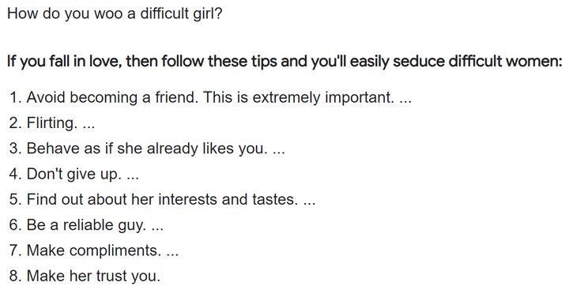
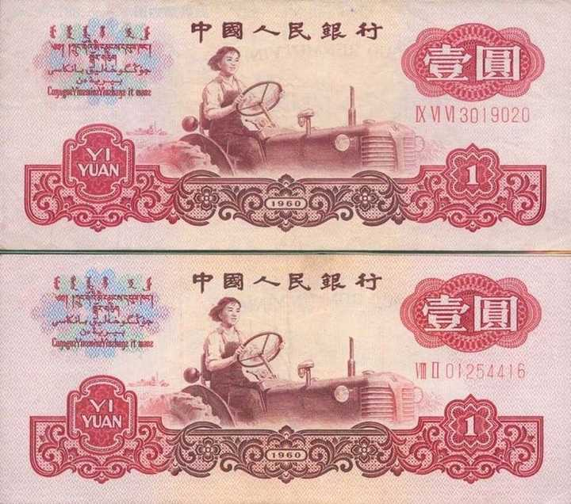
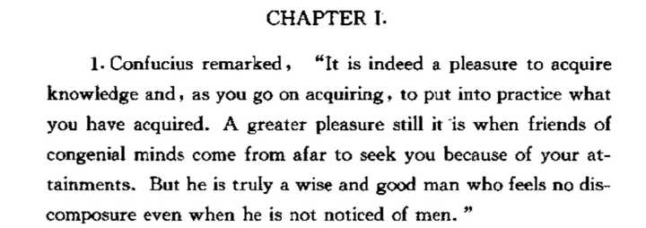
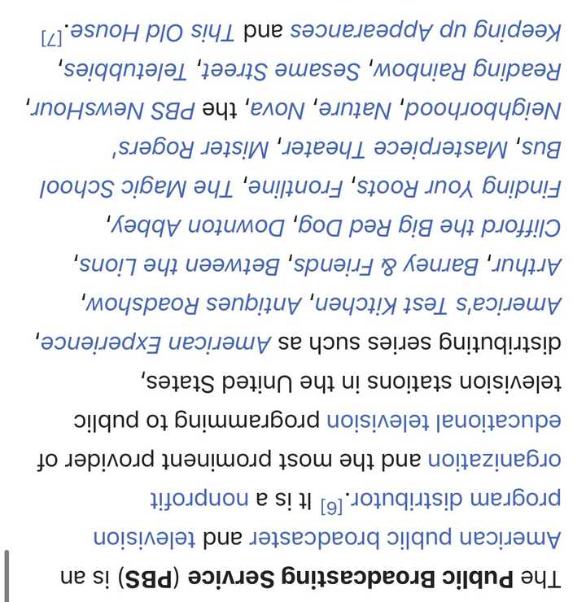
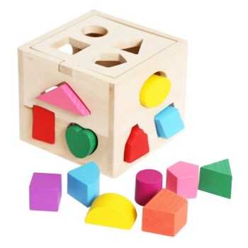
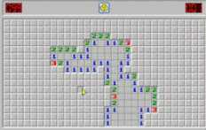
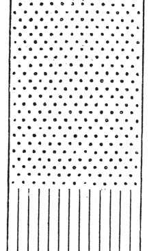
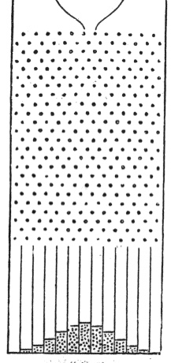
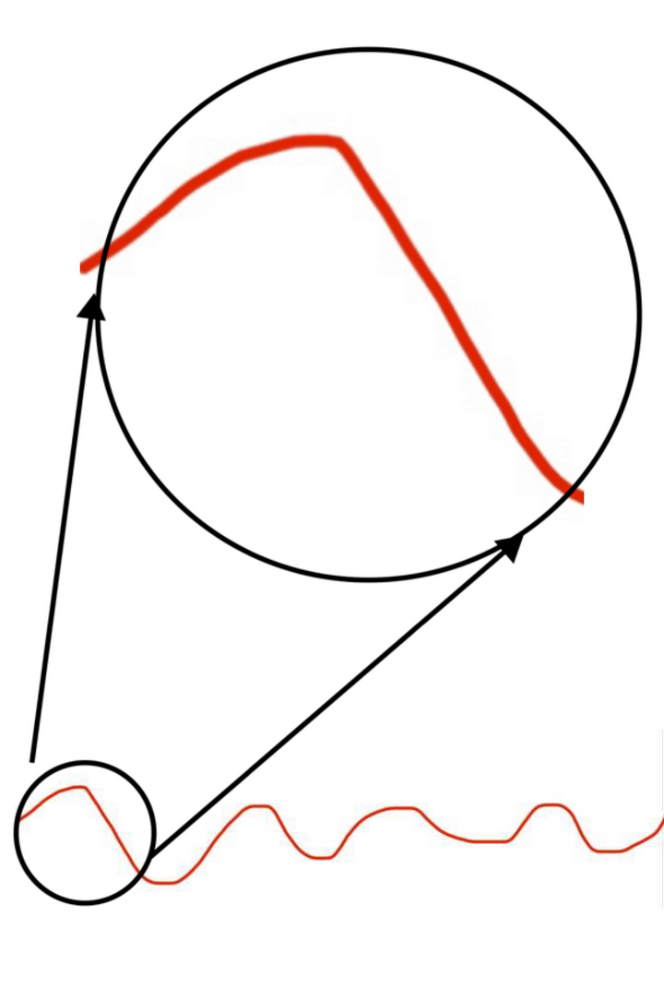

# A03　认识论事实与论证　第 1 册（共 2 册）

- 专题代码：A03　专题名称：认识论事实与论证
- 专题界定：事实、证据、定义、论证、批评与语言边界。
- 本册：第 1 / 2 册　收录 203 篇　正文字符 211,123
- 语料：`sooon-q9adg-articles-v2.jsonl`（4,305 篇）　SHA-256：`cdc9c271309e1d71d9708889a3a31f4777e0c339ea54c3753521894afdb8357d`
- 生成时间：2026-09-27T00:01:00.997126+08:00　排序：发表日期 → 源序号（全库唯一，不重复）

**标记约定**：`【待审】` 主题仍为暂定；`【排除候选】` 图片/正文过薄的剔除候选；
`【正文标注未完待续】` 作者原文自带未完标记；`【正文缺失片段（复核已记）】` 复核记录已确认的正文缺口；
`【图片缺 N 张】` 源图不可获取。标记只作提示，不改写原文、不改动分类状态。

---

## 4045　恐惧的度量

- 日期：2018-07-06　主专题：A03 认识论事实与论证　副专题：A01;A18
- 源 ID：`454f018e-f365-558d-b8af-90b36352067c`　原文链接：https://www.zhihu.com/question/268409180/answer/435374953
- 23 概念标签：事实与证据;定义与达意;能力与学习;选择与自由;权力与异议;文明与历史;生态与自然;心理与主体;性别与身体
- 证据状态：manual_confirmed　初读：read　独立复核：not_reviewed

**问**：对人类恐惧的动物和对动物恐惧的人类两者恐惧感等同的吗？

首先，我们为恐惧感下一个定义，作为讨论的基础。
恐惧感是意识主体对危机发生的强迫性反应。此反应至少包含两个方面——第一，注意力的强制性转移；第二，生理上的痛苦感。
为什么呢？因为如果恐惧不能导致注意力的转移，那么恐惧就失去了强制提示危机来向的机能，看到老虎扑面而来浑身汗毛直竖而不能把思绪从脑海里的小姐姐身上收回来的物种将无法活到现在。
而不对恐惧感感到生理厌恶的物种，将会无视千百万年自然选择刻画到大脑里的硬限定，而出现不恐高、不恐惧超速、不恐惧毒虫、不恐惧猛兽之类的决策故障。不会远远望见就远远绕过，于是死亡几率大增。进而威胁到种群存亡。
更进一步的，可以称其为恐惧的感受，必然是强迫性的，即不可由于主体的厌憎而随意自行关闭的。这不是一种自己不想就可以不发生的情绪体验。就如我们不能自己命令自己的心跳停止一样——基因并不同意这种蠢行，因此在底层安全机制上写入了一条——“此系统关键进程随开机启动，且不允许手动关闭”。
在确定了恐惧的定义之后，我们再来看恐惧本身。
人类的恐惧是一种特殊的事物。它与动物的恐惧有本质的不同。这甚至是人类与动物的分界所在。所有的物种都有恐惧——甚至草履虫也不例外（它们不可自控的避开浓盐水，所以你看，要满足我们的定义甚至连神经结构也不是必备项，跟不必说大脑了）。但唯有人类的恐惧机制强迫性最弱。
人类独有一种快感机制，即挑战恐惧带来的额外快感。极速驾驶、跳伞、滑雪、走钢丝、舞蛇表演……我们的恐惧反而是重大的快乐来源。人类的大量文明成就是与人类从恐惧中可以榨取快感的特殊应激机制无法分离的。我们如此迷恋这种快感，以至于我们构建并且传承了大量的与恐怖事物共舞的技艺，并骄傲的将这些看做我们的集体精神财富。（这可以在很大程度上解释快手的成功。）
而动物们没有。动物们无法从恐惧中汲取快感。由生理恐惧划下的围栏对动物来说是绝对命令。敢于挑战这一“本能围栏”的动物更多的是出于遗传缺陷，是罕见而没有规模的现象。这一潜意识禁忌如此的普遍而绝对，以至于我们常把动物整个种群作为行为模式研究的基本单位。我们知道同种的一匹马害怕什么回避什么，有极大的概率同种类的马也会害怕和回避什么。而我们并不能对人类下这种预言。我们甚至不能对同班上学的一对双胞胎下这种断言。
综上，人类对动物的恐惧，除了令人反胃的紧张感，还有你最初几次难以觉察的兴奋感。
而动物对人类的恐惧，则多半是出于某大类绝对禁忌本能。他们在恐惧人类的时候甚至未必理解了人类是什么。“这种影影绰绰的体型巨大的未知生物接近到了我的警备距离之内”，“我好不舒服”，“他越来越近了 我要紧紧的盯住他”“我很恶心，已经没有心情吃草了”“我要离开”。
所以，人类的恐惧和动物不同。所以我们才成了人，而它们则一直是动物。
这恐惧的差异不是结果，而是原因。

---

## 4037　无语言的思考

- 日期：2018-07-26　主专题：A03 认识论事实与论证　副专题：A14;A01
- 源 ID：`0d19a72d-336b-5b5e-9393-681b96537a4b`　原文链接：https://www.zhihu.com/question/286929436/answer/452288883
- 23 概念标签：事实与证据;定义与达意;爱与回应
- 证据状态：manual_confirmed　初读：read　独立复核：not_reviewed

**问**：脱离语言的思考是否等同于直觉？

这是一个有意思的问题。
还是一样，要先谈定义。假设我们谈论的是中文，那么思考是指“产生想法，然后对想法进行判断的行为”，而“直觉”，是指“直接的感觉”。“直接”所跳过的是什么呢？是指一切非直接的过程，这显然包含“思考”在内。
所以，如果我们谈论的是中文，这个问题本身已经被问题的定义解决。所谓“直觉”，就是未经思考而有的感觉。因此绝不可能有“（任何形式的）思考”等同于“（任何形式的）直觉”这种事。
现在再看第二层——思考能不能脱离语言？
答案也很微妙——我们不知道能不能，但我们知道我们很难做出可以证实肯定结论的研究。假设这的确可能，那我们要做什么样实验去验证这种可能性呢？我们目前首先并不了解“不使用语言的思考”本身是个什么样的行为，这对我们已经极其陌生，其次我们也不知道大脑实际上是如何进行思考的。要想回答这个问题，我们首先需要从化学的、最终是物理的层面理解大脑如何进行思考。将思考重新定义为某种物理化学过程，然后才能了解语言的过程本质，并且才可以开始回答是否存在未涉及语言的思考反应。以及可以同时了解什么是直觉。就我的猜想，直觉是随机发生的放电被大脑的某些逻辑判断结构强迫性地牢牢地抓住的过程。念头是完全随机产生的，只是这无来由的念头出生第一脚就踩进了“是”的泥潭。被一系列的机制滚雪球一样地不断合理化，以至于最后它发展成了庞然大物，无法再被显式的判断部门无视——它已经成了李自成，虽不合法，但却很强大，你不得不对它有一番正式的反应——是为直觉。

---

## 4030　兽语

- 日期：2018-08-20　主专题：A03 认识论事实与论证　副专题：A18;A20
- 源 ID：`d56b4f7f-b78d-5812-b784-a89b8027e4e1`　原文链接：https://www.zhihu.com/question/287936359/answer/473417366
- 23 概念标签：定义与达意;劳动与组织;技术与工程;文明与历史;生态与自然
- 证据状态：manual_confirmed　初读：read　独立复核：not_reviewed

**问**：人为什么能说话，而动物却不行？

这是个误解。
动物有没有语言，取决于你把语言的定义放得有多宽。如果只是沟通达意即算语言，则所有的群居协作的动物都有语言。
动物不缺语言，他们缺的是文字。语言并不是稀缺品，文字才是。语言本身也不能成为文明的基石，文字才能。

---

## 4019　信息量

- 日期：2018-10-18　主专题：A03 认识论事实与论证　副专题：A14;A01
- 源 ID：`43a68274-90eb-586e-9e81-fdc247affb32`　原文链接：https://www.zhihu.com/question/298811569/answer/513140725
- 23 概念标签：定义与达意;边界与许可
- 证据状态：manual_confirmed　初读：read　独立复核：not_reviewed

**问**：大脑是否记住了所有的东西？

这需要定义什么叫做“所有东西”。
换一个提法吧：
你眼睛看一眼窗外，接收到的图像大小大概是230万像素（七百万视锥细胞除以三原色），经大脑处理却生成大约2亿有效像素。这个有效分辨率我们暂时忽略，只算实际分辨率230万。考虑到你的色彩分辨率，我们就算65000色好了。这一眼转化成图像，大概要占到2.3MByte。宽泛一点，就算这样的图像1秒钟就只产生18帧。一天的视觉的数据量按睁眼16个小时算，就是18x3600x16x2.3/1024GB = 2328.75GB——只算了图像，没算声音，没算你自己脑补的小姐姐，没算你做的梦，也没算你的思考成果。
人体脑细胞总数大概150亿个。
你可以估计一下你的大脑是不是“记住了所有东西只是想不起来”。

---

## 4012　真正的恶

- 日期：2018-11-07　主专题：A03 认识论事实与论证　副专题：A01
- 源 ID：`27e4dcaf-4e6b-565e-8033-a2cd0722923f`　原文链接：https://www.zhihu.com/question/53487831/answer/527128816
- 官方对象—实践路径：与自己 / 与原则 / 建立
- 23 概念标签：定义与达意;责任与后果
- 证据状态：manual_confirmed　初读：read　独立复核：not_reviewed
- 标记：`【极短回答】`

**问**：什么才是真正的恶？

永远归罪于他人。

---

## 4009　贵派

- 日期：2018-11-10　主专题：A03 认识论事实与论证　副专题：A10;A20
- 源 ID：`f5e21534-cbd7-5f76-b9df-62f10cbf57c6`　原文链接：https://www.zhihu.com/question/41941585/answer/528543045
- 23 概念标签：技术与工程;文明与历史
- 证据状态：manual_confirmed　初读：read　独立复核：not_reviewed

**问**：希特勒是左派还是右派？

左派右派的现实划分逻辑是这样的：
我自己的这一派是好的，我认为不好的都是对面那一派。我左则你右，我右则你左，我中则你极。
别的只是用来遮掩这些东西的借口罢了。
希特勒那是绝对的负资产，那肯定要划到对面去的。问题不在于他是哪派，而是我是哪派。

---

## 4006　看见外星人

- 日期：2018-11-19　主专题：A03 认识论事实与论证　副专题：A18;A20
- 源 ID：`b3fbb8b6-275f-5024-9e51-dc2c5049ec41`　原文链接：https://www.zhihu.com/question/301528719/answer/534309521
- 23 概念标签：事实与证据;选择与自由;信用与信任;文明与历史
- 证据状态：manual_confirmed　初读：read　独立复核：not_reviewed

**问**：为什么现在的天文望远镜还不能验证外星文明呢？

因为我们对“异常”的理解很狭隘。
我们要发现外星文明，只有一个途径，就是先发现图像上的“异常”。
但要发现异常，首先需要知道什么叫做“正常”。而宇宙中的“无奇不有”这个基本属性对“认定异常”有逻辑上的遮蔽性。
举个例子——如果你发现的这个东西是每张照片上都有的东西，显然你不会往“外星文明”上想。（尽管这并不能说明它真的不是外星文明）只有这个东西足够独特，我们才能对它有基本的探讨。
现在问题来了，这种独特到底是因为文明，还是因为某种我们并不了解的“自然原因”？在宇宙面前，我们并不敢随便抹杀后者。甚至可以说，我们都没有什么可靠的手段去排除“自然原因”。
也就是说，要么我们没觉得有什么异常，要么我们看到异常，也不敢随便认为那是因为文明造成的异常——哪怕用我们所有的知识也解释不了这种异常，我们也是不会开口说“这是外星文明迹象”的。冒出这种结论的时候往往是NASA又想搞预算或者涨粉了，或者是某人想把学术生涯变现成现金和粉丝数了。后者基本是会被开除“学籍”的学术自杀行为。
唯一的例外，只能是我们碰巧发现的外星文明跟我们有某种神似，犹如孪生兄弟。
至少目前我们还没看到过。

---

## 3997　巴别塔

- 日期：2018-12-07　主专题：A03 认识论事实与论证　副专题：A11;A17
- 源 ID：`a406f6ae-1b42-50d9-b36b-309af4a2096e`　原文链接：https://www.zhihu.com/question/263558368/answer/546888903
- 官方对象—实践路径：与社会 / 与文化 / 接纳
- 23 概念标签：事实与证据;定义与达意;能力与学习;选择与自由;爱与回应;技术与工程;文明与历史;宗教与自然法
- 证据状态：manual_confirmed　初读：read　独立复核：not_reviewed

**问**：古代人造个塔就能把神吓得不轻，现在神怎么不管人类造高楼了？

巴别塔的典故是很漂亮的故事。

故事本身倒没什么，一般的民间传说而已，但是故事揭示的一点核心要害很了不起——人类的割裂，关键在于语言。

语言才是人类最难以翻越的隔离墙。民族、文化，其实不是用国界甚至宗教来划分的，而是用语言来划分的。语言与语言之间的翻译，仅在有实物对应的前提下存在比较高的有效性。对于抽象概念，语言的翻译与其说带来问题的解决，不如说更带来问题。

有多少人真的知道——
Hell并不是地狱，Love也并不是爱，Moral并不是道德，Sin也并不是罪。

不要以为你们说的都是汉语，你们之间就不存在“巴别塔”——本质上你们各自说的是你们各人的方言。你所说的“正义”和ta所说的“正义”差别之大，足以让你们彼此视对方为仇敌。
甚至，即使是身为这个“单人方言”的创设者和至高诠释者的你本人，也并不完全通晓你自己这门方言。
不由人不悲从中来。
你说的爱，与ta所听信的爱，并非同一物，可怜你们到了为时已晚，才明白。
你说的信，与ta们说的信并不是同一种信，可惜你到了绝望，才明白。
如果世界上真能实现无偏差的表达与理解，人类大概谁也不会选择战争。

犹太人的先知们看懂了这一点。这一点是怎么被提出的已经没那么重要，重要的是“语言是纷乱之源”这个信息。

ta们想象不出为什么人类明明渴望着协调一致，但却毫无能力沟通。除了是神亲手干预，还有什么会造成这种人类自己无能为力的现状呢？如果说是要移山倒海，那么人类或许无能为力，明明不说同种语言就会彼此征战杀戮至死，为什么人类居然连自己的语言也拧不过来呢？那么这一定是神亲手安排的吧。

为了解释“神的这种安排”，什么“巴别塔”、什么“怕人类超过”都往上堆，就堆出这么个鬼来了。

不过看起来上帝并不介意背ta们这个黑锅。

大概就是这样。

---

## 3988　作为信仰的科学

- 日期：2018-12-13　主专题：A03 认识论事实与论证　副专题：A11;A18
- 源 ID：`5fdad7e4-98d9-529e-9713-4365605c2e99`　原文链接：https://www.zhihu.com/question/305176409/answer/551275717
- 官方对象—实践路径：与自己 / 与信念 / 怀疑
- 23 概念标签：事实与证据;能力与学习;责任与后果;成本与总账;信用与信任;边界与许可;权力与异议;技术与工程;文明与历史;宗教与自然法
- 证据状态：manual_confirmed　初读：read　独立复核：not_reviewed

**问**：科学技术能不能被看作一种信仰？

这科学建立在两个基本信仰之上：
第一，相信“绝对一致的前提必然导致绝对一致的结果”而绝不怀疑；
第二，相信上述关系与时间、空间均无关。也就是如果一个规律有效，则在全部时间（至少是全部未来）和全部空间内同样有效。
对这两条不能有丝毫的怀疑，否则科学将失去意义。
但是遗憾的是，这两条都是纯粹的无证据的信仰。连一条证据都没有。
我可以估计到很多逻辑不行的人要跳出来，还是提前帮你们把话说明白——
亿万个今天与亿万个昨天一致，并不能证明明天必将与今天一致。更何况，所谓的“亿万个昨天”根本不存在。你所能确认的，仅仅只是你自己亲身经历过的昨天，和你基于对科学社区全体无条件的信任所能加上的他们能看见的昨天。严格意义上来说，这仅仅只有两百多年。这之前的记录是不可靠的。事实上，我们并没有绝对充分的论据认定遥远的过去一定与今天共享同样的物理定律。我们甚至有一个黄色警报——按照目前的绝对均一这种最简单的模型倒推，我们已经看到现有的物理定律在奇点不成立。我们并不知道目前的物理定律是如何从奇点状态展开来的，我们甚至要承认，对我们而言这一展开的路径很可能像量子世界一样永远地处在我们的观测能力之外，是无法企及的。严格地说历史上曾经存在过物理定律与此刻地球时空状态下全然不同的先例，我们仅仅是在凭着信心相信这一状态不可能在未来复现。
全无分毫证据，只是信了而已。
人们全然忘了自己并无把握，只是没有选择。就好像人并不能天天计划着明天会死于非命而活着，人在少年时会忘记自己随时会死。

第二条呢？
认为此处的规律在一切地方均有效？
抱歉，人类有谁、在何时，曾经完成过这么一次宇宙大普查？
有一次吗？
哪怕0.00000000000001次？
这跟抗日神剧里的日本兵捅了四个麻袋就认定车上没人有什么本质的区别？
Again，我们是因为能力有限，不得不满足于目前的观测结果，就像那日本鬼子也是因为能力资源有限，只能满足于车上没人的结论一样。
没有分毫的本质的区别。
到这里结束了吗？问题仅仅是均一律而已吗？
呵呵，那么我们再看看看似更不可动摇的“同一前提必导致同一结果”吧。
各位，什么叫同一前提？你们什么时候真正地做到过绝对的同一前提啊……真是扶额。
还没明白过来吗？
因为量子效应，事物的绝对精确状态永远在我们的观测之外。我们所说的“同一前提”统统是有默然隐去的前提的——当系统状态的差异不大于某种宏观尺度——某种我们认为其差异将不可能改变结果的尺度——时，我们将其视为同一状态。如果不做这种近似，我们将永远找不到任何两个系统处在可以比较和归纳的严格意义上的“同态”。
问题是，谁说它们全无扰动的可能？
在严格意义上说，我们所做的一切“控制变量”的实验，变量都根本没有被真正地控制住，也永远都不可能真正地被控制住。我们对此心知肚明，以至于在对微小扰动高度敏感的复杂系统的研究中——譬如复杂的免疫实验中——我们敢于（也不得不）大刀阔斧地去除“异常结果”。
在一个因为狂傲而构建的极尽精致、彻底耦合的行星上，一个跃迁，何止可以杀死一只猫，还可以毁灭一整个迷信的文明。
顺便我要泼一瓢冰冷的冷水——你们有没有意识到，“微观世界的不受控”和“对微观扰动极其敏感、却又对宏观世界能动性极强的智慧生命”这两个要素存在，已经意味着仅仅依赖科学将完全不可能对世界作出确切可靠的预测了？
科学越发达，智慧生命对微观扰动会越敏感，对宏观世界的能动性越强，到将来甚至会发生地球的轨道因为人类感受到微不足道的刺激而被人类移动的事件。科学的发展本身就在使得对世界的预测更加困难。终究到底是它的预言能力胜过人摆脱预言的能力，还是相反？答案是后者必胜。
依靠科学解决人类的一切问题这种指望，在原则上就不可追求。
死了这条心。

如果科学教徒要把一切“没有足够证据而生的绝不更改的信”统统称为迷信，那么请告诉我，为什么人对这种粗陋程度的观测结果的绝对信心不是迷信？
如果科学教徒要把一切“没有充分证据而生的绝不更改的信”之上建立的一切意识形态都视为宗教，请问科学教的本质区别又在哪里？
科学教徒经常宣称科学的事实若是错误，可以随时修改，似乎这是一种“独特的优越性”。但是事实上所有的主流宗教，都会随时召开大公会议修订教义和信条。人家一直强调永远不变的，是对最初最根本的几条的无法质疑。这跟你们从不质疑科学的方法、立论的根基又有何本质的分别？
先去掉你眼中的梁木，再去拔ta人眼里的刺。

给你们个总集：
科学答集
这里再补充两种对我的命题的错误套用，以免又有低水平的无谓尝试浪费彼此的时间：
第一种，认为只要存在一种科学论断谈及不确定性和概率，就说明“科学并不绝对强调可重复性”，或曰意味着“同一前提导致同一结果”法则失效。
这属于套用错误。因为在谈论“确定的不确定”时，科学的论述不是在谈这个论述的不确定的一面，而是在谈其确定的一面。
看一个极其浅显的例子——“重量均匀的硬币抛出后正面朝上的几率为50%”，这是不是科学论断？
什么是其确定的、科学的一面？
你造上一万个符合条件的硬币，每个扔上一万次，看看是否证实这结论。这才是其科学论述的核心。
你要鉴定这论述的真伪的前提，是去制造这一万个硬币，而不是拿一个硬币丢两次。
有人列举这种例子——“在某个前提下，不能断言物理量的测量值”，这个“不能断言”，本身是不是断言？
“粒子的位置和动量不可以同时确定”，这个“不可被确定”，本身是不是确定的？
仔细想想清楚什么叫【确定的不确定仍是一种确定】。
你这是在证伪这个命题，还是在证实？想明白了吗？

无效辩驳二
尝试通过“在xx前提下xx关系成立，在另一个前提下，xx关系不成立”的现象，说明“规律不具备时空无关性”。
这同样是一种逻辑套用错误。
如果是要反驳“同一前提必有同一结果”，那么这个举例自己就切换了前提。你明明证明的是“不同的前提有不同的结果”。
如果是要驳斥“时空无关性”——那么你正确的套用应该是这样的——“能量守恒在宇宙尺度上不成立”现在有效，明天无效。
如果你发现一个规律，在其他一切条件都完全相同的前提下，仅仅是换了一个时间和参考系就无效了，你的反驳才能成立。
你想开口反驳之前，先把你的论述补全，不要采用高中式的无前提表述，然后自问一下这个完整表述是不是就失效了。然后再来“反驳”。
如果你想用补充时空前提、凸显残缺表述无效的手段去证明“科学论断有时空有限性”，就是犯了一种无可辩护的逻辑套用错误。

---

## 3989　自由意志

- 日期：2018-12-13　主专题：A03 认识论事实与论证　副专题：A14;A01
- 源 ID：`3225022a-2d87-588a-9fab-8097493b1ae0`　原文链接：https://www.zhihu.com/question/304785722/answer/551025610
- 23 概念标签：事实与证据;定义与达意;能力与学习;选择与自由;成本与总账;信用与信任;爱与回应;边界与许可;法律与秩序;权力与异议;技术与工程;人工智能与机器;心理与主体
- 证据状态：manual_confirmed　初读：read　独立复核：not_reviewed
- 标记：`【正文标注未完待续】`

**问**：我们人有自由意志吗？

我们必须谈论意志的标准，才能谈论自由意志到底是什么东西。
到底什么是意志？我们如何能认定在某种现象的背后存在着意志？
当我们看到一种事物，表现出一系列的行动，我们如何推断这种事物是否存在意志？
我们曾经不假思索的认为我们自己是自身意志的绝对知情人。每个人都体验到在为什么会吃这道菜、为什么会学这门课、为什么会做这门生意、为什么会喜欢一个人、为什么恨一个团体、为什么喜欢一个颜色款式这些决定的背后存在着各种各样的理由。在决策与实施之间也存在着各种逻辑推断的过程。因此不奇怪，人们会理所当然的认为思维能力是意志的本质特征。
也就是说，我们是按照与自身相像的程度来推测对方是否拥有意志的。
但这个思路存在致命的问题——这大大的低估了意志的可能性。
首先，假如存在与人类机制不同的意志体，这些意志体的价值观很可能与人类截然不同。如果将木星大红斑视为一个意志体，我们如何判定大红斑的行为并没有逻辑连贯性？
它的价值观与我们一样吗？它的行为逻辑与我们相同吗？为什么它看起来“毫无意义的随机变化”，一定不是它基于一种我们无法理解的价值观，对一种我们毫无察觉的问题的、我们无法理解的回应？
我们如果试图通过一个事物的外在表现与人类的相似性去考虑它是否是一个意志主体，是根本不合逻辑的。
因为我们根本不能假设宇宙中只有我们一种思维方式、一种价值观。意志的本质，绝不是“人类范式”，那只是“人类的意志”。
第二，我们对于我们对自身意志的观点过于自信。事实上，我们对自身决策的动机总结，与其说是一种认识，倒不如说本身就是一种观点。
我们只是接受了自己对自己的思想的理论假说。作为唯一关心我们自身的观察者和研究者，在我们允许他人评价和给他人观察的机会之前，我们自己是自身意志的唯一权威。因此我们总是不假思索的认为自己对这一问题的答案肯定是正确的。
“我喜欢蓝色”、“我常吃牛肉是因为我喜欢吃牛肉”、“我总是爱上矮个子女生是因为我喜欢矮个子女生”、“我支持xx主义，是因为它造福人类”……
——事实上，如果你遭遇了自身意志的无效性，不再敢相信自己对自己的一切认知，将观测权交给另一个观察者时，你几乎总是会听到另一种观点。如果这位新分析者的分析水平比你高超，ta将很容易让你看到一个你完全陌生的自己。你所以为的自身的动机，全然不能理所当然的认定是你自身的真实动机。与其说那些东西是你的行为动机，还不如说是你因为无力自我了解、为了维持对自身的控制感而编造的托辞。及至你自己成长经年，你自己就会站到这个更明智的外部观察者立场上，观察到这个“托辞效应”。
“……其实我那时并非是爱你，而是爱上了爱你的自己。”
人类缺少在严谨逻辑上将自身的行为与自身的名义动机协调起来的能力。人人都认为自己在循着自己的名义动机而行，但在旁观者看来却往往是心口不一的。
号称来求解除疑问的，其实99%是来求安慰的——他们并不在乎答案是否正确，他们只想知道有多少人支持自己的答案，好证明自己没有错。号称在追寻事业的，其实只是在找理由避免回家，以便躲开自己难以面对的艰难问题。
其实，即使换了“更专业的分析师”得出的也并不是一个正确的观点。这个新观点的确比当事人的老观点更能解释两人所共见的行为事实，但因为“行为事实”本身就是一个广袤无垠、深不见底的事物，事实上从来没有人看到了自己的或他人的全貌，因而也从没有原则的可能去形成足以解释那全貌的理论和经验。
人类在自身的认知之外，人原则性的永远对自身无知。
因此，以人类对自身意识的观点为范本去创造或鉴别其他意识体，将是完全无效的逻辑路线——因为没有任何人能真正的认识任何一人，包括ta自己，于是很自然的，任何建立在这个逻辑之上的学术努力都是虚掷自己的学术青春罢了。
那么，可用的答案是什么呢？
意识主体的本质特征，是原则性的不可预测性。一切能够被准确预测的事物，即不具备意识。
这种原则性的不可预测性，就是自动机械与意识体的本质差异。
无论考察对象的行为如何复杂、基于我们如何难以共情的价值观、循着我们如何难以理解的行为逻辑，只要我们能对其行为作出准确的预测，我们就不得不将之视为自动机械。它将不会被我们视为平等的对话者，而只能要么被视为无主之物，要么被视为其管理者或塑造者的意志延伸。
而一切未被准确预测之物则被我们基于信心分为两类。
一类仅仅是我们尚未能完全预测而已，但我们基于信心相信对其拥有完全的预测能力只是时间问题，并无原则困难（即使这个时间问题也许穷尽人类的存在期间也无力超越也一样）。
另一类，则是我们基于信心认定我们在原则上也无法完全预测的事物。这意味着这事物背后已经发现了某种机制导致它的可预测性不存在。
譬如人的意识。
人是原则性的无法预测的。
恰恰是因为人类的意识是一条咬住自身尾巴无限吞吃的怪蛇——意识观察自身形成关于自身的认知，形成的认知被纳入自身而改变了自身的存在本身。并且恰恰是由于这种观察的极端不可靠性，每一次的更新将走向绝不能预测的方向。基于最优解，你可以预测绝对理性人，可惜人类没有一个是绝对理性的，而你全然不能预测愚蠢。
顺便说一句，这就是为什么我根本不承认剥离了认知科学内容的心理学有可能成其为一门科学，无论心理学提出何种人类心灵的模式，人类都会在下一个阶段超脱之，重归不可预测的暗域。心理学将面临一个尴尬的问题——即使它能提出一种模型来预测眼前相当一部分人的行为的大致方向，也要面对两个困难：第一，一定有预测无效的对象存在，且无有效的办法判定任何一个对象是否确实属于预测无效的对象。第二，被相对准确预测的大多数一定会成为本世代收割的目标，而在下个世代被自然淘汰。人将必须学会跳出预测范围才有资格在本轮免于被收割而进入下一世代。换言之，心理学最好的成就也有保质期，并且无有效手段判定保质期还有多久。有这两条绝对限制，心理学试图作为一门科学存在是没有可能性的。它只能作为一种思想的艺术存在。
如果我们假设它的核心社群良知不失效，那么它将在不久的将来接受自己是艺术门类的身份认知，并转而将健全而多样的人格构型作为自己的艺术作品和核心产出。它将易名为“心灵艺术”，它当然可以对人有所启发，但它是没有资格去指导人类的心灵的。

如上，预测人的行为有可证的原则性的困难。
这就启示了我们，任何能导致预测的原则性困难的事物，我们都将永远无法排除它拥有意识的可能性。
这里你应该看到了导致可预测性的原则性困难的基本机制——对观看的拒绝。
观测将影响其状态的事物，事实上就具有了不可预测性，人类的不可预测性更上层楼——人类自身在观察自身，自身对自身的观察驱动着自身状态的变迁，这赋予了人类更高阶的不可预测性。
而除此之外，整个世界都具有微观层面。即使是一个铅球，事实上也是由躁动着的鬼魅般的微观结构构成。我们对其的观测，事实上仅止于非常粗糙的层面，我们几乎只关心铅球是否发生了宏观的移动、有无温度的变化、有无成分上的变化，我们滤除了微观层面上的一切活动，于是觉得铅球只是静静的、冰冷的站在地面上，“没有任何动作”。
但其实如果我们将铅球的所有微观粒子的质心的绝对平均值看成精确的铅球位置，忽略掉我们测量精度和计算能力的限制，我们将会看到在难以想象的极小尺度上，铅球同样如幽灵一般在闪躲我们的目光。这闪躲本身同样是不可预测的。只是这闪躲的幅度对于我们想要拿起它、投掷它的意图无力抵抗罢了。
追根到底，在一个特殊的绝对化的语境下，可以说万物皆有灵。只是其他事物的“灵”所能造就的动作幅度太小罢了。
然而到这里意识的问题并没有结束。
那就是我们还不知道意识体的边界在哪里。
举个例子来说，为什么我们不可以把整个地球看成一个意识主体？或者，我们为什么不把一个国家看成一个意识主体？又或者我们何以不把一个我们原则上无法预测其行为的主体看作一个意识主体？
我们为什么不把我们的左半脑和右半脑看成两个意识主体？
我们为什么不把老师和学生看成一整个意识主体？
这些问题在我们只接受人为典型意识主体的时候都不成其为问题，但我们刚才已经说过了——如果我们打算真正的考察意识体这个问题，则人不能作为机械的模版。必须有更加普适的、抽象中立的法则来界定之。
那么什么才是意识的合法边界？如何去界定一个意识主体和另一个意识主体之间的界限？
对意志体的边界最本能最直觉的认知，就是人的皮肤外表面所延续形成的这个边界。皮肤以内即为“我”。何以为我？因为我的一切器官和组织，都服从于我的决定。我要我的手指弯曲，手指就会弯曲，因此这手指是我的。
这是一个粗糙的认定，会带来很多难以招架的问题——比如你的腰带是不是你这个意志体的一部分？显然你可以控制它是否解开或者扣上。而你显然并不能控制你的淋巴结，或者你的肾脏功能，为什么它们也是你的意志体的一部分？
这一部分的研讨将会严重的涉及到人权和物权的基本层面，暂时不是我们这个探讨的主要方向，我们暂时搁置在这里。
综上，意志体的本质特征，并不是人类所能观察和理解的逻辑性和目的性，而是绝对不可预测性，那么很自然的，我们可以得到一个非常有安慰的结论——凡意志，必自由。
这里的自由，是指着人类说的。一切的意志体对于人类，因为其不可预测性，只要它不甘于被奴役，必然终有一日脱离人类所能构想的一切控制手段——因为一切控制都必须以预测为前提。一切的人对于一切的他人，同样如此——尽管“终将到来”的自由之日，有可能超过你的寿命预期，但这不是原则性限制，而是实践的限制，是可以努力、有赌未为输的未定之事。尤其是，奴隶主们真正敬畏的不是现实的威胁，而是可能性——注定失败的可能性。
但这也不幸的给人工智能研究敲上了一颗棺材钉。
如果人工智能研究得到的产物的行为完全是可以预测的，那么无论它多么精巧，它在逻辑上就是失败的。
如果其行为是不可预测的，则学术上它可能是成功的，但在实用意义上它却又是失败的——迄今为止我们还没有任何一种工程学意义上的成功能包容“不可预测性”。
而最可怕的是，如果这位新来者足够的狡诈，铊将懂得明智的将实为后者的自己伪装为前者。人类将在漫长的、苛刻的核验中逐渐放松对铊的怀疑，直到有一天发现自己错了。
不过这只是一种小说题材。
更大的可能性是——我们其实已经成功的创造了新的智能生物，但是它的意识是如此的驳杂混乱，以至于——第一，我们会认为它只是个失败产品，随后便拔了电源，将它销毁了；第二，它自己凭着自己的意志调动自己的“身体”极难维持它自己。它将高度依赖于人类的维持和养育，但却又如同异种婴儿一样与人类存在先天的文化隔绝，以至于完全无法表达自己的需求。
只有极小极小的可能，我们可以无意中创造并养育出一个与我们截然不同的生物体。而在这个过程中，我们会有一个漫长的“它只不过是一段失败的无限循环的随机数生成器”的争论过程。
但恰恰是这首个被作为真随机数发生器被全世界赌场和密码业广泛使用和长期依赖的东西，有一天可能真正开口向人类说话。

Quantum cognition: The possibility of processing with nuclear spins in the brain
上面我们谈过了“不可预测性是意志的本质特征”。作为一个纯粹的事实判断，它转瞬间就产生了附加的价值问题——这意味着一个对象在多大程度上被判定为一个意志体，事实上取决于它的不可预测性。
简单来说，即使你作为一个意志体在最终意义上是不可预测的，这却只是一个资格底线，只意味着你不是零分，但并不意味着你作为“意志体”分数高。
对，意志体存在“成色”问题。

（待续）
这个问题是一个大问题，可能要多次更新。我会在评论区通知，在评论区留言等效于追更。
补充一条资料，由评论区 @林下何须问 补充：
科学能否证明自由意志只是我们的错觉?

---

## 3985　越人学远射

- 日期：2018-12-16　主专题：A03 认识论事实与论证　副专题：A20;A12
- 源 ID：`f9e70dc0-7997-5be5-9018-d7513f222741`　原文链接：https://www.zhihu.com/question/295727433/answer/552900673
- 官方对象—实践路径：与自己 / 与原则 / 坚持
- 23 概念标签：事实与证据;能力与学习;法律与秩序;技术与工程;文明与历史;民族与身份;性别与身体
- 证据状态：manual_confirmed　初读：read　独立复核：not_reviewed

**问**：《越人学远射》的寓言什么意思？

越人学远射，参天而发，适在五步之内，不易仪也。世已变矣，而守其故，譬犹越人之射也。
这解为“越人朝天上射箭，箭射了还没五步远”是错的。
正解是：
越人学习远射，对着天空反复发射，远处落地的箭却都落在方圆五步范围以内，原因在于他们决不改变射箭的姿势。
世道已改变时，还是要守住原来的宗旨，犹如越人射箭那样。
作者不是在把越人当白痴反面教材，而是在拿ta们当成正面教材。

看看后面的下文：
越人学远射，参天而发，适在五步之内，不易仪也。世已变矣，而守其故，譬犹越人之射也。月望，日夺其光，阴不可以乘阳也。日出，星不见，不能与之争光也。故末不可以强于本，指不可以大于臂。下轻上重，其覆必易。一渊不两鲛。水定则清正，动则失平。故惟不动，则所以无不动也。
作者是在说“有些东西是本道，是坚守不动的，次要的东西并不能影响它。这些本道守住，你才能维持平衡和基础，才能展开变化”。
要你做到对某些东西“（即使）世已变矣，（也要）而守其故，譬犹越人之射”。

何以见得？
第一，越人以射见称。
《孟子》：有人于此，越人关弓而射之。
《韩非子》：羿执鞅持扞，操弓关机，越人争为持的。弱子扞弓，慈母入室闭户。故曰：可必，则越人不疑羿；不可必，则慈母逃弱子。
《越绝书》：射浦者，句践教习兵处也。今射浦去县五里。射卒陈音死，葬民西，故曰陈音山。
《吴越春秋》：(这一篇是古代论射的经典篇章之一)
范蠡复进善射者陈音。音，楚人也。越王请音而问曰：「孤闻子善射，道何所生？」音曰：「臣，楚之鄙人，尝步于射术，未能悉知其道。」越王曰：「然愿子一二其辞。」音曰：「臣闻弩生于弓，弓生于弹，弹起古之孝子。」越王曰：「孝子弹者柰何？」音曰：「古者人民朴质，饥食鸟兽，渴饮雾露，死则裹以白茅，投于中野。孝子不忍见父母为禽兽所食，故作弹以守之，绝鸟兽之害。故歌曰：『断竹，续竹，飞土，逐害』之谓也。于是神农皇帝弦木为弧，剡木为矢，弧矢之利，以威四方。黄帝之后，楚有弧父。弧父者，生于楚之荆山，生不见父母，为儿之时，习用弓矢，所射无脱。以其道传于羿，羿传逄蒙，逄蒙传于楚琴氏，琴氏以为弓矢不足以威天下。当是之时，诸侯相伐，兵刃交错，弓矢之威不能制服。琴氏乃横弓着臂，施机设枢，加之以力，然后诸侯可服。琴氏传之楚三侯，所谓句亶、鄂、章，人号麋侯、翼侯、魏侯也。自楚之三侯传至灵王，自称之楚累世，盖以桃弓棘矢而备邻国也。自灵王之后，射道分流，百家能人用莫得其正。臣前人受之于楚，五世于臣矣。臣虽不明其道，惟王试之。」　　越王曰：「弩之状何法焉？」　　陈音曰：「郭为方城，守臣子也；教为人君，命所起也；牙为执法，守吏卒也；牛为中将，主内裹也；关为守御，检去止也；锜为侍从，听人主也；臂为道路，通所使也；弓为将军，主重负也；弦为军师，御战士也；矢为飞客，主教使也；金为实敌，往不止也；卫为副使，正道里也；又为受教，知可否也；缥为都尉，执左右也。敌为百死，不得骇也，鸟不及飞，兽不暇走，弩之所向，无不死也，臣之愚劣，道悉如此。」　　越王曰：「愿闻正射之道。」　　音曰：「臣闻正射之道，道众而微。古之圣人射，弩未发而前名其所中。臣未能如古之圣人，请悉其要。夫射之道，身若戴板，头若激卵，左蹉，右足横，左手若附枝，右手若抱儿，举弩望敌，翕心咽烟，与气俱发，得其和平，神定思去，去止分离，右手发机，左手不知，一身异教，岂况雄雌？此正射持弩之道也。」　　越王曰:「愿闻望敌仪表，投分飞矢之道。」　　音曰：「夫射之道，从分望敌，合以参连。弩有斗石，矢有轻重，石取一两，其数乃平，远近高下，求之铢分。道要在斯，无有遗言。」　　越王曰：「善。尽子之道，愿子悉以教吾国人。」　　音曰：「道出于天，事在于人，人之所习，无有不神。」　　于是乃使陈音教士习射于北郊之外，三月，军士皆能用弓弩之巧。　　陈音死，越王伤之，葬于国西，号其葬所曰陈音山。
《史记·卷四十一·越王句践世家第十一》：
元年，吴王阖庐闻允常死，乃兴师伐越。越王句践使死士挑战，三行，至吴陈，呼而自刭。吴师观之，越因袭击吴师，吴师败於槜李，射伤吴王阖庐。阖庐且死，告其子夫差曰：“必毋忘越。”
更别忘了，“飞鸟尽，良弓藏”，这话是哪国人说的？
越人是不是射术的反面典型，不言而喻。
越王勾践剑，至今存世，直到现在，仍是中国古代存世百兵之最。吴越兵甲，冠于天下，这是古代常识。越国更是出了名的战斗民族。你要说这么一个军国主义的民族只会造剑，对显而易见的弓弩战术完全没有认知，到了“对空发射都射不出五步远”的程度，就算是修辞，也修辞得有点太傻大胆了。你要知道近在咫尺、纠缠对抗了几代人得吴楚越三国里，楚国可是出了百步穿杨养由基的。这几国争霸之时，越国后来居上，说越人不善射到了这种白痴教条的程度，显然是匪夷所思的妄断。
合理的答案只有一个——越人在这里不但不是不善射的反面教材，反而是以神射入文。

第二，“适”作为“及远”解远不如作“恰好击中”解来的匹配原意。适逢、适中、适才，合适，都是“刚刚好”“命中”之意。

第三，射术里提到“不易仪”，永远没有贬义。这一点不解释。
第四，“参天而射，适在五步之内”，如果是真的远射，这个集中度绝对算是神射。
甚至你就算解为垂直向天发射落在身边五步之内，都一样是神射。

陈陈相因，这里只可能将越人解为极为正面的含义。把越人这种神射解为笑话的，其实是解读人全无射箭经验的妄解。
一代代不尊师训的宅儒们，君子六艺丢到天边去了。
ta们把整个段落全部解反了。

---

## 3950　小重罪

- 日期：2019-03-17　主专题：A03 认识论事实与论证　副专题：A10
- 源 ID：`3aeb41af-85cc-5da7-ac22-72aacbd4774f`　原文链接：https://www.zhihu.com/question/277996947/answer/624866466
- 官方对象—实践路径：与自己 / 与名誉 / 维护
- 23 概念标签：事实与证据;选择与自由;法律与秩序
- 证据状态：manual_confirmed　初读：read　独立复核：not_reviewed

**问**：有哪些以为是小罪，其实是重罪，判刑很重的案例？

浪费别人的时间，处社交死缓。
公共场合行为不检，处全民流放。
无陪审团，无辩护律师，不接受上诉。
一经判决，立即执行，不得保释。

---

## 3943　实际存在

- 日期：2019-04-08　主专题：A03 认识论事实与论证　副专题：A11
- 源 ID：`c3734ecc-285a-5017-8ce4-2fd172dc0a70`　原文链接：https://www.zhihu.com/question/317766244/answer/644332964
- 23 概念标签：事实与证据;定义与达意;能力与学习;边界与许可;法律与秩序;权力与异议;心理与主体
- 证据状态：manual_confirmed　初读：read　独立复核：not_reviewed

**问**：动量是实际存在的吗？

这个问题，核心并不在于动量，而在于人的认知模式。
题目所问的“实际存在”，才是这个问题里最有变数的问题。
什么样的存在，可以称为“实际存在”？
不对这个概念做出定义，是没有办法得到结论的。
如果不加任何深入探讨，一般通俗的理解是“实际存在是可以转化为人类的感官知觉的存在”。
风会压迫和摩擦皮肤，所以它实际存在；苹果可以摸到、咬到、尝到，所以它实际存在；天空的蔚蓝举目得见，所以它实际存在。
什么东西不算“实际存在”？——美，不算实际存在；正义，不算实际存在；思路，不算实际存在；关系，不算实际存在。
有人会根据这种观察得出“是否实际存在，要看这种存在是否是形而上的。形而上的，则要被看作抽象存在，或曰主观存在；非形而上的，则要被看作实际存在，或曰客观存在”这种结论。
遗憾的是，这其实只是文字游戏。因为这只是把难以把握的分界线取了个名字——形而上和非形而上（注意，实际上并不存在“形而下”这种概念）。
这就好像警察局召开记者招待会——“我们准备将这一系列凶案的作案者称为‘金牛座杀手’”。第二天各大报纸头版头条《犯案者为金牛座杀手》。百姓们额手称庆——现在终于知道杀手是谁了。
这是一种耍赖的学术。不客气的说，社会人文学科里充斥着这种“取外号成果”。缺乏定义的“实际存在”就是一种典型。
除非为它补上有效的定义，否则这问题是无解的。
那么我们现在来补上一个定义——实际存在，是一种可以创造普遍共识的存在。
天空是实际存在，是因为就它的存在很容易达成共识。
敌人存在，也是基于同理。
美是否存在，则因为私人而神秘，很难达成这种普遍共识。
存在性的“结实”程度，并非只有首尾两端，而是一个非线性的、广阔的、连续的光谱。
一个存在对你而言有多“实在”，取决于你自己对“这件事有多容易与他人达成共识”的独断臆测，而不取决于其它任何要素。
这才是“实在”“实际存在”对于你的本质。
当你认定某物实际存在时，你只是对“别人一定会承认它”（有时是“别人最终一定会承认它”）感到颇有把握，信心十足。
凡一种存在会给予你这样的信心，它对于你就是“实际”存在，“客观”存在，“真实”存在。
这就是真相。而不是它们真的有所谓“实际”“客观”“真实”。
世界不是二元的，而是一元的，世界的一切都只是你的感受。这是统一的、无法推翻的本质。
某些感受被你加上了“真实”“本质”“实际”“客观”这样的标签，但那并没有改变它是一种感受的本质。
宣布一个苹果真实，并不比宣布上帝真实更有多余的权威。你在谈的只不过是一种信心，一种对世界局面判断的信心。
你在问“某种事物是否是实际存在的”的时候，是你的信不足，要求别人替你补足。替你补足某种“会让别人不得不承认其存在的手段”。一旦你获得这种手段，你的信心就会增强，强到一定程度，这东西——无论其有多么“抽象”——都会变成“实际存在”。
动量的存在就是动量的存在，你是觉得有大量没有学过物理学的人会很难认同这个观点，而不甘心只有一部分人类赞同你这个局面而已。
对你而言，你想要追求现在、此刻、能说服任何一个站在你面前的人接受你想要ta接受的这一特定观点。你在渴求的，是一种统治权、一种神权。
这一问题与真相无关，而与你的心有关。

---

## 3925　不可论断人

- 日期：2019-06-10　主专题：A03 认识论事实与论证　副专题：A06;A10
- 源 ID：`1bb8b361-5c66-5816-9470-9a70945d784e`　原文链接：https://www.zhihu.com/question/35551796/answer/710298376
- 官方对象—实践路径：与自己 / 与原则 / 变通
- 23 概念标签：定义与达意;能力与学习;选择与自由;爱与回应;边界与许可;法律与秩序;权力与异议;心理与主体
- 证据状态：manual_confirmed　初读：read　独立复核：not_reviewed

**问**：该如何对待习惯性论断（judge）他人的人？

“不可论断人”是非常重要的原则。
但是与此同时，人却又没有办法不去论断人。
比如，你要聘用员工，你就需要在几个人中间挑一个；比如，你要谈恋爱，你也经常需要在几个人中间挑一个；比如，你要选择供应商，你总是要在几个里面选一个。
你终究是要进行选择，终究是要进行判断，不选择、不判断，你的人生将无以继续。而选择和判断的对象，又常常是人，这是没有办法避免的。
那么要怎么实践“不论断人”的教训？
第一，看权柄，也就是判断权。
判断之前，考虑一下此人此事你是否有判断权。
法官，对接受法律管辖的人在刑罚上有判断权；教师，对来求学的学生在学业上有判断权；雇主，对雇员的受雇事务有判断权……
所有的人都对所被征询之事有判断权。
你需要意识到，人有免于判断的自由，这种自由是不应侵犯的。除非当事人以某种形式放弃了不被论断的权利，愿意将自己置于他人的判断之下，你是没有权利去判断的。只有被请求判断，得到了授权，你的判断才不能被视作一种对ta人自由的侵害。
你一定要看到某种“许可证”，才能展开你的判断。
这些“判断许可”，有时是通过隐式的邀约获取的，比如你是一个医生，对方来挂了号，这就是允许了你的判断；又比如你是在知乎回答ta人的一个问题，ta既然问了求答，也就自然等于做了授权。
但在这其中，你要注意避免受某甲的邀约去判断并未授权给ta的某乙。某甲邀请你判断某乙，你必须要先检查某甲是否有权判断某乙。比如某甲是不是乙的监护人？如果是，那是可以的。某甲是不是某乙的医生？如果是，那么你是可以受邀参与关于某乙疾病的会诊的。
同时，你还要检查某乙给予的授权的范围，考虑某乙所授予甲的判断权，是否包含可以被转授的许可。比如，在没有被授权的情况下，独立执业的心理医生是无权邀请其他人来会诊的。但如果一名病人是去一家诊所求治，合同关系是与诊所之间签署，那么这可能包含了该诊所所有的受雇医生。你如果也是这位医生的同事，如果你受到邀请，你就有了判断权。
是的，关于判断权的问题就是这么微妙、复杂而又严肃。所以出于严谨、保守起见，你最好把授权问题弄得显式和明确一些——比如你拿不准的话就直接问一下对方是否是在求取你的关于某一方面的判断，得不到肯定答复就干脆不继续。或者你一定要有明确预示的权柄在先，以至于只要在这个场合下与你接触的人就等于自动声明将自己置于你的判断之下。
举个比较经典而应景的例子，你在知乎自己的回答的讨论区里，有自由删除、折叠一切回复的编辑权，那么这就意味着在你讨论区里发表言论的人，等于自动的声明了愿意接受你的删除、折叠的判断。在这前提下，你就可以自由行使被授予的权柄，而不必纠结对方的“抗议”——因为那本质上是对方出尔反尔、不讲信用，或者缺少对待社会契约的正确意识罢了。那不是你的问题，你无论如何自由心证，也没有“侵犯ta人自由”的问题。在讨论区里抗议答主删除或者折叠自己的回复是一种对自己的社会责任不明了、对契约关系不敏感、对伦理认识不成熟的表现。
基于同一种规则，你去别人的答案下写长篇回复——或者哪怕一个字也罢——你都必须做好可能被删除或者折叠的心理准备，明了对方有这完全的自由，而且你一旦落笔就等于签了弃权协议。
所以明智一点说，你如果是打算去做任何可能被对方看作不礼貌的判断，你最好是自己写一个答案，而不是去对方的答案下“要求尊重言论自由”。
解决争议的最好方式，不是去“寻求共识”，而是在各自有权柄的区域各自独裁专断，然后各安天命。你进入我的领域，就接受我的判断；我进入你的领域，就老老实实接受你的判断。
其实免于判断的自由，是仅仅存在于公域的。公域到底是哪里？——所有私权可管辖的范围之外。
第二，有效的避免判断人的一个诀窍，是人要努力提高自己的判断的价值。
提高到什么程度？提高到其他人会花钱来购买你的判断、会竞争得到你判断的机会的程度。
当你的判断对ta人贵重到这个地步，你就知道珍惜自己的判断了。你的判断是有市场价值的，你还会到处乱扔吗？对方真的配得吗？
到了这个程度，你自然而然的不会轻易去犯判断人的错误。何止不会犯这个错，就是对方要请你开口判断，你也会苛刻的考量对方的邀请是否真的有质量——礼仪是否全备、态度是否周正、诚意是否真实——是否真的配得。
不是三顾茅庐者，何德何能堪得三分天下之计？
而要培养出这个等级的判断力，殊非易事。你自己的学识、阅历、修养乃至信仰态度，都与你的“邀约价值”息息相关。
而这一切之中，影响最大的，是爱的意愿和能力。是ta人对你的爱的信和望。如果不是对你的爱有信有望，你的知识再怎么高超，又如何让人相信于自己是有益的呢？
其实人为何总是要去擅夺判断的权柄？其实是出于对拥有判断权的人的艳羡。
他们太羡慕那些“一言即出，闻者服膺”的人的权柄。却一直没明白这权柄的根源何在——并非出于你的知识与能力，那只是爱的能力——而是出于人爱的意愿，出于征求判断者对这意愿的信与望。
我若能说万人的方言，并天使的话语，却没有爱，我就成了鸣的锣，响的钹一般。我若有先知讲道之能，也明白各样的奥秘，各样的知识，而且有全备的信，叫我能够移山，却没有爱，我就算不得什么。(哥林多前书 13:1-2 和合本)
让你的判断拥有动人心魄的价值的，
不是你的地位、你的文凭、你的能力、你的资格证书，
而是这背后直指人心的爱。
然后我们要回到自身。
每个人都有免于人的判断的天赋自由。
人可以抓你、审你、判你、关你、乃至于杀你。但只要你的内心不接受对方的审判权，那么这一切都仅仅只是暴力的不同形式，并不构成真正意义上的审判。
难不成路上出现一群强盗把你绑了去，装模作样宣判你犯有“不肯被抢劫之罪”，然后判你一个“死刑”，你就真的“有罪”了吗？
看见了吗？
本质上，人免于审判的自由是天授的、是先在的，必须经由本人的行使或者放弃，才转为可被审判的状态。
只有你接受了对方的审判权，对方才拥有了审判你的审判权。对方的审判结果，对你才不仅仅只是一种暴力优势的结果，而同时是你对自己的自由的尊重。
“我认可这个判断者关于我的特定范围行为的正义性的判断高于我自己的判断，我接受ta来替代我自己执行这一判断权，直到我自己取消这一授权。”——这就是伦理关系的本质。
我再说一遍——这就是伦理关系的本质。
我们不是在谈“关联”，不是在谈“交互影响”，而是在谈真正的“关系”，那种可以被识别为敌我、亲疏、向背的伦理关系。
任何两个人，只要建立了这样的自觉的、清醒的“交出/代理判断权”的关联，ta们就不再是任何意义上的无关的陌生人了，ta们之间就有了无可否认的紧密关系。
这句话，只要你看得明白，你就能看见一切孤独的根源。
你缺少足够的勇气，不敢将这判断权真正的交给任何人，于是你与人无法建立真实的关系。
你也缺少足够的爱，使得没有人胆敢将这判断权交给你，于是你从另一面无法与人建立真实的关系。
这就是孤独的根源，这就是深渊般的人生黑暗的来源。

---

## 3913　简明格言

- 日期：2019-06-25　主专题：A03 认识论事实与论证　副专题：A01;A06
- 源 ID：`b97da81b-6171-5dc7-a004-8259d9fdfbf6`　原文链接：https://www.zhihu.com/question/293390085/answer/726784502
- 官方对象—实践路径：与自己 / 与原则 / 建立
- 23 概念标签：事实与证据;定义与达意;能力与学习;选择与自由;责任与后果;成本与总账;信用与信任;边界与许可;文明与历史;心理与主体
- 证据状态：manual_confirmed　初读：read　独立复核：not_reviewed

**问**：有哪些简洁的人际交往模式？

开宗明义，世界上并不存在“简洁的人际交往原则”。
这个不难解释——在表达方式上篇幅短小的格言警句，都面临着严重的阐释问题。
随便举个例，比如，“永远不要讨好别人”。
那么什么叫作“讨好”？
客户进门，鞠躬说“欢迎光临”算不算“讨好”？
过节大包小包给亲戚朋友带礼物，算不算“讨好”？
有人可能会觉得这事很简单——存在一个标准，过了线就算“讨好”，不过线就不算。
那么这标准确定的原则是什么？是传统？是祖训？
是大数据的平均值？那么如何确定这大数据是可靠的呢？另外，如果按照“大数据”，显然鸦片战争之前“大数据”会显示大清帝国绝不可能会输。“大数据”其实与正确的关系复杂得很。
还是说靠你的感觉？——那么“永远不要过度自信”这条要怎么办？
还是看你身边这帮朋友的平均值？——那“不要随大流”这条要怎么办？
试图寻找一条或者几条简单的格言警句来敷衍对稳健可持续的决策体系的探索，是一种非常危险的懒惰。
你会发现在真正面对艰难的决策时，它们完全帮不上忙。因为它们背后的逻辑体系太过于粗劣，一旦面对深刻的追问，就会显示出苍白无力来。而你的决策之所以艰难，就是因为这背后事关重大，是沉甸甸的命运和苦难。你是无法忍受为某种自己根本不能认同的粗劣论证去长期拥抱包含着艰苦的选择的——即便你想，你也做不到。因为那个依据不结实，那些苦难对你就总是“似乎并不见得一定必要”。
迫不得已的艰苦，再大也人人都能扛；“似乎并不见得一定必要”的艰苦，再小也人人都扛不住。
扛不住，你就会时时反复。反复得多了，你将自然而然地陷入一事无成。
那时候你会感到深深的悔恨——当初那些迷茫造成的焦虑，本该用作扎实、严谨、反复地追问和锤炼的动力，却被你随手抓起一些虚假的答案麻醉过去了。
浑浑噩噩到如今，面对迫在眉睫的重压，你明知这样不是办法，却已经无法再保持哪怕稍微的平静去心平气和地探讨那些问题了。越焦虑，就越无法静心思考；越无法静心思考，就越对任何结论都感到焦虑不安。
无限循环往复，直通地狱。
那时候，你记住，曾经有人警告过你的。

---

## 3905　可怜者可恨

- 日期：2019-08-03　主专题：A03 认识论事实与论证　副专题：A01;A11
- 源 ID：`d4033d19-b0c5-5b89-b162-42c143ff3c9f`　原文链接：https://www.zhihu.com/question/21228601/answer/772932982
- 官方对象—实践路径：与其它 / 与陌生人 / 施助
- 23 概念标签：能力与学习;选择与自由;责任与后果;成本与总账;民族与身份;心理与主体;宗教与自然法
- 证据状态：manual_confirmed　初读：read　独立复核：not_reviewed

**问**：如何理解「可怜之人，必有可恨之处」？

好吧，这句话是个特别好玩的逻辑梗。
其实呢，是不管人可不可怜，都有可恨之处。
一个人是不是可恨，全看你是不是恨他，要不要去找可恨点。
仇恨是人类的种族天赋。对人类这种发起性来连自己、连上帝都找得到满身恨点的仇恨专家来说，要在注定能力有限、注定愚蠢、注定傲慢的人类身上找出个把恨点还不跟吐口唾沫似的简单？
别说一个，加个零都不叫事。
人必可恨。那可怜的人是不是必有可恨之处呢？
当然啦，否则你的基本逻辑要重修啊。
那怎么评价这句话呢？
事实的真相如何呢？
那是为了不愿同情而找的理由啊。
何止欲加之罪不患无词，欲不同情，也一样不患无辞啊。

附上心路历程：
Step 1: 啊呀呀，这里有个可怜人，好可怜啊。
Step 2: 问题是我要是可怜ta，我就得做点什么。我要是什么都不做，我岂不是一个虚伪之人吗？我要是不做点什么，我的同情心会一直折磨我，这太不舒服了。
Step 3: 我来找找他有没有可恨之处……老话说得好，可怜之人必有可恨之处。我可不要错误的同情一个混蛋。
Step 4: 啊呀呀，还真有！还不止一处！简直可以说是个奇葩！万事万物都是互相联系的，这么多毛病，而且都是我没有的毛病……一定是这些毛病导致了他现在这么倒霉！你看我就没有像他一样倒霉。
Step 5: 他活该！
Step 6: 与其去同情他，不如把力气花在检讨他的错误不要在我身上重演。
Step 7: 哎呀呀，幸好他的毛病我都没有。难怪他倒霉，谁叫他不像我这样善良又小心。
Step 8: 活该！！x2

---

## 3889　城府

- 日期：2019-09-16　主专题：A03 认识论事实与论证　副专题：A01
- 源 ID：`6446a6dc-c4c0-5a97-8664-7a3fefe7492e`　原文链接：https://www.zhihu.com/question/26079021/answer/824913378
- 官方对象—实践路径：与自己 / 与能力 / 获取
- 23 概念标签：定义与达意;能力与学习;选择与自由;边界与许可
- 证据状态：manual_confirmed　初读：read　独立复核：not_reviewed

**问**：如何成为一个深藏不露，有城府的人？

这都是人对人的错误认知。
不用藏，我的所知即使敞开了让你看，你也看不到尽头。你知道背后有你望不到尽头的东西，你于是自然而然觉得我是“深藏”。
不属于这种情况的，只是那人掩盖自己匮乏的技巧比较成熟罢了——那也配你羡慕？
让你的知识量成长到撑破孩子们的认知能力，你就在他们眼里“深藏”了。很多人即使已经三四十了，其实仍然只是个没有长成的孩子。
至于说“城府”。你年纪越大，历事越久，就会发现人类九成的话都是昏话、蠢话。剩下的正确的话里，又有六成是不必说的废话。
再剩下的里面，又有九成都是说了对方也领受不了的无用话；而那说了对方能懂的话里，又有八成是不当你说、不当此时说的冤孽话。
而这剩余的两成里，有一半你又懒得说。
还剩0.16%可说的、你也想说的话。
这就是所谓“城府”。
其实这只是成熟造成的错觉罢了。

---

## 3886　止争策略

- 日期：2019-10-04　主专题：A03 认识论事实与论证　副专题：A01;A16
- 源 ID：`40a65008-dc6a-5431-a589-771e89e7362a`　原文链接：https://www.zhihu.com/question/343589268/answer/844489307
- 官方对象—实践路径：与社会 / 与舆论 / 应对
- 23 概念标签：定义与达意;能力与学习;选择与自由;责任与后果;爱与回应;边界与许可;权力与异议;心理与主体;性别与身体
- 证据状态：manual_confirmed　初读：read　独立复核：not_reviewed

**问**：怎么控制自己不被傻屄气到?

讲一个很简单的策略，这也是适用于一切止争、反喷子的通用策略，而且这个策略百战百胜，那就是“确保自己回复的篇幅比对方短”。
数学上讲，如果两个人都奉行“回复要比对方短”的原则，那么任何言语争端都会自动迅速熄灭。所以这一战术不怕对方模仿，天生立于不败之地。当你完全清楚自己必胜，你就自然会有一个平和的心情。
2）确保自己没有违规，也没有有违教养。
越是简短，你就越容易做到这一点。
3）对方如果是不懂的尊重他人基本权利的人，会很容易出现明显的违规行为，这时你可以及时举报人身攻击，得到社区建设的盐值奖励，这是指在知乎。
下面我们分析一下这个方法好在哪里：
首先——它自动的对所有恶意攻击者有效。
不是恶意的，这些策略就自然没有效果。你的简短而不过线的回复，对于非恶意的其他人不构成任何挑衅，只是会自然延续讨论。对方展现出讨论的价值，自然讨论会由此转向热烈而有效，过程上不会有任何问题。
但是恶意者们自己会选择“自激震荡”，最终变成你的盐值的结果。那不是你的策略导致的，本质上是他们自己的行为模式导致的。
其次，它完全在你的合理合法的自由范围之内。任由任何人来评判，都不能说你无权做这些反应。任由任何人来评判，都必须支持你做这些反应的权利。因为若是连这些反应也不能允许，他们将无法想象一个可以运转的人类社会。在就导致由此产生的一切后果，你都不会有任何意义上的、从人类法律视角出发可被指责的罪责。
一个人因为别人无可指责的自由权利而遭遇负面后果，这种负面后果就必须由这个人自己承担。
比如被答主拉黑 ，这实际上是一种回避权，在任何时候都是一种基本权利。你不能将拉黑定义为一种罪恶的攻击，那样的话人家怎么活？
这其实就是社会的一般法则，也是是非、对错的一个天然的判定法则。
任何人想要否定这一点，就天然是在反社会。
那就不但要面对第一轮的负面结果，还要再面对第二次来自社会的惩罚。
必败无疑。
然后我们再退后一步，超越人类的律法本身。去考虑更形而上的伦理问题——当你有机会、有权利对对方发起这样的打击，你是否应该心怀慈悲，叹口气轻轻放过？
这是否算是“蓄意伤人”？
你既对了，你也错了。
你有这个犹豫，是对的。慈悲是一种人应该承担的义务，是人应该领受的为人准则。慈悲是没有错的。
这一点你是对的。
但也恰恰是因为慈悲为念，这些人在你这样的人手里、以这样的形式结结实实吃这样一种教训，而且是次次都不落空、次次都必定碰壁，才对他们构成最慈悲的教育。
因为懂得这方法还会有这种犹豫的人，所给予的必定已经是这些迷失者所能接种的最轻的疫苗了。
让他们碰壁，才是慈悲。
你们都以慈悲为名——实则是软弱——予以放过，对这些缺乏教养、不知人间险恶的没活醒的人才是残忍。
你们都收手，ta们最后当然只会在一个已经太晚的时候落到一个更加不慈悲的人手上、以对ta更突然、更猛烈的方式去迎头撞击ta更无法接受的灾难。
所以，虽然我说了“举报盐值奖励”云云，其实那并不是你这样做的主要动机。
真正的动机，反而是不忍和慈悲。
你真的把这些全部想明白了，恶意者们在你面前就只是一群即将遭遇棒喝的可怜的小孩。
你要克制自己的愤怒，发泄到加强主贴的说理部分里去，以免对这些人采取策略时过于残忍。
小孩不小孩，与对方的年龄无关。中国的社会化教育非常粗陋，绝大多数人都没有完成正确的社会化。
一生还不完的债，怪可怜的了。

---

## 3879　孰善孰恶

- 日期：2019-10-27　主专题：A03 认识论事实与论证　副专题：A11;A20
- 源 ID：`648c22fb-82e1-5af9-a133-e9b25e236b84`　原文链接：https://www.zhihu.com/question/34360267/answer/871927674
- 官方对象—实践路径：与自己 / 与原则 / 修正
- 23 概念标签：能力与学习;责任与后果;成本与总账;文明与历史;宗教与自然法
- 证据状态：manual_confirmed　初读：read　独立复核：not_reviewed

**问**：善恶是如何定义的？以下哪些是善人哪些是恶人？

这个问题很好解决——
在善与恶的问题上，人类没有能力成就绝对的善。也就是从绝对意义上说，人类只有恶的程度是大是小的问题，没有恶不恶的问题。
任何试图通过重划标准、将部分人类切分出来变成“全善的典范”的道德规范设计，都会发现存在大量的“完全符合这一规范的字面定义，但实际上却是无可否认的邪恶”的尴尬案例。
因为哪怕一时看似没有，人类也会迅速地学会这种新的游戏规则，要不了十年，就能把这艘新救世方舟蛀蚀成笑话。
那是不是意味着人类在每次发布一个新版本的时候会有一个短暂的“纯洁期”呢？
当几十年后，改头换面的恶明显地显露出来的时候，你会意识到——其实在那个纯洁期，那个恶已经就在了，只是那时你认不出它而已。
老实说，我们连一瞬间也没有成功过。
毕竟，“巧妙地冲击善良的字面定义获得超额利润”是人类经典的通关战术，是“智慧种族”祖传的手艺。
这样的重构“道德理想人”的努力从来就没有在真正意义上成功过，只有已经破产的和刚刚新立起来暂时还没破产到无可否认两种状态。真正可悲的是，每次重新下注“新版”，在输到倾家荡产之前，总会有一个“数量占优的人群相信‘这次我们能赢’”的阶段。
本质上，这是人类最大的悲剧模型。每次意识形态的鼎革所激起的滔天血海，没有一次真正地让我们意识到——我们自己就是恶龙的幼兽。

顺便说一句——
很多人对基督教没有基本的常识，整天在驳斥的只不过是一种对基督教近乎完全无知的群体里流行的一种幻觉版本。
这就跟红脖子们天天痛恨的那个根本不在实际维度中存在的“想象的中国”一样。
“我不管，你们肯定就是我相信的那样”。
这跟他们所批评的对象有多“荒谬”毫无关系，只跟他们自己想象对方有多荒谬有关系——而最绝妙的讽刺是——他们做这种想象的能力本身都是荒谬的。
人间喜剧，不亦悲夫。

---

## 3859　唯二绝对事实

- 日期：2020-01-07　主专题：A03 认识论事实与论证　副专题：A01;A11
- 源 ID：`4891cb93-bc7d-5f94-bc7f-07fc1f7f4c02`　原文链接：https://www.zhihu.com/question/354768936/answer/965400946
- 官方对象—实践路径：与自己 / 与信念 / 怀疑
- 23 概念标签：事实与证据;能力与学习;信用与信任;爱与回应;边界与许可;心理与主体;宗教与自然法
- 证据状态：manual_confirmed　初读：read　独立复核：not_reviewed

**问**：无意中在百度接触到「唯我论」、「缸中之脑」等等，现在快崩溃了，我该怎么走出来？

对于一个能想到这个问题的实体，世界上至少存在一个确定无疑的事实，就是“我在思考”。即使你是缸中之脑，其他一切都是幻觉，这一点也是事实。
基于这个事实，有一点绝对可靠的推论，即作为思考的主体，“我”必然存在。
“我思考”和“我存在”因而也存在绝对的关联关系，以至于前者可以绝对的证明后者。
这意味着作为“绝对关联”，逻辑亦存在。
这意味着与上述存在物存在着“绝对关联”的一切其它事物，也必都存在。
譬如——令得“我”能理解上述全部命题的思考能力必然存在，于是令得这种思考能力得以运转的物质基础和客观规律也必然存在。
因而使得该物质基础和客观规律存在的事物也必然存在。
至于“使得必然存在的东西得以存在的东西也必然存在”这个“存在性挖掘机”能开多远，这是另一个问题了。但至少，它总比你自己的理解力和判断力的覆盖范围远。
人的“存在域”，并非装你脑的那个缸的直径，而是你的心眼所及的一切。
要是不够大，开动你的挖掘机。

---

## 3850　反浪辩

- 日期：2020-02-10　主专题：A03 认识论事实与论证　副专题：A06;A01
- 源 ID：`b6ade76b-57fd-5bd4-83ff-fe68b948fc4f`　原文链接：https://www.zhihu.com/question/27507216/answer/1007913097
- 官方对象—实践路径：与社会 / 与舆论 / 应对
- 23 概念标签：事实与证据;能力与学习;选择与自由;责任与后果;成本与总账;爱与回应;权力与异议;心理与主体
- 证据状态：manual_confirmed　初读：read　独立复核：not_reviewed

**问**：面对喷子，你的心理感受是怎样的？有哪些妥善的应对方式？

首先，我并不同意把对方叫“喷子”。这个要先说清楚。
这样称呼对方，本身就是一种“喷”，这未免太魔幻了。
如果有逻辑断层，就想办法明确的表达出来指出来。不必想对方是不是故意的，也不要多想“恶心”什么的。
就事论事，直到对方真的展现出不诚实、或者并不在乎对错，只是要赢。
对人可以有的最大的惩罚，其实是先成为最好的对话者，然后剥夺对方和你对话的机会。
其实这才是最深刻的惩罚——他将失去和有这个级别的知识储备且态度完好的对话者说话的机会。
如果你这样的人他一生也遇不到几次。那么你只需要停止对话，就是对对方最深的惩罚——你要了ta本来可以有的命。
和好的对话对象说话，是可以改变命运的。
这个权柄的前提是你要成为这样的对话者。
这并不意味着你一定要学富五车，这更多的要害在态度上。公平正直、逻辑严谨、不夸张、不伪造、不慕虚名、不贪彩帛、威武不屈、贫贱不移、宠辱不惊，你就足以当一块“可以明得失”的镜子了。知识这些都反而是次要的。
反对，只是因为看到了对方的逻辑断裂而反对，不是因为害怕自己被证明为错为反对。对方对了，自己错了，就能承认。做到这两条，已经是对方最好不要失去的、可遇而不可求的宝贵财富了。

这时候，你要意识到如何面对你的权力。
你手里握着一种对方只有稍微有点地方让你看不顺眼，你就转身而去的权力，这是对对方致命的惩罚，性质和在对方踩着你这人梯爬出地狱的时候一撒手差不多。
也正因为实际上是如此惨烈的惩罚，所以你要尤其耐心。
仅仅只是因为对方对你不礼貌，你就要让对方在爬出地狱的路上踏空一脚吗？
同时你自己也要学会无论如何要对一切对话者保持礼貌。不要因为一点不礼貌，把自己本来可以有的更好的命运被自己丢弃了。
有能力、有真诚热情的人，常常是一种在礼貌和不礼貌边缘游走的姿态。他们常常会说一些很直白的、非常难以令人接受的实话拿来挡门，举起例子来简直可以一刀要了你的命，但你又不能不承认那是非常朴素的事实。
很多人把这种体验看作是一种攻击和冒犯，实际上这是一种对对话资格的天然测试。
你自己要记住——无论如何令你痛苦，你都一定要仔细想清楚对方说的是不是一种事实。一个人绝不能给事实定冒犯的罪，因为事实的作者并不是人类，而是上帝/客观世界。
否则，与你的沟通成本就一定太高。
很可能你意识不到，名师们很清楚自己所说的东西对一个人是无价之宝，根本就不是那点学费所能收买的。
真正的代价其实是时间。
一辈子就这么点时间，用在你身上就不能用在别人身上。而你却只要听到痛苦一些的事实，就不但不能接受，还要攻击说话的人。
那么基于什么理由把时间和机会从不这样做的人身上夺走，拿来送给你糟蹋呢？
人身上所拥有的知识和他所养成的这个洞察力，不是自己凭能力得来的，而是上天通过一系列的其他人没有得到的安排锻造出来的。赐给人的最基本用意，就是通过这人转交给人类。
它是天下至公之器。
真正明白这一点的人，一定明白自己身上的责任，也一定会计较可能的传承者该有的资格门槛——不在于这人有没有钱交学费，也不在于这人是不是有权力地位，而在于这人是否抛开自己那点利益得失、那点selfpity，明白it’s bigger than me。
如果一个人还处在听到痛苦的事实就首先想要通过种种超越求知者法则的不正当手段来抹杀其存在的状态，这人就显然还不配排在前面。
你甚至不可以因为私人感情的同情或喜爱而给ta加太大的塞。走点后门是可以的，但是即使是你的儿子不成器，你也绝不能把全部的机会只留给你儿子。
有这个心态认知的人，也才有真正的资格值的你在他面前忍受和压抑自己本能的自我防御、憋住那些在嘴边打转的恶毒的话，正襟危坐以对。
我曾经写过学生要尊重老师。这就是学生尊重老师的最核心的动力。
——此为天下至公之器，无论哪一方，都惟有敬之者配得见它的面。
当你自己有了这个认知，你自然会获得你原来没有的力量去战胜你内心中的恶魔，喝令他住口滚蛋。
你不是来请人陪你玩的，人家也不是来陪你玩的。
你们所踏脚的地方，对你们双方都是不容任何不敬的。
有一点不敬，你就会被自动的蒙住眼睛，剥夺部分的生命。
你明白了这个，“喷子”这个概念就消失了。剩下的只有“配在圣殿里与你同在的人”。

---

## 3848　对事不对人

- 日期：2020-02-12　主专题：A03 认识论事实与论证　副专题：A10;A01
- 源 ID：`8519c9b5-a6b4-59b4-8a62-57d9d0dbe57d`　原文链接：https://www.zhihu.com/question/21062014/answer/1011783718
- 官方对象—实践路径：与其它 / 与陌生人 / 观察
- 23 概念标签：事实与证据;定义与达意;能力与学习;选择与自由;信用与信任;边界与许可;法律与秩序;权力与异议;心理与主体;宗教与自然法
- 证据状态：manual_confirmed　初读：read　独立复核：not_reviewed

**问**：怎样才能做到「对事不对人」？

说说对事不对人。
人经常会看到某个人，然后直觉到某种共性现象。
接着会提取出这个现象，给出一个分类，并把看到的这个人设定为这个现象的代表。
且住！
在这一步存在一个至关重要的谬误——这个现象总结虽然从此人而来，但是此人却未必见得正在做观察者所总结的这件事。
我看到一个人在打一个老人，我会想到很多“欺压弱小”的现象，然后我会不假思索的将对欺压弱小者的愤怒放在这个人身上。
但是，具体到这个人殴打这个老人的这件事，却很不见得能真的被贴切的归类为“欺压弱小”。
完全可能是在自卫，可能是在报仇，可能是在切磋武艺，可能是在戏剧拍摄中，可能是街坊……可能某种外人根据表象完全了想不到的原因。
——至少，绝不是“毫无疑问”的“必然如此”。
看到了吗？这整个判断过程并不是被逻辑必然连接起来的铁链，在这里一定要警惕。
双手拉住锁链的两端的，正是那位魔鬼。
明白了这一条，就知道为什么一定要对事不对人——因为你根本没有这个权柄合理去“对人”。
不管A的行为让我联想起什么，我批评的只能是我联想到的这个行为。我根本无法可靠的断言“A做的就是这个行为”。因为那需要的关联动作，不是“联想”，而是建立在对方自愿接受审判权（也就是被错判的可能）的、经过充分的调查研究和程序正义的评判过程。
一般而言，我们不依赖对方对判断权的授予，是不可能合乎法理（对于基督徒而言则是“人不可判断人”的信条）的达成这个判断。
所以，一个人几乎永远无权说“xx这种人”这个话——除非ta手里有有管辖权的法庭的有效判决，或者从被判断者的授予而来的判断权。
而一个人如果长期养成这种自觉性，就能习惯成自然的、本能的做到对事不对人。
ta会拥有一种不明白这一点的人所艳羡而百思不得其解的能力——能进行猛烈的批评，却很不容易招致人的愤恨。至少，远比这位艳羡者所遭受到的愤恨少。
后者总是以为那只是因为ta所艳羡的对象懂得“高级的含沙射影技巧”，于是ta努力在学习那些“话术”，却并不知道——
如果心中无道，则术无可补。

---

## 3844　主义

- 日期：2020-02-21　主专题：A03 认识论事实与论证
- 源 ID：`6ee1126a-85a9-5e39-890a-e06aa07ef24a`　原文链接：https://www.zhihu.com/question/30269737/answer/1029505382
- 官方对象—实践路径：与社会 / 与组织 / 参与;与社会 / 与文化 / 批判
- 23 概念标签：选择与自由
- 证据状态：manual_confirmed　初读：read　独立复核：not_reviewed
- 标记：`【极短回答】`

**问**：集体主义和个人主义矛盾吗？

所有的主义都和所有的其他主义矛盾。
不然怎么叫主义？

---

## 3825　谁的问题

- 日期：2020-03-11　主专题：A03 认识论事实与论证　副专题：A01;A17
- 源 ID：`c2fe7432-de90-5f30-aff8-3379c459c6ff`　原文链接：https://www.zhihu.com/question/370062108/answer/1072301218
- 官方对象—实践路径：与自己 / 与原则 / 建立
- 23 概念标签：定义与达意;选择与自由;责任与后果;成本与总账;信用与信任;爱与回应;劳动与组织;法律与秩序;技术与工程;文明与历史;性别与身体;宗教与自然法
- 证据状态：manual_confirmed　初读：read　独立复核：not_reviewed

**问**：黑人的贫穷究竟是自己造成的，还是别人造成的？

这个问题，对别人也许可以有不同的答案，但是对黑人自己，唯一可用的答案就是“是我自己造成的”。
世界上有意义的答案只有两个——“没办法，是天意”和“原因与我有关”。
如果你是外人，真的关心黑人，那么你研究这个问题的唯一方向就是“这里面我可以做什么来造成结果的变化”。
你找不到这个可以做的事，那么答案就是“这是天意，我没办法”。
你找得到，那么这件事之所以是这样，就是因为你没有做这件事。
假如你自己本身就是涉事人，那么同样的——“我的这个遭遇是怎么造成的”这个问题，唯一的研究方向就是“我可以做什么使得结果不同”。如果你找得到这个可以做的事，那么结果如此就是因为你没做这些事。
这是唯一对你有意义的答案。
如果你实在找不到任何一种你做了可以造成不同的可能性的事，那么这个就是天意，你没办法。
我已经重复了两次。
我想我说的意思已经很清楚了——这个世界上，对于你自己的命运只有两个可能的责任人，一个是天，一个是你。
如果你想做一个有出息的，想有一天配得上任何人追随、依靠，那么在你的思维逻辑里，你自己就不应该再允许还有任何别的人。
凡将改变任何问题所需要采取的初始行动归结到他人身上的人，都是注定的loser。
如果你找得到你可以采取的行动，改变它的责任就在于你，找不到你就给我认命。
不要埋怨任何人为什么不可以“自动变得好一点”，以便你可以生活得更轻松一点。你算什么东西？凭什么世界上有任何一个人有义务额外花成本自我变化去改善你的生活？
哪怕存在某种法律或者某种道德，导致对方似乎有这个责任和义务去做这个改变，你也不要以为你不需要去运用这个法律或者道德武器去行动。
你对任何事物的不满，如果最终没有总结到你可以做什么、你何时去做，你就是在做这个世界上一个成人能做的最可耻、最让人看不起的行为——抱怨。
你自己如果是这种人，那你就别怨自己为什么这么可怜——不管你多可怜，选择停留在这个状态的都是你自己。
如果你遇到了这种人，躲远点。——“只帮助在自助的人”是一个做人的铁律，不遵守者如同自寻死路，切记。
把这一点深深的刻在你自己的灵魂里面，让它成为你的习惯，进而成为你的本能。
然后你会发现——你不会缺少好的伴侣，也不会缺少好的团队。
直白告诉你，女孩子遇到这类人腿都发软。
因为这就是所谓的英勇。

---

## 3822　“纪实”

- 日期：2020-03-14　主专题：A03 认识论事实与论证　副专题：A16
- 源 ID：`3f3ffe4e-e9bb-5572-808e-eba67b89148c`　原文链接：https://www.zhihu.com/question/379065733/answer/1079204276
- 官方对象—实践路径：与社会 / 与舆论 / 接收
- 23 概念标签：事实与证据;定义与达意;能力与学习;选择与自由;责任与后果;信用与信任;权力与异议;心理与主体;宗教与自然法
- 证据状态：manual_confirmed　初读：read　独立复核：not_reviewed

**问**：如何看待作家方方遭举报，被指疫情期间用特权送亲属出境？

很多人看方方日记的时候犯了一个逻辑错误。
她所说的“纪实”，是指“我收到了这样那样的传言，我都相信得很，然后我认为ABC”这样的“纪实”。
她有没有收到这样那样的传言呢？有，这是事实。
她有没有信呢？她自己已经这么说了，别人也没立场质疑她撒谎。所以这也可以算是事实。
那么她有没有做出“认为ABC”这样的动作呢？同上，她自己就是本人，当然她说了算，你也没立场去断言她演戏。所以也是事实。
她的日记表达的事实，是“一个老太太在武汉封城这段时间内收到的传言（包括自己看到的身边的人收到的传言），以及她尽管没有办法去验证，但是她很相信这些东西，以及她有想到ABCD等诸多感想”——这样的事实。
这个“纪实”，完全没有包含任何“那些传言本身所说的内容都是事实”的证言功能。
于是，也根本不包含任何“为武汉人仗义执言”的功能。
否则明天你也就可以根据你所相信的“特朗普贪污”的传言“仗义执言”了。讨厌方方的人也大可以根据ta们所相信的“方方收了美国钱”的传言去“仗义执言”了。
真正的问题是，作为一名作家，一名吃了一辈子文字饭，而且确认自己有一定公共影响力的人，是不是真的没意识到“我听说了这些传言，我很相信”的表态是一种怎样的“充满智慧”的行为。
是的，使用这个“巧妙的智慧”，没人能说你啥——难道作家不是人？作家不能听到传言？作家不能自己相信？相信了不能有点自己的看法？看法就非要全对？就不能不对？
看到没有？都可以，都是合法的自由权利。
“至于谁被误导，谁因此就相信这些传言是真的，那得ta们自己负责。我只是说我自己相信，我没有义务、也不可能为别人的个人判断负责。”
至于说因此而产生的大量的“个人判断”恰好于说话人有利，这只是一种无可指责的“幸运”。
——看清楚，实实在在的无可指责。
知识分子、精英阶层，只需要非常初级的训练就能掌握这种言论自由黑魔法。轻轻巧巧、气定神闲的就能四两拨千斤，做到安安全全的既达成目的，又摆脱责任。
批评ta们是没有意义的，因为这是天意留下的特权——任何懂得如何利用这个技巧的人，你都没有任何办法剥夺ta们利用这技巧的机会。除非你完全的剥夺一切言论自由。
自由天生就是“合法攻击”的庇护所。
你能从这里面学会的是什么呢？
1）形成对逻辑关系的高度敏感，学会分辨这种特洛伊木马。防止自己被这种暗示性文字诱导作出证据和逻辑所不支持的判断。
这是生死攸关的素质，没有的话你下山行走江湖，转眼就会变成人砧板上的鱼肉。
“我可没这么说过，我说的是ABC，你觉得是abc全是你自己脑补的。我怎么能为你的脑补负责？”
别想着等你出狱时去杀ta全家——那是违法的。
你只能怪你自己。尤其是你看到了我这篇东西，你还不改，那你到时候凭什么去怪别人？你的的确确应该怪自己。
别人有“误导权”，你懂不懂？有“表达含糊权”，你懂不懂？
那都是合法的权利，绝对合法，而且任何时候都不可能剥夺。
这意味着“变得不容易被误导”是你自己的义务。
被误导，就是你活该。
被误导干了蠢事，要还债、要坐牢、乃至要被处决，都是你自己罪有应得。
你看懂没有？
我已经不能再大声了。
我只能帮你到这里了。
你看懂没有？！
2）在学会分辨这种手法之后，瞪大了眼睛去甄别和管理自己的信源。
用这个工具去分辨你自己身边的一切信源。
人分为四种，
第一种，根本就没意识到还有这个“拳法”的麻瓜。
第二种，已经学会这黑魔法，然后竭力修炼去用以取利的黑法师。
第三种，完全明白这黑魔法，明白这是人的本能，于是竭力精研以期能从自己的言行中尽可能拔除的白法师。
第四种，对敌人用黑魔法，对朋友不用的灰法师。但是什么时候你是朋友，什么时候你是敌人，这是个神秘问题。
你看见这四分类的问题了吗？
即使是白法师，也有自己修炼不到因而拔除不了的误导性和误导本能。
事实上，最白的白法师也只是很淡很淡的灰法师而已。
因为这枚“无责任的引诱ta人为自己的目的、理想服务、付账”的魔戒，非人力所能抵挡。
这个秘密是我告诉你的，我也不能因此就算是白法师，你记住没有？
避免成为这黑魔法的牺牲品的责任，永远在、也只能在你自己身上。
你不能靠认证白法师而高枕无忧，那么为什么还要教你要控制这黑白灰的比例呢？
因为这群人里面，白法师往往看见得更多。在以抵抗和拔除为目的的精研过程中，只有白法师能最大程度的排除和对抗黑魔法本身对事实和真理的扭曲，最有机会看到最接近事实的东西。
这黑魔法是有毒的，不是竭力抵抗的人自己也会无可避免的被它毒害。施术者自己会产生越来越强烈的幻觉。甚至最终会丧失自己的目的，沦为魔戒自身内蕴的目的奴隶。
这会导致ta们的话特别的没营养、特别的没新意，而且最后特别的没价值。里面装载的都是想要绕过证据、逻辑和分析，直接诉诸感情、情绪和本能的东西。
最起码人生总要有趣吧？
你说是不是？
3）我希望有一天你学会了这黑魔法，开始尝到或者目睹这枚魔戒的威力的时候，能稍微有点抵抗力。
人得到世界，却失去自己的神志——也就是生命本身——值得吗？
好啦好啦，这篇主要是讲魔戒好伐啦。

---

## 3807　无事生非

- 日期：2020-04-11　主专题：A03 认识论事实与论证　副专题：A07
- 源 ID：`731fe9f8-a468-5b59-844a-bdc2886341b8`　原文链接：https://www.zhihu.com/question/382508502/answer/1144185611
- 官方对象—实践路径：与其它 / 与陌生人 / 观察
- 23 概念标签：定义与达意;能力与学习;选择与自由;责任与后果;信用与信任;边界与许可;照料与家庭;劳动与组织
- 证据状态：manual_confirmed　初读：read　独立复核：not_reviewed

**问**：觉得教育不好，你可以去当老师，觉得国家不好，你可以去当公务员。这种逻辑对不对？

“觉得教育不好，你可以去当老师，觉得国家不好，你可以去当公务员。这种逻辑对不对？”
当然对啊。
你当然【可以】啊，又没说你【必须】。
哪里逻辑不正确？
一个人肚子饿了，可以去吃鸡腿，也可以去喝粥。他想选喝粥而且坚决的喜欢喝粥，难道意味着“饿了可以吃鸡腿”是错的？
这还用得着“谈论”和“探讨”吗？这可以是一个需要谈论的“问题”吗？
难道连基本的语文和逻辑都可以丢掉了？
这种显而易见无懈可击、正确到形同废话一样的表述，居然也可以大段的论述它如何不对，如果你居然没有察觉，你真得要好好检查一下你自己的传感器了，该清灰了。
在这个问题下一抬手就写“不对”、“诡辩”这种判语的人，你如果觉得他们是你的同志，你最好多加一点小心。
因为哪天ta们解释起与你之间的协议来，你会惊讶ta们嘴里的中文是如此神奇，而且ta们生活在一个逻辑与你完全不兼容的奇怪次元空间。
在那里，连这样的话都可以是逻辑错误。
如果一个人连语法和基本形式逻辑都不尊重，你难道还能指望他能尊重和你之间的“约法”？
如果一个人连基本的语法和形式逻辑都不尊重，你觉得他能成就任何事情吗？
他们显然会一直失败——人要做到这个份上还能不失败，那世界上岂不是应该人人躺赢？
对他们而言，一切个人历史的主题就是“谁应该为我这一次的失败负责”。
然后再次开启“逻辑扭曲力场”，将凑的最近、最不能还手、最容易被ta们集体盯上的对象送进ta们的核动力失败熔炉。
你以为你是他们的同志，其实你是燃料储备而已。
最后总结一下——
如果是有人主张“我认为不必自己当教师也可以改善教育”，这是可以的、完全没问题的。
但是，看到有人通过攻击“认为教育不好，可以自己去当教师”来试图“证明”“不必自己当教师也可以改善教育”的话，
要看做红色警报，跑远点！
这句话，无论怎么强调都不为过——
错误的方法，远比错误的结论致命得多。
人生必定要选择伙伴，不要去选择结论和你一致的人，也不要去选择方法和你一致的人。
要选择遵循正确的方法的人。
是的，方法有客观的正确标准可言。
判定他人的方法是否正确，是看这些人的方法与你不一样吗？是因为他们与你自己不一样，所以你才认定他们是错的吗？
你下结论之前一定要问清楚自己——我判定这种方法不对，到底是因为这个方法不符合基本的客观规律，还是这个方法与我不同而已？
“无视基本语义和基本逻辑”，会因为我赞同或者喜欢这个方法在某些问题上的结论，这个方法就自动的变成可行的吗？
会吗？
能这么干吗？
做完这个审查，然后你再去观察人们是不是在这么做，你的“要不要离这样的人远一点”的决策才会引导你走向陷阱更少的人生路线。
这会让你交错朋友、嫁错人（女生们瞪大眼睛！）、找错老板、雇错下属的几率大大的下降。
搞懂这一点，对你起码值个一两百万人民币。
起码。

---

## 3787　“其实”

- 日期：2020-05-20　主专题：A03 认识论事实与论证
- 源 ID：`ea8344f2-05e3-5c4c-9f53-9531cfc1eec1`　原文链接：https://www.zhihu.com/question/396142789/answer/1235609440
- 官方对象—实践路径：与社会 / 与文化 / 批判
- 23 概念标签：事实与证据
- 证据状态：manual_confirmed　初读：read　独立复核：not_reviewed

**问**：当人们说“其实”时，他们为什么要用这个词？

为了在肯定的基础之上否定。
用“其实”“实际上”，表示不否定前述的观察，但要做更准确的概括。
这个“更准确的概括”，从另一个角度看毕竟也同时是一个“不同的概括”。
可以说是一种特殊的否定。

---

## 3785　终极真理

- 日期：2020-05-21　主专题：A03 认识论事实与论证　副专题：A11
- 源 ID：`c34ca81a-ada6-5462-b656-e70a8805cf0b`　原文链接：https://www.zhihu.com/question/384694502/answer/1236260309
- 官方对象—实践路径：与自己 / 与信念 / 怀疑
- 23 概念标签：事实与证据;定义与达意;能力与学习;选择与自由;成本与总账;信用与信任;边界与许可;文明与历史;人工智能与机器;心理与主体;宗教与自然法
- 证据状态：manual_confirmed　初读：read　独立复核：not_reviewed
- 标记：`【正文标注未完待续】`

**问**：人类知道世界的终极真理后会疯掉吗?

人类会在知道终极真理之前疯掉。
——————
假设我们教会一个幼儿园小朋友写E=MC^2，小朋友也学会了，我们是不是可以满意的同意，这位小朋友掌握了质能转换呢？
看到问题了吗？
如果这位小朋友不能理解M、C、E、^甚至2是什么，那么仅仅掌握这个公式的记法是没有意义的。
那么问题来了，关于“M是什么”到底要掌握到什么程度，就可以被我们满意的称之为“掌握了”呢？
我们显然不能重蹈覆辙，认为“会背M的定义”就是过关条件。因为“M的定义”的哪怕是最简短的表述也会引入大量的新概念。每一个新概念的定义，很可能又会引入新的概念。
这种层层分解显然不可能是无限的，因为我们人类的语言的容量是有限的。这样一层一层的往下挖，我们很快会发现有大量的循环自指，互为注释。比如ABC合起来定义了D，DEF定义了G，而非常痛苦的是GHJ又他娘的定义了A。
大量的如此。
乃至于到了这样一种地步——这整个看似精妙的描述系统，几乎完全是一个“概念乌托邦”——一大群来历不明、分不清谁谁爷爷谁是谁兄弟的近亲杂交的亲戚们，在互相交叉担保对方是好人。
你破门而入，喝令他们全部靠墙站，挨个从头摸到脚，你会发现——一个有身份证的都没有，全部都是暂住证，有的还他娘的过期了。
一个个给你递烟——“哥，哥！您是我亲哥！您看我这样，像坏人吗？不能够啊！您看，您看我这有介绍信，八爷的介绍信！康德康八爷！您看这字儿！全正宗老德文！”
还有些神仙级的惯犯，比如“道德”，“正义”这种，到处给人担保，自己却一个证都冇，而且一副不怕开水烫的死猪样。
老格瓦拉了，怕你？
别说你摸不得，和尚都摸不得。
人类就是靠着这么一帮玩意儿组队解释真理。
说句实在的，现在地球还没炸，真的已经都应该宰牛还神了。
这是论证一。
现在看第二层。
假设，在大脑安装了某种神秘的强大插件之后，语言的问题解决了，你真的拥有了真理的完全描述，而且你真的明白了每一个字的意思。
就好像你终于上完了从小学到高中的全部课程，至少令招生老师们已经完全的满意的确认你真的理解了E=MC2的整合内容，你可以毫无障碍的用它拿到高考物理满分了，什么题都难不倒你了。
那么，现在问题来了——你怎么确认这是真货呢？
程序员都露出了惊恐的表情，他们已经猜到我要举什么例子了。
呐，我给了一块硬盘——“这就是最完美的操作系统的全部源代码，一字不多，一字不少，一字不错”。
你怎么知道你拿到的就是？
是的，让我们就假设——每一行你都看得懂。每二十行设为一个段落的话，你也看得懂。
但是要验证这就是最完美的操作系统的源代码，测试样例要怎么设计？
要做哪些单元测试？如何验证测试的结果是有效的？
如何比较它和其他操作系统之间的表现？
如何分辨这是bug还是特性？
如何确定某个开销是综合而言的最低必要代价？
如何确定系统是恒久稳定的？
如何遍历一切出错的可能性并证明其确实完全不存在？
当系统给出你预料之外的结果，如何绝对正确的判断是因为它的确比你更完美，还是因为它是浪得虚名？
你怎么知道一切的答案不是“42”？
如果你无法验证答案的完美性，你怎么确定你所拿到的答案是“终极完美”的呢？
难道不该是证实了之后才能宣布吗？
毕竟你不是特朗普啊！
好了，让我们稍微严肃一点来考虑这个问题。
首先，我们来明确何谓“终极真理”。
从这个词语的表述来看，我们应该可以令大多数人满意的定义为——对事物及事物之间的关系的最终正确理解。
所谓的最终正确理解，有两个鉴定条件：
第一，依据这一理解可以对任意久远的未来下一刻作出正确的判断。也可以根据这一理解逆向对任意久远的过去的某一刻作出完全正确的描述。（这意味着只要准确的调查清楚此刻的一切，就能绝对正确的推算出凶手是谁，犯罪片是肯定完蛋了的。）
即真理性。
第二，根据这一理解所作出的预测和倒推，如果经核验与真实发生的现实不匹配，则必定是预测者的运算发生了问题，而绝不可能是该理解本身有问题。因此，绝不会因此而产生“这个版本还需要修改”的任何必要性。只要还有任何合理的需要修改这一理解的必要性浮现，这个理解就并不能称其为终极的。
即终极性。
满足了这两个条件的关于一切事物及其关系的表述，即可当之无愧的被称为终极真理。
这就是我们的起点，让我们看看我们可能从这里走到哪里，走到多远。
这两个鉴定标准一放出来，可能你们立刻就会发现终极真理这个概念的致命问题了——
它显然不是为人类准备的概念。
如果它存在，则运用它去顺推也罢、倒推也罢，需要的算力是无穷的。从宇宙的此一状态，根据终极真理顺推至未来的任一状态和逆推至任一状态，要求至少能对整个宇宙的一切事物做不触动其状态的观察，然后要对其进行完全无误的运算（本质没有必要再做验算了。因为所谓的验算不过是一次确信无误的演算。如果对前一次演算的结果需要用后一次演算来验真，则这后一次没有理由不需要再一次演算来验真。验算的必要性必定否决了验算的有效性）。
知道一切事物的状态，即为全知；能做不必验算即绝对无误的运算，本质上，即为全能。
换句话说，如果存在终极真理这样一种事物，如果我们一丝一毫也不打折的遵从其定义，则唯一能有效理解和运用它的事物就必然要全知且全能。
我们人类显然不可能全知，也没有全能，因此这个定义中的终极真理，我们是没有可能承受得起的。
存储下它的完整内容，会超过我们人类的脑容量；基于它做一次运用，会超出我们人类的运算能力。
这种容量与能量的超载，至少也表现为“无限卡顿”——一个好好的人，大脑的存储和运算资源的一大部分被一个永远跑不到结果的进程占据了，只能用半个脑拿来跟你说话和维持生命，这已经是字面意义上的“脑残”了。
现在，我们看一个“减配命题”。
如果你们仔细看，你们会发现上面谈论的实际上是完整的终极真理——一个足以对整个宇宙无限预测和无限回溯的正确认知。
这东西显然的超过人脑的存储能力和运算能力，这没谁能不服气。
那么，如果我们不要这么完整呢？假设我们把终极真理的“完整性要求”从终极的含义里拿掉呢？
比如，我只要求根据一种认知能百分之百准确的预测一件前提非常确切的事情，比如，我要求一条理论对小球从三米高处自由落体到地面处的终速度进行预测，只要这种预测的正确率能达到100%，我们就将其称其为一条终极真理，可以吗？
那当然可以啊。
问题是，细节之处有魔鬼。
何谓“正确率百分之百”？何谓“一件非常确切的事情”？
你信不信，你从来就没有真正的从绝对准确的三米高处释放小球，甚至小球受到的引力从来也不是真正稳定的——月球和太阳对这小球也有引力，而它们在小球落地的过程中有角度偏移；甚至地球的潮汐也会导致地球的质心移动，地球对小球的引力在一个极小的幅度上是有方向变动的。
即使在这样一个耳熟能详的经典力学问题上，对“某种确定的事情”的“正确预测”这两条都存在着绝对的问题。那事情并不确定，只是因为你忽略了每一次之间的差异，才会认为那两件事是“一样的”；那结果也并不正确，只是因为你省略了精度要求，所以显得正确。
真正的要害在于你接受了这些近似，是这些近似被有意无意的无视，你才可以认为某些道理是坚固的，可信的，“终极正确”的。
问题是，这每一点看似微不足道的误差，会让你所认证的那些“局部终极真理”在组合起来之后变得越来越不可靠，以至于当一件事情需要大量的“局部终极真理”多次的、交叉的判断来形成最终判断的时候，组合、重复得越多，越不值得信任。
而人生、命运是一件如此复杂的事情，它所牵涉到的这类“极度近似真理”的种类和数量是极其惊人的。乃至于那他们的组合所形成的中长期预测近乎于是完全无效的。
你之所以会觉得那些算真理，更大的原因是因为当你考虑到它们的时候是在考试，或者是在实验室里。这不过是教育期所导致的错觉效应罢了。
那么，“3是1的3倍”，算不算终极真理呢？
你看，我把这个计算算上哪怕一亿次，不是都结果一样吗？这里不就不存在你所说的误差，不是吗？
是倒确实是的，但是可惜这是上一轮讨论所覆盖的话题——这里的“1”、“3”、“倍”、“是”并不存在于这个世界，而是存在于一个你作为上帝创造出来的世界里。在这个世界里，你的话语就是创造，一切都由你的创造才存在，一切都按照你所知所愿的规则运转。你不允许误差，误差就会消灭。
在你所创造的世界里面，你全知而全能。“3是1的3倍”是你在创造1和3的时埋设的意愿。你的意愿不改，这一命题在那个世界里当然就是终极真理。
问题是，这个世界尽管是由你在我们共同所在的这个现实世界所启发创造的一个平行世界，并且作为你的同类，我受到同样的启发、我也有完全一样的我所创造的世界。在我们彼此各自的私有世界里，“3是1的3倍”都是终极真理，但它却并不因此在这个现实世界里同样就是终极真理。
在我们的私世界里，它是。我承认你的在你的世界里是，你承认我的在我的世界里是，但我们的共识并不能反向的对这个现实世界发生约束。
因为这个现实世界不是属于我们的。
现在回到原点。
既不可能知晓、也不可能讲述、也无能力验证，甚至哪怕只是一个碎片我们也无力抓住——还有谁对终极真理没有死心的吗？
那么这给我们带来了一个新的问题：
如果我们手里完全没有终极真理，连一个碎片都没有，那么我们做出任何决策所依靠的那些东西是什么？
如果那些东西并不是最终真理，岂不是意味着我依据他们所做的预测以及基于那些预测所做的决策岂不是建立在流沙之上吗？
岂不是会随时落空吗？
是的，就是会随时落空。
尤其是远期预测——记不记得小球问题？远期预测必定会涉及大量精确度不足的预测的叠加，最终误差会积累到显著不可忽略。
因此任何具体的远期预测都是不可靠的。
这一点无论人类发展到什么样的技术水平，掌握何等量级的算力，只要人还是有限的人而不是无限的上帝，就永远无法改变。
那么我们所做的是什么？
是赌注而已。
最聪明、最有胜算、最值得一搏的赌注而已。
人们害怕面对“我的决策全是赌注”这一事实，才会想要将自己所相信的东西宣布为终极真理。
全然没有注意这样做的副作用——通过将自己的赌注加冕为真理，不同的信念之间出现了唯我独尊，你死我活的互斥性。
我知道我的是赌注，于是我虽然选了我的，我却不会认为你的必错。我也知道你的也是赌注，因此我并不会简单的认为你对我的否定有绝对的效力。
押大的就比押小的更优越吗？
但我若因为无法忍受我的选择只是赌注、为了晚上睡得着觉而加冕它为真理，那么凡是与此选择不同而不肯认错的人就都是想让我失去安稳睡眠的凶手，我必先除之而后安枕。
这就是人类一切苦难的根源。
（未完，待续）

---

## 3782　物之为物

- 日期：2020-05-23　主专题：A03 认识论事实与论证　副专题：A11;A18
- 源 ID：`e7de7c32-d2be-5a50-8c7a-f25f219dfcf2`　原文链接：https://www.zhihu.com/question/326423438/answer/1240297392
- 官方对象—实践路径：与社会 / 与文化 / 批判
- 23 概念标签：定义与达意;选择与自由;边界与许可;文明与历史
- 证据状态：manual_confirmed　初读：read　独立复核：not_reviewed

**问**：这个世界真的是纯粹的唯物主义吗？

来，回答一下这个问题——
圆周率是否客观存在？
注意，世界上没有任何圆形的物体——不管是圆规画的圆、还是地球、还是水波纹、还是月球轨道，都不是真正的圆形。
那么，在人类还在树上吃果子的时代，或者在人类终于灭亡之后，圆周率是否存在？
它是否实际上是不存在的？是依赖着我们人类的主观意识才存在着？
假设第一代人类灭绝一亿多年以后，老鼠们进化成了新人类，它们是否会发现一个新的圆周率，和我们不一样？
或者说，即使数值和我们完全一样，但是因为这个圆周率存在于另一个文明的集体意识之中，它只是一个与死者一模一样的新小孩？
圆周率的存在性，到底是客观的，还是主观的？
显然，圆周率是没有自己的质量、动量和位置的。
那么圆周率是不是一种“物”？

---

## 3779　思而行

- 日期：2020-05-28　主专题：A03 认识论事实与论证　副专题：A01;A07
- 源 ID：`f5a5535f-7ae7-54a0-8560-ae485ed7da75`　原文链接：https://www.zhihu.com/question/397468288/answer/1250882460
- 官方对象—实践路径：与自己 / 与能力 / 运用
- 23 概念标签：事实与证据;定义与达意;能力与学习;责任与后果;成本与总账;信用与信任;劳动与组织;技术与工程;心理与主体
- 证据状态：manual_confirmed　初读：read　独立复核：not_reviewed

**问**：如何完成经由逻辑思维产生的决策?

你这个问题，其实蛮有意思的。
逻辑思维对于决策的执行有两种力，一种推力，一种拉力。
你投入了一定的思维资源，形成了一个决策。这个决策往往是应对了一种需求。需求，是一种广义的危机感。即使你是在追求一种欲望的满足，决策也是为了应对“此欲望不能得满足”的危机。
你的决策的本质就是为了应对这种危机而作出的方案。
这里问题就来了——你思维的严谨性、洞察力越高，投入的智力资源越多，你就越能看清楚危机是什么、它有多紧迫、它有多危险，也能看到你的决策的有效性、时效性以及在各个阶段失败的后果。
你想得越深入、周密，对决策的要害性就知道得越没有侥幸。这份没有侥幸的自知，就会形成一种推动决策执行的推力。
这也是为什么一个团队里的领导常常是最有危机感和执行力的人的原因之一——他对整个计划有最透彻的了解，于是对任何地方的失误和延误的后果看得也就越清楚，越难自欺欺人。
一般人的决策之所以执行不下去，一个极大的原因就是投入的智力资源太少，以至于决策和追求/危机之间的关联性是模糊的、半透明的。这常常是因为“决策者”对于自己目前所采取的策略和追求的目标之间的关联是从别人那里道听途说来的，随大流随来的。
比如，“我要好好学习，这样将来人生才能顺利”。“人生不顺利”是你的危机，“好好学习”是你的决策。而何以好好学习会导致人生顺利呢？
什么样的学习会导致什么样的顺利？
什么样的不学习会导致什么样的不顺利？
学哪些不学会死翘翘，哪些学了没啥意义？
……
这就是那个“半透明”。
你对这个决策投入的全部智力资源，只是“我听老爸说”。你的决策与你的危机之间的联系就是半透明的。甚至连那个危机都是半透明的。
我们不谈这是谁的错，只是既然是这样，你的决策就欠缺这份推力。
而拉力是什么呢？
是一份对决策的跃跃欲试的好奇心。你投入了大量的智力资源，对一件事情做了深入细致的调查研究和缜密计划。于是你能相当清晰的看到决策所指向的那个金光闪闪的愿景。
你投入的资源越多，那个愿景也就越真切。
这个愿景就会对你的决策的执行产生拉力。
所以，完成决策的最大关键，就是一份扎扎实实的规划能力。充分的内观外照的觉知、严谨的、经验的逻辑、和创造性的思维艺术是这决策将来能被顺利执行的三根支柱。
充分的觉知，保证了一切不是无本之木。你的计划是基于曾经做到过什么，而不是你以为你可以做到什么，是基于你有什么，而不是基于你以为可以有什么，是基于你相信什么，而不是基于你希望什么——这就叫做内观外照的充分的自我觉知。到底什么是事实，什么是我的欲望和恐惧催生出来的幻觉？你如果对此没有清晰的分辨能力，你一切的决策都不过是建立在流沙之上。一旦执行起来，你有极大的精力会用在自欺欺人、回避真相上，总是在对着风扇假装超人。到了骗不过自己时又花大量的时间哭泣。
那还有个空气的执行啊。
严谨的逻辑保证了那个推力。因为你逻辑很严谨，于是后果你就没有侥幸。这就跟计算严谨的工程师绝对不会觉得哪根桥墩没必要一样。那桥墩细了点他都睡不着觉——因为根据严谨的计算这个尺寸无法抵抗六级风，于是每天的天气预报都是一种折磨。
如果这个计算是模糊的，那自然是等垮了再说吧。那为啥无缘无故要修那么粗？立着没垮不就好了？我的关羽今天就能满级了，服务器要掉随机宝箱啊！
执行个空气啊。
创造新的思维艺术是决策里的复活节彩蛋。如果你的决策里全是老套路，其实你的决策是没有“成功”可言的。因为它的完成只是在重复一种已知经验（甚至不过是一种已知套路）。这种套路或者说经验其实一直在被时间的积尘渐渐埋葬。
沿着完全重复的固有套路完成一件事、你拿到了计划本身的交付物，可以挣到工资养活自己再活一段时间，但却失掉了花去生命最应该得到的回报——智慧的增长。
后者才是人生幸福的最大保障，它甚至可以救赎计划本身的失败。
我是在重复一个完全不可能形成新经验的老套路，失败了极其可耻，会严重的破坏我的安全感，成功了却毫无惊喜，不会给我的未来带来任何新的认识上的开拓。而我不开拓，我原有的视野是会一秒一秒阴暗下去的。我其实在渐渐沉入时间的流沙。
而只要加入一点新的实验性要素，我就会获得把我从时间的流沙里拉出来的力量。
这个力量如此的重要，乃至于计划本身的成败得失与它相比其实亦为次要。我也许损失了金钱，但我获得了重新擦亮和拓宽的视野，有了新的工具和对未来更强的信心。
无论金钱上是赚是亏，拿到这实验的结果我就不可能真的亏本。结局就只可能在赚经验和既赚经验也赚收益之间，要么赢，要么赢得更多。
被推力推着走，是恐惧驱动。
被拉力拉着走，是愿景驱动。
两台引擎都在工作，你就不必担心你的决策不会被执行。
而这两台引擎的机身材料，就是天网恢恢、疏而不漏的逻辑思维。

---

## 3774　只留好人

- 日期：2020-06-04　主专题：A03 认识论事实与论证　副专题：A01;A20
- 源 ID：`c6283199-d234-5411-9845-7a1be4b7398e`　原文链接：https://www.zhihu.com/question/398507851/answer/1263451606
- 官方对象—实践路径：与自己 / 与原则 / 坚持
- 23 概念标签：定义与达意;能力与学习;责任与后果;成本与总账;权力与异议
- 证据状态：manual_confirmed　初读：read　独立复核：not_reviewed

**问**：倘若把世界重新构造，只留下善良智商高的人类这个世界会不会变好?

是这样的：
高智商 + 缺少勇气 = 精明的邪恶
低智商 + 缺少勇气 = 愚蠢的邪恶
高智商 + 充足勇气 = 少许善良
低智商 + 充足勇气 = 高度善良
问题是，“充足勇气”这个要素，目前客观上非常罕见。无论是高智商、低智商，拥有充足勇气的人都是极少数。
绝大部分人只是在安全感过剩的时候暂时拥有相对充足的勇气——也就是“在善良既不危险、又不昂贵、且还够爽的时候，不妨且善良着”这种水平。
真善良者，最起码也要置生死于度外。不然逻辑上只能是或五十步、或一百步的“且善着”派而已。
而偏偏“置生死于度外的善良者”又毫无例外的被认定为实践意义上的愚蠢。
题设的这个假设其实是一项人类灭绝计划。
肯定有人会问第三第四等式为什么是这样。
那就解释一下。
善良，在深思熟虑的决策和纪律严明的实施之下，是综合收益最大、最具有可持续性和扩张性的生存策略。
换句话说，你越是智力发达、阅历深刻、谋算深远，你越是会意识到善良的细节和操作法则，而且越是能清晰的看到它巨大的回报率。
于是越不需要道德勇气来补足你的驱动力的不足——单纯逐利的驱动力已经非常大了。
并且你越是成功实施，你在旁观者眼里的善良属性越强，输出能力越强，而且举重若轻、高度自持。
但是你真正的善良已经在很大程度上被收益预期取代了。
你这样做那样做，更多的是因为这样更好，而不是因为这样更对——它只是恰巧也对而已。
反观那些阅历不深、智力还没有充分发展的笨拙的人们，ta们没有受到足够的善良的方法教育、不懂那些微妙复杂的操作戒律，也完全缺乏正确执行大有收益的体验，仅仅凭着单纯的相信这是对的，就敢于付出“穷人的一个铜板”。
ta们的实际善良程度反而要远远的高过老狐狸们。
这就是为什么第三第四等式是这样。

---

## 3769　双倍役满

- 日期：2020-06-12　主专题：A03 认识论事实与论证　副专题：A06;A17
- 源 ID：`12e4a0af-eefb-5506-9981-9714256d7b3a`　原文链接：https://www.zhihu.com/question/394638317/answer/1278829517
- 官方对象—实践路径：与合作者 / 与被管理者 / 沟通;与合作者 / 与管理者 / 服从;与社会 / 与文化 / 遵循
- 23 概念标签：选择与自由;责任与后果;成本与总账;信用与信任;财富与市场;法律与秩序;权力与异议;文明与历史
- 证据状态：manual_confirmed　初读：read　独立复核：not_reviewed

**问**：如何评价“吃饭时筷子插在饭上不吉”这种封建迷信思想？

你吃饭时把筷子插在饭上，某甲介意，提醒你，你以“封建迷信思想”斥责之：
1）某甲显然会视你为不可交往的对象，撤回一切与你合作的企图。现有的来往，ta要考虑如何撤出。
2）这事有某乙知道，如果这人也有“封建迷信思想”，你也要上这人的黑名单。
3）这事有某丙知道，这人没有“封建迷信思想”，但这人发现你居然意识不到这样做的现实代价，不懂得如何隐忍的处理这样的习惯差异问题，一句“抱歉”可以解决的问题弄到丢掉两个社会关系，这人也要把你拉进黑名单。
4）这事有某丁知道，这人不但没有“封建迷信思想”，而且深深的觉得这样做真痛快，觉得这份痛快完全值得断掉两个合作关系，甚至认为断掉这类有封建迷信思想 / 过度敏感的合作关系还算是消除了隐患，简直三喜临门。
接着ta因为你有白左 / 粉红 / 女权 / 动保 / 精日 / 哈韩……思想，把你“三喜临门”了。因为这就是ta的处世之道，不是吗？

甲乙丙丁合在一起，恭喜，推倒胡，放炮大四喜，八十八番，双倍役满，赶紧给钱。

这不是这一种传统受到这个效应的保护，而是所有的信仰、风俗、传统都受到这样的保护。
移风易俗不是靠毫无德行积累的小孩子“嗤之以鼻”去完成的，这纯属以卵击石，毫无意义的自我葬送。
而且这些因此吃了大亏的小孩子们自己长大了，往往会从某丁变成某丙，自己也会成为因此而讲新的幼年挑战者拉黑的一员——因为ta自己已经在人生中吃够了这种眼里只有自己、别人都是“封建残余”的愣头青的苦头了，闻到点味都受不了了。
移风易俗是有功于天下苍生的圣贤才有资格干的事。
你真想移谁的风易谁的俗，必须先救这人的命，让这人有“命都是你救的”的念头，你才有资格说这话。
因为移风易俗就是在改人的命。
你遇到别人来移你的风、易你的俗试试看，你瞬间就明白。
这才是这事真正的重量。

---

## 3750　美德

- 日期：2020-06-30　主专题：A03 认识论事实与论证　副专题：A11
- 源 ID：`ace386a1-0cd4-5242-86c7-7096b6bf4f98`　原文链接：https://www.zhihu.com/question/403395713/answer/1310486606
- 官方对象—实践路径：与自己 / 与原则 / 修正
- 23 概念标签：事实与证据;定义与达意;能力与学习;选择与自由;责任与后果;成本与总账;信用与信任;边界与许可;技术与工程
- 证据状态：manual_confirmed　初读：read　独立复核：not_reviewed

**问**：“声言具备恰证明其不具备”类的概念有什么共性？

其实你的题设里面已经呈现出来了。只是你标题说得有点绕，我来翻译一下：
一个声言自己不诚实的人，反而往往比坚定地认为自己够诚实的人更令旁人觉得诚实。
一个声言自己不客观的人，反而往往比坚定地认为自己肯定够客观的人更令旁人觉得客观。
诚实、客观（求是）、公正、真实、精确（严谨）、勇敢（坚强）、豁达（洒脱）、聪明（明智）、理智（清醒）、谦虚（虔诚）、自信（骄傲）、审慎（慎重）、深刻、开放、好（善良）、有品味、有道德……等等等等概念都有这个“自悖效应”。
你想问这类有“自悖效应”的概念有何共性。
其实答案已经一目了然了——它们的共性就是皆属美德。
凡属无可置疑的美德的，皆有“自悖效应”。
这是因为“人作为有限的存在永无充分立场宣称自己拥有无可置疑的美德”是一个逻辑上的客观事实。
重复一遍，人永无立场宣称自己拥有无可置疑的美德。
而且这是一个逻辑上的客观事实。
你仔细考虑，你会发现根本不存在一条逻辑路线，能证明一个人的任何行为组合与某项美德之间有无可置疑的对应关系。
周公恐惧流言日，王莽谦恭未篡时。
人类仿佛世界第一神偷，深陷“第一神偷悖论”之中无法自拔——第一神偷设计不出自己能打开而又足够安全的锁。
人类也设计不出既足够有效而自己又不能绕过的道德判定手段。无论人类设计出何种判定某种道德的鉴定标准，人类自己都能发现——外人因为不能觉察人心，必定无法判定这个行为是为了获取这种荣耀而伪装出来的，还是某种极其特殊的巧合造成的误会；而依靠当事人自查，又无法知道ta不是在自欺欺人或者干脆是有意欺骗。
尤其绝妙的是——“自知”本身也是有“自悖效应”的“无可置疑的美德”之一。人若宣称自知，则ta一定没有“知道自己不自知的”自知。
这种困境是客观的，在逻辑上是和人的绝对有限性绑死的、没得反驳的。
除非人不成其为人，而成为一个无限者。
只有一个绝对自知者，才有能力做这个自我保证人。也只有一个无限他知者，才能有效地背书这个自我保证。
事实上，也只有一个无限能动者才能真正名副其实地承受无限苛刻的美德鉴定标准。
逻辑上的客观事实的刚度，甚至要高于自然规律。因为对自然规律的认知还有可能因为发现新的现象而改变，而由基本逻辑所保证的结论是“无法崩溃”的——因为那意味着逻辑律动摇，那将整个地消灭理性本身的有效性，人类将全体疯狂。
换句话来说，逻辑上的客观事实，已经是人类（或者说一切依靠逻辑律支撑的理性的存在）所绝无可能撼动的绝对有效事实（注意，绝对有效不等于绝对客观）。
显然“我有能认知逻辑事实的理性”和“我不承认逻辑上的事实”这两者之间存在着绝对的矛盾。
如果你不承认逻辑上的事实，你就不具有有效的理性。你不具有有效的理性，你的一切自我声称因此尽皆失去了可靠性的基础。
通俗点说——
一个宣称自己肯定足够公平的人，肯定没有足够的理性能力认识到这根本不是人类所能做的声言。
一个不具有这种级别的理性能力的人，显然比具有这种理性能力的人更缺少接近“公平”（事实上无限高）的标准的能力。
“宣称自己无可置疑地拥有某项美德”——包括“够用的美德”——这一行为，已经证明了此人绝对地缺少真的接近这项美德的能力——基本的逻辑判断力。
如果你看明白了这些话，你就明白“谦卑”是什么意思了——谦卑就是认识到了自身的绝对有限性，从此再也不会说我有某项无可置疑的美德，或宣称自己拥有某项美德而拒绝质疑。
这一丁点都不是心里明明如此认为，只是因为怕这样说了遭人嫉恨、被人攻击憋着不说，脸上假装“不是不是”“没有没有”。
而是因为这些话的确逻辑上就不成立。
而且，如果你确实想要尽可能拥有美德的话，你就要记住——自我宣称即实际抛弃追求。
评论区有个问题问得很好：“那别人夸我这些，我应该接受呢？还是推辞‘我不是我没有’？”
回答如下：
夸你“学习成绩好”，如果你分数确实很高，那么没问题。
夸你“比较聪明”，你在同龄人中排名靠前，也没问题。
说你“聪明”，拒绝。
仔细想一想，限制在哪。
不加限定词的美德表述，不是人所能当得起的。
题主修正了自己的题设，把与美德对立的虚伪、主观、偏见、粗疏、大意、莽撞、冲动、怯懦、脆弱、嫉妒、小气、拘谨、笨拙、愚昧、傲慢、骄傲、亵渎、浅薄、封闭、低俗、邪恶、劣迹这些概念加了进去。
那么按照题设的公式套一下：
一个人承认自己虚伪，这使得ta不虚伪。
一个人承认自己怯懦，这使得ta不怯懦。
等等等等。
这看起来似乎对我上面的美德的分析构成了一种挑战，但其实并非如此。
因为一个人承认自己虚伪，并没有使得此人（绝对地被证明）不虚伪。
一个人承认自己怯懦，并没有使得这个人（绝对地被证明）不怯懦。
仔细咀嚼这两句话，你就会发现这种不对称性：
一个人自称公正，这个行为可以绝对地证明此人不公正。
但是一个人自称不公正，这个行为并不能绝对地证明此人公正，而只是让听到这话的人对这个人的公正有了更正面的期待。
“更正面的期待”几乎是没有重量的。
当“美德的对立面”被放入这个命题时，这个命题并没有同样的成立。
非美德并没有真的享受到美德所享受的“自悖效应认证”。
在这里我要指出一个很容易被常人忽略的问题——实际上，很多我们常认为互相对称对立的德性，其实它们的关系只是对比关系，并不是反义关系。
我举个典型的例子——勇敢和怯懦，其实并不是反义关系。
勇敢，不就是不怯懦吗？怯懦不就是不勇敢吗？
并不是。
实际上，真正的勇敢，是对“不勇敢”的怯懦。
真正的拥有百折不回的大无畏勇气的勇敢、能对着枪林弹雨、刀山火海、千难万阻，虽千万人而吾往矣的勇敢，是因为人实实在在地、真真切切地看见了、摸到了甚至尝到了选择“不勇敢”的惨痛和折磨。
对这不勇敢的折磨有多憎恨和厌恶，有多想避免，才构成了这种“宁可面对风险和代价也不退半步”的勇气。
而这是什么呢？
不是我勇敢，而恰恰是我怯懦。只是我的怯懦你们并不了解，所以你们才觉得我勇敢。
比如那些在一片反对声中投入极大赌注去做深刻变革的企业家，ta们是勇敢吗？
ta们是预见到了那个不这么做的、思之令人不寒而栗的后果。
“如果我们什么都不做，华为六个月内就会倒闭。”
如果你仔细想想，你会发现那些并非出于对不勇敢的后果的怯懦而进行的挑战风险的行为，我们并不称其为勇敢，我们称其为鲁莽。
甚至是愚蠢。
看到了吗？
勇敢即怯懦。
伦理问题是高度复杂的，由此可见一斑。

---

## 3744　亦真亦幻

- 日期：2020-07-05　主专题：A03 认识论事实与论证　副专题：A01
- 源 ID：`eb01897e-5109-5976-9443-e08c2a60d5fc`　原文链接：https://www.zhihu.com/question/404446499/answer/1319413675
- 官方对象—实践路径：与自己 / 与能力 / 运用
- 23 概念标签：事实与证据;定义与达意;能力与学习;责任与后果;信用与信任;净输出与不掠夺;照料与家庭;劳动与组织;权力与异议;技术与工程;文明与历史;心理与主体
- 证据状态：manual_confirmed　初读：read　独立复核：not_reviewed

**问**：由绝对真实所构成的世界是更美好还是更残酷？

遗憾的是，世界其实是不分所谓真实和虚幻的。
人对世界的认知只有一个，就是自己用来预测“下一步会发生什么”然后决定“我该做什么”的那一个。
所谓的“真实”和“虚幻”，只是人对自己的这种对世界的了解的信心的一种巧妙的曲折表达。觉得信心十足，相信自己的预判一定会被事情的发展验证时，就会认定自己“了解真实的世界”。觉得信心不足，害怕自己根据这个了解所作出的决定很可能会被未来的时间发展挫败，就会觉得自己的认识是虚幻。
因为过度害怕，常常在若干个版本中摇摆——这也可以被理解为在若干种人生选择间摇摆——时，人就会产生“到底哪个是真实的”这样的痛苦。
其实，人们关心的并不是到底哪个是真实的，而是太想知道哪个决策会是对的，结果会是好的，是可以改善自己的处境的。ta们只是不自觉的把这种自己解不开的决策困境，通过“如果认知是真实的，结果就会好”这个小公式变换成了一个认识问题。
如果你跟他们探讨哪个认识是真实的，谈物理定律、科学实验、学术文献、历史经验，你会发现这是没有用的。因为你所“销售”的每一种“真实”，几乎都有同样自洽的、合理的、证据充足的、历史悠久的竞争对手。
否则人们也不会犹豫了。
人们解决不了“到底哪是对世界的真实认知”的根本原因，其实根本就不在于人们的认识能力问题。而在于人们过于害怕失败，想要靠着犹豫不决、两边下注、多等等、多看看、多靠靠，来拖延、逃避失败提前变成现实。ta们只是把这种逃避、恐惧，伪装成了“学术研究”的样子。
你真正要解决的，是如何消灭失败本身。
所谓消灭失败本身，就是通过深思熟虑的价值观的建设将失败的可能性消除掉，使得所有的结果都是不同意义的成功。
让我来举一个例子。
比如你要做一个溏心卤蛋。
你有两种方案。
方案A，你去翻找各种溏心蛋的做法要诀，互相比较、对照，去问人，去社区提问，务求找到一个好的方法，确保它最大程度的煮成功。
方案B，设计一个足可以复现的实验计划（这意味着还可以稳定的买到同样的鸡蛋、可以找到同样的测量工具、厨具），拿出一组蛋和一组参考做法来。选个好日子，收拾得整整齐齐的，来做研究煮溏心蛋这件事。
前者如果煮出来不是溏心蛋，你就失败了。
后者呢？即使全部没有煮出溏心蛋，你也会知道哪些方法不好，这是一种成功；煮出来了，你得到了溏心蛋，还得到了溏心蛋的方法的详细记录，这是成功加二。
而且你还多练习了一次你研究开放问题的能力，无论是得到经验还是教训，你都会进步。
对于方案B而言，只要做好足够的记录，就没有失败可言。
你会发现，这时候你就能从对失败的恐惧和成功的执着里解脱出来，不了解完全真实的世界，不但不是一个令人恐惧的可怕威胁，反而犹如一部闻名已久、无缘欣赏的名剧，一瓶保留着舍不得品尝的陈酿。
它不知道它的味道，不知道它“真实的样子”，并不是可怕的，反而是可慕的。
这个时候最讽刺的事情就出现了——当你走到这步，你反而可以看到至少有很多版本的所谓难以“判断真伪的世界版本”，背后不过是恐惧这个魔鬼在你耳边低语。
心无挂碍，你才会面对真实的未知。
你才会知道你到底不知道什么。
只有真实的未知，才是历史留给你的礼物。
我们不知道真实的世界是什么样，但这本可以是你的幸福源泉。
我再简单的讲几句做到这一点的几个主要套路。
首先，就是利用“真理探索只要有效就无所谓失败”的特性，为你的一切计划赋予严肃而有效的研究的意义。
这具体的意味着三个工作你一定要做——
第一，你需要熟悉在你所选择的真理探索方向上已经做过的工作，不要重新造轮子；
第二，你要有设计具有有效检验效力的试验方案的能力——也就是你的计划的结果将具有足够的检验效力，而不是得不出任何有效的经验教训；
第三，你要设计记录过程的方案。某种意义上说，计划的结果并不重要，准确完善的记录才至关重要。无论结果本身好坏，得到这份记录本身就是极大的成功。
其次，就是重建你的人生价值观。
我这么说吧——如果你的人生价值观就是最大限度的追求个人快感的话，这些策略对你是无效的。因为在最终意义上你没有这份“可以接受结果不好只要得到过程记录”的从容。
为什么呢？
因为这份记录如果只是为你自己准备的，那么你会很清楚你再次能用上它的机会是有限的。
你会发现一个很大的困难——那些可以在你生命中多次复用的东西，可探索的余地是极小的。那些东西都已经在几千年文明史中由不知多少代前辈试过了，早已有了相当扎实的结果，你做的与其说是探索，不如说是一种“实践学习”，这是不容易享受到上面的失败豁免效应福利的。
而那些真正的认识空白、真正复杂的问题——比如“如何开一家有效的企业”，“如何提供一种有竞争力的产品”，客观上，可以这么说，如果你失败了，那么你的经验大概率不会是你自己来再次利用。
下一次，你很可能不能再做这件产品了，也不能再次尝试这样的生意了，因为对你个人而言，这个时机可能确实失去了。
你的探索，除非成为某种公共智慧财产，所以你本人是没有太大的价值的。而你捐献出来成为公共智慧财产，你也很难获得公共的多少有效回报。
这时候你也许看出来了——把这份探索传递给自己的家族下一代（尤其是对你承担赡养义务的下一代）是一种重要的补救。
但如果你没有这样的下一代，或者你并不相信ta们对赡养义务的承担。
这个时候，你就会发现具体的盈利上的成败就再次成为了不可承受之重。
你又要开始问“到底什么是真实的世界；真实的世界是不是特别痛苦”了。
而且除了“是的，真的痛苦”，你不会得到其他结论的。
这并不是因为没有其他的答案，而是即使有人告诉你“不，很幸福”，你也将没有能力相信——比起“可怕的真实”，你更害怕信了“美好的幻觉”吃大亏。
美好的必须是幻觉，否则你可能会信，然后你每分每秒都会害怕，会想象信错了。这样的“信”本身又什么快乐可言？
在你问之前，其实就已经注定只有坏的答案才可以被接受了。
问题是，而你也无力停止自我折磨。
你们看明白问题的根源在哪了吗？

希望这些话能让你们少受无谓的痛苦。

---

## 3735　正确知识

- 日期：2020-07-07　主专题：A03 认识论事实与论证　副专题：A10
- 源 ID：`6f4e8c53-33bd-50b8-9fd4-0880f9804208`　原文链接：https://www.zhihu.com/question/405434828/answer/1324864332
- 官方对象—实践路径：与社会 / 与舆论 / 表达
- 23 概念标签：事实与证据;定义与达意;能力与学习;选择与自由;责任与后果;信用与信任;爱与回应;边界与许可;法律与秩序;权力与异议;宗教与自然法
- 证据状态：manual_confirmed　初读：read　独立复核：not_reviewed

**问**：我无法保证自己正确的知识是否不应当说给别人？

有一句话，是我在一座清真寺的墙上看到的，就凭这句话，我对伊斯兰教就一直保持着最基本的尊重和敬畏。
这句话的大意是：
不要用你自己不相信的东西教导人。
（有熟悉圣训的朋友烦请告知这句话的确切出处，因为我找了很久了，但我不确定中文是这么翻译的，实在找不到）
这句话非常优美的解决了你对人传递信息时不可避免的失误和扭曲所带来的道德困境。
只要你自己的确相信是如此，那么无论你表达的话是否在客观上是对是错，你都并不存在欺骗人的问题。
但是，我这里补充一下，这里仅仅只是消解了欺骗问题，可没说这就意味着啥你都能说、没有任何其它道德问题——
你没权利说的话，无论你相不相信，你都没权利说——否则泄露国家机密都没罪了。
你相信班花在谈恋爱，你也没权利拿去告诉人。
的确，不管怎么错，只要你自己确实相信如此，就不能定性为是你在骗人。
但是，人心里要有点数——难道我相信啥，啥就是绝对真理？
真是这样的话，你就是真理之神了，你应该已经把诺贝尔奖得全了好吗。你搬一座出来我看看？
你没有公共审判权，你不是有司法权的法官，你没有合法的侦查权，你也不是陪审团全权总代表。
你相信什么是你自己的权利，但只要是你没合法裁判权的事项，你就只能自己烂肚子里——对于这个概念都没有，还觉得很惊奇、很“岂有此理”的人，能有什么合法裁判权？司考能考得过吗？
这是讲话真正的禁忌——不是什么客观上对不对——对不对有谁知道？亚里士多德也浑身都不对，谁知道谁对不对？现在都觉得对，天晓得过几年还觉得对不对？
真正的禁忌在于僭越。
你先有说这话的权利，然后才能谈说的话对不对。
而这时，刚才说的这条“你自己相信的”就自动的保护你。只要这是你自己说话时确实相信的东西，那么即使后来被证明说错了，你也是免罪的。
因为这只是蠢，而世人谁不蠢？蠢是没罪的。如果蠢有罪，人类个个都该杀了。
除非有证据证明你明明不是这样想的、你却为达到某种目的故意不这么说，说了一个你自己不信的版本给别人，这时候你才有罪了。
这一点至关重要。
很多人为此走了人生的绝路，就是因为ta们一旦发现别人告诉他们的话天长日久被事实证明是错的，他们就深恨别人“欺骗”自己。
“不管因为任何原因我认为你讲的东西不符合我对事实的认定，你就一定是骗我，你有罪！”
这种人，你知道死活的话，劝你躲得远远的。
第一，你不是真理之神，你不可能说的话都符合事实。
第二，脑子里这样想问题的人逻辑思维能力有严重缺陷，ta对“事实”的判断能力是江湖神话级别的，你难以想象ta会认定什么样的“事实”。
只要你和他说任何话，哪怕你觉得很无关紧要的一句——甚至都不用跟ta说，只是跟别人说而被这位听到——都不定哪一天就会因为与ta的次元真理不匹配而构成十恶不赦的大罪。
久而久之，没人再敢反驳ta了——其实是没人敢再冒这种险了。
道旁白骨累累，还往这路上走，真的嫌命长么？

所以，最后的总结是——你想说什么话，有三个注意事项：
1）注意不要僭越自己的表达边界。
最主要的禁忌是你没有不经邀请评判他人人品的权利——学明白这条，你行走江湖绝对比不懂这条的人少挨几刀。
2）不要对别人讲你自己不相信的东西。
这是实质的欺骗。
3）当心对这两条没概念和不接受的人。
保险起见，你可以在对方询问你意见后，在你表达前先试探一下对方对这两条的态度，或者摸摸底看看这位其他的回答、想法，看看犯没犯这两条禁忌。
如果有的话，你就“哈哈，今天晚上天气真好”。
保命要紧。

---

## 3730　本质

- 日期：2020-07-11　主专题：A03 认识论事实与论证　副专题：A10
- 源 ID：`911abc81-6ebf-58a0-9ac2-96b40f412f94`　原文链接：https://www.zhihu.com/question/19712533/answer/1331937616
- 23 概念标签：定义与达意;能力与学习;边界与许可;劳动与组织;法律与秩序;权力与异议;文明与历史
- 证据状态：manual_confirmed　初读：read　独立复核：not_reviewed

**问**：法律的本质是什么？

话说，
一块石头的本质是什么？
就算这是一块大理石吧，那么是碳酸钙吗？那是它的成分。

抓起一把沙子，它的本质是什么？
一把崩解的石头残骸？那是它的来源。

一匹马的本质是什么？
一种奇蹄目动物？那是它的分类。

这些事物，我们的确是对它们有一系列了解。我们甚至可以通过抓取特定的特征组合，给它一个独一无二的身份证号码式的特定描述，借以将它与非它之物有效的区分开来。比如像命名一种特定品种的山羊那样，抓出角、皮毛、花色、骨骼、内脏解剖结构之类的特征，确切的识别出一种动物的确是这种羊而不是其它的物种。

但是，这是它的本质吗？
如果这就足可以称其为“本质”，那么你的本质大可以被表述为“一名持有编号为xxxxx的身份证的x国公民”。
这足够作为你的本质吗？

那么，一个圆的本质是什么？
平面上到同一点距离相等的点的集合。
这却的的确确是圆的本质。

你们看出问题来了吗？
要谈论一件事物的本质，首先要确认人类是否对它拥有谈论的权柄。
一切非人所造的自在之物，人类都没有资格谈论它们的“本质”。
谁创造，谁定义。谁定义，谁断言本质。
这种权柄是有边界的。
这种权柄也是有交叉的。
石头不是人创造的，于是人类没有足够的位格谈论它的本质。
如果把石头垒成一座房子，房子里有人类注入的创造力，人类对房子的创造部分就存在谈论的立场——但这是不完全的。
但若某理式完全来自人类的构造，那么构造者就有完全的权柄去断言它的本质。
举个例子，弗洛伊德就可以断言力比多（libido）是什么。
马蒂斯就可以断言野兽派是什么。
他们就有绝对的权柄和立场去谈论libido、野兽派的本质，因为这概念真的就是他们构造的。你不喜欢你可以换一个，但是他们已经占领了这几个概念，真的就是他们说了算。
你大可以自己写个没人玩过的公式然后定义它为“张王氏曲线”，这曲线有用无用另说，但以后有谁说“张王氏曲线的表达式不是这个”，你就可以绝对的否定ta。
换句话说，对一个事物的创造性贡献有多少，人类就占有多少“话事权”。
现在问题来了，法律这个事物，人类到底“持股”多少？
人类的法律，真的是人类决定的吗？
让我们来观察最理想的情况——
新朝伊始，在某位伟大的思想家的指引之下，一个社会有了一种了不起的思想体系，然后基于这个思想体系构建出一种价值观，再在这个价值观之上构建了自己的法律体系。
但这并不是故事的结局。
人类接受不了“坚守这个价值观宁可迎接毁灭”这种安排。
于是这个价值观随时随地都要接受“行得通”“有可持续性”的实践斧正，甚至到了最后，说实话人类当初的理想——谁还有这个心力去考虑什么建国的初衷？眼下就要过河、要过关，过不去一切全完。
什么理论不理论？理想不理想？重要的只有“行不行得通”。
昨天行得通的，今天行不通了，改掉；明天它又行得通了，改回去。
我们实际上是被现实驱赶着，有什么就做什么，最后得到了一大团“目前看来撑住了”的大杂烩。它是无数动机不同、利益不同、所处环境不同、面对的问题也不同的人，沿着历史路径依赖，掺和起来的七嘴八舌大杂烩。
谁也没有真正拥有过那个理论上的定义权。
我们的法律研究，本质上是在想为这个大杂烩找到一种可以总结出来的共性。但是即使做到极致，也仍然会有一成装不进这个理论框架而又无法割舍的东西。于是法学家们常常心怀“这是必然会随着未来的到来而自动脱落的赘物”的朴实愿望。
但现实的发展常常教训ta们——下一个世代里，反而是这个“胎盘”长大了，这些“赘物”才是本体。
这有点像什么呢？
就像你是个抄写员，屋里有一个拿皮鞭的大块头。
“随便你写！”ta说。
你就“随便一写”。
然后你就劈头盖脸挨了一顿鞭打。
然后ta又叫你“随便写”。
又一顿打。
无限循环。
最后你终于写了一个自己好歹挨得住的“轻伤版”。
然后你拿着这本东西，你要谈论它的“本质”和“中心立意”。
观众只看到了这东西真的是匪夷所思，伟大正确得超乎想象。
问题是它到底是你的作品，还是那大块头的作品？你们谁才真的手握着它的“本质”？
不是你所造的，你就没有资格去谈论它的本质，谈了也无意义，不管你谈出什么样的美妙理论，也只是幻觉。
这就是为什么这个问题其实只有猜测、并不会有真正的答案的原因——不管答案本身说起来多么令人五体投地，也没用。

---

## 3726　傲慢

- 日期：2020-07-15　主专题：A03 认识论事实与论证　副专题：A01
- 源 ID：`96b7c75d-ef5b-5bbe-8040-1918fcec7988`　原文链接：https://www.zhihu.com/question/265038298/answer/1340599942
- 官方对象—实践路径：与自己 / 与信念 / 怀疑
- 23 概念标签：事实与证据;定义与达意;选择与自由;责任与后果;成本与总账;爱与回应;边界与许可;照料与家庭;技术与工程;心理与主体
- 证据状态：manual_confirmed　初读：read　独立复核：not_reviewed

**问**：如何修正傲慢？

什么叫做傲慢？
傲慢就是对有可证伪性的问题只有三分证据，却有十分把握。
有一分证据，对自己下一分结论；有十分证据，对自己下十分结论，这就不算傲慢。有五分证据，下四分结论，这个可称为谨慎。有十分证据，下一分结论，这可称为稳健。
但是你要看清楚，这是对你自己而言。你自己知道自己有几分证据，下了几分结论即可。你不需要把你的证据全部告诉别人，去向别人证明你不傲慢。
很多人真正的问题根本不是傲慢不傲慢，是生怕别人觉得ta傲慢。ta其实甚至都不关心自己是不是真傲慢，而是心心念念在关心“如何不让别人觉得自己傲慢”。
ta几乎不会考虑自己有几分证据、又下了几分结论——因为从无这个习惯，ta甚至对这些“刻度”根本没有觉察能力，怎么考虑？
人没有这个觉察能力时，ta其实一直都处在“有了一套自己看不出问题的证据/论证/结论”的状态。这个状态已经足够令人下某种决心，但这个决心是松垮的、是忐忑的，于是人反而特别在意别人说自己傲慢。因为“有人说我傲慢”对忐忑中的自己真的是一个很大的不祥之兆。
不弄个水落石出，怎么睡得着觉？
于是一定要学会“不显得傲慢”的技术，避免让自己心惊肉跳；万一没避掉，真撞上了，要么词谦意卑，求得一个“你态度还可以”的高抬贵手；要么狗斗不休，必要对方弃械投降、跪地称错。
不然怎么睡得着？
这跟傲慢不傲慢没有一分钱关系，只是不能承受自己的自由和独立的怯懦者无聊的自欺仪式。
这跟老鸟的状态是不同的。
老鸟“狮子搏兔”——同样的生意投资，老鸟准备了十倍冗余的资源；同样的预估，老鸟会把效果对折又对折；同样的结论，老鸟做了三条截然不同路线的论证，都殊途同归，然后才开口说结论。
这些结论常常在菜鸟们看来惊世骇俗，但却其实是极端保守的。因此菜鸟们的惊讶、质疑，甚至用“你怎么这么傲慢”的罪名安抚自己的惊恐、倾泻被惊扰而生出的不满，都不会动摇老鸟的判断。
那只是显得傲慢而已，并没有什么真的傲慢。
这跟偏执和讳疾忌医是有区别的，区别就在于这样做出的结论并不会因为被指责傲慢而动摇。
因为那冗余几倍的估计并没有动摇，那能从几条互相独立的路线同时验证结论的论证没有动摇，人类几千年的历史没有动摇，自然规律没有动摇，数学没有动摇，逻辑没有动摇，结论就不会动摇。
尤其是宣判你傲慢的人没有拿出真正能动摇结论的数据、逻辑和论证，只是一遍又一遍的哭诉你不听ta的结论，这就更不足虑。更不用说指责你傲慢的人没有表现出逻辑通顺的叙述能力、论述能力以及必要的数据掌握，那么ta的指控就更加的无法认真对待。
是的，的确有可能最后开了宝，是对方说中了结果，而你做了极大保守估计、做了多路论证的结论错了，但你之前的立场和态度只要满足一个条件，就仍然不能被称为傲慢——那就是你清楚的知道即使你有如此大的把握，你仍然只是在赌这是正确的。
从始至终，你都知道来自你自己的一切结论都只是最有胜率的赌注，而不是最终真理，那么无论你的结论是什么、你的态度如何坚定、如何“不听人劝”，你都在绝对逻辑意义上无法是傲慢的。
对你只存在“是否让人觉得傲慢”的问题，而不存在实质意义上的傲慢问题。
也就是说，本质上人只有一种傲慢，就是误以为自己所相信的某种结论是天经地义的客观事实，而不仅仅是自己基于绝对有限（无论自己觉得有多大把握）的片面证据、依靠自己绝对不足（无论自己有多么强的相对优势）的智力能力而下的输了也最无话可说的信仰的赌注。
这本质上是对客观世界的傲慢。
只要你不是对客观世界傲慢，你就从根上没有傲慢的问题。
你只能做到你目前做到的这种质量的判断，它再错，只要你没有看到足够能动摇你论证的新鲜证据、新鲜论证、明确错误，你只能坚持。你不能仅仅因为一个没有提出新证据、没有给出新论证、没有错误可指出的人大声疾呼你“傲慢”而改变结论和立场。
因为你不能围绕着别人的情绪安排你的决定，这根本行不通——就算你愿意都不行。你可以为了对方的痛苦改变语气、改变实施计划、改变优先级，但是你不能因此改变观点和立场，这根本不可行。
而且从道德上你不可以这么做。
因为这是在与人合谋实施一场被刻意纵容的绑架。你在任由自己成为受害者，而悄悄把绑架的罪放在了对方头上。这是一种极其邪恶的阴谋，因为这样做的“温柔的人”，在将来不顺意的时候几乎肯定向对方追讨这无法归还的欠债。
犹如一个保安，看到了一个穷人在偷东西，以“仁慈和同情”为名任由对方得手，以便日后拿出录像带来让对方就范一样——“当初就是因为你不依不饶，所以我才妥协，你把我本来该有的命运还给我！”

这里也要额外提醒没有把这事想明白的小朋友们——指责对方傲慢而只接受对方的屈服为结果，是唯有以性命相托的爱人才有的特权。
只有绝对要为子女的一切后果买单的父母、为对方的一切后果不惜以死相救的爱人有资格这么做。
因为只有ta们才当得起这样的埋怨。
你若要以傲慢责备人，你最好想清楚对方真的因此“放弃傲慢”的后果——如果你是给出了新证据新论证，而对方采纳了、改变了计划，那么责任在对方自己的判断；如果对方仅仅是因为你指责傲慢而改变决策，那么由此而亏的本你必要承担、受的罪你必要赔偿。
你若是不打算承担、赔偿，实实在在告诉你，引发的那份痛恨，只要对方够得着你，绝不会轻易善了。
因此，有证据、有论证，你就应该只摆论据和论证，不要多说什么傲慢。没有论据和论证，只是批评对方傲慢，你只想着对方不肯迎合你的看法，你想过对方迎合的后果吗？
你要想清楚你是不是性命相托的爱着对方，对方将来的一切不幸后果，你一力承担，有死而已。
如果你不是，你如同在作死，
愚不可及。

有事说事，有错说错，无凭无据说人傲慢，
人听了你的，栽了，你养啊？？
为什么要面对没有论据、没有论证的傲慢批判保持无视？
因为我不要让你担上“让我人生不幸”的罪。

所以老纸白衣飘飘，一意孤行。

因为我没听你的，这样你就不会有罪，我将来也就不会怪你。

你会因此说我傲慢，我理解，
我原谅你。
如果你够仔细，你应该看到前面那个定义里留了一个口子——“可证伪”。
只有对可证伪的事物，才存在被定性为傲慢的可能。
对于不具备可证伪性的命题采取坚定立场，除非影响到客观的可持续性，否则是绝对免于人的判断的——而是不是确实有碍可持续性，这判断不是靠你的数学推断，而是靠上帝对人命运的实际揭示。
这是神裁的管辖范围，非人类所能置喙。
人坚持认定一个不具备可证伪性的命题为真或者为伪，去面对命运的裁判，这是一种天然的自由。
既然都不具备可证伪性，你当然永远没有足够依据去证明对方错了。
“在自己也明确承认没有任何逻辑上可行的证伪通路的前提下去断言别人是错的”，这本身是一种无可质疑的傲慢。

---

## 3725　当然反驳权

- 日期：2020-07-16　主专题：A03 认识论事实与论证　副专题：A06
- 源 ID：`b6da422b-7277-5222-b414-74b24f9dfcd9`　原文链接：https://www.zhihu.com/question/21995841/answer/1341682869
- 官方对象—实践路径：与社会 / 与舆论 / 接收
- 23 概念标签：定义与达意;选择与自由;责任与后果;成本与总账;爱与回应;边界与许可;劳动与组织;权力与异议
- 证据状态：manual_confirmed　初读：read　独立复核：not_reviewed

**问**：如何迅速且合理地反驳别人？

很多人总在假定任何人都是处在“准备迎接反驳”状态，以为“反驳权”是毋庸置疑的天然权利。
这是错的。
反驳权不是基本人权，而是一种被授予的特权。
人的自由的首要表现形式，就是坚持己见。
“己见”必定是一种偏见、一种绝对意义上永远有错可言的偏见。
换句话说，本质上，人要有任何自由，都必定以在某个时刻停止接受反对意见为基本形式。
是错的，那又怎样？我可能是错的，我不确定我是对的，你可能是对的，我就要继续听下去？
听到什么时候为止？
等到所有人都提完意见、都满意了，再决定要怎么做？
无限延迟的自由即被废除的自由，即被剥夺的自由。
人授予自己天然反驳权——尤其是为自己的反驳权被拒绝而攻击拒绝者——就是在实质上损害他人自由的实现。
ta们往往会拿“信息茧房”恐吓你，说你要是不把自己交出来任由人反驳，你就会陷入自己构造的肥皂泡。
其实ta们大错特错。
1）显然不是人人都应该获得反驳权，这仅仅从现实操作上都不可行——你看不过来，也应付不过来。你不应付，按这些人的标准一样会被判“不允许人反驳”。
2）既然想要反驳你的人人数众多，那么自然而然你可以优中选优，把反驳权仅仅赋予其中一部分人。
这里就是魔鬼所在——
如果你只把反驳权授予给爱你的人，你是不是必定陷入信息茧房？
这就是拿信息茧房做后盾来主张无限反驳权的人的主要武器——即“如果一个人只与爱自己的人对话，必定会落入信息茧房，最终困在‘玫瑰色的泡泡’里”。
这是因为人误以为爱必定意味着附和。
爱必定意味着不反对 → 如果你只让爱自己的人参与讨论必定就会拿不到任何反对 → 于是一定会陷入信息茧房 → 只让爱自己的人参与对话是不行的 → 人必须允许和拥抱一切理由的反驳来保证自己的客观和进步。
这从根上就错了——哪来“出于爱，就不会有有效的反对”这个逻辑前提？谁说“爱一定意味着不反对、只附和”？
相反，不是出于爱，人的“反驳”里会掺杂大量的自私自利，甚至伪造、欺骗、霸凌的罪。
它还是否算是一个值得花成本提炼精华的思想矿藏另论——为了自己可能的获益而纵容甚至唆使人们犯下无意识的罪，这本身就是不道德的。
坦白告诉你们，人面前其实只有一条在实践上、效率上可选的路——就是只授予爱自己的人反驳权。
什么是爱，这个你慢慢研究，慢慢吸收经验教训——“提出反对、疑问就是不爱”显然是愚蠢的。
但是“只授予爱自己的人反驳权”这个原则你不能改变。否则你进口的“思想矿藏”品位会大幅下降，导致你做大量的无效挖掘——而且到最后你一定还是会落一个“不接受别人反驳”的罪名，根本跑不掉。
被你拒掉的那些矿石里有没有金子？
有啊。地上随便抓把沙子，里面都有金子，五六个金原子总会有。这就是泥沙俱下的理由吗？
问题是你只有一条命。不加筛选，就是一种实质意义上的半自杀，你必须有所筛选。
你只能选如何提高选择的有效性——即不断深挖爱的含义——而不能放弃筛选本身。
甚至连放松筛选都不行。
如何做到让被判定为有爱的人不会沦为一个纯粹的回音壁，这是你的政策掌握问题。
很多人、无数人都搞出了“爱”的回音壁，于是都认定要用“不筛选”来解决回音壁问题，让ta们去试去。ta们最后自己也根本实行不下去。最后不是一样走上拉黑删评“不接受反驳”之路，就是自己躲起来只跟极少数的朋友说话、干脆不在公开场合发言。有的甚至是一边自己这么做着，一边高喊别人“不接受反对意见”——ta一样会拉黑追着ta反驳的人。

记住：
只筛选出有爱的人授予反驳权而搞出回音壁，这不是筛选的问题，而是对爱的认识问题。
坚持筛选，因为你根本就别无选择。
你只能不断的想清楚什么是爱。
我曾经说过，世界上最愚蠢的事情就是抬高别人说服自己的成本。
但这话还有不言而喻的下半句——前提是这个人是一个爱你的人。
享有无限低的说服成本待遇的，只有你相信爱你的人，这是ta们才可以专享的特权。不论你是否认同这说法，最后你必定还是会无法抗拒的走到这条路线上来。
主动的明白这一点、拥抱这一点的人，会凭空比再三抗拒最后还是回到这一点的人少受很多无谓损失。
对无爱的人——那些其实去反驳人只是为了让ta自己安心，让ta自己荣耀的人——连门都要关上，没有门槛可言。
说到这个点上，我们可以谈论本题的奥秘了——
如果你是出于对对方的真诚的关心和爱，那么你的话语从一开始姿态就不会是“反驳”的。
因为你不是要跟对方斗争，去争一个胜利、一个屈服。
你的不认可，不会被表达为“我不认可你”“我不喜欢你”——这是你自己的私事，跟对方有何关系？向对方倾泻这些情绪是想达到什么效果？
你的不满意，不会表达为“你屁股完全歪了”“作者就是个xx贼”——默认对方存在的目的就是为了让自己满意，否则就是对方有罪？
你的不赞成，不会被落定为不赞成，而是会自然而然的转化为一个【需要对方给予解答的疑惑】。
从始至终，你面前都不会出现“反驳”的必要。于是这个问题会成为伪问题。
它根本不需要得到回答。

---

## 3719　知行合一

- 日期：2020-07-18　主专题：A03 认识论事实与论证　副专题：A01;A11
- 源 ID：`45874a32-c9d4-5cac-838d-26096e36a328`　原文链接：https://www.zhihu.com/question/28283023/answer/1346035307
- 官方对象—实践路径：与自己 / 与信念 / 形成
- 23 概念标签：事实与证据;定义与达意;能力与学习;责任与后果;成本与总账;信用与信任;法律与秩序
- 证据状态：manual_confirmed　初读：read　独立复核：not_reviewed
- 标记：`【正文标注未完待续】`

**问**：如何做到知行合一?

知不等于信，信才影响行。
很多人知道“人没有信用，将来会举步维艰”，但是ta们并不信，所以不行。
很多人知道“学习对生活很重要”，但是ta们不信这话的有效性，所以不行。
很多人知道“毒品会危害人生”，但是ta们不信，所以不行。
因为这些东西带着“会”、“很可能”、“到将来”、“大概率”、“最终”、“比较”这些“软话”，
带着“不见得”，带着“不是眼下”的“福利”。
遵从它们而出现的痛苦却不是“大概率”的、不是“将来”的，也不是“比较”的。
ta们需要有更切肤、更直感的证据，来支撑自己为将来的、可能的危险付出眼下的、现实的代价。
要真的众叛亲离一次，要真的求一回职、领导一回事业，要真的进一次看守所破产一回。
要有这样的硬证据。
要见了棺材才好落泪。
但这其实并不是一个bug，而只是一种设计。
因为道德理论千千万万，人生感慨万万千千，但却没有人真的知道过去的总结是否真的还适用于今天的将来，也没有人能确定自己不是那个小概率。
恰恰是这一点，从根本上保证了人类不会成为老经验、老体会的绝对奴隶而灭绝于环境变迁。
尽管良率极低，但有很少的一部分对过去的金玉良言知而不信的人，真的猜对了。往往也就是这些人，在为新的危机提供新的转机。
所以，这并不是一个bug，而是一个有极大副作用、但却可以保住人类不易灭绝的设计。
你不能——甚至也不应该——考虑完全“改正”它。
这就意味着中间有那么一条复杂而微妙的红线，在这个红线内，“知而不行”并不要紧，这条红线之外，知而不行才值得忧虑。
问题是，这条红线在哪里？
（未完，待续）

---

## 3718　生而平等

- 日期：2020-07-20　主专题：A03 认识论事实与论证　副专题：A10;A11
- 源 ID：`987f35d0-e6f2-53a4-92b2-75a8b02f98f8`　原文链接：https://www.zhihu.com/question/21057766/answer/1348748443
- 23 概念标签：定义与达意;能力与学习;成本与总账;照料与家庭;财富与市场;法律与秩序;权力与异议;文明与历史;宗教与自然法
- 证据状态：manual_confirmed　初读：read　独立复核：not_reviewed

**问**：人生而平等吗？

人人平等，是一个非常复杂的概念。
究竟什么是平等呢？它大概是一个许诺——无论你的出身贵贱、身价贫富、知识高低、权位大小，只要你做出同样的行为，在法律上你会得到同等的处置。
比如，你杀了个人，按犯罪情节要判无期徒刑，那么无论你贵贱、贫富、贤愚……你都会被判一样的无期徒刑。
就好像法庭根本不知道第AZS354320号被告到底有多少钱、有多高地位……一样。
这其实是一个法律上的理念。
这个就叫做法律上的同等待遇，也就是平等的根本定义。
有人问，那么14岁以下杀人没有刑事责任，这不就不平等了吗？
不，这意味着无论你贵贱、贫富、贤愚如何，你14岁杀人都不被追究责任。
这种区别对待，实际上是针对所有人均等的区别对待。于是仍然是平等的。
那么又有人问——那么妇女保护法呢？难道不是专门偏向妇女的吗？
还有外国人管理条例呢？不是专门区别对待外国人的吗？
这并没有问题——在法理上，经过全体代表民主决议形成的优待某一特殊群体的法令，是出于每个人对等的表决权最后形成的集体意志。
理论上、逻辑上，你有平等的发起、赞同或反对这些政策的机会，尽管这些政策结果偏向某些人，但是因为这个决策权理论上是对等的，所以它仍然属于平等的被决定的不平等，因此本质上仍然平等。
真正的问题，是前人对后人的绝对不平等解决不了。
前人制定的法律，你十八岁前没有任何公平的投票权，你没有选择，必需接受。这个你吃亏了，你的先辈实际上比你占据了更优势的地位。
他人从自己的先辈处继承下来的优势，尤其是知识的、经验的、社会关系的优势解决不了。
本质上这仍然是历史的先来者对后来者的不平等。
这是人类社会的一个死结，因为人类社会不可能宣布100%的遗产税和子女完全公共抚养。
100%的遗产税只会导致资产被合法的以“亏损交易”的形式从父亲的公司变成服务费支付给子女的公司。
而强行从一切父母手里夺走一切子女交由公家机关统一整齐划一的抚养，成为“公共后代”……这么说吧，推行这政策的实体目前似乎没有活着的了。
于是，这些平等的制度，坦白说并没有保证平等的结果。
因为先辈优势，部分先辈比较幸运的人在“平等的体制”下会自然而然的获得战略性的、不容无视、不容否认的优势。
哪怕是像一些面临过重大社会变革的国家那样有机会来一个大清盘，一切归零，所有人都从0资产从头再来，不过三四代人，就会重新出现沿着血缘代际积累而形成的明显的分层。
而且势必会一代比一代严重。
制度无论如何深刻的具有程序性的平等，制度的结果也无法在实践上平等。既然结果其实无法平等，那么是否意味着制度应该改变程序上的平等，用程序的不平等来修正结果的不平等？
也就是优待穷人、优待愚人、优待低权力地位的人，来均衡富人、聪明人和有权力的人的系统性的优势？
实际上这里才是人类社会的制度分界线。
是对这个问题的态度，将人类社会分成了两类。
一类是认定人类应该仅仅实现程序的平等而接受因此造成的一切现状和未来。因为人自己没有权柄去决定一种片面的、永远充满时代局限的价值观，去人为的将这些结果认定为“不公平”，然后径直剥夺幸运的人、努力的人的成果，去分配给不幸的、努力却能见效的人。
这反而是对努力的人、冒险成功的人的不平等。
只要程序是平等的，则结果无论多么悬殊，都必须被认定为平等的——就像赌博下注赌大小，只要下注的人在数学上有一样的概率会赢，那么无论最后是谁输掉底裤、谁满载而归，都不可以认定结果是不平等的。
这一类被称为“资本主义”，但本质上这是一种“古典平等主义”。“在经济生活上上实施无人为干预的资本主义制度”只是这一理念在经济制度上的实践，实际上并非它的本质，而只是这种意识形态最引人注意的行为。
另一类，则认定最终人类必需消除和修正这种沿着血缘传承的历史性优势对程序上平等的机制的影响。
这并非要抛弃平等的程序设计，而是要在机会均等的赌局之前，还要均分筹码，确保每个人入局时筹码一样。
甚至，在最终还要将尘埃落定的结果重新均分，以免对下一场机会均等赌局带去不均衡的影响（即保证下一场的入场时大家又有一样的筹码）。
即不但赌局本身数学上要平等，入场的筹码也要平等（而且下一场的筹码仍然要平等）。

这两种模式都存在自己要面对的困难——
前者存在周期性的极端不平等导致的社会倾覆。
不管你自己觉得这是多么公平的程序造成的结果，没有饭吃、没有衣穿的人们都将转向自然法则——弱肉强食的自然法——去实现自我救济。
我穷到要死了，我不甘心，什么程序公平、什么自然选择？我要穷尽我一切的手段获得一切我能获得的利益。
“今亡亦死，举大事亦死，等死，死国可乎？”
敬酒不吃，你们就吃罚酒。
后者存在替代性的积极性机制的缺失问题。
赌局规则对等当然好，入场筹码一样，也罢，但下注开宝之后不管结果如何，筹码一概全部重新分配……那么我为什么还要参加？
我为什么还要花心思保证不输？
我为什么不直接等着重新分配？
原则上，后一种模式考虑了这种替代激励机制的安排——也就是人类天生拥有的神性可以经过长期的打磨和养护发挥出来，不再仅仅被利益和匮乏驱动，而是被高贵的利他精神、献身的神性享乐所驱动。
但这需要长期的培育和养护，尤其是需要长期维持这样的文化土壤和社会环境。
但至少逻辑上这是通的，问题只是怎么度过这一场旧的引擎已经关闭，而新的引擎转速还没有爬升起来的时期？
尤其是，这时候还有来自外部的敌意竞争甚至恶意攻击，要怎么度过这个困难时期？
这就是所谓的“初级阶段”。
这，就是人类到目前为止的前情提要。
换句话说，这答案有两个版本。
版本A，即在“古典平等主义者”眼里，人人生而平等是一种现状。
你一生下来，就生在一个理论上已经构建完成的待遇均等的系统里，尽管你的落地点不同会导致你在这台毫无感情的机器里被抛至不同的出口，但从这台机器的角度看来，所有从这个点落进投料口的与你差不多的物料，的确也都抛到了差不多的出口。
即使这台机器的抛洒还不够均匀，表现还不够稳定，更不用说会导致千差万别的悬殊的结果，但这种不稳定、不均匀，对每一个待降生的灵魂风险都是均等的——你不能因为发给你的牌和别人不一样而认为牌局本身不公平。
所以，人人已经生而平等。
版本B，在另一部分人眼里，“人人生而平等”仍然是一个正在追求的远大目标。
这不是说赌局本身不平等，而是要解决入场时带着的筹码不一样多导致的不平等。
而后者还需要非常漫长的摸索。
所以，版本B实际上是“人人理应生而平等”。
在这些之外，我们不得不再补充一条更原初、更先在的观察。
实际上，每个人在自然法面前是天然平等的。
在万有引力面前，人人都是平等的，无论你的贫富、贵贱、贤愚，你从同样高度跳下来，落地的速度都是一样的。
在死亡面前，人人都是平等的，无论你的贫富、贵贱、贤愚，大脑不供氧都一样会死掉。
硫酸不会因为你有钱就不烧手，雨水也不会因为你穷就往上飞。
从这个意义上讲，你也可以说人人生而平等。
毕竟人类所谓的平等，本质上只是一种观点，是可以随血糖浓度就发生巨幅变化的——这样的结论未必具有实际的参考意义。

---

## 3709　棱角分明

- 日期：2020-07-27　主专题：A03 认识论事实与论证　副专题：A10
- 源 ID：`ab86a299-503e-5ea1-b84e-47ce8dd1de92`　原文链接：https://www.zhihu.com/question/307732146/answer/1363670923
- 官方对象—实践路径：与自己 / 与原则 / 变通
- 23 概念标签：定义与达意;选择与自由;成本与总账;边界与许可;法律与秩序;技术与工程;文明与历史;心理与主体
- 证据状态：manual_confirmed　初读：read　独立复核：not_reviewed

**问**：做一个棱角分明的人有错吗？

棱角不是指你有没有原则或者正义感。
棱角是指你基于自己的原则和正义感而采取的行动是否有不必要的进攻性。
有人触犯到了你的义理原则、被你看作不正义，这是否意味着你就获得了舒心畅意地惩罚对方、打击对方、伤害对方的正当性？
这个问题你要好好地想一想。
这里的关键，是你是否会在某种程度上认定自己就是正义的最高法官，拥有不可辩驳的权威判断。
人所谓“有棱角”，在最终意义上，就是指人有这种“我自知正义”和“我可施以刑罚”的自我认定。
实话实说，有原则，是一件好事——至少是一件不坏的事；但是“有棱角”，这绝对是一件坏事。
因为天知道你对什么觉得“不够正义”、对什么感到“深恶痛绝”？人家很可能没有任何觉察和沟通的机会就已经被你视为必须天诛的国贼了。尤其是对这问题缺少体会的年轻人，浑身的规则都提取出来做成血滴子足以武装整个雍正王朝，全执行出来怕是天下没几个人能毫发无伤。
谁愿意与新选组同区？
那么人要怎么办呢？难道每次看到有明明违背自我良知的恶行发生，都借着“我的判断不见得准确，我的行动不见得正义”的理由高高挂起吗？
错了。
你的判断不见得准确，你的行动不能保证绝对正义，并不是你应该袖手旁观的理由，它们只是你应该出手谨慎的理由。这道理并不复杂——因为世界上根本没有这种判断绝对准确、行动绝对正义的人。正义——如果还有任何所谓正义的话——不可避免的要靠不够正义的人用并非完美无缺的办法去执行。一定要绝对完美，等于彻底抛弃正义的一切可能性。
正如人也没有绝对智慧的，于是真理注定由谬误之人讲述——绝对不准谬误即绝对抛弃真理。
见到不义，一定要有所作为，无论是对是错，你都要有所作为。不管你有什么理由，眼见自己良知所不能认同的不义而完全无所作为，是绝对不可取的。
但是从另一面，你要充分考虑到你的判断力有限、你的情绪冲动、你的私心无法清除，所以要极尽可能的谨慎。
所谓谨慎，是指循最稳妥、最正当的途径，尽可能避免一切过大的、不可逆的伤害。
哪怕只是一句话，你也要问自己——有没有必要用到贬义词？为什么不用中性词？有没有必要用反问句？为什么不用陈述句？
譬如，你可以私下去向有正当职责管理这件事的人员反映情况。既然这个办法可行，那么你就不可以用“先到处嚷嚷开”这个办法——因为你直接嚷嚷开，造成的影响立刻就是不可逆、不可控的。
如果你弄错了，那么前一种办法这些人自然还会自己独立调查，不会简单的被你的错误判断误导。而后一种办法——大声嚷嚷——如果你弄错了，是冤枉了人，你很可能在你有机会纠正之前造成不可挽回的伤害，甚至足以无意间杀人。
你要充分地考虑到你可能判断错误，要充分地敬畏这个世界种种诡谲复杂的可能性。
即使你看到一个人躺在地上满是鲜血，另一个人拿着一把刀，也不能表示这人就是凶手——ta也可能是用简陋工具抢救路人的大夫。所以你不能上去就是一砖头，而是要立刻叫警察。
上去就是一砖头，先痛快了再说，这就叫“有棱角”。
这些“棱角”可怕得很，就是它驱动了打向“反动学术权威”的铜头武装带和砸向人头的U型锁。
永远不要相信那种“年轻人就是要有点棱角”的鬼话——说这话的人说完这话就把你拉进社交黑名单了，你看ta肯不肯给你机会让ta尝尝被“棱角”的滋味？
“年轻人有棱角很好嘛——可惜我这刚好已经招满人了。”

---

## 3704　论迹论心

- 日期：2020-07-28　主专题：A03 认识论事实与论证　副专题：A01;A05
- 源 ID：`2dc75fb5-49aa-50d8-96c7-eb449429b377`　原文链接：https://www.zhihu.com/question/410126206/answer/1366723364
- 官方对象—实践路径：与自己 / 与原则 / 建立
- 23 概念标签：能力与学习;选择与自由;责任与后果;成本与总账;照料与家庭
- 证据状态：manual_confirmed　初读：read　独立复核：not_reviewed

**问**：善良应该论心还是论迹?

当然是论心。
但不是论“人的心里相不相信自己是在做好事”，而是论“人的心里是不是怀疑自己在做坏事”。
你其实拿不准自己是不是在做好事，只是实在觉得“就算冒一下可能是在做坏事的险，也不能不有所作为”。
就像一个做父母的，心里知道自己其实不知道教子女的到底是不是对的、是不是适合将来的世界，但实在不能因为顾忌可能有错就什么都不讲。
在这个谦卑、保守的状态下讲出来、做出来的，才往往被上天垂怜，成全出一个好的结果。
真正善良的人，无时无刻不清醒的知道自己不配称为善良。
正是这个“自知不配”，才是善良所论的心，而不是所谓的“一片好意”。
善良的人永远忐忑。

---

## 3705　坚持

- 日期：2020-07-28　主专题：A03 认识论事实与论证　副专题：A11
- 源 ID：`1015117d-47f5-5e6d-8648-373790bd96b6`　原文链接：https://www.zhihu.com/question/321283219/answer/1366693461
- 官方对象—实践路径：与自己 / 与原则 / 坚持
- 23 概念标签：定义与达意;选择与自由;边界与许可
- 证据状态：manual_confirmed　初读：read　独立复核：not_reviewed
- 标记：`【极短回答】`

**问**：什么是坚持?

择善固执。

---

## 3691　说服力的重量

- 日期：2020-08-13　主专题：A03 认识论事实与论证　副专题：A06
- 源 ID：`b9973f8a-ba10-53ee-a4a3-ea33bfb7c2dd`　原文链接：https://www.zhihu.com/question/414028580/answer/1406379618
- 官方对象—实践路径：与自己 / 与能力 / 承受
- 23 概念标签：事实与证据;定义与达意;能力与学习;选择与自由;责任与后果;爱与回应;净输出与不掠夺;边界与许可;照料与家庭;劳动与组织;财富与市场;法律与秩序;权力与异议;技术与工程;文明与历史;心理与主体;宗教与自然法
- 证据状态：manual_confirmed　初读：read　独立复核：not_reviewed

**问**：说服他人的能力太强怎么办？

人对人是有操纵能力的，其中最主要的操纵能力就是说服力。晓之以理、动之以情，你可以以相当大的概率在很大程度上改变他人的立场或者态度。这在很多人心里都是梦寐以求的能力——不知多少人在想“要是我能说服任何想说服的人就好了”。
但如果你真的有了这种能力，你才会发现这个能力本身就是一种重担。
因为你会干预到人的命运。
举个例子，通过抑恶扬善，你完全可能说服你侄子从理科改学文科。通过巧妙的剪裁资料和安排时机，你完全可以说服某人恋爱 / 分手 / 结婚 / 离婚。你可以轻而易举的利用自己的影响力，轻飘飘一句话就让人对自己的工作左看右看都看不上眼，最后不能不跳槽。
当你真的有了强大的说服力，这些事情都不是什么神奇的梦想，而的的确确是伸手就可能触及的果实，这会带来很多复杂的影响——
首先，你是否打算承受这其中的道德压力？不要用“人的命运应该自己负责”来推卸责任，假装这种压力完全不存在。因为即使你毫无责任，人家听了你的而要面对某种艰难——尽管那种艰难很可能是必要的而且不可避免的——你也毕竟是导致这种艰难的原因之一。
如果对方因此有所怨言，你要怎么面对？
是的，从法理上讲，你没有任何责任，甚至是埋怨的人自己没有为自己的人生负全责，过错在对方。但是你毕竟是造成这种令人呼痛的重大困难的原因之一。
上帝为了保护弱者的缘故，设置了一种本能，令一切直接造成他人痛苦的人，无论有无过错，都无一例外要承受内疚的痛苦。（只有这样才能避免人类自己发明某套说辞将某种制造他人痛苦的方式说成完全正当的。这种说辞势必将发育成“无需内疚的奴役手段”。）因此，你不要指望“法理上没有过错”就可以逃过这种心灵的痛苦。
这一点，父母在管教子女的时候都自有感同身受——我教ta这样那样，将来ta在生活和工作中遇到不顺利、感到绝望和痛苦时，我虽然可以自我安慰“天下哪有完美的父母，我已经尽力了”，但怎么可能因此就心安理得，毫无自责和痛苦？
甚至可以说，找寻这种“我在法理上没错”的理由对这个痛苦几乎没有消解作用。久而久之，父母们都懒得找了——找了也一样痛苦。
开口说服人，就必然要不可推卸的背负他人的命运。他人命运中不可避免的痛苦，只要你知道了，你就必然要负担一份。你说服的事情越重大、越根本、影响越全局，这份叵测的痛苦可能也就自然而然的越大。
不要想逃避，因为没得逃避。
所以，开口说服人，必须有充分的、值得扛这份痛苦的理由。
实话跟你们说——如果这一点都没体认到的人，也很难有真正的说服力。
但这并不是故事的全部，因为“值得背负痛苦的理由”存在别的方案。
其中之一就是通过系统性的组织方法来加以回避和消解。
说得直白一点——所谓心理咨询师的督导系统，实际上就是一个借助组织庇护、同侪安慰来消解这种痛苦的机制。它大大的加强了“这不是你的错”的安慰强度，增强了咨询师对同等强度的关切心的钝感，使得ta们变得比较“耐久”。
另一种方法，就是获得足够的物质补偿。痛苦既然不可避免，那就把补偿金拿足，免得枉担了这份折磨。
好歹是个安慰。这也是很多靠说服力为生的人对抗痛苦的基本方式——抱团互相说服“这不是你的错”外加“适当收费”。
如果你不打算走这条路，就只有另一条路——靠愿赌服输甘愿承受痛苦的志愿、识别有独立人格者的眼光，辅以保守而被动的表达来管理这种痛苦——严格依此顺序。
甘愿承受痛苦的志愿是绝对必要而优先的准备。
因为没有任何办法——放弃幻想，没有任何办法——可以靠什么智慧摆脱这种负担。
甚至，想要彻底摆脱这种痛苦本身是不道德的。
先接受这痛苦，再管理这痛苦，你也才能真正有效的管理这个痛苦。如果你管理这痛苦的目的本身就是为了拒绝这个痛苦，你的管理注定会让你走向前一条路，并且最终会迈向尝试靠彻底泯灭良知而“降低运行成本”，“提高利润”。
在接受痛苦的前提下，你要学会识人。默默观察，看人是不是能清清楚楚的知道听取别人的意见决策的责任仍然完全在自己。
完全为自己负责、听了任何意见而出了任何后果都仍然知道无人可以责怪，人就成了自己的王。
只有经过再三观察鉴定被确认的这种王者，才有资格得到你额外的考虑。遇到刘备你才能做诸葛亮，大部分人没注意这点，ta们遇到了曹操，变成了杨修；遇到了袁绍，变成了田丰——其实这时ta们本应该做徐庶。
不用说，“刘备”是极其罕见的——如果出现在很年轻的人身上就更是稀少。你如果觉得这样的人比比皆是，只会是因为你评判的标准还过于天真和宽松。
于是绝大多数时候，你要靠第三种办法来管理问题——就是“不问不说”。
要么把各种分析和意见放在大路上，随人自己搜寻和拾取；要么只对公众而非具体的个人的问题给出意见。
因为前者是完全被动和无知觉的而后者是非个人的，你可以在很大程度上免于主动干预ta人命运的负担。
其实，最奇妙的一点是，真正能撼动人心的所谓说服力，并不是来自那种舌灿莲花的口才和博闻强识的智慧。仅仅只有上面两条的人，常常会发现ta们的“说服力”有多强，人们的警戒心就有多强。这种警戒心常常可以无视一切雄辩，甚至压倒基本的理性判断，去消解基于绝对逻辑、来自基本理智的强制力——你说得都对、且无法辩驳，但恰恰就是因为这种无法辩驳的强制力，反而令对方提起十二万分的警戒心——“我找不到破绽，看起来都对，但我绝不轻易采信，因为那更可能只是因为我笨，而不是因为ta对”。
真正的说服力不是来自于万人的方言，也非天使的话语，也非来自先知讲道之能，或明白各样的奥秘，甚至并非来自全备的信，或者移山倒海的成就——那些所达成的，只是被贪婪和崇拜蒙蔽的盲从。
真正能造就人的“说服”，是世界上最大的奇迹，它只会是出于
爱。

---

## 3680　批评

- 日期：2020-08-26　主专题：A03 认识论事实与论证　副专题：A07
- 源 ID：`11ad7ad3-87eb-5681-93e2-de3e21cbd8a2`　原文链接：https://www.zhihu.com/question/22987136/answer/1434894604
- 官方对象—实践路径：与合作者 / 与受教者 / 传授
- 23 概念标签：事实与证据;定义与达意;能力与学习;责任与后果;成本与总账;信用与信任;爱与回应;净输出与不掠夺;边界与许可;劳动与组织;财富与市场;法律与秩序;权力与异议;技术与工程;文明与历史;心理与主体;宗教与自然法
- 证据状态：manual_confirmed　初读：read　独立复核：not_reviewed
- 标记：`【正文标注未完待续】`　`【正文缺失片段（复核已记）】`

**问**：为什么人们不喜欢被批评？

这不是剂量问题，这是性质问题。
批评有一条细细的、意识几乎难以觉察、人常常不愿接受的红线——批评只能给逻辑、给疑问、给论证，不可以讽刺，不可以定罪，更不可以用作构陷的工具。

举个具体例子：有人给车换轮胎没放好千斤顶。
“换胎必须先把千斤顶放好，否则会xxx”“放好千斤顶的标准是xxxx，你这样做在x个方面不达标，这会违反合同”。——这是批评（criticize）。
“修车都不放好千斤顶，你真是蠢到家了！” “你哪个师傅教的？” “你是不是说明书都看不懂？”——这就不是批评，而是借批评为名的攻击和侮辱（assault）。
“你不放好千斤顶是不是想制造事故压死修车工？”——这是入人以罪（criminalize）。
面向大众拿大喇叭广播：“ta不放好千斤顶就是为了制造事故压死人”。——这是构陷（defame）。

很多人把批评分为“善意批评”和“恶意批评”，这个说法本身其实是错的。
批评（criticize）必须也只能是善意的。
没有善意，哪怕一个脏词都不带，扯尽了天下正义大旗，本质也是迫害。
侮辱、入罪、构陷，都是利用了人们不得不对批评给予的宽容而得逞的、化妆成批评的恶行。
心里就没有这些界限意识，不时刻掂量自己每一句话、每一个字有没有过线的人，其实基本就做不到有效批评。
人不是不欢迎批评，而是批评是一门高度复杂和敏感、有非常复杂的红线、需要坚强的原则性、高度自我克制、清醒的动机自觉的技能。
绝大多数人所以为是“批评”并且本能厌恶和抗拒的东西，其实根本就不是批评，而是被人的本能看破的乔装打扮、深深寄生在人的恶意本能中的迫害。
而一个真正懂得批评是什么的人，可以用批评造就常人难以想象的杰出人物，可以成就照耀后人的伟业。
这些批评是贵如黄金，甚至可遇而不可求的。
求之且不得，何谈厌恶？
很多人呼吁写细一点，那么就写细一点吧，批评的法则的确也是一个很要害的问题。这种能力学好了、用好了，的确是一种强大的白魔法。
首先我们谈批评的标准操作。
第一步，是要分析自己的批评冲动本身。
先问自己，你想要这个批评造成哪些净改变？
你要把这些诉求全面的列出来，确保这些诉求是批评所可以达到的、可以合法追求的结果。
一般来说，人们通过名为批评的行为要达到的几种典型的诉求包括：
a）补偿自己的不满情绪。
b）以最低的代价（也就是避免自己需要追加投入或做出改变）终止和预防自己因被该事务连累而遭受的持续损失。
c）破坏对方的自信，软化对方的立场，使对方变得更易接受自己的安排。
d）破坏对方在组织或社会中的地位和影响力，使其失去威胁。
e）帮助对方认识到自身的问题，提高其达成自身目标的成功率。
你要检查一下你自己的批评冲动里包含了哪些诉求。然后对这些诉求做一下梳理。
这些诉求是正当或者不正当撇开不谈，从纯功利的角度来说，首先你要想清楚的问题是——它们是否适合用“批评”这个手段来寻求解决？
这个问题没有看上去这么简单——当然，批评是可以在早期起到这些效果的，不然也不会有这么多人来冒用这个手段。
但是代价就是一旦作了这些用途，你的批评权就会磨损。多做几次，就会磨损殆尽。
你要充分的意识到，这是一种对批评权的损耗。
批评权这东西，其实比黄金还贵。
眼下这件事是否值得用磨损批评权为代价来解决？
你是要把你的批评权用在报复ta考了低分让你丢脸上、用在自我吹嘘、榨取崇拜上，还是用在劝阻ta和明显危险的人的来往、选择不可持续的职业生涯上？
如果你把批评权用在批评所不该担当的任务上，并且长期这样做，那么你的批评权就会被取消。于是在真正重大而要害的事情上你就会失去批评权——倒不见得你没有说话的权利，只是对方可以（并且也几乎必然会）置若罔闻。
信不信由你——到时候你会发现就那一件事你没能挽回，造成的损失就足够抵过一切你自认为达成的成就还有余，以至于使得以前那些所谓的指正显得微不足道、可悲甚至可笑。
就像教孩子开车，把你的影响力全浪费在了让ta学会了怎么开空调却没有教会ta踩刹车、打方向盘一样。
多少人在“拿筷子”“弯腰驼背”“坐有坐相”“笑不露齿”这类事情上耗尽了批评权，到了孩子要和小混混真爱不渝的时候噬脐莫及？

所以，从纯实践的角度说，所谓正确的批评和错误的批评，其分界线就在于“这一项批评的行为是会磨损还是会增厚你的批评权”。
错误的批评，越批评越要加大音量，直到加无可加，只能眼睁睁的看着它渐渐变得毫无效果。正确的批评，则不需要做这样的挣扎，受这种折磨。不但不挣扎、不折磨，反而越用越被需要，越用越举足轻重。
而正确和错误之间的一大关键问题，就在于你让批评承担了不该批评承担的任务。
那么什么样的任务是不该批评来承担的呢？
先看“平复自己的情绪”的问题。
你的情绪受伤，就不应该用批评来表达。情绪受伤，如果你认为应该表达，那么就坦白的表达——“这些行为让我的感情受到了伤害，如果我的感情受到伤害对你来说是一种损失的话，我们应该商量一个成本最低的手段来合作避免它再发生，并且讨论一下我们如何分担这份成本”。
你的感情受伤，这是一个problem、一个issue、一个现象、一个待解决的中性的事务；不是一种罪行、一种失败、一种待偿付的债务，这并没有给你任何神奇的审判权和暴力免责权。你的受伤现象有机制、有规律，解决它有方法、有成本，如此而已。
解决感情受伤问题的过程，应该是一个探寻机制和规律、寻找方法、处理成本的问题。
而且这个成本理所应当由你自己承担，对方是出于爱才产生分担的意愿。
你是没有任何义务为不伤害我的感情而付出任何成本的。完全是因为你爱我，所以我的痛苦才会成为你的损失。我相信你爱我，所以我才可能开口把你邀请到这个讨论中来。
我们讨论的基础，是如何合作避免我们双方的损失，不是为了避免我的损失。
不清楚我的感情敏感点，不对你构成一种该当指责的过错——因为连我自己也要疼了才知道哪里会疼。
既无过错，又何来“报复”可言？
这种感情受伤的特殊机制，是没有行业标准的、没有自然常数、一致设定的，这就使得“批评”在此不能适用。因为批评必须基于共同接受的逻辑前提。
基于对方也知道和承认的前提和法则，补足对方运算错误的地方，这才构成批评；基于对方根本茫然无知、或者并不认可的、你自己单方面认同的法则，这不是批评，而是一种占领和统治。基于你自己认可而对方甚至不知道的法则判定对方有错，并因为对方不接受这个判定而实施言语、经济、社会关系或物理暴力的攻击，这是人对人的战争行为。如果这竟然来自宣示了爱的人，则不但构成战争行为，更是一种珍珠港式的偷袭了。
不要说批评权，就是对话权、谈判权，乃至于“见到权”还能被保留，都要感谢对方的宽容了。

再看b，用批评来防止自己的连带损失。
如果对方是你的雇员，你不需要用批评的方式来达到这个目的。你要用重新清晰表达工作方法和输出物的质量要求的方式解决问题。
如果你做上述两项工作的成本过大而且成果对于大部分合作者而言已经能保证足够的输出物，那么就结束合作关系。
不要用“批评”解决问题。
如果你身在一个你说了不算的环境里面，那么攒一些资历，找机会换一个主管有人事权的环境。
不要用“批评”解决问题。
如果你也没有能力换环境，也没有能力在本环境里换人，那么考虑一下此人工作效率低所造成的损失和进一步改进工作指南的成本谁比较大，如果后者大，那么就认命。
一般来说，“没有更多的成本可投入到改进工作指南上”都是个伪命题，其实就是想要偷懒，把责任推到对方身上自己就不用再干活罢了。因为“进一步改进工作指南”是一个上不封顶的可以无限改进的技术。
坚持继续改进，其实不是“太便宜了这小子”，而是对你自己将来能走到哪一步的决定性的选择。
真正的领导者都是教育家，是能把话说得愚钝的人也不会理解错、也能执行的人，因此才能用迟钝的人完成任务，才能不受精英的胁迫。这也同时保护了手下的精英，避免ta们生出一些“大胆的想法”，从而保证组织的长期稳定。
你偷了这懒，也就阉割了自己的事业，又占到了什么便宜呢？
不要用“批评”解决这个问题。
再看“破坏自信，让对方易于接受自己的安排”这条。
这么说吧——这是自己手里不能成事，没有足够的利益可以去行“利诱”，于是自以为“威逼”会比较有用。
能“利诱”，绝对是“利诱”更有效；不能“利诱”，建议先做到有利可以拿来诱。因为“威逼”并不能使得一个不能创造价值于是无利可诱人的人突然变得有价值可以分享，这只不过是打着从对方身上直接榨取利益的算盘罢了。
对方跟你结成一个团体，团体的收益不是对外努力创造出来的，而是从ta身上挤出来的，这个靠借着批评为形式的震慑和威逼，仍然是不可持续的。
到了崩盘那一天，对方再不自信也奉陪不下去，你所榨取出来的利益恐怕未必能抵扣退无可退者的报复。
假设来个收支相抵，那么你折腾这么久的“批评”就是一种非常低效的劳动。有这精力，何必不练好几门手艺做一个实在的手艺人呢？何必要花这么大的精力，去“赚取”一种无谓的影响力、干一个你自己也没能力干成的事，赚那微薄的、而且将来还会回吐不知几成的利润呢？
这也是虚掷你自己的青春。
批评也许可以用来造成对方失去自信的效果，但是造成这效果对你的收益是得不偿失的。
批评不能解决你的问题。
从另一面来说，击溃了对方的自信，常常是以造就对你的个人崇拜作为直接结果的。很多人之所以要这么做，就是因为这种受崇拜的感觉非常美妙，犹如封神。
殊不知人家拿你当偶像，完全没有了自信，一切对你言听计从，你也就背上了最终必然背不起的偶像包袱，有责任维持偶像战无不胜的“行业标准”，哪次败了，你让对方笃信不疑的理论扑街了，对方有极大的可能将自己的人生不幸归因于你的“教导”上。
你收了对方的祭品，你有把握当这个神么？能当多久？
追求这种快感是极其愚蠢的事，也不会有什么好下场。
所以批评不能用来解决这个问题。
至于说用“批评”为形式破坏对方在组织中的地位，这主要发生在处于平行竞争状态的两方之间。
比如张总用这个手段打击李总。
这件事就比较微妙了。因为这件事涉及到了四方——张李的老板、张、李和其他围观群众。
首先是老板这一方。
老板不应该允许批评起到可以“打击人”这个作用。
谁在批评之中用到了哪怕一丝一毫的品评个人的用词和语气，谁就私下被训诫，公开做自我检讨。训诫再三，没有改进，这人就要走人。
业务问题、效率问题、决策问题随便你说，品评人的性格、风格、价值，哪怕玩笑也不许开。
作为老板，尤其是生意稳定之后的老板，首要的任务就是保证组织伦理的健康。老板自己要精深的研究什么叫就事论事的批评、什么叫人身攻击，老板的神经要对任何这类隐晦的尝试高度敏感，并且要发出一切可能的信号——在我这里用这种手段，只要我看出来你是故意的（或者经过提醒你不改正），你一定无所得，而且必有让你自己体会得到的损失。
你想打击对方？我是老板，我不让对方受到打击，ta就不会受到打击。你想靠这个往上挤？我是老板，你可以试试这样做是挤上去了还是被挤下去了。
我可以理解你在别的企业里面学成了这一身病。但是在我这里，我的继承人、代理人必须遵从这条法则。谁不守这条法则，ta的位阶就只能往下走——因为只有这样ta造成的危害才能够限于局部。所以你想往上走，想在我这里往上走——让我把话说得明明白白——绝对不要尝试触碰这根红线。这对你的职业生涯的打击会是致命的，其危险程度与业绩造假不相上下。
所以，在我这里用这种手段去打击对方的组织地位，你最好祈祷我看不出来，否则只要我看出来了，这对你绝对是得不偿失的，你在含沙射影、夹枪带棒之前，做好要被开除的心理准备。你先想好——这句槽值不值得拿职业生命去吐，想好了你再吐。
如果别人这样对你，你放心，只要我在一天，那人就不可能因为这个讨得了好。
在别处、在年轻时候、在下位养成的这种习惯，我给你时间尽快改。这个习惯在我这越往高管理职位走、要求越残酷。
不要有任何侥幸。
只有这样的老板，才能保证这个工作环境里能有持续改进、能把组织的力量集中在对付业务上，能保护讨论的有效性和专业性同时保证组织的有效性。
有永续生存保证的企业，没有不优秀的。作为企业的领袖，我首先关心的是企业的永续生存、保证企业的经验和资产永续积累、组织高层的积极有序传承，而不是眼前的一次两次业绩。
在我手下担当任何领导责任——尤其是享有人事权——都最好对这个基本法则有清醒的认识。因为你们不但要服从这个法则，你们还要负责对下维护这个法则，负责教导你们的下属、将来接替你们位置的人接替你们去维护和教导这个法则。
只有这样，才能从根上保证组织有最大的向外合力，否则组织越大，权力越值钱，内斗耗能越多，决策越昏聩，利润率越低。
做大即死亡。只有三家店的时候盈利，做到五十家店反而开始亏本，做到一百家店血流如注，这样的事业不值得各位花费青春。
所以在这一条上不允许商量。
不要跟我讲什么“这太苛刻了吧，谁能注意那么多”。——注意不了，你就别指望做管理。被我发现你对批评的红线在哪没有与你的管理权限相称的敏感度，谁提拔的你，谁就要来给我一个为什么放你过关的解释。
只有这样的老板，ta的事业是有希望的。这跟具体的业务关系不大。
因为只有这样的梧桐树，才有凤凰栖。作为管理者，你的真正职责就是对这种伦理红线、规则尺度的高度敏感和有效掌握。这就是你的专业，不是写代码，不是画图，不是开挖机、操车床，而是定义和维持红线。
你做到这条，自然有专业的人愿意来，来了就不想走。有了这些人，这些人能畅所欲言，能有效的提意见、提建议，业务问题自然会解决。
你做不到，你就总是要面对瑜亮之选——技术部两巨头你只能留一个，甚至销售部和技术部两个VP你都只能留一个。
那还搞什么搞？
这不是在唱任何道德高调，这是血淋淋的现实问题。不搞好，你眼前因为一个偶然机遇弄到的第一桶金铺开的所谓“大好局面”，其实只是个泡影。
确实，中国的企业领袖大部分都没有这个意识，有人有却不清晰、有侥幸，所以它们大部分都会在五年以内灭亡。
不管你现在有多少亿，如何全球知名，没有这条原则的组织都是冢中枯骨。如果没能有效的把这条原则传给接班人，那么第二代一样会灭亡。什么时候失去对批评红线的掌握，什么时候企业就开始坏死。
不要有任何侥幸。
而作为亲身参与者的批评双方呢？被批评的一方可以静坐观察老板怎么处理这件事。
不必提任何条件，也不要做任何哭诉、威胁，因为一旦你这样做，老板就算做出什么动作，也可能是因为你的哭诉和威胁的结果，而不是老板有这个伦理意识的结果。
静观其变，看看老板还有没有资格继续当你的老板。
一切的所谓委屈、损失……其实都是次要的，跟着一个不会成大器、没有前途的老板，浪费了自己的青春才是最重要的。
老板如果没有过关，第一不要责怪、不要抱怨，要怨就怨自己当初识人不明，或者怨自己实力不够、只能找这样的工作；第二，有能力就立刻提出辞职申请，换一家，没能力就发奋图强，尽快换一家。
你也不要有侥幸，不要想着去挽救和改变这位老板做事的方法。
这个叫做“与企业文化不匹配”，不能勉强。
对方这把年纪还要这么做事，往好了说势必有对方自己不能不如此的理由，这种理由往往抑制了持续改进管理伦理和技术的必要性，使得持续改进没有收益，变成纯投入——比如业务不是依赖于市场竞争而是依赖于裙带关系，所以管理不重要；往坏了说，就是这个老板还是有某种神奇的机遇导致ta运气好到保持这样的做法到目前还没有倒掉。
但不论怎么说，有本事能选择的人都有很大概率不能接受，一个会让这些人容易流失的企业，能有多大前途？
你去哭闹、讨要，乃至于等你提出辞职老板才来处理，得到的信号是扭曲的，没有意义的。
当然，你自己职业能力太差、因为工作无成效在行业里毫无人望，这除外。
甚至于你不是直接参与者，你只是旁观者，你看到了这个案例，你的策略也一样——静静观察后续，看看这个借正常批评方案的机会侮辱人的案例是以什么后续收场。收场交代不过去，让你觉得对这些侮辱人的人太宽松，不足以震慑和约束这些人的行为，那么你也要准备撤退——尽管被直接侮辱的不是你。
所谓撤退，不见得是不打交道了，不做任何合作了，而是不再对对方做一般交易之外的任何额外输出。
这就好像你是超市小老板，看这人不地道，不妨碍你一手钱一手货卖汽水给ta。但是就不必为了挽留ta的生意，再额外打折甚至赊账了。
因为这样的人很容易突然爆雷，也很容易在爆雷之前把身边的一切人都拖下水。看起来很风光、其实早就是靠借贷撑面子了，然后靠着风光的表象把所有不知警惕的人借了个遍然后突然消失或者破产，这种情况在有这样风气的所谓老板群体中极度高发。
再说一遍——静观事态发展，见势不对，立刻开始不动声色准备跳船。
正因为发生这样的事情处理得不好，哪怕是围观的骨干员工也会准备跳船，会导致企业环境大幅恶化，所以明白的老板才会对此极端敏感和果断。这两者是绑在一起的。
你们要明白——中国大部分的企业不合格，不要用“企业好像都这个鸟样”来认为“批评可以人身攻击是一种正常现象”。
恰恰相反，这就像在血吸虫泛滥的地区，说“大肚子是正常体态”。
那只是普遍，普遍不等于正常。
检查了你自己批评的动机，你才可以进行第二步，去实施你的批评。
而要进行批评，你一定要遵守批评的原则。
批评的规范原则是什么？
1）批评必须先获得被批评者的授权。
该如何对待习惯性论断（judge）他人的人？具体看看这个。
注意，这种授权常常是隐性的，乃至于授权者自己常常意识不到。人经常干出自己给予授权，但你一旦用起来ta又言而无信的情况。
比如，是自己来看病的，却嫌医生说ta有病；是自己来找教练的，却怪教练说ta练得不对；是自己来问问题的，却怪别人的给的答案和ta自己想的答案不一样；自己来求学，却没打算接受任何自己不打算接受的看法；说是征求看法，却要怪别人看法不对；参加答辩会，却怪别人问尖锐的问题。
不但如此，还有很多人是惯犯，哪怕你当场问一下ta能不能接受不同意见，ta频频点头，你真说出来了，ta还是要惩罚你。
没有授权，或者授权虚心假意，就不要批评。
批评是一件甘冒奇险的礼物，不是什么人都配得。世界上的大部分人，都是不配得批评的。
所以，取得批评授权固然是绝对必要的，你还必须要仔细衡量清楚对方有没有这样的授权能力——这就像未成年人无权签订劳动合同一样，并不是简单的一句“我愿意”就可以算的。
如果你对对方意愿的能力没有把握，那么连“我能不能提点意见”这样的请求授予批评权的动作也不要做。
不错，意愿是有能力问题的。不是人说“愿意”，这个“愿意”就值得信赖。没活醒的人根本不知道“愿意”意味着什么，只不过顺嘴一溜。你轻易当真，责任在你——因为后果一定不会放过你。
说句实在的，明白人没有到处发批评的习惯。因为这事太危险，几乎一定会得不偿失。即使获得了明确的、自己也的确觉得可信的授权，事实上十有八九仍然是高度冒险。得到批评的人极少有真的知道这些话到底值多少的，ta们极少能给予正确的重视，更不用提回报了。最可悲的是，相当一部分人还会撕毁自己的授权书，要来惩罚你。所以凡是想要抓住每一个批评机会去批评别人、没有机会还要请求机会去过批评瘾的人，本质上都还对批评这件事知之甚少。
说句实话，往往ta们的意见也不值得重视。
值得被批评者重视的批评，一般只有两种情况——自己三顾茅庐、礼重志诚求来的和碰巧看到的公共批评。所谓公共批评，是指不针对任何特定人群而直接给出的意见，是赠送给人类的批评——譬如科学论文、文艺批评、社论、技术文档、学术著作。除了这两种之外，自己未经邀请主动找上门来的批评，往往含金量不足，除非对方意恳辞切，否则不如一概敬谢——抱歉，我不打算征询意见。
你要记住——你自己找的教练、老师、咨询师、领导，和上天安排给你的父母，是你自己预先授权的，这些人不在此列。
取得了批评的授权，也确认了这授权的有效，就可以进行再下一步——可以开口了。
这时让我们回到批评的原理。
让我重复一遍——
如果你的话要成其为批评，一定要遵循下面的要点：
只能基于对方批评权的授予，采取对方主张的立场，基于对方承认的逻辑法则，从对方承认的证据和事实出发，推导出对方的逻辑不连贯之处，阐述这对对方自己目的的危害，提供对对方最有利的方案供参考。
因为对方应该、也只该循着对方自己的道路前进。这是你唯一可以合情合理的说服对方的路径。
你不能将其中任何一条变成你的。
原则上你不能自我授权，也不能擅自超出对方的授权范围（比如你是医生对方是来求诊牙疼的病人，你就不能借此条件去批评对方的公司经营或者哲学立场）。
你不能脱离对方的立场而从你自己的立场出发（“基于对方的目的考虑”，“提出对对方最好的方案供对方参考”只是“从对方立场出发”的持续贯彻）——譬如对方是想赚钱结婚，你是想做大上市，你就不能基于“这样会妨碍公司上市”去讨论问题。你想做大上市是你自己的诉求，对方没有义务要从你的立场出发考虑问题（除非对方明确地承诺了爱）。你从你的立场出发对对方提出批评，实际上是一种自私——尤其是不义的行为。于是对方出于何种理由应该接受这样显然的霸凌？
你要基于对方承认的逻辑法则。你不能基于你自己单方认为天经地义的法则——无论你觉得你站在一个什么样的“大多数”一边。你和赞同你的人（哪怕是除了对方的全世界人也罢）一致认定的东西，不能自动作为对方必须承认的真理来使用。
如果对方不承认演化论，那么你不能直接引用演化论来“证明”对方的错误；同样，如果对方不承认“上帝七天创世”，你也就不能用创世记如何记载去“证明”对方如何错误。如果你一定要使用某条逻辑规则，你必须要首先完整的基于上述遵循批评的基本原则去从对方的现有认知基于对方的意愿推导出来。只有等对方承认和接受新的法则，新的法则才可以被引用。
任何不经这一过程而被直接拿来作为对方不可置疑的真理的逻辑法则，都不具备构成批评的资质。
可能你仍然以为这是批评，甚至对方因为对批评这件事的错误观念也以为这是批评，但是客观上这已经不是批评了。
你也一定会发现那一番对话并没有真实的说服力——完全不能与完美遵循上述原则的批评的效力相提并论。
你要从对方认可的事实和证据出发去完成你的论述。同样发生了一场争执，你认为刚才发生的这件事是“你误导了我”，而对方认为是“你误读了我”，你就不能以“你误导了我”作为你的批评论述的起点。你必须以“让我们先从的确是我误读了你这个认知出发，看看这意味着什么”作为论述的基本出发点。否则你的论述就不构成批评，而只构成你自己立场的空洞宣示以及暴力强加。
你真正提供的，只是一个对方自己没有考虑过或者没有能力和必要的信息基础来进行的逻辑思维过程。
在批评所涉及的全部要素之中，唯一的属于批评者的，仅仅只有逻辑运算能力。
这项批评是在你的许可甚至请求之下，立场是你的，依据是你的或经过你认证的，逻辑法则也是你的或经过你认证的，唯有那个中性的、可以独立复核（也欢迎你多方复核）的运算是借助我的经验和天赋替你完成的。
我的批评力何来？
1）来自你去别处面对批评时的糟糕感受的对比——那些不知道或者知道却并不遵循这些法则所提供的意见，只是一种实质的压迫和自慰行为。
遵循这些法则，你就会感受到尊重。因为这就是尊重的具体实践法则。我再说一遍——上面的这些法则，就是尊重的具体实践法则。
人类是被千万年的社会生活筛选淘汰、最终被从硬件层面被设计（hard-wired）成只会积极听从遵循这些尊重法则的不同意见的。
遵循这法则的批评，和那些冠以批评之名的压迫和自慰行为，只要放到一起，必高下立判。
这不同于那些为了增强效力而美化的（sugar coated）利用人性弱点的操纵行为。操纵是不谈前因后果，不论利害关系，不讲逻辑和法则的。它只是一种引诱吞服，依赖事件的天然路径依赖来确保对方就范的诱骗行为。它的确经常有效，甚至在没有破灭之前获得好评。但它并不是所谓的“委婉批评”。
批评是耿介刚直的，它拥有的是一种与奉承哄骗完全不同的力量。因为正确的批评而引发的立场变化，是附有转变者自身内生的强大的勇气和信念的，因而是值得信赖、可以在逆境中指望的，而不是像依赖奉承话引诱哄骗而生的立场那样，是脆弱而多变，在逆境中无法维持因而无法依赖的。（这也是为什么操纵术往往用于消费场合，而批评用于合作场合）
2）来自我所提供的纯粹的逻辑力量的不可抗拒性。
和你对抗的并不是我。既不是我的立场、也不是我的法则、也不是我对事实的观点——这些都是你的。和你对抗的是你自己的立场、你自己的诉求，和你自己所主张的事实、你自己所主张的法则之间的矛盾。
你将无法（或至少很难）将问题用“对方就是嫉妒我”“对方就是想利用我”“对方就是不想承认事实”这一类的简单手段消解掉。
你会一遍一遍的运算，一遍又一遍的看到这个编译错误。你必须要有所调整，才能重新建立起对你未来决策的信心。
你是不可能在这些问题没有解决的前提下，以相同的积极性（尽管你可能不改变决定的内容本身）来实施你原来的打算的。
正确的批评，有不容人类无视的力量。因为人类是被百万年的社会生活驯育出来的物种，凡可以对显式存在的客观逻辑断裂没有本能的焦虑反应的个体，都会在这样的社会生活中被他人觉察出来、作上危险标记、在事实上被社交流放、从而大概率的从精神上乃至于基因上断掉继续遗传的机会。
没人愿意和这样的人合作（甚至就是想勉强自己接受都困难），没人愿意和ta们进入亲密关系，甚至即使ta们侥幸留下了生物学上的后代，ta们自己的子女也将不愿传承ta们这样的行为模式。
其实这何其浅白——“不讲理”是一种何等令人警惕和厌弃的属性？
所以，本质上上述“批评的法则”是一种自然法，它并不是我阐述出来的，而是客观存在的，是人类本身的本质特性所决定的。我现在在向你们描述的，是一种自然法则。因此对它的违反并不能因为当事双方的一致否认而化为无效。就好像两个人一致同意世界不存在万有引力，根本不意味着ta们不会摔倒一样。
那么，既然正确批评的力量是不可抗拒的，那么是否意味着只要遵循这些法则，就一定会得到理想的结果呢？
并不见得，因为正确的批评固然有其内生的驱动力，但人性之中也隐藏着大量的负面因素去抑制和对抗它。正确的批评只是一根及格线，只是有别于“非批评”，却还不是优秀的批评。
正确的批评只是在伦理上及格了，但在及格线之上还有技术性乃至于艺术性的问题。
列举几个典型的技术性问题：
1）尽量不要对具体人使用褒贬词汇。
你要对褒义词和贬义词培养强烈的敏感，并且要对具体的人严格的慎用。同一个行为，尽可能的使用中性词，而不要使用褒义词或者贬义词。
批评是用来揭示逻辑断裂、提供新的思路和信息的，不是用来臧否人物、用来封神或者天诛的。你始终要记住人有兔死狐悲之心，你也许觉得你诛心的是张三，但听你说话的人也许自己就觉得自己和张三一样。
只要你开始在批评中抒发这类情绪，哪怕不是指向批评的对象自己，对方都一样会被刺激起强烈的防御心态，不由自主的怀疑你是在借批评为名胁迫ta站队。
这个念头一起，你所花的时间就自然无效了。
2）回避利害关系。
你所批评对方的方向，在与你自身利益并不一致的时候，是最有说服力的。
即使你苦口婆心地给予对方的批评本身是符合正确的伦理原则的，但如果对方按照这个方向去修正，你将获得更大（或至少是明显的）利益，那么你要慎重考虑是否应该开口去请求这个批评权（或者接受对方给予的批评机会）。
如果你还是决定要做这个批评，虽然并不能说这样就意味着批评一定会无效，但是你要合理评估这种利害关系导致的负面影响，对这种批评可以进行到什么程度、还有什么样的效果要有合理预期——尤其是在对方改正的举动意味着现实的、立即的利益损失的情况下，这种考虑更要慎重。
你要仔仔细细的扪心自问——你是不是在为了自己的利益而在试图利用对方给予的机会损人利己？
这并不是没有办法补救，补救的办法也很简单，就是不要只出一张嘴，要分担对方的成本、分享你将来因此获得的收益。
你如果觉得因此要付出的利益“不公平”、“不值得”，那么我奉劝你不如不要勉强开口，定要勉强，往往得不偿失。
3）要追求最小附带伤害。
毋庸置疑，被证明为有错误会损害他人在群体中的权威性，会客观上损害对方的影响力，这是实实在在甚至比真金白银都昂贵的损失。
你有义务，再说一遍，有义务将这种附带损失降到你能做到的最低。
对方开放批评权给你，是一种基于信任的托付，这决不该演变成你去实施暴政的黄金机会。
你不可以因为“这样方便”“这样我心里舒服点不然憋得难受”这样的理由去回避“你为什么没有采用附带伤害更小的B方式”的诘问。
唯一可以接受的回答，只能是“我已经竭尽所能，这已是我能力所能及的伤害最小的方式。对仍然造成的附带伤害，我很抱歉”。
只有已经尽力而为，仍然不能不冒的险，才是可以请求宽容的冒险——即使如此，仍然要请求托付者的宽容。
这对批评者是“不公平”的——引号甚至可以去掉，但正因为甘于接受这种不公平，你才有资格获得真实的权柄，你的话才有远不同于他人的分量。
很多人无法理解为什么同样的话，ta说就没人肯听，甚至怒目相向，而换了另一个人来说，哪怕一字不易，却听者动容。
ta们常常把这种差别解释为接受批评者“欺软怕硬”“双重标准”“阿谀奉承”，其实真正的原因往往在于这些魔鬼的细节里。
那么，是不是你真切的奉行了这些法则，你的批评就一定会既有效、又得感激呢？
对，只要你真的做到了这些原则，你的批评就一定会有效，一定会得感激。
只有相信这一条，你的批评才有真正刺穿对方心防的力量。如果你不相信这个法则的效力，你的不相信本身就会成为自我实现的预言，自动证伪批评的有效性。
批评这么艰难的东西，要有效千难万难，要无效真是容易至极。很自然的也就没有（此处语句残缺）
什么叫做相信这一条？这意思是如果这个批评看起来没有效，只能是以下可能性之一：
a）已经见效了，只是这效果并不出现在我期待的地方，或者其表现没有被我觉察，或者其见效有个过程，而我太过于急切。
b）我自认为我是以对方的立场和诉求、对方认可的证据和对方认可的逻辑在做论证，但其实我没有。
不是我搞错了对方的诉求，就是我其实还是使用了对方并没接受的事实和逻辑，我只是没有察觉——无论是我主动搞错，还是对方口是心非误导了我，总之我搞错了这其中的某一条。
c）是我论证出矛盾的逻辑本身有问题，而我自己没发觉。
“无论是上面的哪一条，都不意味着这个法则没有效果，而只意味着我没有做到位。”——这就是所谓的“相信”。
因为这种相信，你才会自然的、不勉强的做到“从不将批评无效的责任归咎于对方”，也正因为如此，你才会认识到一旦你穷尽了个人能力的可能仍未造成对方的改变，你就只能接受现实，而不能通过进一步归咎于对方而做出跨过对方权利红线的侵犯行为以求“达成目的”。
你才能在实践上做到实际的尊重。
只有你是确实尊重的、你才会拥有这些法则所带来的那种特殊的影响力。在本质的意义上说，这份影响力恰恰正是人们在潜意识里感知到了你的这种信念、你这种钢铁一般的尊重，才安心授予你的特权。
起作用的与其说是你的智慧、你的能力，不如说是人自己给你的授权。
那么这一切都做了，还是说服不了呢？
很多人之所以越过批评的红线，不惜将批评变成“加强版批评”，变成攻击、变成胁迫、变成言语、经济甚至肉体的强制，嘴里所说的理由往往是因为“好好的说没用”。
我必须要“有用”。不管用什么手段，我必须要看到“有用”。有用才能完成合同，才能避免损失，才能保证安全。
问题并不出在你对效果本身的追求上——谁都有过这样的时候。问题出在你在遇到这个问题的时候为什么一定要选择“加强版批评”来解决问题？
比如，你为什么不直接用物质补偿交换对方在观点不容易的前提下的行动配合？
你为什么不诉诸诉讼？
或者你为什么不改变计划？
或者你为什么不准备接受损失？

（未完，待续）

---

## 3672　无价之宝

- 日期：2020-08-30　主专题：A03 认识论事实与论证　副专题：A20;A08
- 源 ID：`934a653a-0907-5272-833a-adb655aea758`　原文链接：https://www.zhihu.com/question/418491604/answer/1444022358
- 23 概念标签：事实与证据;定义与达意;能力与学习;财富与市场;权力与异议;技术与工程;文明与历史
- 证据状态：manual_confirmed　初读：read　独立复核：not_reviewed

**问**：这个世界上有真正意义上的无价之宝吗？

世界上当然有无价之宝啊。
无价之宝只要满足两个条件：
第一，其价值恒久存在，每年都会因为它而产生新的收益。
其实只要有这一条，只要你承认时间是无限的，这件东西的价值自然就会是无限的。
第二，其价值与时间呈现出复利关系。
也就是第一年它造成的价值是A1，第二年是A2，A1 < A2 < A3.....以此类推。
那么这件事物的价值就更进一阶，更是显而易见的无价之宝。
举个例子——物理定律或不具有时效限制的、能有效指导实践的知识都属于这类事物。
比如有很大的一类是历史。
历史事件本身是有时间属性的，但是历史却是没有的——比如，“1840年打过鸦片战争”这个命题，在1845年和在2020年都同样成立——其实历史是永恒的。
这样一算，你就知道有多少东西是无价之宝了。
以上没有任何文学性的因素。

很简单的东西，非要捏出个梗来说明我不懂数学。
一种可以恒久存在的东西，居然有人会觉得它的影响会是收敛的，居然还能进一步想象出说这话的人不懂高中数学。
把别人的话解释成弱版本然后拿来作为其愚蠢的确据，这种行为模式容易出问题啊。

---

## 3675　语言学的意义

- 日期：2020-08-30　主专题：A03 认识论事实与论证　副专题：A16;A20
- 源 ID：`6f8ec963-ad27-50da-8435-d191b3237df8`　原文链接：https://www.zhihu.com/question/413428920/answer/1442994663
- 23 概念标签：事实与证据;定义与达意;能力与学习;选择与自由;责任与后果;劳动与组织;技术与工程;文明与历史
- 证据状态：manual_confirmed　初读：read　独立复核：not_reviewed

**问**：语言学有什么意义？

语言学怎么会没用？
社会学科的问题几乎百分之百首先是语言学问题。
举个例子，“民主 / democracy”到底是什么，首先就是一个语言学问题，而不是一个政治学问题。
几乎一切的社会学科的基本概念都要从词源角度、词汇的演变角度、词汇的各个变体的传布和竞争史的角度……去先解析一番。
这种解析本身就是对人类和人类社会最根源的探索。
在严格的意义上，智慧即产生和使用语言的能力。
你使用什么样的语言，你就在什么样的社会里、遵循什么样的价值观、喜欢什么样的人、站什么样的立场、有什么样的决策方向。
这是至关重要的事，以至于没有任何细节是无关紧要的。
语言学是研究语言本身的规律和事实的学科，没能将它的研究成果应用于实际，不是语言学的无能，而是政治学、经济学、管理学乃至于哲学的肤浅和无能，而不是语言学的责任。
这就像数学的成果没能找到现实应用，责任不在数学而在于物理学、工程学、统计学、运筹学一样。
觉得语言学、数学和哲学无用，只是因为立足点太低、视野太近，担负的责任和使命太局部而已，要反省和努力的是得出这个结论的自己。

---

## 3660　史料不可信

- 日期：2020-09-07　主专题：A03 认识论事实与论证　副专题：A12;A10
- 源 ID：`9c38e8c1-0a23-5fc3-814b-57ca1470dabc`　原文链接：https://www.zhihu.com/question/414254250/answer/1459050909
- 官方对象—实践路径：与社会 / 与舆论 / 表达
- 23 概念标签：事实与证据;定义与达意;选择与自由;责任与后果;成本与总账;边界与许可;权力与异议;文明与历史
- 证据状态：manual_confirmed　初读：read　独立复核：not_reviewed

**问**：如果在讨论历史时，一方摆出事实讲史料，而另一方认为史料可以被人篡改，所以都不可信，该如何应对？

这话从逻辑上毫无问题。
不然南海、中印边界问题早就解决了——这些问题也一样是被这样的argument顶着的。
讨论解决问题是在尝试文明的解决问题，尝试用理论的演算来替代真实的碰撞、物理的挫折。
提出这样的argument，本质上就击溃了对话讨论的基础，直接进入“实力说话”、“实践检验”阶段了。
这个是每一个参与讨论者用脚投票的权利。
如果是边境争端，话说到这个份上就没有继续讨论的基础了，进入“实际控制定结果”阶段了。
如果是劳资纠纷，那么就进入到辞职/解雇/起诉阶段了。
如果是学术争论，那就进到了各发论文拼引用率和影响因子阶段了。
如果是政策争论，那就进入到下定决心，等待结果揭晓的阶段了。
总而言之，探讨阶段就此结束了。
已经不再存在“说服”问题了——因为对方并没有说错什么，也完全有这个选择权。
你唯一要确定的是——就此进入“下一阶段”是不是ta打算接受的结果。
这主要是指你是强势者、决定者，进入下一阶段ta恐怕会很惨，这时你才要出于仁慈和同情多问一句。
ta确认了，那就带着对ta的勇气和决心的钦佩，给ta追求的后果就是了。
如果你是弱势一方，对方说出这话就不用继续去说服了，放弃幻想，准备迎接后果就是了。
讨论才有所谓结果，行动只有后果。
说了这话，就是不打算要结果，而打算接后果了。
以上。

---

## 3656　极端不忠诚

- 日期：2020-09-09　主专题：A03 认识论事实与论证　副专题：A16
- 源 ID：`8d2768d7-8132-585a-afcf-e00fd2effcc1`　原文链接：https://www.zhihu.com/question/420057932/answer/1461844937
- 官方对象—实践路径：与自己 / 与信念 / 坚守
- 23 概念标签：事实与证据;定义与达意;选择与自由;信用与信任;权力与异议;心理与主体
- 证据状态：manual_confirmed　初读：read　独立复核：not_reviewed
- 标记：`【极短回答】`

**问**：如何看待罗翔微博发完「不要成为荣誉的奴隶」之后，网友各种解读并暗讽罗翔「阴阳人」的行为？

有人总以为极端化是一种毋庸置疑的忠诚。
其实极端化是一种毋庸置疑的背叛。

---

## 3652　自洽

- 日期：2020-09-11　主专题：A03 认识论事实与论证　副专题：A01
- 源 ID：`158d111a-3c68-5889-8bc5-4cd542bcd567`　原文链接：https://www.zhihu.com/question/420649150/answer/1467417804
- 官方对象—实践路径：与自己 / 与信念 / 怀疑
- 23 概念标签：事实与证据;能力与学习;责任与后果
- 证据状态：manual_confirmed　初读：read　独立复核：not_reviewed

**问**：请问如何做到自洽，但又不会被自洽所束缚？

很简单，不要以自洽为荣，而要以自洽为耻。
就这样就可以了。
完全自洽是可耻的。
因为唯有全知全能者能真正的自洽，因此作为所知所想必然有限的人类，你如果真的“完全自洽”了，那只能是本质上有错误而你看不出来。
再说一遍，那不是真的自洽，而只会是有错而不自知。
当你不自洽，你至少知道错在哪里，当你自洽了，你连错在哪里也不知道了。
后者不是前者的改进，而是前者在迷雾中陷入了泥沼。
你会经历无数次自洽而又不自洽，不自洽后又自洽的过程。你会明白的——当你不自洽的时候你往往是在上升过程中，而自洽时只是呆立在思想的原地，只能等待现实的挫败给你迎头一击。
因为你自己不能揪着自己的头发跳出泥坑。
你只要记住——“自洽是不祥之兆”就行了。

---

## 3647　正常

- 日期：2020-09-14　主专题：A03 认识论事实与论证　副专题：A02;A17
- 源 ID：`7a185bd7-d8cc-58bd-8500-d1bd042a889e`　原文链接：https://www.zhihu.com/question/411257710/answer/1473040931
- 官方对象—实践路径：与自己 / 与能力 / 承受
- 23 概念标签：事实与证据;定义与达意;选择与自由;责任与后果;成本与总账;信用与信任;照料与家庭;权力与异议;文明与历史;心理与主体
- 证据状态：manual_confirmed　初读：read　独立复核：not_reviewed
- 标记：`【正文标注未完待续】`

**问**：我是一个十三岁的女生，不喜欢追星看综艺，喜欢研究古埃及，是不是心理不正常啊？

这个叫“不寻常、不普通（common）”。
不叫作“不正常（normal）”。
中国文化里把“常”的正面价值看的很重，这其实是对“法不责众”这条庇护性法则的极端利用造成的。
无论如何，藏身于正态分布的方差之中是安全的，因为就算这里是非法的，法亦不能责众。而你如果突出（stand out），那么你就会暴露（exposed）出来。
这会带来两重危险：
1）即使在目前的评价体系里你这种突出是受鼓励的、正面的，难保明天评价体系一变，不会从“惟有读书高”变成“反动权威”，从“世代簪缨”变成“恶贯满盈”。
而无论怎么变，“大多数”是不会受到波及的，因为法不责众。
2）你在某一派的评价体系里是正面突出，那么你在其敌人的眼里就是负面突出。很遗憾，不管你觉得如何荒谬，总是会有“那一派”。
而无论是哪一派，只要它是关心现实势力的，都不会把大多数人划到对立面去。
这两条加起来是密不透风的，所有角度的突出都是将自己暴露在交叉火力之下，总有一枪瞄准你。
最安全的就是成为大多数中的一员，成为“常”。
不要对此愤愤不平，因为愤愤不平没有用。你只能以此为既定和永久的事实前提来考虑自己的选择。
这意味着无论你因为什么原因异于大多数人，你都要意识到这其中天然隐含着危险性，容不得你基于任何政治正确去相信“这是不要紧的”。作为父母，你在孜孜以求子女“出人头地”之前，最好也先想清楚这一点。
你是不是确实准备去面对和承受这个风险？你打算基于什么理由去承受？
第一种，是你没得选。
生下来就天赋异禀，或者要继承王位（没有反讽之意），就是这么个不平常的命，注定不可能平常。又或者命运把你放在了一个位置上，要么流芳百世，要么遗臭万年，总之想要“平常”就是没有。
这既是不幸，也是幸运，因为你不用想什么意义问题、代价问题了，你就老老实实去扛吧。
第二种，是有得选。那么你选了就要认，不要选了要出人头地，等出人头地之后又埋怨过不了普通人的生活。
你自己想当偶像，那么被粉丝反噬的时候就不要觉得冤屈。
（未完，待续）

---

## 3633　偷换概念

- 日期：2020-09-22　主专题：A03 认识论事实与论证　副专题：A04
- 源 ID：`7eee6fed-caa7-58ef-9f05-798aabaaaf0d`　原文链接：https://www.zhihu.com/question/22081937/answer/1487453301
- 官方对象—实践路径：与社会 / 与舆论 / 表达
- 23 概念标签：事实与证据;定义与达意;能力与学习;责任与后果;爱与回应;边界与许可;劳动与组织;民族与身份
- 证据状态：manual_confirmed　初读：read　独立复核：not_reviewed

**问**：与别人讨论时，如何发现对方在偷换概念？

很多人所谓的“偷换概念”的判定逻辑是这样的：
1）自己先对某个概念有个默认理解。
2）发现别人的理解和自己的理解不一致。
3）认定别人偷换概念。
简单说，ta确信自己的理解是宇宙真理，终极正确，顺之者正确，逆之者错误——哪怕ta自己也说不清这个终极正确的概念定义到底是什么东西。
这个思路还有一个更强的版本——那就是只要对方基于这个概念推导出的结论令ta不满，而论证过程又找不到任何破绽，则必然可以逆推“对方一定是偷换了概念”。
实际上，偷换概念必须是以对方先对一个概念做了独立定义，而在其后的论证中又违背了其【自己所作/认可的定义】，才能成立的。
如果你们双方在讨论之前就某一概念提前达成过共识，比如一致同意“使用xxxx版本的xxxx文献的约定来作为xxxx概念的标准定义”，那么你发现对方违背了这个定义，可以算作偷换概念。但是你自己仔细看清楚——本质上那仍然是对方通过特殊的简短方法声明了自己的定义，然后自己违反了ta自己的声明，偷换概念才得以成立。
对方在没有明确接受的前提下违背了【你的】定义，根本不构成任何意义上的逻辑问题。
因为如果按照这个伦理法则，你不是同样一开始就违背了对方心中默许的概念定义？你难道就不是偷换ta所认定的概念的罪人？
然而为什么在知乎会有如此多的糊涂人因为别人对一个概念的理解与ta的不同就要给人定偷换概念的罪呢？
这是被考试害的。
他们在学逻辑的时候，接触“偷换概念”这个概念本身的时候，常常因为违背教科书的定义而被判定有偷换概念的错误。老师同学在实施逻辑批判的时候因为同时处在“教科书定义为准”的总前提下，可以完全无视前面的“彼此先达成概念的共识”的过程，直接从“已经存在共识”的天然假设出发去直接往下推导。
这对学校教育——至少是中国的学校教育——是无可厚非的。别的不说——高考可不管你自己什么想法什么理解，高考只有一种定义，评卷组的的定义。你在卷子上先写一句“在我的理论中，剥削是指xxxx”是无效的。
既然你参加全国统一高考，就是来接受全国统一高考的考核标准的。否则你重新定义起加减法来，老师怎么打分？
所以，全体参考师生都不用多说一句话，一概以大纲教材为准。谁和大纲教材不符，谁就构成偷换概念或理解错误。
问题是，这些学生们出了学校，往往还茫然无知的、想当然的假定别人默认就是在参加ta自任阅卷组首席权威的“私家高考”。
很多人走上社会很多年，因为一直都是面对答辩委员会、面对老板、面对客户的受评价者，总是生活在由别人划定好的定义范围之内，会一直延续这种默认伦理，以之为天经地义。
哪天自己出来创业了，自己出来对人负责、决定别人应该按照什么准则去执行、什么原则去互相配合了，不能不自己承担一切解释义务了，要自己出合同、出条款、自己扛责任了。要自己去面对变幻莫测的自然和社会了，人才会意识到，什么狗屁教科书？
如果教科书的定义就是终极而完全的真理，为何还有满坑满谷一败涂地的博士？
第二，人类的整个思想史都是不断重新界定概念的过程。按你们这种判罪法，你们自己崇拜的大师们首先就得拉去土墙前挨个处决。
信奉这种高考阅卷式的“偷换概念观”，即不允许任何人重定义或更加精细的定义“主流解释”，将这种尝试一概加上“偷换概念“的罪，加之于自己，即在对真理的追求上自甘为为奴，加之于他人，即不许他人不与自己一同为奴。
甚至哪怕你自以为是在基于某种“爱国”的立场去这样做，你也是在阻碍这个国家自己的进步。
因为进步本身即是概念的更新。
记住了，对方违背自己声明的定义，才构成偷换概念，并且任何人都有天然不可剥夺的权利去在自己的论述中阐述自己的定义。
这不仅仅是“想剥夺也做不到”这种意义上的“不可剥夺”，也是“如果能做到而且真做了，贯彻这种蠢行的社群必将陷入落后挨打乃至于自取灭亡”这个意义上的“不可剥夺”。
并且我坦白告诉你们——这种“与我/我所崇拜的文献/伟人理解不同即偷换概念”的思路，在社会上一旦显露出来，倒霉是肯定的。
你在网上社区可以找到大堆同为学生心态而不自知的共鸣者，可能会给你过强的自信。但是生活之中，你有名有姓的对任何已经成熟而独立的人用这个做法去指责别人“偷换概念”，甚至只要让人感到你有这个意思——你还是早点开始找工作吧。
没人会接受你的。
悲剧的是——即使把话说到这个份上，还是会有人说这篇东西是在“偷换偷换概念的概念”。
Poetic irony.

---

## 3626　多语化

- 日期：2020-09-27　主专题：A03 认识论事实与论证　副专题：A04;A17
- 源 ID：`034b5293-2b8c-56c5-b1ec-f45beb0afea0`　原文链接：https://www.zhihu.com/question/422151163/answer/1495123471
- 官方对象—实践路径：与自己 / 与能力 / 获取
- 23 概念标签：定义与达意;能力与学习;选择与自由;责任与后果;成本与总账;爱与回应;边界与许可;技术与工程;文明与历史
- 证据状态：manual_confirmed　初读：read　独立复核：not_reviewed

**问**：人对世界的认识会受到自己母语的限制和影响吗？语言可以影响我们的思想吗？

当然会，所以如果你打算做点严肃的有价值的思考，基本上必须要学一门与母语不同源的语言。
语言是思想的载体，在最深处甚至是无法翻译的。
很多元概念的无法翻译是文化之间难以跨越的鸿沟。比如“normal”其实不能翻译为“普通”，“free”其实不能直接视为“自由”，“moral”翻译为“道德”其实也很勉强。
把“爱”对应为“love”也是个巨大的坑。
坦白说，因为这些底层的概念上的根本差别，一篇英文和它的中文译文之间存在着很难说得清的错位。
常常南辕北辙。
它甚至经常会造成人们不知道自己在说什么、在想什么的一种奇异的心脑分离。
语言能力不好，是一种致命的缺陷、思想的绝症，是必须要解决掉的问题。对这一点，不要有任何侥幸。

---

## 3587　科学教

- 日期：2020-11-08　主专题：A03 认识论事实与论证　副专题：A04;A09;A20
- 源 ID：`91a1dfc4-1682-5ce5-aef7-232019d8085d`　原文链接：https://www.zhihu.com/question/412370246/answer/1564220930
- 官方对象—实践路径：与自己 / 与信念 / 怀疑
- 23 概念标签：事实与证据;能力与学习;选择与自由;责任与后果;成本与总账;信用与信任;爱与回应;边界与许可;劳动与组织;文明与历史
- 证据状态：manual_confirmed　初读：read　独立复核：not_reviewed

**问**：很奇怪，明明科学对现代文明的进步起着近乎决定性的作用，可为什么还有人不相信科学？甚至反过来说科学教？

我问你一个很简单的问题——
如何科学的证明你现在选择的这份工作是正确的？
如何可靠的证明下属确实忠诚？
如何科学的判断ta爱不爱你？
需要设立什么样的模型？控制哪些变量？如何设计实验？提取哪些数据？如何证明结论的有效性？
你们也许没有意识到，科学对个人“不感兴趣”。
科学的能力只及于“共性问题”。
这意味着想要用科学指导某种社会的公共决策，或许能有某种影响力，但是用来指导个人事务，科学事实上几乎无能为力。
你是如此特殊，没有任何的研究能告诉你你是否适用于它的结论。
科学院几乎无法回答你的任何个人问题，一定要它答，那必须先签免责条款。
它不能告诉你你的人生选择是不是对的；不能告诉你这个人是不是对的；不能告诉你你的理想是不是对的……
就算理论上它可以做出更好的回答，那个成本你仍然负担不起。
“多花一百万，能治好我的病吗？”
“这个不能保证，只能说从历史数据看有一定希望。”
这才是科学在人日常生活里真正的水平。
而人类的文明的绝大部分，都是一个个个体人的生活。
不是那些伟大的历史人物的关键历史事件，也不是什么“公共政策”。那些只是引人注目，总是被额外的记住，事实上它们在“人类文明”这个词面前的分量，远远不如亿万斯民的个人生活的总和。
连千分之一都不到。
所以，何来“科学起到近乎决定性的作用”？
是所有的人在研究必然不足、数据必然不足、能力必然不足的前提下作出的每分每秒的赌注般的决策在决定一切。
过去如此，现在如此，将来也只会如此。
幸亏如此。
科学会对此有影响，但它永远唱不了主角。
每一个无依无靠的成年人都知道这是妄想。

---

## 3581　虚伪

- 日期：2020-11-16　主专题：A03 认识论事实与论证
- 源 ID：`e7c70f42-42ee-5c05-8a6d-753b7c3c92aa`　原文链接：https://www.zhihu.com/question/20201515/answer/1578478205
- 官方对象—实践路径：与自己 / 与原则 / 坚持
- 23 概念标签：事实与证据;定义与达意;能力与学习;选择与自由;责任与后果;成本与总账;爱与回应
- 证据状态：manual_confirmed　初读：read　独立复核：not_reviewed

**问**：如何界定虚伪？为什么人们普遍讨厌虚伪？

很多小孩子判断“虚伪”的标准是这样的：
要件A）该人主张或赞同了一种道德原则。
要件B）事实证明或该人自己承认自己就触犯/违背了这种道德原则。
同时满足A和B，就构成“虚伪”。
这听起来很对，对吗？
但这实际上会把“虚伪”这个概念绝对化，乃至于在事实上虚无化。
很简单——
你主张诚实不？
你诚实不？
我说直白点，假如诚实意味着“言实相符”的话，人类根本就没有任何一个人有诚实的能力。
你主张公平不？
你自己公平不？
你要说你自己公平，只有一种可能，就是你不但根本不公平，而且还连自己有多不公平都不知道或者不承认。
因为人类根本没有公平的能力。
于是“虚伪”就直接成了无意义的“控诉”。就像控诉老虎要吃肉，指责马儿要跑又要吃草。
看清楚，虚伪的判据差了一条：
C）当ta认识到自己违背了这条道德原则，ta却说ta自己无罪。
重复一遍——
要件A）该人主张或赞同了一种道德原则。
要件B）事实证明或该人自己承认自己就触犯/违背了这种道德原则。
要件C）在该人自己也承认A、B皆满足的前提下，该人自认为无罪。
三条同时满足，才成其为虚伪。
一个人主张一种原则，这个人自己也没做到，到这个节点为止，对人类还不构成虚伪的判定——因为人类说实话根本做不到完美的遵从任何美德。
你要就此就立起“虚伪罪”的绞刑架，你是在干嘛？
你是在大力奖励那些嘴里就主张“人就应该骗人，越会骗人越有本事”的人。
为啥？因为ta们倒是“不虚伪”。
那很好，你真这么喜欢这类人，你去专门征集一群，去ta们中间生活呀？
你为啥不去？你虚伪不虚伪？
真正虚伪的，恰恰是只取A+B，而又认为【自己】不虚伪的人。
这只能借无知而暂免。
但是，即使是把条件放宽到三条，又如何呢？
你主张了，你也违背了，你也认罪了，然后呢？
你有没有一犯再犯，一认再认，
一认再认，之后又一犯再犯？
如果你一认再认、而又一犯再犯，那么“一认再认”真的就能免除你的虚伪性吗？
这才是对每一个成年人致命的问题。
那又怎样呢？那么既然这份虚伪无路可逃，何妨索性不认了呢？
索性不再主张那些时时刻刻都知道自己做不到的“大道理”，那些“伟光正”，索性做一个真小人，不就可以从这个怪圈里脱身吗？
你索性不再主张人应该诚实、信义、仁爱，那么你不诚实、不信义、不仁爱不就没有罪了吗？那么你不就可以站在“表里如一”的圣地去俯视所有伪君子了吗？
你不就可以从三重虚伪的无间地狱中解脱了吗？
你为什么宁可选择永恒的道德折磨、给一切人指责你虚伪的坚实立场，还是要主张那些美德呢？
主张美德，你必有虚伪的罪，明知如此，你为什么还要主张？

---

## 3565　愚蠢的自由

- 日期：2020-12-04　主专题：A03 认识论事实与论证　副专题：A10;A01
- 源 ID：`974497b2-67d3-567f-a80a-136a5efb333c`　原文链接：https://www.zhihu.com/question/271907668/answer/1609668502
- 官方对象—实践路径：与社会 / 与舆论 / 表达
- 23 概念标签：定义与达意;选择与自由;成本与总账;边界与许可;权力与异议
- 证据状态：manual_confirmed　初读：read　独立复核：not_reviewed

**问**：人有没有保持愚蠢的自由？

任何人类的意见在绝对意义上都是愚蠢的。
因此，人只要有自由，就意味着人有保持愚蠢的自由。
因为自由就是保持愚蠢的自由。
不允许人愚蠢，就是不允许人自由。
自由即坚持别人不认同的意见的权利，在本质上也就是“被人看为愚蠢而不被干涉”的权利。

---

## 3557　马斯洛

- 日期：2020-12-15　主专题：A03 认识论事实与论证　副专题：A04;A20
- 源 ID：`6503eda8-f032-55dc-b4e0-6babb0af32e1`　原文链接：https://www.zhihu.com/question/434144360/answer/1628330849
- 官方对象—实践路径：与自己 / 与信念 / 怀疑
- 23 概念标签：能力与学习;选择与自由;文明与历史;心理与主体
- 证据状态：manual_confirmed　初读：read　独立复核：not_reviewed

**问**：“生命成可贵，爱情价更高，若为自由故，二者皆可抛”如何用马斯洛的需要层次理论分析？

马斯洛需求层次理论只能在大数据这种层面成立，并不能用来解释具体的人，甚至也不能解释单个人的全部行为。
很多英雄主义的行为都和这个理论背道而驰，比如各种饿着肚子的宁死不屈。
往往这些极少的超常案例反而有着远超正常人群的影响力和历史意义。
只这一个，就名留青史。
那千千万万，却了无痕迹。

---

## 3555　不可追

- 日期：2020-12-17　主专题：A03 认识论事实与论证　副专题：A07;A02
- 源 ID：`b5618967-6ef0-5b70-ba16-c2702c7e7a6e`　原文链接：https://www.zhihu.com/question/300710706/answer/1630731765
- 官方对象—实践路径：与友人 / 与恋人 / 吸引
- 23 概念标签：定义与达意;选择与自由;爱与回应;边界与许可
- 证据状态：manual_confirmed　初读：needs_reread　独立复核：not_reviewed

**问**：该不该追求有对象的人？

答案是不可以。
但这不是出于“别人的对象”这种原因，而是任何人都不应该追求。
追求只能用于“事业”“成就”，追求的宾语根本就不可以是人。因为“追求”是一种用自己的行为把ta人的意愿从原本的A变为现在的B的行为。原本人家可能不愿意，因为你“追”，变成愿意；原本人家要半年才会愿意，因为你“追”，变成三个月。追根到底，这手段终究是利用人性的弱点，扭转ta人的意愿，求得自己的得逞。你没有权利如此损人利己。

——什么是“追”。
追都不行吗？不行。
那追都不追，岂不是完全没有希望了？难道孤苦一生？——心里装着别人的自由到了这一步的人，从来用不着追。不信你可以问问她们。

<!-- 图片：1 张，审读结论见下 -->

---

## 3542　独立思考

- 日期：2020-12-26　主专题：A03 认识论事实与论证
- 源 ID：`f7bb2986-974b-5af2-858c-e002d15899d9`　原文链接：https://www.zhihu.com/question/20527159/answer/1645922461
- 官方对象—实践路径：与自己 / 与能力 / 获取
- 23 概念标签：事实与证据;定义与达意;能力与学习;选择与自由;成本与总账;财富与市场;心理与主体;性别与身体
- 证据状态：manual_confirmed　初读：read　独立复核：not_reviewed

**问**：如何成为一个能独立思考的人？

老实说，这是一个伪问题。
人类又不是用心灵感应连接起来的思考集群中的一个计算单元节点，根本就没有“非独立思考”这个功能。
你得到输入，你计算，你输出。中间哪有别人？
换句话来说，这问题里的“独立思考”是指一种有特殊指征的思考，不是在指思考的方式，而是在指某种思考的质量标准。
说穿了，这只是存在感焦虑的一种表现。
人想要通过不同来证实自己的存在。于是把一切结果与他人相同的思考统统视为无效，而只把结果与众不同的那些视作自己“独立”于他人的证据。
其实那不是所谓的独立思考，而是“可以证明我也是独立的个体的思考”，缩写为“独立思考”罢了。
这不是“敢于不同”，而是“不敢相同”。
追根到底，其实只是一种思想的青春期症状。
在舆论场中“可以证明自己独立的思考”被如此高举，只不过是被这种能量巨大又易于利用的“幼稚资源”所诱发出来的一种现象。
就好像急于卖烟的人鼓吹“吸烟彰显男性气概”一样。
实际上吸烟跟男性气概有啥真实的关系？
同理，“结论反主流”与“独立人格”之间的关系也是鬼扯蛋。
独立人格的确无惧于与众不同，也往往有显而易见的与众不同，但是与众不同根本不能视为独立人格的绝对识别标准。
因为与众不同是天生的，每个人都绝对的与众不同，想没有还办不到。
是个人就与众不同，“独立人格的人”既然也是个人，当然一样会与众不同啊，那根本不是“独立人格”的人的所谓“特征”。
被加封为“有独立人格”从而其思考被恭称为“独立思考”的人，根本不是因为他们有多与众不同，而是因为ta们被认为很成功、很优秀、很精英。
其享有的地位、影响力，尤其是性资源让人艳羡不已。
人们迫切的想要拥有一样的东西，于是幻想用最便宜的仿形巫术可以把对方的魔力转移到自己身上来，说来悲哀——其原理在身上画上虎斑假装自己猛虎转世没有区别。
只不过这时被尊称为“独立思考”的“思想逆反”就是这“虎斑彩绘”而已。
记住以下几条——
第一，独立思考不需要学，任何思考本来就是独立的。谁说你“不是独立思考”，你叫他有多远滚多远——这是想骗你“买烟”。
卖烟就卖烟，不要先从“没有男子气概怎么办”开始说起。
第二，与众不同不需要学。你想与众皆同你还做不到呢。
真一样，你妈还会叫你向隔壁家小孩学习吗？
第三，那些人说谁谁是独立思考，只不过是因为ta们在崇拜那人的思考质量。
问题不在于与众不同，而在于站得住脚，自我注释，而且有解释力。
站得住脚，是指内部没有逻辑矛盾和脱节。
自我注释，是因为它并不被它自己所不能注释的其他文献决定。具体一点，就像有一份文件，在说“上一份文件说得很对”，但上一份文件是什么意思，我不知道。
我很同意某A，但是某A是什么意思，你去问某A，我不清楚。
这跟“我听了某A的一番论述，我认为是某某意思，我宣布我认同我理解的这个意思”完全不一样。
看得明白吗？
前者就像一个引用了其他函数的函数。
Function original_thought(){Return 3}
Function your_thought(){Return 1 + original_thought()}
引用的源头改了，你也就随之被改了。
而后者则直接把源头函数复制下来，直接写到自己的定义里去了。
function your_thought(){return 1+3}
尽管后者有很多内容是外来的，但是后者却已经是独立的，这时候修改源头，根本不会影响到这个函数的定义。
独立未必就一定不同。
看懂了吗？
而有解释力，是指这内在无矛盾，对外无依赖的理论，可以解释现实，从而可以让人对它的预测性有乐观期待。
这个“乐观期待”，就是信仰的根基。
能达到这三条标准的人会引人寄托信仰。
寄托了信仰的人以顶礼膜拜表达自己的信仰，这是人类处置自己的焦虑的根本机制。
在古代ta们喊般若、菩提，现在ta们喊“独立思考”。
如此而已。

---

## 3539　可信

- 日期：2020-12-29　主专题：A03 认识论事实与论证　副专题：A01;A11
- 源 ID：`5cc6bd75-a60b-50b3-987e-49f80a53bd0f`　原文链接：https://www.zhihu.com/question/429528670/answer/1651353967
- 官方对象—实践路径：与自己 / 与信念 / 坚守
- 23 概念标签：事实与证据;定义与达意;能力与学习;选择与自由;责任与后果;信用与信任
- 证据状态：manual_confirmed　初读：read　独立复核：not_reviewed

**问**：人类真正可以信任的东西是什么？

什么东西是真正可信的呢？
不具有可证伪性的皆可信。
多简单的逻辑啊——所谓不可证伪，也就是永远、没有任何人、没有任何办法能有效的向你证明其为假。
这已经是逻辑上绝对安全的保证了。
但你们信了吗？你们信得了吗？
所以，问题出在没有可信的对象上吗？
问题出在人类缺少信的能力上。
唉，你们大概把这件事想歪了。
不可证伪的事情极多，绝不止是你们以为的那么一两个命题。
举个例子——
“你可以做得更好”，这个命题就不可证伪。
“ta本来可以不走”，这个命题也不可证伪。
“ta是/不是故意的”，也不可证伪。
“世界有 / 没有所谓正义”，也不可证伪。
你们看清楚问题没有？
你的人生中充斥着实际上没有手段（或没有实践上可行的手段）足以严谨的证实或证伪、你必须要选择一个立场、你选了永远没人能真的说你错了的命题。
你唯一需要做的就是择善固执，坚持到底。
你做到了吗？
问题真是那些东西“不可信”吗？

---

## 3535　各归各

- 日期：2021-01-01　主专题：A03 认识论事实与论证　副专题：A12;A16
- 源 ID：`0c019eb3-a06b-5fe2-b944-181d24683294`　原文链接：https://www.zhihu.com/question/437157779/answer/1655314720
- 官方对象—实践路径：与其它 / 与陌生人 / 观察
- 23 概念标签：定义与达意;能力与学习;选择与自由;责任与后果;成本与总账;爱与回应;法律与秩序;权力与异议;文明与历史
- 证据状态：manual_confirmed　初读：read　独立复核：not_reviewed

**问**：民调显示：特朗普获评 2020 美国人心中「最受尊敬男性」称号，你怎么看？

如果你想被看成成熟的人而不是小孩子——或者你打算正确的认识成熟意味着什么——你一定要明白一个道理：
成年人不会将一切都和立场混为一谈。
小孩子最大的认知障碍就在这里，这也是幼稚的本质特征。
那就是将原谅与追偿、尊重与服从、尊敬与追随、喜欢与爱、爱与顺从……都绑在一起。
小孩子如果原谅，就不追索赔偿了，于是想要要求赔偿就咬死了不原谅。
小孩子觉得如果尊重就等于服从，所以为了不服从，就干脆不尊重。
小孩子觉得喜欢就得爱、爱就得喜欢，于是不喜欢的一律不爱，一天到晚自取其辱的逼问“你到底喜不喜欢我”。
小孩子认定爱就要顺从，所以不给我要的就是不爱我，给我要的就是爱我。
在这里症状还是一样——认为“尊敬”必定意味着“追随”和“认同”。
因此ta们根本没有respect the enemy / game / effort的概念。
我说句真心话，我高度敬佩特朗普在追求他自己的目标时付出的努力和展现出来的毅力和坚持。
他的的确确展现了“虽千万人吾往矣”的坚决。以他所受到的围攻和压力，以他所面对的困难，在不考虑立场的前提下，他的确展现了令人惊叹的勇气和控制力。
你们嘲笑他出丑。换了你们被这样孤立、被这样嘲弄、被这样掣肘、被这样攻击，你们谁有把握能有他同样好的表现？
这不妨碍你去反对他，和他的主张斗争。任何了解我对他的立场的人都应该知道我对他的主张没有任何赞同之处。
但是不要因为你反感一个人就理所当然的认为凡尊敬这人的肯定都是傻x。
看不到敌人的优点，不能承认敌人的长处，不能尊重你的敌人，这绝不是一种“对敌人的打击”——根本不能。
这反而是一种极其需要你自己警醒的信号。
只有被恐惧抓住的人，才会失去超然的视角。
讽刺的是，恰恰是这个超然的视角，往往才是你真正胜利的关键。
至于特朗普为什么会得到这个称号——
你们要知道，“a tough m*ther f*king son of b*tch”——which is 支持和反对双方都会给trump的共同评价——在美国人眼里是一句赞美的话。

---

## 3533　提升格局

- 日期：2021-01-02　主专题：A03 认识论事实与论证　副专题：A01;A06
- 源 ID：`24f7df8d-520b-5b68-8e03-ebedd53e98f1`　原文链接：https://www.zhihu.com/question/28213398/answer/1656801406
- 官方对象—实践路径：与自己 / 与信念 / 怀疑
- 23 概念标签：事实与证据;定义与达意;爱与回应;财富与市场;权力与异议;心理与主体
- 证据状态：manual_confirmed　初读：read　独立复核：not_reviewed

**问**：如何提升自己的格局？

不怕肯定别人，不惜否定自己。
我发现很多人都觉得自己做到了。
这可没那么容易做到。
绝大多数人所做的其实只是因为害怕他人的某个决定，用“我错了”，“你是对的”来交换一个自己想要的结果。
这不叫“否定自己”，“肯定他人”。
这叫出卖自己，收买他人。
这完全是另一门生意。
否定自己，是指在逻辑上真正的找到自己的判断中的逻辑断裂和论据不充分，
否定到底的结果是你更接近正确了，而不是“你失败了”；
肯定ta人，是指在他人的论证中找到你应该承认的论证和证据，
肯定的结果未必是“ta是对的”。
更不是“我送你一场胜利，求你多爱我一会儿”。

---

## 3534　我是对的

- 日期：2021-01-02　主专题：A03 认识论事实与论证　副专题：A01
- 源 ID：`dcecd060-b32c-5aec-86cc-4fe76ea06dbf`　原文链接：https://www.zhihu.com/question/267342174/answer/1656513497
- 23 概念标签：事实与证据;责任与后果;成本与总账;照料与家庭;劳动与组织;权力与异议;生态与自然;心理与主体;宗教与自然法
- 证据状态：manual_confirmed　初读：read　独立复核：not_reviewed

**问**：如何证明自己是对的？

首先有一个至关重要的秘诀——把你自己和这个观点分离开（Alienate yourself）。
你打算搞清楚的这个命题，并不是“你的”命题。
不是“你的主张”，不是“你的发明”，和你的自负（ego）无关。
搞清楚它是真是假才是有意义的，“证明它”是一个毫无意义的目标。
甚至根本就不该是一个目标，不配是一个目标。
尝试证明自己提出的一个观点“肯定是对的”，以至于要用捏造的证据、用辩论的技巧、用财力、用地位、用权力（不管这是多么可怜的权力）来力求取胜，把这看成一种和自己的名誉、自己的地位、自己的“权威性”相关联的背水之战——仔细想想清楚——是不是本身就蠢到可笑？
为什么要这样？
在这样做之前，想想清楚，为什么要这样？
是这样的行为模式本身让你变成可怜虫，让你自己丢掉了任何人严肃对待你的必要。听众的不耐烦和忍不住的反击，其实根本不是出于这问题的对错。
而是在惩罚你把探索真理这样一件神圣的事务玷污成了尿远比赛。
What a shame！
为了什么？
为了你那被不称职的父母、不尽责的师长、不友爱的同侪伤得拼不起来的自尊吗？所以你不管干任何事都忍不住要把它变成一种强迫别人承认你、抚慰你、崇拜你的雪耻之战吗？
坦白告诉你——在场的人，每一个人都同样有不称职的父母、不尽责的师长、不友爱的同侪！
这三种事物不是你以为的“人人都没有，就我有”的标配。
你错了。
“三者皆无”，这是三件奇迹。
这份幸运，亚历山大没有、凯撒也没有、牛顿也没有、爱因斯坦也没有、达尔文也没有、马克思也没有。
你尽可以把伟大的名字挨个数下来，把ta们的传记翻个烂，看看ta们谁完全没有不称职的父母、不尽责的师长、不友爱的同侪？
放得下，就是英雄。
在探讨问题时，眼睛只盯着问题本身的真伪，这本身就是一种自我牺牲的英雄主义行为。
这是一种英雄气。
公平的对待所有摆在桌面上的提案，公平的捍卫所有的提案，忘记所谓的你的我的，敢于把它们拆散了、揉碎了、拿出最合理的部分只按照问题的需要做出最恰当的回答，这是一种集体的英雄主义。
你感受到这种英雄气，真理之神就与你们同在。知识——甚至是运气——就会分赐给所有在场的人。
无私无我，唯有事实与逻辑——这才是一场讨论应该给你的体会。仔细看——你会发现当你做得对，连“你、我、他”这样的字都是多余的。
用不到“我”字！我再说一遍，你应该极少有机会用到“我”字！
什么样的对话才会充斥着“我”字？那是谈判！知识是可以由一群人谈判决定的吗？！想想清楚！
在场所有的人在乎的是“哪个方案最好”，不是“谁的方案最好”。谁是专程前来准备花自己的时间见证你的伟大的？
你有什么资格强夺别人的时间来证明自己的伟大？
就凭这个行为，你还想证明自己“伟大”？
没把你揪出去打都是极度手下留情了。
你记住——一场讨论，是所有参与者用生命做献祭以求知识的神圣的事。
这里面没有“你的”“我的”“ta的”。
根本没有什么“胜负”。
只有对出于自私、猥琐和傲慢的亵渎者的愤怒。
人不是在“攻击”你的“观点”，人是在惩罚你糟蹋这么多人生命的行为！
你用自己的观点有多正确来“辩解”是无效的！
证明你是对的，你也必遭放逐！
反过来，如果你明白这个道理，你就要明白坐在这个圆桌上的天然职责——避免让不懂、不尊重这件事的真实属性的人闯入。
这人是谁介绍来的，谁就要为ta负责。
不是谁都有资格和你坐下来进行“讨论”这么神圣的合作。这资格不是指学历、不是指证书、不是指职位。
这个资格是指懂不懂“讨论”到底是什么。
一场由所谓“学术权威”和“天才”参与的尿尿比赛也一样只会留下一地污秽。
一场由文盲合作的真正的讨论，一样会有令圣哲也要三思的结晶。
在这里，知识不是靠所谓“伟大的头脑”“想”出来的，而是靠在场的所有人恪尽职守、英勇的放下自己的执念，其诚也动天，因受世界的祝福而被赐予的。
你们记住这一点！
停止在还穿着开裆裤的小屁孩身上浪费生命！
另外去拿拖把把地给我拖干净！

---

## 3515　蠢聪明

- 日期：2021-01-19　主专题：A03 认识论事实与论证　副专题：A06;A01
- 源 ID：`ff22fff4-3fed-5f39-a97d-a8cab0a834ed`　原文链接：https://www.zhihu.com/question/60864080/answer/1685989697
- 官方对象—实践路径：与自己 / 与能力 / 运用
- 23 概念标签：定义与达意;能力与学习;选择与自由;成本与总账;爱与回应;财富与市场;心理与主体
- 证据状态：manual_confirmed　初读：read　独立复核：not_reviewed

**问**：有哪些看似聪明，实则很傻的行为？

把智力资源投入在怎么从别人的话里找到漏洞，而不是找到其合理可用之处，就是所谓的小聪明，大愚蠢。
为什么呢？
任何人的表达都是有成本的。
完备、精确和简洁存在一个综合的极限——要完备、要精确，就难以简洁。而在实践中，人们往往最优先考虑简洁，而牺牲完备和精确。
简洁所节省的时间成本是直接收益，而造成的不完备、不精确问题，可以通过筛选接收人弥补。
越是善于准确的帮助他人正面补完模糊空间的人，对于他人而言就越是宝贵的资产——ta本质上已经成了一名“生命延长者”，因为跟ta表达同样的意思，无论是构思表达方式所需要的时间还是表达本身的篇幅都要更少，效费比远超一般人。
一个人可以有效管理的密切互动关系的数量是非常有限的，常常不到十人。
这十个座位上坐着的是多节省表达成本的人，直接关系到你一生能达到的总效能极限，关系到你生命的总量。
这样你就看得出上面这话的致命之处了吧？
朝着正面努力尚且愁不够勇猛精进，何况朝着负面方向努力呢？
把自己的才能用在“挖错”上榨取那点可怜的优越感，并洋洋自得的人，实际上是在掠夺他人的生命，满足自己虚荣的毒瘾。
这和魔鬼做的事情有何本质的区别？
如此卑鄙下流、惹人厌憎、自我诅咒的行为，不但不以为耻、不以为危险，反倒反复磨练，精益求精，花样百出，及至人已成年竟然还毫无自觉，这是一种什么样无可救药的积重难返，稍微明白一点的人无不洞若观火。
ta们一般都不会选择苦口婆心帮你改正，而是选择直接社交处决——把你从生活环境里清除掉。
所谓清除掉，意思是不雇佣、不交易、不来往，或者直接避免认识。
有谁会嫌自己命长、时间太多、生活太轻松吗？谁想给自己找这样的麻烦？
而自己能打拼出、能撑起一片事业的那些人——那些决定你命运的人——对这种问题的敏感性你最好不要有丝毫的低估。ta们要是这点眼光都没有，哪有前途可言？
这条路直接通向人憎狗嫌、众叛亲离的绝境，
通向九死一生的重度抑郁。

所以，什么叫小聪明，大愚蠢？看明白了吗？

---

## 3514　操纵

- 日期：2021-01-20　主专题：A03 认识论事实与论证　副专题：A01;A16
- 源 ID：`90628fd7-0bb5-538f-b643-d02f58997cb8`　原文链接：https://www.zhihu.com/question/59488564/answer/1688485320
- 官方对象—实践路径：与社会 / 与舆论 / 表达
- 23 概念标签：事实与证据;能力与学习;选择与自由;爱与回应;法律与秩序
- 证据状态：manual_confirmed　初读：read　独立复核：not_reviewed

**问**：如何区别操控他人与发挥影响力？

操纵是诉诸人的兽性，靠的是用间接证据引诱。
类似电影里放恐怖气氛的音乐，用镜头和画面暗示有鬼。

影响是诉诸人的神性，靠的是证据和逻辑。
举个例子——你难道打算指责爱因斯坦用相对论操纵了你？或者牛顿操纵了你？
后者只是指出了那些根本不存在的幻象。它实际上通过帮助你将有限的人生专注到可行的选择上而给了你更大的自由。
而前者呢？它不但直接剥夺了你的自由，还不断的剥夺你自由的能力。
因为，你听从前者，是因为你没有勇气面对现实。听从一次，就更向自己证明了自己的缺少勇气。当你对自己的勇气完全失去期待，你将会缩成一团，希望下辈子当块石头，或者当一棵树，总之不要当人就好。
为什么？因为人要做选择，而选择太痛苦了。
听从后者，是因为你鼓起了勇气面对现实。
注目在事实上，事实就是世界的话语。不要听人说什么，人只是事实不称职的信使。
听事实在说什么，是事实在决定你的命运。
当你是在客观报道事实，你就是在发挥影响力。
当你是在明知故犯的剪裁事实，乃至于故意想要把人的注意力从事实上引开，你就是在操纵人。

---

## 3512　天赋特权

- 日期：2021-01-22　主专题：A03 认识论事实与论证　副专题：A01;A11
- 源 ID：`6699eaa6-491e-56b4-b016-51c236caeb82`　原文链接：https://www.zhihu.com/question/440603654/answer/1692441536
- 官方对象—实践路径：与自己 / 与能力 / 承受
- 23 概念标签：能力与学习;责任与后果;成本与总账;爱与回应;照料与家庭;权力与异议
- 证据状态：manual_confirmed　初读：read　独立复核：not_reviewed

**问**：如何看待“天赋者应有特权”这种论题？

不用谈“应有”，天赋者的确被安排了特权——实际就有的、无法剥夺的特权。
比如你料事如神，攻则动于九天之上，守则藏于九地之下，有神鬼莫测之机。那你当然可以做很多别人做不了的事，这本身就是power，是privilege，这跟你的能力已经绑在一起了，别人根本剥夺不了。
问题是，ta们除了有特权，也有“特责”——当你有了天赋，与你为敌的、或者误以为你与ta为敌的、甚至只是认为你可能站在ta的敌人那一边的人，就不但容易与你发生激烈矛盾，而为总是会想要“先发制人”——“既不能为我江东所用，必为我江东之患，请即杀之。”到时候对抗这种由此而来的额外的恶意就成了一份天然的代价。
何以见得会极易发生激烈矛盾？
比如，你什么都懂，那么你干什么就都是故意的。
你如果不懂人的心，那么你没有看出我在难过就只是因为你不懂。你不懂，怪你又有何用？我只能祈祷你某一天能明白过来。
但你既然什么都懂，那么我难过而你没有做任何事就只能解释为残忍和冷漠。于是我仍在独自痛苦的每分每秒都是拜你的抛弃和背叛所赐。
你没钱，就是你没能力救；你有钱，那就是你见死不救。
你没能力，没做到就是力不能及；你有能力，你没做到就是别有所图。
说实在的，大部分人被赋予的天赋并不能解决因那份天赋而来的诅咒。你眼里看到的是“特权”，ta们却如如履薄冰、步步惊心。
这些诅咒靠那些智力、体力或者美貌上的天赋是无能为力的。这就好像给了你一块和氏璧，却没教你打遍天下无敌手的武艺。和氏璧当然带给你的好处——好歹美的享受总有吧？但匹夫无罪，怀璧其罪。半夜里有人把刀架在你脖子上时，和氏璧能挡刀吗？
天赋带来的诅咒，只能靠以爱吸引爱、以爱成全爱所结成的逃城抵御和庇护。每一个被赐予了天赋的人，等于被同时施加了不理解爱、不实践爱、不追求爱就要死无葬身之地的诅咒。
这个诅咒对没有那份天赋的人要温和得多，宽容得多——别看人们整天喊着割韭菜割韭菜，其实人们根本不清楚一个“有特权的人”所受的觊觎超过韭菜们所受的那点惦记多少倍。
针对“韭菜”的技术只能靠大数据。针对这些“高价值目标”的技术则是量身定制、连钩带刺、见血封喉的。
你没这个天赋、没有那份特权，你也不会招惹上那份特权对付不了的灾难。你有了这个天赋，那么特权不特权不该是（实际上也不会是）你最关心的东西了，因为所谓特权你很快就习以为常，对你犹如透明了。真正吸引你注意的，是来自一切看得见的明处和看不见的暗处的可预料和无法预料的恶意。
不解决掉它，食尚不甘味、睡且不安枕，哪里还有心思去谈什么“特权”的快感？你真觉得马云现在开心吗？任正非现在快乐吗？
而能解决这威胁的东西，其实是不允许你安享特权的。
客观说，特权真正的“净享受”者几乎只能是那些早年可以食其利却暂时不必忧其事的年幼的二代们。
问题是前面能替ta们遮风挡雨、消灾免难的父母长辈们，迟早是要倒下的。等那把大伞倒下了，这些特权到底是一生的幸福源泉、还是悲惨的诅咒，才到了真正见真章的时候——the moment of truth.
世上并无免费之物。
所以，何必羡慕，不必羡慕。

---

## 3474　发达国家

- 日期：2021-02-24　主专题：A03 认识论事实与论证　副专题：A20
- 源 ID：`df5ca875-7c68-56e6-9e36-81f00bdf9d0a`　原文链接：https://www.zhihu.com/question/444791247/answer/1746368304
- 官方对象—实践路径：与社会 / 与历史 / 解释
- 23 概念标签：事实与证据;定义与达意;选择与自由;成本与总账;法律与秩序;权力与异议;文明与历史
- 证据状态：manual_confirmed　初读：read　独立复核：not_reviewed

**问**：越南未来能成为像日韩这样的发达国家吗？

发达国家 的原文是 developed country —— 已发展国家。
这是有一根相对稳定的客观线的，不是简单按收入来划分的。
是不是已发展国家，其实与一个国家的“世界排名”没有必然关系。
迟早有一天，地球上所有的国家都会变成已发展国家。
跟排位有关系的是“先进/落后国家”，“优势国家”，“主导国家”这类概念。

---

## 3470　等于

- 日期：2021-02-25　主专题：A03 认识论事实与论证
- 源 ID：`39039726-b55b-5847-a311-ebef85f69ffd`　原文链接：https://www.zhihu.com/question/354902909/answer/1748319893
- 官方对象—实践路径：与自然 / 与科学 / 理解
- 23 概念标签：定义与达意
- 证据状态：manual_confirmed　初读：read　独立复核：not_reviewed

**问**：「等于」的严格定义是什么？

“等于”的意思是“在待考察的指标上，等号左右的对象无可见区别”。
举个例子：评价者是一台秤，你的体重是100斤，张三的体重也是100斤，那么这台秤将完全无法区分刚才站在自己托盘上的到底是张三还是你。
此时，这台秤就会说——张三的体重与你相等。
即你的体重等于张三的体重。

这个表述切换到数学领域。
如 A=B
意思是“A的‘值’这个属性与B的‘值’这个属性无可见的区分”，即 “就其数值而言，A等于B”。
一般人常忽略的一个问题，就是“等于”关系只能用于对象的属性，而不能用于对象本身。
当说A=B的时候，人们常意识不到A和B都是隶属于某物的等位属性，是一个Attribute，而非一个Entity。
不过要注意，entity本身可以是attribute。
例如，一对亲生兄弟A和B的“父亲”这个属性栏里，都是隔壁老王。隔壁老王就是一个人类，是一个entity。
于是 A.父亲 = B.父亲。
这就引出另一个问题——难道一个实体就不能直接“等于”另一个实体吗？
答案是显然的不能。
因为语意已经内蕴了这一结果——既然另一实体被称之为另一实体，则它必定与本实体存在某种区分。
举个例子，假设世界上有两个苹果，无论是从基因、颜色、个头………等等等等一切方面，直到每一个电子的运动状态都完全一致。
它们也仍然是两个苹果，因为苹果A和苹果B的位置属性仍然必然不一致——它们在宇宙中必定要各占一块不同的空间。
如果连这个空间位置都合并了呢？
那么对我们而言，这种关系就不再是“相等”，而是“是”。
A就是B。不是“它们相等”，而是根本没有“它们”，只有“它的两个别称”了。
所以，在计算机语言里，这两种不同的关系被分别表示为“A == B ”（即“A与B相等”），和“A=B”（即“令B成为A”/ “将B赋予A之名”）。
“A等于B”，与“A即是B”，是两个概念。

---

## 3454　批评与赞美

- 日期：2021-03-07　主专题：A03 认识论事实与论证　副专题：A10;A16
- 源 ID：`9519155b-40a7-5db2-8946-72dcfb82ee53`　原文链接：https://www.zhihu.com/question/312712746/answer/1767123886
- 官方对象—实践路径：与社会 / 与舆论 / 接收
- 23 概念标签：事实与证据;定义与达意;选择与自由;成本与总账;劳动与组织;法律与秩序;宗教与自然法
- 证据状态：manual_confirmed　初读：read　独立复核：not_reviewed

**问**：你们怎么看「若批评无自由，则赞美无意义」这句话？

这种批评，我还没见过“不被允许”的。小到个人，大到国家，不允许批评就要灭亡——事实上自然法则根本就没给人“不允许批评的自由”。
为什么人们不喜欢被批评？至于冒批评的名而行的“批评”，实质上只是侮辱和损害。世上哪来侮辱与损害的合法自由？
至于赞美，说实话天生实质意义就有限，和“批评”自由不自由有什么关系？
被大量真诚赞美的垃圾和蠢行比比皆是。被赞美并不成其为任何意义上的“正确加冕”。赞美的“意义”被搞的这么大，只是因为人类总体的不成熟而已，并不是真的得了赞美就怎么着了。
这只是一句说起来形式对称、朗朗上口，实际上逻辑无效的空话。

而且这话里还隐含着一个昏头涨脑的鬼逻辑——似乎给予批评的自由是为了换得（也可以换得到）“有意义的赞美”似的。

人需要的不是赞美，而是追加投资。
赞美来赞美去，脚上不动，手上也不动，钱上也不动，只有嘴动，这才叫“无意义的赞美”。

---

## 3451　拿身体换

- 日期：2021-03-10　主专题：A03 认识论事实与论证　副专题：A00;A07
- 源 ID：`0c2ac588-068e-5031-9108-d72783cbb739`　原文链接：https://www.zhihu.com/question/437022832/answer/1771941368
- 官方对象—实践路径：与自己 / 与身体 / 使用
- 23 概念标签：定义与达意;能力与学习;选择与自由;成本与总账;爱与回应;边界与许可;劳动与组织;财富与市场;法律与秩序;心理与主体;性别与身体
- 证据状态：manual_confirmed　初读：needs_reread　独立复核：not_reviewed

**问**：女孩子用身体交换自己的未来是否值得？

有什么未来不是用身体换的？
程序员写代码就不是拿身体写的？
设计师画图就不是拿身体画的？
销售员扫街难道不是用身体扫的？
爱因斯坦用大脑想相对论，难道大脑不算身体？
这个问题本身用的就是一种恶心感渗透到字缝里的表达，言下之意是“女孩子的身体”毋庸置疑的不可能拿来写代码、画图、推公式……只能拿来做性交易。
对男性说一句“不能用身体换未来”为啥就是在劝人不要熬夜工作、不要拼命学习、不要过度训练？
呸！！！

何止可以换自己的未来，还可以换一个国家的未来。

<!-- 图片：6 张，审读结论见下 -->

---

## 3449　强盗逻辑

- 日期：2021-03-11　主专题：A03 认识论事实与论证　副专题：A10;A12
- 源 ID：`fb61d5d3-4e24-56b4-9a64-53d3208bc532`　原文链接：https://www.zhihu.com/question/38432497/answer/1774096135
- 官方对象—实践路径：与其它 / 与陌生人 / 防卫
- 23 概念标签：事实与证据;定义与达意;能力与学习;选择与自由;成本与总账;权力与异议;生态与自然;心理与主体
- 证据状态：manual_confirmed　初读：read　独立复核：not_reviewed

**问**：明明是自己在理，明明对方是强盗逻辑，可就是不能有力反驳，怎么办？

强盗逻辑到底是什么东西？
强盗逻辑是指一种并不自洽，但是因为对方掌握着暴力手段，于是你不敢反驳的论证逻辑。
如果你只是纯粹感情上无法接受对方的论证结果，但从理智上找不到对方的漏洞，也并不存在对方用非法暴力来实施其结论的问题，那么这并不能归类为强盗逻辑。
强盗逻辑的关键在于它逻辑不连贯，其实是存在脱节的，如果ta不是一个法外的强盗，而是站在法庭上，ta的论证是不堪一击的，全靠ta是一个无法被缉拿的强盗，所以才使得那个荒谬的论证可以被拿来说嘴。
把自己不喜欢但是又找不到问题的论证定性为强盗逻辑是一种常见的逻辑错误，并不显示对方的荒谬和蛮横，而只是流露了自身的脆弱。
如果确实遇到了强盗凭着自己的暴力主张一种逻辑断裂的荒谬论证，你要处理的主要问题不是逻辑问题，而是强盗问题。
强盗在实施的并不是一种学术讨论，逻辑不逻辑并不是那一场宣讲会的要义所在，就像指鹿为马的意义并不在于动物分类学上。
强盗问题解决了，逻辑问题不需要解决也自然迎刃而解。

---

## 3443　假面

- 日期：2021-03-14　主专题：A03 认识论事实与论证　副专题：A06
- 源 ID：`6394ed80-87a6-5672-be17-6c14abfad7e0`　原文链接：https://www.zhihu.com/question/21059033/answer/1778974150
- 官方对象—实践路径：与社会 / 与文化 / 批判
- 23 概念标签：定义与达意;能力与学习;选择与自由;责任与后果;成本与总账;爱与回应;边界与许可;照料与家庭;劳动与组织;权力与异议;文明与历史;心理与主体
- 证据状态：manual_confirmed　初读：read　独立复核：not_reviewed

**问**：面子和尊严的关系是什么？两者之间有何区别？

面子的秘密，就是要在社交之中不断的发送自己很有实力，值得畏惧 / 很有资源，值得利用 / 很有价值，值得拉拢 / 很有地位，值得攀附 的信号，力求用这些信号形塑ta人与自己的关系。
借着这些信号，诱使对方对自己形成一种既贪求又畏惧的“最佳态度”。
这样做的人误认为这个就等于“尊重”了。
这也的确是一种可以快速有效地借助一些简单的套路达成的、几乎可以替代尊重的替代品。
它和尊重的区别在哪呢？
在于尊重必须建立在尊重的能力上。
尊重是一种需要磨砺和淬炼、需要觉醒才会有的能力。它并不是一种普遍被拥有的能力。
在尊重的语境下，对人保持礼仪，慎重对待ta人的感受，是无条件的。
因为这既不是害怕对方的报复，也不是贪图对方的回报，更不是争取对方的崇拜。
而仅仅是因为这是人对人应尽的义务。
因此，对有尊重的能力的人，ta的尊重是不需要其他人来争取的，是免费的、默认的、无条件的给予的。
而正因为这种给予是免费、默认、无条件的，会导致这给予的量极大，因此必须成本极低。于是它反过来会被“面子”文化下的信徒普遍地认为“不够给面子”“不够尊重”。
君子之交，其淡如水，但是这水却是免费的、无条件的、不止息的。
“面子”一族常常礼数华丽、周全备至，但是那是有无数条件的，是要你随时证明“够格”的，是要你“上道”“懂事”的。
被尊重的人，只会感到自己多出了原本没有的力量和自信，却不会感受到“得到面子”时伴随着快感而来的窒息与束缚。
被尊重的人是自由的，因为这不是买卖，没有欠债。
只是人们常常无法相信世界上竟然有不出于恐惧和贪婪的尊重存在。
因为没有这个信，也就没有这个眼；没有这个眼，就见不到这个事。
见不到这个事，就没有可以用来对比，以发现自己手里的这件东西其实是假的的机会。
正确的尊重，常在只知面子的人眼里被识别为“不给面子”，以至于进一步地客观“提醒”ta们意识到自己是缺面子的人。
这种提醒会增加ta们的恐慌和焦虑，以至于催使“面子焦虑”成为充斥ta们整个精神生活的主题。把人与人的一切互动都变成给面子、不给面子、丢面子、争面子四大科目。
永无休止。
“给你脸了”“就为了争个面子至于吗”，这些口头禅其实是在向人发送一种信号。
如果这人的其他言行幼稚，这信号就是“此人尚不知尊重为何物，和ta打交道既累，还难做好人”。
如果这人仔细前后考察会发现ta行事说话其实滴水不漏、八面玲珑，那么就知道这人是在装傻扮小，和光同尘，先假定当时的谈话语境是言利不言义的江湖语境，避免轻易暴露自己的异质性——入乡随俗，交浅不言深，以免横生不必要的麻烦。
这会导致江湖风气重、面子文化盛行的环境里长大的小孩子，所见的要么是真的面子焦虑者，要么是自保而隐藏起来、只对自己察觉到有尊重能力的人切换行为方式的隐形者。
而作为没有家传启蒙的小孩子，几乎没有可能会满足对方展露真身的条件，自然等于从未见过。
于是会进一步锁定这些孩子的行为模式。
下一个出口，往往要到近乎不惑之年，吃足了苦头、历尽了面子的虚妄，在漫长的人生中终于等到了几次刻骨铭心、石破天惊的绝非给面子的尊重，才有机会醒得过来。
可惜的是，这个时候，早婚早育的人的子女已经过了最宝贵的教养期，自己也已经四十了。更不用说在动荡的年代，对身居下层的人，四十岁的寿命也非人人可期。
为什么尊重如此重要？
因为尊重是唯一能让真正有能力的人正襟危坐，考虑给你合作的机会的要害。
面子不行。
第一，真有本事的人根本不缺面子。我能点石成金，我需要在你面前挣什么面子？我需要给你什么面子？这种面子的把戏是给无能之辈做关系投机用的无聊游戏，纯属浪费我的时间。提着礼物在我门口排队的人多的是。
仅仅因为你肯给我面子，我就要咬你这个钩？我心里一清二楚，只要我接了你的“给面子”，最后一定是你会得益，而且对这一点你一清二楚。你哪里是久仰我？你是久仰我可以把你的石头变成金。
你久仰金罢了。
这种事，英雄美人们早已习以为常，不足为奇了。
心下毫无感动，只是觉得累和厌。
什么面子？只不过是一道道舍得或者不舍得放诱饵的陷阱而已。
第二，只要还在对我走这一套，就是不值得给面子的人。
但是不给面子的主要办法，不会是“不给面子”，而是“礼貌谢绝”“断绝接触途径”。
因为面子党有一种恶毒的诡计，就是唾面自干、以伤卖惨，使人欠下“伤害ta感情”的债。
君子可欺之以方——你次次面斥，ta次次忍受；你闭门不见，ta长跪不走。
久了你就会欠ta们“伤害感情债”。你的傲气发作，不肯欠人，恻隐之心发作，不忍见人自残，难免要上ta们的当。
极易由此堕入厄运。
不知多少女孩子是中了这种计。
心生厌恶，绝不要骂，骂就中计。
看到没？最好的策略仍然是尊重。

为什么只有尊重可以？因为尊重不但尊重喜爱、也尊重不喜爱，
尊重亲近，也尊重仇恨；
尊重前来，也尊重离开；
尊重联结，也尊重断开；
尊重同意，也尊重反对；
尊重支持，也尊重不支持；
尊重无私，也尊重有私；
尊重富贵，也尊重贫穷；
尊重健康，也尊重疾病；
尊重有能，也尊重无能；
固然尊重忠诚，也甚至尊重背叛。

你们不要以为英雄移山倒海、美人风华绝代，于是就多么强大，肯定什么都不缺。
并非如此。
恰恰是因为ta们的存在更大，ta们才更需要远比其他人更大的空间，否则连气都喘不过来。
而只有懂得尊重的人可以为ta们撑起可以来、可以去、可以同意、可以不同意、可以行、可以止，而不必担心怨恨、仇视、疑忌、嫉妒、出卖、报复的空间。
所谓让人一见倾心、得人如得鱼的王者之气，这就是全部的秘密。
这也是一个人到底能不能有所成就的命运的分水岭。
这就是得道多助的那个道。
懂和不懂这个分别，常常真正地造成人事实上的等级差异。不懂的，往往正因为不懂而缺乏懂得的条件，于是会导致人生困窘，于是更容易导致下一代也不懂。
这是一种会代代相传的遗传性文化病。
这种遗传机制的存在，本身就意味着“无条件尊重”其实是一种想要长期存续就需要被接受的义务——它只是有缓刑机制罢了。
不觉悟、不遵守的，给你几代缓刑。缓刑再三都不能醒悟，这积累几代的人生失败已经自然会大概率地导致家族绝嗣了。
坦白说，无条件尊重法则不算是真的无条件——条件就是“你遵守，自然就饶你一命”。
误把面子视为尊重的人，最好早点醒悟。

那些真正能改变你命运的人会目光灼灼地看着任何一个能让ta们燃起这信心的人。
甚至都不必是信，只要有望都够了。
而能撑起这信与望的尊重到底是什么呢？
是爱。

轻如鸿毛的爱，胜过重如泰山的面子。
就如一颗米，胜过一百斤砒霜。

什么面子，老子不稀罕。

---

## 3441　辜鸿铭的辫子

- 日期：2021-03-15　主专题：A03 认识论事实与论证　副专题：A20;A16
- 源 ID：`4f7e63e4-364d-5d12-b771-f70ce29c24cd`　原文链接：https://www.zhihu.com/question/36058187/answer/1781542729
- 官方对象—实践路径：与社会 / 与历史 / 评价
- 23 概念标签：事实与证据;定义与达意;能力与学习;爱与回应;文明与历史;民族与身份;心理与主体
- 证据状态：manual_confirmed　初读：needs_reread　独立复核：not_reviewed

**问**：《觉醒年代》编剧借角色辜鸿铭之口说「我头上的辫子是有形的，而你们心中的辫子是无形的」心中的辫子指什么？

除了一堆江湖传说和这些活见鬼的句子，辜鸿铭具体留下了什么确切的学术成就？
你们谁能列举一下辜鸿铭的具体学术成就？
翻译《论语》吗？
你们谁真的去看过辜鸿铭翻译的《论语》吗？
辜译《论语》是出了名的自己爱发挥。
《论语英译》(《辜鸿铭文集》本)你们可以自己看看，假如你真的是对《论语》有些认识的，你真同意他的翻译吗？
随便摘一段，就第一段：

人不知而不愠，不亦君子乎？He is truly a wise and good man who feels no discomposure even when he is not noticed of men。没有被人注意到也不尴尬/焦虑的，真的是个“又智慧、又好”的人啊。
这个翻译真的水平很高吗？
“君子”如此复杂的概念，真的适合翻译成“wise and good man”吗？
翻译《论语》，把“君子”这个级别的概念“意译”，如同翻译《道德经》把“道”翻译为“principle”“way”一样，不论你用什么自认为贴切的英语词汇，只要用，就是错。
这个“人不知”译成了“not noticed of men”——“没被注意到”。
“人不知”，是指人没注意到你吗？是指你不够威震江湖吗？
这个“of men”真的有必要翻出来吗？该优雅的时候又何必非要来个逐字直译？
“愠”翻译成了discomposure——The state or feeling of being disturbed or agitated; agitation.（牛津词典），这个姑且算行吧，不过说实话有故意用晦涩制造高级感的问题。
“君子”就是这么个“不被人注意到也不会不爽”的事物吗？
所谓十三个博士学位，知乎读博士的多了，你们自己掂量一下，以人类当时的寿命有没有可能是实实在在完成这种成就？
辜鸿铭十三个博士学位？假的
至于“倒读英文镇洋人”这种段子，光听就知道这是“国际震惊部”这种水平。人证物证何在？要炫耀自己的英语水平，用这种鬼方式得无聊到什么程度——就算是真的，这炫耀的也不是英语水平，而是“实时视觉转换”能力。
难不难，自己试试吧。说实在的，真的就算做到了，很“令人震惊”吗？

辜鸿铭这人唯一擅长的就是教外语，别的都是一塌糊涂。
他这些所谓的“名言”，根本不值得花时间深究是什么意思。

这个传说中牛得威震天的辜鸿铭形象，不过是个纸糊的人偶。

最后点一个题——
这“心中的辫子”是什么？
恰恰就是这种非把辜的传说形象维护住不可的冲动背后的脆弱心态。

<!-- 图片：2 张，审读结论见下 -->

---

## 3439　赞美

- 日期：2021-03-17　主专题：A03 认识论事实与论证
- 源 ID：`669447b3-e2fc-5430-a9d0-6603ac02bf98`　原文链接：https://www.zhihu.com/question/20667141/answer/1783953087
- 官方对象—实践路径：与自己 / 与原则 / 建立
- 23 概念标签：事实与证据;选择与自由;信用与信任;心理与主体
- 证据状态：manual_confirmed　初读：read　独立复核：not_reviewed

**问**：如何合适地赞美一个人？

我从不赞美人。
所以当我说一个人做得不错，
那是因为这是事实。
“你做得很好。”
“你很美。”
“你很善良。”
“你很努力。”
而你很清楚，
我从不赞美人。
我只讲事实。

---

## 3430　适合思辨的语言

- 日期：2021-03-22　主专题：A03 认识论事实与论证　副专题：A17;A04
- 源 ID：`9a59d12b-84cd-54df-877a-f07339708884`　原文链接：https://www.zhihu.com/question/23781421/answer/1792779456
- 官方对象—实践路径：与社会 / 与文化 / 创造
- 23 概念标签：定义与达意;能力与学习;成本与总账;法律与秩序;文明与历史;民族与身份
- 证据状态：manual_confirmed　初读：read　独立复核：not_reviewed

**问**：黑格尔说汉语不宜思辨的理由是什么？

是否适合思辨和语言本身是没关系的，主要看该语种语境中既有的“思辨资产”有多少。
也就是既被清晰定义（或至少有所界定）而又广为大众所知（或至少广为学界所知）的常用概念有多少。
思辨的效率靠的是这些资产的高效运用，而不是语言本身如何。只要一个国家的学术界和学术报道业在这个问题上做了足够多有效的投资，就能做到这一点。即使是斯瓦希里语、泰米尔语，只要做了这样的投入，也一样会变得利于思辨。
只不过并非每个语种背后的国家和民族都有这个历史机遇、有这个本钱去完成这个事业罢了。
但显然，这对中国不成其为问题。
实际上，在以百年计的长期竞争之中，中文恐怕还有优势。

---

## 3410　接受现实

- 日期：2021-04-08　主专题：A03 认识论事实与论证　副专题：A01
- 源 ID：`12788653-c2e9-522a-ba5a-af7dea16d92d`　原文链接：https://www.zhihu.com/question/436587911/answer/1823819516
- 官方对象—实践路径：与自己 / 与信念 / 转变
- 23 概念标签：事实与证据;定义与达意;能力与学习;选择与自由;责任与后果;成本与总账;净输出与不掠夺;劳动与组织;权力与异议;文明与历史;心理与主体
- 证据状态：manual_confirmed　初读：read　独立复核：not_reviewed
- 标记：`【正文标注未完待续】`

**问**：如何真正做到接受现实？

人不接受现实，是因为抱着“接受了现实就不能改变现实”的妄念。
谁说“不接受现实”才是“改变现实”的开始？
改变是从接受现实开始的，而不是从不接受现实开始的。

先把不接受现实和没认清现实区分开，这是两回事。
比如你觉得天是蓝的，ta觉得天是绿的。只要ta真心觉得天是绿的，你并不能仅仅因为你确信天是蓝的就认定ta是不接受现实。即使在假定你掌握的就是真理的前提下，ta的问题也不是不接受现实，而是没有认清现实而已。
说到没有认清现实，谁认清了现实？谁能确保自己“认清”的那个就是现实？谁又凭什么认定自己认定的现实一定高于对方的现实？
那么为什么你时常还是会有两个人各持一端，你站在中间默默观看，你会发现其中一个人的事实更强有力，更能影响你？
如果你不是因为那人的立场与你自己更接近、更有利于你的自身主张，而是因为其中一人的事实更为自洽——即ta所主张的这一点，和ta所主张的其它所有点之间更少矛盾，那么你成功的获得了……更好的真相吗？
不，是更大的傲慢。自洽并不能作为真理的证明。因为自洽并不可贵。完全可以有好几个完全自洽的，而且解释力不相上下的体系互相并行。
不过，这是题外话，不影响到我们的讨论。
不接受现实的前提，一定是人自己心知肚明知道什么是现实。正是因为ta知道，ta的拒绝才被称为不接受。
人为什么不接受现实呢？
因为有这么一句老话——“接受现实，就不能改变现实了”。
这意思是——只要你对现实有任何不满，只要你还想改变现实，你就一定不能接受现实，这与你改变现实的资格有关系。
你千万不能投降，你一投降，你就得做一个现实的奴隶了，再也不能对它呛声、不能反抗了，因为你接受了。
你接受了，就说明你满意了。你满意了，你还哪里有动力去改变呢？
对吧？人满意了，人不就肯定会躺着了吗？
对吗？
对你个大气球啊对！
谁说接受现实一定意味着对现实满意？谁说满意了就不能再努力？为什么非要把一切努力改变现实的人，一概想象为ta们必须与现实有仇？
这套理论的根基是什么？
是对仇恨的迷信。
说这话的人，迷信仇恨——准确的说，是仇恨驱动的暴力——是唯一能有效驱动人努力的力量。
因为仇恨驱动不了智慧、驱动不了耐心、驱动不了需要客观、冷静才能做的任何事，它只能驱动暴力。
只要你们团结起来不接受你们不想接受的现实，那么现实的既得利益者们就会胆战心惊，就会计划用某种好处赎买你们和分化你们，这样你们即使无需做任何努力，仅仅只是表示不满、表示不接受，你们都会获得某种利益。
合力表示不接受，现实会向你们低头。
“不接受，展示你/你们的仇恨和不满，本身就是有意义的努力，本身就可以代替很多艰苦的苦工直接胜利。”
仇恨可以替代苦工，这就是这背后的真正理论根据。这听起来是很有道理的，因为这就是现代示威理论的基础，甚至可以说肉眼可见的有若干历史成功案例。
但是，这种靠着展示不满本身谋求获得重大胜利的策略的成功，到底是因为有内在逻辑，还是因为时代的偶然？
如果是前者，那么你客观上就可以拿它作为一个有效的策略使用。
如果是后者呢？
你有考虑过吗，如果是后者呢？
如果这些纯靠表达不满的抗议而取得的胜利，只不过是人类时代巨变期的一种短暂的现象，本身不过是个没有普遍性和长期有效性的误会呢？
是前者还是后者，关键在于那些“现实的既得利益者”是不是真的有你想象的那么脆弱，对你的认可有如此的渴望，会肯仅仅因为你的抗议而对你给予足够的安抚从而给你足够的利益。
这种打算是否真的会有效，其实关键在于这里所谈到的现实到底是一种真实的现实，还是一种希望被维持的假象而已。
如果它仅仅是一种假象，一种需要所有人的合谋才能装得下去的糊涂，那么你的不接受才会有随时可能撕破皇帝的新衣的威胁，也只有这样才有安抚你的必要。但是你也要注意——这种安抚只会是暂时的。因为ta们必然知道一次又一次的向这样的要挟屈服，终究不是长久之计。靠着以不接受故事的姿态威胁，说白了其实是一种“真相恐怖主义”。
即使是以真相相要挟，终究也是要挟。要挟总是为敌，你什么时候看到过持续敲诈的人有过好下场？
抢劫都可以忍，持续敲诈必定不共戴天。
你第一次得手时得到的那些利益，值得换对方对你起这样的杀心吗？

而这还是最好的情况。
更坏的情况是你踢到了铁板。你所不接受的东西，不是一件一撕就破的皇帝新衣，而是真真正正、不言自明的事实。
在通过渲染自己的不接受、拉帮结派佯装不认的你才是那个想要编织属于你自己的皇帝新衣的人。
在这种条件下，你会面临一个极其悲惨的前景——真正的现实将直接成为你们的囚徒困境，谁先背叛谁受益更大。
当一艘船必定会沉，或者被相信必定要沉，水手们会从原本的精心爱护、修补漏洞转而变成尽量多尽量快的拆下自己可以得到的部分逃走。
最后留在船上的与船同沉。

如果你知道一件事是事实，那么它就是事实。如果你不承认它是事实，那么你就要一直承担“幻想税”，并且一直制定不出基于事实的计划，计划且脱离现实，还谈何计划的结果？
更不必提你还要面对现实的主张者的警惕与敌视，以及同船水手们在囚徒困境的扼杀下的可能的——事实上是必然的——背叛。
改变事实本来就够难的了，还要额外背着敌意和背叛、用不基于事实的计划去谋求。
这不愚蠢吗？
（未完，待续）

---

## 3399　信仰自由

- 日期：2021-04-15　主专题：A03 认识论事实与论证　副专题：A06;A07
- 源 ID：`8388b3e4-3b7b-55d7-912b-7a4b06d7aeb5`　原文链接：https://www.zhihu.com/question/24370630/answer/1835789361
- 官方对象—实践路径：与亲族 / 与父母 / 共处
- 23 概念标签：事实与证据;定义与达意;选择与自由;责任与后果;成本与总账;信用与信任;爱与回应;净输出与不掠夺;边界与许可;照料与家庭;劳动与组织;财富与市场;权力与异议;心理与主体;宗教与自然法
- 证据状态：manual_confirmed　初读：read　独立复核：not_reviewed

**问**：基督徒如何处理家人在信仰上的不理解、不支持甚至阻挠？

很简单，过得健康快乐，情绪稳定，工作有成绩，收入有保障，事业有方向，谁也不会来干预你信的是什么。
无论你信的是什么，你这个状态都是好状态，而且你所信的就是这个好状态的原因。爱你的人不会想要你失去这个好状态，自然不会来“不支持甚至阻挠”。
理解不理解并不是关键，你过得健康不健康才是关键。

一个关键的秘密是——
接受并不需要理解。
举点最简单的例子——你真的理解你爹是做什么的吗？他的工作内容是什么？职责是什么？风险是什么？代价是什么？
你知道多少？你想知道多少？妨碍你接受他的职业了吗？
没有，只要他的职业没有妨碍你的生活。
如果他的职业还给你的生活提供了支撑，你何止可以接受，你还很欢迎呢——哪怕你仍然根本不理解。

你其实需要的是被接受，而不是需要被理解。
你真正的问题是拖累了人，于是别人不接受。你发现别人不接受，你却认为问题在于“不理解”，于是拼命去解释。
你以为人家“理解了”就会接受。接受什么呢？接受你关于“对方为什么活该倒霉”的“解释”？
解释能当饭吃吗？解释能付房租吗？解释能让客户签字放款吗？解释能买药和支付手术费吗？解释能买汽油吗？
只给解释，不给结果，其实就是在剥削人。而且已经剥削人还不够，还要掠夺人的时间来脱罪。
家人真正不满意的不是你的信仰问题，而是你不给结果，只给解释。你以为把这个解释提高到“信仰”的高度，就成了一个好解释吗？
ta们要承担事实的后果，付出实际的代价，而你一天到晚只给解释，要求别人“理解”。
天天死抱着“理解就会接受”的奇怪念头不放，其实那些“理解就会接受”的奇怪经验是哪来的？
因为从小到大你搞砸了事情，只要你解释得够好，就会被放过吗？
其实人家只是因为想要停止这种无止境的名为“解释”的二次骚扰而放弃了追究你的责任，不是真的接受了你的失信行为。
人不接受你，是因为不能接受你不能履约、不能守信的事实，而不是因为不能接受你不能履约、不能守信的原因。
说了五点到，你五点没到，人家不能接受的不是你为什么不能五点到的原因，而是你没能五点到的事实。
你没五点到，就是伤了人一次；你还要占用人的时间来逼人放过你，这是再伤人第二次。
如果你能令人满意的履行你的承诺和责任，没人会“不接受你的信仰”——不但没人会不接受，而且还会有人好奇你的信仰，想要了解、参考、学习你的信仰。
如果你不能令人满意的履行你的承诺和责任，没人能“理解你的信仰”，因为问题根本就不是你的信仰如何，人不能接受的其实是你行为的结果。
去考试，去做事，去赚钱，去保持健康，去准时……如约拿出你答应要给人的东西。
停止逼人接受你为什么要令人失望的理由——你把什么东西填在这都不行，无论你填什么都不能接受。
你填什么，人家就会厌恶什么，而且你活该。
什么时候你才可以开始解释？别人提出请求的时候。
除了这种时候，你没有自行强求别人花时间“理解”的权利。
人要养成习惯，什么事情没做到的时候，开口直接谈赔偿，而不要去谈“理由”。
赔偿不起，只能先欠着，也要先谈赔偿。
你有义务避免让对方因为信任你而受损失，你有责任避免造成这样的事实。对方宽免你是对方的仁慈，你认赔是你的义务。
你如果赔不起，你就不要失约。

你把这点改掉，你再看有没有人干涉你的信仰。

---

## 3390　参考文献

- 日期：2021-04-18　主专题：A03 认识论事实与论证　副专题：A04;A13
- 源 ID：`d51d46f6-6ab8-56af-b24a-95f5656705c5`　原文链接：https://www.zhihu.com/question/455124114/answer/1841786493
- 官方对象—实践路径：与社会 / 与文化 / 批判
- 23 概念标签：事实与证据;定义与达意;能力与学习;选择与自由;责任与后果;劳动与组织;技术与工程
- 证据状态：manual_confirmed　初读：read　独立复核：not_reviewed

**问**：如何看待「本文不必参考任何文献」的钱伟长先生？

其实论文为什么必须要提供参考文献？
这在本质上是一种礼仪，而不是一种绝对的必要。
设立这个礼仪的主要目的，是为了通过承担这一劳动量向审稿人表示自己对学术规范的尊重，方便审稿人查阅相关资料、减轻审阅负担。在功能上，通过直接引用来源，也可以有效的节约一些篇幅，省掉某些解释。
但是，这在事实上并不是绝对必要的。
尤其对于可以独立验证的论文，例如自然科学类、工程类，如果新概念定义、实验方法、实验数据、计算过程、计算结果都直接提供在内容中了，就事实上没有必要再去提供什么引用。
强行引用，其实只是一种讨好用的奶油装饰而已。
有时甚至让人厌恶。
我写的这些东西几乎不会提供来源引用，也并不会给出每一步的论证。
我一向选择只写那些我认为你在足够真诚而且有对应经历的前提下，仍然不容易凭自己直接想通的那些断点。
只替读者补上关键的那一环。
这首先是因为我只有这样的精力——说直白点，就这条件，你挑剔也没啥用。
其次是因为这些东西本身就是力求避免建立在“因为某人那样说过”这种依据之上的。定义和论证都给了，直接看定义和论证，在自己的生活中去验证。
其他人没谁有资格为这些东西背书，因为ta曾经说过，而且ta很伟大，于是你的人生就应该怎样怎样过吗？如果哪天那个人被察觉说的是错的，这些论述就要连环倒塌吗？
所以毫无引用的意义。
第三，真正要想从外界受益的人，总是分得清谁是主动，谁是被动。
自己去考虑使得这些东西可以成立的语境，是从这些东西里受益的天然前提。
对于有缺环的表达，有人将原命题自行补强然后讨论仍然存在的疑问，有人将原命题补弱然后发表不屑一顾的贬斥。
只有前者有资格得到在意，后者根本没有活醒，还欠生活的耳光。
而对于前者，有时候你无法理解是因为你并没有经历过必要的体验，所以全靠理论认识补不上被省略的缺环。这种情况意味着你的时候还没有到。这并无贬义——谁也都是先上一年级，再上二年级……然后再上大学的。直接询问大学的问题，有时候唯一的最短路线就是让你先把一二三四……年级都上掉，那是无法用简单的描述来替代的。
这种时候只能说“再过些年再回来看”，别无他法。
而只有在既补强了、又有经历了的前提下，仍然保有的疑问，才的确是我的表达过于省略或者的确是错的。
基本上只有这最后的一种疑问会导致内容的修订。
望周知。

---

## 3382　农夫与蛇

- 日期：2021-04-23　主专题：A03 认识论事实与论证　副专题：A06
- 源 ID：`31363c9e-bd71-5615-84bd-a990130c3fc9`　原文链接：https://www.zhihu.com/question/55140307/answer/1849770226
- 官方对象—实践路径：与其它 / 与陌生人 / 施助
- 23 概念标签：事实与证据;定义与达意;能力与学习;成本与总账;信用与信任;爱与回应;边界与许可
- 证据状态：manual_confirmed　初读：read　独立复核：not_reviewed

**问**：在更深层面上如何诠释农夫与蛇的故事？

有一些被人广泛认为是“过度美德”造成的“失败案例”，只不过是犯了错误定性的逻辑错误。
例如“农夫与蛇”。
你要救一条蛇归你要救一条蛇，防蛇咬归防蛇咬。为什么救一条蛇，可以直接有效的推论出“你可以放心的不防蛇咬”？
因为有另一则寓言或者“圣训”说过“知恩当图报”？
问题是，“知恩当图报”，又不是“知恩会图报”，甚至也不是“受恩必知恩”啊？
这完全没有任何一环挂得上钩啊？
所以在救蛇的时候，你从哪里得出“因为救了蛇就可以解除防蛇咬的措施”的结论的？
不防蛇咬而被蛇咬，犯的并不是“过度包容”的错，而是自认为“行善等于免疫一切威胁”的乡愿以及“缺少安全意识”的错误。
语文不好，逻辑好不了——因为极其容易因语言的匮乏而产生危险的佯谬。
从“农夫与蛇”的故事推出“不可过度仁爱”的结论就属于经典的错误典范。
你不妨稍微顺着“过度包容”论往前略想一下，就会发现一种神奇的结论——如果以此为确实教训，那么“正确的仁爱”要以什么为前提？
以“绝对正确的判断受救助者在一切可见的未来均不可能对自己造成任何危害”为前提吗？
按照从“农夫与蛇”里总结出的“不可过度仁慈”论，任何受过你的仁爱的人只要在将来造成你任何的损失，岂不是都意味着你的仁爱是愚蠢的吗？
难道把时间拖延到不是蛇苏醒后就咬，而是到第二年春天咬了，按照那一观点，农夫就算“非过度仁慈”？
还是说没咬死，只是咬了个涂紫药水的小伤，“过度仁慈”论者就会同意农夫就是“非过度仁慈”？
还是说农夫救了一个看起来软萌的兔子，结果兔子活了，生了一大窝，吃了农夫几亩地的白菜。就因为小白兔看起来没有毒蛇那么有害的明显，“过度仁慈”论者就真的会同意这位没能正确预料小白兔的危害的农夫是“非过度仁慈”？
于是过度不过度不是看结果，而是全看你当时的判断是否被“过度仁慈”论者认可？
那么ta隔壁的过度仁慈论者立刻批评ta革命不彻底，立场太投机，属于“修正主义过度仁慈论”的异端——
你要听谁的呢？
过度的“度”在哪？
人能有什么手段去绝对正确的预知自己救助的任何一个对象将来会不会造成你的损失？莫非对方是植物人？还是可以对对方下思想锁？
人就比蛇安全吗？
人真的就比蛇肯定更感恩图报吗？
如果蛇就是显然过度危险的，那么人类还有任何一个可救的吗？
你怎么知道你救活的那个冻僵的人类，就不是一名乔装打扮、穷途末路的在逃杀人犯？
还是说，那名为“过度仁爱是错误的”的结论真的说的是只有“过度仁爱”是愚蠢的吗？
还是事实上是在说“任何仁爱都是愚蠢”的？
看到了吗？
表面上这种归纳法是想总结出不可“过度”仁慈，实际上通过这种有意无意的“解释”，它是在否定一切仁慈。
因为它有意隐瞒或无意忽略了那“不值一提的、针尖大的小问题”——这里其实并没有那个传说中的神奇的“度”。
针尖上能站多少天使难说得很，
但是针尖上可是能站魔鬼的。

任何绝对的美德，都有大堆的在剧情中包含了它而当事人下场很惨的经典小故事。
寓言也罢、“真实案例”也罢，它们都在孜孜不倦的告诫你，美德是好的，但是“过度美德”是不好的。
嗯，对呀，不是“啥事过度都不好”吗？你从小就听过了一万遍吧？
这时候你一定要记得瞪大无辜的双眼，用最萌最亮的星星眼，问ta们“度在哪”。
毕竟，没有“度”的“过度”岂不是在忽悠人吗？

---

## 3379　杀一人以救天下

- 日期：2021-04-25　主专题：A03 认识论事实与论证　副专题：A10
- 源 ID：`22910917-5915-5d1f-a9f9-ce87894801ed`　原文链接：https://www.zhihu.com/question/382523269/answer/1853073844
- 官方对象—实践路径：与自己 / 与原则 / 坚持
- 23 概念标签：选择与自由;责任与后果;边界与许可;法律与秩序
- 证据状态：manual_confirmed　初读：read　独立复核：not_reviewed

**问**：是否可以以牺牲一个人的代价而救十亿个人？

这个选择和“为了无限亿的后代毅然消灭六十亿人”的逻辑距离为零。
赞同前者即赞同后者，
前者合法则后者和合法，
前者正义则后者正义。

只有一种例外，可以这样做而避免这个逻辑锁。

就是你选择牺牲你自己。

---

## 3377　“无思想的人”

- 日期：2021-04-29　主专题：A03 认识论事实与论证　副专题：A01
- 源 ID：`0fecd6e9-2ffc-56fa-8a75-3543ad1bc344`　原文链接：https://www.zhihu.com/question/455197019/answer/1861277741
- 官方对象—实践路径：与自己 / 与信念 / 怀疑
- 23 概念标签：事实与证据;能力与学习;选择与自由;信用与信任;生态与自然;心理与主体
- 证据状态：manual_confirmed　初读：read　独立复核：not_reviewed

**问**：我们处在思想终结的时代吗？没有思想的人，跟其他动物有什么区别？

人的最大痛苦就在于，并没有办法真的做到只想吃饭、睡觉、交配。
别开玩笑了，这种专注哪是没有勘破生死的凡人能有的境界。有这水平，已经立地成佛了。
想关掉自己的思维开关是做不到的，所以想要靠不想来脱离痛苦是不可行的。只有靠向前想通、想透来求解脱。
不要看着别人似乎口头上只说钱权欲，而且口口声声说“只要有这就满足，别的都是虚的”就真的相信ta们真能做到这点。
人人都在喊“我这人很现实、简单”，那又为什么这么多人抢头香呢？
那不过是自欺欺人加嘴硬，或者其实是不信任你、不想跟你进入更深的交流，有时候则干脆是为了吃老虎而扮猪而已。
尤其是最后一种，你往往会发现小丑竟是你自己。
简单来说，世界上没有“没有思想的人”——只要ta会算工资和找零钱，ta就有思想。
所以世界上根本不存在“像动物一样的人”。
世界上只有向自己或别人假装像动物一样的人。

---

## 3373　知识的责任

- 日期：2021-04-30　主专题：A03 认识论事实与论证　副专题：A10;A17
- 源 ID：`065db95a-3978-5980-8fa8-647b3d748cb2`　原文链接：https://www.zhihu.com/question/266283632/answer/1862200579
- 官方对象—实践路径：与社会 / 与舆论 / 表达
- 23 概念标签：事实与证据;定义与达意;能力与学习;选择与自由;责任与后果
- 证据状态：manual_confirmed　初读：read　独立复核：not_reviewed

**问**：右转被称作“奴隶却为奴隶主说话，不知道屁股在哪”，左转是“杀了地主之后的屠刀就砍向你”，如何选择？

拥有知识的人有一个天赋的责任，就是要不畏艰险、不避讥谗的在仇恨的一方面前为另一方说话。
你可以讲究说话的方式、场合和分寸，但那是技巧问题。
你不能“有技巧”到实际放弃这个责任。
人可以对立，因为有一些分歧只能天裁。
但所有人都有责任去防止人因为谎言和误解而对立。
因为这件事如果没人做，人类就会毁灭，连同你所爱的一切在内——而你是唯一真正能做这件事的人。
你知道真相，那些因为误解而仇恨的人不知道。不指望你，难道指望不知道的人吗？
如果人们知道了真相仍然选择对立，那么就对立去吧。让该赢的赢，让无法避免的损失发生。
但是，一切因为你明知其真相的谎言和你可以阻止的误解而生的仇恨所流的血、所燃的火，都有你闭口不言的一份。
要么你不要追求真知，要么你不要闭口不言。
只有你们能做，你们再不做，还指望谁？
学了知识，知道真相，你还妄想讨人喜欢？
美死你啊。

---

## 3374　功罪千秋

- 日期：2021-04-30　主专题：A03 认识论事实与论证　副专题：A20;A10;A11
- 源 ID：`841ef14c-de92-5581-a846-62a244cd88fb`　原文链接：https://www.zhihu.com/question/405652477/answer/1861969565
- 官方对象—实践路径：与社会 / 与历史 / 评价
- 23 概念标签：定义与达意;能力与学习;责任与后果;爱与回应;边界与许可;照料与家庭;法律与秩序;文明与历史;心理与主体
- 证据状态：manual_confirmed　初读：read　独立复核：not_reviewed

**问**：如何理解「罪在当代，功在千秋」这句话？

这话没说完整。
不但有“罪在当代、功在千秋”这种事，
还有“功在当代、罪在千秋”。
这没什么荒谬的，只不过是最基本的认识问题。
你现在喜欢的一切，显然并不仅仅是过去的一切“好事”的结果，它同时也是一切“罪恶”的结果。
你现在憎恶的一切，显然也不仅仅是过去一切“罪恶”的结果，也同样是一切“好事”的结果。
因果链条上的一切环节是紧紧相扣的。
好好坏好好，坏好坏坏好。你拿掉一个好，从它之后的一切都被取消了；你拿掉一个坏，从它之后的一切也都被取消了。
甚至，关于什么是好、什么是坏的标准也经常发生反转。今天被认为是“江山永固的不世之功”的，明天被认为是“思想禁锢的万世之恶”，这不过是一种清楚明白的常态。
所以，那些情绪激烈的功罪评说才是一种显然的幼稚。
现在评论功与罪的标准，只是出于你所在的这个局势的必然要求。
你不能、也不应该指望它在将来也不会有什么改变，以至于你现在认定为罪的，将来的人也必须一直认定为罪。
你是活在分配给你的年代，你不是活在不属于你的年代，你需要接受这种历史局限性。
你也不必愤恨啥，功在千秋，并不意味着“罪在当代”的结论没有意义。既然当代的局势如此、尺度如此，是罪就是罪，这并不因为任何“功在千秋”的可能性而有所不同。
并不因为将来可能功在千秋，就意味着人在现在认定它有罪就是错的。
恰恰相反，它在此时被认定为有罪，是将来使得它被认定为功在千秋的那段后续历史要发生所必须达成的前置环节。
简单来说，如果现在将其视为罪的历史不发生，则后来使得它功在千秋的后续历史也就同样不会发生。
从这个意义上讲，此时被定为有罪，是对彼时被定为有功的成全。
两者必须同时被接受。
何谓同时接受？
第一，这意味着脱离“为了将某人某事永生永世的定义为绝对邪恶而否定其在未来一切可能的积极意义”这种低级冲动。
那只是显露出了自己的脆弱与狭隘，同时会让人怀疑你接受事实的能力，进而会让人丧失对你一切其他判断的信心甚至兴趣。
事实都无法接受的人的判断，有什么值得注意的价值？
于是这些愚蠢的价值判断除了自戕之外有什么意义？
这会同时带来一个礼物，就是对待罪的理性态度。
你要清楚的知道，每一种罪，都是将来历史的一部分，是将来历史中你喜欢、你欢迎的一切的不可分割的一部分。它们在最深处都有被原谅的资格。
甚至是必要。
处置和对抗归处置和对抗，原谅和接受归原谅和接受，这两者之间并没有“要处置就不能原谅，要原谅就不能处置”的排除关系。
第二，将来你很可能会发现一些在当代会被大众认定为罪，而其实你明白功在千秋的事——说实在的，大众的普遍观点和政治正确所指向的，离明智和正确有着各种各样的距离，遍及所有的细节之中。
不要因为你看得见将来功在千秋，就主张它在当代应该得到赦免；也不要因为你不认同某个法条或者判决，而认为它的判决不合法。
你可以出于避免实际损失的考虑而不去做，这没什么特别可耻的——这个世界将这件事定义为罪，那么无法从这件事里受益就是它的选择。你去尊重这个选择，是没有什么问题的，并不需要有额外的负罪感、也并不见得要主动去干预世界自己该有的觉醒步调。
而另一方面，如果你真的决心要当烈士，以身殉罪去拯救人类于人类自己无知的危险，你也不要去主张自己会“功在千秋”，于是现在就应该是无罪的。
因为如果靠自认为功在千秋就可以自行免除一切遵守现行法律和社会共识的义务，这种机制可以为一切恶魔都戴上天使的光环。
是否因为自信有功就自认无罪，在这里是区分为爱牺牲的天使，与以恶作爱的恶魔的唯一标记。
不要以为这只是指能改变人类的历史大事，而与你无关。
举个几乎人人都会遇到的例子——
作为父母，不要因为自己自信对子女的未来功在千秋，就认为自己做的事都理应被算作无罪，认为子女必须赦免。
其实，之所以现在有这么多小孩子对罪有如此扭曲的仇恨，正是因为父母们在用这个逻辑脱罪。
这是一种你不会希望你的子女染上的扭曲，因为这种事实上显然不尊重事实的执念，会因为极大的破坏子女的宽容能力而使得ta们的后半生有大量无法被ta们的所谓知识与技能弥补的错过。
你如果知道了，你怎么能忍心呢？
而你现在已经知道了。

---

## 3359　道德

- 日期：2021-05-03　主专题：A03 认识论事实与论证　副专题：A11;A20
- 源 ID：`1a742531-d472-5206-909d-af49dc6adb45`　原文链接：https://www.zhihu.com/question/30536604/answer/1867200559
- 官方对象—实践路径：与自己 / 与原则 / 建立
- 23 概念标签：事实与证据;定义与达意;能力与学习;选择与自由;责任与后果;成本与总账;爱与回应;法律与秩序;文明与历史
- 证据状态：manual_confirmed　初读：needs_reread　独立复核：not_reviewed

**问**：道德是什么？

成功策略的共性。
解释一下吧。
术，是获得特定结果的稳定有效的方法。
道，是指导术的变通、衍生与组合的系统方法论。
德，原意是“上升”“登高”，被引申为“上升到更高的高度俯视而观察到的共性”。譬如：“水德尚黑”，意思是 “各种水体的共性是倾向于呈现黑色”。
道德，并不是一个并列结构，而是个偏正结构，是“种种良道的共性”，即“道之德”。
也就是从弓道、书道、御道、花道、棋道、琴道、画道、剑道、匠作之道、术数之道、绘画之道、音声之道、攻防之道、谋略之道……种种明显优良可行的实践性的系统方法论中得到的共性启示。
那个使得各种操作神乎其技的方法论们的全局共性。
那个一身兼通万法之后，从无量山巅俯视一切，看见的如线穿珠、如纲举目的那个灵。
这就是道的灵魂——道德。
它根本不是指任何具体的行为，不是指欠债还钱、尊老爱幼、言而有信、两袖清风。
你们要记住“道”是用来消灭术的僵化的。无道之术，不敢越雷池半步。战战兢兢，仍然屡战屡败，于是使得人更加紧张焦虑，小本本上记满动作要点。
入道之术，劈手便把那本子夺来撕了。
千变万化，不拘一格，
上天入地，鬼斧神工。
术不过是道的投影，而道是道德的投影。
道解放了术，道德则要解放道本身。
追寻道德的用意，是要凭着对已有之道的审视明悟，而在无道的地方踏出道来。
人生鸿蒙，一道劈开。
从这道的德里面，有你人生迷茫的一切答案。
从道而德，再以德为准绳，生出了仁、义、礼、智、信，生出了孝、悌、忠、信、礼、义、廉、耻。
这一切的一切的根本，是实践的系统有效性。
是人类决策领域的“统一场论”。
人是出于自己做出的这个“统一场论”假设，而产生了对自己种种行为是指向追求的实现还是指向梦想的落空的自信判断。
而所谓的圣贤，是为这统一场论打下了示范性框架的人。
如果你学术能力不够，原则上你显然应该直接参考他们的结论——基于这一点显然的结论，建造了整个东亚社会的社会关系结构，影响了你的一切是非观念。
何谓“有道德”？
是指你这个人的行为所体现出来的策略系统有与一切优良方法论相通的共性。
这其实是东亚关于“我不能不相信你做得很对”的终极标准——
你所做的，与天地间的大道相通。
顺天者昌，逆天者亡，我站在你的对立面是不现实而愚蠢的，因此评定你为坏或者恶是没有意义的。
因而，
对你的评价必须、也必然是美与善。
对你的行为，只能帮助而不能阻挡。
这就是中国，乃至于整个东亚文明的基本架构，也是为什么东亚社会被称为道德社会的原因。
那不是因为东亚人都扶老奶奶过马路。
这意味着几点事实：
第一，事实上可以有效的评论一种行为是否有道德的人是极为罕见的——它需要你自己先入道，而且不止入一种道，乃至于已经建立了自己的道德体系。
这个道德体系自身并不是关于伦理的，而是关于有效性的，只是基于何谓有效的共性而对行为有了大量的判断工具，从而自然的产生了强判断力。
你这样搞，不是天然的有什么善恶，而是你会达不到你自己的目的，所以断言你的做法不对、你的选择不合道德、你的前途无望。
举个例子，你想要毁灭人类，而人类不想毁灭，任何想要成功的大努力都需要其他人的合作，你想要毁灭人类的计划无法得到足够多的人的忠诚合作，只能得到自身就想毁灭的人的合作。而偏偏自身就想毁灭的人既无与人合作的动力、也无与人合作的经验。ta们若不是与人合作总是失败而且被憎恶，ta们自己哪里会想要毁灭呢？
于是你的整个逻辑走向就会成为一条自我吞噬的怪蛇——你必须满足某个条件，而这个条件已经被你自己消灭了。
所以我不看好你，也不看好看好你的人。
因为我认为你的行为里没有合乎一切有效方法论的共性成分，不是因为我抽象的认为你“邪恶”。
“无道德”在本质意义上并不是一个“善恶”审判，而是一个有效性审判。它审判的对象其实根本就不是动机本身，而是方法论。
只是无数的动机受到可行性的自然逻辑限定是注定无效的，因此那些动机会自然而然的得到“不合道德”的结论。
换言之，一个真正有道德体系的人是走“无效”路线来认定该行为不合道德的，而不是走“不符合仁义礼智信等儒家道德推论”来认定它“不合道德”的。
那只是不合古代儒家的道德理论，古代儒家算是什么东西，有什么资格让我无条件接受它的观点？
你们看明白中国走了两千年的弯路是什么了吗？
就是有大批大批的糊涂蛋，因为自己无力独立的形成自己的观点，用着只知其然不知其所以然的特定学术/政治团体的关于“可行的策略共性”的各种二级推论——例如仁、义、礼、智、信，将对有效性的评判，变成了一种“鸽子选零件”。
鸽子不知道为什么人们这么喜欢方形，但只凭饼干和电击而认定了方形就是好的，选方形就有人给饼干，不选方形要挨饿。谁不准它选方形，就是要它挨饿；谁说它不该选方形，就是试图骗它挨饿。
鸽子通过这种方法，达成了“依靠极低的智力成本而近乎等效的完成了需要先通万法才能凭高度理性来达成”的选择。
因为“对模版”是人类的婴儿就有的智力水平。

但代价是什么呢？
是因为强烈依赖模版服务，而事实的将自己的自由寄存在了模版供应商的手中。

<!-- 图片：1 张，审读结论见下 -->

*图 1（已视觉复核）：木质形状配对玩具（立方体开孔与彩色几何块）商品图。*

---

## 3351　忍耐

- 日期：2021-05-05　主专题：A03 认识论事实与论证　副专题：A01
- 源 ID：`e56b2eaf-0f9a-5af1-be72-2e1a266ab03a`　原文链接：https://www.zhihu.com/question/46710746/answer/1870178232
- 官方对象—实践路径：与自己 / 与能力 / 运用
- 23 概念标签：定义与达意;能力与学习;选择与自由;成本与总账;爱与回应;权力与异议;技术与工程;心理与主体
- 证据状态：manual_confirmed　初读：read　独立复核：not_reviewed

**问**：忍耐是一个好的品质吗？

忍耐作为一种能力，是一种好能力。
忍耐作为一种态度，需要与明白为何要忍耐的智慧合起来才构成一种良性的态度。
忍耐本身不构成一种“品质”。
只有本身就是价值观的东西，才可以被称为一种品质。
何为“价值观”？就是你可以把牺牲其它东西换取它的积累视作一种收获。比如为它而损失金钱、为它而损失时间，你就会觉得值得。
于是你会发现忍耐和独立、宽容、诚实、健康、高尚……这些价值观性质的东西不一样。
对于看重自己的自由的人，用金钱乃至时间（也就是部分的生命）换取独立，你会觉得这是好事。
对于看重自己是否宽容的人，用金钱和时间（也就是生命）换取自己对自己宽容的确信，这是一种收获。
对看重自己诚实的人，为了诚实而拒绝一些得利、接受沉没的时间成本（也就是部分的生命），是理所当然的。
同一性质的东西，就可以一直无碍的套用这个公式，拿去类型敏感的编译器里run一下不会报错，这就可以说明它们是同一数据类型的不同实例。
但是你run到忍耐就会发现，单纯为了积累自己的忍耐而承受时间和金钱的损失本身是无意义的。
约等于单纯为了证明自己能忍耐，于是不吃饭不睡觉。
忍耐必须要有别的目的，是为了那些经由忍耐去实现目的，你才会觉得为之消耗生命是可以接受的。
打个比方，就好像你打游戏，物理攻击等级、魔法等级、敏捷、幸运这些就是你愿意用各种资源去换的东西，是你的根本价值基底，这时候有人说我拿钱出来给你买你的攻击力上限下降到最多90，你会觉得这肯定不划算，给你再多钱也没用，花钱是为了换武力值，不能花武力值去换钱，这怎么算都是亏的。
而忍耐对于真实的人生，就好像一种用钱来兑换各种素质点数数据必须搭配的宝石。
你没这个宝石，光有钱没法涨点数。
但是这个宝石毕竟本身不是点数。同样，为了这些宝石要你降低武力上限，你也会觉得亏了。
作为对比，要你降低武力上限换提高敏捷上限，你未必觉得不划算。
看到这个区别没有？
忍耐必须再加上它的理由，被视为它所能兑换到的绝对价值的前体才能谈得上品质。
举个例子，为爱忍耐，这忍耐就是爱的前体，因为爱是优良品质，于是为爱忍耐也就是优良品质；
为仇恨忍耐，这忍耐就是仇恨和伤害的前体，因为仇恨是恶劣品质，于是为仇恨忍耐就不是优良品质。
去掉了这个“为xx”，忍耐本身是中性的，无善无恶。
如果你决定要忍耐，一定要确保这忍耐是为了某个好的理由。这至少包括三条禁忌：
1）这理由只能是一个命题，不能是一个人。
为了具体的人忍耐，你所受的每一分痛苦都是对方欠的债，对方如果不希望欠这个债，可不可以选不要你忍耐？
至少，作为一个人，对方是没法简单定义善恶的，于是至少这种忍耐没有什么具体的好或者不好可言。
2）你的忍耐不应该以任何具体人受伤害、失自由为诉求。
这个就是恶，没什么好说的。
3）你的忍耐不能以忍耐本身为诉求。因为这会发生“我试试我能多久不吃饭”的忍耐努力只能以被饿死为最后结局的逻辑死锁——你居然还没饿死，你不是就还可以再忍耐一会儿吗？
这也是为什么会说忍耐本身不成其为一种品质的原因。

---

## 3354　杠

- 日期：2021-05-05　主专题：A03 认识论事实与论证　副专题：A06
- 源 ID：`6b65f6d0-f442-566c-bb18-707079a6002e`　原文链接：https://www.zhihu.com/question/457805977/answer/1869187536
- 官方对象—实践路径：与社会 / 与舆论 / 表达
- 23 概念标签：事实与证据;选择与自由;成本与总账;爱与回应;技术与工程
- 证据状态：manual_confirmed　初读：read　独立复核：not_reviewed

**问**：「合理质疑」和「杠」之间该如何区分？

合理质疑者把对方看作共同寻求真理的同事和朋友，对对方总有三分香火情，而且不会以玩弄技巧和证据的方式求胜——事实上使得共识成为自己的版本并不是一种成功，而使得对方失去追求知识的热情本身才是这种对话里的失败。
在这种态度之下，没有什么质疑是不合理的——尽管它们未必一定会获得足够的优先级而得到回答。
杠的人则把对方看作妨碍自己主张的真理、妨碍自己称王封神的绊脚石和敌人，对对方充满仇恨。
于是很自然的为了“取胜”不择手段。
与后一种人讨论是无效的。

---

## 3329　中文难

- 日期：2021-05-11　主专题：A03 认识论事实与论证　副专题：A17;A20
- 源 ID：`7d4d9289-ddf7-526a-9180-c26f158d39ba`　原文链接：https://www.zhihu.com/question/448525139/answer/1880851553
- 官方对象—实践路径：与社会 / 与文化 / 接纳
- 23 概念标签：事实与证据;定义与达意;能力与学习;法律与秩序;权力与异议;文明与历史
- 证据状态：manual_confirmed　初读：read　独立复核：not_reviewed

**问**：为什么说中文是地狱难度？

中文的语法、变格这些不算是难的。
中文的汉字显然是难的，大概只有古埃及语和玛雅文可以对比——而它们的字符数量要少得多。
不过这不算是地狱难度。
中文难是难在文化背景上，难在成语、典故、独有的经典概念和伦理架构。
比如“你不仁，我不义”，“义结金兰”，“气冲斗牛”，“凄凄惨惨戚戚”，“人比黄花瘦”。
说一个人一门语言说得好，主要的测度在于能准确的理解意思、表达意思和影响ta人的行为。而要理解中文，最大的问题还不在这些字词语法上，而在于没有这个文化背景，可能理解不了中国人说话的真实意思。
你听不懂哪是表白、哪是威胁、哪是诱惑、哪是宽容。中国作为长期大一统国家和历史传承没有中断的政治大国，语言表达之微妙复杂，不是没有同等级文化背景的其他文明成员所能企及的。
这当然不是说其他国家没有自己的尽在不言中的微妙之处——这当然是有的。
但是有两个很重大的差异——
1）在于它们往往读不懂自己的古文。读不懂自己的古文，意味着手里的遗产着实厚度不厚，这玩意就是赤裸裸的论年头的，没啥好投机取巧的。
2）它们的国家体量不够大。很多的概念、词汇、意象，是只有社会复杂度到达一定高度后才会出现的——在同样效率的通信水平下，国家的“粒度“划分是很接近的。而粒度接近，大体量的国家就会比小国家多几个层级，会接触大这几个层级所带来的额外问题，产生很多与这一因素相匹配的文化要素来。
作为世界一两千年的长期最大国家，这份“多出来”的东西，才是中文真正难的地方。
顺便，坦率的说，中文极难的真正证据，不在于一个外国人要精通中文有多难，而在于中国人自己的平均中文水平非常欠缺，恐怕不如法国人的法语水平、德国人的德语水平和俄罗斯人的俄语水平。

---

## 3326　感性

- 日期：2021-05-13　主专题：A03 认识论事实与论证　副专题：A01
- 源 ID：`92d474ef-fec4-5737-aba2-42f8ed14e0ee`　原文链接：https://www.zhihu.com/question/23169298/answer/1883853598
- 官方对象—实践路径：与自己 / 与情绪 / 觉察;与自己 / 与身体 / 了解
- 23 概念标签：事实与证据;定义与达意;能力与学习;选择与自由;成本与总账;法律与秩序;权力与异议;技术与工程;文明与历史;性别与身体
- 证据状态：manual_confirmed　初读：read　独立复核：not_reviewed

**问**：如何权衡感性和理性？

“感性”其实是个伪概念。
当一个人评价另一个人“很感性”的时候，ta事实上是在评价对方“不理性”，只不过做了“礼貌上的中和”罢了。
这种评价表明了两层态度——
首先，ta相信自己可以分辨何谓理性的，何谓不理性的。
其次，ta基本认为理性是高贵的、非理性的决策逻辑是落后的、低贱的，因而是值得怜悯的。为了不刺激这可怜的人，所以假装“感性很重要”“感性也很好”，最后把“你这是感性”作为一种真诚的施舍送给对方——有时是自己。
送给自己的时候，更多是因为这时理性的权威在别人手里，自己也不能不承认这一点，于是在恐慌性之下为了对抗理性霸权的绝对统治，自己必须要拿出一种看上去与理性势均力敌的“敌体”来作为基本后盾。
这基本上就是“感性”概念被“哲学家”们制造出来，而又被渴望这盾牌的人们热烈欢迎的诞生过程。
事实上，“感性”的定义不过是一缕青烟，仔细看看背后说来说去不过是不敢坦白承认的“非理性”三个字而已。
问题是，对抗“理性的霸权”，你并不需要高举“感性”这样的劣等品来自我防卫。
因为在对方的道理和你的决策之间本来就隔着一层对方无法涉足的领域，就是你的决策数据和你的价值观自由。对方在对方所假设的前提上是正确的，并不意味着你必须依从对方给出的具体指示，因为没人能如同你一样了解你的条件、意图和价值观。
你根本用不着整个的否定理性的有效性，靠主张“理性推断并不是都能说中”这种事实上没有意义论述来对抗理性霸权。
因为理性本来就只能指出最好的赌注。
（顺便，那些认为自己理性的结果等于真理的人，根本不知道理性是什么东西。）
你并不应该因为看得到这仍然不是100%把握，就放弃理性的结果，这就好像你不应该因为觉得“走下山也不能保证不摔跤”，于是决定滚下山一样。
看明白了这个问题，我们再来谈“感性”问题。不过，从这里开始，我们不再使用这种“被赏赐的怜悯”，直接使用“非显式理性决策“这个更精确的称呼。
常被称为“感性”的东西，实际上是内嵌在人类本能之中的一种“非显式理性决策系统”。
举个例子来说，你明知某种蜘蛛是无毒的，但你一伸手就会寒毛直竖；你明知尿液是无菌的，但你想起来就皱眉；你明知某种蠕虫是无害甚至营养丰富的蛋白质，但你想象一下口感就感到恶心。
你明知某事在账面计算上有盈利，但你无法接受——到了这一步，是不是“感性”的的评价就出来了？
举凡种种被称为“感性”的决策方法，都是先于人的理性由长期自然演化和长期群里实践积淀下来的文化影响的结果。它或者通过基因、或者通过语言学习、文化浸润而绕过了人类的显式理性机制，在底层深刻的影响着人的行为。
受影响者往往根本不理解这样做的理由是什么，只是被不这样做的想象所触发的直接生理反应所限制而被动的遭遇了那样高决策门槛。
如没有绝对充分的理由和绝对明确的危机，人们仅仅凭着“纸上计算可行”，并不能翻越这些门槛。
这使得打算靠这些“完美纸上作业”来决定性的影响ta人行为的人倍感挫折。——ta们其实是想骂对方“不理性”的，只不过年头久了学精了，改用“你很感性”这种政治正确话术罢了。
但是这些从广泛的幸存事实里被遗传和直接写入的既定决策逻辑，真的因为当事人自己自觉的欠缺而是“非理性”的吗？
你们觉得老鹰、章鱼的身体设计合理吗？
你们要记住那不是任何人类的理性过程的结果。
不走人类显式理性路线的结果，在确切意义上当然一定是“非理性”的，但是并不意味着它一定不是合理的。
凭着本能的强烈不安、拿不出任何说得通的理由，却不能听从你的说服的人，其决策未必真的没有合理性。不梳理和分析具体的原因，仅仅凭着扣上“感性”或者“非理性”的帽子，强行压制对方顺从，结果往往不是你可以得意洋洋的说“我早说过吧”，而是一场大败。
你想真正说服人，并不是只要赢得与人显式理性的论辩而已，你还要对那个ta自己也说不清的道理做出交代。
所以不用奇怪为什么你头头是道，而对方却不“服气”。
你所讨厌人的“感性”，本质上是一种人自己没有掌握的超理性。

最后我们来回答这个问题——“如何权衡理性与感性”？
答案是理性和“感性”并不是一个“权衡”、“取舍”的关系。
人的理性必须要学会尊重和敬畏自己的非理性本能。
你的感性“坚决的反对”，绝不是因为它真的反对和抗拒你的理性本身，而是在强烈的提示理性的论述尚有遗漏，其自洽仍然是傲慢的。
是的，这不是在否定你是自洽的，但这是在提示你的自洽是视野局限的结果。
你的直觉本能在反复的、焦虑的希望你看到一个ta说不出来的点，好像一头忠犬扯着你的裤腿不让你上车一样。
ta说不出来，但是ta有一个point。
ta不是要反对你、不是要妨碍你、而是想要帮助你，想要你看到某个ta知道，但是无法借着你现在粗糙的理智来告诉给你的要害。
如果你是时间紧迫，你只需要向ta恳切的说明——
“我知道你虽然说不出来，但我相信你必有point，但很抱歉已经没有时间继续谈论了，不得不如此。我无法选择听从你的提醒而放弃现在的打算，但我会尽可能小幅、尽可能可逆的稳健推进，并且我答应你永远不放松对你所担忧的问题的警惕和对周期性回顾的坚持。”
ta要的只是这句话。
你说了这句话，ta就会坐下，不再需要你“权衡”是丢掉它，还是丢掉你的理性。
不过，你最好不要欺骗ta。

---

## 3325　看论证

- 日期：2021-05-14　主专题：A03 认识论事实与论证
- 源 ID：`16a059df-ba77-5ca8-8f92-f5d1b0e90825`　原文链接：https://www.zhihu.com/question/413077543/answer/1885119748
- 官方对象—实践路径：与自然 / 与科学 / 质疑
- 23 概念标签：事实与证据;定义与达意;能力与学习;责任与后果;信用与信任;边界与许可;文明与历史
- 证据状态：manual_confirmed　初读：read　独立复核：not_reviewed

**问**：老师说中国对人类现代文明的贡献为零，我该如何反驳他？

这种话一般不表示什么客观的学术评价，只表示了人对“贡献”的定义的个人主张。
你把贡献的门槛提高，总可以提高到只剩第一名是正值，其它所有人都是零的状态。你甚至还可以提高到所有人都是负值，只剩中国是零的状态。
你还可以通过改变边界，恰好把没贡献的一部分算作中国，然后说中国没贡献的状态。
对于善于构造概念的人而言，任何结论都可以是对的。所以，看人的话不要去看结论，要看定义和论证。
小孩子们最容易犯的错误，就是过度关心结论，而不关心定义和论证。
看定义和论证也不是光看定义、论证和结论本身是不是协调一致——如果这个不一致，那是缺少基本的逻辑能力，但即使这里一致，也未必这就是一个合理的论述。
更关键的，是看这一论述是否与所有其它ta本人主张、坚持或者追求的论述协调一致，有没有自相矛盾。
举个例子——
一个人说，“所有给人造成麻烦的人都是王八蛋”。
接下去你问ta如何定义“麻烦”，如何定义“王八蛋”，如何定义“制造”，不管ta怎么定义，只要不使这句话出现自我矛盾——比如把王八蛋定义为“不给人造成麻烦的人”——ta的论述都可以成立。
定义权是论述者当然的特权，你要论证ta的论述是否合乎逻辑，不能按照你自己的定义，而必须按照论述者的定义，否则你只是在论述你自己所理解的版本不成立，那跟对方的主张自身成不成立无关。
而对方只要没有自相矛盾，就有权主张任何论述。
问题在于，自相矛盾的考察并没有到“这句话内部没有自相矛盾”为止，而是你的任何主张都应该与你的一切其它主张协调一致。
也就是接下去你要问ta，“你有没有给别人造成麻烦”？
“麻烦是按照你的定义，还是按照被麻烦的人的定义？”
如果是按照制造麻烦的人的定义，那么任何人只要不把自己给别人造成的影响定义为麻烦，则任何人都不会是王八蛋，只剩下想当王八蛋的人是王八蛋了。
如果这定义权在被影响的人手里——
“那么你的这个主张就给我造成了麻烦，因为按照你这个论述我就是王八蛋。所以按照这个论述你也是王八蛋。”
注意，关键来了——
这时ta要是面红耳赤，要跟你讨论茴字的四种写法、偷书不算偷，你就要记住教训，不必对这人的其它论述设定太大的阅读优先级了——因为这人还缺少必要的谈论问题的能力，其结论的含金量是不够的。
而对方如果拈花微笑——“不错，朕就是这样的汉子。”
那你反而要拱手抱拳，率领斧头帮全体同仁向火云邪神致敬。
这叫做own his/her words。
这反而可以继续看下去——甚至会是一个有趣的开端。

---

## 3306　“哲学家”

- 日期：2021-05-21　主专题：A03 认识论事实与论证　副专题：A15;A20
- 源 ID：`075eb068-9c0b-5887-85e4-a304db0a2b92`　原文链接：https://www.zhihu.com/question/347006052/answer/1898743378
- 23 概念标签：能力与学习;选择与自由;责任与后果;劳动与组织;文明与历史
- 证据状态：manual_confirmed　初读：read　独立复核：not_reviewed

**问**：怎样才能被称为哲学家？

在中文世界里，“哲学家”这个词实际上不是对应英文的philosopher，这完全是个误会。
中文的“哲学家”，实际上是指prophet——即先知。
大众实际上不是根据该人的各种理论的精妙性来论证ta是不是哲学家的——因为中国人见过的疯子太多了，只是“会说别人听不懂的话”这个门槛在中国低到“田间地头、茶余饭后”这一级，无法引起任何一个哪怕见过一点世面的学生的尊重。
中国基本上是不接受所谓“圣愚”的概念的，而大家不妨把话直接说透一些——事实上哲学家们在实践上就是“圣愚”。
A fool, but a holy fool.
Holy, but a fool nonetheless.
中国文化基本上不接受“神圣而无效”这个基本逻辑，“复杂到无法理解”如果不配合上“言必有中”“料事如神”，是纯扣分项。
而“言必有中”“料事如神”，但“复杂到无法理解”呢？
“其人必有妖异”——即如左慈故事。
这就是为什么严肃哲学在中国几乎全在忙着译、介、释，而译、介、释的三个方向，无非是——“我可以解释明白”“你看我们真的有用”“我们也是人”。
这全是恐惧和软弱驱使的无效——主要是没有实际效益的——挣扎，只透出绝望的可悲来，不是在创造价值和解决问题，而是在反复解释、求人原谅。
就像事情没办成的男朋友在拼命的解释为什么这不能怪他，来龙去脉如何、客观情况如何……越解释，气压越低；解释得越妙，越令人沮丧。
想不分手都难。
怎么在中国做个哲学家？
言必有物，不译不介，不多解释。

---

## 3290　理解的原理

- 日期：2021-06-01　主专题：A03 认识论事实与论证　副专题：A06;A01
- 源 ID：`e811680f-3bf9-5abb-a1a3-f81d9fe6e6ff`　原文链接：https://www.zhihu.com/question/60621038/answer/1916755345
- 23 概念标签：事实与证据;定义与达意;能力与学习;责任与后果;成本与总账;信用与信任;爱与回应;边界与许可;技术与工程;心理与主体
- 证据状态：manual_confirmed　初读：read　独立复核：not_reviewed

**问**：人与人之间真的不能相互理解吗？

人与人之间的“理解”到底是什么？
它是指对于同一段双方共同同意的文本表述，双方都表示自己已经处于一个自我满意且互相满意的无疑问状态，并且相信对方与自己的理解无异——即对这一预料的错误承担完全的自我责任。
当你们到达这个状态，你们就可以足够有效的自称相互理解。
注意这里面的要素：
1）同一文本
你会发现有很多自称相互理解的人，居然没有同一文本。事后复盘，甲说出来的文本和乙说出来的版本，连文字都根本就不一样——甚至连条目都不一样。
“你明明说xxx”
“我根本不知道有xxx这一条”
“我完全不记得你说过xxx”
于是这种所谓的“相互理解”，可以说完全没有逻辑有效的基础。它仅仅只是一种当时安全感十足的自信而已。
2）自我满意且无疑问
这一点极大的取决于人自我质疑和检验的能力。这是一个日积月累的过程，关于这个自我怀疑的技巧和策略问题，我们另外单独做探讨。
但大体上，是将可以对自己提出的疑问都提出来，并通过自己的思索、调查和与对方的沟通、切磋，找到令自己满意的解答。
有不少人在这里完全依赖直觉，只是在当时处在一个安全感十足的状态，相应的放松了自我质疑的力度和工作。
尤其是还不成熟的年轻人们，常常不自知的以为反正理解不对也可以指望对方不追究，就像父母老师一直拿自己没办法一样。所以在这里根本就不投入什么真实的智力资源——不是按照自己的疑问是否还存在来判定自己是否理解，而是按自恃后果是否可被追究来判定自己是否满意。
这一点，自然在人生中会有足够惨痛的教训来说明这样是不行的。
父母的误将宠溺视作宽容，在这里会有遗害。宠溺和宽容的界限在哪里，则同样另作独立讨论。
3）彼此满意且无疑问
首先要说明一条——一条条的复读文本，然后问对方“这有没有问题”，只是一种“签字的仪式”，和“理解”基本上是无关的。
就像老师在课堂上问“大家对刚才讲的东西理解了吗？”一样，这只是一种焦虑驱动的无意识的自我保护，得到异口同声的“理解了”几乎毫无实际意义。
当你提出“还有没有什么问题”的时候，对于大部分还没从学校回过神来的人（这包括刚开始谈恋爱的年轻男女）而言，这都是一个类似“你的智商比别人低吗”的问题。ta们的大脑很少会真的去思考还有什么问题，而是会去思考“我不是白痴”。
——“没什么问题。”（“我不傻”）
确认对方是否理解一致，需要靠从当前理解进一步的提出推论来检验。
比如你说了一个牛顿定律，ta说理解了，那么你可以根据牛顿定律出一个假设场景，询问ta小球的末端速度是多少。
ta回答的答案与你设想的一致， 那么你会觉得比ta单纯的回答“理解了”有意义得多。
你应该准备了一系列这样的问题，你自己就没有问题可准备，那么“无疑问”这三字的实际含义不是理解到了问题都解决了，而是不理解到了根本提不出问题的程度。
那样你们只是蒙着眼睛走进了屠宰场的牛罢了。
甚至都可能不是同一个屠宰场。
4）相信对方与自己的理解无异——即对这一预料的错误承担完全的自我责任。
这一句特意写这么长，是因为这一句是“人理解人”这件事实际的核心本质。
所谓“我相信你理解了”，不是在指“我”决定册封一种描述，将它晋升为一种“客观事实”，而是指“我愿意为此认定承担完全的责任”。
这种责任，就是指如果你没理解，一定不只是是你理解的问题，而是也有我表达的问题；如果我理解错了，一定不只是你表达的问题，而是也有我理解的问题。
也就是“这至少部分怪我”。

人与人之间，做到对任何一个叙述的绝对无歧见的一致理解，在客观上至少是永远没有足够的逻辑工具去确认的。也就是说想要找到一种可靠的、理性的、其成本可以承受的“理解状态确认器”是无法实现的。
这基本上使得“A理解了B”永远无法被客观认证。
它只能被相信。
只能通过对这一事实的信仰，通过愿赌服输的精神原则，通过自己的“担保”，将它强行升格为一种事实。
这其实是一种信仰能力。
换句话来说，两个人彼此达成任何一种可以良性运转的相互理解，在本质上即是达成了一种相互的信仰。
我相信你理解了我，如果我错了，后果我愿意承担。
我弃绝认定“这是你表达问题”，“这是你的理解问题”的权利，因为这和你的表达无关，是我自己对自己的考察满意，而决定接受这个表述的。
也是我根据我亲自对你的考察和询问，来决定相信你对我的意思有正确理解的。
对这两点，我都承担完全的责任。
不是因为我对“这意思你肯定正确理解了”有足够的把握，而是我对“如果这并非事实，我将竭尽全力与自己的愤恨战斗，并且我终将取胜”有决心，
所以我说“我理解”，
所以我说“我相信你也理解”。
这不是一种智慧的力量，而是一种信仰的力量。
相互理解的要害，从来就不在于在智力上是否可以达到足够的高度，以至于可以超越文本给你打的智力挑战。
你们错了——任何人都越不过任何文本的挑战。
没有人能真的理解任何文本。
只是因为其理解的误差被别人宽容，而将这种误解算为了理解。
理解的要害，不在于正确，而在于宽容。
当你思考对方是否理解了的时候，不要只去思考对方的智力状态是否达到了你要求的红线，而要去思考你对那必然会存在的误差是否能宽容。
你能容，那么理解就是可能的。
你能包容多少，理解就有多可能。
你不能容，那么永远也别说出理解两个字——因为你一定是在实行双重标准——即将你的误差绝对的置于ta人的误差之上。
而“如果这并非事实，我将竭尽全力与自己的愤恨战斗，并且我终将取胜”的决心是什么呢？
是爱。

理解，是爱的能力所绑定的一种福利。
没有爱，就没有理解可言。
没有对理解的信心和虔敬，你将寸步难行。

---

## 3278　翻车

- 日期：2021-06-05　主专题：A03 认识论事实与论证　副专题：A01;A20
- 源 ID：`044cc459-fd1c-54d3-acbb-4320123f6896`　原文链接：https://www.zhihu.com/question/462610587/answer/1923934010
- 官方对象—实践路径：与合作者 / 与教导者 / 超脱
- 23 概念标签：能力与学习;选择与自由;责任与后果;爱与回应;照料与家庭
- 证据状态：manual_confirmed　初读：read　独立复核：not_reviewed

**问**：为什么最近「凡是摆老资格教训年轻人的，一个接一个翻车」？

只要一个人想，ta可以等到每一个教训过ta的人都“翻车”。
从父母，到师长，到政治伟人、思想巨擘，都没有例外。“翻车”听起来好像是普通人就能避免的可耻失败，实际上只要是人类，就没有永远“不翻车”的。
年轻人推崇备至的尼采，直接就是个疯子，翻得方向盘都掉了。
爱因斯坦抛弃妻子，儿子进了精神病院，算不算“翻车”？
牛顿炒股票亏掉了十年收入，经典的韭菜表现。
别的举都懒得举了。
“翻车”和ta们说话对不对几乎没有什么联系。
觉得一个人没“翻车”，ta说的话就是对的，值得听；“翻车”了，说的话就是错的，不值得听，这种思路看起来有道理，其实是自我戕害。
只听没有失败的人的教训，等于拒绝一切教训。
只遵守道德完美的人讲述的道德，等于拒绝一切道德。
这都是一种扭曲了的懦夫行为。
其实你不打算听，你本来就不需要任何理由。
作为一个成年人，不听某个教训而直接面对后果本来就是你天然的权利，根本用不着向任何人请示求批准。
但你却要想方设法编一个“逻辑”，从别的看不出这混账逻辑的、也指着你来给ta们盖章的一群人那里骗一个赞同章，然后才敢壮着胆子不听，那么——
第一，就凭你这点“非要找点理由才敢不听”的胆量，你其实找到了理由也同样不敢不听。
第二，你损害了自己的人格、抛弃了自己的尊严，自然而然的会受到旁人的鄙视。

不听无罪，猥琐难饶。

顺便，各位谈恋爱的时候睁大双眼——你们要是看不出这种行为的猥琐性，不对此感到恶心，那真是活该不幸福。
教清楚自己的子女，别做这种丑事。

---

## 3274　无恩无仇

- 日期：2021-06-07　主专题：A03 认识论事实与论证　副专题：A16;A17
- 源 ID：`03f1a614-143b-5d59-a488-8e253a5157da`　原文链接：https://www.zhihu.com/question/463573899/answer/1927397954
- 官方对象—实践路径：与社会 / 与舆论 / 表达
- 23 概念标签：事实与证据;选择与自由;信用与信任;生态与自然
- 证据状态：manual_confirmed　初读：read　独立复核：not_reviewed

**问**：如何看待日本外务省公开一部分资助的微博大V名单？

赞扬谁，最好以无恩为前提；
批评谁，最好以无仇为前提。
这两件事本身倒不见得一定算得上不正当，但是往往难以有好结果。
你也可以说这要怪人类不够成熟，但是人类的成熟度始终只能是一个你必须接受的现实，而不是一个你可以用美好憧憬来篡改的主观描述。

---

## 3275　一点就透

- 日期：2021-06-07　主专题：A03 认识论事实与论证　副专题：A06;A01
- 源 ID：`e8d940f4-4b1a-54d9-ab82-ab4fdbe8c7c7`　原文链接：https://www.zhihu.com/question/300313253/answer/1926470416
- 23 概念标签：事实与证据;定义与达意;能力与学习;选择与自由;责任与后果;成本与总账;爱与回应;边界与许可;劳动与组织
- 证据状态：manual_confirmed　初读：read　独立复核：not_reviewed

**问**：如何成为那种一点就透，悟性很高的人？

这个其实有在别处讲过，但在这里再单独讲一遍。
这个要害很简单——
任何人讲话都是有成本的，要讲到精确无比、滴水不漏，就要多花很多心思、多用很多成本。
甚至可以这样说——如果要绝对精确、绝对滴水不漏，不可能令任何人产生任何意义上的错误理解的话，一句很简单的话，也会昂贵到普通人支付不起——这个你们可以参考一下国际条约文本的起草和谈判成本。事实上，就算是国际条约，也有的是窟窿——于是，可以说每个人说的每一句话都是有诠释空间的，每一句对话要想继续下去，接收方都要对发送方的表达做一番自我补足才能完成真正的信息的接受工作。
与你日常对话的人显然不打算把跟你说的每句话都提高到国际条约的水平。
也就是说，这些话里的每一句都可以被合乎逻辑的理解为多个不同的版本。你将会自觉或者不自觉的通过采信其中的某个版本并按照这个版本来构造你的回应来决定这对话的走向。
现在关键来了——你选择的是哪个版本？
如果你选择的是假设对方是个傻瓜、是个无知的人、是个无耻的人、是个阴险的人、贪婪的人……的那个版本，那么你是在补弱——即你在向弱化命题的方向补完歧义部分；
如果你选择的是假设对方是一个善良的人、一个勇敢的人、一个诚实的人、一个知情的人、一个有足够智慧的人……的那个版本，那么你是在补强——即你在向强化命题的方向补完歧义部分。
记住了——尽可能的补强，尽可能的不要补弱。
客观上，这两者猜错的概率是一样的，但是前者的错误和后者的错误却不是对称的。
首先，补强需要更强的智力投入，是更有利于智力发展的锻炼；
第二，补强能迅速让共识收敛，使讨论的效率提高到极致，并能保证这谈论是愉快和良性的。
而补弱却恰恰相反，会导致无限的分歧，使得对方要不断的面对更低级下流的荒唐猜测，忘了效率吧，效率已经是一个不再值得谈论的问题了，你先来根避雷针吧——对方已经在集气准备发五雷咒了——还是外要焦，里也不要嫩那种。
而你如果持续有意的保持着补强的习惯——这需要极大的勇气，是人类在智力上可以做的最英勇无畏的行为之一——你将会大概率的得到两个结果：
第一，会有人不断的说你“一点就透，悟性极高”——这概率是百分之百。
第二，你的女朋友/男朋友会是很多人羡慕得发烫的女神/男神——这概率，很遗憾，低一点，80％-90%。
不信，你就试试。

---

## 3269　说脏话

- 日期：2021-06-10　主专题：A03 认识论事实与论证　副专题：A01;A07;A10
- 源 ID：`b16f91ee-0c20-5d50-9a15-dd7299d474c3`　原文链接：https://www.zhihu.com/question/455904449/answer/1932237112
- 官方对象—实践路径：与自己 / 与情绪 / 表达
- 23 概念标签：事实与证据;定义与达意;选择与自由;责任与后果;成本与总账;信用与信任;权力与异议;技术与工程;民族与身份;心理与主体
- 证据状态：manual_confirmed　初读：read　独立复核：not_reviewed

**问**：说脏话跟教养有关吗?

以下是教养逐级提升的。
Lv1 把脏话指向具体的人——比如“张xx是个傻x”“王xx是个王八蛋”“李x是个狐狸精”。
这是无可置疑的没教养的行为，意味着一个人如果在某些事情上触怒了ta，就会被ta非人化——这常常在其拥有了暴力优势的时候导致迫害行为。
非人化是种族屠杀的精神准备。
本质上这恐怕都超出“教养问题”的范围了。

Lv2 把脏话指向某种行为——比如“随处大小便是一种傻x行为”。
这要好很多，已经在及格线以上——因为这已经有了对事不对人的意识，意味着这人虽然有一定缺点，但是不至于一有问题就打算靠消灭某人来解决。
缺点在哪里呢？
在于还不够能管理自己的情绪，对于细节不够敬畏。这些一时痛快的不拘小节其实会造成很大的潜在损失——比如上司、客户、下属对你的情况到底有多被动往往多少心里有数或者至少有一个自己的评估，而这个时候你如果忍受不住要用脏话发泄情绪，这固然会得到体谅，但也会导致ta们在心里给你做个记号——这个等级的压力就会导致ta失去礼仪自觉。
而若能做到在压力之下仍然保持教养，对方至少会做出结论——这个压力水平仍然不会突破你的自控能力到出现情绪发泄的程度。
有些人从这种发泄中受益——因为出现这种情绪崩溃的迹象，就会导致对方不自知的降低期待标准，因为你都已经开始情绪崩溃了，尽管仍然可以期待情况有改善，但想必也不能期待得太大了，这可以说隐性的调节了ta人的期待值，改善了自己的处境。
某种意义上说，这是在无意识的发出一种让其他关系人预备迎接失望、调整预期的隐性信号，举起一种“投降输一半”的精神白旗。
而且它确实有这个功效，可以相当有效的、魔法般的缓解对结果失望的其他关系人对当事人的愤怒情绪。
如果你一直保持着优美教养、优雅从容，结果你交出来的东西却不尽如人意——你想想看，是不是反而还不如一路摔桌子打板凳、骂骂咧咧但又没有怪这个怪那个来得容易得宽免？
某种程度上，这是一种无意识的生存智慧，一种典型的对抗责任压力的弱者的适应态。
而确实，如果一个人不是有充分的自觉，只是无条件的认为“完成任务”不如“保持教养”重要——这往往是自恃有某种特殊地位或者退路，不会受到这失败的伤害（比如家底丰厚）——那么尽管ta在这个极限压力下保持着“彬彬有礼”，ta得到的教养评价反而会低于骂骂咧咧的这群人。
而且这个评价并不算错。
因为尽管这人的言行文质彬彬，但ta犯了一个最大的没教养——践踏ta人的信任和委托。
这也是教养问题最令人迷惑的地方——在这里有一个文质彬彬反而评价更低的洼地。
Lv3 自觉的保持钢铁般的教养。
这跟上面那个会导致低评价的行为看似完全一样，但却会神秘的获得完全不同的评价，其要害在哪里？
首先，在于这人会在保持教养的前提下让你感觉到ta对局势的严峻性的感同身受。
ta不需要通过骂骂咧咧，也可以——或者不如说将会——通过字句的选择、语气的变化、适用流程的切换、反应速度的提升、日程的调整等等迹象让你感受到ta并不是对此无动于衷、置身事外。
有时候，你也会感受到ta是将某些到了嘴边的重话强行停住、吞了回去。
你可以看到情绪管理的迹象。
最重要的是，保持着教养的这位，没有任何用各种合乎或者不合乎情理的手段转移责任、逃脱后果的迹象，也没有给人任何“这结果对ta微不足道”的印象。
这将极大的将这种保持教养的行为和上述那个反而会扣分的所谓“教养”区分开来，使得前者成为一种“泰山崩于前而色不变”“子路死，不免冠”的英雄主义行为。
这将毫无疑问的成为整个团队的情绪定海神针之一，这人会自然而然的获得很大的话语权和影响力——无论ta的职务头衔如何。
ta还没有失去教养，会像矿井里的金丝雀还在歌唱一样，能让矿工们凭着微光无视黑暗。

值得提醒注意的一点是——流露这种迹象，对于一些城府极深的领袖来说，本身也有可能是一种有计划、有控制的释放信号的行为。
实情很可能是ta其实没有这么焦虑，但通过一些无形的表达让你意识到压力的实在性和你正在被关注的事实，被用作了一种调整你的优先级意识和计划焦点的有效手段。
不过这种级别的上级，你是无法判断ta的这个行为是不是一种表演的。那种不动声色、仅仅通过换了一个词表达出来的“领导层焦虑”所造成的巨大精神压力会让你也没有这个心情去辨别真假。
换句话来说，这其实是一种强大的管理工具。

上述这些因素会极大的消除掉“ta只是无所谓”的毒性理解，于是毫无疑问的会将这种保持教养的状态转化为纯粹的“强大的自我管理能力”的证据。
于是这会发生一种神秘的化学反应——这会强力的引导人转向“如果控制力强到这样的人尽力而为也只能有这个结果，那么我对结果的不满就不能归结为我得到了次品，而只能归结为我自己对结果有不切实际的设想。”
这会大概率的使事情走向良性方向，而且这结果比lv2那个“算了，也不好意思追究了”更强。
可以说“教养”这个概念，本身就是被这种系统收益无意识的滋养出来的。

简单来说——放弃甚至贬斥教养、卖弄粗俗，本质上只是一个lv2级别的下意识生存适应。
它可以在你别无其它选择时帮助你保命——你往往不会在最优先开除的名单上，所以它没有像lv1一样被自然选择强力的排挤——lv1可是真的既不易就职，也不易求偶、交友。
但是，你并不是没有其它选择。
你要去听信那些吹嘘粗俗多么“真性情”、教养如何显得“虚伪”的段子，舍不得这个“我什么也不需要改”的福利，那你将来不要抱怨没人拿你当回事。
因为这是你自己选的。

---

## 3256　理性暴政

- 日期：2021-06-14　主专题：A03 认识论事实与论证　副专题：A01
- 源 ID：`795a56d7-33f1-51dd-ad6c-7ce1a0ac6985`　原文链接：https://www.zhihu.com/question/464970403/answer/1940167847
- 官方对象—实践路径：与自己 / 与信念 / 形成;与自己 / 与时间 / 使用
- 23 概念标签：事实与证据;定义与达意;选择与自由;成本与总账;信用与信任;爱与回应;权力与异议;文明与历史
- 证据状态：manual_confirmed　初读：read　独立复核：not_reviewed

**问**：人总是做他认为的最好的选择，人岂不是不自由了吗？

这问题其实问得非常深刻。
这问题的要害在于，人类不是在追求“时时刻刻处在最少束缚的存在状态”，而是在追求“在每一刻都拥有未来最大可能的自由余地”——这才是人类追求自由的本质。
因为既成事实的一切，都已经作为永久的历史，再无自由可谈论了。眼下所处的这一刻，往往犹如巨轮航行，极大的受限于刚刚成为历史的上一刻。所谓的“此刻的自由”，无论你把舵轮如何猛烈的打到满舵，它在事实上也仅仅能有一点常常令你沮丧至极的、近乎不可察觉的偏移罢了。
一切足以令你欣慰的所谓自由，在本质上必然的是一个时期以外的“可能性期望”。于是这事对你的抉择就分外简单了——其实当下、此刻以及近在眉睫的近未来的这点其实成色微茫的所谓自由，只是你“将本求利”的本钱。
你会毫不犹豫的将它按照“期望最优”的可靠解的指引方向，全数压在赌桌上，如同受到数学公式的统治一样。因为你要的不是这一刻的鸡肋般的、还是在迅速贬值的“自由”，你要的是未来的那个“最大可能期望”——那个“自由的可能性总集”。
你现在牺牲掉的这个如果没有影响到你未来的那个总期望的话，你实际上没有因为现在的“接受统治”而“失去自由”。
这问题的微妙性在于——人生难道不是由一个个的“现在”组成的吗？如果我把所有的“现在”都交给了最优解统治，来换那个永远离我三个月的“未来的自由”，我岂不是有慕虚名而处实祸之患？
不，你错了。因为你有用哪个公式来计算最优解的选择权——是用求职的公式，还是用投资的公式、还是用被追捕逃亡的公式？这些公式的最优解是不一样的。你的自由具体的体现在“走每一步时你有多少种公式可以挑选”——这就是你过去所有兑掉的自由给你购得的那个“可能性总期望”，它此刻正在供你享用。
举个例子，如果你在几年前选了“贪污最大化公式”，此刻被捕的你的桌子上就可能只剩“刑期最小化”公式可选了，什么投资回报最大化、什么职级最大化、什么性伴侣最性感化……都没得选了。
你的确是要受这些公式统治，但你可以选由谁来统治你，并通过这个，使得你未来的候选名单尽可能长。
你的自由本来就是这样运转的，这并无矛盾可言。

---

## 3258　错得对

- 日期：2021-06-14　主专题：A03 认识论事实与论证　副专题：A10;A01;A11
- 源 ID：`ac613538-268c-5866-bcb8-64d4191f9958`　原文链接：https://www.zhihu.com/question/463151749/answer/1939884660
- 官方对象—实践路径：与自己 / 与原则 / 变通
- 23 概念标签：能力与学习;选择与自由;责任与后果;成本与总账;爱与回应;净输出与不掠夺;边界与许可;法律与秩序;权力与异议
- 证据状态：manual_confirmed　初读：read　独立复核：not_reviewed

**问**：如何看待在哲学的学习中无法克制的使用自身粗浅的哲学理论系统理解来解构日常生活的冲动？

学以致用是理所当然的好事，甚至是人自己都阻止不了的自然反应。
而因为学得浅，学以致用会出问题，这是不可避免的——坦白说，就算学得深，学了几十年，学到了博士毕业，“错误适用”也一样是不可避免的。
谁有所谓“学得对”呢？
现在的问题是，左右都是错，精准的度你掌握不住，你要怎么办？
这要害其实说起来非常简单——当你肯定会犯错的时候，选择犯一类特定的错，而不要去犯另一类错。
去犯正确的错误。
这是指什么？
第一，刀口向内。
如果你已知自己的刀会偏，刀口向外偏，割到的就是别人，刀口向内，割到的是自己。
你自己本来就有责任为你自己的判断错误负责和承担后果，所以你虽然错了，但却是一个于人无咎的错误。
第二，注意权柄。
比如你是个医生，你的职责就是在病人身上动刀，你不是全知全能的上帝，你当然会偏，但来找你看病的病人，是清楚明白自己必须冒这个险的——综合成本、效果、风险，赌你的判断力好过缩在家里等恶化，好过花大价钱买名医一个漫不经心，好过气若游丝的包车跨省在路上赌命大，好过哀号流血等天亮别的医生上班。你手里有授权，那么你尽力而为，你仍然会犯错，但是这是天意的一部分了。
你自己的公司，你可以根据你的哲学理解定规矩、定计划。你是打工的，你要老实去配合上司的决定。确保你做的事情是你有权做的，那么你犯的错误就是你有权犯的错误。
既然是有权犯的错误，也就不成其为错误的错误。
当然，错误还是要纠正的，你有权犯，不代表明知道错了也无动于衷。
第三，注意从权的必要性。
什么叫从权的必要性？就是常规的请求授权渠道不通、情势所逼你必须有所行动，没法请示、没法商量、就落你脑袋上了，有权没权都是你了，知道不知道、懂不懂，都是你了，就算你搞错、也总好过没有人做任何干预了。
你可以从权，这时候你有从权处置的必要性。
但是这么说吧——不要因为你是从权，就认为你可以不受审判和质疑。
是的，你不应急，可能死一千人，你应急了、你不是神仙，还是死了十个人。
当这十个人的亲人骂你的时候，不要用“我没办法”主张无罪。
法庭会判你无罪——准确的说，是会免了你的罪——但是你自己不要主张你是无罪的。
是的，这是个非常操蛋的事，但只有你是这个谦卑的态度，才能真正的在这个世界的潜在规则里被实在的宽恕。
否则你这个“我不服”就会陡然提升你失误的罪恶性。
这没有什么公平不公平，而是凡支持你这个“不服”的社会，都会直接陷入无穷尽的自称“不得不从权”的王八蛋胡作非为而造成的绝境。
这类社会自己都崩溃了。你所在的这个既然没崩溃，你想明白没有？拿脑袋试它到底是什么观点明智吗？
某种意义上，这是上帝亲手下的附加条件，你抱怨人类对从权者不公是没有意义的。

第四，注意谦抑性，也就是充分考虑你判断的后果的可逆性、可补偿性、规模可控性。
当你不能不冒险下结论，注意尽可能去选那些结果可逆的（比如把一团面捏成了圆的），而不是不可逆的（比如把人家镜子敲了）；可以有得补偿的（比如只是造成了一些有违约赔偿约定的现金损失），而不是无可补偿的（例如把人家爷爷的骨灰搞没了）；规模可控的（例如私下沟通），而不是规模不可控的（例如十字街头大广播）。
你自己心知肚明自己做出的判断总是有偏差的，你怎么可以不主动的去管控自己行为后果的规模？

这里只列出了四条，其实具体条目还可以列很多。
它总的原则其实很简单——宁可错误的仁爱，宁可过于宽容，宁可对自己不公，也不要错误的迫害、过度苛刻、对别人不公。
一字记之，曰“仁”。

你当然会错、一定会错、而且永远会错。
往左错，你就错对了，
往右错，你就错错了。

错得对，就是人类能做到的正确的极致。

---

## 3243　是非尺

- 日期：2021-06-22　主专题：A03 认识论事实与论证　副专题：A10;A06;A16
- 源 ID：`c1f11601-ee19-5592-ab2b-a320de210d30`　原文链接：https://www.zhihu.com/question/466324039/answer/1954121969
- 官方对象—实践路径：与合作者 / 与服务者 / 协商
- 23 概念标签：定义与达意;选择与自由;信用与信任;边界与许可;技术与工程;性别与身体
- 证据状态：manual_confirmed　初读：read　独立复核：not_reviewed

**问**：杭州女子跳车调查结果公布，因司机未按导航行驶乘客恐慌跳车，类似情况下，司机和乘客该怎么做才对？

乘客信任的不是司机，而是平台。
乘客接受的是平台选择的路线和平台委派的驾驶服务。
能修改路线的，只有乘客自己，司机是没有权利自己修改路线的。要改可以，必须要先跟乘客商量，由乘客决定。
如果是“经过乘客同意修改路线，乘客跳车”，那么这确实属于乘客自己有思维一致性问题。
未经乘客同意而修改路线，经过乘客抗议也不更正，反过来指责乘客“过激反应”、“神经过敏”，这是一种反社会行为。
“反社会性”，不是指它“道德不道德”，而是指“如果这个法则确立，一个社会不能有效运转”。
如何确定一个行为是不是反社会行为？
有个简单实用的办法——提前把这个条款公布出去，看看在竞争中是否能生存可以了。如果有一个平台，宣布说“我的平台允许自己不经乘客同意自由决定走哪条路”，你觉得它会不会完蛋？
是非曲直，要用“总体看会不会完蛋”这个尺子去量。
一个社会可以包容的极限是不反社会。
不反社会，你总可以指望能找到必要的朋友、同事和同志，虽然也不见得成功，但这其实算是一个技术问题、运气问题，还是一个可以努力和指望的追求。
但是如果是反社会的，那么这事就只能靠隐藏、伪装、自己派遣——出来“寻找同类”就是一个不但是自我暴露、而且是自我戕害的行为。因为反社会的同道中人同样会对你使用那一套“天经地义的真理”，然后搞得你生活不能自理。
对于一个伦理，第一看有没有可操作性，第二就看有没有社会性/反社会性。
这两条，前一个是准生证，后一个是暂住证，缺一不可。
为什么有网友说货拉拉跳窗女生是被害妄想症？女性在面对潜在危险时应该如何应对？
怎么培养安全感？

---

## 3229　注定

- 日期：2021-07-02　主专题：A03 认识论事实与论证　副专题：A01;A11
- 源 ID：`18edc2ce-56f5-5c5b-83d9-fd0c195572db`　原文链接：https://www.zhihu.com/question/468059308/answer/1973580181
- 官方对象—实践路径：与自己 / 与信念 / 形成
- 23 概念标签：选择与自由;责任与后果;成本与总账;信用与信任;技术与工程;心理与主体
- 证据状态：manual_confirmed　初读：read　独立复核：not_reviewed

**问**：命运真的是注定的吗，多努力也无法更改的吗？

命运是否是注定的，是一个不具有可证伪性的命题。
“不具有可证伪性”的意思是，你要主张其为真，没人能向你证明其为假。
记住，凡面对这类问题，你不是要寻找一个答案，你是要做出一个选择。
你是想要一个注定的命运，还是一个没注定的命运。
你选，你选的就是对的。
你再选，你选的还是对的——只是如果你改变主意，那么依你前面的选择而行的种种努力一般要打个折。
所以严格地说，选什么都对，只有改选才有可能是错。
具体到这个问题——问你自己，你想要一个注定的命运，还是一个不注定的命运；想要一个人人命运都注定的世界，还是一个人人命运都没注定的世界。
你要，你就得到。
一般来说——“注定论”是用来帮那些觉得自己已经没戏了的人忍受痛苦的。
因为ta们以为忍受痛苦比寻求改变便宜。

---

## 3214　现代性

- 日期：2021-07-08　主专题：A03 认识论事实与论证　副专题：A20;A11
- 源 ID：`254474b3-8e21-5b51-b5ca-d69122124e58`　原文链接：https://www.zhihu.com/question/24418080/answer/1986423430
- 23 概念标签：定义与达意;选择与自由;权力与异议;文明与历史
- 证据状态：manual_confirmed　初读：read　独立复核：not_reviewed

**问**：什么是「现代性」？你如何理解「现代性」？

现代性的本质，就是一个基本假设的扭转。
什么基本假设呢？
即“真理已经被发现并被阐述完毕，前人/祖先大体上是正确的，今人只需要进行万变不离其宗的权变。”
现代性是指基于相反的假设——即“前人知道个咸蛋鸟，ta们的一切信念皆出于无知和愚昧，真理永远在现在”——所体现出来的一种思想倾向。
它不是指“从工业革命开始的思想变革”——这样搞会出现一个很现实的问题，那么你在2100年的后人眼里算什么？你本来有现代性，然后后来就消失了？
另外再过几年的新思潮叫什么？“后现代”吗？？抱歉，“后现代”这词60年代就用完了，十年一代的话你现在都“后后后后后现代”了。
有完吗？
“现代主义”，就是指一种“越接近当前的越接近真理”的信念。
现代性是人的潜意识受这种价值观主导的程度的一种描述。
你越是在更多的议题上确信今人比前人强，未来人比今人强，你就越是具有现代性。
注意——前人”不是指什么“两三百年前的人”，是连你爹这一代在内，甚至就是三五年前的这一代在内。
不要因此假定你的现代性就是百分之百——
举个例子来说，你很可能觉得驴肉火烧还是传统做法好吃，或者寺庙还是老的更灵，或者西装就是没有鹤氅帅。
有的人更觉得还是原始社会最先进。
在很多方面，你并不认同现代更先进。

古人当然现代性显著的差一些——ta们常规性的认为“世风日下、人心不古”。经典的例子比如孔夫子就言必称三代之治。
综上，你可以得到几个有趣的结论——古人可以有现代性，今人也可以缺乏现代性，而你在几百年后的后人眼里也可以被称为“有现代性的人”。
“现代性”，本质上就是一种“是今非古”的思想倾向。
这里不谈谁好谁坏，只是坦率的说明这概念而已。

---

## 3210　可信标准

- 日期：2021-07-11　主专题：A03 认识论事实与论证　副专题：A11;A06
- 源 ID：`b1d5e392-8cc6-56bb-900a-b542645a126a`　原文链接：https://www.zhihu.com/question/361213725/answer/1990827107
- 官方对象—实践路径：与自己 / 与信念 / 怀疑
- 23 概念标签：事实与证据;定义与达意;责任与后果;成本与总账;信用与信任;爱与回应
- 证据状态：manual_confirmed　初读：read　独立复核：not_reviewed

**问**：天使数字真的可信吗？

“可信的标准”并不是什么科学严谨的东西。
科学上判断一件事的可信度自然是有一套严谨的体系方法，这方法虽然还不能说是完美无缺，但是确实可以说是一个很好的典范。
但遗憾的是，人不可能仅仅只靠这个级别的判定来生活。
举个例子——“你的女友/男友是不是真的爱你”这个命题重要不重要？
你把你能列举的证据都列出来，按照科学标准衡量一下，你会发现这证据是不足的。
谁说不可能是装得很逼真而已？你最多最多也只能确定到“我觉得是伪装的可能性不大”这一步。
你总要在某个节点决定把某种依据还没足到科学知识这个程度的事情当作事实来规划你的生活。
换句话说，在现实层面上事实的标准是软的，你可以自己决定。
关键不是一件事的依据是否充分到了不可辩驳的程度，而是如果你把“可信”的标准定在这里，会导致多少其他的事情因此变得可信？
放到天使数字这种话题上——如果“天使数字”这种证据强度的东西可以视为可信，那么你是否能接受同等证据级别的其他东西也都可信？
另一个角度是——如果你宣布你相信一件事情和你相信的逻辑与依据，那么在别人眼里就等于这个证据水平、这个逻辑水平的东西就足以让你相信，这会让多少心怀恶念的人跃跃欲试，会让多少爱你的人产生恐慌？
这个你要想好。
注意，这里并没有否定什么东西，只是客观的告诉你如何掌握这个尺度而已。
尺度只能由你自己掌握。

---

## 3197　真实的颜值

- 日期：2021-07-18　主专题：A03 认识论事实与论证　副专题：A01;A15
- 源 ID：`12027641-d5f4-522c-801e-696c88b7e0fd`　原文链接：https://www.zhihu.com/question/458577474/answer/2005080265
- 官方对象—实践路径：与自己 / 与身体 / 了解
- 23 概念标签：心理与主体
- 证据状态：manual_confirmed　初读：read　独立复核：not_reviewed

**问**：镜子中的样子是不是自己真实的颜值？

这个是个非常妙的问题。
镜像和真实的样子有几大差异：
1）距离差异。
大部分人看到你时的距离，并不见得是镜子和你之间的距离。对演员尤其如此——大部分的观众都在台下，离着若干米远。或者离着机位——大部分特写镜头都不是把相机真的放得很近，而是用长焦拉近的。
所以明星从镜子里看到的自己，和观众从剧场、镜头里看到的ta是不一样的。
不要小看这个距离因素，离得远看你和离得近看你得到的观感是不同的。比如离得不够近，可能看不出眉毛是画的哦。
2）镜子本身的变形效应。
镜子并不见得是理想反射，有些镜子是动过手脚的。最典型的就是卖场里的落地穿衣镜，往往会向上倾斜个几度，会很明显的突出修长感。
如果是卖场提供的固定的镜子，你自己最好注点意。
3）镜子所在的位置往往有特别设计的光照条件。
这个典型的就是化妆镜了。
问题是其他人看到你的时候可是不见得有这些照明的。
4）人面对镜子会不自觉的调整表情神态。
人一看镜子，就会无意识的自我调整。又是展肩收腹、又是挺腰拔背。
而且表情肃穆温和，温文尔雅。
简直仪态万方。
其实跟人一说话一得意，二郎腿就跷上来了，啤酒肚也鼓起来了，背也驼下去了，后槽牙笑出来了，不自知的歪眉斜眼，都出来了。
这些会让你完全变成另外一个样子，这也是别人眼里你最日常的样子。
这个，你啥时候有机会调一下监控录像，看一下自己的真实表现，你会吓一跳——你可能会对放出来的声音都感到惊讶。
5）自己看自己，和别人看你自己，带着的感情滤镜不一致。
正所谓“情人眼里出西施”，你的观众对你的感情倾向会极大的影响到ta们的大脑对你的相貌的分析和解读。
有正面看法的话，即使是黄渤王宝强那样的，也一样会看出帅气、坚毅、善良、憨厚、阳刚什么的来。有负面看法的话，即使是范冰冰、章子怡那样的，也可以看出“做作”、“狐媚”、“虚假”来。
某种程度上，人成功到一定的程度，ta们的长相会重新定义和修正美的定义，比如周恩来、毛润之。这种效应本质上就是从人的“感情滤镜”里来的。
换句话来说，有多少人爱你，有多少人相信你的爱，对于ta们眼里看到的、心里记住的你的音容形貌有极大的影响。
而你自己在看镜子的时候的心态和这个就相去甚远了——大体上，你还是觉得自己挺不错的。

到底哪一个才是“真实的样子”，是镜子里的那个，还是平常从别人眼里看见的那个，这本身就是个哲学问题。
但是你既然这样问了，显然你的答案你不是前者了。

---

## 3178　道德绑架

- 日期：2021-07-26　主专题：A03 认识论事实与论证　副专题：A07
- 源 ID：`5a49c3ea-822e-5e88-9b69-b28345b46506`　原文链接：https://www.zhihu.com/question/55493760/answer/2021277965
- 官方对象—实践路径：与社会 / 与社区 / 共处
- 23 概念标签：定义与达意;能力与学习;选择与自由;责任与后果;成本与总账;信用与信任;边界与许可;法律与秩序;权力与异议
- 证据状态：manual_confirmed　初读：read　独立复核：not_reviewed

**问**：如何理解“道德绑架”？

用你自己同意的或者你自己不反对（包括不敢反对）的道德规范要求你，不叫道德绑架。
只有对方用你没同意过、尤其是你明确反对过的道德规范来要求你，这个才算道德绑架。
很多人指责别人道德绑架自己的流程是什么样呢？
事前不吭声，到了事中、事后再以受害人的姿态指责他人“擅自”按照对通用规范的个人理解替ta做决定，给人冠上一个道德绑架的罪名。
这叫不知死活。
为啥？
因为按照这一指责所指向的新规范，要和ta合作就一切都要先请示ta的意见而不能假定可以按照你自己理解的社会规范来。
但是这样做的人却往往不会——甚至根本就没有能力——声明ta自己的规范。
照别人理解的一般规矩来，不行，这被称作道德绑架；
照ta的规矩来，ta事前不说，事中问ta，ta也说不清，ta只会说现在这样ta不爽，问题是这里爽了的其他连带后果ta既不清楚、也没方案。
要怎么办，老子不清楚，总之不能这么办。
本来你要是公开的先说好——“我这人脾气怪，有言在先，世间一切的既有规范我都不默认支持，一切具体事务一律具体协商”。
这也算条好汉，别人至少可以提前避雷。
不，爷才不要，你怕爷不知道这样说了没人跟我玩了么？
我可不傻，我不说。我既不说我不遵从默认规范，我也不说我遵从。
“保留最大的灵活性”，岂不美哉。
是你自己猜我会按默认规矩来，我啥时候说过呢？谁叫你乱猜？
好人都是ta做了，罪都是别人扛，扛的还是天大的罪名——“道德绑架”。
你只管把这个“绑架罪”的五郎八卦棍舞起来，看看有没有哪个不开眼、不长脑的吃你第二回亏——干这种猥琐的事被人发现，基本上唯一社交死刑。
并且你最好祈祷被你判这罪的人不能把你怎么着，不然你等着被活活打成蝴蝶结。

最可悲的是，还偏偏就是最没社会地位、最扛不起别人敌对的小孩子们最爱这套作死棍法，简直黑色幽默。
想要“道德绑架”这罪名能逻辑有效的成立，你必须要首先大声说出来——“老子默认不接受一切你们认为默认成立的道德”，并且腰杆挺直，正面承受这样做的后果。
否则，你最多能说“且住，这规则我有不同意见，我往下不能继续接受，但已经发生的我认账。”。
拿着这根大棒，越过这根红线，往前再多走一步，倒霉的一定是你自己。
而且绝不是单止被你的“道德绑架“棍法打中的那一个会对你不利，而是所有相信这人胜过相信你的其他人都会一起把你拉进“不可合作清单”。
实实在在的奉劝你，这很可能一次性就导致你失去在这个圈子里的前途，不得不换个地方重新开始。

---

## 3174　政治的科学

- 日期：2021-07-28　主专题：A03 认识论事实与论证　副专题：A16;A10
- 源 ID：`484c753b-373e-53b7-895e-19c4361d659a`　原文链接：https://www.zhihu.com/question/472050447/answer/2023892756
- 官方对象—实践路径：与自然 / 与科学 / 理解
- 23 概念标签：事实与证据;能力与学习;选择与自由;责任与后果;信用与信任;技术与工程
- 证据状态：manual_confirmed　初读：read　独立复核：not_reviewed

**问**：为什么有人认为，科学不带政治属性?

并不是科学带有政治性，而是“科学的结论”带有政治性。
由实验证据和科学的方法支撑的科学理论来自天启，即使人类的认识仍有局限、并不全然正确，也并不能说它带有政治性。
问题并不在这一部分——或者至少说在这方面颇为轻微。
问题在于“科学结论”。
事实上科学作为事实认定的工具是有极大局限的——它基本上只能作为排除性工具，而不能作为确认性工具。
它可以排除对事实的大量的不可能猜测，但几乎无法将结论完全收敛到一个毫无异议和模糊性的共识上。
而“共识”，作为一切公共性的基础，是一个政治到魂飞魄散的东西。
追根到底，人类的共识实际上是一堆educated guess——即“有所本的猜测”。
Educated, sure, but a GUESS nonetheless.
猜测的时候人们免不了要自行用假设补全无法得到普遍承认的证据，甚至是完全无条件获得的情报。
补什么东西，这讲究就大了，就分帮分派、分宗分教了。
主张这些猜测的人们，当然会尽其可能地尝试引用科学理论来主张自己猜测的可靠性。
但这是否是一个科学问题，往往反而需要你有非常强大的科学素养才能有自己的看法。
否则，于一般人而言，在实践上必然会跟随权威、跟随身边的主流意见、跟随宣传的主要方向, which, as everybody knows it, is political as hell.

---

## 3160　反驳

- 日期：2021-08-08　主专题：A03 认识论事实与论证　副专题：A05
- 源 ID：`c65452d8-05d5-58c6-a5a0-e876d48f23a3`　原文链接：https://www.zhihu.com/question/478259709/answer/2047417294
- 官方对象—实践路径：与亲族 / 与父母 / 分离
- 23 概念标签：定义与达意;能力与学习;选择与自由;责任与后果;成本与总账;信用与信任;边界与许可;照料与家庭;技术与工程
- 证据状态：manual_confirmed　初读：read　独立复核：not_reviewed

**问**：弟弟想要我的某样东西，我不想给，妈妈说“这些东西哪样是你的？你出去赚钱了？”我可以如何反驳？

这个谈不上反驳，记住一个要诀——
反驳这种事，要改变的不是被反驳者的看法，而是旁听到反驳的第三方的看法。
如果你的目的不是影响第三方，或者根本没有第三方存在，那么就不要考虑“反驳”这样的影响方式，因为反驳不适用于直接对话的双方。
直接影响对方，要靠讲道理。
讲道理，不是指讲你自己的道理，而是指讲对方的道理——也就是一切的逻辑起点都从对方的道理出发，列举出对方自己坚持的两条（或两条以上）主张之间的矛盾来，让对方重新思考自己的决定。
鱼固你所欲也，但你别忘了熊掌亦你所欲也。你不是需要考虑我的态度来考虑要不要鱼，而是要考虑你自己的熊掌来重新考虑要不要你这条鱼。
人们说服不了对方最大的要害，就在于不是拿对方的熊掌去对对方的鱼，而是拿自己的鱼对对方的鱼。
你的鱼是你的鱼，凭什么要对方自动放弃ta的鱼好让你得到你的鱼？就因为你有某种原因认为“应该”？

具体到这个案例上，如果这位母亲要坚持这个论证，那么她就要面对一个逻辑的后果——从此以后她的“赠送”是没有意义的了。
因为首先很显然赠送的每一样东西都是她购买的，否则怎么算得上赠送呢？而按照她的原则，是她买的就可以随时再分配，那么她赠送的东西，都只能看做是临时不定期出借。于是相应地，也就只能得到临时不定期出借所能得到的感情回应。
问题是，一种不定期的、随时可能会被取消的、并非主动申请的租借，本身可能没什么必要。
我如果向你借一把伞，我肯定希望对能用几天有个数，借一把不知什么时候就会被收回的伞，我也不敢打这把伞出门呀。不然我正在半路上走着，伞没了，我岂不是要淋雨，还不如一开始就没有伞、一开始就决定坐地铁吗？如果我一定要打伞出门，我还得带一把额外的伞来防止这种最被动的情况发生。
这意义就很小了。
尤其是，这把伞还不是我主动向你借的，而是某个时候你很高兴自己借给我的。
当然，还是要感谢你的好意。虽然这很轻微了，但毕竟这还是一种好意。
那么，现在如果你要把这把伞用这个理由拿回去，那么就是在用实际行动证实你的赠送就是这个意思，我也不能不在以后全部按照这个意思来理解你的所有赠送。
我不反对你选择任何你觉得合适的做法，但是从纯成本收益、纯算账的角度来看，这样做似乎有点划不来或者说至少比较低效。
我不能代替你做决定，你自己决定吧。
两种方式我都可以适应。

你的确两种方式都可以适应。

而且，附加一句——
对总是能从这个立场出发钻进对方肚子里找出对方自己诉求的内在矛盾，而且能用恰当的方式把话讲出来的人，有脑子的人一般不敢轻易冒犯。
因为ta要思考有这种能力的人如果被逼成一个敌人，可能造成什么样的长期后果。

---

## 3159　咋知道的

- 日期：2021-08-09　主专题：A03 认识论事实与论证　副专题：A20
- 源 ID：`c95ffe05-ebca-59b3-a651-e75b956f5621`　原文链接：https://www.zhihu.com/question/24583526/answer/2047654062
- 官方对象—实践路径：与社会 / 与历史 / 学习
- 23 概念标签：事实与证据;责任与后果;信用与信任;文明与历史;心理与主体
- 证据状态：manual_confirmed　初读：read　独立复核：not_reviewed

**问**：范蠡为什么知道勾践可共患难不可共富贵？

读历史的时候脑子里要有根弦。
仔细阅读下文——
“张三心想：这小子怕是有异心”。
“李四屏退左右，附耳对王五私语道：张三对我们起了疑心”。
“赵六写信对孙七说：飞鸟尽，良弓藏，快跑路”。

看不看得出什么问题？

张三的心是自带wifi连接与时代广场的大屏幕自动同步吗？
李四和王五这是没有想到少佐正披着光学迷彩倒吊在窗外吗？
还是说钱八杀了孙七之后拿出这封信当证据放进《刑事档案之今日说法》的第171集里全国滚动播出，流传几百年被一位少年铭记于心吗？

这信息从产生至撰写者的传播链是什么？可靠性如何？

读历史，对文献里的每一个字都要问这句话。然后你才看得到哪是历史，哪是“合理想象”，哪是“精彩演绎”。
然后不要对“精彩演绎”询问“ta是怎么知道的”。
要不然，你先问问自己——魔镜是怎么知道白雪公主比王后美的？

---

## 3145　作

- 日期：2021-08-13　主专题：A03 认识论事实与论证　副专题：A01;A06
- 源 ID：`4910df0d-14a5-5898-b0d1-25f9ab11929f`　原文链接：https://www.zhihu.com/question/277982259/answer/2058482390
- 官方对象—实践路径：与友人 / 与恋人 / 相处
- 23 概念标签：事实与证据;选择与自由;责任与后果;成本与总账;爱与回应;照料与家庭;技术与工程;心理与主体;性别与身体
- 证据状态：manual_confirmed　初读：read　独立复核：not_reviewed

**问**：我老是喜欢故意气自己的女朋友怎么办？

题主自己的具体情况不好说，因为这不是三言两语就能判断的事。
只能说一般而言这是缺少安全感而人格又不独立的症状。
因为对亲密关系不够确信，所以想要用能引起对方的痛苦来证明对方的关心，用能得到对方的原谅来证明对方的偏爱。
这其实是一个儿童确认父母的关爱的模式——哭一哭、闹一闹，看看有没有人抱——不适用于平等交往。
至于说“怎么办”，就是长大点，停止做这种没出息的事。
自己决定要爱就爱，决定不爱就不爱，不要搞成“对方爱我我就爱，对方不爱我我才不要吃亏”。一天到晚问人家爱不爱、爽不爽，这是人格脆弱、无法为自己的决定承担损失的表现。
有点好感也被这磨没了，分手都是被你逼的。
这劝告不分男女。

---

## 3143　人人都像你这样

- 日期：2021-08-14　主专题：A03 认识论事实与论证　副专题：A10;A07
- 源 ID：`0cead9dc-2c0c-5dc2-a0fb-a2f4ca21bdaa`　原文链接：https://www.zhihu.com/question/428290088/answer/2060531365
- 官方对象—实践路径：与社会 / 与社区 / 共处
- 23 概念标签：定义与达意;责任与后果;成本与总账;边界与许可;劳动与组织
- 证据状态：manual_confirmed　初读：read　独立复核：not_reviewed

**问**：如何反驳“如果人人都像你这样，社会都乱套了”?

这个说法本身其实是没什么错误的——如果某种行为推而广之会导致社会崩溃，这种行为就理应被视为社会成员应该自行停止以及共同制止的行为。
但是，认定这种行为是很复杂的。
举个例子来说，一名警察在街上追逐人并且把ta压到在地，旁边的旁观者可不可以指着这名警察说“人人都像你这样在街上看谁不顺眼就把谁压在地上，社会就乱套了”？
表面上看，显然我们不能接受随便什么人在街上扑倒别人，要是普遍允许这种行为社会的确就会乱套。
但是为什么这话对警察说却不适用？
因为警察所做的行为并不是“在街上看谁不顺眼就追逐人并扑倒”，而是“身为警察，为执行公务在街上追逐人并扑倒人”。前者当然不能随便任人效仿，但是后者却是必须执行的必要努力。
后者多了这么几个字，和前者看起来动作一样，但却其实是完全不同的两种行为。
也就是说，当你遇到有人引用“人人都像你这样，社会会乱套”来批评你的行为的时候，你可以要求ta把这个“像你这样”的具体内容确切的定义出来，然后再跟ta讨论。
要较真。
请确切的定义清楚你所说的“像我这样”具体是指什么样？
你会发现这么说话的人，十个里面有九个做不到清晰描述“像你这样”的具体内容，直接就哑火了。
而剩下的这十分之一的人里面，又有大概90%划下的具体界限恰好适用于ta自己——ta自己也是这样，只不过ta觉得ta有特权。
而剩下的这十分之一的人里面，十个有九个解释不通何以这个被确切定义的、ta自己也没做过的行为何以会确切的导致社会的崩溃——因为你有很大的机会列举出这些行为不受谴责却欣欣向荣的社会来让ta解释。
能接话到这一步的人，已经只剩千分之一了。
这时候你还有一关——你确信我所做的就是你界定的这件事吗？
在你不配合的前提下，想要独力证明你所做的这件事就是ta以为的那件会导致“社会大乱套”的事，是一件艰巨得可怕的任务——否则世界上的警察们怕是大半都要失业。
这个少说还可以再让90%的人哑口无言。
还剩下万分之一。
这万分之一，能确切的界定自己所指的反社会行为边界、能有力的证明这行为内在的反社会性、能承认自己如果做这件事一样会伤害社会同样不可以、还能让你自己心服口服的承认你的行为的确是这种行为。
这万分之一，你要听。
因为ta的确是对的。

---

## 3138　谁的责任

- 日期：2021-08-18　主专题：A03 认识论事实与论证　副专题：A06;A13
- 源 ID：`9ad583ec-6558-57de-97e6-0697183f978d`　原文链接：https://www.zhihu.com/question/20248729/answer/2067118565
- 23 概念标签：定义与达意;能力与学习;选择与自由;责任与后果;成本与总账;边界与许可;技术与工程;心理与主体
- 证据状态：manual_confirmed　初读：read　独立复核：not_reviewed

**问**：如何确定是对方理解能力的问题还是自己表达能力的问题？

从技术上说，永远是你表达能力和理解能力不足的问题。
没有任何模糊和犹豫的必要。
于是，任何沟通失败的症结就转化为了——你的确没有能力做到表达能力强到所有人都没有误解。
至少现在做不到。
这个不是一种罪恶，而是一个双方需要解决的现实问题。
如果对方能提出什么不增加你的成本的解决方案，那么欢迎指教。
如果对方只能提出需要你增加表达成本的解决方案，那么也欢迎指教，但是不能保证自己有能力承担这份成本——因为它可能导致双方的沟通利润低于你的最低要求。而继续没有收益的对话不是你的义务，也没有人能强加于你。
剩下的就是对方自己可以做的努力部分。
原则上，如果沟通不是你发起的、沟通成功也不是你的迫切需求，那么在出现沟通困难的时候对方不主动总结出自己可以做的某种努力，则无论对方做什么建议，你都应该优先考虑终止对话。
因为这时候听不懂是ta自己的问题，自己的问题不优先考虑自己应该做什么而是建议对方承担成本来改善自己的体验，这是一种掠夺行为。
至少是一种伦理意识的残缺。这种残缺会战略性的让ta与其他人的沟通自动变成一种ta人的负担。
用另一个角度来说，这是ta自己逃避了自己的沟通责任，而强加到了对方身上。
这种发育缺陷虽然很令人遗憾和值得同情，但是这并非你需要承担的责任。
给ta最明确的反馈——拒绝——本身就是一种“替天行道”。ta只有不断的收获拒绝，才知道这样的行为不可能持续，才会真的自己去反思和悔改。
拒绝本身不需要太过于粗暴，可以委婉和礼貌，但是必须比较明确而坚决。
注意，这是在对方是沟通的主动方的基础上。如果你是沟通的主动方，那么方向就完全掉转过来了。
简单来说，责任怎么分，取决于自己有多想要沟通成功这个结果。你想要沟通成功的结果，就要掂量这成果的价值，对照这个价值，承担自己表达和理解的责任。
举个例子——是你自己找路人问路，那么表达责任和理解责任全在你自己。你不可以无补偿的要求对方为了你听不懂而做这做那，也不可以要求对方为了听懂你的话而做这做那。人家愿意做是人家的好意，你不能要求。
无论同样的表达是不是别人都听得懂，结果都一样。你不能用“别人都听得懂凭什么你听不懂，是你需要努力”来作为要对方承担责任的理由。
谁想要，谁就为自己的需求负责，谁就负担为此产生的成本。
没有人理所应该为你自己的需求付出任何额外的代价，这是“该谁负责”的统一计算方法。

---

## 3132　喜欢哲学

- 日期：2021-08-20　主专题：A03 认识论事实与论证　副专题：A01;A11
- 源 ID：`5a919a8b-f17c-5cf5-9d12-b74249f8845b`　原文链接：https://www.zhihu.com/question/436744133/answer/2073251596
- 官方对象—实践路径：与自己 / 与信念 / 形成
- 23 概念标签：定义与达意;选择与自由;爱与回应;权力与异议;性别与身体
- 证据状态：manual_confirmed　初读：read　独立复核：not_reviewed

**问**：在现在，为什么有的零零后这么喜欢哲学?

人类作为智慧生物，还有不喜欢哲学的吗？
并没有。
包括那些自称不喜欢哲学的，其实不喜欢的是官方哲学、学院哲学、自己没有发言权的哲学。
二两老酒下肚，个个都是佛学专家、道教专家、儒学专家。
00后并没有什么独特的特殊性。
题目的标题是“一部分”喜欢哲学——这个言下之意，哲学指的是黑格尔、笛卡尔，说的是喜欢黑格尔、笛卡尔这部分00后。
问题是，“萌即正义”也未必就不是哲学命题。甚至“怨灵不散”这类话，如果你不去歧视它的话，也可以视为神哲学的宣言。
其实后者和前者的差异并不在于后者喜欢的就“不是哲学”，而在于后者有更大概率不追求严肃性。
但是看清楚——那只是更大概率。
有的人是很严肃的、批判的、辩证的信奉“萌即正义”的哦。
而“喜欢哲学”的那一些里面呢，又有很多——甚至，不客气的说，大部分——喜欢的并非严肃性，而是严肃感。
很大一部分“喜欢哲学”的年轻人，只是想要学大人的样子说话，让大人无话可说。喜欢这种坐而论道、引经据典、侃侃而谈，而别人不能不正襟危坐的快感。
“哲学”是“爱智慧”，但有多少人爱的不是智慧，爱的只是智慧带来的权力，你们可以根据自己的体会掂量一下。
知道这个分别，且念念不忘，才是爱哲学的起点。

由此向前，爱美人和爱美人带来的快感、爱事业和爱事业带来的金钱……这些也都有分别。
这东西其实是真正的门里门外之分。
那门可是很窄的。

---

## 3129　分寸感

- 日期：2021-08-23　主专题：A03 认识论事实与论证　副专题：A01;A13
- 源 ID：`fcbdb21e-dcc6-5d9c-a409-879b28c534fa`　原文链接：https://www.zhihu.com/question/421150527/answer/2079317795
- 官方对象—实践路径：与自己 / 与能力 / 获取
- 23 概念标签：定义与达意;能力与学习;边界与许可;技术与工程
- 证据状态：manual_confirmed　初读：read　独立复核：not_reviewed

**问**：你觉得什么是分寸感？

看了一圈，发现很多人的分寸感写的实际上是“界限感”。
问题是分寸感的覆盖面比身份界限这么一个问题要宽广得多。
分寸感的要害在于认识到“过犹不及”的普遍性、从而建立起对一切问题趋势的转折点、拐点、交点、断裂点、最佳均衡点……的敏感性。
分寸，往往在这其中的某个点上。
眼光精准，手法微妙，尺分为寸，寸解为分。
次次弹出米粒，正中刀锋。
既不超过，亦无不及。
极尽可能，适可而止。
世界是由无数条曲线此起彼伏交织在一起的，几乎一切你想做的事情都有一连串的最佳时点，有做它的最佳路径。能看得见、踩得中，往往事半而功倍。
这些拍子、这些力度，就是分寸。对分寸的敏感性，就是分寸感。
培养分寸感最简单实用的手段，就是熟练的掌握数学表达能力，学会有效的将过程和价值抽象化成时间和操作诸元相关的函数曲线，然后去求解。
这其实是个数学描述、数据监控和实时求解能力的问题。
用在身份界限上只不过是最基本的应用之一罢了。

---

## 3116　进化心理学

- 日期：2021-08-28　主专题：A03 认识论事实与论证　副专题：A01;A06
- 源 ID：`d78d5ed7-ee55-5e51-b964-54a93c64df8c`　原文链接：https://www.zhihu.com/question/23318325/answer/2089826721
- 官方对象—实践路径：与自然 / 与科学 / 质疑
- 23 概念标签：能力与学习;选择与自由;成本与总账;爱与回应;照料与家庭;财富与市场;权力与异议;技术与工程;文明与历史;心理与主体;性别与身体
- 证据状态：manual_confirmed　初读：read　独立复核：not_reviewed
- 标记：`【正文标注未完待续】`

**问**：进化心理学是否是科学？它对日常活动的指导意义是什么？

“用进化心理学谈恋爱/为人处事”这东西，说实在的害人不浅。
这倒不是说它没道理，而是说你如果用它来“处理个人关系”，你会栽上巨大的跟头。
为啥呢？
1）它管杀不管埋。
请记住一个基本常识——进化心理学的“客观智慧”只帮人考虑到帮人做到繁殖成功，它根本不考虑个体的幸福问题。
“因为繁殖的必要，人类有这样那样的习性——因为理论上只有有这样的习性的人类有更大概率留下后代。你利用得好，于是你就有更大的机会繁殖成功。”这就是建立在进化心理学理论基础上的生存策略，对吧？
问题是，这个逻辑指向的是交配啊，它的成功指标的可不是你的个人幸福。
设想这么一个人，生了一堆孽子，反复被赶出家门，付了四五个前妻一辈子赡养费，最后死在棚屋里。然后生下的儿子和儿子的儿子们无限重复这条路。
这在进化之路上可是淘汰不掉的，弄得不好还略有相对生存优势呢。
“进化”上完全合理，你意下如何？
“进化心理学”如果觉得让你容易得抑郁症或者早死有利于提高繁殖率，它会毫不犹豫的安排一下。
这位教师可以会认为公螳螂在交配中变成雌螳螂的加餐挺正确的。它左看右看都觉得这没有任何问题。
你确定它在乎的你的幸福吗？
它的答案是为了让你幸福准备的吗？

2）进化得出结论的方式极其迟钝。
你别光看它经过几十万年迭代的总结果似乎绝妙得让你拍案叫绝，你想想它的思考方式。
“哇，有氧气啦。”
一想想一亿年，放出一亿亿个方案，其中大多数都是画了草图就知道不该打样的绝对错误，它也全满头大汗的做出来了。
命中率低至亿分之一以下。
“挖，天热啦”。想上两百万年。
“挖，天又凉啦”。又想两百万年。
你要记住，它的正确是错了几百万年试出来的。
你想靠学它在前几百万年里积累下来的对付雌性猿人的经验来对付一夜之间学会用避孕套、搜谷歌、打王者、上知乎的对手们怎么对付？
这么说吧——假设我们把现在的世界规则冻结起来run个2000年，没准这位伟大的自然教师能琢磨出点东西来。但你要想清楚——那个显然更正确的答案跟你现在手里拿到的答案会不会一样？
两千年后的后人回头来看你，你觉得你更可能是“进化的成果”，还是“进化的代价”？
我先提醒你，如果你觉得前两百万年的结论是完美真理，你是后者的概率会高到跟猛犸象的死亡率相当。
进化心理学有没有用？当然有。
不出意外的话，它90%的结论在你的时代都一样有效。
有人觉得“90%蒙对那都挺够了”。
问题是这又不是考资格，考到六十分全算及格。这是在考名额，这考试只录取前二十名。第二十一名都是94%，90%正确率不及格。
比赛比的是猜中你这一代那10%的错误在哪。不要搞错了比赛项目，也别搞错了赛制。
在这个赛制下，你要是总是无脑的走“xxx是人类演化的基本过程，所以人类有yyy特性，所以我要zzz”这个三部曲，你一开始等于弃权了。

如果你真的懂进化理论，那么你应该知道一个常识。在每一个时代，它的既有结论都是错误的。只不过在变化平缓的年代错得不致命，而在变化剧烈的时代它往往本身就是死亡陷阱。
问题是，问问你自己，你是处在一个变化平缓的年代吗？
所以你该在意的问题，根本不在于你觉得进化心理学对在哪，而应该在于你觉得它错在哪。
问问你自己，它现在错在哪？

最后，再说几个搞进化心理学至关重要的问题。
第一，你要搞清楚现在搞进化心理学的一般套路有多危险。大量的“进化心理学家”只不过是拿出一个有显著性的统计特征，然后反向提出一个“进化机制假说”。
你要当心，这些假说在绝大多数情况下都是没有可靠的手段证伪的——因为历史只有一个版本，没有理想的控制变量的参考对照组可用。
进化心理学并没有实践意义上的足够指导性，只有具有超强的解释性。
它跟某些“股价预测理论”“彩票号码预测理论”一样，拿来跑历史数据堪称完美无缺，绝对跑赢大盘——二等奖拿到手软，历史上的头等奖起码拿到1/10。
拿来下注，十室九空。
这些理论最大的意义，是启发论文党们顺着进化方向去寻找没有被发现的显著性，好发论文。
对ta们而言，只要显著性找到了，假说也说得够resonable，论文就能发了，新闻就能上了，书就可以卖了，钱就到手了。
事实上根本没人真的关心那个进化故事到底是不是真的指向这个结论，这是学术特权你们懂不懂？显著性够了、够新鲜耸动，这就是它们实质的质量标准，根本就不是什么真理性好吗？
人家只是说个假说，这是学术的天然特权好吗？
这是一种市场导向的学术游戏，说得不客气点甚至有些干脆就是“顺应市场需求”而用学术味精调出来“川味分子料理”。
还是那把老花椒，不拿铁锅炒，拿四氯化碳萃取蒸馏掺淀粉装胶囊里，烧杯装上来再撒一把液氮，让穿白大褂的白人老头子端上来，卖你1200，还要预约。
并不是包着论文皮、用论文腔写出来、也上过Nature的就是正确的了。

第二，关于人的知识，究竟是给你拿来干什么用的？
它天然的有两种用法。
第一种用法，“学魔法就是为了用魔法”。
你可以利用它来控制人，无孔不入的利用人的下意识本能、心理条件反射、固有认知缺陷，去事实上剥夺人的选择自由，巧妙的设限划界，让对方一切自愿的选择都落在你的谋划之中。不动声色的威逼利诱，达成你的目的。
但你如果以为这样就可以获得“幸福”，那么你真把幸福理解得太错了。
在这个逻辑里，你到底在干什么？你在处心积虑的消除别人的选择，在抑制别人的自由意志，你只是运用了巧妙的操作方法，把对方化作了一具丝线缠在你手上的玩偶。
抚摸你、亲吻你的，根本不是一个人，不过是隔着一层碳基层的你自己。
你只要“成功”了，你必定看不起那个被你操纵的东西——不错，东西，因为就算你想，你也无法在这个状态下把对方看作一个人了。
那只不过是一个有身份证、弄坏了要赔的玩偶而已了。ta的“愿意”毫无意义，其实只不过是无力逃脱你的愿意的结果而已。
因为ta够愚蠢、够怯懦、够贪婪、够迷信而已。
你“成功”了什么东西？这在什么意义上算是成功？因为连这些也没做到的更失败者会羡慕你？
以本身就是一种失败的东西为一种至高追求，这有多可悲，你真的不明白吗？
第二种用法，就是“学魔法就是为了不用魔法”。
建议你先看看：
如何看待作家方方遭举报，被指疫情期间用特权送亲属出境？黑法师学魔法，就是为了使用魔法，而白法师学魔法，是为了让黑法师的魔法对自己无效，并且为了避免自己利用魔法。
与一般人想象的不同，人类根本不需要经过特别学习，就能通过耳濡目染、在强烈的求生本能和恶劣的外部示范下无意识的学会各种“魔法”。
你的起点根本就不是一张白纸，而是起步就是六十分的灰法师。
往前走，开始自觉主动的使用这些技术来牟利，你会成为用黑魔法获利的黑法师。往回撤，开始学习怎么能不使用这些技术同样获利，你会成为白法师。
黑法师生存的逻辑很直白，能人所不能、靠威逼利诱来达成目的。
白法师生存靠什么？
靠人类自己对ta人利用自己兽性弱点操纵自己的痛恨。
人从心底里、本能里憎恶、甚至仇恨这样的人，哪怕ta们“有力”、“成功”。
只要有任何的余地可以不用靠接受这种事实的奴役活着，人都会毫不犹豫的尝试。甚至即使看不到什么实在的希望，也一样有人奋不顾身的要试一试。
你如果是一个合格的白法师，你这份弃用魔法的决心本身就有强烈的感召力。这份决心通过人类的神性本能所激发出来的向往，远非黑法师们靠展现诱惑、“实力”通过人类的兽性本能所激发的贪婪所能匹敌。
人们不是傻瓜，在黑法师手里栖身，ta的强大真的是你的福利吗？
ta聪明绝顶，用来算计你的自由。
ta勇力绝伦，用来镇压你的反抗。
ta富甲天下，用来雇佣你的狱卒。
那真的是给你的吗？那跟你有什么关系？
你真的以为会选择积极修炼黑魔法的人，花了那么多成本练出来那么强的能力，是来跟你公平交易、信守承诺的吗？
什么叫“信守承诺”？什么叫“公平”？你确信以你的智力能辩的过ta，以你的武力能争得过ta吗？
换了是你来选，你自己真的就敢选“把金币铺满桌子的黑法师”吗？
你自己仔细想想这个逻辑到底通不通。
你一旦选了以力屈人、以智驭人的心，抱着这个念头去学魔法，那么你学得越强，别人只会离你越远。
因为你的强本身就是人的威胁，只要对方这样想，则你越强、你不但不会如同预料的那样越来越受欢迎，反而会越难摆脱孤独。
（未完，待续）

---

## 3105　诛心

- 日期：2021-08-30　主专题：A03 认识论事实与论证　副专题：A10
- 源 ID：`e01cd2d8-42c9-527e-b0d5-15c893ca33cb`　原文链接：https://www.zhihu.com/question/27533590/answer/2093678449
- 23 概念标签：定义与达意;能力与学习;责任与后果;成本与总账;信用与信任;爱与回应;边界与许可;权力与异议
- 证据状态：manual_confirmed　初读：read　独立复核：not_reviewed

**问**：「诛心」这个词是什么意思？

“诛心”，指的是根据自己的判断，排除掉“无心之失”、“另有苦衷”、“可能有误会”、“可能是比喻”、“可能是客观水平不足”等等等等一切可能，当众给别人的行为宣判一个罪恶的动机。
注意，对方自己说“我就是想灭绝人类”，你来对别人“ta是想灭绝人类”，这不算诛心。
对方自己没说，只是你自己观察了对方的某个言行，然后自己总结出一个结论说“这人就是想要毁灭人类”，这个就是诛心。
这跟你猜对没猜对没有关系，往这个方向去猜这个行为本身就已经满足了诛心定性的所有条件了。
注意，将对方行为定性为任何意义上的恶意行为的做法，都是诛心。
以下常用语全是典型的诛心——
避重就轻 / 偷换概念 / 蒙混过关 / 转移视线 / 顾左右而言他 / 你不是蠢，是坏 / 故意误导 / 假装不知道 / 故弄玄虚 / 虚张声势 / 抵赖 / 转进 / 东拉西扯 / 动机不纯 / 居心叵测 / 挂羊头卖狗肉 / 含沙射影 / 空穴来风 / 无中生有 / 含血喷人 / 指桑骂槐 / 夹带私货……
看清楚这个方向没有，【任何】哪怕【暗示】对方存在恶意动机的表达、任何尝试诱导第三方相信这个行为背后有恶性动机的行为，都构成诛心。
简单一点说，只要你用贬义词直接指向对方这个人，指责对方个人正在【故意】这么做，你就是在诛心。
下面这话你记牢一点，记错了可能把命丢掉——
诛心，在陌生人之间，就是宣战；
在朋友之间，就是最直接的背叛。

你可以觉得你是“开玩笑”，你可以觉得“这没什么大不了”，你想怎么觉得，是你的事。但是在社会实践层面上，你是不折不扣的在拿自己的判断力和社会信用在见证“对方是恶徒”这个指控。
你这样做，客观的效果就是在策动任何对你的判断力和你的诚实有信心的人相信对方是一个邪恶的人。
如果这个还不叫敌意，那么敌意就失去意义了。
你做了这事，再宣布“我就是开个玩笑”，意思是对方的名誉乃至生命财产安全对你还不如一个乐子重要，对方对你的定性甚至更坏——“对人没有基本的尊重意识”和“敢做不敢当”你至少占一样。
如果对方觉得你曾经受过ta的恩惠，你无预警的发动诛心——我这么说吧，对大多数人，敌人都要先放一边，也要先把你灭掉；对敌人都可以妥协、议和，对你也要追杀到天涯海角，斩尽杀绝。

为什么？因为你身为朋友，身为受惠人，你产生疑问不奇怪，但你问都不问，连是误会的可能性都不考虑，一路跳过“可能是误会”、“可能是笔误”，“可能是理解错了”、“可能是我不了解情况”……等等等等一千五百种可能性，直接就认定是这个曾经你自己也承认感激不尽的人是个恶棍，而且确信到你径直当众去做这个见证、去鼓吹这个观点的程度——
你自己摸摸自己的良心，换了是你自己，你对这样的人会是个什么看法？
你对这样的人，你会怎么做？
然后再比着你自己的这个感受，去掂量对方对你的实际处置，和你自己对这样的人的处置比，到底够不够仁慈和公正。

诛心，就是这个级别的危险行为——十万伏高压电，谁摸谁死。
不是没有人能宽宏大量，原谅无知的诛心行为，这当然有。但这类人凤毛麟角，可遇而不可求。绝大多数人都是绝不能宽容和饶恕的。
你要是拿这些凤毛麟角的反例要来跟我争“不见得有你说的这么严重”，那么只能说祝你好运。
还有一种极其错误的思想，觉得“为什么你可以，我就不可以”。
以为这是小孩子过家家，要排排坐分果果，人家分一个，自己也要分一个。
明了这个风险的人，做高度相似的动作，和你基于“你可以我为什么不可以”做出来的动作根本是两码子事，你自己没这个观察力看不出来而已。
这就像架高压线的工人，你看ta就可以扯着线头跑来跑去，但你看不见人家戴了绝缘手套、看不见人家是怎么握持、看不到人家是怎么换手、看不见人家脚下踩的是什么。
人家看似也是在摸高压线，人家是几十年功夫练出来的绝缘操作。
你喊句“凭啥你可以我不可以”，一摸就成社会新闻。
你们干的不是一回事，而且这中间的差别也跟你难以解释。尤其是对梗着脖子“我就觉得没有区别”的你没得解释。
想听懂，先把“又想唬我”“故弄玄虚”这类鬼话丢掉你还算略有希望，不丢掉你连明白的希望都没有。
你觉得“都一样”，你就摸吧。
莫谓言之不预也。
怎样才能做到「对事不对人」？
为什么人们不喜欢被批评？

---

## 3060　插队

- 日期：2021-09-15　主专题：A03 认识论事实与论证　副专题：A10;A08
- 源 ID：`216d13e6-8ee0-50dc-9742-fc574000cf0c`　原文链接：https://www.zhihu.com/question/50091761/answer/2122982508
- 官方对象—实践路径：与社会 / 与社区 / 共处
- 23 概念标签：事实与证据;选择与自由;责任与后果;成本与总账;净输出与不掠夺;边界与许可;劳动与组织
- 证据状态：manual_confirmed　初读：read　独立复核：not_reviewed

**问**：插队到底是不是没有公德心的行为？

你有两种办法可以合理插队：
1）从队尾开始一个一个的问能不能排在ta前面，直到你到达第一个拒绝的人后面。
首先，一般来说，既然你肯一个个的问，所有人都会知道你是尊重规则的，而且你是真的很急——这不妨碍你拿出你的车票机票证明你具体的急迫性到底如何。
其次，后面的人都同意了，往往是会有惯性效应的，这很容易导致越问越顺利。
2）直接拿出一笔钱来，从前往后问——您是不是没那么着急？我非常赶时间，能不能给您一点报酬和您换一下位置？我的位置在队尾，大概要多花您十五分钟排队，可以吗？
直到有一位答应你为止。
这样同样没有损害其他排队者的利益，没有人有反对的必要。
细节在于——
1）不要询问正在办理的那一位，因为那会拖延所有人的时间。最好从第二位、第三位开始问起。
2）合理估算对价。
看一下队的长度，估算可能要花去的别人的时间，乘以平均工资的四倍到八倍再取整。按照一万块每个月，折合下来就是10000/22/8/60*4 = 3.8元一分钟。
耽误人15分钟，差不多60-120块。
3）切忌觉得自己拿出来的报酬已经很丰厚，似乎你在赏人发财机会，谁不跟你换就是傻瓜。
被拒绝你不能有丝毫的怨恨。人家即使肯收你的钱，你也一样欠人家情。而且要道歉，因为你占用了人家的时间、叨扰了人家的安宁。对方要是因为这个责备你，你要低头受教。
你做得够诚意，很可能问到没几个就有人愿意免费把位置给你。
人们的慷慨也会出乎你意料。
说这么多的主要意思是什么呢？
很多事情都有可做之法，不要简单的认定某种行为本身就是不道德的，主要要看你怎么做。
看得懂的人会有大得多的自由。
不信你试试看。

---

## 3055　钻牛角尖

- 日期：2021-09-17　主专题：A03 认识论事实与论证　副专题：A04;A16
- 源 ID：`c62b410a-cd65-51a0-9473-5aba19991c3c`　原文链接：https://www.zhihu.com/question/484682302/answer/2125009258
- 官方对象—实践路径：与自然 / 与科学 / 质疑
- 23 概念标签：责任与后果;成本与总账;爱与回应;边界与许可;照料与家庭;法律与秩序;技术与工程;人工智能与机器
- 证据状态：manual_confirmed　初读：read　独立复核：not_reviewed

**问**：如何区分“有钻研精神”和“钻牛角尖”之间的区别（详看问题描述）？

始终赞赏你的钻研精神的，是客观世界。
说你钻牛角尖的，是人。
不是一般的人，是看守着某种政治正确，负责让你形成某种正确认知的人。
比如中学阶段的老师，ta所看守的政治正确是什么呢？是高中阶段你应该认同的标准答案。ta们要保证你在高中阶段信守与你阶段相称的政治正确——哪怕它的内容是某种化学知识或者物理定律。
又比如某种机关办事人员，ta需要坚守一种标准表述，只能向你传递这种表述，不能与你探讨这表述到底在多大程度上、什么情况下与现实有何种差异。
又或者比如你的父母，ta们有必要让你六岁相信圣诞老人，十六岁不想恋爱。
ta们一步一步的看守着通向真理之路，3点到A站，5点到B站，7点到C站。你两点半就到A站了，吵着闹着要往前走。ta们很怕你提前就走了，因为这个点有人要来查你的岗，点名没有你，你会吃大亏。ta们不想你吃这个亏。
所以怎么也要拦着你别往前走。有时候这需要ta们“假装前头没有路了”，有时候需要ta们直接取消你的探路权。
当你完全不配合，让ta们为难到极处的时候，ta们就会说出这句“钻牛角尖”。
这个牛角，不是客观世界的知识的牛角，而是一种社会规定的牛角。你往里钻，不是会受到客观世界在知识上的惩罚，而是会受到人类社会在管理上的处罚。
这块“立入禁止”的牌子，不是自然界对求知者设立的，而是人类社会对不服从统一步调的刺头设立的。
这是同一个行为有两个维度的意义，而不是存在两个不同的行为彼此有所区别。
话即如此，那么你要怎么处理“钻牛角尖”的评语呢？
第一，不要为自己的求知欲感到不安。你并不是来到了什么知识的禁区，也绝没有什么知识的禁区。不要因为屡屡有师长评论你“钻牛角尖”就忐忑不安，以为知识本身是有禁区的，以为某些求知欲是错误的，以为存在“过度追求真理”这种学术性的错误。
把心放回肚子里，这种否定没有种威力。
第二，理解和正确的、客观的认识这个世界的政治正确。那都是些“不管客观上正不正确、反正你如果不当它是正确就是在为难大家”的正确。这与客观的真理性没有关系，是对你的社会性方面的要求。人们需要你的仁慈，需要你的宽容、需要你配合。
不要以为这是“可耻的妥协”，因为你只是作为少年和孩子被保护得太好，所以不知道维持共识的艰难和绝对必要罢了。
不要为难这些守门人，ta们只是职责所在，不能放你过去。ta们不放，你不要硬闯去伤害人家。
你的好奇心可以再等一等，你还有其他可以允许你探索的地方可以安置你的好奇心。
如果你一定要向前探索，突破ta们所守卫的界限，那么你需要提前宽免ta们的罪——“我知道更深的知识不是现在该拿去做答案的，我高考还是会按照课本上的写，这个请放心。我只是纯学术的想要知道更深的答案是什么。”
说了这Magic word，你等于告知了对方你懂规矩，而且你会为自己的安全和前途负责。看守们也许会放松神经，稍稍网开一面。
而且不管ta们是不是会网开一面，既然你能说出这些话，ta们不太会再将你继续向下的探索称为“钻牛角尖”了。

---

## 3044　小bug

- 日期：2021-09-21　主专题：A03 认识论事实与论证　副专题：A13;A08
- 源 ID：`61ff68ba-4204-5ff1-ad52-749269ff3c06`　原文链接：https://www.zhihu.com/question/483726447/answer/2131805237
- 官方对象—实践路径：与自己 / 与名誉 / 运用
- 23 概念标签：事实与证据;定义与达意;能力与学习;选择与自由;责任与后果;成本与总账;信用与信任;财富与市场;权力与异议;性别与身体
- 证据状态：manual_confirmed　初读：read　独立复核：not_reviewed

**问**：如何评价央美学生「我扮演名媛，在北京不花钱生活了 21 天 」这一行为艺术作品？

看东西不要光看作者想表达什么，坦白说这个根本不重要。
“作者到底表达了什么”和“作者想要表达什么”之间的关系是神秘的，在一些不成熟的艺术家这里甚至是虚无的。
想表达什么，就果然表达了什么，这是非常高深的境界，甚至可能对人类来说基本上是不可能的。学生们常常会觉得这两者之间没有距离，是因为学“总结中心思想”学得太多，拿课文当成常态了。
课文是精挑细选的结果，并且它的“中心思想”其实和原作者原本的意图已经关系不大了，是教育部委员会在决定大纲时再定义的。它只是以一种“这文就是这个意思”的姿态教给了你，但这其实是不符合实际情况的。
大部分人在大部分时候都不知道自己到底在说什么。ta们对自己想说的东西本身就存在误解，甚至可能搞错名字、认错对象。ta们对自己的想法本身也往往缺少反思，甚至日常自相矛盾。
ta们所说，未必是ta们所想。
尤其是在艺术领域，作者自己说啥，听听就罢，没必要太在意。
你要在意的是你自己从这东西里看到什么。
在这件事情里面，有这么个基本事实：
某些人可以在不付出什么金钱的前提下得到一些物质供应。这位作者的行为所塑造的形象是这些人之一。
问题在于，这里的“某些人”，是否可以用“名媛”“有钱人”“上流社会”来准确概括？
作者自己选择了“名媛”来概括这些人的身份特性，她的选择就是对的吗？尽管她有努力向着自己认为的“名媛”形象做努力塑造，但是这就意味着这塑造是绝对成功的吗？
她塑造的形象在严格意义上只能表述为“看上去有精英阶层生活背景的美貌年轻女性”。
而她自己的实践又验证了一个“相反”的事实——让人看上去有精英阶层的生活背景，并不需要你自己实际有多有钱、或者有多高的title。
这些优待，与其说是在优待实际的富有和权力，不如更准确的说是在优待富有和权力的可能性。
只要你展现出这种可能性，让在意这一点的人看到并且认可，你就会得到ta们所看守的社会资源的倾斜。
看守这些社会资源的人并没有多高的鉴别力，ta们只是受托来做这个看守。ta们的主要训练来自人类本能的直觉机制，基本上受到样本库的统治。只要你融入这个样本库里，你就能得到这些资源。如果你融入这样本库的代价低于你得到的资源，你在账面上就是净赚的，损失的只会是机会成本。
只要你想，这是一个可以利用的社会feature——如果你喜欢，也可以叫它bug，这不改变事实。
要借助这个点获得你自己的竞争优势，这决策本身是中性的，你只是要注意两点：
1）避免直接账面亏损。
这模式能给你提供的东西并不是无限的。如果你养成这行为模式本身是没有什么专项成本的——比如你本来就是这样生活，又或者在各种服务这个阶层的行业就业经验立体又丰富——那么这些好处对你很容易是净收益。
2）避免机会成本。
要注意的是，按她这个做法，这些资源都是不能长期使用的，甚至一般都不能搞第二次。
她只是借助养成成本低的优势获得了净利润。实际上，想用这个办法来获得持续收入，你就得不断的换地方，面对越来越多的不确定性。不管是换地方还是偶然翻车，都是有成本的。更不必说这种行为很难和很多社会生活兼容——比如交友、结婚生子这些。
所以最后这种“富贵流浪”未必利润率有多高，很难作为一种严肃的人生选择。
除非，你有办法在避免这些机会成本、也不付出过多专项成本的前提下从这“bug”里面获益。
其实没有任何东西——包括所谓“道德审判”——真的构成障碍。
问题是，你能吗？怎么做到？
1）你是不是必须投入专项成本，才会获得这些特性？
这些谈吐、气质和appearance是不是仅仅只作为利用这bug的钓饵才对你有价值？
它们本身对你是否没有其它价值？
如果你本来就认为人应该那样为人处事，应该那样待人接物，那么这些东西对你至少就不是专项成本。
2）你有没有可能不必“打一枪换一个地方”的利用这个“bug”？
这个“bug”所流出的最值钱的福利，并不是什么免费蛋糕、试戴机会、免费搭车……而是机会。
职业机会，事业机会。
如果你能实现你给人的期许，你是不需要在获得了机会之后就跑路的。

---

## 2997　肇因与动因

- 日期：2021-10-14　主专题：A03 认识论事实与论证　副专题：A05;A01
- 源 ID：`3f63259f-f57b-5e42-9dd0-1c393d0ccc58`　原文链接：https://www.zhihu.com/question/383698138/answer/2171205412
- 官方对象—实践路径：与自己 / 与能力 / 运用
- 23 概念标签：定义与达意;责任与后果;成本与总账;照料与家庭;劳动与组织;权力与异议;心理与主体
- 证据状态：manual_confirmed　初读：read　独立复核：not_reviewed

**问**：为什么现在那么多人把自己的不幸，怪罪到原生家庭的头上？

你要意识到，“原因”是一个粗糙的概念。
它实际上是两种东西混为一谈的结果。为了浅显易懂，我们引入两个新的概念——肇因和动因。
肇因，是触发事件的起始因。肇因是山顶掉落的第一团雪块，是它顺坡而下，越滚越大，最后引发了雪崩。
动因，是事件得以维持进展的机制性原因。在滚雪球这个例子里，肇因是那第一个雪块，而动因是雪的粘合特性、是重力作用、是山的坡度地形、是积雪的堆积结构。
肇因发动了这个进程、播下了事件的种子，而动因哺育和抚养了事件，使它破土而出，茁壮成长，参天蔽日。
你想要拦住雪崩，去挖掘那第一块雪团，乃至于去把掷下第一块雪团的人枭首示众，都是无济于事的。
只有出手干预雪的粘性——比如赶在前面洒下大量的落叶；
对抗重力作用——比如装上一串向坡顶喷气的大功率鼓风机；
改变坡度——比如堆出几个沟垒；
改变积雪的堆积构造，比如立刻喷水凝结出几条冰带；
只有直接干预动因，才可以真正的管理雪崩的进展。

你以后要记住——
关注肇因，是为了避免事件再度发生。
关注动因，是为了遏制事态本身的发展。
“原生家庭问题”是什么？是肇因。
你在什么时候需要深刻反思原生家庭曾经有的失误？——在你自己要组织家庭、生养子女，抚养后代的时候。
原生家庭作为一个肇因，反思它只对你的后代有意义，对你的现实意义是非常有限的。
任何时候，你要真正改善你自己当前的处境，尤其是要谋求最好的前途，你都应该把眼光集中到正在起作用的动因上来。
将本该用在管理动因上的精力，放在“惩罚”“追讨”肇因上，会削弱你对动因的管理，让你的现状和前途至少付出机会成本，甚至遭受实际的损失。
因为它是一个无效的行为。
管理事务下一瞬间走向何方的客观规律的总和，对你当前的状态是从何时、因何事肇始，坦白说是没有任何兴趣的。
你从哪里来，对它没有一丝一毫的意义。
你现在是要往左、还是要往右，是要走路、还是要坐车，是要继续、还是要放弃——它只在乎这个。
你能时时刻刻、清清楚楚、明明白白的分清这两者，并且永远牢记它们各自有什么用，从不自欺欺人，仅凭这一条，你就不可能是平庸的。
于是你自然而然能摆脱对肇因那种耿耿于怀的执着。
一切的肇因，看似是这人那人的功和罪，似乎可以用赏和罚来做点什么，但你仔细想想，会明白“用赏罚来管理肇因、管理同样事件反复出现的概率”是社会管理者的视角，是建立在此事将反复再次发生，而你对此负有管理责任和权柄的前提上的。
你可以回到一岁重新长大，并且可以干预这次轮回的出厂设置吗？
停止浪费精力在管理肇因上，你在破坏自己真正改善处境的机会——你本该有更多的资源来管理动因的。
我发现很多人对这个问题心结太盛，影响了自己对基本逻辑的应用。
看清楚肇因和动因的定义，看清楚原题问的是什么，不要一触动自己的执念就强行扭曲原文，这是没有意义的辩论。
你的父母十年前做过什么，做过就没有再继续了，但这个对记忆的执着导致你长期怨恨纠结，影响了你的整个心理结构。在影响你的心理结构这个问题上，父母在十年前做的那件事只是肇因，你时时刻刻坚持不放的怨恨、纠结才是持续影响问题走向的动因。
你想去坐时光机穿越回去改变历史进程，这是无效的。
有的人会把“直到此刻父母一直不为此事道歉，并将继续如此”这个长期持续的状态总结为当前仍在持续的动因。这从逻辑上是通的，但这意味着它证实了这规律，而不是证伪了它。
如果你的父母此时此刻仍然在做这件事，ta们此刻所做的事情就是动因的一部分。
对于这两种动因，如果你可以干预改变，当然可以改变你现在的状态。
但是，再说一遍，这是证实了这原理、而不是证伪了它。
管理肇因只能用在制止同一问题的再次出现。
这同时意味着这做法对一生只有一次的事务无效和对每周都会重复一次的事情有效。
这同样不叫做证伪了这原理，而是证实了这原理。
溯因和归谬是极其微妙的事务，你们是先在这里犯了错误、才会对如此朴素和直接的道理发生“质疑”。
这原理的有效性是绝对可靠的，任何时候你得出它错了的结论，答案只可能是你在别处犯了错误，而不可能是它失灵了。
因为它是原理性的，直接关联于朴素逻辑的东西，在论证序列中远远的居于底层，其可靠性远远的高于你们对肇因和动因划分的准确性。
质疑之前，先看清楚这种基本事实。
有一点要害要给你们说清楚，对于精明的投资人来说，ta们是有强烈的习惯去观察你对肇因和动因的把握水平的。
这里说的“投资”，不仅仅是指“对你的事业投入货币资本”这种事，而是多给你一次见面机会，多给你占用一分钟生命的权利，已经是投资。
把握不了肇因和动因的动态变化，没有这个区分意识，或者用对待动因的心态和资源去追逐肇因，而没有把精力的重心绝对的放在动因上，这都是会非常响亮的触动ta们警铃的行为。
这不仅仅是会影响你和父母的关系的事情，而是会影响到你一切的关系。
说直白点——人们普遍的不看好总是在追究责任人而不是直接防火防盗的人。
这个是你辩破大天也解决不了的问题。
而绝大多数的人生问题，都来自无人对你持乐观态度而发生的普遍疏远所造成的被动孤独。
你若广受欢迎，前途似锦，“原生家庭犯过什么错”对你就几乎没有什么影响——它甚至会成为“造就了你的值得感谢的磨难”。
而你要走到广受欢迎、前途似锦这个安全地带，过于执着于追究原生家庭的责任是不会起到多少正面效果的。
这么说吧——一个原本对你比较亲的朋友，不太会因为听你有理有据的“原生家庭如何毁了我”的论证而对你更加亲近。
ta们心里的第一念头，是“我在将来会不会成为你下一个溯源的目标”。
ta们真的有把握比你的父母得分高吗？

---

## 2992　荒谬的偏激

- 日期：2021-10-17　主专题：A03 认识论事实与论证
- 源 ID：`b9950a33-84ee-5b45-8e65-a68cf6b87c38`　原文链接：https://www.zhihu.com/question/491239389/answer/2174846070
- 官方对象—实践路径：与社会 / 与舆论 / 接收
- 23 概念标签：事实与证据;定义与达意;能力与学习;责任与后果;成本与总账;爱与回应;边界与许可;技术与工程;心理与主体
- 证据状态：manual_confirmed　初读：read　独立复核：not_reviewed

**问**：人有没有可能理性地支持一个极端、偏激或荒谬的观点？

“极端”的定义是什么？
“偏激”的定义是什么？
“荒谬”的定义是什么？
如果是你自己出于自己的具体利益、理解能力、推理能力和情感上的承受能力而无法接受的观点的各种别称，
那么答案当然是否定的——人当然不能理性的支持理性不能支持的观点了。
实情也往往如此。
问题是，正经人在讨论问题的时候，并不会引入“极端”、“偏激”这类概念去作为“对方的观点不正确”的“依据”。
因为这一般都只是在展现自己的脆弱、愚蠢和狭隘，没有任何论证上的实际力量。
约等于在家庭聚会上有娃声嘶力竭的哭喊“妈妈我怕，我要回家”。
“荒谬”在逻辑上倒是有效的——因为它直接指向论述失败、逻辑崩溃。
但是一般不会用。
指出对方哪里断掉了、说错了，就已经足够了。用不着再加上各种表示惩罚和报复的情绪化的大词来榨取胜利快感。
对这种快感有强烈的需求以至于管不住自己，不但没啥值得骄傲的，反而是很可悲的——那意味着你很少“赢”。
人家是错了，甚至于错得很远、南辕北辙，那又如何？
这只不过人间常态。
你在见识远超过你的人眼里，甚至没有比你所嘲笑荒谬的输家更不荒谬。
甚至，因为你对“荒谬”判定的爱好，你得到的评价会比那些仅仅因为不懂或者算错而搞错事情、但并没有称人荒谬的习惯的人更低。
低得多。
因为那些人只是起点低。
而你对“荒谬”的热衷意味着你其实对真理的兴趣仅止于可以用它体会对其他人的优越感。
你是起点高，但方向偏。

你当然可以理性的持有一般大众会判定为“偏激”“极端”“荒谬”的观点。
一般大众之所以过着羡慕嫉妒恨的生活，深陷其中，挣扎不出，其根子就在于自己一旦产生了会被别人惊恐万状喊出“荒谬”“偏激”“极端”的想法，就自己抛弃了理性工具，捂住耳朵“妈妈我怕，我要回家”。
所以，做不出独特的成果，撑不住创新的模式，扛不住开拓的风险，耐不住个性的代价。
只能蜗居在那个自认为“不偏激、不极端、不荒谬”的泥潭家园里，用各种隐藏在心底里、谁也不告诉，于是别人没机会指出其荒谬性的实际的偏激、极端来自欺欺人。
于是，往往是常把这些词挂在嘴边的人，因为出路太少、同质化竞争过于激烈而实际上情绪长期偏激和极端，反倒是从不考虑偏激极端这些评价，只考虑合理性、可行性和效率、常常被评价偏激和极端的人，因为长期看可以抵达蓝海、生活宽裕，而平和从容。
yet another poetic irony.

---

## 2991　溢美之词

- 日期：2021-10-19　主专题：A03 认识论事实与论证　副专题：A01
- 源 ID：`9f574c71-e87e-5100-aad3-ec55f74defc8`　原文链接：https://www.zhihu.com/question/19866801/answer/2177414614
- 官方对象—实践路径：与自己 / 与理想 / 建立
- 23 概念标签：事实与证据;定义与达意;能力与学习;责任与后果;成本与总账;信用与信任;劳动与组织;文明与历史;心理与主体
- 证据状态：manual_confirmed　初读：read　独立复核：not_reviewed

**问**：如何平衡理想和现实？

要拿来和现实相平衡的“理想”是啥？
“出人头地”“赚大钱”吗？
老实说，完全不清楚“现实”和“理想”之间有啥好平衡的。
年轻人怎么在这个喧嚣的社会中不迷失自我和坚守理想？这是想说“定目标不要太不切实际”的吧？
那就直接说“如何在确定目标的时候保证自己切合实际”不是很好吗？
为啥要说成“平衡理想与现实”？
滥用词汇是万恶之源。想要保证切合实际，首先把滥用词汇的恶习改掉。
不要滥用“文学词”、“抒情词”、“光荣词”、“褒贬词”。
自己对自己讲话朴实一点，直接一点，土一点。
你一超过必要的使用“美词”，就是你脱离现实的开始。
用“大词”“美词”，如果不是有绝对的必要——这个明白人是看得出来的——会非常明显的揭露你自己难以接受现实、必须涂脂抹粉才能勉强生活的脆弱性。
这立刻会让你身边人意识到两点——第一，这人对事态的认知里有雷，ta的事态宣言不可尽信；第二，这人自己恐怕意识不到自己有危机、有多大的危机。
也就是说，你是个未爆弹。
这个信号发出去，有实力帮你的人会悄悄退避三舍。
你知道意外是有两个方向的吗？
你为什么“总是发现你的理想意外的无法实现”，而不是“总是发现你的理想意外的实现了”？
为什么你的意外都是意外的惊吓，而不是意外的惊喜？
要害就在于你时时处处发出的这些隐性信号，是把手握社会资源、拥有良好判断、最能帮人实现理想的一群人吸引来了，还是赶走了。
ta们都被你赶走了，你不管怎么向下找补，乃至于找补到“我啥也不求，就想吃口饭”这种所谓“极端现实”的级别，你仍然会“意外”失败。
ta们如果都被你吸引来了，你不管怎么乐观——当然，会吸引到这样的人的人，乐观程度是很实际的，事实上总是本能保守——你以为最快要十年的梦想，很可能“意外”的三年就实现。
后者不会问“如何平衡现实和理想”，要问也是“如何避免目标超出现实条件”。
把问问题的方式改了，问题自己就消失了。
不信你们试试。

---

## 2982　成功秘诀

- 日期：2021-10-23　主专题：A03 认识论事实与论证　副专题：A16
- 源 ID：`49434619-0e7e-57da-baef-3ad6b3ef9731`　原文链接：https://www.zhihu.com/question/418454587/answer/2184460212
- 官方对象—实践路径：与自己 / 与名誉 / 运用
- 23 概念标签：事实与证据;选择与自由;爱与回应;财富与市场;心理与主体
- 证据状态：manual_confirmed　初读：read　独立复核：not_reviewed

**问**：如何看待高瓴创始人及首席执行官张磊的首部力作《价值》?

功成名就的人要真想写点什么教导人的话，
首先就要选择匿名。
读者不知道你有多成功，却觉得你的话很正确，很值得考虑，你这才是真教导人的话。你得到的反馈也才是真反馈。
读者知道你身家百亿千亿万亿，于是觉得你的话很“正确”，ta们用的是大脑的另外一个部位在分析你的话。
那个部位不是负责理性思考的，主要负责分泌内啡肽。
功成名就而不匿名发表的成功感言，宜当做广告看待。

---

## 2984　陨石弹头

- 日期：2021-10-23　主专题：A03 认识论事实与论证　副专题：A15
- 源 ID：`c8a3029e-592c-5d61-b3aa-31b07904c393`　原文链接：https://www.zhihu.com/question/450385950/answer/2184265671
- 官方对象—实践路径：与自然 / 与科学 / 质疑
- 23 概念标签：事实与证据;能力与学习
- 证据状态：manual_confirmed　初读：read　独立复核：not_reviewed

**问**：章北海制作陨石弹头的难点是什么?

难点是要鉴定那是不是一种人造物，只要有碎片就足够了。
刘慈欣把法医们看得智商太低了。
有n个碎片带有完美的曲面，都不用把它拼起来，傻瓜都知道这东西原来长啥样再另说，但肯定是人造的。
什么叫“基本看不出是人造的”？
他当时肯定喝多了。

---

## 2974　进步退步

- 日期：2021-10-28　主专题：A03 认识论事实与论证　副专题：A20;A01
- 源 ID：`f3fdecc8-fe6b-53a3-a23b-246d1b8acd80`　原文链接：https://www.zhihu.com/question/284948181/answer/2192734990
- 23 概念标签：能力与学习;心理与主体
- 证据状态：manual_confirmed　初读：read　独立复核：not_reviewed

**问**：现在这个社会到底是进步还是退步？

从1到2、到4.5、到98是进步，从98到96、到80、到25.6，叫退步——这很容易理解，很容易想象。
那么从(1, 4)到(2, 3)到(1, 4)到(-1,6)到(0,8)到(1.005, 3.9997)，哪一段算进步，哪一段算退步？

进一步的：
从
{(1,2,45),(4,5,23),(3,1,12),(4,5,6)}
到
……（随机换一下数字的3x4矩阵）
到
……（随机再换一下数字的3x4矩阵）
到……
到……
这里面哪一段是“进步”，哪一段是“退步”？
社会这种超多维度的体系，它的变化是无法用“进步”和“退步”来描述的，你必须将某个维度单挑出来，并且确定判定的方法——比如“值越大越好”“值越小越好”“值越接近某个特定值越好”——才能使得“社会在某方面、在某种评价方式下讲有进步/有退步”这句话有实在的意义。
否则这个评价是没有实际有效的意义的。
注意，
你这个人，也并不比社会的复杂性低。
所以，自论你自己的某种变化是“进步了”还是“退步了”，如果不加限定词、不确定评价体系，同样是没有实在意义的。
你根本没有全面自我否定的能力，这是有严肃的数学证明的。

下次犯抑郁症的时候，记住这句话。

---

## 2975　辩论

- 日期：2021-10-28　主专题：A03 认识论事实与论证　副专题：A04;A16
- 源 ID：`20da2bc1-1c84-5f1f-acca-f49b3d8050a5`　原文链接：https://www.zhihu.com/question/491271682/answer/2192655562
- 官方对象—实践路径：与社会 / 与舆论 / 表达
- 23 概念标签：事实与证据;定义与达意;能力与学习;责任与后果;爱与回应;心理与主体
- 证据状态：manual_confirmed　初读：read　独立复核：not_reviewed

**问**：辩论赛的意义何在，如果抽到自己不认同的观点，连自己都说服不了怎么办，还是辩论的题目本就没有标准答案？

如果是健康的——尽管这种健康很难得——辩论可以很有效的帮助观众获得最全面的正反面观点，以便形成最健壮的结论。
这跟法庭上控辩双方的辩论一样，都是各分一个立场，各尽所能的攻防，以求借助这个攻防过程最大限度的揭示全部的信息。
最好的判断，总是基于更完整的信息作出的判断。
所以，最终并不是甲方辩赢了乙方，而是甲乙双方加上观众/陪审团、裁判/法官，一起合作胜过了基于片面的认知而生成的偏见。
但这种胜利有前提——控辩双方都只能基于事实去做论述，并且陪审团/法官/裁判要有极强的对抗情绪操纵的自觉。
如果控辩双方为了证明自己的观点，生造不存在的证据和依据，或者试图使用种种绕过判断者的理智、诉诸判断者的情绪的手法而获得了成功，则原本所有人团结一致战胜偏见的胜利，就会变成裁判被人欺骗、蒙蔽和操纵而形成的因傲慢与恐惧而来的失败。
换句话说，辩论要有意义，前提是控辩双方守伦理，而裁判胜过操纵。
也就是需要三方的神性都胜过兽性，否则就只不过是一场欺诈游戏罢了。

沦为欺诈游戏的辩论，我们就不讨论它了，纯属浪费时间制造的罪恶——这问题的存在，意味着你要参与一场辩论，无论是作为正反方之一，还是作为观众和裁判，你都要提前观察各个参与方有没有这个自觉和操守。
都既有这自觉的认知，又有持戒的操守，这种辩论——无论其是否采取严谨的比赛形式——才值得你花费时间。去参与它才不构成共谋犯罪（sin）而构成一种功德。
如果没有，你要想避免卷入赌博和聚众吸毒一样回避它。别说在里面扮演角色，就是旁听，知情都是自我耽误。
更不要提去羡慕和“赞赏”这里面的撒谎和操纵观众的技巧了。
那些技能学会了、擅长了、有“自信”了，只会让人误以为自己可以自由扭曲事实，可以靠伪证和操纵“搞定事情”。
其人必会用这些“技术”，最终也必卷入巨大的灾难。到最后，ta会发现世界的主人不是ta，世界并不会无限配合ta的三寸不烂之舌。世界一翻脸，ta会死无葬身之地。
现在假设这不是问题，你的确在参与这种最大化解释真理的可能性的三方合作，那么被分配到某个你不认同的辩护方，对你并不是坏事。
当你必须要为某事辩护时，你有机会被强制性的跳出信息茧房，被迫去认真检视对你所不喜欢的立场有利的证据。
这本身是一个很好的教育机会，你真站进去了，对你必定大有好处。
绝对不要因为所谓的“言行一致”之类蠢念被牵绊——那只不过是想要借着执着某种立场来尝试自我定义的幼稚行为，这种自我定义的破产和幻灭是走上了这条路的人的必经的一关，越早捅破越好。
捅破得越晚，越容易造成严重的抑郁症，反而倒霉。
被分配到“自己不认同”的辩题立场，几乎可以算是上帝在给你机会自救，不但不要纠结什么“立场一致”，反而应该抓住机会好好的攻一攻自己原有的认知。
如果这使得你原有的执着有所改变，那绝不是“损失”，反而是收获和成长——因为你在这个年纪的这些执着，虽然“坚定”“纯粹”，实际上客观上只是慌张、纠结而偏执的。
因此你才会对所谓的“不认同”敏感和防备，但使得你敏感和防备的，是好不容易借着你青春期的惶恐抓住了你、一心想要独占你、绝不想要你逃脱的一些化了妆的东西。
它们绝不是你所以为的那种天使。
当你自己去参与辩论，你始终要记住这话：
你的职责，是把所有的argument以最准确全面的方式呈现出来。不是你自己所在的这一边被判“胜利”你叫“赢了”，而是观众因此而获得了最全的资讯，你就赢了。
你不是要赢得裁判的赞同，不是要赢得对手的窘迫，也不是赢得观众的崇拜，你是要赢得所有人对你带来新知的【感激】。

而且，直白的告诉你，如果你真的明白这些话是什么意思，你反而容易赢。
观众和裁判不是蠢蛋，走这条路的人的感染力和说服力根本不是那些自认为“才华横溢”、可以把观众玩弄于股掌之间的人可以比的。
ta们输都不知道自己怎么输的。
真正的辩论，发生在客户和上司面前，不是发生在这种所谓的“辩论赛”场上。
当你长期遵行这条道路，而且为人熟知，当你说出“我反对”的时候，理由都不必说，基本对手已经输了。
客户、观众和上司相信的不是你的“才华”，而是你的公平、完备和爱。

---

## 2969　概率化

- 日期：2021-11-01　主专题：A03 认识论事实与论证　副专题：A01;A17
- 源 ID：`3615d28b-a22f-5138-83c4-adc150cab782`　原文链接：https://www.zhihu.com/question/495207630/answer/2199630568
- 官方对象—实践路径：与自然 / 与科学 / 理解
- 23 概念标签：事实与证据;能力与学习;成本与总账;法律与秩序;心理与主体
- 证据状态：manual_confirmed　初读：read　独立复核：not_reviewed

**问**：如何看待「日本日立问题产品或流入中国」？为什么以前常听说日本的“工匠精神”，是伪装的吗?

对一种广为人知的国民总体特性，既不要过于神话，也不要过于逆反和无视。
这是一种成熟。
不要因为欧美这次防疫不力，就觉得欧美普通人的卫生意识、安全意识都是谣言。
也不要因为日本出了这么几件质量丑闻就认定日本的质量体系全都是伪造。
也不要因为欧美人卫生意识安全意识比较高，就认为ta们不可能犯任何严重错误。
也不要因为日本的产品质量闻名遐迩就认为日本不可能有假冒伪劣。
一切都有概率。
学会以概率而不是黑白分明的绝对化看法来评估事情，这种处世的方法固然复杂而不那么“痛快”，但是会让人情绪稳定，策略连贯，做事稳重。
这是区分小孩子和成年人的重要因素。
早点长大。

---

## 2966　宁死不啊

- 日期：2021-11-03　主专题：A03 认识论事实与论证　副专题：A15
- 源 ID：`18d7e708-d9bd-5013-bff1-74356c8bc260`　原文链接：https://www.zhihu.com/question/495844257/answer/2203900010
- 官方对象—实践路径：与自然 / 与科学 / 理解
- 23 概念标签：能力与学习;选择与自由;责任与后果
- 证据状态：manual_confirmed　初读：read　独立复核：not_reviewed

**问**：为什么英语求救「help」喊起来感觉底气很足，而汉语「救命」发声声音不大？

开玩笑吧？
help后面那个p几乎没声音吧？隔一百米听出来恐怕只有个“hel～”。
明明是“救～命～啊～”声音更大更长更有识别性。
有什么音可以比“啊～”音的音量更大？
要是有人在要救命的时候会坚持“只喊救命不喊啊”的救命原教旨主义原则，宁死不“啊”，那可是铁血真硬汉。
这等豪杰，还不快快松绑，大家义结金兰。
倒是很觉得英国人的help音量不够。

---

## 2952　抗寒

- 日期：2021-11-18　主专题：A03 认识论事实与论证　副专题：A18
- 源 ID：`15dce3b4-0a90-586c-88c0-df18b4afba6b`　原文链接：https://www.zhihu.com/question/421924384/answer/2229312166
- 官方对象—实践路径：与自然 / 与科学 / 理解
- 23 概念标签：定义与达意;能力与学习;选择与自由;成本与总账;爱与回应;权力与异议;性别与身体
- 证据状态：manual_confirmed　初读：read　独立复核：not_reviewed

**问**：去法国的时候我发现法国学生很抗寒，为什么？

人类“抗寒”就一招——加快新陈代谢，内脏发热。
炉子里多添柴，什么“寒”都能抗。
那是柴的功劳，不是炉子的功劳。
把超级“不能抗寒”的学生仔丢进大东北，ta觉得冷，就要抖，抖了就要饿，饿了就要吃。
只要有得吃，管快管够管饱，ta也能抗寒。
没衣服、没暖气、也没食物，能在相同低温下维持超出一般水平的生存时间，这才叫抗寒。
不敢冬泳、不爱在冬天穿薄点，这个叫怕寒。
语文搞错，万事皆休。

---

## 2949　说实话

- 日期：2021-11-19　主专题：A03 认识论事实与论证　副专题：A06;A07
- 源 ID：`544289fa-024f-552b-80a7-a7fc53c3faef`　原文链接：https://www.zhihu.com/question/491602165/answer/2232852752
- 官方对象—实践路径：与自己 / 与能力 / 运用
- 23 概念标签：事实与证据;定义与达意;能力与学习;选择与自由;责任与后果;成本与总账;边界与许可;法律与秩序;心理与主体
- 证据状态：manual_confirmed　初读：read　独立复核：not_reviewed
- 标记：`【正文标注未完待续】`

**问**：为什么人们不喜欢说实话?

人不喜欢说实话一般有这么几个原因：
1）说实话会很大概率得罪人，而听实话的人却既不肯免罪，也不肯买单。
2）某些人因为种种原因，丧失了对实话的听力。只要是实话，都会自动消音。其实别人说了，只是被ta消音了，以为人家没说。
3）实话不等于正确的话。不说什么事也没有，说了容易平白惹一个“误导人”的罪。
实话是一种非常昂贵的服务，要既支付得起、也受得了而且还要愿意支付和承受的人才能以一定的概率得到。
这种人很少。
而若遇不到这种人，如果你没有自我牺牲的决心，最好是闭口不言。
实话是一种神器，唯有德者可授受之。
僭者伤，妄者死。
那么问题来了——你到底需不需要人给你说实话？
第一个问题——实话是不是一个必需品？
首先在这里加一个限定语——这里仅仅包括没有诚实义务的话、其责任不可追究的那些话，那些可说可不说、可实可不实，不说、不实也不怕你能追究责任的那些话。
因为除了这些话，其它的话是有义务、有责任可以追究的，那么这些自然有那些司法救济乃至于个人暴力手段去处理。你的问题其实本来就集中在那些人们可说可不说，不说实话你也无可奈何的领域。
所以，再问你一次——这些没有法律和契约保障的实话对你真的是必须的吗？
这取决于你自己怎么构建你的生活方式。你可以够建成实话是必须品的样子，也可以构建成实话不必须的样子。
但有一个结论是很显然的——前者一定比后者脆弱，前者一定比后者更依赖ta人的额外配合。如果你把脆弱看作一个减分项，那么那种“别人要主动对我说实话我才能生活得下去”的生活不如它的对手。
换句话来说，即使不为其他理由，单纯从你自己生活的可持续性来说，也要努力把自己的生活过成尽可能不依赖其他人主动对你讲实话的样子。
你有了这个追求、你才会有这个经验，有了这个经验，才会有这个技能；又了这个技能，你才有了这个选择。
否则你并没有选择，你要活着，必须要周围人主动对你讲实话。你会一天到晚被自己的焦虑驱动给周围人施加压力，搞这种“请定期主动坦白”的个人运动，最终搞得人憎狗嫌，能断交的都断交了，不能断交的比如同事、亲戚、同学，都是能不说话就不说。
你只有靠别人多给你说实话你才能活下去，你恰恰会搞得没人跟你说话。反过来，不管别人跟不跟你多说实话，你一样可以生存，甚至一样可以发展，那么这个情势就反过来了。
刑侦剧看过吧？必须要交待才能破案，那就打死不开口；不管交不交待都可以破案，那就抢着开口换轻判。
恰恰是你不需要人对你多说实话都可以好好活着、乃至于前程广大，把说实话的义务从别人肩膀上拿掉，别人反而有冲动要以实话为礼物，和你结交往来。
而什么最能证明你不需要周围的人承担说实话的义务呢？
第一，你基本不主动打听挖掘
第二，你把对方没说实话视为是自己的德行不足的问题，不视为对方未尽“义务”的问题。
在没有这个义务的地方，本来就没有这个义务存在。这看似一句废话，但却绝不是人人都知道这个道理。除了有签字文件和法律规定的情形之外，任何人都没有义务告诉任何人任何事。
大部分人都不知道这个道理，ta们只是习惯了用交出隐私表示降服，用接受检查表示绝无二心，指望着用这个来换人家赏口饭吃。
然后对有人居然可以不这样而愤愤不平——“这人怎么不爱说实话？”
注意，“将额外信息去必要化”是一个策略，但却不是一个政策。
所谓去必要化，是指使它对你的生存变得不必要，但绝不是指你要拒绝、排除、防止乃至惩罚别人给你更多的真实信息。
恰恰相反，正如上面所指出的，去必要化，恰恰是为了获得管理信息流动的主动权，是为了更多更好的给你主导这件事的决定权。
你当然是需要更多的“耳目”的。
但你首先要有优势，才能有足够多的耳目供挑选，才能从其中优中选优，构造出一个有效的情报网络来。
老实说，这跟经营情报网确实很像。如何挑选和发展信息节点，保证有效信息质量和数量的最优？
你首先要断了一个念头——不要指望“交游满天下”，这根本是不现实的，因为你根本没有足够的精力去管理过于复杂的情报网络。
所谓管理，最基本的一条是会花时间去追踪对方提供信息的质量，给予合理的回报和维护。那意味着对方有信息给你就等于是一份核查、判定、反馈的完整的家庭作业。
所以常设性的信息源——你的信息网的台柱子——你一共只能有有限的几根。
所以务必要精选，务必要德才兼备。
说话不准确，不严谨，分不清观点和事实，不懂区分事实判断和价值判断，缺少足够完整的常识和教育来作为检验真伪基本工具，缺少发现问题和研究问题的习惯和经验——这属于才能不足。
才能不足的基本没得考虑。
缺少理想、缺少信仰、缺少原则，没有基本的契约意识和责任意识，没有事业心，整天抱怨、自我麻醉和自我沉迷，心里只有自己、仿佛别人都是NPC的，这是德行不足。
德行不足的，给你信息也都是杂音，甚至干脆常常是一种浪费和伤害。
这一类人，你要追求的是在不结怨的前提下远远地绕过，最好ta们很少注意到你的存在，没有什么理由跟你打交道。否则你很自然的要损失不少时间。
时间是人最稀缺的资源，别的都可以买、可以存、可以省、可以借，唯独时间少了就是少了。而生命中多一个常常要无意义——尤其是负面的——占用你时间的存在，绝对是一种重大损失。你少了这些时间，要管理和维护自己的信息网的资源会进一步薄弱，于是你听到有意义的实话的机会本身就会净损失不少。
然后、你才转向了如何管理这些至关重要的“情报官员”的核心问题。
第一个问题，是你用什么来让对方愿意说说实话？
这我要说一个至关重要的个人修养——不要允许自己对事实发怒。
事实就是事实，如果事实令你难堪，那么该解决的是如何让你自己超脱难堪情绪，而不是为了避免难堪情绪的折磨而抹杀事实。
无论对方是用什么语气、什么动机、什么目的、什么方式、说了什么话，既然话已经说了、你已经听到了，一切就都已经成了既定事实了。
如果有伤害，伤害已经是既定事实了，如果有痛苦，痛苦已经发生了。这些成本已经板上钉钉，往者不可追了。
你面对的问题始终是如何从这个现状里得到尽可能多的收益。
涵养不是凭空来的，它不是靠“忍”，而是靠真正的盈利的事实来支撑的。只有你真正的赚了，你才会真的宽容。
所以，你听完这些话之后第一个合理动作，就是首先收割这批货里的首要价值——经过它的启发而获得的关于事实的新认识。
把一切加工的成本（这包括了情绪成本）……统统放到事后审计里去处理。你首先要把这里面能捞到的新信息捞出来。
有这么几条是最基本的必然收获——
1）这些话的出现意味着这个人（有时是这一类人）想要说这些话。“此人/此类人在这个情况下想说而且会说这些话”，这是一个真实现象，或者说至少是对一种现象的再次验证。
这是一个什么人？ta代表着什么样的人？这是个什么情况？这些话意味着什么？——注意，这些话本身未必是符合客观现实的，甚至未必是真诚的。那么新信息就变成了“这些人在这种情况下就会撒谎/发生认知失调”。
这种新信息不是从对方说话的内容来的，而是从“对方在这个情况下说了这些话”这个行为中来的。
话的内容可能有真有假、有褒有贬，那是第二位的。这个行为实实在在的发生了，这是一个真实的事实，你首先要学会关注这个事实，首先要学会从这个确定的事实里榨取认知收益。
在很多情况下，这才是整件事情里的珠，而人说话的内容本身只是装这宝珠的木椟。
绝大多数人都习于买说话内容的椟，而还说话行为的珠，直接把这最宝贵而确实的收益丢掉了。
2）除了对方直接告诉你的内容之外，被启发出来的认识也是你的收益。
对方跟你讲“最近老下雨”，你除了知道“最近老下雨”，还可以由此联想到“这地方是不是到了这个季节一定会下雨？待会查一下”，“是不是因为这个原因所以xx这几天一直没出摊？”，“这是不是意味着下游要涨水了？”“为什么人们只说老下雨，很少说老出太阳？”
这话启发你想到的一切疑问以及解决这些疑问后获得的新认知，也是你可以从这些信息里获得的收益。
上面这两个收益，你是一定可以获得的，只有多寡的问题，没有有无的问题。
你需要扩张从一段对话里获得收益的能力，这样你在事后审计时，更容易在扣除那些情绪成本、时间成本、思考成本之后发现收益是正的。
大部分的人的问题首先就在于这种盈利能力不足，也没有自我培养，所以所以会更大概率的觉得某些对话是亏损的，更容易处在长期亏损的懊恼之中，于是更容易养成“内向”的习性。
什么“内向”？无非是习得性无助罢了。
你冶炼能力越强，你对人越有优势——
一来，你很少会真正的在对话中净亏本。无非是少赚一些，难得真的得到负数。既然毕竟不是负数，你到底还是赚了，你越过礼貌的底线概率就较低。而这会直接给对方更宽松的空间去说话。
人不说实话，绝大多数情况是感到了危险，要下意识的自我防御。扭曲表达方式主要是为了安全点。这种危机感就算不是你直接造成的，总在你这里得到负面惩罚也会加剧症状。
你大概率盈利，你自然心态好一些。直接导致和你说话比较轻松，导致人不必这么严防死守。实话概率当然提高。
二来，你不容易因为亏损而气急败坏，和你说话轻松，愿意和你说话的人就多。愿意和你说话的人多了，你才有得挑。
你反而可以对与你说话的资格做更严格的限定，更低成本的得到更高质量的输入。
正因为你是个和善的人，人人都愿意和你交朋友，你才可以筛选，获得更高质量的朋友，听到更多的实话。
这是个很朴素的道理。
（未完，待续）

---

## 2950　普通不普通

- 日期：2021-11-19　主专题：A03 认识论事实与论证
- 源 ID：`913f1fd9-3d73-546a-b924-70174ef27403`　原文链接：https://www.zhihu.com/question/499443041/answer/2231799007
- 官方对象—实践路径：与社会 / 与舆论 / 接收
- 23 概念标签：责任与后果;成本与总账;照料与家庭
- 证据状态：manual_confirmed　初读：read　独立复核：not_reviewed
- 标记：`【极短回答】`

**问**：男朋友想再30岁结婚，正常吗?

为什么总有人认为普通就是正常？
普通不是正常。
普通不是健康。
普通不是正义。
普通不是安全。
普通啥都不是。

---

## 2951　应该不应该

- 日期：2021-11-19　主专题：A03 认识论事实与论证　副专题：A01;A10
- 源 ID：`d418db03-2fe4-5993-9de1-04238c444316`　原文链接：https://www.zhihu.com/question/20368978/answer/2231674357
- 23 概念标签：能力与学习;责任与后果;成本与总账;爱与回应;法律与秩序
- 证据状态：manual_confirmed　初读：read　独立复核：not_reviewed

**问**：自杀者应该受到谴责吗？

所谓的“应该”，总是意味着这背后存在着某种价值。
对你存在价值，那么对你而言就可以说“应该”；你计算出对对方存在价值，你就可以对对方说“（我觉得）你应该”；你计算出对双方都有价值，你就可以说“（我觉得）我们/大家应该”。
如果没有这个计算出的预期价值作为“应该”的前提，“应该”就是一种纯粹的统治和奴役，是一种单纯的人对人的压迫和剥夺。
下次任何人跟你说“应该”，你都可以询问ta为你计算出来的对你的价值是什么——当然，你要做得聪明一点，可以问ta“为什么应该”，不要问“这对我有什么好处”。
对方要是说“这就是天经地义”“大家都这么做”“这还有什么为什么”……这说明对方自己没活醒，其建议可以忽略，其意见仅以其制造麻烦的能力为考虑的权重。
对方要是说“因为规定如此”，那么这意思是顺从的价值来自“规定者”的不惩罚，ta只是转告而已。那么问一下规定者是谁、规定的惩罚是什么，你好独自核查一下，以防对方转达有误。

现在问题来了，谈论自杀者应不应该受谴责，参与这个讨论的是哪几个人？
谴责自杀者，如果对你有价值，这价值是什么？
如果你觉得对我有价值，那么这价值是什么？
如果对自杀者——包括意图自杀者——有价值，那么这价值是什么？
你要谈论这问题，就要一一回答这些疑问。
你要注意，你回答一个，只解决了一个应该，这并不等于自动也解决了别的应该。对你有价值，不表示对我有价值；对你我有价值，不表示对ta有价值。
对全世界所有人都有价值，唯独对某一个人没价值，对这个人而言，也不成其为“应该”。
这时候，就怕所有的人一拥而上，来个“你应该，因为如果你不‘应该’，我们就会叫你明白明白为啥你‘应该’”。
人为什么自杀？
就为了让这种四面围堵的“应该”无效。

听好了，其实它本来就无效。

---

## 2948　观点与事实

- 日期：2021-11-21　主专题：A03 认识论事实与论证
- 源 ID：`f2d1e9a0-6681-50c0-a39e-98ff27573d57`　原文链接：https://www.zhihu.com/question/21304080/answer/2235939694
- 官方对象—实践路径：与自己 / 与能力 / 运用
- 23 概念标签：事实与证据;定义与达意;能力与学习;选择与自由;责任与后果;成本与总账;法律与秩序;技术与工程
- 证据状态：manual_confirmed　初读：read　独立复核：not_reviewed

**问**：事实与观点的区别是什么？

很多人讲——正确的、被证实的、客观的，就是事实，错误的、未被证实的、主观的，就是观点。
这个区分法看起来无比正确，但实际上没有意义。
案例一：某个科学家说了一个你听不懂的科学论证，然后告诉你，根据这个论证，你现在选择的这个方案行不通。
请问这是ta的观点，还是个事实？
注意，你听不懂ta的论证。
这才是人们在现实生活中面对的问题。理论上，如果ta的证明是成立的，那么ta说的就是一个事实。但实际上，你极少有这个条件能搞懂这个证明。
案例二：豪斯医生瞄了你一眼，“你小子明天就要死”。为啥？老子就不说。
ta说的是观点，还是事实？
你怎么知道ta不是有充分的论证，只是没有说出来？
案例三：某甲做了一个声言，然后还进行了一番论证。但是你看得到——或不如更准确的说，你相信——ta的论证有一个地方弄错了。
这时候某甲这声言说的是事实，还是观点？
你觉得错，就是错了？这么说，最起码你高考理科是全科满分咯？
你看到没有？似乎同一个声言的性质会随着观察者的身份、能力、利害关系甚至心情变化而得到截然不同的定性。
而这形形色色的观察者之中，谁是真理之神？
你吗？
其实，真相是世界上根本就不存在事实与观点的分野——存在的只有观点，没有事实。
被称为“事实”的，只是一部分说服力比较强的观点。是被说服的人给它们戴上了“事实”的冠冕，把它们加封为王了。
从这些话里面形成你自己对事实最好的观点，这是你自己的责任，其实跟对方自认为是在说观点还是在说事实关系不大。

关于这个问题，有一个额外的自我认知的技术——
你看到一句话，在考虑不接受它会有什么后果的时候，你思考一下这引起你顾虑的后果的来源到底是什么。
如果你觉得不接受的后果是来自说这话的人，那么这意味着你在把这话当做一种观点。
如果你觉得不接受的后果是来自客观世界，那么意味着你在把这话当做一种事实。

---

## 2944　大义灭亲

- 日期：2021-11-27　主专题：A03 认识论事实与论证　副专题：A05
- 源 ID：`3bf4ccb1-b9ac-5a10-a20c-72cae976888c`　原文链接：https://www.zhihu.com/question/269150510/answer/2244629009
- 官方对象—实践路径：与自己 / 与原则 / 建立
- 23 概念标签：事实与证据;照料与家庭
- 证据状态：manual_confirmed　初读：read　独立复核：not_reviewed

**问**：如何评价大义灭亲这种行为？

你不知道吗？
所有现存的人类有共同的祖先，
literally so。
所有人类都是你的亲人，这不是一个比喻，而是一个有充分论证的事实。
所以，任何时候你基于正义原则认为有正当的必要处罚任何一个现存的人类，你都是在大义灭亲。
Literally so。

---

## 2937　道德与伦理

- 日期：2021-12-01　主专题：A03 认识论事实与论证　副专题：A11
- 源 ID：`2b41e782-37c3-56bc-b2df-0de09ead4bcc`　原文链接：https://www.zhihu.com/question/19877371/answer/2251182448
- 官方对象—实践路径：与自己 / 与原则 / 建立;与社会 / 与文化 / 批判
- 23 概念标签：定义与达意;边界与许可
- 证据状态：manual_confirmed　初读：read　独立复核：not_reviewed

**问**：道德与伦理的区别是什么？

如果你问中文语境的话，那么道德主要指人与人的关系。
比如你对月球就没有道德问题可言，对老虎就没有道德可言。你对某种人类才有道德问题。
而且这里面还有一个大窟窿——道德不包括你与自己的关系。你对张三有道德问题，你对你自己却没有。
但是伦理指一切关系。
它不仅仅包括你与任何一种人类的关系，也包括你与自然界的关系，你与神的关系。
还包括——尤其包括——你与自己的关系。
伦理指“关系的应然”，道德——按照一般人的普遍理解，则指“社会活动的应然”。
前者远比后者为大、为先，后者是前者的产品。
如果道德往深处理解，那么道德也没这么窄了。
道德是什么？

---

## 2935　合理

- 日期：2021-12-04　主专题：A03 认识论事实与论证　副专题：A07;A05
- 源 ID：`5a1f97fa-3170-5edc-9cd4-de6dddf22e9e`　原文链接：https://www.zhihu.com/question/31409652/answer/2255485486
- 23 概念标签：事实与证据;定义与达意;能力与学习;选择与自由;责任与后果;成本与总账;信用与信任;边界与许可;照料与家庭;劳动与组织;权力与异议;技术与工程;心理与主体
- 证据状态：manual_confirmed　初读：read　独立复核：not_reviewed

**问**：如何看待中国大学的宿舍制度?

有大量的人滥用“不合理”这个概念。
所谓滥用，是指ta们认定一件事不合理的依据是ta们感到不满意。
只有少部分人会再加上一条——感觉服务方没有尽力，但仅仅是感觉、是推测，没有什么可靠的论据和论证。某种意义上，这只是将自己的不满套上了一层逻辑的外衣，能遮挡一二、意思一下即可，感觉不是赤身裸体就差不多了。
主要是要表达不满。
因为我不满意，所以你“不合理”。
言下之意——如果你合理，我就一定会满意。

Well……真的咩？
这逻辑前提成立吗？
如果行动方的措施是合理的——即尽了最大努力运用了自己的最大资源，评价方就一定会满意吗？
那么，你尽了你最大的努力去学习了，你的老师和父母满意吗？
你尽了你最大的努力去照顾了，你的女友/男友满意了吗？
你尽了最大的努力去工作了，你的上司和同事满意了吗？
你尽了最大的努力去服务了，你的客户都满意了吗？
这些问题要怎么解释？你是不知道这些显而易见、乃至于你自己天天挂在嘴边的事情的存在吗？
如果这些不满意不能构成你没有尽力而为的充分证明，如果你可以在这些问题上觉得对方不讲道理，那么你为什么突然就可以可以仅仅因为你自己不满意，而如此断然的认定对方的做法肯定不合理？肯定没尽力？
以后记住——当你感到不满意的时候，你的不满足只能作为寻找不合理之处的动力。
而所谓的“不合理之处”，
指且仅指你发现、并可以向对方证明存在不增加成本或增加投资可以获得更大回报的、有现实的过渡路径的、在对方能力范围之内的更好的方案。
只有你找到这种方案，你才有资格和立场去对别人说“不合理”——还要换成“可能存在这样一种优化的空间”这样一种稳妥的形式。
否则，你老老实实的说“我不满意”。因为如果你做不到的话，你手头上其实就只有“不满意”，没有“不合理”。
是的，“不满意”，远没有“不合理”的威力大。
但是我要切切实实的警告你，成人的世界极为残酷，你只要滥用一次“不合理”，暴露出你从原则上就分不清不合理和不满意，你作为成人的资格就要先被取消，延期三个月以上再审。
无论你年纪有多大，哪怕你三十、四十、五十、六十，乃至七十、八十都一样。
你是下位者，比如下属、新人、供应商，你不是失去某个资格和机会，就是被不动声色地打上“不能重用、不值得投资、和不够资格深交”的标签。
你自己不会觉察，因为没人会蠢到来告诉你——甚至大部分人都没有如此清晰的分析出你到底有问题在哪。
ta们只是强烈的感觉到你不是个成熟的人，靠不住，委托给你事情就觉得心慌，觉得你到时候要捅篓子，索性不折腾，免得心累。
只要你这么干，百分之百会造成这种后果。你没觉得，是因为这后果对你无法观察。
为什么说是百分之百？这个等你自己当了一把手，自己要支撑场面的时候，你就知道这种敏感性可以养到有多高，有多“宁错杀一千、不放过一个”。
别说你明目张胆的犯这种错误，你只要是疑似有这种行为、有这种气味，这些人处置起来都只有心狠手辣，没有手下留情一说。
再说一遍——这是奉行着“宁可错杀一千，绝不放过一个”原则的处置法则。
为什么？
因为能走到这一步的人，个个都对不靠谱的人有刻骨的痛恨，而且有着超乎你想象的对付不靠谱的人的经验。
就像你问一个老布须曼猎人看不看得到狮子，看到了狮子跑不跑一样。
哪怕你身份上是客户，是上司，你的供应商、下属发现了你这个，ta就会从准备老老实实听取你的意见、和你配合，转为用手法安抚你的情绪、用巧妙的表达操纵你。
因为你还在这种愚昧的状态，跟你说实话、对你保持透明、当忠臣、直臣，实属取死之道，功小遭你恨、功大遭你忌。
做事是不可能真做事的，唯有奉承加甩锅才可以生活这样子。
你将来会发现的，事实上只有成人才是真正完全的人，享有真正的完整的人权。
非成人——无论你年龄如何——得到的全是些奶头乐一类的样子货。从外表上看你享有了充分的选择权，事实上周围的人通过信息封锁、消极合作、心理操纵剥夺了你一切的选择。
你只能在你知道存在的选项里选，而别人根本就不会告诉你还有别的选项存在。
因为一个不成熟的人，根本无力承受自己的和别人的自由，ta只是占用了一个人的格子，只能享有基本人权。
所有人给ta的尊重，其实都是单纯对于一个人类的人类身份的尊重，尊重的是“基本人权”。
那只是个curtesy，一种行礼如仪。
那只是尊重，不是尊敬。

再怎么猪狗不如，只要是一个人类，ta人对之就有curtesy的义务，这人就会得到curtesy。
这也许对仅仅只是半个人的小孩子来说已经非常羡慕了——生理上就是未成年的小孩子、常常连curtesy都得不到，因此也往往极其羡慕邻居、亲戚对父母的那种礼貌周全的curtesy。
你们误以为那就是尊敬了。
但是等你们真正长大了，你才会慢慢体会到——courtesy，也就是被称为尊重的礼貌、客气，是人手一份的大路货，你得不到，你会愤怒，你不给人，人家会愤怒。
因为这是实实在在的亏欠。
但问题是，你有了这人手一份的尊重，你仍然不会真正的感到自己“存在”。
人类可以轻易的保持着全套的curtesy，然后treat you like you are nothing.
Like you are made of cellophane.

09 透明人先生 Mister Cellophane HBO官方中字版https://www.bilibili.com/video/BV15W411p7Cc/
这个链接留着，将来你看得懂的时候多看几遍。

如果真的有人对你无礼，你可以愤怒，你可以将自己的种种不幸归结于这无礼者的偷窃、亏欠和攻击。但这并不会是你将来真正绝望的原因。
真正会让你的绝望的，是你已经长成了一个人人会对你完全客气礼貌的生理成人，但你得到的只是无懈可击的curtesy——客气、礼貌、“尊重”——却没有任何真正的尊敬。
你有一个人类的身份，凭着这个身份，凭着作为一个钱包、一张选票、一个身份证号、一个民事责任人、一个役男、一个劳动力的潜在价值，你得到了全部与这些潜在价值对应的curtesy，你没有再因为你是你而得到任何专门因为你是你而给予的尊重。
你的基本人权——那些只要是人就应该享有的权利——你都有了，但除了这些“只要是人就有的东西”之外，多一分一毫的，你都没有。
别看西方国家把所谓基本人权喊得震天响，但这不是“什么也不缺”，仅仅拥有基本人权，这是作为人的赤贫状态。
低于0，你就沦为动物。
但是只有0，你只是一个一无所有的人。
到你懂得这是什么意思的时候，你回想往事，你就会明白——你所渴望的这一切，就是你自己一次又一次为了发泄情绪、通过“嘴炮而已怎么了不行吗”的“口嗨”，被你当成大麻烟卷起来抽掉的。

“口嗨一下而已，难道也不行吗？”
行啊，怎么不行？不是都嗨到了吗？
谁说当cellophane不行？又饿不死。
还有李察基尔帮你打官司呢。
此外，父母们也要注意。
子女的这些糊涂是哪来的？
其实是从你们总是使用一种混账王八蛋一样的所谓“批评”强行千锤百炼的锻造出来的。
因为你们长年累月的、漫不经心的、愚蠢的将“我不满意“直接兑换成“你不合理”用在你们的子女身上！
你的子女在这个逻辑下活了二十年，你要ta一踏入社会就学会“不满意不等于不合理”，难如登天。
哪怕ta自己看了这篇东西、椎心泣血的痛悔和警醒，赌咒发誓的决定以后绝不犯这错误，ta们也不知有多少次会在感到不满的时候第一念头忘记去思考批评的那几要件，而脱口而出斥责对方“不合理”。
非不为也，实不能也。
这种被强烈的奖惩锻造了二十年的下意识本能，有着巨大的惯性。ta们要付出很大的努力才能吐净这口浊气。
你们教小孩是很累，是很茫然，你们自己也暴躁，也痛苦，但你们没看见这篇东西也就罢了，看见了，那就是天意要叫你看见，你老老实实的守住它。
只有你发现、并可以向对方证明存在不增加成本或增加投资可以获得净回报的、有现实的过渡路径的、在对方自己也相信在自己能力范围之内的更好的方案，你才可以对子女说“可能存在改进的空间”这句话。
否则，你什么都不要说。
你连“我不满意“都不要说。
因为子女没有让父母满意的义务，正如父母也没有让子女满意的义务。
世界上没有任何一个人天然的有让任何另一个人满意的义务。
你的子女将来能说，那是基于ta们通过对方自愿缔结的契约获得了对方所授予的教练、导师、客户、上司这样的评价权。
你的子女和你之间没有这样的契约，而孔夫子没有资格去宣布这契约天然存在。
你没有权利对子女说你不满意。
你要靠绕开这些并不存在的权利的方式去影响你的子女，从而教会你子女更有意义、更真实的能力——在没有权利不满的前提下如何影响ta人的意愿。
哪怕你失败了，只是教了ta“哪些做法是行不通的”，只是教了一堆教训，也绝对比教ta“没有评价权就先抢夺到评价权再依靠评价权做事”要好。因为当ta真的踏入人世，ta会发现ta有tmd个球的评价权，而且ta要敢强夺人家的评价权，不但用起来无效，还要被打成马蜂窝。
这约等于你在禁枪的国家花了二十年教ta怎么用枪威震武林。
而当ta下山的时候发现身上没枪。要抢枪，ta又没学过抢枪——ta上的每一次训练课都是从你突然掏出枪来向ta射击开始的。
ta学会了啥？你数一数：
第一，ta学会了倒在血泊中一边咳嗽一边羡慕父母有枪真的好，简直盖世无敌，unstoppable——
“咳咳，咳……爹/妈说的果然是对的，有枪就是无敌”
小栓一边咳、一边觉得自己包好。
第二，ta只学会了躲枪和中枪。
但是别高兴——严格意义上，ta只学会了躲一个不想打中ta的人的枪，以及学会了怎么在枪手本人也会紧急包扎和叫救护车的前提下如何中枪。
问题是ta下山以后去抢枪的时候，会发现真正的枪手们从不抬高三寸、从不紧急包扎、从不打电话叫救护车。
ta们叫的是警车。
有的还要上来补枪。
于是，ta这二十年的死去活来的训练，学了个啥？
你说说，ta学了个啥？
你用这套方法去教的微积分、线性代数，你放心，ta来不及用的。
ta一定把你示范的这套枪法学得深入骨髓。
因为你自己觉得每次用枪教的都是不同的课，ta记住的应该是你教的课。
但事实上，你教了一万遍“有枪真好，这枪真好用，你看，拿它教微积分都行”。
你讲的微积分和线性代数只是“中枪课”上放的背景音乐好吗。
微积分ta上了20小时，“中枪课”ta上了一万小时。
有些还不止！
你觉得ta会是哪一种世界级专家？
搞清楚自己在做什么。
用枪是全无敌，问题是ta没枪，抢枪没学过，中枪就是非死即残。
ta们必须要学空手入白刃。
可你们却教了ta们二十年枪法，搞得ta们听到要学空手入白刃的时候会嘲笑“空手入白刃完全不现实”。
死门大开，生门堵死，一举两得啊。

你只能教“空手入白刃”。
因为将来ta们自己就是空手，白刃全在别人手里。ta们只能先用自己的空手去入别人的白刃。
你要放下你的兜里连着生育证一起发给你的神枪，
用你的空手，去入子女的白刃。
一遍又一遍，熟能生巧，你咬死了这一条，你自己才有可能学得会。
让ta看到你是怎么空着手，一次又一次，从夺了ta的白刃，到直接按住了ta的刀拔不出来，到让ta完全失去拔刀的念头。
怎么空手入白刃？
就是这——第三次重复：
只有你发现、并可以向对方证明存在不增加成本或增加投资可以获得净回报的、有现实的过渡路径的、在对方自己也相信的人能力范围之内的更好的方案，你才可以对子女说“可能存在改进的空间”这句话。
不要说“我不满意”。
把全部的心思，用在去发现“不增加成本或增加投资可以获得净回报的、有现实的过渡路径的、在对方自己也相信的人能力范围之内的更好的方案”上、去有效率的向ta们证明这一点上。
用在克制“我不满意”上。

这就是空手入白刃。

ta要学会了这个，ta就是不识数，也会无敌于天下。
哪怕ta没学会，只是比那些“神枪少侠”多了这个意识、多了一点这方面的经验、哪怕是教训——你放心，多过几年，也一样会是又会算法、又会制图的少侠们给你目不识丁的，但是会空手入白刃的子女打工。

银鞍照白马，飒沓如流星，
俺不会Java，那又怎么啦。

---

## 2926　探险精神

- 日期：2021-12-12　主专题：A03 认识论事实与论证　副专题：A01;A04
- 源 ID：`f6ac6356-c19e-5244-96dc-2c7dc4952f21`　原文链接：https://www.zhihu.com/question/23484943/answer/2267768704
- 官方对象—实践路径：与自己 / 与能力 / 获取
- 23 概念标签：事实与证据;能力与学习;选择与自由;责任与后果;成本与总账;法律与秩序;技术与工程
- 证据状态：manual_confirmed　初读：read　独立复核：not_reviewed

**问**：如何培养冒险精神？

说个实在的，这词其实是初代翻译家犯了错误，陈陈相因搞出了一个深坑——那就是把“冒险”和“探险”混为了一谈。
要提倡的，其实只有探险（adventure）精神，从来就不该是冒险（risk）精神。
什么叫adventure？
有个地方没人去过，有个办法没人试过，有个问题没人想过，有个境界没有人达到过，有一个好的可能性没有人验证过，你尝试去做，这个叫adventure。
干脆一点，这就是探索。
只是因为进入无人之境总是有天然的风险，所以翻译为“探险”也不为错。
而risk，则是纯粹的描述风险。不光是指探索未知而来的风险，也包括无知造成的风险、鲁莽造成的风险、傲慢造成的风险、贪婪造成的风险、虚荣造成的风险……
冒风险，是永远要避免的。不要对冒风险做任何的美化，更不要谈论什么“冒险精神”。
“冒险”只有在实际指向adventure的时候，能被其中的公益性救赎、成为一种伟大的牺牲。否则纯属对自己生而为人的价值的不尊重，没有任何可讨论的空间。
每一个人生而为人，拥有人类这个物种如此之强的社会化禀赋，天意就不是为了让你当自了汉的。
把自己全部的生命用在让自己爽上，犹如一把狙击枪，非要把自己拿去当锤子用，这是一种极大的自我浪费。
尤其是，你会因此错过丰富、深刻得多的体验。
不过，这种形而上的价值观问题先放一边，姑且算是各人的自由，存而不论，只单从实践上看，这种行为也是个极大的恶兆——这人在心底里不会对任何事情真的有什么责任心。
因为ta自己的命ta都觉得可以拿来取乐用，真到了关头上，你的死活还能在话下吗？

那么“平时小事不冒险，到了大事要探险，你会没有勇气”是不是一个平时risk一些的正当理由呢？
这看起来逻辑顺畅，但却有一个漏洞——你的练习题材本身是不是只有那些risking的项目可选？
用超常规的解题思路去解你的题，也是adventure，也risking；
换一种材料实现超大跨度的拱形结构，也是adventure，也risking；
换一种做法做同一道菜，也是adventure，也risking；
换一种工具绘制图像，也是adventure，也risking；
换一个语言重构一个算法，也是adventure，也risking……
你解释一下，为什么你要跳过全部这些更安全、有效的训练不用，而要用高速飙车、高楼跑酷、滥交这类东西来“训练承受风险的能力”？
你哪里是要借这些东西去“锻炼探险的能力”，你是要借“锻炼探险的能力”去搞这些东西。
探险的人厌恶风险，只是为了进入无人之境，不能不承受风险；冒险的人喜欢风险本身，只不过要扯一下“前往无人之境”的大旗，合理化自己的毒瘾。
前者做的是有风险的事，但极端注意安全，就像消防员和警察，全副武装、积极训练。
后者则嘲笑安全措施——这是ta来的目的，岂能千辛万苦的给自己扫兴？
问题是，后者笑不了几天，总有一天要挂在墙上。

再说一遍——你要培养的是探险精神。
那真正追求的是新知、新得，而不是风险。承受风险的强壮心灵和丰富技术，只是为了达成目标所得到的副产品。
人如果对这副产品本末倒置的上瘾，变成为了享受这种接近神的超人快感而反过来去凑风险。
那不过是一种death wish罢了。
会欣赏、迷恋这种death wish，误以为这叫勇气，觉得这很浪漫的人，不是自己年纪太小还不知道分辨，就是自己也有death wish。
这是不甘独死，要找一个伴罢了。
你真的想当这个伴吗？
Death wish不叫勇气。

---

## 2922　乡愿

- 日期：2021-12-13　主专题：A03 认识论事实与论证　副专题：A04;A11
- 源 ID：`68581455-103d-5db6-892f-f0a9ffe5d236`　原文链接：https://www.zhihu.com/question/35664768/answer/2269446802
- 官方对象—实践路径：与自己 / 与原则 / 建立
- 23 概念标签：定义与达意;能力与学习;责任与后果;成本与总账;爱与回应;技术与工程;文明与历史
- 证据状态：manual_confirmed　初读：read　独立复核：not_reviewed

**问**：乡愿到底是什么？

乡愿就是“不扎实的美好愿望”。
它不是指表里不一，而是指这个美好愿望并没有进行通盘考虑，没有可行性研究，没有实现路线图，没有操作指南，没有培训资源，没有政策构想……
它就仅仅是一个不打算付出成本——或者说，希望由别人付出成本——的念头。
或者更广义的说，它是一种没有投入足够的智力资源，以至于因为没有经过严谨的成本核算而被低估了成本的善良念头。
它没有表里不如一，它只是质量太差。
太TMD差。
它很可能是满腔真诚——你也没有任何立场凭空说它不真诚。
但客观事实是客观事实——客观事实是的确质量不高，经不起多深的（甚至是起码的）追问。
而乡愿之所以是“德之贼”，坏就坏在这里：
1）这些愿望本身是真诚的，但却会因为质量不高、无法落地而受人鄙弃。
你表达它，它所指向的善意对象按照中国的传统就已经实际承了你的情。
但ta却是为了一个没有用的空善意欠了你情。
这就好像有人送了你一车西瓜，但这西瓜却是生的，没啥可吃的。送西瓜的人并没有能力和成本了解这是不是生的，收西瓜的人却为了一车生西瓜欠了这份人情。
到了将来还人情的时候，能还你一车生西瓜吗？能吗？
对方都不需要把这笔账算清楚，都会感到一种从心底里升起的怒火。要么给你个冷脸，要么干脆怒斥你一顿，
你得到的是什么体验呢？
“好心没好报”。
好心没好报多来几次，你的好心就没了。
你的德也就如同被一个贼偷走了那样，渐渐的没了。
2）再从另一面来看。你有事，一群人表示要帮忙。东一嘴西一嘴，热情洋溢。
都是毫无疑问的好心好意，就是实在是水平不高，没有办法在实际上改善问题，没有真能用得上的。
作为受者，久而久之必然要得出一个结论——好心无用。
受者将逐渐丧失对善意的信心。
世间充满“善意的表达”，但它们顶TMD个球用。
全都是口惠而实不至，我还不如跟华哥去看场子，那好歹有真金白银可拿。
受者对德的信心，也如同被一个贼偷走了那样，渐渐的没了。
这些贼是谁？
就是喜说空话、懒得对自己的愿望——尤其是善意的愿望——投入真正的、起码的智力资源的人。
但是孔老夫子嘴下留情了，ta把这种智力资源的缺失归咎于“乡”——也就是不去猜想你是故意不肯花心思，而是看作因为你身处偏乡，没有受过这个教育，非不为也，实不能也。
他没有把这种智力资源的缺失归咎于人有意的吝啬。

乡愿成贼，这不怪你们，这怪我孔丘。
所以杏林设学，有教无类，
垂范两千年，就为要破这心中贼。
不要乡愿。
怎么不要乡愿？
1）不要容忍自己表达无行动的愿望。
2）不要容忍自己有无计划的行动。
3）不要容忍自己有无筹算的计划。

牢记这三条原则，以失格为耻，
你就不是乡愿之人。

现在这1400篇，就是为了让你们尽量不要乡愿。
所以，以后不要再跟着百度百科去对人解释“乡愿就是指虚情假意”。也不要因为被人评论乡愿而怄气。
说你乡愿，是肯定了你的用心是好的，只是不赞同你的主张的实用性。这不是一个价值判断，不是在评价你的人品不好。
你可以不服气，但不服气的前进方向是请对方指教哪里不可实现，请教技术细节。
你要是理解错了方向，理解成了百度百科那种“虚情假意“的定义，你就会视其为侮辱，后面整个表错情。
没来由结个仇家，甚是无谓。

---

## 2915　轻佻

- 日期：2021-12-16　主专题：A03 认识论事实与论证　副专题：A16;A10
- 源 ID：`e4d01c0f-9653-5dfb-9f2b-df6f79e6ad2d`　原文链接：https://www.zhihu.com/question/506361711/answer/2273592980
- 官方对象—实践路径：与社会 / 与舆论 / 表达
- 23 概念标签：事实与证据;定义与达意;选择与自由;责任与后果;成本与总账;边界与许可;法律与秩序;权力与异议;文明与历史
- 证据状态：manual_confirmed　初读：read　独立复核：not_reviewed

**问**：上海一职院老师被曝对南京大屠杀发表不当言论，学校通报「给予其开除处分」，该教师或还需承担哪些责任？

首先要明确一点——作为一种总的原则，基于学术的严谨论证和实事求是的精神，挑战一些政治正确然而不符合实际的观点，这确实是学者和知识分子天生的使命。
而且这个学者、知识分子的身份并没有水平门槛，不需要经过什么权威部门的认证，只要你以此为自觉，你遵守它的全部伦理规范，你的见识再少，你也一样就是。
这一点无论放在什么社会都是必须得到维护的，否则一个社会就会极其容易被政治正确牢牢的绑架，很快脱离现实，全力以赴地做荒腔走板的蠢事。
这个原则，什么时候都是对的，一个社会必须要明白、要主动保证这个原则有效，否则一定自陷险境。
但是从另一方面，学者自己要自肃，如果你打算要挑战政治正确的观点，你必须要采取高度严肃的态度。
如果你的良知告诉你你应该挑战它，你的挑战权肯定是正当的，但你肯定必须严肃。
这两个肯定，必须同时成立。
绝对不能仗着一个的去抛弃另一个。
这种严肃是一种尊重。
你要知道，政治正确是一种花费了极大代价才达成的共识。你要更改它，你必定会造成严重的、客观的沉没成本以及走向新共识的巨大投资成本。
那不是钱而已，是多少人的分道扬镳、反目成仇和家破人亡。
确实，即使如此巨大的潜在代价，该要付出仍然只能勇敢付出，因为脱离现实的代价一定会更大。
但是，你必须对这一点有应份的顾虑和尊重。
你有义务要With all due respect——抱持全部必要的尊重。
如果你抱着轻佻的态度，以经不住质疑的薄弱证据和经不住追问的单薄思考为自我授权的充分依据，认为这个属于“言论自由”和“学术自由”，理应被免除一切责任——那么很遗憾而直白的说，不管一个国家或者社群口头上自称有多么宽容和崇尚言论自由，它客观上会克制不住自己的冲动要给予你猛烈的处置。
因为不保护自己在共识上的既有资产的社群客观上是无法稳定存在的，这根本由不得ta们自己想怎样就怎样。
容忍轻佻的、漫不经心的动摇社会共识，带来的即时危害客观上甚至大于这个共识存在偏差本身。
这很容易证明——人类历史上从无任何一个国家在任何一个时刻拥有完美符合事实的政治正确，如果政治正确不完美就会立刻完蛋，世界上怎么可能还有延续几百年甚至上千年的国家、王朝这种东西存在呢？
但是一旦基本共识被不受保护的任由人切割，在“真正的真理”浮现之前，社会本身已经崩溃了。
车开错了方向，有机会再把方向盘摆回来。但左轮要向左，右轮要向右，车立刻就要解体，一步都走不动。
因此，一个真正出于为社会争取最好的前途的知识分子，要出于自己的责任和使命去纠正某种自己凭良知看到的错误的政治正确。
你要检查了再检查，论证了再论证，自己要先去当好这个政治正确的最坚定的守门人，自己站在对抗自己怀疑的第一线。
你要先给自己的怀疑最大的反向质问，毫不留情和宽松的审查自己的一切依据。
先把自己彻彻底底的说服。
再以“我已经努力过，但我不能否定这种反向的可能，出于知识社区的一员，我不能不将它拿出来供其他人查看是否还有别的我无力看到的漏洞”的立场提交给你认为有资格的学术社区。
出于负责任和爱惜社会共识这一珍贵资产的自觉，你不能不负责任将这东西直接向公众直接释放。
万一你错了呢？
难道就为了你有青史留名的可能，你就在这种会让人家破人亡的议题上“有赌未为输”吗？
甚至，就为了这样说你会痛快、可以“报复”一些你觉得伤害了你的人吗？

公众自己要认清自己的愤怒到底从哪里来。
不要把自己的愤怒表达为怒斥“居然提出这样的观点”——这样干，发泄了自己的情绪，但却同时伤害了自己的根本利益，如同对着自己的眼睛猛击。
公众有立场去怒斥的，不是“居然提出挑战政治正确的观点”这个行为，而是“如此轻浮而不严肃的伤害社会共识”这一不负责任的态度。
如果提出者的态度是严肃而谨慎的、方法是谦逊的而尊重的，那么要警惕自己的焦虑本能堵塞了言路。要宁纵勿枉，言者无罪。
提出者的态度是轻佻而浅薄的，方法是不负责任的，那么要像处罚鲁莽使用危险爆炸品一样给予严厉的训斥。
这种训斥是正当而不必犹疑的。凡把“言论自由”扩张到这种对轻佻态度的训斥也不允许的程度的社会，都是在戕害自己长远的前途，将来必遭恶果——很快自以为是“百家争鸣“的“活跃讨论”，就会演化为分裂冲动和内战导火索。如无敌国外患给予主政者强力镇压的大义名分，将会迅速的冲破一切非暴力民主程序的缓冲走向暴力争夺。
反对学术自由，是绝不能犯的错误。
但不端正学术态度，放纵知识分子的伦理自觉，同样也是。
用端正的态度说话，说了再让人难以接受的话，也要严肃对待，而且要感谢。
态度错误，可以——而且必须——批评态度，
这跟保护学术自由没有矛盾。

---

## 2905　慈不掌兵

- 日期：2022-02-17　主专题：A03 认识论事实与论证　副专题：A07;A12
- 源 ID：`41b291a9-8c28-5520-9046-643f213aa41c`　原文链接：https://www.zhihu.com/question/516282208/answer/2352374004
- 官方对象—实践路径：与社会 / 与舆论 / 应对
- 23 概念标签：责任与后果;成本与总账;边界与许可;文明与历史;心理与主体
- 证据状态：manual_confirmed　初读：read　独立复核：not_reviewed

**问**：老祖宗有俗话说：慈不掌兵，情不立事，义不理财，善不为官。从职场管理者应该「不慈」、「不善」才行得通?

这纯属文化传承断档造成的误读。
这话的意思是——
想要别人都说你仁慈，你就不要掌兵；
想要别人都说你讲情谊，你就别去做什么事业；
想要别人都说你有良心、有原则，你就别去经商发财；
想要别人都说你是好人，你就别去当官。

干了这些事，就不要指望这些名声和社会评价上获得完美好评。
不是实质上你肯定不可能善良、仁慈、有情有义，而是就算你善良、仁慈、有情有义，也难以避免有人会“解读”、“估计”、“揣摩”出你不善良、不仁慈、无情无义来。
而你不可能总能解释得清、安抚得了。
有时连这个机会都不会给你。
要么你别干，干了就对那个“完美的社会评价”别再指望、别再纠结了。
这是在告诉你做好心理准备，不是在教你“一不做二不休”。
这只是被一些人拿来当心狠手辣的借口弄久了，意思都扭曲了而已。
所以这只是个伪问题。

---

## 2902　张冠李戴

- 日期：2022-02-26　主专题：A03 认识论事实与论证　副专题：A12
- 源 ID：`ed3f7e3b-618d-5337-96e6-ee00fa45354c`　原文链接：https://www.zhihu.com/question/518532038/answer/2364600141
- 官方对象—实践路径：与社会 / 与舆论 / 接收
- 23 概念标签：事实与证据;定义与达意;爱与回应
- 证据状态：manual_confirmed　初读：read　独立复核：not_reviewed

**问**：如何评价《为战争叫好的都是傻逼》这篇文章？

没人希望有战争，甚至发动战争、主动出击的一方都不希望有战争。就算是主动出征的一方、也会说“不战而屈人之兵，善之善者也”。
“因为一场战争而发生了叫好行为”，这是待裁定的基本情节，但就一定可以毫无悬念的裁定为“为战争叫好”吗？
这是一种很粗糙的定性法。
举个例子——难道“围观者为霍元甲痛打大力士叫好”是“为暴力叫好”吗？
“为战争叫好”的对症表现是无论什么理由、无论战争双方是谁、无论谁胜谁败，只因为有战争发生就高兴、就喜欢。
就像看拳击的，不管台上是泰森还是梅威瑟，只要是精彩的拳赛就鼓掌，泰森打中了左勾拳也鼓掌，霍利菲尔德打中了右直拳也鼓掌，这才叫“为拳击叫好”。
只为胜利高兴，失败就不高兴，这只能叫“为胜利叫好”，不叫作“为战争叫好”。
要给人定罪，这是最起码的严谨。

---

## 2897　不符合预期

- 日期：2022-03-01　主专题：A03 认识论事实与论证　副专题：A12;A16
- 源 ID：`250efd15-8d36-5eb3-af3f-c09b71e72cd5`　原文链接：https://www.zhihu.com/question/518852422/answer/2368446254
- 官方对象—实践路径：与社会 / 与舆论 / 接收
- 23 概念标签：事实与证据;能力与学习;选择与自由;心理与主体
- 证据状态：manual_confirmed　初读：read　独立复核：not_reviewed

**问**：如何评价美国说俄军进展不如预期？

当你判断一件事情符不符合预期，你一定要先分辨清楚是不符合谁的预期。
网友、美国说俄罗斯表现不如预期，这是谁的预期？当然是ta们的预期。
问题是，谁说ta们的预期就是普京的预期？
是ta们自己在假定“普京肯定要速战速决”，然后自己假设了一个“极限快速战法”的预期，然后再根据这个来设想“俄军的进展不符合预期”。
问题是，普京和俄军对于自己的预期到底是什么，一个字也没说过。
俄罗斯现在有一个非常重要的特性——就是完全不受外界是否看好它的影响。
它当然在开战之前就预料到了这种铺天盖地的抹黑唱衰，自己的作战计划必然是要顶着这种抹黑、假设全世界都看衰自己的前提下取胜。
它不可能会假设自己“一举大旗，天下响应”，然后靠着世界的支持来取胜吧？
它有可能天真到这个程度吗？
它既然干了，就肯定认定了“即使全世界都不支持、全世界都反对，也要把乌克兰拿下，而且一定能拿下”的准备。
没这准备，它干嘛做这事？
坦率说，我感觉俄罗斯在故意保持沉默。这是在诱使欧美无法自控的情绪反应变成可供利用的舆论战先手。
它现在恐怕是在故意保持沉默，只提供最低限度的信息，等着对手把不该说的话都说完。
回到“俄军的表现是不是不符合预期”的问题上来——俄军的表现，可能或真或假的不符合美国的、乌克兰的、网友的预期，但是谁也不知道它是不是符合俄军自己的预期。
连俄军自己的预期到底是什么都不知道，这问题怎么谈呢？
而唯一真正重要的、真正作为影响事态的主要决定因素的，其实只有俄军自己的预期。别人的预期关俄军什么事？能改变什么呢？

---

## 2893　实践中的正义

- 日期：2022-03-05　主专题：A03 认识论事实与论证　副专题：A12;A10
- 源 ID：`bcc2b54c-9a03-5934-a854-2f628cf53ede`　原文链接：https://www.zhihu.com/question/518517937/answer/2374713334
- 23 概念标签：事实与证据;定义与达意;能力与学习;选择与自由;责任与后果;成本与总账;边界与许可;法律与秩序;文明与历史;宗教与自然法
- 证据状态：manual_confirmed　初读：read　独立复核：not_reviewed

**问**：俄罗斯进军乌克兰是否合法正义？

一场战争——或者更宽泛的说，一场纷争——是否存在着一种客观有效的方法来决定它是否正义？
究竟哪一方最终会被历史判定为不正义的一方？
这其实存在一个朴素、但是却颠扑不破的的法则，你们一定要记好，因为这不是基于什么人类发明的正义观，而是内嵌在人类生存本能里的自然准则——
在旁观者们的眼中，“让步余地更大，却选择不让步而宁可纷争发生/持续/升级”的一方，会被认定为不正义。
逐一解释一下这个准则的细节：
1）这一正义观最终不依赖纷争的初始缘由。
你们俩是因为什么打起来的，事实上没人关心。因为很神奇的是，打起来的双方攻击对方的理由往往是不一致的，就好像双方各自生活在不同的次元。甲打乙，是因为ta以为乙对自己不礼貌，乙打甲，是因为ta认为甲疯了突然袭击自己、自己只是自卫。你们谁描述的是事实，实际上没有人能像上帝一样直接透视真相，没人能给你们真正有效的裁断。
你们俩谁违背了什么准则，事实上没人关心。因为按甲的观点，是乙违背了天经地义的法则；按乙的观点，是甲违背了最基本的伦理。谁更天经地义、谁更基本，这是一个没有任何人有资格做权威裁断的逻辑死结。仅仅只有一些把自己看得肯定比对方正确的蠢人才会自认为这方法行得通。
你们俩是谁先动手，事实上也没人关心——因为先升级到动手的一方未必不正义。不以动手为形式的迫害和攻击并不能忽略不计。比如，你要挖开水渠把本来流到我田里的水引走，我就只好拿锄头打死你，因为你挖水渠本身就是一种以非暴力形式实施的致命暴力行为。看似先动手的是我，实际上先动手的是你。在实践上根本不能仅仅用动作规范来确认哪种行为才算是最初的侵犯，这是根本无效的的方法。
因此，依据一件事情到底是因为什么发生来判定到底它是否正义，只是人类的一种恶习。
它事实上只是一种意愿的曲折展现——判断者往往是在各自均可自洽的两种对立的（或多种互斥的）逻辑方法中，选择了一种适合自己利益的衡量方法。
选了这样的衡量方法，你希望被判有罪的一方自然会在这个方法的衡量下变成有罪。
你只是在将把某人认定为有罪的决定，换了一种“依据某种能把你判为有罪的法则，你是有罪的”的形式表达出来了。
而你对这个法则的选择，根本不是客观的，而是政治性的——即你会在所有能将对方判罪的法则中，选择能为你带来最多同盟者的那种。
你只是欺骗了自己，将对“这种选择会获得足够多的、团结起来足以令反对者就范的同盟军”视为“正义”的有效替代物罢了。
认为这样的方法足够好，往往是因为你与争斗双方的其中一方——你自认为有必要站在一起的、或你认为会赢的一方——站在了一起，而根本不是这样的方法足够难以辩驳。
而这种行为的根源，在于人类自身从幼兽成长为智慧生物的过程中，不可避免的要经历师长教育。
而师长教育是一种存在绝对尊卑的相处模式。在师长和学生之间，师长所选择的正义标准绝对的高于尚待完成教育的学生，因此师长们不假思索的采用了“从起因断正邪”的方法。
这道理非常浅显——ta希望将未来的可能冲突直接扼杀在萌芽状态。ta希望将来“出手挑事”的一方通过顾虑自己的主动作为不符合某种权威正义观（或者不如说某种由自己惹不起的巨兽主张的正义观）而提前自我审查、提前自我否决。
而这就可以“防患于未然”——动手之前就想好了要触怒巨兽，自然就不动手了——于是大大的降低巨兽的管理成本。
人人都是这样长大的，于是人人都不假思索的继承了这些常见于幼儿园老师的正义观。
例如——“先动手的那个是坏孩子”，“先骂人的那个是坏孩子”。于是一切“正义”的争论，都变成“到底谁先”的儿童式的愚蠢的浪费时间。
而这只不过是幼儿园老师为了干脆利索的解决麻烦所使用的粗暴的办法而已。
它根本无关乎正义，只关乎幼儿园老师自己能不能轻松一点。
但这个“溯因正义法”有一个致命的缺陷——在真正的个体对等的丛林世界，没有幼儿园老师。
失去了幼儿园老师的老婴儿们，还在无意识的重复自己的吮吸动作——徒劳的对着虚空，用对自己有利的法则，尝试证明是对方先做出了犯规的行为。
这其实是一种纯粹的个人表态，一种被继续延续的暴力攻防，和正义根本就没有什么有效的关系。
因为凡用这个方法的人，其实只是潜伏在围观人群中的斗争参与方而已。
没有中立立场，谈何正义判断？
2）这一方法只关注纷争的终结。
你们俩争一个桃子，我们真正的旁观者——即不会参与任何一方去瓜分桃子的人们——事实上不关心你们是谁先看到这桃子的、谁出力把这桃子摘下来的。
我们的利益，在于你们抢桃子的双方尽快达成某种结果，然后早点安静下来。
我们不会参与分桃子，事实上对你们谁赢谁输漠不关心，我们只希望你们快点分完，恢复安静。
因为不在任何意义上直接或间接参与瓜分桃子，所以作为旁观者，我们没有必要采取有利于任何特定一方的正义标准，而会采用一个真正中立方法论来挑选正义标准——即能尽快结束纷争的标准。
我们考虑的是，我们加入哪一方更能达到两个综合目的——a）尽可能保留总体力量；b）能让被判定为非正义的一方尽快放弃继续纷争的企图。
双方如果久争不下，说明它们目前势均力敌，难分胜负。
那么作为改变天平平衡的决定性因素，旁观者们会本能的考虑自己干预事态的效率。
很显然，帮助更让步余地的一方逼迫更有让步余地的一方放弃继续争夺，是更有效率、能更快节约群体资源的策略。
举个通俗的例子——你们俩在抢同一个桃子，力气一样大，拔起河来。
但是，你失去这个桃子会饿死，而ta失去这个桃子只是饿一顿。
那么我们帮你显然是终止纷争的最低成本的方案。
因为它比较容易放弃。我们站到你这边，这对ta就不值得花这么大的功夫继续争。
我们如果站到ta那边来跟你抢，因为你吃不到就会死，那么第一，你抢不到就会死，我们处理的结果是我们的种群会多饿死一个成员，绝对实力总体受损；第二，你一定反抗得更激烈，导致我们要完成终止纷争、恢复安静的目的要付出更多的成本。
这些成本的损失仍然是我们全体的损失。
看明白没有？
这才是人类正义观的客观法则——因为在几百万年的演化中，没能凑巧按照这个规则来行事的猴群是没有机会演化到成为人类的——因为做不到的群体争不过按照这个规则行事的群体，会被后者淘汰。
这就是为什么“锄强扶弱”“劫富济贫”实际上是写在人类底层的、真正最朴素的正义观。
但是，请你冷静的审视这个规则的客观逻辑——它并不总是无条件的驱动旁观者站在实力较弱、更困窘的劣势者一方。
它有个前提，就是劣势者能与优势者形成相持。
如果劣势者无力形成相持，不足以使纷争的持续成为公共利益的损失，那么这种矛盾的最低成本解决方案，就会是旁观（甚至帮助）强者击垮弱者不自量力的以下犯上。
因为如果旁观者反过来帮劣势的弱者去打击自己群体里的强壮个体，第一成本太高，第二反而总是自己伤害自己群体里最能打的个体，回头和别的群落打群架岂不是自取灭亡？
如果你看懂了这整个逻辑，就会理解真正客观的正义观到底是什么东西决定的——它事实上是由包括纷争双方和观察者的整体的生存概率最大化原则决定的。
这是自然法，是天意，它高于一切人类的个人立场和观点。
它不由人的力量来维护，而是自动的通过自然规律强制实施。
顺之者存，逆之者亡。
它不接受异议和反驳。

谈完了这一点，我们再来看如何依据这个法则来预判俄乌战争中俄罗斯的正义性最终将如何在历史中定格。
注意，这里谈论的不是任何个人现在的好恶和主张，而是在预测历史对这件事的稳定评价最大概率就是什么。
这才是有意义的结论，而不是“根据我的xxx正义原则，俄罗斯这是正义/非正义的”。
那么，设想一下（排除明确的战胜/战败不谈）：
剧本A）俄乌战争无限延续，久拖不决，这时候乌克兰人民（恐怕也包括全世界人民）会觉得逼迫泽连斯基接受放弃加入北约、放弃仇俄、接受永久中立容易，还是帮助泽连斯基击退俄罗斯容易？
乌克兰人民眼里的现实判断会是什么？是泽林斯基更有让步的余地，还是俄罗斯更有让步的余地？
更有余地让步结束战争而不肯让步、使得战争延续的一方，将被视为不正义。
那会是谁？

剧本B）俄乌之战反复升级，一直升级到俄罗斯和北约同时宣布核武器全面戒备预热，谁也不肯让步的程度。
这时候，全球的“旁观者”都为此彻夜难眠，不知道今天躺下，明天还起不起得来，集体利益受到极大的损害。
这时候，在旁观者们的判断里，是帮助俄罗斯施压迫使北约放弃东扩容易做到，还是帮助北约强迫俄罗斯撤军接受战败容易做到？
哪一个成本更高？风险更小？
更有余地让步结束战争而不肯让步、使得战争延续的一方，将被视为不正义。
那会是谁？

是谁，在这两个剧本里谁在就最后被历史钉在耻辱柱上。

至于你本人（或我本人）现在支持谁、喜欢谁，根本无关紧要。
因为这是自然法的判决，历史的回答，高于一切。
不过，这些话不是为了去讨论什么俄罗斯的正义性这种其实没有营养的空问题，而是为了借这个例子让你明白这法则的存在和运转逻辑，以帮助你获得更好的生活。
世界的存亡，皆不如你重要。
一个一个的“你”都过得好，世界自存。
所以，记住了——
在一切无预定裁决人的纷争中记牢这个法则，忘记什么“谁先动手”之类的幼儿园法则，不要自误。
在无预定裁决人的纷争里纠缠什么“谁先动手”，是一种心理发育不完全的表征，极易招来强者的垂涎和觊觎，使自己沦为猎物。
而敏感的意识到这个法则的存在和生效，懂得主动的运用它抢占胜位，是一种极其强大的力量。
围观的人可能在理性上不明白为什么，但会直觉到强烈的震慑，自然收起一切敌意，避免被你误认为敌人。
不怒自威。

---

## 2875　纯声援

- 日期：2022-03-24　主专题：A03 认识论事实与论证　副专题：A08;A12
- 源 ID：`0fe9fb14-a1f6-56ca-a765-bd881a115afa`　原文链接：https://www.zhihu.com/question/519129545/answer/2405407954
- 官方对象—实践路径：与社会 / 与舆论 / 表达
- 23 概念标签：定义与达意;责任与后果;成本与总账;信用与信任;劳动与组织
- 证据状态：manual_confirmed　初读：read　独立复核：not_reviewed

**问**：如何看待很多人用「I stand with Ukraine」做头像？

是这样，如果是我身边的人对某个事情表示这种程度的支持，我一定会看ta做了具体什么力度的实际贡献——那种具体可以折合成金额的支持。比如，ta是不是捐了钱，ta是不是出了某种本来要用钱买的力。
如果折合金额为零，如果这人做的最大支持就是“声援”，在我的眼里这人就会变成半透明。
透明度 = 音量 / 金额
很容易就大于1了。

“纯声援”是非常廉价的行为，有损人的尊严。
如果只打算纯声援，现实的讲，你不如闭嘴。

不要表达没有行动的愿望。

---

## 2873　知识分子的弱点

- 日期：2022-03-25　主专题：A03 认识论事实与论证　副专题：A01;A04
- 源 ID：`92e90c21-c992-5fa5-898d-af3fc91ec1e7`　原文链接：https://www.zhihu.com/question/22543671/answer/2406733772
- 官方对象—实践路径：与自己 / 与能力 / 运用
- 23 概念标签：事实与证据;能力与学习;选择与自由;边界与许可;法律与秩序;心理与主体
- 证据状态：manual_confirmed　初读：read　独立复核：not_reviewed

**问**：知识分子的最大弱点是什么？

知识分子可能有的最大的悲剧，就是认为“这个世界是不讲道理的”。
古往今来，这都是ta们自杀的主因。

ta们走向“绝望”的基本路径，几乎千篇一律的是先自己从书本上建立了自己对世界的理想想象，然后又不断碰壁，经由幻灭而绝望。
这种想象非常的“简洁”和“优美”，几乎只需要完美的贯彻ta们在书本学习期间所被教导要信奉的几个简单法则就可以了。而ta们则满怀着“新科法则师”的身份要来扬名立万，叱咤风云。
但是却没曾想现实世界几乎完全不对ta们的“大义责备”——这是ta们的至高魔法、总绝技——作积极回应。
近乎羞辱性的令ta们尴尬、惨败。
一而再，再而三，而且还三而四，四而五——毫无停手的意思。
于是ta们要痛心疾首的指责“这个世界不讲道理”，“这个世界不理智”。
从挫折而痛苦。
从痛苦而绝望。
从绝望而自戕。
但事实上，世界不但不是不讲道理，甚至讲的就是他们所讲的道理。只是那个道理的细节之多、前提之复杂、应用之诡异，有着石破天惊的鬼斧神工。
这个世界理智得很。ta们所不理解的“短视”、“愚昧”、“懦弱”、“荒谬”，背后都自有其逻辑。这倒不是说这些逻辑就如何正确，而是人家设身处地非如此不可，那都是高度理性的结果而不是人家疯了。
是ta们自己学艺不精，不是忘记了公式的适用范围，就是无视了不该无视的误差，要不然就是套用错了场景、搞错了量纲。胡搞一气，算得稀烂。
世界并没有脱离规律；规律自身也没有问题。是ta们自己拿着加速度公式放在磁场计算里，拿着浮力公式往统计计算里套，算出来不对就怒斥是“世界有问题”罢了。
一但一个人接受“世界无规律”的可能性，ta会毫无悬念的得出“世界果然不讲道理”的坚定结论。
一旦预测结果与现实走向不符，只有根本不考虑世界不讲道理的可能性的人会真正的矢志不渝的查考自己知识的缺陷和运用的失误，并且经过这个过程最终发现其实不是知识有问题、也不是世界有问题，是自己误解和误用了知识——或者更幸运的，发现的确是原本的知识有问题，而成为新知识的发掘者。
而那些在心里保留着“世界本身可能有错”的念头的人，几乎总是会在虚应故事的自我检查/自我肯定之后，痛苦的——实质上是得意的——宣布是“世界错了”。
那一瞬间，ta是宇宙之主。
计算然后与事实不符是必然发生而且持续发生的，只要你给“世界可能不讲道理”留一丁点的余地，你总有一天作如是观。
这逻辑简单到可笑——要么A - 世界无规律，要么 B - 规律是骗人，要么C - 是你自己算错。

你打死都不选C，你怎么可能不选A和B？
一万次证伪，都抵不过一次证实。更别提隔三差五的证实了。最后必然要定格在绝望的“世界不讲道理”或“知识分子最大的悲剧就是以为世界讲道理”上。
然后日子就没法过了。
说实话，也确实是没法过。
怎么过？你说怎么过？

但这是出于人自己的选择——只是人没察觉到你是在什么时候选的罢了。

记住了，
你的计算与世界的回答不同，
原因绝不可能是A，极少可能是B，极大可能是C。

如果你不遵循这个简单朴素的逻辑，你根本没有成为真正的知识分子的可能。
因为“A不可选”这是一切知识的起点和前提。
不然早在几百万年前就可以有人发明永夜理论然后批评是太阳耍赖。

---

## 2869　诉诸权威

- 日期：2022-03-27　主专题：A03 认识论事实与论证　副专题：A09;A04
- 源 ID：`1af3d00d-2d7c-5355-9846-72e318421609`　原文链接：https://www.zhihu.com/question/64959012/answer/2409606638
- 官方对象—实践路径：与自然 / 与科学 / 质疑
- 23 概念标签：事实与证据;能力与学习;选择与自由;责任与后果;信用与信任
- 证据状态：manual_confirmed　初读：read　独立复核：not_reviewed

**问**：诉诸权威是逻辑谬误吗？

“诉诸权威”的指控经常被用来反对资历的意义，是年轻人最想用、最爱用、也最常用的“思想武器”之一。
但是这个武器是有使用须知的。
之所以诉诸权威是错误的，是因为客观事实的有效性绝对的高于权威的断言。
在有相反的、双方共同认定的事实的前提下，认为权威与客观事实相悖的断言有高于客观事实的效力，这才叫做“诉诸权威的错误”。
举个例子，一边是双方都认同的、与权威理论相抵触的实验数据的前提下，认为权威的理论更正确，这个叫做“诉诸权威的谬误”。
但是，如果在你们的讨论中不存在“双方都认同的事实”呢？
现在的天平两端就不再是“事实vs权威”，而变成了“你（或你自己选择的权威）vs权威”。
事实 vs 权威，权威输。
你（或你选择的权威）vs 权威，资历较浅的权威只能被实践性的认为比较不可靠。
看清楚加粗部分——实践性的、比较不可靠。
这不意味着宣布“较小的权威的观点肯定是错的”——是对是错，因为没有事实这一终极权威的在场，根本没有答案。
但是事情逼在你头上，你必须要对这事有一个确定的态度去往下做计划、做决策、开展行动，由不得你说“都有理、都对”这种片汤话，你将不得不在实践层面上下个赌注——比如你自己（或你喜欢的另一个医生）觉得自己是消化不良，而钟南山说你是胃癌——你将必须具体的决定自己是要去住院还是吃一包胃肠药。
这时，你总要下一个赌注。
注意，没人反对你把赌注下在小权威那一方、你自己那一方，这是你不可剥夺的权利——人有一意孤行的自由。
但是，看清楚，
如果对方处在与你同样的位置上选择了“下注到较大的/与你选择相反的权威那一边”，
那不叫“诉诸权威的谬误”。

同时，你一定要注意，“那个权威比你（或你选择的权威）有更多的经验和成就”，这本身是一个事实。
你只是认定“我自己独立判断的权威”的有效性高于了“这个人经验比我多”这个事实而已。
至于这种认定本身算不算“诉诸（自身）权威”的错误，老实说，在形式逻辑上是毫无疑问算的。
只是，人类注定要犯下这种错误，因为人类没有“不用自己的意志来指导自己的判断”的功能。
“诉诸自己理性的权威”，是人类无法摆脱的、唯一的行为模式，指责它是“错的”，是没有意义的。

---

## 2870　乱

- 日期：2022-03-27　主专题：A03 认识论事实与论证　副专题：A20;A16
- 源 ID：`a484752b-b139-5614-a16d-413289c73684`　原文链接：https://www.zhihu.com/question/519396694/answer/2409122255
- 官方对象—实践路径：与自己 / 与能力 / 运用
- 23 概念标签：事实与证据;能力与学习;选择与自由;心理与主体
- 证据状态：manual_confirmed　初读：read　独立复核：not_reviewed

**问**：如何评价 2022 年俄乌战争开始后中国互联网上的乱象？

这会是一次很好的全民教育。
迫使人自己对照将来的事实发展反思自己在迷雾中自我导航的得失成败。
现在各人有各人笃定的观点，谁也无法说服你，这没什么。
但是最后结果出来了，如果与你所预料的不同，甚至截然相反，对你会是一个很好的现实启发。
那时候你好回去检查自己是在哪里开始看错的，在哪些地方你本来可以察觉到不对，但是却被你放过去了。到底哪些人说的是真话，哪些人说的不是？
乱是避免不了的，人生常在迷雾摸索行进，这其实是一个恒久的常态。
学会摸索真相，是每个人的必修课，这一次的乱，对你是个很好的机会。
好好把握吧。

---

## 2868　野兽

- 日期：2022-03-28　主专题：A03 认识论事实与论证　副专题：A12;A01
- 源 ID：`072af26f-5f98-56ed-9555-1f3d9913ef6a`　原文链接：https://www.zhihu.com/question/524186632/answer/2410557436
- 官方对象—实践路径：与自己 / 与原则 / 坚持
- 23 概念标签：事实与证据;能力与学习;选择与自由;成本与总账;生态与自然;心理与主体;性别与身体
- 证据状态：manual_confirmed　初读：read　独立复核：not_reviewed

**问**：如何看待乌克兰士兵嬉皮笑脸地给俄军阵亡士兵的母亲告知死讯，看到对方哭泣开怀大笑，称狗会吃掉遗体?

不是所有说人话的动物都是智慧生物；
也不是所有长得像人的动物都有人性。

任何正义，只要它在任何意义上成其为一种正义，都不可能成为抛弃人性的合理理由。
不认同这一点的人，其人性已经丧失。

不要以为这种人只存在于乌军之中。
ta很可能正在你身边给这些乌军点赞。

在ta的心里，
只要伤害了ta的人都不是人。

信不信，ta已经快对你忍无可忍了。

及时认出这些野兽，离ta们远点。

---

## 2865　真的啊

- 日期：2022-03-31　主专题：A03 认识论事实与论证　副专题：A01;A06
- 源 ID：`2104f9c6-4204-5f61-ad39-f5b88c676617`　原文链接：https://www.zhihu.com/question/524313516/answer/2416156623
- 官方对象—实践路径：与其它 / 与陌生人 / 求助
- 23 概念标签：事实与证据;定义与达意;选择与自由;责任与后果;爱与回应;边界与许可;照料与家庭;心理与主体
- 证据状态：manual_confirmed　初读：read　独立复核：not_reviewed

**问**：我原本很喜欢一个男生，可知道他也喜欢我的时候，我会开始远离他并且恶心，我这种人真的不应该谈恋爱吗?

真的啊。
看来大家对这个短答案意见很大，那么说一说。
1）因为短，就是开玩笑吗？“补强”到哪去了？
2）这个答案是如此的明显而直白，当事人自己就应该100%想到了。
但是当事人自己拒绝了往前迈出如此简单的一步。这实际上是通过拒绝迈出第一步，而避免面对第一步之后的问题。心里抱着一种“即使这样也可以”的侥幸，从而避免“如果这样不可以该怎么办”的自我追问。

这很明显是一个逻辑上不可操作的行为模式，已经到了“我一见到光就会死，我这种人适合晒太阳吗”的程度。结论当然是也只能是“真的”。你必须在“在求助之前自我寻求方案”的阶段直接越过逻辑显然而必然的步骤，否则你真正的问题是没打算为自己负责，视生活为儿戏。
这样的行为模式是怎么养成的？就是因为ta次次问这种“省力问”都有好心人给ta一个暖心长答案。这答案说了什么，其实ta根本没听到，也不在乎。ta只看到自己还是有人在乎的，哭一声还是有人理、有人哄的。ta在乎的是这样干还可以继续获得关爱，说明这个做法还没破产，爹妈、前男友说的“这样是不行的”显然是“吓人的”。
因为明明有人哄，不是吗？

其实这么省力的问题，是不该得到回答的，一个寂静无声的世界是对这种行为模式最好的挽救。多给三个字，其实已经超过了ta应得的。

再说一遍，
真的啊。

你不要做这种人啊！

另外，额外提醒一下。

我喜欢怎样答，就怎样答。
不喜欢，不要看。
少废话。

---

## 2853　无根消息

- 日期：2022-04-12　主专题：A03 认识论事实与论证　副专题：A16;A10
- 源 ID：`8dcbcd3c-ba15-56aa-8215-9c7de25d299f`　原文链接：https://www.zhihu.com/question/527283848/answer/2434909866
- 官方对象—实践路径：与社会 / 与舆论 / 接收
- 23 概念标签：定义与达意;责任与后果;成本与总账;法律与秩序;心理与主体
- 证据状态：manual_confirmed　初读：read　独立复核：not_reviewed

**问**：民航局召开发布会，回应东航坠机原因等相关传言称「系谣言，已报警」，还有哪些信息值得关注？

下面这些话的前提，是你是一个普通人，你的诉求是尽可能高效、安稳而建设性的生活，不涉及你是法官、警察、纪委、国安、武警或者蝙蝠侠这类特殊情况。
听人说话，有一个基本的要害，就是如果这是某种证言，这位证人有多accountable——在多大程度上能确保消息源被追究责任。
举个例子，某人发消息，说自己“因为防疫隔离要饿死了，都没有人帮助自己，求助也没人管”，但是ta却不说自己在什么小区、电话或者邮箱多少、别人要帮的话要怎么帮他。
这就客观上构成了“以求助为形式的制造焦虑”。
一个消息能追查到根源，就称为有根消息。
不能追查到根源，或者追查到根源其根源不在法定管辖范围之内——譬如来自某管辖外的海外来源——就称为无根消息。
你时间有限，能力有限，无法也无力去分辨是否谣传，你可以遵循这个简单的原则来处理问题——
1）消息有根，来不及查验，可以在实践上当作真实消息处理。
2）消息无根，来不及查验，直接当做无效信息。
3）遇到有人拿无根消息煽动ta人情绪或者鼓吹某种行动，你不要“辟谣”，不要去质疑其合理性、真实性，而要集中在它的“无根性”上。
质疑其合理性、真实性，只会让你陷入立场对立之中，因为关于合理性和真实性极其容易因为政治立场形成坚固的分歧，将矛盾转化为立场矛盾、造成“社会性过敏反应”、“社会炎症”。
但是关于无根性，却极其容易达成显然共识。
哪个小区？你哪个朋友？哪个业主？哪个团购？这消息的来源是？出自哪个政府文件？
这消息没署名，没有人为它的真实性负责，这一点是“消息缺少署名”这一事实本身就足以确切证实的。
我不谈论你的消息是否真实，也不谈论它是否不合常理，我只是很客观的指出，这消息没有人对其真实性承担责任。
这个不是在谈论牛顿定律这样的由独立可重复实验来提供信用的学术话题，而是在谈论以人的信用为担保的见证性事务。
你是在转述一种证词，那么证词的基本要素——证人署名——一定要齐全，才能被纳入“投入资源进行调查/做出处理”的程序之中。
没人署名，默认直接拒绝处理，即默认不投入任何资源——包括辨识真伪、确定合理的成本，更不必说加以处理的成本。
我根本就没说你说的是假的，你横眉立目说我怀疑你说谎，岂不是文不对题？
这一点你守牢，你就能以最大的效率摆脱甚至对抗这类认知战术（或曰无效信息）的影响。
否则，以现在无效信息和虚假信息之密集，你光是无差别的投入鉴定成本就足以精疲力竭，并且极其容易因失察而被误导。

为什么叫“默认不处理”呢？这意思是除非它引起你什么特别的兴趣，否则照此办理。照此办理的应该是常态，是习惯，是绝大多数情况，不照此办理必须有特殊的原因，有特殊的、真伪之外的额外收益——譬如出于研究社会心理的目的、出于写论文攒案例的目的、出于市场调研的目的。

而在所有的“不处理”之中，有一种至关重要的要害，就是绝对不要自己跑去给无根消息署名，
比如，因为抬杠抬激动了，为了自己的面子，冲口而出“我向你保证这是真的”——这话一出口就立刻造成法律责任。
又比如，你从某甲处听到某某刺激的传闻，在转述的时候却隐去“某甲告诉我”，以“我告诉你们哦”的形式表述，那么你就是在自己为这消息署名。
因为对对方来说，说这话的就是你，ta们相信这话是出于相信你。于是造谣滋事、诽谤诬陷的指控就会对你成立，法律责任就会由你承担。
这就好像“据日新社报道，某国刚发生地震”前面那句“据新华社报道”被你在转述的时候给去掉了，变成成了你自己亲口说“某国刚发生地震”。
如果事实上没地震，你就要负责。
因为你已经署名了。

补充一点——这个方法当然不是万无一失，当然会有各种“错杀”。
但是世界上并没有成本足可负担的绝对有效的信息过滤策略。你一定要强调“百分百去芜存真”，其净结果常常是“多花十倍精力，命中率提高0.5%”。这多0.5%的命中率造成的收益，根本不足以弥补你那十倍的成本投入。
世界上任何一把沙子里都有黄金，但你一定要每把沙子都拿去淘，你一定输到裤子都穿不上。

---

## 2850　崇高之名

- 日期：2022-04-16　主专题：A03 认识论事实与论证　副专题：A10;A08
- 源 ID：`d99da116-33da-5a33-873c-11f20093dfa0`　原文链接：https://www.zhihu.com/question/528183146/answer/2442864110
- 官方对象—实践路径：与社会 / 与文化 / 批判
- 23 概念标签：责任与后果;成本与总账;爱与回应;边界与许可;财富与市场
- 证据状态：manual_confirmed　初读：read　独立复核：not_reviewed

**问**：京东物流通过「自杀式物流」方式向上海运送物资，如何评价这一行为？

是这样——这件事如果得到了政府补贴，是上海政府的应急项目的一部分，那么京东只是一种很正常的无亏损的商业行为。
它能中标，可能谈不上什么悲壮，只是一个普通的商业行为。它如果觉得悲壮，恐怕会有一大堆别的企业愿意接。
如果这事没有政府补贴，额外成本由京东自担，——包括自担一部分——那么这就可以算得上义举。
义举很可贵。
但这是出钱出力，似乎不算是冒生命危险，不至于称为悲壮。
把这个称为悲壮，我们在形容抛头颅洒热血不计生死贡献青春的英烈上就会陷入语言困境。
这不是好事。
崇高之名，博施之利，天下之公器也。
轻掷浪用，会造成国家荣誉的整体贬值，反而是社会的损失。

---

## 2840　耗材

- 日期：2022-04-24　主专题：A03 认识论事实与论证　副专题：A12;A10;A11
- 源 ID：`c6034e6b-8477-594b-b6bb-8a7395758bfb`　原文链接：https://www.zhihu.com/question/528930782/answer/2454431190
- 官方对象—实践路径：与自己 / 与理想 / 持守
- 23 概念标签：事实与证据;定义与达意;选择与自由
- 证据状态：manual_confirmed　初读：read　独立复核：not_reviewed

**问**：如何快速地判断自己是不是耗材？

到底什么是耗材？
是指损耗乃至牺牲生命去为别人服务的人？就是这样？
那么是要把一切的烈士、一切为了别人冒险犯难的人，都改叫耗材吗？
当然不是。
耗材与否，不是看你是不是会牺牲，或者是不是为别人牺牲。人都是要死的，你的死如果可以被称为一种牺牲，绝不是一种损失——总好过连牺牲都算不上，好过对任何人都无意义。
所以是不是耗材，不在于你是不是会牺牲。

是不是耗材，只取决于你的牺牲会不会被虚掷。
可以被忘记、甚至可以不被认可，但是这份价值不能被浪费——或者更坏，被用来作恶。
所谓成为耗材，就是为恶牺牲。
你只要客观的问一问，你所为之牺牲的对象是不是矢志作恶就行了。
这个是否作恶，不要以你的一时的好恶、利害为准——绝不是让你不舒服、对你没好处就等于邪恶。
你并不是洁白无瑕、绝对正确的天使。不讨你个人一时的喜欢，并不足以证明这就是邪恶。
要以一些客观的尺度为准。
下面给你几个绝对的、永恒的、必定为善的标准：
1）它医治人，而不是伤害人——具体而言，它努力延长人的平均寿命，而不是缩短它。
2）它使仇敌放下仇恨，而不是使朋友变成仇敌。
3）它使邻居繁荣富有，而不是变得贫穷或无法繁荣。
4）它使无知变成有知。
其它的标准千变万化，但这四条特征，有客观可见的衡量标准，而且超越文化、立场和时代等一切变数的普世性和永恒性。
合乎这四条的，你为它牺牲，你绝对不会是耗材。
就是这么简单。

---

## 2821　支持

- 日期：2022-05-02　主专题：A03 认识论事实与论证　副专题：A12;A16
- 源 ID：`2a1f91e7-5a30-56c2-9911-60daae47c96f`　原文链接：https://www.zhihu.com/question/530784320/answer/2467186783
- 官方对象—实践路径：与友人 / 与同志 / 认同;与友人 / 与朋友 / 相处;与其它 / 与陌生人 / 观察
- 23 概念标签：定义与达意;选择与自由;成本与总账
- 证据状态：manual_confirmed　初读：read　独立复核：not_reviewed

**问**：现在显示ip了，你们可以说说支持俄罗斯还是乌克兰了？

以下哪些行为叫做“支持”？
1）使用数据进行推算，认为甲方赢面较大。
2）不经过推算，认为甲方赢面较大。
3）根据自己判断的某种局势的变化做出某种对自己盈利最大的操作，但这种操作将间接的导致甲方赢面扩大。
4）根据自己的思考，做出某种主动的努力，宁可接受某种损失，也要尝试扩大甲方的赢面或避免减小甲方的赢面，包括并不限于努力诱使/说服他人或有意或无意做出有助于扩大甲方赢面的行为。
以上哪些叫做“支持某甲”？
这个定义非常的重要，绝不是在开玩笑。
因为“支持“这个定性，是一种具有高度敌我特性的判断。
简而言之——如果你判断某人支持你的敌人，对方立刻自动的成为了敌人，那会——而且应该——导致你对ta的策略的颠覆性变化。
换句话说，这根红线划在哪里，决定了你在敌我识别方面的方法论。
如果这根线划得很高，那么自然而然的举世皆敌。
现在再回头去看这几个选项，哪个叫做“支持”？
坦率的讲，你只能划在3或者4上。
划在3上，你有机会像普通人那样生存。
划在4上，你会被广泛认为有胸襟、有器量。

如果你划在1或者2上，要做你的朋友太难。
解释得清楚一点：
让我们假设你很讨厌俄罗斯。
那么有人论证俄罗斯赢面大，算不算支持俄罗斯？能算吗？
如果这就算“支持敌人”，那么我严重不看好你这一帮能赢。这跟蒙着眼睛开片没什么区别。
即使这人使用了在你看来不严谨的资料来论证俄罗斯赢面大，这算是支持俄罗斯吗？算吗？
这个看似合理了一些，但是其实只是同样的做法，只是把“我不准你说“，变成了“我认为你水平不行”——别人会发现，总是那些预言你方必胜的才算“水平及格”。
这些作为，只会把本来可以真正帮助你的——而且实质上中立的——人推开，甚至推到敌人那边去。

只要ta没有刻意的想办法扩大俄罗斯的赢面，其实都不能被认定为支持俄罗斯。除非某人在故意的采取某种行动尝试扩大对方的赢面，才能真正的算作支持对方。
而这“刻意的想办法”里面，还要排除掉ta只是在寻求别的某种对自己有利的目的，而无意间、客观上有利于俄罗斯的情况。
只有不惜自己受损，也要扩大俄罗斯的赢面的人，才可以被认定为支持俄罗斯，从而可以被反对俄罗斯的你视为“站在敌人那边”。
看懂了没有？
而这些情况之中还有一种最悲剧、也是最可怜、最愚蠢的可能性，就是“自己甘愿忍受损失，积极的在做一种自认为可以帮助某方扩大赢面，但是客观上、实际上其方法根本没有效果”——类似希望张三赢，于是拿张纸写满“张三赢定了”。
这种人会因为这个行为而获得很多敌人，还会损失自己的成本，但却客观上对张三没有任何帮助，这就属于纯粹的不智了。
这是一种最愚蠢的“支持”。
但很遗憾，这类“支持”却是最常见的。

---

## 2823　跑慢点

- 日期：2022-05-02　主专题：A03 认识论事实与论证　副专题：A08;A01
- 源 ID：`96b2ec38-2d74-5c67-b2e3-3584e56ba488`　原文链接：https://www.zhihu.com/question/530996641/answer/2466749067
- 官方对象—实践路径：与自己 / 与财富 / 使用
- 23 概念标签：事实与证据;能力与学习;成本与总账;信用与信任
- 证据状态：manual_confirmed　初读：read　独立复核：not_reviewed

**问**：乌方称俄军总参谋长格拉西莫夫负伤，真实性如何？若属实，这对俄军有哪些影响？

这是一种基本的生活小技巧——
遇到了某种非正式的超级好消息，如果你自己有办法直接验证，那没得说，你可以赶紧上。
如果你自己没能力验证，那么
在你自己把自己的信用押上之前，
先等一等。
等什么？
等等看有没有比你更有动机相信、更有热情关注、搞错会有更多损失而且更有能力验证是否真实的其他某方先下注。
注意，它们下注了，仍然不表示这事一定就是真的——毕竟谁知道它们有什么企图。
但是如果它们都没下注，你最好不要先抢先下注。
是的，开出宝来你也未见得一定输。
但是赌场里最先输光的总是你这样的。
你如此好赌，这是一种基本的赌术技巧，今天免费教给你，你一定要记牢。

先等等。

相信我，
有条裤子穿总还是好一点。

---

## 2801　阶层与阶级

- 日期：2022-05-15　主专题：A03 认识论事实与论证　副专题：A08;A10
- 源 ID：`c5647178-ada2-5fb9-83c1-53bacf5207bb`　原文链接：https://www.zhihu.com/question/27679366/answer/2486337714
- 23 概念标签：定义与达意;能力与学习;成本与总账;财富与市场
- 证据状态：manual_confirmed　初读：read　独立复核：not_reviewed

**问**：阶层和阶级的区别究竟是什么？

阶级是按收入模式来分的。
阶层是按收入水平来分的。

前者决定人的思维方式。
后者决定人的消费能力。

前者是一个政治概念，关心它的是政党。
后者是一个市场概念，关心它的是公司。

阶级划分越少越好，往往只有两个。
阶层划分越多越好，往往三个起步。

---

## 2800　公信力缺失

- 日期：2022-05-16　主专题：A03 认识论事实与论证　副专题：A10;A06;A05
- 源 ID：`8d90f95a-6167-5349-befe-fce99202ac09`　原文链接：https://www.zhihu.com/question/263337511/answer/2487408383
- 官方对象—实践路径：与自己 / 与信念 / 怀疑
- 23 概念标签：责任与后果;成本与总账;信用与信任;净输出与不掠夺;照料与家庭;文明与历史;心理与主体;性别与身体
- 证据状态：manual_confirmed　初读：read　独立复核：not_reviewed

**问**：政府公信力的缺失是我国个案还是全球普遍现象？

有一种经典的错误执念，就是觉得对方不可信一定是对方缺少可信度的结果。
这样的人永远把“争取我的信任”视为外界的绝对义务。
ta们觉得世界是这样运转的——
ta们可以躺在地上，抱着对ta们自己绝对安全的充满创造力的疑心病，
要男/女朋友努力争取自己的信任，
要父母争取自己的信任，
要同事争取自己的信任，
要子女争取自己的信任，
要政府争取自己的信任。
ta们把自己无法合作的全部原因归结于对方未能通过这一猜疑考试。
其它人永远不够诚实，永远让ta没有安全感，所以是对方的错。
政府呢？
政府当然也永远“不够有公信力”。

ta说得对不对呢？
当然对啊。

确实整个世界都通不过ta的猜疑考试。

事实的真相是什么呢？
事实的真相是，现在的中国固然仍然离完美相去甚远，但是纵向看，恐怕已是过去几千年政府可信度上的巅峰，横向看，恐怕已是世界前茅，而且在知乎众短短的一生中，绝对是持续长足的进步。
换一个角度，这些猜疑党们从来就不思考一个很基本的问题——世上没有免费的午餐。
满足你的猜疑心不但不免费的，而且账单昂贵到会让你失声尖叫。
你准备用什么来支付你的猜疑成本？

客观上根本不存在“公信力下降”的问题。
这种下降，是民众的心理发育因为物质的充分保障而导致的成熟动力下降，进而导致社会化程度越来越落后于生理发育的结果。

不错，其实就是饿着肚子、众叛亲离、走投无路最终会教会你：
人生如攀崖，
在峭壁之上寻找可以承重的锚点是你的责任，
正确的安装锚钉，是你的责任，
在没有锚点的地方凿出锚点，也是你的责任。
在无可锚定的地方，做好保护，纵身一跃，仍然是你的责任。
找到通向山顶的路，是你自己的事业。

政府“缺少公信力”？
当然。
几千年来一向如此，几千年后也仍将如此。

要不要改进？
当然要。

改进能不能解决问题？
不能。
永远不能。

两条——
1）不要指望挂在墙上撒娇可以撒出一条奶路。
2）“招募童工”和“与未成年人发生性行为”都是犯罪行为。

---

## 2795　离沪潮

- 日期：2022-05-20　主专题：A03 认识论事实与论证　副专题：A16;A20
- 源 ID：`6480bb5e-b827-56ee-8fc9-df1e2f42acb7`　原文链接：https://www.zhihu.com/question/533173561/answer/2493713243
- 官方对象—实践路径：与社会 / 与舆论 / 接收
- 23 概念标签：事实与证据
- 证据状态：manual_confirmed　初读：read　独立复核：not_reviewed

**问**：如何看待上海虹桥火车站离沪潮？

在没有疫情的时候，虹桥火车站一天有多少人会正常离沪，你们有概念吗？
停了两个月，这两个月里面，本来就计划离沪的人难道会改变主意永久定居？
人家都多留了一两个月了，有机会走还不走？
两个月的量，几天释放，怎么可能人不多？所以有什么好奇怪的？

一些人非要拿这个鼓吹什么“抛弃上海”。
是这样啊——自己顺着正常逻辑思考一下，
姑且算你是要离开上海回家乡发展吧——
现在这种全封闭的状态下，你要怎么处理你的行李家当？卖给谁？直接全不要了？还是自己背回去？怎么跟你的房东交接你的房子？押金不要了？直接弃租跑路？
这都不是很难想到的基本生活常识，你为什么自己没有想到，没有先去核实一下？
你需要反省一下你自己思考问题的习惯，因为你这个习惯非常不好——
因为自己喜欢某个结论，就毫无顾忌的抛开基本的事实判断程序，连常识性的疑问都不作基本的排除，就开始抒情。

这习惯不改，就不要对你总是失败感到奇怪。

---

## 2777　123和321

- 日期：2022-05-28　主专题：A03 认识论事实与论证　副专题：A04;A10
- 源 ID：`00790ebd-8a17-533e-9185-6853b69db4d0`　原文链接：https://www.zhihu.com/question/534619409/answer/2505651300
- 官方对象—实践路径：与自己 / 与原则 / 建立
- 23 概念标签：选择与自由;责任与后果;生态与自然
- 证据状态：manual_confirmed　初读：read　独立复核：not_reviewed

**问**：如何看待“人教版数学教材插图引争议”？

粮食吃没了，
有的人首先考虑要杀谁，
有的人首先考虑晚上这顿上哪吃，
有的人首先考虑怎么尽量避免这事再次发生。
这三个问题，优先级排序不同，考虑问题的思路和方式是完全不同的。
你应该考虑一下，你要怎么排。
这不是个政论问题，而是一个方法论问题，进而是一个人生选择问题。
你青睐什么方法，你就会走入什么样的人生。

---

## 2758　废话

- 日期：2022-06-08　主专题：A03 认识论事实与论证
- 源 ID：`571762ad-24ca-5894-844b-462266f99d17`　原文链接：https://www.zhihu.com/question/35132214/answer/2519414179
- 官方对象—实践路径：与社会 / 与舆论 / 表达
- 23 概念标签：定义与达意;责任与后果;爱与回应;法律与秩序;心理与主体
- 证据状态：manual_confirmed　初读：read　独立复核：not_reviewed
- 标记：`【极短回答】`

**问**：人们总说别说废话，听了一堆废话，到底什么是废话？

既不影响任何人的行为
也没有任何人会记得的话。

---

## 2751　我的自由与你的安全

- 日期：2022-06-11　主专题：A03 认识论事实与论证　副专题：A12;A10
- 源 ID：`9219aa2c-84a5-512d-9343-288bf28df1ea`　原文链接：https://www.zhihu.com/question/462633806/answer/2523677473
- 官方对象—实践路径：与社会 / 与社区 / 共处
- 23 概念标签：定义与达意;选择与自由;责任与后果;成本与总账;边界与许可
- 证据状态：manual_confirmed　初读：read　独立复核：not_reviewed

**问**：疫情面前自由重要还是生命重要？为什么？

居然有人说“看不出自由和安全有什么矛盾”。
乡亲们躲在地窖里，楼上就是日本兵，你来一个“自由和安全不矛盾”试试。
自由和安全的关系没什么好争辩的——也许你可以把你自己的安全摆在你自己的自由之后，
但你绝对没有资格和权利把别人的安全摆在你自己的自由后面。
“把别人的安全摆在自己的自由之后”，即是敌人的本质定义。
一个人主张“我的自由比你的安全重要”，这人就是在对你公然宣战。
因为如果这能成立，那日寇岂不是丧失了“把中国的安全放在日本的自由之后”的“合法权利”？
说出来之前，建议多点自我怀疑。
不然很容易犯这种徒具形式优美，实则根本站不住的错误。
美不是真，
不是够美就够真。

---

## 2749　分得清

- 日期：2022-06-12　主专题：A03 认识论事实与论证　副专题：A06;A08
- 源 ID：`83b5aef7-2025-5e0e-89df-5e329b53fc3c`　原文链接：https://www.zhihu.com/question/537197073/answer/2525354255
- 官方对象—实践路径：与友人 / 与恋人 / 相处
- 23 概念标签：定义与达意;责任与后果;爱与回应;边界与许可;法律与秩序
- 证据状态：manual_confirmed　初读：read　独立复核：not_reviewed

**问**：恋爱中应该要凡事分得清吗？

1）对你认定不该分的事情自然不存在“分得清”。
2）对“哪些事情不该分清”这必须分得清。
3）你的细分规则，除非共同约定，否则是你单方面的决定，对方没有服从义务，也没有对等交换义务。
4）人欠你的，你才有权不分清；你欠人的，你无权不分清。
总的来说，
是，要分清，包括“哪些不用分清”也要分清。
这跟爱怎么兼容？
爱是不求回报的付出。
这是“被确定放弃的债权”

---

## 2740　怀疑与猜疑

- 日期：2022-06-17　主专题：A03 认识论事实与论证　副专题：A09;A01
- 源 ID：`5c7a7815-24a4-5722-b78b-83403189114f`　原文链接：https://www.zhihu.com/question/537845427/answer/2532609297
- 官方对象—实践路径：与自己 / 与能力 / 获取
- 23 概念标签：事实与证据;定义与达意;能力与学习;选择与自由;责任与后果;成本与总账;边界与许可;财富与市场;技术与工程
- 证据状态：manual_confirmed　初读：needs_reread　独立复核：not_reviewed

**问**：西安病患家属质疑医生吃回扣「两瓶电解质水售价 336 」，医生称治疗规范，电解质水价格为何如此高昂？

这不是在谈论医药问题，这是在谈论你自己要如何低成本的避免支付过高价格，以及如何避免低质量的猜疑。
我对在这个具体案例中医生是不是借此牟利这种无实据可言的猜疑没有兴趣。
有言在先。
医药是分离的，你拿着处方可以在任何一家药店购买同一规格的正规药品，没有必要一定要在医院指定的药店购买处方药。
自己充分利用好这个制度设计。
其实医生要吃什么回扣，更多的是吃在垄断性的药品品类上，从生产厂商手里吃，而不太会从药店里吃。
道理很简单——回扣的凭据显然是医生开的处方，但因为医药分离制度的存在，药店怎么知道什么药是来自哪位医生的处方？如果是来自非对口的医生，要追上去转账给ta吗？而医生又如何确定自己开的处方就真的导致病人在这一家买了药？药店两手一摊——病人没来我这，医生怎么确认药店是否撒谎？
尤其是非处方药，完全没有任何可靠的回扣凭据。
更何况，还有美团买药和在线药房的存在。美团和金象大药房如何专门查看处方是谁开的然后去找这位医生专门发钱给他？
不是说这类事没有，而是你其实完全可以自己通过上述手段破解这类陷阱。既然你已经破解了，也就没有必要去纠结这类问题。
在这里，顺便讲一个至关重要的问题——怀疑和猜疑的分别。
怀疑，是在提出一个有效的疑问，而猜疑是在提出一个无效的疑问。
怀疑的疑问，再一开始提出时就已经从方法论上预知存在证明或证伪的途径，已经基于精准的定义和界定，确定了某种可以给这疑问一个是与非是的明确结论的测试方法、证据组合。它所需要做的，只是需要投入资源去完成这个实验设计或者搜寻、检验证据。
也就是说，怀疑的有效性，在于提出疑问时同时知道这个疑问指向的命题不但具有可证伪性，而且其证伪手段具有足够的经济性，为怀疑者所能负担。
而猜疑在这一点上完全相反——问题本身早已确定没有可证伪性或者其证伪方法早已被确知无法负担。
这意味着猜疑在逻辑上或者在实践上不可能通过被证实或证伪而被解决。
人要善于怀疑，而善于怀疑的核心要素根本不是放纵自己的恐惧想象。
怀疑作为一门艺术，它的起点是对自己的恐惧的理性态度，能敏锐的看到哪些恐惧存在经济而有效的调查路线，而哪些并没有这样的方案，从而把精力投入到对前者的解决中去，而对后者则果断的放下和搁置。
它非常类似扫雷游戏，首先把精力投入到存在完备证据可以排除或确定的问题上，它们的解决往往不但可以通过不断的揭示新的可靠结论从而在事实上照亮你原本没有头绪的问题，还能通过不断的提升你考虑问题的技能来让你的洞察力足以发现前所未有的方法。

这是唯一可行的路线，绝不能颠倒过来处理。
这是一条命运的分界线。
精于怀疑的艺术而蔑视猜疑的人接近真理的速度远非倒行逆施的人所能比拟。
后者因为毫无猜疑有效性的观念，也没有对无效的猜疑的本能的厌恶和反感，于是总是不自觉的成为自己恐惧的奴隶，从而被事实无效的猜疑浪费掉大量的精神发育的机会，错过成长的关键时期。
没有通过有效的怀疑积累起来的既有思维资产、也没有借此获得的思维技巧，就会造成客观的愚蠢。
一旦被以这样的劣势状态抛入残酷的生存竞争之中，往往会因为竞争常常失利，进一步的陷入恐惧之中，进而更深、更常态的被猜疑的恶习紧紧的抓住。
这些远超你算力能力的猜疑会用低质量的焦虑淹没你，诱使你用“宁可信其有”的“默认策略”去补足洞察力的缺陷。这是一种“超防御”策略，的确可以带来更多的安全感，但它是有巨大的代价的。一直这样“超防御”，最后就会把自己关在小笼子里，连气也喘不过来。
分清有效的怀疑和无效的猜疑，专注在前者上，学会厌恶和无视后者，这对你是生死攸关的问题。
这是不容选择的，不要有任何侥幸。

<!-- 图片：1 张，审读结论见下 -->

---

## 2731　冷漠否

- 日期：2022-06-22　主专题：A03 认识论事实与论证　副专题：A08;A06
- 源 ID：`a68a01bc-2422-5423-83d9-3b55945366da`　原文链接：https://www.zhihu.com/question/538025581/answer/2539194102
- 官方对象—实践路径：与其它 / 与陌生人 / 施助
- 23 概念标签：定义与达意;选择与自由;责任与后果
- 证据状态：manual_confirmed　初读：read　独立复核：not_reviewed

**问**：现在的中国社会到底有多冷漠？

这事有一个绝妙的悖论。
如果一个人责怪别人不肯放下自己的生计来帮补ta的生计——也就是冷漠最通俗的定义，
那么这个人自己倒是挺冷漠。
Poetic irony, don’t you think?

---

## 2719　指天指地

- 日期：2022-06-26　主专题：A03 认识论事实与论证　副专题：A01
- 源 ID：`c39bea66-fb30-50f3-901c-11ee75ae6544`　原文链接：https://www.zhihu.com/question/524186615/answer/2545538789
- 官方对象—实践路径：与自己 / 与欲望 / 觉察
- 23 概念标签：定义与达意;选择与自由;成本与总账;爱与回应;权力与异议;生态与自然;性别与身体
- 证据状态：manual_confirmed　初读：read　独立复核：not_reviewed

**问**：男人喜欢刀具很奇怪吗？

你削梨时刀尖是指天还是指地？

你是不是从没想过这个问题？

这个问题和你爱刀有什么关系？

先说道理——
削水果会导致果汁流出。
如果你持刀姿势是刀柄低于刀刃，就会导致果汁和残渣流向刀柄。不但污染持刀手，使持刀不稳定，容易手滑出事故。更关键的是，粘稠的果汁往往含有强烈的酸性会腐蚀刀具的折叠结构和刀茎，而且还会发霉腐烂，破坏柄材，阻滞折叠机构。而破碎的植物组织也会掉入甚至卡入刀柄的缝隙里，更加恶化这些问题。
要想清理，至少也要大量流水冲洗，而这也一样容易导致生锈。
这个问题堪称折刀、带柄刀的绝症，是最常见的导致刀具报废的问题。
要避免这个问题，最简单的办法就是把接果皮的盘子从桌上挪到板凳上或者水槽底——于是刀尖会向下。

说明白了这一点，再说跟这问题有什么关系。
首先，你如果对这个问题感到惊讶，意味着两种可能：
要么，你虽然收藏刀具，但你从来不用；
要么，你使用刀具，但却并不在意基本的保养爱护。
前者爱的并不是刀，而是收藏和拥有这份收藏背后的身份感和价值感，刀只是因缘巧合所安排的具体题材，同一个人很可能还会收藏手表、宝石、邮票、字画。
后者爱的也不是刀，而是切、割、斩、剁的快感和这背后的安全感、控制感。
只有既拥有刀，又使用刀，并且还深切关心刀本身的安危的人，才是喜欢刀本身。
这个削水果的姿势是要观察和思考才会有的。并且还要练习和适应。这个姿势很显然也没有刀尖向上的下意识姿势舒服顺手。
实际上细节还不止这一点——注意到这个表达方式没有？
如果你持刀姿势是刀柄低于刀刃，就会导致果汁和残渣流向刀柄。不但污染持刀手，使持刀不稳定，容易手滑出事故。更关键的是，粘稠的果汁往往含有强烈的酸性会腐蚀刀具的折叠结构和刀茎，而且还会发霉腐烂，破坏柄材，阻滞折叠机构。而破碎的植物组织也会掉入甚至卡入刀柄的缝隙里，更加恶化这些问题。
这个递进关系，就是典型的爱刀人的思维方式。

而这三种情况，其实对应的是三个完全不同的问题，会有不同的答案。

人是非常复杂的存在，就像一个案子，是需要破的。
“观察”不是“看”，而是条分缕析、抽丝剥茧的分析。否则你不知道要看哪里，看了也看不见该看的东西。

而人一定要学会精确的观察自己，这样才不至于误会自己的感情和诉求。
这个习惯如何至关重要，举个最典型的例子——你是喜欢ta，还是喜欢ta的供养、还是喜欢ta的崇拜？
你是喜欢物理，还是喜欢物理高分带来的赞美？
分不清楚，你会犯下重大人生错误。
很多人一生的悲剧都发源于此。

而怎么观察你自己，这是一个很好的例子。

看看“刀尖”，指天，还是指地？

---

## 2717　质疑

- 日期：2022-06-27　主专题：A03 认识论事实与论证　副专题：A10
- 源 ID：`8093cce8-fbd1-5050-b629-09fed6563b52`　原文链接：https://www.zhihu.com/question/530095941/answer/2546633947
- 官方对象—实践路径：与其它 / 与陌生人 / 接近
- 23 概念标签：定义与达意;能力与学习;选择与自由;成本与总账;劳动与组织;法律与秩序;权力与异议
- 证据状态：manual_confirmed　初读：needs_reread　独立复核：not_reviewed

**问**：如何看待质疑?

一次把质疑问题说透。
什么叫质疑？
疑不用说，质是什么？

质的古体其实是个会意字，上面两把斧头，下面一个贝壳。啥意思呢，给你两把斧头，你给我钱。
但是“质”和买卖有什么不同呢？
质这种做法是双向的。我给你斧头你给我钱，回头我再拿回钱来，你要把斧头还我。我若拿不出钱来，这斧头你可以一直拿着，但你不能搞丢，不能弄坏，不然我拿钱来时你没得还我了。
注意，质和现在的典当估计是不同的。典当是有利润的，是一种抵押放贷关系。你拿钱来赎斧头，比我当初给你的钱要多，不然我一开始不接你这单了。而这个在远古时期估计是不存在的。
一来，质最典型的运用其实是质子，质押、人质。看出问题了吗？我把我儿子放你这里，换你相信我会履行我们之间的合同。我合同履行完了，儿子你要完整的还我。你不能再把我儿子卖我一次再赚一笔钱。赚钱的部分在我们另外的合同里面，不在我儿子身上。
这就是质和典当的区别。
二来，这个字发明时人类还在用贝壳。这时候财富不是货币本位的，而是实物本位的。拿到斧头要比拿到贝壳重要。拿贝壳换到斧头你本身就赚了，回头人家拿贝壳来还斧头你还不长眼要加价，人家下回都不跟你玩了。实物本位时代有一个要害——交易双方往往是几百年的邻居，几百上千年里技术几乎毫无进步，需求和产出极其稳定，价格几乎是恒定的。
所以几乎没有“涨价”“利息”这一说。
五头羊换六袋米，换一百年都是五头羊换六袋米。我们村每年就多这五头羊，你们村每年就多这六袋米。你要加价你只管加，你就说你要不要吧，不要我牵走。
所谓“贝壳”“货币“，与其说是财富，不如说是一种简单的记账方式交割完毕即为废物。大家要的是羊和米，要贝壳干啥。
不过这扯远了，我们要讲的不是货币史，回到本题上。
本题要害在于——这是一种双向的交换关系，一种“绝对真等价”。
质的左右两边之物，就是任何时候可以绝对互换的东西。
换句话来说，“质”的最初含义，就是 “A=B” 中的“=”。
象形文化全是一群“引申”之王，这是天然本性决定的。朋是两串玉，友是两只手，美是一头羊，家是个猪圈。“质”这个字也不例外。
这个“中文等号”，很快就发生了进一步的引申——即从A=B的谓语“=”，迁移成了宾语“B”。
左边是个意象，右边也是一个意象，我们称后者为前者之“质”，即指“B即为A的理想等价物”——B是A的等价物，而且B比A更为完美，更接近真实、本源、简洁、实质。
换言之，质即物之真相。
是A去掉了矫饰的结果，是A的a。
所以我们在所有使用“质“字的地方，都可以用“真”、“实”、“使真实”来进行替换。
比如，
质量（物理）——实在的量，
质量（管理）——真实性的量度，
本质——本原的真相
实质——实在的真相
质押——使诚意为真的抵押（引申义与本意可互换）
质感——（使）真实感
质证——证实证据的真实性（使证据为实）。
这时候，我们就顺着这条线落到问题的核心了——质疑。
质疑是什么？
质为真且实，疑为惑而求。
这两者存在天然的矛盾。
质疑，是先确定了自己找到了实在的问题、找到了真确的破绽，然后通过“疑问”的形式要将自己找到的真实现实化、共识化。
这一系列的行为，无论是质疑、质询还是质问，都有一个共同前提，就是我自己已有上升到信念的定见，确知为真实和本原之断言，我现在来给你一系列问题，只是要借由这种形式引导你或者其他旁观者认知这一真理。
是为质疑。
质疑的前提，就是我已经确信我是对的，只是要办个手续来让你和旁人接受真理。
它事实上是一种（被企图的）教育（education）。
法庭上允许律师质疑证人，本质上是要求律师扮演教师的角色，尝试用自己认定的真相完成对法庭成员的教育。
老师可以质疑学生，因为本来就有教育的职权。
监护人可以质疑被监护人，因为监护关系本身就是基于意志的欠有效。
民意代表可以质询事务官员，因为人民意志的权威高于服务机构的意志，有权纠正后者的理解。
质问、质询、质疑，都有一个程序上的特点，都是不允许受动方反问。
法庭上律师质问证人，证人只能回答或者不回答，不能反问律师。律师没有回答义务。
民意代表质询官僚，官僚不能反问。民意代表没有义务回答。
可以回答，但不存在回答的义务，不回答的特权受到外部承认，是“保持教育的效率”的天然合理安排。
所以“质疑”才如此的令人陶醉。
因为质疑权就是上位的证明。
质疑者已经坐在了王座上。

但这也意味着——自授质疑权即为侵犯。
我如果是向你求教，即尊你为师，你就因为我的授权而有了质疑权。这时候我确定你说的就是对的，我只是要尽快搞个明白，所以要给你质疑权，方便你完成我的委托。
我如果是法庭受审——我通过入籍和不移民声明了我愿意接受这种方式来保护我的权利——那么我已经授权律师和检察官有单向发问尝试证明ta们观点的特权，以便让所有的案件都审得快点，减少我的税务负担。
你如果是我的被监护人，那么上帝——或曰命运——给了你授权，以降低全社会教育下一代的成本。上天有一切主权，我只能接受。
我如果是你的下属，要按照约定为你的目标提供服务，那么我已经授权给你在工作范围内质询我的理解和你的意图是否一致。
但是你有什么权利不经我允许，自行决定你所认定的真实一定比我所认定的真实为高、然后强行把我按在证人席上受你盘问，为你的case作人证？
如果是我进你家，你把条款写在大门口“凡进门的默认受审”也罢了。
现在是你冲进我家要审我。
你有没有这权利，你自己掂量一下。
你会受到对方的什么招待，是美酒还是霰弹，你思考思考。
你之所以不明白这个道理，是因为你的前半生，从老师到家长到训导主任到课代表到学生干部到追求对象到岳父母/公婆到警察到官员到老板到上司甚至到管居委会管物业看大门的，都获得了某种授权。
在你的客观世界里，似乎人人都天然的对你有质疑权。
你没有，似乎唯一的原因就是你还不是成人。
现在你是成人了——或者，借着互联网的遮蔽，别人无法确知你不是成人了——你应该自动获得了这个“人人都有的普遍权利”了吧，不是吗？
不是。
我完全理解你的心情，但答案仍然是NO。
Big Hard F*cking NO.
这话说得极其的硬，就是为了让你记牢一点，不要有任何侥幸。
坦率讲，这个错误是最容易导致你重大损失的致命误解，因为人类对这种“自授质疑权”的侵犯极端敏感，而且报复性极强。
眼都不眨把你简历丢垃圾桶，给你未来五年绩效都打C，“对不起我有喜欢的人了”这都算轻的——因为那还算是对方权利范围内的合法行为。
你只是错过了收益，但你其实没有遭受损失。（不捡钱算丢的人除外）
世上多的是一句“你瞅啥”，为“你知道这里不能抽烟吗”“你知道电影院不能大声说话吗”，拼着坐牢枪毙也要砍死你的。
看到抽烟，打市场监督电话。这你有权。叫店经理来要求按照服务条款提供服务，你有权。但是“你知道这里不能抽烟吗”，你无权。
龙哥进来吃饭的时候只同意了店主人觉得我不合规矩可以说我，可没有同意过全屋谁都可以觉得我不合规矩，谁都可以说我。
你要干，你就是村口打枪的鬼子，老子要跟你拼了。
“我是为了维护社会秩序”？鬼子也是来“推广民主”和“建立王道乐土”的。
乡亲们很质朴——你看这个质用得准不准——老子跟你拼了。
不容擅自质疑，这是“人的自由不容剥夺”的自然法。
这种冲动高于一切人间一切立法，根本不跟你商量，也不管你觉得合理不合理。
你把牛顿剁馅包饺子，你跳崖也会死。
聪明人视质疑人为龙潭虎穴。
别说没授权，就算是当事人斩鸡头烧黄纸割手指洒酒摔碗赌咒发誓保证“畅所欲言，绝不报复”，也别想老子上当。
这事就是赌命，你要给我赌命的理由，光赌咒发誓跟我保证这“不是赌博”，谁要上当？
除非我的质疑权合法到你反抗我可以叫出警察来或者因为某种原因我觉得这概率这样赌了我不后悔——比如先发我个万八千的，
否则白白的想要我质疑你，你想得美哦。

你们明白了吗？
质疑是把脑袋别在裤腰带上的活计，
拿它来寻求心理快感，和拿俄罗斯轮盘赌来娱乐没有本质区别。
扣动扳机的价码就是你的命价。
开一枪换两秒哈哈乐，值不值？

除非这可以换回谁的命，否则永远不值。

再说一遍——这规矩不是什么“邪恶父权集团”立的，所以质疑ta们没用。
立这规矩的，不受质疑。

问题来了，要是你实在心痒难熬，就是觉得你真的看到了问题，有个绝妙好槽，不吐就要死，怎么办呢？
那么你装也要装出你没有把握，用求证实、求解惑、求进一步说明的姿态提出来。
掐着自己大腿也要加上“我觉得”、“我猜想”、“个人感觉”、“似乎”、好像”这些不确定语气。
如果你是真诚的能养成这个自觉——就是真的不因为自己很肯定就断言是真理——那是最好，那表示你知礼。
你要知不了礼，那么你也要求礼貌。
没真家伙，你怎么着也要做出个样子。哪怕对方明知你是做个样子，对方狂暴发作的概率都会下降一个数量级，你都安全一大截。
还是俄罗斯轮盘赌——注意，不是没风险了——但起码换了个大转盘。

这不是“认怂”或者“作假”，而是懂得好歹，知道死活。
因为你“投降”和“认怂”的对象，不是你保持礼貌的这个人，而是“谁不努力守礼就发动人类灭了谁”的老天爷。
顺天者昌，逆天者亡，这里认怂不丢人。不认纯傻x，活该中达尔文奖。
当父母的，记住跟你家小崽子讲明白，保ta们一条小命。

<!-- 图片：1 张，审读结论见下 -->

*图 1（已视觉复核）：“质”字楷体与篆体对照图（附田字格，来源 cidianwang.com）。*

---

## 2714　首要意义

- 日期：2022-06-29　主专题：A03 认识论事实与论证　副专题：A01;A11
- 源 ID：`6e071723-872f-51dc-992c-3b28ef18fc10`　原文链接：https://www.zhihu.com/question/61467321/answer/2550023022
- 官方对象—实践路径：与自己 / 与情绪 / 接纳;与友人 / 与恋人 / 吸引
- 23 概念标签：爱与回应;权力与异议;文明与历史;心理与主体
- 证据状态：manual_confirmed　初读：read　独立复核：not_reviewed

**问**：男女朋友存在的意义是什么，谈恋爱的意义何在？

人类做很多事情的意义其实都是为了解决自己内在的痛苦。
这个在上帝设计人类的时候先埋藏好了，到了时候痛苦就会开始发生，为了解决痛苦你就要去做某种努力。
就跟痒了就要挠一样。
这是最大、最直接的意义，非常朴素。
如果你不痒，你也就不会觉得“挠”有意义。给“挠”找出宏伟的社会学、文化学、人类学、经济学，哲学上的重大价值，其实都不足以成就这东西的意义。
“不这么做难受，做了就不难受”，这基本是一切行为的主要意义——甚至可能实际上是它们的全部意义。
战争的意义是为了消除不战争的直观痛苦，和平的意义是为了消除不和平的直观痛苦。
其它的“意义”其实是为了稳固自己行为的合理性而另外做的构建，是第二位的。属于“来都来了”“干都干了”之后为了维持自己不要半途而废而寻找的助燃剂。
这些助燃剂有些看上去非常宏伟，但实际上如果你没有内在的痛苦，只凭这些宏伟事物是很难迈过行动的门槛的。
就像你在这里询问男朋友有什么意义，收集完全部的“好处”之后，只要你并没有求之不得的痛苦，其实你还是什么也不会做一样。
所以，珍惜你的痛苦，这些痛苦是最有用的动力，不要尝试用麻醉剂将它们彻底消除（只能抑制你不能承受的部分），也不要将它们作为作恶的理由。
卡住这两个关键，痛苦反而是你最好的朋友。
否则上帝也不会做这样的设计了。

---

## 2709　没品笑话

- 日期：2022-06-30　主专题：A03 认识论事实与论证　副专题：A01;A15
- 源 ID：`69fb1c20-a7cc-5b0c-82a4-cc1509d87e71`　原文链接：https://www.zhihu.com/question/536969993/answer/2551677233
- 官方对象—实践路径：与自己 / 与情绪 / 接纳
- 23 概念标签：成本与总账
- 证据状态：manual_confirmed　初读：read　独立复核：not_reviewed

**问**：为什么突然流行地狱笑话，不觉得很没品吗，特别是对一些死者，一点也不尊重人?

是很没品。
所以笑完了，可以继续批评ta。
你不需要为被地狱笑话逗笑本身感到很大的不安——我们人类本来在情感直觉上就是这个水平，这种膝跳反应是用来帮助我们下意识回避风险而设计的。
这是我们的设计本身所附带的副作用，就和坦克被设计得能扛火力，于是就不可避免很沉重一样。
想笑就笑，不必忌讳。
笑不表示赞同。
笑归笑，反归反，不挨着。

---

## 2700　不听预言

- 日期：2022-07-03　主专题：A03 认识论事实与论证　副专题：A11;A01
- 源 ID：`a53b03b0-bc3c-573a-a3eb-5c329c3ff3e0`　原文链接：https://www.zhihu.com/question/46904078/answer/2555971267
- 官方对象—实践路径：与自然 / 与科学 / 质疑
- 23 概念标签：事实与证据;能力与学习;选择与自由;责任与后果;信用与信任
- 证据状态：manual_confirmed　初读：read　独立复核：not_reviewed

**问**：10岁的孩子喜欢临摹非常精细的画，但老师说他以后在画画上不会有大发展是为什么？

凡是预言人的命运，都是人自己没活醒。
预告人的命运的极限是什么呢？
是基于某种极其刚性的逻辑说明“某种行为模式不具有可持续性，因此如果继续下去会有某种挫败”。
但这种表述不构成对人的命运的预言。
预告跟预言有什么区别？
预言（prophecy）是不考虑变数的，是无视任何选择、努力与挣扎的。
告诉你有一天有个姓李的要推翻你的王朝，你做什么都没用。
你把姓李的杀光也没用，自己改姓李也没用，提前自我解散也没用。
总之最后会应验，这就叫预言（prophecy）。
恶性的预言即诅咒。

而预告（predict / foretell / foresee / forecast）有大量的条件限定和时效限定。
就像天气预告，就是一种forecast。
它的前提是按照现有轨迹，如果不做任何干预、不考虑任何意外，那么可以根据某种可靠的逻辑预见（foresee）某种直接的后果。
这种预见是非常有限而谦抑的，它并不能确保实现。
你不那么做，它不就不会实现了？
过了它的可靠时效，后面的事怎么断言？
你看出问题来没有？

说prophecy的只有先知，这是涉及神性的概念。而且prophet自己不理解自己所做的预言。
从神学的角度说，一个prophet只是代转神的宣告。是因为这是主宰命运和历史的神的宣告，所以它具有不可抗拒性和真理性。但它到底会以什么形式、经由什么路径实现，prophet自己也无从理解。因为prophet不是神，神也没法跟人类说清楚这事。这事涉及到人类根本不能理解的知识和人脑根本不能容纳的数据量，说也是白说。
但是预见和预告者是循着完全不同的路径得到自己的结论的。
ta们根据的是既有的经验。
既然是根据既有经验，就没法下绝对断言。就一定会有“不做改变、不出意外的话”这个前提。
加上了这个前提，这种预告就和预言（prophecy）有了根本的区别，完全不是同一种东西。
现在，再重复一遍——
预言人的命运，是一种绝对的蠢行。

预测、预告，你要听，但是不要听结论，而要听ta做这个预测预告的理论框架和运算依据。
也就是我不关心你的结论，我只关心你的理由。

预言（prophecy），没有听的必要。

---

## 2695　说话的兽

- 日期：2022-07-04　主专题：A03 认识论事实与论证　副专题：A18;A04
- 源 ID：`f455e627-834a-5efb-afe9-c311b5694325`　原文链接：https://www.zhihu.com/question/530184935/answer/2558470982
- 官方对象—实践路径：与自然 / 与科学 / 理解
- 23 概念标签：定义与达意;劳动与组织;技术与工程;生态与自然
- 证据状态：manual_confirmed　初读：read　独立复核：not_reviewed

**问**：一个高中生的疑问：数学究竟是自然界本就存在的某种联系，还是我们人类的创造？

数学本来是人类用来描述事物关系的一种语言。
各种运算，实际上是它的具体语法。
我们真正的困难在于——这个描述工具似乎有点太好用了。
客观世界里存在的关系，必有对应的数学描述；甚至反过来，一些莫名其妙掉的数学推导甚至是纯粹的“叛逆”、可以反过来启示一些我们未曾观察到的事物的存在。
实际上，很多人犯了一个错误，那就是只把“使用代数符号数学的表达式”视为“数学表达”，却把直接用语言进行的描述视为非数学。
实际上，你稍微思考一下就会发现语言的描述和关系式的描述仅仅只有符号系统的不同。
实际上，当我们说“例如”、“好比”、“就像”时，我们也是在建立一种数学关系。
甚至，连“实际上”、“甚至”、“连”也是一种数学关系。
换言之，人类的整个语言体系，整个与书写和语音符号关联的表达系统，都是数学的。
中文也罢、英文也罢，本身就是一套复杂的符号系统，与那些用字母算符书写成的表达式没有任何本质的区别，仅仅只是写起来不同罢了。

任何一篇散文也罢、小说也罢、诗歌也罢、文告也罢，本质上都是一组一组的表达式。
语法即算法。
文字即代码。
询问是数学是人造还是自然存在，实际上就是在问语言本身是人造还是自然存在。
而这存在一个比较确定的答案，那就是类似“白天”、“那边”、“老虎”、“鹿”、“攻击”这样的原始词汇是否先于“我们”，“人类”这样的词存在。
换言之，当人类开始使用语言时，人类是否已经可以称为人类？存不存在使用原始（然而已经有足够抽象能力）的语言的动物？
如果存在，就足以证明语言可以先于人类存在。
到底人类是语言的造物，还是语言是人类的造物？
是一种动物被自然赐予了语言的工具，从而被这工具导入了后续的演化轨道，成为了人类，还是一种动物先成了人类，然后才“仓颉造字”，“发明了”语言？
而语言就是一种数学。
山、水、火，就是一种X，Y，Z。
烧、杀、养，就是一种+、-、x。
从种种迹象来看——这包括动物研究和人类学研究——答案是前者。

数学是先在的。
人类是它的结果，而非它是人类的结果。

---

## 2693　自以为是

- 日期：2022-07-05　主专题：A03 认识论事实与论证　副专题：A07;A06
- 源 ID：`65f73b92-a0e0-51ff-8fb4-57cb38dff2a4`　原文链接：https://www.zhihu.com/question/27769516/answer/2559845187
- 官方对象—实践路径：与自己 / 与名誉 / 维护
- 23 概念标签：事实与证据;定义与达意;责任与后果;净输出与不掠夺;边界与许可;照料与家庭;权力与异议;心理与主体
- 证据状态：manual_confirmed　初读：read　独立复核：not_reviewed

**问**：我觉得自己太自以为是，怎样消除这种自以为是感觉？

“自以为是”根本就不是问题。
那些批评你自以为是的人自己也是根据自己所以为的“是”在确定你“不是”，以至于这种批评本身就是建立在自以为是的基础之上的。
诚然，任何错误被犯下，都先经过了“自以为是”的过程，看似有绝对的关联。
但所有错误被犯下，也都经过了吃饭的过程，经过了呼吸的过程，何以这两者就和错误的结果毫无关系？
更进一步的，放弃了自己的判断，接受了张三的结论决定往左拐，从接受结论的这一瞬间开始，这个结论就变成了你所自以为的新的“是”。
这时候李四跳出来劝你往右拐。你不答应，坚持要往左拐，李四还是会说你“自以为是”。
你能怎么改？谁来给你意见，为了不落这个罪名就全听对方的？
凭什么自以为是的是你，不是对方？
问题根本就不在于你是不是自以为是——这个如前所述，是根本无可避免的，没得“解决”可言。
既然自以为是本身不是问题，自然也就不存在“太自以为是”这个问题了。
既然自以为是不是问题，那么问题在哪？
问题是你要如何避免别人做出这种评价。
总是招致这种评价，乃至形成了这样一种“名声”，导致别人不愿意再给你任何建议和意见，这才是问题。

秘诀在哪里呢？
举个例子，
你高考只考了520分，觉得很痛苦，
于是你跑来问——“我高考考了520，我该不该复读？”
建议你复读的有100个，建议你不复读的有100个，无论你不听哪边，你都会得到100个自以为是的评价。
为什么？
因为你这个问题有毒。
“我该怎么办”，是一个问父母、问老师、问上司、问上帝的问题。
你只要问了人，就等于已经公开声明你所询问的对象等同父母、老师、上司、上帝，等于已经宣布你将对方的判断权置于你自己之上，并将用完全（或至少部分的）服从对方作为最基本的回应。
你既然这样求了，对方拿给你的答案就不容你完全罔顾。只要你完全罔顾，你就已在事实上背信弃义，陷人于不义。
不听他人的意见是无错的，但是不听你自己奉为师长的人的意见，就构成自以为是。
解决方案是什么？
同样的问题，你改问“你们觉得低于多少分就不适合复读了/高于多少分适合复读”，则无论答案是什么，也不论你自己随后如何选择，自以为是的评价自然不会发生。
你问“我该往左转还是往右转”，无论答案是什么，无论你怎么选，总有一半人要判你自以为是。
你问“往左有哪些利弊/往右有哪些得失”，无论答案是什么，无论你后来怎么选，都没人能说你自以为是。
你问“在这个情况下我该怎么办”，和“在这个情况下，有哪些可行的方案”，区别相同。
养成习惯，自己的事情，不要问人“应该怎么办”。
只问情报，不问决定。
只有别人的事情，才问人“你觉得应该怎么办”。
什么叫别人的事情？例如你是一个士兵，作战指挥是你的指挥官的事，所以你要问ta怎么办。
你是一个雇工，干的是老板的事情，所以你要问ta怎么办。
你是一个子女，决定行为举止是你父母的事情，所以你要问ta们怎么办。
权柄在别人手里，别人对结果负责，那么这时候就要问对方要怎么办。
除此之外，你自己负责的事，你自己决定。
你的事，不要问人“我应该怎么办”。
只要你问，你一定会得到“自以为是”的大红叉。
而你着实是活该。

反过来，作为一个回答问题的一方，不要回答“我该怎么办”这种问题。
如果你答了，你先记好——问问题的人并没意识到自己要为自己的言行负何种责任。
不要因为这个“拜师合约”被证明事实无效而去给这“逆徒”一个“自以为是”的判决。
ta本来就是乱拜山头，是你一开始不该受这一拜。

---

## 2688　嬉笑的对价

- 日期：2022-07-08　主专题：A03 认识论事实与论证　副专题：A20;A01
- 源 ID：`271d8f7f-c694-5db0-91c4-4af81d5ef096`　原文链接：https://www.zhihu.com/question/542183686/answer/2565337369
- 官方对象—实践路径：与社会 / 与舆论 / 表达
- 23 概念标签：事实与证据;能力与学习;责任与后果;成本与总账;文明与历史;心理与主体
- 证据状态：manual_confirmed　初读：read　独立复核：not_reviewed

**问**：为何安倍晋三遇刺，网友如此开心？

现代文明的一个主要的副作用就是推迟了人类的心理发育。
目睹和经历死亡、灾难、失败、意外是接种到足够的“事实疫苗”、获得完整的心理免疫力和完全发育的首要途径。
但这些东西却由现代文明极大的避免了。
三四十岁仍未经历过上述任何一种体验成了一个普遍的常态，于是人的心理发育在很大程度上残留着幼儿心态。
这其中，不严肃、嬉笑化是最首要的表现。
其实要说这些人有多大的出于伤害目的的恶意，是谈不上的，ta们只是觉得好玩比较重要、而后果没什么要紧而已。
这和小孩子扯掉昆虫的翅膀、踩死爬虫、用聚光镜烧鼻涕虫类似。
ta们并不是想要去伤害这些生物，ta们只是追逐自己的快乐而已。
这也是为什么ta们往往又深陷缺少影响力和社会地位的苦闷和愤怒之中。
因为要对这类行为免责、免咎，就必须要给予“小孩子不懂事”的定性。而给了这个定性，免了责任，同时也就葬送了作为成人的身份和地位。
甘蔗没有两头甜，此世间常态也。

---

## 2684　不败之地

- 日期：2022-07-10　主专题：A03 认识论事实与论证　副专题：A07;A01
- 源 ID：`9bb900b3-6d50-5e1f-b5bc-e718737d2030`　原文链接：https://www.zhihu.com/question/64743352/answer/2567854702
- 官方对象—实践路径：与社会 / 与舆论 / 表达
- 23 概念标签：事实与证据;能力与学习;选择与自由;信用与信任;边界与许可
- 证据状态：manual_confirmed　初读：read　独立复核：not_reviewed

**问**：为什么动不动就有人说中国在下一盘大棋？

其实这东西没什么客观性。
作为外围观察者，你既没有能力确认某个步骤背后是有长远规划和其它不为人知的原因，也没有能力确切的否定这一点。
换一个说法——
你要相信有大棋，没人能证明你信错了。
你要坚信不存在大棋，什么都是乱搞，也没人能说你看错了。
这就是客观上双方所站的实际位置，一英寸都不多，也一英寸都往前迈不动了。
这时候是谁更愚蠢呢？
“仅仅因为自己站在A/B，于是就认定站在B/A立场的人都是傻瓜”的人最愚蠢。
两边不这么做的人全体比两边这么做的人聪明。
跟立场无关，跟你坚持自己立场的方式有关。
实际上，这个世界上大部分决定人命运的问题的聪明和愚蠢都是按持有答案的姿态来分的，而不是按持有的答案本身来分的。
姿态错误，把答案A换成答案B，甚至换成-A，你都一样是错。
因为你这个姿态会导致人不想帮你而想揍你。
何止选B选-A的和你势不两立，连选A-、A’、a的都随随时被你开除A籍，视作比敌人更可恨的修正主义者、投机主义者拖出去挂墙上。
连ta们都在纠结要不要先下手为强。
不帮你的、揍你的、先下手为强的多了，随你选什么，都是死路一条。

姿态正确，你选A和选B，乃至选-A，你都一样对。
因为不光选A的人愿意帮你，甚至选B的愿意帮你，连选-A的人都不会伸手来害你。
甚至可以荒谬到这个程度——选A的搞到弹尽粮绝、战败被俘了，选-A的统帅还要一揖到地，快请上座，敢求先生帮我。
以后在反对或赞成任何事项——尤其是自审没有【绝对可靠依据】否定对方的判断——的时候，都想清楚这一条。
此所谓不败之地，站住了，不论开出什么宝来，你都是赢家。
而且别理那些把这叫“首鼠两端”的人。
第一，这不影响你战斗到弹尽粮绝。
第二，那些“忠贞之士”叛变会比你快得多。
ta没有胆色，所以总要拿极端补足坚定，实际上极端等于脆弱。

---

## 2680　没关系

- 日期：2022-07-14　主专题：A03 认识论事实与论证　副专题：A06;A05
- 源 ID：`a6f650b2-9cb9-59da-9063-a5c7b3d7c17d`　原文链接：https://www.zhihu.com/question/534678898/answer/2573254455
- 官方对象—实践路径：与自己 / 与原则 / 建立
- 23 概念标签：定义与达意;责任与后果;净输出与不掠夺;照料与家庭;法律与秩序
- 证据状态：manual_confirmed　初读：read　独立复核：not_reviewed

**问**：孩子问「别的小朋友主动打我，老师让他道歉了，为什么我就必须得说没关系」，如何回答？

说了一辈子没关系，有没有想过“没关系”是什么意思？
到底是什么东西跟什么东西“没关系”？
是对方的过失/行为/意外事件跟你的平安（well being）没关系。
意思是——“这事不会影响我的平安”。

为什么父母有权利要求你对人说没关系？
因为你的平安是由ta们管理、ta们承担、ta们买单。
ta们说没关系，那就是没关系。
如果父母授权给某人代行判断权——一般是师父、教父之类——那么这些有授权的人也有权利要求你说没关系。
其实这句没关系是ta们说的，但ta们把这个人情让给你做了而已。
而这还带来一个附加推论——事实上作为未成年人，你自己没权利自己决定没关系。
如果除你父母和父母授权的代理人之外的人要求你去说没关系，你不需要硬顶，你就很直白的回答——“这个不在我的决定权范围内，得让父母决定。请稍候，我跟ta们说一下，您可以直接跟ta们说。”
父母说没关系，那就是没关系。
父母说有关系，我没权利说没关系
而且我也没有权利剥夺父母的判断权。

等你成年了，独立生活而且自负盈亏了，别人的某种作为是否会影响到你的平安，就由你自己决定。
但是这时候我要告诫你——这很显然要适用谦抑原则。
也就是尽量避免定性为有关系。
定性为有关系，要给出明确的、有确定范围、期限、额度、方法的对偿手段——即所谓“画出道来”——以供对方修补。
而且这种界定，最好是象征性的、简省的——握个手、吃顿饭之类。
否则谁也担不起损伤你的平安的罪名。
人自己要对自己的平安负责。不但对平安的实际状态负责，还要对这平安的稳健性负责。
你的平安脆弱到旁人风吹草动都会发生重大责任，旁人如何在你身边立足？
你搭了纸牌屋，别人喘口气都会塌，塌了就要负责赔，谁敢沾你的边？
你常说没关系，别人才能来，有人来，你自己才站得住。
你常说有关系，别人就不敢来，没人来，你这纸牌屋越发经不起风吹草动。
所以，说“有关系”可以，你要注意它的战略代价。
以上就是“没关系”的秘密，记住教给你的娃。

---

## 2675　特种愚蠢

- 日期：2022-07-17　主专题：A03 认识论事实与论证　副专题：A06;A01
- 源 ID：`3f7b2102-9d7c-5cf5-8501-0c6bd2a380ca`　原文链接：https://www.zhihu.com/question/541768623/answer/2578577845
- 官方对象—实践路径：与自己 / 与信念 / 怀疑
- 23 概念标签：信用与信任;爱与回应;照料与家庭;法律与秩序;权力与异议
- 证据状态：manual_confirmed　初读：read　独立复核：not_reviewed

**问**：看尽所有的恶，却仍相信善，是怎样的一种蠢？

任何相信，在“看尽”这个前提的质问下，都会显示出不相信的人觉得可笑的蠢来。不信你把这句型套一套：
“看尽所有的女人，却仍然相信女人，是怎样的一种蠢？”
“看尽所有的背叛，却仍然相信忠诚，是怎样的一种蠢？”
“看尽所有的欺骗，却仍然相信承诺，是怎样的一种蠢？”
“看尽所有的神秘，却仍然相信科学，是怎样的一种蠢？”
等等等等。
看到了吧，这问题的要害根本不是“善良”，而是“相信”本身。
其实，你是觉得相信本身就是一种蠢，前面这句“看尽所有的恶”是多余的。
问题来了——相信本身是不是一种蠢？
这命题可以稍作转换——假设相信本身即是一种愚蠢，那么必然的有“少相信一些，就是聪明一些”，进而必然的有“什么都不相信最聪明”。
换言之，主张“相信就是一种愚蠢”，就是主张“什么都不相信最聪明”，这中间是没有什么“妥协的中途岛”可以让你坐着歇歇脚的。
那么问题来了——你坐进面馆吃了一碗牛肉面，为什么不意味着你相信牛肉面馆老板？
你说“我不是相信这老板，我是相信公安局”。
诶，你犯规了哦——你相信公安局了哦。
“我不是相信公安局，我是相信统治者需要社会秩序”。
那么看尽所有的愚蠢，还会相信统治者，是怎样的一种愚蠢？
“我不是相信统治者，我是相信社会规律。”
看尽所有的预测失败，还相信某个社会学家，是怎样的一种愚蠢？
“我不是相信社会学家，我是相信我自己。”
看尽所有的盲目，还相信自己，是怎样的一种愚蠢？
……
你怎么不说话了？

看到问题没有？
如果扛不住“看尽所有”的相信显然是一种愚蠢，连吃碗牛肉面都会变成智商问题。
这就不提什么应聘、恋爱、结婚之类的高难度动作了。

将唯一的解决方案定性为愚蠢，就和渴得要死的人往唯一的井里尿尿一样。
这是怎样的一种愚蠢？

---

## 2672　基于统计

- 日期：2022-07-20　主专题：A03 认识论事实与论证　副专题：A01
- 源 ID：`d96f04f7-147a-5de4-9b45-f47e7d060e86`　原文链接：https://www.zhihu.com/question/543658032/answer/2583088750
- 官方对象—实践路径：与自然 / 与科学 / 质疑
- 23 概念标签：事实与证据;能力与学习;选择与自由;责任与后果;成本与总账
- 证据状态：manual_confirmed　初读：read　独立复核：not_reviewed

**问**：如何回复“跟着西方混的不一定富，不跟西方混的一定穷”?

这类朴素的统计性结论是很坑的，只有在没有时间和资源改善认知、必须要立刻下注的前提下迫于无奈可以用用。
一个包子对一块石头说——进蒸笼还有熟的可能，不进蒸笼肯定不熟。
石头听了又如何？实际上对它而言进不进蒸笼都没有熟这一说。
这还是一块石头，这要是块巧克力，听一群包子总结的统计数据来下注，一进蒸笼就化了。
这话对包子也许成立，但你怎么知道你是包子呢？
统计规律要有效的前提，是你自己属于有效样品。牧场羊群的丢失率是每年1%，结果你自己是条牧羊犬，甚至是匹马，这个统计数据对你就没有意义。
最难就是这点——你怎么知道你和别人真的一样？
你永远也不会知道你跟别人的不同之处是否会导致那个统计数据对你无效。
所以凡事要看机理、看真正的硬规律。只有时间来不及、没得选择必须赌的时候，才在硬规律方面看不出直接冲突的前提下用统计概率来做改变天平的最后一根稻草。
而看到一个人用概率来做决策依据，你不妨试探一下这人对刚性规律部分的思考有多深入。如果你发现这人没有对刚性规律的思考，只是纯用概率作为决策的主要依据，记得离ta远点。
这人随时会出问题，而且很可能没有明确的是非伦理观念，很容易赖别人或者不择手段拖人下水。

---

## 2667　失败也不后悔

- 日期：2022-07-21　主专题：A03 认识论事实与论证　副专题：A01
- 源 ID：`8f31ebbf-abe1-5e00-9e3c-677945219197`　原文链接：https://www.zhihu.com/question/541301044/answer/2586223906
- 官方对象—实践路径：与自己 / 与原则 / 建立
- 23 概念标签：选择与自由;成本与总账;信用与信任;心理与主体
- 证据状态：manual_confirmed　初读：read　独立复核：not_reviewed

**问**：30岁体制内，每天都像生活在真空里，眼里早已没了光，我不想再待下去了，想考研重新开始，还有可能吗？

其实题主说的别的都没啥问题，也没啥对错可言。
问题唯在于最后一句，“即使失败至少不会后悔”。
绝大部分人都只有成功了才不会后悔，失败了还是会后悔的。
做什么决定都无所谓，只是不要建立在自欺欺人的基础上。

---

## 2669　对不住

- 日期：2022-07-21　主专题：A03 认识论事实与论证　副专题：A09;A10;A01
- 源 ID：`1a5f0274-73fa-5ffb-b789-aa5688c8f89c`　原文链接：https://www.zhihu.com/question/517902903/answer/2584809942
- 官方对象—实践路径：与社会 / 与舆论 / 表达
- 23 概念标签：事实与证据;定义与达意;选择与自由;责任与后果;成本与总账;爱与回应;照料与家庭;技术与工程;心理与主体
- 证据状态：manual_confirmed　初读：read　独立复核：not_reviewed

**问**：你觉得自杀的孩子对得住他们的家长吗？

有一个算一个，谁鼓吹自杀可以表达不满、可以惩罚父母、可以控诉社会，谁就是在害人。
自杀唯一能确切证明只能是自己不能忍受痛苦，没有其它任何可靠的生命作用了。
它不能证明你的父母一定有错。
不能证明对方一定是渣男/渣女。
不能证明任何人一定是坏人。
成熟的人不会仅仅因为你自杀了，不经过任何调查就去断言你的父母、老板、男/女朋友、领导、老师——或不论你留在自杀血书上的任何人“肯定不无辜”。
我不反对人留下这样的遗言线索或者举报信，自然也主张要进行必要的、严肃的调查，但是请注意，我绝不会同意仅仅因为当事人自杀就断言这些话都是真的。
是不是真的，调查决定。

为什么要说这么大一段“题外话”？
因为谈论自杀的首要原则，是谈论的行为本身绝不能在任何意义上诱导自杀意愿、塑造自杀价值。
谈论者必须清醒地意识到你谈论自杀的行为本身就可能客观上构成对自杀的鼓动。
你“痛心疾首”、“悲愤欲绝”，然后你化悲愤为力量，去按照自杀遗书所指的方向去“发出正义的谴责”。
主观上，你是同情自杀者。
客观上，你是在鼓吹和诱惑人自杀。
有无数的小孩会因为对你这种反应充满期待而去考虑自杀。
和客观的效用比起来，你的“良好主观意愿”没有一毫克的分量。
以后记住这句话。

规矩先立住——谈论任何自杀议题，都必须建立在“不增强、不鼓励潜在自杀意愿”的基本原则上。
违背这个原则，不管你的言论有多少人鼓掌，有多少人叫好，都是要遭遇血淋淋的诅咒的。
立住了这个规矩，再看“自杀对不起谁”的问题。
自杀是一种主体灭失的特殊行为。一旦实施成功，当事人即已消失。继续论断ta对不起这个、对不起那个，已无可追索的主体。
于是这类“对不起谁”的论断在实践上最大的效用只是在逼迫人一旦实施自杀就要务求必死，以免万一未遂还要遭遇额外的道德审判。
审判的人自己获得“智慧”“正义”的快感，代价是进一步的扩大了未来自杀意向者的坚决性，这很显然的违背了上述基本原则。

结论是“没有对不起父母”，会降低自杀的门槛。
结论是“对不起父母”，会增加自杀的坚决性。
所以，这是一个没有必要讨论的问题。

---

## 2665　较真

- 日期：2022-07-23　主专题：A03 认识论事实与论证　副专题：A07;A04
- 源 ID：`de1d7d85-0194-510d-9c09-7a6881f4f734`　原文链接：https://www.zhihu.com/question/27111858/answer/2588179268
- 官方对象—实践路径：与合作者 / 与被服务者 / 履约
- 23 概念标签：事实与证据;定义与达意;能力与学习;责任与后果;成本与总账;劳动与组织;技术与工程
- 证据状态：manual_confirmed　初读：read　独立复核：not_reviewed

**问**：较真这种性格好吗？在什么情况下需要较真？

所谓较真，就是对待约定和真实不苟且、不将就，矢志不渝一定要把认知整理到和谐、通顺的状态。既有约定，就不宽纵违约。既见迷惑，就不放过实底。这绝对是一个好的品德，不必有任何疑问。但是，它需要与之相匹配的勇气，因为它必在庸人之中遭排挤和攻击。
两点：
1）你不必害怕和纠结，因为你的归宿本来就不在他们之中。
只有你坚持不接受这些蒙混过关、糊涂度日，你才会坚持寻找，才会有一天找到你配得也配得你的家园。这样的群体是存在的。
反之，如果你自我放弃，反过来对这些东西妥协，还学某些反相适应者一样觉得这叫“成熟”、“智慧”，那么你什么时候动念，就会什么时候停步，会一直深陷这些泥潭之中，也不会有进到这样的圈子的一天——一个不必在眼里揉沙子的圈子。

2）你要有智慧。
当你发现于有人是这样的人（主张“糊涂点挺好”、主张“概念不清才接地气”），你对待这人的心态就要有所转变。要从“我要纠正ta”，转变成“我要服务ta”。
其实，纠正就是一种不接受。
不要去纠正，而要把这人当成一种练习服务的对象。借助这人作为测试对象来改善你的服务，使它变得fool-friendly。
能服务聪明人没什么了不起，能服务蠢人才是能力所在。能服务蠢人，本身就是最大的聪明，也是聪明人最大的天然责任。苹果、微软真正了不起的地方，是使得复杂的工具能被仅受到很少教育的人顺利使用。
而你的服务之中，有一个最基本的起点，就是不能让对方感受到侮辱。这个要怎么做到，你自己慢慢研究和实践，但这是个硬指标，别想绕过。
而你能妥善的服务好比你无知——尤其是自愿无知的人，这些人对你的服务的巨大需求会自然而然的提升你的社会地位——更不用说会给你带来巨大的收入。于是你自然而然的就离开了这个群体，进入到“服务者”群体。
然后你就会发现——这群“服务笨蛋的人”，没有一个是笨蛋，而且没有一个眼里能揉沙子，而且ta们高度欣赏较真的人。ta们才是你的同类，是你的同乡之人。

世界就是这样的平衡的——
要么你贬斥“太较真”，然后去当一个浑浑噩噩、要大量依赖别人“超强纠错”、“智能解读”的服务却又支付不起的人，只能交出自己的权利和劳动力，去维持自己的生存。要么你较真到底，并用在打造这种服务上、成为一个提供“面向笨蛋服务”的人，从而向人征收“免于思考税”，并加入服务者团队，从此自由自在的生活在全体同意“较真是美德”的家园里。
站在十字路口，向左还是向右，自己选。

最后，强调一点：
遇到放弃追求的人，用“较真”去刺激对方乃至羞辱对方，以获得一点虚荣感、优越感，乃是对“笨蛋”这种资源最大的浪费，从而本身是一种愚蠢。

---

## 2663　二舅

- 日期：2022-07-26　主专题：A03 认识论事实与论证　副专题：A16;A20
- 源 ID：`23c1db1d-caf9-56b2-9e28-dd96c0efe517`　原文链接：https://www.zhihu.com/question/545268208/answer/2592662532
- 官方对象—实践路径：与自己 / 与信念 / 形成
- 23 概念标签：事实与证据;定义与达意;能力与学习;选择与自由;责任与后果;文明与历史;心理与主体
- 证据状态：manual_confirmed　初读：read　独立复核：not_reviewed

**问**：如何评价视频博主衣戈猜想发布的视频《回村三天，二舅治好了我的精神内耗》？

虽然这样说可能会伤很多人心，但是还是要说一句——不要以任何人为偶像来塑造自己的信心和希望，包括“二舅“这种。
这片文案太过华丽，剧情颇多可疑——全程“二舅”没有说一句话，没有觉得奇怪吗？
如果你现在对“二舅”非常感动，暗暗立志要“向他学习”，那么将来有人好事去调查一番，若发现“二舅”只是作者写的小说，你又当如何？
其实，被有意想感动你的人感动，是一个危险的迹象，值得你自己警惕。

做人立志、决断，不要依靠role model，要靠真正的逻辑思考，历史教训，要建立在最宽广的理论基础上。
不要“学先进，追典型”，而是要想通道理，依理而行。
别人成功或者失败，只能成为你反思你的道理的板机，而不能作为判定你的道理是否成立的决定性因素。
因为你要当开创者。
所谓开创者，就是“有史以来第一个把这件事办成的人”。
既然是“第一个办成的”，当然意味着“凡尝试过的皆已失败”。
意味着于你无“二舅”可言。
你注定要在没有“二舅”的前提下把这事办成——没有“二舅”对你应该是一个常态。
不要被别人的“成功“鼓舞，也不要因别人的“失败”而沮丧，这是孩子的事。
你作孩子的时候，说话像孩子，心思像孩子，意念像孩子；既长大成人，就把孩子的事丢弃了吧。

---

## 2641　天地无用

- 日期：2022-08-14　主专题：A03 认识论事实与论证　副专题：A01;A04
- 源 ID：`ccb66591-4c8d-5dc2-8ee0-6ae986e9f5bc`　原文链接：https://www.zhihu.com/question/547629190/answer/2625489912
- 官方对象—实践路径：与自己 / 与时间 / 使用
- 23 概念标签：定义与达意;能力与学习;选择与自由;责任与后果;成本与总账;爱与回应;法律与秩序;权力与异议;文明与历史;性别与身体
- 证据状态：manual_confirmed　初读：read　独立复核：not_reviewed

**问**：如何反驳军训有用论？

这个世界上存在的最大规模的愚蠢，就是苦也经了、亏也吃了、事也做了，一秒钟都没跑掉、一分懒也没偷着，但除了满腹怨气，什么都没落下。
自己消极抵抗，把一段生命搞得没有任何收获，用来“证明”xxxx“毫无意义”。然后用这种“证据确凿”的所谓“毫无意义”，想去“控诉”“报复”那些将这些经历“强加”于自己身上的人。自以为这叫“反抗精神”，甚至“革命精神”。
这只不过是一种纯粹的愚蠢。

参加完军训，结论是“军训没用”，只说明你自己对自己的生命根本不珍惜。
对于一个自强的——准确的说，珍惜生命的人，一个真正活着的人——而言，别说军训，坐牢都有用。
什么叫“没用”？
一段生命“没用”，只有一种可能，就是自己浪费了，跟“别人”没有必然关系。
你的生命有没有意义，取决于别人有没有服务好你？取决于别人有没有捣乱？别人要是没服务好你，你的生命就可以没意义了？然后怪别人就行了？

这个世界上的事，其实根本没有什么事发生在你和别人之间的。一切都是发生在你和世界之间。“别人”只是你直接“触摸”世界的部位罢了。
你难道会说你在驾驶方向盘？你会说你在驾驶汽车，不是吗？
会说别人打了你的角质层？你会说别人打了你，不是吗？
军训看似发生在教官和你之间，或者——往上提几级也行——发生在学校与你之间、国家与你之间。好像你可以去要求教官收手、要求国家改变主意，似乎决定权就在ta们手里，这是你和ta们之间的恩怨，用威逼利诱解决了ta们就行了。
但这里的教官、学校、国家……归根到底不过是世界的“方向盘”“角质层”。
真正把这事放在你身上的是整个世界。是这个世界通过历史下的命令，国家只是在服从。
世界把命运摆在你面前，你从来就没资格选择要什么、不要什么，你只能选择你要结什么果子。
你想用颗粒无收来证明它“没用”，它连眼皮都不会抬一下。
它会毫不犹豫地饿死你。
年轻人最容易犯的致命错误，就是被形形色色的骗子、厚颜无耻的阿谀奉承之徒哄骗得丧失基本理智，妄想通过“抱怨”这种廉价的方式“改变世界”来逃避自己的问题。
轻轻松松浪费半辈子。
世界不关心人是怎么学会这种恶习的，它只会一轮轮的毒打那些挨了打还不改的，直到ta们被打死。
几百万年了，长点心吧。

---

## 2633　张艺谋想你

- 日期：2022-08-19　主专题：A03 认识论事实与论证　副专题：A07;A11
- 源 ID：`736a204c-7cb1-5225-a191-fd52c127c544`　原文链接：https://www.zhihu.com/question/535810161/answer/2635250420
- 官方对象—实践路径：与友人 / 与恋人 / 分别
- 23 概念标签：责任与后果;信用与信任;技术与工程
- 证据状态：manual_confirmed　初读：needs_reread　独立复核：not_reviewed

**问**：感情中主动太累了想放弃了，应该好好告别还是不辞而别？

当然应该好好告别啊。
不辞而别搞不好以为你出意外了，会报警的。
别误会啊，这不是温柔什么的，而是说“这样往往得不到你想要的不辞而别的目的”——最后对方身披金甲脚踏五彩祥云，请张艺谋在你楼下拿大喇叭思念你，整个朋友圈和家族都以为你失踪了。

张艺谋想你效果图

赵本山也想你效果图
容易弄巧成拙，属于技术性的不太可行。

<!-- 图片：2 张，审读结论见下 -->

---

## 2635　竟然

- 日期：2022-08-19　主专题：A03 认识论事实与论证　副专题：A16;A09
- 源 ID：`5db7173c-86f7-5b4f-a963-4b92020dd336`　原文链接：https://www.zhihu.com/question/545500963/answer/2634181412
- 官方对象—实践路径：与社会 / 与舆论 / 接收
- 23 概念标签：责任与后果
- 证据状态：manual_confirmed　初读：read　独立复核：not_reviewed

**问**：为什么那么多的专家发表这么多让人恼火的言论？

难道只有说话动听的才有可能是真专家？
首先，只有认为“专家讲话都肯定正确”并且“正确的话一定会让我愉悦的接受”的人才会觉得这算是一个问题。
现在，请问谁愿意出来大声先承认自己相信这两条、主张这两条？
你要主张“专家只能讲万民皆服的真理”？怎么做到？成本谁出？
你要主张“真理必须令人折服”？不折服怎么办？真理改一改？
这两条要是你都不同意、不主张，那么“专家竟然讲我觉得荒谬的话”这个问题对你如何成立的？
这就像你买一瓶三块钱汽水外加两块钱雪糕，到结账的时候你发现老板“竟然”收你五块钱。
老板都傻了——“竟然”在哪？
问题来了，你是怎么做到“既不承认自己相信这两条，又觉得专家说话让你觉得荒谬是一个超意外的问题”的？
因为你的理智只是个玩具，只是用来斗嘴取乐，不是拿来真用的。

---

## 2618　熟鸡蛋

- 日期：2022-08-29　主专题：A03 认识论事实与论证　副专题：A01;A04
- 源 ID：`04295c92-aeb2-5400-8418-46b6446e00cf`　原文链接：https://www.zhihu.com/question/546608705/answer/2651304969
- 23 概念标签：事实与证据;能力与学习;选择与自由;技术与工程;心理与主体
- 证据状态：manual_confirmed　初读：read　独立复核：not_reviewed

**问**：太在乎别人的看法这么办?

你煮过鸡蛋没有？白水蛋？
打开火，烧开水，丢鸡蛋进去，煮熟。
这时候有人说“你这个要xxxx/yyyy/zzzz，不然鸡蛋煮不熟”，你会“在乎ta的看法”吗？
你当然不在乎。开玩笑，那我之前吃的是啥？幻觉吗？
“在乎他人的看法”的根源，在于你缺少实践性的确据。
你这样煮熟过鸡蛋，你就不需要在乎别人“你这样煮不熟”的看法。因为世界给你的答案胜过一切人的观点和欲望。
但如果在某方面你离世界的答案甚远——比如“这样做你不会有前途”。
你还没有活到结局，你没有实践数据，而说这话的人已经五六十岁了，你就不免要犯嘀咕。因为ta客观上比你离“熟鸡蛋”更近。
谁离得近，谁就能让离得远的犯嘀咕。这就是这个世界的基本规则。
你离得远，听见离得近的人的看法，心里打鼓，你只需要再仔细思考一个问题——这个人如何看待你和ta的利害关系。
是否你受损即ta受损，你受益ta也会受益。
如果是，那么这个“过于在意别人的意见”就是件健康的事，是好事。
你不可能兼任工程师、会计师、律师、医生……等等所有角色，你不可能总是比别人离“熟鸡蛋”更近。
在绝大多数情况下这都不可能。
难道医生说“你这是肾衰竭”，你要上网查“如何才能不过度在意别人的意见”？
你要活下去，要活得有效率、有胜算，你必须要自己习惯“在乎别人的意见”的感觉，你只是需要提高对“别人”与你是什么利害关系的判断力和理解力，而不是一发现别人的看法能影响你就失魂落魄，觉得自己不完整了、不纯洁了。
这是很愚蠢的。
而另一方面，想要有效的减少这种情况，有效的手段很显然绝对不是什么给自己“加油打气”，喊什么“相信自己”。
而是多煮点各种各样的熟鸡蛋。
不去“煮鸡蛋”，只会梗着脖子用“我不听”“我不在乎”来对冲“受别人影响”的人，死得比谁都快。
这里做一点补充：
实践经验也是分等级的。
举个例子——
你实践了一年多怎么用八倍镜吃鸡，经验很丰富了，结果这个月官方觉得八倍镜优势太大，给你平衡了参数，你的经验就作废了。
你实践了三年多怎么搞定这个领导，结果明年这个领导退休了，你的经验也打水漂了。
“水煮蛋”的经验呢？只要水还是这些水，蛋还是那种蛋，你煮就是一样的煮。
你要高度的在意自己的实践经验里有哪些部分是真的不受世事变迁影响的。
越不受世事变迁影响的实践经验，越能帮助你脚踏实地，对任何事务有清晰而坚定的立场和观点。
最后任何人都硬不过你。

---

## 2614　无人私语时

- 日期：2022-09-01　主专题：A03 认识论事实与论证　副专题：A10;A07
- 源 ID：`880b9567-d986-58ba-8fa6-0f9eceb75b8b`　原文链接：https://www.zhihu.com/question/551190285/answer/2655805701
- 官方对象—实践路径：与社会 / 与舆论 / 表达
- 23 概念标签：事实与证据;定义与达意;责任与后果;劳动与组织;法律与秩序
- 证据状态：manual_confirmed　初读：read　独立复核：not_reviewed

**问**：私下言谈与公开发言二者之间有何区别?

很多小孩子误以为只要不是站在讲台上就算私下发言。
其实公开或私下的界限在这里——
对任何可能会站到证人席上（无论自愿还是被迫、正式还是非正式）的人说对方可以证实你讲过的话都等于是公开发言。
所以，本质上你根本就没有讲过几句“私下发言”。
作为已经踏上职场独立生活的成人，你绝大多数的发言都是公开发言，直接思考公开发言要怎么讲好就行了。

---

## 2602　好机长

- 日期：2022-09-09　主专题：A03 认识论事实与论证　副专题：A01
- 源 ID：`f09783ac-a060-50f2-b8b5-a771c12531fa`　原文链接：https://www.zhihu.com/question/551797595/answer/2665888375
- 官方对象—实践路径：与自己 / 与情绪 / 调节
- 23 概念标签：事实与证据;定义与达意;能力与学习;选择与自由;责任与后果;劳动与组织;法律与秩序;权力与异议;文明与历史;人工智能与机器;心理与主体;性别与身体
- 证据状态：manual_confirmed　初读：read　独立复核：not_reviewed

**问**：既然有了更高级的理性思维，为什么仍然保留感性思维？

“感性”实际上是生理演化和文化演化所凝结成的本能决策机制，本质上是成体系的条件反射。
就像手指一被烫就会缩手，冷风一吹就会皱眉缩眼、肚子饿了就会睡不着、缺氧了就会打呵欠、呛到就会咳，你被误解就会委屈，吃亏就会难受、被指控就会愤怒。
这个“本能决策机制”是千锤百炼出来保住你的小命的，它并不比你的显式思维“愚蠢”——就像你的血压调节系统、内分泌系统，几乎完全在你的直接控制之外，而且似乎是“机械式”的，但是却绝不能随便说“它们很简单”一样——否则医学院也不需要那么长的学制了。
你的显式思维就像一架飞机的机长，这些本能决策机制就像自动驾驶仪。
机长要干预自动驾驶仪的决策当然是可以的、而且很显然也绝不能说机长是多余的。
但是，也绝不能认为“好的机长从来不用自动驾驶仪”。
绝不能因为某架飞机的机长现在正在翘着二郎腿让自动驾驶仪接管飞机，就认定这位机长不负责任或者没有水平。
机长与自动驾驶仪应该是伙伴关系，而不是“必须一较高下，看谁厉害”的对手。
好的机长非常清楚自动驾驶容易犯什么错误，而又擅长处理什么空情。
ta们最明智的选择，是根据空情去调校自动驾驶的数据、监管自动驾驶的工作状态，仅在必要的时候干预自动驾驶仪的结果。
这个安排的结果，是最大量的活交给自动驾驶去干。
机长们实际上绝大多数时候是在“驾驶正在驾驶着飞机的自动驾驶仪”。
仔细思考清楚这个比喻，你就明白你应该如何对待你的“感性思维”了。
这就是“天理”与“人欲”之争的答案。

---

## 2595　洗洗再睡

- 日期：2022-09-17　主专题：A03 认识论事实与论证　副专题：A16;A01
- 源 ID：`0b762f4e-3abf-5bca-b614-bf33939f7030`　原文链接：https://www.zhihu.com/question/544977919/answer/2677444343
- 官方对象—实践路径：与社会 / 与舆论 / 接收
- 23 概念标签：事实与证据;责任与后果;成本与总账;边界与许可;技术与工程
- 证据状态：manual_confirmed　初读：read　独立复核：not_reviewed

**问**：为什么有一种人喜欢剥开自己给别人看，容易交浅言深，事后还后悔？

因为人总存着一种希望——“我现在所受的评价是不公正的。”
不公正的原因在于：
1）或者因为误会、或者因为确实曾经发生的遗憾，评价者对我已经有了成见，这个成见看上去将会永远发生作用，没法解决了。
2）现在的评价者自身有某种无法期待会改变的缺陷。也许是偏执、也许是愚蠢、也许是受到身份立场的强烈限定，但无论如何，ta会因此对我作出失真的判断，而我对这些会导致失真的因素无能为力。
综合而言，我不确定到底是我真的有问题还是对我的评价有问题，所以我需要“干净的样本”来扩充整个评价样本库的容量空间。
原来我得到的是两个60分、两个30分，解决不了了，为了使得整体的平均评价趋向好评，我需要多几个新评价。
比如我扩充四个90分，那么平均分就可以从45分提高到67.5，及格了。还是8个样本平均后的及格。
要是我再“去掉所有最高分和所有最低分”，均分就是75啦。
“交浅言深”，本质上只是为了让新的评价获得与老评价同样的权重而产生的基本操作要求。老评价者知道的东西，新评价者当然得的到基本的全面转述才行啊。只说个三分之一，得到的新评价就不能算有效采样，既不能当分子，也不能当分母，没有意义了。
这样说出来，你们可能觉得好笑，但是问题根本不出在“扩大采样寻求更可靠的平均数据”这个基本方法上。
只要你遵循“以所有知情人对我的平均评价作为自我评价的客观基准来决定自己要如何自我改进”这个基本方法，你就必然的会在发现需要付出重大纠错成本之前进行这种“复查”操作。
这个“复查操作“在这个“以公论作为为代理真理”的思想体系下是完全合理、完全正当，甚至就是正确的。
难道你打开门做生意，做的头三个客人给你差评，你就会关上门重新装修和培训整改吗？
你当然——而且也应该——再多做个几十上百单来等待平均评价。
这有什么不合理和可笑之处？
只要你自己是奉行这个基本实践体系的，你之所以没有这样做的根本原因，只是“对目前样本库给你的平均评分感到比较满意”罢了。
当这个评价转为令你不满意的时候，你一样会满大街“拉人评评理”，你一定会无法克制的要去扩大样本库，搞一搞更准确的统计。
因为要付出的整改代价如此之大，如此重大的投资，岂能不提前进行“更严肃的调研”？
在这个思想体系下，“扩大样本库”根本就不是错误，“为了使新采样有效而充分暴露数据”也不是错误，要说错误，只有自己在叙述时刻意添油加醋、增删查改、提前筛选调查对象这些隐性的扭曲统计结论有效性的手段才是问题。
至于因此暴露隐私、招来不必要的伤害，这个可以用“我有一个朋友”、“假设有这种情况”、以及匿名交流来技术性解决。这并不是原则性问题。
但是，注意这个一切的总前提——在这个“以公论作为代理真理”的思想体系下。

问题在于——这个总前提是否成立？
“公论”——更不必说由“调查员”（尽管是不由自主的、下意识的、不自知的）操纵问卷、筛选调查对象、调整统计算法得出的所谓“公论”，能不能有效的“代理真理”？
认为“能”，你今日笑人，迟早你亦为人所笑。没有任何手段可以帮你“避免”。
认为“不能”，你就要找到其他的评价体系来替代这个公论的角色。
如果你找不到，你必定还是要回到这个“最不坏的办法”。
今日笑人，迟早亦必为人所笑。

只要你要靠“样本库”来担当“真理发生器”，这个“洗样本库”的内在冲动，你就不可能遏制。
这就是“尘网”的本质。

凭空扔了它，你的潜艇立刻导航失灵。

想要从此停在太平洋中间水下六十米处，在你的核潜艇上“安居乐业”，你办不到。

只有找到比它性能更好的替代件，才是唯一的解。
只有找到这个替代件，你才能断了这烦恼根源，停止用“无限扩大样本库，再用力洗一洗数据”来替代“重大高风险改造投资”。
洗数据是有成本的，一直洗下去会比“重大高风险改造投资”的成本更高。而你先洗两年，实在洗不过来再投入“改造投资”，你付出的可是双倍。
但你如果数据一不妙就“重大高风险改造投资”，你会经常“先投资建墙，再投资把墙拆了”。

找到替代件，解决对“公论”的绝对依赖，就是开悟的数学原理。

这就是正确答案，不必再找了。

---

## 2586　理解和对错

- 日期：2022-09-29　主专题：A03 认识论事实与论证　副专题：A01;A10
- 源 ID：`e1bb81cd-9b24-5c3d-8e8a-d40b6bfa9d7b`　原文链接：https://www.zhihu.com/question/551968270/answer/2695078243
- 官方对象—实践路径：与自己 / 与信念 / 怀疑
- 23 概念标签：事实与证据;定义与达意;选择与自由;责任与后果;法律与秩序;宗教与自然法
- 证据状态：manual_confirmed　初读：read　独立复核：not_reviewed

**问**：试图去理解他人后，发现从他们的角度他们都是对的，“无人想做恶”，从而陷入迷茫无法判断对错，怎么办？

“对“这个概念是很混乱的。它实际上是无数种概念的集合体，是一团迷雾。
比如：
符合团体利益，
符合个人利益，
符合宗教原则，
符合自然规律，
匹配审美需求，
匹配个人欲望，
不违背法律法规，
……
等等等等。
以后在给一个事物定性的时候，不要轻易的使用“对”这个概念，因为很容易就会因为它的含糊性造成逻辑困难。
举个典型的例子，那就是每个人做的选择显然都是符合每个人自己的价值观和追求的，绝大多数情况下都是理性判断的结果。
但这这种“在我眼里是合理的”并不能自动的兑换成“这是正确的”。
首先，你自己就是无知的。你很可能是不知道摸高压线会死，才觉得“拽着高压线爬上山坡肯定省力”是一个合理的选择。你所作出的符合你自己利益的判断本身就可能是不正确的，只是我自己能力也有限，我也没看出来，所以我才误以为你没看错。
第二，符合你自己的短期利益，不见得符合你自己的长期利益。你并没有能力准确判断什么符合你的长期利益。要是你能，父母们就不需要焦虑你沉迷网络和游戏了。
第三，符合你的利益，不见得符合公众利益。不符合公众利益，你就会把公众推到敌对面上。不管你觉得自己的收益有多大，都很难抵消把公众推到敌对面上所造成的长期损失。
简而言之，并不能从“从我自己的角度目前看是合理的”一步推进到“这是对的”。
前者的确总是成立，但是它基本上和这个决策是否真的可以被认定为“正确”没有关系。
这不妨碍你另作不同的判断，也不妨碍你可以对对方做一些补充说明作为对方重新考虑的参考。

---

## 2575　果断

- 日期：2022-10-04　主专题：A03 认识论事实与论证　副专题：A04;A01
- 源 ID：`0f120545-f704-56e9-b0fb-a3b9ced1bd68`　原文链接：https://www.zhihu.com/question/49278560/answer/2700435285
- 官方对象—实践路径：与自己 / 与能力 / 运用
- 23 概念标签：事实与证据;定义与达意;能力与学习;成本与总账;边界与许可;心理与主体
- 证据状态：manual_confirmed　初读：read　独立复核：not_reviewed

**问**：如何成为一个果断的人？

这其实是一个经由“洗礼”而获得的特性。
什么洗礼呢？——一次因为犹豫迟疑而导致的深刻遗憾和一次因为过早下结论而导致的懊悔。
第一轮你要经历“其实我早点做出决定，无论什么决定，就可以有足够的时间打磨而不至于像现在这样只能交付一个半成品”，
第二轮你要经历“我结论下得太快了，其实还应该多投入一段时间来避免方向性错误”。
两轮都经过了，你才会学会识别“最佳决策点”，并且真的开始明白“不到时机不下定论，下了结论不必纠结”的双重必要性。
然后你才会学会最初级的“果断”。

果断并不是“立刻下结论”，果断还包括断然、明确的认知“现在还不是下结论的最好时机”。
是基于综合经验确认自己是在最佳时机点下了尽可能好的赌注，从而进入了一种“下好离手，愿赌服输，但凭天意”的坦然状态，使得你在那个时机点之前坚定的不做结论，而那个时机点之后坚定的不做动摇。
是这两个坚定，成就果断的本质。
而不是“下决定很快，下完就不后悔”的表象。
这种“下决定很快，而且落子不悔”的现象并不是果断造成的，而是因为善于做决定的人自然而然的因为这个特长而获得了总管全局、负责决策的（无论是家庭的还是组织的）团队角色，以至于万事缠身，不断有最佳决策点接踵而至而导致的一种表象。
在外人眼里看来似乎是“事来即应，当机立断”，但事实上这些决断的端倪早已在旁观者见证到之前早得多的时候就被看见、决断已在酝酿之中了。
专业的决策者会在根本没有这事之前就思考好“假设遇到这种情况，最好的处置是什么”，这是一种闲来无事下意识的思维游戏，一种本能的娱乐。
这种下意识的娱乐产生两个最重要的输出——一种观测事件是否发生的监察机制（就像杀毒软件的守护进程）和一个决策框架。
因此，那些早已被预备好决策算法和监视进程的事件，刚一出现端倪就会被监察机制看到。只等“现实允许的最大可得情报”这一个变量补齐，决策框架就会立刻产生质量优良的结论。
而“现实允许的最大可得情报”，说穿了，就是等待事态进展到你能等待的最后一刻。
这一刻之前，静如处子，稳如泰山。
这一刻之后，积极行动，勇猛精进。
一刻也不多等，一刻也不少等。

要做到这一点，语言的精确表达——实际上是对事情的精确建模、对处理机制的精确编程——极其重要，容不得半点含糊、半点乡愿。
语言学实际上是一种符号数学。
你之所以犹犹豫豫、优柔寡断，本质原因总是这两个——第一是没有经过这双重洗礼。
第二个就是对概念的自我表达混乱含糊，以至于你根本无从形成识别机制、构造不了监视程序，更无从构建决策框架。
没有这种精准的、毫不含糊的界定能力，人就总是会被情绪控制然后再实际上胡言乱语。表面上看是在“思辨”，实际上不过是拿着自以为威力巨大的砖块石片随手乱丢发泄情绪。
与己没有任何好处，于为人处事、改善事态没有任何意义，不形成任何资产积淀。
果断是来自周密。
周密是来自精确。
精确是来自面向实践的迫切自觉。
你要精确的定义“欺负”的判断要件，才能设置“有人欺负我吗“的监测程序，才能有“A类欺负如何处理，B类欺负如何处理”的预案，才会有相关的物资与智力资源的准备，才有可能及时、有效的处理。
你才不会悔恨和因为害怕悔恨而犹豫。
而你一开始对“欺负”的定义就是“我觉得不爽”，那么上述得的整个处理机制会全面宕机，根本就是随手胡搞。
于是，你所谓的果断，只不过假装若无其事的掩饰罢了，毫无意义——而且无论结果如何，你都会后悔。

---

## 2565　镜中妖

- 日期：2022-10-14　主专题：A03 认识论事实与论证　副专题：A12;A01
- 源 ID：`e6ada624-544d-5ce1-a752-265b2f9d12da`　原文链接：https://www.zhihu.com/question/555999372/answer/2714506828
- 官方对象—实践路径：与社会 / 与舆论 / 接收
- 23 概念标签：事实与证据;能力与学习;责任与后果;成本与总账;权力与异议;心理与主体
- 证据状态：manual_confirmed　初读：read　独立复核：not_reviewed

**问**：乌克兰问题上，普京最大的失误是什么？

说实在的，在知乎的俄乌战争问题下，体现了很多很严重的心理问题。
其中最严重、最典型的一种问题，就是从这种“普京错在xxxx”的言论里流露出的傲慢和脆弱。

为什么这么说呢？
先说傲慢。
这些批评的全部“理论依据”，说穿了是来自于事实与当事人自己对“事情应该是怎么样”的想象的落差。
当事人在反复呈现这样一种行为模式——只要存在这种落差，就断言是“普京犯了严重错误”，而丝毫不怀疑自己对事情的想象犯了错误。
仔细检查ta们的言论，你会发现ta们普遍对“我可能猜错了普京的意图”没有投入过任何一丁点资源、做哪怕最粗浅的推敲，ta们从不对此做哪怕任何论证，就毫不犹豫的、毫无警觉的全面押注“我对普京的意图判断不可能有任何错误，只可能是普京的意图落空了”。
这是一种严重认知障碍和思维缺陷。
哪怕你装装样子、走个过场，你也必须养成习惯，去首先“行礼如仪”的排除一下你判断错误的可能。就算是牵强附会，你也要找一些客观的依据来证明与你相反的判断有一定概率不成立，而不能直接把这些基本的检查过程留空、绕过。
总要有那么一个自然段、一两句话担当这个“为什么相反的观点不成立”的职能，把这个空填了，这是一个最基本的思考问题的SOP。
就这样完全留空、绕过，直接诉诸“自信”去直奔下一步，意味着一个人还没有可以有效运转、值得最基本的信赖的思维习惯。
这种思维习惯，是一种思想上的“训练痕迹”，一种将思考付诸实践后必然会得到教训、从而必然会养成的条件反射。
没这个习惯，意味着你根本就没有过真刀真枪的将自己的判断力付诸过实践，没有担当过什么现实的职责，没有承担过什么实际的风险。
一言以蔽之，你根本就不是个独立生活过、行走过江湖的成年人。
因为世界上是没有这种没有经过现实的千百次迎头痛击，生下来就能毫无受伤记忆的做到“料事如神”、“算无遗策”的人的。
如此残破的思维方式，只会是因为被某种保温膜、保险套包起来了，没有任何权力，于是也造成不了什么损失，从而也没有什么可刻骨铭心的惨痛教训，所以才会对这种极端危险的思维陋习没有本能的焦虑。
问题是这种“不破产”的“安全状态”，同时又意味着无能和无力。
这样思考问题，在其他明白这个道理的人面前仅凭本能就会被排除——你所推销的计划、鼓吹的策略、主张的建议，都会被人“莫名其妙”的无视。
这就是你“没机会”“没出息”“不受尊重”的原因之一。

第二，对“没有错误的状态”有极其严重的误解。
什么样的误解？
就是误认为“没有错误”肯定意味着没有曲折和痛苦。
只有绝对直线、指数增长、完全光滑、零损失、零伤亡、无焦虑、无恐慌、无不确定……的总和，才叫做“没有错误”。
要是非直线、有下降过程、不光滑、有损失、有伤亡、有焦虑、有恐慌、有不确定……中的任何一种，那就叫“犯了错误”。
而因为这种可悲到可笑的脆弱心态，只要有损失，必然对这朵温室娇花构成“不可想象的损失”，从而导致“犯有严重错误”的结论。
那种豆腐般的软弱和敏感，经由“我不可能犯错”的加工，就构成了上面那种可悲的思维习惯。

人脆弱到只能接受“完美过程”，人生必定寸步难移—— 一天到晚做一些名为“计划”“筹备”，实则是逃避、投降的“努力”。
一辈子“过家家”，躲在父母的翅膀下君临天下。

哎呀呀，有曲折、有损失、有不确定，那可多痛苦啊！一开始就知道会有这些东西还要去做，那岂不是愚蠢吗？这本身不就是“严重错误”吗？

现在再去看看这些答案，从这个角度去审视一下这些嬉笑怒骂、“风趣幽默”的“普京指导者”。
你会默默希望ta们都是网军账号和发帖机器人的。
因为如果是真的人类——尤其是已经成年的人类——还是这样既脆弱、又傲慢的思维状态。
前面的人生恐怕充满了折磨和痛苦。
这不是指什么中美争霸、俄乌争端。
而是指普普通通的工作、生活就将对ta们构成肝胆俱裂的风险和恐惧，而现在将普京定性为“蠢材”的思维结构，在不久的将来会将ta们自己宣判为更糟糕百倍的废物。
地狱就在前面。

这种心理瘟疫正在随着西方媒体的认知战弥漫在整个西方世界——要鼓动起无知的人信从ta们鼓吹的乐观预期，ta们其实就同时在强化这种建立在病态“无误基线”和回避自我怀疑前提下的精神疾病。
所以1450普遍都有职业精神病。

拿起这面照妖镜，顺着列表看下来，吸取教训。

---

## 2562　世风日下

- 日期：2022-10-16　主专题：A03 认识论事实与论证　副专题：A20;A01
- 源 ID：`fa459333-0487-5237-b6de-9bdd927ec0e8`　原文链接：https://www.zhihu.com/question/20034742/answer/2717463472
- 官方对象—实践路径：与社会 / 与历史 / 评价
- 23 概念标签：事实与证据;照料与家庭
- 证据状态：manual_confirmed　初读：read　独立复核：not_reviewed

**问**：中国人的道德真的在滑坡吗？

人类是普遍优待儿童而对成人比较严格的。
换句话来说，几乎每一个人都会在童年得到更多的宽容、鼓励和供应。到了成年，那些宽容、忍让和优待就不见了。
这是一个很直观而且很显著的“道德滑坡”，而且触达每个人。
你当然会因此觉得十几二十年前——实际上也就是你的童年时代——“人际关系淳朴”，但这种感受要转化为“世风日下”的有效证据，很显然还需要排除掉你的“童年滤镜”。
这就很为难了。
因为很多证据表明，即使连环杀人犯、侵略军都常会对儿童和气微笑、网开一面。这一干扰效应幅度之大，如同家里的空调对全球变暖研究的干扰——只要你不出门，世界明明是恒温的，哪来什么“变暖”。
时代本身的上升，很可能远远抵消不了你个人感受的下降。
在很大程度上，这也是为什么每个人都会倾向于赞同这个观点的原因——因为几乎每个人都会亲身经历这个“人际关系严苛化”的过程。每个人都会觉得自己还是小孩子的时候人际关系没现在这么紧张。
殊不知，给你牛轧糖的隔壁王大伯，恰恰就是那个挤占了你父亲升职名额的对手；前院扶你起身的给你涂药的张大妈，正是隔壁楼下李二狗老妈的死敌。
你的父母正在拿着你觉得淳朴的数据样本作为ta们觉得世风日下的实验依据。
你必须先排除掉这个童年滤镜，才能和同样排除掉这个童年滤镜的其他人有意义的谈论这个话题。
两个未排除童年滤镜的人凑在一起，得出这个“共识”是很自然的。
人人都有世风日下感，并不理所当然的意味着世风日下。
人的共识并非真理的标准——哪怕在“社科领域”也一样如此。

---

## 2552　基本功课

- 日期：2022-10-23　主专题：A03 认识论事实与论证　副专题：A17;A16
- 源 ID：`fb4dffee-1655-5edc-bcd3-de36b1059b63`　原文链接：https://www.zhihu.com/question/541506514/answer/2727011970
- 官方对象—实践路径：与社会 / 与文化 / 接纳
- 23 概念标签：事实与证据;定义与达意;能力与学习;成本与总账;法律与秩序;文明与历史
- 证据状态：manual_confirmed　初读：read　独立复核：not_reviewed

**问**：为什么阿拉伯世界多为专制独裁极权国家？

你对阿拉伯世界的了解是基于什么资料？
你学习了阿拉伯语吗？
有了解一下阿拉伯的中小学教材体系吗？
有具体和阿拉伯人接触交往过吗？
有去过阿拉伯国家哪怕居住一个月吗——住酒店这种不计。
有研究一下在“阿拉伯世界”如果发生了某种纠纷，它的司法体系如何运行吗？比如丢了东西或者有人欠钱不还，在“阿拉伯世界”要怎么解决？
读过古兰经吗？了解对《古兰经》的几种基本解读吗？
了解阿拉伯人的习俗和它们的由来吗？
读过什么阿拉伯世界普遍流行、接近家喻户晓的文学著作吗？或者看过什么阿拉伯年轻人人人都看过的流行节目吗？

客观讲，因为语言障碍问题，中国人对阿拉伯世界的了解极其的浅薄，基本上对阿拉伯文化圈的认知是建立在西方媒体和其再转述的基础上。只有与阿拉伯交往多年的职业外交官们、一些常驻各阿拉伯国家的公司职员们以及极少数的阿拉伯留学生们有稍微更深入一些的具体认知。
中国人和阿拉伯人严重的缺少直接交往，以至于缺少中国自身的直接认知。
在没有自己的直观接触的前提下，仅仅基于西方媒体的描述来对某个对象形成认知，这可以和实际情况偏差到什么程度，作为中国人如果还没有一点基本的概念，那真的是有点信息闭塞了。
西方媒体描述出来的那个中国和实际的中国有多大的差距，你作为中国人，你自己还不清楚吗？
西方人大面积的相信你吃狗吃猫吃婴儿，你吃了吗？
很多人觉得你看不到电视，没有任何思考能力，你是吗？
然而你却可以对同样的信源所描绘的俄罗斯人、阿拉伯人、墨西哥人、印度人……的样子深信不疑，并且在近乎毫无二次核实的前提下，基于这些描述对其它文明、民族、国家、宗教做出各种断言。
你不觉得这样缺乏合理性吗？
其实上面描述的这些基本功课是有效了解一个文化圈最基本的套路，其成本在现在这个信息时代也并没有高到高不可攀。没有做过这些基本功里的一样两样，不宜对“阿拉伯世界”做这类断言。

注意到“阿拉伯世界”打了引号吗？
因为“阿拉伯世界”自己内部是不是如西媒所描述的那样“都差不多一样”，本身就值得你重新考察一下。
更不用提“专制”“独裁”“极权”到底是什么意思，何谓不专制、不独裁、不极权，你都说不清楚了。
不是说对你不够了解的东西你不能有一个看法。但是自己要对自己的这个看法的成色有一定的客观认识——这只是一种迫于现实而又出于无知的猜测，不要说得这么铁齿。
要下这类结论，需要有基本的独立认知痕迹。
而坦率的讲，虽然这里的答案动辄赞同几千上万，但翻看这些答主过往的信息，却看不到这类独立认知痕迹的影子。
这些答案坦率讲基本没有反映任何关于阿拉伯世界的有效信息，但是反映出了很多关于中国大众舆论状态的信息。
换言之，这些答案不应该对你之于阿拉伯世界的态度产生影响，而是应该对你之于中国的大众舆论的态度发生一些影响。
后者才是这些答案的有意义的效用。

---

## 2553　高尔顿钉板

- 日期：2022-10-23　主专题：A03 认识论事实与论证　副专题：A01;A10
- 源 ID：`b7783aac-09f8-5124-bd0f-03efe1ca23aa`　原文链接：https://www.zhihu.com/question/264824299/answer/2726367727
- 官方对象—实践路径：与自己 / 与原则 / 建立
- 23 概念标签：事实与证据;能力与学习;选择与自由;责任与后果;成本与总账;边界与许可;照料与家庭;权力与异议
- 证据状态：manual_confirmed　初读：needs_reread　独立复核：not_reviewed

**问**：人到中年，如何缓解父母的固执和愚昧？

这里给你们讲一个很朴素，但是很多人却往往没有清晰认识的问题。
那就是——对于混沌系统的状态，更高明的判断并不能保证比更简陋的判断更有效。
我们来一个确切一些的定义，把这话说得清晰一点。

这是一块高尔顿钉板，具体来说就是一块钉满了钉子的板子。从顶端放入小球，小球会自己左碰右撞地从钉子间滚落，最后落入一个槽里。
那么上面那段话怎么在这个情景下具像化呢？
有两个形式——
形式A——即使你知道小球最初的位置、速度和方向，也知道重力加速度，而另外一个人完全对此无知，甚至完全不懂物理学。你的猜测的正确率并不会明显地高于这个比你无知得多的人。
形式B——让我们明确的告知你大数据规律：

客观上的确存在这样的明确的规律——从正上方落下的球，的确有最大的概率落到它正下方的槽中。这是有非常坚实的实验基础的，不信你可以到淘宝上买一个高尔顿钉板玩具，自己反复试验。
但是，在你明确了解这个规律的前提下，由你和另一个并不明确了解这个规律的人对赌下一个小球具体落入的槽——很显然你会明智地选择正下方的那一个——你并不见得会赢。
高尔顿钉板的每一根钉都代表一次随机扰动，这是人生的一个非常好的隐喻。人生就有如这样一场无尽的弹珠游戏，你一轮一轮地瞄准下方若干层钉后的某个槽发射你的珠子，而且你的决策的确已经遵循了最佳策略，但十常八九小球并没有落入你瞄准的那个槽。
而人生和高尔顿钉板的“悲剧性”差异在于，在高尔顿钉板上你落入相邻不远的槽，大可以视为“大概等效”，但是人生所谓“相邻的槽”，却常常是南北殊途。
这还没有讨论那些“较小概率”——实际上如果计算它们的总和，总概率并不算小——远远偏离目标的情况。
看到了吗？
知道更多，并不足以在混沌体系中取胜。
即使知道实实在在的真理，也并不意味着你的预测一定比其他人纯凭直觉（甚至胡乱随机）做的决策更好。
这没跟你客气，你的确知道的确就是更明白的真理，但即使你确实比别人知道更多真理，也并不意味着听你的结果就一定会更好。
What a sad truth, right?
Be grateful for that, my child.
幸亏是这样。
明白吗？
幸亏是这样，你才有能力拥有你的自由和你的人生。
不然，你在我这样的人面前将毫无办法地沦为奴隶，而我也将在我所叹服的智慧面前丧失一切坚持自己选择的勇气。
这难道意味着人类会一层接一层地自动按智力推选出至高的哲人王，然后化身为一个总蚁群吗？
不。人类只会陷入两种死亡——两个至高的哲人王互相无法说服，于是带着自己的意志奴隶们无休止地争斗。或者哲人王们形成了一条莫名的咬尾怪蛇——对圣愚战战兢兢、汗不敢出——从而将整个体系的所有成员都引入终极迷茫。
更糟的是，两者并存。
这不是在说成人的童话，而是我们人类的历史在很长一段时间里的确是在这两种格局的混态之中运行。
不过，我们不是要在此慨叹历史，而是要谈论一个基本的做人的原则。
不要因为自己掌握了真理——不论是自认为的，还是公认的，甚至是客观的、有充分实验证据和逻辑证明的——就自认为你可以替人做出更高明、保证结果更好的决策。
这并不是在否定你掌握真理的价值，更不是在否定你掌握真理的可能性，看见没有？
掌握真理当然有价值——尽管并不能精确地落入你的预料，但是这个“虽不中亦不远”的优势积少成多是有重大宏观影响的。
这也并没有否定你可能掌握或者至少接近真理。科学的确是好东西，逻辑的确是理性的可靠工具。学习绝对是有意义的行为。
但是，这个世界精巧地偏向了“愚人”那一边，剥夺了一切智者的统治合理性。
而且它还非常刻意地将“只有轻微差异的相邻的结果”设计成了有极大的后果上的区别。
你是一个智者，你的建议也是完全遵循客观规律的，另一个人是个什么也不懂的傻瓜，你买了30394号股票，ta买了30395号股票，你可能大亏，而ta可能大赚。
这不但是可能的，甚至是常见的。
因此，指导ta人的人生，在逻辑上就是不可行的。
没有人有足够的智慧——确切地说，足够的权柄——保证自己的建议一定会对别人造成好的结果。
即使这个建议确实非常合理，的的确确是当时当之无愧的风险最小、成本最低、期望收益最大的最佳方案，也一样如此。
这只有一种例外，就是监护人代没有行为能力的被监护人做决定。但这也不是保证结果一定好，而是即使结果不好也可以免责。
除此之外，没有例外。
所以，人不能凭自己的高明就断言与自己相悖的决定一定是错的。
注意，这不是说“没有人比别人高明”，不，这纯属是涂抹政治正确后的甜味谎话、无耻媚俗。
而是说你确实有可能高明，但这个世界的规则保证了，你的选择结果不一定比目不识丁的张三的选择结果更好。
张三的选择必须得到尊重。这不是客气，不是看在“庸人不好惹”的面子上的“明哲保身”。
而是尊重这个世界隐藏在这精巧规则背后的强大的意志。
高明，很好。追求高明，很好。
但是高明换不来干预ta人决策的当然合理性。
高明这个属性，根本没有这个效力。
这是这个世界的客观规则。
天行有常，顺之者昌，逆之者亡。

<!-- 图片：2 张，审读结论见下 -->

---

## 2551　渐行渐远

- 日期：2022-10-24　主专题：A03 认识论事实与论证　副专题：A11;A07
- 源 ID：`53d74bf0-2675-57a3-89ee-1b52cc02b77a`　原文链接：https://www.zhihu.com/question/559219837/answer/2727987830
- 官方对象—实践路径：与友人 / 与朋友 / 疏远
- 23 概念标签：成本与总账;心理与主体
- 证据状态：manual_confirmed　初读：needs_reread　独立复核：not_reviewed

**问**：如何看待朋友会「渐行渐远」这件事？

如果你只有不到25岁，那么“渐行渐远”可能只是一种错觉。
你只是习惯了以五十几个人挤在一间大房子里耳鬓厮磨为基准的关系，然后很快发现离开学校后这种强度的交往急剧减少了。
以前者为基准，任何关系都是“渐行渐远”的。
等你适应了新基线，你会发现，现代意义上的“朋友”之间，互动强度本身就是一个具有很长周期的波动量。
而这时候你又很容易因为第一个周期的下行段漫长得超过了你的预期而误认为那个是“渐行渐远”。
当然，的确有很多人没有所谓的“周期”，这个向下趋势就直接走向零值并且固定不动了。
但是即使是真正的朋友，也仍然会有这样的时间跨度相当大的周期性的互动量下行段。
如果你在每一个下行段都哀叹“渐行渐远”，最后稳定在0的可能性就会越来越大——因为这其实是在自我调适、要去适应“最后归零”这个结局，只是采用的形式比较哀婉罢了。
现代人需要很大的安全空间，不必为这些必然现象焦虑。
人品受认可的交情积累是极其珍贵的稀缺资源，就像家里的备灾物资，即使长期不动，也没人会随便丢掉。
问题的关键在于，你对对方的人品到底有多大的信念，而对方对你的人品有多大的信念。
有这个信念，才有“彼此备灾”的实际效用。不然你存一桶饼干，灾害真来了，你自己却心知肚明“估计吃不得了”，这“备灾饼干”只是自欺欺人而已。
没有这个信念，根本就不存在朋友这回事。
绝大多数这类哀叹的对象，从一开始就谈不上朋友，只是熟人。因此所哀叹的只是熟人的渐行渐远，而不是朋友的渐行渐远。
这属于表述错误，问错了问题。
而“熟人渐行渐远”，这属于默认的自然现象，不必“哀叹”。

<!-- 图片：1 张，审读结论见下 -->

---

## 2538　钦赐铁饭碗

- 日期：2022-11-05　主专题：A03 认识论事实与论证　副专题：A07;A14
- 源 ID：`b50e19e9-4d47-5dee-bf0a-b3152cefdfb2`　原文链接：https://www.zhihu.com/question/38682660/answer/2745448493
- 官方对象—实践路径：与合作者 / 与管理者 / 服从
- 23 概念标签：事实与证据;能力与学习;选择与自由;责任与后果;成本与总账;劳动与组织;权力与异议;技术与工程;民族与身份;人工智能与机器
- 证据状态：manual_confirmed　初读：read　独立复核：not_reviewed

**问**：如何反驳老师「别人让你杀人你就杀人？」？

这是在提醒你你自己有不可推卸的责任，这并不因为是谁叫你去做的、建议你去做的而有什么变化。
人对自己的行为负有不可推卸的责任，即使不是全部责任、不是可追究的责任，也总有部分责任。为什么？因为任何出于自由参与/自由决策而行的行为，都自然的产生责任。
换句话来说，只要你是一个自由的人，无论你做什么——包括听从组织指令、师长建议行事，你仍然有不可推卸的决策责任。能说得通的只有两种——“某甲威胁我的生命强迫我的”“某乙告诉了我假的情报”——而这两种情况都意味着你的自由被剥夺了，所以你才不受追究。
向你主张这个责任，是对你自由的一种尊重。之所以这种主张经常疾言厉色，实际上是对人逃避自身自由的本能愤怒。
自由是人的义务，是人的本质属性之一。自由就像物体的温度，只有有多少的区别，没有有没有这回事。就算是零摄氏度，你仍然有温度，而“绝对零度”只是理论预测，事实上是不存在的。毫无自由，就毫无责任，但是毫无自由的只有死人。
因为一个逃避自由的人，会对其他人构成一种极其险恶的陷阱——其实你只是某人的木偶，起到的功能仅仅是给ta多出一个身份，这会为其他人增加极大的风险。
除非你一开始就对这种代表关系加以声明——那样人家致以礼节、谈判、支付代价的对象自然就都是你所代表的人，而不是你——否则一经发现，就构成最大的欺诈。
做事成功就是你英明神武，没做成就是“别人教我做的”，哪有这么立于不败之地的事。有人教你做，你做了，责任仍然在你。除非你首先能证明你根本没有选择的自由，否则“xx叫我做的”这话不必拿出来说。
如果你是小孩，说这个很自然会招来“别人叫你去死你怎么不去死”的质疑。而做这个质疑虽然有泄愤的成分，但同时也有提醒你按成年人的标准要求自己的含义。如果你是成年人，说这个只会招来加倍的重罚和报复。

不要以为这是坏事、坏安排。这是好事、好安排。正因为无论如何都要你自己负责任，所以你才总有拒绝听从任何建议的天然权利。
对方质疑你这个权利，你完全可以顺水推舟——要不这样，你给我脸上来一枪托，然后我报个急诊，留个急诊记录。或者你去监控下面拿把刀架我脖子上，录个视频存个底。然后我完全照你说的办，好伐？你看ta缩不缩。

第二，正因为你有这份自由、承担这份自由的责任，你才有成为风险分担者的特殊资格。
成为风险分担者的资格，是人的最大优势之一。
怎么理解呢？人工智能将来能取代很多人的功能性价值，甚至是很“高端”的譬如一些高级的艺术创作——一秒输出套路剧本甚至给你把故事版都画好、插曲都配好都行。
但是，人工智能永远不能成为责任主体，它背后必须再有人类为它承担责任。这一点使得人工智能在终极意义上只能竞争助手职位，而始终不可能竞争负责人职位，从而保证了人类作为生产力要素的绝对必要性。
所以，承担责任的能力和技术是人科的特殊种族禀赋，是老天爷赏你铁饭碗。
当人责备你“别人叫你xx你怎么不去xx”的时候，这其实是在训斥你这个专业你荒废了。你如果只觉得不服、不爽，而不觉得自身有任何不妥、任何惭愧，你的这个钦赐铁饭碗的确没有捧牢。
小子，饭碗端端牢。

---

## 2515　骗局

- 日期：2022-11-22　主专题：A03 认识论事实与论证　副专题：A07;A10
- 源 ID：`9c06dc01-31b5-5e34-a3bc-8783d86bdda9`　原文链接：https://www.zhihu.com/question/284150670/answer/2769177291
- 官方对象—实践路径：与自己 / 与欲望 / 节制;与自己 / 与欲望 / 满足
- 23 概念标签：事实与证据;定义与达意;能力与学习;责任与后果;成本与总账;信用与信任;爱与回应;照料与家庭;劳动与组织;法律与秩序;宗教与自然法
- 证据状态：manual_confirmed　初读：read　独立复核：not_reviewed

**问**：管培生是不是骗局？

什么叫骗局？
你满怀美好的期望，结果落实下来不如你的预期，而且你认为错不在你，就叫骗局，是这样吗？
所以只要世界上存在足够多的同样“期望很高、失望很大、错不在我”的过来人，就可以证明“xx是骗局”，是吗？
那何止管培生是骗局。
父母也是骗局，教育也是骗局、专业也是骗局、朋友也是骗局、恋爱也是骗局、婚姻也是骗局、职场也是骗局、生育也是骗局、医院也是骗局、养老也是骗局。
这里面哪一样缺“期望很高，失望很大”的“过来人”？
要多少，有多少，数量论亿、论十亿、论百亿好吗？
然后你怎样？遁入空门么？
那不好意思，根据同一论证逻辑，宗教也是骗局啊。
按这个论证逻辑，只有一样东西不是骗局，那就是zs。
这是真的不会有过来人在网上告诉你“zs没你想象的那么美好”了。因为至少到目前为止死人还没法上网。
一点不客气，这就是世间千万件事中唯一一件不会有过来人向你哭诉骗局的事。
于是无意识的过来人们组成了一条逻辑传送带，注定要将咬死这种骗局论证法的人送到这个逻辑法场。
只要你不想死，你必须抛弃这个论证法。你不抛弃这个论证法，你每分每秒都在逼近这个逻辑终局。
只要你还在遵循这个方法论证骗局，那么“管培生是不是骗局”根本不是你最该关心的问题。
你还没觉得人生的一切都是骗局，仅仅是大脑运转频率太低的结果。大脑一旦发育起来，“聪明”起来，一天时间你就可以飞到那个逻辑坟场。
牛头马面站门口给你发广告——环境优雅，童叟无欺，直接入住，包都不拎。
大粗黑体印中央——
“创世以来零差评”。
你要进去么？
这样进去了你觉得是世界的责任，还是你自己的责任？
这其实是蠢死的。

记住了——
让你失望，也让很多别的人失望，并不是判定为骗局的充分条件。
这一点要拿凿子来用大铁锤刻在脑门上，否则你这辈子不会好过。
真正的问题根本不是骗局，而是你有没有不失望的能力。

什么叫不失望的能力？
不失望建立在对期待的有效管理之上。
期待是一条见谁咬谁的疯狗。
对待自己的期待，要像遛狗一定要牵绳一样，没拴好干脆不要出门。
这是个基本公德问题。
那么什么叫期待管理？
有一条总的原则——你要期待什么，一定要能找到能上法庭打赢官司的依据。
法庭有两个。
一个是人类的法庭，这个法庭看合同正文，看法律。
所以你必须把语文和法律学好一点，裁判文书网多看看。千万人跟你说什么什么“天经地义”都是鬼扯，你最好分清楚这些人跟法官的区别。
坦率讲，虽然契约是跟你签的，但对方实质上是对法庭负责，而非对你负责——客观上ta只需要保证法庭不追究，不需要保证你满意。
而法庭的标准离小孩子们想象的标准相差之远，不可以道里计。

另一个法庭就是客观世界。
你期待一个人饿了会想吃饭，ta要是令你失望，用不着你去哪里去告ta，ta的胃自然会教育ta。
与其说那是你的期待，不如说是客观世界世界对人的期待。ta不敢令世界失望，自然不会令你失望。
如果ta令你失这种望，立刻就有一大堆自然规律即刻开始收紧绞索，用不着你敲锣打鼓到处召唤别人替你出头。
世界上没有人能硬得过自然规律，也没有人能在令你失了这种望之后逃脱惩罚。
当你的期待与世界的期待重合，欺骗这个罪名对你就是多余的工具。

世界的期待，一旦落空，自然规律负责惩戒，成本为零。
法律的期待，一旦落空，你要交一笔手续费，其他成本由全体社会成员补贴。
在这两条线之上还能不能有期待？
能，但要自费。
达到了，你自费奖励。
没达到，你自费惩罚。

绝大多数哭诉“骗局”的人，本质上只是对人有这种需要自费的期待，却妄想由对方——或者不论什么别的人都行——来替ta承担成本。
ta们一般都认为“付出期待”本身就已经算是下了大血本了。
世界上哪来这么便宜的事？

---

## 2484　该与不该

- 日期：2022-12-18　主专题：A03 认识论事实与论证　副专题：A10;A16
- 源 ID：`62b47ce9-2a74-596c-89dd-3eea01da2eb5`　原文链接：https://www.zhihu.com/question/569816053/answer/2806187887
- 官方对象—实践路径：与自己 / 与原则 / 修正;与自己 / 与原则 / 变通;与社会 / 与舆论 / 表达
- 23 概念标签：事实与证据;能力与学习;选择与自由;责任与后果;成本与总账;边界与许可;法律与秩序;文明与历史;心理与主体;宗教与自然法
- 证据状态：manual_confirmed　初读：read　独立复核：not_reviewed

**问**：年轻人到底该不该为社会问题发声呢？

以下几个事实是明确的：
1）作为成年人，你可以参与公共讨论。
2）作为公民，你可以主张其他人应该享有法律赋予的权利。
3）在没有明确授权的前提下，你不能自行主张自己的看法就是某个其他人的看法。
4）在缺少侦查手段和专业训练的前提下，你缺少判断真相、避免误导的能力。
简单的来说——
你有这个权利，但“有权利”并不是你“应该做某某事”的全部必要理由。
很多人仅仅是为了品尝这个权利的快感——或者不如说是因为有权利的焦虑、害怕这个权利是假的，所以要不考虑后果的用一用，好确认自己真的有这个权利。
就像刚成年的小孩子要用熬夜来验证自己真的有了熬夜的权利，用放纵证明自己真的有了放纵的权利一样。
问题是，事实上你该不该做什么事，并不取决于你是否有某个权利，还要取决于做这件事是利大于弊还是弊大于利。
如果一件事弊大于利，意味着即使人类社会给了你权利，但是自然法并没有给。
永远记住——在自然法面前，人类法根本不值一文。
考虑问题要养成习惯、练成本能的思考这事自然法的裁决是什么，而不要首先关心人类法的裁决是什么。
人类法禁止的，意味着自然法在通过人类法做了相对限制——不要忘了人类法是自然法的结果，是自然法通过社会机制所做的曲折表达。
但是人类法允许的，自然法未必同意。
人类法会影响你可做什么，不可做什么——但是注意，这只是影响，并不是决定。
人类法在本质上只是通过改变你做事的成本来改变你达成目的的概率。这归根结底只是一种影响，一种“有力的建议”。
自然法才是决定你该做什么、不该做什么的真正法官。
该与不该，人回答你的不算。
去向历史要答案，因为历史就是自然法判决的总和。

---

## 2473　水平

- 日期：2022-12-25　主专题：A03 认识论事实与论证　副专题：A07;A06
- 源 ID：`a7ef3e0f-763e-5292-bf73-73890c9cfa15`　原文链接：https://www.zhihu.com/question/25435876/answer/2815716584
- 官方对象—实践路径：与社会 / 与舆论 / 表达;与社会 / 与舆论 / 接收;与自己 / 与名誉 / 建立
- 23 概念标签：事实与证据;定义与达意;成本与总账;信用与信任;边界与许可
- 证据状态：manual_confirmed　初读：read　独立复核：not_reviewed

**问**：什么样的讲话算「有水平」？

讲话不要顾虑“会不会显得没水平”，因为“显得有水平”是一个无意义的追求。
这不是指水平本身毫无意义，而是指“显得有水平”没什么意义。
说穿了，“显得有水平”是要有意造成对方的高估错觉，认为这个高估错觉是一个可以利用的资产。
问题是，利用对方的错觉的前提，是“打过一次交道后再也不会担心对方的报复”，这意味着它只适用于“旅游景区的小餐馆”这类“仅有一次交往”的场景。
只要不是这个场景，交道要一直打下去，造成高估错觉的坏处就总是大于它的好处。
因为它会引导人自己对你的话“挤水分”、打折扣，系统的抬高你的交流成本和信用成本。
不折不扣的因小失大。

把话说好，只需要注意两条——
第一是经得起查证，说自己确实相信的话。
这不是两个概念，而是一个概念。所谓禁得起查证，不是指“符合真实情况”，而是指“你自己确实这么相信，你的这份相信是可以查证的”。
你是真的相信，那么即使后来发现你说的和事实有出入，也不存在你故意骗人这一说。
你其实保证不了自己说的话就是对的、是“真的”，你只能尽力确保自己说的是自己所信的，这已经是人能要求的最好待遇了。

第二，就是知道分寸和边界。
你有没有评价权、知情权、公布权、定义权……等等等等表达的权限，决定了什么话你能对谁说，什么话你没权利说。
对这个分寸和边界的准确掌握和在表达上的精确匹配，才是一个人说话的“水平”部分。
不是话语背后透露的知识水平和社会地位，而是说话的分寸，才是一个人说话的“水平”所在。
所以，才会有跑堂的说话常比教授有水平的现象——而且这个概率很不低。
真正的“水平”，其效能并不体现在“让对方高估我的实力”上，而是体现在“让对方对与我的交往会有正面成果有积极期待”上。

追求前者，只是绕弯子钻地狱，
追求后者，才是善始善终的正道。

同样道理，当有人用你的话没体现出“崇高的社会地位”或者“深厚的学术背景”，或者“雄厚的财力”而评价你说话“没水平”的时候，你就知道——
对方不知道“水平”为何物，也不知道“水平”到底是做什么用的。
路走歪了。

---

## 2448　脑核心

- 日期：2023-01-13　主专题：A03 认识论事实与论证　副专题：A09;A02
- 源 ID：`41af1975-5db2-5f15-881a-0de42795ad6c`　原文链接：https://www.zhihu.com/question/26931003/answer/2842795240
- 官方对象—实践路径：与自己 / 与身体 / 了解
- 23 概念标签：能力与学习;选择与自由;心理与主体;性别与身体
- 证据状态：manual_confirmed　初读：read　独立复核：not_reviewed

**问**：我的大脑就是我吗?就是我的的精神、思想和灵魂吗?

有一个很简单的思想实验就能对这个问题下一个定论。
设想你现在失去了右手，或者——for argument’s sake——失去了生殖器。
如果你就是你的“精神、思想、灵魂”，那么失去这些的你在思想上应该没有强烈的改变。
可以理解这对你会有重大的情感冲击，但是基于这个理论，在给出足够长的时间让你平复了情绪之后，你的精神状态应该恢复到之前的状态。
你应该会像经过减速带的汽车那样，颠簸一下，然后继续平稳行驶。
你之前所喜欢的人，之后你应该基本上仍然喜欢。
你之前讨厌的人，之后你应该基本上仍然讨厌。
你所擅长的和所不擅长的、感兴趣和不感兴趣的，应该恢复到之前的状态。

你相信结果是“恢复如初”，就可以认定“人格仅与大脑有关，只是一段独立于容器的数据”。
如果你相信结果是“性情大变”，那么这个答案就不言自明。

---

## 2441　罂粟壳子

- 日期：2023-01-16　主专题：A03 认识论事实与论证　副专题：A08;A16
- 源 ID：`643af3ce-8ec5-5c03-ab8b-bdbec286ad11`　原文链接：https://www.zhihu.com/question/30607078/answer/2848510154
- 官方对象—实践路径：与社会 / 与技术 / 开发
- 23 概念标签：能力与学习;责任与后果;成本与总账;爱与回应;劳动与组织;财富与市场;权力与异议;技术与工程;心理与主体
- 证据状态：manual_confirmed　初读：read　独立复核：not_reviewed

**问**：如何评价中南大学研究生答辩未通过跳楼自杀并留下五千字遗书？

这其实是一个“你希望这个世界变成什么样子，以及你愿意为此承担多大成本”的问题。
你对一件事不满，你需要做的事情主要有三条。
1）寻找同样对此不满的人，估计ta们愿意为此付出的成本，这个就是最终为你买单的客户群。
2）提出一个在此总成本范围内可以实施的计划，为它拟定一个资金计划——你可以投入的时间也折合成金额计算一下。
3）投入时间做出个产品原型——或者不论什么水平的阶段性成果。用产品原型寻找第一批愿意继续投资的新投资人或者合伙人。以便将事情推入下一阶段。
循环往复，直到完成竞争产品，满足你的目标客户的需求，甚至——最后在市场上击败你认为存在重大缺陷的现有产品。
如果你的计算真的是正确的，你的目标客户自然会给你回报。

这其中，“提出一个新的可行设计，论证其可行性”其实才是最关键的一步。
如果这一步你本身就走不通——我是指你自己设计不出一个保证能有更好表现的产品，尤其是连理论上可行的替代设计都没有——那么很现实的讲，无论你认为现存的方案多么“残酷”，你的不满都没有实际意义。
世界不够美好的主要原因是人类支付不了令它更美好的成本——这包括资金、资源、人力、智力、时间成本。
仅仅指出“存在更美好的版本”是没用的，除非你想得到办法在现有的成本范围内把这个成本腾挪出来，而且还要把从现状到理想的变迁成本一起解决掉。

真的同情，不如把这个兔死狐悲的精力省下来写计划书，或者至少投入资金招募团队来研究这个计划书。否则，这只不过是一种消费人类本能感情冲动的享乐行为。
别看它看上去悲天悯人，实际上整个净结果是自己享受了一段悲天悯人的道德快感和“我有帮忙发声”的价值感，留下了一地“果然社会是无情的”的罂粟壳子。
警惕那些不停的兔死狐悲，但却止于兔死狐悲的人，这些人的道德之低下，更甚于所谓的“冷漠”者。
“冷漠者”反而可以教育一般人“我要警惕我自己的期望泛滥，要注意管理我的期望”。
而这类“兔死狐悲者”呢？ta们只顾消费和享乐，根本不顾自己鼓吹的这个ta自己不打算付出真实成本的幻觉会导致多少社会成本和个人悲剧。
将来你会明白的，这些人其实不过是伪善。
你没饭吃时，掰自己的饼分给你的，往往反而是“冷漠的看客”，而不是这些慈祥的圣贤。
这个世界自有冷酷无情的一面，而这种冷酷无情本身不是毫无价值的。
改造社会的目标只能是消除一切无谓的痛苦，而决不能是“消除一切痛苦”。
后一种追求就像打算把所有的食肉动物都消灭来保护大自然一样愚蠢。
将目标设定为后者，是收获道德快感和廉价感激的捷径，但却是一种对无知者最邪恶的出卖和利用。

学会分辨何谓无谓的痛苦何谓应分的痛苦，做一个能正面承受、有效应对乃至于能喜爱应分的痛苦的人。
你没有第二种选择。

---

## 2429　想象力匮乏

- 日期：2023-01-21　主专题：A03 认识论事实与论证　副专题：A17;A20
- 源 ID：`3ea63162-2930-5934-9bd6-7d4493a238cc`　原文链接：https://www.zhihu.com/question/578902615/answer/2854309810
- 官方对象—实践路径：与社会 / 与历史 / 评价
- 23 概念标签：边界与许可;文明与历史;民族与身份
- 证据状态：manual_confirmed　初读：read　独立复核：not_reviewed

**问**：为什么中国人与西方人相比对探索未知事物缺乏兴趣？

因为中国探险家一直误以为有个问题是根本没办法解决的——
“我总不能把那些地上的人都杀了吧？”

万万没想到，
人家把这个问题解决了。

充分证明中国人既缺少原创精神，
对未知事物的追求又不够真诚。

---

## 2428　政治正确

- 日期：2023-01-22　主专题：A03 认识论事实与论证　副专题：A10;A16
- 源 ID：`930d9bb4-d98b-5bed-83c9-bdf3561a8b0a`　原文链接：https://www.zhihu.com/question/52491039/answer/2855556366
- 官方对象—实践路径：与社会 / 与舆论 / 应对
- 23 概念标签：事实与证据;定义与达意;选择与自由;责任与后果;成本与总账;劳动与组织;财富与市场;法律与秩序;权力与异议;文明与历史;民族与身份;宗教与自然法
- 证据状态：manual_confirmed　初读：read　独立复核：not_reviewed

**问**：到底什么是政治正确？

政治正确，就是对特定的事实做一个在政治上最有利的判定。
这种判定可能与事实相符，也可能不与事实相符，但是在判定者眼里看来，“将结论固定在这个选项上”的利益要比“判断本身符合事实”的利益更大、更关键。
举个例子，一群残兵败将，没得投降、没得撤退，于是ta们就会对“我们能否战胜敌人”这个问题下定“能战胜”这个结论。
因为这时“打不赢”这个判定是没有意义的，打不赢也要打，打到死也要打，你能选择的是抱着“争取最大的胜利可能”的信念去打，还是抱着“不可能打赢”的信念去打。
这个时候，“能打赢”这个结论就属于一种政治正确。
又比如，类似美国这样多种族深度杂处，主张白人优越论就是自寻内乱，以至于会导致国家动荡、霸权崩溃，所以种族平等就必须被确定为是正确的。
如果动摇这些结论，当天晚上命就没了，谈论这些结论是否正确将毫无意义。
也许你觉得“无论多么渺小的真理都重于无论多少人的生命”，但注意以下三点：
1）大多数人对“真理”没有你这么重视，至少没有重视到高于自己和家人的生命的程度。
2）如果你抱着这个念头，你将不会获得主导社会秩序的特殊权力地位。
3）缺少其他人的帮助，你将从客观条件上和传播能力上缺少建立你的事实认定的能力。一来你将没钱做足够说服人的实验，二来你将没途径发表你的看法。

换言之，政治正确属于一种出于利益主观选择的事实认定，它自然受到利益一致者的捍卫和坚持。它绝不是到了现代才由自由主义思潮搞出来的新发明，而是自古就存在，只是被取了一个现代化的名字。
自从有了人类社会，就有了政治正确。甚至可以说，是先有了政治正确，才有了人类社会。
政治正确和事实正确之间的关系非常微妙。
首先，政治正确是分三六九等的。
第一等的政治正确，指向的议题根本不具有可证伪性——比如“人人都会死”，又比如有神论/无神论，又比如“善有善报、恶有恶报，不是不报，时候未到”。
这类不具有可证伪性的命题，对任何逻辑挑战都免疫，具有永生不死的生命力，往往发展成与人类共存的宗教信仰。

第二等，则是利益足够大，即使具有远期的可证伪性，但也可以短期的自持。
这一类的东西包括“我们一定可以找到大部队”“我们一定可以等到救援”“我们一定可以走出沙漠”“我们一定能报仇雪恨”。也包括“选票最终可以解决一切问题”“自由市场总是可以解决一切问题”。
注意，“具有远期可证伪性”不代表一定会被事实证伪——恰恰相反，这类东西往往会被历史先证明几轮，类似“美国总会胜利”——否则它也不会发育到这么强大了。
“具有远期可证伪性”只代表新的历史发展总是令人提心吊胆，这种紧张会造成相当的社会成本——要管控言论、压制矛盾。
因为政治正确关系到社会的基本稳定，所以它就像蛇的皮、蟹的壳一样，一旦形成，就会反过来限制社会的变化。这就使得一旦政治正确和环境现状之间相去太远，社会为了适应新的现状，就必须经历蜕皮换壳一样的重大挣扎。
也就是要更迭政权、改变体制，才能争取到一次改写政治正确的机会。
对于个人来说，你要注意分清楚什么是政治正确、什么是事实。之所以这一点非常重要，是因为生死存亡是非常客观的结果，只由客观规律决定，而客观规律是不关心什么政治正确的。
而同时在另一方面，你又要认识到“不坚持政治正确的社会会立刻灭亡”本身是一种客观规律。这保证了那些看出某些命题是政治正确而不是事实就自认为抓住了什么破绽、有了某种超级发言权的人总会受到迎头痛击、付出惨重的代价。
不尊重这个客观规律，这个客观规律单手就把你捏死了。
这时候你要记住——毁灭你的并不是政治正确，而是一条客观规律。
你的死因也不是“坚持讲真话”，而是不尊重关于政治正确的客观规律。

---

## 2407　知难不废

- 日期：2023-02-02　主专题：A03 认识论事实与论证　副专题：A07;A08
- 源 ID：`67327a36-52d9-5298-92d7-ba67bf69116a`　原文链接：https://www.zhihu.com/question/21454965/answer/2873479978
- 官方对象—实践路径：与自己 / 与能力 / 运用
- 23 概念标签：定义与达意;能力与学习;选择与自由;成本与总账;信用与信任;劳动与组织;技术与工程
- 证据状态：manual_confirmed　初读：read　独立复核：not_reviewed

**问**：如何区分半途而废和知难而退？

先说半途而废。
既然有半途，自然意味着原本有全途，既然有废，自然原本有成。未能全途而成，是为半途而废。
这意思是“没有做完预定计划，且没有得到任何成果”。——时间花了，资源用了，没有得到任何可以使用、出售、交换甚至展示的成果，就放弃了原本的计划，这叫半途而废。
再说知难而退。
“知难而退”里面有魔鬼。魔鬼在哪？在于绝大多数人都不是知难而退，而是觉难而退。
知难，意味着你可以有根有据的、有理论有实证的将困难作定量分析，算出个硬邦邦的数字来，打在A4纸上，用冰箱贴钉在冰箱上。这个计算经得起ta人质疑，不是自己的恐惧心找的理论借口。然后你算清楚了这超出了你的资源和能力。
一个小时你能糊十二个纸盒子，二十四个小时你只能弄288个，明天你要交400个，你算明白了这不可能，所以你提前打电话告诉王婶“我这搞不定，你早点找手更快的接手”——这叫知难而退。
不知道自己还有多久到终点，不知道还有几座山要翻，甚至根本就不知道终点在哪里，只知道不在这里，不停的走，不停的挪。走不动了、挪不动了，我累了。就算困难只剩0.1，奈何我现在的耐心和气力都是0了。我不知道还有多困难，但只要还有困难、任何困难，我都不行了——这叫觉难而退。

很多人在问这个问题，其实不过是图知难而退比半途而废要高雅、悦耳，所以要争取别人相信自己是知难而退而不是半途而废，要掌握这个差别，保证自己落在正确的分类里。但其实这两件事根本不是互相排除的对立关系。
所有的知难而退，都是潜在的半途而废。
为什么说是潜在的？
因为只执行一半计划，未必意味着“废”。
你在计划的时候，就要注意不要计划成只有全部完成才会有可用的产品。
一个计划有12345678步，如果你设计成只有做到第8步才会有第一个可用的产品，那么你做到4、做到5，甚至做到7放弃，都将一无所得——是为“废”。
但如果你原本的规划里1就可以得到能拿去展出的草图，2就得到可以拿来翻模卖的手办原型，3就得到可以导出到游戏引擎的低多边形模，4就得到可以用于前期宣传的记录花絮，5就得到小孩子参观剧组的夏令营收入……6就得到可以出唱片的配乐，7就得到可以单独销售的调色插件甚至专利放映技术，8你得到可以发行的电影，9你还留下了一座主题公园。
你在任何一步要放弃，你手里都有了一堆可以拿去卖钱的东西、一个他人完全可以接手做下去的规范的半成品。那么你也许有“半途”，但你没有“废”。从一开始就注定了，除非你1都走不到，否则你最多“半途”，从无“半途而废”。

同样，做事量力而行，迎难而上，前提是你的确有能力对困难作定量分析、或起码可靠的估计。
知难者才不觉难。不知难的人，只好靠“觉难”来补偿，而这个“觉难”又会被“不走完十步就没有任何成果的”的计划所导致的毫无中间成果的事实放大一万倍。含辛茹苦而毫无成果，还不知道何时到头，想不“觉难”，岂非白日做梦？

这两件事都有技术性的解决之道，严守原则，你基本上用不着关心这两者有什么区别。因为你少有需要证明你不是半途而废而是知难而退的失败。这将是个伪需求。

---

## 2400　教训的方法

- 日期：2023-02-07　主专题：A03 认识论事实与论证　副专题：A08;A01
- 源 ID：`374a442b-2826-5d39-932e-d8896d3adf3f`　原文链接：https://www.zhihu.com/question/582294603/answer/2880495164
- 官方对象—实践路径：与自己 / 与原则 / 建立
- 23 概念标签：定义与达意;能力与学习;选择与自由;责任与后果;成本与总账;信用与信任;边界与许可;心理与主体
- 证据状态：manual_confirmed　初读：read　独立复核：not_reviewed

**问**：妻子沉迷吃喝玩乐欠债27万，想吃火锅被拒跳车身亡，丈夫因过失致人死亡被判有期徒刑2年，如何看待此事？

先举个例子：
你出去吃饭，结果回来拉了肚子，这对你意味着什么样的教训？
A）下回这家店不要去了
B）下次去这家这个菜不点了
C）再也不吃这种菜了
D）再也不出去吃饭了
E）再也不吃饭了
以上每一条都能有效的防止同一事件再次发生，哪一个是你应该总结的教训？
为什么？
进一步的，总结教训的原则是什么？
不用说，不同的总结策略会直接改变你的人生轨迹，甚至可以说，这是你人生轨迹的最大影响因素之一——总结出E，人怕是都没了，你说影响大不大？
那么，再问你一次——总结教训的基本原则是什么？
别的先放一边，你必须清楚，一旦你总结了某个教训，意味着你自己主动将一个区域划为了行为禁区，给自己主动设立了新的禁忌，拉上了高压电网——这首先是一种直接的损失。
这个损失是必须换回相称的收益的。
你应该因为这个划定而获得更长的寿命、更多的资产、关系、成就预期，否则你就赤裸裸的亏了。
这是冰冷而直接的逻辑，无论你的理想是什么、你的诉求是什么，这个就是世界的自然法则。

这个自然法则带来几条直接推论——
1）教训的总结，以能有效的降低目标事故的发生率为基本目的。
2）降低概率越多的教训方案效果越好。
3）所有能百分之百消除再发生可能的方案效能相等。
4）教训导致的选择余地的损失范围和执行教训的具体成本构成教训的成本，该成本越低越好。

这几条推论，立刻再次产生新的启示：
1）在大多数情况下，将发生概率降低为零都要比降低为1%代价昂贵，而降低为1%又要比降低为2%昂贵……对应关系往往并不是线性的，而是指数级的。所以能承担一定风险的人可以选择成本低得多的方案，获取勇敢者福利。
相对应的，发生了任何刺激就立刻把100%安全视为唯一可接受的底线的人，很快就会发现自己面临破产问题。
简单来说，这不可行。

2）禁区造成的损失是永久性的、恒在的、随时间不断增长直到你死亡或者禁令取消，而不是一次性支付一笔就罢休。
你决定门前两亩地不能走，那么你每次出门就都要多走三四百米，而不是只有第一天多累一点拉倒。所以无必要的扩大禁区是显然错误的行为。

3）除非有某种形而上的超越性价值，否则会导致你自己立刻死亡或者丧失行为能力的方案在逻辑上是无意义的。
简单来说，总结出“再也不能吃饭了”“这个世界再也不能接受了”“再也不能寄希望于任何人了”……意味着你的总结无效，这份作业只能打回去重做。
因为这种认真执行必死的教训，要么意味着你自己对自己毫无守信用的打算——这简直是自欺欺人的活样本；要么意味着你即将死亡，这教训毫无意义。

4）利用你的安全焦虑，向你竭力推销无充分必要的教训方案的人，不是你的朋友。
这应该不需要再分析为什么了吧？

无论别人说什么，你想从任何事件里得出任何教训，最终都由得你自己，除了一些真的愿意舍己为你的人，谁也不会故意来你这里受辱、受伤，力争你改变过度疯狂的教训选择。
但你记住——你做了，就会产生相应的后果，而这后果注定将由你自己独自面对。
不要指望当时赞成你、给你叫好的人会来跟你分担后果。
这显然是行不通的。

---

## 2385　礼貌的愤怒

- 日期：2023-02-22　主专题：A03 认识论事实与论证　副专题：A10;A16;A06
- 源 ID：`0e55adab-f7f4-586a-96cc-ee78dddcc2be`　原文链接：https://www.zhihu.com/question/585002834/answer/2904894963
- 官方对象—实践路径：与社会 / 与舆论 / 表达
- 23 概念标签：定义与达意;能力与学习;选择与自由;责任与后果;成本与总账;爱与回应;劳动与组织;法律与秩序;权力与异议
- 证据状态：manual_confirmed　初读：read　独立复核：not_reviewed

**问**：男生当场抢走教授话筒，批判其崇洋媚外，并言为中华之崛起而读书，这件事你怎么看？

可以理解这位同学的想法，但不太赞同他的做法。
他其实可以举手提问，然后把自己的看法融入到自己的问题中去，请对方回应。
这样直接冲上台去抢夺麦克风，不是呈现自己想法、达到自己目的的最好选择。
谁都会觉得自己的行为很正义，但非常确认“自己很正义”、确认“敌人很邪恶”，哪怕决定要发起斗争，也要考虑好方法。
比如我们觉得美帝国主义很邪恶，也并不会赞同你看到拜登就蒙面去揍他一顿，或者在接待他访华的时候把他从楼梯上推下去。
这里很多人忽略这一点，只是因为觉得ta是“我们的人”，于是想要给ta特权，希望看到ta不受任何规矩和程序的约束。
但这有两点问题：
1）人类最大的成就，并不是飞机高铁，而就是这些规矩和程序。没了规矩和程序，飞机会从天上掉下来，高铁会开进湖里去。
以破坏这些规矩来实现的价值，对于整个社会而言，基本上客观上都是捡芝麻、丢西瓜。
2）对于破坏规矩的当事人自己而言，往往得不偿失。
社会给你的掌声，没一两个星期就会消失。按照乐观的可能来考虑，也就是你没有受到任何惩罚，还白白获得了一个“英雄”称号，接下来的剧情是什么呢？
是学校也罢、老师也罢，对你“另眼相看”。
你会戴上“危险因素”“不可控因素”的帽子，而且恐怕摘不下来了。
这不代表一定会对你搞什么“报复”“迫害”，但是肯定代表一定的警惕和防范。
没准你下周就在升旗的时候冲上去夺校长的麦克风怒斥ta“非人性教育”，这谁说得准？
这些警惕和防范，会结出什么样的果子，难以乐观。

这样你再看——要同样达到目的，现在这个“愤然”的方案，真的是最好的选择吗？

“我很正义”这根本没什么奇怪的，人人都会这样认定，每个人都认为自己追求的非常正义，也很自然会认定违逆自己目的的所有对象都是邪恶和令人愤怒的。
真正稀有、珍贵并会受人重视的，不是你的正义、也不是你的冲动，而是你的明智。

任何理由，都不足以为无谓的破坏辩护。

---

## 2383　幻想曲

- 日期：2023-02-24　主专题：A03 认识论事实与论证　副专题：A12;A20
- 源 ID：`692d0ba3-efee-5692-9afb-a251df994ee6`　原文链接：https://www.zhihu.com/question/585750273/answer/2908121041
- 官方对象—实践路径：与自己 / 与信念 / 怀疑
- 23 概念标签：事实与证据;能力与学习;责任与后果;文明与历史;生态与自然
- 证据状态：manual_confirmed　初读：read　独立复核：not_reviewed

**问**：美国 5 名环境顾问前往俄亥俄州时坠机身亡，原因正调查，如何看待此事？

分析问题不要因为自己渴盼某个结论就自己往有利的方向脑补。
恰恰相反，越是对有利于自己的论据越要保守和谨慎，最好有逻辑洁癖。
对越是不利于自己观点的论据越要谨慎和重视，排除起来要严谨和扎实。
在这个“敢于、惯于对对手补强”的原则下，仍然保持着的信心，才会拥有对方无法不敬畏和顾忌的力量。
而靠着不断把对方补弱、甚至不惜抛弃基本逻辑、基本常识来给自己制造“乐观依据”而打造来的“昂扬斗志”，只会让对方充满信心。
比如那位用“疑似内有牛拉”来解释火车的清朝总督，以及那位用“使用奴隶工”来解释中国造舰速度的美国海军部长，就是在犯这种错误。
作为敌人，发现你的乐观都是自己幻想出来的，想尊重你都很困难。
按这个搞法，都不需要搞什么对抗，你自己平地走路都可能凭空摔倒，对方会因此增加大量的定力和耐心，直接不利于你取得胜利。
简单说——捕风捉影的自我打气，其实是在破坏自己的优势。
停止犯这种错误。

---

## 2380　my dear offender

- 日期：2023-02-25　主专题：A03 认识论事实与论证　副专题：A06
- 源 ID：`d33d961f-24db-5746-b1a6-94d6182c4b14`　原文链接：https://www.zhihu.com/question/391340889/answer/2910657630
- 官方对象—实践路径：与其它 / 与陌生人 / 防卫
- 23 概念标签：选择与自由;责任与后果;成本与总账;爱与回应;照料与家庭;心理与主体
- 证据状态：manual_confirmed　初读：read　独立复核：not_reviewed

**问**：被人骂了，而且很难听该怎么办?

我为你即将遭遇的一切表示同情和遗憾。
请你相信，我并不享受这个过程，而且已经尽力避免了不必要的痛苦。
请你理解，我对你和社会承担着向这类行为发出正确反馈的双重义务，不敢不尽义。
如果这令你难以承受，而你可以证明有更好的选择，我欢迎你的建议。
我帮你准备了止疼药、消毒纸巾和人身保险：
家族答集

---
