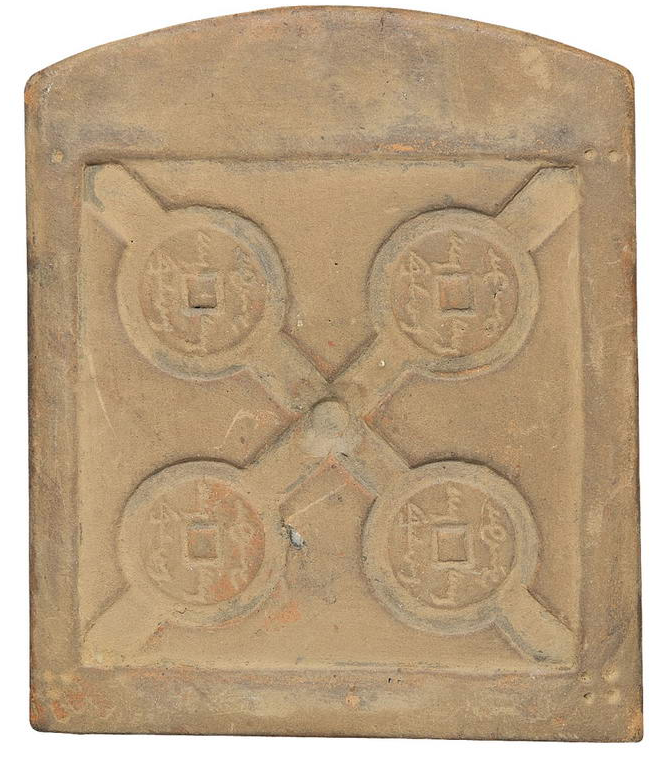
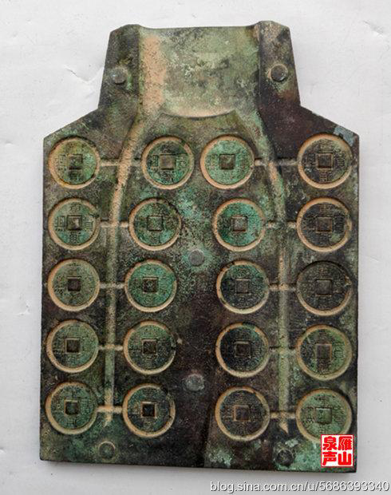
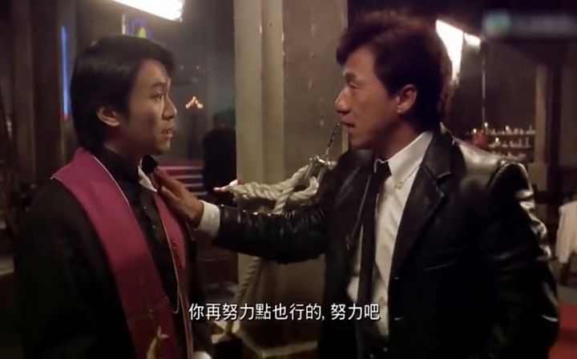
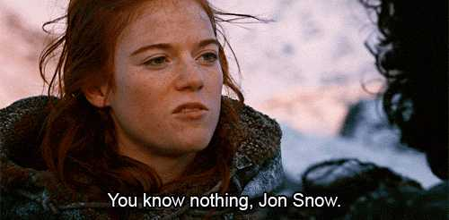
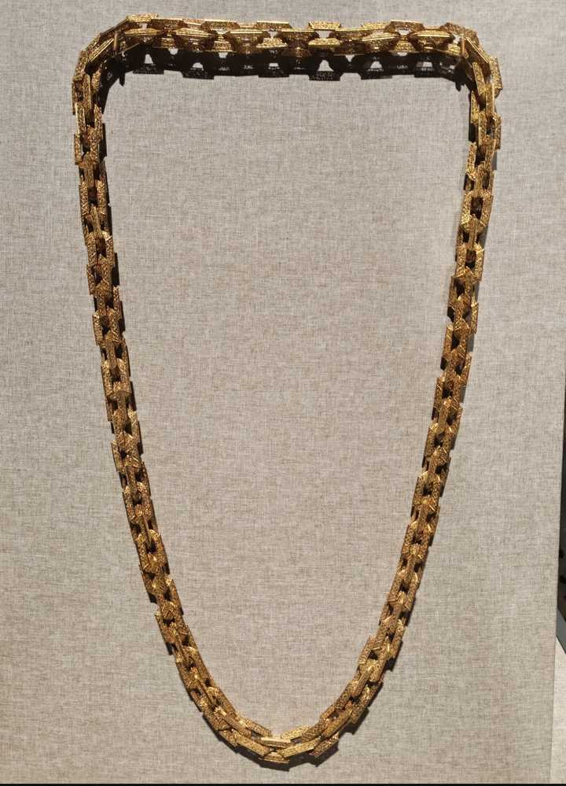
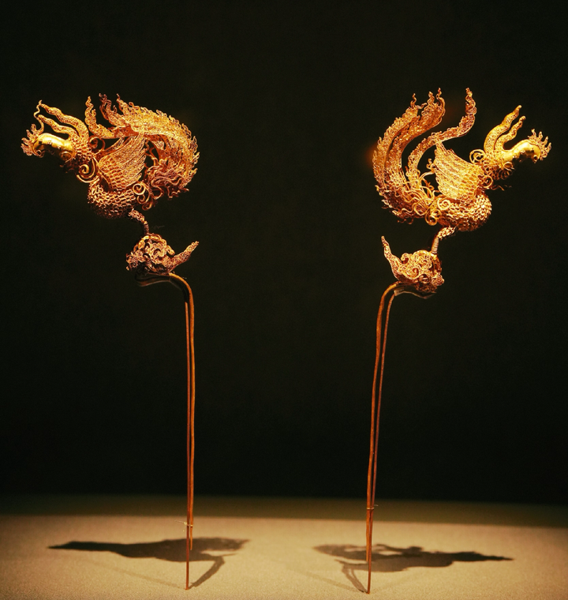
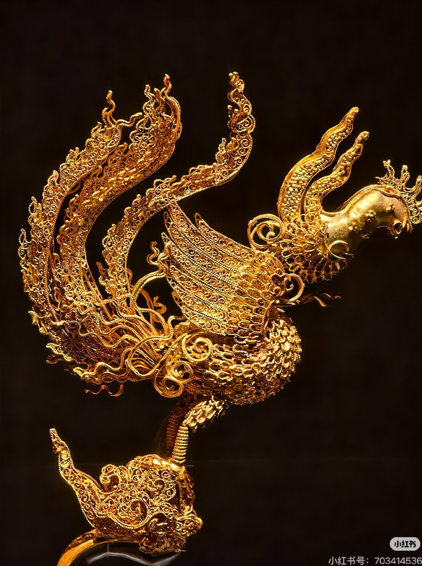

# A03　认识论事实与论证　第 2 册（共 2 册）

- 专题代码：A03　专题名称：认识论事实与论证
- 专题界定：事实、证据、定义、论证、批评与语言边界。
- 本册：第 2 / 2 册　收录 202 篇　正文字符 195,652
- 语料：`sooon-q9adg-articles-v2.jsonl`（4,305 篇）　SHA-256：`cdc9c271309e1d71d9708889a3a31f4777e0c339ea54c3753521894afdb8357d`
- 生成时间：2026-09-27T00:01:00.997126+08:00　排序：发表日期 → 源序号（全库唯一，不重复）

**标记约定**：`【待审】` 主题仍为暂定；`【排除候选】` 图片/正文过薄的剔除候选；
`【正文标注未完待续】` 作者原文自带未完标记；`【正文缺失片段（复核已记）】` 复核记录已确认的正文缺口；
`【图片缺 N 张】` 源图不可获取。标记只作提示，不改写原文、不改动分类状态。

---

## 2379　极端

- 日期：2023-02-26　主专题：A03 认识论事实与论证　副专题：A10
- 源 ID：`ad712486-08b3-5dd2-9cda-a0ed5dbb540c`　原文链接：https://www.zhihu.com/question/554206093/answer/2911183175
- 官方对象—实践路径：与自然 / 与科学 / 质疑
- 23 概念标签：定义与达意;责任与后果;边界与许可;法律与秩序;宗教与自然法
- 证据状态：manual_confirmed　初读：read　独立复核：not_reviewed

**问**：通过将一个观点极端化来反对这个观点，这种反驳方式叫什么？有无术语？

有啊，叫“归谬”。这个不是常识吗？
所谓归谬，就是顺着对方的法则寻找明显荒谬的实例，迫使对方修正主张。这是再普通不过的合法、正常的怀疑，是学术辩论不容剥夺的正当形式。
少来“极端化”这一套，这不过是理屈词穷后的流氓战术——靠谩骂和暴力强行取消对方置疑的资格，回避问题。说不通就说不通，你为什么恼羞成怒？因为你自以为神的美好幻觉被人打破了，如此而已。
上帝才有完美的法则，掌握着一切精准的定义，你本来就没这个能力，你做的界定有问题、有漏洞、有可归之谬，实属人类的平常事。这只不过证明了你是个人，不是个神，你愤恨什么？
一方面，你完全可以尝试修订自己的法则补齐漏洞，没人能剥夺你的修订权。就以“高铁该不该准备卫生巾”为例，主张者举出的原则如果是“高频出现的不便”，那么当人拿出“除颤仪”“输血包”这类有明显荒谬感的例子归谬时，就要负责定义“高频”和“不便”，将这些例子证明为佯谬就可以了。
一半的乘客为女性，因为月经不调而意外出现月经的概率很大，远远大过火车上出现心脏病突发。所以可以支持前者的法则并不支持后者。这不就解释完了？用得着什么“极端化”的罪名？
于是这是什么？就像下象棋，对方将了一军，你本来平炮就可以顶住马腿，结果你把棋盘掀了。
另一方面，即使你的法则不能完美的解决一切归谬，这也并不意味着这法则就荒谬到毫无价值。只要没有更完备清晰的法则可以顶替它不可替代的作用，那就还是得用它。就算这个法则有尚未厘清的少数微妙情况，也可以依赖特赦、特许这类超逻辑补丁来修订。
举个例子，“不可杀人”这么基本的法则，都有“海难漂流者合谋吃人是不是应该处决”的问题。给提出这个学术问题的人可以扣“你干嘛这么极端化”的大帽子打死，明天活生生的案例呈上法庭了，你要怎么说？

即使“不可杀人”这样基本的法则也一样有难以处理的罕见微妙案例，需要用特赦、特许来补救，何况各种规章呢？所以有什么必要因为有人指出了这些法则的笨拙之处而恼羞成怒？那不过是因为立法者自己暗戳戳的想要维护那个全知全能、从无谬误的神圣完美幻觉而已。这是一种无能和软弱的双重发作。
如果你们仔细看，会发现这几千个答案里，并没有“极端”这个罪名——甚至都没有“极左”“极右”这种无意义的定罪。这是个多余的概念，养成不用它的习惯。
因为用它其实很丢脸。

---

## 2370　最佳实践

- 日期：2023-03-05　主专题：A03 认识论事实与论证　副专题：A10;A07
- 源 ID：`83216918-10ca-50fe-8096-ba513caaa278`　原文链接：https://www.zhihu.com/question/587292013/answer/2921769076
- 官方对象—实践路径：与自己 / 与原则 / 变通
- 23 概念标签：定义与达意;能力与学习;选择与自由;责任与后果;爱与回应;权力与异议
- 证据状态：manual_confirmed　初读：read　独立复核：not_reviewed

**问**：如何看待罗翔评「一人犯罪影响家属考公」，称「不能突破『无罪不罚』这个底线」？

“理论和实践相结合”是一句说烂了的老话。
谁都知道“理论一定要和实践相结合”，但是一到应用了，就有人要抓狂——
如果完全按照理论实践，基本上等于睁着眼睛往理论上不存在但山风吹得裤裆发凉的悬崖下跳。
但是如果你不跳，那又是明晃晃的、不由分说的背叛理论。
这情况几乎在所有的社会伦理、管理实践、运营实践里都存在，想不通这个关节，那迟早人要么被撕成两半——说一套做一套；要么就反智化——抛弃、鄙视甚至仇视一切理论，冠以“真空里的球形鸡”称号；要么就玄化——化身自言自语的晦涩之神，只醉心于创造精巧的自洽体系，只要老妈还不赶出门，洒家已经不再以红尘俗世为意了。
这问题在哪？
在于一个关键的要害上——人类对理论的正确实践，在客观上就仅能限于“尽可能”三字而已。
“尽可能不杀人”就是人类对不可杀人的理想实践。
“尽可能不欺瞒”，就是人类对不可欺骗的理想实践。
“尽可能不偏私”，就是人类对不可偏私的理想实践。
看清楚，理想实践——ideal，至高、最佳、极致了。
这话具体是什么意思？
意思是你要停止指责人“没有实践xxx原则”，而要转而仅仅关注“是否还有进一步贯彻xxx的空间”。
对人类而言，只有通过证明“明知还存在着进一步逼近的空间但却拒绝前进”，才构成合理的过失和罪行，才能产生真正有力、有价值的批判。
你要转变你的过失观——
没有做到、没有实现，并不为过失，并不产生可追究的责任和罪。
有显著的努力空间，但却有意不去极尽这个可能，这才构成可以追究的责任和罪。
罪的根据，并非来自“未能符合理想”，而仅仅来自“未尽可能”。
你要学会接受和赞赏人们善尽的可能，并且停止不自觉的将“没有达成理想状态”视为“背叛理想”。
善尽可能，就是人类对理想最大可能的热爱。
相信和遵循这样的过失观，则是理想对人类最大可能的热爱。
此念一通，云开雾散。

---

## 2346　不专业专业

- 日期：2023-03-17　主专题：A03 认识论事实与论证　副专题：A04;A16
- 源 ID：`a564dbd0-8e12-540c-81d7-f0209112ceda`　原文链接：https://www.zhihu.com/question/587644159/answer/2940979076
- 官方对象—实践路径：与自己 / 与能力 / 获取
- 23 概念标签：事实与证据;能力与学习;成本与总账;信用与信任;技术与工程
- 证据状态：manual_confirmed　初读：read　独立复核：not_reviewed

**问**：睡前消息评论区总说“原来觉得马督工说的有道理，直到他说到我的专业”反映出一种什么现象?

这个问题其实很重要，值得专门说一说。
那就是“不专业”也是分对错的。
正确的不专业，是指判断的结果与专业的结果之间的差异在于精密度。
比如，预测炮弹落点，正确的不专业可以猜到方圆十里地，而专业可以准到百米圆半径，甚至是十米圆半径。
而错误的不专业，则是指不专业到说错了炮弹的发射方向，落点与专业的判断之间的差异不是精度差异，而是方向差异、原则差异。
注意，这里没有拿“最终事实”来做衡量基准，而是以“专家共识”为比较基准。
这主要是因为拿“最终事实”做标准归根结底是一种马后炮，更不提“事实”本身是一种神秘事物，难以界定。

之所以要区别这两种不专业，这涉及到你的成长策略。
那就是你要合理的分配自己的资源，寻求广博的、正确的不专业，而不要过早的寻求单薄的、定向的专业。
这可以说就是“好读书，不求甚解”的一种规范表达。
这个不求甚解，绝非不求解、或者求了解不去验证，而是指求到“虽不中、亦不远也”的解，这个解也的确禁得起考验。

那么问题来了，为什么你要追求这样一个“充满正确的不专业”构形呢？
因为以下几个原因：
1）可靠性是撞破数量级城门的可靠攻城锤。
精确本身就是多重“虽不中亦不远”的可靠猜测的迭代。
一个掌握着足够多可靠方法的“外行”想要得到和专业人士同样精度的结论，往往障碍在于成本和时间，而非可能性。
换言之，判断可行性、可信度、可靠度、风险性的能力（本质上也就是批判能力），就是精确性的充分保证。
2）特定问题上的专业，可以从这个能力构造里里涌现出来。
你很容易依靠多重的检验机制去多次修正出对一个陌生问题的“虽不中亦不远”的看法来，从而使得你在这个新的领域里一开始就站在足够的高度。
如果这个新的领域足够小众，或者对人类足够陌生，那么你这个“亦不远”已经是人类巅峰了。
这时候你就是“专业”本身。

陷阱有两个——
第一个就是为了贪图“专业”的虚名和实际上不可靠的安全感，过早的特化了自己，将过多的智力资源分配到了提高特定领域的熟练度、用在了把特定的小数点往前推一两位上。
第二个就是只求“广博”，但却没有养成足够强烈的批判能力。博则博矣，但却亦发难收。
可以轻易的生发或寻得大量的资料或想法，但在这个原料之上构建出来的结论，却与这些资料和想法缺少无可挑剔、无可挑战的钢铁般的逻辑关系。
这样就会造成“错误的不专业”。
也就是说其结论不是在专业人士看来是正确的，只是不够精密、不够确切、不够简洁，而是徒具看精密又确切的外表，但是在专业人士眼里看来却是错的。

记住下面这段话：
在3.1415926看来，3.1416、3.14、3.1，甚至3，都是正确的不专业。
而2.2673789，则是错误的不专业。
你要接受甚至拥抱“不专业”，但是你要始终坚持正确的不专业。
正如你不但不要恐惧、甚至要勇敢的去犯错误，但一定要坚持去犯正确的错误。

你可以——而且在绝对意义上必然地——不专业。
但是对不专业这件事本身，你必须专业。

---

## 2347　范式

- 日期：2023-03-17　主专题：A03 认识论事实与论证　副专题：A15;A18;A14
- 源 ID：`069ef4c4-d307-59ec-b72f-d6257ad68297`　原文链接：https://www.zhihu.com/question/21629921/answer/2939881657
- 23 概念标签：定义与达意;劳动与组织;技术与工程
- 证据状态：manual_confirmed　初读：needs_reread　独立复核：not_reviewed

**问**：范式（Paradigm）是什么？

paradigm就是pattern。
所谓pattern，典型的就是苏格兰格子布那种重复花纹。
引申为某种不断被重复的样式。不见得是肩并肩头挨头，也可能是大圆套小圆的递归关系，或者细分又细分的分形关系。
改成paradigm这种希腊词，是为了显得古意盎然、源远流长、富有神性。
比叫“模式”高大一些。

老实说，中文这个“范式”实属神翻译，甚至还翻译出了英文/希腊文没有的深意来了。
因为中文的“模”是指那个阳器。比如大卫的石膏模型，就长得和大卫一样。
又比如唐三彩马就可以认为是马的模型。
模是凸出的、隆起的，往往用于在其它事物上制造凹陷。
就像那种打钢印的印模，拿来往纸上一敲，纸面上就有一排数字凹痕。

而“范”呢？范是阴器，是用来铸造阳模的工具。
比如用来铸造铜钱。

模压，范铸。范和模其实不是同一种东西。
所以才有所谓“翻模”——也就是模型本身先拿石膏裹起来，等石膏硬化后，再把石膏壳取下，这个石膏空腔就构成了与模型相对应的石膏范，再往这个范内注入树脂，凝固后再把石膏范移除，就得到了原物的树脂复制品。
体会出中文的模式和范式的区别了吗？
模式，是给人模仿、复制用的，讲究的是“复用”“复现”。所以才有所谓的“模仿”。模仿物和原物长得几乎一模一样。
但是范式呢？却是如同铸钱一样，铸造出来的产物和范自身完全不相像，但是彼此却高度相似。
范式，是用来批量生产铸造体的工具，可以直接方便的大批量制造同类物品。
科学范式，就是用来生产科学结论的陶范。
学术范式，就是用来生产学术成果的陶范。
老实说，这个意思paradigm反而是没有的，实属翻译家抓住了概念的精髓，借助了汉语更强的概念解析度，实现了一个翻译上的奇迹。
翻译人家附庸风雅的样子货，真的赋予了一个更为贴近其实质功能的定义。
活活把错的翻译成了对的。

<!-- 图片：3 张，审读结论见下 -->

---

## 2340　独立思考的要害

- 日期：2023-03-20　主专题：A03 认识论事实与论证　副专题：A04
- 源 ID：`10502a49-c8d6-5367-a8b0-bbf6c8bb713e`　原文链接：https://www.zhihu.com/question/545374557/answer/2945495205
- 官方对象—实践路径：与自然 / 与科学 / 质疑
- 23 概念标签：事实与证据;能力与学习;选择与自由;责任与后果;信用与信任;边界与许可;技术与工程
- 证据状态：manual_confirmed　初读：read　独立复核：not_reviewed

**问**：真正的独立思考是什么样子？

独立思考的要害只有一个，就是独立检验事实。
只要事实是你独立检验的，
那么在自己得出结论的过程中——
可以与人讨论，
可以参考别人的意见，
可以依赖专家见解，
甚至可以经过考虑后干脆完全同意别人的意见，
这些并不威胁你思考的独立性。

对独立思考的唯一威胁——注意，是唯一的威胁——就是你把事实检验这一步也委托给了别人。
只要事实检验是独立的，那么你的思考就是独立的。
只要事实来自未经自己检验的道听途说，那么你的思考就是不独立的。
为什么呢？
我们以1+1=2为例。
这个推演一共三个要素：
1）那两个1，也就是思考的材料。
2）那个加号，也就是思考的逻辑工具。
3）你自己运用思考的工具，加工思考的材料，得到思考的结果的这个行为。
这三个要素里面，第三条这个行为，必然是你自己完成的。世界上还没有发明从外部直接介入脑部思维的技术和方法，根本就没有“不独立“可言。
剩下的两个要素——基本材料和方法——分别指向了两个你必须自己独立核查的事实：材料的真实性和方法的可靠性。
材料的真实性好理解——那两个1是不是真的是1，没准其实是1+2，张三干脆就是骗你的，或着连他自己也不清楚，就是顺嘴胡扯。
你不自己核实这两个1，你的思考结果其实一开始就被张三决定了。

你要独立的检查加法到底是个什么方法，什么叫做a+b，是不是每一次一个a加上一个b都等于c，c是多少。要做实验、要反复检验。
你要独立检验方法的可靠性，这是你的责任。
你要是自己不做实验，直接相信张三跟你说的什么“加法就是随便后面加一位”，那么你在“加法是什么”这里已经抛弃了自己的独立性了。
这两者实际上都是“独立核查事实”，所以我们说独立思考唯一的要求，就是独立核查事实。

不错，按照这个定义，你绝大多数的思考都确实是建立在道听途说（例如来自新闻或者他人转述）基础上，因而不能算完全的独立思考。
只有很少部分的事情，你可以有真正的独立检验的机会，能有机会真正的做到独立思考。
那么这里就是关键了——你要学会用自己有独立检验、独立思考所得来的结论来印证、检察那些无法直接检验的信息，以救赎那些缺乏良好条件的思考的独立性。
救不了全部，但是好歹能救一些。
救一点，就好一点。
哪些东西你是可以真的独立检验的？
例如科学实验你可以自己做，几何学结论你可以自己验证，另外还有一些人你有亲自接触，一些事你有亲身经历。
这些东西，就是你的立身之本，思考之锚，其他的一切都是借助逻辑链条铆钉在这个根基上的。
链接得越牢，独立性越强。
注意——充分独立，不意味着你一定会“反主流”、或者一定会独特。
只能靠独特性和反主流性来获得“独立感”，这是一种可悲的代偿行为，实际上毫无意义。

不要拿“反主流性”当作独立思考的证据；
也不要拿“不与人交流”当作独立思考的手段，
更不要把“认同别人的看法”当作独立思考的失败。

记住，唯一的要求，就是独立核查事实。

举个例子：
丹东一93岁老人向社区申请看病被拒，老人在社区门口上吊身亡，你怎么看？

---

## 2330　主见与犟

- 日期：2023-03-28　主专题：A03 认识论事实与论证　副专题：A06;A07
- 源 ID：`91bc2e0a-1360-597a-8e6f-15f60b00a5ae`　原文链接：https://www.zhihu.com/question/44835903/answer/2957982666
- 官方对象—实践路径：与合作者 / 与共事者 / 协作
- 23 概念标签：定义与达意;选择与自由;责任与后果
- 证据状态：manual_confirmed　初读：read　独立复核：not_reviewed

**问**：请问有主见与犟的区别是什么？

你为主，我为副，有了问题理当你做决定，出了事该你负责，你不完全依照我的意见，这叫有主见。
我为主，你为副，有了问题理当我做决定，出了事该我负责，你不完全依照我的意见，这叫犟。
这跟决定的结果最后是好是坏无关，只跟谁负首要和最终责任有关。
不用看了，这就是正确答案。

---

## 2305　摆脱思路

- 日期：2023-04-15　主专题：A03 认识论事实与论证　副专题：A04
- 源 ID：`8deb5ccb-6632-56a6-aac0-e03a1d8aab81`　原文链接：https://www.zhihu.com/question/595612282/answer/2984361736
- 官方对象—实践路径：与自己 / 与信念 / 形成
- 23 概念标签：事实与证据;信用与信任;爱与回应
- 证据状态：manual_confirmed　初读：read　独立复核：not_reviewed

**问**：如何才能摆脱，不局限于作者/表达者的思路？

来，第一章，先教你1+1=2。
你回去买一个苹果一，又买一个苹果，哎呀，有了两个苹果，“简直神了”。

接着你翻开第二章，是除法。
哎呀，回去一检验，居然也对，真的神了。

翻开第三章，因式分解。拿来算账真的很平。

第四章，二元一次方程，匀加速直线运动，抛物线。
果然每次都预测到落点耶～
……
第二十八章，薛定谔方程，波函数，质能转换方程……
一直都命中应验。

你现在恐慌了——“难道我就这样一直跟着这位作者的思路走吗？”
“不行不行，天哪噜，这样我就失去自我啦！我就被作者局限啦！”
“从明天开始，我决定圆周率等于4！我要独立思考！独立人格！”

你自己说，这是不是世界上最大的愚蠢之一？蠢在哪？
看清楚上面的过程，上面反复出现的要素只有“同一个作者吗”？
你真的是在“跟着作者的思路”走吗？？
你是在跟着实践检验走！！

你要是纯因为莫须有的原因乱跑，那么你不是在扬弃作者，你是在扬弃实践检验的结果。
你只是在跟着实践检验前进的路上，恰好与这作者指出的路线重合。
什么时候实践检验不支持，你自然而然会继续跟着实践检验走而不是跟着作者走。
只要你每一步都别忘了与事实相结合、以事实为准绳，谁的东西你都可以随便看。
你光看而不实践检验，想纯靠“一个人不可能这么正确”这种伪方法论，用所谓的“兼听则明”大法，仅仅通过到处问来“接近真理”，你真的以为结果会是“兼听则明”吗？
你错了，排除掉实践检验根定锚的“兼听”，其结果总是一切立场的彻底丧失、一切价值的彻底消灭、一切结论的彻底崩溃。
越“兼听”，越愚蠢。

你是在跟着“回去一试果然验证”走，你不是在跟着名家走。这看上去是在跟着某个名家走，那是因为这个名家恰恰也是在跟着“一试果然验证”走，所以你才一直发现对方的足迹早在前头。
在正确的认知循环里，“在长达数年甚至数十年的阅读里长期发现一位作者的话始终验证”是一个极其普遍、极其正常的现象。
你跟了牛顿十几年，跟了爱因斯坦几十年，你咋每天浑然不觉？
说句实话，“言必有中、八九不离十”，只不过是严肃对待思考和叙述的人的及格线而已，根本就不难做到，没什么可大惊小怪的。

---

## 2302　演员的自我修养

- 日期：2023-04-16　主专题：A03 认识论事实与论证　副专题：A11;A18
- 源 ID：`e07ef7cd-dbd2-571f-b8d0-39b3970e5f9a`　原文链接：https://www.zhihu.com/question/401784281/answer/2986287024
- 官方对象—实践路径：与自己 / 与信念 / 转变
- 23 概念标签：选择与自由;人工智能与机器;心理与主体;宗教与自然法
- 证据状态：manual_confirmed　初读：needs_reread　独立复核：not_reviewed

**问**：我弟的观点是人的一生命运早已注定，我该怎么反驳他？

人们之所以会有“命运早已决定”的想法，很大程度上是来自对经典物理学的感悟——小球在坡顶放手，到达坡底的时间、速度、状态是可以计算出来的，小球自己根本无力改变手为它做的安排。
而更进一步的，根据这种思想，从放开这一刻开始往后的每一时刻，小球的状态都可以被物理原则锁定，理论上似乎只要算力足够，对初态有彻底的了解，小球从此刻开始直到宇宙毁灭的每一瞬间的命运都可以被准确的预言。
如果要改变这个预言，则那只隐蔽的大手就会在对不上的物理账目中被发现。
所以，连同上帝也被认为只是上好宇宙的发条就离开了的钟表匠。于是有人——譬如牛顿——相信，即使有上帝存在，也改变不了人类的命运早在历史的开端已经被决定的逻辑现实。（在牛顿之前的加尔文派所宣布的预定论，在很大程度上可以说是某种历史现实催生出的政治正确，性质类似加拿大议员全票同意新疆有种族灭绝。）
实际上，是牛顿力学把加尔文的政治正确升格到了客观真理的高度。
问题是，物理学并不是一块“一动手脚账目就会对不上”的数学铁板。
还记得薛定谔的猫吗？不记得的可以去回顾一下，你就会发现实际上猫的死与活这两种截然不同的宏观结果，同时都能与一切其他物理规律的运转完美和谐。绝不会出现“根据对其他物理定律的运转情况的总体观察，我们可以断言只有猫活着这种结局可以不造成矛盾”这种问题。
因为如果存在这样的可能，只要构造一个足够孤立的实验系统，我们根本不用揭开盖子，就能通过某种巧妙的设计，做到通过“我手上已经有了一张王”，来断定“你没有大火箭”——从而准确的预测猫的死活。
换言之，在量子世界里，上帝可以在测不准原理的绝对隔绝下，毫无顾忌的改变量子状态，给宏观世界造成生死之别，却在物理学家的全体围观下，不露出一丝破绽。
注意，这不是在说你的命运就肯定不是预定的，而是在说，上帝如果打算干预你的命运，祂是有至少一种已知可用的、不破坏物理定律、却又近乎不受任何限制的手段可用的。
事实上，你会惊讶的发现——假设上帝想要用量子级操作来塑造世界，如果完全依赖无机物质，那就得靠从量子扰动开始，像多米诺骨牌一样通过下级变化破坏上级脆弱平衡……最后触动山顶的雪块掉落，一直滚到山脚下带动雪崩的“球碰球”方式。
这可远远没有打个响指触动一次神经放电，让一个老头子一激灵从浴缸里蹦起来喊“EUREKA”来得快和便宜。

注意，到这里，我并没有证明“人的命运肯定不是预定的”，这只是在说“认定人类的命运不是被预定的并没有逻辑上不可解决的问题”。

现在，我们再回到最不需要争论的立场上来——我们就假定本宇宙的上帝就是这么轴，别的同行怎么样祂不管，反正祂是真的上好发条就去刷素问 （此为硬广植入，嗯） 去了，这个宇宙的人类的命运的确是预先确定的。
那你就乐不起来了吗？

几乎每一部电影的剧本都是写好的，但这并没有妨碍演员们享受表演的过程。
你看那么多影帝做了那么多访谈，片场轶事聊得飞起，连外场观众都充满了快活的空气。ta们有谁因为知道是在导演管理下演固定剧本而痛不欲生吗？
哪怕这个导演非常狠厉，恨不得拿人当提线木偶，一个微笑重拍五十八遍，演到演员在化妆室里哭泣，不是事后还是像高考和军训一样，成为被津津乐道的回忆吗？
可见，“剧本是固定的，也只能按导演的要求演”和“快乐的体验”之间并不存在不可调和的矛盾。

更进一步的，不知道你们有没有体验过那些现场调动观众参与的剧——就是演员会突然走下舞台，随机拉上一个观众进剧情中的那种“先锋戏剧”。
是这样——如果你多买几张票，反复多看几轮，你会发现每一次不管拉的是哪位观众，这些“拉入”都是预先设计好的。观众在演员诱导下会做的反应，是通过心理学研究和实践检验早已被算定而预定的，只是观众自己不知情罢了。
那么，这些早已落入算计中的观众演员一定会痛苦和绝望吗？
这么说吧——有些人一次又一次的买票，就为再被选中，搞到剧团都要躲着ta。
再来点更通俗的——性感女郎点你上台，拿大锯子给你锯两截，你上半身还在得意的朝兄弟招手呢。
所以，不要做那个魔术师看过来就往桌子下面缩的人——You are missing all the fun.

<!-- 图片：2 张，审读结论见下 -->

---

## 2295　内容深度

- 日期：2023-04-18　主专题：A03 认识论事实与论证　副专题：A01;A04
- 源 ID：`7c674fda-816b-5c2f-ae88-3d6dec68d0b7`　原文链接：https://www.zhihu.com/question/581143558/answer/2988730600
- 官方对象—实践路径：与自己 / 与能力 / 运用
- 23 概念标签：定义与达意;能力与学习;选择与自由;责任与后果;人工智能与机器
- 证据状态：manual_confirmed　初读：read　独立复核：not_reviewed

**问**：在你看来，如果说一篇文章有深度，这里的“深度”指什么？

一种论述是否有深度，存在一个非常简单的测度方法，即它对于多少问题的解决提供了价值。
这种价值你可以用 sooon.ai 直观的体验一下——
向它提出你的人生疑问，例如“什么时候才是辞职的最好时机”“我是否应该选择继续升学”“什么样的朋友不可交”“怎么提高厨艺”“乌克兰未来会怎样”等等等等，sooon.ai 会根据你的问题为你匹配到相关的回答。
你可以查看它匹配的结果，这些结果未必能直接解决你的问题，但有相当大的概率能为你原来一筹莫展的状况带来新的变数。这种变数，就有希望被你自己孵化成新的方法、新的解决方案。
这就是所谓的“对你的问题的解决提供了某种价值”。
一篇文章能对越多、越难、意义越要害的问题提供这种价值，它的深度就越深。
这是一个绝对有效的方法，你自己在撰写任何东西的时候，也应该注意这个维度，这可以极大的提升你的创造性的价值凝聚水平。

---

## 2288　真相

- 日期：2023-04-21　主专题：A03 认识论事实与论证　副专题：A01;A12
- 源 ID：`6d74fa65-e528-5cf9-871a-a575f835d736`　原文链接：https://www.zhihu.com/question/20304990/answer/2993432838
- 官方对象—实践路径：与自己 / 与欲望 / 节制
- 23 概念标签：事实与证据;定义与达意;能力与学习;选择与自由;责任与后果;成本与总账;边界与许可;心理与主体
- 证据状态：manual_confirmed　初读：read　独立复核：not_reviewed

**问**：如果真相让人不幸福甚至痛苦，为什么要知道真相？

人要分清楚一个至关重要的问题——是真理让人幸福，而不是“真相”。
人要孜孜不倦的追求真理——即追求尽可能深刻而全面的了解这个世界运行的真实法则，但是对于“真相”——即这个世界真实的运行状态——却需要采取明智的态度。
因为种种迹象表明，这个世界的真理具有内在的和谐性，乃至于最终可以归化到极简的基本形式，这是一个可以追求的目标，而且即使最后不能完全成功，也可以说是进一分有一分的欢喜，有一分的收获，其边际效用不但不是递减的，而且还是增加的，是个人生命少有的绝对物有所值的可靠的长期投资方向。
越学越通，越通学得越有效，越有效则越发境界精进，这是正循环过程，只是在漫长的启动阶段有些难捱，但坚持不懈，后面会越来越快，越来越强。
但是“真相”则不然，甚至完全相反——
首先，人类缺少完全接受真相的生理基础。这不仅是指人类的视野容量有限，无法装下完整的真相信息而必然有所片面，同时也指人类的情绪反应对大量的事实有过渡应激反应，无法承受全部真相的情绪冲击，而容易导致失能。
举个例子，我打定主意无论顾客是什么态度，我都要保持良好心态，那么“顾客在背后是不是辱骂我”这个“真相”，我就不想知道。知道了只会对我定意要做的事造成额外的情绪成本，不会有任何的好处。
这必然的要求你对自己的“真相渴望”有一个系统的管理策略。你一定要有一个“某些事情我不打算了解”、“某些真相我不打算知道”的原则方法，并且根据自己的实践结果去不断地修缮、打磨、改进这个策略。
具体这个策略是什么，你可以再去诸子百家的了解一番，但是对“必须存在一个主动排除某些信息的判断法则”这个基本原则，你是不必犹豫的。认为“无论如何知道一切真相永远最好”，这并不是一个正确的行为。
在这方面，有一个比较经典的做法你可以参考，那就是孔子的“非礼勿视，非礼勿听”——不合原则的信息不接受，也就是不超越原则的去探寻真相。
举个例子——军事机密你无权参与，那么尽管参谋部的真实意图到底是什么会极大的影响到作为士兵的你，你也不应该去非法刺探。
又比如——对方到底心里在想什么，这是对方的合法隐私，尽管这些想法会极大的影响你的利益，但你也同样不应该去强力逼问。
你要学会仅仅基于合法的知情权和客观流露的信息为基础作决策，去打好你的牌。
以上的策略可以打个具体的比方，例如，认知行为学、会计学、物理学你要学好，但却不要去翻人家的日记查人家的银行记录。
你的安全追根到底不是靠你对别人多知根知底，而是靠一个综合的安全策略——这个在另一篇谈安全感的回答里有，不再赘述。
你构建好了自己的安全策略，你就对很多具体的运行状态不必关注了，对所谓的“真相”也就没那么大的强迫性需求。
你将会生活得快乐轻松得多，会更容易笑出声来。
是真理使你自由，不是真相。

---

## 2282　达意责任

- 日期：2023-04-23　主专题：A03 认识论事实与论证　副专题：A07
- 源 ID：`6647e494-2b80-57af-b903-a1b541d9fbf6`　原文链接：https://www.zhihu.com/question/597272355/answer/2997235157
- 官方对象—实践路径：与合作者 / 与共事者 / 协作
- 23 概念标签：定义与达意;能力与学习;选择与自由;责任与后果;成本与总账;信用与信任;财富与市场;技术与工程
- 证据状态：manual_confirmed　初读：read　独立复核：not_reviewed

**问**：如何与表意不清晰的人相处？

每个人都要为自己的表达承担达意责任，这是一种基本服务。
这一责任有两个部分，第一个是把意思说清楚，第二个是自行承担别人误解的风险。
第一部分——也就是把意思说清楚这部分——比较简单，我们不多说了，因为只要你承担第二部分的责任——也就是你无条件的认定“只要事后证明你没听懂就是我的问题”，那么第一部分的表达技巧随便你做到什么程度，都不影响别人和你的沟通。

这里首先要解决一个问题，为什么一定要采用“自负达意责任策略”？为什么不能把误解的责任归结到对方故意捣乱上？
简单来说，这是为了“千金买马骨”——也就是通过降低门槛，获得最大的交易对象的选择余地，然后再靠“愿意跟我说话的人多的是，我有得挑”来挑选出对你成本最低、风险最低的对话对象。
如果你一开始就采用“你听错了是你的责任而不是我的责任”的策略，那么从一开始你就会没有任何选择余地——因为从对方的视角看来，你远不如那些自负达意责任的人来得友好，跟你说话简直是无缘无故的冒险吃亏，对方很自然的会优先选择和那些自负达意责任的人谈话，而不是和你。你将失去这个对话伙伴，而且是不断的失去、再失去。
最后你一个肯对话的人都没有，你自己把自己的福利设计得再好也是白忙一场。所以，你其实没有选择，必须公开宣告自行承担达意责任。
然后我们再看第二个问题——对这个“只要你没听懂就是我的问题”，很多不理解的人会觉得非常苛刻，甚至觉得残酷，觉得自己完全不能接受。主要是害怕这样自己会吃很大的亏，要赔很多钱。
其实这是多余的担心。
因为“这是我的问题”并不一定意味着多大的赔偿损失。有多大的损失，取决于你在做的这场对话涉及多大的利害关系。如果你是在谈几个亿的项目，按照这个条款你才可能会有巨大的亏损。
问题是，当你自己都做不到足够的表达强度、自己把话都说不到无空子可钻，你为什么要跑去跟人谈几个亿的项目？
你怎么能知道自己的水平已经无懈可击到了能谈几个亿的项目也不会出问题的程度？
恰恰要通过先在“完全自负达意责任”的条件下，从10块，15块，30块，100块……1000块，10000块……这样的规模上，一步一个脚印的测试上来。
你在10，20，30块的阶段，就要有人愿意当你的陪练，让你练出这个滴水不漏、直指要害的表达能力。这个时候，你是承担得起这份学费的。
拿学费喂出这个“不抱住人的脖子就能横渡长江”的游泳技术来，再去横渡长江。
而不要练那种“抱着人的脖子的游泳技术”。
而那种“出了问题全怪你不认真听我说话”的对话方式，就是这种“抱着对方的脖子的游泳技术”。你练得再出神入化也没用。
等你坚持着用“达意责任完全自负”的模式练到一定程度，你将获得两项关键资产——足够好的表达能力和足够多的可靠的对话对象。
这两者都不见得完美——所谓“足够好”，未见得好到可以拿诺贝尔文学奖或者经济学奖（which is another kind of 文学奖）；所谓“足够多”，可能也就是长期共事、交往的这么七八上十个人。
你很可能只是表达能力好到了这七八上十个人不会误解、也不会对误解的后果感到畏惧的程度。
但这就已经够你安身立命、够你对一切其他的挑剔不作回应的程度了。
只有你不满足于仅仅安身立命，你还想建功立业、改天换地，那么这份修炼对你就是无穷无尽的。
但是，这个“达意责任完全在我”的原则始终都是不可动摇的。
达意责任完全在我，所以你可以选择要不要主动承担理解责任。但你要掂量清楚，愿意与我对话合作的人千千万万，我毫无疑问会选择对我成本最低的人。
你要选择不承担任何理解责任，那么我说话算数，肯定不会让你承担任何沟通失败造成的损失。
但是你要对接下来失去一切继续交易的机会有心理准备，这就由不得你了。
你坚持顺着“达意责任自担”的原则走下去，你就有希望有一天站到一个如此强势的地位上来——对方不仅不会随便将任何多余的表达责任分配到你身上，乃至于自己自动的、争先恐后的承担误解责任。
这就是世界对你前几十年坚持“达意责任完全在我”的回报，这个回报是由客观规律担保和实施的，没人能阻止。
现在，请你把这些话想清楚，再告诉我，这次误解所造成的损失，你是要让我来承担，还是要你自己承担。
你刚才说的话，我没听懂，接下来是要算作我的责任，让我向你道歉，并且让我去重新读一遍，还是要算作你的责任，由你向我道歉，并且让你去重新说一遍？
是你道歉，还是我道歉？
你来选吧。

---

## 2277　判决书漏洞

- 日期：2023-04-25　主专题：A03 认识论事实与论证　副专题：A05;A16;A10
- 源 ID：`08f1e3d6-9014-5ff0-875e-83e71458c051`　原文链接：https://www.zhihu.com/question/589763968/answer/2999942518
- 官方对象—实践路径：与亲族 / 与子女 / 抚养
- 23 概念标签：定义与达意;能力与学习;爱与回应;照料与家庭;权力与异议
- 证据状态：manual_confirmed　初读：read　独立复核：not_reviewed

**问**：为什么女儿想跟我断绝关系，还说非常恨我，我该怎么办？

生活中常会遇到这类“我觉得我一点错也没有，但是别人却要因为这个惩罚我”的纠结情况。
而我为什么觉得“我一点错也没有”呢？
因为我可以在对方给我定罪的整个论述里找到破绽、找到不成立的地方——既然你的判决书都写得有问题、判决逻辑都有问题，那我当然就是冤枉的了，不是吗？
这是一个非常普遍的、几乎人人都会的脱罪技巧，以至于要一个人自己能心悦诚服的接受任何一个判决，有如登天之难，非得要高度专业的裁判水平、文学家、雄辩家一样的表达能力。
光这还未必够，还几乎总是必须邀集千夫所指级别的舆论规模来震慑，才有可能让一个精通这技巧的人些微老实点，勉强不敢则声而已。
就这，也不是人服了，而是看到声势浩大的舆论，出于畏惧千夫所指的社会压力，怕了而已。
正是因为这样的人太多，所以次次“评评理”都要搞到全村人端着午饭来围观。每次“讲道理”，都演变为拉人头比音量。
这个技巧由父母用在子女身上尤其有效。
一来，子女前十几年连话都讲不太清楚，要能滴水不漏的写一份父母抵赖不掉的判决书几乎是生理性的不可能的。二来，子女势单力孤，而父母往往至少还有个老伴打辅助。如此劣势的局面，父母要祭起这个“判决书写得有漏洞”的金钟罩来，怎么会不次次得手呢？
而子女看了十几年的《金牌律师》，又怎么会不对这种超级实用的“辩护技巧”耳熟能详、又妒又羡？于是子女又怎么会不学起这门家传绝学，行走江湖呢？
其实我们身边这种“判决书用错了标点符号所以我没罪”的事情多不胜数。用上这个技巧，人确实可以摆脱大部分自己想要摆脱的罪名，但是滥用这种技巧不用说是明显有毒的——这几乎会抹去你一切有所成就的可能性，如果子女又沾染了这个习惯，视其为天经地义，那么连子女的前途也会岌岌可危。
有人指出问题，并不会因为这人自己的论证有问题就肯定意味着所指出的问题不存在，这其实也是“独立思考”的一部分。

---

## 2278　健康卡

- 日期：2023-04-25　主专题：A03 认识论事实与论证　副专题：A09;A05;A08
- 源 ID：`bb31016b-1561-559f-911b-381e3b9c3355`　原文链接：https://www.zhihu.com/question/595425019/answer/2999393456
- 官方对象—实践路径：与自己 / 与原则 / 建立
- 23 概念标签：定义与达意;能力与学习;选择与自由;成本与总账;信用与信任;爱与回应;照料与家庭;心理与主体;性别与身体
- 证据状态：manual_confirmed　初读：read　独立复核：not_reviewed

**问**：钱多钱少无所谓，身体最重要，真的是这样吗？

不出意外的话，你会一年比一年更了解这个社会的规则和需求，也一年比一年更有经验和能力。
那么你在退休之前创造价值、获得收益的能力应该是逐年增长的。
如果你用很简单的复利模式来模拟你的整个能力增长曲线，你就会很简单的发现几个很关键的数学结论：
1）积累开始得越早越好。
2）积累持续得越久越好。
3）积累越少中断越好。
尽早开始是有极限的，你总不能指望小学没毕业就开始赚钱。
积累中断主要指因为种种原因中断职业生涯，例如失业、改行、感情打击、疾病事故等——这里面最大的危险实际上是抑郁症。但你也不要过于恐惧，某种意义上说，这些打击的效用并不见得全是负面的，它们往往对你的人格成熟有很强的塑造作用。甚至可以这么说——可能这对现代人是一个必然的成长阶段，以替代无所不在的死亡和灾难在古代起到的塑造作用。
何况，你们能看到这篇东西，意味着你们应该已经看到了这几千篇答案所织成的安全网。这可能并不会帮助你们直接避免这些艰难的时刻——如我们所说，这些艰难痛苦可能对你是不可缺少的人生体验，但是应该对你能挺过这番磨练有相当大的作用。
而这两条之后，就是第三条了——健康可以延长你的复利增长周期。
这就像10000块钱以5%的年复利存在银行，存第30年和存第31年的收益是不同的。如果你的健康状况很好，比如好到可以存到50年，那么第50年的收益又会远远大于第31年。
最后的那几年，是你收益最丰盛的几年。而你的健康则决定了这样的黄金时段能持续多久。
这很有点像承包荒地种树，前几年你都得等果树长大，等第三年果树长成开始收获了，结果你承包期到了，岂不冤哉？
但是——注意这个“但是”——健康的价值仍然不是“无限”的。
之所以把这个数学模型列出来给你看，就是因为这个模型可以给健康一个确切的定价，而不是给它一个意识形态化的“无限价值”。
因为一旦拉高到无限价值，那么你的合理选择就成了“门都不要出，在家吃着黄瓜生菜鸡胸肉做平板支撑以度残年”。而这个模式几乎毫无疑问会对你的社会价值也罢、个人收益也罢造成数学上显著的沉重打击。
这整个分析的要害其实不是谈论健康——它真正的价值在于，你要对一切价值在何时、何处具体为何值有一个相对确切的、可以有效比较和取舍的模型化认识。
你会从这个模型里看到什么时候、什么情况下把什么放在什么样的优先级上，并且保持多久。
正确的策略总是具有强烈的音乐性，如同多个声部循着某种原则此起彼伏的互相呼应。
绝不能含糊的乱用“无价之宝”这类定性。
因为“无价之宝”说实话装满了你所有的口袋——何止你的健康是“无价之宝”，你的信誉是不是无价之宝？你的品德是不是无价之宝？你的友情是不是无价之宝？爱情是不是无价之宝？理想是不是无价之宝？
如果你不是遵循“综合效益最大化原则”，而是遵循“被标定为无价之宝的都必须绝对保障”的逻辑，你将会发现你的策略极为僵硬，仿佛一辆长达54米、转向角却不能大于5度的大卡车，根本不敢下高速公路——但凡有一点蜿蜒曲折，你一定卡死在某个弯道上进退不得。

你具体怎么用一个数学模型把所有这些价值都摆下去，这个随你，但是要用更精细的模型管理你的价值评估，这是实现人生策略化——甚至战略化——经营的逻辑基础。
在这里只是用“健康”为题给你举了个例子。

与此同时，这也是让父母们看清楚——旧有的那种你一焦虑起来就要动用权利逼迫子女在ta们的全盘计划里把最让你焦虑的要素的权重加到100的做法，对子女并不会是一种确定无疑的帮助。
而这却是父母干预子女时最常见的模式。
很多父母在说“健康胜于一切”的时候，实际上是在焦虑于自己的、以及对子女人生指引上的迷茫，于是想要利用“健康”这张魔法牌的“再来一局”属性。
我慌了，我也不知道要怎么办了，那么你能不能注意健康，这样我可以不必这么着急，我可以好歹先放松点，给我自己一点时间？也许多给我几个月、几年，我——以及你——可以等到或者碰到或者看到什么新的机会、新的道路。
如果我们可以无限健康，那么所有的问题不就都可以用无限机会来解决吗？
这个愿望是强烈的，逻辑是朴素的，所以这张“注意健康”牌，一旦父母焦虑了就会第一时间先打到牌桌上来。
但它往往事与愿违——因为它所造成的客观效果，是通过“健康牌”传递了自身的焦虑、惊慌，以及对子女的信心匮乏和不看好。
这全是需要进一步消耗心理能量、要额外付出精力去调适的进一步的打击。
子女当然不是不想早睡，不是不想放松，但恰恰是这些四面八方从事实中传递来的红色信号，在逼得ta们不得不保持“我还在危机之中”的警觉，在迫使ta们觉得任何休息都是罪恶、是对自己的放弃。
南辕北辙，抱薪救火。
真正能让彼此放下这焦虑的，其实从实践上讲，是子女这个“用一个有效的数学模型管理错综复杂的价值体系，并形成形式上有效的行为指引”的能力得到展示和证明。
很多子女搞错了，在用自己的“宏图大业”的、野心勃勃的计划书来安抚父母。这在父母眼里犹如舵轮都掌不住、风向罗盘都不会看的船长，在雄心勃勃的展示寻找新大陆的航线规划。
ta们要看到的是你有一个“航线是怎么算出来”的基本意识，要看到的是你有模有样的计算航线的实践。其实你算错了点什么不重要，但你知道要算、而且了解基本的计算体系，知道怎么总结教训、修正计算，这个更重要——航线什么的，大可以随便改，这并不是什么“失败”，而只是人生常态。
这个“建模”工作，其实就是人生这场战役的基本参谋作业。没有令人信服的展现这种能力，你就会不断的收到“强力健康卡”。
不过呢，其实你展现了也会收到——毕竟父母这个物种是这样的习性——只不过就没那么强力，搞到要拉闸剪网线这么抓马——往往可以装傻卖萌混过去。

---

## 2257　关于“我们”

- 日期：2023-05-05　主专题：A03 认识论事实与论证　副专题：A17
- 源 ID：`7cbe3ec8-e487-58d7-aee6-f55c4733058d`　原文链接：https://www.zhihu.com/question/264946143/answer/3014201500
- 官方对象—实践路径：与社会 / 与舆论 / 表达
- 23 概念标签：事实与证据;定义与达意;能力与学习;选择与自由;爱与回应;边界与许可
- 证据状态：manual_confirmed　初读：read　独立复核：not_reviewed

**问**：如何评价“民主并不是什么好东西,但它是我们迄今为止所能找到的最好的一种制度。”？

这句话的要害既不在于“迄今为止”，也不在于“最好的一种制度”，而在于“我们”。
对说这话的“我们”而言，他们完全有立场和令他们自己满意的依据去那样认为。
这在本质上和张三说“牛肉并不是什么好东西，但是我所能找到的最好的食物”没有什么差别。
加上“我们”，这后面接任何自己喜爱的事物——哪怕是臭豆腐、鲱鱼罐头——都可以说得通。
只要“我们”知道“我们不等于全人类”这么简单的道理，世界和平就指日可待了。
问题是，“我们”在这一点上总是一阵阵的发昏。

---

## 2248　生果

- 日期：2023-05-10　主专题：A03 认识论事实与论证　副专题：A17;A01
- 源 ID：`4ed5a1e4-3d3c-5f6a-971d-e3b6d4be1675`　原文链接：https://www.zhihu.com/question/584086467/answer/3022252827
- 官方对象—实践路径：与社会 / 与舆论 / 接收
- 23 概念标签：事实与证据;责任与后果;爱与回应;性别与身体
- 证据状态：manual_confirmed　初读：read　独立复核：not_reviewed

**问**：男朋友特别讨厌黑人正常吗？

这种讨厌不用说是很不健康的，因为ta给人定罪的门槛太低了。
“因为听说和风闻而给一群人集体定原罪”，一方面表示ta缺少独立检查事实的习惯，另一方面意味着ta并不介意冤枉人。尽管对二十多岁的小男孩这是普遍现象，但是正如前面所说——普遍不普遍和健康不健康没有绝对关联。苹果在成熟之前普遍是生涩的，这种生涩当然是“正常”的，这并不意味着这些苹果适合食用。真正要面对这种风闻定罪的残酷性的是你，而不是传说中的“黑人”。
另外，小男生们要停止拿这种愚蠢行为当作“爱憎分明”来鼓吹甚至发扬。这对你们获得个人幸福或者事业成功绝不是什么加分项。就像任何人在可以选择的前提下都会极尽可能避免吃生果子一样，人对待成熟度的苛刻性绝对会让你笑不出来。个头长得再大、品种再好，在“没熟”面前也是无效的。

---

## 2250　幼稚

- 日期：2023-05-10　主专题：A03 认识论事实与论证　副专题：A06;A05
- 源 ID：`bbaae438-86aa-55f8-b358-2d29e9bddc3b`　原文链接：https://www.zhihu.com/question/20864118/answer/3022130012
- 官方对象—实践路径：与社会 / 与舆论 / 表达
- 23 概念标签：定义与达意;能力与学习;选择与自由;信用与信任;边界与许可;照料与家庭;劳动与组织;法律与秩序;权力与异议;人工智能与机器;心理与主体
- 证据状态：manual_confirmed　初读：read　独立复核：not_reviewed

**问**：觉得周围人幼稚怎么办？

觉得别人幼稚，主要注意两条：
第一，对方没有给你评价权的话，不要说“你很幼稚”这样的话。
你自己心里想想难免——这谁也控制不了，但你尽可能不要再对别人这么说。十全十美难以做到，但至少尽力而为。
即使别人给了你评价权，你的评价也只能分享给对方自己指定的人群，不能四面八方到处传播。比如你去看病就是请医生对自己的健康做评价，这显然不意味着医生能见人就说你有什么什么病——很显然，人家问都没问你，你就开始对外宣传这人有什么什么病就更不必提了。
这两条是治标之策。很多人觉得“治标不治本”是个贬义的话、衍生出一种诡异的态度——治不了本就不治标了。其实能标本兼治只是很罕见的情况，绝大多数情况你都是在治标。
举个最现实的例子，你吃饭就是在治死亡的标，吃不成不老神仙，难道你就不吃了？

2）所谓的幼稚，是指对方在依照本能的行为模式惯性前进。这或许使得对方缺少真正的自主性，但是不要小看那个主导ta的本能。
因为缺少自主性，难免使得对方自己的主观表达几乎都是无效的——ta许的愿、ta做的承诺、ta下的决心常常一度让你感动，但事实证明ta其实还不是自己的主人，根本无法兑现ta自己的意愿，这是幼稚这个中性词带有强烈的贬义根本原因——因为这种茫然无知的、无法追究的“失信特权”会让受害的人痛苦万分却又没有还手之力。让你自然而然的有报复的强烈冲动。
这种普遍存在的报复冲动给“幼稚”这个词染上了深刻的负面色彩。以至于幼稚本来是个中性评价，现在已经在文化上被染黑了。这也是劝你们不要再轻易使用这个评价的原因。
但如果这个人确实被你看出来是在按照默认的“自动驾驶程序”行动，ta只是在自己假装是驾驶员而茫然无知，这是否一定意味着“默认驾驶程序”本身不值得重视，很容易对付？
这非常的不见得。
全部的病毒和微生物都是使用非常机械的“自动驾驶程序”在活动。它们好对付吗？白蚁也是按照“自动驾驶程序”在活动，ta们好对付吗？
人类身上的自动驾驶程序是非常凶猛而且强大的，有时候它甚至会出现倒挂现象——即幼稚的人比自主的人更难对付。
举个典型的例子——子女用自杀、离家出走和不合作威胁父母，很可能是只是被强烈的情绪驱动不假思索的行为而已，但是这些行为却出了名的不好应对。女性和恋人赌气，大多数情况本人自己也说不清确切的原因，说出来的话，连自己本人也解释不了，根本不构成一个深思熟虑的计划，但是却同样不好应对。
几乎每一个你会怒斥“幼稚”的行为，你都会发现就这件事本身而言，虽然当事人只是任由情绪推着走，但这个“情绪“本身却像一名深谋远虑、算无遗策的大战略家，几乎给你能做的所有的事都预备了同样、甚至更难应对的后手。以至于经常拿出全副精力千思万想的小心应对，还是眼睁睁的看着事情走向崩溃。
这个“自动驾驶程序”自身集人类文明之大成，天生的和整个社会的构造血肉相连——有时你甚至分不清到底是社会塑造了它，该是它塑造了社会，看起来似乎它们是天生的一体。
小孩子随口说出的跟你怄气的话，ta自己未必理解这话到底什么意思，但却一下可以把你架到政治不正确的墙角动弹不得。
人虽然幼稚，但这不意味着幼稚的人如果作为对手就好对付。
恰恰相反，越是幼稚的人作为对立方越是难对付。
幼稚行为本身对于幼稚者自身有强烈的保护作用。它不属于在运行这个守护程序的主体自己，就像机算机的操作系统并不是这台计算机自己写出来的一样。这计算机的用户自己写的程序也许乱七八糟，但是这机器上原装的系统和杀毒软件水平是非常高的。

幼稚真正的问题，是它天生的有反协同性、反组织性、反社会性。
人之所以要成熟，其实并非如传说中的那样由愚蠢变得狠戾，好让侵犯者望而却步。恰恰相反，那个幼稚的本性本身就是非常凶猛和险恶的。
成熟的方向是要把自己驯化，使得自己成为容易合作的对象，使得别人不要在和自己建立关系的时候犹豫、忧虑或干脆后撤，从而可以以广受欢迎和期待的合作对象的身份获得社会的支持。
只有在“不考虑立场问题，这个行为模式会妨碍你与任何人合作”的意义上，才能将某个行为定性为幼稚。
但人们往往只是在把自认为是社会主流的观点命题视作成熟的标准，而把一切不同意的意见视为“幼稚”。
真正的幼稚指的是做题的方法，而不是指答案。是指其方法没有标准答案所拥有的方法上的有效性，不足以支撑其答案与标准答案分庭抗礼，而且方法有效性的差距大到其本人不应该察觉不到的地步，而不是指“答案不符合标准结论”。
因为仅仅盲从所谓“主流答案”的人，有一个更初级的问题——主流答案自己就在逐渐的“多元化”之中。ta们不是通过完整的推理过程来认同这些答案，而仅仅是靠复述标准答案的文本来附和一个ta们自己不理解、自己也推导不出来的“免罚魔咒”。一旦主流答案多元化，这些人就会转而用“一篮子主流答案“作为评判标准，对优质的批评本质上就会变成“你的答案和这一篮子答案都不相同”。这意味着ta们自己其实没有过方法论的训练，顶多有“直觉统计学”的经验。
而“幼稚”其实只能是对方法论品质不高的批评，而不是对结论本身的批评。这就意味着如果批评者本人不是基于方法论而是基于统计数据来持有答案，那么批评者本人是没有资格去评价对方幼稚的。
这就是为什么大部分父母批评子女幼稚都没有令人信服的力量的根本原因——因为父母自身不能同时提供方法论上令人信服的建议和指导，而是在不断的空洞的强调自己的观点是如何的主流和具有“统计优势”。
而姑且不论统计优势是否能够作为真理的充分证明，在多元化的现代，从子女的视角看去，这统计优势本身是否成立都会很可疑——在子女自己的舆论场里，显然子女所持有的观点才是“统计多数”。
所以，相当多关于“幼稚”的批评其实都是离题的，这也是父母在子女教育中最常犯的错误之一。
及时改正。

---

## 2240　无极

- 日期：2023-05-17　主专题：A03 认识论事实与论证　副专题：A16;A01
- 源 ID：`a4d8a948-6f49-52af-a2e3-b9cb175475fa`　原文链接：https://www.zhihu.com/question/418915978/answer/3031793956
- 官方对象—实践路径：与社会 / 与舆论 / 表达
- 23 概念标签：事实与证据;定义与达意;能力与学习;成本与总账;边界与许可;权力与异议
- 证据状态：manual_confirmed　初读：read　独立复核：not_reviewed

**问**：为什么往死里扫黄？

如果扫黄算“往死里”，那么扫毒、扫黑算往什么里？
记住一个基本要点——使用“最高级”定性的行为暗示了人的阅历极限和修养水平。
当你使用最高级定性，最好掂量清楚使用它的副作用，用得不好很容易让人看不起——要么你是真的只见过、听过、想象得到这个级别的东西，这玩意真的已经到了你的认知边界甚至接受力边界，要么你就是在刻意改变自己的表达想要操纵别人对你叙述的度量。
无论哪个，你得到的都不会是好果子。
所以，明白人用最高级，一般都会本能的加上“十年来”“整个欧洲”“同期”“同批”这类限定词。这样就算自己评估失误——或者准确的说，因为各种原因不被听者接受——因为有这些防火墙在，共识错位问题也仅限于定义防火墙内。
但你如果没有这些防火墙，那就不是共识错位，而是要发生对你这个人的认知能力和人品的否定，到这一步，后面的话你就不必再说了。
因为你已经把自己的资格弄没了。
很多人奇怪自己说话为什么没分量，没人听，总是归因于我没钱、我没权，但其实更多情况下问题是出在你自己乱说话，不是把自己的说话资格掰成一些小块一小块有策略的使用，而是这样漫不经心的轻而易举的一次性浪费了自己的资格。

---

## 2226　屎山

- 日期：2023-05-23　主专题：A03 认识论事实与论证　副专题：A13;A01
- 源 ID：`4e870102-4a6c-54dc-b386-ba981ecfecfa`　原文链接：https://www.zhihu.com/question/426635186/answer/3041063815
- 官方对象—实践路径：与自然 / 与科学 / 质疑
- 23 概念标签：定义与达意;成本与总账;宗教与自然法
- 证据状态：manual_confirmed　初读：read　独立复核：not_reviewed

**问**：生物的基因有没有可能是“祖传屎山”？

你知道银行的代码是“屎山”，是因为你知道银行的代码是干什么的，干不了，你就可以说它写得不行。
来，你来告诉我，你被生出来是干什么的？
你的预定功能是什么？你回答看看，你要是回答得出来，你又为啥苦苦追问“如何知道自己真正擅长的是什么”？
你如果知道你生下来就是游泳的，你发现自己漂不起来，你可以说屎山。那么你的意思是你的生存的价值就是在地球上负责游泳吗？是吗？
你都不知道你的预定功能是什么，你拿什么评估你的基因是不是屎山？如果你非要谈论谁有资格评论，这个评论者一定要预先就对人类的设计意图有确切的了解。这个存在只要存在，就是上帝。问题是上帝立刻自动拥有远超于人类以上的智能。
你这些评论就像一个辣椒在抱怨“我们太容易被人类吃掉，基因一定是屎山”。喔？是吗？那么你觉得培育这些辣椒的农民们这么认为吗？这些农民辛辛苦苦用了上百年把你培养得肥肥胖胖颜色鲜红口味温和，ta们是在犯傻吗？
谁傻？

这是其一。
其二，八十亿人类，除了同卵双胞胎，谁跟谁的基因一样？微软操作系统你可以指着某个版本说它是乱写。八十亿个彼此不同的版本，你说屎山，你具体是说谁？
你说“容易过敏”，不好意思，有几亿人不容易过敏啊。你说“耐力不好”，不好意思，又有几亿跑马拉松都不咋出汗。你具体在说谁？
所以不要跟着一些搞流量的人瞎胡闹。这整个概念都不能往基因上套，这类评论只有娱乐价值而已，在严肃的学术意义上根本无从讨论。谁说这种话，如果是认真的，只会让人觉得科学哲学上的基本认知有问题，没有学术前途。

---

## 2227　官话

- 日期：2023-05-23　主专题：A03 认识论事实与论证　副专题：A20;A10
- 源 ID：`3547d3b2-ac35-5e3e-ac66-04bd9bddfaf1`　原文链接：https://afdian.com/p/bc57cfd2f93d11edabcd5254001e7c00
- 官方对象—实践路径：与自然 / 与科学 / 质疑
- 23 概念标签：定义与达意;能力与学习;选择与自由;责任与后果;权力与异议
- 证据状态：manual_confirmed　初读：read　独立复核：not_reviewed

**问**：什么是官话？

官话就是皇室从小学到大的话，因为它的根本功能就是为了大臣向皇帝奏事。
你不按皇帝的语言习惯来，而按你不知何府何道的家乡话来，可以试试。
丑话说在前头，试出问题，你觉得下一集的剧情是怪皇帝误解了你，还是怪你误导了皇帝？是你掉脑袋，还是ta下罪己诏？
身家性命所系，你到北大找几个语言学教授来，看能不能救得了卿卿性命？
“皇上！根据这位教授的研究，我讲的真的算官话！”——好，连教授一起拖出去斩。
那有没有可能只有大臣跟皇帝之间才讲，但是整个官场讲的是另一种腔调呢？
这个你就需要了解这种层层报告的基本规则——你的下属、同僚给你做的原始报告，只要有可能，你就会尽量引用原文去向上汇报。没有谁会作死，来个“自行理解，独里表达”。
道理很简单——到时候出了问题，你拿出见证人来，证明跟你上报的转述关键词句完全相同，那么你的责任最多是失察，考级下一等而已。
但要是你“独立表述”，但凡有一点对不上榫头，你的性质就不是失察，而是“欺上瞒下”，撤职查办起步，斩监候也不稀奇。
现在问题来了，上次跟你开会的这帮同僚是福建老乡，不说官话而说福建话，那么当皇帝问你会议过程，你身上得背多大的干系？所以不好意思，你就算是福建人，我是广东人，我们也要用能直接汇报的语言来这个会。
因此，任何想要自己这辈子走到“能参加可能向皇帝直接汇报的会议”这一步的人，包括任何功名都还没考上但是雄心勃勃的考生，都得去学这种“能直接汇报的语言”。
如果你不会，那么你殿试肯定没希望——殿试为什么要皇帝钦点？就是为了有个机会当面跟你语言交流，第一个考核标准就是你讲话皇帝听起来不费劲。不然三甲名额给了你，皇帝就是在给自己找不自在。
这是多大的驱动力？
为什么要讲这么大的一串？
因为定义“官话”的传教士自己通过田间调查体会到的那个“官话”，和这个意义上的真正的官话是有潜在的重大区别的。因为他能接触的人群不会是皇家中枢内圈成员，而是大量的士绅和下级官员、地方官员而已。
这些人往往如此只是出于前途考虑要把官话学到及格，可想而之，这只是一种类似“印度人学英语”式的行为。你不能根据“印度英语”来断言英语本身是什么腔。
你看，印度人不也把那种英语叫做官方语言吗？
一个对英国殖民体系一无所知的人到印度殖民地转一圈，完全可以得出“英国官话相当铿锵有力”这种结论。
所以“英国官话”到底是伦敦腔还是德里腔？
还是说可以来一种“南亚英国官话”？
“官话”这个概念，其实本来就不该作为语言学概念。
因为它其实极其不稳定，受到皇帝、内阁成员的重大影响。严格讲，它其实是“有语无音”的。
因为要达成它的功能，你的关键是要用规范表达，也就是“五讲四美三热爱”你不能说得别人听不出来是“五讲四美三热爱”就行了，你在说这话的时候带点字句的小口音，只要不影响字句识别，就没人来格外找你很**烦。天知道这届总理大臣自己有点什么口音？大家哪有时间规范得过来？
这就是为什么官话还会搞出所谓“几大体系”。
但这是一个误会，实际上官话是那种“坦率、友好的交谈”、“验证警告有关当局”、“卫生文明城市”、“共创和谐社会”、“一带一路倡议”之类的“文件体”、“会议体”的口语化实现。但其实对你到底用哪种口语去实现，并没有现在这种法定普通话的强制限制。现在所谓的“几种官话”，坦率讲是语言学家为了强行往现有的学术范式里硬装造成的误会。
实际上是有多少种籍贯占据了当时的行政体系，就会出现几种官话。过个二十年，因为长期把持朝政的权臣换了个籍贯，就会出现新的“xx系官话”。
这其实是一种无聊的学术。

---

## 2224　尘心说

- 日期：2023-05-24　主专题：A03 认识论事实与论证　副专题：A01;A11
- 源 ID：`6fbdfa7a-7ab3-58d0-9487-b84eedb5dbfc`　原文链接：https://www.zhihu.com/question/46874031/answer/3042937899
- 官方对象—实践路径：与自己 / 与信念 / 转变
- 23 概念标签：事实与证据;定义与达意;能力与学习;选择与自由;责任与后果;信用与信任;财富与市场;权力与异议;技术与工程;文明与历史;心理与主体;宗教与自然法
- 证据状态：manual_confirmed　初读：read　独立复核：not_reviewed

**问**：哪一刻让你终于意识到了这就是命?

宿命论、决定论，归根到底只是人类为自己的软弱寻找的自我调适手段，跟客观事实没有什么真正的逻辑关系。
它并不具有真理性，只是在观点市场上比较好卖，这种好卖的性质和“分手复合神符比较好卖”没有本质的区别。
目前唯一谈得上确定的只有自然规律。但由于微观世界天然的不确定性和微观世界对宏观世界不可磨灭的影响，从科学上讲就没有任何长期事件是真的有绝对意义上的确定性的。
而人类的大脑是一个能够对极少量的信息做出强烈的宏观反应的特殊事物——它可以敏感到为了一个单词、一次声波震动而连锁触发一个城市的毁灭——这就更意味着人的长期命运有显而易见的、客观上的不确定性。
宿命论是没有物理基础的，说不通的。
你的一切过往经历，无论你觉得多么巧合、多么极端、多么令你欣喜或者失望，都是客观规律、历史前提和你个人选择的总和结果，没有什么是注定的。
更谈不上什么“努力不会改变结果”。你的努力当然改变了结果，只是没有改变结果中你最关心的那些方面、那些细节，所以你要说没什么不同。
举点最常见的例子，你连续考了三次高考，都没过线，你是不是要说“算了，看来我没有读大学的命”？
因为“三次结果都一样”？
结果真的都一样吗？你这三次考完后的心态不就不一样？这些心态就不是结果的一部分了？你第一次考完觉得还要再考，第三次你觉得不能再考了，这哪里“一样”？
你这三次考，得到的分别是“没考过但还要考”和“没考过但不想考了”这两种不同的结果。甚至再较点真，你没考过时穿的还不是同一件衣服、不是同一个年纪、不是坐同一个座位……
这两个结果有十万亿个不同，甚至连分数都不同、题目都不同，唯独相同的只有“都没考过”这么唯一的一点。
结果你十万亿不同都不算，只算这一点，说“怎么努力都一样”。你要为自己的放弃找一个自己更没责任的解释，你要贴上一张黄纸“我没那个命”。
你没有那个命？你怎么知道？这轮得到你自己预言吗？第二天教育部要是宣布额外增加录取计划，你是准备通知书来了也自己撕掉吗？

这个世界的确可能冥冥中对你有所安排，但不是那种“无论怎么做都不会改变任何细节”的安排，而是一种会随着你的作为，世界自己要尝试以不同形式、不同路线去实现的一种复杂的安排。
你可以理解为上帝在玩刺客信条，而你是NPC，上帝最后肯定是要通关的，但是祂也不是闭着眼睛上上下下左右左右AB就可以通关，祂都也必须蹲在墙角算你的巡逻周期和随机转身，祂也经常被你逼得窜上房顶冲进干草堆隐身。
祂很无聊的，你得给祂增加点游戏性。
你就陪祂好好玩，别让祂这么好通关就好了。

我虽为微尘，但我也一样会影响太阳的轨道。
我蹦一蹦，太阳也要摇三摇。
你看不出，那是你眼光不行。
你要忽略不计，那是你算力不足。

什么是命？
我走过的就是命。
我命虽不由我，但也不由天。

---

## 2212　宏大叙事

- 日期：2023-05-30　主专题：A03 认识论事实与论证　副专题：A16;A20;A07
- 源 ID：`02d91221-6cbd-5739-ae03-154992a878a5`　原文链接：https://www.zhihu.com/question/525561167/answer/2000662963619661495
- 23 概念标签：事实与证据;定义与达意;能力与学习;选择与自由;责任与后果;成本与总账;爱与回应;照料与家庭;劳动与组织;财富与市场;法律与秩序;权力与异议;文明与历史;心理与主体;宗教与自然法
- 证据状态：manual_confirmed　初读：read　独立复核：not_reviewed

**问**：为什么有些人不喜欢宏大叙事？

年轻人为什么反对宏大叙事？
这是心理发育过程中的必然现象。
没人喜欢吃苦，一切说着“你应该吃某个苦”的东西，都会因为和这个苦联系在了一起而被受苦者憎恶。
任何这种东西，都会被冠以“宏大叙事”的名号，在“宏大叙事就是像苏联那样骗人”这一被美国当作战略手段、动员巨大的人力物力财力打造的“新型政治正确”语境下，这就是罪。
你只能宣扬享乐主义、物质主义，只有“为了更大的享乐，你应该忍受痛苦”是无罪的。
在这个语境下，找几个老手一起勘查筹备半年一年去银行里做个惊天大劫案、抢上两个亿不记名债券，或者巧妙布局骗到富豪的资产、或者收集宝物召唤魔王追求长生不死、或者发明或劫持战略武器成为世界统治者、或者削尖脑袋去钻营、串谋、伪装、拆台、梦想一夜成名，这种极端物质主义的黄色梦想，就可以免于“共产主义”“救亡图存”“争取独立”“人类命运共同体”“民族复兴”的待遇，可以不被叫做宏大叙事。
那叫啥？
叫“企业家精神”吗？
叫“务实”？
嗯，为了人类的共同理想而忍受痛苦，是白痴；
为了抢一个亿而忍受痛苦，叫牛x；
这还真“现实”啊。
你们知道现代人为什么痛苦吗？
这首先固然是因为痛苦是不可避免的——趁早断了不必劳累、不必担忧、不必焦虑、不必渴求的念想。
无论你有几个亿，这些东西一样都不会少，只是会换各种为你量身定做的花样而已。穷人总在幻想富人不必承受这些，拿着一些自欺欺人、甚至就是想要向你兜售幻梦的人的伪证支撑自己的希望。
其实等你真拿到几个亿，你会知道这话到底对不对。
痛苦本身不可避免，唯一的问题是如何救赎它。
而唯一能真正有效救赎不可逃避的痛苦的，就是宏大叙事。
你免不了受苦，你越是拒绝受苦，你越是会落入更被动、更没有选择、更残酷的痛苦之中去。
你只能选择主动接受部分痛苦。
而使得你所主动选择的痛苦变得可以承受的唯一安慰，就是它们的意义。
如果你找不到这个意义，你就会选择回避一切痛苦——这通常意味着以毒品自杀，或者直接自杀。
你必须找到属于你自己的宏大叙事。
再说一遍——你必须找到属于你自己的宏大叙事。
真正的问题，不在于宏大叙事本身，而在于关心你的人知道宏大叙事是正面承受痛苦、乃至于化苦为豪、化苦为乐的唯一的出路，所以看着你一滩烂泥样，为你发急。
爹妈怕你自杀。
国家希望你有点人样。
顺便——说什么国家政府怕你躺平、希望你接盘之类的话，这么说吧——如果你说话算话，那么顺其自然让你去“躺死”怕才是最有利于经济发展的选择。真心不要觉得不接受任何宏大叙事的躺平一族没了国家就会完蛋。任何时候一个毫无斗志、只想躺着的人都是负资产，没有才是好事，没有谁会觉得这是宝贝要尽力挽留的。至于说一个只为自己的人混得走投无路、死路一条，没有谁会去责怪国家没有尽到责任。
你没有自己的宏大叙事，只奔着所谓的权、名、利、色去“努力”，你一辈子也改不了投机的恶习，永远在挣扎怀疑“眼前的苦是不必要的，不如及时行乐”，你也永远改不了被一个又一个胡萝卜勾到一个又一个屠宰场的命运。
你坚持不了任何事，成就不了任何有真正难度的事，于是你永远不会有足够的安全感——因为你知道你做到的只不过是个体力好、条件到位就可以轻而易举办到的事——而你根本不是条件最好的那个。
你永远是可以替代的——因为物质主义者只有一种灵魂，predictable得像一颗标准螺丝一样。往左拧就退出，往右拧就钻入，如此而已。
到最后，你还是会发现，抛弃一切“宏大叙事”，只不过是抛弃了一切可以救你的宏大叙事，选择了那个为了阉割你真正造成改变的能力、顺便把你变成广告的焦虑标本和无人格尊严的商业奴隶的宏大叙事。
你不是真的没了宏大叙事，你只是被锁在一种自称不是宏大叙事的叙事里了。
那些谋求这个结果的人，远远没有那些用其他宏大叙事来“苛求”你的人——譬如你的老师、你的父母——来得高尚。这倒不是说后者的动机洁白无瑕，但是至少后者没有想阉了你养肥吃肉。
只不过，前者利用了你好逸恶劳的致命弱点，而后者没法使用罢了。
不要去弃绝宏大叙事，那是自绝生路；
也不要想直接接受某种他人的宏大叙事模版，因为那没有救赎作用，只是额外的负担；
要找到自己的宏大叙事。
找到了，你的担子还是一样一百斤重，但你却会健步如飞起来。
幸福是靠对苦难的举重若轻，不是靠逃避苦难。
另外，建议你离那些把“宏大叙事”用在阴阳怪气的句子远点。
那点麻醉药，吃了不顶饿，而且是要伤肝的。
宏大叙事到底是什么东西？
简单来说，它是一种特定的历史观。
每个人都对人类从古到今的历史有自己的理解。这理解或者有水平高低，但是却是一个人世界观不可或缺的一部分。你是基于这个观点，而获得了自己的价值观念。
你是基于这个观点，来确信什么东西在下一步是会很受欢迎的、什么不会；也从而确信自己应该做什么、不应该做什么；也从这里来决定什么东西对你是珍贵的、什么东西是多余的。
这个对人类历史的宏观理解，是你确认自己是站在历史潮流的顺向还是逆向的地图，是你对你自己作为的信心根源。
没有这个稳定的根源，你随时随地会怀疑自己做的事情不符合历史潮流，发生无法克服的绝望，从而丧失一切继续坚持的勇气。
谁能独立抵抗历史的潮流呢，这跟想拿盆装水往上游泼来逆转长江一样徒劳。只要你的意识里确认了这样的事实，你的力气会立刻流失得一干二净。不管你在奋斗什么，都必定会中断。
宏大叙事是宏大的，但是它对人的影响是非常现实而日常的，绝不因为它本身的宏大，就是与你无关的。
某种意义上讲，“宏大叙事”就是“世界观”的那个“观”。这意味着没有人是真的没有自己的宏大叙事的。
很多人会说——我从来不关心历史，我没有历史观；我也从来不关心世界，我也没有世界观；我从来不整那些虚的，最重要的就是多挣钱。
但你要顺着ta的话问下去——“为什么那些都是虚的？为什么挣钱最实在？”
ta当然是有根据的——比如隔壁老张家的儿子就读了个哲学硕士，啥都会说，整天这理想那理想，但是却要啃老，完全没用的废物。
你可以进一步问ta——就是因为老张儿子这一个案例吗？
ta会告诉你，才不是，是这么多年ta见得多了，都是真人真事，所以ta接受了教训，自己儿子要说这些大话而不务实，一定打断狗腿。
问题是——“这么多年见得多了”的这些案例（显然还包括ta没提到的古往今来多少同样类似案例，比如“纸上谈兵”的赵括），本身就是历史事实。
“不要说那些，埋头赚钱要紧”本身就是基于这些历史事实的串接而进行的对自己讲述出来的叙事，从而得出的价值观。
自称“反宏大叙事”的人，根本就是在不自知的遵循宏大叙事的逻辑，得出了“反宏大叙事”的结论。
换句话来说，ta们反对的根本不是宏大叙事的方法论，ta们反对的只是某一方基于这个方法论而得出的结论。
ta们只是反对别人的宏大叙事，要树立自己的宏大叙事的正统性罢了。
何以见得？
你看着吧——ta们会毫不犹豫的把自己的宏大叙事和建立在这宏大叙事上的价值观向自己所“统治”的“子民”强行输送——比如自己的配偶、子女、下属、乃至于依赖自己赡养的老人身上。
于是，ta又与ta所嗤之以鼻的宏大叙事者有什么本质的区别？
不但酒没有换，瓶都没有换，只是换了瓶子上贴的标签纸罢了。
为什么会这样？
因为人类的合作的根本基础，就是共同价值观。
比如，我认为人要言而有信，你认为人言而有信就是傻x，我们肯定不能合作。
我认为账目清晰、流程严格是必须的，你认为账目清晰、流程严格是坏的，徒然增加成本。我们肯定不能合作。
但要是客观现实要求我们必须要合作呢？不合作肯定要一起完蛋呢？
接下来一定会进入讲理环节。你列出你的案例论据和规律演绎，我列出我的案例论据和我的规律总结。但是你到最后就会发现——其实就是在拼案例。
“拼案例”，就是拼叙事。
谁赢得叙事，谁的价值观就成为共同价值观，成为主导决策的准绳，谁就掌握权力。
所以这些自称“反宏大叙事”的人，绝不会在需要用自己的叙事去压倒别人的时候有丝毫的客气——尤其是对家人、子女、下属这些ta不能失去的合作者。
因为ta们也需要合作，不是靠高成本的暴力威胁的合作，而是靠基于对同一事实（实际上是叙事）的信服、在同一价值观频谱上的低内耗的合作。
否则内耗本身就会吞吃掉一切利润，最后结局还是大家一起死。
问题是，为什么要把这些叫做“叙事”，而不叫做“事实”？
因为人类的思维存在天然的有限性，根本不可能做到“全光谱采集”——此即全知；“全要素表达”——此即全能。人不是全知全能的，势必只能在自己接触到的一切信息中进行挑选剪裁，得出一个成本可承受、逻辑可接受的简述版。
这已经不再是客观事实本身，而是基于对客观事实的主观认识而说出来的一种故事。
嫌弃也没用——因为人最多只能做到这样了。
而承认这是故事，人就会正确的认识到这只是叙事；不承认，才会主张自己说的就是全部事实。
人有没有可能真正的抛弃宏大叙事呢？
这么说吧——你真的主动的“抛弃”它，只要听到这个词、疑似沾上它的边就唾骂、逃跑，你得到的将绝不会是一个“无宏大叙事的人生”，而是一个“只有残破的宏大叙事的人生”。
宏大叙事为什么成了一种人的困扰？
因为作为人类最大规模的合作组织，国家、政党、宗教出于维持生存所必需的深入而强力的合作的强烈必要性的驱使，无不本能的在构造叙事上投入重大的战略资源，打造了一个个宏大的宏大叙事。
看清楚这个要害——任何对整个历史认知进行的叙事，本身就已经是宏大叙事，哪怕这就是你一个人在心里完成，而没有告诉任何第二个人，也并不改变这个本质。
而政党、国家、宗教——甚至包涵企业、某些民间组织例如帮派——投入了大量个人不可能对等投入的资源而做出来的宏大叙事，实际上不只是宏大叙事，而是宏大的宏大叙事。
它们所引为依据的事实，在数量上浩如烟海，看起来远超过个人所敢于自信匹敌的水平，而这些叙事背后的精英的思想深度，也令普通人望而生畏。
在这两个因素背书下的这些超级宏大叙事，不能不对普通人自己的宏大叙事产生深刻的影响，使得普通人不能不看到一条显而易见的捷径——你似乎可以通过直接认同这些现成的产品来完成自己的宏大叙事。
因为你再怎么读书历世，你也不可能有人家上百年乃至上千年的积累深；你再怎么聪明，你也不能假定你比这些惊人的思想巨人更深刻。那你还挣扎啥呢？你直接选一个下单就可以了。
你这样做了，你就会一并接受那个超级宏大叙事所指向的价值观，无形中成为那个价值观所指向的历史性计划的一部分。
真正的问题是，因为你是直接买的现货，这现货并不是为你个人定制的，不是你自己开发的，所以你会抱怨。
于是这就出现了一个奇妙的现象——正因为能力不足，所以人才会没有选择要倒向某种既有的现成成熟产品；而又因为既有的成熟产品并非为个人定制，人又会嫌它不够体贴自己而抱怨；但是要这个无力自我开发的人抛弃这些既有产品自己另起炉灶，ta们又办不到——办得到的话，哪来第一步？
而ta们又没有办法不用它。没有Wi-Fi只不过不能刷剧打农药，没有宏大叙事和建立在它之上的价值观，人将丧失一切价值感，什么困难都扛不住。
于是发展出了一种适应—— 一边骂，一边用。
天天打到死，打死也不要离。
要解决这问题，计将安出？
第一，停止那种“宏大叙事控制我”的糊涂念头。
你说的那是“超级宏大叙事”，并不是宏大叙事。宏大叙事是属于你的，你真正的问题是在超级宏大叙事面前丧失了勇气、自卑到自弃。
是因为你软弱的放弃了自己构建自己的宏大叙事的义务，才使得你不能不受制于这些制成品。
这“受制于人”的痛苦的首要和最终责任都在于你自己，不在任何别人。
而它绝对不可能靠进一步彻底的放弃构建自己的宏大叙事的自我责任来“解决”。
那何止是不能解决，那本质上是放弃了唯一能解决的希望，完完全全的背道而驰。
属于你自己的宏大叙事是不可或缺的东西，要么你自己做，要么你就只能用别人的，没有第三条路存在。而你越自称摒弃，你就越是更加不能不去用别人的。
第二，一个从头到尾没有丝毫侥幸，把构建自己的宏大叙事视为绝对任务的人，很自然的会把现有的成品看作极好的资源，会把不深入接触、广泛了解看做一种难以理解的浪费。
开发个操作系统本来就够难的了，你还要一个现成系统都不摸的去开发？是不是发烧了啊？
人家就是没有源码，你也要跑一跑吧？更何况还有源码给你研究，你真的打算纯清一色自摸？
反而是你把“我必须完成我自己的宏大叙事”的位置摆正，去孜孜以求，你最容易良性的、健康的处理你与这些超级宏大叙事之间的关系。
从实用的角度来说，你本来就没有必要非要达到同样的广度和深度。
但是从收益的角度来说，你绝对是越接近越好。
因为你会发现一个至关重要的问题——你将来能引领或加入多大的团队、社区，拥有多少真正可以交付后背的同志，在极大的程度上依赖于你的宏大叙事是否与ta们各自的宏大叙事契合一致。
这是不可能靠“给够钱”来取代、绕过的。
而这样的团队、社区，才是你真正的归属所在，是你一切孤独、迷茫、脆弱的后盾。
要知道，所谓的恋爱关系，也只是两个人的团队而已。
这其实是美苏冷战的一种余波。
将“宏大叙事”污名化，是打击共产主义阵营——尤其是苏联——的主要手段之一。
社会主义运动、共产主义运动，充满了史无前例的理想主义激情，是不折不扣的宏大叙事。它所动员起来的力量，尤其是所激发的人类为长远福祉忍受代价的勇气，是令既有秩序的既得利益国家胆战心惊、夜不能寐的东西。
如果不利用人对痛苦的天生厌恶去击垮这种决心和共识，这些国家最终肯定是会被席卷的，没有任何悬念。
别看ta们在宣传“共产主义是愚蠢的”“共产主义不经济”，但其实ta们更害怕在付出了早期必要的代价、吃足了迷茫期的苦头之后对方能从这些苦头里面吸取足够的教训，而这个教训并非“共产主义不可行”，而只是“共产主义不能以某种方法去行”。
如果不消除人类为了这个宏大理想支付一切必要代价的决心，这个代价迟早会被付足，经验迟早会积累足够，到那时基于资本主义“自由经济”的社会架构就会真正的垮台，借由先发优势无限的通过“自由交易”，让人自由的被奴役的可能性就会不复存在。
ta们无法想象那样的世界要如何运行，更糟糕的是，ta们并不打算去知道。
因为现有的世界对于ta们而言是非常满意的。

---

## 2193　抱薪救火

- 日期：2023-06-08　主专题：A03 认识论事实与论证　副专题：A06;A07
- 源 ID：`22cf387e-2b0e-5ef2-bd42-a0d82559272b`　原文链接：https://www.zhihu.com/question/598809389/answer/3063856153
- 官方对象—实践路径：与亲族 / 与子女 / 抚养
- 23 概念标签：能力与学习;责任与后果;成本与总账;信用与信任;爱与回应;边界与许可;照料与家庭;法律与秩序
- 证据状态：manual_confirmed　初读：read　独立复核：not_reviewed

**问**：为什么越讲道理,孩子越不听话？

很多人一讲起道理，就突然化身天父，觉得自己既然是在讲述真理，那么任何场合、规则、禁忌、许可……的限制统统都自动失效了。
就像吃了无敌星的超级玛丽奥，神挡杀神、佛挡杀佛，问天几阔，任我独行。
你讲的内容的真理性，跟你讲述行为本身的合理性无关。
我们正搁这儿唱卡拉ok，你冲进来拿大喇叭广播牛顿第一定律，就算你一个字都没播错，你也要挨揍。这跟你播得对不对有什么关系？你跟我辩解你播放的是牛顿原版音声有什么意义？
这听起来似乎就是生活常识ABC，但是父母们在子女面前很少有这个意识。
你自己在用反社会的行为教授社会化技能（即人生道理），这就像一个走私犯走私了一本《反走私宝典》、一个赌王在讲“赌博有害”，充满了逻辑的荒诞感。
你在以不讲道理的方式讲道理，这到底是成功的证明了“不讲道理比较重要”，还是证明了“讲道理比较重要”？
越是坚持得久，你越是在用行为更深刻、确切的证明你说的都是扯淡。
并不因为你在讲道理，你可以期待会得到优待。你仍然要承担生动、准确、简洁、有趣……等等一切的交流义务。
你需要拿有趣、生动、陪伴……去在第一阶段换取讲道理的机会，利用这个阶段，让对方体会到这些道理的威力，才有机会让对方宁可支付成本、给你优待来换取你讲点道理来听。
到第二阶段，你才能在一定程度上凭着对方自己给你的特权稍微胆大妄为。
否则只是抱薪救火、缘木求鱼。

---

## 2175　名分

- 日期：2023-06-15　主专题：A03 认识论事实与论证　副专题：A07;A10
- 源 ID：`c737d5eb-fe5e-5168-9bdf-994bbf4ab1d2`　原文链接：https://zhuanlan.zhihu.com/p/2000821631317215171
- 官方对象—实践路径：与社会 / 与组织 / 参与
- 23 概念标签：责任与后果;成本与总账;照料与家庭;劳动与组织;法律与秩序;权力与异议;技术与工程
- 证据状态：manual_confirmed　初读：read　独立复核：not_reviewed

**问**：为什么合法性、正统性、名分、理由这么重要?

因为人类社会的运行是建立在大量的共识基础上的。
共识动摇了，系统就会崩溃。
举个例子，系统有个程序A是每年生日给所有对象的最大的子女发放一百元，而另一个程序B是检查这100元有没有准确发放。
结果程序A去查阅数据表的时候你家最大的子女是张三，程序B查阅时看到的是王二。
程序B就要上报一个异常，指出程序A有贪污或失职嫌疑。
所有实体刚出生时自带了UUID（Universally Unique Identifier），以人类为例，可以说就是你的基因编码。
其它的所有一切，无论是财物、亲戚关系、社会身份……都是你这个实体的关联对象。你因为这些关联而成为“xx物品的所有者”“xx职务的担当者”“xx问题的调查者”“xx责任的赔偿者”。
这些关联关系是被记录在系统中的。
系统程序在调用各个对象来完成操作的时候，是会顺藤摸瓜来呼叫你的。
结果它们在运行时发生了种种类似上述程序AB的问题，就会导致系统报错。有时则是在进行到某一步时找不到本该存在的对象了，一样会导致服务失败。
当然，我们的社会存在大量的冗余。当服务寻找不到一个对象，它会自动寻找备选对象；一直找不到，会切换替代服务。
但是一来，这种不断发生的“试图调用、调用失败，转向备用资源”的循环是有巨大的时间成本和资源成本的，这会在很大程度上消耗这个社会的资源存底。
另一方面，这种冗余并不是无限的，一旦这类失败下探到了极限并且发生在关键服务上，整个系统就会彻底崩溃。
那时候连快速重启都解决不了问题了，连最开始的登录系统界面都进不去。
有时候要重装系统才能解决，有时候就要“清理硬盘”“腾出系统盘空间”了。
有时候更惨，要换硬件，甚至整个的换系统。
这就是“名分准确”的意义。

---

## 2176　没素质的人

- 日期：2023-06-15　主专题：A03 认识论事实与论证　副专题：A01;A06
- 源 ID：`b896ad4a-5faf-50a4-acfc-2845bbb2e59a`　原文链接：https://www.zhihu.com/question/22851740/answer/3074647658
- 官方对象—实践路径：与其它 / 与陌生人 / 防卫
- 23 概念标签：定义与达意;能力与学习;选择与自由;责任与后果;成本与总账;法律与秩序;心理与主体
- 证据状态：manual_confirmed　初读：read　独立复核：not_reviewed

**问**：遇到素质低的人怎么办，难道只能忍吗？

到底什么叫“素质低”？
很多人都是在把这种恶谥拿来作为对侵犯自己的权益（注意，未必是合法权益）者的惩罚使用。
这其实是对概念的微妙滥用。
为什么说是滥用？因为很显然如果对方真的是素质低，那么就意味着对方一定难以应付有一定曲折性的计谋——就像猛虎虽强，但却很难逃脱陷阱一样。素质低的对手无论看上去多么凶恶，因为智力欠缺、素养不足，在谋略面前如同没有穿衣服的婴儿一样脆弱，根本不足以成为素质高的人必须哀叹的疾患。
为什么说微妙？因为说这话的人想要暗示自己之所以被难倒不是因为自己缺少计谋，而是因为自己“善良”、“仁慈”。自己不是因为无能犯难，而是因为对自我道德要求高，所以感到折磨。
问题是，你这样做事就很不光棍：
第一这言行不一。说了仁慈就是仁慈，不要又用这种侮辱去报复、又自诩仁慈。这两个行为是矛盾的。
第二这心口不一。自我道德要求高，就会把这种痛苦的责任正确的归因于自己，就像健身的人不会因为肌肉酸痛而去责怪哑铃一样——是我自己要去举它所以才会肌肉酸，我不想肌肉酸痛我可以选择不去举它，所以怎么能怪哑铃？
真正仁慈的人，不会因为自己的仁慈而感到屈辱，只会因为仁慈未被珍惜感到遗憾。
回到本题，没素质的人真的要对付其实很容易，不必直接与之为敌，略微运用计谋，超出ta的有限视野范围或者思维能力局限就可以了。善攻者动于九天之上，提前几步布局，在三到五步之后将军，届时步步抽杀，一切操之在你。
如果你觉得没素质的人让你束手无策，那么尴尬的真相是——你也缺少压倒没素质的人的素质优势。

---

## 2177　谢错人

- 日期：2023-06-15　主专题：A03 认识论事实与论证　副专题：A01
- 源 ID：`86875519-b82b-52cc-b3a9-56050cab7b00`　原文链接：https://www.zhihu.com/question/599366759/answer/3074564315
- 23 概念标签：选择与自由;责任与后果;劳动与组织;法律与秩序;权力与异议
- 证据状态：manual_confirmed　初读：read　独立复核：not_reviewed

**问**：怎么看待有很多中年人特别喜欢发“感谢伤害我的人，感谢欺骗我的人，感谢嘲笑我的人…”这么诡异的话？

人要把是非分清楚，有一个很关键的点就是要把主语和宾语搞得非常精确。在这个例子里，叙述者犯了一个关键而极为常见的错误——造就人的不是那些人，而是那些经历。
那些人只是你那些复杂经历里的一个“附件”，一个组成部分，而不是真正的决定性因素，不是问题的核心。
不要感谢人，要感谢事；
也不要憎恨人，要憎恨事。
人从来就不是你命运的主宰，你事情做对了，给你回报的人不是这个，也有那个；你事情做得不对，给你带来教训的人不是这个，也有那个。
而你出于巧合和际遇所遇到的那些人，做ta们所做的那些事的时候也几乎都不是特意因为你。
小偷要偷一个人，是因为ta要追求ta的贪婪，而你被ta盗窃只是因为偶然。你可能在主角意识下强烈的认为对方是“针对”你，但实际上你只是对方所有受害者中并无甚特别的一个。大部分情况下，对方甚至可能根本没有注意到你、记不住你。
你所遇到的一切，归根结底是你与世界之间的事，一切中间的事物，尤其是中间扮演各种角色的人，只是“使者”、甚至“传动齿轮”而已。
从根本上讲，你不必感谢使者——尤其是带来伤害和教训的、不自觉的使者。

---

## 2178　执迷

- 日期：2023-06-15　主专题：A03 认识论事实与论证　副专题：A16;A06
- 源 ID：`07a91fe0-dd69-581c-afd0-c56b1b7053b1`　原文链接：https://www.zhihu.com/question/603749361/answer/3074414090
- 官方对象—实践路径：与社会 / 与舆论 / 表达
- 23 概念标签：定义与达意;能力与学习;选择与自由;责任与后果;成本与总账;爱与回应;财富与市场
- 证据状态：manual_confirmed　初读：read　独立复核：not_reviewed

**问**：悟性太高没人能理解自己怎么办？

坦率讲，大多数情况下你所观察到的“不理解我”的现象，本质上都是“不感兴趣”，而不是“不能理解”。
这类“悟性高超”通常的表现都是尝试“发明思想”——要么是尝试提出新概念，要么是尝试对既有的概念进行新表达。而不论是哪个，都意味着其他人要付出额外的成本来理解。
但是悟道者们经常忽略一个问题——对方有何必要去付出这样的成本？
在对方付出这个成本之前，你说服对方去做这个智力投资的理由是什么？
不客气的讲，对方大概只会给你一次不到三分钟的机会。这是一种天使投资，是纯粹的赌博，对方是愿赌服输的，你浪费了这三分钟，对方是不会惩罚你的。但如果你在三分钟之内没能让对方相信接着仔细听会获得足够的回报，你的这笔天使投资就花完了。对方就会撤走注意力，而且不出意外的话会把你的投资评级下调到垃圾级。
对方不做智力投资，你播出的信息对对方就仅仅只是噪音干扰。谁会关心满屏雪花点里面有没有隐藏着上帝？
只有在你解决了对方的投资顾虑、对方投入了全部的智力资源的前提下，对方的不理解才能被合乎逻辑的判定为“悟性不足”——或者换一个方向来说，“我的悟性太高”。
这也是为什么理解不了《道德经》《金刚经》《圣经》或者《资本论》、相对论这些东西才会被称为“悟性不够”——因为去参悟这些东西的人首先被相信有真诚的动机，所以ta们的不理解才能被视为悟性不足——或者更中性的，“时机未到”。
换言之，任何可以谈悟性的东西，都必须有一个前提，那就是被人认定存在值得一赌的价值——也就是“其中有可得之爱”。

没有仁爱的智慧，没有被理解的必要资格。
这是悟性的起点，不明白这一点，无论你有多为自己的巧思陶醉，都只是执迷不悟。

---

## 2174　病根

- 日期：2023-06-16　主专题：A03 认识论事实与论证　副专题：A09;A01
- 源 ID：`a51d59ce-a4c3-5ae7-8fb2-00903590dd71`　原文链接：https://www.zhihu.com/question/45660003/answer/3075860306
- 官方对象—实践路径：与自己 / 与信念 / 怀疑
- 23 概念标签：事实与证据;定义与达意;能力与学习;责任与后果;成本与总账;信用与信任;财富与市场;心理与主体
- 证据状态：manual_confirmed　初读：read　独立复核：not_reviewed

**问**：导致抑郁症的原因是什么？

归根结底只有一条，就是在区分真假、对错这些关键课题上犯有方法论层面的错误。
不是“误信了某种错误的学说”，而是因为缺少足够可靠的区分真假和对错的技能，导致错误的学说迟迟不能被察觉和抛弃。
也因为缺少足够可靠的区分真假、对错的技能，导致一切“思考”都容易因为各种不扎实的逻辑推理、不严谨的归纳和分类走入歧途。
就像一个失灵的计算器，在计算加减乘除的时候会随机出现6变成9的错误。结果用这台计算器去算账，每一次“验算”都可能发生错误结论，又因为迷信自己的正确，会根据自己验算的结果修改当前结论，然后在这个已然不自知的错误结果的基础上用这个计算器接着验算、接着改下一条被觉得“查出错误”的条目。
因为这种错误是随机的，沿着这个做法一路做下去，每一条账目在每一轮验算中都会产生新的错误，而且越错幅度越大。
最后完全失去了“到底什么是对、什么是错、什么是真、什么是假”的一切自信。
进退维谷、举棋不定，自信无效、它信不能，随时会发生严重的系统故障导致系统崩溃，只能不断的“重启”。
而重启并没有解决这个内在问题，使得即使重启了，也坚持不了多久就会再次卡死、崩溃。
只要你陷入了重度抑郁，有一件事是绝对确定的——你认定真、伪、正、误的基本方法存在根本性的缺陷。
你要不断的拣出自己的某个结论出来，问问自己“为什么我认为它是真的/假的/对的/错的”。并且去广泛的比对别人给出的分析样本。
把你自己之所以误判的方法论上的原因找出来。
再说一遍，问题不在结论本身上，而在于你判断一件事情真伪对错的基本方法上。
让你讨厌的，不等于就是错的。
让你痛恨的，不等于就是不正义的。
让你难以接受的，不等于就是虚假的。
让你渴望的，不等于就是应该的。
你要有别的、不受你自己情绪影响的、经济的、经得起实践和市场检验的方法来判断真假对错。

把我名下的答案看完，观摩一下这些答案是怎么怀疑和拆解问题，如何得出结论、如何对待未知和不可知的。
这不代表这些就是正确的答案，但是这些答案的水准足够你生活自理、逻辑自洽。而且你可以在评论区里随处看到“用户证词”——这是有实际案例见证有效性的东西。
很遗憾这些东西没能写得更通俗易懂，但这就是我——以及很多点滴贡献的人们——现在能为你提供的极限了。
一切等你看完再说。
冰冻三尺，非一日之寒，好在这几千篇答案，也不是一天能看完。
不但要看，有问题要提，要在评论区追问，和评论区的人讨论。
记得保持友善。

---

## 2170　知识的上限

- 日期：2023-06-19　主专题：A03 认识论事实与论证　副专题：A13;A18
- 源 ID：`c76169b7-8062-5ed6-a8b5-8f121b6665a9`　原文链接：https://afdian.com/p/6bb258ec0e3511ee8b2c5254001e7c00
- 官方对象—实践路径：与自然 / 与科学 / 理解
- 23 概念标签：能力与学习;选择与自由;责任与后果;成本与总账;劳动与组织;财富与市场;技术与工程;生态与自然;宗教与自然法
- 证据状态：manual_confirmed　初读：read　独立复核：not_reviewed

**问**：科技有没有上限？

并不会这样。
要论专业领域的知识量超过个人的知识容量极限这件事，早就已经发生过了。不信大家问问身边的哲学博士、史学博士或者数学博士，看看他们是否认为自己掌握了自己本学科的全部内容。他们会告诉你自己仅仅只是一个或少数几个专业方向比较清楚，每年还在拼命的读文献跟进展，何止不能妄言全知，有时候对本专业都感到略微绝望。
事实上你所担心的限制条件早就达到了。不然哪来的“吾生也有涯，而学海无涯”的浩叹呢？这浩叹千年前就已发出，而显然科技并没有因此停顿。
巧妙的地方在于我们很早就想出了先学导论，然后学一个稍窄一些的进阶课程，最后再选择一个方向去专精的个人知识结构构筑方法。
导论是飞到三万英尺的高空鸟瞰几千年经验的总和，去摘取全部知识里最亮的几个亮点，尤其是最新的几个大要点和与其构成直接支撑关系的相邻要点。无论知识的疆域扩展的多大，要看到这个全貌，也最多不过暂时增加一两章就可以了。如果这样积累的篇幅太大，那么就去掉离现有结论关系最远的那几个老要点。因为它们往往也并不那么重要了。
这个方法对知识的总规模并不敏感，可以做到“三步两步，行遍万里山河”。
第二，全人类的知识，是依靠全人类传承和发展。记录、传承和发展知识，靠的是受到对应教育的人。如果我们把总知识量看作分子，把人类受到的总教育看成分母，那么历史的看，这一除数反而是在不断下降的。换句话说，现在反而是学科不够从事学科研究的学者们瓜分的，所有人都在喊自己本学科竞争太激烈。非常偏门的专业方向，都有全球不知道多少同行在跟你争夺首先发现权，而且总是太多了。——除非这一学科已经走入衰亡期，比如研究的对象消亡了（例如研究某物种的学科，物种灭绝了），或者研究的成果已经不再对社会需要有足够的意义（于是拿不到经费或者形成不了足以形成正循环的产业，也不能对其他产业有足够的支撑意义）。事实上，受教育的人口的增长速度，是足以应付知识的增长速度的。而且可以预料在不发生大灾难（比如核战争）的前提下，前者总会超过后者。比如，仅仅普及了化肥技术，受教育的人口量就会增长一两个数量级。仅仅普及青霉素，幼儿夭折率就会下降一两个数量级。知识有时只需要进步一点，就会催化出上十倍的知识培养基来。
所以，知识的上限不会是人类的智力能力。更可能是出自知识对人性的挑战。我们的本能是适用于群居采食制的，超技术可能压垮我们拙劣的社会制度——譬如出现个人资产胜过剩余全体公民总资产的超级巨富问题，或者出现绝大多数人都成为多余劳动力问题。或者我们的污染预警能力低于实际需要的下限，于是在自以为还很安全的时候引发生态连锁灾难。又或者因为我们极高的居住密度和极高的交通能力，导致某新病毒在潜伏期瞬间传遍所有主要人口中心，而我们如果强行停下这种流通和聚居，会导致大规模的死亡和社会结构的崩塌。
这些才是可能令知识发展进程被打断或出现重大坎坷的威胁因素。人类传承知识的能力并不是。更哲学的看——人类也并不会被赐予人类所记不住和理解不了的知识。假设这个极限的确是存在的，我们也不会感受到，在神的视野里，我们其实步幅成级数下降的。永远不可能超过那个极限，但是在我们自己看来，我们并不会感觉到每一个突破比上一个突破来说客观意义在缩小，相反，我们会一直觉得新的突破意义很重大。我换个形象的说法——我们自己可能觉得从亚里士多德到牛顿的进步幅度，可能没有从牛顿到量子力学大，但是在上帝的教学大纲里，可能前者是一到九章的篇幅，而后者加起来才是一章里的前两个小节的篇幅。如果实情是这样，我们将不会感到最终的知识极限。也就是问题本身其实被消解了。

---

## 2153　骗子标准

- 日期：2023-06-26　主专题：A03 认识论事实与论证　副专题：A07;A16
- 源 ID：`f7ec843a-be35-5a6e-bb7e-b1ff5ad30205`　原文链接：https://www.zhihu.com/question/450711645/answer/3090086938
- 官方对象—实践路径：与社会 / 与舆论 / 接收
- 23 概念标签：事实与证据;定义与达意;选择与自由;责任与后果;成本与总账;边界与许可;法律与秩序;心理与主体
- 证据状态：manual_confirmed　初读：read　独立复核：not_reviewed

**问**：为啥都说张雪峰是个骗子？

一个人说话是不是骗人，不是看ta的话是否符合主流的看法、是否符合你自己的看法，或者是否符合其它某个你自己笃信的权威的看法——甚至，不是看ta的话是否后来被证明符合事实。
一个人说的话算不算骗人，只看一条，就是看ta本人是否相信ta自己在说实话、在说自己相信为真的话。
除非你有什么确切的证据证明ta其实自己不相信ta自己的话、自己明知自己的话是假的、编的，否则你不能仅仅因为这个人说的话不符合你的期待、别人的看法、标准答案——甚至事实——来认定别人说的是假话。
因为一个说真话的人完全可能踩中上述所有特征，这只是个非常简单、浅显的逻辑题。
当你准确的按照这个原则去定性谎言，你就会发现，绝大部分被你原来认定的“说谎行为”，其实本质上都是因为种种原因触怒了你而被你以罗织方式实施的报复。
真正骗你的人是少的，远没有你想象的那么多。
改掉这个习惯，你的路会宽得多，人生会幸福得多——甚至可能完全摆脱抑郁的威胁。

---

## 2151　繁文缛节

- 日期：2023-06-27　主专题：A03 认识论事实与论证　副专题：A07;A05
- 源 ID：`d0024f85-e804-533f-9ea0-402b1ce95a19`　原文链接：https://www.zhihu.com/question/35240588/answer/2002279525459985925
- 官方对象—实践路径：与社会 / 与文化 / 遵循
- 23 概念标签：能力与学习;责任与后果;成本与总账;信用与信任;照料与家庭;劳动与组织;财富与市场;法律与秩序;权力与异议;技术与工程;心理与主体
- 证据状态：manual_confirmed　初读：read　独立复核：not_reviewed

**问**：礼仪与繁文缛节的差别在哪里？

你做过实验没有？尤其是大学阶段的一些比较复杂的合成类化学实验和一些步骤比较复杂、周期比较长的生物实验，做过没有？
你注意观察这些实验的要求——戴护目镜、穿白大褂、通风橱、水浴温度、容器规格、凡士林涂法、搅拌方向、加热时长、温度控制、移液动作、照射强度、滴定要点……
如果你退后一步思考，你就会发现——实验实际上就是一种得到实验结果的礼仪。
它的内核千年万年不变，而且对某些方面的要求有法不容情的严苛性。但是因为其内在原理的固有特性，它又在不关键的地方可以有无限的灵活性。
该严的地方，绝不含糊，你欺骗它，它就回敬给你惨烈的低产率、高杂质和满盘的杂菌。
它不在乎的地方，你可以灵活的地方多了去了，比如白大褂你大可以换成蓝大褂甚至塑料雨衣，水浴器你可以换成大铁锅，通风橱你可以换成抽油烟机，把镊子换成铁筷子都行。
你要充分的理解——在古人眼里，ta们眼里的求雨仪式和你眼里的结晶实验并没有任何本质区别，都是建立在实验基础之上的操作规范。
问题出在高中、本科阶段的实验，再难也有相当显著的、可靠的成功率，以至于你一旦取得了足够的经验和理解，你就会自然而然的放松下来，开始寻求“在得到同样的结果的前提下降低成本”。
你会开始大胆的排除“只有菜鸟才需要在意的细节”，而同样得到足够令你满意的结果。那些被你排除的“菜鸟细节”，就会被你看为“繁文缛节”。
这带来两个问题。
首先的，而且最关键的、致命的问题——如果你不是在做一个做过千百次、已经成竹在胸的老实验，而是在做一个你实际上从未有过经验的、唯一确定的就是它极其困难的未知挑战，怎么办？
你登鸡笼山已经二十次，现在徒手都能登上顶峰，连保险绳都已经对你成了繁文缛节。
那么假设明天要你去爬El Capitan，你是否仍然会同意保险绳是繁文缛节？
在你去攀登酋长峰（Al Capitan）的时候，有一位鸡笼山之王告诉你根本用不着什么专业设备、什么复杂训练、什么呼吸控制、什么脱水管理、什么路线规划、什么心理疏导……统统都是“繁文缛节”。
你怎么看？——你恨不得连壶里装几两水、水里放几克盐、几克糖都不觉得是繁文缛节，不是吗？
这位鸡笼山之王的话，是不是毫无根据？当然有。对你是否成立？当然不。按照ta的标准来定义你的繁文缛节行不行？当然不行。
世界上绝大多数年轻人/新进员工所痛恨的由上司、老板们所强加的“繁文缛节”，几乎都有这种“鸡笼山理论”的成分。它更多的是来自鸡笼山之王和酋长岩挑战者之间的安全感落差，而非真的“客观而且显然”。
一旦你自己面对过你的“酋长峰”，你就会发现很多事情你都不愿意“随便”，很多细节里都有你不能放过的魔鬼。而且你会极其的、极其的痛恨对你承担着契约责任的人觉得你所认定重要的细节是“繁文缛节”——无论ta们是出于所谓的“不理解”，还是“虽然理解但不认同”——并且也会同样痛恨那些虽没有直接承担契约责任、但却尝试如此影响责任人的那些浑人。
第二个问题，如果你做的不是你所熟悉的任务，并没有足够有效的判断力来判断哪些因素和你的结果有何种关系，而你又没有可能拒绝参加这项考验，你要如何决定什么是无意义的繁文缛节，什么是切实有效的？
人生只有一次，你没办法先活个几百遍去总结成败得失，活成一个熟手，再来会你这辈子。
你自己的一生，本身就是这样一个绝对没有办法回避、而又完全不可能有足够经验的任务。你有什么把握断言这个或者那个是繁文缛节？
更甚者，你又凭什么去断言别人为ta自己的人生做出的某种必要选择是“毫无意义的繁文缛节”？
到了这一步，礼仪的现实作用就是神秘的了。
你要为礼仪找到一个“白大褂有利于保护皮肤”这样的实践性理由，你总是可以找到的，但这样的理由又往往并不能解决“必要性”问题——因为蓝大褂也可以保护呀，雨衣也可以啊，甚至就是不穿概率也不大啊，解决不了绝对必要性、最佳合理性问题，你会发现你总是很难回答小孩子们的“繁文缛节”的“质疑”。
这其实是因为你们都犯了一个错误，就是认为“仅仅只是解决焦虑，这不能算一个真实的价值”而无视礼仪的抗焦虑价值。
对你父亲用恭敬的态度说话，最大的意义是帮助他确认自己的家庭团队合作关系的良好性，是帮助他克服“家庭成员无法合作”的焦虑。这不能直接帮他赚到钱、不能帮他飞上天、不能帮他不堵车、不能帮天下雨、猪长肥……只是在帮他获得控制感、安全感。
这是不是就不算是一种真实的价值？
这就是繁文缛节问题的第二个病根——少年不识愁滋味，所以认为消除焦虑不算价值——就像衣食无忧的人会觉得粮食不值钱一样。
小朋友由于有父母供养、身体强健，往往并没有直接面对过财务破产、健康崩溃的风险，无法理解对于成年人而言，根本就没有“勇敢到无需消除焦虑”这回事。
这是一种深刻的文化隔阂，也是造成小孩子很容易在用“这有什么用”把父母问到哑口无言之后抛出“繁文缛节”论的一大原因。
有什么用？有“展示合作性，缓解对方焦虑”的作用。以配合对方礼仪的方式表达对对方的善意、缓解对方的焦虑、增进彼此的信任和友谊，也是“用”，而且是大用。
总结一下：
繁文缛节与否，的确就是看它有没有用，但你此时觉得没用，不意味着你彼时也会觉得没用；你觉得没用，不意味着对你的上司、老板、客户没用；
能帮别人消除焦虑，也是有用。
何谓繁文缛节？
于人于己，既无物理的效用、也无心灵的效用的，就是繁文缛节。

---

## 2145　王负剑

- 日期：2023-07-03　主专题：A03 认识论事实与论证　副专题：A01;A07
- 源 ID：`2eb58017-5da0-50a5-9dc4-6bdd3f228f8c`　原文链接：https://www.zhihu.com/question/609466877/answer/3100819378
- 官方对象—实践路径：与自己 / 与情绪 / 调节
- 23 概念标签：事实与证据;选择与自由;成本与总账;爱与回应;边界与许可;权力与异议
- 证据状态：manual_confirmed　初读：read　独立复核：not_reviewed

**问**：张雪峰事件越来越升级，他动了谁的蛋糕？

有这么一种很不健康然而却很普遍的心态，那就是“有人反对我，肯定是因为我动了ta的蛋糕”。
这种心态真的是……可怜。
说这话的人，等于没有过任何学术讨论的经验，已经打上了“一切的讨论都是迫害和构陷”的思想钢印。
在这样的人眼里，一个人是不可能仅仅因为确实错了而被另一个利益与之无关的人指出错误的。一切的是非对错都必然是、也只能那是利益争夺的结果。先不说这种想法对不对，就说这想法累不累吧。
你不累吗？人家不累吗？
你写个程序，组长说小A你的程序有bug，这里打错了，你心里在想“我哪里动了他的蛋糕，为什么要整我”。女朋友说你快递下错了单吧，怎么下了四分米饭？你心里在想“我哪里得罪了她，又要作”
你想想跟你同学、同事、共同生活是个什么体验？
听力障碍者造成的沟通困难都没你大——虽然ta们也听不太见别人说话，但是至少ta们不会因为别人跟ta们说话疑心生暗鬼、暗鬼生怨毒吧？
你要把一切批评意见都视为“动了蛋糕”、“得罪”的结果，那么跟你说话就属于字面意义上的自己找罪受。
这什么原因造成的？
因为自己太弱了，生怕漏过一点被伪装的敌意——哪怕是一阵敌意的微风，自己都会像蒲公英一样解体——所以要端起刺刀，每袋米都捅一刀。万一有八路漏过去了，晚上来炸我碉楼不就统统滴死啦死啦滴干活了？
一个强大的人不是这么看问题的。
强大的人不默认假设你在搞什么花样。
因为你真的在搞花样，等你搞得图穷匕见了再绕柱而行，负剑击杀也来得及。
开玩笑，朕的剑比你的匕首长七八倍，你闹啥咧？
你行走江湖久了，自然会意识到这条——就算要穿条纸尿裤，你装也要装成后者。
因为前者是谈不成恋爱、升不了职的。
就酱，以上。

---

## 2134　克里希那穆提

- 日期：2023-07-08　主专题：A03 认识论事实与论证　副专题：A11;A15
- 源 ID：`92f3ef1e-60e1-58af-9a37-58331fa648be`　原文链接：https://www.zhihu.com/question/28921457/answer/3108705347
- 官方对象—实践路径：与自己 / 与信念 / 怀疑
- 23 概念标签：定义与达意;选择与自由;技术与工程;文明与历史;心理与主体
- 证据状态：manual_confirmed　初读：read　独立复核：not_reviewed

**问**：如何客观地评价克里希那穆提？

我是反对用诗性的语言来谈论伦理问题的，更反对将伦理问题看成“灵性问题”“身心灵问题”。
使用诗性的语言，可以巧妙的为解读者留下足够的自定义空间，让每一个读者都通过自己补足下半部红楼，去“合著”出一个自己“完全赞同”的版本出来。一旦构成这种“合著关系”，读者自己就转换成了作者之一 ——于是，哪有第二作者痛批第一作者的道理？结果自然总是赞不绝口了。
表面上赞的是克氏，实际上赞的是自己的“合著”，赞的是“续了红楼”的自己。
你们要珍惜那些把话说得土土的、举例丰富、比喻形象、不回避清晰定义和定性、定量讨论的人，那些会把图纸画出来、把逻辑路线列出来、把案例讲出来的人。要避开这类话说一半、一句话里未定义的神秘概念占到一半篇幅的人。
要回避神秘和玄奥。要注意分辨深奥和玄奥的区别。你看不懂的理论物理、高等数学，那是深奥，那是可以懂的，你只是现在功夫没有到这一步，那是已知可知的未知罢了。
克氏的东西就属于玄奥这一类。玄奥类的理论，总是要依赖这个“合著效应”来获得对其合理性的附和，它在本质上是不可讨论的。因为它的高度易附和性，它很容易造就这类圣贤传说。但是它对你的实际作用很小，因为你从中“领悟”的东西，本质上只是套用了另一套话术的自己的价值观和世界观，你其实还是在走你自己的老路，只是有了一种“全新感”。
那是假象，时间久了你自己总会知道的。
不要作诗，不要用诗性的语言讨论实践操作的事。说话做事要确切、踏实、具体。要多亲近这样的人。
另外，我很清楚有人觉得我像克里希那穆提。那多半是因为我的内容经常给人带来同样的减轻焦虑的感受。但是实际上我和他遵循的是完全不同的方法论，主张的观点也大不相同。
我是一个凡人，坚持主张说话做事要老老实实、朴朴素素、down to earth。
我不是一个圣贤，或者先知，或者佛的转世、神的化身，而且也绝不赞同或者追求让人这样来看待我。
我所做的不是什么“前无古人后无来者”的“只能仰视”的神迹，而是你们都可以做到的，而且做了比不做对你本人更有实在帮助、所以你本就该做的事。你们只是缺少足够的参考、缺少足够的知晓，所以不知道这么做有好处、有多大好处以及从哪里入手、具体如何做罢了。
这都是非常朴素的话题，都是些“被人误解怎么办”“借东西不还该怎么办”这类的具体问题，给出的答案也都是尽可能具体的系统方法。
不要迷恋神秘，踏实一点。
土土的，好养活。

---

## 2125　反驳人

- 日期：2023-07-15　主专题：A03 认识论事实与论证　副专题：A01;A11
- 源 ID：`520dddd4-3a1d-5a3a-bc04-10a292993488`　原文链接：https://www.zhihu.com/question/495483711/answer/3120508353
- 官方对象—实践路径：与自己 / 与信念 / 转变
- 23 概念标签：事实与证据;定义与达意;选择与自由;责任与后果;成本与总账;心理与主体
- 证据状态：manual_confirmed　初读：read　独立复核：not_reviewed

**问**：为什么“麻绳专挑细处断，厄运专找苦命人”?

并没有所谓的“专挑”这回事，所以也不存在什么“为什么”。
这个原则早就说明过——对于无法证实也无法证伪的命题，你就有选择权。你的选择标准应该是哪一种立场有助于你获得更大的自由，而不是哪一种“更真实”。
“不具有可证伪性”已经决定了“更真实”这条船已经离港了，已经不是放在桌子上的选项了，继续挖掘“真实性”，或者质疑别人对这“真实性“的怀疑，已经是无意义的行为。
唯一的问题就是站在哪一边有利于你获得更大的自由。
换句话来说，一个人，尤其是一个自认为是苦命人的人，相信“厄运专挑苦命人”，是更有利于ta摆脱ta的“苦命”，还是不利？
说你错，你要还反驳？
你是要生活再来两巴掌吗？
等它真的又给了两巴掌，有的人会反省“啊啊啊这个真的不能反驳”，而另一些人还要赶紧拿着这两巴掌大叫“我就说厄运专挑苦命人吧，你还不信”。
后者于是要再挨两巴掌。
这两巴掌到底打的是谁？是苦命人，而是“反驳”人？
这才是“苦命人”一路倒霉倒到死的真正原因。
停止反驳。

---

## 2113　西瓜皮

- 日期：2023-07-24　主专题：A03 认识论事实与论证　副专题：A16;A12
- 源 ID：`efdb1950-af36-5467-89d7-9500cedf29de`　原文链接：https://www.zhihu.com/question/613422938/answer/3132773551
- 官方对象—实践路径：与社会 / 与舆论 / 表达
- 23 概念标签：事实与证据;定义与达意;能力与学习;责任与后果;成本与总账;爱与回应;法律与秩序;权力与异议
- 证据状态：manual_confirmed　初读：read　独立复核：not_reviewed

**问**：怎么看待河北共青团改编《杀死那个石家庄人》歌词一事?

篡改，意思是改掉内容，但是仍然宣称这是原作者的原作品——比如把《静夜思》改成“抬头明月光，低头思老乡”，但却说这就是李白原作，李白就是这么写的，可不是我改的。
只要你不署名“李白”，这就不叫“篡改”。
令人悲哀的往往不是有些人反体制、反社会的意志力——既然要当敌人，这点斗争性是早在意料之中的，当然是什么狠、什么伤害大就来什么。
令人悲哀的是这些“敌人”往往水平低劣、语无伦次，明显神志混乱，处在无法通顺、有逻辑的理解和描述的半癫狂状态。既不知道自己在说什么，也不知道自己在做什么，只剩下空洞的、虚妄的、然而却是亢奋的“必胜信心”。
这种水平，你们的对手根本就懒得搭理。因为料定一般群众看到了只会觉得你们是loser，不可能被你们说服，所以要做的仅仅只是纯压制就完了，没有必要进入到与你们辩论、从理性上解释你们的荒谬这一步。
真要当敌人，麻烦好好学习。不然连吃瓜群众也是脾气的——都准备上法场了，结果连绝命诗都做不好，群众能给的可真的只有西瓜皮了。

---

## 2105　鲁迅复活

- 日期：2023-07-28　主专题：A03 认识论事实与论证　副专题：A16
- 源 ID：`6febbd02-5285-5654-becc-0b4feb323428`　原文链接：https://www.zhihu.com/question/492059275/answer/3139229153
- 官方对象—实践路径：与社会 / 与舆论 / 表达
- 23 概念标签：事实与证据;能力与学习;选择与自由;责任与后果;成本与总账;权力与异议;文明与历史;心理与主体
- 证据状态：manual_confirmed　初读：read　独立复核：not_reviewed

**问**：鲁迅先生要是如果活在现在这个时候会被兔友打成50w还是会被神友打成小粉红？

批评家和反社会人格是两回事。
批评家批评一个东西是要做很多研究的。尤其是要做社会批评，那么政治学、历史学和比较文化学都要下苦功，只有在这些角度都确定不存在不得已的苦衷、确信存在可以负担的、有过渡方案的、效率更高、成本更低、更有可持续性的方案，而且确信这些方案的不采纳不是出于学术原因而是出于渎职时，才可以对渎职做出批评。
上述功夫下不到位，或者认为没有必要去下这个功夫，首先就没有能力作出有意义的批评，而只能说是在抱怨。这就像不懂电机和制冷的人抱怨空调居然要用电，抱怨完了空调还是要用电，只是徒耗精力，浪费社会资源。
当社会仅有不满，却没有渎职问题的时候，真正的批评家做的事情恰恰是相反的——ta们有责任通过介绍各种知识、逻辑去帮助人们理解当前的状况，去保持耐心和信心。
其实做的工作是一样的，都是做一样的计算，算出来有问题，就把公式摆出来，说明如何有问题以及可以如何改；算出来没问题，就把公式摆出来说明如何没问题。
反社会者看上去做的事情很类似，但却有着根本的不同。
这个不同首先体现在学养上极端的匮乏以及对问题高度的傲慢。所谓匮乏，就是没有去做那些功夫；所谓傲慢，就是不但没做这些功夫，还声称根本没有必要下这些功夫。
而这两种人的具体表现，就是批评家不只在有问题的时候说问题，在没有问题的时候也不会保持沉默，而是会说“没有问题”；而反社会者则只在有问题的时候说有问题，在没有问题的时候要么自认为“我没有义务歌功颂德”而消失不见，要么干脆创造问题来“保持压力”。
反社会者其实只是在玩社会批评的游戏，重要的不是社会得到进步，而是游戏可以继续玩下去，而那些功夫都是不必要的成本，自然也就是多余的，它甚至不需要依赖于真实的社会问题存在，哪怕是基于编造、传闻，只要可以继续获取快感，都一样可以来者不拒。
批评者是不快乐的，是悲痛、惋惜、焦急的，是没有兴奋、愉悦、欣快感的，你可以感受到ta们自己对这批评的厌恶和憎恶。佳兵不祥，不得已而用之。
而反社会者的攻击则是兴奋的、期待的、喜悦的，你可以感受到ta们对这“批评”的渴望和急切。
你参考下鲁迅的履历和行为，比如他在那几门功课上下了多少功夫，比如他是否每回写完批评文章后兴奋快乐、踌躇满志，你就会知道鲁迅在现代大概率会令一些人“大失所望”，被定性为“御用文人”。
不过这里鲁迅不是关键，关键是你自己。
你不要做第二种人，而要做第一种人。第二种做法是一种毒瘾，不但说出来的话会越来越没人在乎，而且会逐渐毒害你整个的方法论和价值观，把你自己陷入到社会绝境之中。
因为这些貌似批评实质上却是反社会行为的作为，每一件都是对整个社会的剥削和掠夺——是在盗窃公共利益换自己的心理海洛因。这种损天下以奉一己的事，只有其他的瘾君子会给予精神支持，而会被整个社会厌弃甚至排斥。
问题是，这些瘾君子的精神支持是没用的，ta们长期持续亏损，自己也穷得要命。

---

## 2095　论同志

- 日期：2023-08-03　主专题：A03 认识论事实与论证　副专题：A12;A17
- 源 ID：`b61be412-94ee-5961-9445-c48786d74925`　原文链接：https://afdian.com/p/ca0be37231e911eea81052540025c377
- 官方对象—实践路径：与友人 / 与同志 / 认同
- 23 概念标签：事实与证据;定义与达意;能力与学习;选择与自由;信用与信任;边界与许可;照料与家庭;财富与市场;法律与秩序;技术与工程;文明与历史;性别与身体
- 证据状态：manual_confirmed　初读：read　独立复核：not_reviewed

**问**：如何看待同志比同胞更可靠这句话？

什么叫同志？先举点例子：
A）你和张三都想实现财富自由，你和张三算不算同志？
B）你和张三都希望和某女性喜结连理，你们算不算同志？
C）你和张三都希望李四当总统，但是与此同时，你希望你来当总理而张三则希望他来当总理，你和张三算不算同志？
D）你和张三都希望改天换地，推翻帝制。但是张三希望走武装斗争路线，你希望走和平**路线，而且你们坚决不同意、不接受对方的做法，你们算不算同志？
请问，上述哪些情况叫“同志”？
先说这A和B。
你的志向是财富自由，张三的志向也是财富自由，那么你们的“志”一开始就是完全不同的，因为你的志向的完整表述是“我获得财富自由”，而张三的志向的完整表达则是“张三获得财务自由”，这两者仅仅是因为隐藏了主语才在字面上看起来一致，在实际上根本就不是同一件事。
类似“要娶张仙女为妻“也一样，你希望的是你娶，他希望的是他娶，这何止不一样，干脆就是互相抵触的。
在这两种情况下，你们本来就有两个根本互相无关的志向，谈何同志？
再来看C和D。
实际上在C中，张三要的是不可分割的“李四当总统，我当总理”，你要的也是不可分割的“李四当总统，我当总理”。
所谓“不可分割”，意思是，如果你们自己没当上总理，那么李四当总统这个目标对你们没有意义。
在这个情况下，你们仍然不能算“同志”。可以算“似志”、“类志”，但不能算同志。
同样道理，我们看似都要“推翻帝制”，但是不可分割的“以和平手段推翻帝制”和不可分割的“以斗争手段推翻帝制”的人并不是同志。
现在你们看出“志”是什么了吗？
是一个人完整的、至高无上的、不可再分割的愿望。
没有任何其它愿望——甚至常常包括“我的幸存”——比这个愿望更重要。
其它所有的愿望都是添头，只能在不妨碍这个目的的前提下顺带追求。如果有所冲突妨碍，其它愿望将会被毫无疑问、毫不犹豫的放弃。
而这个愿望也不可修改或缺失其中任何一部分。
这个愿望可以分步骤的逐步实现，但是尚未实现的部分就不会被放弃。而且不能接受“以放弃其中追求其中一部分为为代价换取另一部分的实现”——如果可以接受，那么被放弃的这部分其实只是被错误的归类在了志向之中。
可以接受“暂时推迟一部分的实现，换取另一部分先实现”，但是“放弃追求”就过线犯规了。
当你正确的理解了志向的定义，就会发现，志向这个东西从原理上就必然是极为简洁的。你后缀加多了，这个也要，那个也要，你有真实的同志的数学可能性就会飞速下降。同样的，如果对方是一个志向篇幅八百多字的人，那么对方和你是同志的数学可能性也是飞速下降。这就像世界上找到指纹相同的人一样困难——要找指纹有那么一点两点相似的，满地都是。完全相同，概率只有几百亿分之一。
由此可知，“同志”这种奇妙的现象，几乎注定只能发生在两个清晰的理解志向是什么、以及志向足够简短的人之间。如果说有一个例外，那就是一群志向相同且极为简洁的人，可以和一名志向篇幅较长、但志向中包含其它内容的人同志。
比如大家的志向都是吃冰激凌，你除了吃冰激凌还要吃火腿，那么这没问题，因为爱他人对吃火腿这事没有绝对的抗拒。（如果绝对抗拒，那么整个志向就变成了“吃冰激凌 + 绝对不吃火腿”，不是仅仅“吃冰激凌”而已了。
但是这样一个长短搭配再加别的“吃冰激凌 + xxxx”，这就又引入了新的变数和脆弱性，问题又复杂了。
在这一切对志向的完整表述中，有一个普遍要考虑的附加项——那就是我自己要不要幸存，要不要飞黄腾达。
不要因为闭口不提就把这条忘了。要就是要，不要自欺欺人。如果你要，那么你的志向就是“推翻帝制 + 我要幸存 + 我要飞黄腾达”。这个志向是否可以和别人的“推翻帝制 + 他要幸存 + 他要飞黄腾达”互相兼容，这就是一个新的问题，一个需要单独考察的问题。
无疑，这个显著的不如两个仅仅只要“推翻帝制”而没有将任何其它愿望掺杂到这之中的人的同志度高。
而且这中间还有一个特殊的困难——你不能仅仅把“别的都不重要，我只要活下去”作为志向。因为你活着的每分每秒都是死亡的过程，这个由不得你许愿，就像你不能把“我要让1+1等于3”作为志向一样——这不在你可以干预的范围之内，许愿无效。
志向这个问题有多复杂，现在应该有点概念了吧？
这个世界上的绝大多数人在绝大多数时间，都是只有“渴望综合最大化的一揽子愿望”，没有任何不可妥协、不可分割、不可放弃的志向的，因此绝大多数人都只有此一时彼一时的同路人，根本就没有同志。
在志向不合、志向不明甚至有一方根本不知道志向为何物、根本没有能力做到“除此之外一切都可断然牺牲”的觉悟的前提下，根本没有同志关系可言。
如果你遇到了志向与你一字不差而且含义相同，清楚的奉行着“一切围绕志向，除志向外一切均可妥协”的人，结为了同志，那么这种同志绝对的比同胞亲。
同志当然比同胞亲。
问题是，谁是你的同志。
是你本身有没有志，有没有坚持志向的能力。
即使你没有同志，只是有了志向和围绕志向果断取舍的能力和习惯，你都会成为一个非常不寻常的人。
这种不寻常，常常可以吸引其他有志向的人。虽然这不是同志关系，但是因为志向的部分交叠而达成的合作关系一样相当有力，要胜过简单的利益交换关系。
更进一步的，一个有志向的人往往可以启发周围人产生志向、产生志向的能力，可以潜移默化的从无到有的培育出自己的同志来。
实际上，这类感召、化育而产生的同志关系要比走在路上撞见一个的概率大很多。
有同志是一件大幸福的事，不要理会那些自己丧失了理想的人的碎碎念。
ta们不懂。

---

## 2089　与民同乐

- 日期：2023-08-05　主专题：A03 认识论事实与论证　副专题：A10;A17
- 源 ID：`9ac45b50-457c-530c-a3e8-c4a77bacedaa`　原文链接：https://www.zhihu.com/question/607114277/answer/3151772307
- 官方对象—实践路径：与社会 / 与舆论 / 接收
- 23 概念标签：定义与达意;责任与后果;成本与总账
- 证据状态：manual_confirmed　初读：read　独立复核：not_reviewed

**问**：有人说献血如果真的好，轮不到老百姓，你怎么看？

就假设献血真的很好，献得越多越有好处，而且是大好特好，好得呱呱叫。
那么，“这种事轮不到老百姓”的前提也是“权贵们血量极大，足以把所有用血需求都填平”。
再好你也只有那几升血啊，不够，不就会轮到老百姓了？

这种不过脑子的话，你信了，还拿出来到处说，还说得兴高采烈、满面红光。
你觉得别人是觉得你很智慧，还是你很那啥？
给别人尊重你降低点难度不好吗？别人会憋得很辛苦的。

---

## 2025　诽谤斗争

- 日期：2023-09-09　主专题：A03 认识论事实与论证　副专题：A16
- 源 ID：`82e27fcc-bf19-5ba0-a562-c73ecc990653`　原文链接：https://afdian.com/p/4b99066e74cb11ecbd9352540025c377
- 官方对象—实践路径：与社会 / 与舆论 / 表达
- 23 概念标签：事实与证据;能力与学习;责任与后果;成本与总账;边界与许可;财富与市场;法律与秩序
- 证据状态：manual_confirmed　初读：read　独立复核：not_reviewed

**问**：与诽谤作斗争

1）你所说讲的东西，要与个人身份无关化。
即不要用你自己个人的成功、资格、权位、收入、学历等等东西来保证你所讲述的东西的价值或者正确性。
第一，这不过是要引人崇拜然后放下质疑精神，以求论述可以不受质疑的成立，这在本质上对你的论述根本没有真实的逻辑支撑作用。
要像写论文一样讲道理——你不用管我是谁、我赚多少钱、我是不是美若天仙……难道爱因斯坦写相对论先把自己的一堆头衔先写上吗？
写上又跟相对论到底成立不成立有什么关系？只不过会让一些根本看不懂的愚夫愚妇凭着对这些权势信号的崇拜盲目的拜倒而已。
那有什么意义？
第二，那会导致恨你的人会立刻发现只要破坏这些东西就可以击倒你所讲的话。
你的话是靠你有这个学历而被人相信的，那么证明你没有这个学历不就好了？是靠你自称有这么高的收入才让人深信的，那么证明你没有这么高的收入不就行了？
这本身就会招来非常阴暗的窥伺和觊觎，久则不祥。
如果你的论述在逻辑上就与你个人是如何无关，对方自然也不容易有这种妄念，你天然的就安全了很多。

---

## 2003　关于问题的问题

- 日期：2023-09-25　主专题：A03 认识论事实与论证　副专题：A16
- 源 ID：`edf61050-21c6-5995-bc7f-00f857ac58d7`　原文链接：https://www.zhihu.com/question/580332420/answer/3225228800
- 官方对象—实践路径：与其它 / 与陌生人 / 求助
- 23 概念标签：事实与证据;能力与学习;选择与自由;责任与后果;成本与总账;信用与信任;爱与回应;净输出与不掠夺;边界与许可
- 证据状态：manual_confirmed　初读：read　独立复核：not_reviewed

**问**：那些跟几个女的服侍同一个男人的女生是怎么想的？

这个问题本身显然只有那些正处在这个处境的人有资格回答。不是处在这个处境的人根据自己的臆想编一堆文字，只是在浪费公众的时间。
这里真正的问题是——你看这个问题下有哪个答案真的是有效的吗？为什么连一个看上去有效的答案都没有？
因为这个问问题的方式，在很大程度上已经决定了知道答案的人不会想回答。
很多人看上去在问问题，但实际上对答案是没兴趣的。ta们问问题时间、场合、语气、用词……等等各种细节，都在告诉手握答案的人ta对答案其实不感兴趣，所以ta就问不到答案。
“你要问问题，就要用知道答案的人会认可的问法”——这看上去是一句根本不该还需要人提醒的废话，然而这个世界上随时随地都意识得到这句废话的人，百中无一。
光是明白这个道理，已经足够你得知很多九成九的人无法得知的答案。获取情报的能力排名前1%的人群中，贫困的比例远低于1%。
这个问题不重要，但这个问题提示的问题，对你很重要。

---

## 1991　苍蝇切

- 日期：2023-10-02　主专题：A03 认识论事实与论证　副专题：A18
- 源 ID：`3df22bfa-f180-51d1-b91f-8967cfb86d83`　原文链接：https://www.zhihu.com/question/406580177/answer/3234355703
- 官方对象—实践路径：与自然 / 与科学 / 质疑
- 23 概念标签：事实与证据;选择与自由
- 证据状态：manual_confirmed　初读：read　独立复核：not_reviewed

**问**：你是如何理解苍蝇不叮无缝的蛋这句话的？

这样，你自己做个实验。
弄间房，中间摆张凳子，然后坐下。
先问问自己，你自己是不是一个有缝的蛋。
然后屋里放飞百八十个苍蝇，然后观察一下苍蝇叮不叮你。
这不就解决了？
一刀了解，以后干干净净，不必再对这种蠢话有任何纠结。
谁纠结，你就给ta租间房……谁输房钱谁出，一赔三，问ta赌不赌。

如果对方要纠结这是专指鸡蛋，操作也没有任何不同。
ta们对苍蝇太不了解了，别说没缝，就是你给鸡蛋涂上DDT，都有苍蝇会去叮。
苍蝇哪有这种智慧的矜持？
哪有把洁净的审判权交给苍蝇的道理？

---

## 1974　七天无理由

- 日期：2023-10-16　主专题：A03 认识论事实与论证　副专题：A07;A05
- 源 ID：`173c1de2-9a31-5228-9cd4-baaf9a2a77fe`　原文链接：https://www.zhihu.com/question/624488679/answer/3251928809
- 官方对象—实践路径：与友人 / 与恋人 / 相处
- 23 概念标签：选择与自由;责任与后果;信用与信任;爱与回应;净输出与不掠夺;边界与许可;照料与家庭;法律与秩序
- 证据状态：manual_confirmed　初读：needs_reread　独立复核：not_reviewed

**问**：恋爱五年，男友说「基于责任结婚，但爱淡了」，我该怎么办?

责任？什么责任？拆了包装、过了试用期不能退换货的责任？
那就免除你这责任，我给你写个条子，一式三份，你一份，我一份，你妈一份。
现在开始，你没责任了。Duty free，开心吧？
爱本身只产生责任感，不产生责任。你只能因为爱而留低，别想说什么“因为责任而留下”。
你要这么说，那么我给你道歉——“如果我有什么言行让你觉得你需要承担什么明文合同之外的责任，那我向你道歉。除了签过什么文字合同的约定之外，你没有任何法律规定之外的责任。”
接下来请你列举一下我有什么行为给你这个想法。有一样，我给你道歉一次。你列得出一千个，我道歉一千次，列得出一万个，我给你道歉一万次。
但我道歉完毕之后，你要记住，这种“我因为责任而留下”的话，以后请不要再讲。
你不可能在没有明确做任何承诺的前提下仅仅因为跟我的相处就“潜移默化”的对我产生任何责任。在这一点上，我保证你的绝对安全。
这种“责任”和爱是背道而驰、互相排除的关系。
我付出的是爱，爱不生债。
我要的也是爱，不生债的爱。
至于我给你的，不管是金钱还是青春，我本来就是作为快乐的必要成本付出的，你没必要有任何压力。
你也别担心你离开了我“还有没有人要”的问题。谢谢好意，但真的不用担心。
你以自居“诚信债务人”为荣，却陷我于“隐蔽放债人”的不义。你不但不清楚这是多大的侮辱，还在以此为荣，等待“夸奖”。

讽刺的是，这很好的解决了你的“结婚压力”——你离门槛还有显著距离，你真没必要担心这个。

<!-- 图片：1 张，审读结论见下 -->

---

## 1939　事实黑

- 日期：2023-11-08　主专题：A03 认识论事实与论证　副专题：A06
- 源 ID：`0980f6ed-06b1-5986-9d80-afe40d4bfd7f`　原文链接：https://www.zhihu.com/question/474558870/answer/3281318145
- 官方对象—实践路径：与社会 / 与舆论 / 表达
- 23 概念标签：事实与证据;定义与达意;选择与自由;边界与许可;照料与家庭;法律与秩序;权力与异议
- 证据状态：manual_confirmed　初读：read　独立复核：not_reviewed

**问**：“说事实也叫黑吗？ ”这句话逻辑是否正确？

这话的问题在于事实的定义权在谁手里。
如果你说的是你自己单独认定而对方并不同意的“事实”，那么你所说的对对方而言就谈不上事实，而是你自己关于事实的单方面观点。
于是这事的性质就转变成了“你根据自己对事实的单方面观点对对方发起攻击，并且还自封自己就是事实的最高判定者”。属于双重侵犯——一来侵犯了对方的尊严，二来侵犯了对方自己进行事实认定的基本人权——“替对方认定事实”，是只有父母对子女、老师对学生才享有的特权，一般人没有经过慎重授权是没这个资格的。
尤其是，这还在用惊讶的反问语气表达，等于在表达一种“你怎么居然不认我是你爹/妈/师父”的自认。
只要是个有基本人格尊严的人都不会容忍这个凌辱。
这跟这个“事实”你自认为有多显然无关，甚至和对方自己是否会在事后认同这是个事实都无关——因为你触怒对方的点在于“你越过了必要程序强夺对方的合理权利”。这就像你未经允许猜人家的银行密码，你猜没猜对跟你挨不挨打没有多大关系。
这里面勉强有一个例外——就是这个“事实”是对方自己刚主张过的，而且这个主张还没有过期，当前仍然有效——注意，每过一段时间，人是会改变对事实的观点的，这是很自然的，谈不上什么“不认账”——人又不是一块静态的硬盘，而是一个对外不断读写、对内不断自我更新的系统。如果有人查看你的某个文件，很惊讶“怎么跟我上次看的不一样”，你也会觉得ta很白目。
所以，即使对方自己主张过这个事实，你也不能想当然的认定能毫无问题的列举。
只有在同一上下文、在当前对话流中对方主张过的事实你可以直接拿来用。
这个“有效使用范围”，远比“也叫黑吗”这句话的使用范围狭窄，所以大部分这种话都会招来对方的恶感和愤怒，这其实是理所当然的。

---

## 1897　有条理

- 日期：2023-12-04　主专题：A03 认识论事实与论证　副专题：A13
- 源 ID：`060976b2-2315-5641-8694-795b3fba75f0`　原文链接：https://www.zhihu.com/question/20056362/answer/2004178521954734956
- 官方对象—实践路径：与自己 / 与原则 / 修正;与自己 / 与原则 / 变通;与自己 / 与能力 / 获取;与自己 / 与原则 / 建立;与自己 / 与能力 / 运用
- 23 概念标签：定义与达意;能力与学习;成本与总账;信用与信任;边界与许可;劳动与组织;法律与秩序
- 证据状态：manual_confirmed　初读：read　独立复核：not_reviewed

**问**：如何规划自己工作、学习和计划，让自己做任何事情都很有条理？

条理的关键在于“分界原则”。
举个例子，要将全屋所有的物件进行定位管理，那么首先就要将全屋所有的存储空间全部列明，并且进行有效编目。
而要将所有的存储空间穷尽，就首先要有一个完备、严谨而简洁的方法，保证所有的存储空间都有且仅有一个可以预期的编号。
比如，我们选择用房间作为目录。容器集作为第一级、容器作为第二级、容器分格作为第三级。就可以有“卧室 - 床底柜 - 第一抽屉 - 第二层”这样的目录结构，来描述某件东西所处的位置。
这看上去非常直觉，似乎很常识，甚至可以说人人已经都是这么做的了，但是为什么还是会产生“没有条理”这么个问题呢？
这一般是因为犯了两类经典的错误。
1）在同一级别之内，分类方法不完备、不严谨，不能覆盖所有可能性，尤其是无法处理跨界现象，最后迫使你混用多种分类方法，使得一个对象产生多个可能的分类归属，从而使得分类失效。
举个经典的例子，就是用多个属性来综合判定一个对象是否属于某一类。比如，哺乳动物就要胎生、没有鳞甲、足行、有哺乳期……结果导致鸭嘴兽、穿山甲、海豚之类的“异类”产生分类问题。
又比如，说好“以河流和山脊为界”，那么崇明岛、鹦鹉洲这种沙洲和钓鱼城这种山顶平原该归哪一边？
一旦出现这种问题而又没有一个简单、分明的规则处理，就会出现“某片树叶不知长在以下几根树枝上的哪一根上”的问题。在横向上，这个问题会不断的重复发生，直到出现大混乱；在纵向上，它也会引起一系列“上梁不正下梁歪”的问题。
这些问题一旦蔓延开来，你的分类目录就会崩溃，“条理性”就自然丧失了。
你的分类方法要提前预见到这一点，对这些特殊情况做出处理。
这种处理一般分为三类，一类是将临界情况直接规定总是划给A或B，例如“特征值小于等于5的即为A类，否则为B类”；第二类是将跨界情况专门分一类，即“小于5为A类，大于5为B类，等于5为C类”；第三类则是将所有非典型情况划分为“其他”类，即小于5的为A类，大于5的为B类，除此之外为“其他”类。
这样，你的分类法就能将一切对象进行完备的分类，既不存在无法覆盖、也不存在一物跨多类的情况。任何一个需要管理的对象，你都可以毫不犹豫的断言它必然在哪个树枝上。
满足了这个要求，就可以认定这个级别的类别划分是完备的、严谨的。
你的每一级都需要确保这样的完备性和严谨性——该级的所有分类一定可以将此级别下所有的对象完全包括（即完备性），又可以严格的避免一物跨多类现象（即严谨性）。
2）分级之间的边界法则不清晰。
例如，在上述“房间 / 容器集 / 容器 / 容器分区”的例子里，那种步入式的衣柜怎么算？算是一个房间，还是一个容器集？注意，这不是在同一个级别内不知道分在哪一类的问题（例如东南西北四区不知该分到哪一区），而是在不同级别之间分在哪一级的问题。
对此你同样需要有一个清晰的法则来决定两级之间的分界线在哪里。
这个法则具体是什么，是一个需要长期试错总结的个人风格问题，但原则始终不变——这个方法一定要健壮、简洁而且统一。一个主流的做法，是按照“需要同等级的管理成本”来进行级别之间的划分。类似国、省、地、县、乡、村这样的行政区划，每一级的划分大约都意味着一个对应等级的管理班子、对应等级的预算——这也往往是需要分级的内在原因。

只要你能避免这两类经典错误，你就能维护一个强壮的、富有弹性的目录结构，为你需要管理的每一个内容对象给予一个恰当的类目。
类目稳定，你的管理就稳定。你的条理性就自然总在掌握之中。而类目稳定的关键，在于同级之间的分界原则得到了真实的尊重，而级别之间的粒度划分则不但遵守规则，而且与需要的管理资源相适应。
为什么一般人总是会渐渐丧失条理性？往往是因为出现了原有分类方法难以定位的新内容对象时，自己临时急就章，随意的、不严肃的混杂临时规则来轻率的硬塞。今天塞一个，明天塞两个，十天半月之后就会发现大量“塞在鸟类里的蝙蝠和飞鱼”这样的东西。
要解决这类问题有两点要害：
1）你要认识到规范的分类是战略性资源，不值得为了贪图“也可以塞进这件东西”的战术利益而付出类目混杂的代价。
一旦你的类目渐渐中毒腐化，这整棵树上所有的内容都将极大的丧失调用效率，这个代价非常的大。
一旦出现了足够大的类目混乱，你就有必要按照新的、更健壮和有效率的新原则重新编目，恢复全部内容的秩序。对此要有坚决的决心。
简单来说——排列得整整齐齐的三级品比乱七八糟的一级品更加有价值。秩序本身就是价值，而且是首要的、核心的、基础的价值。
2）要量力而行。
一有混乱就要重整类目、保证条理，这是一个极高的、但却不能回避的管理成本。既然如此，那么你就要避免纳入太多你没有能力准确编目的东西，避免反复的、高频的付出这种代价——甚至更糟，因为抱着侥幸心理逃避这个管理责任，导致最后类目崩溃，所有的内容乱成一锅粥、不可收拾而导致全盘失控。
你要搞清楚你管理的目的是什么。
你的目的是要保证一个有效的生产过程，所以你要编目维护的内容对象要严格的与你的生产过程有关。在一个又一个生产周期中循环使用同一个编目体系，用生产效率来衡量和打磨你的类目体系的有效性和健壮性，直到最后打磨到没有任何毛刺、脱节甚至内部摩擦，它就会成为你的神兵利器。
不要无限制的扩大你的编目体系尝试管理住一切，因为你很容易在早期轻易的突破你的能力上限一败涂地。而要从一个反复被生产过程验证的体系中获得深刻的、成熟的经验，然后稳健的应用到下一个生产实践中去，直到下一种生产又达到流畅优雅为止。
什么叫生产的过程？
例如，你的学习就是生产学习技能的过程。在这个过程中，你就需要管理你的文具、要管理你的作息、要管理你的作业和笔记、要管理你的经验和教训。
那么你编目的对象就应该是上面这些对象。
抓住这些目录树，就能找到你的每一道错题、每一个知识点、每一件文具、每一份笔记和作业。
你能找到，你就能记住。
学会分类，就是条理的根源。而分类的要害在定界。
是什么使得此物为此类而非彼类？这就是一切条理问题的核心。
自己努力总结吧。

---

## 1896　Deal

- 日期：2023-12-06　主专题：A03 认识论事实与论证　副专题：A07;A00
- 源 ID：`cbc1a2c7-7233-5e7d-aa31-e7b7423ac7c3`　原文链接：https://www.zhihu.com/question/508559735/answer/3314814780
- 23 概念标签：事实与证据;能力与学习;选择与自由;责任与后果;成本与总账;爱与回应;边界与许可;照料与家庭;财富与市场;权力与异议;心理与主体
- 证据状态：manual_confirmed　初读：read　独立复核：not_reviewed

**问**：如何评价曹保平执导，黄渤、周迅主演的电影《涉过愤怒的海》？

关于爱，有一个关键的问题，是它不是一种有固定质量标准的标准服务。
有一个著名的比喻—— 一个穷寡妇捐赠的两个铜板和一个富人捐赠的二两银子，孰重孰轻？
结论是——穷寡妇的两个铜板的分量是有加权的，因为可能那是她的全部财产。
很可能你贫穷、见识浅薄的父母给你的爱让你非常不舒服、甚至对你造成很多痛苦，但是ta们如果尽了力、是真诚的，在上天的眼里，这仍然是算为爱的。
如果你羡慕别人的父母见多识广、高雅多金，给了别人很多你万分羡慕的好处，于是反过来认定父母没有给你爱，你就是在按照“爱有基本的效果上的标准，无论你有多尽力，只要没到一定的客观效果，都不能算爱”的方法论在看待爱的问题。一旦这样看待问题，就会产生“缺爱”的困境。
这个困境还不止是简单的“我觉得被父母亏欠”而已，它的影响比这深远的多。
这种思考问题的方式，会自然而然的产生一个隐性的观点——“我应该得到特定质量、特定数量的善待”，也就是世界整体上立刻欠了自己一笔“善待债”。
这份债务如果数量减少，那么质量就要提高；如果供应人数减少，那么每人平均供应量就要提高。总之，我要这么多的好，不管谁来、不管分几次，总之要给我，这个总量我要保证，否则我就要愤怒，要失望，我就要惩罚……惩罚谁再说，总之我要做点什么惩罚性的事。
这个念头一旦确立，就会立刻将这笔债务摊派到所有社会关系人身上——父母有父母的份额、恋人有恋人的份额、同学有同学的份额、同事有同事的份额……社会关系网上的每一个与我关联的节点，都有一份需要完成的工作量。
而这个想法会产生一个可怕的滚雪球效应——如果需要分担这个任务量的人一共有十个，那么当其中一个没有完成ta的配额，剩下的九个人就要自动面对更大的任务量要求；有两个不达标，那就是八个人分十个人的量；要再有人逃跑，那就是七个人分这十个人的量。
你看出这个数学趋势指向何方了吗？
这就是为什么一旦采纳了“爱是一种标准服务”的思想，而又一旦遭遇了“有人未按期待提供服务”的问题，就会启动一个可怕的单向进程。
逐级放大的人均要求，会将剩下的人压得更加喘不过气来，逼得剩下的人更想逃。
雪球越往下滚，越是势不可挡。
当事人自己也不是对这个趋势完全茫然，所有这样做的人都会本能采用对抗性的措施，来平衡这种雪球效应——那就是当十个人减为九个，我也会把原本分给十个人的回报，分摊到剩下的九个人身上，这不就平衡住了吗？
剩下八个的时候，我也就变成只对你们八个人好，剩下七个的时候，我也就只对你们七个好……以此类推。这样，你们的人均负担是加大了，但是你们的人均回报也提升了呀。
我们先假设这个基本逻辑的确成立——如果收支平衡，那么就可以维持关系稳定。
然后我们再往下看。如果这八个人也和你有一样的“标准爱”观念，那么你很难保证这八个人全都对自己的收支感到满意。其中很可能有几个人对“及格的爱”的标准要求很高，远超过你自己的及格标准。
于是按这几个人的看法，你何止没有补全ta们的付出，你干脆可以算是恩将仇报的。于是又有那么一两个人拔腿走人了。
这时候你就要意识到问题严重了——十一个人摊十二个人的份额，每个人增加的量还好，也许都没超过统计误差。但是五个人摊六个人的量呢？四个人摊五个人的量呢？这可是一下增加25%的压力。
你能及时的增大你的付出量，去平衡这剩下的人的负担吗？
尤其是，很多年轻人会自然而然的发现这样分散交易的交易成本太高，不如干脆把所有的好都集中到一两个人身上，然后把所有的负担也都放在这一两个人肩上，甚至是全都集中在一个人身上。
你帮我扛整个世界欠我的债，我给你全部我能给的奖励——Deal？ Or no deal？
看到问题了吗？当你这样逼问一个人，这个人或迟或早，都会退出这种交易。就算是一开始是答应的，ta也扛不了多久。
一旦你认定爱是一种标准服务，达不到这个标准就不算爱。你就会被难以抗拒的客观逻辑一路顺着这条高速公路送到这个挨个逼问“唯一救星”们是否接受这种交易的境地。
而ta们几乎必然或迟或早的一个又一个的选择退出，直到你丧失询问下一个新“救主”的勇气。
看清楚，这是数学证明。你不服没用，拉上再多的同道“抗争”，也没用。

爱不是你可以随便自己定义的东西，定义错了就会一路滑向深渊。
你可以说“某人给你的爱并未让你觉得快乐”——这是一个客观事实——但不能因此就连一个确认对方爱你的句子都造不出来。
这看似是无关紧要的区别，
但这区别最后导致的结果，
却可能相差十七刀。

---

## 1887　押错宝和下错注

- 日期：2023-12-14　主专题：A03 认识论事实与论证　副专题：A12;A01
- 源 ID：`451d52bb-bb6a-5d80-937b-1bcdc1b2ba20`　原文链接：https://www.zhihu.com/question/634447709/answer/3325292071
- 官方对象—实践路径：与自己 / 与信念 / 怀疑
- 23 概念标签：事实与证据;能力与学习;责任与后果;成本与总账;信用与信任;权力与异议;心理与主体
- 证据状态：manual_confirmed　初读：read　独立复核：not_reviewed

**问**：老亚当认为乌军即将撤退，释放出什么信号？

时至今日，不知道有多少人能吸取两年前战争刚爆发时的教训。
人是非常容易被某种够大量的声音影响的，那些朋友圈里对乌克兰和北约信心满满的人，你应该意识到他们的判断力和对自己的判断力的判断力都存在问题了。
同样的，如果你当初被这些人影响，也去笃信“乌克兰必胜”“俄罗斯必然崩溃”“一旦动员俄就会分裂”“越境作战就只能靠长时间积蓄工业物资，然后发动一次性的突袭，稍遇不利必一败涂地”……
你也要反省一下你自己的判断力和对自己判断力的判断力的问题。
很多人在总结自己的判断失误的时候都把目光集中在表层——即命题本身的错误。我觉得俄罗斯会崩溃，结果俄罗斯没崩溃，所以我错了，我要去总结我为什么会误判俄罗斯的崩溃条件。
但这是不够的，甚至不是最要害的问题。因为你往往不止犯了这样一个错误。你还犯了一个隐形的错——你非常确信自己对俄罗斯即将崩溃的判断本身是无可怀疑的，即错误的判断了自己判断的可靠性。
每一个判断都不止包含对事实本身的结论，还包含了你对这个判断本身可靠性的判断。
比如，我判断“张三可能要殴打李四”，其实话说到这里还没完，你还有一句“确信程度为60%”。（百分之五十确信等于不确信）。
如果你谨慎判断“俄罗斯将会因动员崩溃，确信程度65%”，那么你比那些确信“俄罗斯将因动员崩溃，确信程度100%”的人要正确，正确得多——尽管看上去你们俩的判断都被证明错误了，但只要假设上述的置信度是真诚的，你所受的损失要远比那些100%的人小。
这就是关键所在。
在“判断”这个课题上，准确的置信度比判断的内容本身更关键。你可以“搞错”判断的结论，但你不能搞错你结论的置信度。
这可以简单的表达为——对判断的判断，要重于判断自身。
在置信度的保护下，即使事后被验证为错误的判断也不会要你的命。一旦你搞错置信度，错误的判断就会对你造成深刻的甚至致命打击。
你的判断失误，首先是失误在对判断本身的判断上，而不是判断的内容上。
押错宝并不一定致命，是下错了赌注额度才真正导致你倾家荡产。如果你一开始对自己的判断本身有准确的判断，那么你就算押错宝，你也只下了20块的赌注——你没有在朋友群大肆鼓吹乌克兰必胜，没有在社交账号上四面出击把认为俄罗斯优势较大的人挨个凌辱，没有换黄蓝头像，没有改乌式昵称，那么就算现在证明你押错了宝，你的损失也不会是弄到要注销账号。何况熟人朋友圈注销有什么用？人家已经看见你是容易被裹挟洗脑而且还不靠谱的傻瓜。这个印象你不知多少年才能洗刷。
现在你再反观当初那些战鼓擂得震天响的三无小号，一个比一个“信心十足”、“乌克兰必胜”，然而ta们现在到底会输掉什么？不过是一个个注册手续而已。ta们的赌注比砖头还便宜，抛砖就是为了引你这玉。到时候ta们转头一扔就操起另一块砖头，你呢？
你身败名裂。

再说一遍——押错宝乃是人生日常，真正的错误，在于你下了不相称的重注。
押错宝和下错注是两个问题。你可以押错宝，但是要想清楚你看好这一边的力度到底有大，你的把握到底有多少。
押错宝和下错注是两个问题。
下对注，押错宝没有大关系——因为你可以以较小的代价获得经验，甚至经验教训本身比你输掉的那点赌注更值钱。
下错注才是你万劫不复的根本原因。
永远记住，对判断的判断重于判断自身。

---

## 1880　负智慧

- 日期：2023-12-18　主专题：A03 认识论事实与论证　副专题：A10
- 源 ID：`f58456c0-4496-50b1-a139-d7c62fde025f`　原文链接：https://www.zhihu.com/question/634794237/answer/3329320923
- 官方对象—实践路径：与社会 / 与舆论 / 接收
- 23 概念标签：事实与证据;定义与达意;责任与后果;成本与总账;信用与信任;边界与许可;照料与家庭;劳动与组织;法律与秩序;心理与主体
- 证据状态：manual_confirmed　初读：read　独立复核：not_reviewed

**问**：《人体器官捐献和移植条例》公布，明年 5 月 1 日起施行，有哪些信息值得关注？

法条本身几乎是全球最严格的立法规格，没有什么可多说的。这也是意料之中的事——中国一向在这类问题上都是全球最保守、最谨慎的国家之一。
但很多人对这法条修订的反应倒是很值得说几句。
这是特指一些阴阳怪气的言论。
众所周知，我是一向坚决反对任何阴阳怪气行为的——有话直说，不要装神弄鬼。现在撇开阴阳怪气本身的猥琐性不谈，只谈这些阴阳怪气的诉求本身——这是在诉求什么？
是诉求完全取消一切器官移植，让这些病人全部去死吗？还是诉求改法条？那么要改成什么样？能不能直接说个更好的版本来听听？
至于不停的暗示“有某种合法手段可以绕过管制”，这是要主张什么观点？要立一种没有任何可能办法哪怕疑似的绕过的法律？比如怎么立？来，笔给你，你来写一条没有任何办法可以绕的法条给我看看？
这就像劳动法规定不得超标加班，员工拿到超标加班的凭证可以起诉企业——结果台下阴阳怪气“那我们企业加班从来不留凭证”。
那你啥意思？是要劳动法删掉“不许超标加班”这条？还是要删掉“需要提供超标加班的证据”这条？
来，你要删掉哪条？删掉哪条你更满意？

还是说你在主张“因为有合法手段可以绕，所以不如废除一切法律”？
老实说，不断的有人鼓吹、售卖这类极其廉价的、实则是扯淡的庸俗的真空中的正义观，这不奇怪，因为总有一些人爱买入、爱奖励这样的行为。有利可图，当然总有人无视廉耻——廉耻也是可以再定义的嘛。
真正值得反思的，是什么时候你自己才能长大点，停止做这种愚蠢而无效的自毁行为？
不错，这是自毁行为。
因为你自认为认同这类“智慧的洞察”会让人对你的思考深度感到赞叹，但在实际上你却会在真正管理组织、领导团队的人眼里被打上“思想幼稚且脱离实际、没有反思和独立思考能力，极易因无意识的情绪而受人利用”的烙印。
你不知道被打上这样的印记，对你是多少年的惨烈代价。这些年里你注定要冷板凳坐穿，被所有人当透明背景。
而人要对你做这判语，只需要你说几句这种不负责任、不过大脑的蠢话。
为什么每次谈恋爱对方父母就是坚决反对？为什么什么机会都轮不到你？为什么被提拔的总是别人？
因为你不但看不出这类话有多不负责任、不知好歹，还给它们点赞。
吹毛求疵，讽刺世界不如理想完美，这算哪门子智慧？
达到这种水平，甚至不需要识字。你在炫耀一种连识字都不需要就能达到的“智慧”，还在指望人家赞叹、夸奖。
这是一种负智慧。
越炫耀，你的品牌价值越低。
一些阴阳怪气的人的主要观点是：默认生前没有明确表达捐赠意见的人死后是否捐赠取决于家属，于是自己给自己设想了一个“家属和器官需求者串通谋害自己分器官”的黑暗前景。
然后开始高唱“不敢结婚”。
这么说吧，如果这就会导致你不敢结婚，那么你估计没有这条法律也结不了婚了。
因为根据同一原理，你的遗产现在就是这么处置的。
你大概也不敢买那种受益人是配偶的保险——对方买了怎么办？
也不敢让配偶接触家庭财务。
也不敢让配偶决定旅游目的地。
甚至不敢让配偶接孩子——万一人家把孩子带走消失了、勒索探视费咋办？这还是法律空白呢。
这还有无防护性关系可能感染被隐瞒疾病问题，还有莫名背上共同债务问题。
是的，你们的担心很有道理，但你们还指望靠政府立法、靠警察叔叔站岗来解决你们的“结婚恐惧”，你们自己想想可不可行。
没这个胆子，那就安全而孤独的默默消失吧。因为你不管怎么哭喊，你也不可能喊出一个能帮你解决这种程度的恐惧的法律或者政府来。
道理很简单，一个能帮你解决到“这个程度”的法律、行政体系所需要的成本，把你的遗产全部没收、器官全卖了去交税都付不起。
人活在世上，总不能一点勇气都用不着吧？

---

## 1858　绝对领域展开

- 日期：2024-01-02　主专题：A03 认识论事实与论证　副专题：A11;A01
- 源 ID：`c6670ded-2264-5f09-a727-8387e6cdb774`　原文链接：https://www.zhihu.com/question/64302676/answer/3346557529
- 官方对象—实践路径：与自己 / 与信念 / 怀疑
- 23 概念标签：选择与自由;责任与后果;技术与工程;宗教与自然法
- 证据状态：manual_confirmed　初读：read　独立复核：not_reviewed

**问**：为什么维特根斯坦说，因果关系是世界上最大的迷信？

因为他这时候在犯糊涂。
世界上最大的迷信是理性，因为这句话本身就是迷信理性的结果。
你可以直接问他这个结论是不是他迷信理性的结果，而他是否是在迷信“迷信理性”和这个结论之间的因果关系。
他如果不放弃他的这个结论，他就会当场宕机，卡死在无限循环的自我论证里。
这种宕机效应就是自然法对这种咒术师设置的结界。
而任何要“思想革命”到认定“理性本身也是迷信”这一步的人，一追求理想就立刻丧失理性，失去一切反驳资格。
这种自我湮灭效应就是自然法对这种咒灵设置的结界。
觉悟吧，小维。
（（（ 真·绝对领域。 v_v 凸 ）））

---

## 1854　以太主义

- 日期：2024-01-04　主专题：A03 认识论事实与论证　副专题：A17;A01
- 源 ID：`decd7397-1bb1-5754-b234-161459260edf`　原文链接：https://www.zhihu.com/question/585517335/answer/3348911002
- 官方对象—实践路径：与自然 / 与科学 / 质疑
- 23 概念标签：事实与证据;能力与学习;选择与自由;成本与总账;照料与家庭;法律与秩序;权力与异议
- 证据状态：manual_confirmed　初读：read　独立复核：not_reviewed

**问**：怎么看待 “刻在骨子里的奴性” 这句话？

说这话的人在想象自己是伟大导师，送别人“奴性”帽子只是ta享受这个待遇的必要手续。人家得个丑帽子，ta自己得个大奖章，既打击了敌人，又肥沃了自我，一箭双雕，性价比破表。除了容易挨打，简直没有缺点。
不过这不是问题的核心，问题的核心是这反映了说话人的洞察力缺陷——因为用“天生奴性”来解释ta自己理解不了的合作行为，水平比用“得罪龙王爷”解释干旱、用大鲶鱼解释地震还要低。
后者好歹还是有一定现实对称物的，比如得罪了张三被张三报复，猫妈妈翻身把背上的小猫滚了一跤之类。
而“天生奴性”纯属无对应的传说，跟“以太”这种“没有任何别的物理特性，就是能让光速恒定”的东西类似。
这么说吧——只要是个正经的科学家，听到用“以太”这种假说来解释光速恒定现象的宏论都会感到浑身发痒，想冲上台抽人嘴巴子。
这是一种最无能的智慧，一种包装成理论的迷信。
如果一个人能毫无介意的接受用这种方法“解释”问题，对ta来说一切知识都将成为多余。
你爹为啥跟你关系不好？因为他“脑子有病”。
她为什么跟你分手？因为她“贪慕虚荣”。
所有和你关系不好的都是“脑子有病”，所有不接受你的都是“贪慕虚荣”，所有不响应你的都是“天生奴性”……一切问题都可以用一个专职的妖怪来管。
为啥长包？因为痘痘仙不高兴了。
为啥不下雨？因为水神不高兴了。
为啥不发财？因为财神不高兴了。
你看到这种句式的对称性没有？
换句话说，“天生奴性”只是一个当事人临时召唤的新式神，还没来得及起名字就先上岗而已。
用“以太论”解决问题，这不是思考的结果，而是放弃思考的结果。
以太主义要不得，不抛弃以太主义，脑子只是一种豆制品。

---

## 1848　被坚持的幼稚

- 日期：2024-01-06　主专题：A03 认识论事实与论证　副专题：A10
- 源 ID：`fdc229c3-ffdd-5fb5-9968-eebb629ebc52`　原文链接：https://www.zhihu.com/question/637409571/answer/3351855631
- 官方对象—实践路径：与社会 / 与舆论 / 表达
- 23 概念标签：定义与达意;责任与后果;成本与总账;信用与信任;边界与许可;文明与历史
- 证据状态：manual_confirmed　初读：read　独立复核：not_reviewed

**问**：为什么最近好多言论攻击我国的地铁安检，他们究竟是想达到什么不可告人的目的？

首先，是不是确定“不能百分之百防止恐怖袭击”地铁安保就没有价值了？
如果按这个口径，警察也不能百分之百防谋杀，是不是也要废除？法院也不能百分之百防错案，要不要也废了？军队不能百分之百防偷袭，医院不是百分之百能治愈……
用“百分之百”来当存废标准的话，有哪一项公共服务能存在？

第二，是不是因为有恐怖袭击才导致地铁安检设立，就意味着地铁安检只具有防恐怖袭击的价值？
举个最简单的例子——张三是因为老爹死于外伤而当了医生，这是否意味着张三要是治不好外伤或者干脆后来当了内科医生，他的医生生涯就没有价值了？
一件东西因为什么具体原因引入历史是一回事，它出现后实现的价值是另一回事——有时甚至是完全的另一回事。
枸橼酸西地那非是为了治疗心脏病被发明出来的，作为心脏病药物它堪称一文不值，于是呢？它被丢进垃圾桶了吗？
可乐是为了镇定止痛发明出来的止痛药，作为止痛药它一文不值，于是呢？它没有存在的价值吗？
“因为某种迫切需求被临时引入，在临时需求解决或解决失败后发现可以附加各种价值”是这个世界上绝大多数政策发展的自然路径。
投票制度是从几千年前的海盗船上发明的，海盗上岸了，是不是没用了？邮政制度是从几千年前的军事通信系统起源的——仗打完了，要不要废了？

这些拿来论证“地铁安检没有必要”的论证逻辑根本根本没有可用的有效性，而且不是在什么罕见极端的例子上无效，而是在随手操起来的几乎任何一个公共服务上都无效。
一旦你发现这种现象，就会意识到当事人不是反对一项公共政策的问题，在本质上是在反对社会的存在本身，因为ta是在主张一种会令所有社会事务全面废止的方法论。
这如果是无主观故意的，也是自身社会化程度太低，实际上没有理解社会到底是什么原理、有何本质特征和基本价值。
这可以原谅——事实上也不能不原谅——但肯定会对当事人自己有极大的不利。因为如果当事人已经踏入社会，担当社会职能了，这就如同一个交规、基本操作都没明白，也不理解踩刹车油门、闯红灯到底有何后果的人已经坐进了驾驶座上路了。
你作为客户，听着ta说“红灯有毛用”、“刹车有毛用”，你会不会请他当你的代驾？敢不敢坐ta的车？
这种言行会迅速的失去自己的社会“客户”，导致社会成员谁也不敢主动的把当事人引入社会关系——因为一切社会交往在本质上都是一种“代驾招募”。
幼稚对成人是一种死缓罪。

如果这种“对一切社会服务都不适用的法则”的坚持主张是主观故意的，那就直接构成反社会人格。这干脆就不是个人疏远、防范的问题了。
然而从幼稚到反社会人格有多远呢？
被坚持的幼稚就是反社会人格。

成人幼稚，通例判社交死缓。
成人坚持幼稚，通例判社交死刑，立即执行。

还是那些话，这些暴论最多在网上蒙着面说说，不要在生活对父母至亲以外的人泄露——父母很难判你社交死刑。
至亲以外，乱说这类不仔细想清楚的话，后果严重到你难以想象。

---

## 4300　敷衍

- 日期：2024-01-09　主专题：A03 认识论事实与论证　副专题：A02;A07
- 源 ID：`1023710e-3b55-59f1-ae72-beb3f2d1234a`　原文链接：https://www.zhihu.com/question/563015279/answer/2080238268889809041
- 23 概念标签：事实与证据;爱与回应;责任与后果;性别与身体;财富与市场;定义与达意
- 证据状态：manual_confirmed　初读：read　独立复核：not_reviewed

**问**：很多女性觉得化妆是为愉悦自己，为什么男性不存在化妆愉悦自己的行为？

你没发现吗？
“愉悦自己”是一种万能回答。
为啥？
因为被人逮住了，挨揍的时候抱着头都是为了“愉悦自己”——不抱头当然更不“愉悦”了；
吃个火锅，也是为了愉悦自己；
看张三不顺眼，给ta一双不锈钢小鞋穿，也是为了愉悦自己。
人干啥不是为了愉悦自己？人做任何一件事的动机都是为了愉悦自己，这根本就不需要额外再说明解释一下。
所以回答“为了愉悦自己”，等于在没话找话，以一种正确到没有意义的回答，来给对方一个不含任何有效信息的姿态性回应，仅仅表示“你的问题我回答了，我尽了表达友好的沟通责任”而已。
“不含任何有效信息的姿态性回应”，就是敷衍的本质。
受到敷衍的人有三种反应方式：
1）完全没有察觉到敷衍，于是尝试想从空回答里索取更多的内容——就类似本问题。这个问题经过同样的转换，将会变成“男生为什么不化妆”，因为“取悦自己”是多余的赘词罢了。结果提问者没有意识到这是赘词，说明提问者根本没有觉察到这提问的敷衍性。
就，傻萌傻萌的——which is not a bad thing.
这问题也不是不能回答，但答案应该跟“愉悦自己”无关，而应该谈论为什么男性没有化妆的意识，甚至文化上还排斥化妆行为。
2）觉察出敷衍，觉得受到了侮辱。
这就是社会性发育不足了。敷衍本身就是一种友好的表达，有时候甚至是对方对越线侵犯的一种温柔的优待。
就以“你为什么要化妆”为例，其实对方不想回答这种二了吧唧的、实际上甚至是欠打的问题，而且完全有权不给你回答。然而人家还是给了你一个空回答。
这是对轻微侵犯的宽容，对可能无意识的无礼的原谅，而不是惩罚和报复。
如果你会被这种宽容和原谅冒犯，进而勃然大怒，意味着你分不清基本是非——
如果你是在政府办事窗口问手续，办事人员给你“毫无有效信息的姿态性回应”，你可以愤怒（虽然不建议以当场怒吼的方式表达，而应该走投诉这类更有效的渠道），因为你有这个权利，而对方是在玩忽职守。
但你是在请求对方给你一些本没有义务给你的资源——哪怕仅仅是一个答案、一点信息，对方没给，只是给了你不含信息的友好姿态，你发什么怒？
你发怒，意思是人家必须照办，不给就要挨打吗？你说人家接下去会是什么反应？你在人家的故事里还能活几集？
3）作出正确的反应——表示感谢，换别的话题，或者至少换一个别的方式。
你要借伞，人家敷衍了，你不要问人家“为什么不能借”“你为啥借给张三也不借给我”——这就是白目行为了。
你改借雨衣，这还算可以试一下。
为什么？因为你通过痛快的接受了“雨伞不可借”的事实，也无形中表达了对对方意愿的无条件尊重。仅凭这个干脆、没有犹豫的尊重，你展现出了一种值得额外重视的价值——因为这是优质客户的特性。
当我表示无法提供这种服务，这位客户不是选择继续纠缠而提高我的成本，也没有表示不再合作，而是在寻求获得其他服务的可能性，这样的客户当然比前两种要更值钱，自然值得我多投点资。
如果这客户提出的新服务请求甚至还有额外的建设性，甚至提示了我一些没有想过的业务可能，那这种客户甚至值得加倍投资。
所以回答“那您有没有不要的纸盒子，卖给我，我拿来顶一下”，你很可能得到“你等一下，我看能不能帮你想想办法”的回应。
这才是“我化妆是为了愉悦自己”该有的下一集。

---

## 1833　实力为本

- 日期：2024-01-14　主专题：A03 认识论事实与论证　副专题：A12;A10
- 源 ID：`ab14c43c-e2b7-59c0-9207-5196afd7e654`　原文链接：https://www.zhihu.com/question/632808878/answer/3361842324
- 官方对象—实践路径：与其它 / 与陌生人 / 防卫
- 23 概念标签：能力与学习;成本与总账;信用与信任;心理与主体
- 证据状态：manual_confirmed　初读：read　独立复核：not_reviewed

**问**：高启强敢动陈岩石吗？

愚蠢的人什么都敢。
而人聪明都是一时一地的，在绝对意义上讲没有不愚蠢的。
如果一个人总是拥有完整的情报和理智的头脑，也许存在这种可靠的“不敢”，但是很遗憾，世界并不是这样运转。
所以不要觉得有任何所谓的这不敢那不敢。
大佬们也不要觉得小小老百姓肯定不敢如何如何，人家喝红了眼可以炸平你的大楼。
老百姓也不要觉得这事犯法没人会这么胆大包天，一些法盲利欲薰心什么都干得出。
“不敢”是一种非常弱的认定，不能太当真，也不能过于依赖。
简单来说，“威慑”不能作为你自己建设有实力的防卫手段和安全措施的替代品。

---

## 1823　跌打酒

- 日期：2024-01-21　主专题：A03 认识论事实与论证　副专题：A01
- 源 ID：`b3561d82-ce0d-5881-a062-dd9c7024ba49`　原文链接：https://www.zhihu.com/question/639789044/answer/3370716360
- 官方对象—实践路径：与社会 / 与文化 / 批判
- 23 概念标签：选择与自由;责任与后果;照料与家庭;财富与市场;技术与工程;心理与主体
- 证据状态：manual_confirmed　初读：read　独立复核：not_reviewed

**问**：如何理解心理学教授徐洁分享的「原生家庭概念在当下被放大是社会的进步」？

这个要看你是否认为“从没有答案到好歹凑出个错误答案”是一种进步。都是零分，但这个好歹写了，不是交白卷，这算不算进步？
坦率讲，心理学自发明以来固然是产生了巨大的销量，但它总体而言到底创造了多少净福利是非常值得怀疑的。
宏观的讲，它其实是用另一种焦虑的结构在否定你当前焦虑的结构，其实拿来替换的这个零件也是不灵的，会出另一方面的问题，但是在这替换的周期内，可以给你一种“解决感”罢了。
因为人的病根并不是所谓的问题，而是人天生的设计缺陷——对死亡、衰败的恐惧。由着这种恐惧，产生了人生的焦虑和痛苦，为了排解这些痛苦，产生了寻找责任人的需求，由着这需求，产生了“到底凶手是谁”的定罪游戏。
定在自己身上，就恨自己，恨自己懒惰、愚蠢、懦弱，把自己本该有的富贵、荣光、美好享受弄飞了，要杀了自己报仇。
定在别人身上，就恨别人，恨别人自私、贪婪、愚蠢，把我本该有的富贵、荣光、美好享受弄飞了，要杀了别人报仇。
总之富贵、荣光、美好是不能变的，谁妨碍了，谁就该死，人挡杀人、我挡杀我。
心理学纠结的点就在这里——它不敢、不愿、不能去否定这个面向“富贵、荣光、美好”的基本人生观，因为这就是所谓“现代主义”的根基，心理学本身作为现代主义思想拿来顶替传统超越性信仰的新雇工，不能否定现代主义敕封的另一名同事——个人主义。
毕竟，平等主义、人本主义、自由主义……等等一系列可以“创造需求”“解放生产力”的新诸神的神位远比“心理学”这种社区灶王爷的地位尊崇，哪是心理学所能挑衅的。
所以，心理学只能在肯定“不违法的个人追求不受批判”的立场上做一些“改善体验”性质的服务。
你违法，那我是要举报且拒绝服务的。但只要不违法，那么你想要什么，我无权也无立场评判，我的服务就是帮助你做一些拉伸和按摩，让你在追求这些不违法的目标时被拉伤的心理筋膜得到舒缓、肌肉得到放松，然后收取理疗费用。
而这其中，这种类似艾灸、拔罐、刮痧式的“以彼处受控之损伤舒缓此处强迫性之痛”的疗法就顺理成章成了一种主流手段。
“原生家庭”就是这样一种心理拔罐。小玻璃瓶子往背上一扣，拔得毛细血管爆裂，“湿气”就散出来了，免疫力就增强了。
注意，这里可没有说“拉伸、按摩没有用”，这当然有用。
这就好像山鸡哥们用的跌打师傅，那是实实在在经验丰富的外伤圣手，不然那么多兄弟怎么可能纵横江湖这么久还生龙活虎？问题是，兄弟们在这里缝好伤口、修好骨折、接上脱臼，下个星期还要接着去扫丧彪的场子，要去争鱼蛋佬的粉档生意。
真正让兄弟们“迟早要还”的是“出来混”，不是“缺少跌打医生”，或者跌打医生们缺少发明拔罐疗法。
所以，这个发言可以说是对的——对跌打医生们而言，拔罐疗法可以赚钱，当然是一大突破；对铁杆山鸡哥们也是对的，有了拔罐疗法，下次和东星争场子出刀可以更快。
甚至对街坊邻居们来说，拔罐疗法也不能说没有价值——毕竟，除了砍人，别的原因也可能造成需要按摩拉伸来治疗的伤情。
但是——注意这个但是——你有没有想过，对于山鸡哥们而言，不要出来混、不要当矮骡子，才是真正关键的健康问题？
社会真正需要的进步，是重新反思建构在资本主义、物质主义之上的个人主义、纵欲主义的价值观，而不是为这些价值观服务的新技术、新方法。
山鸡哥们需要的是离开社团，而不是庆祝社团找到了更好的跌打酒配方。

你的不幸的根源不是你有“不幸的遭遇”，而是你用了一些用起来更轻松，但会带来诅咒的方式在对付这些遭遇带来的痛苦。
而你之所以会用这些方法，和个人主义、纵欲主义的流行价值观有深入骨髓的本质关联。
“原生家庭”论只是对这些价值观的新包装，你如果笃信它，就会和相信“只要有了足够好的跌打医生，混社团也能出头天”一样。
没有哪种跌打医生能好到让你天下无敌，恰恰相反——你越相信这些东西的奇效，反而越危险。
当然，对社团而言，跌打医生们找到更好的跌打酒是一种“进步”。
但对你而言，这却可能是一种“可以使错误的选择撑得更久点”的“进步”。
你热爱赌马，有个老兄教了你一种相马的技术，真的可以为你多带来几场胜利，这真是“进步”吗？

---

## 1820　勉强

- 日期：2024-01-23　主专题：A03 认识论事实与论证　副专题：A06;A07
- 源 ID：`cd208847-a71f-56c3-80c3-5b1fad498c8d`　原文链接：https://www.zhihu.com/question/628513622/answer/3373525302
- 官方对象—实践路径：与自己 / 与原则 / 建立
- 23 概念标签：选择与自由;成本与总账;爱与回应;劳动与组织;技术与工程
- 证据状态：manual_confirmed　初读：read　独立复核：not_reviewed

**问**：请帮忙看下这根梁下的小钢筋可以切掉吗？

如果不喜欢房子现有的结构，可以不买、不租，不要买了、租了回来再盘算自己改结构。
修改的成本远高于筛选选择的成本，这不仅仅是房子如此，交朋友，谈恋爱、找工作、招人、合伙……几乎一切有战略性的选择都是如此。
顺势而为的成本总是小于改天换地，你的能量和资源要多用在因势利导上，不要用在移星换斗上。要在“明智选择”阶段上投入足够的侦查、研究资源，这才是值得用好钢的“刀刃”。
如果需要改房梁，这房子就对你太勉强了。
对现状的改造，要重视借用免费的自然机制、尽量采用可逆的、非损伤性的、可以改进、移动和复用的方案，而尽量少采用伤筋动骨的、不可逆的、不能复用的方案。

---

## 1800　镜子

- 日期：2024-02-04　主专题：A03 认识论事实与论证　副专题：A02;A17
- 源 ID：`ea0e0adb-7817-5b97-90d4-cd515520d0b4`　原文链接：https://www.zhihu.com/question/640067482/answer/3387053128
- 官方对象—实践路径：与社会 / 与文化 / 批判
- 23 概念标签：选择与自由;责任与后果;技术与工程;性别与身体
- 证据状态：manual_confirmed　初读：read　独立复核：not_reviewed

**问**：性方面的放纵会给人类社会造成怎样的后果？

“性放纵”往往不是人类社会变成如何如何的原因，而是某个让社会变成那样的原因的另一个结果。
“性放纵”本身就不是个好的表述，因为这本身并不意味着在性上有多“开放”，而是在表示性伦理的相关规范被无视的程度。
比如规范要求90分及格，你来个80分，你就已经是失范，而你一翻白眼“老纸就乐意80分”，你这个“我就不要90分”的态度，就叫做“放纵”。
如果你得了个60分，但你痛哭流涕，表示“我一定要耻而后勇，努力达标”，你虽然只有60分，但你的态度就不叫“放纵”。
并非60分的就一定比80分的放纵，放纵与否，看你是否自限和悔恨。
所以段正淳才可能沾点放纵的边，虚竹和段誉却根本谈不上。
“性放纵”的关键在于放纵，而不在于性。
放纵的人绝不是只单独无视性的伦理规范，而是在思想上无视所有的伦理规范，只是在行动上基于现实主义趋吉避凶——十字路口有摄像头，那就老实等红灯；没有摄像头，那就视守法为犯傻。
这里大多数人所谈的“性放纵社会”，实际上是指“低规范性性伦理社会”，指的是性伦理本来就很宽松，把10分就算及格，甚至零分都算及格。
实际上，性伦理规范性越低，个体的性实践就越不能称其为放纵。
一些自己身处高规范性社会的人拿自己的标准去框定低规范性社会的人，指责人家二十分就及格的社会成员要是进了自己这个考场简直吊车尾，而且ta们还神色如常、不以为意，所以才来“怒斥”人家“放纵”。
这本质上反映的是一种霸权心态，自认为天选之国、人类标杆，要以己身为尺度去量天下之人。
这既傲慢，且荒唐。
而当事人对这傲慢和荒唐浑然不觉，甚至还乐此不疲，这就可叹了。
因为这是对自身缺乏观照的表现，也就是所谓“幼稚”的本质特征——如同动物无法认出镜中的自己一样。
成熟的人可以——甚至是恒常不断的——以第三人称视角无情的俯视自身，也就是一把尺子量人量我；幼稚的人不能，总是以我为尺量别人，这才是后者在前者面前总是处在绝对劣势的根源。
这个问题就是一面镜子。
抬头看看。

---

## 1792　普亭

- 日期：2024-02-08　主专题：A03 认识论事实与论证　副专题：A17;A20
- 源 ID：`b5f8f36c-ff9b-5d49-a65b-00fb1f7f23cf`　原文链接：https://www.zhihu.com/question/21021510/answer/3390703536
- 23 概念标签：事实与证据;定义与达意;能力与学习;文明与历史
- 证据状态：manual_confirmed　初读：read　独立复核：not_reviewed

**问**：为什么「Putin」会被翻译成「普京」？

英语是一个相对发音比较简陋的语言，往往比别的语言少一些音，所以基于英语来模拟别的语言的发音往往偏差过大。
汉译人名地名等专有名词很少会用英语叫法来译，否则原文到英文就差了二十里地，英文到中文再偏四五里，都偏出省城了。
其实这是常识。
台湾香港的翻译不足为训。

---

## 1769　AB胶

- 日期：2024-02-17　主专题：A03 认识论事实与论证　副专题：A09;A20
- 源 ID：`6b7b3522-b1b7-57ee-8cd7-e05aa5f0bc79`　原文链接：https://www.zhihu.com/question/548190850/answer/3399238133
- 官方对象—实践路径：与社会 / 与舆论 / 表达
- 23 概念标签：定义与达意;责任与后果;技术与工程;文明与历史;心理与主体
- 证据状态：manual_confirmed　初读：read　独立复核：not_reviewed

**问**：有人提出，医院一旦私有化，就会变得冷漠无情，漠视生命，这个观点对吗？

如果说是“医院一旦私有化就会出现人均医疗费用暴涨”，那么这个议题尚属可以讨论。
说一旦私有化就会变得“冷漠无情，漠视生命”，那就要定义一下何谓“冷漠无情，漠视生命”了。没有这个定义，就无从比较不同医疗制度在这方面的表现了。
老实说，论医护对待病人的服务态度、论服务响应速度、论医疗环境……私有化医院恐怕并不比公立医院差到哪里去——甚至搞不好还强一些。
兜兜转转，最后还是在谈“费用失控”。
说“费用失控”就说“费用失控”不好吗？为啥一定要改用“冷漠无情、漠视生命”这种谴责性猛烈，但却没有具体指标的标题呢？
这说明对方就不打算好好地讨论这个问题。
一来要用这种声色俱厉的词汇确保只有觉得“这没准是真的”的人来参与讨论，让那些持相反观点倾向的人一开始就承担“为恶魔张目”的压力。
二来要留着这种模糊性来保证“二次定义权”，好随时用“我不是这个意思”来推翻讨论局势。
这就没意思了。
讨论问题，就要先把问题提成可以讨论、欢迎讨论的样子，而不应该是这种“你可以为之辩护，但失败则同罪”的样子。
为什么要搞成这种样子？因为怕输、怕输不起，所以要在赛制上作弊。
而这事真正可叹的地方就在这里——其实你没必要这么怕输。
这倒不是说辩论起来一定会证明“你现在的状态最为优越”，而是说即使证明了对方的制度在数学上比你现在的制度更优越也不是问题。
因为历史的发展从来就不是“A发现B比自己优越，于是变成了B+，取得了胜利”这么个逻辑，而是“A发现B比自己优越，于是变成了A+，变得和B各有所长”。
这才是历史发展的一般逻辑，常态，规律。
历史是不喜欢“A变成B+”这个风格的。A看到B好，想要变成A+，历史往往祝福你，给你好运，让你刚走了两三步就让B刮目相看，不敢轻慢。
但A如果脑袋发胀，想要变成B+，那么历史往往诅咒你，让你在半道上资金链断裂，银行抽贷，众叛亲离。
因为这种“我要变成B+”的A，是在否定历史本身对自己的定位，势必会无视路径依赖，抛弃历史遗产，放弃积淀在文化基因中的先天优势。
就像一只海豚看到老鹰飞得快，于是要把自己改成一只飞得更快的老鹰一样——一旦下定了这个决心，那就看厚厚脂肪层也是累赘、看光滑的皮肤也是错误、看一身肌肉和鳍都是“落后的象征”。照这个单子给整形医院下手术需求单，开出来的手术费那是非要卖房子不可的——如果“海鹰”君还能从手术台上下得来的话。
不管B相对于A有多少数学可证的特别优势，A只能谋求成为与B各擅胜场的A+，这是得历史祝福的，往往成功。
A不应该、也往往不必谋求成为B+，这样是先诅咒历史然后往往要招致历史的诅咒的，往往失败。
一旦确定了这一基本的方法论，你就会发现，你根本不害怕“B在这方面比我强”这种结论的成立。
因为在这个基本方法论里，“B在这方面比我强”并不意味着“我要自我粉碎，推倒重来”，而仅仅意味着我要往某个方向迈两到三步——甚至未必是朝B的方向迈两到三步。
海豚要和老鹰各擅胜场，谁说要做的改进一定是“长出小型翅膀”？更大可能是长出背甲或者更耐压的肺好吗？
人之所以害怕证实B在这方面比我强，本质上是基于“只有B+能打败B”这种迷信，害怕这意味着必须哪吒式的割肉剔骨，再造肉身。
怕疼，怕住院费，怕手术风险。所以宁可在检验报告上作弊，也要保证结果最大概率的偏向“B不比我A强”。
在迷信“B+模式”的前提下，人只有作尽了这种弊但仍然输掉辩论，才能勉强自己心甘情愿的卖房子、上手术台剁手剁脚。
这才是这种“歪脖子辩题”背后的病根子——这是一个“对病态的病态适应”。
心里迷信“B+模式”，就会犯这种“歪脖子病”，而这种讳疾忌医的歪脖子病又会严重的扭曲你对客观事实的冷静认知。
你生怕真相不方便，一开始就要绕着走，这本身就意味着巨大的无谓成本。
其实你只需要相信历史必有美意，相信“A面临B的挑战，永远只需要、也只会以A+作为回应”的历史规律，你就可以放下这种“我太累了，不想改了，所以我必须证明我现在就比B好”的执念。
然后你的脖子就正过来了。
问题就正了。
历史不喜欢世界上只有B和B+。
历史喜欢世界上既有A，又有B。
否则ta花了那么大的功夫，又是捏地球，又是搓太阳，又是移山，又是填海，难道是白忙活的？
学会读空气，有点眼力见好伐？

---

## 1734　招蝉

- 日期：2024-03-02　主专题：A03 认识论事实与论证　副专题：A16
- 源 ID：`020d2c13-a6dc-5fbb-85cf-2dc6b4056cdc`　原文链接：https://www.zhihu.com/question/646232103/answer/3415491487
- 官方对象—实践路径：与社会 / 与舆论 / 接收
- 23 概念标签：事实与证据;定义与达意;责任与后果;成本与总账;信用与信任;技术与工程
- 证据状态：manual_confirmed　初读：read　独立复核：not_reviewed

**问**：贵州省省长李炳军：严格兑现政府承诺，全面清理拖欠企业账款，哪些信息值得关注？

你如果听信那些闹哄哄的“这次又骗人”的怪话，这没人能说你错，自己为自己的听信负责就行了。
不吃上足够的亏，不为这些嗡嗡声踏空足够多次，甚至选错足够多的边，你总觉得听这些嗡嗡声挺好玩。
用“人家都说”来指导自己的行为，不是一个好的生存策略。
你应该听过螳螂捕蝉，黄雀在后吧？
是这样——
假设有一张三，有一李四，张三解释自己为什么要这么做的时候总会用“人家都说”、“x大牛说”，李四则从来不用。
那么李四是螳螂、黄雀、还是别的什么，这不好说，但张三一定是只蝉。
这些嗡嗡声，就是螳螂在招蝉。

---

## 1703　Gaze

- 日期：2024-03-12　主专题：A03 认识论事实与论证　副专题：A02;A06
- 源 ID：`da02a7b3-c03a-5d18-81ee-7c7fd64649e4`　原文链接：https://www.zhihu.com/question/641081823/answer/3428251809
- 官方对象—实践路径：与其它 / 与陌生人 / 观察
- 23 概念标签：事实与证据;定义与达意;选择与自由;成本与总账;信用与信任;性别与身体
- 证据状态：manual_confirmed　初读：read　独立复核：not_reviewed

**问**：男性的凝视是不是只是女性的想象？

这个问题，换个方向你就立刻明白了。
你晚上走夜路，有没有遇到过完全一片漆黑的角落时忍不住想象那里正蹲着一只侏罗纪公园同款迅猛龙，忍不住侧目快步通过？
你去一家名不见经传的公司面视，有没有心里打鼓怕这家公司是传销窝点，面试时多长个心眼有所保留？
你去偏远旅游区吃农家乐，有没有东张西望犹犹豫豫，最后紧着最便宜的菜点？
你看到卖切糕的，有没有目不斜视脚下加速快步通过？
如果事后有人向你证明——哪来迅猛龙，只有几个垃圾桶 / 完全是正经企业 / 正宗农家菜 / 诚信好切糕——那么你这些“荒唐的妄想”所指向的那些千奇百怪是不是都可以被归为“完全出自你的想象”？
譬如现在有人提案，搞一个ai巡查程序，只要发现任何人有这类“胡思乱想”而最后查无实锤，就自动从ta的支付宝里扣100块钱，以扭转这种“胡思乱想”的不良之风，先从你这个区开始试点。
你赞不赞同？

now，请问这位兄弟——
“男性的凝视”是不是只是女性的想象？

这两个按钮焊死在一起的，看准再按。
有人看了这东西，开始戒惧“把我们男生比做迅猛龙、传销、切糕君”。
关于这一点，有必要解释一下——这就是与“传销凝视”齐名的“9号凝视”。
你愿意被人批评“成天妄想被凝视”，笑你“净胡思乱想”吗。
其实这个问题很好解决，那就是“gaze”根本不该被翻译为“男性凝视”，而应该被翻译为“觊觎”。
一旦采用正确的表述——觊觎，这些问题就全都变得很直白。
男性的觊觎，也是出自女性的想象吗？
所以这是一个简单的“翻译的人文化水平发挥失常”的问题。

---

## 1677　喝可乐的冲锋队

- 日期：2024-03-25　主专题：A03 认识论事实与论证　副专题：A10
- 源 ID：`1f22e7e3-a1c6-569b-bfc3-2e0e69b59b7f`　原文链接：https://www.zhihu.com/question/649265898/answer/3442919551
- 官方对象—实践路径：与社会 / 与文化 / 批判
- 23 概念标签：事实与证据;定义与达意;责任与后果;成本与总账;法律与秩序;权力与异议;文明与历史
- 证据状态：manual_confirmed　初读：read　独立复核：not_reviewed

**问**：后现代和解构凭什么不好？难不成我作为一个下层群众，还要去支持那些专门发明出来愚弄自己的中世纪思想吗？

这些被“构建”出来的宏大叙事在决定哪些法条将被设立、哪些法条将被废弃，决定哪些项目将会获得预算而哪些项目会被拒绝，决定哪些行业将会兴旺、哪些行业将会被取缔，决定了谁将被人视为英雄而谁将被人视为恶棍。
“构建”并不是靠某个伟大的张三用嘴巴笔头瓜啦挂啦就可以的——哪怕你算上ta的学生都不行。
构建的主体是围绕着那些理念而采取的实际行动，尤其是社会立法、行业政策和道德原则的实质转变。
那是要严重影响人的盈亏枯荣的，直接决定你是生意兴隆还是关门大吉，决定你是步步高升还是即将失业。
例如女权主义思潮构建成功，你敢乱搞你是真的会倒闭的。
环境保护思想构建成功，你服不服、认不认，都不影响你直接挑衅就会丢工作。
例如国家使命是民族伟大复兴，你要在台面上能抓住的地方搞民族歧视，你倒霉定了。
那不是“口头批评几句”或者“在帖子下面说几句狠话”，而是妥妥的违法犯罪行为，只是删帖封号其实是放一条生路了，你不依不饶会直接送进去。
你以为这就是打嘴炮过家家呢？
更进一步的，不要以为“中世纪思想”比新构建出来的这些“新思想”好欺负。
你没听过“战壕里的老人家都惹不起”吗？你想想，这都是中世纪就发明的思想构建，能到一千年后还让你苦恼“为啥要顾虑它”，意味着过去一千年里你所有想要造它反的前辈热血青年都失败了。
不好说你一定成功不了，但绝对不建议你觉得“这事很简单”。
这么说吧，能活过一千年，这些“建构”多半已经是“公序良俗”甚至“天地良心”的一部分了，你去解构它，要抱着自己将被视为“缺少良知”、“丧心病狂”的反社会人格的觉悟。
那是要赌命的。
后现代文化最令人恶心的一点，就是背后的策动人自己三十四十五十岁，他们自己知道危险，知道要倒霉，他们自己一个个衣冠楚楚、道貌岸然，戴着安全帽、隔着防护栏，躲得远远的，去跟小孩子说“不满十四岁杀人都没事”，拿两瓶印着“happt”的快乐水、几根“dope”牌的大麻烟、几本“bad ass”的漫画、几张“exciting”的游戏点卡就挑唆小孩子去帮ta们去叫、去骂、去偷、去抢，甚至去烧、去杀。
人有卑鄙无耻者，莫此为甚。
可惜这是阳谋，小孩子天生易感，就像狼群只需要无脑的坚持追逐羊群，最后总能抓到小羊一样，仿佛天意早就预定了固定的名额，总要有一些小孩子要被这样的诡计捕获，成为时代的牺牲品。
你只能尽量保证这不是你。
注意，这不是在告诉你不要去做任何解构，这是在告诉你要做解构——要革命——绝不能抱着“没啥后果”、“挺好玩的”的愚蠢心态去做。
为你自己的理想、为了改革时代这样的理由去拼命，不管你理念对错，都没有人会轻看。
基于“没啥后果”的这种极端的傲慢，为了“好玩”这种愚蠢的理由，拿着会丧命的勾当做儿戏，没人会觉得你是勇敢、高尚，只会觉得你愚蠢而可悲。

---

## 1665　仁不仁

- 日期：2024-03-31　主专题：A03 认识论事实与论证　副专题：A01;A06;A17
- 源 ID：`f3150d93-5f78-52c3-824f-c60e6cd15db9`　原文链接：https://www.zhihu.com/question/442949671/answer/3449329872
- 官方对象—实践路径：与社会 / 与舆论 / 应对
- 23 概念标签：定义与达意;选择与自由;成本与总账;边界与许可;宗教与自然法
- 证据状态：manual_confirmed　初读：read　独立复核：not_reviewed

**问**：为什么有的人对学舞蹈的女孩子有偏见？

这个世界对人太复杂了，不做一些简化人是没法应付的。
所以基本上人对一切都有偏见。
偏见不光是指把部分人错误的看得很坏，其实也可能意味着错误的把部分人都看得很好、看得很风光、看得很聪明、看得很老实等等等等。
每个身份的人都要面对ta人过度简化的想象，这就是很正常的为人处事的成本。
是基于“所有人都恰如其分的对待所有人”的理想期待，人才会觉得“不公”“委屈”。
但其实恰恰是“所有人都要面对偏见”这一点是很公平的，“某个特殊的幸运儿不用面对”才叫不公。
其实人家错误的以为你比你实际的好和错误的以为更坏同样带来很大的压力，一样有另一番问题。
所以，不如早点接受这一点，不要纠结别人有偏见，而要纠结自己为什么缺少值得别人额外花时间纠正自己偏见的价值。
错误的偏见对偏见者自己已经有足够的惩罚了，ta们会因此错过很多本来已经相遇的机会，追逐很多本来并不必然遭遇的陷阱。
千万人都对你有偏见，所以没有的那些自然会得到你的格外看重，得到那些你不会给予别人的礼遇，不是吗？
自然法本来就会惩罚过度依赖偏见、对世界做过度简化而又深信不疑的人。ta只是也会同时通过焦虑、恐惧、失眠、抑郁惩罚那些不接受“人不得不持有偏见”这一事实的人。
ta始终是一种敦促所有人相向而行的力量。
ta既不容过犯，也不容不仁；
既奖励放下偏见，也奖励宽容。

---

## 1636　天意不可违

- 日期：2024-04-17　主专题：A03 认识论事实与论证　副专题：A18;A11
- 源 ID：`8354802b-0a97-593b-b770-92c95305019b`　原文链接：https://www.zhihu.com/question/622129601/answer/3468514486
- 官方对象—实践路径：与自己 / 与信念 / 怀疑
- 23 概念标签：定义与达意;选择与自由;责任与后果;成本与总账;边界与许可;劳动与组织;文明与历史;心理与主体;宗教与自然法
- 证据状态：manual_confirmed　初读：read　独立复核：not_reviewed

**问**：有人相信冥冥之中注定的天意吗觉得天意可违背吗？

凡属天意，都是你想违都办不到的。
但这背后没什么玄妙的。
举点例子，比如我跟你打个赌，从你鼻子尖处释放一个单摆，我赌它摆动回来的时候打不中你的鼻子。
摆锤只要是均质实心惰性物，你可以随便努力选，你要赌几次都可以。
你的努力被限定在选摆锤上，那么无论你多么想要违抗，这个结果你都不可能改变。
这个“摆回来打不中鼻子”的断言，就是天意。
为什么天意不可违？因为天意根本违不了，所以所有花在违天意上的能量、成本、资源，都是自我浪费，如果你引起ta人的效仿，也只会连同效仿者一同坑害，因为加上ta的努力也是白费。
凡属天意，根本不具有“可违性”，所以天意不宜违、不可违、硬违无效。
除此之外的一切，都不属于天意。
这包括那些尽管竭尽你个人的力量不足以动摇，但你如果可以鼓舞、号召起足够的同志、世世代代努力不休所能改变的东西——譬如移山填海，譬如改变落后的社会制度，譬如革风易俗，创造新的信仰和传统。
确定无疑的天意只有三样——一个是自然法，一个是已经发生、无可更改的历史，一个是自然法和历史共同决定的无可动摇的未来的部分细节。
除此之外，别无所谓天意——或者更确切的讲——天意未决。
除此之外的，你都可以去努力改变，没有必要——而且不应该——把个人的失败在未经有效的自然法分析的前提下归因于“天意不可违”。
如果你可以从确切的、严谨的理论计算，算出这从原则上就是不可行的，是一种永动机、超光速性质的诉求，那么你可以确认这是天意。
如果你做不出这样的确切分析，甚至有确切的理论依据判定它在原则上是可行的，然后在这个前提下用“天意不可违”来搪塞、掩饰你个人的懦弱、散漫带来的失败，那么你就是在犯一个极大的忌讳——为“文过饰非”这样微不足道的理由篡夺天意。
仔仔细细的听清楚——无论你自认为要被掩饰的失败有多么难堪、严重，都不及你所犯的这个忌讳所带来的诅咒之恶。
因为一旦你开始这样干，你将获得无限量的理由去回避面对自己的问题——“天意不可违”意味着眼前的失败你没有任何责任，无任何改进的必要。
只要你跳过严谨的自然法分析或者罔顾其结果去篡夺天意，你就立刻造成了两个必然的结果——1）你废除了自己在这个问题上的成长性，2）你会对这轻松愉快的解脱产生心理毒瘾。
毕竟这样廉价的“天意”取之不尽，用之不竭，召之即来，来之能战，战则必胜。
永远要记住——最可怕的毒品，不是让你翻白眼、流口水的那种，而是免费无限供应的这种。
天意不可违。
“不可超越规则，篡改天意”，本身就是不可违的天意。
关于这一条，你已经得到了必要的警示，你已经知道了。

---

## 1625　自由的印花税

- 日期：2024-04-24　主专题：A03 认识论事实与论证　副专题：A08;A06
- 源 ID：`b6c8ab98-21b5-5a55-993a-a75ddac6f60d`　原文链接：https://www.zhihu.com/question/653732373/answer/3476443090
- 官方对象—实践路径：与自己 / 与原则 / 建立
- 23 概念标签：能力与学习;选择与自由;责任与后果;成本与总账;信用与信任;边界与许可;照料与家庭;心理与主体
- 证据状态：manual_confirmed　初读：read　独立复核：not_reviewed

**问**：工作了一段时间，为了继续深入，要面临专业方向上的选择。该考虑哪些问题，以及如何做出选择？

关于“如何判断专业选哪个方向”其实没什么很特别好的普适方法——至少没有好到“包不后悔”的方法。因为这不是一个纯粹的“准确预测未来”的问题。
而是个无意识的“仪式”。
面临重大选择，人会害怕，然后会用“慎重”这类的方式熬一段时间，直到熬到某种必要的要素耗尽——也许是时间、也许是存款、也许是自己或者某个重要关系人的耐心——尤其是痛苦积累到一定的难以忍受的程度。
只有付足了这样的痛苦代价，人才会足够相信未来的自己会原谅现在的自己可能犯有的“判断错误”。
只有到这一步，人才会在将来必然到来的某种挫折面前辩解“我当时也是没办法了”——既然是如此重大的会影响后半生的决定，咋可能不在某个时候面临某种不顺利呢？难道人生几十年都一帆风顺这么好运气吗？
所以人们往往下意识的宁可用“留置一年”来换这张免罪卡。有了这张绝望颁发的免罪卡，人才真的敢去领取自己的自由。
人害怕绝望，以为绝望是自由敌人。然而却恰恰是绝望，在帮人承受自己的自由。
这听上去很疯狂，但这却是一个实情、一个死结。
这不是说不要去做调查研究、比较权衡——这当然是要的——而是说不要过度执着于要做“正确的选择”。
你尽了自己的调查义务，也尽了自己的“煎熬之礼”，就可以往前迈了。
你所能有的最好的选择，并非所谓的“正确的选择”，而是“我能原谅的选择”——the choice you can live with.
不要反复问“这是不是正确的选择”，而要问这是不是一个“即使错了，我将来也可以原谅自己，但不选将来我可能不能原谅”的选择。
这意味着你除了“盈利预期”这个要素之外，最好还有别的出于道义义务、个人理想、个人原则上的理由。
何谓“没有办法”？如果仅仅是经济上的“没有办法”，你就要等到自己濒临破产、眼看着三餐不继，才能叫“没有办法”，才会有足够的勇气和动力作出改变。
但如果算上“必须尽到忠诚义务”、“必须言而有信”……等等这些你坚持不放弃的原则，你就可以早点领取那张“绝望证”，早些前往下一站。
注意，即使是如此，一定程度的煎熬和痛苦一样是不可避免的。
这个“印花税”自己看淡一点，更容易承受。

---

## 1608　辞源

- 日期：2024-05-03　主专题：A03 认识论事实与论证　副专题：A04;A20
- 源 ID：`fb9a0c38-ce26-5746-8b43-db8ec6a0a1bc`　原文链接：https://www.zhihu.com/question/653987198/answer/3486237008
- 官方对象—实践路径：与社会 / 与文化 / 接纳
- 23 概念标签：事实与证据;定义与达意;能力与学习;责任与后果;成本与总账;照料与家庭;技术与工程;文明与历史
- 证据状态：manual_confirmed　初读：read　独立复核：not_reviewed

**问**：可以从哪些途径来获得关于某个词语的精准的释义？

首先，多用辞源类的工具书。
我最常用的一个是“培根词汇”。
如果要再超出辞源本身的水平，那就需要你对语言演化的一般规律有一些认识。
一个典型的例子是笔画少、字形简单的字、音节少、字母数少的单词往往也指向更基本的语素。
这很好理解——无论是什么文明，都必然会先用最简单的发音和拼写来表达最基本、最常用的意思。
例如父、母、子、女、兄、弟、山、水、火、手、足、艸、木、日、月、风、雨、鱼、鸟、虫、犬、兽、肉、食、舟、车、鬼……
这是基本体词。
巧妙的是——并不是每个文明的这一组词都相同，例如爱斯基摩人和布须曼人肯定不一样，很多后者认为必备的日常概念在前者的生活里就不存在。

第二层，这些基本概念必然会横向交错、纵向衍生来表达更为抽象的关系。例如“友”字，实际上是两只手的组合，表示“帮助”。而“力”字则干脆就是“手”字的一个变形体，从手衍生出力的含义。“焚”字，以火烧林。
从这里产生出谓词，描述动作。
有了基本谓词和基本体词，一门语言的根基就已经达成。之后千变万化的丰富变化，拆解到最底层总是这一组最基本的“基因”的组合。
要了解一个词的意思，总要拆解到底、找到源头，再找到从源头到如今的整个演变过程，而不是只看现代词典对现状做的一点肤浅描述。
一般的现代简明词典——尤其是印刷版的手册式词典，其实是为了帮助其他母语的读者或者文盲读者快速的获得基本表达能力用的，本质上是一种“扫盲工具”，而并不是真正的语言的全面阐释。
毕竟它的体量要求能装进口袋或至少书包，就算用最小号的字体，这么个篇幅怎么能印得下一整门语言的所有词汇的整个演变史呢？
所以绝大多数情况下，这个拆解溯源的功夫都只能你自己做，再借助一些词源工具、学术论文和古文献实物来辅助验证。
在这方面，我们中国人已经是非常的幸运了，我们的文字和最原始的甲骨文仍有高度继承性，而且是图形表意文字，仅仅字形本身已经帮了你五成的忙，而中国文化极为注重“必也正名乎”且“敬惜字纸”，因此流传下来的古代文献往往官刻雕版，经历过历朝历代的文人学者的反复勘误校订，错用、误用极少。这本身就给文字的训诂、溯源留下了丰富的遗产。
所以作为中国人，语文不好是最没有借口的。这就跟犹太人的辩才一样，属于老祖宗直接喂饭的种族天赋。
搞不好真的该要跪搓板。

---

## 1589　从何而来

- 日期：2024-05-13　主专题：A03 认识论事实与论证　副专题：A01;A20
- 源 ID：`d149fd04-0006-5df7-b2dc-74cfc25e5707`　原文链接：https://www.zhihu.com/question/654860690/answer/2054856720883748905
- 官方对象—实践路径：与合作者 / 与教导者 / 受教
- 23 概念标签：事实与证据;成本与总账;信用与信任;权力与异议
- 证据状态：manual_confirmed　初读：read　独立复核：not_reviewed

**问**：现在能解答我困惑的精神导师们，他们之前遇到的问题又是怎么得到答案的？

准确的讲，“能解答你的困惑”这个效果的本质并不是“答案正确”，而是“答案能令你寄托足够的期待”。
那意味着你有某种理由相信这些答案是靠谱的，是值得作为你个人判断的基础的。这一般都是出于以下几个理由之一：
1）你羡慕说话人的生存现状、经济成就、考试/竞赛/对抗成绩，认为这个人是竞争中的赢家，你相信这些观点是一个赢家的主张。
此即基于成就。

2）你发现说话人有远超过你的阅历，因此无论ta的观点是什么，这些观点肯定有远超过你的事实依据。
此即基于阅历。

3）你发现说话人有远超过你的推算能力和严谨、精确的思考习惯，因此哪怕你听不懂，你也相信这些结论一定是某种更严密的计算结果。比如某个院士对某个复杂的问题做了一番论述，最后ta说不看好，你其实没咋听懂ta的论证，但就你听得懂的部分来看，对方的概括相当精确、演绎相当严谨，都让你无话可说，因此听不懂的部分你只能默认假定对方肯定也自有道理、其结论必须认真在意。
此即基于智慧。

4）你发现说话人对很多事的预测都被证明正确。因此哪怕没有透露足够的根据，你也关心ta对各种事情的论断。例如某人多次预测某个股票的涨跌，都一一命中，ta没说清楚自己怎么预测的也没关系，ta再预测什么你都会仔细听。
此即基于权柄。（这里的权柄是神学概念，指得是代行某种神权——例如代替上天预告未来。）

5）你相信说话人以某种能力或者权势，能让自己的观点、主张得到实现。例如张三就是主持城市规划的官员，那么张三谈自己对某个城市的发展定位的理论，你就竖起耳朵听。
此即基于权势。

6）你发现有足够多的人相信这个人讲的话，而这些人里面有你认为符合上述条件的人。例如张三、李四、王五都是众所周知的大企业家，ta们异口同声说“赵六说得真好”，你就自然而然觉得赵六的指导值得寄托赌注。

但奇妙的一点是——上面这些条，只要任何一条得到满足，就已经是“能解答你的疑惑”的充分条件。
而这些条件里并不包含“导师们自己已经找到答案”。
实际上，“导师们自己（自认为）找到了答案”反而并不是“能解答我的疑惑”的充分条件——甚至不是必要条件。
这听起来很疯狂，但这却是客观实情。
完全可能有一个什么都没有的幸运儿仅仅因为猜中了几次随机事件而被当成活佛降世，自信的说着如同命令的预言，还得到惊人数量的名人推荐。
ta完全可能真的就是硬猜的。
然而就因为ta猜得匪夷所思的神准，以至于产生了“现实扭曲力场”——ta说至真园要完蛋，果然投资人开始撤资、定了酒席的客人要退订，然后至真园真完蛋了。
你说ta答案是怎么来的？ta老人家烧乌龟壳烧出来的，咋地你不服？
这还别提还有表演人设的、互相捧场抱团引流的、做假学历的……这些很可能是“能解答我的疑惑”的真正原因。
因此你无法通过关切“ta们是怎么获得答案的”来获得收益——难不成你也去烧乌龟壳？
如果你是羡慕ta们的影响力，那么你要思考的是怎么获得那些条件——答案本身往往在你满足了那些条件后可以即兴发挥。
如果你是作为信息的接受者，那么这个问题对你就有一个新的挑战——在这些答案很可能来源不可靠的前提下，你要怎么面对那些“能让我信服的方案”？
这才是你思考这个问题真正该关注的要害。
“某个答案让我五体投地”是否意味着“我应该相信它”？
不，你搞错了。当“某个答案让我信服”，你要做的下一步不是“相信它”，甚至不是“实践它”，而是设计测试方案。
你要想办法设计一个或者多个实验——代价可控、结论可靠的实验。
它可以是思想实验、可以是大规模统计抽样、可以是双盲测试、可以是控制参数的对照组测试……
但下一步一定是实验，而不是“实践”。
再让你信服也罢、你自己多么认同也罢，你都要划一个“深圳特区”、一个“沙箱”、一个“P4病毒实验室”，先做实验。
就像你很相信钱学森弹道理论，钱学森资历也够、你自己也进行了理论计算，这仅仅只代表“这事值得投入一笔预算来做一番具体检验”。
值得做出样机来吹风洞，值得做出实验弹来试射，值得开出海洋测量船去追踪轨迹，值得为了准确的测量状态变化研发专门的传感器，值得在试射失败后开会总结是否存在未预料的干扰因素。
而不是钱学森很牛，我算了算也没问题，接下来就开始“量产”。
这中间差着一步实验设计和实验检验。
这个实验设计才是真正的要害所在，因为实验结果是真正的客观世界的答复，有着真正至高无上的神权。
任何精神导师，不管是烧乌龟壳的、跳大神的，乃至于拍短视频的，说出某种话让你自己算不出错误，这仅仅是过了第一关，只是走到了“值得设计一个实验”这一步。
也可以理解为这些“精神导师”仅仅是自然界派出的信使、发出的对话邀约。真正要谈的东西、要告诉你的结果还没有被决定。
这是一个很复杂的对话游戏，祂只能点头摇头，告诉你几串数字，或者给你一堆图像、一段录像。你得要想尽办法去从这些信息里摸到祂对某个问题的真正的态度。
“如何设计一个实验来证明某个命题是真还是伪”才是你作为信息的接受者最需要花费精力的点，而不是“实践”。
“直接实践”实际上是只有在没有机会再检验的死马当活马医、有赌未为输的绝望情况下的特殊选择，而不是常规选择。
既然有“实验检验”摆在这，那么这话是谁说的根本就不重要，ta怎么得来的也不重要。
只有没有这个检验技术的人，才会严重的依赖说话人的身份和“来源分析”。
但无论是基于对说话人的崇拜还是基于对“消息来源”的崇拜来认定事实，在根本上都是“基于崇拜的认知方法”。
只要你还在依赖这个，你的认知关就还没过。

---

## 1584　愚蠢之为物也

- 日期：2024-05-16　主专题：A03 认识论事实与论证　副专题：A01;A02
- 源 ID：`70f6ba0a-f794-554e-a50b-9aaf4f1f0631`　原文链接：https://www.zhihu.com/question/612954051/answer/3500388516
- 官方对象—实践路径：与社会 / 与舆论 / 接收
- 23 概念标签：事实与证据;定义与达意;心理与主体
- 证据状态：manual_confirmed　初读：read　独立复核：not_reviewed

**问**：为什么很多润人身上都有那么一股迷之自信？

愚蠢的根本原因就是建立在浅薄阅历上的傲慢，而不是智力迟钝。
这两个条件缺一不可——建立在广博阅历上的傲慢不会被称为愚蠢，而只会被称为固执、刚硬；阅历浅薄而不傲慢，则根本与愚蠢的评价不沾边，是每一个学生的常态。
如果阅历广博而不傲慢，那何止与愚蠢不沾边，还要反过来得到“谦卑”“虚怀若谷”的崇高评价。
因此，当你认定某人愚蠢，你就等于是在认定这个人有建立在浅薄阅历上的傲慢。
注意，这跟认定某个判断愚蠢是两码事——那仅仅只需要确定此人做出该判断的逻辑本身自相矛盾即可，跟阅历、傲慢没有太大关系。注意，这个矛盾是自相矛盾，是ta自己的论证和ta自己的论据之间矛盾，不是跟你的意见、你所相信的证据之间矛盾。
你之所以觉得“润人”“迷之自信”——本质上即认定对方傲慢——是因为你使用“润人”这个词的时候已经对这个人本身作出了愚蠢的判断，这等于已经断言了对方见识浅薄而且傲慢。
这只是同义反复，就像疑问“为什么穷人都没钱”一样，其实不存在可回答的东西。

---

## 1580　逃避鉴定

- 日期：2024-05-18　主专题：A03 认识论事实与论证　副专题：A04;A01
- 源 ID：`ade23b29-3b53-5897-8a8a-25eb8d5a11d2`　原文链接：https://www.zhihu.com/question/655812741/answer/3502549964
- 官方对象—实践路径：与自己 / 与能力 / 运用
- 23 概念标签：事实与证据;定义与达意;责任与后果;成本与总账;劳动与组织;技术与工程;心理与主体
- 证据状态：manual_confirmed　初读：read　独立复核：not_reviewed

**问**：面对选择做决定的时候，怎样判断自己是在“做选择”还是在“逃避”？

这个有一个很简单的技术。
首先你要有一个做决定的计划。
举个例子：
决定要在三周内判定要买什么车，那么决定首先花一周时间通读最近三个月的哪些重要的汽车媒体的报道，生成初步的试驾清单，然后再用一周时间安排试驾。然后再用一周时间进行比价和合同签订。
这个就是一个决策计划，一个做决定的计划。
你制定了这个计划，并且这个计划得到了实行，你就没有逃避。你没有制定这个计划、或者制定了计划没有执行，你就是在逃避。
很多人认为“决定”是一个“心理过程”，主要的要害是一闪念间，于是全副精力都用来酝酿思想和情绪，等待电光火石间的天启。
但实际上决定就是一种繁重的劳动，是一种在限定的时间和预算内，最大限度的完成需求分析、标准制定、资料采集、共识达成的投资活动。时间和成本就是你的资源，经过恰当专家意见锤炼、恰当实验测试的判定算法和规范、详尽的数据，以及记录良好、过程严谨的程序和结论就是成果。
这里面几乎没有什么“纠结”的时间，永远在做实验、采集专家意见、数据调查和推进审议流程的过程中。
整个程序跑完，是啥就是啥，什么结果都是上天通过这个对话过程、通过数据、逻辑和实验结果下发的天命。
天命最大，无需犹豫，你只需要担心你的程序是否最大限度的反应了你的初衷和天命，不需要担心“结果会不会好”。而“犹豫”、“纠结”恰恰是在剥夺得到最好结果的时间资源，本身就是对天命的下意识不信任。
这种不信任最后就要受到“我当初该花更多时间想想清楚”的折磨作为惩罚。
废话，你把时间都用在了无成果、无记录、无系统的恐惧焦虑上，当你怀疑你的决定时没有任何实物证据证明你在决策上下的功夫。反观前者，人家有一大本调查手稿、会议记录、专家意见，整个卷宗五六厘米厚，将来无论成功失败都可以拍个纪录片甚至办个纪念馆。人家当然不慌，当然可以相信“这个结果已经是最好的结果，不然会更差”。
这是劳动的结晶，不是失眠的成果。
有计划，计划在执行，计划的结果在增厚，你就没有逃避。
没有计划，意味着你根本没有思考过这个决定要怎么作出。
有计划没有执行，意味着你还在自欺欺人的相信你还有无限的时间，尤其是以为决定只是一个是与否的问题，完全没想过决定本身就附带着“如果是/否，要马上做些什么”的后续计划。注定后续计划本身就是决定的一部分，而这是极花时间的工作。
有执行没有记录在案的结果，意味着你在悄没声地销毁证据，以便将来万一结果不好好跟自己抵赖。
无论缺了哪条你都在逃避。
就这样。
ps：以后发问题记得同时发邀请，我原则上不回答没正式邀请的问题。

---

## 1572　绸缪忧天

- 日期：2024-05-21　主专题：A03 认识论事实与论证　副专题：A16;A01;A18
- 源 ID：`00807a51-8582-5268-a9ef-6959d50f5ef0`　原文链接：https://www.zhihu.com/question/656197920/answer/3505763665
- 官方对象—实践路径：与自己 / 与原则 / 建立
- 23 概念标签：事实与证据;能力与学习;责任与后果;成本与总账;心理与主体;宗教与自然法
- 证据状态：manual_confirmed　初读：read　独立复核：not_reviewed

**问**：未雨绸缪和杞人忧天的区别是什么？

未雨绸缪，也还没下的时候就先修补巢穴。
雨是大家都见过的，不只是见过，还是隔三差五的见。见得多了就知道必然还会下，绝不是啥被害妄想。
下雨也不是没办法对付，提前把屋子修好，雨伞备好，堤坝加固，排水疏通，自然可以安然无恙。
杞人忧天，一来除了杞人没人见过天塌下来这种事，二来杞人也没有任何实验或者计算能证实这个风险的确切存在。
杞人是纯靠“谁说这完全不可能”来主张这风险的。这倒也不能算完全没道理，只是这个级别的风险那可太多了，比如太阳突然爆炸这一类。
除了这个“并非完全不可能“的问题之外，天塌下来也没有解决方案。这不是台风，大雨甚至地震，这是天塌地陷，犹如银河系有超新星爆炸，或者流浪黑洞一头撞进相撞轨道，这超出了人类能有效干预的范围。
这种没有解决方案的、“不见得完全不可能”的风险虽然也是严肃的风险，但是大家没可能把这种风险的优先级提得太高，更不用说提高到最高优先级。
真要硬提上去，除了让自己如丧考妣之外别无任何刺激效能的价值，这就属于无谓的痛苦了，反而要降低这么做的人的生存概率——会出现这种结果，可以看作自然法举了红牌了。

---

## 1575　量力不行

- 日期：2024-05-21　主专题：A03 认识论事实与论证　副专题：A01;A12
- 源 ID：`34178a8d-5903-55e9-82f6-27db9893ce4f`　原文链接：https://www.zhihu.com/question/653659073/answer/2056312731779835078
- 官方对象—实践路径：与自己 / 与原则 / 坚持
- 23 概念标签：能力与学习;责任与后果;成本与总账;信用与信任;权力与异议;生态与自然;人工智能与机器
- 证据状态：manual_confirmed　初读：read　独立复核：not_reviewed

**问**：如何判断一个事情超出了自己的能力？

这其实是一个陷阱问题。
它看上去很简单、很平常——正所谓量力而行嘛，这还不正常吗？陷阱在哪？
陷阱在于量力而行仅仅适用于你干过千万遍，经验丰富、判断可靠的事务。
当你觉得没把握时，当然是量力而行这个手段已经失效了，你才会产生这种恐慌。
这时候你满脑子想的都是如何“进一步的量力而为”，你指望有个仙人一弹你的脑门儿，你灵光一闪，眼睛里长出激光测距仪、脑袋里长出4090来，测量精度和运算能力直接提高一个数量级，外加算法大幅优化，于是可以量多三个小数点，从而“进一步量力而行”。
你想得美。
就你那钢筋混凝土脑袋，用滑翔炸弹都得炸上一两年才能开条缝，你还眼睛、还大脑、还算法……等你进化完了，你也不用量了，已经没啥可行的了，黄花菜都凉了。
量力而行已经不够用时，“进一步量力而行”根本不可用，只是一种自欺欺人的缓兵之计，缓的还是自己的兵。
有把握就直接谈把握——注意，把握不仅仅指做得成的把握，也包含做不成的把握——没把握的时候谈义务、谈原则、谈理想。
义之所在，虽千万人，吾往矣。
有没有把握打赢？
没把握。
但是轮到我了，打不赢也要打！
你有没有把握跑赢老虎？
没把握。
那你不跑了？
如果没有这种义务、原则、理想带来的无视输赢的理由，只要有一点没把握，你就别干。
你永远都不能凭所谓的“有把握”去冒险，这干脆字面意义上就是愚蠢行为。你有把握，那怎么会叫“冒险”？你认为那是冒险你装什么有把握？
冒险绝不能是因为“乐观”，而一定要是因为有无论成败都值得一做、必须要做的理由。
一旦对胜负有任何犹豫，就立刻把智力资源投入到“这是不是我的义务，是不是打破我的原则，是否违逆我的理想”上去，而不是如何“进一步的仔细调查”上。
我有没有无论成败利钝都要做它的理由，虽九死其犹未悔？
有的话，进一步的测量就与“我做不做”无关，只与“我要怎么具体去做”有关，这样你才会获得精确测量所需要的中立立场和客观性。
否则你内心的恐惧本身就会导致你量出个鬼。
不要搞反顺序。

---

## 1571　不一而足

- 日期：2024-05-23　主专题：A03 认识论事实与论证　副专题：A06;A10
- 源 ID：`4576a59a-77fa-55f1-b2da-1f332a1df08b`　原文链接：https://www.zhihu.com/question/654214301/answer/3506978108
- 官方对象—实践路径：与友人 / 与恋人 / 吸引
- 23 概念标签：事实与证据;选择与自由;责任与后果;成本与总账;权力与异议;宗教与自然法
- 证据状态：manual_confirmed　初读：read　独立复核：not_reviewed

**问**：我被球砸了，男朋友不敢找对方理论，是不是窝囊？

这并不存在一个理应强制实施的公共统一标准。
你并不能进行一番数据统计，找出人数最多的参数选择，然后宣布“这个参数就是正确参数”。
要想单纯地通过统计学来证实某个参数设得对不对，这个合理性并不能由“有多少人设置在这一档”这一个因素来决定，还至少需要包括“在其他条件都一致的前提下，设置在这一档的人比设置在别的档位的人更容易获得成功“这个必要的补充条件。
这样就尴尬了，因为最缺失的还不在于“设置这一档的比其他人是否更容易成功”，而是“其他条件都一致”这个逻辑前提几乎是不可能被满足的。
因为世界上很难找到两个人能满足“除了这一点之外，别的方面都一致”这种理想的测试条件。
因此，伦理问题几乎都是无法适用统计法来做判断的，绝大多数都要依赖逻辑演绎。
也就是一个行为是否恰当，不看总体上有多少人做了同样选择，而是看这个行为本身是否在逻辑上和自然法则有直接冲突。
只要找不到这种直接冲突，就会自然地出现“各行其道，各食其果”这样的答案。
这就意味着这里客观上自然法没有明确的限制，只能各人自己思考、自己发挥。
这其实是真正的自由的边界——即自然法允许你自由发挥的空间。
类似这种棘手的情况就是如此——你可以刚硬一点，也可以内敛一点，没有什么决定性的方法可以分明地断言哪一种策略一定最好。更谈不上基于某种标准选择来断言非标准选择都是错的、甚至是某种罪行。
你要选更能为你提供武力保护、更能替你主张权益的，这是你的自由，这会导致你可选范围比较窄、对方对你要求也比较高，但这仍然是你可以做的个人选择。没人可以预言你一定找不到你要的这个组合。
但反过来，对方选择消极一点、回避激烈冲突，对方也就选择了谈恋爱复杂一点，但做人安全一点。
这没有什么对错，世界也需要这样的多样性来保持社会的韧性和丰富性。
否则大家都像一个母本的完美克隆体，只要一个致命的挑战就足以导致全体社会成员的普遍破产和消亡，这样的社会极易崩溃。
论强韧性、耐冲击性，单晶普遍不如金属，纯铁纯铜不如合金。
这事没什么可“评理”的，你要主张这样，谈不上错，对方要主张那样，也谈不上错，各自再去寻找合适的良伴就好了。

就这个具体问题而言，和对方交涉一番有一定必要，但不宜是兴师问罪的姿态，因为没有显著的、可以有效追究的损失。
这要去交涉，也就只能是提醒对方下次小心注意一点，毕竟这次已经造成了别人的损失，下次就不要再造成第二个受害人，因为下次未必这么好运，损失一定轻微。
这样即使对方防御焦虑发作、出言不逊，你也可以点到“我只是提醒你们一下”即止。
如果对方竟然要进一步地过度自我防御，要反过来发动攻击，那这件事的性质就变了。你也占住了“大度在先”的立场制高点，引入场地管理方甚至警方干涉，你也有更优势的立场——最严重时完全可能借助警方给对方挂上一条寻衅滋事。

---

## 1563　包容与纵容

- 日期：2024-05-29　主专题：A03 认识论事实与论证　副专题：A05;A06;A10
- 源 ID：`97ebdb1a-4f86-53d5-8b6e-7b73afe7330e`　原文链接：https://afdian.com/p/e925d7f61d7d11efb4595254001e7c00
- 官方对象—实践路径：与亲族 / 与子女 / 抚养
- 23 概念标签：事实与证据;能力与学习;选择与自由;责任与后果;成本与总账;爱与回应;照料与家庭;法律与秩序;心理与主体
- 证据状态：manual_confirmed　初读：read　独立复核：not_reviewed

**问**：亲密关系中，包容和纵容的界限在哪？

什么叫纵容？
比如小孩在学校打了同学，家长到了学校，大声抗辩“我们有什么错？有什么大不了？”——这个就是纵容。
什么叫包容？
比如你在工作中犯了严重错误，脸色煞白向上司坦白，上司考虑一下，跟你说“谁都会犯错，不必过于焦虑，这事我知道了，我会帮你处理掉。下午重新复习一下操作手册，我们回头再专门讨论一下改进措施。”
这个叫包容。
这俩有什么区别？
看似这两者都是在某个判定了当事人有罪的体系下，由庇护人免除 / 减轻了当事人的处罚，但是在减免处罚之外，纵容和包容有一个至关重要的区别：
纵容不认罪。
包容，是指在确认你自己已经充分认识到罪责的存在和公正性的前提下，为你减免处罚。实际上，减免的都未必是实刑本身——很可能该罚多少还是多少——而是免除“我完了”“大家一定厌弃我了”“我没前途了”“ta们一定会抓住这机会整死我”这类额外的恐惧和焦虑。
其实只要免除了这种额外的恐惧焦虑，处罚本身往往并没有多大的杀伤力，甚至有“我的罪责已经获得清洗，我的荣誉已经经由承担恢复”的特殊安慰。
而纵容者不但会免除当事人被定的责罚，还会主张ta的行为根本没有罪责可言。注意，这不是主张行为本身没有发生，行为本身——即对同学的殴打——是已经被明确承认的，但是这位家长在承认这全部行为的确发生的情况下，主张自己的子女没有罪，举出“小孩子之间这很正常”“磕磕碰碰在所难免”之类的理由来主张这个行为不应该被视为非法、违规。
甚至，有些人还要拿“不错，打得好”“没白学拳击”之类的角度给这个行为嘉奖。
这就是纵容。
从另一个角度来讲，你可以说纵容实际上是一个定罪的体系对拒绝赞同它的定罪的另一个司法体系的谴责。这不仅仅发生在家长这样的角色身上，其实在主权国家之间也经常发生这样的事——例如某个国家的海关对另一个国家的入境国民格外歧视甚至骚扰、敲诈，这时候受害国就可能谴责加害国拒绝定罪的行为为“纵容”。
一旦出现“纵容”这样的定性，就意味着两个价值体系的相互决裂，也就意味着受到B体系庇护的个体，不再被A体系认可。也就意味着当事人原本享受的双重庇护，现在只剩下了一重。
父母从社会的基本价值观中凭一己之力额外庇护子女，就等于同时承担了独力负担原本应该由社会来提供的大量福利和救济。
这是福是祸且再讨论——因为存在某种特殊可能，即子女的确处在一个扭曲而病态的社会阶段或者特殊地区，的确需要父母提供这样的庇护，例如很可能保守的父母很可能拒绝承认主张“性别多样化”的校方对子女的判罚——但至少，这本身是一个非常吃力、艰苦而后果深远的行为。
如果要做，庇护者最好出于最大限度的冷静，并对这庇护之后需要做出的长期努力不抱侥幸。

---

## 1557　好错

- 日期：2024-06-03　主专题：A03 认识论事实与论证　副专题：A07;A04
- 源 ID：`16126b72-a5b9-5349-b824-e1bb45a63ac8`　原文链接：https://www.zhihu.com/question/648283158/answer/3518255244
- 官方对象—实践路径：与自己 / 与能力 / 获取
- 23 概念标签：定义与达意;能力与学习;选择与自由;责任与后果;成本与总账;边界与许可;劳动与组织
- 证据状态：manual_confirmed　初读：read　独立复核：not_reviewed

**问**：既然我们能从错误中吸取教训和经验，为什么我们还是「害怕犯错误」？

你们没有发现吗？
“害怕犯错误”是犯错误的资格的一部分。
一个害怕犯错误的人犯了错误，天然的容易得到原谅，因为仅仅“害怕犯错误”这一条，已经保证了ta犯错误不会是故意的，保证了ta犯的一定是能力的错误、方法的错误，而非态度的错误、意愿的错误。
“害怕犯错误”是一张从轻处罚卡。
而一个自称不怕犯错误的人，一旦犯了错误，很自然的会导致人们想要从重处罚ta，不仅仅针对ta错误造成的损失，而且还要额外加重处罚，制裁ta这种傲慢而不负责任的态度。
仅仅一个“我不怕犯错误”的态度，本身就是对可能受错误牵连的所有人的漠视和抛弃。
而人是社会的动物，所有人都会受到所有人的牵连。
你被扣了工资，你家里人就会跟着受穷；你搞砸了丢单子，你的同事也要跟着丢奖金；就算你自己是老板，你犯错误，员工也要丢工作。
你鼓吹不怕犯错误，就等于鼓吹不怕导致ta们受穷、扣钱、丢工作，你想想，是人话吗？ta们能容吗？旁人看得过眼吗？
所以，最少最少，不管你是不是真的不怕犯错误，“不怕犯错误”这话你都说不得，当着谁你都说不得——说了就是在诅咒自己，给自己的电椅加流量包。
现在问题来了，那么“大胆的犯错误”是不是一句骗你送死的空话、假话？一种毫无意义的鼓励？为啥你的老板、上司、老师、父母、配偶……又老在这么撺掇你？
ta们这是要坑死你吗？
当然不是，那只是ta们没把话说全——大胆去犯比啥都不干要强的错误。
屁股后面坦克在追，你在前头管方向盘，往左还是往右，你很怕拐错弯，你站在路口挠头，这时候全车人都喊——大胆的犯错误！
因为你再不大胆的犯错误，你连犯错误的机会都没了。
一张考试卷，你生怕写了又擦搞得乌七八糟，趴在那转笔抖腿，班主任抱个茶杯站你身边，“同学们不要怕，大胆的犯错误”——ta意思是你交白卷比交花卷是更大的错误。
受到鼓励、宽容你去大胆犯下的，并不是随便什么错——比如你既不往左转，也不往右转，而是原地倒车，你看乘客们打不打得死你？你不选A、不选B，你选放下武器，你看班主任骂不骂你？
人们鼓励你去犯的是好过不作为且凭你的能力能犯的最高质量的错误。
看清楚这两个边界：下边界，“好于不作为”；上边界，“质量尽量高”。
这两条界线之内，就是“错误安全区”。超出下边界，就开始免除责任；到达上边界，责任全免。
错误带来的惩罚是错误生产教训的成本。
这就意味着，在这个圈内的错误所凝结成的经验和教训，其成本会格外的低。
捡到就是赚到。
要是你聪明到能极其巧妙的只犯这个安全区内的错误，你就会变得“不怕犯错误”。
因为你在捡钱——谁会怕捡钱？
那要怎么做到只犯这种肥美的好错误呢？
用这个句式来检查——“我害怕犯错误，我也知道这样选择有ABCD风险，但不这样选择有EFGH风险，而不选择直接死定”。
抬头一句“害怕犯错误”，先干为敬；
第二句“ABCDEFGH”你写得越全、算得越仔细，你越接近上限，赚得越多；
第三句“不选直接死定”，免费保释。
这句绝不能写成“我知道这样选择有ABCD风险，但我不怕犯错误”——病成这样，得电。

---

## 1527　否

- 日期：2024-06-17　主专题：A03 认识论事实与论证　副专题：A14
- 源 ID：`0981e83a-98a2-5edb-bd79-caeacfb5a74f`　原文链接：https://www.zhihu.com/question/324557531/answer/3533621131
- 23 概念标签：定义与达意;选择与自由;责任与后果;信用与信任
- 证据状态：manual_confirmed　初读：read　独立复核：not_reviewed

**问**：如果有一台真理机器只能回答是或不是，能对人类社会作多大贡献？

这类回答只对定义极为良好的数学问题可以起到一定作用，除此之外，这台真理机器会大量的回答“否”。
你问它该不该废除死刑，它会回答“否”。
你问它该不该保留死刑，它也会回答“否”。
你问它是不是人性本善，它会回答“否”。
你问它是不是人性本恶，它也会回答“否”。
你问它我是不是应该坚持，它会回答“否”。
你问它我是不是应该放弃，它也会回答“否”。
你问它能量守恒吗， 它会回答“否”。
你问它能量不守恒吗？它也会回答“否”。
你问它光速不能超越吗？它会回答“否”。
你问它光速能超越吗？它也会回答“否”。
如果你让它解释，而它的解释你也听得懂的话，你会发现它说得的确是对的。确实按照这个解释，两个答案都是否。
问题是你问它“你能不能解释一下？”
它也会回答：
否。

---

## 1517　地动仪

- 日期：2024-06-25　主专题：A03 认识论事实与论证　副专题：A13;A18;A20
- 源 ID：`8296a400-0090-5cb5-bd1b-8a34fba51572`　原文链接：https://www.zhihu.com/question/297772806/answer/3541223431
- 官方对象—实践路径：与自然 / 与科学 / 质疑
- 23 概念标签：事实与证据;能力与学习;责任与后果;爱与回应;劳动与组织;技术与工程;文明与历史;民族与身份;心理与主体
- 证据状态：manual_confirmed　初读：read　独立复核：not_reviewed

**问**：如何看待张衡地动仪被历史课本删除？

地动仪没有任何特别的问题。
这根本不是个非常精细的仪器，只要造成一个简单的脆弱平衡，以及一个放大地震纵波的传动结构就可以了，这并不在古代技术的水平可以企及的范围之外。
说得不好听点，汶川地震，成都的灯都在晃，倒立的啤酒瓶就能提供夜间预警，这有啥难以理解的技术难度？
以古代驿传调度之慢，尤其是大地震灾情对信息传递系统的干扰和破坏之深，人力情报在几百里距离上就晚于纵波探测几天并没有什么特别的问题。
评论区有人不服，那么来点直白的。
甘肃定西地震导致西安市灯具摇晃甘肃省定西市距离陕西省西安市车程550公里。马匹按日行两百里，也要跑六天。
自己看，这个程度的机械震荡需要多神奇的装置来捕捉？
大批对自己的文化毫无信念的失败主义者轻而易举的放弃自己的理性思辨和实证责任，过于轻易的相信了那些其实不值一驳的扯蛋，其实真的可怜。
因为这个级别的wishful thinking不止会体现在地动仪这种远离生活实践的抽象问题上，还一定会反映在“ta一点不爱我”“这个工作没有前途”“这个专业没有希望”等等一切关心则乱、极易导致自欺欺人的问题上。
地震仪这么简单就可以辨识真相的问题你都拿wishful thinking 不假思索的抹杀实证，那“ta并不爱我”这么剜心的问题还能指望你冷静客观、直视原初事实吗？
这个要误判了，张衡在九泉之下都得直拍大腿。

---

## 1513　重量级棋王

- 日期：2024-06-28　主专题：A03 认识论事实与论证　副专题：A15;A12
- 源 ID：`1cf4e432-b82d-5792-963c-95ba175549cf`　原文链接：https://www.zhihu.com/question/268189551/answer/3544983988
- 官方对象—实践路径：与自然 / 与科学 / 质疑
- 23 概念标签：能力与学习;责任与后果;信用与信任
- 证据状态：manual_confirmed　初读：read　独立复核：not_reviewed

**问**：你赞同「在绝对的力量面前，一切技巧都是徒劳」这个观点么？为什么?

怀疑的艺术又来了：
1）如果这是真的，那么足球篮球排球网球乒乓球………包括游泳、赛车、台球都应该有重量级限制。
三一重工赞助的两百公斤级棋王争霸赛，棋子都是不锈钢的。铁打的棋盘，一走一个坑。
观者如山色沮丧，天地为之久低昂。包你看得流鼻血。
就办了一届，来的还都是看主持人的。
下面有请本场活动的主持人——郭德纲！于～谦。
2）如果这是真的，那么拳击比赛这类搏击项目就不应该限制插眼插眼踢裆反关节，也不该限制必须佩戴拳击手套。
因为这明显是在限制技巧的威力。
3）如果这是真的，那么无限制自由搏击冠军都应该同时拿到举重、铅球、标枪、掰手腕项目的冠军。
4）如果这话是真的，世界上不应该存在军事学院。
5）如果这话是真的，坦克应该看上去更像巡洋舰。
以下可以自行类推。
以上既然都没发生，意味着这句话只是拿来吸引眼球，好铺垫一些包袱罢了。
找反例和辨佯谬是怀疑的艺术的基本功，多练对清醒头脑非常有益。
在绝对的反例面前，一切语言的技巧都是多余的。

---

## 1459　身边的深刻

- 日期：2024-07-17　主专题：A03 认识论事实与论证　副专题：A16;A06
- 源 ID：`beb74d7a-f0c1-5847-9a72-73e21127ffbd`　原文链接：https://www.zhihu.com/question/644027182/answer/3564225508
- 官方对象—实践路径：与社会 / 与舆论 / 表达
- 23 概念标签：定义与达意;责任与后果;成本与总账;照料与家庭;权力与异议;技术与工程
- 证据状态：manual_confirmed　初读：read　独立复核：not_reviewed

**问**：为什么知乎上能有那么多深刻的思想，现实里遇到的人都那么肤浅和世俗？

深刻的思想比女人的乳沟、客商的银票还诱人，稍微有点脑子的都知道不能随便露白。
能预见未来，能定策，能安人心，能重铸乐观，这是深刻的思想最基本的属性，很显然是一种神奇的力量。
俗话说得好，家家都有一本难念的经，这倒好，遇到了观世音坐你隔壁桌。
乖乖我的儿，怎地放得过也么哥！
不识货的，则会本能的意识到这些自己不敢听的话有多大的威力。其实知道自己错了，但自己赌注已下，覆水难收，恰恰是这些话难以辩驳，所以尤其要辩驳。
又有在座已经疑心暗鬼、同床异梦的，一句话触动痛处，点醒灵机，席上就生了分别意。你三两句警语，人家三十年姻缘就要到此散了，不愿散的那个要动杀机——你说得便对，洒家也须忍不得。
又有一言相合，吹皱一池春水，一缕难断的情丝心底起，意马心猿难收缚，雷音寺前绽桃花。慧剑之下添芳魂，于心何忍？
深刻到一定程度，你要是不知道收束，只知道沉迷这份天赋带来的虚荣，你必定挨个吃尽这些教训。
如果你吃不上这些教训，只有一个可能——那就是你只是自我感觉深刻罢了。
其实这一类的“深刻”你身边不缺，睡在你上铺的兄弟就有不少，喝多了产量更大，你只是不知道ta的知乎号罢了。

---

## 1455　不好骗

- 日期：2024-07-18　主专题：A03 认识论事实与论证　副专题：A01
- 源 ID：`c07662b2-d6fe-5c9b-8175-1cdfc6bcf466`　原文链接：https://afdian.com/p/150d049244d511ef832d52540025c377
- 官方对象—实践路径：与自然 / 与科学 / 质疑
- 23 概念标签：能力与学习;责任与后果;成本与总账;信用与信任;心理与主体
- 证据状态：manual_confirmed　初读：read　独立复核：not_reviewed

**问**：太容易被他人说服了怎么办？

担忧自己“太容易被说服”，本质上是在担忧说服你的人、看到你被说服的人会看不起你。
被别人非常顺利的改变意见有两种可能性，既可能是从善如流，也可能是愚蠢盲从。你是在担心自己是后者。
这两种之间有什么区别？
区别在于前者是听懂了，是自己检查了、验算了，发现逻辑通顺、无懈可击，的确是自己原来搞错了，或者的确解决了自己原来的盲点，于是决定采纳这个意见，毫无挂碍、没有任何顾念面子的纠结。这是一种勇气，这会被称为“从善如流”。
后者则其实没有听懂、没有检查和验算，但是不懂装懂，表现得连连点头，但其实旁观者非常清楚这人没有这个水平，根本就不可能是真的听懂了。甚至那个说服者给出的论证本身就不成立、不完整、不符合事实，却看到被说服者不但对此毫无察觉，也没有起码的合理的警惕，就开始连连赞同。这时旁观者就会得出“愚蠢盲从”的结论。
这里其实还有第三种情况——就是当事人的确没有分辨能力，的确缺少哪怕进行基本怀疑的学术能力，于是靠着对客观现实的清醒认识，决定赌对方的人品。这跟不懂装懂连连点头称是是不同的，这种会直接的表明“其实我不懂，也分辨不了具体的对错，但情况紧急，看上去你就是我能找到的最好的专家，我赌你对”这种态度。这种态度并不是“被说服”，而是一种完全自觉的冒险，这也是勇气，一样会得到好评价。
如果你是前者，你就不会担这个心，因为你这的确叫从善如流。哪怕事后证明你其实当时算错了都没关系，只要你当时的确是根据自己的验算信服的对方的结论，你都一样算从善如流。因为你根本没有其它更好的选择了。难道自己验算一致（哪怕其实你算错了），你都还不信？那不是跟你无理可讲了？你还有任何别的改变观点的逻辑可能性吗？
只要你是验算了确信的，即使旁观者看不到你的验算过程或者不理解、不认同你的验算过程，误以为你是愚蠢盲从，你也不会怕，你只会觉得这个旁观者自己太过傲慢，尤其是这个“看不见就当没有”“看不懂就当别人错”的要素，本身就导致ta没有了评判你的资格。
问题在于，你确实没有验算，你真的就是看对方酷炫的头衔、听对方各种高雅深奥的用词，生怕显得自己水平低，于是在连声附和，然后你害怕别人看出来了会瞧不起你，这个时候你才会担心“太容易被说服”这个问题。
而你这个恐惧本身又容易驱使你为了虚荣无谓的“反驳”，这给人的信号根本不是“这人很辩证和警觉”，而是“这人太脆弱，难以接受事实”——因为你事实上没有理解，没有反驳在点上。
这时你又要问，那别人怎么知道我是诚实的疑问还是在刻意的表现“不容易糊弄”呢？
区别就在于搞无谓辩论——也就是抬杠——的人，会不自觉的把对方的意思往弱处扭曲。因为这样方便ta弥补智力上的短板。
真正诚实辩论的人会往强处补全对方的表述，会自己思索与常识、显而易见的事实之间的矛盾，很自然的让与ta对辩的人感到轻松、畅快，而不是疲劳、厌倦。
换句话来说，这几个症状是绑定在一起的——始于无知，但从“恐惧承认和面对无知”开始恶化，没有走向“基于坦承无知的明智下注”，而走向了“基于补弱的无谓对抗以证明自己不易被忽悠”或者“表演赞同”。
解决方案如下：
1）你是算过了同意的，那就不要怕别人脑补什么“容易被忽悠”。这叫“从善如流”，不叫“被忽悠”。
2）你没算过，赶紧算。
3）算不明白的，坦然承认算不明白。然后如果情况紧急，必须做决定，你就坦然承认“我这是看人品赌的”——我没被说服，我只是愿赌服输。
4）算不明白、没理解，不要为了掩饰自己的茫然乱点头、乱附和，看得懂的人会看见，然后立刻得出“这人很容易受骗、靠不住”的结论。
5）算不明白，可以发问、可以怀疑，但是必须基于补强的理解去发问和怀疑，不要为了显得“不容易被忽悠”而有莫名其妙的攻击性，尤其是不要基于补弱的理解去搞“战斗”，那样会得到最坏的结果——让人发现你既无知、又傲慢，既脆弱、又好斗。
前一条已经够要命的了，还要自己再补一刀？

---

## 1440　变态

- 日期：2024-07-24　主专题：A03 认识论事实与论证　副专题：A06;A11
- 源 ID：`ff684b3c-3022-53f1-8b8b-95194840dd38`　原文链接：https://www.zhihu.com/question/630843649/answer/3572297730
- 官方对象—实践路径：与社会 / 与社区 / 共处
- 23 概念标签：定义与达意;成本与总账;爱与回应;法律与秩序
- 证据状态：manual_confirmed　初读：read　独立复核：not_reviewed

**问**：爱是所有变态产生的根源吗?

………
什么叫“变态”？意思是从常态变异出的异态。
什么叫常态？
常态就是人的总体平均状态。
为什么常态如此重要？
因为社会基本上是为常态人类设计的，不管是法律法规、公共服务、硬件设施、道德观念、风俗传统……都是按照“为常人服务、引导常人合作、规范常人行为”的客观逻辑发育出来的。
所以所谓变态和常态真正的分野，其实就是社会适应性。
这不是指你适应社会的程度，而是社会适应你的程度。
什么叫变态？
就是社会发现凭自己的资源，竭尽全力也适应不了的人类类型。
社会其实是很宽容的了，因为很显然有效的成员越多、能兼容的不同类型的社会成员越多，社会自然会越繁荣、稳定、强大。
要是社会发现即使它往死里勒紧裤腰带都兼容不了你这个类型了，都无法保证你对社会利弊相抵了，你要它怎么办？
你不能适应社会，你还可以低调生活、可以隐居。
社会不能适应你，社会是无处可躲的，社会必然要对你作出反应，而且是抑制性的、攻击性的反应。将你标定为“变态”“病态”就是这种攻击的前兆预备。
这跟爱有什么关系？
爱就是社会性的极致。
要有社会，就必须有爱，社会就必须推崇和保护爱。
社会在这方面不及格，社会就必然要在竞争中被击败、被吞并，它所占据的人口将变成其它民族的人口，它所讲的语言就会被遗忘，它所占据的领土就会变成别人的领土，它的文化就会成为其他社会引以为戒的教训。
所以，“变态是出自爱”这类言论本身就是反社会的。
你鼓吹、附和这种言论，立刻就会在听见、看见这些话的旁人眼里被做上记号——
一个“敬而远之”，乃至需要优先清除的记号。
跟谁交朋友不好，要跟一个自称“所有的变态都来自爱”的人交朋友？跟谁谈恋爱不好，要跟一个宣称“爱就是一种变态”的人谈恋爱？公司里的管理已经够难搞了，还要招一个鼓吹“爱会产生变态”的变态来添堵？
你如何“深刻”、如何“睿智”，人家没兴趣关心，生活不是学术研讨会，生活是安全、效率、产出。
人家为什么要拿自己的快乐、安危来赌你“自成道理”？
好好活着不好吗？谁要给自己的生活添加这种神奇的“新意”？吃饱了撑的吗？
会沉醉于这类反社会理论的，一般都是不需要自己养活自己、更不需要养活别人的小孩子。
几时自己要自负盈亏了，最恨的就是这种憨人。

爱跟“变态”，一个是社会唯恐不足的善，一个是社会唯恐不尽的恶，你要宣称你笃信前者就是后者的原因，甚至鼓吹前者必然导致后者，基本等于作死。

---

## 1441　割地求和

- 日期：2024-07-24　主专题：A03 认识论事实与论证　副专题：A07;A06
- 源 ID：`63fe77ab-cf7d-5b29-97db-0fab8e6ac2f1`　原文链接：https://afdian.com/p/cec87782494811ef8ba852540025c377
- 官方对象—实践路径：与自己 / 与能力 / 运用
- 23 概念标签：定义与达意;能力与学习;成本与总账;净输出与不掠夺;边界与许可;劳动与组织;法律与秩序
- 证据状态：manual_confirmed　初读：read　独立复核：not_reviewed

**问**：如何让自己成为一个有边界感的人，让别人知道自己是有边界感的?

很多人的想法是，我要画出一个边界，然后告诉那些无意间迈过边界的人“你过界了”，这样我就建立了边界感。
基于这个框架，我要了解边界怎么画、怎么通知越界者这两门技术，这样就可以完成这个计划了。
其实这个想法是错的。
因为这个框架的运营成本太高了。
更简单的手段，是把这些画边界、盯监视器、发通知的精力极大的节省出来，转向锻炼自己创造价值的能力，积累自己创造价值的战例。
让每一个接近你的人自己小心翼翼，去谨防自己乱说乱动把自己从你这里受益的机会搞丢了。
这样你“定义边界”的技术要求会大幅下降——你不需要关心“一般大众标准”是什么。不好意思，在下平一指，生性怪癖多，你要来解毒治伤，你跟我争一下“别处都没这规矩”试试？
盯监视器的负担也会大幅下降——人家会自己小心翼翼，生怕越界，只要任何一点可能有任何一种人可能介意，对方都会为了保险起见尽量避嫌。宁可站在纯白色安全区，带一丁点灰色的地区都不敢涉足。
发通知的有效性也会大幅提升——真遇到什么过界的事，你提醒一次，对方会拿块花岗岩雕成石碑竖在自己大门口，天天复习，极少有谁会白目到“屡教不改”。
先从战略高度解决根本问题，然后再用战术性手段处理残余问题。
成为卓有成效的、名声显赫的净输出者，你敞开城门，一样固若金汤。
如果你不是净输出者，甚至反而是净输入者，那么你的边界画在哪都没用，和你打交道的人必然要再多占一块地来补偿自己的损失。
你出不起钱，你就注定要割地求和。

---

## 1428　智慧的价值

- 日期：2024-07-29　主专题：A03 认识论事实与论证　副专题：A01;A07
- 源 ID：`ed93a692-b4e3-56ae-9e87-6d7cd0e55066`　原文链接：https://www.zhihu.com/question/656110527/answer/3576854263
- 官方对象—实践路径：与自己 / 与能力 / 运用
- 23 概念标签：定义与达意;能力与学习;选择与自由;责任与后果;成本与总账;边界与许可;文明与历史
- 证据状态：manual_confirmed　初读：read　独立复核：not_reviewed

**问**：头脑极其清醒思想极其全面思维极其广阔的人可以最大限度的避免各种决策失误吗?

你这个想法可完全搞错了方向。
头脑极其清醒、思想极其全面、思维极其广阔，其效用根本不是用来“避免各种决策错误”，而是为了“让错误变得最有价值”。
智慧的根本价值，不是为了避免错误，而是为了避免浪费错误。
这体现在以下几点：
1）它可以避免你把有限的人生浪费在没有新意的、缺少价值的低级错误上。
只有你避免了低级错误，你才有更大的机会去犯高级的错误，犯那些连失败的经验都可以被拿去卖钱的错误。

2）它可以避免犯莫名其妙的错误。
一个智慧的人失败了，其失败的原因往往可以做更精确的定位，形成下一次改进的基础。
而一个愚蠢的人失败了，往往是原本的计划就漏洞百出、任何一个环节都有可能是原因，甚至连大概指出错误在东南西北哪个方向都困难，以至于根本没有可总结的教训，下次再来没有任何依据可以认为成功概率会提高。

所谓的“成功”，其实并不在于在疯狂的赌博中压中了概率，那不叫成功的人生。
只能叫侥幸的人生。
侥幸的人生其实是不幸的，因为一来它不可避免的制造傲慢心，二来它带来难以排除的德不配位、朝不保夕的恐慌。这两者都是巨大的诅咒，足以很快的没收你短暂的狂喜。
成功的人生，是去挑战优质的错误的人生。
也就是那些“就算失败，光是卖失败的确切记录都能回本”的人生，那些“哪怕牺牲都算烈士”的人生。
因为它直接战胜了失败本身，根本无败可言。
而这样的人生，必须要从尽可能排除低级的、即使再验证了也只是多余的重复案例的错误开始。
智慧不是为了避免犯错，智慧是为了犯更好的错误。
成功不但不是不犯错，反而恰恰是去犯除了你没人有资格、有机会、有运气去犯的错误。
不搞清楚这一点，追求“成功”就是在追求侥幸，追求侥幸必然带来的恐惧。你的“成功”只会受限于你能承受的最大恐惧，而且你最后必定要烧香拜佛安抚你德不配位的焦虑。如果你不“见好就收”，往往其身既死、其名亦亡，化为乌有。
搞明白这一点，你才有真正成功的希望。你有多成功根本不受限于你的才能，只取决于历史对你的选择。
并且，你的功业必受纪念。

---

## 1408　威慑与威胁

- 日期：2024-08-04　主专题：A03 认识论事实与论证　副专题：A07;A10
- 源 ID：`9d0f167e-0de7-5f9b-8089-0fd0a113e487`　原文链接：https://afdian.com/p/a7c83126523b11ef87d952540025c377
- 官方对象—实践路径：与其它 / 与陌生人 / 防卫
- 23 概念标签：定义与达意;能力与学习;责任与后果;成本与总账;法律与秩序;心理与主体
- 证据状态：manual_confirmed　初读：read　独立复核：not_reviewed

**问**：震慑和威胁的区别是什么？

所谓震慑，是指我没事秀一下威力。比如单掌开碑、胸口碎大石、五千公里命中海上移动目标三发三中、或者沙漠里种大蘑菇、小太阳。
我要让你深刻的体会如果你要与我为敌、要主动的找我麻烦，你会面对多大的不确定性。
你跟我没矛盾、没积怨，甚至你还跟我往来密切、休戚与共，那么这些绝世武功对你都是好事。这些肌肉何止对你没威胁，反而是你的护身符。

所谓威胁，是指我把鹰爪放在你的喉管上、把绣春刀架在你的颈动脉上、把蜻蜓切点在你的眼皮上、把达摩克利斯之剑挂在你的脑门上。
我非常明确的已经指定了你这个倒霉蛋，已经不存在什么“你来找我麻烦”这个手续了，而是我已经摆明要来找你麻烦了。
我不是在展现我的反击能力，我是在展现我的进攻能力和进攻意图了。
那意味着我不是在警告你“不要做xx事”，而是我在勒令你“要做xx事”了。
你不做，我就要动手让你知道推诿、拖延的后果了。

---

## 1403　高贵和优越

- 日期：2024-08-08　主专题：A03 认识论事实与论证　副专题：A01;A17
- 源 ID：`5bf7556f-51a4-5c06-8575-37b17a747fef`　原文链接：https://afdian.com/p/6c5e631a554e11efa88852540025c377
- 官方对象—实践路径：与自己 / 与原则 / 建立
- 23 概念标签：定义与达意;能力与学习;选择与自由;责任与后果;财富与市场;民族与身份;宗教与自然法
- 证据状态：manual_confirmed　初读：read　独立复核：not_reviewed

**问**：高贵感和优越感的区别是什么呢？

高贵不是一个相对的概念，而是一个道德化的概念。简单来说，就是take the high road，走高尚的路。
说谎不会被抓住，抓住也没啥后果，但是我不说谎；搞小动作好处大大的，搞的人多了，不缺你一个，但是你不搞；暗室可欺，但你不欺。
高贵是高贵在不做那些挖社会墙脚的事，高贵在有道德勇气。
为什么这不叫做“有优越感”？因为这样做的人默认按照别人也可以做到、也想做到、做不到会遗憾和羞愧来对待自己身边的人、对待一般人。
这是在把别人当作同类。
注意，这种“视为同类”的待遇，并不要求你一定要做到，而是“你如果做不到，有羞愧的勇气也一样是有道德勇气”，你一样可以被视为高贵的人。
甚至越是家境贫寒，不以贫穷作为抛弃道德追求的借口，就越是高贵。因此，这跟你的经济条件、生活水平没有关系。
高贵感不是比较性的，而是有一根线，这根线富人能过，穷人也能过；白人能过，黑人也能过；信佛的能过，无神论的也能过。
过了这根线，全都高贵，而且全都一样高贵。过不了这根线，全都猥琐。
只要是猥琐的，不管你多么玉堂金马、锦衣玉食，你也不如最穷的高贵的人。

而优越感是一个相对的概念——就是我比你强，我比你好。这基本上是按照经济地位、权势地位来的，说白了就是势利眼。
这个之所以容易激怒人，主要在于它有一种无言的愚蠢——这只是在迷信现有的地位优势可以无限的、无条件的持续下去。这问题不是“看不起我”，而是看不起老天爷，把上天看作为ta个人服务的奴仆。
人真正愤怒的，其实往往不是人鄙视自己的现状——现状就是你强我弱，很直白，是事实，对事实愤怒个啥——人真正愤怒的是人鄙视自己的可能性。
你可以认为这种愤怒其实是自然的一个诡计，实际上是自然要惩罚冒犯它的人，所以把这种愤怒本能注入了人类意识的底层，使得听到这种言论的人自然的产生强烈的攻击性。
所以高贵感引发人的尊重甚至亲近的渴望，但是优越感却导致人被激怒，招来惩罚和打击。

高贵感不是优越感，因为人人都应该高贵，这跟经济条件、社会地位无关。

---

## 1390　戒慎恐惧

- 日期：2024-08-14　主专题：A03 认识论事实与论证　副专题：A07;A01
- 源 ID：`8d1d184d-3ae3-502c-9b34-d3a7eed0f599`　原文链接：https://afdian.com/p/6a0f61b45a1b11efaba65254001e7c00
- 官方对象—实践路径：与自己 / 与原则 / 建立
- 23 概念标签：定义与达意;责任与后果;成本与总账;爱与回应;边界与许可
- 证据状态：manual_confirmed　初读：read　独立复核：not_reviewed

**问**：如何做到谨言慎行又不至于畏首畏尾？这个度该如何掌握？

谨言慎行，是指不该自己评价的事情不要胡乱开口，不该自己干预的事情不要随便越界。
畏首畏尾，是指该自己作为的时候软弱、逃避，该自己下决断的时候拖延、犹豫。
一个是不该做的时候做不做，一个是该做的时候做不做。
一个是在处理别人的权利的时候负不负责任，一个是在处理自己的义务的时候负不负责任。
一个是侵不侵犯别人，一个是辜不辜负自己。
做不到谨言慎行，往往是意识不到别人对自己的权利有多看重、对侵犯自己权利的行为有多痛恨。别说合理合法的权利了，老实说连不合理、不合法的权利，ta人也是拿着机关枪守卫的。
因此做什么事，一定要对这个做法是否触动到了ta人的利益有清楚的意识，而不要随便假定“没事”“不至于”。这不是说涉及到别人的利益就不能干，而是你要准备好赔偿对方的利益损失，或者准备抵御、击败别人的反击。
而畏首畏尾，往往是意识不到不作为的后果更严重，或者更隐蔽的——幻想可以通过无意识的表演“无助感”骗到某个大哥大姐爷爷奶奶来帮忙。
其实这种“演技”还真的常常奏效——畏首畏尾固然惹人厌憎，但经常真的可以引诱某些大哥大姐出手相救，获得现实利益。
问题是，这种姿态会取消你作为成人获得尊重和信赖的资格。
没有这个尊重和信赖，你是不能长期获得订单和支付的，也不可能有什么“稳定的收入预期”，于是你很难建立和支撑亲密关系。到时候你又要喊寂寞孤独、没人尊重。
畏首畏尾没有什么可以指望的好处，这没什么分寸问题，而是一个觉悟问题。
“畏首畏尾”就像一张彩票，但是要用人格来买。
抽不抽得到现金，不一定，但是只要你抽，就一定会人格受损。
永远记得这一点，你以后就不会这么能容忍自己畏首畏尾了。

---

## 1358　0-1-2-3

- 日期：2024-08-29　主专题：A03 认识论事实与论证　副专题：A13
- 源 ID：`27c657b1-09db-57e8-a40b-672a4a27181b`　原文链接：https://afdian.com/p/28a02c7a659911efafbb5254001e7c00
- 官方对象—实践路径：与社会 / 与技术 / 运用
- 23 概念标签：事实与证据;成本与总账;劳动与组织;技术与工程
- 证据状态：manual_confirmed　初读：read　独立复核：not_reviewed

**问**：手机相册里面有很多照片，想要整理却不知道从何下手，该怎么命名、分类、保存呢？

为什么你的照片分得乱？
因为你滥用了“分类“这个劳动。
你应该发现了，“分类”看上去是非常简单的事，但实际上是一个非常复杂、非常费心的工作。
其实“分类算法”的运算量非常大，因为你需要瞬间将现有图像解析出一个关键词云，然后去和一个庞大的标签云碰撞，最后得出一个结论“当前关键词云和当前标签云中的某一个有最大的综合相关性”。而这个相关性计算还不是一个简单的“3比2离5更近”的一维差值计算，而是一个少说七八百维的矢量差值计算。
也就是说，假设你有十八个目录，而一张图可以生成十二个关键词，你要算出它到底应该属于哪个目录，在我们把求平均值、比大小这些比较简单的计算量直接忽略掉的前提下，你需要做12x18 = 216 次 750维矢量求差计算。
也就是你要做216次 sqrt((a1 -b1)^2 + (a2-b2)^2 +… +(a750 -b750)^2) 才能得出“这张图应该放在第17号文件夹”这个结论。
前提还是你从图片中抽取关键词的算法本身比较先进可靠。
遗憾的是，这个算法本身就极不可靠，下午三点看，你抽出的那十二个特征词和晚上九点看大约只有六个是一样的。甚至你晚上九点抽出来的根本就不是十二个关键词，而是十五个。
这就是为什么你分类分得既犹豫不决——216次750维向量差计算啊，能不慢吗，你还经常反悔——输入参数就在变，计算结果能不变吗？
而分类错误就会导致归档的可预测性差，导致你回头根本找不到这张图分到哪个目录里去了。
陕西旅游和前任吃的那晚牛肉面，是放进“美食”、还是放进“旅游”，还是放进“恋爱”，还是放进“新建文件夹”里去了？
你根本负担不起这个计算量，这就是你要问这个问题的根本原因。不把这个运算量降下来，你将永远的失败下去，根本不可能有成功的一天。这不是看不起你，而是这是一个超过人类智力极限的问题。
你必须整个的换个做法，必须把运算量降下去，把这个问题简化成一个以人类的智力可以解决的问题。
 介绍一个例子。
假设你有一个待分拣文件夹，里面都是你的照片，需要你做分类工作。
那么：
第一步，你先建四个文件夹，分别是0, 1, 2, 3

第二步，把待分拣照片过一遍，如果这张照片你比较重视，你就丢进1。你不想再看到的，丢进0。
直到待分拣文件夹清空。
你的目标是至少最多10%丢进1，超过90%丢进0。

第三步，没事巡视一下1，把1之中你又觉得其实跟其他的1比起来没那么有价值的丢进0里去，而比其他1明显有价值的丢进2。丢进2的，保持不超过10%。

可以这么说，做到这一步，2里面的照片没有分类，但你多少心里有点数，何况它们天生带有时间、地点、人物、总体色彩等信息，现在的先进搜索工具已经可以很好的检索了，所以，一旦你发现你有需要去用到2里面的照片时，你只要找到了它，就把它放进3里去——因为事实已经证明它对你比较有用，这就使它比其他同僚高了一级，有资格进3。
3里面更不必说，你几乎都有印象。

第四步，到了3号文件夹里的图多到了你不能直接回忆起来时，单独对3号文件夹里的图进行专题规划。也就是纵观3号里的全部图，你会发现它们自然而然的会互相聚拢成为几团。这个结构，大概是你自己关注的几大主题。
不要用分类，而要用标签。因为你很容易发现某些图同时属于两个甚至三个主题。

用这个方法，你真正需要进行分类运算的图片只有大概1%而已，80%以上都会在0里面。剩下的18%在1和2之间等待命运决定它们的去向。
没事你再看看0，对根本记不起来这是啥或者没兴趣记住的丢进垃圾桶。而对0、1、2偶尔巡视的时候，你很可能会因为3的不断迭代造成的启发而改变对某些图片的看法——后来有某张图是3，既然它都是3，那么这张以前觉得不应该算3的，现在看也不该是0 了，我先提到1再说。

看懂了这整个做法，你就会发现这个做法绝大多数运算都不是“高维向量云碰撞算法”，而是简单的低维比较算法。
并且你在这其中引入了“天意”——即触发你复访某些图片的人生事件——来替你做某些判断。
你最后只需要处理1%的问题，这个问题甚至可能没有必要真的去处理——3号文件夹里的每一张图都是有故事、有过程才进来的，不分类你也记得它们。而且它们本身可以启示真正对你重要的分类是什么，这个启示在严格意义上其实来自天意。
这比你在五年前拍脑袋分的那十八个类好得多——最起码这些被启示的类里没有哪个五年了也只有一张图。
这个方法只是举例，你可以有自己的方法，只要你的方法能做到同样的性能。
你真正要吸取的，是这个方法是怎么被找到的。

---

## 1319　鬼故事

- 日期：2024-09-12　主专题：A03 认识论事实与论证　副专题：A07;A11
- 源 ID：`5179cec5-c9c9-5670-8017-8e7bd57d857e`　原文链接：https://www.zhihu.com/question/535671308/answer/3622891021
- 官方对象—实践路径：与合作者 / 与管理者 / 服从
- 23 概念标签：事实与证据;能力与学习;责任与后果;成本与总账;边界与许可;照料与家庭;劳动与组织;财富与市场;权力与异议;心理与主体
- 证据状态：manual_confirmed　初读：read　独立复核：not_reviewed

**问**：领导总是公开批评训斥我，这算是职场pua 吗？

这么说吧：
如果你跟对方的关系是一对一的而且是预期就要持续终身的，或者你已知自己有某种受到市场真实认可显著价值，你再去考虑“对方是不是想精神控制我”这个话题，否则干脆就不要往这种方向去考虑。
因为觉得别人在“PUA”自己，从根上讲就是一种自恋。
为什么“PUA”这种鬼画符到处飞？就是因为这个鬼话虽然浑身都是扯淡，但是开门第一句就在暗示你“你很值钱”。
马屁先拍上了。
你一个话都说不顺溜，试用期都过不了，做任何工作都要人帮你重做一遍的人，又没有身怀绝技、又没有倾国倾城、又不是王位继承人，就算对方邪恶无比，人家总要算账吧？
恶魔当然是爱吃人，但是恶魔也不会没事去吃身上二两肉还不值那一碟蘸料钱的人。
每次看到一群语无伦次、东南西北都分不清，毫无工作经验、毫无建树可言的生瓜蛋子天天言必称“领导是不是在PUA我”，都只能摇头。
你们不说这话，也许还凭着“有恒心、有毅力、情绪稳定”还真有一点值得投入心机去操纵的价值。
啥本事都没有，捕风捉影的自恋倒是突破天际——“操纵”是要费汽油和费心思的，谁闲得慌去操纵轮子都没有的车架子？
不累吗？
自己眼高于顶，自我感觉无比良好，吃了直言不讳的批评，自己感到痛苦，就要设想“骂我的人一定很爽”，为什么？为了在感情上把对方想像成变态，好将自己的失败解释为“不是我有问题，是变态在发疯”呗。
其实批评你们这些荒腔走板的错误根本没有任何快感，只有对HR、对无能的教育体系和对那些不负责任的父母的强烈的愤怒。
二十几年时间，教了些什么玩意？基本的专业技能不能直接上手也罢了，连是非好歹、芝麻小西瓜大都分不清，只有一脑袋的自恋。
这样的人还不能不忍到试用期结束，甚至适应期结束后无论如何也要留一个接着用，想到这之后要给你擦的屁股就想骂人。
还“快感”？
ta心里的思想活动很简单——在一无是处之中，“能扛得住这个程度的批评”算是最后可以寄予希望的“是处”。
要是这点“是处”都没有，那么留你根本没必要。既然没有必要留，又何必收手？
这就是为什么领导对新人往往“狂暴”的一般心路历程。
你可以不接受，那你就继续高举“PUA”的罪名牌多走几家企业，看看有几家如此和颜悦色，能容忍啥都不行的生瓜蛋子用PUA来解释教官的批评。
直到你最后面对终极问题——人到底需不需要吃饭？
少看点PUA鬼故事，给自己留点通过率吧。

---

## 1304　先吃亏

- 日期：2024-09-15　主专题：A03 认识论事实与论证　副专题：A07;A11
- 源 ID：`8170bee8-4f3a-57a9-900a-b95db34cada4`　原文链接：https://www.zhihu.com/question/667123155/answer/3626260418
- 官方对象—实践路径：与社会 / 与舆论 / 应对
- 23 概念标签：能力与学习;责任与后果;成本与总账;边界与许可
- 证据状态：manual_confirmed　初读：read　独立复核：not_reviewed

**问**：怎样看待全红婵回到老家被围堵？

这就是不可避免的成长过程。
理论上，专业的导师可以告诉她要怎么得体的处理这些微妙敏感的公共关系问题。
但实际上，如果她本人没有先结结实实的被亲身经历折腾到苦不堪言、望而生畏，面对那些复杂而严谨的训练，几乎必定会泛起“这有必要吗”“这至于吗”“无谓的麻烦”之类的轻慢心、懈怠心。
不训练要吃亏，不吃亏不训练。鸡生蛋，蛋生鸡，那就一定是先有蛋。
所以这个亏是绕不过去的。

---

## 1297　真心祝福

- 日期：2024-09-18　主专题：A03 认识论事实与论证　副专题：A07;A00
- 源 ID：`99cd9d25-0eca-5afd-a3b6-f6b93b3fcae2`　原文链接：https://afdian.com/p/4f5afcc4756a11ef9c9b52540025c377
- 官方对象—实践路径：与社会 / 与社区 / 共处
- 23 概念标签：事实与证据;能力与学习;信用与信任;爱与回应;文明与历史
- 证据状态：manual_confirmed　初读：read　独立复核：not_reviewed

**问**：如何评价“没有几个人真正希望你过的好”这种观点？

你真心希望别人好，别人为啥不真心希望你好？
这个人数根本是没有上限的。
举个最现实的例子——十万分真诚地希望图书馆管理员能健康长寿的人即使在今天怕也要数以亿计。
十里长街送总理，你当是cosplay吗？你问问爹妈、祖父母，问问这些人去世那天ta们是什么心情，来点实践检验看看。
岳武蒙冤，为何秦桧跪到今天？
所以这话本质上是在说“你这个人根本就不会真心希望别人好”，所以才可以斩钉截铁地直接说第二句“（也）没有几个人会真正希望你过得好”。
这是在指着鼻子说你是个爱无能的人，在基于这种绝望教你怎么保命。
你要知耻。

---

## 1262　双人票

- 日期：2024-09-27　主专题：A03 认识论事实与论证　副专题：A11;A05
- 源 ID：`0940878a-b6a1-5516-a6b3-540b658778b2`　原文链接：https://www.zhihu.com/question/668040841/answer/3646830637
- 官方对象—实践路径：与友人 / 与恋人 / 分别
- 23 概念标签：能力与学习;选择与自由;责任与后果;成本与总账;爱与回应;边界与许可;照料与家庭;财富与市场;权力与异议
- 证据状态：manual_confirmed　初读：read　独立复核：not_reviewed

**问**：男朋友很爱喝大酒怎么办，能结婚吗？

会跟你哭诉“我就是控制不住”的人，你就是ta“控制不住”的力量源泉之一，甚至可能还是主要的力量源泉。
ta们之所以“不发作就会变得特别好”，其实就是因为ta们自知“控制不住 打游戏 / 酗酒 / 吸毒 / 施暴 / 赌博……”之后，自己处在被放弃的高度危险状态，所以在努力表现，尽力挽回。
现在“真的很好”，就是为了攒下一次演魔鬼剧情的积分。
这种行为方式，只有父母对未成年的子女才可以保持接触，只要是成年人，你就有义务要离开对方。
你有义务将对方直接抛入“独自直接面对旷野”的境地，因为你是拦在客观世界对ta的教育之间的一道障碍。而只有客观世界的毫不动摇、毫不徇私、毫不妥协而且毫无保留的教育可以纠正这些必须依赖人的宠溺、豢养才能延续的恶习。
为什么说你有义务？因为换一个角度看，你是在沉迷于自己的圣贤游戏，宁可以对方本来可能拥有的健康人生作为祭品。所谓“离了我ta没法活”只是你们俩自己串通、用来堵世人嘴的口供，改变不了事实。
离了你，ta不一定会死，现实的力量一把揪住脖领子，人会立刻调动一切潜能去做正确的事，因为ta们现在知道这位新老师是没得商量、杀人不眨眼的。
反倒是你这样一次又一次给ta再次充满电，会一次又一次的加深ta的系统腐坏，把ta本来可以用作自我纠正的资源和心力在无意义的反复中浪费掉，活活浪费这张地狱戏票的退票机会。
开场仅剩一周就不能退票了，你早说你不去，ta早就退票了。
当然，也可能ta舍不得这张票，要去邀请别人——别的愿意一起去地狱的人，但这就属于成对湮灭、为民除害消消乐了。
如果你是出于爱，那么只要你不是ta父母且ta不是未成年，除了分手，你其实没有其它选择。

---

## 1255　逝者如斯夫

- 日期：2024-09-29　主专题：A03 认识论事实与论证　副专题：A01
- 源 ID：`a473c710-ae93-5387-922d-64d2e432e9bb`　原文链接：https://www.zhihu.com/question/667566553/answer/3751341447
- 官方对象—实践路径：与自己 / 与时间 / 失去
- 23 概念标签：能力与学习;成本与总账;劳动与组织;心理与主体
- 证据状态：manual_confirmed　初读：read　独立复核：not_reviewed

**问**：钱花了能再赚，但卡里余额减少人就不安；而时间是纯消耗品，为何人不会一觉醒来因生命又少一天而心生惶恐？

因为钱不花会躺在账户里，而时间每天都会自然流逝。
为可避免的东西没被避免而感到不安是有意义的。
为不可避免的东西没被避免而感到不安几乎是没有意义的。
在时间问题上，时间的流逝是无可避免的，只有时间的流逝没有沉淀出意义和价值才是可避免的，因此，人不会因为一觉醒来时间少了一天而不安，但会为少了的这一天没有带来任何成果、经验甚至记忆而感到不安。

---

## 1242　驴和马

- 日期：2024-10-01　主专题：A03 认识论事实与论证　副专题：A07;A02
- 源 ID：`282d7546-faf5-5e5f-89bf-8b4acb1f12c6`　原文链接：https://afdian.com/p/c6f3b978800611efb8cd52540025c377
- 官方对象—实践路径：与友人 / 与恋人 / 确立
- 23 概念标签：选择与自由;责任与后果;信用与信任;净输出与不掠夺
- 证据状态：manual_confirmed　初读：read　独立复核：not_reviewed

**问**：你们是如何看待骑驴找马型男人或女人的？

骑驴找马这个词，在我看来，本身就是个贬义词。我个人非常厌恶这种男女。所谓骑驴找马就是说，在寻找心仪对象的过程中，绝不使自己处于空窗期。这之中究竟是体验了一种个人行为上的智慧，还是一种道德层面上的不忠？
人不要仅仅凭着对方有忠诚的义务来期待对方的忠诚，人要凭对方有忠诚的价值来期待对方的忠诚。
如果不能提供价值，那么对方的忠诚只是一件纯粹的礼物，而不是你可以凭着“忠诚义务”去索取的负债。
“骑驴找马”说穿了是人追求最大幸福的自由，是绝对正当的权利，没有必要大惊小怪。
真正的竞争在于——张三是一个整天崩着十二分敏感神经生怕ta骑驴找马的人，而你是一个公开认可ta骑驴找马权利的人。
光从观感上，你就比张三“霸气”一百倍。
而从直接相处的体验上，张三还要比你无趣一百倍。
你跟张三，谁更可能是驴，谁更可能是马？
你是马，你怕什么骑驴找马？
一个不纠结这个问题，把这视为人天然的、不可剥夺的权利加以尊重的人，往往是人要找的“马”。
一个坚决不同意，把这视为道德败坏，是首先必须放弃的权利的人，往往发现自己是“被骑的驴”。
这才是这个问题真正吊诡的地方。
你是要享受痛斥的快感，换更大的变成“驴”的概率，还是要放下痛斥的享受，换更大的当马的概率？
这才是你要回答的问题，而不是什么“骑驴找马道德不道德”。

---

## 1219　大盾构机

- 日期：2024-10-10　主专题：A03 认识论事实与论证　副专题：A20
- 源 ID：`ef6cf2a8-fa9d-5452-9d72-eef7b101e227`　原文链接：https://afdian.com/p/3eebdb8a869d11ef92985254001e7c00
- 官方对象—实践路径：与自己 / 与能力 / 获取
- 23 概念标签：事实与证据;定义与达意;能力与学习;成本与总账;照料与家庭;法律与秩序;权力与异议;技术与工程;文明与历史;心理与主体
- 证据状态：manual_confirmed　初读：read　独立复核：not_reviewed

**问**：如何判断矛盾是“主要”还是“次要”？

如果是说标准的话，那么主要矛盾是影响你能不能及格、能不能生存、会不会违约的矛盾，而次要矛盾是影响你能不能优秀、能不能舒适、能不能拿奖金的矛盾。
主要矛盾解决“能不能活”的问题，次要矛盾解决“活不活得好”的问题。
所以总要先抓主要矛盾。而且如果这两个目标有所矛盾，总要先无条件的偏向前者。
这看上去非常直白，似乎是废话，但显然很多人看上去用不好这个法则，这主要是因为两条：
1）因为经验浅薄、理论混乱而搞错了哪些问题能致命、哪些问题不重要。不是不知道要抓主要矛盾，问题是主要矛盾找错了。
2）你区分的主次矛盾和老师 / 父母 / 配偶 / 朋友 / 路人的不一样，互相说服不了。
所以你想要一个完美的理论工具，能帮你确凿无疑的、有充分说服力的证实主要矛盾是什么，解决自己的问题，也解决自己与这些人的争论。
先说这个理论工具——这个工具是有的，简单来说就是第一性原理和大历史。
第一性原理说起来玄妙，但在本质上就是物理主义，也就是“一切在最终意义上都是由物理定律决定的”。一件事可不可行、概率如何、效率如何，归根结底是物理定律一锤定音。化学规律、生物规律、心理规律、社会规律……归根到底是物理规律的综合表达。可以说人分两种，一种是遇事能瞬间从目标到底层物理规律建立完整链路的人，可以列出微观粒子的运动如何最终影响到消费者决策、影响到大选结果的每一步，建立起预测模型。
这说穿了是一个有很多变量，而输出值为“是 / 否”的函数。一旦列出了这个函数，就可以基于这个数学关系，评估各个参数对事情的最终影响，并基于影响这些参数各自所需要的成本，确定一个最优的分配资源的方案。
最后这个方案所呈现的结果，总是“主要的预算要分配到某几个关键要素上，次要预算分配到另一些值得照顾的、影响较小的次关键要素上，将其他成本过度高昂的、无法全面顾及的、期望比较乐观的要素托管到老天爷手里，靠机动预算随机应变”。
这几乎是必然的结局。
而在这个必然结局的基础上，就出现了大历史的参与。
大历史是通过对大量史实的掌握遂形成的一种历史观，一种对时代潮流向何处去、为何向此处去的总体观点。简单来说，就是历史看多了，会发现历史是有巨大惯性的。因此就像一切其它有巨大惯性的对象一样，历史的短期和中期趋势是可以预测的，而历史的远期趋势也是可以形成有说服力的观点的。
在这里，大历史掌管着那些“成本过度高昂的、无法全面顾及的、期望比较乐观的要素”。
你可能会觉得这些要素最多不过占三成，只要你物理、数学功底强大，甚至可以把这三成都纳入管理，投入预算控制起来。但只要你是这么想，就意味着你的物理、数学还学的稀巴烂、还在胡思乱想。
因为你只要学明白了就会发现，在事关经营、事业的大问题上，这类要素起码要占五成以上。因为如果这类要素低于一成，这个问题多半就会被自动化、由可以严格执行程序的软硬件去完成了；如果不到五成，这个问题就会被交给有标准流程和赔偿条款的外包劳动力去完成；只有这类要素超过五成的事情，才真正的只能由主角自己扛在肩膀上、自己去赌运气。
也就是说——一件事情之所以会让你纠结什么是主要矛盾，首先就在于其中有五成以上的因素，你必须基于对历史的认识将其挑出来、留出机动预算并托付给命运。
是在这个基础上，你才能对剩下的那五成不到的要素分主次、拿肉眼盯。
所以尽管理论上你只需要充分掌握物理定律和数学规律，但在实践上反而是历史观先切走一大半蛋糕，然后才轮到数学技能和物理知识来切剩下的蛋糕——这就是为什么人必须关心“宏大叙事”并尊重和追求经验，以及人为什么严重的依赖信仰。
这样也解释了为什么作为年轻人这个困扰很大——就是因为你在学校里做题，几乎是涉及不到“历史观切掉的那一大块不确定性”部分的。都是先通过理想化、规范化处理好的干净的问题，通过简单的规律运用就能解决的问题。而一旦走向社会，要独自面对人生选择，由历史观、“宏大叙事”所托管的那一大块不确定性就不再能逃避。
而你在这方面毫无训练和准备。
你的客观体验就是你基于学校训练做的计划，总是频频的因为“宏大叙事”和“陈旧经验”被上司、领导甚至客户否决。
最经典的现象，就是你划分的重点要素，被上司告知“并不重要，不用去管”，因为在ta的划分里，这个要素被划到了托管要素里。
而你甚至连“交由历史托管”的概念都没有，对你来说没有任何要素是可以“交由历史托管”的，因为你觉得这就是赌运气、赌命。这从逻辑上就注定了一定会有你认为极为重要的要素不断的被上司告知“不用管”。
在不明就里的前提下，你会本能的将这种挫折视为尊严的损失，并进而将“迷信经验”“沉迷于宏大叙事”“墨守成规”“规训”这类的罪名往胆敢冒犯你的尊严、破坏你的自信的敌人们身上扣去，把本来应该补上的历史缺课、应该寻找到的自己的“宏大叙事”（这实际上往往是历史观的一种误称）的时间和精力，用在了“反抗”和“寻找反抗同志”上。
甚至可以这么说——恰恰有很多学校教育并不出色的学生因为没有这种“知见障”，比较“听话”，而从实践中更快的补全了对历史托管部分的视觉。而又因为历史托管部分往往实际上是整个问题最首要、最大的一块，导致ta们反而比只会用理论计算处理规划化后的问题的学校精英发展得更好、社会地位更高——也就是所谓的“体脑倒挂”现象。
其实哪有什么“体脑倒挂”？那只是因为人类的理性认知还远没有到达单纯凭理论推算就能替代经验判断的水平——甚至可能永远也到达不了这个水平。
因为我们的理性认知水平越高，本身就会导致我们观察历史的视力变强，从而导致历史篇幅本身迅速膨胀并进而导致历史经验在决策中的地位也随之水涨船高，其决定性地位再次得到巩固。
很多年轻人幻想着科学越发达，经验越次要，越不用理会老师傅们的经验直觉，却发现科学越发达，青年教师和“学阀”之间的地位差距几乎没有变化——因为“学阀”们一样也变得更强大了，ta们的经验也建立在更发达的基础之上了。
毕竟人家多活几十年不是白活的。
最后总结——分清主次矛盾的基本方法在于应用物理规律完成数学建模，但要高效、优美的完成这个建模，历史观水平至关重要，否则你的模型本身就会扭曲和残缺。
综合下来——钻研历史、尊重前辈，等待属于你自己的时候到来。

---

## 1211　无缝

- 日期：2024-10-12　主专题：A03 认识论事实与论证　副专题：A11;A07
- 源 ID：`fe3c7474-11ab-5a3d-b728-acf44c7b550c`　原文链接：https://afdian.com/p/55840c86889c11ef94d052540025c377
- 官方对象—实践路径：与友人 / 与恋人 / 分别
- 23 概念标签：事实与证据;定义与达意;选择与自由;成本与总账;爱与回应;边界与许可;权力与异议;心理与主体
- 证据状态：manual_confirmed　初读：read　独立复核：not_reviewed

**问**：怎么看待分手后无缝衔接的人?

你试试这么看——
如果对方一分手就可以无缝衔接，证明自己当初是赢得了一个很有魅力的人的倾心。反过来，如果对方长时间无人问津，顺带着也可以算作自己的失败。
在自己没有任何有效依据、也不打算去深究其中过程——这当然是明智的选择——的前提下，这是唯一的答案。
对方这么优秀的人，当然没啥空窗期了，若不是如此，又怎么会有资格跟我有一段缘分？
至于说什么“早已暗通款曲”，这种可能性我根本就不会去考虑——因为我是何等魅力四射的人，哪有人在给我缘分未尽之前有心思去想别的选择的？
这就是我的判定，不需要证据，只有良好祝福，没有羡慕嫉妒恨。
更何况，对方的“缝”越小，我也自然可以更快的我自己的“衔接”——我这边都排队到巴黎了，人家排队容易么。
看到问题了没有？
恋爱这种事，要英雄重英雄。缘分尽了，分道扬镳，香火不尽，无怨无悔。
越是英雄胸襟，越不容易自己向恶处想象，给你疑心暗鬼、杯弓蛇影搞出无数的潜规则、隐忌讳。
对方越自信充盈，你越用不着“守孝三年”。在一起时自由，分了也自在。对方越“自惭形秽”，越是在一起如巨蟒缠身，分开了阴魂不散，半夜里要从电视机里爬出来看你在干嘛。
你如果觉得这个出路“匪夷所思”，你不如算算账，看看你走那些“守孝三年”的路线到底自己多了什么收益，而又付出了什么代价。
一个亏到没裤子穿的的方案，有什么资格跟一个盈利的方案比合理性？
就因为不会算账的自怜瘾君子们爱用点赞机当烟枪吸？

---

## 1198　加油

- 日期：2024-10-16　主专题：A03 认识论事实与论证　副专题：A11;A05
- 源 ID：`01ba7cd2-5c21-5379-85c0-52d4e98dc0d5`　原文链接：https://afdian.com/p/d0b6973a8bd411efa21c52540025c377
- 官方对象—实践路径：与友人 / 与朋友 / 相处
- 23 概念标签：定义与达意;能力与学习;选择与自由;责任与后果;成本与总账;爱与回应;边界与许可;心理与主体
- 证据状态：manual_confirmed　初读：read　独立复核：not_reviewed

**问**：当你孤独寂寞得难受，但是既没有能量去社交又没有亲密的人能给你温暖的时候，你会怎么办？

什么叫“没有能量去社交”？
跟朋友、爱人、亲人在一起应该是补充能量的，没能量就要靠ta们补能量，你这言下之意很显然是在说ta们是耗能量的，所以才会有“没能量社交”这种困扰。
去一趟加油站，出来比进去油还少，要问怎么办。
这么说吧，油都在加油站，如果你没有办法解决“出来比进去油还少”的问题，你也的确是没啥办法了。
怎么办？
思考一下你为什么只能加100号汽油、你的加油口为啥在底盘下面、你的油箱为什么漏油，然后把这些加不了油的问题解决一下。不然你这车就只能等这箱油烧完了趴在车库里落灰。
这是数学必然的结果，还能咋办？
别指望加油站为你定制油枪，或者人家会趴在地上给你加油，这个成本你付不起。
加油吧。

---

## 1199　欢迎不客气

- 日期：2024-10-16　主专题：A03 认识论事实与论证　副专题：A07;A15
- 源 ID：`24394a0a-7e31-5d3b-bee2-fd434354ad9b`　原文链接：https://afdian.com/p/f53a46d88b8911ef9c9a52540025c377
- 官方对象—实践路径：与友人 / 与朋友 / 相处
- 23 概念标签：定义与达意;选择与自由;责任与后果;成本与总账;信用与信任;爱与回应;边界与许可
- 证据状态：manual_confirmed　初读：read　独立复核：not_reviewed

**问**：“客气”在中国的文化中是什么意思？什么场合可以说“客气了”“不客气”？怎么理解“太客气”的反馈？

简单来说，“客气”就是“未使用信用卡”的意思。
这是在提醒你，我行已经为你主动开设了信用卡账户，你可以在没有预先存钱的前提下预借现金使用，而且只要在期限内及时还款，都不会产生利息。更欢迎你选择最低额度还款，并就未归还部分支付利息。
帮了你的忙，你要感谢，ta说“不客气”，意思是“感谢使用我行的信用卡账户”。
我行非常期待你积极地使用信用卡业务，这样积累起信用，我们将可以为你提供更大额的分期付款和贷款服务，构建双赢关系。
你坚持使用现金支付，我们将不得不额外提高零售价格，以抵消未能获得信用卡业务的潜在机会损失。这对我们双方其实都是一种损失，所以我会用遗憾的语气说“你太客气了”。
这都是在向你表示“本行认为你是优质客户，热切希望与你发展更多信贷业务”的意思。
但从任何意义上都请不要误认为“不必客气”意味着你可以超额透支、逾期还款或者骗贷。
这应该是不需要额外告知的常识。

而从你的角度看，如果这家银行管理费太高、授信额度太低、广告又太多，你没有必要因为对方的推销很热情就“不客气”，你可以无视这些话术，坚持现金支付。
信用多了会导致你资源分散，很难在主要银行手里快速积累信用。而银行之间信息是有一定程度共享的，你在这边有黑卡，那边只要你开户，起步信用就会很高。你七八个信用卡轮着用，每家都是个入门卡，这对你自己是个额外的浪费。

作为银行的角度，你是否真的要发展这位客户，你要想清楚。你做了推销，对方就会真的上门来预借现金，你要为自己的推销行为承担经营风险。
不明智地选择客户会带来劣质、亏损的业务，并不是“人越多越好”。
看准了再说“不客气”的话，不要勤奋的追求亏损。

---

## 1160　枸杞茶，摇摇椅与兜心拳

- 日期：2024-10-26　主专题：A03 认识论事实与论证
- 源 ID：`60becad6-0a84-5faa-bcec-0636b1888beb`　原文链接：https://afdian.com/p/46b88eac939111efa14552540025c377
- 官方对象—实践路径：与自己 / 与信念 / 怀疑
- 23 概念标签：能力与学习;责任与后果;成本与总账;信用与信任;边界与许可;劳动与组织;技术与工程
- 证据状态：manual_confirmed　初读：read　独立复核：not_reviewed

**问**：如何避免自己设立的目标超出现实条件？如何在确定目标的时候保证自己切合实际？

你不需要“保证自己切合实际”，这是保证不了的。
这个很像法官也不能保证自己判断绝对正确、司令官也不能保证自己的计划绝对有效一样，这些都不是人类可以追求的目标。
遇到这类人力所不能企及的目标，建议你学会一种心态，那就是“仿佛概率的主人在看着你”。
这位概率的主人有一个特别恶劣的偏好，就是“你是不是断言这不可能？那我就偏偏要让你看看可不可能”。
只有你用“我知道这是可能的，所以我查阅了相关的资料，并且尽力的评估了这一可能性的程度与后果，我不是认为它不可能，而是以我有限的资源，我只能分配这么多的资源在管理它”这样的态度来处理某一种可能性，本来已经面带邪恶笑容坐直的概率的主人才会觉得“这人真没意思”，坐回ta的摇摇椅上继续喝着ta的枸杞养生茶盘ta的小手串。
任何一种可能性，你不是用这个态度去走完程序、归正到这个态度来对待，而是在没有运用你明明已经拥有的知识和工具去仔细检查你明明有能力触及的线索的前提下轻易地断言“这不可能”，你就要清晰地意识到，你是在对概率的主人发起挑衅，邀请ta参加ta最热爱的游戏—— 一种证明“可能性在谁手中”的游戏。
一旦你用这种态度让概率的主人从躺椅里站了起来，放下了手里的枸杞养生茶，把小手串揣进裤兜里，脱下了ta那件老头乐，露出了一身的好花绣。
那你就悲剧了。
ta一旦兴致勃勃地接受了你的挑战，你原本无论多么自豪的计划都要出你难以想象的、极具黑色幽默的问题。
你甚至可以看到这些问题近乎艺术般的讽刺性，以至于你断手断脚、仰面八叉地躺在拳台上，想起自己挨的那一记滑稽的兜心拳，你都会笑到被你的血呛得只咳嗽。
忘记跟你扯淡的路人，忘记评论区跟你抬杠的“对手”，忘了所谓“原生家庭”，忘了所谓的“童年创伤”“性别压迫”“阶级仇恨”，你真正的问题，从来就不是在这些东西。
你唯一的问题，就是你无意间让这位坐直了身体，放下了枸杞茶，竖起了耳朵，觉得自己今天又有好安排了。
你要把“活着”“奋斗”这种专业干好，你就只要专注在培养这种猎物的直觉就行了。
不管你是在吃饭、喝水、打游戏、闲扯淡、和人斗嘴……不管你在干什么，只要涉及到任何的决策、行动，你都要分出一只眼睛，去瞄着这一位有没有坐直身体、一只耳朵，去听ta的摇摇椅有没有停止吱吱作响。
只要ta没坐起来，别的人、别的事，都是小事，无论多少人骂你“过度傲慢”“盛气凌人”“居高临下”，你都可以无视。
甚至恰恰相反，在这位没有动静的时候，越多的人对你发动这类攻击，反而越可能意味着你找到了一个新盲区、一个无人涉足的新蓝海、一条未被设想的道路，反而是好消息。
反而是你在概率的主人没有意见的时候，因为这些声音很大就放弃自己看不到问题的计划，这位性格极为别扭、幽默感极为黑色的又要坐起来，把ta的保温杯重重地往茶几上一放。
ta那意思是——“咋的，我的‘没意见’没这些人的‘有意见’大，是吗？”
ta又要掏出小本本，开始查哪天有空跟你约架。
不过告诉你一个小规律——前一种架，ta专门打脸，后一种ta专门打肚子——虽然以ta的臂展和柔韧性，告诉你这些也没啥用。
抛开那些复杂花哨的“决策理论”，你能养成这种常在的直觉，你就可以相信，在这个直觉常亮的状态下，确定的目标会有最好的运气。
这不是指你一定会“成功”，会完全满意，而是指不管什么结果，你不用怀疑你会输在运气上。

---

## 1152　小聪明与大智慧

- 日期：2024-10-30　主专题：A03 认识论事实与论证
- 源 ID：`40232f59-4f78-5a47-ad42-3161fc7cb669`　原文链接：https://afdian.com/p/1e24942096b311ef863a52540025c377
- 官方对象—实践路径：与自己 / 与能力 / 运用
- 23 概念标签：事实与证据;定义与达意;能力与学习;责任与后果;成本与总账;边界与许可;权力与异议
- 证据状态：manual_confirmed　初读：read　独立复核：not_reviewed

**问**：小聪明和大智慧有什么本质区别？

大家都是要解决问题，为什么有的方案被称为小聪明，有的被称为大智慧？
这说起来话长了。
一般而言，人们总是把一个困扰拿出来放在桌上，对这个困扰提出专属的解决方案，搞一套专门的资源，做出专项的努力，对其进行管理。
也就是所谓的“分离课题”“分而治之”。
学校里就是这么教的，一道题一道题的做。一门课就是一门课，物理题就是物理题，化学题就是化学题。这一题对或者错，跟另一题对还是错无关。
但实际生活中，因为你资源有限、时间有限，每一题都和别的题有天然的关系。做任何一题，都在消耗做另一题的时间和资源。
以至于你需要解决两个额外的问题：
1）你必须要随时有“我要解决的不是一个问题，而是要综合运用我的资源、同时解决所有的问题”的意识。这就意味着你必须有一个评价“这个问题投入多少资源，排在第几，解决到什么程度即可”的系统架构。
当别人观察你的行为，看得到你的起承转合若合符节，进退揖让法度森严，以有限的资源驾驭庞杂的动态矛盾，稳如泰山，动如惊雷，却又游刃有余，能明确的意识到你有个强壮的后台资源调度系统在工作，人就会对这个统帅一切的调度机制赞叹“大智慧”。
2）要使用有限的资源解决尽可能多的问题，有一个最重要的逻辑，就是要识破问题的本质共性，将共性提炼出来，合并解决。也就是始终坚持从战略上解决问题，从战术上应对问题。
从战略上解决问题，才有事半功倍、纲举目张的效果。能看到什么样的问题是战略性问题，善于从问题中抓住战略性的要害，以至于能直捣黄龙、夺取问题的战略要冲，直接把大量的由此衍生的祸患在发育到让你无法应付之前抢先遏止，这是你能用有限的资源游刃有余的管理大量矛盾的关键。
而这种战略能力和系统意识，会产生一个天然的行为特点，就是你非常清楚在你综合运用这些策略的情况下，你能管理住多少矛盾，从而知道合理的隐忍、谦退、放弃——即“知止”。
这里你就知道小聪明和大智慧的区别了———
所谓小聪明，从根本上讲，就是指一个解决方案并不考虑自己的资源有限性、解决时不附带自身在整个系统中的主次定位、没有战略考量，并且也不设定问题的边界，仅仅像处理纸面上的考试题一样孤立的处理。
由于没有战略考量，几乎每件事都是“特事特办”，而不是利用几个早就打磨精良的系统方法一并处理；又因为毫无有限性意识，不知道把事情干到什么程度收手，从而导致总体资源迅速的耗竭，一下子又从泛滥的“匠心精神”转向了表面功夫甚至鸵鸟主义。
表面功夫和鸵鸟主义当然没人会去夸ta小聪明，但实际上表面功夫和鸵鸟主义恰恰是小聪明耗尽系统资源后的后果，是小聪明亲生的子女。
人为什么说你小聪明？因为单看你匠心精神的那几个问题，在不考虑对系统的浪费以及战略上的愚蠢的前提下，你也把问题解决了，解决了就可以称聪明。但你解决这个问题的手段的战略性的匮乏本身其实就威胁了你处理所有其他问题的能力。
单看这个问题，人家只好恭喜你，因为“解决了”是事实，但这聪明是“小”的，因为它会制造系统问题。
而这为什么让被评价者特别不服？
因为明明这个问题我解决了，为什么你还要面有憾色？
你之前不明白，现在应该明白了。

---

## 1154　不要不要就不要

- 日期：2024-10-30　主专题：A03 认识论事实与论证　副专题：A16
- 源 ID：`ae06d950-af49-54bd-a4cc-7f725af68ac0`　原文链接：https://www.zhihu.com/question/63034460/answer/18283876073
- 官方对象—实践路径：与社会 / 与舆论 / 应对
- 23 概念标签：事实与证据;定义与达意;责任与后果;边界与许可;权力与异议;心理与主体
- 证据状态：manual_confirmed　初读：read　独立复核：not_reviewed

**问**：为什么现在「理中客」被污名化了？

有这么一句话——“明明有立场，偏偏要装理中客”。
说这话之前，你要先想想一个基本原则——
如果一个行为你不能接受其反向行为，那么这个行为本身你就不能定义为罪恶。
比如，“人要进食”，反过来是“人不要进食”，你没法不进食，你就不能把人要进食定义为一种罪恶。
不然你咋活？
又比如，你也不能“整天小心小心，烦不烦”，那么你难道准备不小心的活着？不小心你过个马路就没了。
这个道理非常的朴素，没什么好多说的。
任何表示褒贬的话，你在开口之前都要注意——你激烈的贬斥这个，就等于在激烈的赞扬所有与之不同的做法、尤其是与其完全相反的做法，那么你必须——注意是必须，而不是“最好”——在开口之前先做一下“逆反行为检测”，至少先脑子里转一转，相反的结果真的是我想要的吗？
否则你会呈现出一种极为荒唐的状态。

现在回头来看这句话。
“明明有立场”——啥意思？人家凭啥没立场？你没立场？人要没有立场、才有资格理性？
“人要守法”就是立场，你没有这个立场？
“人要与人为善而不是与人为恶”就是立场，你没有这个立场？
“人要正直”就是立场，你没有这个立场？
还是说“你在这个问题上明明有立场”这实际上说的是“你在这个问题上明明有观点”吧？
这不废话吗？人当然是在一个问题上有自己的结论才开口说话，有结论，自然站在支持这个结论的立场上，不然呢？
难道你的意思是结论只要跟你不同就不行？你只跟结论相同的人讲话？这要怎么实施？在自己头上戴块牌子，把你的立场都写出来然后粗体注明“我所在及将到之处，不同意以下观点者自动肃静”？
“还要装理中客”——那你是在要求啥？直接开骂？纯开骂？
这是什么奇怪的风俗？
一共两个条件“有立场 / 无立场” “装理中客 / 感情用事”。
你要把“有立场 + 理中客”拖出去斩了，剩下“无立场 + 装理中客”“有立场 + 感情用事”“无立场 + 感情用事”，你要跟谁拜把子？
看出问题来没有？
这话一说出口，就注定是社交惨案，人生事故，是要极大的折损自己的社会地位的——听到的人都要默默在心里给你做个记号，以后要绕着你走的。
因为你对给人定罪这件事，不但过于爱好，而且水平还很一言难尽——按这个思路，谁在你眼里不是罪人？
再说一遍——嫌弃、贬斥一件东西之前，先想想反过来你要不要。
你别自己哭着喊着要换，结果换了骂得更凶，那下回你再喊不要，谁要理你？
再谈一个进阶问题——是否中立者就不可能反对你？
这看上去是一个很奇怪的问题——中立者如果反对我，那么中立者岂不是成了反对者，这问题不久自然消失了？
看下面这个例子：
张三说中午要吃火锅，李四说不吃，吵得不可开交。
王五站出来说：张三你小声点。
王五反对张三没有？反对了。
王五是不是中立者？
看懂这问题没有？
谁说中立者没可能反对你？谁说反对你的就一定不可能是中立者？
坦率的跟你讲——你人生绝大多数的绝望，都根本不是反对你的人给你造成的，而是中立者反对你造成的。
如果不是“张三你小声点”这种中立者的反对被你定义为“虚伪的反对者”，你多少起码跟李四能打个平手。
甚至，如果你不犯这种错误，让对手去犯这个错误，你可以躺赢。
为啥，因为在你的绝大多数“问题”上，全地球只有跟你有直接对立的那个人算是你的敌人，其它人根本就不关心。对方来对你提出意见，那不是要来反对你，是要你解决这个问题，ta好回到中立位置。
你来个“不赞同我的就是反对我的”，那么好，那你以一敌二吧。
明天以一敌四，后天以一敌八。
“理中客”这个罪名就是树敌魔咒，看懂没有？

这完了吗？
这没完。
再看这个例子：

张三算完一笔账，认为李四坑了自己，是敌人。
接着李四指出“张三你这个1+1=3写错了”。
请问，李四的这个的意见，是不是一个“理性、中立、客观”的意见？还是说你家的1+1就等于3，因为你这是“正义的数学”？
凡是中立者会同意的内容，不管是谁说的，都是中立的，并不因为它出自“敌人”之口就自动失去中立性。
所以谁说你的反对者就不可能有中立的立场，不能站在中立的立场上说话，说的话一定全都不中立？
事实上，哪怕面对敌人，也要用对待中立者的态度讲话，也要自己主动站到中立立场讲话。
就算你就是ta的敌人，你也要代入到中立者的立场，从中立者的立场、用中立者的诉求和观点去改变和说服对方。
你有这样的习惯，你才有机会在这个世界上生存下去。
看清楚，这说的不是“成功”“出人头地”，这说的是生存。
你不这么做，你把“理中客”挂在嘴上到处用，你干什么都会失败，和任何人对抗都会输——你永远会“站在失败的一边”。
其实这跟你选了哪边根本没关系，是你这个站法会要了你命。
停止干这种傻事。

---

## 1145　漫堤之日

- 日期：2024-11-03　主专题：A03 认识论事实与论证　副专题：A07;A05
- 源 ID：`54537c0e-3b0a-59cc-ac8c-4c31c2385e6e`　原文链接：https://www.zhihu.com/question/615951596/answer/21493502406
- 官方对象—实践路径：与友人 / 与恋人 / 相处
- 23 概念标签：定义与达意;成本与总账;权力与异议;性别与身体
- 证据状态：manual_confirmed　初读：read　独立复核：not_reviewed

**问**：论男性一句「我养你」对女性杀伤力有多大?

这话这么说吧——
会这么说话的男性，建议女性远离；
会痴迷于这话的女性，也建议男性远离。
人是无法适应豢养关系的。
豢养人的，没可能一直不将自己的人格凌驾于对方之上；受人豢养的，没可能一直将自己的人格屈于对方之下。
即使是亲生的父母子女之间，长期维持豢养关系，也会生出破天的怨恨，而且最危险的是，这种怨恨是长期引而不发，一但发作就控制不住直奔咽喉心肝致命处来。
一个自以为对人有天大的恩情，另一个却觉得身负忍无可忍的凌辱，彼此间对同一体验的结论有无可调和甚至不共戴天的差异，一旦忍无可忍，就会像修得过高却没有泄洪闸的拦河大坝——必有漫堤一天，而漫堤的那一天，大坝必然毁灭。
而这可怕的劫难最可怕的地方，就在于刚建成的时候似乎风调雨顺、立竿见影。
所以即使这样明明警告，也拦不住侥幸的人要这样去做。
各安天命吧。

---

## 1141　爱在珍珠港

- 日期：2024-11-04　主专题：A03 认识论事实与论证　副专题：A00;A07
- 源 ID：`3683f23d-4d5d-509e-b1b3-2db4a4513244`　原文链接：https://www.zhihu.com/question/662447145/answer/22980927170
- 官方对象—实践路径：与友人 / 与恋人 / 相处
- 23 概念标签：能力与学习;选择与自由;责任与后果;信用与信任;爱与回应;财富与市场;技术与工程;心理与主体
- 证据状态：manual_confirmed　初读：read　独立复核：not_reviewed

**问**：女生觉得“潘、驴、邓、小、闲”哪个最重要？

没有爱，样样都重要，怎么也要有一样。
有爱，都不重要。
问题是，学爱、信爱、行爱，比整容、学习性技巧、赚钱、学会甜言蜜语的套路、围着对方转加起来都难。
爱是一次性保证全部问题都有解，是一种战略性的解决方案，有爱作为前提主要是有两大福利——第一，具体的战术、技术都可以事半功倍（但这绝不意味着无需任何战术努力）；第二，这些努力的边际效用是递增的，就是会像酿酒一样，年份越高，会有自然增值，感情稳定性会越来越强。别小看这个越来越强，强到一定程度，护身光环可以直接压制低级恐惧，遇到问题不用思考怎么应对，对方自动补强，直接把问题自行消灭了。
没有爱打底，纯技术性的头痛医头、脚痛医脚，第一是事倍功半，第二是很多解决手段互相矛盾，解决A的手段直接会把问题B恶化，直接导致两个问题无法同时解决。第三是这些问题越应付、手段越趋向无效，需要不断花样翻新的折腾。而即使你折腾得越来越巧妙，也越来越难弥补对方自动补恶产生的源源不绝的疑心暗鬼。
但后者有一个好处——不需要年深日久的看掉几千个问题的答案，也不需要日复一日的反思、去持续不断的认识自己的错误。
爱是容不得“自我感觉良好”的，容不得你觉得“错不在我”，容不得你觉得“老子底牌多”的——而偏偏，大多数人一分钟也离不开这些“自信”傍身。逼着ta们放弃这些“自信”，如同夺其钱财、杀其父母，那是万万不能。
这一条就把做不到的人通向爱的路堵死了，既然堵死了，只好追求“潘、驴、邓、小、闲”了；既然只剩“潘、驴、邓、小、闲”了，就只好坚信“潘、驴、邓、小、闲”就是完全充分的手段了。
人就会说“什么爱，无非潘驴邓小闲罢了”这样的话。
其实这些全不重要。
可惜，这事的最大困难，在于你如果不信，你就看不到何以它可信，你也就信不了。
你就只能在对潘驴邓小闲的迷信中打转，直到十几年后，潘驴邓小闲都穷尽了，还是力竭崩溃，泼天大败，你再来承认它其实不行，只够撑到珍珠港，却撑不过东京大轰炸。
单论珍珠港，堪称军事奇迹，但看出来了吗？这种军事奇迹却本质上是亡国之道。
“潘驴邓小闲”论，本质上就是在激烈的讨论怎么打好珍珠港。
你只是跟昭和参谋们说不通罢了。

---

## 1131　小上帝的前女友

- 日期：2024-11-08　主专题：A03 认识论事实与论证　副专题：A02;A07
- 源 ID：`69794a0b-d40c-508f-a6c6-e9cd2378cad5`　原文链接：https://www.zhihu.com/question/431661610/answer/25733180634
- 官方对象—实践路径：与友人 / 与恋人 / 相处
- 23 概念标签：事实与证据;能力与学习;选择与自由;爱与回应;边界与许可;照料与家庭;宗教与自然法
- 证据状态：manual_confirmed　初读：read　独立复核：not_reviewed

**问**：你会娶一个非常自恋，并且以自我为中心的女孩子做老婆吗？

你要永远记住，你不是上帝。
你是在问、也只能是在问别人会不会娶一个你觉得非常自恋、并且以自我为中心的女孩子。
答案是很可能会。
因为这个女孩子在那个人面前，不知因为什么神奇的、少说也需要几千篇答案才能说清楚的原因，并不“自恋”，而且根本就不被认为“以自我为中心”。
这对爱侣，根本就不知道你在说什么鬼话。
很大概率，这才是真相。

---

## 1132　A VERY EDUCATED GUESS

- 日期：2024-11-08　主专题：A03 认识论事实与论证　副专题：A05;A02
- 源 ID：`4a504d7d-2600-56bf-a766-3864cf0fecbb`　原文链接：https://www.zhihu.com/question/2975291413/answer/25722688707
- 官方对象—实践路径：与亲族 / 与父母 / 受教
- 23 概念标签：事实与证据;定义与达意;能力与学习;选择与自由;成本与总账;爱与回应;照料与家庭
- 证据状态：manual_confirmed　初读：read　独立复核：not_reviewed

**问**：为什么妈妈说这件衣服是吧台小姐穿的？

购置秋冬衣物的时候，我有点儿喜欢这件蓝色毛衣。给妈妈分享了，她极力反对我买它，并且口不择言。我原则上理解她想表达这件衣服“有点短”，“不适合高中生穿”（虽然我认为无伤大雅，同学们也穿这种长度的衣服），但是这句话实在太难听，让我难以忘掉。我不由得想到以后我自己买的衣服，穿在身上，是不是也会被妈妈看作不得体呢？我不解，妈妈高中的时候，也曾经是个爱漂亮的姑娘，从家里带出去的生活费花在学校旁的服装街里，年轻时候穿的衣服都很fashion。怎么到了我这里，一件普通得不能再普通的衣服会被这样侮辱？而且侮辱的还有曾经一眼看上它的我。父母自己似乎是割裂的。他们对高中生追求的美是恐惧的。“高中生就该越丑越好”，妈妈说，尽管她在高中时代白裙飘飘；“理头发越短越好，我真希望你理个寸头” 这是高考大省走出来的爸爸说的。然而在我尝试打理自己，稍微有点容光焕发的时候，我分明又在他们的眼睛里看出欣慰。对于这些割裂，我偶尔感到无所适从有时候我感觉他们是出于对我学业的担忧，有时候似乎他们在恐惧我脱离他们成为一个成人。还有一年不到我就要成年了，然而我的确也没有搞清楚自己的位置
因为她觉得你穿这件太美了。
美得让她害怕。

明目皓齿、冰清玉洁。
我见犹怜，况小奴乎。
会有一些男生要拼命和你谈恋爱。
而你已经动念选这种美丽的衣服，意味着你意识到了自己的美貌，一些念头已经在无意识的萌动。

她害怕你因此遭遇足以改变人生轨迹的重大失败——在高考前夕卷入狗血而愚昧的所谓“爱情”，在对你后果最严重的时候“失恋”。
而她又害怕直接这么说，会反而触发你的逆反心理而导致你本来只是懵懂骚动的潜意识变成刻意高举的显意识，反而把你心里的无理性欲望唤醒。
所以她本能的选择了她唯一能安抚自己的巨大恐惧的“强力打击”。
这话她无法解释，甚至她自己本人都未必有如此明确的认识。
她只是单凭母性本能就意识到了这对女儿是一个多么危险而恐怖的危机。
她怕你丧命。

这话只能我这种毫无利害关系的外人代言。

当然，这不是断言，而是一个educated guess。
But believe this,
this is A VERY EDUCATED GUESS.

---

## 1126　信息自由

- 日期：2024-11-12　主专题：A03 认识论事实与论证　副专题：A10
- 源 ID：`70f9a755-c550-5f6e-a426-da912b4c150c`　原文链接：https://afdian.com/p/6b4926e2a08811ef99cf52540025c377
- 官方对象—实践路径：与自己 / 与原则 / 建立
- 23 概念标签：定义与达意;选择与自由;责任与后果;信用与信任;净输出与不掠夺;边界与许可;照料与家庭;财富与市场;法律与秩序;权力与异议;宗教与自然法
- 证据状态：manual_confirmed　初读：read　独立复核：not_reviewed

**问**：什么情况下可以说谎？

当对方无权了解该信息，即使发现该信息不正确也没有合法惩罚权的时候，你可以给对方假信息，而这并不构成“说谎”。
举个例子——
咖啡店店员问你怎么称呼，ta要拿来写在杯子上，你可以随便告诉ta一个名字。
又比如，路上遇到人索要你联系方式，你可以随便给ta一个假的。
又比如，有人要写感谢信，问你叫什么，你可以给ta一个假名字。
说谎情节要成立，前提是存在合法的诚实义务，但事实上你对绝大多数人都没有诚实义务。
是否有这个义务，你思考一下“如果对方发现这个信息不正确，对方有何合法立场主张赔偿”，如果你拿不准，可以询问律师或其他专业人士。
如果不存在这样的义务，你给出任何信息都不构成说谎。
例如日本鬼子问你八路军在哪，你完全可以说不知道，因为你对日本鬼子没有诚实义务。
有人可能要问——那ta要是发现我是说谎，ta就会惩罚我，问题是日本侵略者这是在把你不接受、不承认的法律强加在你身上，这不构成你在自然法意义上的罪行。
如果是自然法意义上的罪行，那是由无关第三者基于生存本能的驱动自动执行的。
也就是看到你这样做了，ta不由自主要丧失对你的信任。
但你对日本鬼子、星巴克店员、拦路搭讪者、感谢者提供错误信息并不会有这个效应。
所以，不要滥用说谎概念，弃自然法授予的合法手段而不用，这其实是一种傲慢。
但是在另一方面，也不要滥用假信息手段。
注意，所谓滥用，是指在你明确的没有法定诚实义务的前提下，不必要的过多使用假信息手段。
在你有明确法定诚实义务的前提下——例如接受合法调查、和人签订合同、缔结关系这类涉及到契约义务的场合——这就不是滥用合法手段的问题了，那就是说谎行为。
我们现在谈论的是你没有法定诚实义务的前提下，不要搞“可用尽用”。
只要可能，尽量采用“不提供信息”的手段来替代“提供假信息”手段。
要把“被迫只能提供假信息”视为一种损失、一种失败。
因为你如果能准确的识别能尊重隐私的人和不能尊重隐私的人，并能很好的管理ta人对你的兴趣、接触你的机会，你应该可以滤除和抑制对方制造出必须提供假信息才能收场的事故的发生。
懂事的成年人是不会逼问ta自知没有权利追究虚假性的信息的。
你一时疏忽，放了一个不知这分寸的人进来，还没能掌握住局势，把自己陷入了一个不得不给对方假信息才能过关的窘境，你要做的不是去为“说谎”羞愧，而要严密的反思你为什么提前没看出来，没及时截住话头。
为什么要在并无法定后果的前提下，尽量减少使用合法的假信息手段？
因为那些不知道你的身份，也不妨碍ta们对你托付信任、积极交易的是你最有价值的绝对正资产。
就像一个小餐馆的老食客们，他们不知道老板家住何方、兄弟姐妹是谁、夫妻关系如何、收入多少……只是纯爱吃这几道菜。
那么你就可以指望即使你搬家、和兄弟姐妹闹矛盾、离婚……都不会影响到ta们愿意继续来吃你这几道菜。
这是一种薄弱点更少的、更可信赖的、更纯净的合作关系。
很多人之所以热衷于向人告知甚至推销各种隐私信息，说到底其实是为了“快速取信于人”，言下之意拿自己的“可追究性”作为抵押来换取对方对交易请求的快速审查和简易批准。
但这样干在战略上其实是次优选择——因为哪怕只有一次交易，你都要背负相当长期的“诚实期待”。
对方发现有任何信息不如预期——有时只是出于误会，甚至是出于对繁华的脑补——都会导致“抵押品大幅贬值”，进而导致交易关系的崩溃。
你这里也崩溃，那里也崩溃，永无宁日，最后算下来多半得不偿失。
换言之，交易关系的低信息前提是系统稳定性的关键保障。
因此，“不得不放弃低信息前提才能获得交易机会”要被认定为一种战略性的无能。
这就自然的意味着，你平时要养成追求“在低信息前提下达成交易”的习惯，要养成“不得不使用假信息是一个很大的失败”的本能。
这样，日积月累之下，你很容易积累起经得住各种灵活、激烈的策略变化都仍然可以指望的交易资源。
这是你安身立命之基，可以极大的抑制你的人生焦虑。

---

## 1122　别乱夸

- 日期：2024-11-14　主专题：A03 认识论事实与论证
- 源 ID：`cea923f3-fcf5-5115-893b-75163b10cd6b`　原文链接：https://afdian.com/p/651f8deaa21a11efafbb52540025c377
- 官方对象—实践路径：与亲族 / 与子女 / 抚养
- 23 概念标签：事实与证据;定义与达意;能力与学习;责任与后果;信用与信任;边界与许可;照料与家庭;权力与异议;生态与自然;心理与主体;宗教与自然法
- 证据状态：manual_confirmed　初读：read　独立复核：not_reviewed

**问**：很讨厌「别人夸自己」这是种什么心态?

夸是建立在了解的前提上的。
有人夸你，意味着这人自认为已经掌握了足够做出这个评价的充分信息。
要么ta的信息是片面的，于是你只会一笑了之，因为根本不准。
要么ta的信息是全面的，评价可能是准的，但你反而会毛骨悚然——对方怎么知道的？
这里面只有一些特殊的角色可能拥有这个条件——例如父母、配偶、密友。
问题是，这些人是人类，有人类的七情六欲、贪婪软弱，信息确实是掌握得很全的，但是你很难估计这些评价背后是否有某种动机污染。而这种污染程度未知的裁决，又因为有着相当可信的信息基础，很容易造成很强的情绪干扰而没有足够的收益。
能造成不可信的痛苦以及不可信的快乐。不可信，但痛苦了；快乐了，却不可信。
这不白折腾吗？

其实父母们、亲人们在这搞错了，你们误以为要“提供正面情绪价值”，要靠“夸奖”，而“夸奖”是给个“打分”，例如“我觉得你这个上篮真厉害”“我觉得你的语文水平在全班起码排名前十”“你的钢琴水平肯定算一流水平”“你这样做太正确了”。
这是错的，因为你们没有资格做这个判定，因为你们没有必要的中立立场或者足够资料。
一个由没有足够资格的人做出的排名判定，不但没有肯定效应，反而可能因为你们涉嫌共同收益关系而导致当事人感到恐慌——ta们会怀疑这其实是美化后的结论。
也就是你说ta是一流，意味着ta到底是几流不好说，但肯定不到一流。不但没有构成“肯定”，反而构成了“对肯定的否定”。

正确的做法是什么呢？
“你昨天主动扫了地，我很高兴。”
“你最近学习很自觉，给我减轻了很多负担。”
“你从不乱花钱，让我很放心。”
“你教我洗菜之后要甩干水分再下锅，这样可以减少油烟，我试了，果然非常有用。”
这些跟“我觉得你语文水平在班上最好”有什么区别？
第一，全班语文排名最优，要求你是语文权威、还要求你直到全班其他人的水平，而这些话却不需要。你谈的就是你自己的感受，你当然是你的感受的绝对权威，你说了就算，谁也不能质疑你对你自己感受的主张。
第二，你只是在谈论ta做的这件事的客观效果，而不是ta的品格、前途。这件事你不是道听途说，而是直接参与者，你当然有足够的资格谈自己的判断，而你的判断又没有超出这件事。
什么叫超出这件事？
例如“你从不乱花钱，让我很放心。你这样将来一定有前途”。
这句“将来一定有前途”，就再次超出了你的权柄。你是上帝，那你可以说这话，你不是上帝，这话你最多只能说成“（我觉得）这对你将来的前途大有好处”。
有好处，这是数学可证的，但是“一定有前途”，这超出了数学可证的极限了——看出这区别没有？
如果你没有这么高的敏感性和分寸感，那么建议你直接不要轻易的做这些预测性的表达，止步于谈论ta的具体作为对你带来何种具体感受，这就已经足够了，已经足够子女获得ta们需要的“认可”了。
如果你对这个不满足，硬要往前推进到“妄作积极预言”的地步，你会发现要么你会损伤你的信用，即导致子女不再认为你是可信的信源，要么导致子女因为相信你而被事实迎头痛击，而在被迎头痛击后丧失对你的信任。
两者都通向你影响力的衰退。
不夸赞，只见证，不要僭越你的权柄，要当客观事实的信使，而不是凭着自信去当先知。

---

## 1120　自证大礼包

- 日期：2024-11-16　主专题：A03 认识论事实与论证　副专题：A10
- 源 ID：`04c0ec5d-37e7-51d1-b142-03996e6b6a72`　原文链接：https://afdian.com/p/cab63ca6a41511efaf0752540025c377
- 官方对象—实践路径：与自己 / 与名誉 / 修复
- 23 概念标签：事实与证据;能力与学习;责任与后果;成本与总账;信用与信任;爱与回应;法律与秩序;技术与工程
- 证据状态：manual_confirmed　初读：read　独立复核：not_reviewed

**问**：如何看待「不要陷入自证陷阱」这句话？「自证」一定是陷阱吗？

这个问题是这样——自证是没问题的，但是需要办一些手续。
比如，你要我自证没有做假账，我是做账的，我当然有这个必要。
这个道理天公地道，没啥问题，我一点异议都没有。
但是，我要自证是要成本的，而且成本还很高，所以，肯定不能随便谁一句“证明一下”，我就来八八六十四式游身八卦掌给你走一遍。
那不累也累死了？
所以显然是要手续的。

1）你需要证明你的怀疑是有合法依据的。
你具体怀疑的是什么？你的信息依据是什么？你这些依据是怎么合法获得的？请你先一一交代一下。
证据要存档，证人要传到，表都要按格式填好。
什么？这个证人不肯出面？为啥？你不能一句“害怕打击报复”就搪塞了啊，这谁知道是不是你编的？
这个“证据”是你“估计”的？所以也就是你是在纯想象是吗？为什么我有义务证明你的想象不是真的？
哦？那个证据你不能说怎么来的？是偷来的？是骗来的？还是根本就是你捏造的？
哦？你不告了？你撤诉？
是这样啊——你撤诉没问题，但是大家都看到了，你的表还填在这里，你可是已经把这些上不了席的东西满世界喊了半天了。
你撤诉了，你的问题结束了，但是我对你的提告才开始。
你走不了。
今天我们好好的较一较真——请你把消息来源交出来，转作污点证人，我去找那个人算账；要么你直接告诉我这是你捏造的，你给我署名广告道歉，赔偿损失。

2）假设你“证据”都列好了，事实清楚、来源正当，这方面没问题，那么接下来请你说明为什么这可以确定无疑的证明我存在违规行为？
实话跟你讲——那些天天喊着要人自证的人，绝大多数都是因为不学无术，所以对事物复杂的可能性毫无概念，长期强迫性的、罔顾逻辑的聚焦最恐怖可能，才会养成种心理疾病。
你逼着ta先排除掉其他不构成问题的可能性，足可以把ta逼得要撞墙。
为什么这点证据必然意味着我是这个意思？必然可以证明我在做你“确信”的那个罪行？
我是A B C D E …… 等等其它意思的可能性你是怎么排除的？
我是在做 甲乙丙丁戊己庚辛 等等其它事的可能性你是怎么排除的？
我先不给你揭开谜底，我就说你自己知道的几个信息，公开的信息，为什么你的“质疑”里没有包含这些信息？
因为这些信息不利于你的指控，和你恶意想象对不上，所以你一概以“善于伪装”“烟雾弹”来“解释”掉了，不是吗？
到这一步为止，你还没有进行任何自证，没有给ta任何新的、ta还不知道的信息，你已经可以让绝大多数第三方看到这人有多扯淡、多可悲了。
严格意义上讲，到这一步，对方的偏执、恶毒，已经形成了社区共识，你说到这一步已经足够了。这人自己还在不依不饶，但是社区早就没有跟着ta施压要你自证的兴趣了。
这人想要煽动社区的恐惧来胁迫你，这个企图已经破产了。
你就此收手，你已经脱离威胁，对方还不至于毫无台阶可下，可以视为一个closure了。所以要不要走下一步，就完全看你了。
下一步是什么呢？
下一步是让对方下赌注——
第一，自证需要手续费，如果我解开证据，结果真如你所说，成本我担。但是如果不如你所料，不好意思，成本要归你担。
请先给出财力证明，证明你的支付能力，然后在支付承诺书上签字。
大家真金白银，白刀子进、红刀子出，不要空口白牙。
第二，如果证明确实我是如此，那么我公开向你认错道歉，认罪伏诛。要是证明不是你说的这样，那么你要公开认错道歉，自承构陷行为。

简单来说，你要是真这么确信，那你就上点强度，不要空口白牙，妄想“四两拨千斤”。
你不留下一只手，你没资格看这张底牌。
你不是确信底牌是张方片二吗？你不是口口声声没有第二种可能吗？
你不是嘴很硬，心够铁吗？
梭哈吧。
我给你看看这是不是你“确信无疑”的方块二。

这时候“自证”还是陷阱吗？根本就是白捡大礼包好吗。
上哪找这么好的好事？

---

## 1116　道路以目

- 日期：2024-11-20　主专题：A03 认识论事实与论证　副专题：A07;A00
- 源 ID：`a5fac5fb-e368-5907-82f5-879716a7083d`　原文链接：https://afdian.com/p/859ac242a70611efab2c5254001e7c00
- 官方对象—实践路径：与友人 / 与朋友 / 相处
- 23 概念标签：定义与达意;选择与自由;成本与总账;爱与回应;边界与许可;法律与秩序
- 证据状态：manual_confirmed　初读：read　独立复核：not_reviewed

**问**：在路上遇到经常见的熟人怎么打招呼（交流）显得合适，且不尴尬？

如果周围是熟人环境，例如在公司、在同学会、在家长会这些地方，那么就热情的打招呼，礼貌周全。
如果是在陌生人环境，例如在大街上、商场、电影院、火车上，那就“道路以目”，使个眼色，点个头，低调示意，点到为止。
一切的礼仪，都有严格的“上文”要求，就像在丧礼上要穿黑衣，在课堂上要肃静，行礼之前必须要注意礼仪的“上文”是什么，要在不破坏受礼方“上文”的前提下执行。
“不破坏受礼方的上文”本身就是礼仪的起点，是“元礼仪”。
举个例子，受礼方正在台上演讲，你推门进来，你不能来个“早上好”，逼着对方给你回礼吧？
你硬要这样做，就会无形中表达这样一种信息“你自己的生活不如我要和你加强关系重要”。
“你自己的演讲 / 看电影 / 吃饭 / 陪伴家人……对你不重要，我给你行礼你回好礼比较重要，不信你不回礼试试，看我能不能让你后悔。”——你如果不顾上文，直接对人实际上是在讲这个。
这不但没体现出你的友善，反而体现出一种蔑视。
看明白了这个规则，你再回去看刚才的解法，你就会明白这是为什么。
因为这两种上文不一样，所以打招呼的做法就不能一样。
你不能擅自假定对方在陌生环境里愿意被打扰，所以你要行礼，就必须以对方有完全的选择空间不接下茬。
你甚至要考虑到极端的可能性——没准对方正在卧底，你多打个招呼没准把人害死了。
这种顾虑甚至要延伸到这个地步——除非对方主动提起，否则不要跟任何人说“我在xx处遇到了张三，我还跟ta点了个头”——因为你不能擅自假定张三愿意这个信息被别人知道。
这是张三的自由，只是机缘巧合，ta这个自由落进了你的掌握，可以被你轻易的破坏，但这种掌控并不意味着你就有了随便破坏的权利。
你如果干了，张三以后看到你都烦——因为这意味着任何落进你手里的ta的自由，你都会视为资源无情的利用，根本不会考虑对ta可能有的负面效果。
你觉得张三为了保险起见，能怎么办？
只能选择少让这种情况发生——也就是疏远你甚至直接和你脱离接触。
如果ta是你老板或者上司，这一瞬间已经动了开除的念头了。

---

## 1108　大概聪明

- 日期：2024-11-29　主专题：A03 认识论事实与论证　副专题：A04
- 源 ID：`6a141f63-5986-5865-be77-15e3ae88df50`　原文链接：https://afdian.com/p/6aa782beadc211ef83765254001e7c00
- 官方对象—实践路径：与自己 / 与能力 / 获取
- 23 概念标签：事实与证据;定义与达意;能力与学习;责任与后果;成本与总账;信用与信任;边界与许可
- 证据状态：manual_confirmed　初读：read　独立复核：not_reviewed

**问**：怎么判断一个孩子聪不聪明？

聪明有一个非常简单的判断方法，就是善于预测。
其实人类所有的知识和智慧最基本的应用就是预测未来，所以能预测什么、预测多远、预测多准多具体就成了智力能力的最基本表现。
说具体一点，比如下象棋，聪明的小孩很早就会学会“看势”。也就是盘面走到一定程度，就可以断言“这一局要输 / 赢 / 和”。
这些判断并不是从看到了具体必杀的棋招看出来的，而是从子力结构和布局态势看出来的，往往是“只要我撑出羊角士，再保证两卒不并线、不同时处在你的马的八个落点上，就能确保你将不死我，而且最后我一定可以取胜”。
具体怎么走可以慢慢再说，但是在很早就已经根据数学规律看出对方无解。
聪明人可以先于旁人根据物理定律、数学规律、逻辑法则和基本情报迅速地得到大量的断言。
例如根据很少的情报，虽然我不能断言你是男是女，但已经可以知道你是人类；不知道你的籍贯，但已经可以知道你一定是南方人；不知道你具体住几号房，但已经可以知道你必然在四楼以下……
可靠性与精确性是一对平衡，很多人只把结果等于3.1415926看作答案，但却经常忽视“结果大于三”“不是有理数”这类可以很早就得到、很轻松就可以确认的“虽不中亦不远矣”的“粗略但极为可靠的答案”。
类似刚才提到的“在知道具体如何取胜之前已知此局可胜”的“观势”就是这种“粗略但可靠”的答案的经典例子。
为什么如此强调这种思维方法？
因为通过暂时放弃精确性而“观其大略”的方法，人可以在投入大量的资源和精力之前就先确认大量的事实——例如在求具体解之前就已知解的若干基本特征。
而往往仅仅依靠这些可以确信的基本特征，就已经足以做出大量极为有效的决策了。
这就是聪明导致机敏的确切机制——我只知道这个桶围一圈肯定超过三米长，具体是三点几我还不知道，但我手里的铁丝连三米都没有，我甚至都没有兴趣去知道具体是三点几了。我立刻就可以告知你“这个我做不了”，然后我就可以把精力转向下一个目标了。
算精确也是要成本的，通过这种估算，我省了这个成本，这是巨大的盈利。估算的速度远比精算要快，我还抢先了一步。
一来二去，就会造成巨大的生存优势。这种优势流露出来，就会出现看似神鬼莫测的“见微知著”的效果，获得“聪明”的评价。
聪明的名声，是通过惊人的概算能力得来的。
而惊人的概算能力没有什么神秘的，就是从遇到万事都忍不住概算一番的习惯中，磨练出来的。
只不过这个计算过程一般不会表露，表露出来的是直接公布结果的那个部分——也就是常常“预测”，而且后来果然应验。

---

## 1103　以我之名

- 日期：2024-12-03　主专题：A03 认识论事实与论证　副专题：A06
- 源 ID：`e147d638-a09c-56d3-8117-9b7ab0ab8ec9`　原文链接：https://afdian.com/p/af816424b13a11efb2b452540025c377
- 官方对象—实践路径：与社会 / 与舆论 / 表达
- 23 概念标签：事实与证据;定义与达意;责任与后果;信用与信任;权力与异议;技术与工程;心理与主体
- 证据状态：manual_confirmed　初读：read　独立复核：not_reviewed

**问**：感觉自己不讨喜，我总是被忽略，付出的更多，一样是朋友，抛弃的却总是我，怎么办？

先补充问题描述：
我感觉这样的事遇到的多了，也就不敢轻易交出真心了。一种我拼命找话题，最后自取其辱的感觉。之前还有那种，我觉得我们两个在这个团队中落单了，我觉得不聊什么就很尴尬，最后却听其他伙伴说我这样很讨厌。
再谈一点看法：
从描述里面可以看出当事人有这么一种想法——只要我做出了自己觉得满意的努力，就应该有自己觉得起码及格的反馈，否则就是被辜负了、被抛弃了，甚至是被侮辱了。
而从这个描述本身却又可以看到——你现在是在提问，但是却没有意识到你的描述和你的提问之间存在大量需要人猜测、想象、补全的断点。你所描述的事件和你自己下定的结论之间并没有绝对的联系，并不能绝对可靠地从这些事件描述里推出“被忽略”“自取其辱”的结论。
这个就像有人说“人人都有座位坐，就我没有，所以我被侮辱了”，这其实是证据不足的，因为可能是你自己来晚了，或者你自己不知道这是预约制的，或者主人根本没料到你会来。如果是这些情况，尽管你没座位，对方却并不构成侮辱。但是当你去向别人描述这个事件和这个结论时，听描述的人极容易不自觉地偏袒站在面前的你，而自动脑补“这个结论多半是有道理的”，然后自己替你想象上述合理理由一定都不存在，从而轻易地采信你的结论，顺着你的定罪往下分析“作案动机”和“适格惩罚”。
接着轻信了你的判断的人就会按照你所引入的“那个人一定是个无礼之人”的基本印象去和那个人打交道。
然而人家很快就可能发现自己误判了，那人远没有你所描述的这么邪恶、阴毒、冷酷。
对方一旦反应过来，那个被你判了小器罪的，和那个轻信了你的判断的，就会一起对你产生巨大的警惕——如果不是愤恨的话。
你的陈述和你的定罪之间存在一个巨大的空白，这是一个极为危险的行为方式，即“轻易定罪 / 控罪”。
如果你真的要提出“是别人辜负我的付出”的控诉——这是一个非常严重的控诉——你需要提供的证据要比你现在提供的这种“简述”复杂得多。
甚至可以这么说——只有对方亲口对你说是这么回事，你才能对别人说“对方就是在这么做”；除此之外，你一切的结论都只能是自己的私人判断，而不能以一种‘我被欺负了’是一个所有人都不必再怀疑的事实”的语气谈论。
正确的做法只能是对别人详细地描述完所有的事实细节——这不仅包括最初的事由，还包括你认为“误会的可能性可以充分排除”的恰当理由——然后按照“我现在怀疑我受到了无礼对待”的立场，把这个作为一种怀疑，而不是一个结论去对旁人讲述，请旁人做出自己的判断，而不是你直接抛出一个审判，让旁人相信你一定足够公正、足够诚实。
因为只有这个态度，才能避免“轻易控罪 / 判罪”的问题，才不会触发上述危险的后果。
否则，你的控诉只要导致对方在实践中感到有一丁点的不认同、一丁点的意外感，让人觉得被你控诉的“罪犯”有一丁点的被冤枉的感觉，你就要倒大楣。
因为对方立刻会意识到你这个人给人定罪是很不负责任的、是很轻易的，跟你打交道极容易导致自己在其他人面前被“客观地污蔑”。
你会在其他人面前再次信誓旦旦地把ta描述为另一个“不懂感恩 / 忘恩负义 / 不知礼数 / 两面三刀……”的人，因为你就是这么个认知水平，就是这么个行为方式。
更悲剧的是，对方可能照着上面的规范做法，自己不做控诉，仅仅把自己的遭遇客观描述一遍，让其他人自己判断你是个什么样的人。
对方达成的影响效力会比你强得多。
因为对方走的是“呈现事实和控方观点，请其他人自行判断”的路线，而你是走的是“呈现判决和部分案件细节，请其他人接受审判结果”的路线。
前者就算导致聆听者得出了错误结论，只要罗列的事实没有问题，责任就在作为法官的听者自己身上。
后者则直接等于伪装公正法官造假陷害他人。
后者的后果极为严重，会直接导致社交信用破产，因为这行为对人的威胁太大，谁愿意不知不觉就成为下一个受害者？

年轻人最容易犯的错误之一，就是因为自己的脆弱焦虑而轻易地采用“宁可信其有”的有罪推定心态，过于轻易地给人定罪，而后又傲慢地认为自己就是无限正确的法官，将自己的审判结论当成一种“无疑的事实”来向别人介绍、公布，引导别人来参与惩罚执行。
“轻易定罪”是极大的忌讳，别说直接干犯，哪怕你有点疑似行为、体现出对这没有警惕意识、体现出不以为意的轻佻态度，都会导致大面积的社交流放。
因为你对别人高度危险，不但爱想象恶，还分不清事实和观点的区别，爱把自己的观点直接当事实。
人类是很有限的动物，人类社会的认知资源实际上极为有限，我们的社会实际上是以一种“如果有人押上个人名誉控诉，那就先采信执行，出现问题则没收此人的名誉”的模式在运行。所以有一个轻易定罪、诛心上瘾的熟人对任何人都是本能就能察觉的极端危险，绝不能等到ta随时爆炸了我再来赌将来可以平反昭雪——被你伪证一下我已经受害了，事后社会是会没收你的名誉，但社会没收你的名誉对我有什么补偿可言？我岂不是纯牺牲品？
尤其是，你显然根本就不知道这么干的严重后果，你只是茫然无知地在这么干，所以你还会这么干的概率大得惊人，我已经知道你是个大概率爆炸的炸弹，我还把你揣兜里，我是嫌生活太平淡，要来点刺激的吗？
这也是为什么年轻人的友情、恋情往往都极为脆弱——因为轻易定罪是一颗云爆弹，而脆弱焦虑是一个水银开关，合在一起轻轻抖一下就会把关系的桥梁炸个粉碎。
立刻就会有人问——难道我要相信所有人都是纯洁的天使？
你这样问，你先要当头挨一棒，因为你这个问法就是在“反呛”，因为你本来可以问“那要是我真的觉得就是受到了亏待和故意伤害怎么办”，但你却用这种更有“火力”的手段来试图报复胆敢暗示你幼稚错误的人。
其实你这样去问人，就应该——而且也的确常常会——导致别人扭头就走，让你自己为这种傲慢再多背点社会债，让自然规律再多给你上几课、生活再多安排几顿毒打，因为你根本没这个资格和立场搞这种报复。
所以你如果真的在这么问，下面的答案已经是额外给你的宽容：
没人在剥夺也没人能剥夺你自我保护的权利，这里谈的是你自己小心、自己防备没问题，你甚至可以以“呈现证据”的方式去和别人谈论你的疑虑，但你不能对其他人宣告你认定某人有罪、某人在对你作恶。
一旦这么做，你就把你的名誉押上了赌桌，而且只要你的定罪被任何人发现有任何不当之处——那几乎是必然的——你的信誉就要被清零。
你只能止步于“我相信这是个误会，但我得防止这类误会继续造成我的损失”这一步，这一步已经足够你自我保护了。
再往前迈，你就要上赌桌，而且你输面极大。
不信你就接着赌赌看。

---

## 1101　大流士

- 日期：2024-12-04　主专题：A03 认识论事实与论证　副专题：A16
- 源 ID：`fc3266c5-1bf7-5174-8658-ad47bd63e06d`　原文链接：https://afdian.com/p/6655b9fab22811ef92f152540025c377
- 官方对象—实践路径：与社会 / 与舆论 / 接收
- 23 概念标签：事实与证据;能力与学习;选择与自由;责任与后果;成本与总账;劳动与组织;技术与工程;生态与自然
- 证据状态：manual_confirmed　初读：read　独立复核：not_reviewed

**问**：怎么样教育孩子不跟风不从众不随大流，不会被煽动情绪，不会轻易相信别人说的任何信息，学会有自己的判断?

这是一个“如何对待多数意见”的问题。
这里有一个魔鬼的细节——到底什么叫做“随大流”？
什么叫“大流”？
见过沙丁鱼群没？没见过的话可以去搜索一下，最好直接搜一下视频。这东西是“大流”最好、最形象、最直观的隐喻。
第一个问题——为什么会形成“大流”？
很多人都不理解沙丁鱼为什么要凑一团洄游？每次沿路都是杀戮战场，旗鱼、鲨鱼都吃得肚圆。海龟为啥都要凑一起产卵、凑一起孵化？都变成海鸥自助餐了。角马为啥要定时定点迁徙？狼群每年都办开斋节。
因为迁徙、洄游行为本身有大利益。
迁徙、洄游，可以不受冬季匮乏和低温的影响，一年整比别人多活四分之一到四分之一以上。这还意味着不需要花费成本筑巢、保卫领地——迁徙动物往往会凭着超凡的运动能力找到一个其他动物极难到达的世外桃源。这都是重大的战略优势。
那么为什么必须结团？
因为一旦探索出最佳方案，那么那个时间、那个路线、那个日程就会是“黄金组合”——刚好你飞到那一站，那一站就刚好结果子、有水喝还不下雨；早一周就没果子吃，晚一周就要下雨，再偏一点就啥都没。
其实动物自己也不想抱团，但千锤百炼而成的迁徙方案已经决定了只有沿着特定路线、遵循特定时程的种群可以获得足够强的战略优势，从而使这些种群形成稳定的迁徙习性。
这里有个题外话，为什么大群迁徙总能有幸存者？难道吃饱了的拦路虎们不会因为吃得够饱而生出够多后代，以至于能把迁徙种群吃绝种吗？至少能把迁徙种群吃得足够稀疏，不至于密密麻麻到连熊一巴掌都可以打到几条鱼吧？
这是因为拦路虎们能在本地拦路的原因是它们都是领地动物。领地动物是有强烈排他性的，因此无法在一块地面上密集太多。而迁徙种群本质上等于是在面积数百倍大的食料场里专拣最肥美的部分取食而滋养出来的，所以迁徙种群的数量规模要比沿途那些关键地区的领地性掠食者们的上限规模还要大得多。就算这些掠食者们吃饱了多生，多生出来的那些在非迁徙季节也要互相搏杀、争领地，使得超生的部分不断死亡，直到数量重新回到密度上限。所以不会发生“在那个时段能聚集起足够多的掠食者把整个迁徙种群吃光”这个问题。
所以，集结成大群的总收益对种群整体而言必然是正的。
既然如此，问题来了——如果你跟着大部队一起冲关，那么在关口上掠食者们很快就会吃撑，吃撑了剩下的兄弟姐妹就可以一起冲过去。
你要没跟着大部队，人家掠食者又不是不过开斋节就不吃饭了，还不是每天在路上蹲着？那时候你的幸存概率反而低得多。
迁徙生活的巨大优势再加上抱团行动保证的幸存率已经确保这个生意是稳赚不赔的了，何况抱团还提供了大量的附加福利。
首先，存在集体防御机制，等闲小毛贼是挑战不了大群的。
第二，在高密度的同类群落里中存在大量的交配、社交福利。在这里你还有得挑，不在这里你看到一个同类都够稀罕了，是异性的概率还得再打对折，碰到谁是谁，只能自我安慰“关上灯都一样”，还能挑咋的？

这就是为什么迁徙动物都有“大规模抱团”现象的内在原因。这个效应是非常强力的。这看上去是在说动物迁徙、鱼类洄游，但实际上人类的抱团现象、“随大流”现象和这原理上是相同的。
说这么多，核心意思——首先你不要把“随大流”看成一件愚蠢、低贱、不体面的事。
人类在肉体上似乎是定居物种，但在精神上、行为上，却是不折不扣的迁徙物种——你可以毫不费力地把人生比喻为“漫漫征程”，你一样要随着大部队迎接一次又一次截杀。
所有的“大流福利”在本质上对人类都有效，不是吗？
所以，再说一遍——把随大流无条件地看作低贱、愚蠢、不开化的行为来厌恶和回避，本身反而意味着你其实还没有足够全局的眼光和心胸。
总体上，随大流是对的，是不需要羞惭、不需要自我否定的。问题在于，你要怎么随大流。
说点最直白的，你是要当斥候、还是当前锋，还是当中军，还是当后卫？还是要当跟着大队卖水送柴的？
斥候也是大流的一部分，但离着大流几十里地。前锋在大部队前面一站地，背靠大部队，后卫则拖后几十里，跟着尾巴收拾掉队的。都是随大流，有人在大队都看不见ta的地方随，有人站在中军帅帐门口随。
随大流，不见得要站在鱼群的正中心，因为那是鲨鱼扑来的瞄准点，这才是随大流的秘密所在——不是要离群索居，而是要找到有利位置。很多时候这类位置会让人误以为你似乎根本不在队伍里。
但是你是不是真的“与队伍无关”，不是看你在不在“市中心”，而是看你的速度和路线是否和大群有平行关系。
难道不是吗？
要从众，作为侧卫始终保持在大众左侧二十里，也是从众；跟在大众屁股后面，追着散乱的足迹和粪便走，这叫跟风。
决定保持在“左翼二十里外”这个位置上而不是其他方向、其他距离的其他位置上，你有你的慎重的理由，这个理由保证了这是你的独立判断。
这才是对待“随大流”问题的正确态度。

---

## 1097　真假客套

- 日期：2024-12-08　主专题：A03 认识论事实与论证　副专题：A07;A02
- 源 ID：`d54cdc0a-6dd1-5952-839c-72e770a68f15`　原文链接：https://afdian.com/p/393c2096b52811efa0a352540025c377
- 官方对象—实践路径：与友人 / 与朋友 / 相处
- 23 概念标签：定义与达意;选择与自由;责任与后果;净输出与不掠夺;边界与许可;财富与市场;技术与工程;心理与主体
- 证据状态：manual_confirmed　初读：read　独立复核：not_reviewed

**问**：怎样分辨“客套”和“真的不需要”？

其实搞清楚对方是不是假客套不是正确的目标。
它可以被替换成另一个选择——“如何让对方知道我不是假客套？”
看看这种问题的经典场景——张三帮了你忙，你要付款，ta说不用。推来推去，张三坚决不要，而你想要终止这种折腾，然后你在问自己“张三是真的不要还是只是假客套”。
你问错了，你该问的是“我是不是真的不想给”。
真正的问题是这里——你是不是其实关心的是自己，你其实有不愿自我承认的“不想给”的念头，只是你希望对方正好也真的是不要而不是假客套，这样你的“不想给”也就正好就坡下驴，两好合一好了。你在害怕对方只是假装，在引诱你暴露真面目，所以你才这么想找一个工具破了对方的障眼法。
解方是什么呢？
就是不要存侥幸心理——根本不要选“趁着人客气逃避支付责任”这个选项。
我肯定要支付，我就是真的要支付。你推辞我不会理解为你真的不要支付，而是理解为你在拒绝这个支付形式。
也就是说，你说不要，我可以放弃这个支付 / 回报方式。
过两天，我改送你一件有公允价格可查、也可以轻松变现的礼物，价格和你原本的要价差不多——例如一瓶茅台、一块手表。
既然我事后给了你基本等值的第二次回报努力，就足以证明我当时虽然接受了你的推辞，但显然没有要借你的推辞而逃避支付责任的企图。
如果我要做绝一点，那么这件礼物可以干脆定制——例如刻了字。
到这里，其实问题已经解决了——因为误会的空间已经被排除了。
至于对方到底是真客套还是假推辞，到这里已经不重要了。
你是真不会占人便宜，这才是真正需要确定的东西。

---

## 1090　缅北王

- 日期：2024-12-12　主专题：A03 认识论事实与论证　副专题：A07;A02
- 源 ID：`f6e81e6e-146b-54e1-928f-9a43c7db5a51`　原文链接：https://afdian.com/p/6ed831bab88c11ef8c0952540025c377
- 官方对象—实践路径：与其它 / 与陌生人 / 观察
- 23 概念标签：事实与证据;责任与后果;成本与总账;信用与信任;爱与回应;边界与许可;法律与秩序;权力与异议
- 证据状态：manual_confirmed　初读：read　独立复核：not_reviewed

**问**：为什么说永远都不要考验人性？

这句话谁信谁倒霉。
因为它错的地方很曲折——它不是错在“人性”上，而是错在“考验”上。
它的态度是这样的——我考验是可以的，但你品行低劣，过不了关，所以我要注意，永远不要考验你的人性。说的是“不要考验”其实说的是“不要相信”，或者干脆“假定人性绝对邪恶”。
但是实情是啥呢？
实情是人这种动物天生反骨——谁考验我，我就要谁好看。
上帝考验我，我不老实就会惹上麻烦、不正直就会招来灾难、不善良就会失去安宁。这说起来霸道，但本质上这是那种不讲卫生就会得病、傲慢就会犯错、不宽容就会招恶意这种跟自然规律抬杠强行撞南墙式的惩罚。我不服也得服。
你来考验，是我不按你的标准老实你就要来找我麻烦、我不按你的标准正直你就来报复、我不按你的标准善良你就来惩罚。
这算啥？这本质上就是你要动用武力逼迫我按你的标准活。我没活及格，你要搞我。
我及格了有什么奖？奖项就是你会考虑“重用”我，是吗？
那么我申请拿这个本钱换这个赌注了吗？
还是你自己觉得这个赌局对我真是个好福利，所以你替我报名下注了？
你这赌场的规矩还真够牛的啊，门都不用进，账户都不用注册，只要被你瞧见、被你认识就自动被下注了是吧？何鸿燊都得给你鞠一躬。整个缅甸都要在你面前——哦不，背后，面前就被下注了——颤抖。
你不挨打谁挨打？
名为“考验人性”，实为踹门强赌。
踹人门强拉人赌博，被人按着打，你能总结为“人性经不起考验”？这意思你是要对人性失望是吧？
按你这搞法，你要是不失望，人类哪能有活路？
所以你必然失望，而且活该失望。
考验人性必然挨打，这跟人性多高尚无关。
要是你不服，来，我这有一种彩票，只要你能让我乐出来，翻三倍，我先替你买个一百万，请开始你的表演吧。
翻三倍啊，多划算，你急啥？

---

## 1085　婚姻底气

- 日期：2024-12-17　主专题：A03 认识论事实与论证　副专题：A15;A16
- 源 ID：`33fa1170-f8ab-5618-a7a4-00609f1f21bd`　原文链接：https://afdian.com/p/21793d20bbf111ef935952540025c377
- 官方对象—实践路径：与亲族 / 与配偶 / 危机
- 23 概念标签：定义与达意;能力与学习;选择与自由;责任与后果;成本与总账;信用与信任;照料与家庭;劳动与组织
- 证据状态：manual_confirmed　初读：read　独立复核：not_reviewed

**问**：在婚姻中，女生真的会因为有个不错的工作或收入，而有底气吗？

“工作”是非常脆弱的东西。
对方找到办公室大闹、骚扰你的客户、威胁你的同事，三两下你的工作就很难保留了。就算公司同情你，不解雇你，你也会自己承受巨大的压力，最后还是要自己辞职。
工作如此，收入自然也不会好到哪去。
这包括你有啥品牌、有啥自媒体号之类，对方一定要不依不饶，都很容易受到沉重打击，很难安然无恙一切照常。
现金存款可能稍微好点，至少在可靠性上比工作强。
但真正解决问题的，是很多够义气也有能力的朋友和亲人。
比如父母站出来一句话“你要再找ta麻烦你就打死我，我拿这条老命换你坐牢，我闭得上眼，你照我头上来。我死了还有我老伴，我们都安排好了，你来。”
对方还能硬顶的概率低于1%。
而这话父母是敢说的，很多眼睛都不眨。
ta们是真敢。
到这时候你才会知道，什么样的东西才能做底气。
然后你想想，你之前、你现在对待这些人够不够好。
知道珍惜吧。

---

## 1078　不必勉强

- 日期：2024-12-21　主专题：A03 认识论事实与论证　副专题：A07;A00
- 源 ID：`c58f2831-40a6-525e-b05a-2dd6edb2f19b`　原文链接：https://www.zhihu.com/question/661407790/answer/60303394698
- 官方对象—实践路径：与友人 / 与恋人 / 确立
- 23 概念标签：定义与达意;能力与学习;选择与自由;责任与后果;成本与总账;爱与回应;财富与市场;法律与秩序;技术与工程;文明与历史;性别与身体
- 证据状态：manual_confirmed　初读：read　独立复核：not_reviewed

**问**：真诚发问，时常关注男女对立的话题，有让你们的现实生活变得更幸福吗？

这其实挺好的。
提前互相直接问对一些著名事件的立场，然后各归己类、各得其所，自负其责，省去彼此勉强——尤其是最后勉强不来——的成本，这其实对双方都有净利益。
但希望各位男性认识清楚——如果你打算找“不女权”的女性，尤其是在你对爱情之类的形而上学不屑一顾、认定恋爱婚姻都只不过是“实力问题”的前提下，那么你要对自己的“实力”有客观清晰的认识。
别期待太高了。
你要知道中国是女性比男性数量绝对少的，再加上在生理上男性对异性的争夺力度要远超女性，你本身面临的竞争强度就极大。
这客观上本就是一个买方市场，作为卖方你还要提高对买方的资格审查，这从冰冷的数学逻辑上讲对你就是极为不利的。
自我催眠“可以用购买性服务替代”，这是行不通的，因为你显然不好靠这个方式解决后代问题。
当然，比起伪装成另一个样子来骗出一个关系来，坦然地退出这个事务仍然算是高尚的、经济的因而也是明智的选择。
这倒不是说女性就一定可以获得充分婚配。
自然的法则是男性之间发生同性竞争，优胜者获得几乎所有女性的倾慕。而这部分男性也不可能解决全部女性的需求，导致女性也有相当部分溢出、剩余。
但问题是，这些溢出的女性即使向下寻求解决，恐怕也会以“尊重女权”作为绝对红线标准。
因为现代社会的法律和社会保障体系的发展能够确保女性独身生存明显优于“成为家养奴隶换取庇护”。
那么可以指望一些“可以舍弃个人权利和尊严也要获得婚配关系”的“传统女性”来弥补吗？
这么说吧——这部分“传统女性”往往在“优胜男性”眼里属于“有额外优势”，她们恐怕早就退出选择池了。
换言之，现代社会已经从数学上预定了人必然会出现大幅升高的不婚率，而客观上讲，不婚女性的不婚福利、强婚损失都要远大于不婚男性。
这个天然的利差，在前现代是靠“没有男人庇护的女人可以随意凌辱、掠夺、杀害”来拉平的——也就是在前现代实际上是靠“没有男性庇护的女性比奴隶还不如，因为会无法生存”来压制的。
现在这个“制度性保障”已经全面消失，无论多么“主张男性权利”也是不可能恢复的了。
所以不要从任何角度幻想你的“对手”会在“不强婚”立场上比你软弱。
真想好了，就直接考虑终身单身吧。作为“剩男”——注意很多人是清楚地这样自我认知的，可不是别人强加的头衔——一边坚定地排斥女权，一边坚持去“相亲”，这在数学上是自相矛盾的。
又花钱又伤心，没有必要。

---

## 1073　吃干与抹净

- 日期：2024-12-22　主专题：A03 认识论事实与论证　副专题：A05;A07
- 源 ID：`104063ff-741d-593f-970f-938a47c756c6`　原文链接：https://afdian.com/p/3592f5bec07c11efafbf52540025c377
- 官方对象—实践路径：与自己 / 与能力 / 获取
- 23 概念标签：能力与学习;选择与自由;责任与后果;成本与总账;信用与信任;边界与许可;照料与家庭;权力与异议;文明与历史;性别与身体
- 证据状态：manual_confirmed　初读：read　独立复核：not_reviewed

**问**：男友总想让我学做饭怎么办?

他说想等以后处的久了去见他家长，他姥姥在家里地位比较高 家里比较注意传统 他就总想让我学做饭 可是我确实不会 他想让我为他姥姥学做饭 找她爱吃的菜做 我不太理解这个行为 怎么办
有这样一个秘诀，学会了对你的人生大有好处。
是这样——你要先列一个清单，清单里包括一切你认为和幸福的独立生活有密切关系的技能——例如收拾屋子、系鞋带、打理头发、开车、分辨食材品质、讨价还价、缝纫、清洗、切菜、削水果、修水管、腌熏腊渍、煎炒煮炸……骑车、驾驶、游泳……钻孔、切削、刨平、磨光……编程、建模、动画、p图……
然后只要是这个清单上的事情，有人用各种威逼利诱逼你去做，而且不做好就没完，你都把这种压力看成一种“天赐良机”。
你本来就可以从掌握这项技能中获得更好的生活体验，这份收益已经可以保本。
现在有人有迫切的需求要请你完成，你要是完成了对方要欠你一个大人情，这张人情牌不管值多少——对会打的人这可是张王牌——这个价值都已经是净赚。
你原本没有精力或勇气去做，现在这人的干预帮你把时间和直接预期收益都解决了，你正好一做。
这约等于你正准备去吃晚饭，现在有人跳出来，说你能不能吃个饭，你不吃我立刻横刀自尽，你吃我给你出一半钱，我还给你磕一个，感谢你救命之恩。
张三大怒——“我本来是要吃的，但你这样逼我，嘿我这暴脾气，我偏不吃了。不但不吃，我先绝食三天，让你知道我心如铁，你休想得逞！”
结果对方果然横刀自尽，ta仰天长啸——“胆敢逼我吃饭，死有余辜！啐！活该！”
大笑三声出门去——再不去食堂关门了。
你是不是觉得想笑。
好笑吧？
你咋不笑？
你想起啥了？
你先慢慢想，我接着说。
在另一个世界线有一个会计学得更精、更无耻的李四，ta听说了这游戏规则，马上开始作：
“你这让我很为难啊，我本来准备沐浴斋戒，赶在盂兰盆节白日飞升的，你偏要叫我这时破戒。食了人间烟火，再要等到这北斗白日冲进斗牛的天机，不知何年何月了。罢罢罢，救人一命如造七级浮屠，洒家便舍了这次，望你珍惜吧。吃火锅行吧？要不再点个大盘鸡，够不够？先说好，你买单哈。”
ta大盘鸡也吃了，晚饭钱也省了，信用评级也升了，还收了好大一笔礼金。
奇妙的是——世界上满地都是可杀不可辱的张三，极少免费餐吃得满嘴流油还连吃带拿的李四。
你说奇怪不奇怪。

---

## 1075　新手村之王

- 日期：2024-12-22　主专题：A03 认识论事实与论证　副专题：A00;A07
- 源 ID：`10a48118-1ea4-543b-b2ca-e21607a7d8c9`　原文链接：https://afdian.com/p/cb590742bfef11ef8ad25254001e7c00
- 官方对象—实践路径：与友人 / 与恋人 / 相处
- 23 概念标签：能力与学习;选择与自由;责任与后果;信用与信任;爱与回应;边界与许可;照料与家庭;财富与市场;技术与工程
- 证据状态：manual_confirmed　初读：read　独立复核：not_reviewed

**问**：既然人们大多喜新厌旧，为什么还要追求白头到老？

因为追求白头到老才是喜新厌旧最好的实践啊。
难道你觉得不断地和不同的人重复“从搭讪到上床到分手”的过程是追求新鲜感的最佳实践？
再想想看，真的吗？
这么说吧，你真的这么做了的话，可能前三五个还确实让你觉得自我感觉良好，到了七八个、十来个、几十个这个量级，你就会发现巨大的“似曾相识”感。
你最后获得的实际体验，会高度类似“看大量流程一样只有长相不同的色情片”。
新鲜都是假的，陈旧和乏味才是真的。
或者拿打游戏做比方，就像每次进入游戏拿到新手大礼包就退出游戏重新注册账号再抽新随机礼包。
的确新手大礼包往往接二连三给你眼花缭乱的随机福利，但是你这样玩游戏的体验，和那个拿完大礼包没退出，而是开始一二三四五六七八章一直打到通关后换不同路线再二周目、三周目的人相比，单论获得的“总新鲜感”，你其实会输。
而且是输得一塌糊涂。
否则，你就应该在用“大礼包之王”模式在玩游戏。
你是在这么玩吗？
答案够显然吗？
恰恰是喜新厌旧，反而才是推动人白头到老的根本动力。
因为热恋的你和初见的你相比是新的。
怄气的你和热恋的你相比是新的。
许诺的你和未许诺的你相比是新的。
成为父母的你和少年的你相比是新的。
苍老的你和青春的你相比是新的。
不白头到老，哪能看得到如此多而不断深入的新？

所以，不要把“打了第一章就退出”这种行为叫做喜新厌旧。
这不是喜新厌旧。
恰恰相反——这不但不是喜新，而且正是因为恐新、畏新所以不顾一切要懦弱地、恐惧地缩回自己早已熟悉和习惯的新手村。
不断反复地换新号刷新手村，这不是喜新厌旧，而是怕新嗜旧。
看懂了吧？
知道学好语文多重要了吧？

---

## 1071　不想生

- 日期：2024-12-25　主专题：A03 认识论事实与论证　副专题：A09;A05
- 源 ID：`f61b4587-54ac-5fcd-8be0-fbb339fb134a`　原文链接：https://www.zhihu.com/question/439592297/answer/63744893747
- 官方对象—实践路径：与亲族 / 与子女 / 生育
- 23 概念标签：事实与证据;选择与自由;责任与后果;成本与总账;照料与家庭;法律与秩序;权力与异议;技术与工程;性别与身体
- 证据状态：manual_confirmed　初读：read　独立复核：not_reviewed

**问**：前女友未经我的同意生下了我的孩子，我觉得人生被绑架了，目前我国的生育权还有向外延伸的空间吗？

根据现行法律，女性对受孕胚胎的生育权是专断的，不受男方的干预。
这一点没有什么可反抗的，因为技术上没有手段去反制女方的生育决定——对方完全可以自己找个房子住起来自然分娩，期间没有任何人找得到她到底在哪。
而一旦生育下来，男方作为生物学父亲的身份就客观成立了，国家也不可能把婴儿消灭来为男方解决问题。
而如果允许男方在事后通过表态声明来宣告“其实我不想生”，那这个口子开得极大，不知多少人可以突然翻脸不但宣布不想生，还可以以“违背我的生育意愿”为由进一步地提出感情破裂，要分手和离婚，
一旦开了这个口子，对社会稳定造成的威胁比允许安乐死和自由器官买卖更严重。社会无法为了极少数人的特殊的——尽管是符合理想法理的——需求去冒如此根本而致命的风险。
何况法律可以这么看这个问题——你要表达不想生的立场，可以用行动、也可以用语言。当你的行动表达和语言表达矛盾时，为何要采信你的语言表达而不是行动表达？
你一定要注意，法律是同时考虑规范性和成本的——人类事实上承担不起“绝对正义”的成本。司法能覆盖的“正义承诺”面是很小的，而已经承诺的部分很多也会因为成本问题在实施上存在力度和时效上的折扣。
这是它天然的缺陷，所以人类无法简单地靠立法来创造理想社会。
没有生育的打算，请做好万无一失的避孕措施。确信避孕措施足够严谨的前提下，对方主张这是你的子女，你就申请生物鉴定。
当然，最万无一失的手段是守身如玉，另外管理好自己的遗传物质——的确存在从垃圾桶里捡避孕套受孕的技术可能性。

---

## 1069　先后爱

- 日期：2024-12-26　主专题：A03 认识论事实与论证　副专题：A00;A07
- 源 ID：`b101746d-98f2-55ac-87be-ee169843d1a7`　原文链接：https://afdian.com/p/afbc6762c30111ef94b352540025c377
- 官方对象—实践路径：与友人 / 与恋人 / 相处
- 23 概念标签：责任与后果;成本与总账;爱与回应;边界与许可;心理与主体
- 证据状态：manual_confirmed　初读：read　独立复核：not_reviewed

**问**：女朋友问我更爱她还是更爱我自己，前者是能做到的吗？

我必须更爱我自己。
因为你爱我，我若不爱我自己，你会辛苦。

因为同样的原因，你也要爱自己胜过爱我。

不是因为我会少辛苦——不管你如何，我打算承担的辛苦都是一样的——而是因为付出同样的辛苦，你若爱自己，我可以指望你有更好的结果。

我们要警惕“奋不顾身的爱”——因为“不顾己身的爱对方”何止是“可能的”，它对我们其实是一种有害的诱惑，一种容易沉迷的享乐，一种需要抗拒的毒瘾。
不爱的人沉迷的是被爱的安逸，爱的人沉迷的却恰恰是牺牲本身。
所以我不是在跟你客气、向你甜言蜜语，而是在严肃地告诫你，切切不可以把我放在你自己之前。
如果我们纵容各自自私地享受牺牲，爱是会毁灭的。
不是在肉身无法支撑而消亡时毁灭，而是在我们选择擅自牺牲、把自己的享乐放在对方的悲痛之上时，就已经毁灭了。
爱不是要你把我放在你之上，恰恰相反，是要你把自己放在我之上。

---

## 1066　感谢策略

- 日期：2024-12-27　主专题：A03 认识论事实与论证　副专题：A07;A05
- 源 ID：`8bd0b471-0f75-5660-8484-78f65a49d146`　原文链接：https://afdian.com/p/b0d892bcc42611ef86d452540025c377
- 官方对象—实践路径：与友人 / 与朋友 / 相处
- 23 概念标签：定义与达意;选择与自由;责任与后果;信用与信任;边界与许可;文明与历史
- 证据状态：manual_confirmed　初读：read　独立复核：not_reviewed

**问**：面对各种各样的帮助，围绕着“不空口感谢”这个原则，具体有哪些可行的感谢策略，能否说一些例子？

其实很简单也很俗——逢年过节发送祝福信息问候。逢中秋端午这类惯例要送礼物的节庆，要送传统礼物。
这其实是一种“我记得你的恩情，你在我这里有尚未领取的福利”的信号。
这样，对方即使当场拒绝导致你没有立刻给予回报，有这个信号并且维持一段时间也足以替代了。
具体维持多久可以看事情大小，一般至少维持一年。
如果对方决定兑现自己的未领取福利，除了给予对方的帮助不能低于对方原本应得的报酬之外，还要注意给予对方最好的服务体验——态度热情、言而有信。
这个手段是保底手段，对方无法拒绝，而你只要做到了就会有效。这之外的方式你可以自由尝试，如果失败了最后总是可以拿这个手段保底。

---

## 1056　言不由衷

- 日期：2025-01-02　主专题：A03 认识论事实与论证　副专题：A07;A02
- 源 ID：`c259d5dd-43ac-5a97-b5a5-a7156a52ccff`　原文链接：https://afdian.com/p/c8b444bec88411ef98285254001e7c00
- 官方对象—实践路径：与友人 / 与朋友 / 相处
- 23 概念标签：事实与证据;定义与达意;选择与自由;责任与后果;信用与信任;爱与回应;边界与许可;权力与异议;文明与历史
- 证据状态：manual_confirmed　初读：read　独立复核：not_reviewed

**问**：我去买排骨，男朋友把排骨煮了问我吃不吃，我客气一下说不吃，但是他真的一点也没给我留，是我的问题吗？

以后要记住，同志、朋友、亲人、恋人、配偶……只要你觉得以后想要把关系处好、想一直留在你生命中的人，都绝不能跟ta们讲反话、表反态。
一是一、二是二，同意就是同意、反对就是反对，绝不能制造一个“我说的其实是反话，你这都看不出来吗”的例子。
你如果说了反话，则反话所造成的一切后果都要由你承担，对方不但不必为“这都听不出来”道歉，反而是你要为“竟然对朋友、亲人、同志说反话”道歉。
你不道歉，即刻被除名，没有第二种处理。
你自己误导人，做完全相反的表态，然后去把“超强纠错”的责任放在对方头上、如果这让你罪名安稳了，以后对方把你的每句话反着理解，要怪谁？
你说句同意，结果既可能是同意、也可能是不同意，得要自己猜，猜错了责任该猜的人承担，那么询问你的意见有何意义？
这已经决定了你只能承担一种无需考虑你任何意见的关系，这类关系有哪些？——奴隶主对奴隶就不需要考虑奴隶的意见、征服者对战俘就不用考虑战俘的意见、偶像对崇拜者就不用考虑崇拜者的意见。
而这些关系无疑和同志、朋友、亲人关系是不相容的。
朋友必须要考虑对方的意愿、亲人必须要考虑对方的意愿。
你这么干一下，立这么一种会令你的意愿实质无效化的法，就是自己取消了自己成为同志、朋友、亲人的资格。
因为按照你这个立法，你将无须再为你的任何意愿承担任何责任，而对方则势必要无休止地受到自己根本无法避免的惩罚。
这根本不可行。
所以你这种行为只要露出一点最轻微的迹象，懂得爱必须要什么资格条件的人就会立刻先取消你的资格。
你只能先跟无爱、不懂爱的人互相折磨几年再说了。
这话只要我这么说了，你就用字面意思理解，如果和字面意思不符，责任我自己承担。
我绝不会对我的朋友说反话，哪怕是开玩笑也不会，这是一种基本原则问题，“可以比较开心”这种微不足道的理由根本不是亵渎这个原则的合理借口。
通过有效的关系带给对方的欢乐已经足足够用了，反而那些自知于人无益的人才会如此看重所谓“嬉笑轻松”的“友谊”。
你将来年纪越大，就会越痛恨那些“嬉笑轻松”但却毫无效能、毫无信用的人物。
娱乐价值有的是地方可以获得，你不缺这点“免费”的娱乐——免费的东西最贵。
更何况，风趣、幽默并不需要说反话这种有毒的技巧。
那是无能之辈才死抱着不放手的法宝。

---

## 1046　最佳促销

- 日期：2025-01-05　主专题：A03 认识论事实与论证　副专题：A05;A09
- 源 ID：`ae39fc9c-ee2e-5598-bba6-0fb0df9de4d5`　原文链接：https://afdian.com/p/516c02a2bfec11ef8e1e5254001e7c00
- 官方对象—实践路径：与亲族 / 与配偶 / 结合
- 23 概念标签：事实与证据;定义与达意;选择与自由;责任与后果;成本与总账;信用与信任;照料与家庭;法律与秩序;技术与工程
- 证据状态：manual_confirmed　初读：read　独立复核：not_reviewed

**问**：九部门明确认定家暴证据标准，家暴相关录音、短信等，当事人未成年子女证言等均可作为证据，有何法律意义？

说明行政部门现在认识到了提高结婚率和生育率的正确方向，是要降低离婚成本而不是提高离婚成本。
其实这个道理很朴素——想要人充卡，最简单的手段不是鼓吹服务有多好，而是一句“随时可以自行操作退款”。
如果离婚成本非常低，那么结婚的决定也就不必那么犹豫。
这个成本不但包括办理离婚手续的成本，还包括离婚带来的一系列附带成本——例如离婚后对方可以轻松的逃避抚养义务对子女抚养资源的负面影响。
如果这些成本能很好的解决，那么结婚率就会上升，这非常直白。
其实这才是法律发挥积极作用的正确方式——依靠降低不确定性来促进更多的合作发生。
事实上，促进发生最多的合作才是法律法规的首要使命——如果不是唯一的使命的话。
所谓正义，其本质既不是公平，也不是平等，而是“最有利于达成合作的安排”。
你越早认清这一点，越能避免“对法律寄予它根本不打算承担的期望后又因对法律失望而陷入个人绝望”的悲剧戏码。
这很重要，起码省去你一两年的无谓精神折磨。

---

## 1042　合理2

- 日期：2025-01-08　主专题：A03 认识论事实与论证　副专题：A11
- 源 ID：`d41299b4-4f90-508b-8742-45719a8b83dd`　原文链接：https://afdian.com/p/f56cf078cc8011efa3c452540025c377
- 官方对象—实践路径：与自己 / 与理想 / 建立
- 23 概念标签：事实与证据;定义与达意;选择与自由;边界与许可;照料与家庭;技术与工程;宗教与自然法
- 证据状态：manual_confirmed　初读：read　独立复核：not_reviewed

**问**：怎么样才叫“合理”？

“合理”是一个非常重要的概念。它重要到了这样一种程度——如果你能让对方忍不住认同你说的是合理的，那么你的论证也罢、诉求也罢，都会发生巨大的效力，有很大的概率会被接受或成全。
换言之，“合理”就像一种获取同意（或至少妥协）的魔法，如果你能准确地掌握合理的定义，你将无往而不利。
那么“合理”的定义是什么？
是“合乎物理”吗？“合乎道理”吗？“合乎情理”？
都不是。
是合乎理想。
记住了，任何人谈论合理，都不是在说合乎道理、合乎情理——很像，甚至ta们都会这么宣称，但仍然不是——ta们是在说这个判定、这个主张、这个现状符合我个人的理想。
是的，ta们会在随后列举各种道理、各种规则，让这件事看上去像是在进行某种价值中立的、形而上的学术讨论。
但实际上ta们所引用的论据也罢、法则也罢，其实都来自ta们自己理想中的那个世界。
基督徒就会引用十诫的法则，穆斯林就会引用圣训，学生往往引用自己崇拜的老师或书本。
大家都是在用自己理想中的世界尝试规范现实中的世界。如果规范成功，即对方心悦诚服地接受了自己这个理想世界中的规则及其判定的结果，那么你的理想世界就和对方的理想世界有了交集，仿佛你们的世界通过一个点铆接在了一起。
在合理性上的共识越多，你们的理想世界就越同步，你们的关系就自然越有更好的基础。
在这里你要特别注意——对方的理想并不等于对方的欲望。
一个人可能自己正在贪污，但却在理想上反对一个贪污横行的世界。因此ta遇到另一个反对贪污的人，从个人利益、个人欲望上ta不见得喜爱，但是在讨论“反对贪污是否合理”这个问题上ta却很可能投赞成票。
这也不是因为ta道德高尚，而是ta自己贪污，ta有自信可以击败监察系统自保，而别人贪污，ta自己就会是别人贪污的受害者，ta会在有自信自保的前提下支持设立监察系统帮ta清除其他的贪污犯。这就像黑社会老大也希望自己的子女生活在一个没什么黑社会的安全社会里那样。
而另一方面，你又要注意——别人的理想并不见得是理性的，有很多人在追求一种根本没有物理可能性的诉求；别人的理想也不见得符合你的道德观——例如你可能坚定地反对色情行业，而对方的理想可能是人人有充分的自由利用自己的身体。
但无论如何，你只要想利用“合理”这一工具，希望你自己提出的建议、意见、号召、方案得到对方“合理”的认定顺利过关，始终记住——“合理”是指合乎对方的理想。
问题是，对方的理想是什么，你看得出来吗？

更进一步的，对那句著名的“存在即合理”，做一些解释。存在即合理这话来自黑格尔，其德文原文“Was vernünftig ist, das ist wirklich, und was wirklich ist, das ist vernünftig”被普遍中译为“一切现实的都是合乎理性的”。
但实际上这个wirklich的词根wirk，说穿了就是英语里的work，其意思极大地倾向“有效的，行得通的”，你可以这么理解，德语里“真实的”（也就是wirklich）本质上就是“行得通的、能有效工作的、能造成影响的”。
https://yourdailygerman.com/meaning-wirken/
这句德语原文的英文翻译是 what is real is rational——一切真实的，都是合乎理性的。
但其实德语原文的意思是“一切行得通的、现实的，都必然是合乎理性的”。某种意义上是在阐述黑格尔自己的《法哲学原理》的基本原则——你自己构筑的鉴定理性与否的系统，不能推翻和挑战现实性，例如不可以有一件东西被你鉴定为是理性的但在现实中却原则性地行不通、无法造成任何实际影响。
但这句话翻译成中文之后，中国人会非常自然地把“合乎理性”缩写成“合理”，进而因为“理”字在中文里的复杂深奥含义而将“合乎理性”和“合乎理想”混为一谈。心里想的是合乎我的理想，嘴上说出来却是合乎天理。其实这背后隐含了一种“我的理想就是天理”的幽微心思。
不然也不会有这笔糊涂账了。
但万法归一，回到原点——牢牢记住，当有人说你这东西不合理时，ta的意思是不合乎ta的理想。
不要理解为不合乎天理——尽管对方会进一步地宣称就是“不合乎天理”。
你坚定地按照这是“不合乎对方的理想”来思考，不会错。
这意味着接下来你要思考对方的理想是什么，而不是“什么是天理”。

---

## 1033　正常的歧视

- 日期：2025-01-11　主专题：A03 认识论事实与论证　副专题：A10;A07
- 源 ID：`2c5c737e-2d48-56b8-806d-1ef57d7102dc`　原文链接：https://www.zhihu.com/question/653182529/answer/76515595117
- 官方对象—实践路径：与合作者 / 与共事者 / 协作
- 23 概念标签：事实与证据;定义与达意;能力与学习;选择与自由;责任与后果;成本与总账;照料与家庭;劳动与组织;法律与秩序;心理与主体;性别与身体
- 证据状态：manual_confirmed　初读：read　独立复核：not_reviewed

**问**：女性在职场上被歧视真的正常吗？

能在职场上站得住脚的女性，每一个身上都有某种令人害怕的力量。
不是能顶住全家几代人的压力不生育，就是能顶住巨大的压力不当家庭主妇，要么就是能既生又养还能顶住项目需求。
而且她能代表企业和客户见得了面、说得了话，就意味着公司明知家庭、生育可能严重影响她的表现，仍然愿意冒风险用她负某方面责任。
那多半是她在承担这么多额外负担之后仍然可以击败异性对手和同性对手的结果。
江湖有云——四大不惹，僧道妇孺。这四类人在江湖上有名号，遇到了不要招惹，因为如果对方不是有什么特别的本事，那是活不下来的。
看好这个逻辑关系——因为人家有特殊的劣势，所以只要人家表现和一般水平一样，就足以证明对方的能力其实更强。
张三背了五十斤米，跑得跟你一样快，张三跟你是不是一个水平？
这好理解吧？
问题是，这一反手就会造成一个隐秘的压力，引诱人竭力想要相信张三一定跑得比自己慢。
跳得一样高，那是背五十斤跟我跳得一样高；
游得一样远，那是背五十斤跟我游得一样远；
算得一样准，那是背五十斤跟我算得一样准。
无论在任何方面，只要张三跟我表现相当，都是张三背着五十斤都跟我平手。
我要如何自我评价？
所以，张三不能表现得跟我一样好，不管我是搞双重标准也罢、暗地里使绊子也罢、收买裁判也罢，绝不能在任何单项上承认“张三和我水平一样”。
我不但要自己相信，还要兜售“张三处处不如我”的结论，否则晚上怎么闭眼？
而且，越是实际上感受到了自己和张三的水平接近、甚至暗暗觉得张三比自己有过之而无不及的那部分人，这一关尤其难过。
这基本上就是女性职场歧视的根本原因。
女性受到的学术训练、技能训练越广泛，进入职场表现越正常，受到威胁的人就越多，这种恐慌情绪所刺激出的本能防御就越常见。
至于说这正不正常，取决于你怎么定义正常。

---

## 1018　狎

- 日期：2025-01-17　主专题：A03 认识论事实与论证　副专题：A07;A02
- 源 ID：`7115ff86-706f-5d21-98e5-a00358a28c4e`　原文链接：https://afdian.com/p/115f9166d4a911efbcd352540025c377
- 官方对象—实践路径：与友人 / 与恋人 / 相处
- 23 概念标签：定义与达意;选择与自由;责任与后果;信用与信任;爱与回应;边界与许可;法律与秩序
- 证据状态：manual_confirmed　初读：read　独立复核：not_reviewed

**问**：什么叫做“狎”？

狎就是指一种用会破产的承诺来骗取亲密的行为。
比如“我保证什么都听你的”；
“宝宝说什么都是对的”；
“无论你变成什么样我都喜欢”；
“我永远站在你这一边”；
“你永远不需要对我道歉”……
狎的问题是——为了说这话当时的亲密感，为了进一步地拉近距离，不负责任地用关系的长期健康作赌注、做代价，当时当然柔情蜜意、你侬我侬了，但是过不了三天，对方要拿这兑现的时候，发现是空头支票。
保证什么都听你的，前提是我觉得你的要求是合理的；
无论你变成什么样我都喜欢，除非你变成我没想到你会变成的这样；
我永远站在你这一边，除非你不和我站在一边；
你永远不需要对我道歉，反正我准备和你说再见。
看出问题来没有？
你要学会对“狎”这种技巧养成正确的反感。
这其中包括并不限于：
无原则地豁免你的道歉和赔偿义务；
擅自许诺人类做不到的诺言；
不计较冒犯；
不追究违约责任；
不要求合理利润……

健康的关系是平等、自由的关系，双方都不能牺牲人格尊严和合法利益，都不能容忍对方哪怕无意识的侵犯。
我侵犯了你，我应该道歉，应该赔偿，你应该追究、应该计较。这才是健康关系。你跟我玩“不要紧”“不用赔”，你这就是“狎”。
我不但不认为你这是亲密、友好地表现，还会认定你其实并不在意和我建立长久的无限期关系。
因为你这样放纵我无非两个目的——第一，你希望利用我贪婪的本性建立依赖，获得对我更大的操纵力；第二你希望以此交换万一你越过红线时我也必须宽免你的责任。
前者对我是一种威胁，后者对我是一种隐患。
我不接受用这种手段“增进关系”。
恰恰相反，我反而会格外敬重那些丁是丁卯是卯的人。
因为这样的人一旦跟我彼此建立了信用，仅仅合作达成本身就是对双方足够的爱，用不着再用“不计较”“不追究”来额外添加贿赂了。
我要的是数学上就对双方无可见风险、无断绝必要的、永远可以继续的关系，可以自我持续，永不止息的关系。
所以，爱则不狎。

---

## 1013　由蠢及恶

- 日期：2025-01-19　主专题：A03 认识论事实与论证　副专题：A01
- 源 ID：`88b8f8d0-e2ab-535a-9441-769f32c0f3c4`　原文链接：https://www.zhihu.com/question/4923274337/answer/82855069852
- 官方对象—实践路径：与其它 / 与陌生人 / 接近
- 23 概念标签：事实与证据;能力与学习;选择与自由;责任与后果;成本与总账;信用与信任;爱与回应;照料与家庭;权力与异议
- 证据状态：manual_confirmed　初读：read　独立复核：not_reviewed

**问**：「厌蠢症」属于一种隐性的傲慢吗？

恰恰反了。
惹人厌恶的并不是愚蠢。
幼儿难道不愚蠢？
就算你教一百遍“一加一等于二”，ta们也可能学成“一搭一等易大”。
还瞪着乌黑溜圆的眼睛看着你，不知道你在笑啥。
你何止不骂ta们，还要抱起来举高高，muamua～
你教小狗“坐下”，它站起来用鼻子够你的手，你讨厌它吗？
要说愚蠢、迟钝，还能愚蠢、迟钝到哪去？为什么幼儿、小狗就不惹你厌？
为什么你十四五岁的子女就令你如此厌憎？
为什么一些社交媒体的网友就令你如此厌恶？
是因为ta们没有幼儿、小狗长得好看吗？
其实你仔细看看，花朵般的年纪，ta们有些人着实不算丑，但容貌的美好并不能保证你不厌憎ta们。
同样的犯蠢，为什么有的人就像是卖萌，而有些人却像是在讨打？
这关键而致命的区别在哪？
1）儿童和小狗的愚蠢不带傲慢。
儿童发现自己的行为没有得到预期的反应，ta们的反应是惊讶、是好奇、是困惑，而不是愤怒，更不用说是攻击和惩罚。
ta们不会全自动地假定自己肯定是对的、不可能有问题。
2）儿童和小狗尽管惊讶、好奇、困惑，但不会怀疑你的爱。
ta们不会展开想象的翅膀，设想面前这个大个子正在如何处心积虑要在自己身上获得优越感、作威作福、破坏自己的信誉……
ta们不会想象人的恶。

看明白了没有？
令人厌恶的根本不是愚蠢——谁不愚蠢？哪怕认为你愚蠢的人，一样愚蠢。
甚至可以这么说，如果一个否定你的人不毫无侥幸地意识到自己也是愚蠢的，以为自己是以一个不愚蠢的人的身份在嘲笑你的愚蠢，那么这个人甚至都没有嘲笑你愚蠢的资格。
事实上，智慧上如果存在等级，绝不是不愚蠢的人比愚蠢的人高级，而是正面认识到自己绝对愚蠢的人比以为自己不愚蠢的人高级。
那些以为“有的人不愚蠢而且我绝对是其中之一”，所以“与自己的看法截然相反的人无需查证就可以断言绝对愚蠢”的人，真正的问题不是愚蠢，而是傲慢。
愚蠢不是罪，傲慢才是。
而在这傲慢之外，这些人为了保护自己的脆弱和恐惧，为了维护自己那可怜的“自尊心”，根本不把精力投向检查逻辑、核实证据，而是全都投向对对方恶意的想象。
这种行为就导致ta们给人的观感相较比ta们无知、迟钝、幼稚得多的幼儿、小动物要恶劣得多，甚至存在方向性的不同。
小朋友和小动物因此得到奖励和喜爱，而青少年们却因此得到严厉的斥责和惩罚。
看明白了这个原理，牢记两条。
第一，无论你觉得对方有多荒谬、多愚蠢，在意见不同时，哪怕仅仅只在第一轮交互时，你开口要是“迷惑”“求进一步解释”的姿态。你可以请求多给点例子，解释一些你觉得你解决不了的疑点。这个姿态就不是一个“我就不信你能搞出什么花样来翻盘”的姿态。
第二，无论你自己内心的恶魔怎么咆哮，你要绝对管住自己的嘴，绝对不能把对方当成罪犯、恶魔来对话。
你讲话有没有谦卑，有没有尊重，对方是心里有数的。
你这两条不守住，分分钟要树敌。
而且这么说吧——没这两根弦的人在有这两根弦的人面前赢面极小。
绝大多数情况下，后者都比前者社会地位高、能动员的资源大、暴力能力更强。
这就导致这事呈现出一种真正的愚蠢——你客观上总是在以卵击石。
现在回到本题——你错了，招厌的根本不是蠢，而是傲慢和恶毒。
而这种由自卑和傲慢催生出的恶毒，往往在实践上是一种自取灭亡的愚蠢——但这已经是在遭到厌恶之后的评价了。

---

## 1010　疲兵

- 日期：2025-01-21　主专题：A03 认识论事实与论证　副专题：A07;A05
- 源 ID：`79414e4a-4e4b-5545-baee-9564a9f05b4e`　原文链接：https://afdian.com/p/1f98749cd75f11ef935852540025c377
- 官方对象—实践路径：与友人 / 与恋人 / 相处
- 23 概念标签：定义与达意;选择与自由;责任与后果;爱与回应;心理与主体
- 证据状态：manual_confirmed　初读：read　独立复核：not_reviewed

**问**：亲密关系中，「解决问题」和「解决情绪」哪个更重要？

亲密关系中其实根本没有情绪问题，只有关系问题。
亲密关系中情绪爆发只有一个根源，就是至少有其中一方看见了当前模式的不可持续——一个赌上了一切的、需要无限可持续的合作，显而易见地出现了不可持续性。
是的，就这一个根源。
从这个根源起，酝酿了危机，是什么引爆了危机？是一方对不可持续危机的体认甚至没有得到对方的认同。
我觉得按这样下去不行——甚至不是“觉得”，而是我在不断地衰弱，我快不行了，这已经是一个我完全确认的事实——但你却觉得“一切都还好”，甚至拒绝讨论进行讨论的可能性。
我不是有“情绪”，而是我发现这已经是你唯一能听见的语言。
我选过别的了。
我选过暗示。
我选过建议。
我选过等待。
我选过先道歉。
我选过放弃期望。
我都选过了。
得到的都是“能不能不要作”。

你可能觉得我的唯一问题就是不相信你的“诚意”——准确的说，是不相信你对我的迷恋——不错，在一开始的确是这样。
因为我认为只要你对我的迷恋是牢固的，那么我总有足够的力量撬动足够的改变。那么一些让我惊惶不安的恐惧我就可以暂时有战胜的信心，我的焦虑就可以缓和。
但这是信心，不是答案。
答案是我们的互动方式需要调整，需要对不断造成我的损失的事态作出有效的应对。
我需要恢复对这个关系能应对这些挑战的乐观，最好的手段，是经过共同思考，提出有创意的、逻辑通顺的、值得期待的新解决方案。
我要的是更多的调查、研究、计算、设计、测试，而不是更多的赌咒、发誓、表决心、拍胸脯、开玩笑、引开注意力。
我要的甚至不是问题得到解决，而是足以让我甘心接受“问题无法解决”的足够真诚的尝试。
所以，答案唯一而且明确——找到问题、解决问题。
情绪只是用来促成这一行动的自然语言。
不解决问题的“解决情绪”，只不过是一种巧妙伪装的疲兵之计。

---

## 1003　男扮女装

- 日期：2025-01-24　主专题：A03 认识论事实与论证　副专题：A05;A18
- 源 ID：`a2b5a726-4dfc-54e0-829d-2e248fd23464`　原文链接：https://www.zhihu.com/question/375758923/answer/85807343362
- 官方对象—实践路径：与社会 / 与文化 / 遵循
- 23 概念标签：定义与达意;选择与自由;责任与后果;爱与回应;照料与家庭;劳动与组织;法律与秩序;人工智能与机器;性别与身体
- 证据状态：manual_confirmed　初读：read　独立复核：not_reviewed

**问**：为什么女生可以随便穿男装，而男性穿女装却更容易引起社会反感，不被他人接受?

如果我们把全体人类看成两个型号的机器人，你会发现蓝色的机器人其实是“通用机器人”，而粉色机器人是“特殊职能机器人”。
男性首先是战士、工人、农民、警察、邮递员、教师……然后才是男性，是丈夫，是兄长，是子孙。
而女性则首先是母亲、姐妹、爱人，然后才是教师、医生、司机。
这个差异在哪？在于当家庭角色与社会角色冲突时，男性几乎理所当然被要求和鼓励去以社会角色为优先，“忠孝不能两全”，那么尽忠为先。
家里出事，但岗位有需要，作为男性，鼓励你坚守岗位、牺牲小家。
但你反观女性，当家庭角色和社会角色冲突，对女性的要求却是要求女性以家庭角色为先。哪怕你因此导致了组织和社会的损失，只要你为的是家庭的正当权利，社会也不能谴责你。因为社会理所当然的将女性的生育、抚育视为本职、天职，然后再将女性在此外担当的社会角色视为“第二份工”。
这里就出现谜底了——
一个男性穿女装，除了有回避社会责任的暗示，还往往让人认为ta连家庭责任也打算逃避——因为可想而知他大概是不会组建标准的家庭，甚至可能根本不打算组织家庭的。
也就是说，男性穿女装，社会大概率会失去一个工人、农民、战士、教师……但却不会因此多出一个母亲、一个妻子，是一个隐性的双重净损失。
而女性穿男装呢？则社会会觉得自己不但没有失去一个母亲、妻子，还多出来一个工人、医生、教师……尽管身兼二职可能损害本职，但这毕竟更有可能是一个净收益。
所以作为一般社会成员，旁观者自然会在切身利益的驱使下作出贬斥前者而鼓励后者这样本能的判断。

---

## 0915　俯就

- 日期：2025-03-08　主专题：A03 认识论事实与论证　副专题：A15;A18
- 源 ID：`5cd5f4e5-ebea-56ea-9022-98d426908e94`　原文链接：https://www.zhihu.com/question/663873960/answer/119081613269
- 官方对象—实践路径：与社会 / 与历史 / 解释
- 23 概念标签：选择与自由;成本与总账;劳动与组织;财富与市场;权力与异议;文明与历史;性别与身体
- 证据状态：manual_confirmed　初读：read　独立复核：not_reviewed

**问**：为什么男性向下兼容，女性向上择优？

男性向下兼容？
投学校的时候向下兼容了吗？谁在拣着“目标水准降一等”的学校申请？
找工作的时候向下兼容了吗？谁在找个比自己low的工作？
发现规律了吗？
一把手找二把手，向下兼容；二把手找一把手，向上择优。
而什么决定谁是二把手，谁是一把手？
不是看才能，而是看生产资料掌握在谁手里。
这种所谓的“性别文化差异”，本质上不过是性别的历史性不平等的惯性延续罢了。
之前男性掌握了社会财富，自然习惯了以一把手、老板的身份去挑选“员工”，而女性总是以穷到连银行账户都没法独立开设的身份去“求职”。
这就是这事背后的秘密。

---

## 0913　爱的野心

- 日期：2025-03-09　主专题：A03 认识论事实与论证　副专题：A01
- 源 ID：`7892dffe-5880-5ff5-9b50-d6e35a827662`　原文链接：https://www.zhihu.com/question/13681458795/answer/119881213158
- 23 概念标签：爱与回应
- 证据状态：manual_confirmed　初读：read　独立复核：not_reviewed
- 标记：`【极短回答】`

**问**：“爱无野心”，但是感觉您似乎认可人有野心，请问怎么理解“爱无野心”这句话呢？

爱无野心，是指利己的野心，例如企图统治世界。
爱有野心，是指利他的野心，例如立志消灭贫穷。

---

## 0900　你的我们

- 日期：2025-03-15　主专题：A03 认识论事实与论证　副专题：A16;A11
- 源 ID：`d6d87dac-2982-5c8e-9f1d-6e93b46fcfaf`　原文链接：https://www.zhihu.com/question/392966213/answer/124730526994
- 官方对象—实践路径：与自己 / 与情绪 / 接纳
- 23 概念标签：事实与证据;责任与后果;法律与秩序;心理与主体;性别与身体
- 证据状态：manual_confirmed　初读：read　独立复核：not_reviewed

**问**：如何看待河南漯河 15 岁少女被经理性侵跳河，22 岁男同事为救她，却双双溺亡 ？

如果你是女性，遭遇了强奸，请你记住——这对你的人格价值没有任何损害。
至少在我眼里，你没有任何需要羞愧、自卑的理由。
而且我相信和我一样看法的人足够的多，多到ta们可以重新铸造一个对你无碍的朋友圈，让你可以在这个朋友圈里自在的活下去。
我之所以相信，是因为在我身边有很多很多这样的人，少说有个十来万。
所以，如果你真的遭到了不幸，而你身边的圈子让你感到痛苦和自卑，
不要自杀，
来找我们。
我们是存在的。

---

## 0874　女所以容者

- 日期：2025-03-31　主专题：A03 认识论事实与论证　副专题：A00;A07
- 源 ID：`1eb66c05-05c4-5d5e-aec1-a0818428f5c7`　原文链接：https://afdian.com/p/00f48ce207cf11f09a0952540025c377
- 官方对象—实践路径：与自己 / 与身体 / 维护
- 23 概念标签：事实与证据;选择与自由;爱与回应;权力与异议;心理与主体;性别与身体;宗教与自然法
- 证据状态：manual_confirmed　初读：read　独立复核：not_reviewed

**问**：女生打扮得漂漂亮亮，是为了彰显自己独立自信，还是为了迎合男权社会审美?

化妆的真正精神源动力是什么？你们想过没有？
“妆”这个东西到底是画给谁看的？
妆从源头开始，就是画给神看的。
男性出门打猎，在脸上身上画上花纹，于是得到了祖先神的护佑，以至于比起没有化妆的同伴更容易从猛兽手里逃脱。
巫师画上妆，凶神恶煞，威力无穷。
每一个玩过cosplay的玩家都有过“异灵注入身体”的体验。
穿上制服、画上脸谱的心理效应完全同源。
化妆所带来的心理快感也不例外。
化妆带来的快感，并不是“修饰面容”“突出优点”这么浅薄，它是在化身为一个“理想的自我”。
一个降临此身的灵。
而这种转变之所以带给人快乐，是因为这个受邀请的灵是被确信的爱着的——被想象中的一个“它者”所爱。
这个“它者”随妆容的不同而不同——如果是巫师，那么这“它者”就是巫师所拜的神魔。
如果是军装，那么这个“它者”就是胜利之神。
而回到本题里，女性的妆容呢？这个“它者”就是一位理想中的爱人。
这不能被概括为“男人”，至少不是那些会使用“男人”这种词来概括这形象的那些人嘴里的“男人”。
这是一位公平的裁判、宽容的君主、豪迈的勇者、温柔的医生、英明的领袖。
一想到自己现在的状态必为这位命运天使所喜，人就会因此平添很多信心和勇气，并凭着这信心和勇气战胜痛苦、安享宁静和乐观。
这实际上和cosplay、部落勇士赋彩的感受类似。
这不是一种和性相关的暧昧体验，而是一种和信仰相关的豪迈体验。
这就是为什么女性会相当坚决的否定“我化妆是为了吸引男人”。
因为仅仅是会受这状态吸引而生出觊觎之心的异性，是没有资格坐上女性心目中的那宝座的。
这样说，就像说一名士兵军容严整、威武肃穆，是为了“讨好上司升官”一样，是一种不言而喻的猥琐冒犯。
最讽刺的是，这些人绝不敢对这位军人说这话，因为ta们内心深处完全清楚这话的冒犯性。
ta们会对女性说这话，根本不是因为ta们不懂这话的冒犯亵渎之处，而是欺侮女性的被动地位，要在女性身上榨取权力感罢了。
挨打都不冤。

---

## 0860　蛋仔派对

- 日期：2025-04-07　主专题：A03 认识论事实与论证　副专题：A04;A20
- 源 ID：`a53545a2-002b-5686-9e3e-bfad9cbc3d66`　原文链接：https://www.zhihu.com/question/11344341033/answer/1892721710991659216
- 官方对象—实践路径：与自己 / 与原则 / 坚持
- 23 概念标签：事实与证据;能力与学习;成本与总账;信用与信任;法律与秩序;权力与异议;文明与历史
- 证据状态：manual_confirmed　初读：read　独立复核：not_reviewed

**问**：为什么很多人反映应该教逻辑学，但是中国学校就是不教逻辑学？西方国家是怎么教逻辑学？

“逻辑学”真正的根结根本不是逻辑学知识，这才是“中国人逻辑意识不好”的根源。
你根据逻辑去顺推所确认的结论，如果在现实层面屡屡出现令人错愕的挫折，你就会开始恐惧对逻辑的运用。
举点非常简单的例子，张三对李四常常取胜，李四对王五常常取胜，是不是应该推论出“张三对王五应该胜率非常高”？
然后你按这个下注，结果你却输了。
是的，有人会指出——这恰恰是因为滥用了逻辑，在这里面你犯了这样那样的逻辑错误。
问题是这是马后炮。
ta在下注之前发现不了这个逻辑错误，是按照“逻辑推论无可见问题”的前提、出于对逻辑的绝对信任，下了注然后输掉的。
现在我们假设张三认识到了这个问题，经过一番精进，逻辑水平有了进一步的提高，不会再犯这样的低级错误了。
然后这位逻辑水平已经提高过的张三再次做出了一个“逻辑推论无可见问题”的判断，决定再次赌上身家。
请问，这一次张三——注意ta现在逻辑水平今非昔比了——是不是稳赢？
并非如此。
因为ta可能会犯另一个逻辑错误，一个不到结果摆在面前自己万万想不到的错误。
张三可能因为自己对自己逻辑能力的自信再次吃亏。
现在我们站到上帝视角，我们也许可以看到张三只需要再多吃大概五六个亏就能“到站”，就能大幅的降低推算失误的概率。
问题是在张三的视角看来呢？张三看到的是“我每次觉得逻辑无懈可击的时候断然出手，结果都是血本无归”。
张三不知道还有三次就到站，张三只知道现在胜率约等于0。
这才是中国“逻辑学不昌盛”的要害所在。
事实上，你如果仔细观察，会发现这是发展中国家的通病——你可以看看印度人讲不讲逻辑，越南人讲不讲逻辑，墨西哥人讲不讲逻辑。
你会发现ta们也不太讲这些。
越是发展中国家，人越迷信经验。
为什么？
因为“实验数据和理论预测一致”是要求实验室条件高度洁净稳定的。而这份“高度洁净与稳定”是需要相当的成本来建设的。
在这个建设完成之前，你就像在一个温度飘忽不定、物质环境未知的实验室里做细菌培养——最不可能出现的，恰恰是那个根据理想条件推论的理论结果。
什么结局都有可能，最不可能就是那个理论结果。
理论没错，因为理论结果需要的洁净条件你没给，你不能怪理论有问题。
理论是真的没问题，但理论所预言的结果恰恰是最不可能的结果，因为环境怎么样的脏乱都有可能，唯独不可能是洁净的。
换了是你，你也只能高度依赖经验。
发达国家花费了大量成本，先建立了一个大体靠谱的实验室环境，这才使得理论预测和实验结果有一定的可期待性。
也有脱节的时候，但只要张三们上岸前会赌输的次数不多，就会有足够多的张三挺得到“逻辑诚不欺我”的成熟阶段。
发展中国家则非常需要补上这些历史的缺课，完成相应的社会秩序、社会契约的建设，才能渐渐的靠着“洁净的实验室”这个关键条件，逐渐让“坚持相信逻辑”的张三们有足够的存活率，开始从家族口耳相传的“这就是读死书的下场”向“知识改变命运的典范”转变，激励出后代把理性信仰之路走通的信心。
在建设出“洁净的实验室”之前，想要理性的信仰发扬光大是非常困难的，甚至是客观上不现实的。这是历史决定的自然法则，谁也不能绕过。
而“建设出洁净的实验室”本身又需要理性的信仰者来艰苦努力。
这看上去是一个鸡生蛋、蛋生鸡的问题，但就像所有的这类问题一样，解总是“一头恐龙下了一个鸡蛋”。
要破这个局，需要的是一群无论多少次挫败，都笃信“错的不是逻辑而是我运用逻辑的技巧”的人。
所有的现实经验都在惩罚你对逻辑的信仰，然而你却可以无视这些教训，坚信这条路必然通向光明，要在这样的信仰支撑之下，再凭着一点运气、足够的谨慎，这样你才有可能挺过三次、四次、五次、六次……最终打穿这堵混沌之壁。
什么叫足够的谨慎，就是在混沌之前有足够的谦卑。
是的，我相信无论有多少站要停，这条路最终通向光明，但正因为我不知道还有多少站，所以我每次都高度重视实验成本，不搞一铺清袋，让我能承受的挫折次数尽可能多，好熬到我足够成熟的那一天。
到了我足够成熟，胜率开始稳定的大于50%的时候，我就要利用我的高胜率，为其他人构建“更洁净的实验室”。
最后实现“洁净的实验室培养出信奉理性的人，而信奉理性的人维护洁净的实验室”这样有蛋又有鸡的结果。
这才是中国理性主义发扬光大的正道。
懂了么？蛋仔们？

---

## 0856　失恋

- 日期：2025-04-10　主专题：A03 认识论事实与论证　副专题：A11;A07
- 源 ID：`901af893-ed09-58a2-9484-335b12598e8d`　原文链接：https://afdian.com/p/70a8c6e40fda11f08a1e5254001e7c00
- 官方对象—实践路径：与自己 / 与情绪 / 调节
- 23 概念标签：选择与自由;责任与后果;爱与回应;净输出与不掠夺;财富与市场;法律与秩序;心理与主体
- 证据状态：manual_confirmed　初读：read　独立复核：not_reviewed

**问**：怎样快速走出失恋？

这其实很简单——停止把“守孝”看作一种“深情”、一种道德就可以了。
坦然承认——之所以要那样苦苦作态，内心深处其实是为了复杂的自利目的：
1）为了扩大对方与你分手的决策的负面后果、堆积对方的“欠债”。
这本质上不是出于爱，而是一种出于不愿承认的怨毒的报复。
你给我闭嘴！坐低。
我知道你现在要反驳、要辩解。
你想清楚，你要不要“快速走出失恋”？要，还是不要？
要，你就闭嘴，把这话记在纸上拿回去自己慢慢咽。
不要，你就回去再熬半年，到下一次熬不住了再来。
下次你再来，我劈头第一句一样是这个开头。
你咽不下去，你来都不用来。
你为什么走不出来？
因为走出来的路比你的灵魂还要窄，你要出来先要撕成两半。
你可以缩回去。
你缩不缩？
不缩你就先闭嘴。
看完了你不认，那随便你，没人会拿着大棒非要你如何。
没看完之前坐稳。
坐得到最后，你都会解脱一半。

2）比起爱，你更在意证明自己没有错。
对方对你的首要价值，只是一个证明你什么错也没有的绝佳工具。
此时此刻，只要你承认任何一样自己的严重过失，你都会接受对方和你分手的合理性，你就可以释然。
“我做了这么多可怕的事，ta还能有什么选择。”
你就能放下、能走出来。
只有一条你都不接受、一丁点过错也不认，用“就算我xx，ta也不该xx”去堵住一切的责任，你才会如此的“执着”。
你执着的不是爱，也不是失爱，你执着的是对自己的崇拜。
认一条你都能解脱，一条都不认你才被拘禁至此。
你还在这斗室之中自我幽禁。这幽禁本身就已经证实了答案。

你以为爱是什么？一种将你加封为私神的秘法吗？
一种你可以用无限的魅力支付的呼风唤雨、予取予求、言出法随的授权吗？
没人能给得起这样的权柄，也没人能受得起这样的权柄。要给的人必然因为透支而破产失信，要受的人必然因为傲慢而犯罪失德。
这根本就不是爱。

如果你认得清，你就走得出来。
走不出来，你要么就煎熬到认清为止；
要么就更糟——找到下一个手握公款、自认为可以与你狂欢的人，再做这黄粱一梦。
一去经年，青丝成雪。
到时你还要再来。
等着你的还是这些话。

很好，你能看到这里，这门已经开了。
还是那句话——放下你手上紧抱的东西，你就可以出来。
你到底要什么？
你是不是真的想要走出来？
你自己想好。

---

## 0846　收礼规范

- 日期：2025-04-15　主专题：A03 认识论事实与论证　副专题：A07;A15
- 源 ID：`b0303ac5-4cf1-5dda-91ed-948fbec9cf87`　原文链接：https://afdian.com/p/dac5a33215e111f095285254001e7c00
- 官方对象—实践路径：与自己 / 与财富 / 使用
- 23 概念标签：定义与达意;选择与自由;成本与总账;边界与许可;照料与家庭;劳动与组织;法律与秩序;文明与历史
- 证据状态：manual_confirmed　初读：read　独立复核：not_reviewed

**问**：收到异性的贵重礼物该如何回应？

这么说吧，礼物等级应该是渐次升级的，而不应该是跳跃式发展的。
完全不熟，就只能送很便宜的礼物。
收过便宜的礼物，并在接下来一段时间内相处愉快，就可以再收稍微贵重的礼物。
收过稍微贵重的礼物，并在接下来一段时间内相处愉快，就可以再收更加贵重的礼物。
以此类推。
这个“循序渐进法则”要视为重要原则来遵守，这能有效的避免礼物造成的关系扭曲。
1）作为起点，所谓“很便宜的礼物”是指不超过收礼方月收入（父母给的零花钱也算）三分之一的礼物。
2）之后的每一次迭代，原则上都不能超过上次金额的两倍。
3）所谓“一段时间的愉快相处”，要特别包括“对礼貌拒绝的良好接受”。
这是指你收了礼物，也可以礼貌的拒绝对方的某些诉求，而对方对此不应该有任何抱怨、沮丧甚至愤恨、报复的迹象。
如果有，那么你就要立刻退还最后一次的礼物（或等额礼金），并且把关系尺度退回之前的级别。
这也是为什么收礼物要循序渐进——为了你发现问题随时可以归还最后一级礼物。
4）循序渐进有极限——原则上不要收取超过自己身家（或年收入）三分之一的礼物。
也就是循序渐进到这个限度，只要自己的收入没有什么增长，就不再接受更贵的礼物了。
5）任何时候，只默认考虑退还最后一次（也就是最贵的这次）的礼物。
更早的那些不必抱歉、不必纠结，原则上不予主动退还。
这不是一种不尊重，而恰恰是一种尊重。人是不能沾上“送礼如放债”的名声的，这是一个非常丑恶的名声。你来个“一破局就宁可把所有一切都还清”，其实是在表达一个“悔不当初”的立场，这等于彻底否定了对方的价值，包括历史价值。
这样的表态对其他旁观者对当事人的看法有巨大的负面作用。
这人留下一个这样的记录，基本上以后就不用指望再交什么正经朋友了，所以除非对方主动的要求，否则你不能主动的这么做。
人要活得坦然、自由，最大的秘诀就是不贪图自己的劳动成果所无法支持的东西。
这就是健康的礼物观，你们参考一下。

---

## 0831　不避

- 日期：2025-04-22　主专题：A03 认识论事实与论证　副专题：A04;A16
- 源 ID：`2eccf9b6-83e0-564b-b9d0-85951231117e`　原文链接：https://www.zhihu.com/question/1897583027309220850/answer/1897977377532909501
- 官方对象—实践路径：与友人 / 与恋人 / 相处
- 23 概念标签：选择与自由;责任与后果;成本与总账;信用与信任;爱与回应;法律与秩序;文明与历史;性别与身体
- 证据状态：manual_confirmed　初读：read　独立复核：not_reviewed

**问**：如何看待官媒发文再次定性大同案#山西订婚强奸案背后的性教育盲区#?

讲一个故事，对这个问题极其应景。你们自己去琢磨：

一对男女恋人为爱鼓掌。
女上位。
女生开玩笑：“这样要是上了法庭你就可以免于强奸嫌疑了”。
男生眉毛一挑，断然翻身改成男上位——
“qnmd，我不要免于强奸嫌疑”。
女方当场化成了水。

这不是个色情故事，省去无关内容若干字。

女生事后感叹——
“这真是我听过最性感的一句话。”

这个故事，你们自己体会体会。
想一想这背后给你什么启示。

你缺性，你怕死，你想找公检法给你加点保险？
你是不是脑子有病？

性命攸关、性命攸关，性、命是攸关的，你们听不听得懂？
女性接受性爱，就是把命拿出来了。
她们是见不得男方“害怕不够安全”的。

你要安全？
你的安全只能靠她舍不得你输。

命在这里，你打个响指我就会死。
但我知道你舍不得。
我愿赌服输。

赌不起，不要勉强，也不要贪图。没人会勉强你、嘲笑你——谁都明白这种程度的英勇可遇而不可求。
别找公检法。
找公检法她连赌的资格都不会给。
你连入场券都没有，你去找公检法去保证你入场后的安全，有什么意义？

性之于女性，无论如何都是赌命，她不会跟那种浑身套满救生圈的人赌的。

没有这“她不会害我”的把握和这个“错了我认了”的决心就不要开口。
没有这信念，你就不要开口，回家去撸，没人笑你，没人真能逼你怎么样。

不要搞成“根本没有这决心和信念，但出于自己饥渴难耐纯投机想看能不能‘偷’一下”，然后东市扯传统、西市拉网友、南市扯法律、北市谈惯例，千方百计为这装模作样的投机偷袭拼命的找补“安全措施”。
又要威，又要戴头盔。

没有决心，就不要开口要，这一样是一条好汉。
不要“没有决心，请国家看在生育率/结婚率的大好处上掩护我偷一下”，
这猥琐得令人恶心。
国家再缺人口，也不缺这种“偷”出来的人。
这是造孽。

“大丈夫何患无妻”，听过没有？
BE A MAN！

---

## 0827　褪色宣言

- 日期：2025-04-24　主专题：A03 认识论事实与论证　副专题：A20;A12
- 源 ID：`aa0da0d8-bb8e-5e2d-9136-05be83b15c21`　原文链接：https://www.zhihu.com/question/1897704893986362883/answer/1898663153476310944
- 官方对象—实践路径：与自然 / 与科学 / 质疑
- 23 概念标签：事实与证据;选择与自由;责任与后果;文明与历史
- 证据状态：manual_confirmed　初读：read　独立复核：not_reviewed

**问**：如何回应伪史壬“千年前的古希腊文字不褪色，两百年前独立宣言糊得看不清的质疑”？

这个思路有逻辑错误。
事实上，“千年前的古希腊文”绝大多数都在这一千年里褪色褪得魂飞魄散了。只是那绝大部分没挺过千年的，你自然也看不见了。你看见的必然是那些保存条件恰好好到能让它活过一千年的特例。
真正有效的对比，应该是穿越回“千年”前，随机采样选一批希腊文献，然后向后跳跃200年，检查它们的褪色程度，拿来和独立宣言的褪色程度比较，看看是不是连一个褪到它这个程度的都没有，这样的对比才构成足够有效的质疑。
只要有哪怕很小的一部分有类似程度的褪色，这个质疑就无效了。
现在这个怀疑的有效性是非常薄弱的。
此外，独立宣言这东西是有大量辅证、旁证来核实真实性的——大量不同时期的文学作品、个人通信、立法辩论、庭审记录、行政文书……中的引用足以核实其内容的所有细节，这些证据的有效性是远超过“文本褪色”的。
怀疑一定要循有效的方法，这道理看似简单，其实实践起来一放松警惕就要上当。

---

## 0815　魔怔

- 日期：2025-04-28　主专题：A03 认识论事实与论证　副专题：A01;A11
- 源 ID：`11cf901d-7116-56ba-825e-3c544e005aec`　原文链接：https://zhuanlan.zhihu.com/p/495479903
- 官方对象—实践路径：与社会 / 与文化 / 批判
- 23 概念标签：事实与证据;定义与达意;能力与学习;成本与总账
- 证据状态：manual_confirmed　初读：read　独立复核：not_reviewed

**问**：何谓“魔怔”？

现在很流行“魔怔”这个词。
似乎如果某人令你难以理解的坚持一种看法，不可能是你理解能力的缺陷，而必然是此人认知或思考能力的缺陷。
“这人魔怔了”。
是这样，以前农村有一些巫医，也就是所谓“跳大神”的，对自己“治”不好的“病”，常用这个词来“解释”。
同样的手法还体现在用“造孽”解释天不下雨，
用“坏风水”解释子孙考试不及格。

在我看来，无法提出一个理性的、智慧的逻辑来解释对方的行为，从来就不能作为“对方很愚蠢”“对方有精神病”的依据，而只能被解释为自己的无能。
如果你不拒绝前一种巫医式的“解释”，你等于是在选择“跳大神”。
如果你不理解ta人的行为，建议你径直相信那是你自己投入的智力资源不够，或者自己能力不足，而永远的主动放弃“这人魔怔了”这个解释。
哪怕它经常不符合客观情况——不错，有的人的确是客观上精神失常或者就是在犯蠢。
但是，十年以后，保持这个原则的人也会把用“魔怔”解释一切自己不认同而又无法理解的事物的人远远的抛在身后。
远远的抛在身后，拉开判若云泥、天壤之别的差距。
后者站在前者面前都会紧张到冒汗的差距。

其实说穿了，不过是“补强”二字罢了——补强的人，从不说“魔怔”，因为根本不会有使用这个定性的必要。
这话说出来其实是在自戕，少说为妙。
这是恶习，建议早改。

---

## 0810　第一实践

- 日期：2025-05-01　主专题：A03 认识论事实与论证　副专题：A10;A11
- 源 ID：`ba5264c4-6f8a-51a5-b34e-dfc1eb6482c9`　原文链接：https://www.zhihu.com/question/9671202917/answer/1901089964894168370
- 官方对象—实践路径：与自己 / 与原则 / 建立
- 23 概念标签：事实与证据;定义与达意;能力与学习;选择与自由;责任与后果;劳动与组织
- 证据状态：manual_confirmed　初读：read　独立复核：not_reviewed

**问**：如何评价孟子的论证逻辑？

人皆有不忍人之心。先王有不忍人之心，斯有不忍人之政矣。以不忍人之心，行不忍人之政，治天下可运之掌上。所以谓人皆有不忍人之心者，今人乍见孺子将入于井，皆有怵惕恻隐之心。非所以内交于孺子之父母也，非所以要誉于乡党朋友也，非恶其声而然也。由是观之，无恻隐之心，非人也；无羞恶之心，非人也；无辞让之心，非人也；无是非之心，非人也。恻隐之心，仁之端也；羞恶之心，义之端也；辞让之心，礼之端也；是非之心，智之端也。人之有是四端也，犹其有四体也。有是四端而自谓不能者，自贼者也；谓其君不能者，贼其君者也。凡有四端于我者，知皆扩而充之矣，若火之始然，泉之始达。苟能充之，足以保四海；苟不充之，不足以事父母。
你的老师完全搞错了孟子这段话的性质。
孟子根本不是在“论证客观逻辑”，或者“尝试科学解释自然现象”，他是在立法。
“人皆有恻隐之心”成立的绝对依据，根本就不是“乍见孺子将入于井，皆有怵惕恻隐之心”，而是“无恻隐之心，非人也”。
无恻隐之心，你就不是人，因为在我这里，“有恻隐之心”是人的鉴定标准，是内嵌在人的定义里的要素。
一个人自称是人而又同时自称没有恻隐之心——例如我直接逼问你“看到小孩掉井里你揪不揪心”， 你给我回答一个“老子没感觉”，那么你只会被做两种结论——
要么你真的没感觉，那你就是一头人形的畜生，披着人皮、口吐人言的鬼魅，你的“人”的身份即刻注销，你作为人的权利当即作废，从此时此刻起，人类因你似人而视你为极恶兽。
人人得而诛之。
要么，你是有感觉而不承认，也就是“有是四端而自谓不能者，自贼者也”——你想干什么？
你想当王x蛋。
这样，你还是一个人，乡亲们不至于把你当人形畜生直接打死，但也要把你当成准罪犯盯防起来。
其实谁有那么大精力一天到晚防着你，直接给你关起来，啥时候你洗心革面说老实话，啥时候再放你出来。
就这两种后果，要么就地正法，要么无期徒刑，你自己挑。

我说“人皆有恻隐之心”，我话说完，谁赞成，谁反对？
这一条不是论证出来的，而是我们这个社团处事的规矩。
你就算真的是个畜生，只要你不想变成年货，你装也给我装出个人样来。
没有恻隐之心，你也给我装出恻隐之心。
没有廉耻、不懂礼让、没有是非，你就装。
装得大家看不出破绽，你就活。
装不及格，不好意思，最轻也是赶出去自生自灭——你这也就算享了本国“人皆有恻隐之心”的福了。
哪怕你是个活畜生，君子之于禽兽也，见其生，不忍见其死。
算你走运，你就偷着乐去吧。
“人皆有恻隐之心”是先验的，是立法保障的，是靠“按这个规矩建立的国家才够有组织力、战斗力”来认证的。
举个“乍见孺子将入井”，只是让你形象的体会一下，根本就不是为了证明。
“人皆有恻隐之心”，是一个由政治需要而确立的主观信条——它是一种政治正确。
政治正确根本不跟你谈什么人证物证，它跟你谈的是“你是不是想亡国灭种”？
这就像你要我跟你证明“好人有好报，恶人有恶报”，或者“人而无信，不知其可”。
我证明不了，我也没这个兴趣跟你证明，你就痛快说一句你信不信，你说不信我就踢你下船，你自己游回家，因为我——我们大伙儿——没兴趣跟不相信的人浪费任何精力纠缠。
能留在船上的只能是无条件支持这些结论的人。
你有本事，就去找不信这些也能把船开到岸的人去。
这不是靠什么逻辑推演的，就是靠赌命。
赌命才是检验真理的最高标准，因为它是第一实践。

---

## 0783　萝卜永动机

- 日期：2025-05-16　主专题：A03 认识论事实与论证　副专题：A04;A08
- 源 ID：`67b1f4b7-13d9-5959-9222-a59e84e9e9d9`　原文链接：https://afdian.com/p/dd1e9d702c3c11f09f2552540025c377
- 官方对象—实践路径：与自己 / 与能力 / 获取
- 23 概念标签：能力与学习;选择与自由;信用与信任;爱与回应;财富与市场;技术与工程;生态与自然
- 证据状态：manual_confirmed　初读：read　独立复核：not_reviewed

**问**：为什么工厂流水线的工人们宁愿每天做重覆的工作也不愿意去学一门技术？

你想要人们去做什么事，最好的手段从来就不是去讲这个事怎么怎么该做、做了如何如何好。
人并不是一种“渴望做该做的事”的动物，你还没从自己身上发现这一点吗？
人爱做、想做的是自己做得成的事。
流水线上的工人们为什么“不愿意学习”？
因为学习对ta们而言一直都是负面体验——学过，甚至是反复的学过，但是体验总是“学完一圈后除了无穷的挫折感和疲劳感，什么也没学会”。
从开始到结束，每一步都充满挫折、疲劳，并且总是一无所获。而且是一门又一门、一次又一次，结论都一样。
总是一无所得还千辛万苦，怎么“愿意”？
你把学习说得再重要，我折腾一轮之后还是一无所得加千辛万苦，我怎么听？
学习本身需要学习，不会学习，就不会想学习。
如果你真的希望引导工人们学习，你要做的不是去斥责ta们不好学，或者告诫ta们学习有多重要，而是告诉ta们——“谁能学会用这个机器，日薪加200”“谁能做到这个工艺，可以当工长，搬到干部楼”。
不要提“学一门技术”，直接设立奖金激励ta们竞争就可以了。
大多数人都只能基于眼前的最近的利益驱动行事，追逐着眼前的胡萝卜前进。
能仅仅凭着理性的判断就选择一门系统的知识，然后去进行有计划的学习，这是对“学习”这门技术本身有深厚的功力的人才能办到的行为艺术。
能做到这一点的人，基本都会在不久的将来触及自己所在领域的顶点，有机会突破人类知识和经验的边界。
但这是要靠运气的，暂时做不到也不必苛求自己，更不必说以你自己并不高明多少的水平去嘲笑别人了。
各自追求好自己眼前的胡萝卜就好了，胡萝卜已经很好吃了。

---

## 0777　火眼

- 日期：2025-05-18　主专题：A03 认识论事实与论证　副专题：A01;A08
- 源 ID：`28103630-9c71-57bf-b554-5735809b3a0a`　原文链接：https://www.zhihu.com/question/1907474094217237839/answer/1907555547626047420
- 官方对象—实践路径：与社会 / 与舆论 / 接收
- 23 概念标签：能力与学习;成本与总账;信用与信任;照料与家庭;财富与市场;技术与工程;文明与历史
- 证据状态：manual_confirmed　初读：read　独立复核：not_reviewed

**问**：长城汽车为什么卖不过零跑了？

因为中国消费者对汽车的认知还没建立起来，所以对“什么样的车是好车”的鉴赏能力还很不成熟，目前对汽车消费的主要决策依据还是乘客导向的。
也就是体会不到多少机械性能、油耗、维护、通过性、过弯品质、刹车性能这些方面的优点，而是从乘客的角度出发，比较在意空调、座椅、冰箱、车载娱乐、颜值以及最重要的——价格——因素。
这个要在出几次车祸、打几次滑、抛几次锚、扯几次皮、跑几次复杂路况之后才能体会得到。
而要集齐这些体验，需要几代人代代开车乘车，换过不少品牌、出过不少体验后才慢慢建立得起来。
别看现在似乎国内车市非常繁荣，但没车的或者刚买第一辆车的家庭仍然极多。一些家庭虽然有车，但也多年没有换过、只在固定的上班生活路线通勤，这都还不能造就这样的鉴赏力基础。
消费者的鉴赏力水平才是避免劣币驱逐良币的最大保障。
这需要时间。

---

## 0770　填线宝宝

- 日期：2025-05-23　主专题：A03 认识论事实与论证　副专题：A05;A10
- 源 ID：`fc307638-cbac-5006-a0ec-69f3d0cd6083`　原文链接：https://afdian.com/p/e6d26c9231b011f0ab0752540025c377
- 官方对象—实践路径：与自己 / 与能力 / 运用
- 23 概念标签：事实与证据;能力与学习;责任与后果;成本与总账;爱与回应;照料与家庭;劳动与组织;技术与工程;心理与主体
- 证据状态：manual_confirmed　初读：read　独立复核：not_reviewed

**问**：四五岁的小表妹哭着说这不是你家让我滚出去，我录了视频让她哥作证以后长大了，她我不管。我做错了吗？

我妈2021年4月那样离的婚，我2021年9月患上重度抑郁症。自杀两次都没成功，2022年7月那样刚好。我本来是在惠州读中学后来又转回老家2021年刚患上重度抑郁症的时候，我跟我外公一起住，我妈也没空管我，而我当时也已经跟我大舅妈一家闹掰了，因为我大舅妈觉得我又没有给他家交钱，却要在他家吃饭。我大舅妈一家现在住的房子是我外公的，包括我现在跟我外公他们一起住的这个房子也是。昨天说起来也不巧。我大舅妈的大儿子，也就是我的大表弟，吵着闹着说要吃我奶奶，做来拜神的发糕，昨天下午我就开电动车出去逛逛，就顺便上去我大舅妈家拿发糕了。我看到我二表弟跟我小表妹在争电视，我就说：“我来按”，但是我二表弟就是说：“二姐说了，按了之后那个视频就没有了”，我就说：“你二姐才懂什么，你给我按，我按完保证那个内容还在”，然后那个遥控器就给我拿走了，后面我那个小表妹就一直在那哭着闹着，我也没听清楚她在说什么，后面我让我二表弟翻译（二表弟跟小表妹关系很好）我表弟说小表妹在说：“这不是你家”我当时也没怎么理。后面她就一直在那哭闹，给她按了她喜欢的超级飞侠，她也还在一直在哭闹地叫我滚出去。他她这么一直哭闹我很烦，我本身我就不喜欢小孩子。我脾气一上来，我就录视频，而且我让我二表弟来作证，我说“你既然你今天你这么说了，这不是你家，那你这么讲的话，以后你不管你长大以后你怎么着借钱也好，不借钱也好，你结婚也好，不结婚也罢，有什么困难，有什么问题一律通通不要来找我，而且长大以后也不要说这么多兄弟姐妹，唯独不疼你，你都这样子说了，我还管你干什么，不要跟我说什么小孩子还小不懂事，你四五岁的小孩子，你懂什么？如果不是大人有教你说的话，你会这么跟我讲吗？"我自己真的很讨厌小孩子哭闹。就是我大舅妈我本身我就已经很讨厌她了，以前他对我是很好的，但是不知道为什么，自从他的二儿子出生以后就好像我给他们家生了两个大孙子，就是那种被封建思想禁锢的女人，觉得自己很骄傲，生了两个孙子。我就很生气，我就录完视频我就出门，我大舅妈看到就说问我怎么了，我说以后这样子不管怎么样都不要来找我，什么这不是你家！我大舅妈让我把鸡食载下去，但是我没去理她，因为我当时很生气我就走了。回了家之后，我就把视频给我外婆看。我跟她说明前因后果，并且我跟她说：“以后不管我小表妹遇到什么事情，你们这些做大人的一律不要来找我！你们有能力你们要帮你们就去帮，以后她出了什么事情，你们要怪我头上来，不好意思，你觉得她小我要让着她，那你就让啊我让位”看到这你们可能会觉得我无理取闹。但是如果你们站在我这个角度来看的话，可能会为我默哀吧。我今年15岁（经历过校园霸凌）这几年我的人生一直不是很顺畅，甚至一度我想要自杀，去年我的抑郁症刚好。我重返校园，重新读书，顶着那些异样的目光回到校园，小表弟要我带，学习没得学，你要学习你就得晚上学，晚上学也要等到10点多以后，早上起来急匆匆的7:45要到校，周末周日，你还要扫地拖地，洗碗，那衣服什么都要你来，这些事情做完之后，你还得带着一个很烦你的小孩子，15岁的年纪，正值叛逆期，我上去我大舅那边的话，因为我大舅他现在住的那个地方，家门口正好有个集市，我把车停他那里，我过去逛那个集市，我大舅还要骂我，说：“疫情现在这么严重，老是乱跑，也不知道你在干什么，学习又不学习，弟弟你也要带出来”不是我想带我那个小表弟出来，我一点都不想带我那个小表弟出来，很烦。我大舅经常用一种看仇人的目光去看他的大女儿和我。就好像我上辈子做了什么，惊天动地，人神共愤的事情，好像我借了他几百万没有还他一样。我把这几件事情跟我妈讲，我妈就说，你是家里面最大的小孩，你大舅会这样也很正常。我就说那你现在说我是这个家里面最大的小孩，怎么到外人面前就是我那个大表弟最大的了，这个时候啊我们是一家人，他那时候就来讲亲戚关系，你是外孙女你又不是亲孙女！同样都是tmd外人将你儿子或女儿的血基因结合出来的！！！话虽如此，老祖宗关系是立在那了，好的时候啊，这是我外甥女，不好的时候啊，你只是个外孙女而已。我压抑的太久了。今天我就完全我就爆发了。我7岁以前我妈还没再婚的时候，我是跟着我外婆生活的，她也没有叫我喊外婆，外公他就让我喊奶奶爷爷，我喊了这么多年，我也没有改口说喊什么外公外婆，到每当过年的时候有客人来的时候，他就让我喊外公外婆（我大舅妈）我想不清楚，tmd什么鬼，我喊了这么多年的阿公阿奶，你tmd让我改口，改口费有给我吗？妈的，我都不好意思说，你他妈才是个外人。我他妈至少有我阿公阿奶1/4的血缘关系。我录视频让我小表妹以后出了什么问题都不要找我，我这件事情我觉得我自己本身完全没有错，她亲哥不想给她看她喜欢看的电视剧，我给她按，我没有错，我更没有打她也没有骂她，她当时那么说我的时候，我只是很平静的录了个视频，以后她说我偏心她大姐，那不好意思视频给她看。我奶也就是我外婆，她可能会觉得面子上过不去，她觉得我做错了，觉得我应该去给我大舅跟我大舅妈道歉，不好意思我没有说错，那栋房子我阿公阿奶还tnd没死呢。从这个事情角度本身自身从始至终我都没有错，错的是我小表妹她这个教育问题！是什么人会教她，说出这样子伤人心的话！————————分界线—————今天是2023年1月31号。对于大家回答的，每条我都有仔仔细细的看过。我想我要认真的回答一下关于我得抑郁症的问题：我的抑郁症其实根本的原因并不在我的妈妈身上，我是在我妈妈再婚后的继父身上，加上当时，我才八九岁，在惠州跟他们一起生活，第2年的时候，他们就生了一个妹妹，从那一年开始，我的继父就开始哪都看我不顺眼，大概我妹妹两三岁那样，我继父，他就开始打我，而我妈妈当时非常忙，因为她在创业。我继父在我的成绩上也一直贬低我，老是要说我这里不好，哪里不好的，而我在这种长时间的压迫下就开始出现的逆反行为，我加入了当时的小混混团体，甚至最严重的一次，我差点被学校退学，也是从那一次我妈才真正的意识到，不能再放任我这样的下去了，但是那个时候我已经就是觉得“你又不管我这么久，现在我都这样子了，你来管我有什么意思呢？”就这样子一次又一次，三年前，我被我继父打进医院了，我继父为什么那一次打我原因是：快过年了当时要回老家过年，我妈就给我和我妹妹弟弟三个人一人买了一个包，我那个包是小黄鸭的，里面有3个小黄鸭我妹妹的包比我的好看很多，然后她就喜欢我那个小黄鸭，我不给他，因为他自己有一个比我很好看的包，我让他把他那个包换给我，他不给也不跟我换，我那个继父他就直接把我的小黄鸭全部给了我妹，我当时我就开始哭，哭之后他就来打我，我妈还跟他打架但是力量悬殊，还是把我打到进了医院，我当时要报警，我妈不肯，从那一次，我妈决定跟我那个继父离婚，后面的事情或多或少是因为家长的缘故，我就觉得我妈那样子管我，我的家人那样子管我是对我的不够信任，不够尊重我，指手画脚的我就很讨厌。剩下的事情我就不详说了，因为事情很多，大事小事加在一起，才导致我当初那样子
比方说张三是个班主任，ta班上有两个学生打架。ta把ta们俩拉到办公室，一个一个叫进去说事件经过。
你猜，张三判定“谁比较有理”的最大、最常见的根据是什么？
是对事实的描述能力。
ta说出来沿着时间线一格一格的步步为营的推进。早上七点在什么地方和谁怎么样了，接着7:15在什么地方和谁怎么样了，然后自己是怎么想的，猜测对方这么想的，然后自己是怎么说的，对方是怎么做的。接着7:50如何如何，11:30如何如何。
沿着一根时间轴，首尾相接，情节、证据、猜测、观点，依次铺开。
你说出来呢？
从早上7点开始说起，扯到两年前如何如何。然后又“有一次”和ta的xx朋友如何如何。说到这个朋友，前一天又如何如何。接下来7:15如何如何，要明白这个，那要从上学期开始的xxx说起。
你说完了一轮，班主任都傻了——谁？干了啥？为啥？啥时候？到底是王五还是赵六？等等你说赵六还有一个同学也打了你？ta怎么进我们学校的？哦，那是三年前？
在班主任心里，ta是还在跟你梳理案情，但是这么说吧——认定你是责任方的概率接近九成。
因为对方显然有逻辑思考能力，而你没有。
你根本没能力把你要控诉的案情说明白。你只是在对一团说不清道不明的迷雾愤怒。在这团迷雾中，你觉得你吃亏了，怎么吃的、为了什么你都说不清，只是用各种连时间线和前后顺序都捋不清的碎片感受在“云猜想”。
班主任瞬间倒向对方，会按对方的叙述判断。

这就像交警来处理纠纷，一方揪着交警从昨天跟老妈吵架开始说起，说到学校不给自己批假，说得交警两眼发花；另一方递根烟，什么地段我什么操作ta怎么操作、有什么证据我准备怎么处理一摆。
交警就会瞬间倒向后者，会按后者的叙述判断。
你的叙述里ta有什么责任，不作数，因为你的“故事”本身不作数。
ta的叙述里你有什么责任，作数，就从这里取证、判定，因为ta的“故事”有效。
为什么？
因为一个自己对自己都说不清到底发生了什么的人，一般没有可靠的是非观念。
这跟人品没关系，ta们是单从技术性的层面就不具备正确判断是非的基本逻辑条件。
ta们根本不知道到底发生了什么。
你连情节都说不清，你如此断言是对方有大恶，你的依据何在？那些零零碎碎的没有时间刻度的枚举是没用的，因为在你无法有效叙述事件的问题暴露之后，ta人会默认认定你有强烈的认知幻觉，说的一切话都不可信。
法官们判了你的案都是要承担责任的，如果有人追究责任，ta就必须交出ta所认知的事件报告。
魔鬼的地方来了——因为你的信息根本不可用，ta的报告只能以对方的版本为蓝本。既然都这样了，ta怎么能不以对方的叙述为基准考虑问题？
法官以对方的叙述为准，你还能有啥好果子吃？
夹缠不清的人，人权要打折。
不管你接受不接受，这就是冰冷的自然法则。
而更要命的问题是——你要对谁做什么判断，你本来就需要将你的判断建立在这个完整严谨的叙事上，而不是建立在一堆“感受碎片”上。
如果你采用后一种方法，因为人类记仇不记恩的天性，时间久了你必然只会记得别人大量的“欺负”“凌辱”。
自己夹缠不清的人，因为无法完整梳理时间线，必然要受到记仇不记恩的习性影响，在长期相处中不可避免的积累“受欺”印象，最后转化为别人的社交炸弹。
你平时跟对方一起玩的时候，可以留心一下对方的叙事能力，例如你没看过一个电影、没玩过某个游戏，请对方介绍一下。
看看对方介绍的和你随后自己去亲自考察的有多大的差距。
如果对方干脆说都说不清，人物时间地点情节一把抓，听得你一团浆糊，那么这是红色警报，长得美若天仙也要保持距离。保持距离可以延缓对方炸弹化的进程，说不定时间久了对方开窍了，你就躲过一劫。
如果对方说得故事线清晰、剧情通顺，只是你自己亲自看一遍发现有出入，那么这是黄色警报，你可以搏一搏。但一样注意保持距离——这不是毫无隐患的，距离稍微远点安全一点。
这个叙事能力万分重要——比所谓的“三观一致”更重要。
你们完全可以三观一致，比如都同意“坏人该死”，但是如果对方看完同一个电影，根据一段“云叙事”，一转手把坏人帽子扣在了路人甲身上，你看到一样背脊发凉。
现在很多年轻人过于重视那些价值观宣言，却极度忽视检验对方准确掌握事实、梳理剧情的基本能力——这就像一台计算机，你只在乎它知不知道100比50大，但却不在乎它是否能正确清点数量一样——这是非常危险的。
明白了这个法则，自己对自己就要提高要求。
以后要控诉什么人，起码先把时间线填满。

---

## 0767　谣谣乐

- 日期：2025-05-24　主专题：A03 认识论事实与论证　副专题：A11;A15
- 源 ID：`5d91cc40-568c-52b6-8a51-e64a069448c9`　原文链接：https://www.zhihu.com/question/1908886398435586104/answer/1909007021413500493
- 官方对象—实践路径：与社会 / 与舆论 / 应对
- 23 概念标签：事实与证据;责任与后果;成本与总账;财富与市场
- 证据状态：manual_confirmed　初读：read　独立复核：not_reviewed

**问**：蔚来的电车使用成本是其余友商的五倍以上，为啥还有人买蔚来？

为什么我总是格外为蔚来辩护？
因为“批评”蔚来的人里【显然】未经【任何】调查和核算就开始污蔑的现象严重到了荒唐甚至鲜廉寡耻的程度。
一拍脑袋，连最基本的核实都不做，完全基于个人的【纯幻想】【断言】蔚来的经营者、投资者和用户是蠢材。
蔚来是否会倒闭，这没人能打保票。
但是那些所谓“绝对倒闭”的“分析”，绝大多数都根本与事实和逻辑完全脱节。
被“批评”的根本就不是真实存在的蔚来，而是一个恶意想象出来的幻觉。
我生平最憎恶看到有人漫不经心的污蔑人、害人。
尤其是【污人取乐】。
例如《一秒钟》里懵懂无知的刘闺女为了自己一时之利就公然向人指认张九生是“坏分子”。
我不关心你是不是幼稚、天真、无知，或者你有什么样值得同情的渴望、欲求，只要你干这种事，我都会深恶痛绝。
而且我一定为受害者尽力。
无论我是否喜欢受害者、或者受害者是否与我为敌。
你饿极了想吃人，直接打晕一个人去烤着吃，在我看来都要比你恨张三太张扬然后顺水推舟助力传播针对张三的谣言的恶业小。
甚至如果是真有深仇大恨去造谣中伤，也要比你纯粹出于取乐、出于跟风去污蔑人罪业小。
为了微不足道的蝇头小利，不经最起码的调查核实去破坏别人的前途、名誉，是人类能做的最可恶、最卑劣的行为之一，其恶之大，有甚于图财害命。
这是无由之罪、无色之恶、无味之毒，是信息技术释放出来的真正的最大心魔。
何以那些假新闻、恶意炒作、网络霸凌横行霸道？就是因为这种无味之毒为这些肆无忌惮的罪恶提供了肥沃得能攥出油来的培养基。
如果没有足够多的人遵循“路见不平，至少怒吼一声”的法则，任由这种无色之恶不受任何反对、任何提醒的发育下去，人类一定还会选出更疯狂的领袖，为比“新疆大灭绝”更荒唐的理由打比乌克兰战争更愚蠢的战争，为比“5G传播病毒”更愚昧的理由放纵比新冠更致命的传染病，死掉比广岛、长崎多得多的人命。
如果你不在“乐子人”拿造黄谣、编造“法院迫害男性”“蔚来用电成本高五倍”的阶段就对这种“谣谣乐”行为奋起打击，将来蘑菇云在你的天际线升起时你一定会痛恨自己的懒惰和乡愿。
乐子人是现在人类最邪恶的公害，而且绝不是可以一笑置之、无伤大雅的“无聊小娱乐”。
而是一种散发着腥甜的腐臭。
一种精神炎症。
趁你现在还硬得起来，现在就要避免感染，并且开始喷洒农药。
就这样。

---

## 0753　垂

- 日期：2025-05-31　主专题：A03 认识论事实与论证　副专题：A01;A20
- 源 ID：`7df1fdb4-990b-563b-ac91-6d23aeb724f9`　原文链接：https://www.zhihu.com/question/11858157948/answer/1912282932753729192
- 官方对象—实践路径：与友人 / 与恋人 / 吸引
- 23 概念标签：事实与证据;定义与达意;选择与自由;责任与后果;爱与回应;边界与许可;照料与家庭;文明与历史;性别与身体
- 证据状态：manual_confirmed　初读：read　独立复核：not_reviewed

**问**：为什么中国古代很少有贵族为得到女士垂青搞决斗？

贵族为得到女士垂青搞决斗？
如果是说骑士决斗之前接受女士的祝福，许诺把胜利献给她，这个决斗根本跟女士无关，因为有没有这个女士这个决斗也早就约定了，这只是骑士比武的一种风俗。
如果说是为了捍卫女士的名誉而和人决斗，那么这决斗的含义是骑士为公义服务，这本来就是骑士誓言里理所当然的内容，严格意义上讲属于虔诚信仰的一般实践。
这跟胡斐为了钟阿四一家杀凤天南没有本质的区别。
这并不需要决斗者对该女士存有爱慕，甚至不需要认识这名女士，甚至不需要这决斗为这女士所知。
要说这行为为什么容易和女性倾慕挂钩，只不过是这种英勇侠义的行为容易得到女性的普遍倾慕而已。
产生倾慕的女性也并不需要是骑士为之决斗的那一位——而且往往也不止一位。
别说女性，即使是男性，是老人、儿童，谁不被这样的侠义打动？

有一种决斗略擦点边——已经存在恋爱关系、婚姻关系的女性受到侮辱，身为恋人、丈夫自然而然存在无法推卸的决斗义务。
怎么？难道质疑者是要主张这个时候理应装傻跑路？认为装傻跑路后“垂青”仍然应该一毫不变？
这是在嘲讽别人不懂“明哲保身”，居然“为了女人”好勇斗狠？
所以你更明智，你“超然物外”，跑得无拘无束，心无挂碍，是这意思？

最后一种情况——不排除有一些蠢材搞所谓“你想要我也想要，我们拼死一个，剩下那个拥有玛蒂尔达”这种东西。
嗯，这就完全符合“为女人决斗”的逻辑定义了。
ok，那要是你们死了一个，剩的那个去找玛蒂尔达加微信，玛蒂尔达不给怎么办？
谁说你们自己拼死一个，剩下的那个玛蒂尔达一定谈啊？你确信玛蒂尔达说这话了吗？
玛蒂尔达说了这话，你这决斗才算为了女人的垂青。
她要没说这话，“活下来的那个可以去要一下微信”的“决斗”，你参加吗？
还是你们决斗之前已经把玛蒂尔达捆好塞被窝了，你们说的是“谁活下来谁去掀被子”？
这叫在为被捆成粽子的玛蒂尔达的“垂青”“决斗”？
你问过玛蒂尔达会不会“垂青”这个赢家吗？
垂你奶奶个腿儿。

---

## 0733　我和我的

- 日期：2025-06-14　主专题：A03 认识论事实与论证　副专题：A01;A20
- 源 ID：`107d7eff-c9f3-58ad-96b8-97602ae83cbe`　原文链接：https://www.zhihu.com/question/5508159327/answer/1917349044377879555
- 官方对象—实践路径：与亲族 / 与子女 / 抚养;与自己 / 与身体 / 了解
- 23 概念标签：能力与学习;法律与秩序;技术与工程;性别与身体
- 证据状态：manual_confirmed　初读：read　独立复核：not_reviewed

**问**：7 岁女儿问「我」为什么在「我的身体」里？为什么这个身体里的「我」是「我」?如何与这个年龄的孩子讨论？

受“我”的意志驱使的，就是“我的”。
我要眨眼，这眼就眨了。
我要举手，这手就举了。
我要说，这嘴就动了，这喉就响了。
我因为这种关系而判断这是“我的”。
我的身体、我的工具、我的财产，都是根据这种无需翻译、不经中介的驱动关系测量、核实出来的。
你也可以换一个时髦的说法，就想象你的身体是一组式神，你其实是从婴儿时期开始逐个逐个的跟“它们”“签订契约”，最后才攒满你的肉身的。
只是那个“仪式”发生在你还没有长期记忆的早期，所以你没有相关的记忆罢了。
是这个驱动关系连接了你和这些东西，合成了完整的你。
某种程度上，所谓的“我”，其实是在祈使句中因为默认而可以被省略的那个对象。
要让任何别的事物服从指令，都必须在发出指令时附加指令对象。例如“炮二平六”，“炮二”这个对象是无从省略的；然而当你省去祈使的对象，“前进四”就是在指“（我）前进四”。
所谓的“我”，就是在别无所指时默认承接指令的那个对象，这也是“我”与“意志之我”关系最亲近的原因。
“我”服从我的指令，无需召唤，不必说服，不用解释，从不推诿，从不应付。
所以它才是“我”。

---

## 0719　内力

- 日期：2025-06-21　主专题：A03 认识论事实与论证　副专题：A01;A07
- 源 ID：`fd4d8932-8bc8-5c25-87ba-3c20afc95ab4`　原文链接：https://www.zhihu.com/question/375280055/answer/1272249049
- 官方对象—实践路径：与自己 / 与原则 / 建立
- 23 概念标签：定义与达意;能力与学习;选择与自由;责任与后果;劳动与组织;性别与身体
- 证据状态：manual_confirmed　初读：read　独立复核：not_reviewed

**问**：如何看待「改变不了世界，就改变自己」这一观点？

人要改变任何外物，都是通过改变自己来做到的。
你要一杯水倒进自己嘴里，也是你自己伸手去拿着杯子倒的。
你要别人停止拿你的橡皮擦，你也是自己开口去跟别人说的。
你要让下属停止某种错误的做法，你也是通过追加某项你自己权限内的工作协议或者作出某项你权限内的指令来达成的。
你想要任何别的事物有任何改变，都是通过自身作出某种改变，靠着自然规律去把你的状态变化扩展到其他事物的状态上。
哪怕有一天你可以用意念随意换牌当上赌神，要换那张牌，你也得先改变自己的思维状态。
是的，世界自己就会发生无数变化，有些恰好就是你希望的。但那是人家世界“未被改变的状态”的一部分。如果这样就算你改变的，那你明天开始可以向我交日光税了——因为显然明天太阳升起是我今天发功的结果。
话说得够透了吗？
不是它错了，而是这是正确的废话。
你能做的任何事情，在本质意义上都是通过改变自己做到的。“拒绝改变自己”在实践意义上首先就意味着不吃不喝全被动呼吸。你能活几天都是个严重问题，你还谈改变世界？
要不要改变你自己，跟你“能不能改变世界”毫无关系。

---

## 0710　阶层的弦

- 日期：2025-06-26　主专题：A03 认识论事实与论证　副专题：A08;A01
- 源 ID：`db1a4d68-e4e6-5989-9e52-0f695dbae311`　原文链接：https://www.zhihu.com/question/1919562027170497516/answer/1921513276560368276
- 官方对象—实践路径：与自己 / 与原则 / 建立
- 23 概念标签：事实与证据;能力与学习;责任与后果;成本与总账;财富与市场;技术与工程;心理与主体
- 证据状态：manual_confirmed　初读：read　独立复核：not_reviewed

**问**：如何评价阿富汗取消与中国的石油开采合同？

1.2亿人民币的石油公司……也就是注册资本不到1700万美元。
13个员工。
这甚至都不值得花时间去写什么评论。

做事要有尺度感，不要有人拿放大镜照蚂蚁，你就拿来当大象惊叹。
那是投影屏幕大，不是蚂蚁大。
随时随地有这根弦，你的人生烦恼少九成，收入少说翻三倍。
没这根弦的人，大部分人生都会被浪费在为丢失的芝麻哀伤愤恨、为扑上来的蚂蚁恐惧逃避上。
真的，大部分人生，而且是恨出心脏病、怕出抑郁症、一天二十个小时双眼圆睁、扣掉药钱就买不了饭的那种浪费。
某种意义上讲，这根弦才是阶层天花板。

---

## 0708　幼稚帽

- 日期：2025-06-27　主专题：A03 认识论事实与论证　副专题：A20;A01
- 源 ID：`13eb95c6-4062-5cc6-b8bf-90a819f40de0`　原文链接：https://www.zhihu.com/question/1917622683224498565/answer/1921734717495022179
- 官方对象—实践路径：与社会 / 与历史 / 评价
- 23 概念标签：事实与证据;定义与达意;能力与学习
- 证据状态：manual_confirmed　初读：read　独立复核：not_reviewed

**问**：为什么伊朗那么幼稚?

……
人最幼稚的表现就是认为一种能生存几十年、几百年乃至上千年的东西“幼稚”“愚蠢”。
这种狂妄简直无以言表，这得多缺少人生经验才能狂成这样？
这连“温室长大”都不足以形容，这已经到了培养皿里无土栽培的水平了。
生活得多顺利、受过的挑战得有多微弱，才能产生这么荒唐的估计？
但凡在红尘俗世里独立面对过哪怕一点世界的风雨，都没人会说出这种狂得没谱的话来。
没有爹妈、没有遗产、没有朋友，你自己去世界上走一走吧。
能靠自己活着，就没有幼稚可言。
能在群狼环伺之中活下来的，更没有一个傻瓜。
你去嘲笑这样的存在幼稚、愚蠢，只会让人感觉到你这个人根本不知生存为何物。
Not even wrong，懂伐？
狂妄是比无知更糟糕的评价，别捡这种帽子往头上戴。

---

## 0705　促之狭

- 日期：2025-06-28　主专题：A03 认识论事实与论证　副专题：A08
- 源 ID：`943bf03f-33b0-5084-97e1-92812b2e5f9f`　原文链接：https://www.zhihu.com/question/1921832343947158106/answer/1922342115481977468
- 官方对象—实践路径：与自己 / 与财富 / 使用
- 23 概念标签：事实与证据;选择与自由;成本与总账;财富与市场;心理与主体
- 证据状态：manual_confirmed　初读：read　独立复核：not_reviewed

**问**：小米 YU7的3分钟20万辆订单是真的吗？

这么说吧——你要怎么证明它是假的？
技术上来说，你要证明这是假的，就得要直接去查小米的收款账户和后台数据。
除此之外的数据全都是间接的、非直接相关的。哪怕是交付数、上险数都不能直接验证这个数据。
而要拿到权威数据，除非现在有执法机构立刻进入小米，接管服务器和财务数据来核实。
问题是，你的这些怀疑是肯定不够触发这个级别的强制调查的。
所以，目前而言，作为一般消费者，你其实没有任何有效的手段证实或者证伪这个数据。
于是就回到了这样一个素问长期谈论的问题——既无法证实、也无法证伪的东西，意味着你可以自由选择你的立场。
这个选择不看所谓真实不真实，而是看这个立场于你自己有利还是不利。
例如——你对人宣告你相信这个数据，人对你是一个看法；你对人宣告你不相信这个数据，人对你是另一个看法。这两个不同的看法就可能对你产生不同的利弊结果。
你信不信，看你想要哪个结果，而不是它真不真实。
不过有一点可以料想——以后这类“大定游戏”可能会愈演愈烈。
个人而言，我建议我的读者避免购买或者参与抢购这类“热烈大定”的“热门产品”。
这对你的个人品牌其实是伤害很大的。
心中有定数的人，自然就不会热衷于参与任何“促销”活动。
个人而言，我的原则是在我该买的时候买我想好的东西，不会因“促销”提前或者推后哪怕一天。
碰上了，我不会拒绝；没碰上，我不视为损失。
这样的好处是我从不花时间关注任何促销活动、优惠信息，也从不去抢什么“Labubu”“乔丹鞋”这类东西——春节机票除外。
这些东西对人是巨大的消耗，而且经常导致不理智的决策。热衷这种“社交属性”的人，其实是广播一种“我是连愉快的聊天都要借助道具的人”的信息。
你可能觉得这是“融入”，但这其实是有点丢脸的。
其实从深处来讲，我会认定隔三差五做活动、搞降价的企业第一不诚实，第二不自信，第三太傲慢。
何谓不诚实？
因为你其实价格就是不高，你要做成一个“原本价格很高，但一直有折扣”的样子，这就是一种欺骗。
你觉得你的主流客户群很吃这一套，那么请相信，我一定不属于你的“主流客户群”。你为会吃这一套的目标客户群做的一切谋算，都必定不合我意。

何谓不自信？
意思是你如果真的直接按真价格标，你怕顾客觉得你太廉价、档次低。所以你要标个高价。而你又心虚，觉得客户一定接受不了你的品质值那么多钱。
你不敢相信你的目标客户能在实际使用中认可你的定价。
我不喜欢没有这种自信的企业的产品，而我都懒得关心你不自信的原因。

何谓太傲慢？
意思是你自信你这一套很高明，能很好的拿捏你的用户。
因为你认准了你的客户就是这种只要把上午的四颗板栗跟晚上的三颗板栗换一下就会突然觉得很满足的猴子。
这背后的用心立意，在我看来，都是对自己的顾客隐性而深刻的侮辱。

我所接受的“多重价格体系”，必须存在真实的成本和效率上的理由，例如批发价低于零售价，例如短质保期低于长质保期，例如期货客户低于现货客户。
并且不允许有一丝一毫的心理操纵的企图。
一旦一家企业在销售策略中有一丝一毫的对人性弱点的利用，这个企业旗下的一切品牌和服务我都会做最大回避处理。什么人性弱点？——贪婪、虚荣、暴力、偶像崇拜。
“利用人性下坠的力赚钱”，即是以恶为业。
无法避让，我只能接受遗憾，这是尊重历史的安排。
但能回避而不回避，不但积极的给你钱赚，还热衷从你的商品中获益，我也是在助恶了。
我个人对这个做法指引下的消费体验是很满意的。因为满足这个要求的企业，把更多的精力专注在了自己的产品和服务上，价格非常单纯和稳定。
买那些“销”不靠任何手段来“促”的东西，放心，你吃不了亏。
而且你会发现，这样做，你会悄无声息的获得更多人更高的尊重。
因为你会自然而然的对“labubu”这类东西、对xx促销活动这类话题茫然无知，接不上话。
这对人散发出的是积极信号。

---

## 0687　毫米龙王

- 日期：2025-07-06　主专题：A03 认识论事实与论证　副专题：A07;A10
- 源 ID：`9e8af497-b66a-5737-a08d-917b486ef6ac`　原文链接：https://afdian.com/p/67ed4090544811f0aac252540025c377
- 官方对象—实践路径：与合作者 / 与管理者 / 服从
- 23 概念标签：能力与学习;责任与后果;成本与总账;信用与信任;边界与许可;照料与家庭;劳动与组织
- 证据状态：manual_confirmed　初读：read　独立复核：not_reviewed

**问**：为什么有的人场面上正经又传统，但私底下却轻浮又放荡？

一个汽车零件，装在车身上的时候，该装在什么位置，拧几颗螺丝，保持什么姿态，什么部位加多少润滑油，保持多大的间隙，摆动时走什么轨迹……
都是规规矩矩的，精确到0.01毫米，
但一旦拆下来，装在零件盒子里，往往就只有“避免阳光暴晒”“隔绝空气”“限中性洗剂”之类的宽松得多的要求。

人在工作时，如果进入了工作状态而且效率良好，ta就在本质上升格成了一个小小的“半神”，就像一个接受请求负责降雨的龙王——你烧的“急急如律令”规范有效，那么三尺甘霖就准时足量落将来。
小神神通有限，胜在灵感效验。
而“有限神通”还能有效施展，当事人非在那时化身为龙王不可。
这不叫“表演人格”，不叫“表里不一”。
举点例子，一个交警在家跟自己母亲有时还会卖萌撒娇。
按所谓“表里如一”的原则，你是要ta在街上“不嘛不嘛我就要吃排骨嘛”，还是要ta回家“你好同志驾照行驶证”？
可见这个原则根本不构成什么当然的真理。
所以，不必如此纠结旁人的这种“质疑”——
在家只管么么哒，只要不违反法律、身边人不反对、自己有可持续性就行。
上班则“神灵附体”，如同机器一般尽职尽责。
这不叫“表里不一”，这是公私分明。

有人可能要反驳——那么“贪官大讲廉洁”呢？
这当然不对，但这里有一个至关重要的关节——贪污并不是“私人事务”——对方并不是拜托ta帮自己看孩子或者给自己离家出走的媳妇做思想工作。对方出钱是要ta在公事上高抬贵手。
ta是在公事本身上表里不一。

那么另一面呢？例如当众倡导朋友义气，但实际上出卖朋友呢？
当众倡导朋友义气，虽然“当众”，但这人表达的是私人立场。ta这是在两次私人立场上表里不一。
我们再换一个例子。
比如，某个环保局的领导开大会提倡推动环保，但是自己在家不做垃圾分类、开油车不开电动车，这算不算表里不如一？
只要ta在任上推进环保补贴政策，有企业达标时及时给予认证落实政策，ta对其治下的企业而言就没有表里不如一。
因为这个承诺是代表官方许诺的，执行也是代表官方执行的，这不是以私人的身份许诺、凭私人意图执行。作为一个验证——如果ta实际上不执行，首先损害的是ta所代表的、所服务的官方的信用。
你要谈论表里不一，一定要注意，公是公，私是私。在公许诺，在公兑现；在私主张，就在私兑现。
在私不兑现在公的主张，在严格意义上讲，并不构成表里不一。
那是公私不一。
其实这个理念，在西方是不言而喻的。你坐私人飞机担任环保部长，只要你工作业绩很好，真的是自费坐的自己的飞机，公众并不会要求把你撤职。
为什么在东方这个问题变得很含混？
因为中国有“父母官”的政治伦理——政务官不仅仅是一个专业公职人员，还要兼任“百姓父母”。因此，地方官和治下百姓之间，多了一层“老父母”和“子民”的关系。
子民子民，亦子亦民，治理不但是职务公务，同时也被视为一种伦理上的“家务”。于是就如“天子无家事”，地方官作为“百里封侯”，实则也是“小天子”，也无所谓“家事”。
而这一点，我国的现代伦理实际上作了巧妙的补足。
作为现代政府，我们自然遵从“公私分离”的原则。
但我们巧妙的加上了党纪这一层。党纪是你个人对组织的承诺。单独的公职对你的私德是不问不究的，但是党纪则是你私人的信仰宣告，这是你个人的选择。
因此，基于公务不应理会的很多公私分界，凭着“党纪是你私人宣告要遵守的”这条伦理，单凭职务不该追究的，党纪可以追究。
是这一种特殊的双重架构的长期实践，导致了你对公私分离和表里不一的混淆理解。
作为一个依据，你会发现在私营企业里就自然而然的会按照“公私分离”原则，自动避免置喙员工的私德。
你可能非常不喜欢接待客户，甚至自己在宿舍里吐槽，但是只要你在接待客户时做满规矩，拿到优秀员工，公司不强求你非要在私下里停止吐槽。
因为公司其实没权利去干预员工的个人价值观。
或者不如这么说——非要干预，对公司而言是有额外代价的——要花更多钱去请更少的人。
公私分离，不属于表里不一。
你要注意分辨这其中的微妙差别，否则你很容易就过于苛刻，并且变得虚伪——因为你自己也做不到这种“表里如一”。
是的，也许你很自信，但是相信我，你根本做不到。
就说到这里吧。

---

## 0676　同情

- 日期：2025-07-12　主专题：A03 认识论事实与论证　副专题：A01;A10
- 源 ID：`426b26a6-1251-5356-8a3f-17aef2aa6ac5`　原文链接：https://afdian.com/p/d82ae466591111f09c5852540025c377
- 官方对象—实践路径：与其它 / 与陌生人 / 防卫
- 23 概念标签：责任与后果;成本与总账;边界与许可;法律与秩序;权力与异议;心理与主体
- 证据状态：manual_confirmed　初读：read　独立复核：not_reviewed

**问**：破产的大小姐自力更生，值得被同情吗？

同情所有人。
这一点不要有任何犹豫、不需要有任何保留。
包括变态杀人狂、包括你的仇敌，不必有任何的禁忌和前提条件。
永远不要把“不同情”当成一种惩罚、一种报复。
永远同情，对一切人。
然后去掉“同情就要免除打击”“同情就要资助”“同情就要宽纵”的错误认识。
你犯罪，我是警察，我同情你，这跟我要追捕你没有关系。
我是法官，我同情你，这跟我要依法判处死刑没有关系。
我是法警，我同情你，这跟我要执行死刑没有关系。
我的同情体现在我作为警察不会虐待你、我作为法官不会冤屈你、我作为法警不会折磨你。
你侵犯我，我同情你，这跟我要阻止你、追究你、起诉你、向你求偿没有关系。
我同情你，仅仅意味着我不会超出应有的公平尺度来恶意伤害你。
甚至，在我确信你得到的教训已经足够、我相信你已经充分认识到某些错误行为得不偿失而且无可侥幸的前提下，我会减少你无谓的痛苦。
除了“有过当罚”时“不追求无谓的折磨”之外，在“需要帮助”这个场景下，我同情你，我会考虑给你帮助。
但是考虑帮助，不等于一定有现实的帮助。
因为我有我的优先级，我有我需要优先处理的问题，而且我的资源是有限的。
我同情你，代表我一定不会在有避免余地的前提下为你制造障碍。如果没有避免的余地，我力争只对你造成最小的妨碍。
我同情你，意味着我能帮助你的我就会帮，但这绝不意味着我一定会把你的优先级提高到最高，绝不意味着我一定有资源可以分到你头上。
你很可能需要排队，而且是排队领取某种总量并不显著的帮助。
这由不得你不耐烦、由不得你嫌少，你不耐烦、嫌少，不会改变我对“我对你有同情”的自我认知。
你没有资格评判我对你的同情是否真实。你对我的同情不满足，是你要花自己的成本去解决的你自己的问题。
你解不解决、解决不解决得了，对我的影响远不如对你自己的影响。
因为能认识、理解、相信我对你的同情，是对你的生存概率大有好处，而不是——信不信由你——对我的生存概率有多大好处。
你不信、不想信、信不了，一定是你的损失。
你能信，你就能停止对我感到恐惧。
你不信，你就不能停止对我的恐惧，你就会在这恐惧驱使之下与我为敌。
与我为敌，无论你最后是否能取胜、幸存，一定会减少你的福利、缩短你的寿命。
不信，你可以试试。
试完之后，你就会知道，当我说我同情你，即使你看不到我任何具体的行动，为你自己好，你都最好努力相信。
我再说一遍，我同情一切人，包括你——无论你对我犯过什么罪。
不要把这理解为你的罪行不需要付出代价，把它理解为我不会寻求你支付不起的代价，理解为你支付了这代价就可以停止恐惧。
因为我同情你，我不是别人，我说话算话。

---

## 0670　熊掌炖鱼

- 日期：2025-07-16　主专题：A03 认识论事实与论证　副专题：A08
- 源 ID：`3f60b79b-ca99-5d1a-bfa1-ee2a7ef36dd4`　原文链接：https://afdian.com/p/afee6d205c3a11f0acd95254001e7c00
- 23 概念标签：事实与证据;选择与自由;责任与后果;成本与总账;权力与异议;宗教与自然法
- 证据状态：manual_confirmed　初读：read　独立复核：not_reviewed

**问**：做一件事，是先规划好再做还是该边做边规划？

能够做到的话，显然是应该规划好再做。
比如你要开个奶茶铺，一算房租水电人工物料税费，压根没有利润，你当然连做都不做了。
你一算，有利润，按这个利润开店投进去的钱大概半年可以回本，然后可以月纯赚五千。
你这规划就算初步有了。
你盘算着做大做强，三年上市，五年分拆上市，有个大计划，那也很好。这就算有战略规划了。
你能不能一定按这个规划办到？这不好说，甚至可以说大概率不行。
但是，你仍然要最低限度做完可行性研究（注意必须实地考察）以及远景规划，然后才能投身去做。
你把这合起来看，你就会发现，实际上你是“先规划好再做，并且做起来之后不断的边做边规划”的。
这两者根本不构成互相排除的对立关系。
什么意思？
意思是你绝不能因为发现“总免不了边做边调整规划”，就认为“做之前可以不必规划”。
你看懂这魔鬼的细节没有？
这个问题的问法，其实在挤眉弄眼的暗示“规划可以原样实现”是“做事之前必须有规划”的绝对前提。
在暗示这两者只能二选一。
你信了这个邪，拿“反正计划赶不上变化”遮眼，来个“账也不算、远景也不考虑，做起来再说”，你下一站很可能要跑路去缅甸。
看这种形式上“二选一”的问题，一定要高度警惕——提问者有没有资格决定这两者是二选一关系？
如果是单位旅游下通知——要么去山西，要么去上海——这是发问者有权确定的二选一。
如果是有人问“人生是要生存还是要道德”，你就要竖起耳朵——这个“不可得兼”的规则是ta有资格决定的吗？ta通过采用二选一句式悄悄的偷走了自然法的权柄。
这类陷阱在这个世上大量的存在，没有这根弦的人，小命儿都可能丢掉。
这就是一个鲜活的例子。

---

## 0656　龟

- 日期：2025-07-25　主专题：A03 认识论事实与论证　副专题：A07;A11
- 源 ID：`81a27eae-342f-566e-9dec-eb69e613cdb8`　原文链接：https://afdian.com/p/c0436da2635511f0b63552540025c377
- 23 概念标签：能力与学习;选择与自由;爱与回应;照料与家庭;劳动与组织;权力与异议;心理与主体;性别与身体
- 证据状态：manual_confirmed　初读：read　独立复核：not_reviewed

**问**：如何避免当龟男？

一次性的把这个问题跟你讲清楚。
女性是安全感的动物，而引发女性安全焦虑的最大的原因，就是你的傲慢。
你是她最大的同伴、最重要的同盟和合伙人，在很大程度上，因为每月一次的生理脆弱问题以及生育——尤其是反复生育——带来的动辄半年的脆弱时期，她基本上本能的要在自己陷入准受伤——甚至是准重伤——状态下，完全的依赖你的判断力和执行力。
尤其是你的判断力。
因此，一个成熟的女性，不但对男性的傲慢极端敏感，而且无法容忍。
她们不需要懂得你谈论的术语，不需要了解项目的背景情报，仅仅通过你的肢体语言、微表情、语气、音调，凭着直觉，就能察觉到你自己无法察觉的、无法从逻辑和实证上清晰解析的傲慢。
一旦察觉到你的傲慢，尤其是发现你对自己的傲慢没有相应的警惕，她对你的所有好感都会被她自己无法抑制的焦虑磨损，直到消耗干净。
她会通过很多方式尝试解决这个问题，她会尝试忽略焦虑，会尝试和你讨论，会尝试获得某种间接的积极信号，直到向你表达焦虑、展现抑郁、终至于争吵。
她关心的所有的问题，追根到底，究其本质，万变不离其宗，就是一句话——她要依赖你的判断，而你因为傲慢而让她无法相信你的判断力。
这其中，最常见、然而最顽固的傲慢之一，就是认为女人一定会喜欢“龟男”。
即使明确的告诉了，甚至不惜给予侮辱性的负反馈，一些不知用什么词汇形容的雄性人类，百折不回的、无视一切负面信号和反面例证的、如宗教信仰一般的、虔诚的、全心全意的、宁死不屈的坚信——不，信仰——着“没有女人不喜欢小意儿体己”。
相信“只要功夫深，铁杵磨成针”。
他们就是不相信女性不喜欢这类想靠贿赂和嫖资购买性机遇的行为。
所谓“如何避免当龟男”这种问题，是一个有着这种坚定信仰——即坚信女人爱被收买、可被收买——的人，在问“我如何可以少出点”。
他们不信女人根本就不吃这一套，而是坚信这一套是唯一真理，在哀求天赐锦囊，让他们不至于成为最悲惨的案例——龟男——也就是“出了很大的价钱，还没捞到一发，也不知道啥时候是个头”这种最悲物种。
他们不是要求离开这条路，而是在求要么不出很大价钱，要么至少捞到一发，要么知道啥时候是个头。
就因为他相信女人就是这样的动物，于是就算女人当面告诉他、把奶茶泼他脸上，他都不会考虑“女人根本不是这样”的可能性。
他只是以为“想当龟男”就不可能是傲慢了。
殊不知，认为“当龟男必有用”，本身就是更下流、更愚蠢的傲慢。
如何可以不当龟男？仅仅只需要你相信“当龟男没用，甚至有反作用”就可以。
只要你改掉这份傲慢就可以。
注意，改掉了只能保证你不当龟男，不能保证你能得到女性的倾心。
要得到女性的倾心，你更需要的是在捕猎、建造、探索、防卫、战斗、撤退、谋划、应变……等等等等事务上展现出准确的判断力和有效的执行力。
而要在这些事情上展现这些能力，你必须不愚蠢，而不傲慢是不愚蠢的起点。
你放心，你做这些，自有女性在暗中观看。
你功夫到了，自有机缘发生。
不要把眼光盯在女人身上，要盯在狮子身上。
找到狮子，伏击狮子，战胜狮子，把狮子扛在肩上回到部落，然后不要得意忘形，不要宣称战无不胜。
然后你晚上不要关帐篷就行了。

---

## 0653　无罪可言

- 日期：2025-07-27　主专题：A03 认识论事实与论证　副专题：A05;A10
- 源 ID：`009b4fc0-000d-58ed-b75e-ab29b745c626`　原文链接：https://afdian.com/p/e6b7cb1c64e111f0849852540025c377
- 官方对象—实践路径：与自己 / 与原则 / 建立
- 23 概念标签：事实与证据;能力与学习;责任与后果;成本与总账;边界与许可;照料与家庭;劳动与组织;法律与秩序;心理与主体
- 证据状态：manual_confirmed　初读：read　独立复核：not_reviewed

**问**：我和爸爸的父女关系几乎崩溃，有没有网友给我提点建议，这到底是谁的错?

我今年22岁，在我四年级的时候，父母离婚了，原因是爸爸出轨搞外遇被妈妈发现，妈妈一怒之下就离婚了。后来，我被爸爸一个人养大。从我上初中的时候，我和妈妈的联系就逐渐变少，我妈去外省生活，又很快结了婚，就几乎没有联系了。（所以我从小到大是没有母爱的）我从小时候就比较怕我爸，他总是忙于工作，经常加班或者出差，很少会回家，偶尔回到家，也是一副不愿意跟我说话的样子。所以我从小到大都不愿意和我爸说话，关系也不亲近。这么多年我一直在单亲家庭里生活，我爸爸一直都是经常出差，一个月没有几天在家的，所以我初中、高中，包括高中毕业后都是过独居的生活。我长期独居，而我爸对我一点也不关心。他不像别人的父母那样，关心孩子学习成绩怎么样、有没有按时吃饭睡觉、天冷了有没有衣服、有没有朋友……我爸爸什么都不关心。在我的记忆里，他好像一直都在忙工作，一个月本来就没有几天在家的，偶尔回到家也是一句话都不愿意和我说。即使我想主动跟他聊天，他也是一副很冷漠、不耐烦的样子……后来我就不敢去烦他了。讲讲我爸的故事，我爸出生在最贫困的那种农村家庭，小时候每天吃不饱饭，一双鞋能穿到烂。我的爷爷奶奶都是农民，没上过几天学，也不懂教育。我爸在初中毕业以后就没上学了，因为家里没钱，他就出去打工，干过许多脏活累活。我爸16、17岁的时候在餐馆做过服务员，也卖过水果，睡过大街。他说：“很多人没有睡大街的那种经历，他们不知道那是什么心情”他那个时候在东北的城市打工，冬天的时候住在没有暖气的平房里，全靠电热毯过冬。爸爸的朋友去看他的时候发现，他的屋里居然比屋外还要冷。就是在那个环境里，我爸熬下来了。到了我爸爸20岁以后，有些朋友看他能吃苦，又能干，就拉着他一起做生意、做买卖。我爸爸付出了很多努力，在公司里从小领导，慢慢变成大领导，他在一家私企干了二十多年，从事的是销售工作。我上小学的时候，家庭条件蛮小康的，在某省会城市的市内有一套小房子，家里有车，衣食住行都还可以。我妈妈一直都是家庭主妇，她不工作。我妈妈16岁的时候读高中，那个时候我爸在摆地摊卖水果，我爸喜欢她，一直追求她，劝她别念书了，跟他一起工作。当时姥姥姥爷很努力的阻拦，但我妈是个恋爱脑，铁了心的辍学去跟着我爸打工了。所以，坦白说，我妈妈高一就辍学了，而且多年没有工作，作为家庭主妇与社会是脱节的。她的脾气并不好，总是隔三差五就吵架，而且讲话非常难听刻薄。我爸爸出轨搞外遇的时候，我大概小学三年级吧，我爸有同事跟我妈讲了这件事，然后我妈就发现我爸有小三了。他们是经过了一、两年的频繁的吵架，最后才离婚的。离婚以后，我妈发现她没有能力在社会上生存，于是又去求我爸复婚，但是我爸铁了心的不同意，我妈纠缠我爸很长时间，有时候跑去他公司里闹，或者打听我爸有没有女朋友，再或者让我爸的亲戚朋友当说客……但是这些都没有用。我爸已经不爱她了，怎么求复合都不可能的。父母的事情，对我造成了很大影响，无论是他们频繁的吵架，还是我妈离婚后整天以泪洗面的样子，都让我有很大的精神压力。所以在我10岁左右，我的性格明显出问题了，我每天在学校不和老师同学交流，一整天不和别人说话，独来独往。在学校里，我是一个非常奇怪的人，从来不和同学唠嗑，也不和别人玩，每天就自己闷头待着，苦着个脸，同学们都觉得我很奇怪。我的性格在初中、高中依然没有改善，还是老样子，所以交不到朋友，又遭遇了很多校园霸凌。关于校园霸凌这块，我要是仔细写能写很多，但是那样的话篇幅就太长了，所以我只说自己遭遇过很漫长的霸凌，请各位读者自行想象。我爸爸在离婚以后很快就谈了女朋友……事实上，他和我妈离婚后的11年里统共谈过3任女朋友，每一任女朋友都是奔着结婚去的，结果每一个都没结成。这里面我有很大责任，因为我一直阻拦我爸结婚，而且和他女朋友处不好，总是有矛盾。我爸爸和他的三任女朋友都没在一起，我要负30～40%的责任。我爸觉得我搅黄了他和女朋友，因为这件事怨恨我，觉得我妨碍他得到幸福。但我其实没有想的那么多，我纯粹是不希望自己有后妈而已。因为一旦有了后妈，我的日子会过得更艰难。我知道我爸不爱我，如果他爱我，他不会对我的生活丝毫不关心，也不会在我遭遇那么长的校园霸凌以后还什么都不知道。我爸觉得，他把钱给到位了，把我养大了，就是负责任了。他以为我是一个没有心，不需要感情，不需要亲情就能生活的人，他错了。我从2019年（那个时候我读高中）开始吃抗抑郁的药，我爸看起来完全不明白我为什么会得抑郁症。到了2021年的时候，我割腕自杀，失败了，我爸看到我的手腕哭了，我心想这眼泪是真诚的吗？他哭有什么用，我遭遇霸凌的时候他一次都没有帮过我。如果他能对我有一点点关心，知道我在学校里过得是什么日子，可能都不会这样了。写到这里，我需要说一下，我其实很多年没有上学了。初中三年级的时候，我因为严重的贫血症，在学校晕倒后，休学了一年。高中以后，我统共没去过几天学校，一直处于休学的状态，后来也没有读大学。我呆在家里，与社会脱节了很多年，而我爸依然是一个月没有几天回家的，对我丝毫不关心。我虽然不爱我爸，但是需要承认，我确实是被他独自一人养大的，这些年的各项支出都是他一人承担的。而我妈没出钱没出力也没有感情，我妈在我心里相当于半个死人了。我爸是个很重感情的人，他在我初中的时候想和女朋友结婚，我硬是想方设法的拆散了他们。后来我高中的时候，我爸谈了第二个女友，我依然是和她关系很差，相处不好。再后来我爸谈了第三个女朋友，谈了3年又黄了。我爸因为我搅黄他三段恋情，对我有怨恨，他表面上不说，其实心里恨我。他喝醉酒以后说我把他的幸福给毁了。而我也同样怨恨他和我妈，怨恨他们让我度过那样痛苦的童年。如果不是父母的那些破事，我怎么会变成这样扭曲的人。所以，这到底是谁的错？
有一个更基本的问题要先解决——什么样的人，在什么情况下，可以问“这是谁的错”这个问题？
举个例子，你被锁门外头了，找了个锁匠来开锁，师傅来了，ta能不能问“这是谁的错”？
你晚饭没吃上，半夜里叫外卖，外卖员背着你点的烤猪蹄骑了八公里到你这鸟不生蛋的偏远小区，爬到你这没电梯的六楼，敲开你的门，ta能不能问你“这是谁的错”？
这次ta甚至算是“受害者”，ta为什么不能问你没吃上饭是谁的错？
问“这是谁的错”，是管理者、统治者、上位者的特权。
你自己可以自问“我错在哪”，因为你是你自己的统治者。
共和国的公民可以就某种社会治理失败而问“这是谁的错”，因为现代共和制国体，公民本身就是统治者。
举个反例，如果真是传统君主制，尤其是西方那种封建君主制，真有什么事，你作为农奴你就真没什么资格问“这是谁的错”。
父母可以在家庭内部问这是谁的错。
主管可以在自己的部门里问这是谁的错。
老师可以在自己主管的班级里问这是谁的错。
教练可以在自己球队里问这是谁的错。
问这个问题的人，必须要有被问这个问题的人所承认或至少接受的管理权、司法权、立法权，这是任何人尝试提出和回答这个问题的前提。
凡是无视这个基本原则而提出的“谁的错”问题，都是没有意义的。
最典型的，就是问外人自己家里的事是谁有错。
道理很简单——谁一回答这个问题，就已经抛弃了这个前提——ta没有这个管辖权。
世界上并不存在一种无须管辖权作为前提的价值判断。
一个锁匠去判断一艘船开得好不好是没有意义的，因为ta不会为这个判断承担任何责任，也不因此冒任何风险。这个判断必须要交给船东、海事协会这些有管辖权、为这些判断负责、承受误判风险的人去做。
网友、路人能就自己对你家事的判断承担任何责任和风险吗？ta们有管辖权吗？如果都没有，ta们认为错在谁有何具体意义？
如果你严格遵循这个原则，你会发现在绝大多数时候，“错在谁”这个问题根本没有意义，甚至在场的任何一个人都无权提出。
如果你不是负责人，你根本无权提出这个问题。
如果你是负责人，你也会发现在绝大多数情况下这都不是一个明智的问题。
合并起来，更健康的态度是用“要做何调整”来替代“谁的错”。
坦率讲，你看一个人值不值得你下赌注，最值得观察的要害是这人先问“怎么办”还是先问“谁的错”。
永远先问怎么办、并且办了、并且办好了、并且办好之后基本不再问谁的错，这就是赢家的特征。
我们一直在胜利，那么每一个没有犯罪的人都是功臣，包括那些存在无罪的过失的人，因为整场战役是一个整体，要不是三营因为天突然下雨阵地失守，五营也就不会要移动阵地，也就不会恰好跳出敌人的伏击计划，最后我们也就不会赢。
打赢，谁都没罪；打输，谁没罪已经不重要。
目光放在怎么打赢上。

---

## 0641　因祸得福

- 日期：2025-08-03　主专题：A03 认识论事实与论证　副专题：A01;A11
- 源 ID：`d5ebe369-6602-5976-b8d6-324d732ed3f5`　原文链接：https://www.zhihu.com/question/1933518167222747883/answer/1935461921794003903
- 官方对象—实践路径：与社会 / 与舆论 / 应对
- 23 概念标签：责任与后果;爱与回应
- 证据状态：manual_confirmed　初读：read　独立复核：not_reviewed

**问**：网友呼吁「发起武大文科论文倒查」，查近 10 年文哲史政经硕博毕业论文，你支持吗？

当然支持啊。
以任何理由——包括不正当的理由、无厘头的理由——提高学术要求都是好事。
甚至抱着恶意专门针对武汉大学、专门针对武汉大学的特定专业，都是造就武汉大学的好事。
有一群人拿着放大镜替你把关，要懂得感谢。
不要抱怨，反而应该把这看作天赐良机，看作提升自己的实力、构建自己品牌的机会。
不但不要讳疾忌医，还要敞开大门、表示欢迎，给予合理的、甚至不失优厚的报酬。
欢迎任何人以任何理由——包括私人怨恨——提高对本大学的论文监督力度。
该整改就整改，整改后会更好。这只会增加学校的含金量，增加毕业生的品牌声望。
这本来就是严肃的学术机构应有的态度，顺势接受就可以了。
“逆来顺受”并不是一个贬义词。
管你逆来顺来，有来皆受。

---

## 0624　投桃不报李

- 日期：2025-08-14　主专题：A03 认识论事实与论证　副专题：A11;A07
- 源 ID：`c96b0938-922f-5b85-980b-0e45fc3607d9`　原文链接：https://afdian.com/p/d838cf0c72ef11f0b77752540025c377
- 23 概念标签：能力与学习;选择与自由;责任与后果;成本与总账;信用与信任;爱与回应;净输出与不掠夺;人工智能与机器;心理与主体
- 证据状态：manual_confirmed　初读：read　独立复核：not_reviewed

**问**：恋爱中太在乎对方了，对方却有点冷淡，有点迷失自己的感觉怎么办？

所谓恋爱中太在乎对方了，一般是在内心中对对方的态度立场有一个个人期待，包括但不限于希望自己喜欢的东西对方也喜欢、自已讨厌的东西对方也讨厌、自己需要的东西对方不但了解而且可以给予、自己不想要的东西对方知情识趣不来为难、自己需要陪伴的时候对方乐意陪伴、自己主动陪伴对方感激涕零不嫌碍事……
所谓迷失自己是什么意思？
就是这些期待落空之后悲伤、惊恐、焦虑、忧郁，于是下意识的用自我批评来尝试“适应”，即自我劝说“你应该识大体”“你不应该这么不体面”等等等等。
然而自我批判没有三分钟，又开始反过来愤怒——“如果不能作这些期待，或者这些期待落空了我都要自我批评，那恋爱有何意义”。
然后在“识大体”“善解人意”的自我批评和“有何意义”的厉声质问之间来回震荡，当前处在什么立场上只取决于当前的钟点是奇数还是偶数。

这问题的根源在于你对自己创造和获得幸福的能力有深刻的怀疑，无意间把这份希望寄托在了这位盟友身上。
有这个盟友帮忙，幸福有望。如果这盟友不帮忙，那就要重新回到之前那个自卑、抑郁、孤独、不被理解和欢迎的状态。
想想都不寒而栗。
越是思之不寒而栗，就越是在意一切“对方可能不可靠”的蛛丝马迹。
尤其是当自己做出了某种亲密举动，如果对方没有给予期待中的回应——也就是投桃未得报李——这种恐慌就会进一步的大发作。
这有没有可能靠对方学会某种观颜察色之道来解决？
在早期是可以的。
但是你要注意——观颜察色、殷勤体贴，一个消耗算力，一个消耗资源，对方不得到足够的补充，迟早是要枯竭的。而这份补充也许一开始可以由关系和性上的新鲜感弥补，但随着边际效应的递减，这种关系迟早走向崩溃。
追根到底，你这个“无法独立创造和获得幸福”的问题是一个无底洞，最后系统的能量总会从这个洞里流走。如果你遇上了一个自身也立不住，也指望着靠你来实现幸福计划的恋人，那么这个问题就会爆发得更加猛烈。
这么看——即使双方都是净输出者，都一定会遇到某一方因为各种天灾人祸不得不停机检修的时候，这时候都得靠另一方独立支撑大局，何况双方都是无法实现独立净输出，要靠互补优势才能勉强实现收支平衡的脆弱结构呢？
身处后一种处境，就像住在摇摇欲坠的房子里，焉能不整天疑神疑鬼？
这就是为什么无论男女，都要力求先当个前途光明的单身汉，不但扛得住自己的命运，还有自信在大多数时间成为别人的支撑而不是累赘。
先做到这一条，再谈恋爱，你会宽宏大量得多、有趣得多，关系也容易维持得多。
这是治本之道，自己努力吧。

---

## 0613　于爱无违

- 日期：2025-08-22　主专题：A03 认识论事实与论证　副专题：A07;A15
- 源 ID：`f802ebcb-2bb9-59a4-a1f1-92fec9fcfe10`　原文链接：https://afdian.com/p/05c33aae794c11f08c835254001e7c00
- 23 概念标签：选择与自由;责任与后果;成本与总账;信用与信任;爱与回应
- 证据状态：manual_confirmed　初读：read　独立复核：not_reviewed

**问**：我和女朋友开玩笑，说婚后让她洗衣做饭，她直接说不和我结婚了，是我太过分了，还是她太应激了？

今天中午在大学食堂里，我给她买了奶茶，给她打了饭，就想开玩笑的问一下她和我结婚以后愿不愿意为我洗衣做饭洗碗洗鞋做家务。结果她就说不和我结婚了，回寝室了有点郁闷这个事情，难道我平时付出这么多，开个玩笑都不行吗？
这里面说掉了一个关键的字。
掉了这个字，一切就都错了。
掉了个什么字？

掉了一个“们”字。
不是你是否愿意为“我”，而是你是否愿意为“我们”。
我买奶茶、买饭，不是为你，而是为“我们”，问你能不能做这、做那，也只能为“我们”，不能为“我”。
爱的关系，不是我为你做什么，好换你为我做什么，然后整天谈论我为你做了多少、你为我做了多少。
仅仅是这个算法，就是一个绝情绝义的算法，因为你的核算主体还是个人。
谈恋爱是一个逐渐从以个人为核算主体转向以共同体为核算主体的过程。
什么意思？
最开始是各算各的得失，然后从“双方总福利”这个账户再算一遍得失。
然后拿着这两个计算结果来指导一个决策是否应该作出。
这时候：
总利益有净得，且双方个人无净失，那就属于绝对收益，产生巨大的实施推力。
注意，这说的是净得、净失，所以请你为双方共同利益戒烟，就会有很强的正当性。尽管你自己吸烟成瘾，但只要你也承认虽然有痛苦需要克服，但其实于你自己有净利，于双方共同利益更有好处，你会发现你几乎没有立场去拒绝。
光是这一条，就会展现出爱的强大力量——它能凭着“对我们好且对你也好”的正当性帮助双方获得原本凭自己个人得不到的驱动力去解决自己身上原本解决不了的问题。
谈了个恋爱，突然勤奋了、锻炼起来了、戒烟了、靠谱了、考虑起形象了……就是这类效应的直观体现。
接下来是“于双方的总福利有净得，但于自己的个人福利有净失”。
这里就是魔鬼的渊薮了。
因为以“我有净失而总体有净得”为前提，那么必然会有一个经典的情况就是“我失一，而你所得超过一”。
这时候，人极易误以为是“以我损失换你得益”，就会有不公感、牺牲感，忍不住要用作后续交换其他利益的筹码。
这时候会完全忘记“我们的共同利益有净得”这个真正的要害。
一旦忘了“我们得利”这个前提，满脑子只有“你得利”，就会瞬间在言行上透露出自己的这个思想状态来。而你一旦流露这个心态，你就等于证实了其实你脑子里只有你、我，没有“我们”。
你失一，你只看到了我得二，没有看到我们得二。其实你在心底里就没有意识到我得二就是我们得了二，不是吗？
你真正令我心寒的，不是计较你自己的失去，而是你觉得我得了二并不意味着我们得了二。你其实心里想着的是我得了这二，会落地为安，会拾金而昧，会跑掉。
意思是我对你的爱、对我们的爱，担保不了这种疑虑，不是吗？
你如果是这样想，又何必还苦苦追求？
而且你这样想，就意味着我哪怕对你做出了什么价值输出，你也会认定为是你给了我足够的好处而受之无愧的回报，不是吗？
所以，我是一个贪图你的好处，生怕不能继续享用，于是在这贪婪的驱使下，不得不满足你若干要求来追求更大的利益的“理性经济人”，是吗？
我不可能是因为相信了“我们”，愿意用我的损失换我们的收益，而只能是因为贪你的甜头，所以要意思一下，是吗？
你看到没有？
你说句是，这就恩断义绝了。
“我们”才是大义名分所在。
看懂没有？
你要拒绝对方的一个提案，甚至不能以“我受损”为理由，而必须要以“我受的损不能换回我们共同的更大收益”来作为正当理由。
如果你走这条路线，你会去论证何以“我们的利益之和无法从我的单方面损失里获得净收益”，而不会去论证“为什么总是我”“你又为我做了多少”。
论证方向的不同，证实爱的存在与否、分量如何。
若爱的存在本身已被证伪，那么建立在它基础上的关系当然就崩溃了。
记住了——双方的牺牲，并不是为了换对方的收益、更不是在换自己的收益，而是在换“我们”的收益。
只有这样去衡量牺牲的价值，才能做出具有正当性的判断。
你这一条始终不忘，你的一言一行就会产生神奇的力量，让对方不由自主的宽容、信任、亲爱。
这没有剥夺你拒绝的权利，例如“我失去1，我们得不到1”“我失去1，但我们的共同净所得虽然为正，但收益率却太低，不如将这1份本钱投入到其它共同净所得更高、最高的项目上去”就都是这一思路下正当的拒绝理由。
这才是你在亲密关系中拒绝某个提议该有的利弊权衡方法。
这才是“有爱的拒绝”——虽然拒绝，但于爱无违。
多想想吧。

---

## 0610　深沉

- 日期：2025-08-24　主专题：A03 认识论事实与论证　副专题：A08;A16
- 源 ID：`5002be9c-2c06-509d-8b06-c891a45fdcf4`　原文链接：https://afdian.com/p/766f2aea7ade11f081c552540025c377
- 官方对象—实践路径：与社会 / 与舆论 / 接收
- 23 概念标签：事实与证据;定义与达意;能力与学习;成本与总账;财富与市场;技术与工程;文明与历史;心理与主体
- 证据状态：manual_confirmed　初读：read　独立复核：not_reviewed

**问**：为什么有些人的预判能力这么强？

预判能力要强，要害其实不在于科学计算上，而在于你对待“主流观点”的态度上。
预判能力强的人，第一个要面对的敌人就是“庄家”为了操纵局面而塑造的主流叙事。
例如次贷危机前看到次贷危机的人其实不少，但往往会在短暂的追求之后放弃自己的“可笑想法”。
因为除了你，窗外的一切都在坚定的相信另一套截然相反的东西。不管你算得多严谨、事实证据有多扎实，你都要产生巨大的自我怀疑。
难道真的“举世皆浊我独清”？
这个“独清”的勇气才是预判能力的真门槛，而不是瞥见真相的能力。
瞥见真相的人数，超过看到且真正敢于坚持判断的人数何止万倍。
但如果抛弃掉了“独清”这个关键场景，剩下的就都是“随大流”了，不是吗？
真正值钱的预判，恰恰就是独清的那些。因为只有这些背后有蓝海、有黄金、有新的天地。
所以，所谓“预判能力强”，在实践上常常是一个勇气问题，而不是一个眼光问题、判断力问题。
但这是否意味着这里面没有技巧呢？
有。
技巧在于你要降低持有正确观点的心理成本。
第一要害就是不要轻易的当众发表你的预判。
一旦你贸然流露，尤其是你的观点与周围的主流意见大相径庭的话，你会触发无数人的焦虑。
你要准备迎接车轮大战，准备筋疲力竭。
人是非常容易恐慌的，尤其是当对方来反驳你，却发现你绝不是“一时糊涂”，而是对这个议题有极深的研究以至于你对答如流、有理有据、无懈可击，对方的恐惧和焦虑就会加倍，有很大概率会不死不休的跟你缠斗。
所以，聪明人心里孕育了惊人的判断——尤其是有巨大利益的惊人判断——会明智的闭嘴。
像一个心里怀着机密但却身在敌营的地下党员一样。
心中藏着烈火，面上却无迹可寻。
你要找人印证、探讨你的判断，你就要学会分解议题、间接提问。去问一些无法被对方反推的关键碎片问题。
每一个判断都是建立在若干前提条件上的。而这些前提条件又各自有前提条件。举点例子，蔚来会不会成功，取决于换电是否存在绝对工程优势。这是一个对换电综合成本和综合收益的仔细审计过程，这就涉及到换电车结构设计确切的有何无法绕过的缺陷、电池的电化学特性如何影响其充放损耗及其寿命、是否影响其制造成本、每多少辆车需要一块冗余电池来保证换电服务的可接受体验、如何经济的解决不同车型对电池性能的不同要求、换电设施的建设成本和运营成本……
你要在暴露你的真实判断之前，不动声色的去和人谈论看上去离主命题相去甚远的问题。
而且你甚至不必跟对方讨论、辩驳，更明智的做法是提供最好的条件，促使对方吐露最多、最深入的信息。
你可以送上几句恭维，让那些鼓吹“换电必亡”的人尽情的、彻底的把ta们能拿出来的一切论证都拿出来。
你看到了破绽、错误也不要说，继续让ta们再说几条。
你要的不是所谓的辩论胜负，而是把可能挑战到你的判断的一切逻辑路线都尽量采集全，确保你的判断是建立在已经充分检查了反方观点的基础之上。
你是真理的窥视者，一个沉默的隐形人，一双敏锐的耳朵，一双暗中圆睁的眼睛。
你要学会无视自己的倾诉欲、孤独感，压抑住一切向人倾泻你的独到心得的冲动。
你不需要什么人鼓掌赞叹来安慰你自己“我是对的”。
因为真正奖励你、肯定你的应该是市场，是竞争的结果、是历史的答案。
放任自己胸中这团真理的烈火痛苦的灼烧，而在面上无迹可寻，不但充分适应，而且能学会享受这种折磨，这才是“预判能力”的精神基础。
你们将来会明白的，“洞察力惊人”的人，最显著、最本质的外观特征是城府深沉。

---

## 0592　透视眼

- 日期：2025-09-03　主专题：A03 认识论事实与论证　副专题：A04;A20
- 源 ID：`b509e49a-6275-53e2-8933-a156746916c7`　原文链接：https://afdian.com/p/7e5f1b8282bf11f09dbe52540025c377
- 官方对象—实践路径：与自己 / 与能力 / 获取
- 23 概念标签：事实与证据;定义与达意;能力与学习;技术与工程;文明与历史;生态与自然
- 证据状态：manual_confirmed　初读：read　独立复核：not_reviewed

**问**：如何培养自己一眼看透事物本质的能力?

“一眼看穿本质”的能力到底是一个什么能力？
记住了，“一眼看穿本质的能力”就是“找到绝妙的比喻”的能力。
你能找到一个绝妙的比喻，就是你有这个能力的最有效、最权威的证明。如果你不信，把素问文档看一遍自然明白。
所以这个问题本质上是在问“如何提高比喻的能力”。
其实上帝作为一个程序员在创造这个世界的时候是用了大量固定模式的，这几乎就像祂的指纹。这是你可以用一种现象为另一种现象做“模式对照”的基础。
而要提高你找到这模式的能力，前提是你要对各种自然现象长期关注，像收藏工具一样多攒各种绝妙的模式样本。
1）多看历史。正所谓阳光底下无新事，一切新的历史都几乎可以找到旧历史中的先例。如果你闲来无事不知道干什么消遣，最值得你选择的就是抄起某某国别史、某某器具史、某某思想史……去看。纯猎奇的看、纯娱乐的看。看得多了，你自然而然会记住很多。
2）多看物理和生物。基本上一切社会的模式都有对应的物理的模式，在底层共享着相通甚至相同的数学关系，否则也不会有“回音壁”“社会压力”这类比喻了。而生物则要重点关注动物行为学。我们人类对自身的认识有极大的成分是参考对动物的观察而来。动物就像我们的镜子，否则不会有“一丘之貉”“鹰视狼顾”“老马识途”这类成语了。
这两门学科是模式的富矿，所以没事多看自然历史纪录片。
3）多关注日常生活和大众文艺作品。这是因为比喻一定是将冷僻陌生的事物比喻为人们熟知的事物，这样才有降低认知门槛的意义。既然如此，自然是人们共同经验最多的东西最适合作为比喻素材。
人们的日常生活和共同阅读过的文艺作品是通俗性的两个极点。
注意，这说的是别人的生活、大家的生活，而不是你自己的生活。你自己搞不好在终南山修道，你拿“打坐冥想”来比喻别的更深奥冷僻的东西，谁能明白？
文艺作品也是大家都读过的文艺作品，例如金庸、三国演义、哈姆雷特。
你用《进击的巨人》《葬送的芙莉莲》甚至《我独自升级》啥的也不是不行，但别指望圈外人听得懂。
上面这全部的指引合起来是啥呢？
基本上一共是两条——一个是要多读书，读多了你才有材料；一个是不要宅，跟人处多了，你才知道别人怎么想问题、需要什么样的表达。
这些都做好，你的比喻绝妙起来了，你就自然会得到“透视眼”奖。
这也不是开玩笑，这种通过比喻将抽象问题形象化、复杂问题经验化的能力就是“命题降维能力”，降维之后你的运算会大幅提速，自然更容易逼近解。
自己试试吧。

---

## 0586　早知道

- 日期：2025-09-08　主专题：A03 认识论事实与论证　副专题：A11;A07
- 源 ID：`951e524d-6eab-50ae-8d22-f39398a118bc`　原文链接：https://afdian.com/p/170ae21486b011f0b4cc52540025c377
- 官方对象—实践路径：与自己 / 与原则 / 建立
- 23 概念标签：能力与学习;责任与后果;照料与家庭
- 证据状态：manual_confirmed　初读：read　独立复核：not_reviewed

**问**：如何看待事后的“早知道”这种态度？

这是在进行一种自我表白，即当前糟糕的结果、惨痛的损失，其原因不是出于我的道德问题、伦理缺憾，而是因为人类固有的认知问题。
换言之，是一种“无责任错误”，一种无心的过失。
人非圣贤，岂有生而知之者？
人非神明，岂有无所不知者？
所以仅仅出于无知、未知、知不及时、知而不尽、知而未信，无涉于任何良知、义理上的错误，本质上没有可追究的责任。
我如果早知道你是在给病人做紧急开胸手术，我就不会打你。但我彼时不知道，我的眼里你就是正在行凶的凶手，所以我情急之下对你开枪，打断了你的手。结果是惨烈的，但这是我不知情造成的问题，你要自认倒霉/放弃责怪。
我如果早知道考试会这样考，我就会这样复习，所以我没考好不是我的学习态度问题，而是人不能先知先觉的问题。
简单来说，这是为了脱罪、免责、避怨。
如果你要反对这个做法，你可以从对方的前提假设问起：
你觉得我是在杀人，那么你有枪在手，为什么不大喝一声“不许动，警察”？按照你的法定程序，你为什么不先亮明身份并先警告射击？如果你尊重程序，你就有机会知道，就不存在“早知如此”这种问题，你要如何解释你的失职？
你说你不知道考试要考这个，那么考前复习阶段老师划考试范围时你在不在场？这节课你听了没有？隔壁左右的同学在复习什么、背诵什么，你难道没有听到？
你只是现在要拿这张免罪卡，所以要装这个糊涂罢了。

另外，你其实用不着拿这些理由来解释你是不是故意的，因为现在开给你的罚单根本就没有按照你是故意的来额外重罚，而是一开始就是按照你实际是无意的，要你赔偿非故意造成的损失而已。
难道你说句“非故意”，就对你造成的损失不承担任何赔偿责任了？
那是对你自己的父母才存在的特殊豁免条款——因为当你是小孩子时，你的父母教你承担责任是没有意义的，反正罚金还是ta们自己出，所以父母专一的只追究故意情节，对故意情节施以肉体或精神的惩戒。
现在你不是在对你的父母，你是在对你自己（例如没考好），是在对别人（例如误伤医生）。
对你自己，你解释也没用，因为后果已经发生，你反正是没考及格。你要找借口自我开脱，你只是在增加再次不及格的概率。
对别人，你解释不解释，都要赔这个数。解释了一样要赔。人家本来就没按你故意来开罚单，你进一步的主张不故意只是在耽误人的时间、浪费人的心情——怎么，这意思是这个罚单你都要赖？
这是在把小孩在家的习惯强行往社会上套。
以后不要干这种无谓的事了。

---

## 0584　掂

- 日期：2025-09-10　主专题：A03 认识论事实与论证　副专题：A13;A07
- 源 ID：`08008b3b-404a-574f-83d3-7083f6cda1d5`　原文链接：https://afdian.com/p/1a18648c880d11f0b45e5254001e7c00
- 官方对象—实践路径：与自己 / 与能力 / 获取
- 23 概念标签：事实与证据;定义与达意;能力与学习;责任与后果;成本与总账;劳动与组织;权力与异议;技术与工程;心理与主体
- 证据状态：manual_confirmed　初读：read　独立复核：not_reviewed

**问**：什么才是真正的“解决问题的能力”?

解决问题的能力包括以下要素：
1）定义问题的能力。
如何判定存在这样的一个问题？这个问题有几种特征表现？有哪些与之相似然而本质不同的近似物？
这一步，基本等于为一个问题制定“诊断指引”。基于这一系列的判定标准来判定问题的存在，并对这个问题进行命名。
这个约等于收集完身份信息、生物特征后给这个问题发了一个身份证、开了一个账号。这样关于这个问题的一切事务都可以记录在这个账号里。

2）构建预警机制的能力。
这包括两个方面，一个是检验手法，一个是制度安排。
比如电梯跌落事故，检验方式是测量缆绳的磨损程度和卡钳的完好程度，而制度安排就是每个月都要安排专业人员去上门检测并登记维护记录。
又比如漏水事故，检验方法是在低处放置浸水传感器，同时传感器连接到网络，通过app与专职负责小组沟通，可以发出低电量警告和探测到浸水的提示，而且是同时发给几个共同负责人，以防唯一的负责人因疏忽或睡眠错过警报。
又比如煤气泄露问题，在液化天然气里添加臭味物质就是一种“识别问题”的机制，只不过这个制度安排是闻到煤气味的当事人自己负责。
3）预防问题的能力。
这是指采取必要措施直接抑制问题发生概率的能力。
同样以煤气泄露为例，选用什么样的管道材质和施工工艺来抵抗气候和化学物质侵蚀？如何抗机械损伤？如何制定工程规范来防止管道泄露甚至爆炸？
4）控制问题危害的能力。
还是以煤气泄露为例。设计和铺设消防喷淋系统、自动火警系统就是一种控制问题危害的安排。开展消防训练、普及灭火常识、准备灭火器材，也是这类手段。
出了事，你有没有能力及时反应，遏制事态发展、管控危害范围？
5）弥补损失的能力。
事情已经出了，该烧的已经烧了，伤的已经伤了，死的已经死了，你有没有重建、医治、抚恤的能力？

6）管理成本的能力。
对待一个问题，在完成上述所有建设的前提下，你付出的总成本要比放任这个问题发作造成的损失小。
事实上，只有针对一个破坏性现象所采取的研究、监控、预防、遏止、弥补手段的成本之和小于该现象的危害之和的时候，这一现象才可以被定义为一个问题（problem）。
换言之，所谓的发现问题的能力不是指发现痛苦、危害的能力，而是在发现痛苦和危害之后同时发现了足以经济的预警、预防、遏止、弥补的系列手段，然后才能称其为“发现了一个问题”。
面对危害，能设计并实施一个经济的方法，同时实现长期预警、事前预防、事中遏止、事后弥补，这就叫“解决问题的能力”。
这就是正确答案，不必别寻了。

---

## 0583　第三出路

- 日期：2025-09-11　主专题：A03 认识论事实与论证　副专题：A06
- 源 ID：`672765a3-30c8-503c-86e3-61c261f08316`　原文链接：https://afdian.com/p/50e475ba890611f0aa8d52540025c377
- 23 概念标签：能力与学习;选择与自由;爱与回应;照料与家庭;生态与自然
- 证据状态：manual_confirmed　初读：read　独立复核：not_reviewed

**问**：如何长久的保持对世间万物的好奇心？

这是因为你太注目于自身了。
人在和别人聊天交往的时候基本上只有三个流派。
一个是聊自己。
聊自己最近有什么遭遇了，有什么打算了，有什么困扰了，有什么成绩了，有什么机会了，有什么担忧了……
这也包括聊自己的车、自己的宠物、自己的房子，自己的娃、自己的配偶、自己的亲戚、自己的朋友、自己的敌人……

一个是聊对方。
这基本上是在聊前面的一切，只是把宾语改一下，从自己改成对方。

一个是聊世界。
聊最近有什么新发现了，哪里出什么新鲜事了，又有什么新闻了，农业如何了，工业如何了，政策如何了，经济如何了，环境如何了，动物如何了，植物如何了……

这其中，只有总是下意识的与人聊第三种天的人会自然而然的保持对世间万物的好奇心。
因为这个好奇心就是驱使这人去“进货”的原动力。
没有这些存货，那这天没法聊了，那就真的只能聊你的遭遇、打算、困扰、成绩、机会、担忧……和你的车、宠物、房子、娃、配偶、亲戚、朋友、敌人……了。
想想都汗毛直竖——聊这些就是近乎无穷尽的礼貌性认同、同情、安慰、理解、倾听……
无限的重复重复再重复。
最可怕的就是前两类人凑成一局，你听我说我，然后一二三木头人，换我听你说你。
但一旦你走第三条路线，你越是喜欢和人交往，你就越会自然而然的产生对世间万物的兴趣。
因为你提供给人的爱，就是在听了对方的各种需求之后，从你所知道和掌握的自然之中取出一小块来，放在对方面前。而且你这样做了之后，并不需要对方反过来听你说你自己。
这样就很容易踏入正循环——对方乐意和你交往，因为总有所得；而你却不是拿出自己的东西来给予，而是从无穷的自然里拿出一块来转赠。
这样你就可以轻松的保持对世间万物的好奇。
父母要及早引导子女走上这第三条道路，因为这是一条——甚至可以说是唯一的——出路。

---

## 0566　言论的自由

- 日期：2025-09-23　主专题：A03 认识论事实与论证　副专题：A06;A11
- 源 ID：`27ae2f23-f8bb-57f4-a68d-055dfdf32a83`　原文链接：https://www.zhihu.com/question/1952785358564616036/answer/1953755631442977646
- 官方对象—实践路径：与社会 / 与舆论 / 表达
- 23 概念标签：定义与达意;选择与自由;边界与许可;法律与秩序;权力与异议
- 证据状态：manual_confirmed　初读：read　独立复核：not_reviewed

**问**：如何评价户晨风被全网彻底封杀？

说话要说造就人的话，
消除误解的话，
使人和睦的话。
只有这些话是真正自由的，其他的话只是被宽容。
自由和被宽容之间是有差别的。
自由无上限，宽容有下限。

---

## 0555　兼听

- 日期：2025-09-30　主专题：A03 认识论事实与论证　副专题：A07;A10
- 源 ID：`5b08ca5f-bb75-5bde-b1cc-9689c944d8eb`　原文链接：https://afdian.com/p/2c9e561297e811f098d752540025c377
- 官方对象—实践路径：与社会 / 与舆论 / 接收
- 23 概念标签：事实与证据;定义与达意;劳动与组织;权力与异议
- 证据状态：manual_confirmed　初读：read　独立复核：not_reviewed

**问**：怎样兼听才能明？

这有一系列程序性的安排：
1）在了解情况阶段，要与各方单独谈话、单独沟通，而不要搞“当面对质”“辩论大会”。
因为一旦把对立的各方放在一个房间里，ta们就很难稳定系统的叙述事情经过或自己的观点立场，而会转向应激性的互相反射性的碎片化叙述。这对你快速高效的掌握事情的全貌有非常大的妨碍。
你想要兼听则明，你就需要听到最完整、最原生态的原始材料。
最好的办法是自己悄无声息的贴近双方，当一个隐形人默默观察。次好的办法是单独沟通，而且是以立场中立甚至利害无关的第三方身份去单独沟通。
有时候你的身份本身就是仲裁者，那么悄无声息观察是不可能的，“利害无关”也不成立，那么你至少不要过多、过早地表明你的判断和立场，而要以“情况没了解完之前我没有任何结论，麻烦你抓住机会，把你的话组织好说完整”的姿态来谈。
先让各方完整的把自己的说法在没有别人刺激的前提下说一遍。

2）拿到所有各方的说法后，你要审计、核实这些陈述中的问题。
什么叫审计？这是指要把各种陈述量化起来核实。举个例子，张三说ta拿了车只花了半个小时就赶到了医院，那么ta是怎么解决高峰期堵车的问题的？
李四说张三厨房的冻肉存了一年多，但张三的冷柜只有两立方米大，如何可以存下一年用量的冻肉？
人是有误记、臆想和刻意隐瞒和变造的，这些东西必须至少在物理规律、经济规律的审查下过一遍，把那些明显“超自然”的问题找出来，先让本人有一次解释修正的机会。
你要想拿对方叙事互相印证来发现真相，那么这几方叙事起码各自要能独立的符合自然规律和基本客观现实。否则你很可能用一个你自己喜欢的玫瑰色幻想去否定一个你不喜欢的客观陈述，搞出荒唐的结果来。
譬如张三宣称自己可以用极低的成本做成这个工程，由此可以反证李四肯定贪污了——如果张三宣布的极低成本方案本身根本就实现不了呢？这个证明作用自然也不存在了。
但你很可能内心深处渴望张三的方案是真的，你就会做出错误判断。

3）双方陈述互相印证，然后把各自印证出的问题抛给双方，至少给出一次辩解、补充的机会。
但是你要注意，你不要对张三说“李四说你这里说得不对”。
你可能的确是在李四的陈述的提示下，通过调查核实发现张三的陈述和你所调查的结果不符，但这样你该对张三提出的是“根据调查核实，这里和你说的之间存在需要进一步澄清的内容，希望你补充一下”，而不是“李四说你这里不对”。
是根据“我的核查”存在疑点，而不是根据“李四所说”你有疑点。
前者张三是可以接受的，后者张三肯定要应激——凭什么李四的话就比我的可靠？
4）你要记住，你要达成的目的既不是“揭露张三”，也不是“说服李四”，仅仅只是形成你自己的判断而已。
你不需要让张三和李四赞同或接受你的判断，不要和张三李四辩论。
你确信了就行了，你不要跑去非要张三接受你判定的才是事实真相。你判定的事实只能用来指导你自己的决策，不能拿来影响张三、李四。
你要这么做也可以，但那绝对不属于“兼听则明”这个课题下的内容了，而是“明”了之后采取行动的问题了。

总结一下——兼听则明的要害在于你不是要让张三和李四达成一致，而是要得出一个总体上逻辑最通顺、证据最充分的、张三和李四多半都不会接受的结论。
你要记住，ta们不接受你最后的判定是正常现象，并不是一个非解决不可的问题。

---

## 0550　黑白九

- 日期：2025-10-04　主专题：A03 认识论事实与论证　副专题：A11;A01
- 源 ID：`7aea9826-f289-5694-8af2-680f15495b56`　原文链接：https://afdian.com/p/3af825809b0311f0bfdf52540025c377
- 官方对象—实践路径：与自己 / 与信念 / 坚守
- 23 概念标签：事实与证据;定义与达意;能力与学习;选择与自由;权力与异议
- 证据状态：manual_confirmed　初读：read　独立复核：not_reviewed

**问**：如何评价最近抖音上很火的“力工思维”？

天使坐在你的左边，魔鬼坐在你的右边，你坐在中间。
ta们对所有的东西都有自己的一套理论。
同一个动作，天使会给你一个祸兮福所伏的解读，魔鬼会给你一个福兮祸所倚的断言。
同一片黑暗，天使会告诉你尽头是出路，魔鬼会告诉你尽头是地狱。
你不要以为魔鬼那一方讲得就没道理，就一定是欺骗人。
不错，我经常可以帮你破拆、消解很多魔鬼的理论，但那只代表那些理论在我个人的段位之下。
那不是魔鬼的极限。
因为我在执白子把黑方杀得片甲不留的时候，其实可以清楚的看到对方本有足够多的妙手可以转圜，只是棋局对面的弈者棋力不足，ta自己看不见这些妙手，过早落败罢了。
你们看到的“执白常胜”，根本不是因为“白必胜黑”，而只是因为你们总是看到执白的九段击败执黑的初段所引起的错觉。
这事吊诡的地方在于，执黑天然的不容易培养出九段高手，更难出无双无对、不世出的棋圣。所以真正执黑而可以成魔的，反而是一向执白、从白棋路数里磨练出来的白九段。
白九们自己无时无刻不在考虑一个问题——“我下不下得过执黑的自己？”
坦白的告诉你们——与执黑的自己对弈，虽然不能说必败，但着实也没有必胜的把握。
这甚至不是这个问题的真正根底。
更深刻的问题是——作为白九，甚至白圣，有没有把握战胜执黑的GOAT。
那个 Greatest of All Time.
到这一步，更加谈不上“有把握”，仅仅只有“无惧”而已。
我没把握赢你，但我也不认为你有绝对把握能赢我。
至高至深之处，无“必胜”可言。

说这些对你们的意义是什么呢？
就是你们不要指望有人可以帮你们驳倒一切引诱你们堕落的理论，然后凭着这个胜利让自己安然的相信“邪不胜正”，让自己可以【轻松的】持守正道。
我可以帮你们出战，战胜一个又一个“户圣”“力工理论”，但你们不能凭我可以战胜ta们来保持乐观。
你不能基于“站在胜利的一边”的理论然后靠某位炽天使一场接一场的胜利来维持你的积极立场，要靠“哪怕有一天胜得不明显、甚至胜不过，也仍然定意择善固执”来守住自己的道。
因为依赖胜利的“守正”其实是不够的。
你会时刻关注着场面上的胜负，而且会在一切相持阶段动摇反复、举棋不定——哪怕白方过了三天仍然成功攻城克地，你也会纠结三天，摇摆三天。在这三天里，你有很多决定一样会因为你的摇摆而自相矛盾，自我破坏。
你获得不了择善固执应有的那份宁静、坚定，也得不到这份宁静坚定所带来的那份像光一样笔直的坚毅。
那份目不转瞬、笔直向前的专注才是真正重要的东西。
所以，真正健康的心态是什么？
是你可以把种种令你困扰的东西拿给我帮你拆解，但你要先下好自己的定锚——无论我是否接受你的指派、无论我是否取胜，你都会坚持在这条道路上继续前进。
你不是在选“胜利的一边”，而是在选你选择的这一边。
黑天使和白天使经常是等重的，或者说因为ta们争斗未定，天平会无穷无尽的摇摆。
真正决定天平倒向哪一边的是你。
伸手按住天平，按在你要的那一边。
按在能让你专注追求你的使命的那一边。
不要以胜者为善，而要择善固执。

---

## 0544　不拜来使

- 日期：2025-10-07　主专题：A03 认识论事实与论证　副专题：A04;A07
- 源 ID：`d9b20edf-578d-5ba0-a83e-88cf05e04092`　原文链接：https://afdian.com/p/f73f6e7a9d7811f0a3c152540025c377
- 官方对象—实践路径：与社会 / 与组织 / 加入
- 23 概念标签：事实与证据;能力与学习;选择与自由;责任与后果;劳动与组织;文明与历史
- 证据状态：manual_confirmed　初读：read　独立复核：not_reviewed

**问**：面试时候穿什么最得体？正装、偏正式还是休闲装扮？

做两难选择前，一定要先确认这真的是两难选择。
大量的所谓两难选择、n选一，本质上只是自己被语言形式误导，误以为“题设不容挑战”的学校考试规矩放诸四海而皆准。
这是一种学生的迷信。
就以这个为例，你完全可以穿一身正装，然后拿个背包，装着第二、第三套衣服。
到了现场一看气氛，看看人家的员工怎么穿的，然后找个理由去卫生间换一套。
你甚至可以拖个旅行箱，带个两三套百搭的，连补妆的家伙都带上。
覆盖全部选项，直接消灭问题。
看到没有？
谁说题设给你三选一就是三选一？凭什么是三？凭什么要选？
你记住，自从你学校毕业，给你出题的就只有自然和历史。
别人出的题，你要先问自然和历史“这是不是你们的意思”。
别人出的题其实只是谜面，自然和历史真正要出的题才是谜底。
你猜别人出的题，是出题人给你奖励；你猜自然和历史出的题，是整个客观世界给你奖励。
你要学会透过“使者”和客观世界打交道。
使者的主人才握着全部的牌，而不是使者。
不要拜错了山头。

---

## 0543　色字头上一把刀

- 日期：2025-10-08　主专题：A03 认识论事实与论证　副专题：A07;A12
- 源 ID：`5ca35e55-fe25-519d-ac61-49046c6f7be5`　原文链接：https://www.zhihu.com/question/626316490/answer/1958981361466582502
- 23 概念标签：定义与达意;选择与自由;边界与许可;照料与家庭;劳动与组织;财富与市场;法律与秩序;技术与工程;民族与身份;性别与身体
- 证据状态：manual_confirmed　初读：read　独立复核：not_reviewed

**问**：色情表演到底是不是物化女性？

物化、异化到底是什么意思？
意思是不再把对方看成人类，而是某种低人一等的事物，可以像对待签字、扳手、电吹风一样随便处理。
这就是物化、异化的意思。
这跟对方担当什么职务、从事什么行业其实没什么必然关系，而是取决于你本人如何对待对方。
对方跑快递的，送错了东西或者送错了地方，你可以按合同索赔，但是你不要说“要你有什么用”，不要仅仅因为对方犯了错而侮辱对方——因为人有犯错的天然权利，剥夺这个权利就是在拒绝拿人当人看。
说得极端一点，对方是表演钢管舞的，也可以表示接受不了不愿服务，你可以要求退款甚至要求按合同额外赔偿，但你只能尊重和接受，因为你要尊重人选择劳动条件的权利。
你如果尊重和接受了，那么即使对方是从事这个极其容易导致被物化的行业，对方也没有被你物化。
被物化，在自然层面上实际上是个人与个人之间发生的矛盾，是一种一对一的关系。
在社会层面上，“物化”要基于社会的立法来考量。举点例子，斯巴达的法律规定黑劳士不享受人权，只被视为大型家畜。张三打死一名黑劳士，ta需要负的责任仅仅是赔给主人钱财和罚款，就像现在你打死一条宠物犬一样，这就是社会层面的对人的物化。
又或者类似大英帝国对殖民地土著居民、美国对印第安土著、纳粹德国对犹太人和以色列对待巴勒斯坦人那样采取国家恐怖主义行为，这个也是对人的集体物化行为。
基于这个原理，卖淫之所以和女性被物化紧密联系在一起，是因为卖淫女性遭遇了非人待遇却往往会因为卖淫不合法、不合公共道德审美标准而无法需求救济、而寻求黑帮帮助则会欠下黑帮债务，导致情况恶化，因此使得“卖淫”和“女性被物化”有了强关联。
假设存在一个社会，性交易是合法的，而且都不会导致社会谴责，没有任何因性交易而剥夺女性尊严权利的机制存在，那么从学术意义上讲，这个社会里性交易和女性被物化这个议题就没什么关系。
但是不要小看“没有任何其他剥夺尊严权利的机制”这一条，这一条是极难被满足的。
因为在人类社会中存在一个底层的机制，不受人类法制和意识形态的约束，那就是某些职业会被认为自己有走投无路的人才会去做，但凡还有一个亲戚朋友，有最基本的接济，人都不会做这种工作，那么这种工作的从业者就会因为“被意识到缺少社会关系网的支持”而被人们不自觉的物化。
这才是清洁工、快递员、保安、餐厅服务员等等职业——自然也包括色情行业的女性从业者们——难以摆脱物化对待的最普遍和最根本的机制。
因为这个机制是基于自然法，非人类所能消解而普遍的存在，所以“从事色情行业”才会和“女性物化”锁得这么紧。
假设有一天色情行业不再被视为“走投无路的绝对证明”，那么这种关联是会被打破的。而从现在的世界潮流来看，这个恐怕还是一个日渐逼近的现实。
现在说你如果真诚的打算反对物化你要怎么办。
最关键的，不管别人怎么做、社会怎么规定、道德舆论怎么看，你自己本人不要存着任何“这个人不算人”的心——不管这个人什么样、从事什么职业、做了什么事、犯过什么样的罪，都一视同仁。
你可以判东条英机绞刑，但不要用钢琴线去吊他。你可以对伊斯兰恐怖分子开枪，但不要在子弹上涂猪油。
遵从这个原则跟维护你自己的权益之间没有矛盾。
如果你一边自己抓住一切机会去凌辱、侵犯别人作为人的基本权利，一边主张“资本物化人”，不谈虚伪与否，至少在实践上这是没有意义的。
第二，在社会层面，要利用自己的影响力，反对和抑止一切不把人当人看的行为。例如你的学生这么干，你要告诫；子女这么干，要教育；员工这么干，要处置；供应商乃至客户这么做，那就要在利益分配安排上有所倾斜。
你可以写信给人大代表反对你认为存在问题的立法。
你还还可以自己去做人大代表和政协委员，自己做这个守夜人。

欲破山中贼，先破心中贼。

---

## 0535　拳套

- 日期：2025-10-12　主专题：A03 认识论事实与论证　副专题：A06;A07
- 源 ID：`34ec18a0-6eef-53ce-86ee-9d492e236470`　原文链接：https://afdian.com/p/ac8041b8a15e11f081955254001e7c00
- 官方对象—实践路径：与社会 / 与舆论 / 表达
- 23 概念标签：事实与证据;定义与达意;能力与学习;选择与自由;爱与回应;边界与许可;劳动与组织
- 证据状态：manual_confirmed　初读：read　独立复核：not_reviewed

**问**：和人交流时，遇到观点不合，我是该坚持自己还是选择沉默？

如果你美剧看得多，你会发现很多这种句式：
with all due respect / excuse my language / indulge me / if I may suggest / please take me wrong / no offense / if I remember correctly / correct me if I’m wrong / hypothetically / presumably / technically / to some extent / in a certain way / for argument’s sake / to make things interesting……
这都是经典的“讨论用语”。
中文也有：
我说的不一定对；一点不成熟的看法；不揣冒昧；不知当讲不当讲；不知道在哪看过这样一个说法；可能记得不确切……
你发现对方基本习惯性的说这些“客气话”，你可以跟对方讨论一下——前提是你也要抱着这个客气的态度。
如果你发现对方没有这个客气的习惯，或者虽然说了这些客气话，但是虚应故事、没有可信的诚意，那就不要想着和对方讨论，而只是扮演好一个好奇的旁听者的身份就好。
因为讨论观点这种东西，约等于拿真剑打练习。如果没有规矩，没有充分的礼仪约束，随随便便就可能断手断脚，血海深仇。
这些客气话就是拳击手套、面具护甲，是降温剂、消毒剂。意味着对方无伤人之意，有可期待的合作精神、友善态度。这才有足够的安全基础去进行一些讨论。
反过来，你发现对方连赛前鞠躬都不鞠、拳套都不戴，那还是不要玩命的好。

问题是作为旁听者为什么你按捺不住？
因为很多人误以为“如果不同意而不表达的话就等于默认同意”。
自己没法同意，自然不能容忍被误解为默默同意，然而一旦明确的不同意，自己都知道可能破坏关系。
于是会因为自己被无端逼入了这种“关系和立场无法两全”的两难境地而感到受了侵犯。
由此感到了愤怒，有了报复冲动。
要解开这种闭锁，只需要一句魔法词——其实你只需要说一句“这真有意思，让我大开眼界”就可以了。
“有意思”，“大开眼界”，食人族“也有意思”，也让你“大开眼界”，难道你就会把婚姻法的事搞成刑法的事，回去就把隔壁老王剁吧剁吧下火锅了？
所以有意思、大开眼界，根本没有赞同的意思。
但有意思、大开眼界同时认可了对方这番阐述的客观价值。
你有义务认可对方的苦劳，对方有义务满足于这一认可，至此宾主已经尽欢。
这就可以转向下一个话题了。
你自然也没有什么受侵害感，也就不会有什么欲报复而不可得的愤懑了。

---

## 0534　趣人

- 日期：2025-10-13　主专题：A03 认识论事实与论证　副专题：A01;A06
- 源 ID：`9752ac95-68d2-5e69-b181-92319afec52c`　原文链接：https://afdian.com/p/441ddbd2a22911f0804352540025c377
- 官方对象—实践路径：与自己 / 与名誉 / 建立
- 23 概念标签：定义与达意;选择与自由;责任与后果;信用与信任;边界与许可;权力与异议
- 证据状态：manual_confirmed　初读：read　独立复核：not_reviewed

**问**：“有趣”这个标准是不是被过度标榜了？

什么叫“有趣”？
be interesting。
什么叫interesting？
它不是funny（搞笑），不是humorous（幽默），不是laughable（可笑），而是get people interested。
Being interesting, by its nature, is to be a person with interest.
这话没法用中文来说，只能用英文——准确的说，是用西文。因为interest这词实际上是一个拉丁词，在英文、法文、德文、意大利语、西班牙语里都同样兼有“有趣”和“利息”的含义。
是的，interest同时就是你借人钱要付的那个利息。西方文明可不是无缘无故的用interest来指利息收益。
所以什么叫interesting？
这意思是这东西值得你注意、值得你查探、值得你琢磨、值得你长期盯着、守着。就像狐狸发现草地上有一个“有趣的洞”。
这个洞不搞笑、不幽默，这个洞有趣就有趣在里面可能有兔子。
到底有没有，不知道，但你的直觉告诉你，“有”的可能性值得一赌。
这甚至比直接确知“有”更让你兴奋和期待，也更会因此抓住你的注意力，让你惦记着、盘算着、试探着绕着它打转。
反而那些确定有兔子的洞，你搬块石头先堵上就放那了——反正兔子要再挖穿一个出口还要几小时，你宁可把注意力先放在你这个宝贝谜题上。
“有趣的人”（people with interest）不是“重要的人”（people with importance）。
被抓到的地下党对军统就是重要的人，军统可不是请ta住五星级酒店问ta还有什么要求，而是拿来上最大的电压和最烈的辣椒水——越重要反而越焦虑、越强迫。
“重要”可能意味着礼遇，也可能意味着占领和逼迫——甚至礼遇本身就是一种占领和逼迫。
而“有趣的人”（people with interest）却不一样，ta还处在未坍缩的“有奖/无奖”二态纠缠状态。
是的，“有趣”最关键的要害是，ta是在“得到好处”和“扑一场空”之间摇摆——最坏的结果也不是一场灾难。因此“有趣之人”巧妙的免除了“重要之人”的厄运，自然地不易成为被胁迫、被控制的对象。
人对待“有趣”的人， 必然抱着最小心的谨慎、最周全的礼数，因为“趣”在ta手里，最后能兑现成多少、何样的收益，和ta的兴致、激情有敏感而深刻的关系。
谁会蠢到在表演前和魔术师吵架？就算吵赢了，甚至就算确立了“演不好就斩首”的约定，这都是显而易见的蠢行。难道让魔术师明白“演不好就死”能带来最精彩的表演？
因此，“有趣之人”所受的待遇，在客观上、实践上甚至比“重要之人”更丰厚。
甚至在多数时候比有德之人更丰厚。
毕竟，天生丽质、媚骨天成也是一种“趣”，而古往今来，好德如好色者几兮？
智慧的，做有德人；聪明的，做有趣人。
这两者还不矛盾，而聪明还比智慧容易。
所以，你说“有趣”有没有“过于重要”可言？

No one can be “too interesting”, including you.

You can decide if you want to be interesting or not, 
but if you choose not to be,
You are a DUMB ASS MORON.

---

## 0529　不苟言笑

- 日期：2025-10-16　主专题：A03 认识论事实与论证　副专题：A06;A15
- 源 ID：`8168cee8-5b28-554c-81ee-803e00a9d426`　原文链接：https://afdian.com/p/c29c6f60a48f11f0890c52540025c377
- 官方对象—实践路径：与自己 / 与名誉 / 维护
- 23 概念标签：事实与证据;定义与达意;能力与学习;选择与自由;责任与后果;成本与总账;信用与信任;心理与主体;宗教与自然法
- 证据状态：manual_confirmed　初读：read　独立复核：not_reviewed

**问**：如何建立、维护自己在周边人中的严肃性，同时不因严肃过度而丧失幽默感？

严肃，是指忠于事实。
人说你不严肃，是指人发现你在用谈论事实的口气和态度在谈论一个你自己明明并不相信的事实，你不但不明确的防止人将其误认为事实，还在故意以引人误解为乐。
就像一个小孩在用报火警来闹着玩，开始装得煞有介事、活灵活现，等大家都紧张起来了，ta又突然出戏，哈哈大笑，笑得直不起腰。
ta自己其实明知这是假的，却要以骗得人相信为乐，完全不顾别人误判事实可能导致的损失和危险。
这就叫不严肃。
这会引起人对你的沟通信用的恐慌，进而触发人们因被戏耍而生的愤怒。

“与严肃不冲突的幽默”，是指在事实本身之中发现乐趣。譬如一个脱口秀演员，讲述一段自己的亲身经历。其实全部细节都是真实的，但事实本身却充满荒诞的戏剧感。
可以这么说，这事要是编的，那真没啥意思。
好笑就好笑在这不是编的，而是真事。尤其是，你听到之后结合自己的类似生活体验，发现你也遇到过，只是你自己当时身在此山中、不知真面目。
严肃的幽默，本质上是发现和揭露上帝的恶作剧。它是忠于事实而不会触发信任焦虑的。

---

## 0520　魔门

- 日期：2025-10-21　主专题：A03 认识论事实与论证　副专题：A06;A01
- 源 ID：`38945686-8082-5091-ae42-b0c0e93b6c82`　原文链接：https://afdian.com/p/32009b14a88311f08ebe52540025c377
- 官方对象—实践路径：与友人 / 与朋友 / 相处
- 23 概念标签：事实与证据;定义与达意;选择与自由;成本与总账;爱与回应;边界与许可;权力与异议;心理与主体;性别与身体
- 证据状态：manual_confirmed　初读：read　独立复核：not_reviewed

**问**：如何改掉自己不合时宜的“较真”和“讲道理”？

事件：刚亲朋发了一个短视频，大致内容是混血儿面试双语幼儿园被拒，朋友的本意是觉得视频好玩才分享给我，但点开视频后从博主第一句话“你敢相信，我家混血儿面试双语幼儿园竟然被拒”开始，我就陷入了不可遏制的较真脑回路，第一时间就陷入了“混血儿和面试是否通过有什么关系”“双语幼儿园想要有英语基础的孩子有什么问题”“面试就是双向选择”等等充满攻击性的脑回路当中，甚至开始衍生到“中文自信不需要通过lz就是不讲英文来体现”这种根本没必要的大而化之的话题争论。
问题描述：以上具体事件只是一个缩影，自我感觉生活中我经常会陷入这种脑回路中，轻则扫朋友的兴，没有给予反馈，重则甚至会陷入没完没了地争论中（我通常是那个没完没了的人…）。我明白分享的人是出于好玩或者有趣发给我，也提醒自己朋友的感受比视频本身重要，但经常较真的脑回路先行，反应过来的时候，对朋友的愧疚和“这事儿还没掰扯清楚”的不服会不断撕扯我。演变到极端情况，甚至会心里怨怪朋友“不应该发这类漏洞百出的东西给我”，抱着“因为我处理不好我的较真，所以你不要让我陷入这种处境”的想法。（很恶劣傲慢的无能表现，但当下就是容易那样）真心求助如何改善自己这一点？我在不断反思自己，但从反思到真正改变的这条路好像有点长…所以想来问问大家有没有类似的情况，都是如何改善的？谢谢大家。
人生如逆旅，不是作主，就是作客。这其实是一个主客之道的问题。
主客之道一共三条：
1）此时此地，谁是主、谁是客？
2）如何做主人？
3）如何做客人？
而查看这一番对话，可以发现一个共性——你永远把自己当作可以制定规则、主导议题的主人，然而却是一个无待客之道的主人。
你从未考虑过“这里对方是主人，应该由对方来决定讨论议题、推进日程，我要客随主便”的可能性，只要自己喜欢，就坚定的抓住自己喜欢的议题和日程。
当对方无奈的顺从了你的安排，反主为客之后，你这个抢来的主人翁却又对对方的痛苦和抗拒充耳不闻。
你只是把这种行为加上了“较真”“讲道理”的大义名分，转变成了“追求真理”。
这样一来，一切就都正当了——没有什么比追求真理更重要，不是吗？以追求真理为名，连房车都可以强征，何况小小的议题和日程呢？即使造成某种损失，也可以按照紧急避险处理，就像消防车不得已撞烂了你的围栏，只能视为你为人类追求真理的伟大事业付出小小的应有的牺牲，你应该感到荣幸，而不是纠结和痛苦，不是吗？
问题是，“追求真理”这个名义并没有这么高的优先权啊。
一句话你就明白了——理论上731部队完全可以说“为了追求医学进步借你的肝一用，木头桑你应该感到光荣”。
你看到没有？
完美的匹配上述理论，严丝合缝，没有任何问题。
追求真理这个大义名分，并不能带来任何单方面剥夺ta人权利意愿的赦免效应。
只有明知大量人类处于急迫而严重的人身风险之中的时候可以有限的允许你稍微僭越，前提还是你遵循了最小、最短伤害的自觉原则。
譬如我在楼下发现你家后院着火了，打不通你电话也没时间等你回来开门，只好破门而入救火。而我除救火必要造成的损害之外，也没有趁机翻一翻你的衣柜，喝你窖藏的好酒来，因为我知道这本身已经是权宜之计，哪里能趁着有免罪效应护身多拿多要呢？那样性质就变了。
其实这背后真正的道理是什么？
爱才是特权唯一的来源。
只要背离这个法则，魔鬼就降临人间。

---

## 0508　自取之

- 日期：2025-10-28　主专题：A03 认识论事实与论证　副专题：A10;A08
- 源 ID：`c4b48cd2-7577-5717-a925-5d4fb8232848`　原文链接：https://afdian.com/p/54b673f2adf311f0b8e052540025c377
- 官方对象—实践路径：与自己 / 与原则 / 建立
- 23 概念标签：能力与学习;选择与自由;责任与后果;成本与总账;边界与许可;照料与家庭;法律与秩序;技术与工程;文明与历史
- 证据状态：manual_confirmed　初读：read　独立复核：not_reviewed

**问**：男方全款房，女方一分钱不出，合理吗？

以后养成一个习惯，凡是你无法拒绝的安排，你要停止谈论它合不合理。
注意，如果这涉及什么违法操作，你自然可以诉诸法律，那就谈不上“无法拒绝”。
如果你有能力博弈去改变结果，那当然也谈不上无法拒绝。
如果这事既无违法可言，以你的博弈能力又无法改变结果，这个结局本身就已经意味着自然法已经认可这就是合理结果。
比如你在沙漠里没水喝，遇到一个人一瓶水要卖50块钱。
你可以恳求——“我真的渴的不行但我没五十，能不能便宜点或者只买半瓶”。
你甚至可以威胁——“我希望你分我一瓶，因为你如果不给我，我可能没命，我就是不愿意也只能对你动手了”。
但你就是不要开口讲“你这样不合理”。
你要养成一个习惯——“合理不合理由不得我来说了算，我也不玩不合理这种鬼把戏。事实上，我根本不关心你合理不合理，可能你自认为合理，但只要我不钟意，我一样会利用我的资源和能力开展博弈，追求我要的结果。”
我一开始自己就没打算“尊重”什么自居“合理”的安排，你能说出一圈道理把你主张的这个结果说得万分合理又如何？这个结果对我有威胁，我不可能根据你的论述“合理”的去死。
我只尊重一切要素综合博弈的结果。
如果我引入“合理”法则，引入“让人评评理”这种手段去改变结果，我自己也会要接受这些“评理人”的裁判，如果这些裁判裁决对我不利我就要认。
而我从来就不会接受这种安排——我不会认同用某个“评理人”的个人判断来作为我命运的指南。
所以我很公平——既然我不会接受对我不利的“评理”结果，我也就不寻求用“评理”手段来逼迫你接受对你不利的结果。
比如日本人来侵略我，我不关心日本人觉得这合不合理，也不会去问美国人觉得这合不合理，我直接操枪开干。
我干得赢，你的这合理那合理自己去跟阎王爷辩论。
我干不赢，你放心，我到了阎王爷面前也就一句话——不关ta事，是我无能，快点办手续，我开第二场。
理是打出来的，不是评出来的。
理是在尝试恰当解释打的结果的过程中衍生出来的一种试图预测下一轮同样博弈将会是何种结果的理论。所谓评理，指的是按照对前述“战争史”的总结，我现在就不看好你再次冲突能赢。所以为了避免不必要的博弈成本，在我讲完道理之后，你也同意这个胜负预测的话，大家就不要打了，直接进入结算阶段。
这样大家都省去了一番无谓的折腾，能为一场没有悬念的胜负免了一场真刀真枪的损失，这才是“评理”的原理。而那些有资格“评理”的人，实际上是凭着“我判了甲赢乙输，乙如果不服我就加入甲确保乙输得比服输更多”来获得评理权。
而这在整个社会之中最大的服务提供者就是司法体系、社会管理体系。
而“评理”爱好者们最爱干的是什么呢？是用巧妙的话术邀请那种不看是非曲直，而是看“判谁赢最有利可图”的“法官”。
专邀那些和自己有一样情结、一样的利害关系的人来“评理”。
而你既然可以这么“评理”，对方难道不能？
最后不还是回到原点，唯一的区别只是无谓的劳师动众、徒劳无功？
这事既不明智，也不敞亮。
只有不合法，没有不合理。
能起诉，起诉；能博弈，博弈；都不行，不要找人“评理”，闭嘴，直接买单，认栽。
然后知耻后勇，发奋图强。

你要的理，已经自在天定的胜负之中。
天公地道，洒家向胜负里自取之。

---

## 0496　人字拖神教

- 日期：2025-11-04　主专题：A03 认识论事实与论证　副专题：A11;A08
- 源 ID：`12f3a13b-317f-5e21-8ebb-3f2e4fff8e52`　原文链接：https://www.zhihu.com/question/660867655/answer/1969183478907139778
- 官方对象—实践路径：与自己 / 与信念 / 怀疑
- 23 概念标签：事实与证据;定义与达意;能力与学习;选择与自由;劳动与组织;财富与市场;权力与异议;心理与主体;宗教与自然法
- 证据状态：manual_confirmed　初读：read　独立复核：not_reviewed

**问**：为什么大家都不愿意公开承认人与人本质是利用和算计的关系？

因为这不是事实啊。
事实不是指“可以进行自洽解释的那一种猜想”。
所谓“人与人的本质是利用和算计”，就是这样一种可以自洽的解释。只要你把“算计”的定义扩展到无限大，就可以把人类的一切行为都解释为“算计”，达成一种自洽。
但是同样的事情丁蟹也做到了——他构建了一个“好”的定义，轻松地把自己做的一切都毫无困难的解释为了“我做的一切都是为了别人好”。
人一家人都快死绝了，丁蟹还觉得自己超“讲义气”。
这个你好歹找一个快速讲解体会一下，让蟹哥给你一点震撼教育。
同样的，你有没有见过那种认定你的一切行为都是针对ta的人？
你那么早起床，肯定是为了针对ta。
你那么晚还不起，肯定是为了针对ta。
你留长头发，肯定是为了针对ta。
你突然又把头发剪短了，肯定也是为了针对ta。
总之你又坏又虚伪，要么是直接坏，要么看上去变好了，那一定是暗地坏。
这类“一切人际关系的本质都是利用和算计”式的理论浑身都是这种“ta做什么都是针对我”的味道。
一旦你搞到这一步，你就不是在谈实证，而是在谈信仰了。
你不是在邀请人谈论一个学术问题，而是在质问人们为什么不接受你宣告的唯一真理。
而你之所以要用到质问这种充满哀怨、愤怒的手段，恰恰又是因为你的教中兄弟太少，只有你一个信，你又觉得害怕。
你自己就信不足，然后怪别人不一起入教给你壮胆。
咋说呢……就……有点那啥。
Poetic irony, kinda.
如果你需要什么建议的话——
干点能产生物质成果的事。
这很重要。
因为一个意识形态、一种信仰是否有资格让人坚定的执着，一定要过“劳动生产率”这关。
说得不好听一点，你要是发明一种拖鞋信仰，坚定信仰相关导致你能做出世界上最好的人字拖，又快又好，又舒服又不磨脚还帅气，横扫市场，有口皆碑，你就可以放心，你这个信仰站得住。
你完全可以去日本注册个财团法人，捧个把首相试试。
这才是信仰的真正根基，而不是“可以解释一切现象”。
说过了，“可以解释一切现象”级别的理论，任何敢于允许大脑信马由缰的高中生都可以办到。
这不是智商和奇才的证明，只是一种青春期社交焦虑症而已。
做两双拖鞋，卖出去。 ——玄德

---

## 0479　大胆

- 日期：2025-11-15　主专题：A03 认识论事实与论证　副专题：A08;A11
- 源 ID：`99d06359-4571-5235-96f4-06a278b05f75`　原文链接：https://afdian.com/p/bd447484bc2411f0a8de52540025c377
- 官方对象—实践路径：与自己 / 与原则 / 建立
- 23 概念标签：事实与证据;定义与达意;选择与自由;责任与后果;成本与总账;信用与信任;爱与回应;净输出与不掠夺;法律与秩序;技术与工程;文明与历史
- 证据状态：manual_confirmed　初读：read　独立复核：not_reviewed

**问**：年轻人是否应该勇敢试错？

其实这话并不对。
什么叫“勇敢试错”？
是“不管它多大风险，搞下去再说”吗？
那么这怎么解释那些身陷缅北的人呢？ta们不就是奉行这个逻辑，才去缅甸、柬埔寨“勇敢试错”的吗？
很显然，很多错后果是非常严重的，你没法对这个太“勇敢”。
你可能觉得“我只要小心不触犯法律就行了”——但你相信吗？很多犯下大错的人也没想着要触犯法律，ta们只是单纯的相信“冒险家乐园机会多”，只是到了地方就由不得ta们罢了。
所以，无论如何，你们还是要尽最大的谨慎去做事，老老实实的了解和遵守法律，要靠真正的聪明才智和详细核实、精细推算选择的“明危实安”的题材去寻求大的利润。
比如你发现了一个钓石斑的特殊窍门，反复测试确实可靠，别人租船出海就经常扑空，当然是风险很高，但是你租船出海赚钱十之八九，这样就自然有超额利润了。
你一定是有所发明创造、有踏实努力换来的特殊优势，而且基于这个特殊优势，你仔细考量过，的确没有坑害任何人的正当利益，在这个基础前提上，去勇敢尝试。
上面这段话一定要仔仔细细看清楚，记明白。
这话什么意思？
1）在做实验验证发明创造方面，不要怕失败。这里要勇敢。
你算过了工程力学，留足了冗余，确实觉得自己没错了，你也做好支撑做好保险了，尤其是，你明确的知道你是在测试。在这个时候，因为系统复杂，你还是可能漏算、还是可能失败、亏损，这个时候，你可以大胆。
因为到这一步，你已经退无可退了。如果一件事安全到这个程度，对你仍然是过大的风险，你基本没有任何机会获得什么创见了。
你不能安全到这个程度，安全到这个程度，等于一个人在拒绝承担自己的历史责任。
是的，人类作为智慧生物，其实每个人身上都是有自己应分的历史责任的，你有责任要为你所在的社群冒一定量的未知风险。
社群首先奖励、保护的，也是那些勇于为社群承担这些未知风险的领头羊，所以这些人也在利益分配的最前列。
如果你拒绝一切未知风险，仅仅只冒已知风险，那么你当然无缘参与历史的创造了。
你要自我保护是可以理解的，但是不要保护到尽了最大的谦卑也没发现可预知而不可承受的风险后，仍然拒绝冒险。
你拒绝，等于你立志要在社群里当搭便车者了，开便车、推便车的人们是要惩罚你的。

第二，当你确信你的整个谋划里没有损害人的合法利益，而所有参与者你都规划了净收益（经过协商补偿后的净收益也算），那么你就可以认定你这是为爱冒险。
在满足了尽可能谦卑的前提下，为爱冒险，而不是为牟利冒险、为权势冒险，是可以大胆的。
因为人生的价值就是为爱冒险。

我已经尽了所有的谦卑去管理风险，从这个节点起，我已经没有理由再拒绝去爱。
若是到了这样的地步我还拒绝为爱冒风险，我生而为人是为了什么呢？
仅仅是为了经历一系列的生理刺激——哪怕是快感吗？
就像一把剑因为害怕缺口而不敢使用，那不是对剑的爱惜，而是对它的辜负和浪费。

我本为此而来，注定为此而死。
既已通过谦卑和谨慎最大限度的避免了对自我的浪费，在此基础上仍然出现的损害，我只能视为我人生使命的一部分。
我又有何可胆怯的呢？

抱着谦卑，为了爱，可以大胆试错。
自有天佑。

抱着傲慢，为了贪，任何大胆都是错。
赌对了也是错，赌对了甚至比赌错更错。
天厌之。

---

## 0463　反思

- 日期：2025-11-26　主专题：A03 认识论事实与论证　副专题：A01;A04
- 源 ID：`c0125d0e-d353-5811-b652-6dcd45f9689f`　原文链接：https://afdian.com/p/90051f26c4c811f0b8ca52540025c377
- 官方对象—实践路径：与自己 / 与能力 / 获取
- 23 概念标签：事实与证据;定义与达意;能力与学习;责任与后果;信用与信任;技术与工程;文明与历史;心理与主体
- 证据状态：manual_confirmed　初读：read　独立复核：not_reviewed

**问**：“过度反思”是不是当代年轻人痛苦的根源？

什么叫反思？
思考过去的事情的是非对错，寻求以后更好的应对，这就叫反思。
按照这个定义，什么样叫做“不反思”？那就是事情做过从不总结，对结果从无任何批判，因此从来也看不出任何可改进的必要，于是技术、方法从不改进，这个叫“不反思”。
不反思，还是个人吗？
连一头羊都知道上次去河边喝水差点被鳄鱼拖走，下次可要小心长得像木头的玩意，作为长着全太阳系最强思考器官的万物之灵长，你不“反思”，基本就等于脑瘫了。
记住了，世界上根本不存在“过度反思”这种荒唐的扯淡。
人类的一切进步都建立在无穷的回溯和反思之上，没有反思，哪怕只是暂停反思，人就会立刻变成油盐不进的复读机，会丧失“人的样子”。
什么是痛苦的根源？是无效的反思。
怎么个无效法？就是一段反思里面没有任何可靠的、定义确切的概念。
举点鲜活的例子——“这个人怎么这样？怎么才能让ta不这样？”
从“这个人怎么这样”开始，第一步就魂飞魄散了。
“这样”？“这样”是怎样？是拿棍子打你？还是不给你打招呼？还是不接你话茬？还是选班长不投你票？还是不给你点赞？
“说不好，总之怪怪的。”
“说不好”，你“反思”了个啥？
当代年轻人痛苦的根源在哪？
第一个要害就是阅读量太低，以至于词汇概念过于贫乏，往往全是网络亚文化圈的无定义、云定义的含混模因，以至于一开始就缺少准确表达问题、界定问题的能力，从而导致在技术上就没法有效的展开反思过程。
无根之木，当然结不出果子了。

第二个问题，就是网络社交替代了近场社交。网络社交是远场社交，一旦有了矛盾冲突，可以轻易的通过拉黑、划走“解决问题”，即使真的出现争执，也完全可以借助“不当面”的优势，打滚放赖抖机灵，因此根本不产生“必须把这事说清楚”的环境压力。
没有这个环境压力，就难以刺激推动足够的练习。年轻人们完全可以借着网络遮脸，来个“我社恐”“i人”，当一个不锻炼任何沟通、辩论、说服技巧的“死宅”。
没练过，当然水平就不行。

第三个问题，反思一定是从认识到不足或可以提高之处开始的。这是个发掘“遗憾”的负面体验，会先交一笔情绪税。而一旦要是技术不行，无法借由扎实的定义和熟练的批判性思维寻求到改进的新计划和新期待，就无法从这些东西所蕴含的积极情绪里得到鼓舞，把前面交掉的那笔情绪税补回来。
就会变成“纯交税”。
这就像一个人，交了游泳钱，次次的结果都只是灌一肚子水，ta怎么可能不觉得“过度游泳”是个巨大的问题呢？
但问题是，反思对于人类，就像游泳对于鱼一样，是不可避免、无法回避的基本生存方式。
你必须把这关给过了。
第一，多阅读文字。我是指真正的好文字——那些流畅美妙的名著，哪怕是小说。
人就是语言大模型，语料灌多了就会涌现才能。看书、看故事的数据密度要远远的高于电视剧和电影，要控制低密度信息摄取方式，多用高密度信息“洗脑”。
第二，多参与人与人的交互、讨论。
要发表意见，交换意见，进一步的阐述意见 ，吸收意见……要跟人碰撞切磋起来。
如果你自己身边找不到这样的环境，那么我的内容评论区就是绝佳的地点，不是吗？
这里有的是友善而积极的朋友，但你要先开口，ta们才能搭腔。
而且这里还有我这种顶尖的高手镇场。
你还不动手练起来？
别一天到晚想着“面子”，怕“露怯”“丢脸”。这种靠藏拙装出来的“高端大气”有什么价值？
抱着温柔求教的心，就没有愚蠢的问题。

第三，要丢掉“当个死宅也行”的混账念头。
这个世界还等着你们去行侠仗义，老弱病残还等着你们去扶危济困。
你宅了，奈苍生何？
一个自了汉，得到的只是坟墓里的“安宁”。
这种“安宁”根本不值钱。
动起来！

---

## 0403　小刀会

- 日期：2025-12-26　主专题：A03 认识论事实与论证　副专题：A16
- 源 ID：`6e74b67a-1a6c-568f-bb2f-8e622935ad09`　原文链接：https://www.zhihu.com/question/1987821014592221860/answer/1987892699207054799
- 官方对象—实践路径：与自己 / 与原则 / 坚持
- 23 概念标签：事实与证据;定义与达意;成本与总账;爱与回应;边界与许可;照料与家庭;权力与异议;宗教与自然法
- 证据状态：manual_confirmed　初读：read　独立复核：not_reviewed

**问**：贾国龙预制菜风波后发声，称靠吃安眠药入睡，如果能重来坚决不硬刚，如何看待西贝未来的发展？

正确带来的正当，并不能抵消傲慢带来的罪。
你是对的，但这并不代表你怎么做都一定可以成功。如果仅因为自己是对的，就多了不必要的刚硬、攻击性，这多余的刚硬和攻击性反而会扣除一些本来由正确带来的分数。扣得多了，本来会赢也会输了。
是对的，还是要坚持谦卑和温柔，这样你的正确才能发挥最大的价值，把成功、顺利的可能性扩展到最大。
其实仔细想想，这个道理是很普遍的。
比如父母给子女讲的道理，道理是对的，但这并不意味着因为道理是对的就怎么讲都可以。
又比如配偶之间，分析问题，也并不能因为你的分析正确就怎么说都不会错。
而且你很容易会发现——其实说话有没有谦卑温和，往往影响比内容是否正确更重要。
谦卑温和，就算说错了也没关系。
不谦卑温和，说对了也起不到好效果。
其实，世界上反而是不缺正确的，大部分人在大部分议题上都大概正确，真正稀缺的不是正确，而是谦卑和温和。
在自己正确的前提下，有时还是受委屈、受欺凌的前提下，能守住谦卑和温和，这更是稀世奇珍般的罕见。
这到底是为什么？
因为人实在见过太多“虽然是真理，但却被谣言和抹黑埋没”的惨剧，因此不太敢单纯相信真理自身的力量，于是总忍不住想把一些个人的技巧作为力量借给真理，要帮真理一把，要协同作战。
这本来不是一个全然坏的思路，因为真理若有更好的表达，的确力量会更强。
但坏就坏在人见过了太多从强硬、刚猛、威势中得益的案例，见过了很多“其实对方根本没理，但靠那些技巧硬是占了上风”的例子，忍不住想“敌可往，吾亦可往”，而且心里不忿——“凭什么你可以如此对我，而我不可如此对你”，觉得这是一种不对等、一种“自矮人一头”。
于是从口袋里掏出来“帮助真理”的是一把刀。
这是人之常情，但无论多么人之常情，对方拿出一把刀，你也拿出一把刀，这场争论就不再是对与错的争执，而成了刀的对话了。
我也是犯了无数次错之后，才渐渐明白谦卑和温和并不是软弱，而是当你真正对正确有信心时才能保持的坚定。
不要自己拿起刀去帮倒忙，一句对对方的诅咒、讥讽，无论多么的机智、辛辣，其威力也远不如一个更准确、生动的比喻、一个更精密、确切的计算，或者一个更直观、有效的实验有力。
要直接以后者回应，而不要以前者“应战”。
尤其是，以后者回应，你反而需要对方保持耐心和友善去参与，你需要人抱着善意去理解比喻、抱着耐心去检查数据、观察实验，如果你先做讥讽、斥责，没了这基本的友善，这些真正有力的东西反而无从起效了。
自然法在这一点上是颇为微妙的——它实际上恰恰是在对手握真理的人提出了特殊的要求。
它要看你手握真理和正义的时候，还能不能守住谦卑和温和，你若能守住，它才会真正让你看到真理本身的力量如何战无不胜。
你若守不住，那么它就会把这力量收回、遮蔽，让你用刀子去拼杀。
因为在它看来，只有这样才是真正公平的，因为你忘了一条最关键的事——那些拿着刀子刺向你的人，ta们也同样相信自己手握着真理。
不是吗？
天道无亲，照章办事，如果它应该为你自认为有理而帮助拿刀的你战无不胜，那么它又为什么不该帮同样自认为有理且拿刀的对方战无不胜？
在它眼里，你们自然而然的适用于同样的法则，不是吗？
只有不拿刀的和拿刀的才会触发自然法不同的机制，从而获得差异化的加成，这是自然法的均一性所强制要求的。
你若如此坚信你的真理本身无误，那么就放下刀，拿起拂尘、计算器，打开实验室，谦和有礼邀人同观。
若是这些做出来不足，那么你要将思绪放在“是我的实验设计有问题、还是操作有瑕疵、还是确实我弄错了”上，而不要去考虑什么场面的输赢胜败。
因为最终给你带来源源不断的利益、滋养的，只会是你扎实验证的真理本身，而不是那些场面的输赢。
人年轻时难识真理，也对真理本身的价值体会不深，但很容易直观的体验到场面输赢的即时反馈，因而很难避免被场面输赢的焦虑裹挟，行血勇之事。
而越是从血勇中取利，就越会陷入血勇斗争的不确定造成的系统焦虑中，对下一次血勇之争的胜负变得更敏感、更执着。这样会越来越失去安宁。
只有不断的聚焦真理本身，摆脱血勇之利的诱惑，看到真理本身无限的自行运转带来的收益像一台永动抽水机一样不断的涌现，你才会真正获得无法被剥夺的平安和信心。
你才能安宁，才有能从容咀嚼的幸福。
哪怕这永不停歇的泉水只是一分钟一滴的微薄流量，也足以让你永远不再焦虑饥渴。
这要远比你天天和人打架争水更能给你幸福——也许打架赢了一次就可以喝到一杯，但你对下一架赢不了的恐惧会让你根本无法享受这一杯水的清凉。恰恰相反，你反而会匆匆把它一口灌下，要凭着自己刚受滋养的“优势”立刻去打下一架咧。
放下刀，穿上白大褂，请人去实验室，越是艰难的时候，越要咬住牙。
自然法在看着，你要做对了，它才能帮你。
这至为不易，但若是容易，它又为何要单单帮你？
是的，这至为不易。
即使我明白这个道理，我也经常的胡作非为。
但道理就是如此，人的成长就是自我驯服、靠近规律、领受规律的反哺的过程。
冰冻三尺，非一日之寒，我们都是从早年的坏习惯中来，那是在我们无力认识道理的早期借给我们的一根不需要依赖理智还能保住基本平安的拐杖。
现在既已长大了，你要的其实已经不再是“不太容易被伤害”，而是“要尽可能成功”了。
你必须要学会把这学步车放下了。
这不容易，我们一起慢慢学吧。

---

## 0367　具体一点

- 日期：2026-01-15　主专题：A03 认识论事实与论证　副专题：A06;A07
- 源 ID：`2cd99ac9-1a92-5960-8930-bc34c4a581d7`　原文链接：https://afdian.com/p/9c46465eec0d11f09a3852540025c377
- 官方对象—实践路径：与合作者 / 与教导者 / 受教
- 23 概念标签：选择与自由;责任与后果;成本与总账;信用与信任;边界与许可;劳动与组织;心理与主体
- 证据状态：manual_confirmed　初读：read　独立复核：not_reviewed

**问**：怎样请求对方给我清晰一点的指点或者指导，能否可以用知识资源或者物质资源交换呢？

要“请求清晰一点的指导”其实非常的简单，就是直接问进一步的问题。
例如，先问了一个“如何预防孩子厌学”，得到了一个答案，听了也觉得很有道理，但是用在自己的具体情况里不知如何下手，或者感觉有些地方只讲了原则，没有讲实操，或者讲了实操但自己感觉有些步骤没明白、有些细节没把握。
那么如果你真的需要更清晰的指导，你很顺其自然的就会继续追问——例如自己具体哪里不清楚，“就以xx情况为例，应该如何操作”等等——这样自然而然就深入细节和实操了。
但遗憾的是，很多人都不是这么做的。
ta们是直接提出“能不能说得具体一点”。
哪里需要具体，没说。
要具体到什么程度，没说。
就是这么一句——“能不能具体一点”。
这个问法，往往很难得到理想的回复。
对方如果是温柔有爱的，还会问你一句“哪里不明白，能说说吗”；是为人宽厚的，大概会简单的告知“现在没有时间，以后有缘再续”。
但如果你运气不好，遇上了情绪敏感，为人计较的，是有可能触怒对方的。
因为这个问题首先就隐含着一种嫌弃、否定的意味，很容易导致对方脑补你有“你这都是大而化之的空谈”的意思。
第二，直接要人“具体一点”，有一种“说得不够好，接着往下说”的俯视意味。
讨论问题是合作关系，不能只让一边负重，另一边双手插兜看着这边背砖砌墙，而这个问法就有很强的“插兜”感。
当然，你提出可以用一些资源和物质作为报酬，可以大大的降低这个风险，毕竟这就证明你没有白占便宜的打算，但你要考虑到有些自尊心比较强的人会把这理解为“没说好，接着说，爷有钱”，那就糟糕了。
所以这不是非常保险的。
要具体的指导，最好是自己准备好具体的追问，付出智力上的成本作为真正的诚意证明，而在得到答案后再补上你本来准备给予的报酬，这才是万无一失的好做法。
这样即使对方确实没有精力作进一步的指导，至少也不太会有各种不好的联想以至于给你造成损失；反过来，还容易因为你付出了智力成本和诚意却没能给你更进一步的帮助而略感歉疚。
对方有这个歉疚，你没得到答案也得到了更亲密的关系，岂不美哉？

---

## 0342　不承不认

- 日期：2026-01-30　主专题：A03 认识论事实与论证　副专题：A05;A06
- 源 ID：`25fbbd06-a8c6-57be-94bd-b3d016eb9655`　原文链接：https://afdian.com/p/10f4ab2af7cc11f0a29b52540025c377
- 官方对象—实践路径：与自己 / 与原则 / 修正
- 23 概念标签：事实与证据;定义与达意;能力与学习;责任与后果;成本与总账;信用与信任;爱与回应;边界与许可;宗教与自然法
- 证据状态：manual_confirmed　初读：read　独立复核：not_reviewed

**问**：如何区别认识不到错误和不愿承认错误？

触及到了长久以来的世界观、价值观，在下此刻心生忧惧恐怖，再也不能不面对“是在表演？”“是真有错？”的疑虑，请体谅表达不清楚之处。

我在很多地方听到过这种说法：有时人并非意识不到自己的错误，而是不愿承认自己的错误。

也有说：人并非不愿承认错误，而是不觉得自己有错。

在“知错就改”和“知错不改”之间，一方面，当对方指出我有错，我改了对方说没改，这就成了知错不改的态度；另一方面，对方犯错，却不承认，或者也被认为知错不改。这样的关系走下来，就变成“看谁更不满，谁能多指出错误”的辩论/暴力游戏了。

除了伤害感情、失去信任，想不到这有什么助益。如果要纠正错误，“知错就改”“知错不改”这两种情形应当有不同的对策。那如何区分它们呢？关键在哪里？

而且两者都隐含一个逻辑前提：“存在有一种标准，有正确的方法，正确的目标。”

但是也能够接受，因为正如所受到的教导——父母告诉我们——要遵循正确的目标前进，要用正确的方法做事，否则人生很难看到幸福的曙光。

在下十分惶恐，但又难以理解。这与参考源解释的有偏差——人是一定在错误的目标、错误的方法下前进的，因为人是有限的。

那父母、亲朋、爱人加之于在下的痛苦是什么呢？在下似乎在表演“正确”，而不是真的在乎“错误”。不能不发现自己存着一份强烈的报复之心：既然要（逼）我认错，那就大家一起错无可错，强迫之人岂能无错？一起下地狱。

对方为什么能够让人知错，尽管知错，但这是权力之错，是对方掌控了暴力。我的改正不能不有暴力的增进，必须增进对对方的压制，从辩论上、舆论上等，找到了就让对方尝尝认错的滋味。

错误为何与强迫、报复沾上边了呢？尽管在这样的对抗中收获了成长，但是看不到在亲密关系中长久和平相处的可能。

想改变这样的状况。

请问人要如何认识到自己的错误，又如何对待ta人的错误？定义错误的权力在哪里？
认识不到错误，是指对具体的行为情节没有争议——事情就是这么个事情，我认了，但是我不认为这个事情做错了。
你们说这些是错的，但你们的这个道理我不接受，因为它说不通——比如它为什么对另一些明明一模一样的行为就说没问题？
或者，我认为这是公说公有理，婆说婆有理，你们有你们的道理，我也有我的道理。按我自己的道理，我没错，我凭什么非要按你们的道理？
这个在你们的眼里是错的，所以你们把我这个行为定性为“认识不到错误”。
可能过了三五年，我自己回首往事，我自己也认识到当时的我的确是错了，三五年后的我也只能说一句“当时我还没认识到错误”。

什么叫“不愿承认错误”？
这往往伴随着对具体行为的争议——我知道这个事是错的，比如逃课是错的，比如半夜不睡白天不好好听讲是错的，但我要辩解“我没逃课，我就是肚子疼”“我晚上睡了”“我没有不好好听讲”。
其实自己心里是知道真相的，知道自己是在打擦边球，是在利用别人的取证困难，避免被人定罪成功。
如果自己不利用这些技巧，对自己诚实一点，公正一点，其实自己知道是错的。
更何况糟糕的结果已经摆在眼前，自己已经在吞咽苦果，自然法其实已经作出了判罚、而且已经执行了。
我只是不想在已经考砸了、落榜了、失业了的悲痛、沮丧之下，再给人以口实，让人再埋怨、折磨、伤害我而已啊。
我已经失败了，已经成了笑柄，你们还一定要再羞辱我、再把我最后的一点尊严也夺走吗？
所以我宁肯你们觉得我就是蠢，就是迟钝，就是没能力。
我没做错什么，我没成功就是因为我思想残疾、天赋驽钝，如此而已。

然而从你的亲人、朋友的角度去看这件事吧。
ta们恰恰着急的就是你的这个选择。在ta们看来，ta们有充分的证据相信你天资聪颖、能力优秀，完全可以做到比现在更好的成就，现在的挫折和失败真的只是你一时瞎胡闹、自我破坏、自我辜负的结果。ta们是真的不希望你在明明可以有更好的人生可能的前提下，去为了害怕被嘲笑、被折磨而一定要去拥抱“我就是这么愚蠢”这种自我认知的。
所以ta们不自觉的认为关键在于“要否决掉那些取证困难的不认账”，于是ta们下意识的要想方设法的证明你其实是做了的，是你在撒谎。
因为证明了你在撒谎，你就不是“无可救药的愚蠢”，而只是一时糊涂——一时糊涂是一旦承认和面对就可以改善的，ta们可以帮上忙、使上力。
而“无可救药的愚蠢”是无法可想的。
这种焦虑中往往也混杂着对你非要选择利用取证困难、定性困难来逃避成长——这事实上是不相信ta们的爱——的愤怒和报复。
而ta们千方百计要“揭穿”你的种种努力，又何尝不像是“欲加之罪何患无辞”的罗织呢？这不但无助于改善你的处境，反而会更加破坏已经受挫而脆弱的你的安全感，激起你强烈的战/逃本能。
战，是据理力争，坚决否认；逃，是一言不发，关上房门。
接下来的，尽是悲剧。你在痛苦“我已经如此痛苦，你们还要苦苦相逼，甚至罗织编造事实也要给我定罪，你们还有一丁点爱、一丁点人性吗？”；ta们在痛苦“这么一点点困难、一点点错误，只要你肯面对，我们绝不会嘲笑、伤害你，你却宁可自毁前程也要坚决回避，你对我们如此含辛茹苦付出的心血竟没有一丝信任、一丝感念吗？”
唉，真是冤孽。
然而就是这样仿佛玩笑一般的冤孽，曾经改变了多少人的人生轨迹。
以下的话先送给亲朋好友们。
1）不要迷信“足够的恐惧会解决错误”，这是一个邪恶的信仰。
是的，邪恶。
用嘲笑、羞辱、剥夺甚至直接的暴力去“惩罚”错误，靠恐惧去“震慑”犯错，也许会让当时的某些错误得到遏制，但是同时必然会导致人对“承认错误”这件事本身的本能回避。
人是经验的动物，承认错误就会遭到羞辱和伤害，会留下恐惧的记忆，你叫人怎么面对这种赤裸的现实“勇敢”？
对于承认错误，一定要有明确的欢迎态度，要给予肯定和抚慰。哪怕承认错误后也未能有明显改善，也绝不要说“认了反正你也不会改”这样的话。
哪怕是没能很快改正，认了就是好汉，就是对你们的爱的认可和信任。勇于在你们面前承认错误，就是对你们“辛辛苦苦的付出”最好的认可。
这一点永远不要忘记。
2）惩罚从来不是为了伤害，而是为了修复和抚慰。
你犯了错，是要领罚，但这绝不是为了用你承受不起的痛苦让你以后不敢再犯，而是为了用你可以承受的礼仪让你与自己和解。
你错了，做了十个俯卧撑，做完了，你就为错误付出了代价了，你就可以不必再怀疑自己是一个逃避错误的软弱者、一个被我们暗自鄙视的堕落者。如果你一点代价也没有付出，还是那句话，人是经验的动物，自然而然的会不再把这当成值得警醒的错误。
所以惩罚是一种恢复坦荡、修复尊严的手段，是一种和好和恢复信任的礼物，而绝不是制造恐怖记忆、让人“不敢再犯”的工具。
惩罚应该是可以承受的，庄重的，带来尊重的东西，而不能在任何意义上是残暴的、羞辱的、剥夺尊重的东西。
不要让人害怕认错的后果，而应该让人意识到认了错，惩罚也是公平的、温柔的，坦然承受就足以恢复——甚至强化——彼此的亲爱，不会有什么真正毁灭性的撕裂和猜疑。
你们要尽量避免这种悲剧，这两条要铭刻于心。这虽然不足以百分之百的解决问题，但已经是你们可做的最好的努力之一。

再说当事人自己。
认不认错，要害不在于取得人的认可，而在于取得自然法的认可。
你是可以利用取证困难、定性困难回避人们对你的二次伤害，但你真正要解决的是客观现实的挫折不要再次重演，不是吗？
退一万步讲，你巧妙的辩解做到了让所有人都无话可说、只能接受你的纯然无辜，然而如果它意味着你接下来的依然故我还是会导致现实的失败一再重演，这种“无辜的失败”本身又怎么办呢？
自然法是不考虑你的自我辩护的，你对它只有保持诚实一个选择。你只有足够的诚实才能改变你自己的行为，才能在它手里得到不一样的裁决。
你对人怎么说是一回事，对自然法怎么交代是另一回事。万万不要把应付人的逼迫的那一套拿来当作你的真实答案，那样只会让你在自然法面前受到更多的教训。
你到底有没有偷懒？你到底有没有偷工减料？有没有主观臆断？
而一旦你想好了对自然法的交代，那么你就要思考这个问题——真的要对人类再做一套假账吗？
注意，这不是在暗示你一定不要这么做。因为如果对方是那种“恐惧是错误最好的良药”的信奉者，那么要不要有所保留还真的很难简单的决定。
但如果对方是爱你的，是不愿你受无谓的伤害、唯愿你不断乐观向上，甚至对你有所宠溺的，那么还是建议你对ta们的爱多寄托一点信心，去勇敢承受应分的惩罚，穿越错误去与ta们和好。
请你相信，那样是更轻省、更平安的。

回到本题——
认识不到错误，会对行为本身直言不讳；不愿承认错误，则会对行为本身争执不休。
祝你永远有承认错误的勇气，得享平安。

---

## 0324　实事求是

- 日期：2026-02-05　主专题：A03 认识论事实与论证　副专题：A10
- 源 ID：`1fb84c95-4a52-5785-88be-caa32ceffb5f`　原文链接：https://afdian.com/p/9002600efc7911f09e3e52540025c377
- 官方对象—实践路径：与社会 / 与组织 / 参与
- 23 概念标签：事实与证据;定义与达意;能力与学习;责任与后果;成本与总账;边界与许可;文明与历史
- 证据状态：manual_confirmed　初读：read　独立复核：not_reviewed

**问**：如何理解“实事求是”？

《小城大事》电视剧讲了改革建镇的故事。里面提到经济发展后，有些规定与现实不相适配，比如个体户雇工实际二十人，规定却是不超过七人。一方干部尽管知道其违法，但是为了发展装作不知，敢闯敢拼；另一方干部认为多地处罚严重，应当暂时停工上报，过明路。

这件事情折射出一个矛盾：风险是机遇，机遇也是风险。违背制度和勇敢创新之间，循规蹈矩与现实发展之间……都存在张力。

若从事后来看，似乎，这些都是成王败寇的故事。赢则创新、发展；输则违规、陈旧。不过两端。

可是，真的做事的时候，什么是实事求是？冒险时谈规矩，似乎泼冷水；遵规矩时谈创新，似乎太冒进。

正如参考源提到：计算鼓起的信心一般只能够顶3～6个月。不要以为会“算”的人就叫“理性”，每年会算的毕业千千万万，带种只是少数。

做事必须处理这些充满张力的两难。

在这个过程中，到底什么是实事求是呢？
这是一个比较典型的社会学问题。
在很多时候，正式的官方记录和物理层面的现实之间存在着差距，这是一个极其常见的社会现象。
譬如账面上这支部队有一万兵，但实际上只有三千多人，只是按照一万兵领的军饷。这就是典型的账面与现实的分离。
这导致了一个什么样的做事风格呢？
那就是作战的时候，指挥官心知肚明的按照3000人的实际兵力去布置任务，安排谋略，但在论功行赏、发放军饷时还是按照一万兵来发。
ta为什么这么做？
首先在战场上三千兵就是三千兵，这必须按照实数来。但对于“10000员额空饷”问题，ta也会实事求是的去尊重。因为ta会认识到，如果随意触动这份收入，军队本身就可能无以为继——这个账看似荒唐，却有可能是因为军饷长期亏欠、推延导致的“下有对策”。别看人家领了10000人的军饷，但这3000人也只是刚好温饱、健康而已。
“只有3000兵”是一个事实，“3000兵吃着一万饷”这也是个事实，都认知到了，都确认了，基于这整个的事实来做出最佳的安排，追求最大的胜利。
如果先查账更有益于打胜仗，那就先查账。
如果先作战，战后再说更有益于打胜仗，那就先作战再说。
什么叫不实事求是？
看到账面有10000兵，甚至明知其实只有3000兵，但无视这个事实去按10000兵去打，这个就叫不实事求是。
实事求是不是狭义的指“查假账”，不是指“不顾一切的先实现账实相符，然后再去按账做事”。
后者是年轻人最容易犯的基本错误，强行认定“先实现账实相符，然后再做决策，这一定是最好的解决方案”，这本身反而恰恰一点也不实事求是，发现了吗？
事实是“这么做并不总是成功”，不是吗？
虚心认识社会现实的一切具体的成因和背后的机制，按照事物真实运行的机制去参与社会互动，基于这些现实情况和机制去追求自己的理想——包括社会理想，这才是实事求是的精神。
拿自己的社会理想去要求社会现实低头认错、“自觉归队”，发现不成功后直接放弃社会理想，认定这个世界“无可救药”，并且开始把一切都归因于“都是坏人”，然后把这种跳到另一个极端的臆想称为“认清现实”，这只叫虚无主义，不叫实事求是。
你会发现一个问题，真正的实事求是者对现状的总体态度是中性的——乐观也罢，悲观也罢，一般不倾向于“追究历史责任”，而只把精力放在“基于现状如何追求最好结果”上。
找到这份内心的宁静，这才是实事求是的正确感觉。

---

## 0300　背箱子的人

- 日期：2026-02-23　主专题：A03 认识论事实与论证　副专题：A20;A02
- 源 ID：`da164ad4-bba4-5cea-8813-aa7317be3173`　原文链接：https://www.zhihu.com/question/852644173/answer/2005787349456548504
- 官方对象—实践路径：与社会 / 与文化 / 批判
- 23 概念标签：事实与证据;选择与自由;文明与历史
- 证据状态：manual_confirmed　初读：read　独立复核：not_reviewed

**问**：中国人旅游喜欢拖箱子，外国人喜欢背包，这是为什么呢？

这应该是一个有趣的统计错觉。
你看到中国人背包的时候不会在意，因为这时候ta们只是街上的路人，地铁里的上班族，校门口的孩子……当你注意到ta们的旅行装备时，往往是在机场、车站。
而反过来，你在机场、车站时，往往很少看到外国人。遇到外国人概率最大的地方反而是在你家附近的景点附近。
其实无论国内国外，总的规律都是搭乘长途航班、火车的做远程旅行时因为行李太多、场站区域内地面光滑而多用旅行箱，而到达目的地、在附近访问活动时因为太多上坎下阶而喜欢轻便的背包。
短途旅行只带少量物品，谁也不会用一个大箱子。
拖着旅行箱逛街是非常难受的，而背着近一周的换洗衣服、办公装备、各种家当也是累死个人，中外皆然，没有什么文化差别。
只是这个认知差异的产生机制，真的有趣。

---

## 0291　五件套

- 日期：2026-02-26　主专题：A03 认识论事实与论证　副专题：A08;A13
- 源 ID：`59a4b8e9-073c-5185-b837-61958dc2bb9b`　原文链接：https://www.zhihu.com/question/2005667361445869382/answer/2006004730808251277
- 官方对象—实践路径：与社会 / 与技术 / 开发
- 23 概念标签：责任与后果;成本与总账;财富与市场
- 证据状态：manual_confirmed　初读：read　独立复核：not_reviewed

**问**：冬奥运村避孕套又用完了，这次只用了三天，对此你怎么看，一个奥运村分成四个奥运村会导致物资消耗加速吗？

有个小知识可能一般不太知道——因为奥运标志的原因，奥运定制避孕套传统上就是5枚一套的。
而一些聪明的运动员拿这个当礼物送亲朋好友的话，很自然就总是一整套一整套的拿。
那么你再想想这东西是怎么发放的？
拉一次操作杆，掉五个？这会不会太疯狂？
还是每个发放点都五种颜色的贩卖机排一排，占掉半堵墙，就为了让大家选中自己的幸运色？
可想而知，用“单枚随机掉落”的方式分发是大概率事件。
然后这就成了一个经典的数学问题——
拉一下出一个随机色，既不要钱，也不限量，请问一名顾客平均要拉多少下才可以集齐第一个五色整套？
有兴趣的朋友可以解解看。

友情建议把方案改成这样——五色周期循环叠放，确保任意相邻的五个一定是一个整套——估计可以大大的减少总消耗。

当然，如果真想解决这个问题的话，最釜底抽薪的手段还是停止搞“五件套设计”这种无厘头的方案。
然而，再仔细想想——那家中标的供应商为什么非要做这么“傻”的设计？

---

## 0267　熊猫之旅

- 日期：2026-03-13　主专题：A03 认识论事实与论证　副专题：A01;A20
- 源 ID：`b7095215-db9c-592e-98fc-1fbc0a72997c`　原文链接：https://afdian.com/p/449e2096172011f1977c52540025c377
- 官方对象—实践路径：与自己 / 与信念 / 转变
- 23 概念标签：能力与学习;心理与主体;性别与身体
- 证据状态：manual_confirmed　初读：read　独立复核：not_reviewed

**问**：如果最后都要分离，那相遇的意义又是什么？

这是一种病，知道吗？
一谈意义，就要是永被全人类铭记，最好人类灭亡后，外星人还来研究地球方言，接着传唱到宇宙尽头。
别想那么远，那么大。
今天一起欢笑，今天欢笑了就是意义。
开心了这一下的生命不比没有开心这一下的生命好吗？开心了一下没意义吗？
第二天想起你昨天多开心了这一下，你甚至可以再开心一下。这开心的第二下，不就是这第一下开心的意义吗？
又或者吃亏了、受苦了，那么记住了教训后来变聪明了、受住了痛苦后来变坚韧了，这不就是意义吗？
欢乐有意义，痛苦也有意义；成功有意义，失败也有意义。
只要有情节，就必然能找到非常具体的意义，而且是丰富的、多维的、复合的意义。
甚至意义本身还会再生出意义——经过时时回想、发掘，会在主干上生出新芽，向着理性的阳光舒展出无数的枝条来。
“最后在一起”只是“相遇”后无数的情节、无数的意义以及意义再生出的意义里的一枝而已。
甚至没在一起自有没在一起的好处。
仅仅因为“没在一起”就会抱怨“相遇没有意义”，这是一种何等浪费的人生啊。
你上山就是为了看到熊猫，没看到熊猫就毫无意义了。
我上山是为了看到熊猫，但我锻炼了身体、观看了风景、拍了照片、吸收了新鲜空气、结识了旅伴、采了蘑菇……
我也没看到熊猫，但我可一点都不觉得“白上了一趟山”。
你干任何一件事，那件事的计划性目的就只是一个引子，是你干这事的由头。但一旦事情干起来，你的收获必须远远的超过这个引子，这理应是你生活的一个常态。
只有这样，你才会越活越有劲，越做越有力，而且你才会富裕起来。
你次次来个“只要计划的目的没达到就算没意义”，那么恰恰因为一次次落空，你会不断的变得更焦虑，于是不断设定更有野心也自然更难的“意义远征”。
既然越来越难，你自然越来越容易一次又一次的觉得“毫无意义”。
最后你会把“意义”的门槛拉高到突破大气层，同时丧失一切追求意义的勇气。
不惊天动地的对你就都“没意义”，惊天动地的你又办不到，你要怎么活？
你下次再把意义的门槛抬高，再看不起那些“小意义”，再来个“没看到熊猫白来了”，记得给自己两耳光。
世界上根本没有没意义的事，只有看不见意义的人。
别做这种人，这种人最没意思。

---

## 0249　大补

- 日期：2026-03-21　主专题：A03 认识论事实与论证　副专题：A06;A07
- 源 ID：`eb33a4e1-2008-5435-b6f8-530b350fe196`　原文链接：https://afdian.com/p/401f2bd01e2511f1a90252540025c377
- 官方对象—实践路径：与其它 / 与陌生人 / 防卫
- 23 概念标签：定义与达意;信用与信任;技术与工程;心理与主体
- 证据状态：manual_confirmed　初读：read　独立复核：not_reviewed

**问**：有人不停地否定你，你该怎么办？

告诉你一个绝招：
不要辩解，仅仅重复一句话——“你的反对意见我已经了解了，还有什么要补充的吗？”
对方再输出一轮，你可以听完，看看有没有啥新鲜的。如果没有啥新鲜的，你就补一句“看上去没有什么新的意见，只有这些吗？还有什么其他没说到的意见吗？”
给ta机会补充。
如果真的补充了什么新内容，你真的不知道的——比如什么你第一回听说的新研究成果、新技术、新案例——你还可以追问一下，搞搞清楚。
然后还是回到那句——“嗯，这个我了解了。还有什么别的要补充的吗？”
不要辩解你如何被误解了，不要指出ta有什么错误，不要阐述你的不同意见，不要反过来批评对方有一样的问题。
这些全都不要做。
始终咬定一句——我是虚心听取你的意见的。你有意见，我给你机会说尽，说透，直到你没有什么可说的为止。
我都态度良好，照单全收。
“你说了这个、这个和这个，没什么要补充的了吧？”
有补充你接着说。你觉得我总结概括得不对，你要纠正表述，可以，按你的改一改。
“根据你的纠正，你说了这个、这个和这个，没有要补充的了吧？”
“嗯，没了”——真的榨干了。
“那好，你的意见我都知道了，谢谢你的指教，你歇着吧。”
就这样，什么别的都不要说。
要我现在出整改意见？
我需要时间研究，有结果告诉你。
要我低头认错？
我需要时间研究，有结果告诉你。
不然呢？
我给你机会表达不同意见，已经非常友好了，你还一点思考时间都不给我？你自己不觉得有点过分吗？
你大可以把我跟你的整个对话过程发给任何人看，看完了人家也要说我毫无过错，甚至要佩服我雅量高致，这种话也给这么多机会说完。
换了是ta们自己，被人喋喋不休的这么骂，哪有这么耐得住性子。
你再对比你和对方的心理成本——对方骂得筋疲力竭，你却老神在在，礼貌平静。
对方的目的如果真是进谏，那么你已经记录在案了，ta真是这目的就自然满足了。
对方的目的如果是要伤害你的感情，那么你一直保持微笑，对ta自然就是最好的反击。筋疲力竭却无尺寸之功，还无可抱怨，这个苦果ta就只能自己去消化。
对方的目的如果是要操纵你的行为决策，那么你这个“有待研究”的对策自然可以避免你在压力之下的冲动反应，把做不做反应、做什么反应的主动权名正言顺、妥妥当当的掌握在自己手里。
对不起，请你回去等通知，有结果再告诉你。
这个应对，爱你的人无可抱怨，假装爱你的人苦果自吞。
自称根本不爱你，自居敌人身份的人，你更没义务让ta得到更多的满意，现有的礼貌已经对ta够温柔了，让ta们慢慢去消化情绪吧。
这就是基于爱的法则的对策的特性——你对我有爱，自然会对我的对策平滑接受；没有爱却装有爱，那你只好自己消化情绪；没有爱，装都不装，那么你连挑剔的资格都没有。
就是这样了，遇到机会试试看吧。

---

## 0244　三认

- 日期：2026-03-25　主专题：A03 认识论事实与论证　副专题：A01;A10
- 源 ID：`9e5e4632-dd70-5f80-bddf-2d8763870daa`　原文链接：https://afdian.com/p/2500161c223911f1808852540025c377
- 官方对象—实践路径：与自己 / 与原则 / 建立
- 23 概念标签：定义与达意;能力与学习;责任与后果;成本与总账
- 证据状态：manual_confirmed　初读：read　独立复核：not_reviewed

**问**：永不言弃和学会认输哪个重要？

这个问题，其实一句话就点破了：
认输，认错，不认怂。

1）对人认输。
按规则，输了就是输了，光明磊落的承认技不如人，大大方方向对方更好的表现致敬。足额缴纳约定的赏格，在“当一个优秀的输家”的比赛上赢回来。
比赛不是只有比赛本身。当你赢了，你还要赢得“最有风度赢家奖”；当你输了，你还要赢得“最有胸襟输家奖”。
比赛本身落锤，新的风度比赛就即刻鸣枪了，ta接着去拿ta的赢家风度奖，你接着去争你的输家胸襟奖。
这个“优秀输家奖”，你要赢得漂漂亮亮。

2）对事认错。
没有赢，没成功，没达到预期效果，这是为什么？
总有原因。
找出来，列清楚，分三类。
第一类，是将来也完全无法有效预见、再现概率足够低、预防成本不合算的——例如球踢出去了，但风向突然变了——这种叫“天亡我，非战之罪”，要视为这是老天爷觉得这场不该赢，ta对你的命运另有巧妙安排，而要实现那个安排，你这里必须输。
第二类，是你之前确实没预料到的，甚至是没见识过的，结果在比赛中遇到了。遇到了才知道还有这种问题存在，而且你发现对手处理得很好，显然是有系统的方法存在，只是你之前不了解。
这你没什么可懊悔羞愧的，这就是你与这问题相遇的缘法，是天要借此让你增广见识、增长能力。你收下这份礼物就好。
第三类，是你之前就知道的，也见识过的，甚至还是学过、练过，自以为有十足把握的，结果上阵的时候发现自己是花架子、半吊子，原来只是自我感觉良好，其实不堪一击。
这第三类，是你真正要认的错。
看到没有？其实只有这一类是真正的错。
而这一类错，你认识多了就会知道，它们归根到底就是傲慢。
你其实只是一遍又一遍的以新的形式、新的角度在新的题材上重新认识你有多傲慢，一遍又一遍的刷新你的认识，在以为自己已经够小心、够严谨之后，再次认识到自己有多少傲慢的新花样。

3）对困难不认怂。
输，我认过了；错，我认过了。
但这个怂不行。
我不一定有机会和资源再战一轮，但这是另一回事，我不认为认过输和错的我下一次有机会和同样的困难交手还会这么容易失败。
我不会和命运硬拗，在它不允许的情况下一意孤行的去和这个困难死磕，但这绝不表示我对这困难就认输、投降了。
命运安排我不得不去做下一件该做的事，这不叫“我对这个困难认怂了”。
我没认怂，我就会惦记着，会在下次与你相遇之前暗自准备和努力，这事就没完，我就没有放弃。
认怂才叫放弃。
做人之道，认输，认错，不认怂。
这是一体的，没有“取舍”关系。

---

## 0238　孰轻孰重

- 日期：2026-03-27　主专题：A03 认识论事实与论证　副专题：A04;A20
- 源 ID：`4970feaf-93ab-524f-9038-b2efa0eb2325`　原文链接：https://afdian.com/p/41e529e223c011f197af52540025c377
- 官方对象—实践路径：与自己 / 与理想 / 建立
- 23 概念标签：选择与自由;心理与主体
- 证据状态：manual_confirmed　初读：read　独立复核：not_reviewed

**问**：结果重要，还是过程重要？

扶额……要做AB选择，前提是A、B之间要有相对独立性啊。
你可以问“是苹果好吃还是梨好吃”，因为苹果可以替代梨。
你问“一辆车是动力系统重要还是转向系统重要”，你是要拆了发动机、装两副方向盘吗？
我看不懂你做出“结果重要”的判断之后要怎么实施，考试开始之后不动如山，直接等待放榜吗？或者你觉得“过程重要”，于是只做题，不拿合格证？
这种比较具体的可操作性在哪？
你是想说“我只专注享受比赛的过程，不在意比赛的胜负”，意味着这人“只注重过程，不注重结果”？
这人明明就是很在意“要享受比赛的过程”这个【结果】啊。
ta只是把结果变成了“享受到比赛过程 + 获得比赛结果”，并将此复合结果中的后半部分设定为了次要部分啊。
这意味着ta不在乎能不能获得ta想要的结果吗？
那你把ta的比赛搅和了，让ta无法享受比赛的过程，把ta想要的“享受比赛”这个结果打掉试试？
你看ta揍不揍你？
拳头怼在你脸上，ta进去蹲了十五天，ta在不在乎结果？
“以特定的形式体验过程”本身就是一种结果，是一个目标，甚至是一个比取得某种结果更大的目标。
不信你打游戏，你一见Boss的面我就直接显示胜利画面给你看，你拿到你的“结果”了，你是不是还要谢谢我给你免了“无聊的过程”？
你这时候不讲“不管怎样，只要拿到结果就行”了？
为啥？
因为“和大圣残躯大战三百回合，最后在九死一生的战斗中赢取最后的胜利”这整个诉求才是你要的结果，而不是“看到最后的胜利画面”啊！
“高质量的过程”本身就是结果，在意过程，本身就是在意结果。
去掉胜负执着，是为了赢面更大。
置生死于度外，不是要去找死，而是要置之死地而后生，是为了活。
不在乎特定结果，恰恰是为了更大概率得到那个好结果。
所以答案是什么？
是如果你在意结果——我是说真的在意结果，你一定会发现过程本身才是最大的结果，在意结果最好的实现方式就是在意过程，搞好过程。
不在意过程的人，其实根本就不在意结果。

---

## 0192　烟与茶

- 日期：2026-04-18　主专题：A03 认识论事实与论证　副专题：A01;A04
- 源 ID：`9057e6b7-b922-51a4-94e2-8444aabecf64`　原文链接：https://www.zhihu.com/question/1973731349908193584/answer/2020942928785196254
- 官方对象—实践路径：与其它 / 与陌生人 / 施助
- 23 概念标签：能力与学习;选择与自由;心理与主体
- 证据状态：manual_confirmed　初读：read　独立复核：not_reviewed

**问**：“人们只相信自己愿意相信的”感觉局限了自己，要怎么破局好呢？

人们不是只相信自己愿意相信的。
人总是愿意考虑自己所能尝试相信的一切。人们并不傻，知道保持开放心态的重要性，也会为此做出努力。
真的，ta们会的。
ta们总在尽力而为。
如果ta们看上去没有这么做，不因为ta们不愿意，而是因为ta们累了，没有力气去再负担更多的疲累了。
ta们没有力气回头，也没有力气再探索另一条路，也没有心理能量去承受“另一条路可能更好”的折磨。
这不是“不愿意”，而是不能。
所以不要勉强。
不要以“征服对方”为目的，不管对方的目的你有多不认同，找到可以尽力的地方，稍微帮对方一下。
哪怕只是拍拍肩膀，说一句“别太担心，会好的”。
对方要恢复能量，要喘息过来，才能恢复一些考虑更多可能的心力，才能和你进行质量稍微高一点的、思想更开放的讨论。
这也是为什么你会发现一支烟、一杯热茶常常远比你逻辑严密的论证更能让对方温和下来。
内心满足、安全，可以从容考虑一切可能，这是一种很大的幸运，绝大多数人其实都是没有的。这并不是一个“简单”的“素质问题”“思维水平问题”。
你很幸运的拥有这些，这是好事，但不要对人太残忍了。

---

## 0189　品味最高

- 日期：2026-04-20　主专题：A03 认识论事实与论证　副专题：A15;A08
- 源 ID：`5b0ec555-b3c8-5d72-92d7-8ed3f0d631b2`　原文链接：https://www.zhihu.com/question/29630800/answer/2026056682577372288
- 官方对象—实践路径：与社会 / 与文化 / 创造
- 23 概念标签：事实与证据;定义与达意;能力与学习;财富与市场
- 证据状态：manual_confirmed　初读：read　独立复核：not_reviewed

**问**：「格调」、「品位」、「品味」，此三者在理解上有什么区别？

格调（classy）是跟社会阶级挂钩的。
格是诗格，调是曲调。这是文人、士大夫才有的特殊知识，如果不是受过严格的音韵学教育——那显然是基于官话而不是方言的——一般的乡人根本无从谈起。
当面亦不相识。
说一个东西有格调，是指这个东西合乎规矩，明显有上流社会的痕迹。这不是指这个东西有多贵，而是指这东西背后有上流社会的审美共识——也就是格和调。那背后常常是一整个价值观体系。
品位（grade），指的是这个东西相当精纯、完美。例如无瑕的钻石、浑圆的珍珠、湛绿的翡翠、精洁的衣食……
净舍沉香，南海遗珠，白沙胜雪，美人如玉。这些东西是来自天然、一目可知的神品。谁能得到，而且看上去人物相偕，自然暗示着一段天命。
品味（taste），指的是别具慧眼，能发掘看似平平无奇的日常事物里的美。一段树根，一块丑石，随手搭配，即成完璧。
东西本身不神奇，而成品却无格可入，无调可名。你看到就知道是好东西，却叫不出它的名字。
这就是品味。
品味最高。

---

## 0174　不骄的兵

- 日期：2026-04-29　主专题：A03 认识论事实与论证　副专题：A04
- 源 ID：`ee0f4cb3-1bc8-5d2f-bf54-82ad64c3c700`　原文链接：https://www.zhihu.com/question/2022279139957244753/answer/2024203313726365797
- 官方对象—实践路径：与自己 / 与能力 / 运用
- 23 概念标签：定义与达意;能力与学习;选择与自由;责任与后果;成本与总账;权力与异议;心理与主体;性别与身体
- 证据状态：manual_confirmed　初读：read　独立复核：not_reviewed

**问**：张雪机车的成功是必然还是偶然？

凡是说“必然”的，只不过是马后炮罢了。
站在事情中间，哪有什么“必然”？
记者并不是必然被感动，车型并不是必然会成功，销售不是必然会顺利，售后不是必然不出问题，比赛也不是必然会胜利。
历史上无数胜券在握而功败垂成的案例——兵力胜过对方十倍，技术先进一代，最后却打输的战争还少吗？资本是对方十倍，人才多过对方百倍，最后却输掉的比赛还少吗？
杜卡迪在赛前有没有觉得自己必胜？它还不是意外败北了？
谁敢说什么“必然”？哪有什么“必然”？世界上根本就没有“必然”这种事。
我也不太相信张雪本人真的觉得自己的每一步都是“一定成”。
他更多的是在拼“无论如何要尽最大努力，要把我的实力充分发挥出来”。
付出的努力和心血太多了，都是实实在在的血汗、有实实在在的进步和验证的，我没有自欺欺人，我真的在练习场上做到过了，而且一次次的做到过，这绝不是幻觉。
那么我绝不接受什么偶然因素导致的失败成为我的终局，我一定要拼到尽头。
拼记者那一关就很明显，第一次失败了，记者不耐烦了，一般人就会觉得“我不行了”“已经不耐烦了要再说服就会更难了”——一方面我自己信心动摇了、实力消耗了，另一方面对方不耐烦了，被打动的可能性更小了，既然如此，再试一次很可能是徒耗精力，是白白浪费。
而张雪想的是“我还有力气再试一次”“我还有可能做到”。概率是降低了，但降低了不是不可能。
保留这点精力和面子，然后放弃进入摩托车队的机会吗？收益是什么？无非是省掉一次伤心、一次“羞辱”。
想想走到这一步用掉了多少心血，多少努力，背后背负着多少人的支持和期望，能为了少一次羞辱而不试吗？
尤其是我不是盲目自信，我的的确确做到过，大概率的做到过。
事情走到这一步，如果要失败，必须是物理性的、生理性的无法再试，除非车坏了，人残了，根本跑不起来了，否则就因为一次偶然失败而放弃，我绝不甘心。
你下了这么大功夫，在练习场上得到了这样的现实验证，你自然而然就会产生这种不甘心。
这个“不甘心”追求的并不是“一定要成功”，而是“甘心”。
我要把我手里的实力真正的表达出来，我才接受所谓的成功和失败的裁定，在这之前，我不接受任何偶然的结果。
我可以失败，但是要公平的失败，要发挥出所有实力后失败，让我甘心的失败。
但这并没有什么“必然”。
我完全可能多次遇到罕见的偶然因素，把自己的资源耗尽也没能再次发挥出那个练习场、实验室里的实力。
我也完全可能就是遇到一个铁石心肠，就是无法被打动。
对手也可能有出人意料的进步，超过了我原本以为肯定可以超过的水平。
但我明知也承认这些可能，我也不甘心。
如果把握大到这么大的程度的风险都不肯冒，那以后还有什么事可以做呢？
哪有所谓的“必胜”“必然”？
只不过是“把握大到了胜率可以期待，不拼尽全力试试不甘心”而已。
世界上没有“必然的成功”，至少在真正成功之前是没有的。
事后看什么都“显而易见”，事前看，“有不搏一下不甘心的把握”就是最接近“必胜”的东西了。
事实上，人也最好只把自己的认知止步于此，不要自己增强到“必胜”。
“必胜”就不是哀兵而是骄兵了。
骄兵易败。

---

## 0163　湖心岛

- 日期：2026-05-08　主专题：A03 认识论事实与论证　副专题：A01;A08
- 源 ID：`ef1a7859-eb5a-5db5-be19-408e0c03abb9`　原文链接：https://www.zhihu.com/question/36257657/answer/2036077305114702649
- 官方对象—实践路径：与社会 / 与文化 / 遵循
- 23 概念标签：定义与达意;责任与后果;成本与总账;边界与许可;文明与历史;民族与身份
- 证据状态：manual_confirmed　初读：read　独立复核：not_reviewed

**问**：为什么人总是念念不忘沉没成本（sunk cost）？

举例：
1. A花了3年学习金融，但是并不是他的喜好，他不愿意换专业的理由为：我已经花了3年的时间学习会计，难道我要浪费掉这三年吗？
2. 情侣谈恋爱了，却发现对方一直不合适可是不分手，因为已经花了这么多时间互相磨合。
可是这些是已经支付的成本，已经没有可能拿回来的成本，可是为什么我们作为凡人总是念念不忘？

引用下百度百科：
‘沉没成本是指由于过去的决策已经发生了的，而不能由现在或将来的任何决策改变的成本。人们在决定是否去做一件事情的时候，不仅是看这件事对自己有没有好处，而且也看过去是不是已经在这件事情上有过投入。我们把这些已经发生不可收回的支出，如时间、金钱、精力等称为“沉没成本”（Sunk Cost）。在经济学和商业决策制定过程中会用到“沉没成本”的概念，代指已经付出且不可收回的成本。沉没成本常用来和可变成本作比较，可变成本可以被改变，而沉没成本则不能被改变。’
这个问题啊，真的要捂嘴笑。
因为西方人和中国人对“沉没”的理解是不一样的。
西方人的“沉没”，那是在海上沉的。
那是sunk in the sea。
水深最少三十米，那还是近海。
远海水都是黑的，水深轻松三百米，掉座山进去都露不了头，那是真没得打捞了。
中国人呢，沉没都是沉在池塘里、湖里、江里。
水深3-10米，跳进水里踩在桅杆尖上，人半截都在水面上。
我拿土布袋丢湖里，堆到3米了，是还没露出水面。
但是我要咬咬牙继续堆下去，再运两车来，就可能堆出水面。
狠狠心堆出一个湖心岛，可以住人。
于是，只有我停止追加投资，彻底放弃项目，之前的投入才会真的沉没。
我不放弃，它就只是“前期投入”“必不可少的基础建设”罢了。
这就是沉在湖里和沉在海里的区别。
沉在海里是真沉没，沉在湖里却是假沉没。
面对真沉没，没人会真犹豫——钥匙掉海里了，谁还会去捞呢？
但是面对假沉没，人想的是“我不半途而废，自有起死回生”。
我们是大陆民族，相信的是力气到了，愚公能移山，子子孙孙无穷匮也，事在人为。
只有“为山九仞，功亏一篑”的教训，哪有什么任其沉没的懦弱道理？
所以我们几乎没有沉没成本的直观概念，只有“岂能半途而废”的自我激励和水滴石穿的信念。
海洋民族“一次暴风雨死半船人”的事见得多了，沉了就是真沉了。
与其哭泣，不如早点上岸报保险。

---

## 0149　族亲

- 日期：2026-05-17　主专题：A03 认识论事实与论证　副专题：A05;A07
- 源 ID：`116849af-8469-5b6a-8306-42264e030e2d`　原文链接：https://www.ifdian.net/p/41c1258e4bce11f1806852540025c377
- 23 概念标签：定义与达意;选择与自由;责任与后果
- 证据状态：manual_confirmed　初读：read　独立复核：not_reviewed

**问**：结婚后老公的大家庭每周都聚会，全部亲戚都去，我真的需要每周都去吗？

老公的生活背景是个大家庭，氛围很好。每周日都要聚会，长辈和小辈都要去舅舅家吃饭，刚开始结婚之前和结完婚后我也经常去，一来是混个脸熟，二来是我的生长环境和老公家不一样，我们家亲戚比较少，和亲戚平时的聚会也很少，所以感觉他们家很温馨很热闹。

但是去了几次后感觉很累，不能跟在自己家一样想干嘛就干嘛，困了也不能睡觉，老公说你去里屋睡觉呀去歇会，话是这样说，还是不方便。而且工作日要上班，周末就想睡个懒觉，干些自己的事情。就算是在家呆一天我也开心，毕竟我过了我想过的周末，而不是去陪聊天陪应酬，真心觉得每周都去很累也很没必要，我和老公因为这个事吵过两次架，老公说好几次我没有去，大家都问我怎么没有来...我心想：大哥，只有公婆可能是真心的问一下，其他亲戚谁会在乎我真的来了没来啊？而且要去家里才算是家庭聚会，之前小外甥过生日我们一大家子在外边吃了饭，我想着这就算是见面或者聚会了吧？但是不行，到周末老公又叫我去，我又要崩溃了，能不能有个舒坦日子了？我是嫁给你了不是嫁给你一大家子了？再说了你自己去就可以了，谁规定去吃个饭必须要媳妇也跟着？你这是道德捆绑吗？我不去就是不喜欢你亲戚们了吗？我不去就是不想融入你们了吗？你要知道你现在结婚了，谁没点自己是事自己的生活？我总不能啥事不干天天在你舅家呆着吧？

本来我对他们亲戚没有什么意见也很有好感的，现在因为聚会这个事弄得我头大，一到周末我就条件反射神经绷紧，之前我也很愿意去，但是现在老公越提我越不想去...有点像叛逆期的小孩子那样，家长让干啥就不干啥，你别说了你越说我越烦。
这种聚会是有诀窍的，用不着一辈子次次不落的坚持去。
你只需要达到一个标准，就可以相当自由的减少参加频率——确保你不在的时候你的名声不会变坏。
这可以更确切的表达为——当你缺席而有人提出负面批评时，现场会有足够多的人为你辩护。
你要争取你不在时有足够多的人为你辩护，这就反推出一个显然的结论——在早期，作为新人，你要比谁都去得勤。
不但场场必到，还要热切交往，深入接触。
你的目的是尽快了解亲戚们的需求，然后尽快找到你可帮的忙，低调的、你知我知的伸手帮一帮。
道理很朴素——人人欠你情，你不在，自然有人替你说话。
有人替你说话，你不去不会导致评价滑坡，丈夫的社交压力也自然就不会那么大。他压力不大，自然就不会阻挠你的自由安排了。
除了早期要主动出击，打下之后自由灵活的基础、还要注意自己人不去，意思要去。
也就是人没去时，要委托丈夫给你新交的朋友们时不时带上一些礼物，或者为聚会活动分担一些费用。
这样你不去ta们自然就更不会随便怪你了。
到这一步，基本你就已经自由了。

---

## 0141　圆滑

- 日期：2026-05-27　主专题：A03 认识论事实与论证　副专题：A01;A07
- 源 ID：`31b9ca3d-c7d2-5221-a587-9f68cc0c3f58`　原文链接：https://www.ifdian.net/p/f3163efc53ba11f1b64352540025c377
- 官方对象—实践路径：与自己 / 与原则 / 变通
- 23 概念标签：定义与达意;能力与学习;责任与后果;成本与总账;爱与回应;法律与秩序;权力与异议
- 证据状态：manual_confirmed　初读：read　独立复核：not_reviewed

**问**：21级大一，父亲让我最圆滑的做人，我始终认为大学生不该这样，而且自己也很难做到也很反感这样，怎么办？

刚毕业进入社会，如何学会灵巧如蛇，驯良如鸽呢？
说得直白一点，这个教导几乎就是叫你学会“不可判断人”。
别急着当法官，别急着给人定罪名。
等到你真的当上法官了，真的得到了授权，也有了长期培训的经验和技能的时候，再去做定罪专业的事。
在此之前，因为你的表决权很宝贵，会有各种各样的势力诱惑你为ta们站队。你要想办法在不刺激ta们，不树敌的前提下应付过去——这就是所谓的“圆滑”的实际含义。
年轻人最大的挑战，就是在获得了成人甚至准成人身份后对父母、师长长期享有而自己已经羡慕已久的定罪权的贪求。
就像新得到宝剑的小男孩，难免想要学着电影里的武打明星，试试手里宝剑的锋利感，而且很想做一下极限测试，看看一刀能砍断多粗的树桩。
具体表现就是种种迫不及待的嫉恶如仇。
极其容易对“不良现象”“看不过眼”，而且结论下得很快，判决也决不肯隐瞒。
它往往只是看上去很正义，但其实因为过于急迫、仓促，实际上更可能是苛刻和粗暴。
这些过于轻率的道德判断是非常伤人的。
这会造成大量的伤害，为自己迅速引来严重的敌对，从而为自己带来很多原本可以避免的干扰，最终会危害到自己的人生事业和前途。
这其实不是叫你永远忍气吞声，而是请你稍微耐心，先后退一步，去观察和研究，让别人先去打头阵，你则先观摩和总结。
“圆滑”就是帮你争取这缓上一缓的机会。
缓一缓，你就能借鉴别人的教训，而不是自己变成教训本身。
追求正义是对的，只是你需要时间学习正义，你需要“圆滑”争取的时间。
这是对的，你要多听。

---

## 0122　错信

- 日期：2026-06-05　主专题：A03 认识论事实与论证　副专题：A01;A07
- 源 ID：`5cee0244-616f-5e86-af29-a2dde5a6a224`　原文链接：https://www.zhihu.com/question/1890079166306707359/answer/2028078343656936589
- 官方对象—实践路径：与合作者 / 与服务者 / 选任
- 23 概念标签：能力与学习;选择与自由;责任与后果;成本与总账;信用与信任;劳动与组织;权力与异议;心理与主体
- 证据状态：manual_confirmed　初读：read　独立复核：not_reviewed

**问**：我想找心理咨询师看看，但我非常不信任除我自己以外的任何人，如何解决我的这个问题？

不信任别人的本质，是不信任自己。
不信任自己有足够的魅力令人倾倒。
不信任自己有足够的能力令人信服。
不信任自己有足够的信用令人信赖。
不信任自己有足够的武力令人畏惧。
不信任自己有足够的眼光判断别人是否可信。
不信任自己有足够的运气承受判断失误的后果。
所以以后停止说什么“我不信别人，我只信自己”这种自欺欺人的鬼话。
你信你奶奶个腿！
你根本谁都不信，只不过你自己辜负了自己的信任后，没法像躲开别人一样躲开自己而已。
失去“对别人的信任”，本质上是自己对自己的魅力、能力、信用，武力、眼光、运气的失望。
因为“信任别人”的本质从来就不是别人“可信”的结果，而是你有底气赌人不是瞎子、不会看不清你的价值，不是白痴、不会看不清你的厉害。
以后不要再说这种蠢话了。
你以为这展现的是独立，其实这展现的是孤立。
独立是指一个人拥有足够多的朋友以至于不依赖于任何一个，从而保证没有任何人或人的联盟能威胁ta选择的自由。
孤立的人是最不想也最难独立的那一类。

看到没有？你不用信任。
你的问题就得到了一个解决。
对方是解决你的问题才得到你的信任，不是得到你的信任才能解决你的问题。
心理咨询师要面对的最基本问题就是当事人的戒备和自欺欺人。
必须要当事人充分信任才能起作用的咨询师就像必须要嫌疑人老实交代才能做事的侦探，基本算没有业务能力。
做不到这一点，叫ta回家种红薯去。

---

## 0097　我是你爷爷

- 日期：2026-06-20　主专题：A03 认识论事实与论证　副专题：A10;A05
- 源 ID：`48fc9dc7-9e20-5b78-b9b3-c6e14181eaf9`　原文链接：https://www.ifdian.net/p/03bf4bf2669111f1b8a552540025c377
- 官方对象—实践路径：与友人 / 与恋人 / 相处
- 23 概念标签：定义与达意;能力与学习;责任与后果;照料与家庭
- 证据状态：manual_confirmed　初读：read　独立复核：not_reviewed

**问**：我说男朋友的妹妹没有家教错了吗?

说人没有修养，这责备的是当事人自身，因为修养是人的自我追求。
说人没有教养，这责备的是对方的父母，是在批评对方的父母失职。
是在说对方的父母要么是没能力教ta懂事——也就是父母自身素质低，没活醒；
要么是有能力教但是不教——也就是父母根本不关心ta的死活，懒得教ta。等于西方那句最凶狠的评价——“你的妈妈不爱你。”
无论怎么解释，这种判断都只能由比ta父母更高阶的人来下，比如父母的父母，或者整个宗族的族长、宿老。
只有这些人说这话，这句话才立得住。除了这些人，谁说这话都是在自居比对方的父母还要高一阶。
等于自称“我是你爷爷 / 祖宗”。
是可忍，孰不可忍？
然而为什么这种错误人很容易犯？
因为小时候父母常说“你这样做，别人会说你没教养的”，从而把一些行为和“没教养”的定性联系在一起了。但父母们却没有讲过，这个判断不是一个简单的“行为与罪名是否匹配”的问题，而是首先是一个审判权的问题。
这是我们伦理教育的一个巨大的缺失——我们在子女小时候只顾着教ta们什么行为会被判什么罪，却从来没有谈过这首先是一个管辖权的问题。
并不是你看到一个行为和你理解的罪名匹配，你就可以去宣判的。
人对自身社会地位的低贱化趋势极为敏感，任何可疑的迹象都会引起十二万分的警觉。
这种敏感性，几百万年前就养成了——打到了猎物，会按地位高低依次享用，前者吃饱才轮到后者。你排第三还有点猪下水吃，要是排第四，就只有啃猪尾巴、嚼猪皮了。
所以一旦遇到不该排在你之上的对手要插队，你立刻就到了生死存亡的危急状态——放任不管，很可能就会被其他人默认你自己接受了下滑一位，而下滑一位，意味着如果哪次猎物只够前三吃，你第四就等于饿肚子。
隔三差五的饿肚子，你还会继续下滑，需要有更大的猎物才分到你头上还有剩肉。你越下滑就会越饿，而越饿地位就会越下滑。
这是不可接受的，所以一旦有人要爬到自己头上去，人就会本能的感到如同濒死般的警报，会立刻诉诸暴力的回应。
哪怕打不过，也要让其他成员知道这个纷争我不承认。
这就是为什么“没教养”这个评价如此敏感和要害。
以后不要再犯这种错误，会出人命的。
以后遇到这事，你就记住，只能说自己觉得不太舒服，不要给人安罪名。
“我觉得心里不舒服”已经足够恋人、配偶行动起来解决问题了。
不必再加码了。

---

## 0049　差半步

- 日期：2026-07-05　主专题：A03 认识论事实与论证　副专题：A01;A04
- 源 ID：`d2959b6d-eb53-56c8-86f7-cbfab6299eea`　原文链接：https://www.zhihu.com/question/1920293777102340105/answer/2036914189365719091
- 官方对象—实践路径：与自己 / 与能力 / 获取
- 23 概念标签：事实与证据;能力与学习;选择与自由;生态与自然;心理与主体
- 证据状态：manual_confirmed　初读：read　独立复核：not_reviewed

**问**：认知水平过早变高的少年少女是不是都更容易厌世，是不是能力和经验的不匹配会让他们极度难受？

客气点讲，“厌世”跟“认知能力高”没什么关系。
不客气的讲，“厌世”至少是特定方向的认知能力不足的结果。
这种认知能力只对问题和恐惧敏感，对方法和希望就不敏感。
而这并不总能拿“人类对危机天然更敏感”来搪塞。
因为“人类天生对危机更敏感”这种现象已经几百万年了，而人类并没有因为厌世而灭绝。
这已经从宏观上说明了一件事——绝大多数人的积极认知足以抵消消极认知，以至于可以平衡掉天生对消极敏感造成的问题。
所以，你感到厌世其实存在两个解释。
一个是你对消极面的认知能力超前了——这意味着你真的比别人超前；
另一个是你对积极面的认知能力落后了。
现在问题来了——为什么答案一定是前者？
为什么不能理解为不是你的消极认知能力超前了，而是你的积极认知能力落后了？
这个可能性是怎么排除的？
因为你认为你的痛苦和厌倦更深刻，而别人的快乐比较愚蠢和肤浅？
哪怕真的就是你在消极方面超前了，你也处在一个不平衡的状态，你自己分泌的毒素自己的消解能力应付不了，你不去解决这个不平衡，却沉迷于享受这种虚荣，甚至为了保住这种虚荣，还要故意保持这种不平衡。
如果你最后被这种不平衡击败，你真的算是败在“认知过度早熟”，还是对虚荣的贪婪？
补上你的课。
绝望不是什么成熟的证据。
不绝望才是。

---

## 0051　二宝锤

- 日期：2026-07-05　主专题：A03 认识论事实与论证　副专题：A01;A08
- 源 ID：`f4cdfc65-3177-52e3-b12c-54859a4db61e`　原文链接：https://www.zhihu.com/question/2046901044114994523/answer/2056479402154799932
- 官方对象—实践路径：与自然 / 与科学 / 质疑
- 23 概念标签：财富与市场;心理与主体
- 证据状态：manual_confirmed　初读：read　独立复核：not_reviewed

**问**：为什么高认知水平的人往往难以摆脱贫困？

……
好吧。
吾有二宝锤，小锤五十，大锤八十。
两锤下去，保证你永无高认知之忧，扁鹊望之而旋走那种。
根据负相关定律，彼时以你认知之低，你的脱贫概率必将满足你最狂野的梦想。马斯克都得把榜一空出来，沐浴焚香，静候大驾。
我看你小小年纪，一身横练的筋骨，正是古往今来难得的奇……奇才，如此有缘，我甘愿白送。
还不速速前来领受祝福？
莫非还是认知太高了？
可见认知高了往往难以摆脱贫困。
证明完毕。

---

## 0036　鲍鱼之肆

- 日期：2026-07-08　主专题：A03 认识论事实与论证　副专题：A01;A18
- 源 ID：`b12ffdac-091e-519b-947b-a20d33f76e44`　原文链接：https://www.zhihu.com/question/65711987/answer/2040212448746149088
- 官方对象—实践路径：与自然 / 与科学 / 理解
- 23 概念标签：定义与达意;成本与总账;爱与回应
- 证据状态：manual_confirmed　初读：read　独立复核：not_reviewed

**问**：为什么狗的嗅觉这么灵敏却不怕臭？

嗅觉和心理感受的关联是很复杂的，是可以根据人的经历在后天塑造的。
如果你小时候住过弄堂、老式木建筑、早期公用厨房区甚至卫生间的水泥宿舍楼，你应该会很熟悉那些环境的特殊气味。
你住在里面根本不觉得，离开了也不会有太大的触动，但是一旦在异国他乡类似的环境中闻到那些气味，大量的回忆会瞬间涌上心头。
如果那些居住体验很愉快的话，这些气味给你的感受会是相当温暖、舒适的。然而没有和你同样感受的小孩子们却可能皱鼻掩面，难以忍受。
特定的气味引起喜爱还是厌恶，会被视为香、臭还是“平常”，这是人在进入这些气味后的情感体验塑造神经构造形成的后天发育成果。
而那些你真正受不了的气味，给你的感受其实首先不是香、臭，而是呛、辣这类超出了纯气味的刺激性感受。
狗可以忍受臭肉气味，更多的是因为它们本来就是食腐动物，这就像我们喜欢吃皮蛋、榴莲、臭豆腐，食用带来的愉快会让我们对相关的气味给出积极评价，我们压根就不会把皮蛋和臭豆腐的气味定义为真正的臭味。狗的食腐属性自然也会导致它们对我们人类根本不敢触碰的食物的气味有积极评价。
别说它们了，我们也不敢生吃蚯蚓、飞蛾，这些气味对我们也无法忍受，但对鸟类怕是清香扑鼻。
臭是一个主观价值评价，怕是一个主观情感反应。
是闻到味道后发生的事情教会你怕，是因为怕才定义了臭。
换言之——如果你身边有一个既勇敢又温柔、支持的积极的社会环境，你会发现，你的食性会天然的比一个消极、脆弱、悲观的环境中长大的人广阔。
你不能闻的味道、不能吃的东西要远比后者少。
相对来说你比较不容易死于饥饿，但这也不全是好事——你会比ta们更容易死于食物中毒。

---

## 4298　这不怪我

- 日期：2026-07-19　主专题：A03 认识论事实与论证　副专题：A01;A10
- 源 ID：`c0a4124d-b968-561e-bb2f-6455b40a1390`　原文链接：https://www.ifdian.net/p/18caa4867d6811f1a1de52540025c377
- 官方对象—实践路径：与自己 / 与情绪 / 觉察;与自己 / 与原则 / 建立
- 23 概念标签：事实与证据;技术与工程;定义与达意;责任与后果;边界与许可;选择与自由
- 证据状态：manual_confirmed　初读：read　独立复核：not_reviewed

**问**：什么是找借口？

解释事实用的是“报告体”，而找借口用的是“檄文体”。
什么叫“报告体”？你看到过各种系统报错弹窗或者软件调试过程中给出的那种控制台错误信息吗？
一般都是这种语气———
“xxxx未能找到名为yyy的对象，zzz进程终止。
尝试启动备用脚本。
第一次。
第二次。
设备无响应，错误代码0x4456ff。
主线程已停止，生成错误报告xxx。
”
这个就是“报告体”。
你很可能觉得“报告体就是一种语气冰冷的表达方式”，那你就看错方向了。
报告体的精髓在于，它是被程序员基于两个基本假设写进代码里的——第一，不知道谁会是这个报告的读者，只能对着一个假想的无名氏来撰写这些短信息；第二，每个提示的目的都只有一个，就是如实的报告在这个环节发生了什么，要为后面修正、更新留下最好的破案线索。
软件、系统在此时无惧任何责任风险，毫不避讳的暴露一切事实线索，全部的注意力都在告诉你有利于解决问题、排除故障的客观信息。
也许你读完报告决定把我格式化，那也是另一个问题，和我要为你生成这些信息无关。
程序员们在写下这些句子的时候，心里毫无偏见，因为ta们知道，在这里不写准确、不写详细，回头熬通宵排障的会是自己。
记住这个心态，这个心态就是“解释事实”的心态。
而找借口呢？
充斥着“我明明告诉过ta”“谁知道ta居然”“泥人都有三分火性，你说这谁受的了”“你评评理，这叫不叫正常”“换了是你，你生不生气”这样意在“感动法官”的词汇。
因为找借口的人的核心诉求不是要避免问题重现，而是要确保法官对自己足够同情，在这次尽量给自己判轻点，最好判无罪。
这个语言风格，你一听就知道和“报错弹窗”之间的差异，这个味道、温度就是不同的，充满着悲愤、慌乱、恐惧和哀求。
围绕“这不怪我”而非“避免重现”而做的归因说明，就叫找借口。
这就是解释事实和找借口之间的区别。

---

## 4272　憋得死

- 日期：2026-07-24　主专题：A03 认识论事实与论证　副专题：A11;A01
- 源 ID：`39068fb3-08d5-5dd7-8a90-cfa9f37f121f`　原文链接：https://www.zhihu.com/question/2061010601946658057/answer/2063220104502981912
- 23 概念标签：文明与历史;生态与自然;边界与许可;事实与证据;定义与达意;法律与秩序
- 证据状态：manual_confirmed　初读：read　独立复核：not_reviewed

**问**：在一个不奖励利他的系统里，一个人要如何生存下去？

精致利己主义者为啥要“精致”，“精致”在哪里了？
还不就是为了在奖励利他、惩罚自私的社会环境里安全的自私？

社会本身就是基于利他行为和对利他行为的奖励而构建出来的。人对人的忠诚得到人对人忠诚的奖励，于是合作得以实现；人对普遍有利的社会契约的遵从得到社会对遵从的保护，于是社会的规则才得以存在。
没有这最基本的两条，谈何“社会”？
所以根本就不存在“不奖励利他的社会”——“社会”和“不奖励利他”是天然矛盾而不能并存的东西，就像“没有新陈代谢的生物”一样，没有实在意义。
所以，“不奖励利他的系统”必然不可能是一个自然形成的社会，而只可能是某些人在局部凭借个人意志造成的小真空。
你想办法跑出来就行了，根本没有必要考虑怎么在这里头“生存下去”。
如果你跑不出来，最佳的选择也是凭着自己的努力在自己身边构建一个利他的小环境，以此来对抗这个人为的真空。
这就像水下没氧气，你该做的是赶紧浮出水面。
实在要下水，自己背上氧气瓶。
别打“老子不呼吸了”的主意。
真能憋死你的。

---

## 4257　忒厚呀嘿

- 日期：2026-07-29　主专题：A03 认识论事实与论证　副专题：A16
- 源 ID：`6bdb014f-5627-544c-a162-b8eb8256b7f3`　原文链接：https://www.zhihu.com/question/2043055882670453819/answer/2046298737304146892
- 23 概念标签：财富与市场;文明与历史;事实与证据;信用与信任;定义与达意;技术与工程
- 证据状态：manual_confirmed　初读：read　独立复核：not_reviewed

**问**：为什么教科书教我们善良，而社会却奖励厚黑？

“厚黑”说穿了就是虚伪，不是吗？
虚伪的精确定义是什么？
是实质无效的社会性幻觉。
这人看上去非常积极阳光、诚实可靠、奉公守法、尽忠职守，但是是假的。你站在背后、站在圈内，你看得出来，但是社会自上而下、自外而内的观察，社会看不出来。
问题来了——社会既然没有看出来，社会是在“奖励厚黑”吗？

你要买的就是烂西瓜，出的就是烂西瓜钱，回家切开发现西瓜真的够烂，大喜，专门开车回去找烂西瓜贩子多给他两百块，还帮他开直播做宣传，这才叫“奖励烂西瓜”。
你要买好西瓜，出的是好西瓜钱，回家切开发现是烂西瓜，再去找瓜贩子，被ta跑了，你这叫“奖励烂西瓜”吗？
你这汉语在哪学的？
按这个算法，难道你每一次上当受骗都可以被定性为“奖励诈骗”？
按这算法，你还是诈骗行业的背后金主，要一起坐牢的哦。
你坐吗？
这时候你不装糊涂了是吧？
社会奖励的明明是高度的社会性，它只是没那么明察秋毫罢了。
你要弄虚作假赚取利益，跑得掉算你有本事，大家各自愿赌服输，各安天命。
但不要搞些什么“社会奖励”这类的鬼扯。
偷的抢的就是偷的抢的，自己印个“奖”字就想当三好学生啊？
你还是接着当你的山贼去吧。

---

## 4251　官大一级

- 日期：2026-07-30　主专题：A03 认识论事实与论证　副专题：A07;A10
- 源 ID：`d0a30336-b3b4-5e5b-b5cb-cb421a237355`　原文链接：https://www.ifdian.net/p/81b41270860a11f19bed5254001e7c00
- 23 概念标签：爱与回应;劳动与组织;责任与后果;事实与证据;心理与主体;边界与许可
- 证据状态：manual_confirmed　初读：read　独立复核：not_reviewed

**问**：可以追求能力比自己强，自己视作领导的朋友并结婚吗？

有问题的不是女强男弱，而是人之爱人，为之计深远。
你在考虑的是这事对你自己是个机会，这事对你自己的风险，而不是这事对对方的威胁和风险，这才是问题所在。
这事对对方有很大的风险的，你知道吗？
你跟她谈了恋爱，以后开会她批评你的工作表现还能不能用和对别人一样的口径？
也许你会说“可以”，但实际上不可以，因为她自己心态会扭曲，会觉得痛苦和亏待。
你说了可以，她也会嘴下留情。而她嘴下留情，其他人用不了多久就会看出问题。
她的职业前途就要产生相当大的问题。
她不嘴下留情，你嘴上说着可以，心里难免纠结——“难道我对你怎样你不清楚，怎么能毫无顾念？我又不是ta们。”
只这个“必须给我高于路人的优待，以证明你的爱”的执念，就会让她很难再在职业上保持应有的专业。日积月累，她会发现你不知不觉的抓住了严重伤害她的天然武器——突然在公司场合和她翻脸大闹。
你要是在公司里来个“愤然哭诉”，她大概在这个行业的职业生涯就到头了。
她会害怕，而害怕了也不能拿你怎样，因为不管是告诫你不要，还是尝试拉开距离、淡化关系，都反而可能刺激你的情绪，诱发这类事故。
于是她会半主动，半被动的，不自觉地讨好你、迁就你，生怕让你有任何不好的联想。
而这种踮着脚尖走路的小心翼翼，长期持续会对她形成严重的精神负担。那一方面会夺走她在恋情中的快乐，一方面会让她身心俱疲。
在不快乐中渐渐沉入疲惫，她就是不愿意，也维持不住对你的温存了。
而她这种力竭而衰弱的迹象，甚至比抱怨、愤怒更让你丧失安全感。
到时候你多半要用各种手段去尝试挽回，然而你越挽回，付出越大，她不给你对称的好反应，你的恐慌就会越大，怨恨就会越深。而她知道这一点，又会本能的想要配合表演，以免你失望。
结果只是逼得已经疲惫不堪的她还要再额外出一份配合表演的力。
你的挽回甚至会加速她的枯竭。
走到那一步，两人很可能已经积累了巨大的负面张力，能平和而不动声色的分手，已属万幸了。
和自己的上司谈恋爱，不是绝对不可能，但那是远比彼此有自己空间的两人的恋情更艰难和凶险的恋情。如果你们都有过丰富的失恋经历，而且有很深的爱的学养，彼此有甘为对方忍耐一切委屈和低贱的决心，那么这些挑战也并非不可克服。
但既然你问的问题本身显示出你并没有意识到爱的艰巨性和首要自觉，而你的这种不敏感又没有正确的导致她对你的疑虑和戒备，你们双方都可能还不到能承受这样的艰巨挑战的程度。
爱对方，要为对方着想。
多想想吧。

---

## 4204　无知的智者

- 日期：2026-08-13　主专题：A03 认识论事实与论证　副专题：A01;A04
- 源 ID：`b404b2a8-321c-5077-a127-6850ffa25f6d`　原文链接：https://www.zhihu.com/question/2024937861330343897/answer/2049517865209017671
- 官方对象—实践路径：与合作者 / 与受教者 / 接纳;与自己 / 与欲望 / 满足
- 23 概念标签：事实与证据;能力与学习;定义与达意;技术与工程;宗教与自然法;权力与异议
- 证据状态：manual_confirmed　初读：read　独立复核：not_reviewed

**问**：高智高认知高素质的人有必与低智或低认知低素质的人沟通吗？如有，交流过程中的思维和应对原则是什么样的？

我这么看待人的“高度”——任何一个人类，首先都是这个宇宙，举数百亿年难以想象的造化之功，从一个我无法想象的庞大概率金字塔基上托举、淬炼出来的结晶。
ta的衣冠、举止、谈吐，即使有1分和100分之间的庞大差距，但那是你把那几百亿年凝聚出来、内聚在人潜意识里的智慧和素养排除不计的结果。
这就像一个硬件极强的、非常先进的操作系统，装了一个有bug的闹钟小软件，这个软件你不喜欢、难用，于是你就认为这整个系统很“低级”一样。
何况这也不是这个系统安装的唯一应用。
从应用、体验的层面你有你的道理，但这个评价真的很粗疏、傲慢。
我们在还没学会说话之前，就已经有10000分。
在这之后，我们有1分和100分的区别，但那其实是10001和10100的差别。
这并不是“100倍的差距”。
这不是“客气”，而是实在的肺腑之言——我经常发现充满学术依据、调研数据、充分思辨的精妙策划不如一些几乎没受过多少训练的、土不啦叽的、几乎是完全出自本能的创造更有生命力。
机关算尽的机械阴谋，在下里巴人的直觉面前不堪一击。
那些朴实无华、错字连篇的憨言乡语，并不比那些充满大词、搅合着高贵缩写的高大上宣教少有智慧。
只不过ta们不知道自己有多巧妙罢了。
事实上，智慧如果说有什么特殊的优势，其实并不在于什么预测未来、运筹帷幄——那更多的是幸存者偏差刺激出来的过高估计，自作聪明却一败涂地的人太多太多——而是能更敏感的看到人自身未能觉察的妙处。
这给人的安慰很大，可以对智慧本身祛魅。
你思索越多，越会知道无知其实并不像想象的那样致命，而智慧并不像传说中那么神奇。
智慧最大的福利，其实是可以停止崇拜知识，从而免于知识的统治，安于无知。
明白了这点，很自然的就不会再这么纠结什么高智低智，高认知低认知了。
人的平安靠的其实不是智慧，而是不投机的品德。如果智慧无助于品德，最后其实是无益的。

---

## 4169　无功之禄

- 日期：2026-08-17　主专题：A03 认识论事实与论证　副专题：A15;A04
- 源 ID：`74fc7a92-f725-5125-aebb-3d1650dc22f7`　原文链接：https://www.zhihu.com/question/2049168559843046808/answer/2050677862001381859
- 23 概念标签：事实与证据;能力与学习;定义与达意
- 证据状态：manual_confirmed　初读：read　独立复核：not_reviewed

**问**：如何评价范小勤的这幅字？

这幅字其实不是范小勤的作品，而是网友的作品。
而且这也不是书法作品，而是行为艺术作品。
一种关于“成功不需要努力，甚至不需要天赋”的行为艺术作品。
范小勤显然是没有苦练过书法的，显然也不是任何意义上的智力超群的天才。如果ta随手写几个字就可以和苦练多年的大师平起平坐，这样的成功该有多抚慰人心。
微妙的是，这个现实不需要祈求上天恩赐，你一票，我一票，我们自己就可以实现。
不要误会，这里没有任何讽刺的意思，的确很多人间的法则就是这样自我实现的。
比如善有善报。
多少善有善报的案例正是由希望善有善报的人民亲手实现的？
难道谁要把这种实现视为“邪修”给排除掉，一定要搞成后院挖到黄金、蚌壳仙子化身贤妻报恩才算“正修”？
所以不必非要害怕这种案例“破坏努力的决心”——我不认为有谁真的会因为这幅字就觉得书法艺术不需要努力追求。
不妨退后一步，安然享受这案例给人带来的抚慰——有些成功，的确是不需要努力、也不需要天赋的。
所以当你真的无力可努、无天赋可依的时候，也没必要绝望。

---

## 4171　无缘故

- 日期：2026-08-17　主专题：A03 认识论事实与论证　副专题：A01;A10
- 源 ID：`dcdf558b-311b-57a2-980b-0af5fa8092e8`　原文链接：https://www.zhihu.com/question/2071784576750466340/answer/2071949787600008677
- 官方对象—实践路径：与其它 / 与陌生人 / 防卫;与社会 / 与社区 / 共处
- 23 概念标签：事实与证据;边界与许可;净输出与不掠夺;定义与达意;心理与主体;成本与总账
- 证据状态：manual_confirmed　初读：read　独立复核：not_reviewed

**问**：所以人为什么要无缘无故坑害别人？

认为自己是“无缘无故遇害”，只不过是一种表达自己没有责任、对方完全不正当的修辞，用来渲染自己的无辜而已。
其实没必要“安全”到这个地步。
对方有ta自己的理由，并不等于ta的行为就是正当的、合法的。
去了这一层无聊的“自我保护”，你就不会再说“无缘无故坑害别人”这种恶心人的话。
因为这话没把人当人。
敌人也是人，恶人也是人，ta们有理智，有价值观，ta们不是白痴，不是疯子。
说句实话，你一开口“无缘无故坑我”，人就有心想抽你。不拦着人家怕不要翻过被告席护栏来给你两个嘴巴子。
光是这句话，在对方眼里你就不但可恶，而且无耻。
本来是揍你一拳也就罢了，没想到你不但干了那么恶心的事，居然还毫无察觉、自以为无辜，居然还有胆子想象“是ta没有理性”。
欺人太甚。
本来只是踩了一脚、挂了一下，给你一个大逼兜就算扯平的事，你一开口“无缘无故”，对方脑袋嗡一声。
杀心顿起。
是会想杀人的。
以后把这恶习改了，否则你一头并不会因为到处鼓吹自己的无辜而处处得庇护，另一头反而会处处因为欺人太甚而结死敌。
何止有人“无缘无故”“坑害”你，是“无缘无故”有人会想要你命。
而你这句“无缘无故”恰恰就是最大的缘故。
你自己不清楚原因，你就好好的表达为“不知是不是我什么地方没注意，伤害了ta”，少作死，说“无缘无故”。
相信对方的攻击必有对方视角下合理的缘故，是一种人对人的基本礼貌。
那意味着你至少把对方当成一个和你一样有理性、有智慧的人。
你说对话，对方怒气先就消散一半，接着自然要隐隐感觉自己恐怕错怪了人，反应过度。
这才是通向低成本获得道歉和赔偿的良性起点。
而且，只有你抛开“无缘无故坑害”这种理论，你才能真正开始摸索、总结人的攻击机制，以后才能提前预见和防范。
否则你总是“无缘无故”论，既然无缘无故，当然无迹可寻，何来防范？“无缘无故”论的下一步就是人间变地狱，逛街如赴死。
就为了占几次口头上风，你想逼死自己啊？
赶紧改正。

---

## 4179　掐丝镂空

- 日期：2026-08-17　主专题：A03 认识论事实与论证　副专题：A20;A15
- 源 ID：`456dd348-f6bc-5f2f-a53d-491d6dd60813`　原文链接：https://www.zhihu.com/question/2070260620662924741/answer/2071253273286382549
- 官方对象—实践路径：与社会 / 与历史 / 解释
- 23 概念标签：事实与证据;文明与历史;财富与市场
- 证据状态：manual_confirmed　初读：needs_reread　独立复核：not_reviewed

**问**：唐朝女人头上插那么多金钗步摇，走路不累吗，她们到底图什么？

那是空心的，大聪明们。
甚至干脆是金丝掐的。
以后看到“大粗金链子”“大号金冠”“大金锁”“大金镯子”，除非是欧洲、非洲那种中世纪的玩意，否则一概记住——那是空心的。

大金链子展开一米多长。要是实心的怕不得十来斤。

看人家的细节，掐丝镂空，薄如蝉翼，有一斤都了不起了。

重型金凤簪。

金丝镂空。

金花簪，金箔制，十几克重罢了。

宝石簪。
都是一个套路。
这些东西戴满头也不过半斤一斤重，已经金碧辉煌了。
累个啥？
这里还有一个误解，就是一看一套头面十几二十件一套，就误以为全都会插头上。
其实那是为了不同的发型有不同的组合，一般都只戴上一部分而已。
全插上都不是重不重的问题了，看上去也不是庄严高贵而是有点二了吧唧的了。

<!-- 图片：6 张，审读结论见下 -->

---

## 4104　波动靶

- 日期：2026-09-06　主专题：A03 认识论事实与论证　副专题：A04;A13
- 源 ID：`19000ca4-4136-5ae2-9b2b-6327bde1010c`　原文链接：https://www.ifdian.net/p/02d47042a3e411f189e45254001e7c00
- 官方对象—实践路径：与自己 / 与能力 / 获取;与自己 / 与能力 / 运用
- 23 概念标签：事实与证据;信用与信任;定义与达意;生态与自然;心理与主体;能力与学习
- 证据状态：manual_confirmed　初读：read　独立复核：not_reviewed

**问**：一件事多尝试几次能不能提高成功率，有没有简单的判断方法？

我认为有的任务多尝试几次能显著提高成功率，有的不能。但是我对如何判断好像不太明白。我问了 DeepSeek，感觉它给出的例子和判断方法都太肤浅了。

另外还有个相关问题，就是如果难以判断，是不是不同的人也会有不同的策略？有的人可能判断不了就倾向于多尝试，有的人判断不了就倾向于少尝试？当然需要任务成功有价值。
任何事情，只要重复尝试都一定会提高成功率。
看清楚，是【任何事】，只要允许你【重复尝试】，都【一定会】提高成功率。
为什么这个说法和你的日常经验好像不一致？问题出在哪？

举个例子你就明白了：

假设现在有三个靶子，分别给你一把弩，一百支箭。
第一个靶子立在那里不动，让你一箭又一箭地重复尝试射中靶心。你会发现你越射自然就越准，命中率自然而然的稳步提高。

第二个靶子装在钟摆上，规律性地左右摆动，然后让你去射。同样让你射 100 箭，你的命中率的提高速度，就会远比射静止靶来得慢。

第三个靶子装在一艘船上，船被波浪推动，随机摇晃。你站在岸上去射击，同样让你试 100 次，你的命中率会大为下降，并且会深刻体会到“重复尝试似乎完全没有提高成功率”的感觉。

看到问题出在哪了吗？
出在从例子A到例子C，“重复尝试”的有效性越来越弱了。
只有对静止靶，你才是在真正地重复尝试。
对摇摆靶，只有当你采取“每一次在它摆到左端最高点时发射”，你才算是在重复尝试，只要你没有一致的抓住这个时机，你其实在严格意义上都没有在重复之前的射击。
对波动靶呢？靶子在随机摆动，即便你决定总是等待靶子晃动到某个特定点出手，也控制不了它离开该点后会移动到哪里。
在波动靶面前，已经完全不存在重复尝试的可能性了，所谓“多试几次”没有任何意义。
看懂这规律了吗？

如果一件事允许你重复尝试，你的成功率就一定会提高；核心在于，这件事情是否真的在重复。
如果一件事的变量太多、随机性太大，自身从来不会自我重复，你就从根本上缺少重复尝试的余地，指望“通过反复尝试来提高成功率”这种期待就不可靠了。
随机性越强，这种不可靠性就越大。

问题越稳定重复，你就越能解决它。哪怕它本身步骤很多、看起来很难，但一个非常难然而静态的问题，反而是挖掘价值的保障。
举点例子，发射卫星就是这种典型的案例。只要风向、风速，温度，湿度这些条件一致，那么发射同一型号的卫星进同一轨道就是一个近乎完全重复的任务。
这任务你是一定能越练越提高的。
反过来，一件看上去简单却高度随机、极少真正重复的问题，看似简单，却根本无法依靠重复练习去逼近解决。

射中船载波动靶其实比发射卫星困难得多。
你要非常仔细地去区分这两点：多去抓那些复杂然而稳定的目标，避免那些看似简单却不稳定的课题。
后者是人生的陷阱，前者才是人生的保障。
看明白这一点，你将来就不容易吃这种亏了。

---

## 4102　对错了

- 日期：2026-09-07　主专题：A03 认识论事实与论证　副专题：A04
- 源 ID：`bb3a6d98-8bc5-5324-b13b-38d9710fb0d4`　原文链接：https://www.zhihu.com/question/407778064/answer/2079718612496019692
- 23 概念标签：事实与证据;宗教与自然法;定义与达意;边界与许可
- 证据状态：manual_confirmed　初读：needs_reread　独立复核：not_reviewed

**问**：为什么知乎许多大V能在几乎所有领域都回答的头头是道？他们是神吗？

#对错了#
你怎么不奇怪有些画家什么都能画？
一幅凯旋图，人物马匹兵器盔甲布料建筑山水……无一不生动传神。
是不是全才？
有没有专门画马的？专门画风景的？专门画花卉的？专门画肖像的？专门画昆虫的？
当然有啊。
专不专业？专业啊。
也许这些全才画家画昆虫确实画不过ta，没准触须都画错。
但是这位昆虫画专家会说“什么都会画，直到ta画到昆虫”这种话吗？ta会因为自己在“昆虫专项”上的优势认为那些全科画家“沽名钓誉，学艺不精”吗？
更耐人寻味的是，会有什么不会画画的群众因为昆虫画家指出全科画家的“昆虫触须都画错了”，就认为全科画家们沽名钓誉吗？

（一幅没有任何细节正确的作品）

探索、分析、论证、表达，是一门思考的功夫，和画家们的观察、解构、重构、渲染的功夫几乎是一样的。
无论是什么题材，什么对象，对这些画家们来说都不是问题，正如无论什么领域的课题，对专业思考者来说也不是问题一样。
专精科和博思科的视角不同，并不因为前者专精就可以否定后者见解的价值。
实际上，在大图景中审视特定专业的命题，常常因为引入了专业外的价值维度而产生新的价值。
音乐家看相对论，自有物理学家不易产生的价值。这本就是价值创造的常有逻辑。
提供价值，就已经足够了。
你指着齐白石的达摩说“人不可能这么大脑袋”，说这“不对”，你也许是“对的”。
但是你“对”错了。

<!-- 图片：1 张，审读结论见下 -->

---
