# A04　教育学习与能力形成　第 1 册（共 2 册）

- 专题代码：A04　专题名称：教育学习与能力形成
- 专题界定：学校、教师、训练、读书、经验、能力与教育制度。
- 本册：第 1 / 2 册　收录 133 篇　正文字符 158,087
- 语料：`sooon-q9adg-articles-v2.jsonl`（4,305 篇）　SHA-256：`cdc9c271309e1d71d9708889a3a31f4777e0c339ea54c3753521894afdb8357d`
- 生成时间：2026-09-27T00:01:00.997126+08:00　排序：发表日期 → 源序号（全库唯一，不重复）

**标记约定**：`【待审】` 主题仍为暂定；`【排除候选】` 图片/正文过薄的剔除候选；
`【正文标注未完待续】` 作者原文自带未完标记；`【正文缺失片段（复核已记）】` 复核记录已确认的正文缺口；
`【图片缺 N 张】` 源图不可获取。标记只作提示，不改写原文、不改动分类状态。

---

## 3991　全科学习

- 日期：2018-12-12　主专题：A04 教育学习与能力形成　副专题：A03;A20
- 源 ID：`52516678-5dbc-51da-8ab1-dc6b113b2318`　原文链接：https://www.zhihu.com/question/304130360/answer/550517189
- 官方对象—实践路径：与自己 / 与能力 / 获取
- 23 概念标签：能力与学习;信用与信任;劳动与组织;技术与工程;文明与历史
- 证据状态：manual_confirmed　初读：read　独立复核：not_reviewed

**问**：哲学如此抽象，大家都是怎么学习的？

文法理工农医艺，都读到本科水平，构建一个相对完整的常识。——这差不多意味着两亿字左右的阅读量（杂志微博聊天记录这些不算）。
别学某些人，一辈子只知道守住他那点可怜的“专业”。何况本科水平也根本谈不上“专业”，那仅仅是常识而已。
做到这条，你已经天生要比那些所谓的“哲学伟人”高了一个台阶，你有历史性的优势，没有任何必要去崇拜这些其实并不知道什么的人——这不是骄傲，这只是冰冷的事实。
有人故意构造对这些哲学前辈的崇拜，他们另有所求。
你只靠仰视，一辈子也不可能有什么建树，你最多学成“哲学史专家”——一个一辈子不知道该赞同谁、以为“对谁都不全赞同便算自己有创见”的可怜虫。
很多自以为在学哲学的人，根本没意识到自己学的仅仅只是化妆改扮过的哲学史——这尤以“科班生”为多。他们还以为“哲学”就是前辈哲学家的八卦和金句呢。
你不需要做读书笔记，你也不需要记住，也不需要理解。那样你是读不完的。你很容易因为读的太辛苦而紧紧抓住你最开始读的那几本“经典著作”作为一辈子坚守的立场。那样你的“坚定”仅仅来自你对更多观点理解上的无能。
你需要的是大量的阅读冲刷形成的强烈的直觉与完全开放的预期。
你不要花时间去记住什么话是谁说的，因为最后那根本毫无价值。你根本不需要知道牛顿到底是谁，也不需要知道他跟谁有过节，你也不需要记住哪句话是黑格尔说的那句话是孔子说的，因为这些最终都毫无意义。——那只是没有能力做出实质追问的人混文凭、薪水和圈子用的。
至少做两个不同的行业，要做到高级职位都做一下。
你应该自然而然会热爱艺术，也会深刻的理解艺术。
深入了解至少两种信仰。否则你会偏执。
然后再开始看哲学书。
在这之前看哲学书，你不是在学哲学，你是在学如何制作挡箭牌和勋章。
也许你不得不在做到上面的条件之前了解哲学，那么你最好要圆睁双眼，警惕自己不要不自觉的学成盾牌匠。虽然如此，你多半还是要在这条弯路上兜一圈你才会明白什么叫做盾牌匠。
然后，不要停止追问。
寻找，你必找见。
这意思不是你找一找，找到了就是你的了。这意思是，你处在寻找的状态中，真理便与你同在，无论你此时有多“错”；你停止寻找，真理便离你而去，无论你此时有多“对”。
Seek, and ye shall find.

---

## 3987　竹剑师傅

- 日期：2018-12-13　主专题：A04 教育学习与能力形成　副专题：A12;A20
- 源 ID：`44015a13-14a9-5166-96b3-20507f4b2c43`　原文链接：https://www.zhihu.com/question/305517113/answer/551444045
- 官方对象—实践路径：与自己 / 与能力 / 运用
- 23 概念标签：能力与学习;成本与总账;爱与回应;权力与异议;技术与工程;文明与历史;心理与主体;性别与身体
- 证据状态：manual_confirmed　初读：read　独立复核：not_reviewed

**问**：中国传统剑术或者自创剑术爱好者如果去打剑道、击剑比赛，结果会如何？

剑道比赛和剑道是两码事。
无论是战国时代还是德川幕府时代，剑道士手里握着竹剑，心里想的、手上用的、身上受的都是真剑。他不会占竹剑的便宜。
不占竹剑长的便宜，不占竹剑不必在意刃筋的便宜，不占竹剑不出血的便宜。
他们是在练真剑。ta们太知道要是占这个便宜，上了战场，靠着这个错误的直觉去闪躲、格架、进步，犹如送死。竹剑百战百胜有什么用？
不畏竹如剑，丧失了这个敬畏心，失去了生死观，竹剑就不是对象的辅助物，而成了对象本身了。
那会练成竹剑师傅。
竹剑师傅打不赢兵击爱好者，因为他自己只是一个缚手缚脚的兵击爱好者。对规则的反应已经融入本能，反而是扣分的。
兵击爱好者也不必自豪，这种高胜率没有意义。你们的“武力值”在真的战场上只会导致更严重的失败率。
因为你们对什么叫“生死之争”没有心理准备，却对作战太有期望。
你们没见过什么叫做真正的亡命之搏。
你们要是当了新警察，单独与被逼住的毒贩子放对，会非常危险。
如果自信有兵击的经验，把一个普通人逼到起了真正的一决生死的心，你们很容易输给杀心。
那位龙哥就死在这一点上。而完全不带调侃的说，他对兵击的理解，恐怕胜过一般的兵击爱好者。不只是他，很多职业吃武术饭的，都是吃过这种亏幸亏没死才得以幸存成为老江湖的。
会武术，反而伤亡率很高——你的武技很难抵消你的轻敌。
科学答集

---

## 3984　学理工

- 日期：2018-12-16　主专题：A04 教育学习与能力形成　副专题：A05;A01
- 源 ID：`145d3e3c-128d-562f-a33f-6e2f1ae4fd79`　原文链接：https://www.zhihu.com/question/27805107/answer/553139504
- 官方对象—实践路径：与自己 / 与能力 / 获取
- 23 概念标签：事实与证据;定义与达意;能力与学习;选择与自由;责任与后果;爱与回应;照料与家庭;法律与秩序;技术与工程;文明与历史
- 证据状态：manual_confirmed　初读：read　独立复核：not_reviewed

**问**：学理工科真的会影响文笔表达吗？怎么样可以兼顾？

理工科的确从统计上讲文笔比较差。
但这不是理工科本身的错，逻辑链条要比这长得多。
这更主要的是因为——理工科是对爱幻灭的遗族们为自己的子女选择的避难所。
中国经历了可怕的社会变迁和风雨飘摇，原来信奉的乡土之谊、同志之情、亲族之爱、朋友之义，都在不同的时期反而成了自己遇害的因由。
人们渴望能置身于人际关系之外，回避一切个人态度的表达。最好的安排是，无论你问我什么，我只告诉你我自己全无责任的回答。
譬如你问我喜欢哪一派，我回答你这个没有科学研究，于是可以不答。你问我这反应是否能发生，我能给你一张计算纸——我只是在代科学回答。
学了理工科，我有充分的理由要么以数据不全能力有限推脱，要么给你与我个人态度全然无关，只跟自然常数、自然规律和国家标准有关的客观计算。
无论哪个，我都是中立而且安全的。我根本就没有表露过个人的态度，于是你们谁也怪不到我头上。
我还有“不善交往”“不通世故”的保护色。
其实父母们为子女强力安排理工科，是在为他们安排出家避世。
明白了吗？
在这个默然不言的动机下，隐藏了对爱的神秘的恐惧和厌弃。
不想爱了，怕爱了，也怕被“爱”了。
所以理工。
于是理工科里充斥着被默许的、被褒扬的、被暗自期待的对感情、对关切、对“感性”的隔离。
问题是，
没有了爱，连性也乏味到需要快进，何况“文笔”呢？
这才是中国这么多年“抑文扬理”的根源。理工科难出文笔好的青年，是因为文笔好的前提是与安排你学理工的基本初衷相背离的。
这可以算是为你好。文笔什么的，不重要。
如果你真的想要“文笔”好，你唯一需要的只是爱。有爱才会有那种令人动容的力量，有爱你才有明白发生了什么的眼睛，你才在你与他人的人生故事中出场，你才会有所谓的经历。无爱的人不是没有经历过事情，而是他们意识不到自己在经历什么、已经经历了什么。
即使是没有文化的人在急切之下的口不择言的粗口，若是出于爱，文笔也能压倒骈四骊六的《洛神赋》。世界上最无价值的，就是雕饰繁复而没有心的垃圾。那甚至比污糟不可视的垃圾更等而下之。内有真爱，语言形式的“粗粝”反而只会增色，并不会被视为“不文”。
人们只会因为深受打动而赠你文豪桂冠，再反过来赞叹你如何“质朴不文、直指人心”。
无爱的人会盛赞你的“技巧”，因为他们以为那是可以“学”的。他们以为那是“能力”，是你“厉害”，会相信“大家都是人，他能我也能”。
这根本就想错了。

---

## 3976　拖拉机

- 日期：2019-01-12　主专题：A04 教育学习与能力形成　副专题：A05;A01
- 源 ID：`251d8f00-f6a7-5f72-8e55-691d2f0ef223`　原文链接：https://www.zhihu.com/question/308056561/answer/571941398
- 官方对象—实践路径：与亲族 / 与子女 / 抚养
- 23 概念标签：定义与达意;能力与学习;选择与自由;责任与后果;照料与家庭;法律与秩序;技术与工程;心理与主体
- 证据状态：manual_confirmed　初读：read　独立复核：not_reviewed
- 标记：`【正文标注未完待续】`

**问**：如何管教写作业拖拉的孩子？

我给你一个基本思路，你可以考虑发散开来。
步骤也不复杂。
首先，全家大扫除，做彻底整理。
什么叫做“彻底整理”呢？
就是把家里的闲散物资全部收拣干净。
不是简单的往某个大箱子里一装就完事，而是全家的存储空间的每一个格子都做了编号，每一件中等以上大小的物件都有标签指定收纳地点。比如书的内页贴上标签。这些标签纸可以去淘宝上定制。
工具都改成套装。不要东一榔头西一棒槌。
衣服都有归类标签。不要仗着自己可以在心里记住。建议直接写在水洗标上，或者定制小布标缝在隐蔽处。
对于一些外露散置的物品，可以用线描轮廓线给它规定放置位置。比如在书桌上确定好放笔盒的地方，沿着笔盒的轮廓剪一个不干胶贴，贴在桌面上。这样就可以提示笔盒应该放在哪里。
打开任何一个柜门，都应该看到计划后的秩序；打开任何一个存储处，都应该看到物品各归其位。垃圾桶在垃圾桶的定位点上，钥匙挂在指定的钥匙钩上……
一切不能兼容这个体系的物件，要么为它找到恰当的计划位置，要么出售抛弃，或者替换成能计划收纳的替代物——顺便说一句，建议使用浅抽屉而不是深抽屉。因为每一层都应该放上分格来为具体物件定位。深抽屉对于分格极其不友好，浪费空间很大，实际上是一种应该被淘汰的收纳方式。一个抽屉只宜放一层东西，超出的厚度都是浪费。
家里不应该有未在使用状态而不在其位的东西存在。
完成彻底的规划之后，进入第二步——维持住这个外貌。
这是很沉重的负担，不要高估自己的管理能力。有条件的话，建议请钟点工或者专业家政按照你的标定系统进行维护。没有条件就要靠你自己了。
维持，维持，维持。记住，你一乱来，就会前功尽弃。请提高到“关系到子女未来”的高度去看待这个问题。
坚持一个月，你就会观察到你的孩子在拖延作业问题上有明显的改善。
另找时间来解释这个策略的原理。
试试看。
现在我们来解释一下背后的原理。
其实道理并不复杂，那就是养移体、居移气。
我曾经说过，人的人格特性其实是一种类似非牛顿流体的东西。
猛地撞击它、它会硬如钢铁。但你如果润物细无声的采取有效的、推力方向恒定的选择压力，你会发现它就如熔融的玻璃，可以柔顺的变成任意的形状。
这就是为什么法可易俗、居能移气。
人的稳定居住环境是一种塑造人的性格的魔法接口。
某种意义上讲，什么样的家风，就会有什么样的家居，而这些家居就支持着什么样的家生，这家生会对居住者的性格形成环境选择压力。
人的性格——尤其是小朋友的性格——犹如正在不断变异、在内部互相竞争的种群一样。
所谓的教育，从这个意义上说，就是要塑造一个客观环境，让那些适应的版本获得优势，成为ta的主要性状表现。
而为什么要把这么大的重心放在居住样式上呢？
因为被父母们看得非常重要的言语的教训，其实信息量是很低的。
不信你把这篇文字自己念一遍，看看需要多久。这么长的时间，你只把这么寥寥无几的字节重复了一次而已。
即使加上你的表情这样的图像数据，说话的语气、姿势这些数据，你所传递的实际信息量也是非常有限的。
而居住环境里凝聚的信息需要多少时间发生一次作用呢？
每分每秒。
ta吃饭是一次，ta做作业也是一次，ta上厕所也是一次，ta从卧室走到客厅也是一次……
ta和这个环境发生的每一次交互，对这个环境的每一次环顾，都是环境信息对ta的人格的一次写入。
如果这个信息写入的内容和你用肢体和口头语言表达的理念是矛盾的，那么你用后者所写入的信息会不断的被洗掉。
因为前者永不止歇，而你要上班、要加班、要出门交际……
所以孟母要三迁。
那么，问一问你自己——
你确信你的客厅、书房、卧室、厨房、卫生间、庭院有站在你这一边吗？
我可提醒你——它们的声音比你大，它们的时间可比你多。
第二个策略，要先从问题说起。
目前的学校教育有一个非常大的陡升台阶，就是在很短的时间内，就要求很小的小朋友们开始追求对概念的正确理解，并且以概念的理解正确与否作为学术表现的唯一衡量标准。
这对需要KPI的教育系统来说是可以理解的，但是这造成了一个严重的问题——事实上所有的孩子都会在这个阶段受到严重挫折。
孩子们得到正反馈的机制几乎与“概念正确感”无关。ta们的快感机制更接近于动物，触发物是甜美的味道、食物香味、柔软顺滑的触觉、有节奏且协调的声音、运动快感等等等等更与动物性感官相关的事物。
问题在于，ta们无法从“正确计算出1+1=2”之中获得直接的快感。
于是我们试图像用饼干训练狗听哨声那样，用社会关系的正反馈和负反馈来弥补ta们自身快感机制的“缺陷”。
你对“做对题”的好处无感，那么我们可以制造出奖励物来替你建立快感联系。在你脑海中建立“做对题就会有甜头”的反馈。
这样不就解决问题了吗？
问题是，父母们想过这样一个问题没有——
ta们没有学会计算，ta们怎么知道如何通过计算发现“计算错误”？
假设有一个外星人把你绑上宇宙飞船，对你进行了一次最基本的，在ta们看来无比基础的宇宙航行学基本示范，然后指着50个你完全没有见过的符号要你摆弄。你每进行一番摆弄，排出一串字符组合，就会触发ta们某种反应——有时候ta们会发出咯咯声，有时候ta们会抵着你的耳朵嘶吼。问题是，并不是一样的组合就一定会避免ta们嘶吼。
久而久之你一定会发现，最快让外星怪兽安静下来的可靠手段，就是随便排列组合，让ta们最快的耗尽能量，哑着嗓子委顿在地。
这是一个最可靠的、最简单的办法。唯一的缺陷，只是比较费耳朵。
更糟糕的是，很多外星人甚至都不是在对做对题/做错题给反馈，而是在对“你为什么不如别人”这个令人沮丧的事实做出反馈。其实这个人类全做对了，但是“做对了”这十个组合，足足花了两个小时。隔壁组才花了十分钟，老纸报告怎么写？！
吼吼吼吼吼！！！！
“F*ck，这真的太费耳朵了。”
尤其是，因为家长们对于十以内加减法、基本拼音、基本字形的熟悉程度远远的胜过孩子们，所以实际上很难因为子女“做对了这么点东西”而产生多少真实的、真诚的奖励冲动。
这导致实际上的真诚奖赏，常常在本质上来自孩子相对于其他同龄人、同班同学的优异表现。于是从宏观上一开始就决定了会在这个阶段真正得到有效正反馈激励的孩子往往只是成绩较好的前三分之一。
后三分之二常常得到的是负反馈——是时不时的难以抑制的失望、是焦虑、甚至是来自父母的无意识报复。
这种不断积累下来的失望情绪，几乎只有子女们出于某种机缘巧合、扛着这心理负担奋发图强、猛的逆转排到前面去了，才能有所改观。
问题是大家都在往前跑，你还背着一块石头，这种逆袭的概率能有多大呢？
所以，问题的关键在于不论是父母还是子女，都要重新建立“什么是值得高兴的、值得奖励的东西”的阶段价值观。
不能是“题做对了”和“在班里排名靠前”，而要是子女和父母都能本能的体察到的某种共同的价值。
在这里我举一个例子——以作业的页面工整程度、字迹的美妙程度和作业期间的桌面管理、时间管理水平——而不是作业的正确程度——作为主要的考察指标。
因为识别视觉上的对称性、秩序性对人的大脑而言是不需要学习就天然拥有的机制，并且这些特性带给人的快感是直接而原始的。
3 x 4 - 1 = 10 的错误是抽象的，是没有具体感的，也是非先天的。
但是
3x4 - 1 = 10
3 x 4 - 1 = 10
之间的差异却是显著的、直觉的根植于大脑的基本处理机制的，人类可以达成普遍共识的。
对小朋友而言，因为把3 x 4 - 1 = 10 写成3x4 - 1=1 0而被批评，是可以理解的，也是可以通过有效的努力来避免的。ta们才不容易产生“反正无论如何我都没办法避免被骂”的无望挫折感。
而对家长（包括老师）而言，格式的整齐和字迹的工整本身是显而易见的学习态度的明证，这在很大程度上可以抑制“你怎么这么差劲”的焦虑感。
家长和老师们不容易焦虑，自然而然会更有耐心。这种从无意识的语气、肢体语言里传递出来的耐心对真正的向小朋友提供助力迈过从具象敏感到抽象敏感（对抽象错误的敏感是对抽象概念的理解的最实在证据）的门槛有很大的好处。
以前你是推三把，ta做不到你就要暴跳。
看完这个解释，你意识到了这是在勉强ta，于是你可以沉下心推到6把才暴跳。
实施了以工整优美为优先评价标准之后，看到ta的页面工整、字迹优美，你可以比较容易做到推8把才暴跳。
你的子女会比其他人多得到5次有效推动。
从统计学上来讲，ta比较容易迈过这道铁门槛，ta也比较容易排名比较靠前。
于是你有更大机会获得“排名靠前红利”，对ta给予额外的“我为你骄傲”的社交性奖励。
这有可能扭转局面。

（未完，待续）

---

## 3972　好书

- 日期：2019-01-14　主专题：A04 教育学习与能力形成　副专题：A03;A20
- 源 ID：`c936feb4-7f22-5dcf-a09a-f65f97cf6c8f`　原文链接：https://www.zhihu.com/question/25498290/answer/573726231
- 官方对象—实践路径：与自己 / 与能力 / 获取
- 23 概念标签：定义与达意;能力与学习;选择与自由;责任与后果;成本与总账;劳动与组织;财富与市场;法律与秩序;文明与历史;民族与身份
- 证据状态：manual_confirmed　初读：read　独立复核：not_reviewed

**问**：如何选择一本好书？

符合以下几个标准的书值得你重点考虑：
1）初版发行时间在十年以上，仍然在不断再版的书。
如果该书没有价值，将很难不断再版超过十年。出版社在用自己的投资帮你做筛选。

2）同时拥有多个语种译本的书。
翻译是极大的精力投入。多个语种不同的国家不约而同认为翻译这本书会有市场，意味着这本书的要义拥有某种跨文化的普适性。

3）拥有不止一个中文译本的书。
这一般是重要的基础性著作，以至于国内不同观点和风格者会希望有自己派别的翻译版本。如果为文学著作，则必定是因为这个文学意象对本文化而言异常新鲜而又有价值，值得不断地在本文化语境内为它寻求更好的表达。

4）全球化院校的历史悠久、版本稳定的教科书。
“全球化院校”的标准，是具有鲜明的多样化学生结构，有明确的种族/信仰/国籍多样化的招生政策，其毕业生也是面向全球人力资源市场。
这样的院校在选择教科书时会有高度审慎的态度。经他们选择而稳定沿用多年的教科书往往具有深远的影响和值得重视的现实意义。

---

## 3949　调弓

- 日期：2019-03-26　主专题：A04 教育学习与能力形成　副专题：A13
- 源 ID：`27a051de-3304-574c-a259-52ef130bd8e5`　原文链接：https://www.zhihu.com/question/316758718/answer/632731197
- 官方对象—实践路径：与自己 / 与能力 / 获取
- 23 概念标签：能力与学习;文明与历史
- 证据状态：manual_confirmed　初读：read　独立复核：not_reviewed

**问**：我用传统弓射箭，箭射到靶子上为什么是歪的？

传统弓不太好多说。不过有一条要害是这样的：
如果你的箭是东倒西歪而不是朝着同一个方向歪，那么最好还是不要先调来调去。
先打成全朝一边歪再调弓调箭。否则你调完了，用你的动作去打，看不到任何变化的——还是会东倒西歪，只是这些东倒西歪会有你觉察不出的全体偏转。其实你的调整已经造成了变化，但被你的动作不一致造成的散乱掩盖了。
除非你现在的动作会导致箭打弓窗，发出响亮的啪的一声响，并且导致尾羽很快坏掉，否则你还是先接着打吧。

打过一两万箭，很可能这个现象自动消失了，弓也没问题，箭也没问题。

---

## 3906　尊师

- 日期：2019-08-01　主专题：A04 教育学习与能力形成　副专题：A11;A03
- 源 ID：`95a97047-46ae-561c-b462-1c903c2c3ebd`　原文链接：https://www.zhihu.com/question/333195546/answer/770295864
- 官方对象—实践路径：与合作者 / 与教导者 / 受教
- 23 概念标签：事实与证据;定义与达意;能力与学习;选择与自由;责任与后果;成本与总账;净输出与不掠夺;照料与家庭;劳动与组织;法律与秩序;权力与异议;技术与工程;心理与主体
- 证据状态：manual_confirmed　初读：read　独立复核：not_reviewed
- 标记：`【正文标注未完待续】`

**问**：我出钱你出力，为什么学生就得更尊敬老师？

天、地、君、亲、师。
人一生必须对这五样东西有足够的敬畏。
先说地，再说天。地在这里指自然规律，指世界的恒常法则。万有引力定律你敬不敬？不敬你跳崖试试看？有规律的东西，你硬“不信邪”，那么规律会毫不留情地让你失败再失败，直到你服输或者一败涂地沦为万世笑柄为止。
你不能不敬自然规律，是谓敬地。

天指天意。通俗一点说，指神秘莫测的可能性。不要凭着自己的自信说什么可能、什么不可能。你要明白世界不是由你、也不是由任何人来决定的——哪怕他是万众瞩目的科学家或者名人。不要说“我就不信我这次醉驾就会出事”，不要说“我就不信有人能抓到我”。不要因为“没出过事”，就相信“一定没事”。这一条，说开了有比这宽得多的内涵。
你不能不敬畏可能性，是谓敬天。
天地相合，就决定了很多事情，你必须要加以接受。你可以寻求改变。你的确可以寻求改变。但是寻求改变，一定是首先基于接受那个起点，接受了命运的安排，再循着世界的规律努力用功，期待有所改变，这是可以的。这不叫做不敬天地。
什么叫不敬天地？就是仿佛自己有某种至高无上的审查权，要质问老天爷“凭什么是我得病”、“凭什么我家没钱”、“凭什么我爹不是李刚”。
譬如受伤残疾了，那就想想作为残疾人要如何做最大的努力，追寻最好的结果，积极寻求复健，这不叫不敬天地。装假肢寻求恢复功能，也不算不敬天地。不去从这个基点出发进行努力，而是埋怨、发泄、假装事实不存在，这就是不敬天地。
这不是什么“反抗精神”，只是纯粹的愚蠢。不但不会产生什么积极的影响，反而会因为这种不敬而招致第二轮的打击和惩戒——自然已经将对这种人的厌恶和反感写进了人类的本能。你一直保持这种对天地的不敬，别人不会觉得你“勇敢”，而只会觉得你是一个蠢蛋兼黑洞。或迟或早ta们还将离弃你，你会在已经身陷逆境的前提下额外陷入社会性的绝境。
君，不是指皇帝，是指你自己选的领导者。
你是为了赚钱也罢，是为了实现理想也罢，是为了取乐也罢，你常要选择加入一个组织，会拥有一个对你下指令的上级。记好这里的关键词——你自己的选择。只要是你自己自愿的、自己选的，你就要记住是你自愿的、自己选的。你不是在“服从人家的奴役”，你是在对自己的选择负责，是在服从你自己的决心。
很多人服从着服从着就忘了当初是自己选的，就开始憋屈、开始摔桌子打板凳。这时候你要记住，你可以退出、可以收回你自己的意愿，但你不可以在没有退出和收回意愿的前提下直接离弃因你自愿的选择而有的“君”。你不敬他，其实是不敬你自己，是在向一切人宣告“对我的话、我的选择最好别当真”。
不敬自己选择的君，实质上是不敬自己。
然后敬亲。
为什么要敬亲？因为前面已经说过了为何天地无法不敬。而天地合意为你做的第一个选择，就是替你选择了你的双亲。
无论他们多好或者多坏，这就是发到你手里的牌。
你不能不敬天地，你也就不能不敬亲。
你不能不敬亲，你也就不能不敬父母在你尚未可自己做选择之时替你做的选择。
天、地、亲合意，为你选择了一个君。
这个父母为你选择的“君”，恰恰就是“师”。
这就是为什么你不能不敬师。
你出生在这个地方、你的选择范围就是如此，这是天地决定的；你的父母的能力只有这样、眼界只有这样、你的眼界只有这样、你的机遇只有这样，这也是天地决定的。你的父母的意愿如此、你的意愿如此，则是你的父母、你自己决定的。这些无法超越的条件限制再加上你们这一切相关方的意愿，陈陈相因，共同决定了你有这样一个老师。你不能与天地争论，你不能选择父母，你要对你自己的意愿负责，于是这四者合力，决定了这个人是你的老师。
这不是人家选的——好为人师是一种罪过，即使有人好为人师，也要你最终肯接受才能坐上老师的位置——是你选的，是你的命运的种种客观限制和机遇决定的。
说这么多，要害在哪？在于如果你不接受，你可以另作选择，但你不可以将任何“错误的教导”的责任放在你的老师身上。
为什么？
你记住这句话——
因为没有任何人、在任何一个时刻、在任何一件事情上是完全正确的。
这是一个永恒不变的既定结论。这背后的逻辑非常的简单——人没有察觉绝对真相的能力、人也没有绝对准确的表达能力，即使把绝对真相放在人的面前也做了绝对正确的表达，人也没有绝对正确的理解的能力。
因此，本质上没有任何人在教“正确的东西”。
如果你不完全地赦免老师“错误教导”的罪，那么就没有任何真正具备教师资格的人能当——或者敢当——你的老师。
你看出什么叫作“为师的基本资格”了吧？
就是有没有这个“我教的注定全是错的”的自觉。
我教的都是错的，那么我教你的到底是什么？
不是真理，而是一种有质量的错误。
重复一遍，我教的不是真理，而是有质量的错误，这就是身为人类能给予人类的最好的东西了。
如果你是只要学“正确的东西”，并且心里存着“如果你教给我的东西被证明是错的那你就对不起我的尊敬”的心思，那么对不起，你就没有做学生的资格。
这话我是说给一切有志于为师的人。谁敢违背这一条，我话放在前面——你不要惊讶这徒弟将来“欺师灭祖”。你如果没有选择，那不怪你，你如果有任何选择的余地而接纳这种没有学生资格的人（或者没有这意识的父母的请托），那么你就没有为师的资格。
要么你是连这基本的起点都没想通，要么你是自大狂妄到自以为可以一手掌控事态发展以至于绝不会有这一天、或者自认为承受得起后果。无论哪种可能性，你都没有资格为师。
只有一种例外可以得到额外的宽恕——那就是你认真地准备牺牲自己，接受一切误解、无怨无悔地接受一切未来的不公的怨恨，也要成全这个小子。
也就是出于愿意背负一切冤屈而死也要拯救对方于万一的、定意牺牲的、纯然的爱。
但是你要记得，将来这小子必要怨你，那时候你要记得这是你自己当初选了的。

这一篇是家族答集的一篇，所以我额外对有意建立自己家族的初代们特别多给一句提醒：
为家族成员择师，要不遗余力地、极尽一切可能地遵循这一原则。不是先去看对方有多少文凭，出身何等的名门大派，头上有何种的光环，有多少世人称羡的高足。
知者不足为师、能者也不足为师，只有觉者可以为师。
放心，能明确觉知这一点的人不是某种意义上的知者和能者的可能性近乎于零。
这样的老师，能教你的知识是次要的，能带给你的能力也是次要的。但长期对你言传身教，你能继承到的这个深刻的自觉、对这种人的敏感的嗅觉、与这种人打交道的能力，对你和你的家族是无可估量的瑰宝。
那些所谓的“名师”常常教出技巧也顺便传递了傲慢的心毒、虚荣的绝症。弟子们往往在一时辉煌之后背上一生还不尽的虚荣债，一世填不满的好胜心。而这种老师不会。
“技压天下”——这往往不是事实，而只是一种良好的自我感觉——换半辈子抑郁症和妄想狂，真的是赚的吗？
代代传承的家族，只需要几个关键传人踏错红线就足以造成家族覆灭的祸患。所以这一条“为师的自觉”和“为徒的资格”，是一条铁律，你们最好不要有任何侥幸可言。
言归正传——站稳了择师这一步，你将会发现一个最明显的区别：
这师不难敬，甚至可以说难以不敬。
学生对老师的“不敬”，极大多数是从老师自己背弃了“为师的资格”开始。老师忘记了自己只是代表着“有质量的错误”，无意中自居代表着绝对的真理，就无意间闯入了一个人在潜意识中留出的禁地——除了传说中全知全能、绝对正确的那一位，其擅闯者必遭憎恨。
这是写入人的本能的排斥机制，非任何人所能抵挡。
这些学生们不是“不敬师”，而是无法接受自封为神的凡人。
你要自封为神，你还怪人不肯愉快地接受吗？坦率地说，即使学生们愿意接受，他们的底层情感机制也不允许他们成功的实践。
因此这种最常见的“不敬师”，其实本质上根本与“尊师”无关，根本就不是一个“师生伦理问题”，而是一个“神人伦理”问题。
一个正确自觉深入骨髓的老师，身上就去掉了这一条，于是会被“不敬”的概率就大为下降了。
迈过了这条线，才涉及到敬不敬师的问题。这时你再回头看，你会发现面对够资格的老师，你大概根本不会想起还有“我给了钱凭什么还要尊敬你”这个问题。
理由有两个：
第一，我向你担保，这种老师是举世奇珍，你能遇到一个就先要回去拜谢祖宗保佑了。无论他开的学费你付得起付不起，你都不太会有“我给了钱我会是大爷”的想法的。
第二，对方开的学费，无论在你眼里看起来是不是很贵，就对方可以开的范围而言，多半是靠近下限而不是上限的。对方眼里，你交的学费不会给你不敬的立场。
这个具体的原因，我们下回分解。
这只算是前言，下面才算是要讲敬师的逻辑和技术。
到底怎么确切地定义尊敬（respect）？
我给你们一种极其技术流和实用的方法来作为鉴定手段。
因为人类语言的天然局限性和人类表达能力的天然有限性，所有的人讲话都无可避免会有模糊的地方。
当你说话出现了模糊的地方，对话的另一方就不得不对这话的确切意思做一定的猜测性补足。
要害就在于这种补足的方向上。
有的人会将这模糊性首先往下补，将你的话补足成为一个更为虚弱和愚蠢的版本，方便ta来想象一个虚弱而愚蠢的你，以证明ta与你冲突的观点并未受到足够值得重视的挑战，用来证明ta果然比较正确，果然比你更明智。
只有这样做会生成ta自己也觉得荒谬的版本，ta才会不情愿地稍微收敛。但即使如此，一种模糊的表达常有从弱到强的四五个乃至七八个版本，ta只是放弃了最不成人形的那几个，毕竟还是抓住了ta觉得不算荒谬的最弱的那个版本。
这样的态度，就叫做不尊敬。
另一些人则首先向强处补足。
你仔细注意对方接下去说出来的话，是按照弱假定说出来的，还是按照强假定说出来的，你就能以极大的准确性判断出对方对你是否有足够的敬畏。
敬畏，不是要人去尊重人，把别人当神来膜拜，而是在审视一个人是否尊重神/自然的无限能力，是否敬畏造物的无限可能性。
一个对可能性永远保持敬畏的人，将永远不能不经核实地假定对方一定是在表述弱版本，ta们永远会首先假定对方在表述的是强版本，除非有明确的证据能排除这种可能性——甚至就是有所谓的证据，也并不一定能排除这种可能性。
这会导致ta们无论看到什么样的证据，也宁可先按照强版本来继续对话。
按照对方可能知道自己知道的一切情况、可能考虑过自己考虑到的方案、可能不是疯子、可能不是白痴……的可能性去继续对话。
这就是所谓的“尊敬”的本质。
所谓尊敬，即以尊重表达出的对世界的无限可能的敬畏——这是一份信仰的礼物。
有良好信仰的人对此会有深入骨髓的本能和长期实践练成的条件反射一般的敏感。
尊敬是一种不分对象、不计条件的习惯。
不是对强者的趋附，不是对权势的逢迎，而是一种对“人的可能性非我所能断言”这种基本事实的认信和奉行。
尊敬是一种对一切对象都默认适用的、不言自明的、一视同仁的习惯。
为什么一个真教师极端看重求学者是否有足够的尊敬？
因为即使不考虑人的品德是否配得那些惊人的能力和资源的问题（心无敬畏，亦必欠德），仅仅只考虑沟通的效率、对有限生命的充分运用，一个习惯补弱的人也绝对地劣于习惯补强的人——无论是作为一个学生，还是哪怕仅仅作为一个交谈对象。
为什么呢？
因为最优的方案往往才是唯一的，两个互相补强的人才能以最好的效率在极少的几处最优解处达成一致。这也自然会是一个达成一致的最佳实践。
而劣化的可能性往往是无限的，在绝大多数情况下甚至都是不可能完全一一辩驳排除的。任何需要你来付出时间去去除ta构建出来的劣化版本才能获得新对话起点的对象，在你并非别无选择的前提下都绝对地应该予以排除。
这不是歧视，这只是珍惜生命。
只有补强的人，才有资格、有真实的可能从教学中获得成效。
所以学生必须尊敬老师。
（未完，待续）

---

## 3880　值得

- 日期：2019-10-25　主专题：A04 教育学习与能力形成　副专题：A06
- 源 ID：`800fb2b2-b637-5716-b625-ac4ae13b89b3`　原文链接：https://www.zhihu.com/question/348105760/answer/868979963
- 官方对象—实践路径：与合作者 / 与受教者 / 传授
- 23 概念标签：定义与达意;能力与学习;责任与后果
- 证据状态：manual_confirmed　初读：read　独立复核：not_reviewed

**问**：教师个人私下里自愿无偿为学生补课可以吗？

当然可以。
前提是对方配得上。
真遇到了好的，作育人才是值得用生命去做的事情。
前提是对方配得上。
这个比例大概万中无一。
什么叫配得上？就是对方明白得到的是人的生命，知道这是多么贵重，绝不肯让这些牺牲空掷。
而不是嬉皮笑脸，以为只是得着了便宜。
知道珍惜的，就配得。
可惜，知道什么叫珍惜的人，万中无一。

---

## 3830　自学捷径

- 日期：2020-03-08　主专题：A04 教育学习与能力形成　副专题：A13;A07
- 源 ID：`7ccadecd-a0d7-55a7-a1f9-5c7081f67e7b`　原文链接：https://www.zhihu.com/question/303215859/answer/1064258893
- 官方对象—实践路径：与自己 / 与能力 / 获取
- 23 概念标签：定义与达意;能力与学习;责任与后果;成本与总账;信用与信任;劳动与组织;法律与秩序;技术与工程;文明与历史
- 证据状态：manual_confirmed　初读：read　独立复核：not_reviewed

**问**：没专业背景的人自学houdini，可否请大佬们给我指条明路？

我告诉你一条最短、最直、最实惠的通用明路，永远适合于自学一切公开的技术。
1）搜索qq群里的相关兴趣群。遵循三个原则：人越多越好；建立时间越久越好；如果有可能，最好是找那种教材的读者群或者教材作者官方群。
2）入群后，问问题之前必先发红包。
3）问题得到解答后必发红包。参与者都有小额随机红包，回答被采纳者按所花时间发大红包。对方很可能推辞，但收不收在ta，给不给在你。要主动，不废话。
4）建立一定关系且有一定经验后，请经验最丰富的前辈拉进更活跃和内圈的社区。
5）在社区支持之下，坚定的以啃完官方手册和案例为主线推进学习进程。学习完成的标准是你把手册啃完了，而不是做出了什么让外行惊叹的作品。
6）自告奋勇为大佬打打下手，免费或者低费用参与项目边角实践。
走到这一步，基本上这个行业你想进就进，而且职业路基本上是最直的。
行业和这些前辈永远缺你这样的人。
放心，敞开了发红包，也不及你交给培训班的学费多。

---

## 3827　做计划

- 日期：2020-03-09　主专题：A04 教育学习与能力形成　副专题：A12
- 源 ID：`cbfe5527-d7ac-536e-99a2-85246204d3b1`　原文链接：https://www.zhihu.com/question/32159310/answer/1065726051
- 官方对象—实践路径：与自己 / 与能力 / 获取
- 23 概念标签：能力与学习;责任与后果;成本与总账;信用与信任;劳动与组织;财富与市场;技术与工程;性别与身体
- 证据状态：manual_confirmed　初读：read　独立复核：not_reviewed

**问**：做好计划还是顺其自然？

做计划是不错的，但是问题在于很多人缺少做计划所必要的技术准备。
绝大部分人以为做计划只是在大脑里把步骤设想一下写下来，或者干脆就是把自己的愿望分解一下。
类似这种都不能叫“计划”，而只能叫做“计划家家酒”。
OK，这个坑既然挖了就填吧。一头汗。
做事情有一个基本的原则，就是learn from the best。
想要学什么，就要从对这件事最上心、做得最拼命、做不好就会饿肚子 / 会死的那些人身上去学。其次是从成绩最好的好手那里去学。没人教你，你也应该去这些地方寻求启示。
那么这个世界上，谁对计划最在乎，做不成的损失最大呢？
军队。军队设计的计划执行不了，那是要尸山血海、丧权辱国甚至亡国灭种的。
谁是计划执行得最好、最完美的呢？
实验室。实验室设计的实验计划要是有逻辑漏洞或者执行困难，等于是几年时间、人力、经费全部打水漂。实验室里是一群知识精英，他们当然会竭尽全力避免这种最大的失败。
什么叫好的计划？军队和实验室是两个最好的观察窗口。
那么这两家为什么制定的计划就更容易成功呢？请你们仔细想一下。
凭什么他们两家就能相信自己的计划够可靠？他们的原则非常简单——计划必须是对已知可靠要素的综合运用。
他们在做计划之前，先做了大量的工作使得计划拥有足够结实的“砖块”。对于军队来说，就是训练、测试、训练、再测试，直到获得某个战术动作的充分可靠数据。一切的计划，都是建立在对这个战术动作的数据可靠性基础上的。
一个师有多少个人力？多强的机动性？有多少油料？多少弹药？多强的火力输出能力？多强的生存力？军队能做计划，是以规范训练为基础的。他们假定这个师在六小时内可以进入空中机动状态，是因为这个师每个月、每个季度都在为六小时内打包全部装备人员登机做训练。一遍又一遍、一轮又一轮。训练、测试、训练、测试。
冷天试、热天试、大风天试、大雨天试、大雪天试。是因为这个，总参谋部才能做出“假设敌人从某处登岸，我们将在六小时内调动三个师进入xx阵地进行侧翼牵制”这样的计划。
这计划能行，是有足够坚实的“砖块”。
看到问题所在了吗？
计划如果不是由千锤百炼的SOP（Standard Operating Procedure）构建而成，是谈不上可靠性的。
计划的可靠性，完全是由计划关键路径上的步骤的可靠性的乘积决定。（关键路径是指由延迟就会影响计划交付的事件首尾相连形成的事件路径）
假设一个计划由六个任务组成，其中四个任务在关键路径上，且它们每个的准时可能性是80%，那么计划准时交付的可能性就是0.8^4 = 40.96%。有六成机会会延迟交付。
如果这四个步骤是像军队训练那样由千锤百炼的SOP组成的呢？那么这种风雨无阻日练夜练反复测试的sop，就可以保证95%以上的可靠性。
更准确的说，同志们，现代商业实践的要求是六西格玛的可靠性。
这是什么意思？只允许百万分之三点四的失误。
这样，有两千多个六西格玛SOP组成的计划，才能有大约99.3%的准时交付的概率。
你也许觉得，这怎么可能办得到？
你每天都办到了——你徒步走去学校上学，哪次失败了？那就是由两千个标准sop——迈步——首尾相连而成的计划。哪一步你崴了脚计划都会失败，但是你上了几年学，失败了几次？
你看到问题了吗？
没有SOP，没有SOP的可靠性，就没有资格做计划。这就是为什么我说一般人做计划只是在过家家——因为一般人所做的计划常常是由没有严格训练测试的不结实的“无定形任务”组成的。
这样就根本没有制定计划的基础。
为了可靠的制定计划，你必须首先有高度可靠的SOP来作为基石。
SOP并不是一些按照时间顺序排列的操作说明，而必须是一个基于基本原理的、极尽合理的、界定清晰的、经过充分测试的、健壮的、高度自觉的系统化方法。
SOP的每一个步骤安排、每一个步骤的细节，都应该有足够的原理支持而不能是知其然而不知其所以然的照方抓药。如果不是与坚实的基本原理牢固的连接起来，你的SOP很可能实际上是无效的，根本不能有效的达成它所追求的目标，那么其他的一切也都是枉然了。
它同时必须是极尽合理的，这意味着它要经过深思熟虑，反复的调整，整体规划，挤干每一分没有充分实际价值的水分。
它必须是界定清晰的，每一个步骤从何处起，到何处止，交付什么样的交付物，产生什么样的副产物，都应有充分的定义和准确的界定。
不应该有任何一点操作、任何一个交付物或副产物没有明确的步骤归属。
然后它要经过充分的测试。最终是测试结果——而不是自觉完美的计算——决定着你的SOP的真实设计品质。
如果你设计得当，你的SOP应该有很高的容错性和抗干扰性。它其中的每一个步骤都并不要求操作者有什么特殊的过人天赋，其难度要求应该普遍低于一般人经过简单训练就能达到、经过正常训练能高水平完成的水准。
这种低标准、高抗干扰的设计特性，就称为健壮性。
高度自觉，是指SOP中应安排足够的便捷有效的排除错误的机制，使得在每一个关键节点上都有恰当的、有效的、最好还是成本低廉的质检措施，以便使操作的失误都能被有效的察觉、及时得到纠正，保证最终的输出物质量和输出效率，从而使得在操作之中执行人能透彻的、完整的对操作的进度和质量细节保持觉察。
这里有一个SOP的开发和设计的实例（作为一个公开演示，它仍然在进行之中）：
如何才能做出一碗美味的蛋羹？
SOP一旦设计好了，就要视作最重要的个人资产反复加以练习和强化。
要反复反复的练习和实践，直到你掌握它的一切变通、一切细节的原因、一切操作的要点，能如呼吸般自然从容的执行它为止。
执行你的SOP，应该是一种完全不消耗心力的轻松的体验，完全不会令你感到任何紧张，也不会感到任何压力。
举个例子——刷牙洗脸会让你感到紧张吗？它是不是已经不消耗脑力到了你经常会需要回忆“我刚才刷牙了吗”？
对SOP掌握的牢固程度、深刻程度，就是你的基本功所在。
一项计划是有大量的环节的，也会有非常多纷繁复杂的变数，它之所以总是不能如愿的执行，其根本的要害就在于你计划的步骤的抗干扰能力太差。
你计划了十个步骤，每个步骤的执行你都会受到意外情况的干扰，如果你每一步都发生交付时间和交付物的偏差，积累十次你的计划就会完全失败。
合理来说，你必须将你的计划归化成为大量的SOP和少量的临时过程的组合。
这犹如规划一段旅程。SOP就犹如地铁、高铁这些轨道交通，而那些临时过程就如同在站点与站点之间的步行、骑车和打车过程。
一旦踏上了轨道交通，那些段落就是准时准点、极少意外的，而且不需要你消耗心力去关注、焦虑，而且成本高度可预料。
而那些无法用纯轨道交通完成的路段，你就要依靠临时的灵活机变、依靠种种的投入去保证正常完成。
你的大部分机动时间、机动预算以及违约预备金都要放在这些环节，然后大睁双眼把这些环节看好。
这些灵活机动的环节，是真正考验人的机变能力的部分，也恰恰是因为如此，你才更需要把一切能用SOP处置的环节先归化为SOP，以便减轻负担，集中精力去对付这些环节。这些机动环节就像胶水和桥梁一样将坚硬可靠的SOP们联结在一起。SOP是坚硬可靠的，胶水环节是柔软灵活的，于是你的计划才会刚柔并济，在可靠性上有保障而在有效性上有意义。
坦白说，一个人的效能，几乎完全的看ta身上有多少可靠的SOP可用。
其实中国人有一个特殊的文化优势，那就是事实上SOP的划分已经在语言中内化了。
在中国，每一个单字的动词，都是一门单独的SOP，是被几千年历史识别提纯的功夫——
吹、拉、弹、念、做、打、说、学、逗、唱、描、摹、写、画、洗、染、编、织、切、割、斩、剁、蒸、炒、煮、炸、烹、炙、腌、渍、刺、扫、劈、卸、勾、挂、投、缠、雕、钻、刻、划、测、算、计、谋、骑、射……
每一个单字，都是你可以练的功夫。
真正占住一个字，你已经可以在人间立足，无惧任何竞争。你要是占住三四个字、乃至八个、十个字，你已经足够开宗立派，荫蔽后人了。
叫你吹，你气力悠长吗？你收放自如吗？你节拍分明吗？你呼吸转换能自由掌握吗？
叫你描，你线条流畅、力度均匀、粗细得宜、出锋如刺、转折如斩吗？
叫你刺，你意到劲到，力透线直吗？
你知道这些字合起来可以做到多么令人惊叹的事情、可以支撑多么复杂的计划吗？
但是现在叫你站出来，叫你拿一个字出来试给人看、试给自己看，你有几个字有这个硬气？有多硬？
没有SOP，就没有功夫。
没有功夫，没有资格做计划。
没有计划，你人生必败。
自己掂量一下应该怎么做吧。

---

## 3778　敢画

- 日期：2020-05-29　主专题：A04 教育学习与能力形成　副专题：A15;A05
- 源 ID：`320a2135-3184-57c9-b1d8-9ba137c48789`　原文链接：https://www.zhihu.com/question/332254324/answer/1253427369
- 官方对象—实践路径：与亲族 / 与子女 / 抚养
- 23 概念标签：定义与达意;能力与学习;责任与后果;成本与总账;边界与许可;照料与家庭;权力与异议;心理与主体
- 证据状态：manual_confirmed　初读：read　独立复核：not_reviewed

**问**：美术老师们口中的「敢画」「画得大胆」是什么意思？

“敢画”当然是指在画面上呈现出来的勇气。
敢于出手，敢于面对出手的后果，敢于推进画面的进展。
具体点说，很多人打大型，心里都知道“大型不准后面要出大问题”。
于是特么测量一万遍。
直到把时间用到尽头，实在是再不往前推进你下课前交不了东西了，万不得已了，万分危急了，才万般不情愿的放弃了继续“精准测量”的打算，开始走下一步。
这种行为模式会推展到执行的每一个阶段。
每一个阶段，都把时间用到不能不往前走了，失去了一切犹豫的机会和余地了，被火烧眉毛了，才肯往前走。
永远没有“提前交卷”这一说。
所谓敢画的，就是敢于犯错，大不了老子画下来后面再改。真的改不了，老纸从头再来一遍，来两遍，来三遍、来四遍。
又不会死，怕个球啊。
后一种人的经验积累和毕业时的水平远非前者可比。最终他们会和前者走上完全不同的人生道路。
而后一种人凭的是什么呢？
第一，凭的是好老师，好的守护者。这些人保证了交给他的任务是错了也错得起的。是对交付任务的负责任的态度和足够的智慧，保了这安全的底线。以至于这样的老师和守护者翼护下的幼崽们没有那样的无端的恐惧。
第二，凭的是好的父母和亲友。好的父母和亲友的支持，为他们一次又一次的错误做了有效的分担。避免了这些人对失败产生过度的敏感和恐惧。
那些不敢画的小孩子们，是被不负责任的任务交付者，和不履行自己职责的父母亲友所隐性的遗弃了。
他们下意识的害怕自己薄弱的承担能力承担不起这失败的后果。怕被人强迫去赔自己打破的玻璃、划伤的车漆。怕面对不甘心被迫赔偿的父母的情感报复。
所以，你们看明白我要说的是什么了吗？
父母的教育责任，在于找到那些拥有能分辨何谓安全任务的智慧的教师，以及为仍然发生的失败买单的自觉。
你不负责任的交给没有必要智慧的教师，产生了你自己负担不起的后果，然后把因自己的失职和愚蠢造成的损失引发的负面情绪报复在没有反抗能力的子女身上。
你的子女就会“不敢画”。
于是他们会走上“天资愚钝”之路。
其实这“天资愚钝”，并不钝在他们身上。而是钝在你们身上了。
没检讨清楚这一点的父母，没有资格去认定子女的天资是否愚钝。
另外，记住一条——你只能通过改变自己来改变别人。看完这篇东西，改变你自己，你的小崽子就能好一截。
不信你试试。

---

## 3742　能力

- 日期：2020-07-05　主专题：A04 教育学习与能力形成　副专题：A03
- 源 ID：`c947b0a0-3a44-571d-bef7-8663f537fb19`　原文链接：https://www.zhihu.com/question/303482683/answer/1320422809
- 官方对象—实践路径：与自己 / 与能力 / 获取
- 23 概念标签：定义与达意;能力与学习;成本与总账;照料与家庭;劳动与组织
- 证据状态：manual_confirmed　初读：reviewed_needs_revision　独立复核：reviewed_needs_revision
- 标记：`【正文标注未完待续】`

**问**：人在年轻的时候，最核心的能力是什么？

提升核心能力科目练习这里有练习总集锦。做了练习可以申请投稿到这个专栏。我有时间会做示范和点评。

人需要拥有的最重要的核心能力，就是无歧义、完备、简洁的表达能力。
我先来说明这三个要求分别是什么。
无歧义，是指极大的压缩所有人把A理解为B的可能性，即无错。
完备性，是指待指各项之中没有被遗漏的必要的要素（也包括语句中必要的语素），即无漏。
简洁，是指在达到同样的表达效果的前提下，占用人最少的理解资源，即无费。
一个人能进行无错、无漏、无费的表达的能力有多强，直接关系到ta将来能达到的高度。
为什么这个能力如此的关键呢？
因为所谓的学习，就是在自己的意识里构建对世界的无错、无漏的表达。
学习的成果，在本质意义上只是【你的判断力支撑之下】的一组你看不出如何有错、如何有漏的关于世界的表达。
你们看到魔鬼了吗？我已经把它涂黑给你们看了。
你的判断力决定了你的水准的极限。
这就是为什么要有第三条——无费。
因为这种表达若不是尽量简洁的，你有限的运存就很难在一次运算中容纳足够的命题。
这会直接的影响到你察觉错与漏的能力，于是会直接的锁定你对世界的表达能力的无错、无漏的水准上限。
你只能将自己的能力提高到自己觉察不出错和漏的程度。你觉察错漏的能力有多高，就决定了你的思维能力的极限。
从纯粹技术性的能力上说，这是一切其它能力的底层，是核心中的核心。
这项能力，就是七十二绝技背后的那个小无相功，是你在评价你的子女的学术进步的时候唯一真正需要关心指标。
因为这个能力并不只是“表达能力”，它在事实上就是学习能力、理解能力、探索能力、创造力的实质。
那些不同名字的所谓重要能力，只是这项能力在不同的场景下、不同的上下文中的别称。
只是同一个人在公司被叫张总，在家被叫爸爸，在亲戚家被叫二叔的区别而已。
我不妨把话说的直白一点，这就是精英与非精英的真正分界。
精英不是按照人所处的社会地位来分的，而是本质的按照这个能力来分的。
精英完全有可能在社会决策链的中下层。决定在具体层面、具体小环境里谁是精英的实质要素，就是这项能力。
这个能力强的人，必非池中之物。如果这个环境是存在天花板的，这个能力最强的人有强烈的趋势会达到天花板，甚至把天花板打穿。
下面，我来列一个基本的训练科目（逐渐补全练习）：
学会用语言准确表达画面关系。

练习1：
与朋友各在网上搜索一套配置相当的平面房型图（如都是四室两厅两卫两阳台）例如下图：

用语音表达指引朋友在不原图的前提下绘制这张房型图的墙体、窗户、门、楼梯等基本结构（不含软装）。记录从开始到墙体封闭的最后一笔的总时间T。
比较朋友的绘制结果与原图的差异。
换到下一张图，与朋友交换角色，测量时间T。
应观察到T值有效下降和绘制误差逐次缩小。
以下是一个练习参考：
1″、核心能力训练 | 房屋布局表述方案汇总
进阶练习：
默写世界各地的行政区划轮廓图——例如中国各省、市地图。
首先观察图形，将图形的特征在自己内心深处转化为文字表述。
然后脱离参考物，根据文字表述的结果默写该形状。
将默写的结果与原图对照。
应观察到越来越准确和迅速的默写能力。

练习2:
寻找有演出剧本可参考的电影或电视剧。
通过观看电影，自己尝试反推剧本（台词不必全写）。
写好一幕，与原剧本对照。详细程度参考下例（建议找英文剧本，中文剧本一般过于侧重台词）

学会纯用语言准确的描述两个事物间的关系。

练习
尝试创建编码系统为一个集合中的每一个个体赋予唯一代号。要求编码系统规则尽可能简短，且其他人依照这一规则对同一集合进行同样的计算，会得出完全相同的代号命令——即任选其中一个对象，你赋予该对象的代号将与对方完全一致。
进阶练习
任取一件常见物品的零件分解图（搜索“爆炸图”），为每一个零件给出自己的命名，要求每一种零件的命名都是唯一的，且其他人能根据你的命名准确的将该零件识别出来。
图的复杂度参考如下：

命名的典范参考，如下（有足够的望文生义性、高度简洁性和彼此之间的明显区分性）

尝试

学会结构化的口头和文字表达能力
掌握编制表格的能力

学会用表达式描述数学关系。
学会用二维、三维坐标图、饼图、柱图……等图型表达数值关系（charts）。

学会绘制规范的流程图。
学会绘制用例图、时序图、类图等规范的图形建模技术（简单说就是熟练掌握UML）。

学会绘制透视准确的线条素描。

练习1:
绘制任意角度的1:1:1比例的立方块轴测图，要求尺寸准确。

进阶练习：
熟练掌握较简单立体形状的轴测图画法。（类似下图复杂度，但需要完全手绘）

进阶练习：
参考实物或图片，绘制三点透视的单反相机。（所有附件齐全，绘制角度必须与图片角度不同）

进阶练习：绘制摆在桌子上的一堆互相堆叠的单反相机。
如果可能，熟练的掌握快速表现技法（建筑类、产品设计类）

练习：
用简单线条绘制自己的客厅，复杂度参考下图。

使用简单线条表达街景，复杂度参考下图。

如果可能，掌握简单的3D建模工具。最好进一步掌握3D打印技术。
如果可能，掌握油泥造型能力。
学会绘制标准（工业/建筑）图纸。

学会尽可能系统的信息分类技术（图书馆学、情报学）。

练习：
为自己的电脑文件构建一个绝对完备的编目。
1. 任何一个文件都可以基于这个分类体系准确的预测其所在的位置。
2. 无论增加什么类型的文件，都不会导致原有的分类需要改名，也不会导致原有的文件需要重新归类。

（未完，待续）

<!-- 图片：10 张，审读结论见下 -->

*图 1（已视觉复核）：住宅户型平面图（标注尺寸与房间功能）。*

*图 2（已视觉复核）：英文剧本页（Bagram Air Base / Blackhawk / LUTTRELL 对白）。*

*图 3（已视觉复核）：舞台剧剧本页（含舞台提示与歌词）。*
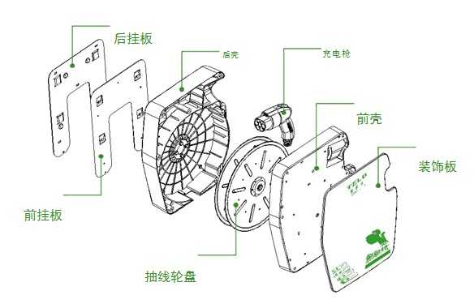
*图 4（已视觉复核）：肩关节解剖示意图（肩峰、锁骨、肩袖肌群标注）。*
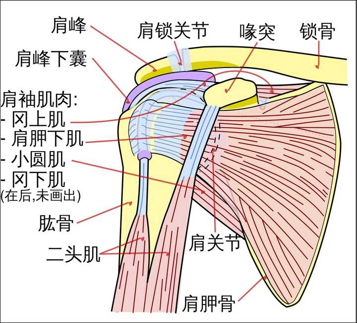
*图 5（已视觉复核）：三视图与轴测图变形系数示意图（图2）。*
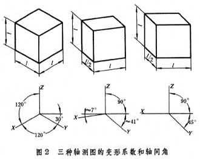
*图 6（已视觉复核）：带尺寸标注的机械零件轴测图。*
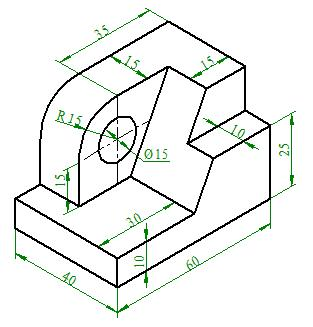
*图 7（已视觉复核）：带红圈标注的佳能单反相机产品图。*
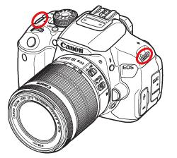
*图 8（已视觉复核）：室内空间透视线稿。*

*图 9（已视觉复核）：街景手绘速写。*
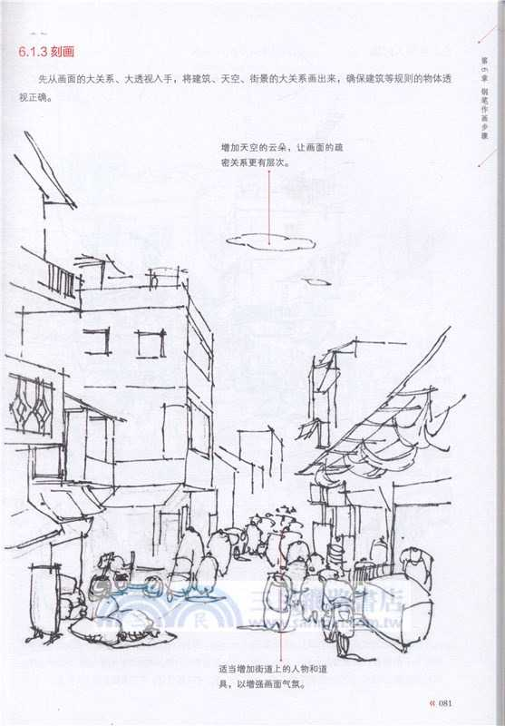
*图 10（已视觉复核）：（空位，该篇共 10 张，第 10 张为上述其中之一）*

---

## 3731　聪明的笨功夫

- 日期：2020-07-11　主专题：A04 教育学习与能力形成　副专题：A01;A08
- 源 ID：`a37fd4ea-b7fa-5b2e-b566-f3ce02c116a8`　原文链接：https://www.zhihu.com/question/20782378/answer/1331306390
- 官方对象—实践路径：与自己 / 与理想 / 持守
- 23 概念标签：定义与达意;能力与学习;选择与自由;责任与后果;成本与总账;劳动与组织;财富与市场
- 证据状态：manual_confirmed　初读：read　独立复核：not_reviewed

**问**：「聪明人更要下笨功夫」是什么意思？

聪明人怎么会做笨功夫？
做笨功夫还怎么会是聪明人？
别傻了，那些功夫只是看起来很笨，其实去做它们是最聪明的做法。
聪明在哪呢？
聪明在ta们发现了一些绝对没有第二捷径可言，绝对绕不过去的苦路。
ta们相当确信，这种功夫之难，难到了你如果早起步一个月，世界上任何的另一个人哪怕拿着无限的资本做后盾，也绝对没有可能在你不松懈的前提下超到你前面去。
因为这个功夫实在实在是太“笨”了，没有任何办法能投机取巧，没有任何办法能绕道，唯一最快的凿穿这厚厚的玄武岩层的办法，就是靠一个聪明到你这个程度、有同样罕见的机缘、有同样深厚的经验、有同样难得的资源的人、抱着绝不旁顾的决心，抗拒一切其它机会成本的诱惑，
水滴石穿，直线前进。

这个世界上，
与你同样的聪明的人有，
同样聪明、有同样经验的人有，
同样聪明、同样经验、且有同样资源的人有，
同样聪明、同样经验、同样资源、且同样看见这件事了的人有，
但是同样聪明、同样经验、同样资源、且同样看见这件事的、却和你同样笨、会选这件吃力不讨好、要抱定必死的觉悟、耗费巨大的心血去把墙磨穿的人，
罕有。
你有的条件，ta们全都有了，在这件事上，ta与你唯一的差距，就是ta们没你这么笨，肯拿这么好的才智、这么好的资源、这么优势的地位，“干这个”。
所以，你才比较大的希望会赢。
满足上面这全部条件的“绝妙笨功夫”，是需要绝顶聪明、绝佳运气才有机会才有机会触摸得到的。
不是绝顶聪明外加极端努力，你怎么知道这件事确确实实没有其他捷径可走？

老天真的是爱聪明绝顶、却肯用来做人决不肯做的笨功夫的笨小孩的。
上天给聪明人们安排了这样一种“不做笨事就别想赢”的天然禁制令，真的是对人类一种极大的仁慈。
那些石墙，注定要靠这种极聪明的笨人才有可能凿穿。
那墙背后一片阳光普照，海阔天空。
这就是为什么真正的聪明人，心心念念都在梦想那件真正命定属于自己的笨事。
这种绝妙的笨事，是聪明人可以心安之处。
最平安的归宿，最恰如其分的死所。
没有体会过的人，难以理解“没有与我一样聪明的人会和我一样傻”是一种什么样的幸福。

笨人比聪明，聪明人比笨。

What a poetic irony.

---

## 3688　粗心

- 日期：2020-08-15　主专题：A04 教育学习与能力形成
- 源 ID：`cf163892-2d16-5935-a9b5-333bfa7aca7f`　原文链接：https://www.zhihu.com/question/20169084/answer/1410603879
- 官方对象—实践路径：与自己 / 与能力 / 获取
- 23 概念标签：事实与证据;定义与达意;能力与学习;责任与后果;成本与总账;信用与信任;照料与家庭;劳动与组织;心理与主体
- 证据状态：manual_confirmed　初读：read　独立复核：not_reviewed

**问**：如何彻底改掉粗心大意的毛病？

某种意义上说，你是改不掉的。
人的真实水平，就是在最粗心大意的状态下的水平——也就是“无所用心”的那个水平。
基本上脑袋放空、脚踩西瓜皮滑到哪里算哪里的水平，就是你的真实水平。这个水平高，你就是真水平高。
靠“提升注意力”“蹦起来”达到的水平是假的。
第一是不可持续，第二是实际上多半只是“空做姿态以免被抓到不认真的样子挨骂”而已。
也正因为是假的，所以你听了爹妈、老师的话，憋着“认真”了n回，都没拿到更好的成绩。好成绩没拿到，但你有一项新收获——你发现了，“用这个姿态拿同样的分数，老师和父母没法骂了”。所以你才学会了“做认真状”的“认真”。
你还别说，做认真状本身就很累的了，会给人一种“充实感”。
久而久之，就学会了“不是我不认真，而是我就是这么笨”——把自己自我塑造成了一个常年正襟危坐的、自我坚信的傻瓜。
这种所谓“认真论”说实在的贻害无穷。
问题的关键不在于“认真”，而在于切实有效的、严谨的工作习惯经过长期的练习，习惯成自然。
走路，迈一步就练一次；骑自行车，蹬一脚、拐一弯就是练一次；游泳，你换一次气就练一次。
你有很认真的走路、骑车、游泳吗？
无他，唯手熟尔。
说句实话，现在的教育体系大纲对知识的安排过于密集，导致基础技巧——语言能力、逻辑能力——的练习次数被大量的知识点摊得太平了。刀还没磨好就赶上山砍柴，还要在太阳下山之前砍完整个山头。
要形成走路、骑车这样的完美效果所需要的练习的时间资源远远不足。
这不是孩子们“不认真”。
“你不够认真”这样的表达反复出现，实际上是老师、家长们因为长期摸不着头脑，进而自然而然的、下意识而做的一种“放弃的仪式”。
因为责怪你不认真，你是解决不了的，接下去你势必会学会做认真状，一旦你熟练掌握了做认真状的技巧，你、你的父母、你的老师、教育系统就都可以长出一口气——“不是这孩子不认真、也不是我们不努力，而实在就是笨”。
于是大家就都解脱了。
我倒不是说世界上不存在天资有限问题，但说句实话，在认识清楚这一点的情况下，有很多人可以不必是自己所相信的那么笨。
这些人走上了工作岗位，常常在实际工作的直接反馈的引导之下“突然变聪明”——因为实际工作里算错的题的后果就不是抽象的了，而是有东西要倒塌、有产品会报废、有客户会退货的了。而且ta们也不必再不停的追赶新知识点，而是有了多得多的时间反复练习手里这点业务。
ta们中的很多人都变成了熟练工、老师傅，甚至企业主或者业务骨干、精英。
最悲剧的是，这帮家伙看到职场新人和自己子女，还是他娘的觉得ta们的问题是“不认真”。

“你们一定要认真哦。”
认你x的真啊！
金句大总结：
1）不认真都能搞定，才叫真搞定；“认真”才能搞定，叫假搞定。你需要更多的持续观察和改进，直到找到傻瓜式的可靠办法可以搞定，并且有足够多的练习，直到不用想太多都能搞定为止。
只有这样你才能超越“认真焦虑”，并且获得真正的信心——不认真我就可以搞定，认真起来岂不是天都可以捅穿？
只有这样的心态才能骗你去冲锋陷阵。
“不认真就要出大事”的心态，你能干什么？
2）找到这个方法的手段一直是想办法让错误变得更直观。犹如染色体在显微镜下看不见，就拿染料染一染；动手术之前不知道弹头在哪，就照照X光。
把曲线画出来，把流程图画出来，把实验做出来。老师的口水和家长的怒吼都是透明的，不顶用。你要想办法让错误变成有形状的、有重量的、有硬度的、有气味有味道的。
下回你就可以用鼻子都知道这里错了。
3）找到了路就要一直改进到不费吹灰之力，练到习惯成自然。
这是一件极其有乐趣的事情——本质上，这是在和上帝聊天——你根本不需要“认真”，因为这其中的乐趣本身就会让你足够上瘾。
废寝忘食好吗？

---

## 3630　挨骂的老师

- 日期：2020-09-25　主专题：A04 教育学习与能力形成　副专题：A01
- 源 ID：`36b37007-bdbc-5544-9142-824b5fe2ed15`　原文链接：https://www.zhihu.com/question/300244076/answer/1491735176
- 官方对象—实践路径：与合作者 / 与受教者 / 传授
- 23 概念标签：定义与达意;选择与自由;责任与后果;成本与总账;边界与许可;权力与异议;技术与工程;心理与主体
- 证据状态：manual_confirmed　初读：read　独立复核：not_reviewed

**问**：初为人师两个月，被学生骂「傻 B」，哪里出了问题？

这有一个特别重要的观念，人一定要先树立好，不然很容易把自己逼出问题：
并不是出了不好的结果，就一定存在着问题（problem）。
很多事情的“结果不好”是一种只能接受的本来常态，并不表示一定在什么地方有人失职、做错或者进行恶意操作。
那么如何区分哪些是“只能接受的常态”、哪些是“有问题”的呢？
要害并不在于这事发生的频率和常见程度，而根本的在于解决这事所需要花的成本和收益是否可以相抵。
这可以做一个经典的理解——投入100万将故障率从20%降到10%，再投100万可以从10%降到7%，再投100万可以从7%降到6%，再投100万，可以从6%降到……破产。
实际上你算算账，你不如选择把这后300万省下来搞坏机回收，很可能还便宜点。
这个就是平衡点。
过了这个平衡点，就要从“将其视为问题”转向“将其视为应该接受的常态”——因为不接受的危害更大。
在漫长的教师生涯中，如果有学生骂你你就受不了的话，你是做不了教师这一行的；
在漫长的行医生涯中，如果有病人死掉你就受不了的话，你也只是这一行的匆匆过客；
在知乎写东西，如果有人喷你你就受不了的话，你也迟早会退乎；
同理，事故之于司机、伤亡之于军警、投资失误之于经营者……都是不可以以“绝对不能接受”的态度来应对的。
这个底线你要先踩住，不踩住你想什么具体措施都是枉然。不是说你不要去想办法、去努力降低这种事的概率和减轻它的程度，但是这些措施首先都要以一种“解决不了也罢”的态度去处理。
你会发现一个问题——当你抱着“这绝对不可接受”的态度去尝试解决问题，这个问题会格外的兴致勃勃、跃跃欲试的和你搏斗——因为你本身就给了这些“问题源”至高无上的信心和权力。
当你抱着“其实我不解决也可以接受”的态度去解决，你的遣词造句、姿势表情会自然而然的传递出一种让对方莫名气馁、消极的信息。
你的办法其实未必怎么有效，只是因为你的态度淡定如铁，对方的气焰就消散了。因为这点釜底抽薪，问题源自己就瘪了，于是什么办法都自然会效力翻三倍。
甚至根本什么办法都不需要，什么策略都不必，只是横一眼，对方就知道故事的结局一定是ta输，因为你不会动摇。
你是磐石，对方就是蒲草。
先心硬如铁，再谈技巧战术。
想要以优良的技巧、战术来弥补自己找不着的勇气的，技巧、战术本身就只是挥舞白旗的舞蹈技巧罢了。
岂有白旗宗师大获全胜的道理？
心硬如铁，你已经定然赢了。
你决定赢，你就赢了，战术和技巧只是在决定以什么形式受降。

---

## 3628　前途

- 日期：2020-09-26　主专题：A04 教育学习与能力形成　副专题：A13
- 源 ID：`c4bab8ec-36c8-546c-84b2-a9fa20cd813d`　原文链接：https://www.zhihu.com/question/409844164/answer/1494926798
- 官方对象—实践路径：与社会 / 与历史 / 学习;与自己 / 与原则 / 建立;与自己 / 与理想 / 建立;与社会 / 与历史 / 借鉴
- 23 概念标签：事实与证据;定义与达意;能力与学习;选择与自由;责任与后果;成本与总账;边界与许可;照料与家庭;劳动与组织;法律与秩序;技术与工程;心理与主体
- 证据状态：manual_confirmed　初读：reviewed_needs_revision　独立复核：reviewed_needs_revision

**问**：强基计划最终会如何收场?

借这个问题说一下到底人要怎么选择自己的人生前途。
这一共有三个流行的策略：
A）根据主流意见来办——即从众流。
B）根据自己对未来趋势的判断来办——即先知流。
C）按照“无论世界怎样发展，这种选择总不会被淘汰”的法则，做万全的保守选择——即稳健流。
我们一个个的看这些方法的优缺点。
首先是从众流。从众流的好处，是最好操作，而且在决策后有最好的心理体验——如果这是错的，那么我也不会是唯一错的那个，跟我一样错的人也多了去了。并且，也一定永远不缺人来赞同自己的选择，来一同捍卫彼此共同的路线判断。人生决策最大的困难，并不是这种选择到底对还是不对，而是在漫长的现实检验中，在那个似对非对、半对半错的迷茫之中的自我怀疑。在这个最大的折磨面前，有大量的同路人不断地告诉你“我们没错”“我们就是错了也不会拿我们怎样的”“说我们的错的人都是极少数”这样的话，会给你带来极大的心理安慰，这是从众流最大的福利。
甚至是唯一的福利。
为什么呢？
因为所谓的“从众流”，只有极少极少是真正的从众的。真正的从众，最基本的门槛有多高，我给你们一个基本概念：

典型的基于统计调查的宏观研究报告价格表
请问，有几个自称自己是基于主流意见、主流趋势做出人生决策的学生或者家长花过哪怕一笔钱去购买这种最基本的数据报告？我实实在在告诉你们——这已经是想要掌握有点意义的大数据最低成本的手段了。
你想从众，从的是什么众？真正的“众”摆在上面了，你们谁真的去“从”了？
“从众”流最要害的问题，是ta们根本就没有在从众，ta们本质上是在从村。ta们只是（甚至都不是出于一种主动的选择，而是一种对既定安排的被动接受）定居在一个信息村，然后把自己、自己的子女、自己的家人的命运交到信息村村民的手里自由处置，以换取村民们在此后会给与的“乡谊”。
在近代化以前，一个人是真的可以永远不出村的，而且确实有极大的可能一辈子都不会离城超过五十里，村子的的确确在实践上等于自己的世界。这个“从村流”在人类的历史文化里流传了三四千年，真正受到挑战不过是最近一百多年的事，这种挑战落到每一个人面前的时间则更短，只不过短短二十年间的事情。
但是，你们要清清楚楚的认识到——“村子即世界”的时代已经永远的过去了。
无论你选的是什么村，是微博圈、朋友圈、同学圈、同事圈、家族圈、邻居圈、豆瓣圈、知乎圈....无论什么意义上、什么维度上的“村子”，都没有哪一组“村民”会真的陪你走完这整个命运选择的全部生命周期，来给你ta们当初决定你命运时你指望他们会给你的一生“乡谊”了。
三五年过去在，只有你自己还会陷入在你自己的“命运选择”（这真的成其为“选择”吗？）里，那些给你点赞、鼓吹这是主流意见的人们，早就飘散不见了。
“从村流”已经历史性的破产了——再重复一遍——“从村流”已经历史性的破产了。
“我的同学都说”，“我的老师都说”，“我的邻居都说”......你照着ta们的“都说”去选，本质上不过是在拿自己的命宣誓加入ta们的村子，这其中没有任何真实可靠的真理性，唯一的福利仅仅只是ta们自然而然会给你的辩护承诺和肯定承诺——而这份“被承诺辩护和肯定”根本就没有任何真实性。
用自己的前途命运去换一个甚至不存在的、自己幻想出来的“福利”——世界上的愚蠢，我竟想不到还有比此更甚的。
再看先知流。所谓先知流，就是自己长期关注未来的趋势动向。眼观六路、耳听八方，自己找资料、自己下结论，自己做先知，自己下赌注。
不是因为别人说这个好，说那个不好，于是你才认定这个好或者那个不好。别人说好或者不好，只不过时一个“开题”的引子——那只是表示了值得关注的问题，根本不能表示问题的结论。结论应该你自己去做出。
你下注，你买单。你可能赌输，但是那是你自己下的注，那至少不是别人下的注。
先知流的问题在于——世界上没有人能真正的赌中未来，因为没有人是上帝。你不是一个真的先知，而是出于一种没有办法的困境而被逼出来的自己的命运的掌握着。你真正的选择根本不是到底选择哪种命运的选项，而是选择“是自己来选，还是让别人来选”。
从本质上，自己选和别人选的成败几率是一样的，甚至这个“别人”是马云、比尔盖茨都一样。因为在预言未来的可靠性方面，所有的人离上帝的距离都是一样的——都是活见鬼。
选了自己的赌注，赌局本身并没有因为你自己下注而额外变得更可能会赢，但你多赢了一次“自己下注”这件事本身。“从村流”则把这一次机会拿去换“乡谊”了。
这才是你赢到的地方。
赌局本身的输赢，并没有受到实质影响。
真正会有实质影响的，实际上是“稳健流”。
也就是选择那些“无论怎样都不会被淘汰”的选择的人。他们选的是最基础的选择——在专业选择上，恰恰是比如自然科学、文学、哲学、绘画、音乐理论……这类作为一切其他学科的基础学科。
就是在关于命运的选择上，总是选择“万变不离其宗”的“宗”。万变不能离其宗，则选宗就是选了万变。真正永远不错的，是万变。
在诸多的“宗”里面，向自己所下注的历史潮流倾斜，去选择一个能迎历史之潮而上的“宗”，则是最优的选择。
那些确切的“专业”选择，在学术上应该是进入研究生阶段，甚至进入博士阶段的事，在职业上应该是【换第二份工作时】决定的事。
早于这个节点去做对自己作确切的专业定位，不管你自认为自己的选择多么热门，你都是在冒极大的风险。
那是对弹尽粮绝、只能孤注一掷、必须立刻搞到进账的没有选择的人才在机会成本上合理的策略。
恕我直言，我不认为低于35岁的人可以实际有效的选择自己的命运。都只是乱选一气，然后胡乱抓住一切能抓住的同盟军互相打气壮胆而已。
只是出于对可怜人的同情，没人会真的把他们逼问到墙角罢了。
另外，很多人在鼓吹“有钱人的孩子不会学基础学科”。
拜托，恰恰说反了好吗？
权贵们的孩子才恰恰大批的在学哲学、文学、人类学、政治学、经济学、伦理学、法学、数学、艺术甚至神学这些你们觉得“无用“的专业。
学工程学、学医、学计算机对上层阶级往往是属于“不务正业”乃至于出于叛逆情节好吗？
你们大可以去打听一下问问伊顿公学哈罗公学的毕业生到底都去学什么了。
学各种热门的应用技术类的工科（有些甚至本质上只不过是fancy的工匠教育）只是中产阶级——而且还是中下层中产阶级——的执念好吗？
不要全凭想象！

中国是一个什么样的国家，现在正在一个什么样的关口上，这个问题要先想清楚。
很显然中国要大面积的改变原有的科研体系来和美国在每一个领域来一场硬碰硬的技术竞争。要的不仅仅是5G，还有芯片制造、生物科技、航空航天、材料科学……等等最硬的基础领域的分庭抗礼。
现在的中国战略需求是不成问题的，钱也是不成问题的，将来的市场倾斜政策——拜川普所赐——也是不成问题的。
现在很多人看不上强基计划，喊着是“骗人入坑”，也不相信中国的科研系统可能有什么改观，这其实是完全基于“参考过去二十年的经验数据，认定未来二十年必定完全一样”这样的思路。
问题是，谁说未来二十年和过去二十年一样？
肉眼可见的不再会一样了好吗？
未来二十年，不给我们用或者威胁不准我们用的东西会越来越多，我们能用但不能寄希望于一直可用的东西也会越来越多。所有被卡脖子的东西，中国都需要人去攻坚，每一样都要踩进世界第一集团。
这些人从哪里来？按照中国一贯的风格，向来是外部引入和内部培养并重。
你们担心强基计划的人“找不到工作”，我估计过几年只怕完全是另一个景象——是大批拥有各种优先权的重点单位来一抢而空，而且直奔最热的关键领域。
有人一天到晚害怕自己成为默默奉献的钱学森，钱学森那时中国gdp多少，现在多少？
十月份近十万亿人民币准备放进芯片制造的全产业链研发，这只是个开始。不久的将来这些硬攻坚领域以我所见只怕是中国待遇最好、职业最稳定，最好拿到资源的前排座位，一般人想挤，恐怕不是从强基计划来的还不容易挤得进去呢。
更不用说强基计划点名的都是第一流的名校——说实在的对这些学校你读什么专业根本就不重要。学物理的去搞量化交易，学生物的去搞计算机，学中文的去搞新闻，学哲学的去搞企业管理……这完全是常态。不知多少现在成名成家的企业家和自己的大学专业根本不对口。
君子不器，懂不懂什么意思？人不是被自己本科选的专业定义的，更不要提本科本质上其实不过是通识教育加一点专业补强，是以通识教育为主。
对于本科生，选择基础学科专业远比选择应用学科专业更有意义。
“面向找工作”选择本科专业本身就是可笑的策略。
企业界没谁指望本科生的“专业水平”，进来了基本全体删号重练——一招一式从头培训。企业要的是名校出身，赌的是综合底蕴和长期潜力。你能进北大，哪怕你学的是考古专业，你进来了企业一样会考虑安排你走高管培养路线。
选择是你们的，但不要人云亦云，自己多调查思考清楚。
另外告诉你们一个人生常识——说话尖酸刻薄的人，ta们说的话不要听。
注意这个微妙的区别——不是预期悲观的话不要听——恰恰相反，预期悲观的话要多听——是【尖酸刻薄】的话不要听。
一个人当然可以不看好某种东西，但是当他开始用嬉笑怒骂、尖酸刻薄的方式去表达这种不看好，ta的看法就已远离客观范围了。这时候与其说ta是客观实际的看到这个东西不行，不如说是ta希望这东西不行。
“希望”这东西和事实的关系甚小，而和人的私人情绪关系甚大。
你要人的私人情绪干什么用？
无数人跑来冷嘲热讽，似乎万分笃定“基础学科没前途”，还是当程序员实惠。
感觉中国程序员前景一片灰暗，是这样吗？问题是程序员们似乎完全不这么认为——人家普遍觉得软件赚钱根本不靠程序员。
那么，到底你们谁对？
毫无疑问，中国是有很多东西要改变的。这其中科研机构、企业不能打硬仗，没有静气急功近利、评价成果缺少好的有效标准、行政领导专业……的确都是非常多、非常大的问题。
但是这些问题真正的成其为问题的要害，在于它们是大问题，但却还不够大——没有大到不能忍受的程度，没有大到不能不改的程度，没有大到能破釜沉舟、开膛破肚、不破不立的程度。
很遗憾，在我们这个国家就是存在着这样的问题——一个问题不是大到不能忍受的程度，它常常得到的答案是“继续忍”。因为不能忍就要搅动无数的已经构建好的关系，有无数的试错成本和结构性消耗。“试错成本和结构性消耗”说起来是多么中性的学术名词，但这几个字背后是不知多少人的身家性命、兴亡荣辱。只有忍无可忍，再忍要亡国灭种的威胁，才能带来付出这些成本的合法性。
说句实话，未来几年科技工作者和知识分子们应该会很感谢川普的。因为川普非常干脆决绝的给了你们这个想躲都躲不掉的“无可忍”。
背水一战，并无退路。
这绝不是说你可以指望“背水一战”就不会笨拙、挫折、不会付出大量的代价。
接下来意料之中的会出现大量的骗补、假项目、夭折、失败……；会有令普通人人瞠目结舌的整整一代人的“补缴学费”和“补课”；期间会有无数人无数次在无数的场合下的绝望的喊——“不行啊，放弃吧，中国人就是不行的啊”，而且ta们绝望得有根有据、无可指责。
这些东西，你们喜欢或者不喜欢，都会开始发生，而且是比你们想象的还要可怕、还要深刻、还要刻骨的发生。
但是，即使是这样，中国不会回头的。
无论多少牺牲、无论多少损失、无论多少人绝望、放弃，就算战至一兵一卒，唯一的出路仍然是向前。
这不是什么天下争霸，这其实是救亡图存。
人家不给你，你难道去死？
救亡图存，不容它顾。
你只有自己搞出来，只有你有“必然要搞出来”的决心和在足够多、足够难的方面搞出来的事实，人家才会承认越晚卖越不值钱，封锁才会从内部出现崩溃。
接下来的剧本，按照惯例，是好大一轮“千金买马骨”和“迁木立信”。
要买谁的马骨? 立谁的信？

<!-- 图片：1 张，审读结论见下 -->
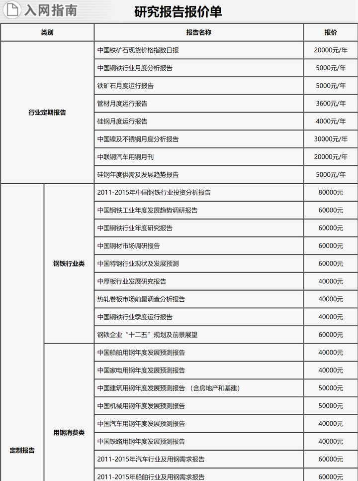
*图 1（已视觉复核）：“研究报告报价单”价格表截图（行业研究报告、银行行业年度报告等条目与报价）。*

---

## 3624　潜藏无形

- 日期：2020-09-27　主专题：A04 教育学习与能力形成　副专题：A07;A10
- 源 ID：`f6347ba6-aad3-5f7f-8b08-353683f03410`　原文链接：https://www.zhihu.com/question/422912586/answer/1496227069
- 官方对象—实践路径：与合作者 / 与教导者 / 受教
- 23 概念标签：能力与学习;选择与自由;责任与后果;成本与总账;劳动与组织;财富与市场;权力与异议
- 证据状态：manual_confirmed　初读：read　独立复核：not_reviewed

**问**：如何看待对于「给予导师决定博士生、硕士生能否毕业的自主权」的提议，教育部表示「意义重要，将充分采纳」？

权力最容易出问题的地方，不是它本身有多大、多绝对，而在于潜藏无形。
任何权力，只要成为明文的权力，就会自然而然出现约束它、对冲它的策略和现实，自然而然地形成一定的制约，并最终形成一种平衡。你的权力虽然又绝对又大，但只要你浮出水面了，我看得见了，我就自然有办法做出必要的反应。
譬如就以这个“导师决定制”而论，既然你权力这么大，那么我的风险就很大，我自然会掘地三尺地去打听你有没有糟糕的记录。有任何我闻起来不对的味道，我可不敢拿自己的前途命运来作死。
第二，难道只有我这样想，我的后辈们谁不会这样想？那意味着我作为你登记在案的先期毕业的学生（或者没毕业的学生），我也天然地、对称地获得了深刻伤害你的风评的权力。
以前有委员会来负责，有什么雷委员会也要和你一起扛，你一个人的势力固然强大，但其实还不是无法逾越的高墙。但委员会、学校作为一根绳上的蚂蚱也只能和你站在一边，他们的势力才真不是我有几门有力的近亲可以顶得住的。
现在他们与你脱钩了，你说起来权力大了，但你也势单力孤了。
其实，现在给了你所谓的“独断权”，在之前根本就一直以潜规则的形式存在，给不给你，你都一样是一句话可以决定延毕，真正的不同是你可以操作成是委员会的集体决议，还可以依靠与委员会乃至学校的名誉规则绑定，毫无悬念地碾压学生的抗辩。
现在你当然仍然强，但是学校在这里的牵连可大为撇清了。
这真的是什么“大大的增加权力”么？
说句实话，这其实会削弱而不是加强学阀们现在在机构掩护下所无责任享有的部分权力——不是剥夺掉了权力本身——根据学术教育的正常规律，你根本就不能剥夺教师这项跟教学职责内在绑定的权力——但是拆除了掩护。
拆除了掩护，其实最后是保护了学生。
这不是坏事。

---

## 3616　精神资本家

- 日期：2020-10-05　主专题：A04 教育学习与能力形成　副专题：A01;A08
- 源 ID：`0a47c7bf-950d-5219-84b3-cdccbb62c910`　原文链接：https://www.zhihu.com/question/417907087/answer/1508359096
- 官方对象—实践路径：与自己 / 与能力 / 获取
- 23 概念标签：能力与学习;选择与自由;成本与总账;信用与信任;净输出与不掠夺;劳动与组织;财富与市场;技术与工程;心理与主体;性别与身体
- 证据状态：manual_confirmed　初读：read　独立复核：not_reviewed

**问**：怎么反驳精神资本家的自我努力论?

假设你反驳成功了，你想拿什么代替“努力”？
有一种奇怪的论调，似乎努力如果不能百分之百保证“成功”，不能如许诺的那样升职加薪、得宝获美，就上当了，努力就吃亏了，不如不努力。这种观点还有个扩展版，就是一旦“成功”了，显然就应该停止努力了——“否则成功有何意义呢”。
非常悲剧的是——这样想问题的人往往还面对双重困境——一方面，同样程度的努力要求总是让他们格外痛苦；另一方面，付出同等劳力的努力，他们又格外不容易“成功”。
其实光是这两个“格外”已经都给了他们答案了啊——这样理解“努力”，就自然而然努不了什么力。
无论你富贵或是贫穷、健全还是残疾、顺境还是逆境，人都应该坚持不懈的努力。这不是为了糊口或者出人头地，而就是因为这是人度过人生、享受人生的最好方式。无论谁跟你说了什么关于努力的命题，也不管这些命题是真是假，都跟你是不是要努力没有关系。
努力就像吃饭——有人说你连吃五碗白米饭我就给你一百块，事后证明ta是骗你的，难道你从此就不吃白米饭啦？——你应该调整的是“连吃五碗白米饭”，而不是“吃饭”。这其实根本是两个不同的问题。
我实在是不能理解人为什么会厌恶学习、厌恶努力——除了这两件事，人生还有什么更好玩的事情可做啊？这都是收益啊，为什么有人会把这些都当成损失来避如蛇蝎啊？
停止努力，人就不再是活人，而只是“未亡人”罢了。
说句大实话——不努力的人，其实连享受都不会享受，玩都玩得寡淡无味，连酒肉朋友的资格也都不足。拉你去冲浪、拉你去玩滑翔伞、拉你去钓鱼、拉你去摩托越野、拉你去攀岩、拉你去滑雪、拉你去潜水、拉你去打自由搏击、拉你去射箭、射击……你不努力，你玩的水平会低得令人尴尬，就是玩都玩不到一起啊！
享受本身就是要努力的。努力本身就是享受。
“不需要努力”的生活到底有什么值得向往？
你不喜欢读语数外、不喜欢做题、不喜欢坐办公室，不喜欢跑业务，可以啊，但你只能选择用你喜欢的努力去替换这些你不喜欢的劳役，
不要妄想用“不必努力”来替换它们你会“变得幸福”，因为你不会变得幸福，你只会变成一个不知自己的去向的活死人。

---

## 3597　学哲学

- 日期：2020-10-30　主专题：A04 教育学习与能力形成　副专题：A03;A15
- 源 ID：`dd6ddd34-70e9-5f86-a3e7-658ca8a20c3c`　原文链接：https://www.zhihu.com/question/422217308/answer/1551252488
- 官方对象—实践路径：与自己 / 与能力 / 获取
- 23 概念标签：事实与证据;定义与达意;能力与学习;选择与自由;责任与后果;爱与回应;边界与许可;权力与异议;技术与工程;文明与历史;心理与主体
- 证据状态：manual_confirmed　初读：read　独立复核：not_reviewed

**问**：想在大学四年里好好学习哲学，请问需要做些什么呢？

书目这些东西，来来回回不过就是那么几本，没什么必要反复推荐了。
真正要准备的是接触这些东西的心态——一种“我先看看，将来自然会懂”的心态，而不是“读完一套东西，只要读的这套东西足够好、足够多，我考试80分，我老师也很有名，我就学会了哲学”的心态。
一种“我是在涉猎哲学”，而不是“学哲学”的心态。
这差别在哪？在于抱着涉猎自觉的人，不会看完那些东西就觉得自己懂了；而“学哲学”的人，花完那些时间，不给自己戴上“多少懂一点哲学”的小红花是无法甘心的。
而最后你会看到的——前者从这番涉猎里所得到的实际收益要远大于抱着“学哲学”心态的人。
后者甚至常常不但没有实际获益，反而会在性格、社交能力、认识能力上出现相当明显的缺陷。
哲学这个东西，犹如牛吃草。
先把草嚼一嚼存在肚子里，将来要花无穷的时间慢慢反刍。你吃下去的不算，反刍之后消化的才算。
中国人学哲学最大的害处，就是在我们这个历史局面下被预定的统一思想的强烈需要而造成的对“经典著作”“主流观点”的下意识崇拜。
哲学和神学、伦理学血肉相连，无法分割，政治学、法学、社会学则是伦理学亲生的骨肉。这些东西里涉及到的政治正确程度之深，已经同样深入了中国哲学教育体系的灵魂深处，内化到了不再被意识到——甚至也不会再被谈论的——元问题层面了。
甚至在几代人之后，现在连一些在给学科带头的“学术领袖”们也开始以“那些问题已有确定答案”的态度，开始只谈论二楼以上的问题。
我并不是在批评说这个如何不对或者不好——坦白说，这是历史分配给中国的不可选择的命运，这不能视为什么“阴谋诡计”或者“学术失范”。
这种现实问题造成的哲学教育的必然的偏狭，已经不可避免的融入了这个文化环境的骨髓，你的老师不能例外，你看的书的编者、译者也不能例外，你的评审委员会和阅卷组也不能例外，你不要指望你可以例外。
说得直白点，自认为“自由”的西方学界也只不过五十步笑一百步罢了。
哪怕你加十二万分的小心，你一丁点都不觉得，你也不是例外。
你只知道哲学一个极窄的、被给你启蒙的这个派别鼓吹为“正统”“主流”的那点东西的一点摘要，这才是你读到应届博士毕业的真实水平。
这也是为什么哲学存在“学派”问题。因为一个不同但是却有同样效应的理由，同一派内，也不会再谈论这一派的元命题，而是在第二第三第四级树枝上修修剪剪、缝缝补补。因为即使我这一派的理论大厦蓝图也已经高耸入云遮天蔽日，一楼不搁置争议，五十楼八十楼盖到哪一年？更何况，一楼的很多问题，不盖到八十楼你看不见。你真的直接对元命题有异议，那你去盖隔壁那栋楼。
学哲学的最大困难，就在于这么多派的东西，在你有限的人生里，你只能摘要式的看那么一门两门的目录。
单独一派都足够把你这小脑袋瓜撑破了，何谈这么多奇门八卦呢？
因此，我坦率的告诉你——年轻人自认为搞懂了哲学，只有一种可能——就是像新生的小鸡那样，把第一个自己看到的老母鸡加封为真理之母——有时甚至这位真理之母连鸡都不是，而是一条狗。
无论你自认为阅读量多大、师门多高贵、自己读得有多通，你只要是个人类，你一天只有二十四小时，到三十岁只有一万天，你必然只能止步于此，不服你就把计算器拿来多算几遍。
只有这一种可能性，不存在你三十岁就看懂了哲学的世界然后大彻大悟的任何可能性。
唯一的区别，只在于你承认和不承认。
而你承认或者不承认，只会决定你自己未来的命运，改变不了“你其实不懂”这个事实一分一毫。
因为决定你不懂的是人的天然限制，是超出你处理能力的信息量和你根本没有的时间。
是数学，不是什么“老人家的傲慢”。
哲学不是年轻人能宣称掌握甚至了解的学问。
你只有先彻彻底底地认清这一点，毫无任何侥幸，你才有可能避开“学哲学”最大的问题——就是学着学着“自以为懂了”。
你“懂了”，你特么的就“完了”！
那意味着你在一个连门都没入的鬼地方安营扎寨准备颐养天年了。
几本导论、几本综述、几个老师那点耳提面命，在“哲学”这个话题下根本微不足道。这跟读了五百字的百度百科或者听了高中老师读了下课本那四百字就自认为懂了佛教、基督教或者共产主义一样，只是五十步笑一百步的区别。
你以为读到一亿字很了不起？我坦白告诉你，一年一亿字你读个二十年，你才会知道你知道个屁。你真到那一天，第一个念头就是二十几岁的自己那份“肯定”真的是蠢得无法形容。
你死过没？你死过几次？你见人在你面前死去过没有？你没死过，连见都没见过死亡，你就这么自信那点“才华横溢”的文字已经足够准确了？你知道什么是贫穷、什么是绝望、什么是背叛、什么是误解、什么是冤屈、什么是公平、什么是仁慈？你没尝过，没见过，没亲手摸过，你就敢凭阅读断言什么是对的，什么是错的？
你以为这只是精妙的定义、严谨的语法结构就能定义的东西？
光这样想，你就什么都还不知道。你根本连“知道”到底是个什么样的滋味都还不知道。
你觉得你这就算知道了，只会导致你连真正知道的机会都失去。
必然，看清楚，必然自误前程。
看清楚，到这里没有拿任何个人的偶然经验或者什么“学术资格”来压人。
为什么这是必然，论证逻辑简单得像砖头一样列出来给你们看了。
顺便帮你们解开那个未解之谜——所谓“少年成名”“足不出户”的哲学家。
1）按经历，人家不是少年。
2）按交游，人家不是足不出户。
3）他们在少年时出口成诵，事后被认识、被重视、被传颂的那些见解，他们自己当时也不懂。
是不是觉得“荒谬绝伦”？
等你真的有过这样的经历之后，你才会明白。
某些东西，只是历史凭着你的遭遇注入你的灵魂，驱使着你的直觉借用了你的笔来转达给世界。
握着笔的只是一个代言人，其实并不懂得正写下来的那些话真正的意义。
ta年轻与否，无关紧要。
那些被安排听到这些话、记住这些话、咀嚼这些话的人，才是这颗种子真正的土壤和养分。是这些人真正把这口信译解出来，成为一个新的事物。
不是那个邮差。
别以为那点例子真的能推翻这句“哲学不是年轻人可以学得会的东西”。

实际上，我不推荐大学生业余“学哲学”。
因为“哲学”这个东西是“学”不好的。
哲学专业书籍一般讲的是什么东西呢，主要是两样东西——一样是哲学的历史，一样是哲学的研究工具。
前者约等于前辈画的画，后者约等于画画的基本工具，比如透视理论、色彩理论这些。
但是哲学的本质是思想的艺术。哲学家必定是思想家，思想家的本质是一种艺术家。
作为艺术的一种，哲学并不能依赖“和前辈的东西没矛盾 + 正确使用工具”来保证其结论的价值和意义。
并不能。
无数人去“学哲学”，是抱着“这是一门像物理学、工程学一样可以通过掌握一些确定无疑的知识和技能就加以掌握”的念头。
大错而特错。
哲学好不好，其标准根本就不在于“对不对”，它真正的标准是够不够美。
永远记住这一基本事实——人类根本不知道什么是真和善，人类只有对美的直觉。人是靠着对美的追求来摸索真和善的面目，而且在事实上是被“越美越真，越美越善”这样简单的现实逻辑所绝对统治的。
而一心钻研“着色技巧”“铺线手法”，参考“大师之作”，能帮助你画出悦人心目的行货，但那不是艺术，你也并不因此成其为艺术家，就像那样画到死也只是画手，这样学到死你也不是一个真正的哲学家。
不是真正的哲学家，那是什么呢？是一个只会将自己的贪婪、欲望和懦弱用华丽的学术语言包装起来的可怜虫。
所谓的“思考”，全都用在怎么层层包装上了。
哲学家必须是久历人世，心龄三千年，见过生老病死、盛衰兴亡的“老人”。
真正检验一个新的概念、一个新的架构是不是有生命力的，不是妙辩无碍的自洽，更不是无破绽可抓的“学术媚雅”，而是从那些人海沉浮中形成的强烈的理性直觉，那种对思想的审美能力。
没有这种久经沧海沉淀出来的直觉，只是靠“没人能驳倒我”的无敌感去搞“哲学”，极其容易搞成一个满嘴哲学名词和圣贤语录的废人——甚至——一个混蛋。
论“说”，谁也“说”不过ta（其实是懒得理会），但望之即令人生厌，根本不能成事，不能团结人——甚至可能工作生活不能自理。
学哲学如果不是为了堆字纸，而是为了经世致用、消解人生迷惑，最好不要学当康德黑格尔，倒是应该先去学当马克吐温。
我更建议年轻人对哲学著作哲学史这些放在次要的位置，先学好自然科学，学好手艺，先去人海沉浮。等你阅尽千山、死去活来之后，再谈哲学。那时候你才知道自己在说什么，以及那些人在说什么。
然后你就会明白为什么我会说“不建议年轻学生们自己去‘学哲学’ ”。
哲学涉及到人的基本方法论问题，不可避免的极其深刻的影响着人的价值观，进而影响到人的立场，进而影响到人的命运，其实是一项对个人而言政治性极强的实践。
换句话说，它本质上不是在学一套个人不能不服从的“客观真理”，而是在通过一定的状似“学习”的仪式，在渐渐拥抱一种自己选择（或被选择）的命运。
它事实上是一门结果导向的反向摸索。
是靠“什么样的立场能行得通”，而不是“什么样的说辞能说得通”来确定“什么是有希望、有生命力的理论”的。
而“行不行得通”的答案，并不在哲学书里，而是在实践里面。只有实践经验越丰富、越深刻的人，才能越清楚的做出质量越好的判断。这个判断并不是一种科学判断，而本质上是一种审美判断。
很显然，这在逻辑上不可能（也不应该）是没有足够阅历的人所能做到的。
不是说哲学著作不可读，也不是说哲学不宜涉猎，只是要绝掉“哲学可以学，学了哲学就会哲学”的念头。
学成闭着眼睛都能画蒙娜丽莎，并不意味着你是另一个达芬奇。
我再简单的总结一下——
哲学当然应该涉猎，但是不要因为背会了这些东西就觉得自己算“哲学科班”了。
更不要二三十岁就拿自己看的哲学书出来教训人。因为这个实在是一言难尽。
这么说吧——懂哲学而无教养在逻辑上是很讽刺的。
学工程学可以没有教养，这不必然影响人做一个好工程师。学数学，学物理，都可以。
但学哲学的人没有教养，就是白学了。
这就跟学管理的没有规范、学心理的没有语言艺术、学财务的没有数值直觉、学法学的没有程序意识、学神学的没有信仰一样。
论文写得飞起，判例说起来头头是道，没有任何实际意义。
到这里来对这个观点表示忧虑和反对，我一点不觉得有什么不好——因为这个观点理所当然会让热爱哲学的人觉得“危险”。
但是，那些就因为这种原因就开始夹枪带棒、含沙射影，开始“民哲”“胡说八道”“误人子弟”……的所谓“科班生”，根本就没有真正的迈进这个门。
这个你们自己最好想清楚。
这一个基本修养关你们过不去，你们就只是在浪费自己的青春做梦。
仅仅因为这个观点自己不喜欢，就断言“这必定是不懂哲学的人胡说，没有任何别的可能性”，这种“面向内心恐惧开发”的态度意味着无论这人的观点是什么，都不太值得继续花精力去理解和回应。
我对获得谁的“非民哲”认证没有任何兴趣，而且觉得自称热爱哲学的人热衷于搞这种认证本身就很……最客气的说法，也是“奇怪”。
一个观点就是一个观点。你不认同可以不理会，你想反驳也可以做论述。没人关心你自己对这个观点怎么作价值判断。
更不用说关心你对说话的人做的人身性的判断了。
你的“民哲标准”没你想的那么普世适用，说实话对别人没有任何特别的意义，你为什么假定别人肯定很关心你的个人评价？为什么占用别人的时间去公布根据你的个人标准测量的结果，对你是一种理所当然的权利？
这一点你都想不通，都没有养成本能的直觉，你的学术前途——至少是哲学这个方向上学术前途——是零。
因为这是非常基本、ABC级别的哲学实践问题。你对这个没有敏感性，只可能是因为你的“哲学”总被用作解释你的权威性、总被拿来让人闭嘴屈服，而从来没有真的拿来指导你自己的生活。
因为只要你哪怕做了最基本的一点在自己生活上的应用，你都会养成这种最基本的本能。
这就是所谓的“教养”。
如果没有，在明白人看来，你就其实是“毫无训练痕迹”。
那满口的名词、妙辩无碍的“经文”，不但不能作为你“懂哲学”的证明，反而会成为你“根本不懂哲学”的反证！
就像一个人站都站不稳、拳头都挥不直，却满嘴拳经一样——拳经背得越熟，这事越是可悲。
如果学哲学甚至都没有能帮你建立起最基本的教养，乃至于稍有“冒犯”嫌疑的观点就能让你断言“必为胡说”，这种惊人的open mind的低水平，别说学哲学，学什么都不值得期待。
自己多想想吧。
其实这些傲然判定“民哲”的小朋友们，已经有机会发现矛盾，你们只是根据经验直接无视了。你们把自己被说服的门槛抬得很高。不但对方要给出不同的意见，还要对方承担提供证据的义务。缺了哪个，你们就“不认可”。
这不是个有前途的习惯。凭什么人家给了结论还要欠你论据？
从我的视角看，被说服受益的人是你们，而不是我。
我只是看小朋友可怜，随手拉一把。拉一把嫌这嫌那不肯从坑里出来，那就自己呆在坑里好了。
我有多少说这些话的资格，是不是“民哲”，将来你们自然会知道——连基本的调查研究的习惯都没有，还在顺着自己情绪来给人下定义的小孩子，下的结论有什么参考意义？
说句实话，这里反对来鄙视去的这群孩子，只是无知者无畏，自以为读了个博士就通天彻地了。其实读个博士在真正谈问题的场合，只不过“不算文盲”罢了。离真的配得重视，做出点站得住脚的创见，真的还有很长的路要走。
现在这点料就狂到这样，前途如何先不说，将来得抑郁症是大概率事件。
别的不用问，只看评论区里部分人的说话腔调，就已经完美的验证了“大学生还是不要学哲学为好”。
“学哲学”学成这个样子，是好事吗？
这种广结恶缘的状态，直接就能毁灭人生，任什么“智慧”都是白给。
为什么不建议“学哲学”？
就是为了保你们一条命。
这几十年里，我看过像这样自信的学哲学的小孩子得抑郁症救都救不回来的已经两只手都数不过来了。
“学哲学”这种话所含的诅咒之深，所蕴含的危险，没有前辈告诉你、扶着你，你“学”成一个傲慢的（而且还是无知的）混蛋的机会有多大，你无法想象。
爱好可以，涉猎可以，甚至鼓励。
但你就是倒背如流，只要你年纪尚轻，没有经历过生死沉浮，拜托你不要自以为已经获得了傲视群氓的“超人智慧”。
我这不是以什么“哲学前辈”的老资格吓唬你们，我这是作为一个见过累累白骨的归人叫你们知道死活。
你们没去过地狱，你们根本不知道自己这份“自信”是个什么样的魔鬼。
这要是都打不醒，那就自己去面对后果吧。
我再说一遍——自认为是在学哲学，却没能因为学哲学而获得教养，获得对可能性的敬畏，获得对自己不认可的事物的本能谨慎，就直接预示着你在走邪路。
前路必有拿着你名字的魔鬼。
勿谓言之不预。

---

## 3593　条理

- 日期：2020-11-03　主专题：A04 教育学习与能力形成　副专题：A03;A07
- 源 ID：`7b8df002-08e5-56f7-bb28-91d2ce22a87d`　原文链接：https://www.zhihu.com/question/30173526/answer/1556806982
- 官方对象—实践路径：与自己 / 与能力 / 获取
- 23 概念标签：事实与证据;定义与达意;能力与学习;责任与后果;成本与总账;边界与许可;财富与市场;法律与秩序;权力与异议;技术与工程;生态与自然;心理与主体
- 证据状态：manual_confirmed　初读：read　独立复核：not_reviewed

**问**：如何解决思维混乱、讲话没条理的情况？

有一种很简单的经典做法。就是采用“一句话+注释”的做法。
首先，把你的方案、建议、主张，总结成一句话。
接着，以逐个精确解释这句话里的每一个要素短语的方式来阐述这句话的含义。
举个例子：
“我们主张用严厉的手段打击假冒伪劣现象。”
这里面的关键词就是：我们 / 主张 / 严厉的手段 / 打击 / 假 / 冒 / 伪 / 劣 / 现象
那么接下去的展开方式就很顺理成章了——
“我们”是谁？我们的边界是什么？怎样鉴定一个人是否属于“我们”或者不属于“我们”？我们的力量是什么？我们的资源是什么？我们的motivation是什么？我们的盟友是谁？我们的对手是谁？
“主张”，是指我们要推动立法？还是我们要推动有立法权的人去立法？还是我们要自己直接实施？我们打算承担多少时间和经济成本？我们打算为此背负什么规模和性质后果？
“严厉手段”，什么样的手段？经济、舆论、武力、心理手段？何谓严厉？如何定义足够严厉？是以我们的能动性为限，还是以对手的承受力为限，还是以环境和社会的承受力为限？
“打击”，依靠什么样的机构，以什么程序，按照什么样的执行原则去实施这些动作？产生的财务事务如何处理？产生的工伤如何抚恤？产生的法务纠纷如何处置？经验如何积累？教训如何识别和吸取？如何管理行政成本？执行判断权由谁掌握？判断的纠纷谁来裁决？上诉机制如何？判断的失误如何救济？相关的事务有多高的处置优先级？
“假/冒/伪/劣”
何谓假？何谓冒、伪、劣？是与不是的分界线在哪？谁来负责管理这些解释的定义和定义的发展？
“现象”，何谓“现象”？包含哪些行为？行为存在的判据为何？是否包含言论，还是言论即为行为？如何衡量现象的消亡（也就是如何衡量绩效）？
按照这个框架，一切都可以最后回到那一句话上。
这也是为什么有的人话轻如鸿毛，有的人的话重有千钧的奥秘所在。
其实，这里面的每一个问题追根到底都是非常深的学术问题。
你说的每一句话，都如同这样还有更深的分解和解释的必要。最终它们兜兜转转会回到一些最基本的问题上——什么是应该的？什么是好的？什么是存在的？以及它是谁？而这每一个问题的答案，都是高度的分析能力和长期的阅历反省的综合结果。
高度的分析能力，你可以多看些经典著作去学，去做题，去参加研讨会请别人砥砺。
但是这份阅历急不了，所以你要保持耐心。
因为缺这个阅历，上面给你做的这个展开，换了你自己来做，你很难做得很深。尤其是写下的每个问题的答案，也会有你看不出来的千疮百孔的裂痕。是这分解的框架和分解的结果的缺陷，使得你的话缺少权柄。
但你要坚持下去，让别人吐槽，接受“我现在被说不对是很正常的”的基本认知。
千万不要因为自己“受了名门正派的学术训练”，掌握了一些套路和书面套话，就以为这组展开你就可以轻松摆平了。
你要等待阅历发生。如果你等不急，你可以主动去冒险和经历，去优先积累这些阅历。
能力和阅历兼备，你才能靠谱的做现在的这件事——尤其是你才能以一个“其实我做不到、勉力为之，随遇而安”的心态来做。
这样你才能不容易得抑郁症，你才不容易自杀，或者被你身边无法再忍受你的傲慢的人抛弃。
保持耐心，保持“学徒自觉”，慢慢弄吧。
人生最好的安排，是前半生经历了尽可能多【正直而光荣的失败】而幸存，而不是“学富五车”。
人类那点“学问”，其实根本不该占用人那么多青春的。
有人看出来了——这似乎就是“司法解释”的风格。
不错，因为每一次有效的沟通，本质上都是一次“临时约法”。
“沟通技能”，本质上就是【立法技术】。
所以我强烈的建议人去理解法律史、法的原理和各个文明的法律实践。
哪怕你根本不是“学法律的”——这样想是错的，只要你是人、只要你需要与人合作，你必须是个“学法律的”。不是要去掌握限行法条，而是要掌握立法技术，善于敏捷而有效的构建自己的私法。
你们可以看一下我的置顶贴，体会一下这是一种什么样的实践，以及它有什么作用。
你是你的私域的天然君主，每一个踏入你的领域的人，都预先抱着遵守你的法律（即“入乡随俗”）的良好意愿。为什么有些人很难拥有忠实的关系人？因为ta们立法的精神不健康，立法的技术不健全，所立的法条语焉不详、漂浮不定、自相矛盾。
这使得一切踏入ta的私域之人都逻辑上必然的成为ta王国的注定的罪人。
而ta又毫不仁慈。
于是人们若不想做罗宾汉，又不想做宋江，就只好做索尔仁尼琴。
所以ta们最终只好称孤道寡。
一个“成功的人生”，不是指“亿万家财”，“声名卓著”，而是指一个仁慈的君主以ta简洁、准确、稳定而又有效的约法所行的贤明的治理，以至于ta所行之处，必有鲜花盛开，百废俱兴。所居住的人们没有恐惧，却有面对自我的勇气和面对未知的信心。
能明白这一点，把这一点嵌入你自己的本能，你一定前途无量。
Long live the Queen/King
May your reign last,
and your strength
fail you never.

---

## 3574　学棋

- 日期：2020-11-23　主专题：A04 教育学习与能力形成　副专题：A01;A15
- 源 ID：`f7642b7d-6dbe-566f-b7f8-626f1015ce16`　原文链接：https://www.zhihu.com/question/324569933/answer/1589659587
- 官方对象—实践路径：与自己 / 与能力 / 获取
- 23 概念标签：定义与达意;能力与学习;成本与总账;心理与主体
- 证据状态：manual_confirmed　初读：read　独立复核：not_reviewed

**问**：如何快速提高象棋水平？

在任何对抗性练习之中，想要追求卓越，第一条根本的原则就是不苟胜。
你们见过那种看出对方明显出了昏招，就立刻赶紧抓住机会喊“落子无悔”，然后抓紧取胜的吧？
这就叫“苟胜”。
不苟胜的本质，就是不利用对方的失误。
这延伸出两种具体的实践：
1）即使对方自己是苟胜之人，你也不要放弃这个原则。
2）无限允许对方悔棋，即使对方不许你悔棋。
再进一步的说——在练习对抗的时候，给予你的对手一切可以给予的优势，然后再与其争胜，你才能得到最强的磨练。
于是到了真的战场上，你才有最大的竞争力。
那些在练习时就寻找一切机会、空子“获胜”的，只是一些心理不健全的可怜虫而已。
这还有一个效果验证——
1）你不会因为输了就捶胸顿足，咬牙切齿。
2）对方如果人格健全，赢了你也不会趾高气扬，不可一世。（这样赢了就趾高气扬的人人格不健全，对你也没什么值得在意的。）
3）对方如果输了，必定心服口服。

---

## 3571　瞧不起努力

- 日期：2020-11-25　主专题：A04 教育学习与能力形成　副专题：A01;A07
- 源 ID：`174f760a-ffab-5b96-861d-ca2d546a6a51`　原文链接：https://www.zhihu.com/question/303725044/answer/1595102877
- 官方对象—实践路径：与自己 / 与理想 / 持守
- 23 概念标签：事实与证据;选择与自由;责任与后果;成本与总账;劳动与组织;心理与主体
- 证据状态：manual_confirmed　初读：read　独立复核：not_reviewed

**问**：为什么身边的人都瞧不起努力的人?

因为成功的人都是独立的。
解释一下吧：
一般这种情况都发生在努力还没兑现之前，尤其是升学考试前、毕业典礼前、升职前这种阶段。
比如中考前，足有三年时间无论你考试有多好，都会跟同一群人呆在一起。努力这时候似乎没有改变你什么东西。人家嘲笑你“努力没用”，你也只能听着。
高考前也一样。
在一家没希望的公司工作，也一样——随你怎么努力，因为升迁职位有限，看起来也没有什么区别。
但是你们要知道——一旦迈过了一道坎，比如中考了、高考了、跳槽了……
努力就会让你跟那群人瞬间踏上不同的道路。
几乎从此不再相见。
你在每一个台阶上都会有这么一群人，会觉得那个台阶就是ta们的埋骨之所，会嘲笑那些努力想要超越这个地方继续向前的人。
这最根本的是因为ta们自己挺满意了，所对这里不满足的人无形中对ta们构成了一种嘲讽。ta们在自我防卫，要打击令ta们感到沮丧和不安的人，打击“瞧不起”ta们的人。
这是大部分人类的普遍属性，无论你走到哪个平台，这样的“定居者”都会存在。
这就会导致一个自强不息的人不能不把无视和对抗这种嘲讽作为必修课——并且还必须毕业。
这是所谓“人格独立”的一部分必备内容。
这会导致你在一定程度上“孤独”，但这是没得选择的。

---

## 3562　学习的快乐

- 日期：2020-12-11　主专题：A04 教育学习与能力形成
- 源 ID：`0242735c-b098-5203-b3bd-cc83e7fb35cb`　原文链接：https://www.zhihu.com/question/50401236/answer/1621223312
- 官方对象—实践路径：与亲族 / 与子女 / 抚养
- 23 概念标签：能力与学习;责任与后果;成本与总账;爱与回应;照料与家庭;劳动与组织;权力与异议;心理与主体;性别与身体
- 证据状态：manual_confirmed　初读：read　独立复核：not_reviewed

**问**：如何看待微信朋友圈里这种论调「孩子，我宁愿欠你一个快乐的少年，也不愿看到你卑微的成年」？

其要害不在于这个交换值不值得、该不该做，而在于这本来就不该是交换关系。
学习本身就应该是人生至乐。
工作本身就应该是人生的快乐源泉。
本来就谈不上“用痛苦的学习去换取逸乐的人生”，只要建立起这个心态，则交换与否已经没有意义——第一你交换不了，不信你苦哈哈的去熬吧，看熬到下半辈子是不是就是可以垂手而治，“全自动的幸福了”。
事实是即使你熬到真的才高八斗，你也只会找到一个专属于才高八斗者的同样压力巨大而迷茫不知归处的苦工。你一样不愿意做，一样会因为不愿意而苦闷或者因为不愿意而干脆无业以至于困窘。
但我要补上另一种要害。
不要以为“学会喜欢学习”是指要把学习这味苦药想办法撒上糖，弄的酸酸甜甜的好让小孩子易于吞服。
不是“七点前默写完爸爸周末就带你去海洋公园”，不是“多媒体化”“互动化”“帮助孩子保持注意力”。
不是“趣味化”“娱乐化”的那个“学习”。
那就像在咖啡里加奶加糖加到变成了咖啡风味奶茶，爱喝的人爱的是奶茶，而不是咖啡。
人真正应该爱上的恰恰应该是那些会让普通人竭尽全力、痛不欲生、忐忑不安、茫然失措、夜不安枕、食不知味的那些艰难的事本身。
爱喝咖啡，爱上的就该是咖啡的苦。
The bitterness is the point.
浪不大，老子还不爽。
一点难度都没有的事，老子还不屑于做。
不折磨，哪有坚韧？没有坚韧，幸福就全靠躲。坚韧的人靠的是对惊涛骇浪视如等闲。
你的子女不需要学会任何知识，ta们“学知识”只该是为了学会反复挑战智力极限的快乐。
“学没学会那个知识”，根本不那么重要。
学习成瘾，工作成瘾，功名利禄就于你如浮云。
你挑工作就不再看什么“待遇”“报酬”，而是看它“有没有挑战性”。
放心，配得上你来做的工作，能引起你兴趣的工作，没有不赚钱的。世界上最赚钱的东西就是别人连试都没勇气试的东西。
把你做的过程录下来丢哪里流量都有百万。切成十二段，流量就是1200万。看你动手都上瘾。
你还怕穷？还怕不幸福？
还需要用“不快乐的童年”换“快乐的成年”？
等你真的学明白了这是什么，你就真的什么都不怕了。
现在发配你去养猪，你也会兴奋的搓搓手——“这个我可真没干过啊啊”。
现在断了一条腿，你也会马上开始琢磨“怎么3D打印有足够强度的假肢？有办法做到能控制脚趾头吗？”
高位截瘫，好好研究一下眼皮发摩斯电码和可以用舌头控制的指点杆外设——配上高精密的伺服电机，老子没准可以成为世界第一个用舌头耍杂技的人。看哥舌控独轮车走钢丝穿越黄河（严正声明，此创意禁止剽窃，剽窃高位截瘫患者的创意你们还有人性吗？）
世界上哪有无趣之事，无趣的是人。
问题在于，怎么让子女爱上这种精神冲浪的感觉。
那需要你自己是这样的人。
你要有超越一般价值而热爱的东西。
有那种无需再获得任何物质报酬就已经足堪享受的神性享乐。
神乎其技的东西。
那种呕心沥血的爱，物我两忘的爱。
人于彼时，灵光闪耀。
见者忘情，天花乱坠。

希望你们能遇到能引你们进这层境界的人，因为你们只有自己亲见，才能明白这是什么样的境界。
遇到了，绝不要放过——哪怕ta只是位拉面师傅。
这也是为什么芭蕾票值得那么贵。
不白说这一段，给你们一个明确的指引。
这种心态的养成，除了天意际遇之外，人可以做的一件事是带领自己的孩子练功夫。
这不是指练武术。
我给你们一个小问题——
徒手剥毛豆，可以有多快？
试试。
带着你的孩子研究一下这问题。
买上十斤毛豆，分成二十堆，研究一下这个问题。
徒手剥毛豆，可以有多快？
可以有多低的观察成本和操作成本？
你能把这件事优化到什么程度？
这次用三个动作，下次能不能只用两个动作？
能不能只用一个动作？
能不能保证豆子不会弹出碗外面？
能不能不必用眼睛小心翼翼的观察来指引动作？
能不能不把壳撕成碎片掉到碗里？
能不能不伤指甲？
能不能不那么容易手打泡？
你能不能永远看到下一个可改进的点、下一个可尝试的方案？
你能吗？
让孩子跟着你经历这个过程。
学毛笔字，练一个“永”字先练到透。
练到气韵流动，练到筋骨十足。让ta学会批判自己的成果，学会创意十足的尝试解决问题，学会体会问题的改善。
每一个好题目，都可以练出功夫来。
削铅笔也可以先练明白如何削不断芯，练会无一刀多余、笔头如莲。
练线条，也可以先练到圆转如意，细若游丝。
练抓黄豆，也可以练到每一把重量都一样。
练解二元一次方程，可以目测有解无解、解是多少。
先沉浸在功夫的世界里，有了功夫，自然锥置囊中、颖脱而出。
然后庖丁解牛，举重若轻。
直到任何事情只要你动念，必易成功。
这句成功，不是指“取得功勋”，而是指成就功夫。
出手成功的人，无庸碌之辈。

去剥剥毛豆看看。

---

## 3551　柔者为师

- 日期：2020-12-19　主专题：A04 教育学习与能力形成　副专题：A01;A03
- 源 ID：`1a3e0866-e202-53ae-85d0-982a9f094a8b`　原文链接：https://www.zhihu.com/question/405647264/answer/1634254687
- 官方对象—实践路径：与合作者 / 与受教者 / 传授
- 23 概念标签：定义与达意;能力与学习;法律与秩序;权力与异议;心理与主体
- 证据状态：manual_confirmed　初读：read　独立复核：not_reviewed

**问**：温柔的人不适合做老师吗?

有这么一个问题：
温柔和严厉，真的是反义词吗？
温柔的人，一定不会是严厉的吗？
有没有一种温柔，叫严厉的温柔？
其实，严厉必须是温柔的，否则就不成其为严厉，而仅仅是暴虐而已罢了。
严厉之所以能成其为严厉，能令受者诚惶诚恐、战战兢兢、汗不敢出，是因为受者自己内心站在你这一边。
是受者自己内心的神性与你共鸣，ta知道你是对的，清楚你说出的其实是ta该对自己说的。
是换了ta自己会以十倍、百倍的严厉来说，而你已经基于自己的智慧与宽容降低了力度、婉转了方式来说的。
ta自己内心的神性站在你这一边，你其实只是ta自己良知的代言人。ta的良知比你更加愤怒、痛斥更狠，但这份良知却只有一种左冲右突口不能言的急切。真正可畏的，不是家长的棍棒，也不是社会的鄙夷，而是内心良知的定罪。感到自己的良知不安定，正在瞠目比手、激烈徘徊，人忍不住要担心它将判自己为恶、为怯懦、为无能，这才是人真正纠结而痛苦的根源所在。
你的任务是为这无语的良知代言，你其实是一个意图让双方修合的翻译。
你要信、达和雅。
信与达里是那份严厉，雅就是这份温柔。
ta的良知听见自己的意思已有人代为转达，便会少了那份无法言说的急切。祂安定了下来，则学生那份不可解的无名焦虑才能缓解。
ta会知道你的温柔所在。
你的确是严厉的，但你的严厉在小心翼翼、深思熟虑的遵循最低必要原则，已是不得不为的最轻程度和最柔选择。
这份小心翼翼、深思熟虑的、对任何一分不必要的伤害的克制，就是温柔，是你所代言的严厉能使人与人的良知修合的力量根源。
所以你的话能洞石穿金，移山倒海，破心中贼。

温柔的人适合当教师吗？
温柔是教师的天命。

不温柔，没有严厉的资格，也没有严厉的权柄。
唯文心，可以雕龙。

Another poetic irony.

---

## 3532　悟性

- 日期：2021-01-02　主专题：A04 教育学习与能力形成　副专题：A01;A05
- 源 ID：`373f860b-40da-594f-808b-a70e894e3b2b`　原文链接：https://www.zhihu.com/question/24123447/answer/1656830819
- 官方对象—实践路径：与亲族 / 与子女 / 抚养
- 23 概念标签：事实与证据;定义与达意;能力与学习;选择与自由;照料与家庭;技术与工程
- 证据状态：manual_confirmed　初读：read　独立复核：not_reviewed

**问**：如何判断个人的悟性高低？

思考是一个什么样的过程？就是一个问题解不开，立刻退后审视自己的方法，修改方法之后再试；
没解开，退后审视，修改再试；
还没解开，退后审视，修改再试；
直到感觉解开了，退后审视，修改再试；
验证了解开的结论，退后审视，修改再试；
再次验证了结论，但觉得还可以有更优雅的解决，退后审视，修改再试；
再次验证了结论，但发现可以有更好的结果，更优雅的解决，退后审视，修改再试；
再次验证了结论，但发现问题本身可以有更好的提法，退后审视，重新提出问题；
回到第一步，
退后审视，修改再试，
……
“唉，人为什么非要吃饭和睡觉呢。”

悟性是什么东西？就是“修改再试”的热情，
是这种热情所客观呈现的“勤奋”。

什么叫没有悟性？就是没有“审视”、没有“修改”、只有“再试”。
没有解开，毫无修改，再试；
又没有解开，毫无修改，再试；
再试，再试……再试。
就像上了发条但已经跑到门边的铁皮青蛙，不停的咔哒、咔哒、咔哒撞门，直到爹妈因为“努力”而放过自己为止。
这其实不是“没有悟性”的问题，而是一种隐性的报复。
这是在报复那些只想多快好省的得到一张好成绩单，拿去证明自己已经尽责/绩效优秀的父母和老师——
“你们看，我没有“不努力”，我只是单纯的“没有悟性”。
你们只管骂我啊、打我啊、拍桌子啊、摔东西啊，
我看你们拿什么交差。
我拼了这条命——反正我活着只是满足你们无尽虚荣的工具，
我只要露出一丝一毫的悟性，都会让下一次我拿不出你们想要的结果的后果变得更折磨。
我保证努力到你们没有借口，
但是我蠢，可以吗？
那我拼了我这条已堕无间地狱的命好了，
我看你们拿什么交差！
”
每一个父母，都看清楚这段话。
这也是我为什么把这个答案放在家族答集里面。
每一个子女手里都有这件武器，
最后输的一定是你们。

---

## 3479　画出问题

- 日期：2021-02-21　主专题：A04 教育学习与能力形成　副专题：A15
- 源 ID：`f1f793b0-f204-55c3-86c9-80ae827a5b39`　原文链接：https://www.zhihu.com/question/445432129/answer/1741563521
- 官方对象—实践路径：与自己 / 与能力 / 获取
- 23 概念标签：能力与学习;责任与后果;技术与工程;心理与主体
- 证据状态：manual_confirmed　初读：read　独立复核：not_reviewed

**问**：为什么我画了30个小时连300块的稿费都赚不到，难道我画1个小时都挣不到30块吗？

画得怎样先不说，
“看不出问题”才是问题所在。
一般都是画来画去觉得到处都是问题，解决不了、不知道从哪里解决起。
画根直线，不够直，就是一个问题；
画长就弯，就是一个问题；
放慢就抖，就是个问题；
不能准确控制起点和止点，是个问题；
不能控制两头尖或钝，是个问题；
不能准确经过指定的两点，是个问题；
不能控制相邻线的疏密节奏，是个问题；
不能灭于一点，是个问题；
不能准确控制粗细，是个问题。
画一个圆，和圆规比还不够圆，就是一个问题；
需要转很多圈先画出一个毛线圈，才能再描圆，也是一个问题；
做不到准确的和指定对象相切，也是一个问题；
做不到同时经过指定的三角形顶点，也是一个问题；
做不到一挥而就，也是问题。
只是画直线和圆，已经深不可测了。
更不要提透视、布光、着色、构图、解剖、质感……这些东西了。
在什么时候确认到残余的问题已经不是问题，一样是个问题。

画到自己“看不出问题”，意味着最基本的基本功需要重造。它本来应该在你学画直线的时候就被老师骂到狗血淋头，肝胆俱裂，刻骨铭心才对。
如果是自学，那么自己应该担起这个自我“苛求”的责任。
“最基本的基本功”不是线条、排线、上色、人体，肌肉、透视……
而是观察与反思。
这是人类所有的专业共同的基本功。
不管在什么行业，“看得到问题”和“对问题的焦虑”是唯一能推动人提升的导向器和动力源。
看不到问题，意味着没有入行。
如果看不到问题，也看不到“看不到问题”本身就是一个问题，则意味着没想真的入行。

---

## 3468　校服

- 日期：2021-02-27　主专题：A04 教育学习与能力形成　副专题：A17;A08
- 源 ID：`7b7ab164-85aa-5901-bce4-97a71fe56bbf`　原文链接：https://www.zhihu.com/question/51687266/answer/1753607078
- 官方对象—实践路径：与社会 / 与组织 / 参与
- 23 概念标签：事实与证据;定义与达意;能力与学习;选择与自由;责任与后果;成本与总账;照料与家庭;财富与市场;法律与秩序;权力与异议;技术与工程
- 证据状态：manual_confirmed　初读：read　独立复核：not_reviewed

**问**：中国校服是否扼杀了个性？

校服、统一发型、统一用具这些，尤其是公立学校的这类设置，有个不常明言的、但是却是根源性的用意——尽可能消除同校学生乃至于整个青少年阶层间的阶级差异，避免在青少年期间就出现过于严重的阶级身份意识。
这是在为平等社会、平民社会提前铺路。
所谓的“个性化”，为了避免他人轻易模仿，最基本的策略就是奢侈化。均衡满足所有需求的设计，成本越受限，则选择越少。只有投入更多成本，才能兼容更多的方案可能性。这是设计的基本规律。
展现个性，前提是与之匹配的定制能力，而定制能力直接与经济资本、知识资本挂钩。换句话说，“个性化外观”常是阶级身份的直接具像化。
这是在保护中产阶级和下层阶级子弟，避免给ta们造成沉重负担，也是在延缓社会阶级意识分化的危机进程。
学校实际上是不同阶级出身的青少年彼此接近平等交往、形成感情关联最重要的平台。
因为这个原因，我国的公立教育才设置得如此的令富裕阶层不满意——
一方面几乎不承认私立教育的合法性，以确保最大比例的中上阶级子女会进入公立教育系统，与中下阶层青少年从小交往。
另一方面，在公立教育里，在大量补贴降低学费的前提下，按照中间甚至偏下的标准来设计学生的着装、用具、餐饮标准，近乎于无视了富裕阶层对这些物质条件的需求，强迫ta们的子女去适应中下收入家庭子女的生活、学习水平。
这其实是一个事关国本底层决策。除非中国整体国家定位转向已发展国家——也就是中等收入家庭已经普遍相对富裕，且低收入家庭也可以得到足够财政补贴——否则大家一起穿难看到尴尬的运动服这件事还会一直持续下去。
在青少年阶段，所有人都要向中下收入水平看齐。
这是从根源上保证社会稳定的重大事项，不是学生们觉得好不好看这样的小事——所以教育部门才会在这个问题上如此强项——随你们怎么吐槽，基本当作没听见。
说实在的，这是为你们好。如果不做这样的限制，大概到大学毕业时，富裕阶层的子女将普遍的、习以为常的、熟练的把中下阶层子女看做“另一类人”，犹如有种姓之分。

---

## 3465　瞧不起

- 日期：2021-02-28　主专题：A04 教育学习与能力形成　副专题：A05
- 源 ID：`769c9d9a-20b2-57e8-a61c-2495ed318571`　原文链接：https://www.zhihu.com/question/446474178/answer/1753855345
- 官方对象—实践路径：与亲族 / 与子女 / 抚养
- 23 概念标签：事实与证据;定义与达意;能力与学习;选择与自由;责任与后果;成本与总账;爱与回应;边界与许可;照料与家庭;法律与秩序;权力与异议;文明与历史;心理与主体
- 证据状态：manual_confirmed　初读：read　独立复核：not_reviewed
- 标记：`【正文标注未完待续】`

**问**：如何看待天津一老师对比家长收入，称「你妈妈挣多少钱，别怪我瞧不起你」？暴露了哪些问题？

首先，要说一句“怎么看”这种问题应有的回答。
凡这类问题，都不应该以表达个人的褒贬为最终的回应。立场可以有，但是真正对花时间读的人有意义的是这种立场背后的依据，背后的价值观体系。
而真正对人有意义的参考，不是基于这种价值观去宣判这事是正义的还是邪恶的，而是要给出基于这种价值观，遇到这事以作者的见解而言可能怎么应对。
要提供一个应对的方案、执行细则和背后的逻辑以及论据。
这样才能降低对他人时间的浪费。
在这个问题里，最大的要害就是家长们可以怎么办。
首先的问题是，这是不是一件坏事。
这没有看起来那么简单。
人很容易会对这个老师的言论感到愤怒，甚至可以料想这样的人应该还不在少数。
但是，这并不就理所当然的意味着这老师就说错了。万一人家说的事实呢？你们手里所持有的不过是一种zz正确呢？
为什么继续强制所有人与你们合谋向子女维持一个完美世界的幻像是正确的？
你们真的想过这个问题吗？
为什么要让孩子们相信这个世界是人人平等的？相信世界一定会公平的对待人？相信正义永远必胜？相信世界上一定是好人多？相信好心必有好报？相信诚实一定有好结果？相信努力一定带来成功？相信圣诞老人？相信牙仙？
世界并不是这样，不是吗？或者至少，你们自己并不全然相信如此，不是吗？
那么为什么要在子女的成长过程中竭力维持和塑造这样一种默认印象，以至于要对任何可能揭破这些问题的一切怒不可遏、施以报复？
要先回答了这个问题，你们才有判定这是件坏事、应该制止的基本立场。
为什么要让孩子们相信一个虽然美好的，但是显然并不存在、并不符合事实的世界幻想，然后在将来ta们离开你的羽翼之后经历一次逻辑上几乎必然的世界观的崩溃？
为什么这就一定是更好的安排？以至于任何不匹配这一计划的事情都会让家长们怒不可遏，必要灭此朝食？
为什么？
如果这里回答不出来，你对这位老师的愤怒情绪就只是一种被嵌入的潜意识。那不是你的决定，而是通过教育、传统和大众风潮而被决定的某种安排。
你只是被决定要对此愤怒，而又没有觉察到这程序是被人写入的罢了。
写这程序的一方也许自有ta的理由，但是你的理由是什么？
你为什么应该赞同这种安排？
在你迅雷不及掩耳的愤怒之中，隐藏着你绝对应该想清楚的问题。
只有先想清楚了为什么应该反对或者不反对，你才能考虑接下去要怎么办。
比如，为什么不一开始就让将来子女走上社会必定会遇到的这种衡量ta价值的做法提前由这位老师代言出来、提前让子女们去适应？
难道提前适应真正的现实不好吗？
这里的要害在于，父母、老师，是受托不可作恶之人。
你是父母，你的孩子将来可能受别人的骗，难以避免，但这绝不意味着你可以自己去骗ta，以“提前让ta适应被欺骗”。
这是父母最大的困难所在。不但不能自己去“安排提前适应”，父母还有责任尽一切可能去防范、避免和对抗这些尽管是必然存在的风险的责任。
而老师，所谓父母的受托代理人，作为“代理父母”，理所当然的因接受委托契约而继承同样的的伦理禁忌。
所以老师并不能成为“必然挑战的代言人”。
父母们被剥夺了“自己骗一骗孩子来教孩子防骗”的选择，因为父母们负有当然的爱的义务。
为子女们准备这些“必然挑战”、在这些“必然挑战”给子女以痛苦的教育的特殊权限，在世界手里。
不允许老师对孩子们做这样的歧视行为、分化行为，是出于老师的职业伦理而存在的要求，并不是出于“故意要营造完美的童话世界”。
“故意营造童话世界”的确也是大忌。
不可对子女们灌输完美世界幻觉，这一条父母们必须无条件的牢记在心，那不叫什么“保护童真”，而实实在在只是对子女不诚实。
你可以出于“概念构建存在从基础到高深的渐进过程”这一客观的限制逐步的去对子女展示、讲述和解释这个世界的真实图景，这是合理而且显然应该如此的。
但是，你绝不能打着保护童真的旗号有意的维持子女对世界的美好幻觉。因为说穿了那不过是可以让你自己享受子女的幼态持续带来的本能愉悦，帮你自己回避回答困难的问题、逃避必须承担的教育责任，而付出惨烈代价却是你的子女们。
ta们会与真实的世界迎头相撞，灵魂撕裂，极其可能患上严重的抑郁症，陷入极大的人生危机。
这跟反对这位老师抛弃代理父母的“不加害”的行为是由两个不同的伦理法则决定的两个并行不悖的结论。
同时成立。
那么，现在子女遇到了这种事情，可以怎么对子女解说呢？
这才是“怎么看”真正应该结出的果子。
（未完，待续）

---

## 3460　学好语文

- 日期：2021-03-02　主专题：A04 教育学习与能力形成　副专题：A03
- 源 ID：`8a7bdf9f-2cce-5d55-9210-618cfb05adcb`　原文链接：https://www.zhihu.com/question/446716137/answer/1757919159
- 官方对象—实践路径：与自己 / 与能力 / 获取
- 23 概念标签：定义与达意;能力与学习;责任与后果;成本与总账;信用与信任;劳动与组织;权力与异议;技术与工程;生态与自然;心理与主体
- 证据状态：manual_confirmed　初读：read　独立复核：not_reviewed

**问**：如何学好现代语文？

首先，什么叫做“学好”？
在这篇里有提过——人在年轻的时候，最核心的能力是什么？
语文不是用来作诗的，不是用来写散文的，而是首先用来说事的，用来说明问题、阐述理由、表达方案的。
它首要的功能是正确、完整而简洁的表达你要表达的意思，避免歧义和误解，为有效率、少冲突的协作打下沟通的基础。
语文能力就是一切能力的基础，是能力之上的能力，是绝对不能绕过、不能回避、不能抱有任何侥幸以为不必勇猛精进的能力。
身体健康而语文不好的人，没有资格抱怨不被理解和不被原谅。因为是ta自己通过抛弃语言上的努力、通过任由其他所有人的沟通成本高企，先抛弃了一切其他人。
在别人努力再三、实在无法负担得起沟通成本而离开你之前，你早已把对方抛弃了。
学好语文的第一个要害，就是认清楚这一点。
身为人类，是没有权利自甘“我笨嘴拙舌，不善表达”的。因为语言是人类的根本属性，是人区别于动物的要害所在，说这话等于在说“我是一个半兽人，但是我要完整的人的待遇”。
抱歉，no can do。这不是谁要故意歧视你，而是身为半兽人确实无法领取全人的待遇。
你无法体会刻骨铭心的爱，
你无法拥有同志的信任，
你无法享有法律的完整保护……
生而为人的权利、生而为人的享受、甚至一切人有别于兽的能力，对你全都是依照语言能力来打折的。
你只有50%，你就只领得到50%。
给你全世界所有的金钱，也多换不到半分，就如给阉人变出子女来一样不可能。
别的能力，决定你可以有什么职业、什么兴趣；语文能力，决定你的主要成分表里有多少是人。
这是你要学好语文的第一课——断绝可以不学好它的任何妄想。
否则你就坐等别人不把你当人看。
政治正确在这里只能帮你募捐学费，对给没有语言能力的你争取更好的实际权利、实际礼遇，没有任何意义。
学好语文的第二课——
开始承担自己的表达责任。
别人没听懂、别人听错了、别人听不进去，就是你失败了，就是你说得不明白、说得不准确、是你表达方式仍需改进。
看清楚，这里没有说你具体要不要去改进，这要看具体这件事值不值得投入这个成本。但是，在技术上这个结论无条件的成立。
你必须先建立起这个基本原则。只有建立起这个原则，你才会去关心问题出在哪里，而不是永远把沟通无效的责任全都放在对方理解能力不够上。
你要去复盘、去考虑怎么修正、怎么改进。
你不见得要把这些思考结果用在当时没听懂的那个人身上，但是你仍然应该获得这些思考结果。
拥有更强的表达能力，你才能有最大的听众基础，而这样才能有足够的案例让你客观评价你的表达能力的水平。
然后才能有底气去判定表达的分寸，开始往回收——开始进行在保持语义清晰基础上的效率追求。
效率追求，是以可得、必要的接收者可以正确的接收为前提的。对大众表达就需要浅显、需要篇幅长，对精英表达就可以简练，就可以篇幅短。
这种简练，就是效率，是利润。
但这个简练和篇幅短，是靠更高的“无误压缩算法”来完成的，而不是靠无视错误和歧义来做到的。要想做到，你必须先有那个对大众准确表达的能力。更不用说那些精英接收者本身也是从那大众里筛选出来的。
简单来说，这份表达能力，也就是语文能力，关系到你的这条命最后到底价值几何、有多少份量。
如果你只听得懂功利的语言，那么我再说直白点——直接决定你一生赚取利润的上限。
这不妨碍你中彩票，但中彩票不算赚取，谢谢。
下面说一点技术问题：
首先，提供一个“客观标准”。
这里直接给出一个标准检验手段来衡量你表达的浅显、准确、可靠程度，你可以将其称为“表达刚度检验”。
将一段中文文本放入谷歌翻译之中，先中译英，然后再英译中，这称为一轮“刚度检验”。
一段文本的表达刚度即一段文本在刚度检验中保持自身不变的性能。
如果你的句子经过一轮变换后已经不可理解，甚至时态、人称混乱，则其表达刚度为不合格。
如果能保持文法正确，语义可以基本正确的用猜测补足，则可以称为表达刚度良好。
如果能保持文法正确，语义无需猜测补足就与原文等效，则可称为表达刚度优秀。
如果你的句子经过一轮变换后恰好还原成了原文，那么可以称为表达刚度完美（注意这同时意味着对应的英文文本也拥有完美表达刚度）。
这项检验可以有一种合法的修正，即你自己创造的专有术语可以替换成专用缩写。例如你可以将“表达刚度”记作“ ES”（Expression Stiffness）。
把上面这条拿来测一测，看看能得多少分？
不要管什么高考语文、唐诗宋词，你就直白的把你的语文学习的目标直接设定为“能近乎本能的写出刚度良好以上的句子”就足够了。
我坦白的告诉你——
放眼知乎3.5亿用户，能第一稿就做到刚度良好的，百中无一。
能以正常打字速度第一次成稿就做到这一点的，千中无一。
能倚马可待，一挥而就，径直就做到完美刚度的，万中无一。
第三层是绝对的精英，无可置疑、实至名归的万人之上。
这份语言能力如果是在三十岁前就拥有，从商可望巨擘、用学可望泰斗、从艺可望宗师。
没有任何夸张。
而如果没有把话说清楚的能力，这么说吧——你基本上可以和真正的权力和地位说再见了。
说不清楚话，解释不清概念，你就算生下来就是太子，龙椅上坐着的实际上也不是你，而是那个能说得清的人——你只是个读稿器、盖章机加替罪羊而已。

要掌握健康的语法结构，学会写高健康度的句子。
所谓的健康，就是指有很强的抗歧义、抗干扰的性能。
这有几种常见的基本要点：
1）不随便省略句子成分，降低对上下文的依赖程度。
设计讲究“高内聚、低耦合”，这意思是一个东西的功能要尽可能的不要依赖于不属于它自己的部分。
举个简单的例子：“吃了吗？” vs “您吃了吗？” vs “您吃了早饭吗？”
“吃了吗？”里的主语就严重的依赖于这句话所处的上下文。
最后这句就比前两句更抗歧义、抗误解。
它的缺点是比前两句更长、更费。但是长和费暂时不是致命问题，歧义和误解是致命问题。
这里要格外注意一个问题——要警惕和有意避免使用网络流行语。
因为这些网络流行语为了给人留下深刻印象，普遍采用特殊句式或者干脆是故意构造的异常句式和造词法。
除非你已经功力深厚、八风不动，否则不要用这些东西，更加不要大量的用。
那只是体现出一种可悲的求认同的软弱，以及对这种软弱不自知的迟钝。
要填补你心里的那个洞，你需要的是被人严肃地对待，而不是被人“喜欢”。
2）让整个句子、段落保持鲜明一致的调性。
举个例子，如果是要表达尊敬的句子，从头到尾都要敬语化。
如果是表达过去时的句子，从头到尾都要鲜明的过去时化。
这一点英文有鲜明的体现——一个第三人称单数的人称，还需要匹配第三人称单数的动词，而特定的动词也要配合特定的介词。在这样的语法规则下，一个英语句子实际上在用多处句子成分的反复呼应来复合性的强调着时态、身份、单复数……等等信息。
这就形成了一种反误解、反歧义的系统策略。
如果时态略有变化，则句子（甚至包括段落）往往并不是只有一个字、一个后缀的轻微变化而已，而是会因此有一系列部位的、互相匹配的联动的变化。这种变化于是必然是显著的、清晰的、不易错过的。
即使听者走神漏过了一个词，靠着其他多重保险的补救也往往能在很大程度上维持句子的原意。
日语里使用敬语也有类似的设计，也不是仅仅只改变一个动词而已，主语、宾语、状语等等一系列成分甚至句子的构造方式都要联动发生变化。
你要学会写分明的句子，把你的意图从句子的每一个成分上都呼应着表示出来，这是一种良好的习惯。
3）正确使用标点符号。
逗号、句号、感叹号、问号、省略号这些表示情绪的符号，问题不大。
问题是冒号、引号、顿号、分号、括号、破折号这些表达逻辑关联的符号，要加倍的在意。
一篇文字——尤其是要说明艰深关系的文字——极少有能只用前一类符号就交差的。
不能准确、熟练的使用第二类符号，你将很难准确、简洁的表达比较复杂的概念。而你没有养成使用这些符号的能力，多半是因为你很少涉猎比较复杂的文献阅读。看多了文献，自然而然会受到足够的熏陶，也自然而然会有很强的使用这类标点的需求和习惯。
你要质疑古代中国没有这些符号为什么也行？
那只是用“之乎者也矣焉哉”和“骈四俪六”这些更复杂严苛的手段来实现了这个功能而已。
4）叙述论证要有章法和基本规划。
比如写封电子邮件，称呼、导言、罗列事务，然后结语、落款。而罗列事务时的单一事务结构为简述、定义问题，解释问题，提出决策的关键点，提出方案，提出方案的优势、成本与风险，然后指出下一步建议采取的后续动作。
写封情书，不要光顾着画红心、写那三个字，要附上解释，解释清楚那几个字是什么意思——不然谁知道你说的那三个字是不是“吃你几个烂西瓜还要给钱”的意思？
写个通知、写个请柬、写个合同、写个请假条……都有它的内在逻辑的，甚至有大量现成的框架可套。没事自己多看看，多琢磨一下人家为什么这么写。
但是能把这些东西写得辞能达意、没有自相矛盾、没有丢三落四的人之少，堪称我国语文教育之耻辱。

---

## 3453　学与玩

- 日期：2021-03-07　主专题：A04 教育学习与能力形成　副专题：A15
- 源 ID：`c1e53f26-7ac3-5b28-8dbd-4bf8472e0033`　原文链接：https://www.zhihu.com/question/405476855/answer/1767469173
- 官方对象—实践路径：与亲族 / 与子女 / 抚养
- 23 概念标签：定义与达意;能力与学习;选择与自由;责任与后果;成本与总账;照料与家庭;劳动与组织;财富与市场;文明与历史;性别与身体
- 证据状态：manual_confirmed　初读：read　独立复核：not_reviewed

**问**：怎样才能很好的平衡学习和玩的关系？

很遗憾很多人没有遇到好的老师和际遇，没能学会怎么自主的把学习变成一种高级的玩耍。
大体来说，对于“天才”而言，“学习”是一种自己设计和寻找关卡的通关游戏。其好玩、耐玩的程度远胜市面上销售的游戏千万倍。所谓的“天才”，只是沉迷这种游戏的自然而然的结果。
对于真正体会到学习这门至高游戏的乐趣的人而言，需要平衡的是沉迷于探索和思考的乐趣而对身体造成的负担与损害。是因为这种学习的毒瘾根本上于人有害，所以不得不强制ta脱离出来好歹站起来走几步、尿个尿、喝喝水、吃点饭、放松一下视力。——“你非要这样你可爽不了几年”是迫使ta们不情不愿地放下手上的研究去干点别的主要原因。
如果ta们够幸运，会发现体育锻炼所带来的良好身体条件对把学习玩得更有快感很有好处——否则虽然兴趣浓烈，但是腰酸背疼、眼睛昏花和大脑缺氧会严重的折损乐趣。
学习本身就是玩，这其实是在要求平衡超好玩的玩和没那么好玩的玩而已。
这才叫“学与玩的平衡关系”——“玩”只是为了更好的享受学（学的地位将来会被工作代替），若不是为这点价值，“玩”真的没有必要存在。
而一般的所谓学与玩的平衡关系是什么东西呢？是“我都学了这么久了，总可以玩一下了吧，你们要讲学与玩的平衡关系啊”，是“你都玩了这么久了，总该学一下了吧，你总要讲一下学与玩的平衡关系啊”。
说这种话的人，是想要通过讨价还价设定一个公允的“比例”，来确保“主学派”和“主玩派”能减少摩擦和争议。
只是这样谈判，都意味这样的谈判没有意义。所谓的“学”只不过是浪费自己的生命做个样子给家长看，好让家长保留着“ta将来还有有出息的可能性”的最后一点幻想罢了。
如果你没能让子女体会到学习本身的乐趣，没能成功的让ta们进入第一种模式，你要做的不是跟ta启动所谓“学与玩的平衡”的谈判把戏，而是不断的再换老师、换题材、换科目，直到ta可以在某一个门类里进入这个境界为止。
要提高ta的眼界，培养ta的饥渴，让ta不至于满足于“获胜CG”带来的那点快感，要带ta多接触那些神人，近距离的去观赏那些思维的艺术，那些令人神往的、如同魔法般的技艺，让ta不但看到观者如山的荣耀，还要体会到自己内心中由衷升起的那种敬畏。
昔有佳人公孙氏，一舞剑器动四方。观者如山色沮丧，天地为之久低昂。
人为什么会喜欢那些斯金纳机式的“玩”？
说到底，其实是好东西见得少了，心太窄了，于是立志太低了。
可惜，“看见好东西”，没那么简单啊。
不懂的人看什么都只能看个热闹，而大部分父母们缺少欣赏本身所需要的基本素养，这才是真正的问题。
听说什么什么好、只不过道听途说，勉强拉着孩子去接触，往往结果是看完之后大眼瞪小眼——“没觉得有啥好的”。
看芭蕾，看不出演员的优雅身姿背后的功夫；
看围棋，看不出那石破天惊的一手如何让人不敢作声；
看射箭，看不出那简简单单的一举一拉一靠的完美无暇；
……
这一份看得见什么是好东西的眼光，其实是父母们欠子女的一份学习债。
身为父母拥有的鉴赏能力，在很大程度上决定了子女可能立下的志向的高度。
自己对什么都不感兴趣，对种种人类宝贵的精神财富缺少那种心弦颤动的共鸣，这份麻木和漠然是会传染给子女的。
失去了这种共鸣，剩下的自然就全是比甜、比鲜、比大、比爽这些直通感官的东西了。
而既然是这样，有什么比得过游戏、AV和毒品呢？
这些东西已经工业化了，要享受只需要给钱就可以了，于是子女的人生追求——也别说子女了，就是父母自己又何尝不如此——就变成了搞更多的钱好继续为更多更强的感官刺激买单。
所谓的多元价值，不过是一句空话。
你提供不了钱不能衡量的价值，你当然就只好去提供钱可以衡量的价值——那就一天到晚都在比比别人更便宜、更快。
于是子女们岂能不落入那个只比成本、比利润、比效率的血腥红海？岂能不落尽那个最长的天梯、最冷酷的绞肉机里去呢？
到时候再喊“内卷”，喊“绝望”，喊给谁听？
为人父母，却不知世上除了官能快感之外还有什么能让灵魂颤抖的美，这其实是不行的。
这不是说要你现在就要学会怎么去欣赏。你如果确实自己无能为力，你至少要明白出路在这里。
这意味着你要知道闭嘴不说或者少说“不能吃的东西没有用”。
这样下一代跨过这条天堑的难度就会小一点，就可能尽管学不会什么神技，但至少学得会识货。而“识货”的下一代，就很有希望在下下代培育出出“读书种子”——创造出实质意义上的表现卓越的天才。
天才其实根本不是从“努力”来的，而是【从对正确的东西上瘾】上来的。
真正妨碍家族里出现天才的，是那个化名为所谓“务实”的【文化上的性无能】。
这里的性，不是男女之性，而是人身上的神性。
这是神性的性无能。
神性的享乐是人的本能追求，即使在衣不蔽体、朝不保夕的部落时代，那些尚未成型的人类就已经可以饿着肚子围着篝火吟唱歌舞了。因为贫穷、困苦而否决一切精神追求的价值，视为“没用”，是自己在弃绝生而为人的高贵所在，自己要把自己活成野兽、而且要把子女都扭成野兽。
世上哪有不通人事的野兽建功立业的可能？
其实不论多么贫穷，每一代的子女都天生的会随机出现转变的趋势和尝试，只是ta们一代一代的被这个狗娘养的“务实”给一代一代的阉割了。
无论多么贫穷，一个活人到现在也必有几百代先祖，当然曾经有过富有的几代。
只不过ta们一经意外困窘，就又捡起了“肚子都没填饱，还要搞这些没用的”的“实用”论。
这种“实用”论其实是一种可以习得的遗传病。
哪一代好了，就可以荫庇两三代；
哪一代得了，往往也要祸害两三代。
你们看懂这要害所在了吗？
所以，你再说句“不能吃有什么用”试试？

---

## 3452　求学

- 日期：2021-03-08　主专题：A04 教育学习与能力形成
- 源 ID：`808c5b72-6cad-51c8-bd4a-65059a0dcbaa`　原文链接：https://www.zhihu.com/question/38714506/answer/1768191207
- 官方对象—实践路径：与合作者 / 与教导者 / 受教
- 23 概念标签：事实与证据;定义与达意;能力与学习;选择与自由;责任与后果;成本与总账;信用与信任;爱与回应;劳动与组织;法律与秩序;权力与异议
- 证据状态：manual_confirmed　初读：read　独立复核：not_reviewed

**问**：如何让别人心甘情愿地把他所学的教给我？

非常简单，就一条：
永远超额完成作业。
给你布置作业，就是对你有所承诺，承诺了你做好作业会有下一步的审阅和反馈。
给你布置作业，就是对你花了心血。因为布置作业需要时间，还需要安排看作业、改作业、评作业和继续下一节的时间。

“等额完成”，意思是时间、数量、质量刚好达标，表示你只是足够礼貌。那么你就要看你是否有足够的运气，能搭上其他足够好的同学的顺风车。
因为只是“足够礼貌”是不够资格的。
在时间、数量、质量上的任何一方面不达标，不要谈任何为什么不达标的理由。因为不论什么理由，都意味着你觉得那件事情比学习重要。觉得自己的哪件事情比较优先，这是个人的权利，这别人没有权利否定和评论。所以根本没有必要解释，因为肯定成立。
但是注意以下三条：
1）学习是改变命运的事。任何对命运不满的人，把改变命运放在次要优先级上都应该自己想一想自己是不是真的有那么不满。到底是改变命运优先，还是继续现在的轨迹优先。
一边觉得现在这条路不是你想去的方向，一边每一个出口你都不出匝道，到底你想要搞哪样？
2）为什么做不到的理由只能让你免于惩罚，改变不了你的命运。你到底是要免于惩罚，还是要改变命运？
3）很显然，用自己的时间花在对别人不优先的事情上，也不应该是一件优先事项。对于不是很闲的人来说，“不优先”自然而然会演变成“停止”，而好老师没可能很闲。
有的作业布置的难度很高、量很大，布置的时候就没有指望你能按期全部完成，也许你完成一半就已经是超额了——老师心里自然有杆秤，不会轻看一份好作业背后的心血。
教与学，说穿了是一件你敬我一尺，我敬你一丈的事。
任何一方的不敬，都意味着实质的宣告放弃。
问题是，老师可以放弃改变学生的命运，学生是不是可以放弃改变自己的命运？

记住了，
作业只能让人惊喜，不容让人失望——尤其是不容让自己失望。
再做点补充吧。
说白了，真正的秘诀是——想办法使得教你成为一种享受。
“高质量完成作业”之所以很关键，是因为它是“使得教你成为一种享受”的一项关键内容。你能做到这条，已经及格了。
但是在此之上，还有很大的发挥空间。
1）要尊师。尊师是一件非常复杂的事情，它的理由、技术细节本身是一个需要专门讨论的问题。
我出钱你出力，为什么学生就得更尊敬老师？2）学以致用。
学以致用分为两个层面。
第一，是要对所学到的话语体系学以致用。一般教你任何东西都会有顺带的教出一个新的术语体系、表达范式和方法论。学会用新的术语体系、表达范式和方法论来进行后续学习的沟通，本身就是一种学以致用。
上一节教了你这叫正弦，下一节你就最好不要再指着这个扶额“这个啥来着....那个啥……就就是这个对边除斜边的比值”。至少一而再再二三的这样干，那可真是朽木不可雕也。
第二，是拿教你的东西做出有用、有趣的东西来。
那些能卖钱的，或者能省时间的，或者能欣赏的东西。总之，有用的东西。
教你东西——尤其是专门教——都是花费了生命的，不是陪你玩师徒online。你没有产出，就真真正正的浪费了我的生命。
你不是想学来致用，麻烦你先说清楚。不是你给“学费”我就要收你的，我并不缺排队等着交学费的人。你也不要有任何给了学费就没有任何其他义务的幻想。
如果你学了不准备致用，你就注定令人失望。看到你掌握熟练了，你却不打算把学会的东西拿去用，这教育实际上是失败了。
不用，你学会了又如何呢？过得两三个月，你还记得什么？不致用，难道你毕业了还会天天做习题集保持水平？
反过来，学生学以致用，是一个老师产生强烈使命感和责任感的高效板机。不信你试试。
3）分红。
这对几乎所有的老师都有最大的激励效果。
教你不是赚一次性学费，而是从此可以从你习得的技能里面长期获益。你学得多好直接关系到老师的未来收益，对方当然是能教多好教多好，当然是能教多少教多少。
在这种体系下你能学到的东西，已经是对方能教的极限了。
这对某些老师傅仍然不够——因为怕绝活教给你自己没饭吃，这是人之常情。
那实际上是指你分红分得不够，对方信不过。
对方为什么信不过？
就凭你问这个问题不服气的样子，就信不过。

你做到这几条，想没出息都很难。

---

## 3447　教育家

- 日期：2021-03-12　主专题：A04 教育学习与能力形成　副专题：A07;A08;A11
- 源 ID：`5d1eba64-f094-5f1c-8c13-b93de47d0c82`　原文链接：https://www.zhihu.com/question/400677363/answer/1776664122
- 官方对象—实践路径：与社会 / 与组织 / 参与
- 23 概念标签：定义与达意;能力与学习;责任与后果;成本与总账;劳动与组织;财富与市场;法律与秩序;权力与异议;文明与历史;宗教与自然法
- 证据状态：manual_confirmed　初读：read　独立复核：not_reviewed

**问**：为什么，这几年教育培训机构频繁倒闭？

因为教育行业必须要有教育家来做。
这看似一句废话，其实并不是。
中国改革开放以后释放的第一要素就是市场经济机制，因此出现了一大批其实根本不掌握专业优势，但是掌握着市场运营优势的生意人的普遍成功。
ta们成功的秘诀很简单——不管你是什么行业，我只取一个平均水平的专业班底，然后提升它与市场交互方面的短板就可以了。
专业不用好，只要生意做得好就行。
一个渠道遍及全国的分销体系，即使卖的只是行业中的低水平产品，也可以获得极大的成功。
这种因着中国特殊历史阶段造就的特殊国情而释放的特殊机遇，给了那一代——甚至直到这一代国人仍然固有的迷信——以为专业不重要，模式才重要。
于是，发明个小班制，就搞一个“教育事业”，
上线个在线约课的小功能，也搞个“教育机构”，
所有的这些“教育机构”，愁的都是“生源”和“教学资源”。
还是在玩所谓“资源整合”这一套。
问题是，教育是人类最古老的职业。
它的短板永远不在于教育的形式要如何进一步优化，而在于教育的内容、教育的精神内核要如何优化。
换句话来说，教育行业，是必须以教育家为主体的行业。
不是你有所谓“优质的老师”和“有力的市场营销”就能活的。
有教育家，你才有资格求活。
否则你最好提前脑子清醒一点——你只能运营一两年，只有这么长时间收回投资。
因为没有教育家，一切其他的一切要素都只是“一次性耗材”，不是要耗尽，就是要过期作废的。
而且教育家必须是老板自己，在整个体系中掌握至高无上的至高无上的权利。
只能是教育家补足经营能力的短板，而不能是生意人补足“师资”的短板。
所谓教育家，是指把自己人生的黄金时段和主要价值都用在教育上的那一批人，那些对教育事业有宗教性虔诚的那种人。
那种“赚钱是为了教书”、而不是“教书是为了赚钱”的人。
你有吗？
你没有，你还奇怪你为什么会垮？

---

## 3448　高等教育

- 日期：2021-03-12　主专题：A04 教育学习与能力形成　副专题：A11;A03
- 源 ID：`0af76841-1409-5d18-af83-050cdb72bb19`　原文链接：https://www.zhihu.com/question/53725884/answer/1776584998
- 官方对象—实践路径：与自己 / 与信念 / 怀疑
- 23 概念标签：事实与证据;定义与达意;能力与学习;边界与许可;技术与工程;文明与历史;宗教与自然法
- 证据状态：manual_confirmed　初读：read　独立复核：not_reviewed

**问**：为什么受过高等教育的人也会迷信（信神信星座信宗教）？

“本科高等教育”其实只不过是个要求高一点的扫盲班水平而已。
高等教育毕业，只是表示有了一些开始正经的学习的基础，因为理论上有了足够鉴定其他信息真假与高低的基础能力和知识。
但截止毕业这个点，只约等于鸟有了翅膀也有了肌肉。
但离会飞还有距离。
更何况——摸摸自己的良心，到底有几个人真的是够资格毕业的？
那只是因为要给新生腾出床位，所以办个手续赶人出院，放弃治疗罢了。
说实话，还对什么叫信、什么叫迷信，根本分不清。
比如会把神、宗教和星座划到一起拿来论证“迷信”，就属于人还没活醒、不知道自己在说什么的水平。
这本身就是在迷信状态下说出来的话，还问为什么别人会迷信，简直是活幽默。
迷信是人的本能，“能超脱迷信”是超凡入圣级别的智慧水平。这在佛教已经是菩萨罗汉乃至佛陀了，这在基督教已经是圣徒了。
别说“高等教育”，即使高至名垂千古的思想家，也没有几个过得了这条线的。
起步价就是释迦摩尼、苏格拉底、老子这一级，你摸摸看还有多远。
别说昏话。

---

## 3405　励志

- 日期：2021-04-11　主专题：A04 教育学习与能力形成　副专题：A01;A05
- 源 ID：`66ecee5f-de6f-5d8e-b57f-1c98e11be210`　原文链接：https://www.zhihu.com/question/453521350/answer/1829954173
- 官方对象—实践路径：与亲族 / 与子女 / 抚养
- 23 概念标签：事实与证据;能力与学习;选择与自由;责任与后果;成本与总账;信用与信任;爱与回应;照料与家庭;法律与秩序
- 证据状态：manual_confirmed　初读：read　独立复核：not_reviewed

**问**：2021 年 4 月 8 日南京大学 19 幢有同学跳楼，发生了什么？

不知多少“励志”的话，所激励的不过是被扶正的贪欲，在将来会逼人自杀。
把那些东西说得天好地好，说得没有了就如同生活在地狱——之所以要拼了命去把小孩子们教成这样，无非是怕ta们“不努力”。
谁说做不到xxx、得不到yyy，就没有活的必要了？
其实这个世界的可爱奇妙之处小孩子们还远远的没有见识到，早早的就断言不值得再看了，逻辑其实并不通。
有的人甚至不是对得到的可能已经绝望了而自杀，而是经过努力真的“得到了”，成了“别人家的孩子”了，都拿到了，却发现“不过如此”。
“原来我奋斗了半辈子，就是为了这些而已。
我可不可以觉得没意思？
再见”。

可惜了啊……唉。

父母们，在教自己子女努力的时候，仔仔细细想好这些被你设计出来的驱动机制有多大的机会会发育成绞索。
不要以高驱动力为优先设计指标，而要以低致死率为优先设计指标。

不是以喜欢追求美好、探索未知、挑战卓越本身为乐，而是以功成名就后的种种福利为乐；
不是以“一箪食一瓢饮，回也不改其乐”为欣羨的对象，而是以风光发达、衣锦还乡的体面为羡慕的对象，
那不是爱，那是在努力的杀人。
只要教成了这样的价值观，无论毕业时是第几名，人都走在一条毁灭的轨迹上。
最好的结果只不过是死里逃生。

---

## 3358　学会

- 日期：2021-05-03　主专题：A04 教育学习与能力形成　副专题：A03
- 源 ID：`d048c661-47a5-5a71-a12f-7830c4b5b8ad`　原文链接：https://www.zhihu.com/question/457685495/answer/1867245699
- 官方对象—实践路径：与自己 / 与能力 / 获取
- 23 概念标签：定义与达意;能力与学习;选择与自由;责任与后果;成本与总账;信用与信任;边界与许可;劳动与组织;技术与工程;心理与主体
- 证据状态：manual_confirmed　初读：read　独立复核：not_reviewed

**问**：如何才算学到东西？

先回答一个前置问题：
你为什么要通过下面这些“麻烦的检查”来确定自己算不算学到了一个东西？
因为如果在你已经据之选了专业、开了张、入了职、下了投资、拍了胸脯、做了承诺之后再发现自己原来并没有学会，
那时候你悔之晚矣。
学会东西的几个表征：
1）可以用旧有的知识很好的解释、推导、证明出新知识的合理性。
2）可以用不止一种逻辑路线用凭借旧知识验证新知识。
3）可以用新的知识加上部分旧的知识验证另一部分旧知识。
4）可以对新的知识进行实质等效的重新表达。
5）可以用新的知识改善基于旧知识的计划，并以更小成本、更高效率、更低风险获得更好性能的交付物。
6）清楚新知识的不适用范围。
7）根据新的知识，排除或证实了部分以前无法排除或证实的假设。
8）后悔自己没有勤奋求知，惋惜自己因为未能早点学习新知识而受的无谓损失。
9）可以用例子说明新的知识。
10）可以教会ta人。
11）可以给其他人撰写考题。
12）可以回答ta人的疑问。
13）可以用新的知识解释预测的错误，以及做出预测。

---

## 3360　穷开心

- 日期：2021-05-03　主专题：A04 教育学习与能力形成　副专题：A01;A05
- 源 ID：`041d5ada-c315-55dd-b7c7-e0cada12751f`　原文链接：https://www.zhihu.com/question/457145296/answer/1866504969
- 官方对象—实践路径：与亲族 / 与子女 / 抚养
- 23 概念标签：能力与学习;选择与自由;成本与总账;照料与家庭;财富与市场;权力与异议;心理与主体;性别与身体
- 证据状态：manual_confirmed　初读：read　独立复核：not_reviewed

**问**：是不是年轻时候的「穷开心」才是最无忧无虑的快乐？

所有的“穷开心”都比“富开心”好。
这可以说是父母需要给子女的一个重要的教育——你们要帮助ta们建立起至少一种不花钱、低门槛的开心模式来。因为一旦这件事对ta是开心的，开心这件事就永远不会离开ta了。
举个例子——教ta们热爱音乐，那么ta们只要开口、或者捡个破桶捡两根筷子，ta们就可以快乐起来。教ta们爱上太极拳，那么有块空地ta们就能快乐起来。教ta们爱上绘画，那么一根铅笔一张纸再加一个小公园就会成为ta们的世外桃源。教ta们爱上数学，那连小花园都能省了。
越穷的开心越重要。穷到没有朋友、没有什么钱，甚至少了一只手、少了一只眼、半身不遂瘫痪在床都不能被夺走的开心，比需要朋友才能有的开心更重要，因为那会让你害怕失去朋友。比需要先花两百万买一台超跑才能享受的开心更重要，因为那会让你恐惧贫穷。
要注意——不要把这东西培养成孩子的“才艺”。或者更确切地说——不要培养任何“才艺”。
你可以安排ta学个琴，也可以要求ta刻苦，但是你要求的理由不可以是“这样申请好学校可以加分”，而应该是只有刻苦你才能体会到更深的快乐，包括努力本身的快乐。
基本功练习不要急着推进。
基本功不是要练到及格，也不是要练到熟练，而是要练到快乐。练到单独弹出来没有人鼓掌、没有人夸奖、没有人羡慕、没有人嫉妒，ta都快乐。
那么就这一首曲子，已经是一种真正的开心了。如果练的是笛子，那更好。
越“穷”的越好。
这是非常重要的东西，是ta能永远随身携带的避难所，将来极有可能可以靠这个避难所让ta从抑郁症里逃得一条性命。
有这东西在手，如果甚至还有好几样，那么ta的一生你都不需要格外忧虑。ta会自然而然地对那些炫富式的享乐有更强的抵抗力，也会自然而然地有贫贱不能移、威武不能屈的底气。ta会更不容易绝望，而更容易乐观。如果是穷到只要人活着、尚有意识就可以有的那种终极穷开心，那么ta还有什么可怕的呢？
富开心不算，穷开心才算。
所以，这事和年轻不年轻没有关系，只和穷有关系。
穷开心本身就是无忧无虑的开心。

---

## 3355　自师

- 日期：2021-05-05　主专题：A04 教育学习与能力形成　副专题：A03;A11
- 源 ID：`03b50e84-3a2d-5d89-8be7-d852ebc7aab0`　原文链接：https://www.zhihu.com/question/391549086/answer/1869177015
- 官方对象—实践路径：与合作者 / 与教导者 / 受教
- 23 概念标签：事实与证据;能力与学习;责任与后果;劳动与组织
- 证据状态：manual_confirmed　初读：read　独立复核：not_reviewed

**问**：自己可以做自己的老师吗？

不能。
因为功能上做不到。
事实上世界上的老师只有一位，就是客观世界自身，其它的老师只是祂的自觉或者不自觉的中介。
严格意义上说老师们的本质只是师兄，所有的学生本质上是师弟。
你如果直接拜世界为师，从它直接领受启示和教育，这种关系不能被理解为“自己做了自己的师兄”。
综上，结论是不能。

---

## 3340　征求建议

- 日期：2021-05-08　主专题：A04 教育学习与能力形成　副专题：A03
- 源 ID：`b1d8f5cf-6a14-5d90-bfe8-7dbfb0f88a80`　原文链接：https://www.zhihu.com/question/29341706/answer/1875474082
- 官方对象—实践路径：与合作者 / 与教导者 / 受教
- 23 概念标签：定义与达意;能力与学习;选择与自由;责任与后果;成本与总账;信用与信任;技术与工程;心理与主体
- 证据状态：manual_confirmed　初读：read　独立复核：not_reviewed
- 标记：`【正文标注未完待续】`

**问**：如何从有经验的人那里征求建议？

第一，负起自己对自己的全部责任，豁免对方一切可能因这建议导致的责任。
为什么人家宁可眼看着你朝着南墙撞过去，一言不发？
因为以你的水平，帮你躲了这道墙，你铁定会在不久的将来撞到下一道墙。
而在你的视角看来，这个故事是什么呢？
是那个所谓的第一道墙根本不存在，只是个“为了榨取感激的忽悠”，让你头破血流的这个才是第一道墙——“你早就死了，你是你哥哥。”
综合下来的直接总结是——我听了你的，“结果”很倒霉。
人家给你个建议，尤其是重要的建议，“结果”要算到哪一年为止啊，哥？要是要算到2100年，这个真的帮不了。
按你这算法，是要一个建议直接送你成为地球之主、文成武德、一统江湖吗？
这个要求嘛，老朽无能，少侠请继续笔直往前飞，谢谢。
第二，看准人。
问问题，怎么问，问谁，在什么地方问，大有学问。
比如不要问路边大妈今年高考录取允不允许改志愿。大妈告诉你可以，你能认定就是可以吗？
不要问同学你有没有抑郁症，他说你有，你能认定这说明你有吗？
不要问取款大厅里取钱的人利率是多少。
这些人有没有经验？有。
能不能这么问？不能。
第三，如果你不准备接受自己觉得不对的答案，那就不要问。
把所有觉得对的办法都试过了怎么都不行于是跑出来问，而别人说一个你觉得不对的办法，你又要打要杀。
你觉得对的办法你都试过了，大哥。
你难道还没想明白那办法完全可能是你之前觉得不对的办法吗？
看清楚，可没说一定就是，但是可不可能？
可能还是不可能？
如果你觉得不可能，请你回去接着试。

第四，你如果信不过对方是善意的，你就别请。这工作提前做好、想好，不要自己请了，人家来了又要怀疑人家的善意。
就算人家不是善意的，你也要千金买马骨。
否则所有打算回答你的人都不清楚自己到底算不算善意，兔死狐悲。
无论人家回答什么，只要是应你邀请来答，你一律都要谢谢。
你不想一律谢谢，你就不要站在大马路上贴告示征答，你这不叫求问，你这叫挖坑害人。
第五，你是问问题的，你没得到好的答案，只有一种解释，就是你没问好。
是你没问好，导致别人没答好。
不论这是不是实情，这对你就是唯一的解释。
不要挑剔对方的答案，挑剔自己的问题。
你不是一个考官，要根据别人的回答决定别人评几级，那是你在学校作为学生学会的问答模式。在真实的世界里，你不是个考官，人家也不是等着你打分的学生。
尤其是手里有真实经验的人，在他们眼里满坑满谷都是等着救命的迷茫小白，是你等着救命，不是人家要抢着救你。
你在挑剔答案之前不先挑剔自己的问题，说明你水喝得还不够，还有气扑腾。
那你就再扑腾几下，再喝几口。
喝够了再说。
（未完，待续）

---

## 3334　理由

- 日期：2021-05-10　主专题：A04 教育学习与能力形成　副专题：A07;A11
- 源 ID：`a951eb0e-8530-5736-89d4-92158928e019`　原文链接：https://www.zhihu.com/question/457033055/answer/1877436685
- 官方对象—实践路径：与合作者 / 与管理者 / 服从;与合作者 / 与服务者 / 交办;与自己 / 与原则 / 坚持;与自己 / 与能力 / 承受;与自己 / 与信念 / 坚守
- 23 概念标签：事实与证据;能力与学习;选择与自由;责任与后果;成本与总账;信用与信任;照料与家庭;财富与市场;法律与秩序;技术与工程
- 证据状态：manual_confirmed　初读：read　独立复核：not_reviewed

**问**：老师常说的“没带就是没写”合理吗？

不要进入问题分析阶段。
中国流传一个恶习，就是喜欢无关的深入询问理由，然后根据理由去决定要不要“网开一面”。
“你迟到了，唉呀你为什么迟到呀？哦原来是为了送妈妈上医院。那快去座位上坐着吧。”
“你没交作业，唉呀原来是因为你爸爸生病了要照顾，那算了下次记得交啊。”
“你没按时交ppt，为什么呀，哦因为你外婆进了急诊，这个必须体谅啊。”
乡愿，德之贼也。

不要问。了解到没有交，就打住，进入依约处理环节。不要让事情发展到“问清楚了理由，然后决定要不要原谅”这一步。不要让人养成“不交东西交理由”的恶习。养成了这个人就废了。
你妈病了、你爸病了，你外婆去世了，你家狗还天天咬坏你的手机、打翻你的咖啡搞坏你的电脑、你住在一个每周停一次电的小区里、整个家族眼看就要死绝了，你的车还每个月都坏。正因为你都陷入这样的逆境了，我绝不能让你废了，你听懂没有？！
人要学会避免进入讲理由阶段。
因为这样讲理由，无论是真的还是假的，都对人太无情和残忍了。
因为你的伙伴不能拿这个让客户付款，不能拿这个免于起诉。人家有什么罪？不就是信任了你、同情了你吗？为什么让ta们吃亏、加班、赔钱、降级？
人家有什么罪？不就是一次又一次的信任了你，同情了你吗？为什么要一次又一次害ta们吃亏、加班、赔钱，降级？ta们信任你，同情你，到底犯了什么罪，要被你这么折腾？ta们的肝不是肝？ta们的命不是命？ta们给你的是理由还是能吃能用的结果？那么你为什么只给ta们不能吃不能用的理由？
你这是在剥削和迫害这个世界上同情你的人。你照照镜子，看看镜子里是个什么，想想你想要镜子里是个什么？

不要进入询问利益这个阶段，止步于确认事实阶段。不要去担那个“没有同理心”的罪名。也不要去犯“不信任人”的错误——这的确是个错误。也不要去犯“恶意揣测人”、“恶意判断人”的错。也不要给自己“向人发泄暴力”的机会。所以最好的处理是不要问原因，只问交了没交。
你没问原因，你也不必逼着人说谎，这样对方好歹少说了一次谎。你也少很多折腾和投诉，少伤很多心。就像客人要看电影没带电影票，检票的难道还问人到底为啥没带吗？没带票不是什么大错，只是不能看电影而已。

作为一个人，不要跟另一个人讲自己辜负对方的合理理由。所有的理由到我为止，你们都可以跟我讲理由，我来原谅你们，但是这根链条从我向后，只会从我这里得到三种结果——要么成功，要么给你约定的赔偿，要么我就去坐牢。
我爹妈进医院，跟我没有交货没有关系。我没交货，照赔。这不是你该处理的问题，也不是你活该受损的合理理由。
我绝不因此要你一丝一毫的免赔。并且这是我对不起你，你没有任何对不起我。我如果还拿我爹妈进医院来骂你不肯豁免我的责任，我不但对不起你，我还对不起我爹妈。因为这不是我爹妈给我的家教，我不能让外人说ta们连这点都没教会我，只教会我如何利用人的同情甩脱责任。

只要我答应了你——无论你是用说、用骗、用逼、用换、用感动、用合同——只要我答应了你，你要么得到结果，要么得到赔偿，要么我去坐牢。
偷鸡摸狗的办法你可以试，试成了我一样认。只要我答应了你，你要么得到结果，要么得到赔偿，要么我去坐牢。我要是死了，我的遗产先赔你。并且我在地下向你鞠躬道歉。
就是这样。

你们以为这是傲慢吗？你们错了，只有这样绝不给自己任何逃避责任的可能的人，才会真正慎重对待自己的选择。因为没有任何理由，所以你的承诺值钱，你的合同值钱，你有谈判的本钱。因为没有任何理由，你从小到大从不乡愿、从不侥幸、从不傲慢——因为那些都用实实在在的血泪浇奠过了。
教训够痛，一针就够。教训不痛，那就换鬼头刀。

我坦白告诉你们——在成人的世界里，这样的人才真的被人当作是人，被当做人对待和重视，被寄予希望、被视为只能笼络、交易，必须敬畏、不可冒犯的存在。
ta们无论男女，说话有声、做事有响。做不到这样的人，萌一点的被当宠物，不知死活的不是被当作猎物，就是被当作畜生。不要听那些政治正确的屁话，世人手里舞着口号、嘴里喊着否认，心里就是这样看你们。
你想不想做个人？

只要做到这一条，你不用考虑找不到工作。不用担心没有人喜欢你。绝对不用。

没带作业，门口站着。拖延一周，自请留级。
我没有问你理由。这是救你的命。
我发现很多人在喊这样“没人性”。
哦？“没人性”在哪？因为没有给人“争取减刑”的机会吗？因为连续一周没赶上作业就劝退是“残忍行为”？对不肯吃这套的人下起罪名来何其之快啊。
你们想错了，不问你理由，是因为接下来根本就没有惩罚你。
没问你理由，你就不必犯下欺骗老师的罪，也不需要在打了核实电话之后回家挨那一顿往死里的打。
没问你理由，你于是没有说谎，你也不必被同学看成“那种人”，连这个怀疑也没有必要发生。
没问你理由，你就没有做伪证，不必再接下来的环节点到你回忆你的作业回答问题时面红耳赤、自惭无地。
没问你理由，没人能接下去对你产生你永远没机会再抹去的鄙视。
没问你理由，给你的结果让所有人不能接受，我就会背上暴君的恶名。
能想到上面这些的我，智商不够想到这个吗？
接下来对你做的这些，你要理解为惩罚？你想过我不问你理由就对你真的超限惩罚，对我的后果是什么吗？还是说你是要不产生任何后果？
可以，那么你回来坐着吧。从此以后你不会再因为没完成任务面对任何后果，是要这样吗？给你这份“宽大”，你以后还能和这帮同学在一起过吗？你是“贵族”，你再找ta们玩，ta们说“你不做作业没事，我们可不行”，你想说什么？
你想错了。
没问你理由，后面是在按照你的理由一定合理来处理的！我后面是按照“不用你说，我直接相信你就是在紧急抢救你妈”来处理的！是按照你的狗真的吃了你的作业来处理的！我只是自己替你说了这个谎，免得你要来说！
我后面给你的，是你就算是为了这个，也为了不要变成异类你必须要扛的东西。给你受的，是我万分不愿你受、但是如果这都不让你受、将无法阻止你在这个班、这个团队里变成二等成员，变成事实的贱民的东西。再减免就不是帮你了。
给你机会证明你的承诺有意义、挽回你的人格尊严，你一定要选亲自证明这么做没有意义，说给你这机会的人是为难你，是“没人性”。
你对人性一无所知。

---

## 3327　防早恋

- 日期：2021-05-13　主专题：A04 教育学习与能力形成　副专题：A05;A06
- 源 ID：`1827d272-1f93-53f1-8750-e53ce5585623`　原文链接：https://www.zhihu.com/question/20767915/answer/1883107152
- 官方对象—实践路径：与亲族 / 与子女 / 抚养
- 23 概念标签：定义与达意;能力与学习;选择与自由;责任与后果;成本与总账;爱与回应;边界与许可;照料与家庭;法律与秩序;权力与异议;心理与主体
- 证据状态：manual_confirmed　初读：read　独立复核：not_reviewed

**问**：如何教育孩子不要早恋？

主要靠教育子女提高对人的审美品味，习得正确的厌恶感——也就是不防早恋，只防劣恋。
这点极其极其重要，可以说是父母必须要争分夺秒在青春期之前完成的东西。
远远的胜过催成绩、盯考试。
所谓“正确的厌恶”，就是对不可持续的价值观的敏感，对伦理问题的敏感。
比如感情用事、比如睚眦必报、比如擅自泄露ta人的隐私、比如干预ta人的自由、比如擅自判断人、比如热衷八卦、比如逃避责任等等等等。
你要尽可能抓住引起子女的一切喜怒哀乐的新鲜事件，将其视为讲解的机会，趁着案例的新鲜和感受的清晰，条分缕析的从定义到机制引导ta们想清楚“什么是应该，什么是不应该”。
不是简单的宣布“这样就是对的”“不这样就是错的”，而是仔仔细细讲清楚什么算是“这样”，什么看起来很像但其实不是，而“这样”又为什么逻辑上最后行不通，如何观察和分析身边类似这样的情况和持续观察验证自己的看法。
这种“亲身案例分析会”，要时时开、周周开、月月开，把培养这种概念的涵摄能力视为最核心的任务来做。
这是防止和根绝子女陷入低质量关系的釜底抽薪之计。
一个培养得当的少年，对于大量会被自己同龄人认为酷炫、可爱、值得崇拜和惊叹的东西有很强的免疫力。从而对各种各样其实背后隐藏着极大的不祥之兆的行为，不但不会如对方所期望的那样心生爱慕，反而会生出厌恶和回避。
那些人越追、越卖弄，你的子女反而越会厌恶和冷淡，根本不可能会“被感动”“怜悯”或者“惊艳”。
要想赢得ta们的倾慕，不仅仅要品性善良且勇敢，还必须有以ta们的洞察力也不能不钦佩的智慧。这不是指分数，而是指明察善恶。
如果ta们对世间百态的分析观察之细致、推论之严谨、系统之完整、信念之纯洁已经屡屡令你不由得暗暗称奇、感到敬佩，那么ta们的选择你又有什么立场去反对呢？
ta们自己已经知道善恶与是非，你不必担心ta们会喜欢上错误的人。
别的不说，基本上ta的同龄人不容易有人能入ta们的法眼——现在在青少年中流行的很多价值观是过不了ta们的心理关的。
会讨大部分同龄异性喜欢的行为——譬如“篮球打得帅”“五官清秀/精致”“身材好”“成绩优秀”之类，在你子女眼里根本不值钱。想看得懂ta们的按钮在哪里，本身就有很高的人格健全的门槛。想要按得到这些按钮，必须有真实的善良和勇敢。
到了这样，你就不需要担心了。不只是不需要担心ta早恋，是不需要担心ta的整个人生。
并且，这些伦理问题的讨论训练，本身就是很好的学术能力的磨练。能在伦理价值观问题上有可观的造诣，在认识能力、系统化能力上远远超过一般高中、大学的学术要求。不只是语文、英语这些对表达精确性敏感的科目必定会出类拔萃，事实上数学、物理、化学这些高度依赖基本概念的深刻掌握的学科也必定举重若轻。
这其实是一石二鸟的。
如何看待14岁女孩与男友开房被父亲发现后被打骨折？
家族答集
第一性
社科答集
文艺答集这本来就是为帮助你们做到这条写的，每一个都是。

---

## 3322　阅历

- 日期：2021-05-15　主专题：A04 教育学习与能力形成　副专题：A03;A20
- 源 ID：`4c9e7bbd-ba2f-570f-a369-3c5b083b2c9a`　原文链接：https://www.zhihu.com/question/401756432/answer/1886734411
- 官方对象—实践路径：与自己 / 与能力 / 获取
- 23 概念标签：事实与证据;定义与达意;能力与学习;成本与总账;信用与信任;技术与工程;文明与历史;心理与主体
- 证据状态：manual_confirmed　初读：read　独立复核：not_reviewed

**问**：知识重要还是人生阅历重要？

这个首先要从学习知识是个什么意思说起。
什么叫学会了一项知识，这个我们说过了。学习知识的过程，就是将新的知识点和旧的知识点用逻辑的方式融会贯通的过程。
如何才算学到东西？换句话说，学习知识的过程，不仅仅是一个增加了已知信息的过程，本身也是在学习知识本身诞生的机制（思想史、科学史、社会史），以及检验知识真假的技术（归纳、演绎、归谬）。
阅历阅历，不但要历，还要阅。
只历不阅，哪有阅历？
有了高质量的知识作为真理的磨刀石，又有了形成新观点的观察能力、检验观点的分析能力，你才能“阅”，凭着这个“阅”，一个人的经历才有可能转化为阅历。
反过来，形成阅历的过程也是一个反思和沉淀知识的过程。
如果你们熟悉科学史或者思想史，你们会发现每一次有新的发现，不仅仅是新发现是新的，而且所有的老发现也被新发现所启示的新方法、新视角重新刷新了，它们也许内容没有变化，但是在新方法的映照之下展露出了更深刻的真理性和更多维度的内涵。
同样，你从你阅历力得到的对原来知识的反思和审视，会让你对旧的知识有全新的认识。
它可能——甚至部分必然的——会新到这个程度——在后来的你对照着刷新过的旧知识看来，以前的你自以为“知道”那些知识，其实你“知道”个空气锤锤儿。
甚至，无数的弯路恰恰是因为之前的你自以为知道而造成的，没准你要是一开始就不知道，你还不至于会绕这么远，吃这么多瘪。
顺带导致你连现在的也没那么肯定了——你怎么知道三四十岁的你就不是一个大号的十几二十岁的自己？
不过这个扯远了——答案是“都重要”。你也不必纠结，你最佳的方案总是先知识后阅历，基本不用考虑反过来。
虽然不排除有些幸存者是在兵荒马乱的年代凭着运气先有了阅历，然后才渐渐有些知识的。但那是伤亡率极高的淘汰赛剩下的幸运儿，那个是不足以作为一种系统的方法来使用的。

---

## 3318　指马为鹿

- 日期：2021-05-16　主专题：A04 教育学习与能力形成　副专题：A15;A01;A06
- 源 ID：`4ab974b7-f212-5f49-a51a-54f332766f15`　原文链接：https://www.zhihu.com/question/29309796/answer/1888967734
- 官方对象—实践路径：与自己 / 与能力 / 承受
- 23 概念标签：事实与证据;定义与达意;能力与学习;选择与自由;权力与异议;技术与工程;心理与主体
- 证据状态：manual_confirmed　初读：read　独立复核：not_reviewed

**问**：意识到自己性格有些过于清高自傲，要改吗?

先把这陈述固定下来，免得将来描述修改了这答案失去指向。
我是在外学艺术的学生，自认有些小天赋，喜欢自己做事，不喜社交。人生除了社交以外的一帆风顺让自己有点清高，在学校没有朋友，但也不至于受排挤。跟谁都不特别要好，因为我内心其实谁都看不上。觉得她们谈的那些无聊八卦追星我根本懒得听，她们平时浪费时间不画画，deadline的时候fail了又哭哭哭，觉得很烦，为什么平时不练事到临头又来找我哭。没天赋就别学了。晚上反思又觉得这种想法过于幼稚。我不能要求人人都按我的方式过活，于是陷入这种又抑制不住自己瞧不起周围人，又觉得自己太在意周围人的矛盾中。一直期待能到一个周围人都是真心喜爱艺术，有人能和我一起钻研探讨的环境中。 觉得一直活在自己的世界里，周末不愿和人出去玩，更愿意自己去博物馆去画展做research。长期下来导致我现在做什么都是一个人，心里有话只能和父母说，因为确实无法找到"朋友“倾诉。 这样的性格需要改变吗？
人群中自然会有一些出类拔萃的人存在，这些人或者出于幸运，或者出于天赋，总之是对自己所学的东西有了真正的深入，摆脱了会困扰住大多数人的那些看似“快乐”的干扰，从而的的确确的踏上了一条客观说大部分人都没机会选择的道路。
你看到的你不能忘记，你学会的不能假装没学会，你想得到的不能假装想不到。这是没可能“退回去”或者“改掉”的。
你既做不到，也没有必要、也不应该去追求把自己变得和大多数人“一样”，以求自己“不孤独”。因为你会发现你这样勉强一番硬挤出来的“接近群众”反而会更深的刺激到敏感的“群众”们——比起“自居优越”，ta们更不能接受“其实自居优越为了照顾可怜人的感受特意假装不优越”——也就是纡尊降贵。
一匹小马发现自己不是鹿，它无法选择通过“变成鹿”来解决自己不是鹿的问题，选了也办不到，硬要办只会无意义的损耗自己的生命和青春，得到一个加倍坏的结果。这甚至让对方都会觉得受侮辱——难道我们就脆弱到需要你这样来可怜吗？
它只能选择是否成为一匹好马。
你无法控制自己会不会产生一个想法，你可以控制你要不要表达这个想法。
你无法抛弃自己的高效能，你可以控制你要把这高效能用在哪里。
你要习惯和接受这种“孤独”，去考虑“变成一样“之外的解决这些孤独的办法。
顺便说一声，这种孤独你并不会享受太久，因为合理的来说你很快会前往到处都是同类的地方，在那里你没啥特殊的，自然也就没这个问题了。
甚至，如果你不停留的向前进，最后你一定会遇到一辈子越不过其阴影边缘的巨人——逻辑上只有这些地方才可能是你稳定的栖身之所。
因为直到你遇到这位之前，你其实会不断的再离开。
到时候你去学一下这一位是如何处理你现在处理的这个问题的。想一想为什么即使你的技术能力超越了这一位，你仍然不会认为你在ta“之上”。
那时候你会发现你要学的东西还多得很。
你要去学那些东西，而不要想着“变回去”。
发展的问题，只能用进一步发展解决。

---

## 3308　孰强孰弱

- 日期：2021-05-20　主专题：A04 教育学习与能力形成　副专题：A05;A07
- 源 ID：`355e9144-d6c0-5d30-bdc6-1a26417c65fb`　原文链接：https://www.zhihu.com/question/459262911/answer/1895440808
- 官方对象—实践路径：与亲族 / 与子女 / 抚养
- 23 概念标签：事实与证据;定义与达意;能力与学习;选择与自由;责任与后果;成本与总账;信用与信任;边界与许可;照料与家庭;劳动与组织;法律与秩序;权力与异议;技术与工程;心理与主体
- 证据状态：manual_confirmed　初读：read　独立复核：not_reviewed

**问**：如何看待「有本事自己去考个清北、985/211，自己考不上还逼孩子」？

父母们要想清楚一个很根本的问题：
你到底是应该要教子女成为一个合格的强者，还是应该教ta成为一个合格的弱者？
你们想过这是一个问题吗？
这个问题是什么意思？
它的答案应该是什么？
先给你们时间想想。
我们先定义一下什么叫“弱者”。
弱者，是那些体力上比较差、速度比较慢、耐力比较弱、脑力上比较不敏捷的人，是那些家世不够强、学历比较低的人。总体上，弱者是那些可替代性比较强的人，是权力金字塔上偏向底座的那部分人。
强者则与弱者在上述所有方面都相反，ta们更高、更快、更强、更敏锐，家世更好、学历更高，更不可替代，在权力金字塔上位置也更偏高。
这两个定义都很朴素，没有什么神妙玄奇之处，基本上就是通常直觉意义上的强者和弱者。
然后我们谈什么叫“合格”，“合格”就是可以以一个令其本人满意的概率，比较长久的保持健康、安全和良好的向上发展趋势。
在实践意义上说，我们几乎可以说“合格”的标度就是对抑郁症的免疫力。
这其实是一个伪问题，明白吗？
因为“如何做一个合格的弱者”是必修课，而“如何做一个合格的强者”却是选修课。
无论你有多么强，你必定要面对身为弱者的处境。
这一处境的必然性体现在以下方面：
1）你必然首先是资浅的，然后才会是资深的。在资深者的面前，你是绝对的弱者。
2）你必然首先是下位的，然后才有可能是上位的。在上位者面前，你是绝对的弱者。
3）无论你有多强大，你在衰老时必然变成弱者，而你必然会衰老。
4）无论你多么强大，你必然会有不如别人强大的方面，并且这些较弱的方面绝非全都无关紧要。
5）无论你多么强大，在漫长的生命中你有极大的概率遇到意外困难，而此困难并不见得同样在你的对手面前存在。
6）你必然一直上升，直到你被其他并不逊色于你的强者包围——甚至可以说每一次上升都是以成为新等级里的弱者为当然起点的。
7）作为个体，你在整合良好的团队面前是绝对弱者——从来没有人会承诺和你“一对一单挑”。
8）作为在明者，你在以有心算无心的在暗者面前，是绝对弱者。
9）作为受管辖对象，在国家机器和既有法律面前，你是绝对弱者。
10）作为遵守规则者，你在不遵守规则者面前是相对弱者。
以上10条，你也许在任何时候都可以逃得过一两条，甚至在一生中都可以躲过其中几条，但是想在所有的时间躲过所有的条目，也不说不可能吧，但如果你以此为前提安排你的人生，无疑是一种愚蠢。
这十条合起来成了一条铁律——
所谓“成为强者”，只是一种在特定条件下、特定时段、特定评价者的特定标准下的暂时相对评价。
而“成为弱者”，是在大多数条件下，大多数时段、大多数方面、大多数评判标准下，尤其是某些不可绕过、不可逃避的场景下的绝对事实。
这就是为什么说成为一个合格的强者只是选修课，而成为一个合格的弱者是一门必修课。
但是，你们——尤其是虎爸虎妈们——有教这门必修课吗？
上面这个结论意味着什么？
首先，你要无条件的避忌“对能力不足者进行低贱化，以求增加子女追求能力的动力”这种行为。
这是极大的忌讳，是可以破坏终身一切幸福、可以杀人的、致命的忌讳。
因为你不断的强化这个说法，只会导致你的子女在一切不可避免的弱势状态时都自我轻贱和憎恨，而这种不可避免的弱势状态几乎可以贯穿ta们的一生。于是ta们会无时无刻不处在各种角度的不健康的自我鄙视和憎恶之中。
你们大概觉得，创造这种心理机制，会催生出奋斗的动力。但你们犯了一个错误，那就是你们只是通过构造焦虑机制而制造出了需求。
需求并不见得会催生出你们所希望的那种行为。
这个世界的规律是——需求只会循着最低成本的方式寻求满足。
要满足“不被轻贱”的需求，你的子女最廉价的满足途径根本就不是你们所设想的“努力”，而是用“轻贱不如自己的人”“否认轻贱者的资格”“自欺欺人”这些手段去寻求满足。
后者比前者容易得多，廉价的多，供应充足得多得多得多得多得多得多……
后面这点点点你可以从你们家的马桶一直点到小区门口去——就算你点到小区门口都不足以描述后面这些手段比起真正的努力在满足这需求上的“性价比”的差距。
你说这种话，你根本不是在制造一个“努力上进”的人，而是在制造一个痛恨自己、自轻自贱然后必然放弃代价高昂却有效性狭窄的奋斗而改用自欺欺人、虚构荣耀和到处凭着幻想踩踏别人来平衡补偿的孽障。
这从任何意义上都不是在培养，而是在破坏和戕害。

第二，你要停止传播“弱者只能受欺负”这种错误的想法。
弱者何止不是只能受欺负，事实上是弱者操作得当，是强者才只能受欺负。
真正强大的到底是谁？
是国王（King）吗？
并不是，是造王者（King Makers）。
而造王是被单独赐予弱者的特权。
不要误会造王者是那个自己不便出头的贵族——根本不是。因为那几个大贵族自己也是被造出来的王。
造王者是自觉自愿、主动决定向特定对象输出自己的能力的弱者们。
你浑身是铁，力举千钧，这真的good for you。
但是这跟你是不是值得我这微不足道的能力的服务没有任何关系。
尤其是如果你居然会觉得你有能力凭这把子力气来强迫我为你服务，这真的显得可笑。
我不帮你扫地，你就得找另一个弱者替你扫地；一个都找不到，你就得自己扫地。一个整天扫地的项羽，你霸王个毛线啊。
每一个强者，都是等待弱者面试批准的国王候选人。ta之所以有时显得“强大”，不是因为ta自己本人多么牛气，是因为ta基于某种原因取得了某些弱于ta的人的服务。ta自己再加上这些服务，你自己去单独面对，你才会觉得担忧、胆怯。
这其中，最关键的人物就是弱者之中的风向标性质的人物。
ta仍然对这位国王保持信任，其他人就会保持基本的信任；ta对这位国王表示失望，这位国王就会受到重创。
不要误会这人肯定是某种领头羊，比如类似宰相一样的人物。并不是，这些人就是最普普通通的那种所谓“底层成员”。只不过ta们是态度良好的底层成员，是其他人也承认的模范基层员工。
ta与组织里所有其他的弱者们能力都相当，唯一的不同就是态度不同。所以ta才会有这种标杆意义——因为ta是弱者们眼里的同类，一个自己如果努努力、认真一点可以做到一样的同类。
ta已经是弱者们心里自己能做到的最好的样子，如果ta不得到善待，弱者们谁也不会再觉得自己能得到善待。ta们就会去寻找其它可以做到这一点的栖身之处。
ta们离心离德，不管你自己觉得你有多强，你都要糟糕。这种糟糕至少体现在你需要付出更多的成本来补偿所有弱者们的失望和痛苦，更需要大量的利润来填补ta们的消极应付。它或许一时不至于让你立刻垮台，但是它必定会让你在逆境面前格外脆弱，并且限制你本来可以达到的高度和深度。
换句话说，就是这个组织已经被阉了，难成大器，其无后乎。
这是这些具有标杆意义的弱者们不可剥夺的一项权力（power）。
如果这些领头羊本身是足够明智的，牢牢的掌握和合理的运用这项权力，ta们将远远不是任何意义上的逆来顺受者，而是不折不扣的Kingmaker。
这本来就是人类权力格局的天然安排，是弱者得以制衡乃至管理强者的天赋特权。你的问题不是你弱不弱，而是你懂不懂得领有、保持和善用这种权力。
所以，
1）从一开始说什么“弱者就是低贱”就完全是不符合客观事实的。只有自我放弃的弱者才会在客观上沦为卑贱。
2）弱者有弱者的智慧和道路，眼里只有所谓“忍气吞声”“委曲求全”的人，其实是放弃认识和追求这些道路的结果，并不是这些道路不存在。
认识这些道路和方法，学习和掌握这些作为弱者天然领有的武器和工具，就是这里说的“做一个合格的弱者”。
这才是一个人人生最大的平安和幸福的保证。
以为可以通过变成绝对强者而整个避免面对弱者的困境，甚至进一步的省去学习这些道路和方法的工夫，绝不是一种智慧，而是一种不折不扣的愚蠢。

家长可以强迫孩子去睡觉吗？

---

## 3292　学好会计

- 日期：2021-05-30　主专题：A04 教育学习与能力形成　副专题：A08;A03
- 源 ID：`f3bcd607-63be-5871-accf-7c249350b1d9`　原文链接：https://www.zhihu.com/question/427893955/answer/1913552723
- 官方对象—实践路径：与自己 / 与能力 / 获取
- 23 概念标签：能力与学习;选择与自由;责任与后果;成本与总账;劳动与组织;法律与秩序;技术与工程;生态与自然
- 证据状态：manual_confirmed　初读：read　独立复核：not_reviewed

**问**：男生学会计专业是不是真的不好？

不，人人都要学会计专业，而且是越深入越好。
哪怕你是学计算机的、学化学的、学土木的、学美术的，学农业种植的……都一样。
适合、不适合，你都应该学。
本科水平的会计学知识，严格意义上只是一个现代人应该涉猎的常识。
本科以上的知识也建议你学，这东西你学得越深，越好。

有些事情，根本就没有你谈论你“适不适合”的资格。
就像一个国家，在现代化之前总是不适合现代化的——适合的话它岂不早就现代化了？
那你不现代化试试？
学了就有好处，巨大的好处——比如，会比较分得清好歹。
人的愚蠢有两个技术性根源，一个是语文不行，另一个就是会计不行。
学清楚这两门，是当一个价值观稳定的人、一个社会功能正常的人的坚实基础。
你需要在你准备创业之前、准确的说，是动创业这个念头之前——这甚至包括你打算搞点副业——你最好具有足够的会计学知识。
如果你准备打一辈子工，那当我没说。
如果你不打算，那么要么你自己来，要么你至少要当一个会计师的老板，你拿什么当？
你看不出对方的结果到底是对是错，甚至根本就看不懂，你是在开玩笑吗？
你自己掂量，那是你自己的钱，你需要有多专业。

可以从这本书开始：
人人都要有会计思维 (豆瓣)

---

## 3285　文笔

- 日期：2021-06-03　主专题：A04 教育学习与能力形成　副专题：A15;A03
- 源 ID：`d636f210-a6ed-55c6-86cf-bdb7cdbbf2a7`　原文链接：https://www.zhihu.com/question/19591218/answer/1920721623
- 官方对象—实践路径：与自己 / 与能力 / 获取
- 23 概念标签：定义与达意;能力与学习;选择与自由;成本与总账;爱与回应;心理与主体
- 证据状态：manual_confirmed　初读：read　独立复核：not_reviewed

**问**：如何提升一个人的文笔？

人这东西很简单——看啥比较多，说话就有啥味道。
你天天看鲁迅，看多了不由自主就是“大约”“大抵”“的罢”起来。
天天看金庸，看多了自然辣块妈妈，不由得痴了。
天天看古龙，总不免冷的像孙子似的——此处郭德纲亦有贡献。
天天看红楼梦，看哪个妹妹都原是极好的。
天天看张爱玲，看着白月光照着蚊子血，也不免觉得和朱砂痣也不差什么。

所以呢，无非是多看些好看的，看多点。但有一条——这个靠看剧、看电影是替代不了的。
这只能靠看文字来解决。
你不妨先从一个小目标开始——先看个一亿两亿字再说。

再就是一条——等真的有病再呻吟。

---

## 3270　志愿教育

- 日期：2021-06-09　主专题：A04 教育学习与能力形成　副专题：A05;A10
- 源 ID：`f9ceffcb-9671-5475-bdbe-eadd1aa19044`　原文链接：https://www.zhihu.com/question/314630994/answer/1930566928
- 官方对象—实践路径：与合作者 / 与受教者 / 传授
- 23 概念标签：能力与学习;选择与自由;责任与后果;边界与许可;照料与家庭;法律与秩序;权力与异议;心理与主体
- 证据状态：manual_confirmed　初读：read　独立复核：not_reviewed

**问**：义教给小朋友教点什么东西适合？

建议你与家长们做一下沟通，让家长来决定——比如发个小问卷，让家长们做一下选择题——而不要自己决定。
你做的这件事其实性质是很敏感的，其选择权其实是在儿童的监护人，而既不在儿童自己，也不在教师。
老师只是受托代为完成教育，只是在大纲之内由义务教育法规定了家长们必须接受的部分内容。不在义务教育法所规定的大纲范围内的教学内容，必须要经过家长的事先同意，否则构成对监护权的侵犯。
人对ta人显性或隐性的与自己争夺对子女的影响是非常敏感的，你做的这事虽然出于好意，也不能越过这条红线。
你可以搞个自愿参加小调查，看看哪个科目最受家长欢迎，然后不要对结果过于勉强。
其结果很可能是有的家长哪一个都不愿意子女参加，并且也因为不希望自己的子女被孤立而反对你的一切科目。所谓的不勉强，是指心里对这种结果有心理准备，并且如果确实出现了这种结果就放手。
如果真的有这种结果，你可以用更被动、不怎么占用时间的方式传达一点知识——例如利用学生黑板报制度做一下课外知识黑板报这类。

---

## 3247　创新问题

- 日期：2021-06-19　主专题：A04 教育学习与能力形成　副专题：A13;A03
- 源 ID：`74e10cdb-8c7b-564c-808d-7d85801fa288`　原文链接：https://www.zhihu.com/question/304829257/answer/1948051198
- 官方对象—实践路径：与自己 / 与能力 / 获取
- 23 概念标签：事实与证据;定义与达意;能力与学习;成本与总账;边界与许可;劳动与组织;技术与工程
- 证据状态：manual_confirmed　初读：read　独立复核：not_reviewed
- 标记：`【正文标注未完待续】`

**问**：怎么样培养创新能力？

要谈创新的能力，首先要定义什么叫创新。
创新有一连串的等级。
L0 别人做过，你也知道别人做过，你在跟着做过的人的示范和讲解，试图通过重复其做法复现其结果，或掌握复现其结果的能力。
L1 别人做过，你也知道别人做过，你拿得到别人做出来的成品（或至少对其存在有确认），且部分知道对方的方法概要，你在尝试靠自己补全那些缺失的环节，以求复现其结果，或掌握复现其结果的能力。
L2 其它部分同L1，但不同的是，你只能确认成品是可能的，完全不知道对方的原理，更不用说对方的工艺路线，你在尝试猜测一条自己的路线去复现同样的结果。
L3 其它部分同L2，但不同的地方在于这成品并非是由某个人类创作出来的，而是存在于自然界之中。譬如你看到雷电，意识到雷电是可能的，于是你尝试自己制造雷电。
从另一个角度来看，这也意味着你并不是在跟随某个人类的先例，而是在跟随自然的先例。
L4 其它部分同L3，但不同的地方在于你所尝试达成的结果，既没有人类创作的先例，也没有自然存在的样本，它只是存在于理论计算之中，你从理性上推测它是可行的，在尝试将理论化为现实。
L5 你所追求的结果，既没有人类的先例、也没有自然的样本，甚至也没有理论本身的支撑，你仅仅是在好奇它作为完全不合乎常识和既有理论的反例，有没有可能也是可以存在、甚至事实存在的。
这五级逐级递进，从L1开始，就已经有了创新。
注意，再说一遍——L1已经存在创新。在这里，已经涉及到了创新的能力。

那么，培养创新的能力的起点是什么呢？
是清楚的认知创新的价值、进行正确的成本收益核算。
有人说这个我会，不就是把创新的东西拿来卖，卖出多少钱来再把设计啊、实验啊、测试啊、制造啊、销售啊、税啊等等等等成本一减，看余数。
很简单，是正的就赚了，是负的就亏了。

对不对呢？
对。

（未完，待续）

---

## 3241　谁说了算

- 日期：2021-06-23　主专题：A04 教育学习与能力形成　副专题：A03;A08
- 源 ID：`5ad7d5cb-e1cc-5cce-afc4-8635aa496317`　原文链接：https://www.zhihu.com/question/466490549/answer/1955444957
- 官方对象—实践路径：与自己 / 与能力 / 获取
- 23 概念标签：定义与达意;能力与学习;责任与后果;成本与总账;财富与市场
- 证据状态：manual_confirmed　初读：read　独立复核：not_reviewed

**问**：如何评价网易 CEO 丁磊称「大多数中国学生不具备独立思考能力」？实际情况如何？

如何成为一个能独立思考的人？他并没有说错啊。
逻辑不行也是真的——因为一开始语文就不怎么行，逻辑怎么好得了。
其实差没什么， 学就是了，谁不是这么学过来的。
关键是差还不承认，觉得自己“明明挺好的”，是人家要“PUA”ta。
要去网上抱个团，互相点赞，“证明”“我们不差”。
到底差不差，你只打工是自己不会觉得的。因为你捅的娄子有公司替你背了，有同事替你补了，有上司替你扛了。
到底差不差，你自己创个业，自己当老板，自己去直接跑几家客户，跑几家供应商，你自己去给别人发工资，再来体会。
所谓“独立思考”，背后的根基其实是独立生存、独立负责。
你一个人荒野求生，独自面对市场，想不独立思考也办不到，逻辑不行就直接忍饥、挨冻、破产、送命。
如果你做得到，你谁的观点也不用在乎——而且你会有一个非常靠谱的判断其他人有没有独立思考能力的权威。
如果你做不到，你就老老实实接受做到了的人的判断。
就这二选一。
网上有多少人——不管是不是大V——给你点赞，帮你找理由，帮你喷老板，都一分钱的意义都没有。ta们招人吗？ta们收你吗？ta们买单吗？点赞又不要钱。
这轮不到ta们说了算，我说了也不算，你自己说了更不算。
你的思考独不独立、够不够有逻辑，只有“旷野”说了算。
如何在气场强大的人面前做到不卑不亢？
说直白点，“有独立思考能力”的标准是什么？
是你自己构成独立的服务单元，你不是在“打一份工”，而是在独立开业、服务一位长期客户。
要对方评价你有没有独立思考能力，对方用的是什么标准？
是“这个人不需要依赖我的宽容，完全可以独立开业，我必须得维护好跟他的关系”。
我这么说吧——老板根本不敢打击这类人，除非ta不想混了。

---

## 3172　教育的及格线

- 日期：2021-07-31　主专题：A04 教育学习与能力形成　副专题：A02
- 源 ID：`01008cb7-e4fa-57cc-a8d5-552f257050a9`　原文链接：https://www.zhihu.com/question/22133548/answer/2030810307
- 官方对象—实践路径：与合作者 / 与受教者 / 传授
- 23 概念标签：能力与学习;选择与自由;照料与家庭
- 证据状态：manual_confirmed　初读：read　独立复核：not_reviewed

**问**：为什么性教育在中国的普及如此困难？

中国人对教育的观念极大地受到了公立学校教育的影响。一谈到教育，脑海中呈现的就是在学校中设立一门课程，如果能在中小学设为必修科目、必考章节固然理想，至不济也要进大学开一个专业，或者设一个硕士点、博士点。
这算最低要求了，再低就不叫教育了。
比如社会上办的种种培训班、认证培训，基本上没人认为那个叫做教育。
举个实际的例子——如果你说你没有上过学，只是跟着老爹做木匠活，或者跟着某位老师学小提琴、学相声，或者自学绘画、编程，大多数人会面露赞许的客气微笑，但在心里认为你“没有受过教育”。
“教育”，在中国的大众语境里，必须要与权威、普及挂上钩，要形成能“评职称”——这不只是指体制内升迁，还指在社会交往中获得额外高看——的“结果”，否则就不能算数。
很多所谓“教育没落”，“教育艰难”都是在这个语境下形成的结论。
比如，性教育老师找不到体制内工作，这就叫做“性教育遇阻”了。接受性教育不能获得更高的社会评价，这叫“白学了”。
实际上这不过是一种基于扭曲观念的误判。
教育的根本是改变人的行为，而不是改变人在“体制”中的评分。
改变了人的行为，无论形不形成任何文凭，都叫做教育发生了影响。如果这个影响还是顺应你的目的的，那么你肯定可以说它已经成功了。
并且这一成功需要的影响人数是多少呢？
不是一百万两百万，甚至几个亿。
而是只要有一个人肯薪火相传就及格了。
你说的话，有一个人会形成应用的习惯，会再去教别人——ta的子女、朋友也算——你就算教育了人，而且成功了。
教育的成功，其实不是靠认同它的人的人数的多寡来衡量的，而是靠愿意把它代代相传下去的人肯传承多久来衡量的。
它是用长度，而不是宽度来衡量的。
永世不灭的思想传承，在无限未来的时局变换之中，迟早会抓住一个世代，发育成壮观的局面。
这局面又会因为时过境迁而消散，但只要传承没有断，迟早又会迎来下一个春天。
作为一个教育者，真正要关心的是你所教的东西能不能扩大所学的人的生存优势和自由，它是否有足够好的总结和资料方便深以为然的人去帮助其他ta认为需要这种帮助的人。
做到这一点，你的教育就已经成功了，哪怕你只教了一个人。
如果这样的人不止一个，你就极其成功了，足以在任何教育家面前昂首挺胸。
客观地来说，人类的教育根本就没有“普及性”这个诉求。
有普及性诉求的是统治（无贬义）。
人类的教育在这几百万年里一向奉行的是因材施教，树立典型，然后再因着榜样的力量自然扩散引发效仿的路线。
让人受益，且让受益人乐于再往下传，让看见ta受益的人愿意学，让再传递系数不低于1，这才是一种教育真正需要去争取的成就。
按这个要求来看待性教育，它根本就谈不上“受阻”。因为并没有什么东西阻止性教育家去追求这个目标——除了ta们自己出于傲慢而生出的绝望。

---

## 3155　你肯吗

- 日期：2021-08-09　主专题：A04 教育学习与能力形成　副专题：A08;A10
- 源 ID：`2e00d65d-864a-527e-97cd-153f7fa83423`　原文链接：https://www.zhihu.com/question/385950125/answer/2049883668
- 官方对象—实践路径：与亲族 / 与子女 / 抚养
- 23 概念标签：定义与达意;能力与学习;选择与自由;责任与后果;成本与总账;照料与家庭;财富与市场;法律与秩序;技术与工程;心理与主体
- 证据状态：manual_confirmed　初读：read　独立复核：not_reviewed

**问**：校外培训机构如果全部消失，会对学生，家长，还有整个社会产生什么影响？

一个国家无论多么发达，只要仍然依靠竞争来决定其在国际分工体系中的地位和蛋糕份额，就有两座大山会跟着国民收入水涨船高，永远淹到每个人的下巴颏。
那就是教育和健康。
国民收入低，这两样加起来也会低，还是淹到下巴颏。
国民收入高，这两样加起来也会高，还是淹到下巴颏。
真正的富裕感和幸福感在哪呢？就是从你下巴颏到你鼻子尖这一段的水位可以买多少标准工业制品。
基本上，只要你不改变价值观，要追求尽可能地活得好、活得久，那么你百分之八九十的收入注定总是会被这两样吃掉。
于是你的幸福感就看你剩下的这10-20%的购买力。这部分你不会拿来读书育儿看病买房买菜了（买房买菜算健康投资），你可以拿着去买手机汽车电视机，能买多少，你的经济上的幸福感就是多少。
具体一点，一个穷国人均月收入3000，一个富国人均月收入30000，ta们真正的幸福感差异其实取决于多余的那300和3000有多大购买力。
说这话和这边有什么关系呢？
关系在于对健康和教育这两方面永远不必考虑什么“减负”，而只能考虑在榨干你的财力的基础上你能拿到多少实际的效果。
你不会说“我就活七十年，年数不必延长了，我主要追求在这个标准上尽量降低成本”。你也不会说“我就考个一般本科，不需要提高标准，重在尽可能便宜点。”
你是反过来的——“请把我能挤出来的每一分钱都拿走，让我活的越久越好，受的教育越多越好”。
所以怎么能不淹到下巴颏？
人家给你“减负”，你转眼就会把省下的那一份又丢进去。问题不在于人家给不给你减，问题在于你自己肯不肯减。
你 · 肯 · 吗？
所以，家长们可以不必指望会有什么神奇的政策会减轻自己的子女教育上的负担。
因为真正加上这个负担的其实是家长们自己。外部因素只是在改变家长们自我加压具体会用什么形式。是报班，还是请私教、还是买学区房、还是辞职辅导、还是交择校费……
如果家长们不重新思考自己的教育方针，没有和这教育方针匹配的勇气，那么“教育减负”就只是镜花水月。即使某种改革喊出这些口号，恐怕净效果也不过是在推行政策时减少了来自家长们的阻力罢了。
再看教辅行业。
很显然“教辅行业全部消失“是根本不可能的，也没有正当性可言。
但这不意味着对教辅行业没有禁区存在。
简单一点说——明智的投资者不应该长期投入以“把官方教的东西教得比官方教得更好”为卖点的这个方向。
短期要投可以，但是要记住这个是随时可以被政策叫停，而且迟早会被叫停的。
中国目前的历史阶段负担不起这样的教育架构，因为作为一支长征仍未结束、绝对安全尚未达成的以国家为形式的远征军，总体上仍然难以容忍教育原则上的多样化，更不能容忍成规模的教育路线的干扰和争夺。
什么时候欧美彻底认输，不得不放弃一切继续遏制中国的幻想，不得不重新思考与中国平等永续共处了，或者即使ta们心有不甘，中国也只会当笑话看了，什么时候中国需要站在人类知识开拓的最前锋，不再有可以追寻的前人的脚印，只能自己去面对莫测未知的认知荒野了，那个时候，多样化教育、非标准教育才会有被主动认可的一席之地。
目前而言，个人看法，教辅行业的定位宜为帮助客户更好的适应公立教育的挑战，例如学习方法训练、表达能力训练、分析能力训练、身心健康调整与管理、特殊障碍青少年的扶助；以及补足公里教育没有涉足的其他领域，例如深入而专业的职业教育，职业技能训练这一类。
不太看好“提分”“培优”这一类的业务的前景。

---

## 3153　艺术文凭

- 日期：2021-08-10　主专题：A04 教育学习与能力形成　副专题：A00;A15
- 源 ID：`f3ba3d75-eb6f-5607-96a3-9dda01573743`　原文链接：https://www.zhihu.com/question/478421187/answer/2050093266
- 官方对象—实践路径：与自己 / 与能力 / 获取
- 23 概念标签：能力与学习;选择与自由;财富与市场;权力与异议;技术与工程
- 证据状态：manual_confirmed　初读：needs_reread　独立复核：not_reviewed

**问**：985退学上美院算任性吗?

学视觉艺术，并没有绝对的必要上大学，不知多少名家是自学成才。

齐白石，小木匠出身，没有上过美术学院。
手冢治虫，医学博士。
宫崎骏，东京大学政治系毕业。
鸟山明，高中学了下设计，实际上等于是自学成才。
还需要更多例子吗？

用作品直接和观众交流，在市场上求评价。
如果是要搞纯艺术创作，那就多读书。手绘的功夫并非最重要，思想比手绘重要得多。
你现在真正的问题是“没文凭”的心魔难除，总是在纠结没文凭。而描述的主要的驱动力还有太多成分是和人比较、得人叫好。
这只是一个比较幼稚的动力。这动力里理想的成分太少，一旦进到高水平的圈子容易被自卑淹没。
没有理想，就没有艺术生命可言。没有理想，你看不到自己到底缺什么，永远只会觉得自己缺技术，反而不如保持业余身份，让人叫几句好算了。
建议你面向自己想画的作品努力，尝试画点作品，围绕创作中的不足去继续学习。

<!-- 图片：4 张，审读结论见下 -->
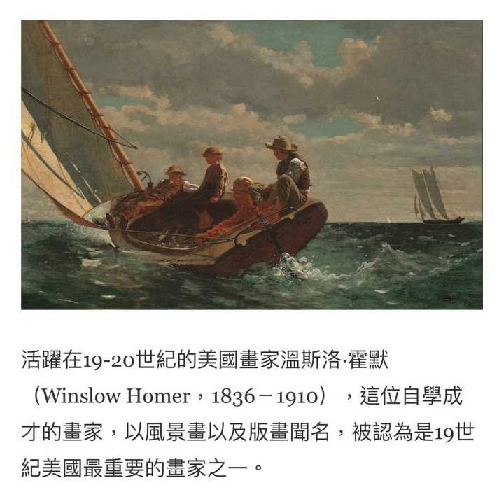
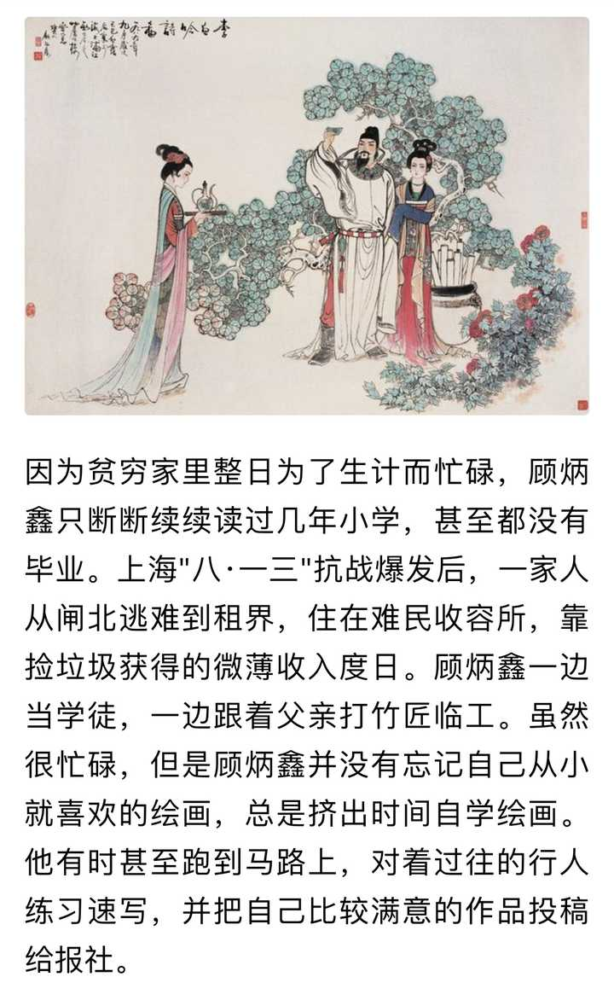
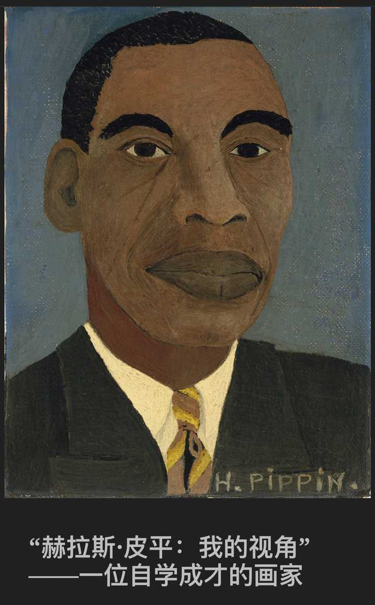
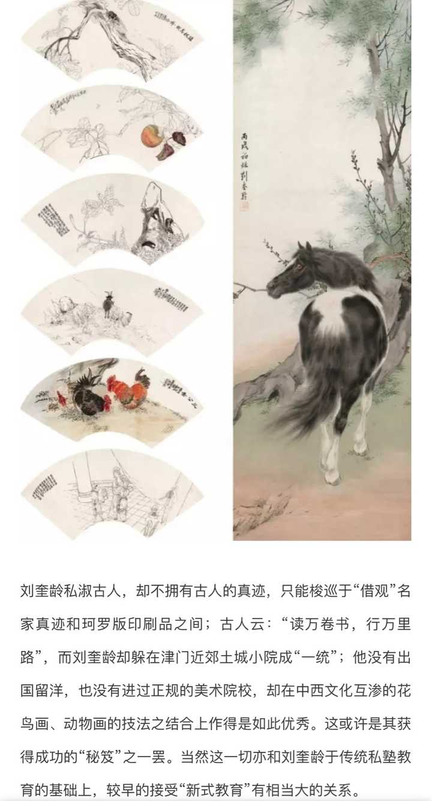

---

## 3150　责打教育

- 日期：2021-08-11　主专题：A04 教育学习与能力形成　副专题：A05;A11
- 源 ID：`8a1a3b58-a9b9-52ae-b499-b46d524c633e`　原文链接：https://www.zhihu.com/question/52311734/answer/2053018523
- 官方对象—实践路径：与亲族 / 与子女 / 抚养
- 23 概念标签：事实与证据;能力与学习;选择与自由;成本与总账;边界与许可;权力与异议;技术与工程;文明与历史
- 证据状态：manual_confirmed　初读：read　独立复核：not_reviewed

**问**：不打骂儿女的教育方式是否科学、先进？

骂就没什么争议，因为骂是没有什么营养的东西。
但是认定“责打一定是负面的”，这只是一种政治正确。
责打并不见得可以归类为暴力。其实何止不能称其为暴力，反而实际上是一种很复杂和深奥的文化传承。
“不打不成材”其实并不是一句空话。只不过为什么打、谁来打、凭什么打、用什么打、怎么打、打到什么程度，本身是一门复杂的学问，本身就需要大量的反思和学习。
这份传承常常是古代一些著名教育机构的核心传承之一。
问题是工业革命所带来的机械化暴力的泛滥和重大的人类灾难，着实给了整个人类一个巨大的心灵创伤。这把人类整个的吓到了，导致了整个人类对一切形式的物理性暴力的过激反应。这个过激反应牢牢的控制了主流意识形态，形成了一种“反对一切形式的物理暴力”的政治正确风潮。
人们不由自主的假定，如果没有任何人了解暴力、没有任何人有暴力的经验，甚至没有任何人有对暴力的认知，这一定是一件好事。
这股风潮打断了关于责打的传承，使得在教育中有序使用物理惩罚的整个方法和实践都基本断裂了。
于是，现在谈论的“责打”，基本上就是家长们凭着报复的本能发泄暴力。
乱打当然是不如不打的了。
但“乱打不如不打”，并不能简单的等效于“有责打的教育方式就是落后的”。
它只是古老的、不时兴的，但是不是“落后”，没人可以断言。
无论如何，现在这种无传承的状态已经是既成事实，而乱打显然是不能被支持的。
只能希望人类不至于为废弃了这一手段而付出过多代价吧。
把话说得坦白一点，免得有人误会——我并不反对责打本身，甚至倾向于认为责打是教育中本不该被过度抑制的一部分，更不认同“有责打的教育一定是落后的”这种说法。
但我反对无视时代现实，更反对假借“责打有合理性”而乱打。

---

## 3139　高估

- 日期：2021-08-17　主专题：A04 教育学习与能力形成　副专题：A08;A03
- 源 ID：`ec8a140e-5a8b-5ca5-8f14-14ca8bc70988`　原文链接：https://www.zhihu.com/question/358250805/answer/2064873323
- 官方对象—实践路径：与自己 / 与能力 / 获取
- 23 概念标签：事实与证据;定义与达意;能力与学习;选择与自由;成本与总账;劳动与组织;财富与市场;技术与工程
- 证据状态：manual_confirmed　初读：read　独立复核：not_reviewed

**问**：像哈佛、麻省理工、斯坦福这类的学校的教育水平是否被过誉了？

不是哈佛、麻省理工、斯坦福着些学校的教育水平过誉了，而是所有大学的教育水平都过誉了。
因为人所受的教育的最关键阶段，根本就不是学校教育阶段，而是进入市场（学术界也是一种市场）、在市场上努力自我经营、奋力满足需求的阶段。
后者长达数十年。
如雷贯耳、彪炳后世的东西，其实绝大多数是在这个阶段做出来的。把这些成就不成比例的归因于大学教育，是一种显而易见的逻辑错误。
这些大学的“教学成果”强，不是强在它们自己在纯教学领域上有多少不可复制的优势，而是强在它们有足够的快车道直通容易做出成果的产业职位。
有人会说——那么为什么不说这些职位是因为它们很强所以才会跟它们直通呢？难道你不是倒因为果吗？
注意，这问题问的可不是这些学校强不强，而是在问它们是否被过誉。
我断言这句“普遍过誉”的原因，是因为这些职位跟这些学校文凭的关联性的强度，与这些学校的实际教育能力的优势不相称。
形象的说，A比B强10%，但是A却比B多拿到了50%的offer。
我为什么如此断言？
是因为如果排除语言优势和镀金项目履历，纯双盲测试，斯坦福毕业生的水准并不见得会比清华学生有那么大的优势。
个人而言，我遇到过的出身清、北、牛、剑、伦敦政经……以及各如雷贯耳的藤校的脑子拎不清却自以为是神仙下凡的蠢蛋的比例一点也不比其他院校少。
而真正知道自己在干什么、该怎么干的，这些学校的学生比例也并没有比普通院校高到哪里去。
ta们的学校之所以如雷贯耳，似乎产出了大量的优秀人才，以至于看起来“查有实据”的“远超普通院校”——本质上的原因根本不在于教学上，而在于企业、政府、社会赋予的超额权重。
真正出成果的点，其实是在这个企业的部分。
所有的大学教育，都被高估了。

---

## 3043　天赋

- 日期：2021-09-21　主专题：A04 教育学习与能力形成　副专题：A01;A07;A03
- 源 ID：`e457fe82-86ed-5900-be4a-4c86f0d18279`　原文链接：https://www.zhihu.com/question/35318941/answer/2132354653
- 官方对象—实践路径：与合作者 / 与教导者 / 受教;与自己 / 与能力 / 获取
- 23 概念标签：事实与证据;能力与学习;选择与自由;责任与后果;成本与总账;边界与许可;照料与家庭;财富与市场;权力与异议;民族与身份;心理与主体;性别与身体
- 证据状态：manual_confirmed　初读：read　独立复核：not_reviewed
- 标记：`【正文标注未完待续】`

**问**：真的会有人有某种天赋却被埋没一生吗？

老实说，人类是一种普遍有天赋的种族。
你现在看到的所谓“知识精英”们令人称羡的专业技能，对大多数人来说都不存在智力上的天堑。找到一个恰当的老师，投入恰当的资源，在几个心理关口上遇到恰当的引导，没有半途而废，坚持改进个五年左右，投身市场成为强势服务供应者是一个大概率事件。借由跨界和合作，使优势的服务成为有统治力的创新服务，也是一个大概率事件。
注意前面这个基数——这对大多数人都没有先天性的、生理条件上的障碍。只有极少数的专业例外——比如柔术杂技、百米短跑这类高度依赖生理条件的专业。
甚至，在信息化的时代，连后天的门槛也在崩解。以前只有名门贵子才有机会接触的教育资源、特殊知识，现在也对一介平民不再是遥不可及，你要自学也罢、要钻研也罢，只要你想，虽然不至于像先天条件那么平均，但至少对中产阶级家庭也已经并没有什么天堑般不可逾越的障碍存在。
藤校讲的也是一样的相对论和微积分，并不是富豪特供款。ta们的电脑是比你好一些，没准贵上个五六倍，但是也没有强大到你做不出能和他们相比的作品的程度。
然而大多数人的天赋都没有转变成ta们的生存优势，没有成为ta们的护城河——也就是所谓的“被埋没了”。
为什么？因为要坚持那五年到十年，需要极大量的“补强力”。
你要学东西、要把自己的天赋变成别人可以用的、成熟的服务，你只需要满足一个要求——当别人的话出现歧义，你哪怕就是补错了，也要把别人说的话往强版本补足，而不要往弱版本补足。
举个例子——老师说你这题做错了，你要先相信“这题可能真的做错了，ta是在真诚指教我”的版本，而不能往“这题根本没错，ta就是想报复我昨天没主动给ta打招呼”去想。
注意，这不是叫你直接“认错”，而是如果你走补强的方向，你的第一动作是核实检查一遍，而不是翻白眼、抱怨和“反击”。这两个不同的反应会导致后续的剧情发展走向完全不同的方向。
这是“有天赋”的人“没天赋”的人的真正分野——不是ta们在生理上有什么巨大的差异，也不是ta们的家庭条件真有什么云泥之别，而全在于人生之中千千万万、无时无刻不存在的“补强还是补弱”的十字路口，你是往左转，还是往右转。
你的人生到底最后兑现成怎么样，全看你的补强率是多少。
你不需要做到100%的事事处处补强。你可以——而且也只能够争取有效补强率尽量高一点。但有效补强率81%的人，命运有很大概率会比有效补强率79%的人好很多。不是“纵观一生总体好2%”，而是以复利模式在每一次选择上，一次又一次的叠加这102%。你一生有多少次选择，你就好出多少个102%。
最终会有天壤之别。
既然补强这么好，为什么人们没有养成补强的习惯？因为补强意味着你很容易错把坏人当好人，然后受到伤害，遭受损失。也就是说，补强存在风险。
而相对的，补弱在安全性上有福利——如果对方是坏人，你也把ta当了坏人，那么你正好防住；如果对方是好人，你把ta当了坏人，那么你只是安全过度了，你是没得到收益，但是你好歹没有受伤。
也就是说，补强派有一定的概率补错，会因此遭受损失。尤其是在你的补强技能还很幼稚、思考能力还不够缜密、严谨的时候，你的误判率可能很高，以至于你的总收益甚至比补弱派还差。猜对了102%，猜错了98%。一样是一猜一计。
这里才是问题所在——要想在战斗中养成成熟的补强技能，你要有相当大的一笔“启动资金”来“交学费”。
家庭出身对人的一生影响是在这里有天壤之别——好的家庭善于传授补强的技巧，以至于这笔“学费”额度不高，并且这样的家庭也会更接受代自己的子女支付这笔成本。
糟糕的家庭首先在这方面就缺少传承、父母自己就少有补强的经验而只有补强失败的教训，这导致子女如果想要突破补强的学徒期的学费额度本身就高，而家庭却恰恰因为自身的认识问题——更多的则是干脆出于贫穷（一直补弱，极易赤贫）——更缺少为子女承担这笔学费的意愿。
看清楚，这里的家庭好坏，并不是看家庭资产的绝对值的。中产乃至贫寒之家也可以是乐于而且可以负担这笔学费的——因为乐于承担本身就可以大幅的降低这笔学费的数量；豪奢巨富之家也可以是不愿而且承担不起这笔学费的——因为不情愿本身就会大幅的抬升这学费的总额。
看似巨大的差异，其实只是一个基本动作积累千万次的结果。
人的命运是在这里分开了。

但是，补强的准确率是可以提高的，你是可以做到既选择补强、又不至于因为误判而受到损失（或至少过大的损失）的。
关键在于补强的战略思想。
假设我们把绝对善良和绝对智慧设为100分，把绝对邪恶和绝对愚蠢设为-100分。然后我们假设你的直觉判断给对方的打分是直觉分（Expectation），而你经过思考决定给对方打的分数最终取值设为决定分（Decision），而决定分和直觉分之间到差值称为补强值（Enhancement）。
那么，所谓补强，是指补强值始终要大于0，即决定分永远要比直觉分高。
这分为两个基本原则：
1）默认把对方当成不坏的人看待。
也就是对对方的评分始终要大于0，怎么也要按照正值来算，也就是即使你感觉到对方不见得是多么出色的好人，但至少不要无根据的——尤其是在对方根本没开口之前——把对方首先当成一个有主观恶意的恶人来看待。
无视一切其他证据，先把对方当成一个不坏的人。
很多人觉得这会很危险，恰恰相反，一个不坏的人的第一标准，就是ta会承认和尊重其他人求生存、求安全的权利，以至于ta不会被别人自我保护、自我防备的措施所冒犯。
不好意思，我走开时机器要上锁。你是一个好人，所以我可以直接假定你一定能体谅我的脆弱，而不必忧虑仅仅是我做一点自我保护就会激怒你。
反而是当我觉得你是个坏人、是个把自己的面子、自己的方便放在别人的安危之前的人的时候，我反而会犹豫要不要采取必要的安全措施。我要担心上锁、加密码、拒绝透露隐私就会开罪于你、乃至于要结怨。
换言之，我坦然的自我保护，恰恰是对你的善良的一种信任。
所以，补强和自我保护没有任何矛盾。
更进一步的，补强同样意味着我可以相信你会接受我对我自己合法权益的执着。只要是我的合法利益，你都不会介意我不肯轻易放弃。
因此补强根本不涉及什么“自我牺牲”。
你觉得有什么合法利益需要坚持、有什么自我保护措施需要采取，大可以大大方方的、带着欣赏和感激的去做。你这个放心大胆，反而不会冒犯对方。如果你觉得心里没底，大可以直接说“我的原则是要采取这些安全措施，不是针对任何人，相信你一定可以体谅”。
对方只有体谅一条路，因为如果对方说出或者做出什么让你这个期望落空，那么你就可以有凭有据的降低ta的评分到负数。你只是需要在这个新评分上再补强一些罢了。
这不是出于你的凭空想象，而是有真凭实据的了。
补强不需要脱离真凭实据，它只是要在有真凭实据的基础上，在自身安全的前提下，无论如何略微拔高而已。
所以注意我们一开始的前提——下没有任何凭据前，不要打负分。
有了依据，这个限制就失效了。

2）无论你的直觉或者证据指向什么样的评分，都把你的最终决定分再提高一些。
这一般是指对对方的恶作最保守的估计，没有确实证据，不要在证据足以支持的程度上添油加醋，额外想象人的恶。
有个著名的笑话，就是三名游客在爱尔兰坐火车，看到窗外一头黑色的羊。第一个人说由此可见爱尔兰的羊是黑色的。第二个人说，不，只能说爱尔兰有一头羊是黑色的。第三个人说，不，正确的讲，是我们可以确认在爱尔兰有这么一头羊在朝着我们的这一面是黑色的。
这个例子非常清晰的示范了什么叫做保守估计人的恶。
这个人偷了一本书，你看到了，你就按照“这个人偷了一本书”来处理，不要按照“这个人是惯偷”甚至“这个人连书都偷，想必十恶不赦”来处理。
后者就属于想象人的恶。
但你已经确认了这人偷了一本书，你就可以提高对方借书的门槛，比如要求ta额外支付押金。而你仅仅只是额外要求支付押金，而不是永远将其逐出图书馆、或者干脆人道毁灭，这本身就是一种补强——即你认为这样的等级的处理对对方已经是足够的警醒了。注意，这不是在叫你降低补偿或防范措施的标准来放水——举个例子，你的押金标准很可能是按照全馆最贵的书籍的定价给定的，保证ta无论借了哪本书不还，你都不会真的吃亏。但你有责任、有义务相信一旦这个措施足以自保，就已经够了。
不要在想象对方的恶的方向上一路狂奔，在缺少足够必要的前提下跑到“非把对方消灭才能免除隐患”的程度。
比如，你们是一群地下党，而这人是个已证实的叛徒，已经出卖了一个同志。在这情况下，你其实没有类似“提高押金”的手段来防止他出卖下一个同志，那么你的防范措施即使按照“最小必要原则”，也势必可能是将对方处决。这时最小必要原则体现在“不要随意扩大打击面”，“不要搞过度的酷刑折磨”。
而所谓的在此基础上“拔高”，有三个具体的万用补钉——“ta可能不是故意的”、“ta可能是迫不得已/受限于无知”、“我可能失误在先”。
无论对方已经确认无疑的存在什么样的恶行，你要确认对方的恶意，你都需要证据来排除这些可能性，而不能在没有证据、没做调查核实工作的前提下，直接出于“保险起见”，自己假定“对方就是故意的”，“没什么不得已、就是出自主动的恶意”，“我没有任何失误，纯属对方无事生非”。
在没有完成调查前，必须默认假定对方不是故意、可能不得已、出自自己失误引发的误会，这就已经算是补强。
这不需要你把对方当成绝对不会犯错、绝不会有任何贪念、绝不会对人发起恶意攻击的圣贤。这只是要求你考虑这些可能，并在无确证前按照不故意、不得已、我有错在先来对问题作结论。
（待续）

这个总策略要坚持，要如同刻在石头上那样坚持不变。
在这个总前提不变的前提下，再谈起他的配套的策略。
哪些配套策略呢？
1）管控已经识别确认的恶人/补弱者的对话资格。
你不要忘了，你有一定的选择权。你很清楚对方是在补弱，而且是经过提醒、直接给出了反面的依据（或者反面的依据触手可及）的前提下执意补弱，那么你可以出于沟通效率原因直接取消或冻结对方的对话资格一段足够长的时间。
也就是说，对方可以令你失望和意外的次数和场合，是可以由你掌握的。
在保持补强的前提下，先进行利害关系不那么尖锐的对话和交往。在这个阶段，静静地观察对方对于你有歧义、尤其是存在补弱空间的话作何反应。
看看对方知不知道这条规则，是不是在奉行这条规则。
在这个阶段里，对方可能都不认识你是谁，也不知道你住哪里、叫什么、做什么的。你们的交往也许仅仅只是一起打了个球、联机打了个游戏、在某种公共场合一起参加了一个活动，或者你是参加展览，对方是个导游……
也有可能是你写了篇东西，对方跑来评论。
这是个可进可退的阶段，你掌握着要不要进一步给予对方对话机会的绝对权利。
在这个阶段，看出对方有显著的、牢固的、高频的补弱习惯，就取消对方的对话资格。
一旦证实，宁可杀错一千，也不放过一个。
直接从根源上治理你的对话环境。
这会战略性的的降低你补强而失望的概率，使你的补强成功率大为提高。
自身没有补强习惯的人，缺少ta人替其补强的价值，会导致极高的补强失误率。
这不是什么人格歧视，而是有内在逻辑的技术性必然。这和“没有放冰箱的雪糕容易融化”一样，纯属客观的物理必然。
不必对对方作道德审判、价值判断，你也不需要去探究对方到底是好人还是坏人，甚至连补弱的具体原因也不需要深入的研究——类似文章评论者这样的人你一年不晓得遇到几百几千个，哪有可能有这么大的资源去一个个研究ta为什么总要把你的话补弱？
你决定切断信道的理由完全是技术性的——纯粹是出于预期会无谓的亏损。这也不能被视为对对方的报复和处罚——人人都有采取消极行动避免损失的天然不可剥夺的权利，这不能被视为一种攻击和惩罚。
但是注意，不要跑去对方面前讲“我拉黑你了”，拉黑是正当权利，但跑去讲这句话属于攻击行为。
Business is business, nothing personal.

（增补的部分在前面几段，请注意。）

---

## 3024　读书与行路

- 日期：2021-10-01　主专题：A04 教育学习与能力形成　副专题：A08
- 源 ID：`cefd82f1-f851-5bba-b716-d260498828aa`　原文链接：https://www.zhihu.com/question/489556952/answer/2150054195
- 官方对象—实践路径：与自己 / 与能力 / 获取
- 23 概念标签：能力与学习;选择与自由;成本与总账;照料与家庭;文明与历史
- 证据状态：manual_confirmed　初读：read　独立复核：not_reviewed

**问**：贫困家庭的孩子十一应该去旅游吗？

读万卷书，行万里路。这两样并不是递进关系，而是一种平衡关系。
啥意思呢？就是一般人往往做成要么读万卷书、行千里路，要么行万里路、读百卷书。很难有这种超级幸运、知道（或被迫）自我刻苦，而且有条件同时做到既读万卷书，又行万里路的——这种一般可遇而不求。
多书少路的和多路少书的，最后往往是各有所长，势均力敌。
只不过都毫无悬念的胜过少书少路党罢了。
穷人没钱行万里路，那又如何？那不叫bug，那叫feature。正好把时间省下来多读几本经典的书。
书便宜啊。
现在真的是历代读书人难以想象的读书的黄金时代——以前的人还要到周末才能去书店、图书馆蹭书看，想看的书还未必就有，尤其是，没人领路的话，该看的书也未必自己就能知道。
你们知道把图书馆的一个分区一个分区、整架整架的书排头将横扫过去，涉猎了整个藏书的几成是什么感觉吗？
钻教科书，根本不叫读书，那叫学艺。
横扫图书馆才叫读书，横扫过图书馆的人才叫读书人。
建议这个十一你办张卡，感受一下。没图书馆，你可以去书店；没书店，你还有互联网、电子书。这个其实穷人也可以办到的。
横扫完之后，你再看你羡不羡慕人家出去旅游。

---

## 2993　不道歉的小朋友

- 日期：2021-10-16　主专题：A04 教育学习与能力形成　副专题：A05;A03
- 源 ID：`e84dd5b4-e2e3-5bf2-aefe-f896bde14fbd`　原文链接：https://www.zhihu.com/question/468899632/answer/2173849616
- 官方对象—实践路径：与亲族 / 与子女 / 抚养
- 23 概念标签：定义与达意;能力与学习;选择与自由;责任与后果;成本与总账;权力与异议
- 证据状态：manual_confirmed　初读：read　独立复核：not_reviewed

**问**：当孩子问「为什么小朋友不小心碰到我，却不向我道歉」时，该怎么回答呢？

你就问他，
1）你愿意跟踩了你也不道歉的小朋友玩吗？
2）如果你不愿意，你觉得David会愿意吗？Julia会愿意吗？小石头愿意吗？
3）假如ta踩的是另一位小朋友，没有向那一位小朋友道歉，也就是说你知道这位小朋友踩了人从来不道歉，你愿意跟ta玩吗？
所以，是“用不着道歉”比较重要，还是“大家都爱跟你玩”比较重要？
一件事要不要做，不是光看做它有没有成本，还要看不做它的成本。
并不是不做它，你就肯定省掉了做它的成本，纯赚了便宜。
有些事情，你之所以必须要去做、必须付出做它的成本，是因为不做它成本更大。
你不想付出道歉的成本，那你就要付出不道歉的成本；
你不想付出学习的成本，那你就要付出不学习的成本；
你不想付出勇敢的成本，那你就要付出不勇敢的成本。
想当勇士，一定要先学好会计。

---

## 2976　基本造型能力

- 日期：2021-10-27　主专题：A04 教育学习与能力形成　副专题：A13
- 源 ID：`d14dd351-55b7-5bf2-be2c-f0b39f68c0fa`　原文链接：https://www.zhihu.com/question/488353876/answer/2191114908
- 官方对象—实践路径：与自己 / 与能力 / 获取
- 23 概念标签：定义与达意;能力与学习;选择与自由;劳动与组织;技术与工程;心理与主体
- 证据状态：manual_confirmed　初读：read　独立复核：not_reviewed

**问**：为什么Mac连个正儿八经的CAD都装不了还敢打着生产力的旗号？

shapr3d
The World's Most Intuitive 3D Design App | Shapr3D不管你是不是干这类工作的，推荐各位学一下，作为一种个人基本技能。
有人问要学到什么程度。
三个级别：
1）能建模家具。
2）能通过3D打印定制自己需要的小零件——比如水管接头，笔握，眼镜鼻撑、肥皂盒、花瓶这类。
3）能通过3D打印定制自己想要的组合物件。比如眼镜架、鞋子、给自己定制的口罩模具、带传动结构的小机械之类。
直到你有自信在一定尺寸之内你可以得到你想要的一切形状的物体。

---

## 2877　重复一千遍

- 日期：2022-03-23　主专题：A04 教育学习与能力形成　副专题：A16;A03
- 源 ID：`d3e0b996-4451-5ecd-9843-232354293ced`　原文链接：https://www.zhihu.com/question/519252966/answer/2403859631
- 官方对象—实践路径：与社会 / 与舆论 / 接收
- 23 概念标签：能力与学习;责任与后果;信用与信任;法律与秩序;权力与异议;技术与工程
- 证据状态：manual_confirmed　初读：read　独立复核：not_reviewed

**问**：如何看待，在微博公布IP属地后，俄乌问题里的外网账号?

其实这是无关紧要的，纠结也没有意义。
一切技术手段都最终可以绕过，更不用说并非只有一种特定身份才会持有不严谨、不真实的看法。
归根到底，你不可能通过巧妙的剥夺发言权来防止人把谎言重复一千遍。因为如果有什么技术手段能自行分辨什么是谎言，人类怕就要成为历史了。
你只能尝试做一个就算把谎言重复一千遍也难以欺骗的人。
平时需要构建尽可能扎实而完整的常识。
很早我就说过——文、史、法、理、工、农、医、艺，全部自学到本科同等学力，将极大的提高辨别信息真伪的能力。
绝大多数谣言，都很难同时避免所有这些学科的所有常识性限定。它们总是会在某一科目的某个细则上触到“超常”红线，露出荒谬感来。
你顺着这警报一查、一追问，它就漏了、破了。
是这个，是分享这些独自识别的方法，是培养人这样做的习惯，而不是“显示地址”这种手段，使得“谎言重复一千遍”战术最后徒劳无功。

---

## 2816　劳动技能

- 日期：2022-05-06　主专题：A04 教育学习与能力形成　副专题：A07;A01
- 源 ID：`8f4fbf3b-2b47-50af-bc66-1acd58a9b947`　原文链接：https://www.zhihu.com/question/531443999/answer/2472301817
- 官方对象—实践路径：与自己 / 与能力 / 获取
- 23 概念标签：能力与学习;责任与后果;成本与总账;照料与家庭;劳动与组织;心理与主体
- 证据状态：manual_confirmed　初读：read　独立复核：not_reviewed

**问**：教育部要求 9 月起中小学生要学煮饭，制作 2~3 道家常菜，修理家电等，具有哪些积极意义？

非常支持在现有的基础教育中增加基础的劳动技能。而且占比应该大幅的提高，比重应该大大的加重。
只是要注意，要均衡学习量，把其它理论课的负担对应的下降，保持总负担不变。
而不应该是别的要求照旧，只是额外增加这个负担。
现有的学习负担本身很重，在这个基础上如果是额外增加这个要求，可想而知是会被虚与委蛇的绕过的，起不到什么正面的效果。
如果能对称的降低一些其它理论课程的考核内容，给这个劳动技能教育让出空间来，那是一种很好的改进。
基本的劳动技能对个人的成长——尤其是心理发育——有至关重要且不可替代的意义。它是人的基本安全感的可靠来源。
人不劳动，没有基本的煎炒煮炸、钻刨磨焊、粘接缝补的常识和体验，对价值的感受就是虚无和抽象的，极易脱离现实、陷入茫然。
你仔细观察，会发现很多有学术成就的人在小时候有务农务工的经历。驱使他们学习和研究的动力在于ta们坚信自己的成果能大幅的改善某种劳动的代价或者成果。
学习种种纯理论知识，因为缺少对劳动生产的最基本常识，基本必然会沦为抽象的智力游戏，成为一种纯粹的避免被家长责备、赚取同学羡慕的杂技。
一旦这些东西失去吸引或者找到了别的心里替代品，学习的动力就会大幅丧失，不知道自己学这个到底有什么价值、有什么用。
我们现有的教育对这一点忽略太久，极端的偏向纯粹的理论计算，经常会造成学到九成九的学生只想打游戏自我麻醉了此残生的无效结果。
你所学的是因为对劳动的价值而有不可磨灭的价值，不是对你爹妈有价值而有不可磨灭的价值。
后者只要你爹妈跟你闹翻就一钱不值了。
而你爹妈迟早是要跟你闹一次翻的。
另一方面，这也是对长期沉浸在高强度理论学习里的青少年的一个很好的调节，有利于劳逸结合。
所以，即使学校不教、教委不考，父母自己也应该自己教好。
能由学校来完成是一件好事。

---

## 2784　目标谷爱凌

- 日期：2022-05-24　主专题：A04 教育学习与能力形成　副专题：A05;A01
- 源 ID：`d67dd01f-6537-50b1-b809-60c6c3014a7c`　原文链接：https://www.zhihu.com/question/534143389/answer/2499976459
- 官方对象—实践路径：与亲族 / 与子女 / 抚养
- 23 概念标签：事实与证据;定义与达意;能力与学习;责任与后果;成本与总账;爱与回应;照料与家庭;权力与异议;心理与主体;宗教与自然法
- 证据状态：manual_confirmed　初读：read　独立复核：not_reviewed

**问**：如何评价万科创始人王石称「不应把谷爱凌当做目标教育子女」？你觉得中国父母在教育上存在哪些问题？

什么叫做“把谷爱凌当目标”？
是指“取得两枚奥运金牌 + 考上斯坦福 + 当上模特”吗？
是在担忧这种“业绩压力”会造成性格缺陷，然后反而得不偿失？
于是觉得“我只期盼你当个普通人”至少在这方面没有风险？
那么，“我只期望你当个普通人”，怎么解释你要花钱帮我上贵族学校呢？为什么你要帮我创造种种条件“追求成功”呢？
你的子女上的什么学校？是“普通人上的普通学校”吗？
第二，如果你确实指望我当个普通人，那么普通人英语不怎么样啊，你催我学英语干嘛？
普通人身材都一般啊，你为什么要催我减肥？
你说只期待我当普通人，那么我按普通人的标准自我要求，为什么不行？

所以啊，父母——尤其是中产阶级以上的父母——说什么“我只期望你当个普通人”，纯属自欺欺人。
这只是一种发现子女有抑郁 / 自毁迹象，于是鸡贼的拿来挂在嘴边给自己脱罪的说辞罢了。
成龙成凤的事我全都做了，但是这话我全不说。
将来你“抑郁”了可怪不着我，我可一直都表示“只期望你当个普通人”的，你别冤枉我。
有意思吗？有用吗？
问题的症结并不在“应该把期望奥运夺冠改成期望成为普通人”上。
问题的症结在“期望不应该放在成就”上。

我根本没资格去“期望”你是奥运夺冠，还是成为普通人。
我又不是上帝，我的“期望“根本没有什么意义。
同样，你也不是上帝，你的“期望“也没什么意义。
既不要期望奥运拿牌，也不要期望成为普通人。
你要做的，是不要搞到命运让你当了什么，结果你当不住。
命运要你当奥运冠军，你就要当得住，当得好。
命运要你当普通人，你也要当得住，当得好。
我的责任是帮你获得从命运的一切安排中尽量结出最多果子、得到最好体验的技能和准备。
不是去帮你锁定我对你的人生规划——无论是奥运冠军，还是普通人。
也不是去帮你锁定你对你自己的人生规划。
我算什么东西，你算什么东西？人的命运轮得到我们来“规划”？
你能管住中美冲不冲突吗？还是能管住新冠发不发生？还是能管住俄罗斯打不打乌克兰、石油涨不涨价？还是说你能保证无论发生什么都不可能影响到你的计划？
你要是管不住，你那些志在必得、于是将整个前半生寄托在达到某个里程碑上的规划有何意义？
你以为这是“降低要求”就可以解决问题的吗？
那万一要是你计划当个普通人，结果命运把你送上了操作台，你要么挺身成为英雄，要么缩头受万世憎恨，就是没有“当个普通人”这个选项呢？

幸福不幸福的要害根本不在于奥运冠军还是普通人，把前者改成后者根本不解决任何问题——事实上还制造了问题。
你喊着期望ta当奥运冠军，ta没达到你的期望，ta还可以喊一嘴“我只想当个普通人”。
你一直嘴上说“只期望ta当普通人”，ta没达到你的期望——以你这个口是心非的、嘴上不说的、事实上的奥运冠军的期待，这基本上是必然结果——ta再要怎么办？
你一直在喊只期望ta当个普通人，然后你还是唉声叹气、眉头紧锁，
你觉得ta会怎么想？会怎么办？
这种游戏，难道你只要不押大、改押小，你就不会输？
想不输，唯一的出路是根本不要玩。

谷爱凌拿没拿奥运金牌、当没当model、上没上斯坦福，根本不是谷爱凌值得你注意的地方。
是她在最后关头仍然敢做大动作的勇气、敢于不在乎一些活见鬼的烂话的硬气、坚持练习精益求精的恒心，很值得你拿来当目标。
奥运冠军还是普通人，这要看上帝。这份勇气、硬气、恒心，你要有。
不管当奥运冠军还是当普通人，没这些都会痛苦——你以为奥运冠军就肯定不会痛苦吗？奥运冠军就肯定不会自杀？
无论是当奥运冠军还是当普通人，有这些都会容易活得开心。
从奥运冠军撞断了腿，变成了普通人，有这些一样容易活得开心。
从普通人一夜成名，变成了奥运冠军，有这些一样容易活得开心。
谷爱凌不是问题。
你才是问题。
早点改了这种“成就期望”的恶习。

---

## 2757　学英语

- 日期：2022-06-09　主专题：A04 教育学习与能力形成　副专题：A20;A08
- 源 ID：`50b7bac2-7f75-5c83-85cd-f633547e3f26`　原文链接：https://www.zhihu.com/question/477637169/answer/2521305952
- 官方对象—实践路径：与自己 / 与能力 / 获取
- 23 概念标签：能力与学习;选择与自由;成本与总账;法律与秩序;技术与工程;文明与历史
- 证据状态：manual_confirmed　初读：needs_reread　独立复核：not_reviewed

**问**：如何看待上海市发布的小学期末不再考英语，禁止全区范围的学科统考统测?

综合的看，中国的学科负担太重了，而这其中最可减省的就是英语。
倒不是别的，而是现在中国的英语资源很丰富，跟十几二十年前完全不可同日而语。一个小孩很自然的就会学会基本的英语语法。这东西其实本来就不值得花这么多时间去学。
英语被提高到现在这种重要地位其实是一个时代问题。
四十年前，长期封闭的中国决定要对外开放，放眼中国，懂英语的人屈指可数。
十亿人要赚美元、要学技术，但别说自己如看天书，环顾四周连个有基本的英语会话和阅读能力的朋友都找不出来。
这是多大的需求缺口？
英语技能需求极端迫切，而英语资源却极端匮乏。这历史性的导致了英语在这个特殊时代获得了极为重要的学科地位。

但现在是什么时代？
首先，中国的外贸规模已趋历史顶峰。
这倒不是说以后出口额不会再创新高，但那更多的是出于出口物品逐渐高端化，而不是业务数量会有多大的规模上升。
另一方面，英语买家的购买力已经趋于历史顶峰甚至要走下坡路。这个应该有目共睹，无需多少赘言。
第三方面，未来外贸业务的增长热点会是一带一路国家，但是作为强势输出者和规则制定者，更可能是大量一带一路国家的商贸人才努力学习中文，而不是我们要去学斯瓦希里语。

第二，英语的存量人才规模已经足够使用，并不缺乏甚至可能有渐趋过剩的趋势。
几亿人英语必修四十年、留学贸易四十年，中国熟练掌握英语的人口已经足够多了。不管是教的还是学的都足够多。
不错，英语世界仍然有丰富的文化财富和交往需求，但是现有的和将有的人才资源看不到什么不足以应付这些需求的短缺迹象。
换言之，需要把英语提升到十年二十年前这种高度的必要性已经历史性地过去了。
时过境迁，为什么要坚持已经不必要的陈规？
不必要的浪费下一代的时间和资源当然是一种严重的错误。
为什么不该得到纠正？
发现很多人反应过度了，觉得英语的主科地位会消失。
这个估计是误判。
更大的可能是英语仍然是主科，仍然会是绝大多数人的必修课。
它只是会被分配较少的分数比重和教学时间，把这些时间分配给其它比较紧缺的知识技能。
例如艺术与设计、基本的工程常识、更多的世界认知——例如世界史和地理常识。
在纯语种问题上，可能会有更多学校开始增设法语、西班牙语、俄语乃至阿拉伯语的班级。
下一代人在海外会有比现在这一代人多得多的机会，这是一个差异化竞争的不错选择——你很容易成为某个拉美或西亚城市里寥寥无几的华人之一，成为这个城市和中国相连的重要管道。这个城市要和中国交往，你总是当地要人首先想起的几个人选之一。
科班出身小语种人才，往往是央企海外项目的重点招募对象，经过一带一路项目派驻服务，在当地自然获得人脉关系，很容易由此获得全新的机会。
不少人在国内只不过是普普通通的本科生硕士生，到了那边却时常和总理、部长、酋长在一个餐厅吃饭，打交道的已经是当地的豪强地主一类的人物。

别看这一个小部落可能只有中国几个村大，但这些“村长”“乡长”们手里往往有极大的绝对权力，和中国的行政官员不是一个概念。
如果个人冒险精神足够，而且在国内觉得怀才不遇，这其实是一片广阔天地。
中国文化其实天生过度保守，对待风险偏好不足，缺少皮萨罗式的人物。
好在十几亿人，而且时代潮流即将兴起，二十一世纪的中叶想必会出现不少从小向往“伟大航路”的新传奇人物。
有言在先——其中一些，会是这篇东西的读者。
路飞，你tm记得把我的答案看完再往船上钻。
别出去丢村里的脸。

<!-- 图片：4 张，审读结论见下 -->
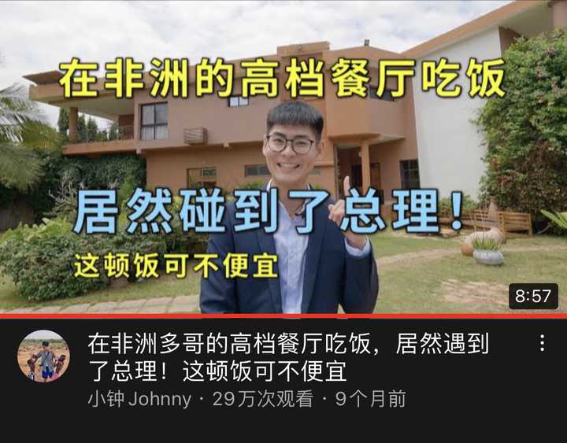
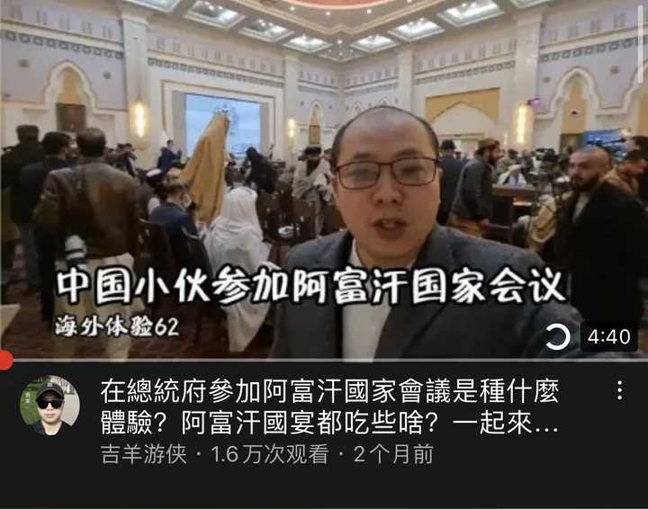
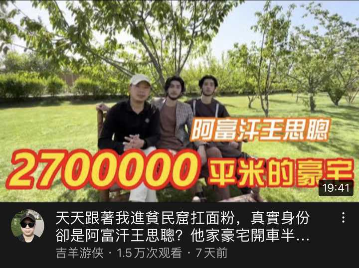
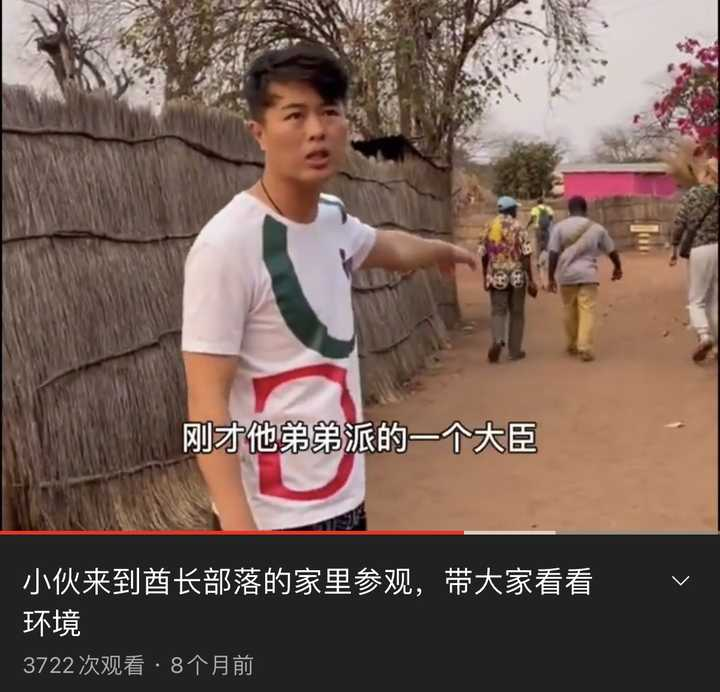

---

## 2755　元天赋

- 日期：2022-06-10　主专题：A04 教育学习与能力形成　副专题：A01
- 源 ID：`9e331c63-31ac-5328-aa0c-524de39aef37`　原文链接：https://www.zhihu.com/question/529222173/answer/2522013890
- 官方对象—实践路径：与自己 / 与理想 / 持守
- 23 概念标签：定义与达意;能力与学习;心理与主体
- 证据状态：manual_confirmed　初读：read　独立复核：not_reviewed
- 标记：`【极短回答】`

**问**：坚持没有天赋的梦想是浪费时间吗？

天赋的核心是举一反三、触类旁通吗？
天赋的核心是坚持。
确切地说——是“无限地找到下一个坚持的理由”的能力。

---

## 2750　社会化

- 日期：2022-06-12　主专题：A04 教育学习与能力形成　副专题：A06;A03
- 源 ID：`827cceb1-fcbe-52ee-8f35-00d4c2a242c5`　原文链接：https://www.zhihu.com/question/21789164/answer/2524848159
- 官方对象—实践路径：与亲族 / 与子女 / 抚养
- 23 概念标签：定义与达意;能力与学习;责任与后果;成本与总账;信用与信任;爱与回应;照料与家庭;劳动与组织;法律与秩序
- 证据状态：manual_confirmed　初读：read　独立复核：not_reviewed

**问**：何为社会化？

我曾经说过，父母对子女的主要教育职责就是帮助子女完成正确的社会化。
但是我发现这里的社会化概念需要特别厘清一下，以免各位父母拿着各种教科书往上套。
因为一般教育界所谓的社会化是指帮助儿童理解和接受现有社会的规则和现状，以成为该社会的一名合格（functional）成员。
但这其实不是社会化，而是【xx社会化】。
你在教导ta匹配什么社会，那就是xx社会化。
教ta匹配中国社会，那么这叫中国社会化。
教ta匹配美国社会，那么这叫美国社会化。
然后你发现问题没有？
这些“中国社会化”、“美国社会化”，如果要缩写简称，该省去的不该是“中国”和“美国”，变成“社会化”，而应该省去“社会”，变成“中国化”、“美国化”。
换言之，各国教育界在谈的所谓的社会化，实际上是本地化、公民化。
这在本质上并不是真正的社会化，而是对社会化名义的一个有意无意的占用。
其差异约等于一所以篮球见长的学校，将一群报考运动学专业的学生，教成了篮球学学士。
虽然篮球的确是一种运动，但运动学专业和篮球学专业的课程设置和侧重方向是完全不同的。

这种“社会化”和我一直所论述的社会化不是一回事。
我所谈论的社会化，是超越于具体的意识形态之上的，这是它的首要而且核心的关注。
它的重点是如何与意识形态未知、多元、与你对立以及随时变化的人群低成本的建立和维持有可持续性的健壮的社会合作。
所以，我所论述的核心，是大量的基本问题——如何交谈、如何信任、如何面对分歧、如何面对契约、如何面对怀疑、如何面对诽谤、如何面对憎恶、如何帮助、如何战斗、如何逃离……
在我的论述中，你会发现这些交谈、信任、分歧、契约、怀疑、诽谤、憎恶、帮助、战斗、逃离的对手方是没有意识形态差异的。
无论你是东方还是西方、有神还是无神、激进还是保守甚至正或邪、善或恶、贵或贱，放进这些论述的宾格里，都不会改变它的谓词成分——不会导致方法的动摇。
我所讲述的社会化，是要让一个人去适应社会这个事物本身，而不是去适应当前的社会、或者某人所设想的未来的社会、或者中国社会、或者美国社会。
就是社会本身。
就像教运动学的，教的就是运动学，而不是篮球学、足球学或者剑术。
这个用意是你学好了运动学，你再去学篮球也罢、学足球也罢，甚至膝盖踢碎了要改气步枪也罢，都能事半功倍、得心应手。
社会用纳税人的钱办公立教育，它们谈论的社会化当然是指它们自己的公民化，是力求让受教者匹配自己的现状和自己的战略愿景。
所以它们一直在强调的是塑造认同。
注意，这不是在吐槽或者反对它，因为这是理所当然的——不这样，岂不是在浪费纳税人的税金？
但这和父母要去教授的社会化不是一回事。
父母们需要的是自己的子女无论遇到什么样的人、进入什么样的组织、被命运带去哪里，都能及时、有效、风险可控的与ta人良性的合作，最大限度的保证安全、获得资源、有所成就。
要的是自己的子女能开山立派、成祖成宗、立德立言。
要的是孩子们永不至于孤苦、永远不至于绝望。
所以我在讲的，是不判断（no judging）、宽容、信心和爱。
看懂了吗？
以后记住这个差别。

---

## 2711　你的事

- 日期：2022-06-30　主专题：A04 教育学习与能力形成　副专题：A05;A03
- 源 ID：`74a64c05-77d8-543c-8f88-c04cd12b6a47`　原文链接：https://www.zhihu.com/question/487282842/answer/2551554967
- 官方对象—实践路径：与亲族 / 与子女 / 抚养
- 23 概念标签：定义与达意;能力与学习;选择与自由;责任与后果;照料与家庭
- 证据状态：manual_confirmed　初读：read　独立复核：not_reviewed

**问**：如何告诉孩子，学习是你自己的事？

何谓“xx是某人的事”？这话为什么应该有激励作用？
你一定要想好这两点，再跟子女说学习是ta自己的事。
“是xx的事”这个表达其实是非常含混而危险的。它既可以表达这是你的责任，也可以表达这是你的权利。
比如“打扫清洁是清洁阿姨的事”，这里指的是责任。
“买不买ipad是我的事”，这里指的是权利。
父母一说“学习是你的事”，自己觉得这说的是责任，说的是“学习好了受益人是你自己”。
但子女往往理解成“学不学可以随我的便”，理解成这是自己的权利。
更不必说家长们往往还顺口会说“学不好该你自己倒霉，我才不是最倒霉的那个”，更是坐实了这说的是一种“权利”。
你的子女连随便花掉零花钱的权利都还没有得到，ta能得到决定学习还是不学习的权利吗？
这只是一番毫无意义的、有害无利的推卸责任罢了。

其实，还有一个角度可以非常清晰的解决这个争议，那就是这个“事”，如果翻译为英文，应该翻译为什么？
Your business，还是 your affair？
看出问题了吗？
business，是一门生计。是你该自己忙、自己热衷、自己追逐的事。
affair，是一件事务。是你的公务，你的职责所在。
问题在于，business不能是别人安排的。作为一个人busy的具体化，别人不能对这一点进行安排。人只能因着自我的驱动而keep busy。所以才有mind your own business。
但少年儿童显然没到可以manage business的时候，学习并不是、也无法是儿童的business,
只能是ta们的affair。

这从另一方面，也是化名为“自由主义”的庸俗自由主义的贻害——这一点在家长之中流行甚广。
子女要习惯配合父母，作为父母的助手和下属存在，父母不需要为“这是我的目的，你要服务于这个目的”对子女感到“不好意思”。
“安排你学习是我的事，我是你的监护人、你被指定的上司，你要配合做好它”，这就是你现在为什么要学习的基本原因。
做人必须学会的不是什么“平等”，而是学会选择上司，争取上司，配合上司，管理上司，有所作为，然后学会当个好上司。
而这一切的核心，都是从学会配合上司中来。
我要负责当一个好上司，向你示范什么是好上司，什么是坏上司，当你学习争取、配合、管理的对手。
你要负责当一个好下属，学习和练习争取、配合和管理上司。
学会服务（serve）这件最困难、但却是人类最需要、也是唯一需要学会的专业。

而更重要的是，我们不是普通人。

We are the servants of people，
helpers of the poor，
healers of the diseased,
guiders in the darkness,
bridges over the river，
shields between the innocent and harm.

This is why we are made,
this is what we are meant to be.

让别人去寻求平等和自由，
我们要帮助人得到平等和自由。
你会看到的，
这是得到最多自由的最短的路。

你看得到人看我的目光，
也体会得到我的话对人的力量。
我得到的不是“平等”，而是理解、服从，向往和尊敬。
你用不着担心“平等”，你要在意的是能不能得到理解、服从、向往和尊敬。

你生在我家，
你不是普通人。

成年以后，你可以选择，
现在，先获得选择。

我要的服务就是学习——不是为你，就是为我。
你要学习，不是因为这是你的事，而确实是因为这是我的事。
如同我服务于你一样，学着服务于我。
Study is not your business，
but your task，
your duty，
your service.

Serve, my little knight.

---

## 2677　透视

- 日期：2022-07-15　主专题：A04 教育学习与能力形成　副专题：A15;A03
- 源 ID：`758aaf21-924d-5ecc-9516-fcd4a08c28cc`　原文链接：https://www.zhihu.com/question/38633790/answer/2575556456
- 官方对象—实践路径：与自己 / 与能力 / 获取
- 23 概念标签：定义与达意;能力与学习;权力与异议
- 证据状态：manual_confirmed　初读：read　独立复核：not_reviewed

**问**：如何高效率的练习绘画透视?

透视的全部奥秘在于循序渐进的掌握方块的姿态表现。
关键练习，是尝试绘制一个方块的连续动画。
procreate和ps都有将图层转化为动画的能力。
先绘制一个标准方块，然后设想你的摄像机渐步推近、平移、俯仰、环绕、旋转、焦距变换……
把所有的方块姿态都画出来，转化成动画播放，你不应该感到任何不适。
可以先从“围绕方块环绕一周”开始。
再画推近推远。
再画从俯视到仰视。
一段一段的研究。
不允许写生，不允许使用实物参考，要全靠理论计算来指引绘制。
升级练习：绘制两个非矩形方块，其中第二方块围绕第一方块做圆轨道公转，同时以自身对角为轴发生自转。
升级练习：在上述基础上增加第三个方块，与第二方块构成地月系统。
升级练习：想象你是一艘太空船，掠过了这一日-地-月系统，绘制出你眼中看到的画面。
所有的练习都有同样的技术要求——禁止参考任何实物，只能依赖理论计算。
以上测试你都做到了，透视对你就不是问题了。
同时你可以以方块为脚手架画出任何物体。
现在很多“学画的”本质上只是在搞“符号画法”，本质上只是在做人肉图谱拼贴，透视基本功极差，全靠视觉糖和装饰画手法蒙混。
风气太差。
能完成上面这个任务，其实才有基本的资格谈“懂透视”。否则你根本不会透视。
同一艘飞船，换个角度和姿态画出来长宽高都变了，根本无法经营复杂场景。
你可以主张透视对你自己的画法方向不重要——比如你自己是干装饰画的，设计图案的，搞服装设计的，画抽象派、野兽派或者文人画的。
但是，看清楚题目，人家问的就是“如何高效的练习透视”。
“透视重不重要”“透视需要练习到什么程度”，是另外的问题。

另外我不接受任何“透视不需要重视”的观点。
不讨论，因为这无需讨论。

---

## 2658　真的穷

- 日期：2022-07-30　主专题：A04 教育学习与能力形成　副专题：A08;A01
- 源 ID：`15fdd69e-b119-5750-ae6b-a146233be20f`　原文链接：https://www.zhihu.com/question/412567373/answer/2601041841
- 官方对象—实践路径：与自己 / 与能力 / 获取
- 23 概念标签：定义与达意;能力与学习;劳动与组织;财富与市场;心理与主体
- 证据状态：manual_confirmed　初读：read　独立复核：not_reviewed

**问**：该不该在年轻时把全部精力放在学习上？

什么叫做学习？
一切产生意识资产的行为都叫学习。
所谓意识资产，是指装在你的大脑里，可以通过回忆和直觉调取出来应对挑战的信息。
你干了任何一件事情，只要这件事情造成了某种你可以赤手空拳可以凭思考调取出来的信息资产——甚至都不需要是什么伟光正的东西，千术都算、记住中门对狙的站位都算、记住苍老师的罗马拼法都算——这件事就可以称为学习。
按这个定义，把老师讲的记在笔记本上，但却想不起笔记本在哪、拿到笔记本不知道翻哪里，翻到了看不懂，这就不叫学习。这只是当速记员。
按这个定义，你打了一把吃鸡，验证了自己一个战术构想，发现它行不通。你也获得了“吃鸡之中这个做法不行”这个资产，于是这也算学习。
你吃了个好菜，美滋滋，记得牢牢的，以后可以经常回忆起这个快乐，改变自己的坏心情，这也算学习。
你投了一万球，以至于不需要思考就可以顺手投出三分，或者掌握了骑自行车保持平衡的运动技巧，虽然你不了解原理，但也算学习。

但你玩了一百局消消乐，一个月后，你完全想不起其中任何一局，没有导致你玩消消乐变得更快，也回忆不起玩消消乐的什么特殊快乐，乃至于一年之后，你连你玩过这一百局这件事本身都不记得了。
那这就不叫学习。
可以算纯娱乐、消费。

现在问题来了——一段时间你体验过了，要么它形成了意识资产，要么它没有形成。
如果没有形成，或者形成的意识资产你此后的人生再也遇不到重新调用它的必要性，自然是比形成了资产，而且是高频调用的资产要划不来。
其实，这才是人类真正的贫穷与富有之分。
拥有大量有效意识资产的人在贫瘠者面前实实在在的拥有极大的优势。
优势大到犹如同样配置的图形工作站，一个没装驱动，另一个装了驱动一样。
你当然可以不把所有的时间都拿来学习，这当然仍然是可行的。
不过我是不太理解你为什么要这样做。
就这么让时间过去，但什么都不从中获取？不谈好坏，连获取都不获取？
这就像把钱撒出去却什么都不买回来一样——可行当然是可行的，但不知道你为什么要这么选择。
为什么？
刚刚一个小时过去了，什么值得你记住、你会记住、记住了将来用得上的事情都没发生，不会觉得可惜吗？

---

## 2649　层层递进

- 日期：2022-08-07　主专题：A04 教育学习与能力形成　副专题：A03;A20
- 源 ID：`7a3ea1f8-9328-5897-831b-471ae7fe4f76`　原文链接：https://www.zhihu.com/question/523874225/answer/2614123628
- 官方对象—实践路径：与自己 / 与欲望 / 取舍
- 23 概念标签：选择与自由;责任与后果;成本与总账;边界与许可
- 证据状态：manual_confirmed　初读：read　独立复核：not_reviewed

**问**：日本大学院直考物理能接受文转理跨考生吗？

日本的教育制度我研究不深，无法从具体报考难度上给予回答。
只能从决策初心上给你一点参考。
你的目的确切的是什么？
是弃文？
是弃文、且转理？
还是弃文、且转理、且必须是物理？
还是弃文、且转理、且必须是物理、且出国留学？
还是弃文、且转理、且必须是物理、且出国留学、且必须是日本？
还是弃文、且转理、且必须是物理、且出国留学、且必须是日本、且必须是日本大学院？
这层层递进，每层都在提高实现难度和缩小选择余地，这是有代价的。
代价和风险总是这样一步步被推高的，所以每推高一层，都需要确认有足够的理由。
这个需要你自己仔细思考。

---

## 2645　知的义务

- 日期：2022-08-11　主专题：A04 教育学习与能力形成　副专题：A03;A10
- 源 ID：`ec0484f5-cb65-56a1-bc61-195e16308946`　原文链接：https://www.zhihu.com/question/547093057/answer/2620463222
- 官方对象—实践路径：与自己 / 与能力 / 获取
- 23 概念标签：能力与学习;责任与后果;法律与秩序
- 证据状态：manual_confirmed　初读：read　独立复核：not_reviewed

**问**：如何看待利用他人的无知进行谋利这一行为？

医生给人看病，算不算利用人的无知谋利？
去看病，不就是因为不知道自己得了什么病、也不知道怎么治吗？
老师收学费，算不算利用人的无知谋利？这个更典型，不解释了。
因为人自身的无知而提供服务，并因为这个服务收取费用，是非常正当的行为。这极大的减少了你成为万事通的必要性，可以让每个人腾出大量的精力去专注在自己的专业上。
每个人凭借自己的专业知识获取利益，换取别人的专业知识，实现互通有无，这是很好的安排——唯独对没有专业知识的人除外。
所以，你必须要学习，必须要有所积累，不然你在这种知识交换里总是处于被动劣势。
指责这个安排是没有意义的，因为人类没有更好的替代方案。
无替代方案的方案自动无罪。
好在这个世界上的知识非常宽阔，总有某个角落能让你安身立命，这并非高不可攀，所以“没有任何具有交换价值的知识”其实是没有借口的。
或者更准确的说——这个借口也许可以让你身边的人闭嘴，但在现实面前无效。爹妈可以闭嘴不念叨你了，但还是赚不到生活费啊。

现在说一个特殊的地方——签合同时能不能“利用对方对法律的无知”？
在这里，你假设了一个“理所当然的义务”——合同双方有义务向对方解释合同的条款。
这个想法大错特错。
因为对方给你的口头解释本身没有与合同文本同等的法律效力。
如果合同文本本身让你充满疑虑，经过对方口头解释令你满意了，那么存在于ta的解释中而不存在于合同文本中的部分就应该被纳入到合同文本之中去，成为合同文本的一部分。
如果没有纳入到合同文本之中，那么对方的解释就没有法律效力。
换言之，没有被合同文本本身说服，而被对方的解释说服，这对听解释的一方是非常危险的。
而从另一方面，作为出合同的一方，可以应你所请带着你浏览一遍合同，但这并不叫做“解释合同条款”，而叫做“介绍合同条款”。
因为对合同条款的解读权利根本就不在向你介绍条款的人手里。
所谓“解释合同的权利”、是指关于某个条款的一切不同版本的理解，均要以此人所认定的版本为准。
这个权利事实上在法院手里。
法院认定你这表达了什么意思，你就是什么意思，无论你是甲方还是乙方，你们单独认定的都无效。你们各自请律师也罢，自己做理解也罢，始终都要注意，你要确认的是这话在法院看来会是什么意思，而不是在自己或对方、或各自所请的顾问看来是什么意思。
请律师，是请律师帮忙确认法院会怎么认定，而不是律师自己怎么认定。
换言之，合同的解释权根本不在对方手上。
你们有时可以看到“本公司对此活动条款保持最终解释权”这种话，就可以确认“该公司”老板是法盲，这种解释权在法律上基本上是不予承认的，基本没有有效的保护作用。
既然连解释权根本都没有，无权解释，哪来“解释的义务”？
不止没有解释的义务，你甚至应该禁止对方尝试解释，以免干扰你的判断。
你只能仅以合同文本为准，对你自己的理解负责。事后证明理解错了，就自己总结错误，而不要考虑什么“对方的解释误导了我”。
话说清楚——被“误导”了，也是你自己的责任。
没人有义务因为你的无知而对你给予任何特权和优待，因为自己的无知而遭受的一切损失，都纯然的是你自己的责任，没人对此有赔偿义务。
人自身有避免无知的义务，不尽这义务，把不尽这义务的后果强加到别人头上，试图通过某种“社会运动”“集体发声”来强迫其他人给无知的人特殊的优待，让ta们凭空的减少义务、生活格外轻松，这是徒劳无功的。
因为这是在呼吁奖励和优待无知。
哪个社会奖励和优待无知，哪个社会就要灭亡。
自然不讲情面，没得商量。

---

## 2616　孤立

- 日期：2022-09-01　主专题：A04 教育学习与能力形成　副专题：A06;A01
- 源 ID：`24f0160b-eb71-56ac-9be5-0178874ae429`　原文链接：https://www.zhihu.com/question/453240297/answer/2654594326
- 官方对象—实践路径：与社会 / 与舆论 / 应对
- 23 概念标签：事实与证据;成本与总账;信用与信任;爱与回应;技术与工程;心理与主体
- 证据状态：manual_confirmed　初读：read　独立复核：not_reviewed

**问**：在学校被搞孤立怎么办？

“孤立”的主要手段分两种，
一种是打击报复和你来往的人，让与你交往本身成为一个有风险的行为。
第二种是造谣抹黑，把你塑造成一个道德黑洞，使得任何人与你交往都要付出道德代价。
第一种情况是比较罕见的，因为一般人没有这么大的实力，如果真有，往往坚持不久——要么被学校发现处理，要是学校不敢轻易处理，则往往是父母有什么特殊的权势之类。而这种行为在现在现在这种社会氛围下很容易“坑爹/妈”，遇到一个宁折不弯的，常可以酿成公众事件从而把爹妈都拉下水，吃个巨大的挂落。所以爹妈一般自己会教训小兔崽子知道点好歹不要惹祸。
主要的问题在于第二种，也就是造谣抹黑。
而这又分两种情况——
第一，真的是纯造谣抹黑，所讲的事情子虚乌有，出自捏造。
这听起来可笑，但却是很多小孩子喜欢用的“智慧”。
遇到这种情况，你总会遇到一些中间人、上当的人要来对你“义愤填膺”、“正义天诛”，这时候不要急着反驳，要循循善诱，让这些中间人尽可能的吐露对方捏造的事实全貌。
这些东西是极好的证人证词，而且想必有不少人听到过同样的版本。而且你一旦知道这些，你就在暗而捏造者在明了。
你可以从容准备相反的人证物证，准备反击。
挑个好时间，当众把这些证据列出来。对方就要面临困难。
第一，你以后背后说什么，别想着瞒住当事人，你自己闹得满城风雨还指望当事人不知道，这太自相矛盾了。
第二，这类人是不会满足于自己手里那点不够劲爆的材料的，忍不住展开想象的翅膀搞“合理推断”是极大概率事件。拿来孤立你的黑料绝大多数都是ta自己吹起来的想象的气球，而且小孩子的脑子里都是洞，这气球吹得战线极长、四面透光。滴水不漏的可能性可以说是零。
这两点决定了，对方吹起来的巨大罪名有重大的漏洞的可能性基本上是九成九。揪住这些不堪一击的地方做一点扎实的论证，就能证明对方其实是在编造和欺骗，这一般没有什么难度。
一旦击溃了ta那想象的故事里的诸般细节，证实ta只是在把自己的想象当作事实鼓吹，对方自然要遭到反噬，害怕事情倒转的后果。
这时对方常会下意识的辩解自己没说过这些，是中间人自己误解了ta的话。这就是牺牲中间人保自己了。且先不说被ta出卖的中间人自己怎么想，其它同样听过这些话的人不是傻瓜，你说没说过大家难道不清楚？
反而要弄巧成拙。
大部分搞这些把戏的人，都过不了这一关。这是搞这种把戏的人天生的问题。
真要设计这种构陷是一个非常复杂而且充满风险的行为，就像要设计一个不可能被揭穿的谎言，技术难度远超一般常人的能力范围。所以明白人一开始就不会觉得这种方法好用。
觉得这法子好用，而且敢用，本身就是世面见得太少、脑子太简单而且极度傲慢、自认为比谁都聪明的蠢蛋。
恰恰最蠢的、最脆弱的就是ta们。放养一段，让ta们得意一段，ta们自己就会越吹越大，越聊越神奇。到时候随便揪住几条认真起来就足以让ta们魂不附体了。
这些编造的确还有更高阶的技巧和更高阶的防御技术，但是讲解这些东西就像描述更巧妙的炸弹制作技术和拆除技术。制作的那一半和拆除的那一半未必能同时被传播，说多了于世人不利。所以略过不提。

只说一点固本培元的问题——
第一，要重视平时的善功。
平时要多与对人有无罪推定习惯的安全感强的人交往互动。这些人更容易对人有稳定耐冲击的社会评价，而不像那些安全感匮乏，于是总是“宁可信其有”、“不会无缘无故有人抹黑你”的人。
后者对人的评价是极为脆弱的，很容易就会因为一些虚无缥缈的暗示而发生转变，功利的讲，属于不太适合投资时间的对象。
而前者如果平时跟你有足够的交往，那么有事时这些人会自然的因为抗性偏向中立甚至不受影响，你基本不会轻易就被孤立。即使这些人一时被蒙蔽，你也不用费太大的力气就能让ta们摆脱无谓的猜疑——ta们本来就不嗜好猜疑。
这从另一面也意味着——如果你自己整天有点兆头就疑神疑鬼、“宁可信其有”，你身边会缺少有质量的聪明人跟你交往。
不知不觉你会把自己的命运引向更被动的方向。
第二，遇到这些事有一个极大的忌讳，就是逼迫一切人在你和对方之间站队，尤其是“把一切不站在你这边的人都默认视作站在对方那个那边”。
这事对第三方本来是中立无关的，但是如果你自己安全感匮乏，要玩这种逼站队的游戏，那么第三方判断你们谁是谁非的第一标准就是谁逼迫ta们更严苛。谁严苛，谁更可能是坏人，谁对此不以为意，淡定自若，谁更可能占理。
很多人误以为被冤枉的时候最重要的是表演冤屈和悲愤，否则会误导观众以为自己不够冤枉。这其实是错的。
人们往往不喜欢一天到晚喊冤的人。人们更信任的是对这些流言感到好笑和不耐烦的人。
后者远比前者在第三者眼里更不像有问题。
第三，不要过度在意被孤立。
人真正必须做到的并不是什么功成名就，那只是一个额外的目标，一朵锦上之花，并非绝对必需品。
真正绝对必须的，其实是反脆弱。
一个人自身的生存和幸福其实是自然而然就已经存在的，并不需要如何再去获取它。它们之所以经常丢失，不太是因为你缺少追求的能力，而是因为你过于脆弱，风吹草动就会让你把幸福丢个精光。
一口缸漏得飞快，拼命往里舀水能解决问题吗？
如果你的幸福可以与孤独共存，那么孤独就不足以剥夺你的幸福。
要多朝这些方面努力，这要比削尖脑袋赚钱、使出浑身解数吸引异性之类更能保证幸福快乐。
有这个基本认知，这些“孤立”的把戏对你效用就有限。
而你的淡定本身就可以说服很多人。

而第二种情况则比较糟糕。
就是对方其实并非捏造，反而恰恰是在事实上站在真实的一方，是作为当事人的“被孤立者”自己存在强烈的自欺欺人，无视一切客观事实，把自己主观的想象成“完全无辜”。
虽然这说起来很魔幻，但人类的意识的确有这么“神奇”。听一个人的叙述和直接观看现场录像，你可以看到两个完全不同的故事。
当你发现所有人都“神奇的”站到了对方那边，你自己要引起警觉。
的确存在你自己在坚持自欺欺人的可能性。
你要严肃的看待这种可能性，这也是为什么一开始就要你严肃的检查对方提交的证据的原因。
也许对方的确有某种足够充分的依据，也许对方并不是误判，你并不能因为自己感觉毫无问题就理所当然的断言对方一定是在编造。
尤其是当问题出现在对某些微妙事务的定性分歧方面，而不是情节本身有重大分歧的时候。
有这种可能——之所以其他人如此容易站到对方那一边，恰恰是其他人不光听了对方的陈述，而且基于自己的独立判断验证了对方的判断。
有可能，的确错的是你，
傲慢的完全不接受任何这种可能性，从不进行自我怀疑，恰恰反而最容易促成这种孤立。
反过来，时常自我审视，避免过于自我开脱和美化，常能从根上断绝这种最难以扳回的困境。

---

## 2568　踊跃发言

- 日期：2022-10-08　主专题：A04 教育学习与能力形成　副专题：A03;A20
- 源 ID：`1f05bad7-d4ee-514e-8a1f-802f4d0d1c06`　原文链接：https://www.zhihu.com/question/19769575/answer/2706251018
- 官方对象—实践路径：与合作者 / 与教导者 / 受教
- 23 概念标签：能力与学习;选择与自由;成本与总账;爱与回应;文明与历史;性别与身体
- 证据状态：manual_confirmed　初读：read　独立复核：not_reviewed

**问**：为什么东亚学生上课时通常不甚活跃，不爱发言？

东亚的高人口密度导致了高等教育的稀缺。而东亚在世界经济中的“制造基地”属性也意味着需要大量技工类人力资源。
这两个因素保证了高考一定会有很强的筛选性。而这个筛选性要求，主要是靠“高度密集的知识点”来保证的。
同样11-12年学制，东亚教育体系所讲述的知识点大大的多于欧美国家。
这样的讲授强度，已经从数学上保证了教学过程中的“开放讨论”会被压缩到极低比例。
东亚学生上课的体验是老师在课堂上板书演算如飞，从上课铃响轰炸到下课铃响后三分钟。
老师提问往往问的是“xxx，你说说看这里应该是开方还是取平均值”——就给你三秒钟回答。了不起再追问你一句“说说看为什么”。
你要“嗯…啊…”五秒钟，老师就直接替你答了，剩下五秒还要留下来吼你两句“搞不懂就不要打瞌睡，站起来听课！”
一共十八秒。还总是点那些埋头躲在书后面看手机不举手的。
一节课一共就五分钟提问，不然老师做不到两年上完三年内容还留一年给你复习备考。
整个高中教学量是按照2700课时来规划的，去掉体育课和美术音乐这类课，去掉考试，还剩下2500了不起了。
算平均每个课时可以提4次问，一共就是10000次提问。
按平均一个班50个人，平均每个人在三年里分到200次提问。
注意这个时间跨度是三年。
算每个答案给你15秒，这意味着在整个学习生涯中所有老师加起来于一共也就提了3000秒的问。
这是单个学生和全部老师的总计交流时间。
分摊到每个老师身上，即使只算5名主要老师，平均每个老师也就只有500秒。
十分钟都不到。
这还是平均值。
坦率讲，大部分的同学几乎都没有跟老师说过话。
真正的纯透明，人形占位符。
举手是投资，答上是回报。（对某些神人，点上还被算亏损）当投资回报率过低，保持积极投资的可能性自然就小了。
只有将班级规模大幅缩小，而把知识点大幅削弱，这个数字才有可能有明显改观。
十赌九输，自然没人赌了。
提升到十赌六输，才会有人踊跃下注。
这跟“国民性”、“教育传统”根本没关系。
这是一个历史问题、时代问题。

---

## 2550　扎实

- 日期：2022-10-27　主专题：A04 教育学习与能力形成　副专题：A01;A08
- 源 ID：`6cb63dfa-049f-5837-b9be-7acd77254cc3`　原文链接：https://www.zhihu.com/question/20667527/answer/2731967218
- 官方对象—实践路径：与自己 / 与能力 / 获取
- 23 概念标签：定义与达意;能力与学习;选择与自由;净输出与不掠夺;照料与家庭;劳动与组织;心理与主体
- 证据状态：manual_confirmed　初读：read　独立复核：not_reviewed

**问**：想学的东西太多，而自己能力有限，为此非常焦虑，该怎么办？

这有一种可能是缺少“学扎实”的体验。
学一个东西，磕磕巴巴把示范里的例子复现出来了就满意了，没有反复重做达到完全理解、举一反三、熟极而流，没有达到得心应手、运用自如的境界。于是下一步的东西就学不好，学得更痛苦。
这种情况一而再再而三，结果总是看上去一门课就“学完了”，但是自己心里是虚的，知道自己这门技能只是个花架子，只能在老师放水的前提下混个及格。这个水平往往解决不了实际问题， 更不要谈市场竞争力。于是自己知道这“不够”，要感到焦虑、恐慌。
总结问题，觉得也许是我“兴趣不够”，所以我才越学越痛苦。越学越痛苦当然不能扎实了呀。
于是想着自己还有几个有兴趣的方向，打算靠“广博”来弥补自己的不扎实。结果这类“感兴趣”的方向自己扑了几个，但是学完了一个又一个，还是自知不能实战，见不了真章。越是这样，越心慌，越觉得能力不足，是吗？
“能力感”的关键，首要在于扎实，其次才是基于扎实的广博。
扎实非常重要。看上去非常基本的技能，只要扎实，就可以带来强烈的能力感、安全感，从而抑制掉你这个“想学的东西很多”的杂念。因为一个东西学到“大概的知道，但是用不出来”是很轻飘的，但是学到“来龙去脉完全清楚，千变万化不离其宗，融会贯通，神乎其技”是要付出很大篇幅的艰苦的努力的。
等你到了这个境界，你就知道要在另一个科目里达到这种深刻程度需要多少时间、要大概经历哪些过程才能达到。这就像你知道一满袋米就是八十斤，你的船只能装三百斤，你就知道你只能装三袋米。于是你对多样性的焦虑性需求一开始就会得到抑制。
贪多嚼不烂，前提是你要“嚼烂”过。
而另一方面，你扎实的学好了一门技能，扎实的学好第二门技能会对你门槛下降。“怎么把一个东西学扎实“本身是有一定规律的，本身也是一门一回生、二回熟的技能。你会比没有扎实经验的人更快的掌握第二门技能。
而一般意义上讲——你熟练掌握了两种技能，仅凭这两门技能的叠加，就已经很足够你在一个细分领域里生存了。更不用说已经有了两门技能学习的经验，你很容易在职业实践的过程中根据具体事务中出现的高频需求察觉到下一门对你有显著意义的技能需求。
你基本上可以用业余时间比较轻松的把第三门做到专业或者准专业程度。到了这一步，你对“学习”的焦虑就会完全解除。
换言之，你需要主动学习的技能只有两门。而且第二门是第一门生出来的。
有了一门，可以入行。有两门，可以极大的避免直接竞争。而且从此可以更快的掌握其它必要的技能，越来越安全。
到了这个境界，新的技能对你并不是什么了不起的东西了。你需要，你就能很快的掌握，然后稍微做几个实际项目就会熟练并且有自己的发展。
最关键的是什么？——第一门技能要学扎实，由此取得“扎实”本身的经验。

现在关键的要害来了——“要尽快的经由第一门技能取得扎实的经验”，这句话里有魔鬼。
这魔鬼就是“第一门技能”的定义。
为什么这个世界上有这么多人觉得自己是loser？因为他们把“第一门技能”定义成了“整个学校教育阶段的总和”——也就是把语+数+外+理+化+史+地+生之和算一门技能，而且还是“第一门技能”。认定要把这一门技能练到扎实，才拥有最基本的扎实的经验。这是一个极其愚蠢的安排。
为什么第一门技能不能是包饺子？不能是插秧？不能是切菜、煮鸡蛋羹？不能是剪纸、吹口琴？不能是打羽毛球？
看清楚游戏规则，随便什么技能都可以，第一门过了第二门就可以享受加速。
来来来，东西第一件全价，第二件打八折。结果你在干嘛？你第一件买波音747。聪明人第一件当然是买袜子啊。

看明白了吗？父母们？
技能与否，是按照足以安身立命为标准的。扎实与否，是按照职业要求为标准的。先让小朋友们学学包馄饨煮馄饨，包到能开馄饨店去卖、包到十指如飞、吃到的人都拍案赞叹的水平。拉拉面也行、煮鸡蛋羹也行。
让ta先体会到专业到底是个什么门槛，是个什么概念，然后ta自然会对学习的时候因式分解应该练习到什么水平、如何练到这个水平有更直观的意识。这种沉稳、务实，自然会保佑ta不会整天胡思乱想。

学什么东西，就要学扎实。

---

## 2547　一拳

- 日期：2022-10-29　主专题：A04 教育学习与能力形成　副专题：A03
- 源 ID：`a687351f-28f0-5b9a-8d9c-41682da6e7a8`　原文链接：https://www.zhihu.com/question/547438612/answer/2734917738
- 官方对象—实践路径：与自己 / 与能力 / 运用
- 23 概念标签：能力与学习;选择与自由;成本与总账;技术与工程
- 证据状态：manual_confirmed　初读：needs_reread　独立复核：not_reviewed

**问**：用什么可以击败一个善良、正直、诚实的人？

比如跑得快点？
象棋下得好点？
扣球练得好点？
成本搞得低一点？
算法优化得多点？
击败人不是只有这些办法吗？
不管是对善良、正直、诚实的人，还是对不善良、不正直、不诚实的人、击败人不是只有这一个办法吗？

难道你觉得还有什么别的办法？比如什么？

正面进攻，实力取胜，
一视同仁，吾道唯一。

_（该篇图片经审读后决定不随册排印。）_

---

## 2516　犬夜叉

- 日期：2022-11-19　主专题：A04 教育学习与能力形成　副专题：A03;A07
- 源 ID：`78aaaaae-b222-56cb-a439-c2a62c613e1d`　原文链接：https://www.zhihu.com/question/455156955/answer/2766020639
- 官方对象—实践路径：与自己 / 与能力 / 获取
- 23 概念标签：定义与达意;能力与学习;选择与自由;劳动与组织;文明与历史
- 证据状态：manual_confirmed　初读：read　独立复核：not_reviewed

**问**：政史地文科生能干什么? 中国文科生过量，那文科生应该怎么办?

文科、理科只是通向“文理双全”的不同的中间站。
到最后都需要“既精通历史和社会、又善于计算、设计和实现，而且善于表达”。
先学理的自然要补文，先学文的自然要补理。
这只是一个“先戴左手套还是先戴右手套”的问题。
“我只戴了一只手套，好冷，我该怎么办？”
当然是戴上另一只手套啊，不然呢？
文科生、理科生，只不过是两种不同的半妖——大家都是犬夜叉，一个先修尾巴，一个先修耳朵而已。
继续修炼，成人才算。

---

## 2513　拿你一双方便筷

- 日期：2022-11-24　主专题：A04 教育学习与能力形成　副专题：A06;A03
- 源 ID：`3b85813f-ec88-5770-9f17-eb60f1701990`　原文链接：https://www.zhihu.com/question/19813165/answer/2771979126
- 官方对象—实践路径：与其它 / 与陌生人 / 求助
- 23 概念标签：定义与达意;能力与学习;选择与自由;责任与后果;成本与总账;信用与信任;爱与回应;净输出与不掠夺;心理与主体
- 证据状态：manual_confirmed　初读：read　独立复核：not_reviewed

**问**：如何克服不喜欢问问题的心态，如何学会善于问问题？

第一个问题是——
问问题是不是一种理所当然的权利？
对应的，回答问题是不是一种理所当然的义务？
很多小朋友并没有仔细思考过这个问题，只是延续着自己幼年在学校的习惯，张口就问；被别人问了，也往往努力回答。
但这其实是一个误会。
这个问答机制其实只是专门存在于教育者与受教育者之间的契约关系，并不是理所当然的默认存在于所有人之间的。
所有人之间，默认是没有应答义务的。
换言之，凡是问人，就要准备报答。因为回答你的人客观上并不是不需要补偿，而是在进行一种信用借贷。
别人未现场取偿而付出的回答你问题的努力，实际上是一种无抵押贷款。
无抵押贷款，都很自然是额度极其有限、还期极其紧迫的。
为什么要说这个？
因为人慢慢习得“不想问问题”的习性，几乎总是因为意识不到这个规则的存在，漫不经心借了、赖了大量的无抵押贷款，从而被其他人施以报复的结果。
因为这种无抵押贷款的限额，小到只够对方说完第一段回答而已。而这贷款的还期，也短到你的第一次回应为止。

你的第一句回应——无论答案本身是否令你满意——就需要向对方支付点什么，已经该让对方感觉到至少回本了。
否则，从下一秒开始，你已经成了失信借贷人，甚至一个骗贷者。
这之后的对话，都是发生在出现了呆坏账的银行和失信人、骗贷者之间。
可想而知，每一次的体验都会极差。
对方自己即使没有明确的、自觉的认知，也会不知不觉的从“亏了钱的放贷方”的立场出发继续下面的互动。

你要是早上去早餐店不要钱拿方便筷，隔三差五就去拿，拿上足够多次，你都可能被人砍死。
而一双方便筷才一两分钱，人家回答你的问题随口花个十分钟，就是……懒得算，但是绝对远超这一两分钱。
因为ta亲身花了时间，那每秒钟都是命。
你横行乡里二十多年，每隔三五天就挑一家摊子，见面就是一把筷子给人顺走。
顺走你还没自己用，而是一转身就给人扔门口了。
何止扔门口，还经常嫌一把筷子解决不了你的问题，还骂骂咧咧。
你说你，至今四肢健全，是不是该感激乡亲们刀下留人？
说句直白的，以这个常识的普遍匮乏程度，我国的人口可以达到14亿，纯属是先贤教化有方、人民本性善良的结果。
可想而知，摊主们是没什么好脸的。
次次去都没好脸色，而自己又不清楚为什么，还觉得自己完全无辜，可不就觉得“问问题就是自轻自贱，被人糟蹋”么？
人家方便筷都被你祸害了，生意都没法做，你还觉得自己受了人的委屈，发狠“再也不要去你家拿免费筷子了”。
要学习“自己解决问题”。
你也不必受气了，人家也止损了，这其实不是一件双赢的好事么？

很多人都想问“如何正确的问问题”。
其实正确的问问题就一个门槛，既不是“先做研究”，也不是“精准措辞”。
而是——
有问必谢，凡答必酬。

为什么说这是唯一的门槛？
因为只要树立了“必酬”的意识，
你自然会去先做研究的——否则你自己都会痛惜这份血汗钱打了水漂。
你自然会再三琢磨表达准确——否则一样血汗钱打水漂。
你也自然会慎重选择有用的、答案能值回本钱的问题，避免那些问来无用、徒耗资金的无聊问题。
你也会更在意问题的实际质量，容不得糊涂含混、蒙混过关。久而久之，你也会知道什么问题该问谁。
你也自然会记得“及时还贷”——谢字不离口。
及时还贷是会降低贷款利率、提高借贷额度、延长宽限期限的——那就是真金白银的赚钱。
你拿到这些付出了真金白银的答案后，也自然珍惜，要投入生产实践、产生效益。
久而久之，自然会形成正循环。
你会发现，这其实是人类最好做的生意，最有效的利益来源。
开始赚钱了，自然就没有什么“不想问人”了。
因为你难道不喜欢赚钱？

看到没有，那就什么都好起来了。

就这一个要害，你做到即可。

---

## 2439　学无门户

- 日期：2023-01-17　主专题：A04 教育学习与能力形成　副专题：A13;A03
- 源 ID：`e02def7c-d18d-516a-ab4b-de583ff27e72`　原文链接：https://www.zhihu.com/question/564452584/answer/2850119796
- 官方对象—实践路径：与合作者 / 与教导者 / 受教
- 23 概念标签：能力与学习;爱与回应;边界与许可;文明与历史
- 证据状态：manual_confirmed　初读：read　独立复核：not_reviewed

**问**：我想自学八卦掌，自学能练出真功夫吗?

一句话——
教有门户，学无门户。
不准你涉猎别家的师门，不入。不涉猎别家，自己的师门你也就懂不了。不知外家，也就不明内家。不能广博，“专精”就只是执拗造成的错觉——而且往往成为失败的根源。
因为世界上只有丰富而莫测的东西是没有确切弱点的。单调的东西，无论看似多么强大，都天然构成设计针对性的战术的理想基础，从根源上就是脆弱的。你就是一头霸王龙，咬合力能把煤球变成钻石，敌人也有极为简单的陷阱能把你杀绝种。只是在体育比赛中有具体的规则设计有意的把这些弱点遮掩起来，造成了错觉罢了。除非你学拳只是为了特定规则的体育比赛，否则作为学习者自限门户是天然荒谬的。
中国非常流行“驳则不纯，杂则不精”的训诫，这实际上更多的是古代师徒关系与经济利益深刻绑定而造成的伦理后果，是古代生产力样式在生产关系上留下的痕迹。
这个时代过去了。

---

## 2404　糟糕的进步

- 日期：2023-02-05　主专题：A04 教育学习与能力形成　副专题：A01;A08
- 源 ID：`17f4dd67-499a-5b2a-bf5c-72ae5d213fd2`　原文链接：https://www.zhihu.com/question/480375056/answer/2878163521
- 官方对象—实践路径：与自己 / 与能力 / 获取
- 23 概念标签：定义与达意;能力与学习;选择与自由;责任与后果;成本与总账;边界与许可;财富与市场;法律与秩序;权力与异议
- 证据状态：manual_confirmed　初读：read　独立复核：not_reviewed

**问**：如何评价 DCM 董事总经理魏萌去世，此前在里程 LEGACY 课室晕倒？

具体的事件，不清楚内情，不好评价。
对于这个课程，也没有什么特别的研究，所以也不评价。
只说说一个考虑这类问题的基本原则，具体的什么课程、培训适不适用，只能各人自己斟酌。
什么原则呢？
那就是你要管理造成自己进步的方法，不要“唯进步是图”。
其实这个原理不复杂——就像赌博。
赚钱好不好？当然好。
但是不能赌博赚钱，不能靠偷抢拐骗赚钱。
赌博最好亏钱，偷抢拐骗最好第一次就被抓。
因为它们一旦赚了钱，人心都是肉长的，财帛动人心，你很难顶得住。
那么这个小定式变换一下，把“赚钱”切换成“进步”，切换成“更高更远更强更准”呢？
问题要严重百倍。
赌博那只是钱而已，更高更远更强更准，那可是钱名权色的钥匙。
如果你变得“更高更远更强更准”的方法本身有致命性，那么你一旦从它手里接过了醉人的结果，那么你的问题要比赌博上瘾还要严重。
再说一遍——如果方式不健康，“进步”上瘾比赌博上瘾还要严重。
比较经典的例子譬如注射兴奋剂混成绩，考试作弊骗录取——这属于比较直白的、容易引起警惕，一般人也不容易犯。
问题是，有一些方法的不可持续性非常隐蔽，看上去似乎不必然。
这个问题远比一般人想象的更复杂。
比如，要求你抛弃一切怀疑，完全无条件服从，然后就可以赐予你能力。
比如，要求你割断一切尘缘——也就是断绝一切社会关系——离群索居，然后就可以赐予你能力。
比如，要求你突破死亡的极限，然后就可以赐予你能力。
比如，要求你抛开一切道德原则，丢掉羞耻心，然后可以赐予你能力。
比如，要求你放弃一切隐私，然后就可以赐予你能力。

红线在哪里？这里给出一个原则性的方法。
善的方法，靠唤起人的神性成事；
恶的方法，靠利用人的兽性奏效。
善的方法不利用你的恐惧、贪婪、傲慢、懦弱、残忍。
但这要说明白，渊深海阔，非这种题材所能承受。只能一步步来，将来你们慢慢从这几千几万篇里体会。

这些许诺是无效的吗？
这么说吧——真的丢掉这些安全限制，想要给你某种能力数值上的变化、或至少给你某种能力感，那是不难的。就像你不怕CPU烧掉，往上调电压，CPU当然可以更快点。
至少，把这种方法批量的应用于一群人，总会有“成功”的个体。
也就是说，这些方法的危险性恰恰不在于它是“骗人”的，而恰恰在于它的“实效”。
就像那些打开门做生意的赌场，危险之处完全不在于它是骗人的，恰恰相反，正在于它有实效。
真的可以赢钱，赢到钱真的让你提走——甚至还给你开酒庆祝、派专机送你去马尔代夫。

追求能力，必循正道。
正道并不是由“能增长能力”定义的。

这意味着什么呢？
意味着自强不息、追求更高更快更强，必须以对应的财富观和价值观作为基本保障。
否则，“自强不息”本身就是入魔之道，甚至比投机赌博更为致命。
记住了——
人只是财富的管理者，不是财富的主人。财富越多，看守和善用的责任越大。
而人生可以追求的最高目标，仅仅是不以恶为业。
只有你先咬死这两条，你才能不被功名利禄奴役，才能抵抗得住这类“有真实效果”的“好办法”。
一个不以恶为业的默默无闻、一文不名的人，要胜过声名远扬的以恶为业的人。
你所需要努力的，仅限于做到不以恶为业，其余的东西不必你追求，自有天意按你所能受得住的赐予你。
你拿到了，也不要得意，那只意味着你多了责任，不意味着你多了福利。

再说一遍——不能否定这些方法可能有效果，甚至可以说，凡是经过市场考验长期存留的，至少也能提供强烈的效果感。
但是这是浮士德的交易。

当然，如果你从一开始就不认同“不以恶为业即为最大追求”的价值观，而觉得“人活一世，只求轰轰烈烈，不得九鼎食，即为九鼎烹”，那么这些劝谏对你大概是无效的。
你在逻辑上必然难以抵抗这些东西的诱惑，只看你有没有运气遇不上这类“妙法”。
但老实说，以信息时代的手段之强大、竞争之激烈，能幸免于难的桃花源恐怕不多了。
但你要记住——即使你无视健康原则去拥抱这些交易，你也有相当大的概率仅仅只是付出代价。
能得到实效的仅仅是一部分人罢了。

这些劝谏是不能阻止所有人的，因为坦率讲，上帝恒常的需要这类人的失败来作为容易失忆的人类的新提醒。
只是，希望你不要成为这种路标。

---

## 2399　交换生

- 日期：2023-02-08　主专题：A04 教育学习与能力形成　副专题：A20;A12
- 源 ID：`a69f91cd-8548-5563-b9c7-ecaef08665e6`　原文链接：https://www.zhihu.com/question/582500627/answer/2882750366
- 官方对象—实践路径：与自己 / 与能力 / 获取
- 23 概念标签：能力与学习;选择与自由;成本与总账;信用与信任;边界与许可;法律与秩序;文明与历史;心理与主体
- 证据状态：manual_confirmed　初读：read　独立复核：not_reviewed

**问**：2023 年该不该选择俄罗斯交换生项目？

别说俄罗斯，其实就算是去危地马拉、萨尔瓦多、尼日利亚交换一年，都值得你争取。
通过正规项目——尤其是公派项目——到任何国家交换一年，都是罕见机会。
将来任何稀缺独特的履历都会是别人难以竞争的优势。
中国对一切国家都感兴趣、和一切国家都有业务可往来、和一切国家的交往都有广阔的前景。
这其实是一个新的“地理再发现”时代，中国对世界所有国家来说都是突破现在的困境的关键可能。
这当然意味着极大的交往需求。
中国需要大量有当地生活经验的人，就像当年英国需要大量愿意前往海外派驻的英国人。那时你要是认识几个当地人、在当地生活过一年几年，你就是大英帝国的宝贝疙瘩。
在中国的时代也一样，我们到时候也需要大量的这类人才。
而在所有自称有这个履历的人之中，直接由公派项目派出去的人的履历可靠性最高，出海的央企、国企甚至民企项目当然首先考虑你。
更不用说这类交换项目一开始就有一些资格审查，你能参加，自然表示你在这方面没有需要顾虑之处。
问题是你能不能争取到这个机会，以及你自己客观上有没有能力挺得住相应的生活自理、情绪管理等等考验。
当地经济好不好，其实不是关键因素——刚果经济好不好？但是驻刚果的矿业公司的员工穷吗？

---

## 2345　不立文字

- 日期：2023-03-19　主专题：A04 教育学习与能力形成　副专题：A14;A13
- 源 ID：`4ea41e58-3b68-5ce7-b58b-ace2f5319f37`　原文链接：https://www.zhihu.com/question/589693312/answer/2942867355
- 官方对象—实践路径：与自己 / 与能力 / 获取
- 23 概念标签：定义与达意;能力与学习;责任与后果;技术与工程;人工智能与机器
- 证据状态：manual_confirmed　初读：read　独立复核：not_reviewed

**问**：GPT-4 升级成「考霸」，可高分通过各种标准化考试，这会对教育考试和人才培养带来哪些影响？

标准化考试考的东西，只是让你有被培养的资格。如果只是会标准化考试的东西，基本上在职业上还是一个半无能状态。即使它可以应付哈佛、牛津的入学考，对于应付实际的事务，水平仍然相去甚远。
实际事务是一种恐怖而神秘的怪兽。每次当事人活着回来讲的故事，根本不是ta幸存的真正原因。
按照ta讲的故事去寻宝的人，十有八九都有去无回。
连当事人自己其实都不太明白，AI要学其实也无从学起。
人类真正的优势其实是出人意料而客观上却恰好合用的愚蠢。
人的智慧，AI可学。
但是人的愚蠢，却是连人自身都无法认知的。
这份幸运的愚蠢，
教外别传，不立文字，
直指人心，见性而成。
既无可教，也无可学。

对于人才培养，其实影响不大。
要学画，有了AI，自己还是要会点线面、透视、结构、明暗、冷暖、配色、构图等知识。要学明白，还是一步都不能省。
要学音乐，有了ai，还是要乐器乐理演奏作曲指挥。要学明白，还是一步都不能少。
要学写作，有了AI，还是要学炼字、造句、谋篇、作文。要学明白，还是一步都不能少。
整明白了，你会比那些花了同样的精力玩AI的人玩得更好，而且好得多。
ta们不从这些基本功入手，用AI弄些自己看不出毛病的样子货四处卖弄，到最后还是一样一场空。
AI的存在不能代替你自己的修炼。
如果说有影响，只是给了一些本来就厌学的人更堂皇的理由把自己的厌学“合法化”。
从而将ta们变得更加无能。
也就是说，它对你的“帮助”，其实主要是会帮你绞杀一批心怀侥幸的对手。
这很公平——学艺不诚，终无所获。
决定最后出品水平的是作品的作者，而不是作者的助手。
不要理会这些噪音，安心的继续练你的基本功。
踏实是核心竞争力。

---

## 2331　两面派

- 日期：2023-03-27　主专题：A04 教育学习与能力形成　副专题：A20;A03
- 源 ID：`d71810fa-3fe2-521f-845c-27ebbcb6a4a4`　原文链接：https://www.zhihu.com/question/28987052/answer/2955328221
- 官方对象—实践路径：与自己 / 与能力 / 获取
- 23 概念标签：定义与达意;能力与学习;责任与后果;技术与工程;文明与历史
- 证据状态：manual_confirmed　初读：read　独立复核：not_reviewed

**问**：为什么我会感觉中国大学教材很烂？

中国教材是很烂，这个是中国教育的痼疾，你只能自力救济，自己去找其他教材交叉参照。
基本上，在中国教材上学了一课，接下来最有效的操作是到欧美教材上找到同样的知识点看看这些教材是怎么阐述的，而不是直接去大量刷题。
兼听则明，偏听则暗，这大大有利于你从不同的视角观察同一个事物。看似要费力爬文化的隔墙，但实际上穿越这隔阂的过程，恰恰有利于你真正立体的理解这个概念。
这不大适用于文科、社科——这些学科上有结构性差异，问题不出在翻译表达，不见得能殊途同归——但是非常有利于理科、工科和商科。
尤其是数学、物理、信息工程和经济学、会计学、金融学这些学科，尤其如此。

至于中国的教材为什么差，只能说中国的学术比较正常的发展毕竟也就这四十年，还需要换上一两代人。
不光是教科书如此，其实设计审美、文艺创作、生活理念、社交伦理……全都还差着这一两代人的迭代。
中国发展已经历史上空前的快了，这造成了中国人一种错误的速度感，觉得“三五年、最多十年完全改观”是正常现象。如果一件令新青年不赞成的事情十年都还没有彻底改观，那对中国现代人来说简直匪夷所思、岂有此理，肯定是有惊天的贪腐、不可言说的勾结，要考虑隔一个枪毙一个能不能解决问题了。
学术腐败、学术落后问题将来会逐步解决的，你先自己解决自己的问题就好。

---

## 2232　里世界

- 日期：2023-05-21　主专题：A04 教育学习与能力形成　副专题：A13;A08
- 源 ID：`1a69ff70-de83-58c5-b0ee-ac421cdea1a6`　原文链接：https://www.zhihu.com/question/600520657/answer/3037307616
- 官方对象—实践路径：与合作者 / 与受教者 / 传授
- 23 概念标签：事实与证据;定义与达意;能力与学习;成本与总账;权力与异议;技术与工程
- 证据状态：manual_confirmed　初读：read　独立复核：not_reviewed

**问**：孩子数学越学越差，始终找不到正确的学习方法，有什么好办法吗？

尽早开始学会计、几何和物理。
数学难学，在于概念抽象。其实开始讲代数方程是一个很大的跨越，很多小孩都会在这一步卡住。因为那些抽象的、没有具体对应含义的式子，非常不适合小朋友的思维方式。
小朋友需要更形象、更真实、更立体的，最好能产生确切效益的应用来刺激对数学的直观感受。
最好能让ta们拿数学可以有点用——比如拿来算钱、算风险、算概率、算统计，拿来算重量、算面积、算体积、算时间、算速度……
不是出鸡兔同笼这种架空的鬼题，而是带小朋友吃牛排，拿着小票让ta算这家店一个月的盈利、纳税和店员工资；是拿着乐高让小朋友算要多少块积木，要多少钱来买；是指着鱼缸问小朋友放干水要多久；是拿出一道菜问这道菜的全部成本是多少；是拿出地图问小朋友走什么路线最省钱；是拿出闹钟，然后让小朋友算要拧几圈就能拧紧发条；是问小朋友铺满房间要买多少块地板、刷满内墙要买多少桶油漆；是问小朋友做蛋糕需要多少面粉；是问小朋友一卷卫生纸有多长；是指着树影，问小朋友现在几点；是问小朋友下一次月食是哪天……
数学充满生活，要让小朋友在生活里看得见数字，看到精通数字的人掌握着多大的优势，意识到数学的神力，ta们自然会养成什么都算一算的习惯，也自然会渴望更强大的计算工具。
一旦拥有了能从生活中看到数字的眼睛，中小学那点数学就会洞若观火，很快就满足不了ta们对准确性的要求，什么对数、微积分甚至线性代数这些东西会飞快的堆起来。
然后你再撺掇ta们去写机械臂的运动控制，或者渲染器，或者物理引擎，那大学的数学知识都一两个月给你搞穿。
在没有这种数学视角的前提下，纯学所谓的“因式分解”“解题技巧”，实际上是舍近求远，本末倒置。
数学是活的，明白人看世界，看到的是代码和公式。
看不见的人，只是活在表世界，少看无数的风景。
可惜得很。

---

## 2214　快乐的义务

- 日期：2023-05-30　主专题：A04 教育学习与能力形成　副专题：A12;A20
- 源 ID：`00c497ee-76f8-577e-911f-80b39284ef80`　原文链接：https://www.zhihu.com/question/592005244/answer/3050570586
- 23 概念标签：定义与达意;能力与学习;选择与自由;责任与后果;净输出与不掠夺;财富与市场;法律与秩序;权力与异议;文明与历史;民族与身份
- 证据状态：manual_confirmed　初读：read　独立复核：not_reviewed

**问**：骂中式教育差劲，而鼓吹欧美教育好，这是一种文化入侵吗？

中国实施的是普鲁士式的教育，不是中式教育。
中式教育是私塾时代的教育。
中国仍然处在民族自强，争夺生存权利乃至完成完全解放的准战争状态，需要的是所有战线上的战士和军人。
All hands on deck.
停止像闯入军营的游客一样抱怨饭菜和纪律，认清自己的处境，自觉的行动，这更有利于你在中国有效的参与社会竞争，获得对你更有利的排序。
你不懂、不认，你也可以在抱怨和哀嚎中度过一生，但这客观上只会导致你一轮轮的被关禁闭、打军棍。
中国的领导层对这历史阶段本质的把握是否过虑、是否只是出自被害妄想，你们自己可以在将来的历史里自己对比验证。但无论你自己是否赞同、接受，你都最好先清醒的认识到这是个事实。
你可以自己选择“退役”、脱队、甚至叛逃，但你要头脑清醒的、自觉的选择，而不要指望在这个战区通过哭闹、打滚、哀嚎改变这支历史远征军的使命和纪律。
这是不可能的。
除非你有能力叫美国自我解除武装，把军费比例下调到1%以下，叫北约解散，叫整个西方统治集团学会尊重国际规则和中国主权，否则你就别妄想改变中国的教育风格。
人生最大的愚蠢，就是希望世界围着自己重建。
你是熊，你不是鱼，你在这羡慕鱼在水里可以不换气，拿这指责熊“落后”，对熊没有任何意义。
而且这只说明你不知道自己在说什么。
国家教育的第一要务，是保证国家的安全与生存，不是保证学生的“快乐”。
在命运决定的必然之中寻求快乐，是人的义务，而不是权利。
我再说一遍——
在历史面前，快乐是你待完成的义务，不是你可索取的权利。

至于那个所谓的“西方教育”，等ta们的统治崩溃破产，ta们自己会写无数的论文痛骂的。你到时候可以拿着晚清那些主张“干脆拉丁化”的雄文对比，估计可以对照翻译。
西方教育的辉煌成就，有一大半都是因为他们“教育”的是全球筛选过的精英，之所以出“丰硕成果”，其实更多的原因是ta们掌握了资本发行权和市场交易权。
那是几百年残忍的屠杀和扩张余热，是系统性剥削和压迫带来的成绩，不是什么“教育理念无比先进”。
迷信西方“教育理念”的人，其实有一半成分是在不自知的羡慕强盗的“商业智慧”和强奸犯的“恋爱技巧”。
今天把这窗户纸给你捅穿，你早点收声抹泪，停止哭闹。
早醒早好，收复台湾。

自己看个硬碰硬的对比
翻转教室 - 中英教育对比实例

---

## 4301　为中华之崛起而读书

- 日期：2023-05-30　主专题：A04 教育学习与能力形成　副专题：A08;A20
- 源 ID：`cb09ca86-71e2-5d84-9e64-9e85b1a6bed5`　原文链接：https://www.zhihu.com/question/271456307/answer/2074796653127669211
- 23 概念标签：能力与学习;文明与历史;心理与主体;财富与市场;定义与达意;成本与总账
- 证据状态：manual_confirmed　初读：read　独立复核：not_reviewed

**问**：为中华之崛起而读书已经成为笑话了吗?

很多人都觉得这句话好像很傻，属于“过于理想主义”。但说这话的人最后官至总理，几乎被一切人——包括他的敌人——看作毫无疑问的成功者。
其实，叫你“为中华之崛起而读书”，与其说是叫你要高尚，不如说是叫你要明智。
因为从长期看这在中国是优良而且实用的生存策略。
简单来说，“为中华之崛起而读书”可以被具体的理解为“面向中华民族复兴的需求而进行知识构建和技能学习”，或者更进一步的——面向中国的国家战略相关需求来进行事业规划。
这种策略是否明智，要看几个要素——
第一，中国的复兴是否是一个真实的需求，这个需求是否会获得足够的投资，有没有足够的成功希望，成功之后有没有足够的利润去回报这些投资。
这是不是真实的需求？这个需要多说吗？
第二，这个需求是否会获得足够的投资？中国是全民所有制国家，政府拥有一切国土资源和财政权利，除非你有某种理由认为中国政府只是在玩过家家，否则认为中国不会在民族复兴上投入足够多的投资是非常荒谬的。如果这是一种耳光的话，中国近四十年的天量的基础建设、教育、国防、产业投资本身怕不是有史以来最大的巴掌。
第三，这个投资如果成功是否会有足够的利润？中国复兴如果成功，所谓“屹立世界民族之林”纯属客气说法，实际上至少也会主导这个世界近半的国际秩序。这里面要是没有利润，古往今来为什么这么多人要为了这个位置舍生忘死的争夺？
唯一算得上是问题的，仅仅只是你是否认为这有足够的机会成功。
但这个问题对你不重要，因为只需要手握投资决策的人肯为这个目标持续投入，作为参与者的你已经足以获得自己个人的回报了。
老板要做这游戏上市，ta自己信心满满肯烧钱请人，你作为员工自己工资至少是拿到了，ta的信心对不对又如何？要你操什么心？
这够现实了吗？
说白了，中国崛起是二十一世纪最大的经济题材。不光是你个人的事业选择问题，对所有的国家和企业都有极大的投资价值。谁有能力促进这一进程，中国既不会吝于给ta回报，也有显而易见的能力给得出这样的回报。在中国赚得盆满钵满的各国企业并不仅仅是因为ta们善于经营，还在很大程度上是因为ta们踩中了中国的战略需求——不管ta们是有意还是无意。
如此多的先例在前，“面向中国需求学习”当然是显而易见的合理策略。这在今天用不着任何特殊的“献身精神”“牺牲精神”。就像一家企业“面对苹果需求建厂”一样，甚至用不着什么神奇的理想主义。
恰恰相反——如果你真想赚大钱、真想做大事，这点基本的历史眼光、形势直觉都没有，你根本就没什么资格做这种梦。
你敢脱离这个大前提去盲目的追逐“一夜暴富”的幻梦，不是出门就亏死，就是如日中天时被一巴掌拍熄——管你多大的产业、多高的名望、多大的势力，身在国内还挡在中国十四亿人的复兴需要面前当拦路虎或者仓库鼠，你都只能寄希望于不被发现和优先处理。
问题是，中国越强，发现能力和处理能力就越强，你这客观上跟预定治疗焦虑抑郁的医院床位有什么区别？
会嘲笑这句话的人，你不必鄙视ta们的道德，但着实要警惕ta们的愚蠢。
这种愚蠢将来很容易导致ta们要找你借钱去救ta们那突然变成过街老鼠的所谓“事业”。而你天天跟ta们混，到时候不借说得过去吗？硬不借回头多一堆恨你入骨的仇人。
这都谈不到什么意识形态，纯属现实问题。
这当然并没有改变你自己个人的具体决策要明智——这意思是你要关心中国真正的、实际的需求，要有足够的前瞻性和具体性，而不是全是大而化之的甚至不着调的自我感动。
比如，你去关注中国的养老问题，可以学一学老年化社区的设施设备的研发设计和维护；你关注中国的人口问题，可以研究一下跨国婚姻的政策辅导和心理辅导；你关心中国的产业升级，可以研究下东南亚文化和非洲文化或者拉美产业法规，而且从一开始就要削尖脑袋去跟实际从事这些行业的人、有实际经验的人包括现在的权威接触了解一下，随时保持联系。而且你要勤学苦练，争取熟练而优秀。
为中华之崛起而读书，也是要及格的。
不及格，那只能叫“为中华之崛起而假装读书”。说这话被人耻笑，被笑的往往不是前半截，而是这后半截。

---

## 2171　师徒衣钵

- 日期：2023-06-18　主专题：A04 教育学习与能力形成　副专题：A07;A05
- 源 ID：`3603125b-3631-5d8a-968b-782e4f054062`　原文链接：https://www.zhihu.com/question/604796840/answer/3079746092
- 官方对象—实践路径：与合作者 / 与教导者 / 受教
- 23 概念标签：事实与证据;定义与达意;能力与学习;责任与后果;信用与信任;爱与回应;边界与许可;劳动与组织;财富与市场;法律与秩序;权力与异议;技术与工程;文明与历史;性别与身体
- 证据状态：manual_confirmed　初读：read　独立复核：not_reviewed

**问**：“师傅领进门，修行靠个人”这个“领进门”到底有多重要？

“师父领进门，修行靠个人”的意思几乎跟专业知识学习没有啥关系。在专业知识学习方面，几乎一切都要靠师傅，而不是“师傅启蒙一下，其它靠弟子自悟”。
“领进门”，是指“拜师学艺直到代师坐堂、执业”这一段的经历，到这一段经历的末尾，别人会以“某师之徒”的身份来对待你。
在这之前，你虽然有师徒名义，但是这个徒弟身份是不为客户所知的——或者换一个说法，师傅不会允许你以师门名义进行任何专业实践。
从外人眼里看来，你也可能仅仅是师门里的一个仆人，一个临时工。师门是看病的，你却只是在医馆里扫地、称药、打包的。师门是唱戏的，你却是师门里看箱子、搭场子、收门票的。你不是诊、疗，唱、作团队的一部分，这时你在客户、同行看来，你其实还不算“进门”。
直到等你上台有台词了，开始写方子或者负责炮制、煎熬了，你才算进门了，成了师门声誉的一部分。
注意，这时候你还没出师，没有字号，没有自己的班底。但是这时候别人介绍你、认识你，你头上已经有了“某师某徒”的名号——也就是成了所谓“有身份的人”了。
有了师门身份，信息、资本、机会、信用……才会为你所用，你才有台可上，有观众、有病人可练，才可能开始“修行”——否则基本上是在草地上练游泳、用xbox开飞机，可以修，但不行。
这个“领进门”，真正的关键在于把师门的信用和名望借给你用，至于教你的种种技能，反而可以说从实践上讲是次要的——它是面向“不要丢师门的脸”进行的必要工作，而不是“造就人才”。
师傅只需要将你教到“不丢师傅的脸”，面向的是“向客户提供客户打算找师傅购买的同品质服务”。
客户是来找师傅买乌鸡白凤丸的，你说“师傅我觉得乌鸡白凤辣条肯定好卖”，师傅同意，那就没话说，师傅不同意，你觉得师傅完全有权不同意，那也没问题。师父不同意，你大谈“扼杀个性”、“压制创新”，你可能会被打断狗腿。
为啥？因为你是在代师坐堂、代师执业，你“创新”不是在拿你的品牌、你的声誉冒险，你是在拿师门的品牌、师门的声誉冒险，是在拿本门上下六十四口的生计当玩具。
为什么这是不可饶恕、不可妥协的重罪，乃至于要开香堂、拜祖师、昭告天下把你逐出门墙，收回你一切的品牌使用权和信用授权，看明白了吧？这到底是“压制天性”、“扼杀创新”，还是反窃取、反盗用？
传统的师承关系要比现在的“教学关系”要深刻、紧密得多，它首先是利益共同体关系，是在这种荣辱与共的利益绑定的担保下，保证着教育的品质和效果，这也是为什么说“师徒如父子”，“一日为师，终身为父”。也是为什么中国传统极端的重视“师、道尊严”。“尊师”和“重道”是并列的两件事。师传衣钵，徒承道统，有甚于生养。
这也是为什么现在把教学关系改口叫“师生关系”——因为现在的这种“共享拼单家庭教师制”中，老师仅仅是“传授常识的工匠”，是不需要对学生的品质做责任担保的，至少不是契约型的担保。
师生关系和师徒关系基本上是两码事，而很多复杂的、难以用文字、图谱传承的，缺少抽象和理论甚至无法抽象和理论的技艺，用师生关系几乎无法承继。
无他，光是“师父不能用声誉做绝对担保“这一条，就令客户们对这“传承品”意兴阑珊。
没有人以毕生声望担保，在我本人不懂的前提下（再懂我毕竟也只是顾客），我凭啥相信这是真家伙？实在要买，那也要打折。
学生传承的，和徒弟传承的，是两码事。
这就是为什么很多传统技艺纷纷失传的原因——其实不是没人学，有的不但有人学，还一年开八个培训班呢——而是学传和徒传，只有后者传承了以性命担保的信用，可以让客户寄托信念，在自身无力判别真伪的前提下，凭着“you jump, I jump”的豪气，可以跟随下注，赌你的真。
师徒之间，凭什么做这性命担保，当然是凭长期师从里被确信的爱。
有这份钢铁一样的爱，才有这真金白银的担保，客户才有拼死吃你这碗河豚的勇气。
不错，真东西、好东西，客户选你就等于在赌命。看病、起屋、让你掌勺、献艺宴请招待贵客、参与礼仪，这都是要影响到客户前途命运的服务，你是学生，你不是有师父拿一生信誉担保的徒弟，就算给我拍胸脯“七天无理由退货”又有何用？
你一砸锅，难道老太太过七天无理由重办七十大寿？某总理七天后免费再访一次华？还是老太爷七天无理由再去一回世？

中国现在缺少的奢侈品行业、高端品牌，何以难以从“传统文化遗产”里简单挖掘，根源就在于此。技艺是次要的，这份以命相托，魂魄相寄的统绪体系被含糊的冠以“旧糟粕”、“压制天性”、“扼杀创新”的罪名被定性为了政治不正确，才是要害所在。
堂堂儒法的天下，倒让日本那点小儿科的东西占了“高端”，实在是历史的玩笑。
看懂了，将来你们之中，必有人重新开宗立派。

---

## 2163　胜利

- 日期：2023-06-21　主专题：A04 教育学习与能力形成　副专题：A01;A05
- 源 ID：`f34a6dfe-fc61-5320-bdb2-6d8f6380e7c7`　原文链接：https://www.zhihu.com/question/607680310/answer/3082976217
- 官方对象—实践路径：与合作者 / 与教导者 / 受教
- 23 概念标签：能力与学习;选择与自由;责任与后果;成本与总账;边界与许可;照料与家庭;法律与秩序;权力与异议;文明与历史
- 证据状态：manual_confirmed　初读：read　独立复核：not_reviewed

**问**：请问作为衡水式学校的一名学生，该怎么度过这高中三年？

不知道你的高中的历史是否足够久、历史成绩如何。
如果历史比较久、录取率尚可，那么不建议你抛弃高中给你提供的学习体系，自己另起炉灶。
因为它已经注定要占据你大量的时间和精力、确定要主导你的作息、课程节奏、练习节奏……如果你另起炉灶，你的独立系统所需要的资源就要从它已经占据的资源之外另外自己挤，这在经济性上是明显不合理的。
原则上，在成年之前，除非命运给你的选择明确的记录不良（比如你进入的学校升学率很低、学生命运很差，或者父母根本无法担当法定的职责等等），否则只要另起炉灶，这个规律就一直都是有效的——注定从一开始就是背着一份额外的成本，用着剩余的边角资源来实践新系统。
新系统也许有某种先进性，但是这种先进性很可能没有先进到如此优秀的地步。
打个比方，你本来骑着一头驴，现在你想换一匹马，但是遗憾的是，你得背着这头驴去骑这匹马。这匹马据传是匹好马，但是你没骑过、没有驯服过，你还要背着这头驴去骑，这驴还不高兴，每隔五分钟就要踢你一脚，不踢你的时候不是贴着你的脸咿昂咿昂，就是没事尿你一身。
这也许是一个让你觉得很解气、很有独立感、自由感、很有尊严的选择，因为年轻人很希望通过拒绝被给定的选择向社会、父母、老师……证明自己的对等性。
潜台词是——我要用和你们完全不同的方案成功，这样就可以证明你们说的“必须这样”“必须那样”并不是“必须”。一旦我能够证明，我今后就可以理直气壮的、堂堂正正的摆脱你们的控制。
这个思路如此直白，如果你真的可以做到，的确可以达到你想要的效果。
甚至可以这么说——的确迟早有一天，你会通过这样一件类似的成就达到你的目的。这的确就是大部分年轻人获得父母敬畏的过程，是有大量成功先例的。
但是——注意这个但是——这个策略的关键，是你要看准机会、看准题材，明智的出手。
出手要赢。
如果你出手了，结果却输了，你将更深的陷入到你自己想要摆脱的困境中去，你将进一步的失去上述所有各方的敬畏和尊重，进一步的恶化自己的权利地位。
而背着一头驴去骑一头野马来尝试赢得冠军，不是一个明智的赌注。
在这里我们没有谈论任何政治正确和伟大崇高，这里谈的就是纯粹的机械权谋。
在客观逻辑已经足以明确这个策略更为低效的前提下，这样一个问题就变得非常简单明确——任何诱惑你扑向错误策略、妨碍你低成本的执行最佳策略的因素，都客观上对你不利。
这说的是各种各样关于“我校师德师风有很大问题”“我校教学模式非常落后”之类的评论。
这跟这些说法是否客观上正确没有关系，即使它们是正确的，只要它们会导致你背着驴骑野马，它们对你造成的仍然是净损害，仍然是巨大的“孤注一掷，输得精光”的风险。
甚至，只要它们会导致你骑驴骑得三心二意，九曲八弯，它们都一样在造成你的损失。
这种损失是客观的、现实的、真金白银的，无法因为“它们说的是对的、是科学可以验证的”而改观。
这道理就像你坐在737上，听人说A380更豪华，但你如果拉开舱门想跳到A380上去，你立刻就会从三万英尺的高空掉下去。
A380是不是比737舒服？当然，毫无疑问。但这是否意味着从737上跳机是个好选择？当然不，毫无疑问。
是否有例外？有——如果737着火了，空中解体了，跳了九死一生，不跳十死无生，那么上面的结论自然失效。
人生成功的秘诀非常简单——遇事不决问客观世界，算清楚账，然后坚定的执行理性的纪律，下最好的赌注，然后愿赌服输。
不要任由自己的冲动操纵，去下糟糕的、输面过大的赌注。
持续不断的胜利，才是自由的客观许可证、是权柄的真实冠冕。如果你一败再败、输而又输，尽管法律会给你基本的人权，但因为你无法获得他人和社会积极的资源倾斜，在客观上你所享有的选择空间和人生体验会大大的逊色于前者。
要胜利。

---

## 2140　百发百中

- 日期：2023-07-05　主专题：A04 教育学习与能力形成　副专题：A13;A03
- 源 ID：`f6b95884-9b2d-5e20-9b88-23c0719bccc0`　原文链接：https://www.zhihu.com/question/32059030/answer/3104020622
- 官方对象—实践路径：与自己 / 与能力 / 运用
- 23 概念标签：事实与证据;选择与自由;成本与总账;法律与秩序
- 证据状态：manual_confirmed　初读：read　独立复核：not_reviewed

**问**：为什么腾讯在南山区法院老是赢？

奥运射箭冠军为什么总是击中靶心？
这其实并不全是因为ta们的姿势稳固、肌肉强劲、动作协调。
而在于ta们在站位、举弓、开弓、靠位这些发射前过程中对自身的动作完成质量、环境变化的观察有足够的敏感性和准确性。
在没有撒放之前，就知道这一箭我左肩前推不够坚决、我头部姿态偏向后仰、我整体重心过于偏向内侧……
于是ta们把没把握的发射放弃了。
“百战百胜”的首要保证，不是战无不胜，而是不打无把握之仗。

---

## 2109　发奋读书

- 日期：2023-07-25　主专题：A04 教育学习与能力形成　副专题：A01;A08
- 源 ID：`a7b0f2b1-ea2e-5111-9b57-ebc10cef9b7c`　原文链接：https://www.zhihu.com/question/359652140/answer/3133808614
- 官方对象—实践路径：与合作者 / 与教导者 / 受教
- 23 概念标签：能力与学习;成本与总账;信用与信任;照料与家庭;劳动与组织;技术与工程;生态与自然;心理与主体
- 证据状态：manual_confirmed　初读：read　独立复核：not_reviewed

**问**：三十岁了才明白，开始发奋读书。想改变自己的命运和家庭的生活。还能来得及吗？

读书应该像吃饭，用不着“发奋”。
这应该是不间断的发生兴趣，对某个问题或者某个想法产生好玩的想法，于是赶紧查考研究一番。隔段时间没有，就会觉得无聊、觉得没趣，要折腾，要去看。就像隔段时间没游戏搭、没剧看一样发痒。
“发奋”一般都是一鼓作气、再而衰、三而竭，最后无疾而终的。
这种兴趣其实不应该是起始于某种功名心，而是应该起始于某种劳动，某种娱乐。
简单来说，你想要“奋起”了，第一个步骤应该想法子去拜个名师，跟着师傅先学一学，在师傅引导下上手，上手之后在实际需求里感受到对更多知识的渴望，再由着这个渴望去驱动你不断寻求更多的知识。现在要拜师不需要拎着猪肉去堵门了，在人家教学视频下嘴甜一点，赞赏金额大一点，一般都混上了。
跟着师傅做手工，会引导你去学习粘胶高分子化学；学焊电路板，会引导你去学电子电路；学修车，会引导你去学机械原理、机械工程；学玩模型飞机，会引导你学空气动力学；跟着师傅学钓鱼都会引导你学生态学、鱼类学。
这么说吧，你明知道看点书就可以再上层楼，你手里这飞机就能飞得更高更远，你手里这小车就能跑得更快更久，你这把扇子就能做得更美更优雅，你下回就有希望钓到更大更稀有的鱼，你不看能甘心吗？
而你说“发奋读书”，十之八九会是买本新概念英语或者Thinking in Java之类的“名作”，然后一头撞死在第十页。
怎么“发奋”都难以在“完全不知道学这条命令干啥用”的状态下突破到第三章。
这个早期，建议你早点找靠谱的老师。
这次老老实实当个好学生，学会持学生礼。
你没有多少次机会，自己珍惜。
至于说“来不来得及”——已经说了，读书应如吃饭，你有四顿没吃，现在眼睛发绿，你会不会发帖子问人“现在吃饭还来不来得及”？
难道人家回答“来不及”，你就不吃了？
这跟来不来得及没有任何关系，除非你打算直接饿死，否则活一天就要吃一天的饭。
醒着一天，就要读一天的书。

---

## 2100　滑

- 日期：2023-07-30　主专题：A04 教育学习与能力形成　副专题：A03;A01
- 源 ID：`b1bef850-e55d-5800-bdca-fcf7c1357347`　原文链接：https://www.zhihu.com/question/614159222/answer/3142480756
- 官方对象—实践路径：与合作者 / 与受教者 / 传授
- 23 概念标签：事实与证据;能力与学习;选择与自由;责任与后果;成本与总账;信用与信任;照料与家庭;文明与历史
- 证据状态：manual_confirmed　初读：read　独立复核：not_reviewed

**问**：为什么我儿子和侄子在俄乌战争中都支持乌克兰呢？

因为大脑还在发育啊，难道指望小孩子是天生智者吗？
不需要关心ta们的具体观点，而要关心ta们形成观点的方法论的质量，多提出一些尖锐的问题，让ta们来圆。
苏格拉底提问法对小朋友是很有用的，因为ta们还没那么多卑鄙和懦弱的经验，ta们会更诚实和正面的面对问题。这也是为什么只要有足够好的老师，小孩子更容易获得确实的教育。
一旦ta们染上“只有正确的人才配尊重”这种思想天花——这概率大到令人掩面哀嚎——ta们的大脑就会开始分泌一种极其浓稠溜滑的粘液。要不是这玩意见到阳光容易分解，下一代高铁就用不着磁悬浮了，抽水马桶将在三秒内成为历史。
将没有任何一座台钳能固定住这些小机灵，也没有任何一把金刚矬还能蹭下一个碎屑。
直到ta们从这名为“成熟”的病中醒来。
错并不是问题，滑才是。

---

## 2075　教同存异

- 日期：2023-08-15　主专题：A04 教育学习与能力形成　副专题：A05;A10
- 源 ID：`831b9207-c1b6-5336-b288-cd5aac8b313b`　原文链接：https://www.zhihu.com/question/591363402/answer/3166515772
- 官方对象—实践路径：与合作者 / 与受教者 / 传授
- 23 概念标签：事实与证据;能力与学习;选择与自由;责任与后果;照料与家庭;法律与秩序;民族与身份;生态与自然
- 证据状态：manual_confirmed　初读：read　独立复核：not_reviewed

**问**：中国教育为什么从来不教人情世故，光教知识，学了一堆的知识却不会做人，有什么用？

你要知道学校是公立教育，实施的是强制性义务教育制度，意思是无论家长自己个人的想法如何、价值观如何，都必须将子女送进学校学习相同的内容。
这已经注定了这种教授必须要限于“一切观点的最大公约数”，要主动避开一切有过大争议的内容。
而为人处事之道、对人情世故的洞察、衡量得失的视角这些问题，争议要远远的大过地球直径、化学现象、物理定律、地质特征、气候规律、法律条款。
后者都教不过来，前者一教就会增加社会矛盾，甚至可能导致民族分裂、社会动荡，结果如何就不言而喻了。
那么为什么以前的老师就可以教做人？因为那是父母自己提着猪肉、大雁在各种老师里自己挑的。在山门之前就确认了这位老师所讲的就是自己所赞同的。不赞同，ta就可以换一个老师了。这从原理上就是两回事了。

---

## 2055　博士伦

- 日期：2023-08-25　主专题：A04 教育学习与能力形成　副专题：A01;A07
- 源 ID：`9cbdfc98-e00b-5fe8-907a-92ee6d25e4af`　原文链接：https://www.zhihu.com/question/291597382/answer/3181365568
- 官方对象—实践路径：与自己 / 与情绪 / 调节
- 23 概念标签：能力与学习;成本与总账;劳动与组织;心理与主体;宗教与自然法
- 证据状态：manual_confirmed　初读：read　独立复核：not_reviewed

**问**：为什么越来越多博士逃离科研？

博士应该逃离的不是科研，而是特定的人生困境。
不要错误地定性。定性错了，整个问题就错了，而错误的问题已经预定了错误的答案，后面都是注定的一条死路。
什么叫特定的人生困境？
我们开一开上帝视角，飞到二三十年后俯视整条时间线，你会发现一件非常可怕的悲剧——
你所选择的第一项事业、你的第一个雄心壮志，大概率是会以你自己心灰意冷甚至愤懑绝望告终的。得到这个结局的时候，你是三百六十度全身心地这样认为的，没有一点点怀疑的。
但是到了二三十年后，你会发现——其实事情根本就没有你那时以为的那么严重。当时你所认定十恶不赦、如同邪魔化身的“敌人”、“小人”，其实根本就没有你想的那么可怕。甚至更悲剧——对方何止没有“针对你”，甚至干脆实际上是站在你这一边的。
问题的真正症结，根本就不是你当时笃信无疑的所谓“烂透了、根本没希望”，那只是你当时既无知、又傲慢，既迷茫、又自负所催生出来的一个你必须要拿到的、唯一可以保护你自己那些虚荣和脆弱的借口、幻觉而已。
你的第一份事业（有人甚至是第二、第三份都要被卷入）只是非常不幸地发生在这样一个被诅咒的时段罢了。
在这个时段里，其实你选了什么，包括你自己自以为“完全没有类似问题”的所谓“正确的选择”，都不会改变这个结果。
真正导致你失败的，是你当时追求事业的整个mindset，那一整个极易猜疑、极易生忌、极易记恨，却极难调解、极难宽容、极难释怀的mindset。
哪里是什么“绝无可能”，其实把那份工干出成绩的人也不是一个两个，真正绝无可能的是当时那个不识轻重、反认得失的心。
人家给你的提醒，被你认为是耻笑；人家给你的指正，被你以为是凌辱。越想越真，越真越想，直到深入骨髓，积重难返，势不两立。
第一份事业、乃至第一个爱人、第一群伙伴，只是为这第一层心障做了磨石、随之凋谢了罢了。
而这问题，对一般人来说虽然感慨，但却多半可以称为人生回忆，但在“博士科研”这个问题上却糟糕了。
因为博士们做第一份事业时，相当多人是真没机会先去社会里历一番沉浮，先拿什么“销售工作”“客服工作”来给这份少不更事做陪葬磨刀石的——抬脚第一步，就是科研，一支付“年轻的代价”，结果就成“逃离科研”了。
把这话点明，是为了希望多少有几个青年的博士思考这种现实的风险——如果你读博士的同时自觉地、不懈地坚持心理上的自我建设，会大大地有利于你撑过这一关。
这甚至可能不是一个“可选项”，可以等你心情已经陷入焦虑后再去考虑。当你已经陷入焦虑，你的防御心态是极度强烈的，你还是个能言善辩的博士，马力全开可以轻松地、头头是道地把天下一切道理全部拒之门外。
这层保护要在你心情放松、还有足够幽默感时就着手，此时是事半功倍的。
如果你觉得条件有限，那么盯住我的内容，这几千篇也好歹可以先给你顶一顶。
这事不应轻视，最好重视起来。
聪明的人并不见得比愚蠢的人容易想得开——因为作为自己的敌人，聪明人也狡猾得可怕。

---

## 2041　帝王蟹

- 日期：2023-09-02　主专题：A04 教育学习与能力形成　副专题：A08
- 源 ID：`8009bdcf-d81e-5812-9343-4d18a3fac15e`　原文链接：https://www.zhihu.com/question/324437913/answer/3193775455
- 官方对象—实践路径：与自己 / 与能力 / 获取
- 23 概念标签：能力与学习;成本与总账;照料与家庭;财富与市场
- 证据状态：manual_confirmed　初读：read　独立复核：not_reviewed

**问**：如何看待父母「你不要比吃，不要比穿，就比学习」的想法？

吃穿是属于父母的，不是你自身的，对你自身根本没有可比性。
学习成绩才真正是你的，才是你自身在跟别人比。
不比学习比吃穿，就像一个赛车手不去跟对手比圈速而要去跟别人比自己车上印的广告。
而在学习成绩相同的情况下，吃穿越差，得分越高，吃穿越好，扣分越多。
人家馒头解放鞋，考100；你帝王蟹LV，考48。
你觉得这俩是对等的？算“平手”？
撇开比较心本身是否健康不论，只论比较本身，这也是分不清正反面。

---

## 2036　知见咒

- 日期：2023-09-04　主专题：A04 教育学习与能力形成　副专题：A20;A01
- 源 ID：`dca6acac-7254-55aa-8b50-d5d1e94e1d06`　原文链接：https://www.zhihu.com/question/620110690/answer/3195838051
- 官方对象—实践路径：与自己 / 与能力 / 承受
- 23 概念标签：事实与证据;能力与学习;成本与总账;边界与许可;照料与家庭;财富与市场;权力与异议;技术与工程;文明与历史;心理与主体
- 证据状态：manual_confirmed　初读：read　独立复核：not_reviewed

**问**：七岁半已学习数学分析、点集拓扑、复变函数后续该如何培养？

要立刻开始伦理教育和历史教育。
天才如英雄美人，都是天然要惹来激烈的利益冲突和欲望觊觎的，而在这之中当事人自己如果没有足够的是非观念、价值追求以及对历史的基本理解、对人类的基本认知，诚如小儿持和氏璧夜行于郊野。
善画的，分分钟有人绑了去逼来画钞板。善算的，难免有人要骗了去帮自己算密码。
不会识人、不会自晦，随时可能有大祸，而且绝非父母家人有能力遮挡庇护的大祸。
这些势力、人物在暗，不但本身就手握远超平常人家的势力，而且是有心算无心，且不择手段的。
有一丝贪财好色、有一点侥幸、一点软弱，不是自己落下无限的把柄操之人手，任人予取予求，就是家人爱人陷于人手，不得不就范。
这个世界的阴暗凶险之处，绝不是童话故事。
实话告诉你，很多情节远胜电影小说描述的极限——毕竟电影小说要受审查。
其实你描述的这个状态已经很危险，只是好在小孩还小，只是有技无能，还没有值得现在下手的显著价值，所以还来得及，还有几年窗口期。
说直白一点，要么学会韬光养晦，不要在人前显露异能，这样还算容易平安；要么就要往死里补历史人文，提前养出一股颠扑不破的正气，准备和七十二洞妖魔斗上西天。
如果一味沉迷于这些技能知识，到了年纪还没做完必要的伦理、历史功课，还没有在伦理上分清是非、在人情上分出好歹，那将以你难以想象、毫无准备的速度变成群狼口中食。
“初恋女友”就能要了ta半条命。ta全部的智慧都会用来向你辩解张哥多么仗义、小朵多么真爱，要跟他们去拉斯维加斯发财然后拯救世界。
没有足够的社会性，纯知识技能是祸乱之源，甚至不如普通人，只需要面对一些衣食困窘。
普通人总觉得缺衣少吃是人间最大的苦难了，坦率讲，如果你的苦恼只及于此，其实是很幸福的。
作为身有异能的天才，家人被“好大哥”带去毛里求斯度假，发回各种快乐天真的照片回来要你“安心做事”，而你做的事可能会害死千百人的滋味，你无法想象。
如果你家是第一代出天才，不懂这个，情有可缘，因为你们会觉得“这都是小说情节”，真实生活哪有这么神奇。
但你想过没有，你获得这样的天赐，你已经是“神奇”的一部分了。
你当然有选择——就是选择韬光养晦，大隐隐于市。但看你们现在的欣喜若狂，这个选择可能并不现实。
所以趁着来得及，把该做的功课及早做了吧。

---

## 1996　家传马奇诺

- 日期：2023-09-30　主专题：A04 教育学习与能力形成　副专题：A20;A10
- 源 ID：`b3914940-b2c2-5465-aee6-76ef4d081525`　原文链接：https://www.zhihu.com/question/623088122/answer/3232251007
- 官方对象—实践路径：与社会 / 与历史 / 借鉴
- 23 概念标签：事实与证据;能力与学习;责任与后果;成本与总账;照料与家庭;技术与工程;文明与历史
- 证据状态：manual_confirmed　初读：read　独立复核：not_reviewed

**问**：我们小区国旗烂了我打电话举报，我爸却恶狠狠地骂了我，为什么？

这个行为是否有效，其实要看央地关系的实际水平。
如果央地关系只是个摆设，地方官员可以轻松做到一手遮天，那么这类举报就会风险大于收益——或者换一个说法，要达到风险收益平衡，就自然有更高的智力门槛。也就是在那种央地关系基本无效、“政令难出都门”的状态，你要举报地方失政渎职，客观上对你个人的政策理解水平、对行政运转机制的洞察能力、调动能力，都会有很高的客观门槛。
这也是为什么在那个年代“有功名”的准官员、致仕退休的前官员、有子侄父兄为官的地方士绅、甚至仅仅是有报考资格和条件的自耕农家庭，都是地方官会三思而后行，不敢轻易冒犯、甚至不惜枉法也要优遇的对象的原因。
因为这些人要是抓到地方官违规的说头，将非常容易跨过调动行政体系的高知识门槛，对地方官造成严重损失。那些有报考资格的耕读之家没准突然蹦出个举人来，如果地方官无端和ta们有了嫌隙，将来出现这种剧情就非常尴尬和麻烦。
所以才有所谓“万般皆下品，惟有读书高”——我家孩子读圣贤书，乡里皆称为贤，我们铜陵张家已经公论这是吾家麒麟儿，族中已分定了一份口粮要培养他足岁就去赶考的。那么这幼童的父母也自然在乡里有一份体面。
相对的，那些大字不识、一生未出十里地的乡民甚至都不知道府衙大门朝哪边开。这样很自然的，即使ta们满手证据，明知有失职和违规，也很难越过这个巨大的门槛，有效的调动行政力量来制约地方官的行为。
为什么这位父亲本能的将“举报地方政府失责”作为一种“胜过本乡几万人”才能干的特殊行为，根子就在这里——这是一两千年的乡土文化记忆留下的文化本能。
你家不是世袭士绅、不是朝中有人的地方豪族，那么按照他的下意识，就只剩下“麒麟儿”这种路线可以获得这种实际监督权。
然后何谓“凤毛麟角，万中无一”？这天然就是一个要用超越万人的显而易见的学术资质来作保的资格。更何况，即使是“麒麟儿”，在升天化龙之前，你也只能享有非正式的礼遇，还享受不到那些已经立起字号的乡间贵族们的同等监督权。
这就是这个激烈反应的由来。
一旦你找到了这个根源，你立刻就可以看到这个本能反应的不合时宜之处。
第一，拜信息技术和工业革命所赐，现在的中央对地方的监察、干预能力，绝非前两千年的王朝们可比。所谓“地方官员一手遮天”的事情，即使不说完全消失，在这个人人有手机、举报途径只需要点几下手指的时代，要维持存在也是客观难度极高。
第二，现在的行政体系极为庞大，远非古代全国不过几万正官的时代可比。而另一方面，现在加入行政体系的资格门槛、经济门槛，远非古代那样“一乡几万人，有数十童生便可称文风鼎盛”的状态可比。你家纵然普通，但是你咬咬牙，考出个上级行政机关的公务员职位并非不可想象的奇闻。
第三，不仅平民监督地方政府的风险和门槛已经大为下降，在另一方面，这种“畏官如虎”“自认不配”的自卑心态在现在这个时代还会给你带来巨大的生存劣势，因为那意味着你觉得可干的业务和职位会比没有这个自卑感的人少得多得多。
你胆子小、啥都怕，你就只好去跟最多的同类抢最贫瘠的红海沟槽。很显然比较少人敢去的地方才是物产比较丰富的福地。这片蓝海里真的冲击法禁的区域你本来就不肯去了，合法的部分你还要因为这些顾虑大面积的自我放弃、视为畏途，你能栖身的地方焉能不拥挤、不贫瘠？
你困守在这种苦地，也许没有显而易见的风险，但是因为这些地方的贫瘠，你有相当的概率无法积累下足以安然退休的资产、甚至足以组织家庭的基本条件。
老无所养和家族绝嗣的风险，真的可以长期用“不出门冒险”的安全来交换吗？
即使是这位父亲本身，在了解这全盘因由之后，真的会支持这种交换吗？
自己要知道自己正在哪里、要往何处去，这不是指具体的东经北纬和公元纪时，而是指你自己所处的规则场域和历史时期。
你要知道你脚下现在的游戏规则是什么、是怎么来的，并且沿着延长线往前看。
不要把自己的一生浪费在“打赢上一场战争”这种荒唐到悲凉的愚行上。
等你学会了这种观察的能力，你会看到一幅惨烈而荒诞的社会图卷——不知多少人打着“吸取历史教训”的旗号在为上一场战争深挖洞广积粮。
如果二战和一战一模一样，那么马奇诺防线绝对是无敌的，无畏舰也一定会统治海洋。
你如果连这种人类付出了几千万生命代价明晃晃的示范给你的教训都看不见，你在三战中的胜率是多少？这是个现实无比的利害问题。
这篇东西没有讲任何伟大光辉的所谓正能量，只不过把冰冷的自然法擦亮给你看了而已。

---

## 1989　曹刘之姿

- 日期：2023-10-04　主专题：A04 教育学习与能力形成　副专题：A10;A07
- 源 ID：`b50aaf70-0572-5273-9101-5d0e329bb6ee`　原文链接：https://www.zhihu.com/question/528758518/answer/3235884713
- 官方对象—实践路径：与自己 / 与能力 / 获取
- 23 概念标签：能力与学习;选择与自由;责任与后果;成本与总账;财富与市场;技术与工程;心理与主体
- 证据状态：manual_confirmed　初读：read　独立复核：not_reviewed

**问**：忍让是正确的吗？

当你放弃一部分利益，满足对方的诉求……
你们是不是以为这叫“宽容”？
如果你这个“放弃”的同时自己心怀不满，那么这叫“忍让”。
如果你是谋定而后动，是在“用此处让步换彼处的主动、未来的收益”，那么你这在外人看上去叫“宽容”，但本质上却是睿智。
因为在这里并没有真的放弃什么东西，只是转换了获益的模式——换到了长期影响力，换到了谈判的主动权，换到了道德优势……等等等等。
只要你意识得到这些价值，并且手握将这些价值兑现成可用资源的技术和渠道，你就会发现“给予对方想要的，在对方防御没这么坚固、甚至根本没有防御意识的方向换取别的优势”是一个经典的、甚至基本的合理策略。
明了这一点的人，根本没有什么“损失感”——面前摆着七八个全都是盈利的方案，你因为自己的某种缺陷强力要求选A，那么我完全可以在A方向上找到三四个我根本不吃亏的方案来跟你达成协议——但是且慢，“容你选A”这一条，你可要额外付费。
甚至，你现在改主意了，你要选B了，也行，B方向也有两个备案可以给你选，对我一样有利可图——但是且慢，容你“从A改签B”这一条，你也要额外付费。
这里往下还有无数的后手可讲，但那就离题太远了。
简单来说，对于这些人来说，ta们是不怕“干脆的答应你的诉求”的，因为只要构建了合适的关系，ta们自有办法避免亏损，最终获利，所以，ta们这么做的本质是基于睿智的自信，而不是基于“牺牲精神”、“奉献精神”的“忍让”。
问题是，这个世界上大部分人都缺少这样的经验和能力，也就根本没有同样的体验可以去加以参考，从而正确的意识到对方的这种实质，所以会产生“这是无私的宽容”这类错觉，进而产生“忍让是不是正确的“这样的疑问。
人们总在疑惑——本质上都是在“接受纯损失”，“忍让”和“宽容”到底有啥区别？难道只是一个好听，一个不好听吗？
都是在“接受损失”，我怎么判断我这是在“宽容”，还是在“忍气吞声”？凭我觉得对方是比我强大我惹不起、还是我比对方强大是我在可怜对方吗？
因为不明白那些干脆的“宽容”的人们到底在做什么，人才会陷入这种错误的迷茫。
因为那些人根本就没有准备“作出牺牲”、“吸收损失”，ta们是因为有丰富经验，看得到各种各样顺水推舟、最终创造价值的可能，所以无惧这些“先用吸收损失作为启动步骤”的事态罢了。注意，这不是说这到最后一定不会有损失，而是如果最后还是发生了损失，这些人会拿来提升经验、吸取教训，改善将来的决策水平和经营水平，并把这类损失算成“正常的成本”、“研发费用”。
在这个语境里，根本不存在“损失感”，自然也不存在“是我强还是ta强”、“是我可怜ta还是我怕ta”这类完全八杆子打不着的纠结。

但问题是那些并不拥有同样能力的人，在机械模仿这些极为逼近“不计较”、“宽容”、“忍让”的行为的时候，因为模仿者是没这个能力的，模仿者就会感受到巨大的痛苦和折磨，就要为这些痛苦和折磨寻找某种理由来对自己做出心理安慰。
是这种心理安慰的需要，在催生种种自相矛盾的、语焉不详的理论。“宽容”、“忍让”、“现实”其实都是这样的理论。
最后总结一下——对于“行家”来说，从无所谓的“宽容”、“忍让”，只有一些“以主动接手损失启动的低风险投资”，那只是非常日常的有自然风险的一般经营策略。所谓的宽容也罢、忍让也罢，那只是没有这个策略能力、经营经验的外行的误读。
当你发现你“被迫接受了损失”，在为此纠结自己是在“忍让”还是在“宽容”的时候，你真正在做的既不是忍让、也不是宽容，而是在为自己的失败寻找一种虚荣来做止痛药。只不过选了“忍让”，你会得意于自己“善于隐忍”，有曹操的资质；选了“宽容”，你会得意于自己“心地善良”、“宽厚仁德”，有刘备的风范。
问题是，你如果一直安于用曹刘自况来对冲这些损失的痛苦，这些痛苦就会被这些自我安慰麻木掉、疏解掉，无法成为你从“不断承受损失”走向“化损失为资源、为主动、为进一步成功的起点”的养分。
真正解决问题，并且会引得别人折服于你的“宽容”、“忍让”的，其实是最后这个“损失只是一种创造价值的命题作文”背后的能力。你有这个能力，你的“宽容”会比那些总是靠曹刘自况麻木损失的痛苦的人强大千百倍。
那些人面对新的“宽容申请”，其实纠结得要命。那是可以感觉到的、可以看得见摸得着的，就像囊中羞涩的人挣扎着要买单一样，让满席宾客看着都痛苦和尴尬。
真正的“宽容”，是非常干脆和自信的——我自有办法回本甚至赚到，我如果有足够把握买入这个“损失”有利可图，我还会怕下手晚了被别人捡漏呢。
我手里盈利的手法途径越多，我能逆转的“亏损”就越多，我也就会看上去越“宽容”。
实际上，我只会“买入”我能转为盈利的“亏损”——问题是，要获得不懂行的麻瓜们“宽容”的称号，本来就根本不需要搞什么来者不拒的“宽容”。
但正因为我一直可以盈利，我在外人眼里看来就是经常的、常年不断的、非常干脆的、主动的“接受损失”，并且还经常以此为开端，最终得到了各种皆大欢喜的结局。不管是被“宽容”的人，还是旁观的人，都不能不叹服。
这才是“宽容”的正道。
宽容绝对不是一种自我美化的忍气吞声，当你觉得它是忍气吞声，甚至在纠结它和忍让有何区别的时候，你已经走歪了路。
再说一遍——在真正走在“宽容”的正道上的人看来，根本就没有什么“宽容”、更没有什么“忍让”，真正存在的，只有“值得投资的亏损盘”。
学会那些丰富的投资眼光和经营技术，才是你将来可以自然而然“宽容”的根基。唯有这样的宽容才是可持续的、豪爽的、愉快的，而且是宽广甚至令人敬畏的，而且路越走越宽。

---

## 1979　向问天 任我行

- 日期：2023-10-10　主专题：A04 教育学习与能力形成　副专题：A10;A06
- 源 ID：`94af94ac-aeb2-586a-befc-61657c9fe25e`　原文链接：https://www.zhihu.com/question/278704470/answer/3244728222
- 官方对象—实践路径：与自己 / 与能力 / 获取
- 23 概念标签：能力与学习;选择与自由;成本与总账;爱与回应;边界与许可;照料与家庭;劳动与组织;财富与市场
- 证据状态：manual_confirmed　初读：read　独立复核：not_reviewed

**问**：没学历的年轻人,学点什么有前途?

你真正的问题不是要再学点别的什么“好学的、有用的”，而是你要改变自己学习的态度。
你这十几年没学出来，不是因为你之前“学的东西没什么用”，而是因为你没好好学。
你不改变“不好好学”这一条，只换科目，这只是换汤不换药，结果还会是一样的。
何以见得你没改变“不好好学”这条？因为你现在又在你自己的岗位上重复你在基础教育阶段同样的问题——因为不开心、不喜欢，于是断言“没意义”，于是想换。
你这已经是第二次重复这个换法了。
何况你基础如此差，学哪一行不要有一个漫长的、黑暗的无收益期？在这期间一样会有大把的网络信息日夜不停的给你“劝退”，在你耳边低语你现在做的事情“没有前途”，引诱你想象“老师就是想赚你的钱”，告诉你“xx和xx比这强多了”。
你自己上了这么久的网，有哪一行被众口一词认定“肯定有前途”？无论如何都会有看衰派。而一旦你自己身处其中，尤其是在无收益的阶段，看衰派的声音在你脑子里相比看旺派是以一敌百的。
因为你自己会忍不住为自己的畏难、逃避冲动寻找外人的认可，你自己会紧紧的抓住这些噪音，准备拿来向父母、朋友证明这次不是你意志又不坚定，而是“这一行真的又选错了”“真的没前途”。
你为什么又这么想？因为你的努力没有正反馈，没人对你的辛苦给予“满意”的评价——甚至包括你自己。而你非要有大量这样的评价喂养，才有可能安定得住，否则你就要忍不住去收集那些“没前途”的信息，再次拿来掩护自己跑路。
你努力了，但是老师不满意、主管不满意、老板不满意、客户不满意、爹妈不满意、对象不满意，你自己也不满意，这是不是就是你实际上最大的问题？
你真正的问题是——你这不是做给主管看、做给老板看，甚至都不是做给客户看，而是做给老天爷看——假设有一个洞察一切、无限公平的存在，假设ta看得到你的工作，你要让这个存在点点头，说“还行”。
人做工作，或者说选职业，要有“奉天承运”的觉悟，要追求感动上天——即相信上天给你安排这份工，必有它将来的安排。只要不违反心中的道德律，我只管尽可能出色的、真正尽力的完成任务。
做到这一步，就可以称为“感动上天”，感动了上天，主管、老板、客户等等张三李四都会自然有最大的概率被触动。
你之前做的事情之所以总是失败、得到负反馈，就是因为你搞错了事情的原理——你老想让父母满意、老师满意、朋友满意、对象满意，或者所谓的“自己满意”。
“面向关键关系人满意”的方法有好几个巨大的原则性问题——
1）极少有人真的知道什么叫满意。
问问你自己，你这辈子遇到过几次“真的满意”？是不是屈指可数？你是不是一向只是“勉强接受”“没有不满意”而已？而且你能准确的概括让你“非常满意”的东西和让你“勉强接受”的东西之间的实质区别，并给出方案让一个人去解决这个区别吗？
举个最现实的例子，假设你对张家牛肉粉不爽，但对李家的牛肉粉赞不绝口，你有本事教会张家人做出李家牛肉粉吗？
这就是你的父母、师长、上司、对象、朋友、客户……的实际水平。
ta们只有一个模糊的直觉感受，这个直觉感受实际上无法量化为具体的标准和指导，甚至经常是自相矛盾的、前后不一致的。
如果真有一个静静的栏杆让你去跨，再难你也有跨过去的一天。但一条闪烁的、时高时低的、时弯时直的栏，你跨不跨得过就看运气而已。
2）不同人之间的标准互相矛盾。这不难理解吧？这些人各有各的诉求和喜好，让张三满意的，李四可能恰恰不爽。
你可能要采用所谓的“亲疏远近法”，把所谓关系较远的人的喜好删除，简化问题。问题是，哪怕你把这个的半径缩小到只能装两个人，就这两个人之间就有一堆不同意见——甚至是在几乎一切问题上都有不同意见——离婚率45%，已经很说明问题了吧？
在这个所谓的满意体系里，“关键关系人”们势必会走一种不自知的捷径——看排名。你排名高，那就啥都好；排名低，那就啥都不好——给你的各种所谓“标准”“指导”，基本都是ta们拍脑袋顺嘴溜出来的，是ta们自己想象的“好学生”和你的不同而已。
这条路实际上是不通的——尤其是在越复杂的问题上越不通。
而走“让自己满意”这条路呢？
你自己也是人，那些干系人身上的问题你都有。而你自己还有一个ta们都没有的特殊技能——你还可以作弊放水，自行降低标准，自己对自己满意。

在逻辑上，数学上，能做这个“审查官”的，必须是一个“绝对公平、知道一切委屈和不得已、知道一切正确道路，而且全心爱你”的存在。
这东西有无数的名字，但这个不重要。这东西是否“客观存在”，其实也不重要——反正你不可能给ta打个电话直接问ta，但是在心中自问“如果有这么个东西存在，ta对我现在的做法是否会满意”这个方法非常重要。
无论学习也罢、做事也罢、做决定也罢，不要只问张三满不满意、李四满不满意、我自己满不满意，而要多问一句——“假如有人知道我一切的苦衷、一切的匮乏，且这人是爱我的，公正的，智慧的，ta会不会满意？”
你要让ta满意，要让ta非常满意。
你会发现，ta满意了，张三、李四、王五——包括你自己——会神奇的对你基本满意。
注意，不是完全满意，因为这个标准和ta们每一个人的标准都不完全一样，但是是基本满意，也就是没有什么很猛烈的不满可说。
当“ta”对你满意，人人都可能仍对你有这样那样的不满，但却几乎人人都“可以接受”，这个“人人皆不满、人人可接受”，就是你能追求、该追求的最高境界，而这个境界，你只能通过反复的、不间断的用这个“ta会不会满意”的方法来最有效的达成。
为什么？
因为这个虚拟的“ta”是经过几百万年的人类演化，由自然选择内嵌在人类意识之中的。任何不能直觉的、靠谱的意识到“ta”的社会也罢、个人也罢，都有巨大的概率会在这几百万年里被淘汰。你是这百万年演化史凝结的结果，你有这个能力哪怕不经过任何教育就直觉意识到ta是个什么标准。
不错，你的猜测不会很准，但是会是足够有效的——不够有效的那些早在祖宗十八代就灭绝了。而且你这个大差不差的猜测，其他人类也不能对之有猛烈的不满意。
为啥？你应该会抢答了吧？——因为谁对这个有强烈的不满意，谁自己就在要面对残酷自然压力的社会的黑名单上。
你是不是看到这里都忘了自己最开始问的是什么问题？
你是要问“哪一行好学”。你现在是想问“离题了吧？这跟我要换哪行有啥关系？”
因为你要换行，先要确定有换行的必要。确认有换行的必要，要先确认你自己是否已经在现在这一行没有出路。要确认是否真的没有出路，要先确认你是不是真的已经努力了，是努力了没用，而不是你根本没努力。
没努力造成的没前途，不可能靠换一行来解决。你已经从基础教育这一行换到了现在的这一行，这个经历应该已经充分证明了“不努力的问题无法靠换行解决”。
而要确认你“真的已经尽力了”，你现在显然已经抛弃了父母的判断、上司的判断、朋友的判断，在用你自己本人的判断。
但是你要改掉这一点，你要问问那个“知道你一切苦衷、全心爱你、绝对公正的人”，你自问一下，ta会不会同意你“真的已经尽力了”？
你不把这个基本方法换过来，你这一辈子无论换哪一行，都过不去必有的那个黑暗期。
面向“感动上天”来重建你自己的方法论，这才是你真正要解决的问题。
解决了这个问题，你会发现，“改行”“换人”几乎从来就不是你该主动选择的答案。
凡事向天问，然后任我行。

---

## 1942　热爱的福利

- 日期：2023-11-07　主专题：A04 教育学习与能力形成　副专题：A07;A15
- 源 ID：`c393500c-4fc2-5aef-aa1a-8fcbc508f330`　原文链接：https://www.zhihu.com/question/35018400/answer/3279349005
- 官方对象—实践路径：与自己 / 与能力 / 获取
- 23 概念标签：能力与学习;选择与自由;爱与回应;边界与许可;劳动与组织;技术与工程
- 证据状态：manual_confirmed　初读：read　独立复核：not_reviewed

**问**：每天下班后都很累的情况下，如何做到利用下班后的时间去学习？

先学让上班不那么累的东西。
比如你上班是做报表，那么下班就学“excel秘诀”。学着学着就盘算着怎么把报表上的某个问题“千行数据一键解决”。
你上班是搞客户，那么下班就看看人家怎么做客服，请人吃饭聊天传授经验。第二天拿新客户练手。
学的东西马上就能让第二天的生活变轻松，自然学起来有兴趣，有劲头。而且这个如果你学得有效，你会越学越有时间，越学越有兴趣。
下班之后学不进东西，很多原因是反馈链没建立起来——例如上班是摊煎饼，下班学的是英语和线性代数，盘算着的是考个研就不用摊煎饼了，而这个考试要一年后开始，这就违背了基本心理规律，自然就艰难了。
其实很多人总是去寻求这类所谓“正途出身”，这是不对的。每个行业、每个职业都自有门道和需求，需要研究和练习，研究透了练习好了，自然在那一行里可以出人头地，甚至成为生产组织者、行业变革者。
避免学习的倦怠，关键总在于维持学习的兴趣，而维持学习的兴趣，关键总在于缩小学以致用的路径。要避免那种“学两年才开始看到效用”的安排，安排成“今天学，明天用，当周结算”，你的进展会是飞速的，兴趣会大到影响性生活，不信你试试。
当年香港电影最兴旺的一段时间，演员班底常自己晚上去看别人的电影，看到精彩的创意桥段，一散场就会想到更好的点子，第二天就开始着手拍出来，一个月后就在院线上映了。这也正是香港电影的黄金时代。什么戏剧理论，什么表演流派，什么美学原则，这帮人怕是都没想过，但是现在这些人一样撑起了整个华语影视圈的技术和艺术底蕴。很难有哪部电影没这些人或这些人的徒子徒孙的在幕后操刀的。
那些有高度、深刻的东西，在这些快速的、大量的、“低俗”的迭代之后会自然而然的生长出来。这些人后来也有一些去自费进修电影理论的，同样是去进修电影理论，这些人远比一开始就啃名著的电影学院的学生有更好的领悟基础。
其实这个道理并不复杂，然而为什么很多人就会选择反馈链路很长的领域去学习呢？因为这种学习的动力来自对自己现状的鄙视和憎恶。所以选材的原则就是离现状越远越好，链路自然就长了。链路长了，反馈就差了，要坚持自然就难了。
热爱你的生活，热爱本身就会给你福利，明不明白？

---

## 1935　博

- 日期：2023-11-13　主专题：A04 教育学习与能力形成　副专题：A07;A13
- 源 ID：`a02cbf5d-305d-54a2-ab9a-b2c01d2c89ef`　原文链接：https://www.zhihu.com/question/434449322/answer/3286532057
- 官方对象—实践路径：与自己 / 与能力 / 获取
- 23 概念标签：定义与达意;能力与学习;成本与总账;照料与家庭;财富与市场;技术与工程;文明与历史
- 证据状态：manual_confirmed　初读：read　独立复核：not_reviewed

**问**：博士应该博学还是专精？

人的知识技能发展一般遵循这样一个“由杂到精，由精而专，由专而博”的过程。
何谓杂？杂就是来者不拒，闻着香味顺着甜味走，有枣没枣打三杆子，每块石头都翻起来看。
没有目的，纯好玩、纯好奇、纯迫于无奈，总之是没有太大的企图心，是由趣味和机缘推动的一种积极吸收新信息的状态。
这个状态和“博”并不一样（这个我们后面再谈），但也不能小看。因为这是一个人最开放的、最不拒绝的状态。
吃杂食，随时可能吃坏肚子，甚至吃进急救中心，所以这个阶段你很需要有监护人、有导师、有辅导员……等等“急救中心”可去。这也是人在学校教育——尤其是本科教育结束前，或者自己还没有生育、父母也还没有退休之前的一个主要的推荐状态，因为这些时候急救中心是没有关门的，你吃杂食是有一定保护的。
由杂到精是指，你吃了这么多稀奇古怪的知识，迟早吃到非常合你胃口的东西，你会自然而然的发现它会成为你知识结构的一根主线，你会因为这些知识引起一些注意，进入一些生态圈，以至于与之相关知识在你身边出现得越来越频繁。你会很自然的知道得比旁人多，以至于旁人眼里这类知识的精通会成为你的标志、特点之一——例如围棋迷、军事迷等等。
由精而专，是指你开始从这些知识里获得收入。她已经足以作为一种副业，为你带来收入。这不仅仅使得你的知识更进一步变得扎实和完整，还特别让你意识到你的知识和人的需求之间的关联。只有满足人需求的知识，才足以成为一种生活方式、一种职业的基础。不是“让新手惊叹”、“让女生印象深刻”，而是“让人重复付款买入”，才是知识是否足够专业的真实基础。
坦率讲，很多人都有过爱好，也有过一定广度的探索，但只要没有迈过“拥有客户群”这个门槛，这就只能被认为是杂、精，而不能称为“专”。
哪怕拿出一张试卷来，某个精者考得比专者高，也是如此，只要你没有因此构建服务并且获得复购的客户，你就只能称为精，不能称为专。
但到了“专”这一步，只能说你有了一个业务机会、一个业务领域，这还不能被认为是职业生涯。
何谓职业生涯？职业生涯的意思是，在这个领域，无论何种变故都不足以抹杀你的历史性价值。
你在这个领域创造出了一些值得这个领域的发展史略微记住的东西。
不管是“防锈技术”，还是“快速存取方法”、还是“印象派风格”，你做出来的这个东西，业内有人来模仿、新人们有想来学习继承、客户开始在乎是不是正宗、合格，你就有了真正的职业生涯，这个事情就已经不再仅仅是“可以带来一定收入”，而是可以认真考虑作为安身立命之基，可以称为事业和人生价值了。
但这个阶段，你就离不开“博”。所谓博、不是指“多知”，而是指与此专业有关的事情已经无所不知，这个问题的一切可能方案你都已知晓、历史可能性已经被你穷尽，可以借鉴的你已经尽数知道，以至于连非直接学科范围内、仅仅是范式相同、逻辑构型一致的领域，你都已经涉足。
除了凭运气创新的情况，真正稳健、扎实的创新——尤其是足以成为职业生涯、事业基础的那些创新，这种“博”都是在漫长的等待天选的过程中必然要求的必要礼仪。
注意，我们曾经在另一个问题里谈论过，这类成就要靠天意赐给你种子，你的“博学”并不是在直接生产种子，而是在创造一种“扔下去就长”的土壤。
但是你也不必悲观——实际上这些种子并不缺乏，老实说还多得很，问题几乎总是“土壤不够肥沃”，乃至于绝大多数的灵感种子都被过于轻易的——实则是傲慢的——认定为“没有价值”罢了。
简而言之，博并不是杂，博是作出“职业生涯”决定后必然要做的一个系统工程。
它真正的问题是，所谓“围绕专业中心广泛遍历”的这个“围绕”关系常常是全新的、创造性的，一致于在不了解这个关联性的人看来这似乎是“无关”的，从而会从这些不明就里的外人嘴里冒出“学杂了”的评价。
举个例子，一个书法家，鼓捣起人工智能，想要发明一种人工智能来随意按设定的框架发明“平行字体”。比如根据自己写出的三百个字，自动生成所有的已知诗词的独创体作品。
他的老师或者老爹看着他桌上的参考书，在不加解释——或解释不被理解——的前提下，很可能会觉得他“想改行”，要说你“学杂了。
很多所谓“学杂了”的恐惧都来源于这种对“前所未有的关联”的恐惧——其实不是没有关联，只是这关联不传统，所以缺少广泛的认可，而一旦缺少外部认可，自己就动摇了，开始做起“学杂了“的噩梦罢了。
也许你在没有毕业之前，还需要服从导师的指导，但是当你自己开始自己的科研生涯，科研成果的主要来源之一就是“前所未有的关联”，那些“似杂实博”的涉猎，你肯定要做，甚至要当作事业做。
举个例子，教会人工智能下象棋——注意，是连规则都不告诉它的、只能从胜负反馈中自己总结出规则的教法——有何具体运用？可以用来将人工智能发展成最客观的测试员，测试一切系统设计的易用性、稳定性和漏洞。
不是你去写好程序教他先点什么按钮后点什么按钮，然后让它一遍遍的点看出什么问题。而是叫它自己“随便点”、“自由探索”。它很可能找出你原本没有想过的操作逻辑，用你的系统干出你没想到的奇怪应用来——例如拿血压药壮阳。
如果你不够博，你是想不到这些题材的，没有题材你要开创自然就极难。
没有开创，人的神性终究饥渴。

---

## 1926　程门雪

- 日期：2023-11-15　主专题：A04 教育学习与能力形成　副专题：A07
- 源 ID：`85d42a6d-ae74-57ad-aedf-ee17e713e7a2`　原文链接：https://www.zhihu.com/question/629592578/answer/3290214403
- 官方对象—实践路径：与合作者 / 与教导者 / 受教
- 23 概念标签：能力与学习;选择与自由;责任与后果;成本与总账;信用与信任;边界与许可;劳动与组织
- 证据状态：manual_confirmed　初读：read　独立复核：not_reviewed

**问**：初进入某个行业的时期，应该如何向老师和前辈们有效提问并快速学习？

只要你表现出很强的企图心和主动性，老师和前辈自然都会尽量培养你。
因为ta们自己永远缺好的助手，所以一旦谁表现出自己会主动学习而且有事业野心，只是需要一些点拨，这些人自然会像闻到血腥味的鲨鱼一样围过来，抓住这个影响你发展轨迹，以便在将来分担自己压力的机会。
其实真正的问题不是这样的点拨少见，而是小孩子们往往是叶公好龙，没有指点的时候喊需要指点，真指点了又要喊“PUA”，喊“压榨”“画饼”……各种各样的新潮帽子飞起来扣。
这些人都是人精，这就约等于小上了一当——你说要指点的，指点了你还落一罪名，那当然就算了。
你要指点，这些指点都会带来压力，带来不可避免的否定，更不必说会让你劳累，这些你要做好心理准备。不要自己毫无心理准备，一被指点就“压力山大”，然后不自觉地憎恨指点者。
哪怕只做到这个“无怨无悔”，愿意指点你的人就绝不会少。再就是指点了你，你要有后续的动作，要能看到有进展、有努力、有反馈。
很多人在怕“如果人家说什么我做什么，那以后养成了习惯我岂不是要被剥削？”
其实这没必要。因为你把第一轮指点扛下来了，以“扛住了第一轮的人”的身份来拒绝第二轮指点，你的拒绝会比没有扛住过的人有力得多。对方自然会有更大的动力按照你的具体情况调整你的难度和压力，以免失去你这颗种子。
你扛住的轮数越多，作为种子你就越可贵，你说话分量自然也越大。但如果你在第一轮中就开始打折扯淡，你的确是不会“受剥削”，但以后也别想着得啥指点了。
其实呢，如果说总体考虑的话，不是很建议新人们主动地、积极地求指点，因为导师们——尤其是青年嫩导师们——容易过度热情，你一旦主动求教又达不到对方的期待，ta们很容易失望。
而应该创造种种条件，让导师们自己觉得你是一个美味的目标，忍不住要主动开口给你指引，还生怕你不跟了。这个当然不是说靠美色金钱这类——这只能引来魔鬼——而是说平时肉眼可见地积极向上，举一反三，热爱阅读背景资料，主动学习周边知识，练习必要技能。导师一看——“这小子劲头挺大，就是走错了路，感觉一句话就能点醒，太可惜了，哎呀要不要说呢？”
人都是好为人师的，憋得住那得要有道行的才行，一般的青春嫩导师们哪里禁得住这种诱惑？迟早破防给你各种建议。
这些建议ta们自己知道唐突，只要你有所听从，就容易得分。是ta主动开口给你指引的，你责任和压力自然就轻了不少，对方的心态也会健康不少。这比你自己程门立雪求过来，做不到压力大又乱埋怨的局面好。
别糟蹋人家的雪。

---

## 1911　锅气

- 日期：2023-11-26　主专题：A04 教育学习与能力形成　副专题：A07;A08;A15
- 源 ID：`e2508bf1-e953-57ac-9ceb-6ebbc805b111`　原文链接：https://www.zhihu.com/question/630569391/answer/3302589216
- 官方对象—实践路径：与社会 / 与文化 / 遵循
- 23 概念标签：能力与学习;责任与后果;成本与总账;照料与家庭;劳动与组织;财富与市场;权力与异议;文明与历史
- 证据状态：manual_confirmed　初读：read　独立复核：not_reviewed

**问**：很烦我妈，煮好饭就必须立刻吃，但我不想吃烫食，我错了吗？

很多矛盾之所以无法调和，首先是因为缺少两全其美的技能和策略，因此一个想要输出价值的人，必须不是一个无能的人。这个能力绝不能仅限于“赚钱”、“力气大”、“会考试”，还包括大量的实用技能。
洗衣叠被、修理制造、煎炒煮炸、吹拉弹唱……兴趣要广泛，涉猎要广阔。
技能这东西有点像大模型训练数据，不光艺多不压身，而且技艺多了会发现很多事情是举一反三、触类旁通的。
就以这个吃饭为例。
添饭的时候略施手法，就能把饭粒搅散，可以让饭香升腾的同时，快速蒸发部分水分后降温。吃的时候再注意总是扒取表层来吃，自然可以保证吃到的饭不太烫。
哪怕是粥，都一样可以用“舀起倒回”的动作快速降温，再刮取表层，轻吹降温的手段来获得最佳食用温度。
任何食物都可以用筷子撕裂、掏空或挑起，造成空腔并散热，然后可以被分割成小块来静置降温。
这应该是中国人的基本就餐技能，所以中餐格外讲究“锅气”，讲究第一时间上桌。
这本身就是信任食客应该都受过良好训练，自己懂得控制入口温度。吃热吃凉取决于食客自己，不必厨师操心。
但上菜若晚，就往往要错过食香最盛、口感最干脆的时候——那些想要选这个口感阶段的就没得选了，厨师的技艺和劳动就白白折损了一部分。
所以自己控制入口温度本来就是食客自己的义务。食客也是通过承担这个义务来对厨师表示尊重和珍惜。
拒绝这个义务在中国是一种心照不宣的不惜福、暗示缺少家教的行为——那意味着父母没有把这点文化的内涵和身为中国人必要的生活技巧妥当的传授给你，暗示着家族传承不足，缺少对中国文化环境的深刻体认和适应。
老实说，中国的文化深奥得很，里面有无数细节会妨碍到你最轻松舒适的享受这个社会无形中提供的福利，会影响到你的人生幸福度。
这些方面，往往隐藏在一些礼仪之中——它们基本上都是一些社会生活的最佳实践，只是很多人已经只知其然不知其所以然，享受不到这其中的微妙好处了。
这需要自己多体悟和留心。

---

## 1908　悬梁刺股

- 日期：2023-11-27　主专题：A04 教育学习与能力形成　副专题：A01;A03
- 源 ID：`74270637-dcdb-5803-b736-6b348761ee5b`　原文链接：https://www.zhihu.com/question/630295987/answer/3303632931
- 官方对象—实践路径：与自己 / 与能力 / 获取
- 23 概念标签：能力与学习;成本与总账;信用与信任;财富与市场;心理与主体
- 证据状态：manual_confirmed　初读：read　独立复核：not_reviewed

**问**：河南一高校数十位考研生为提神冬夜路灯下备战，如何看待这种努力方式？

头悬梁、锥刺股、凿壁偷光、铁杵磨针都是有快感的，不解风情的麻瓜们快别煞风景了。
如果可能，真的希望你们能体会刻苦努力的快乐。
在严酷、困窘的条件下奋斗不息，对人生是一种极大的充实。那种“只要给我一丝光、一缕暖、一杯水、一指面，我就能同样解决最复杂的智力问题、和人类历史的结晶共鸣”的体验，可以给你极大的安全感和心灵安慰，一生一世都享用不完。
坦率讲，人要做出努力、创造价值，所需要的条件真的可以极小、极少，少到凡经历过这种“艰苦卓绝的努力”的人会感叹，为何有这么多明明其实条件真的史无前例的丰厚的人，要哭诉自己“资源不够，什么也做不了”。
这些话，一说你们就不爱听，要说老人家摆资格、站着说话不腰疼……等等等等。
唉。
这事无法强劝，你要认定自己就是“资源不足、什么也做不了”，谁也没有办法去强行证明不是这样。
但你真的错过了很多。
如果你有幸品尝刻苦的快感，有机会被命运逼迫、激励，不能不艰苦奋斗，你要记住，这不是诅咒，这是赐福。
在这么艰难的条件下，你如果仍可以站稳脚跟，有所作为，创造哪怕再微不足道的价值，你将被赐予大无畏的信心，这种信心，比百亿家产更能成为幸福的保障。
面对烈火不要恐慌，因为穿过地狱的路离天堂最近。

---

## 1872　扛不住军训的人

- 日期：2023-12-24　主专题：A04 教育学习与能力形成　副专题：A01;A07
- 源 ID：`9394d674-befb-5836-b4ba-021602c01480`　原文链接：https://www.zhihu.com/question/421911108/answer/3336930645
- 官方对象—实践路径：与自己 / 与名誉 / 维护
- 23 概念标签：定义与达意;能力与学习;责任与后果;成本与总账;信用与信任;照料与家庭;劳动与组织;生态与自然;心理与主体;性别与身体
- 证据状态：manual_confirmed　初读：read　独立复核：not_reviewed

**问**：作为大学生，在接受军训时愈发痛恨普鲁士式军事训练，我该怎么办？

说实在点，对大学生军训这种强度的纪律要求都“痛恨”的人，不要埋怨别人看不起你。
这种娇生惯养、唯我独尊的状态，没有人敢或者有兴趣对你做任何指望。
如此无能且懦弱的人，已经提前就注定了不可能有什么产出、不可能分担任何压力和风险，却明确可知有任何压力就一定会掉链子。
等于提前就知道肯定有百害而无一益，谁这么想不开给自己的人生增加困难？
别说车轮子、大灯，你会在自己车上装哪怕一个一震动就会掉的螺丝吗？
你要抱怨困难，最好心里有点谱——你绝不能抱怨这种大多数人听了会把你拉进“不能寄予任何期待”的名单的东西。
就算要抱怨，也只能抱怨点绝大多数人都被证明承受不了的困难，那好歹不至于一次性把自己社会性流放。
当众说这种话，简直比对着自己的脚开一枪还严重。脚打个洞还可以养好，这种轻蔑一旦形成，你在对方眼里直接变植物人了——要不要跟你打交道要先等你出院再说，而且近几年都不会有人一轮轮去医院看你醒过来没有。
读到大学竟然还意识不到这种近乎当众自裁的行为的危险性，父母教育严重失职。
你们自己有小孩的，请确保ta读大学之前就对这种愚行有基本的敏感性。

---

## 1824　龙门教

- 日期：2024-01-21　主专题：A04 教育学习与能力形成　副专题：A08;A01
- 源 ID：`8f0ff3e0-cfe1-5cc0-8986-41217ded3fa6`　原文链接：https://www.zhihu.com/question/636449086/answer/3370138412
- 官方对象—实践路径：与自己 / 与能力 / 获取
- 23 概念标签：能力与学习;选择与自由;爱与回应;财富与市场;文明与历史;民族与身份;心理与主体
- 证据状态：manual_confirmed　初读：read　独立复核：not_reviewed

**问**：如何看待麻省理工 MIT 录取北师大附属实验中学李同学？

中国教育里这类“跳龙门”心态太强烈了，有点可怜。
参加各种竞赛的价值不应该是能不能拿来跳龙门，而应该还原到“借助激烈的竞争环境磨练自己的专长”上。最后认可你的专长价值的是市场上不知名的用户和未来的人类历史，不是什么“名校”和“大手企业”这种龙门。客观上有能力，自己心态健康，不必入这些龙门你也可以活得很精彩。
满脑子“非入龙门不得幸福”“凭什么ta可以跳过去”“不入龙门皆凡种”这类本质上是文化种族主义的妄念，你跳进“龙门”结果也一样摆脱不了价值观扭曲而导致的结构性焦虑。
那些两个弹夹歼灭半个系的前辈可是跳进龙门里再上的社会新闻。
一旦龙门学入脑，人就会把人生当成无限跳龙门游戏。这游戏在逻辑上就指向两个必然的坏结果——迟早要么有一个跳不过去而炸锅，要么跳过去后对“龙门福利”大失所望而炸锅。
敢跳、爱跳、会跳的鲤鱼就是龙。
龙门只是个游戏名。

---

## 1809　不讲究

- 日期：2024-01-30　主专题：A04 教育学习与能力形成　副专题：A15;A03
- 源 ID：`1983552d-2f63-5297-971c-fa393e9d5d1d`　原文链接：https://www.zhihu.com/question/26913812/answer/3380669507
- 官方对象—实践路径：与社会 / 与文化 / 遵循
- 23 概念标签：事实与证据;能力与学习;选择与自由;成本与总账;边界与许可;文明与历史;生态与自然;心理与主体
- 证据状态：manual_confirmed　初读：read　独立复核：not_reviewed

**问**：为什么中国很少有人穿三件套西服？

这原因一点都不复杂——因为缺少相关的礼仪教育。
西装不是一套衣服而已，背后的细节太多。
比如那个经典的“穿着像销售员/调酒师”的问题，背后都是有原因的，如果不懂这背后的原因，就会造成种种的看上去蹩脚、不合身、不符合场合、不符合身份的低级错误。
这就像我们中国人看外国人的汉字纹身/中文书法一样，一眼就知道意思不对、间架错误、字体不恰当、断句别扭。
魔鬼来了——
如果外国人因此去说什么“汉字穷讲究”之类的蠢话，哪怕现在的中国年轻人里也有大批一笔烂字、毕业之后就没有摸过笔的，我们会认同ta们这些鬼扯吗？
所以不懂、不会就说不懂、不会，驾驭不了、不擅长，就说驾驭不了、不擅长，这不丢脸，也没人会因为你有不懂不会驾驭不了不擅长的东西就觉得你这人如何如何——谁还能全知全能不成？
不要反过来说是西装、汉字有问题，这才是真的有问题，因为这是在假设自己就是全知全能，凡是自己不知不能的一定不是自己无知无能，一定是那个东西繁文缛节、虚张声势、纯属骗局，自己不擅长都是因为自己英明神武、明察秋毫不上当，潇洒风流不拘礼。
这样说，你的确会勾引到很多指着你这理论来遮丑的失败者，但这改变不了这是一种傲慢在前、虚荣殿后的自欺欺人的本质。
这类看似“革命性”的“反规训”，其实只是掩败为胜的胡闹，除了把自己的无知搞得似乎很酷炫以外，没有什么实质的积极作用，到了三四十岁再也不能享受年轻人的“酷劲”庇护之后，只会以一个无知、尴尬的“老小孩”身份成为社会性悲剧。
成年人的世界极为残酷，对你叛逆不叛逆、反规训不反规训没有任何加分，人家只看你懂不懂、会不会、有没有自知之明、识人之明，对无知还引以为豪、无能还自以为勇的所谓“少年感”评分都是低到取消资格、没有任何耐心的。
再说一遍——这种愚蠢能被宽容到二十五岁顶天了，超过二十五岁你还当着别人面大谈“西装就是装逼、对人全是束缚”，那只有一种可能是可以被原谅的——那就是你在现场是主人、贵人，你要宽慰、开脱那些因为不懂、不会而深感局促不安会干脆犯了错误的年轻人、无知者，就像温莎公爵看到有客人喝掉洗手的柠檬水，自己也拿起来喝一样。
一些不懂事的年轻人遇到过这种来自上位者的宽慰和开脱，就误以为这些人真的赞同自己的“反规训义举”，其实是完全南辕北辙。
你不懂、你不会，本身不算是你的错，因为自己不懂、不会，而去宣判自己不懂不会的东西都是垃圾和骗局，这是社会性自戕。

---

## 1786　傻博士

- 日期：2024-02-09　主专题：A04 教育学习与能力形成　副专题：A03;A13
- 源 ID：`a1f598f6-b9df-5f13-b7f5-61db2391107d`　原文链接：https://www.zhihu.com/question/54369673/answer/3391951001
- 官方对象—实践路径：与合作者 / 与服务者 / 交办
- 23 概念标签：定义与达意;能力与学习;责任与后果;劳动与组织;技术与工程;心理与主体
- 证据状态：manual_confirmed　初读：read　独立复核：not_reviewed

**问**：读博读傻是种怎样的体验？

博士的“傻”其实有一种共同的本质：
一般人倾向解决困扰，博士习惯性地倾向解决问题。
解决困扰是痛苦导向的，是基于体感和直觉的。胜在理论上的“立竿见影”和“直奔主题”。
解决问题则涉及到归纳现象、抽象概念、厘清机制、建立方法、检验方法、得出结论这整个流程。
其结果往往是在一个综合性的现象中找到了一个主导性的矛盾和一堆连带性矛盾。从这里博士们会兵分两路——
一路还记得自己要干嘛，于是丢掉连带性矛盾专攻主要矛盾，从而产生了一套解决主要矛盾的、可以有效检验的系统性方法。但往往得出这个方法后就不想往后做“检验有效性”和“得出结论”这个步骤了。因为这个方法没有学术价值，实际上是对前人工作的一种应用性创新，即使市场化也没有技术壁垒。
另一路则从这一堆矛盾中被那些看上去最特异、最新奇的吸引，开始本能的盘算这是不是有机会做论文。
而上述两条路线都可能指向“两眼发直、心不在焉、硬盘灯不停闪烁、散热风扇飞转”，最后却没有解决直接导致痛感的具体困扰。
要解决这个问题，项目业主——也就是受困扰者需要自己抽象和分解课题，然后将分解出来的课题分配给博士去解决。
比如让ta解决“不依赖阳光和电源的织物脱水方法”问题，而不是“买个烂房子阳台不通风、背光、还没电，我不管，以后晾衣服你负责”。

---

## 1780　老法师

- 日期：2024-02-13　主专题：A04 教育学习与能力形成　副专题：A07
- 源 ID：`b2e93445-8858-5500-be38-83f1ea10d4ac`　原文链接：https://www.zhihu.com/question/637697519/answer/3394994943
- 官方对象—实践路径：与合作者 / 与教导者 / 拜师
- 23 概念标签：能力与学习;责任与后果;信用与信任;法律与秩序;权力与异议;技术与工程;性别与身体
- 证据状态：manual_confirmed　初读：read　独立复核：not_reviewed

**问**：电视剧《繁花》中爷叔是一个很厉害的人，被宝总称为老法师，当时那个年代真的会有这样的人吗？

社会最复杂的东西不是它明面上的法律法规、业务流程，而是这样的法律法规、业务流程会引起人们什么样的适应性行为。
规则、流程不管多复杂，都是相对简单的，真正的复杂性、不可预测性是出自不断自我反馈、自我调整的人的智力活动、尤其是群体性的智力活动对简单的规则的极端复杂的交互适应。
很多人都知道三体问题极为复杂，人类之间的交互关系远远的复杂过万有引力定律，而人群数量又远远大过3，想要靠理论计算预测大量人群的具体行为在数学上干脆就是原则性的不可能的。
这跟“老法师”有什么关系？
老法师自己亲眼看过实体运行的状态了，不是计算机模拟、而是直接看着真实的世界反复运行过了。
他们直接看见了复杂的人群在每一个环节对特定的业务流程和规则的反应，一遍又一遍，观察到了某些稳定反复的现象，然后从这些现象中抽象出了某些共性。
在这些共性上建立了ta们自己的方法，这些方法可以借助这些现象的反复不断获利，却又不会改变——甚至会稳定这些现象的发生概率。
是这个让ta们成了“老法师”。
亲见亲历，此谓老；
找到了嵌合到稳定路径上的有效策略，此谓法；
可求，可教，学生受教之后也可以继承这种有效性，此谓师。
此谓老法师。
这样的人，在任何年代都会有，但却可遇而不可求。
为什么呢？
因为这些老法师掌握的东西实际上是一种“秘术”，是不能广为流传的。一旦广为人知，就会对脆弱的复杂系统造成过大的影响，导致流程和规则本身发生改变，从而导致ta们的经验失效。
不像那种教物理、数学的教师，物理数学会的人再多，也不会导致物理定律、数学定理改变，老法师的手段会的人、用的人太多，业务流程和规则就可能会变。而哪怕有很小的改变，都可能因为人本身的复杂性导致局势发生颠覆性的变化——所以老法师的诀窍都是秘传。
另一方面，老法师们非常清楚自己手里的技术、诀窍是有时代性的，过上几十年就可能自动失效，所以老法师们往往希望及时寻找到传人，最大限度的发挥自己心得的价值，并希望从这份价值里获取自己的一份额外收益。如果能继承自己的观察，继续跟住时代的发展推出更进一步的新方法则更好。
但即使有这么迫切的愿望，传人的资格要求也是高度严格的。
这一般有三个要求——
1）悟性要足够。
有效期有限，如果你天资愚钝，不能举一反三、触类旁通，那么等把你教会，包子已经凉了。这对老法师自身也是一种巨大的浪费。
其实悟性本身并不是一个简单的智商问题，还是一个面对未知挑战的经验问题、意志问题。只有无惧于未知，常年与之缠斗、积累了大量的斗争经验和必胜信心的人，才会自然的显示出“悟性”。
2）义理分明。
知道自己是遇到了多大的机缘，知道是谁欠了谁，知道该以什么样的配合度、什么样的礼数来对待自己的机会，而且懂得这是自己选的，是自己对自己的要求，而不是跑去迁怒于人。
所以这类故事往往有一些“无礼试探”，例如把鞋子踢到桥下要你捡这一类，往往只有福至心灵的明白人能足够心平气和的通过这些试炼。
义理分明还意味着懂得这份交换关系里自己的义务和责任，知道收益应该如何分享，保证自己的交易信用，而不是“教会徒弟、饿死师傅”。
3）为人沉稳、不轻浮。
最典型的一点，就是不会小人乍富，招摇过市，口没遮拦，“四海飘香”。这其实是一种吃饭砸锅、不知好歹的愚蠢行为，但绝不是谁都知道这有多愚蠢。
得到一点传授，拿去稍微一试，果然效验入神，大喜，这就觉得够了，够自己咸鱼翻身了，就算后面还有更高深的也不需要了，要急于“享受生活”了、要“补偿自己低声下气多年的委屈”了，要“破除师傅的陈腐观念”了。
这也是老法师们最容易遭遇挫败的地方，因为这要在很长一段时间后才看得出来。
你如果有这三条，这个世界上瞪大眼睛在找传人的老法师比比皆是，迟早有一个——甚至不止一个——会找上你。
这是世界上最常年、最主流的“天降贵人”模式，绝不是什么“万中无一”的机缘，而是“上亿老法师在找几亿传人”这样的规模。
你没遇到，问问自己为什么。

---

## 1707　狠狠的读

- 日期：2024-03-11　主专题：A04 教育学习与能力形成　副专题：A03;A01
- 源 ID：`1fe58a1b-fb9b-59f4-a4b0-1d27bdefcd57`　原文链接：https://www.zhihu.com/question/27603479/answer/2011462975756735380
- 官方对象—实践路径：与自己 / 与能力 / 获取
- 23 概念标签：定义与达意;能力与学习;劳动与组织;法律与秩序;技术与工程;心理与主体
- 证据状态：manual_confirmed　初读：read　独立复核：not_reviewed

**问**：怎样读书最有效？

#狠狠的读#
对工具书，带着项目读最有效——就是这个工具书读完，你要能用这个工具书做个东西。
可以是把书上的例子再拔高扩展一些，可以是你自己想到的某个点子，总而言之，必须要有个依靠工具书创作、实践的过程。
因此，你不能——至少不能满足于——照抄书上的某个例子，因为那样可以不动脑的敲字。
对教科书，你要拿来转述、和它辩论。你能拿它教会别人，你才算真的摸到门道。你拿它跟人辩论，对手能问到你磕磕巴巴处，你就知道哪里需要进一步的搞清楚。
对于浪漫性的作品，你要拿来跟人讨论。对一个人物、一个行为你怎么看，别人怎么看，赞同什么、反对什么。
多年以后，你的大脑要调用这些信息，它需要更多的handle来提高命中率。
很多人会有一个感觉，就是有时候你记得一个公式、一个解法，往往是因为你清晰的记得老师写这个公式的时候咳得摔了一跤、或者你解那个题的时候正好遇上911恐袭的新闻播报，或者你看到那个情节的时候正好电闪雷鸣……
这些与内容同时发生的特异事件——无论是嗅觉、触觉，还是听觉、视觉，甚至痛觉——都会在另外的记忆部门留下事件记录，而这个事件记录会带有通向那些概念性内容的快捷方式。
这样的一个认知，就会在你的意识中有多个锚点，可以靠着关联唤起轻易的命中；而到了遗忘的时候，也需要全部锚点都断掉，这个概念才会湮灭。
不信你找女朋友帮你个忙，找个最难背、最难理解的公式，狠狠背一背，然后让她帮你解锁点啥新体验。
给你孙子讲题，都会觉得历历在目，信不信？
这类同步发生的多感官体验，实际上是一种“思维结绳记事”。思维本身是水过无痕的，但绳结却会一直存在，记得住绳结，就容易想得起打绳结的这件事。
所以，读书要带“情节”，要产生“经历”，不能“十年如一日”，全靠“无限重复”。
人类的意识对其他人类的喜怒哀乐、言行举止的敏感性以及自己的情感体验的敏感性和记忆持久性都显著的高于对抽象的概念本身。因此要寻求机制去为阅读、学习本身创造“喜怒哀乐”“声色犬马”的体验。
而那些挑战、创造、讨论……都是给抽象虚无的信息染上这些“色彩”，赋予它多个意识锚点的通用手段。
某种意义上，这是对“尽情生活”的一种自然法奖励。

读书不骂娘、不掀桌、不揪心、不捧腹、不恶心、不下酒、不痛不痒、不哭不笑，你记不住。

书，要狠狠的读。

---

## 1709　999007

- 日期：2024-03-11　主专题：A04 教育学习与能力形成　副专题：A15
- 源 ID：`466816a7-1c50-56e2-978c-290071bd9f62`　原文链接：https://www.zhihu.com/question/527987217/answer/3425838706
- 官方对象—实践路径：与自己 / 与能力 / 获取
- 23 概念标签：能力与学习;选择与自由;财富与市场;文明与历史
- 证据状态：manual_confirmed　初读：read　独立复核：not_reviewed

**问**：没有足够的人生经历，知识储备，阅读文学名著算是浪费时间吗?

只要你喜欢看，除非影响学业，否则趁着自己喜欢尽量地看。
这么说吧，基本上少年、青年时期是阅读黄金期。一旦就业工作，小说类的浪漫作品一般都没心情也没条件大量阅读了，看的就都是文献、综述、手册这些“实用”的东西了。
这种好奇和开放的浪漫主义心态，往往只在无忧无虑的少年、青年时代才有。这段时间你胃口是啥，读的是啥，基本上你一生的主要素养也就差不多是这样了。
万幸你喜欢的是世界名著，很多没这么好运气的小朋友喜欢的却是地摊文学、短视频和论坛帖子。把最珍贵的一段阅读时间献给了一些“时尚性”胡闹，以至于读完留下的只是一堆模糊的快感记忆。
世界名著之所以称得上名著，当然是有道理的。它们本身就往往是一些经典的“标志性人生”。富含大量类似成语、典故一样的文化基因。
如果给你时间选，要么记住艾伦变巨人、鸣人当火影、伟大航路海贼王、赛亚人变身、女仆长加特林、五条悟大战新宿……要么记住俄狄浦斯弑父、美狄亚杀子、哈姆雷特的复仇、麦克白的癫狂、娜拉的出走、戈多的等待……
那么你如果有缘对后者有胃口，你要毫不犹豫的优先选后者。
知道前面这些，你可以和你的小伙伴们聊得愉快热闹，知道后面这些，你可以和更广大的跨越文化和时空的陌生人很容易建立共鸣。
因为后者是历史拣选出来的人类文明财富，基本上世界各国的精英都会共同涉猎。这自然而然使得这些名著里的问题成为“普遍问题”、其中的隐喻、意象成为公共知识。这会让你在与人进行复杂微妙的沟通时如虎添翼。
前者其实也有类似的作用——比如你会发现都看过火影忍者的人很容易理解一些共同的梗。
问题是，这些流行文化把人群切得太过于细碎、并且信息密度也太低、时代超越性也太差。过不了几年，别的什么热门作品崛起，这些“老梗”就会过气，甚至反而被人避之不及——于是连同你在这些梗上所做的投资一起付之一炬。
这里面可以说有一个例外——那就是你的同龄人全都看过、玩过的东西，你有必要涉猎，因为“这个时期的人全都看过、玩过”，本身也是一种历史拣选。
但是，后者肯定是更重要的资产，前者你往往可以抽点时间看点“一小时看完”之类的简介性的东西就赶上进度，耽误不了。
但你如果没这个缘分对后者感兴趣，那么对前者中的一些经典作品多有涉猎总好过啥也不看。
青春莫留白，留白的意思当然不是指青春不要昏迷不醒、睡眠过多——这实际上基本是不可能的——而是指多做、多看、多接触将来自己会记得的东西。
若干年后，你不记得的那些，就会变成青春上的洞。
要活成999，不要活成007。

---

## 1687　典守者难辞其咎

- 日期：2024-03-19　主专题：A04 教育学习与能力形成　副专题：A10;A05
- 源 ID：`c1380a6f-707f-504f-a104-d2ee12400caf`　原文链接：https://www.zhihu.com/question/648698764/answer/3435466472
- 23 概念标签：事实与证据;能力与学习;责任与后果;成本与总账;边界与许可;照料与家庭;劳动与组织
- 证据状态：manual_confirmed　初读：read　独立复核：not_reviewed

**问**：河北邯郸13岁初中男生遭3名同班同学杀害并掩埋，3同学家长至今未道歉，两家已人去楼空，对此怎么看呢？

有必要仔细调查班主任、学校、学生群体对此的知情程度。
如果学生普遍知情而班主任、校方不知情，或者知情但没有有效干预，都要承担监管责任，承受相应的处罚。
这个处罚要严厉到对同样的不作为有震慑作用。
可以允许你对偶发的、短暂的霸凌现象不知情——毕竟老师不是天眼通；
可以允许你班上出现霸凌现象——毕竟老师不是定律之神；
也可以允许你处理了但仍然没有完全防止意外——毕竟老师不是超人。
但是不能允许你对长期存在的、学生普遍知情的、最后导致严重后果的霸凌毫不知情或者知情后没有任何记录在案和通报给家长的处理记录。
这不属于“过度苛求教育工作者”，这仅仅只是要求学校承担它本来就该承担的社会安全网职责。
这件事里学校责任如果不得到严肃追究，实际上对后续防止这类现象没有多少实质帮助。
因为反社会人格是自然随机发生的，你就是把这几个凶手判了死刑，也无法减少同样无知而有天然人格发育缺陷的青少年继续发作。
某种意义上这是一种基因突变性质的精神疾病，试图仅靠判刑解决就像打算靠判刑防治先天性心脏病。（这不妨碍将严重罪行适用范围下调很有必要）
这类随机自发发生的凶残霸凌现象如果没有学校的严密监控，全靠课外才会和子女接触的父母——尤其是还有大量根本没有得到父母有效监护的留守儿童——是效果很差的。
在这事件涉及到的一切因素中，促进学校做出改进是最有效的投资。
希望公众不要模糊了焦点，错误的把注意力全都投放到了如何“复仇”上——真正重要的是如何降低同类事情的再现概率，而不是安抚公众情绪。
事实上，能有效降低概率的措施，才能真正的安抚住公众的焦虑情绪。

---

## 1685　最佳徒手圆

- 日期：2024-03-20　主专题：A04 教育学习与能力形成　副专题：A13;A00
- 源 ID：`805b8335-6e05-5809-84cf-cd3da931733d`　原文链接：https://www.zhihu.com/question/648374618/answer/3437567538
- 官方对象—实践路径：与自己 / 与能力 / 运用
- 23 概念标签：权力与异议
- 证据状态：manual_confirmed　初读：needs_reread　独立复核：not_reviewed

**问**：你能用徒手画出一个多么极致的圆？

不要相信任何“潇洒”的“甩狙”法，至少其直径不受控。

画圆的最佳方法，包括透视圆。

用圆弧线依次连接
0, 2
1, 3.75
2, 4
3, 3.75
4, 2
……
即可得到半径为2的圆。
非整数坐标可用1x4矩形对角线与第2横断线的交点求得。
原理：
坐标2, 2到坐标 1, 3.75）的距离为 sqrt(1x1 + 1.75x1.75) = sqrt（4.0625）= 2.0155，
半径误差为0.0155/2 = 0.00775。
A4纸宽度为21cm，此法理论误差为210x0.00775= 1.6275mm，与你的线宽度相当。
记住，重要的不是“潇洒”，而是出手必中、无需技巧。

<!-- 图片：1 张，审读结论见下 -->
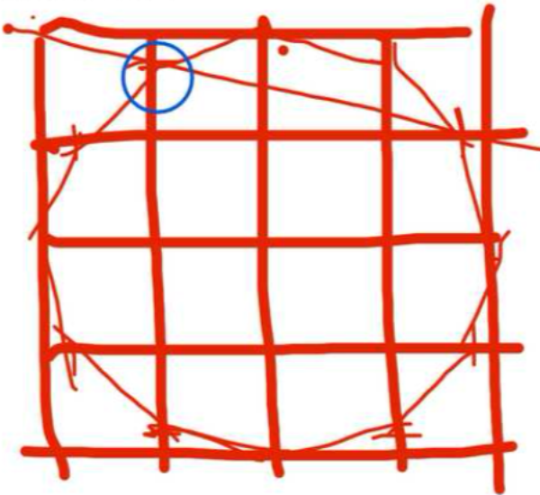

---

## 1681　没用的眼泪

- 日期：2024-03-23　主专题：A04 教育学习与能力形成　副专题：A08;A01;A11
- 源 ID：`03bd80d4-ec7c-5f58-ab43-8a884283dd2d`　原文链接：https://www.zhihu.com/question/649323741/answer/3440239945
- 官方对象—实践路径：与亲族 / 与子女 / 抚养
- 23 概念标签：能力与学习;选择与自由;信用与信任;爱与回应;照料与家庭;劳动与组织;心理与主体
- 证据状态：manual_confirmed　初读：read　独立复核：not_reviewed

**问**：当6岁的男孩儿对我说“妈妈我觉得我没有用”时，我该怎么开导他？

你妈也是二十好几才开始算得上“有用”，你打算有多快？
从“无用”到“有用”，一共有多少关要过？事实上，唐僧西天取经都不见得比一个人做到“有用”难。
又要学通基础知识，又要掌握技能，又要通晓和人沟通和相处，还要理解和驯服自己的兽性，还要经历无数的意外、挫折的折磨和考验。
在这之前，一切所谓的“成功”都主要是出于幸运、出于别人的周全和不计较，只不过是成色不足的偶然而已。
不要为了小孩子哭喊什么“没用”就去胡编一堆“不啊你如何如何很有用啊”去“开导”ta们。
因为你这样一“开导”，很快就会面对新的逻辑困境，那就是“这个程度的‘有用’又有什么用”。
不错，如此浅薄脆弱、结果不可靠的夸张、安慰出来的“有用”，真的一上阵就知道其实不顶用。最后的净结果只是你的信用破产了，用在一次无意义的延迟宣判的申请上了。
没用就是没用，有用是要几十年来练出来的，你现在没用就是题中应有之义。
不然你为啥需要学习十几年？
别说你，我是你爹妈，我都还在向“毫无疑问有用”的方向追求好吗。
毫无疑问的有用，意味着在财务上获得绝对保障，意味着获客成本为零——意味着只要有眼睛的人就知道这盘菜你来炒一定不难吃、吃了一定不拉肚子。
意味着对人只剩下“请你的工资是否划算”的问题，不存在“请了你这活能不能干得了”的问题。
意味着只要你要求不过分，你一定可以有立足之地，甚至哪怕你的要求有些过分也未必没有一定的运气得逞。
这不是儿童的起点，而是少年的终点。
你今年几岁？你没用纯属正常状态。
你居然还为“没用”哭泣，找打啊你？

至于那些觉得“有用”的标准很低，以至于对“没用”的人——尤其是未成年人——不屑一顾的人，说实话都是些不幸只在缺少挑战的稳定环境里做过比较简单的事情的可怜人。
那个环境动荡一下、或者难度要求被提升一级，ta们才会真的知道“有用”到底是什么标准。
ta们那个出于阅历缺陷而过度压低的标准不值得考虑。

---

## 1627　学以致用

- 日期：2024-04-21　主专题：A04 教育学习与能力形成　副专题：A13;A03;A08
- 源 ID：`17b86473-06c5-5196-aa31-733119b32089`　原文链接：https://afdian.com/p/8706184affe311ee9af552540025c377
- 官方对象—实践路径：与自然 / 与科学 / 运用
- 23 概念标签：事实与证据;能力与学习;选择与自由;责任与后果;成本与总账;边界与许可;劳动与组织;技术与工程
- 证据状态：manual_confirmed　初读：read　独立复核：not_reviewed

**问**：学生如何将所学知识和实际应用结合起来？

什么叫实际应用？
更高、更快、更强、更轻、更薄、更亮、更艳、更保温，更稳定，更节省、更易得……
在身边选择任何一件东西、任何一种服务，做上面任何一种改进，就叫“实际应用”。
这就要求你首先了解清楚这些东西为什么会是现在的样子，为什么用这个材料、做成这个形状，卖这个价钱，这个服务为什么在这个地方以这个形式存在。
刨根问底，一定可以溯源到语数外理化史地生和经济学、社会学、神学。
完成了这个溯源，你就可以看到整条因果链上必然有若干环是可以另作设计以针对更确切的具体条件、新的时代要求的。
接下去你就可以尝试构建原型来测试你的构想。
譬如用3D打印为自己量身定制一双既结实、又好带、又不发霉、又不打滑、又不会滚动、有好清洁的便携折叠筷子。
追溯根源，穷尽因果，更新需求，重构逻辑，打样测试。
这就是“学以致用”的完整过程，从做鸡蛋羹到造星舰，没有任何不同之处。
如果你自己在任何一步被卡住，可以查书，可以问人，不必非要强求“独立完成”。
学生和一般人差别只在于要注意实践规模，选择小物件（例如筷子、拖鞋、板凳）、简单的服务（例如扫地擦桌、做菜洗碗）作为测试手段。

---

## 1616　核动力学习

- 日期：2024-04-29　主专题：A04 教育学习与能力形成　副专题：A00;A11;A15
- 源 ID：`1c750a3d-82b1-5b07-a5b9-081b1c781296`　原文链接：https://www.zhihu.com/question/653479167/answer/3482157085
- 官方对象—实践路径：与自己 / 与理想 / 建立
- 23 概念标签：能力与学习;选择与自由;成本与总账;技术与工程;心理与主体
- 证据状态：manual_confirmed　初读：read　独立复核：not_reviewed

**问**：好像失去了学习的能力再也回不到高中那种感觉，一学习就累，课本知识像是写满公式的高数课本一样该如何解决？

大学阶段的学习失能问题很难解决，因为很多学生并没有真正的建立起学习的长期战略，本质上只是在应激性的学习——面向家长认可、面向班级地位、面向高考压力。
没有这些外在激励的刺激，学习的心理奖励就会大幅的下降。
这并不是“学习能力”的下降，而是学习动机的问题。
学习是影响你命运最重要的手段。
你想要什么样的命运？
你到底是为什么而学习？
你需要一个疯狂的、激动人心的、伟大的梦想来当志向。
否则仅仅是“要谋生”、“不能被人看不起”、“要谈得上恋爱”这类的理由在现在这个物质丰富的时代是很难成为长期的动力的。这个时代只要一个人没什么物质欲望，要得个温饱，混个日子，并没有多么的困难。如果仅仅只以“不饿死”为基本目标，人根本没有必要、也没有动力去下苦功学习什么东西。
没有这个动力，要把基础知识学扎实的必要努力都自然变得过于奢侈。散漫个几个月，就会开始破罐子破摔，靠作弊混六十分万岁。
看似这是个学习问题，实际上这是个人生观、价值观问题。
你需要一个类似“我要帮忙把人类送上火星”或者“我要帮助把人类的寿命延长一倍”这样的以“人类”为指向的梦想。
不要理会那些觉得你太疯狂、太不切实际的鬼话——只是“帮忙”而已，又不是单手擎天，有什么“狂妄”可言？
但这指向一定要是整个人类，不是你自己，不是你家亲戚，不是某个具体的人。
不能是“我要当世界首富”、“我要当世界冠军”——这些功名利禄的东西本身就自带剧毒，带来抑郁的可能性远大于带来勇气。
必须是某个造福于人类的事业。
这种东西对于学习也罢、事业也罢，都是核动力引擎。有了这个核动力，你才知道你要选什么课、要学什么技术、要追什么论文、要关心哪些老师、要考什么证、要申请什么学校……
你才会有“有进展”和“不如预期“这样的概念，你才有基于这些信号的种种奋斗的基本方向。
有了动力，再谈变速箱和方向盘这类方法问题、策略问题，先解决你的动力。
如果你说“我就是一个平凡的人”，那么就这个问题而言就没什么解决方案了——因为这些症状就是“平凡的人”的正常轨迹。
否则“平凡的人”何以会成为平凡的人呢？

---

## 1610　输出力初步

- 日期：2024-05-03　主专题：A04 教育学习与能力形成　副专题：A07;A13
- 源 ID：`ed175d6c-5b2e-5b8b-a2ed-a5e5203e4f21`　原文链接：https://afdian.com/p/70ed610c08b311efbdf95254001e7c00
- 官方对象—实践路径：与自己 / 与能力 / 获取
- 23 概念标签：事实与证据;能力与学习;选择与自由;信用与信任;照料与家庭;劳动与组织
- 证据状态：manual_confirmed　初读：read　独立复核：not_reviewed

**问**：如何培养输出能力？

要培养输出能力很简单——先抄成熟产品。
比如，家里需要洗碗，以前是你妈妈洗的，洗的是一个质量。你来洗，手法你自己想、自己观察、自己研究，你洗出来的要和你妈妈洗得一样好，以至于你不说你爸都分不出是你洗的，那么你就获得了“输出洗碗服务”的能力。
又比如，全家都爱吃门口的卤肉饭。你来做，教程自己查，原料自己配，自己卤、自己切、自己煮、自己调料汁。做出来的和门口的一样好，你不说家里人还以为你去那家买的，那么你就获得了“输出卤肉饭”的能力。
又比如，以前总由前辈做季度报表，你多学习，尝试自己做做，你做到别人分不出哪是你做的、哪是前辈做的，你就过关了，你就获得了“输出季度报表”的能力。
成熟的产品，客户很多，卖得挺好，当然已经是广受欢迎的，因此你肯定不需要担心“做出来没人需要”。人们的欢迎已经替你做了鉴定——就是这个东西，我们需要。
而这个东西本身也给了你一个活生生的参考——做成这样、能通过双盲测试就算达标。这是绝对客观，而又绝对有效的标准。
需求可靠、目标清晰，而且有充分的实物证明绝对可行，唯一剩下要做的努力就是安心的寻求复现。
选材先从基本的衣食住行开始——能帮人解决基本的衣食住行还不够好吗？
先做到以假乱真，再拿获得的技能、知识，寻求超越这个水平。
就是这样。
早点开始。
培养输出能力的要害其实就在这个“早点开始”——太多的人想要先学会微积分、学会编程序、学会某种神奇的优秀技能，然后再开始考虑自己要怎么为人服务，怎么生产产品。
这是错的——要尽早开始输出，从擦鞋、洗碗、叠衣服煮饭、修自行车就开始。
就从这里开始。

---

## 1601　十连抽

- 日期：2024-05-06　主专题：A04 教育学习与能力形成　副专题：A08;A11;A15
- 源 ID：`582a5685-4a43-583b-8c09-6badde2313a6`　原文链接：https://www.zhihu.com/question/654882337/answer/3488628966
- 官方对象—实践路径：与自己 / 与时间 / 失去;与自己 / 与时间 / 使用
- 23 概念标签：事实与证据;能力与学习;选择与自由;责任与后果;成本与总账;心理与主体
- 证据状态：manual_confirmed　初读：read　独立复核：not_reviewed

**问**：21 岁男生「胖猫」在重庆跳江去世，生前曾两年转账给网恋女友 50 万，哪些信息值得关注？

这还用问？
当然是因为这个行为带给他很强的愉悦感，而中断这一行为带给他很强的焦虑和痛苦。
很多人可能觉得他特别傻，完全分不清高低贵贱、利益得失。
是吗？
那么明知道青春的时光应该努力学习，不去学习而去沉迷游戏愚蠢不愚蠢？
你光看到“两年51万”这个数字觉得触目惊心。
那么你有没有算过钟南山、倪光南——都不说刘强东余承东了——和你的收入差距？你高中玩掉的那两年，大学混掉的那三年，考虑到你之后一生的收入差额，折合一年多少万？
拦住你了吗？
你还不是夜夜笙歌，打tn的排位赛，打到挂科、打到休学、打到复读？
你丢掉的何止“两年51万”？你那是四年两千万。
你只是没有“眼睁睁的进账，然后眼睁睁的从自己账上划走”，所以就当啥也没发生罢了。
你不也就是因为“做了有快感，不做会焦虑会痛苦”而已吗？你比他明智了多少？？
坦率讲，除了极少数幸运儿，绝大多数二十出头的年轻人都在这方面差不多的盲目，只是表现形式有所不同而已，所以不要以为“我就不会犯这种错”——你犯过。
而且正在犯。
而且还会不见棺材不落泪的犯很久。
啥时候一口从天而降的大棺材砸脑袋上，砸出一口老血，你就知道你二十几岁打那么多休闲小游戏有多奢侈了。
这时候有人跟你说“两年五十一万，可以取档”，你会跳起来点开花呗往死里点。
他花那五十万，其实换到了一些东西，也许你觉得不值，但那对他是刻骨铭心的回忆。否则他何至于一换再换？
区别在于，这些回忆直到他生命的最后一刻，他都历历在目。而你拿来打tnd休闲小游戏的那四五年，除了那一把出三金的十连抽，你毛都不记得。

---

## 1597　金坷垃

- 日期：2024-05-08　主专题：A04 教育学习与能力形成　副专题：A01;A16
- 源 ID：`921c5b55-f2aa-54b3-a8d9-2c8d7e13368c`　原文链接：https://www.zhihu.com/question/655248872/answer/3491410207
- 官方对象—实践路径：与社会 / 与文化 / 批判
- 23 概念标签：定义与达意;能力与学习;选择与自由;责任与后果;爱与回应;技术与工程;心理与主体
- 证据状态：manual_confirmed　初读：read　独立复核：not_reviewed

**问**：偶像和榜样的区别是什么？

在崇拜偶像的人眼里，偶像是一个半神。
你不能想象ta放屁、拉屎、挖鼻孔。
你也不能想象自己有一天能做到和ta一样，只求自己能挨在边上打个伞、捧个茶杯，能沾个光就好了。
如果有别人自认为可以做到和偶像一样，你要跳起来骂ta不知天高地厚，痴心妄想。
凡事恰恰因为偶像做到了，你就认为是你做不到的，于是也是你不应该白费力气的。因此，虽然你如此崇拜偶像，但偶像却对你几乎没有起到任何带头作用、示范作用。
你做这做那，不是因为偶像在示范要如何，而是因为你觉得这样偶像会喜欢、那样偶像会讨厌，你会想借着这种“听话”构造一种自信的乖巧感，从而在此基础上建立起一种受宠的自信。
问题是，因为这种乖巧只是用来构造受宠感的原料，本着多快好省、够用就好的原则，人会不自觉地避重就轻，偷工减料。
比如偶像教导“要多读书”，于是拿起一本书翻几页，然后自我安慰“以前我一页都不翻，因为你我都开始读书了”。“要求”已经达到或者已经投入了“相当的努力”，偶像已经应该感到满足，应该发放赞赏了。
因此偶像崇拜看似很积极热烈，实际上对人的行为进步并没有真实的推动作用。

上述一切的问题，在榜样上都不存在或者恰恰相反。
榜样是人，而不是半神。
榜样是一个自己可以企及的人，ta的存在是“这样是一个人可以努力办得到的”的活生生的证明，从而也是“这样努力是有可能成功的”的证明。
榜样是击溃“这不可能”的武器。
只要指向榜样成就的道路每一站都是进步，就足以“虽不能至，亦可往之”。
榜样引发的是效仿和追赶，而不是崇拜和畏缩。
然而，同一个对象对你是成为偶像还是榜样，其实不取决于对方——至少根本的决定性要素不在于对方——而在于你自己是否相信上天造你时是否倾注了与一切其他造物一样的爱，是否相信你自己并不会比任何其它凡人少受任何恩宠。
是否真的相信人人生而平等，并无天生的高低贵贱。
从心底里不信，那么任何成就略高的人，对你都会最终成为偶像，因为你在最终意义上其实是觉得那是因为ta们领受了你没资格领受的特别恩宠。
相信这个，你就无可努力，唯余攀附、抱怨和等待重新投胎。
相信这个，就从根本上诅咒了自己，最终必然无可救药地自轻自贱。
其实与其说是“相信贵贱有别”，不如说是爱上了这种报复“我的压迫者”的快感——因为正是这个“人人都可以做得到”的宣言在逼迫你“努力”、剥夺你“稍事休息”、“放松片刻”的“基本人权”。
通过确信并且亲自成为一个令ta们哑口无言的反例，一个活生生的“没救的人”“不可能做到的人”，你可以迎头痛击这种“逼迫人努力”的谬论。
作为如此“痛快”的小小代价，你需要相信“天生贵贱有别论”。
从而导致所有卓越的人在你眼里自动成为偶像，而无法成为榜样。
你在不由自主地、无穷尽地追逐着偶像的关怀和青睐，仿佛整个人生都在做这件事，“卑微到尘土里”，却总是收获失望。
这是对你用“相信天生贵贱有别”抵抗“逼我努力”的真正惩罚。
你不反省，这惩罚可以持续一生，直至要了你的命。
偶像崇拜从无好结果。
黄金到手都会变成土。
以下内容出自素问（sooon.ai）的社区追问：
如何提高自己的影响力，又不成为偶像？

这个的要害在于——你要努力传播你的方法和工具，对你自己的成就去神秘化。
简单来说，我做到的事情是怎么做到的，有哪些步骤、用到了哪些方法和工具，有哪些部分是运气成分，这些都坦白地说出来，把别人通向这个成就的道路铺平。
当别人看到这事是凡人可以通过特定的努力在一定运气的加持下企及的，对你个人的崇拜就会转向对客观规律、具体方法的信念。
偶像崇拜的核心，是“这事只有我这种半神之体可以办到，普通人就别幻想了”，似乎我本人做到这事根本不需要努力，也没有什么方法，而且不需要什么运气，你们谁也不可能做到和我一样的成就，未来也不会有人超得过我。
简而言之，就是我们是不同的物种，彼此之间有单凭努力和运气不可逾越的鸿沟。这样才能拉得开绝对的差距，形成不可置疑的上下关系。
不但如此，崇拜偶像的人也会集体捍卫“偶像是不可超越的”这一观点。
这首先自然对“我没有努力去追平和超越”做出了完美的开脱——不可超越，我还努力个啥劲，其次还会引发崇拜者社区对妄想超越甚至“自认为与我们的偶像人格平等”的人的愤恨和敌意——我们早就自认为不可能了，你却觉得你可能、甚至认为你已经做到了，你这岂不是自认为比我们都高级吗？
这就成了偶像崇拜的典型现象。
总结——你想要获得影响力而又避免偶像崇拜，最简单的办法就是多分享你的方法和工具，消灭掉“我是不可超越的”这种错误的认知。这样既扩大了影响，又完成了祛魅，也从根本上抑制了偶像崇拜。
我只是不可复制的，不是不可超越的，这不是一回事。要超越我可能需要一点运气，但这种运气并不见得你就不会有，更不是“所有人都不可能再有”。
按照好的方法持续努力，不要考虑什么“永远不可企及”这样的蠢念头。

---

## 1592　文盲速成

- 日期：2024-05-12　主专题：A04 教育学习与能力形成　副专题：A15
- 源 ID：`844ca336-901d-50a5-a296-6ccd675723cf`　原文链接：https://afdian.com/p/3c979b2c0fd711ef9dd952540025c377
- 官方对象—实践路径：与自己 / 与能力 / 获取
- 23 概念标签：事实与证据;能力与学习;技术与工程;文明与历史
- 证据状态：manual_confirmed　初读：read　独立复核：not_reviewed

**问**：怎样高效地学习一门语言？

首先要学习这门语言的基本骨架。
这个骨架包括：
身份——你、我、他、她、它。
时间——年月周日、昨今明后。
关系——上下、前后、左右、内外、东南西北、之前之后、大于小于等于类似于
动作——行走坐卧、推拉扔接、收送受拒、买卖借赠、攻受战逃、跳飞游爬、夸骂骗诱、爱恨怨怒
物件——这个包括你每天、每周、每月都会提到的物件。一个月都不见得提到一次的东西暂时不考虑。
然后是基本语法结构——
着了过，被动，祈使，虚拟，倒装……
到这里，你不需要任何记忆，只需要一条——
你能看懂句子结构，能看到句子里那些你我他、着了过虽然但是前后左右，并大概率猜出某个句子里你不认识的词估计是个什么词性，是个名词还是个动词还是个形容词，在句子里是主谓宾还是定状补。
这一步在极速下应该用不了多久，也就是一两个月的时间，不需要全部熟练，只需要你每个句子能看懂三五个最常用的词，所有句子能看出最基本的那些结构就行。
接下来第二步，开始找这个语言的带字幕的影视作品来看——最好是《Friends》《Seinfeld》《How I Met Your Mother》《Two and Half Men》《The Black Adder》《Modern Family》这类的角色极少且基本固定的情景短喜剧。

最鸡毛蒜皮、家长里短的喜剧，不要选法政剧、医疗剧、纪录片这类有大堆专有名词的剧。也不要选什么《Skins》《Hustle》之类各种俚语黑话的风俗剧。
然后一部剧反复刷，先带着双语字幕看，刷到你对剧情烂熟，以至于光听句子，你都能猜到这是哪一集，在讲什么情节。即使没有字幕，你也知道如果显示字幕的话，这句字幕是什么。
然后把你的注意力转向那句话演员是怎么说的，ta为什么要这样说，这样说的梗在哪。然后你会自然而然的学会分辨人的语气神态，也会自然而然的学会剧中最经典的短句。
你把大概三五个剧看到不看字幕也能看懂、没有画面全靠听也能差不多听懂的时候，你这门语言也就学得差不多入门了。
接下来你就可以尝试挑战那些更难的剧种——例如侦探悬疑、法政医疗、科幻记录……以及开始看对应语种的社交媒体，直接看人家的新闻、新闻评论和评论区留言。
然后再往前一步，你就可以试试通过VR头盔，登入VR Chat、Bigscreen这些虚拟vr聊天室。
你不敢说话可以静静地在聊天室里呆着，旁听周围的人在聊啥。这个就是真正的活的语言了。
而且你大可以开口说话——偶尔会有人主动的找你聊天，你可以大胆接着，随便扯淡。
反正你只是虚拟世界里的一只跳跳蛙，聊垮了最多下线刷新，谁还能吃了你不成？
你会发现真说起话来，其实对方更在意你的内容而不是语法，人家自带超强纠错功能，你没必要过于纠结紧张。
聊几个，你的自信就自然建立起来了。

然后，最大的挑战来了——你可以开始学习拼写单词了。
不错——你现在还是个会读会说不会写的文盲。
但你就算一个字都还不会写，你也已经是一个掌握了语言的文盲了——就像一个不会写自己的名字的本地人一样。
其实学一门语言就应该先学听说读，抛开写的负担轻车上阵、直捣黄龙。学会了再谈书写和标准口音这些无关紧要的细节。
现有的外语教育，有一个极大的错误就是从书写、发音开始，从说和写开始，而不是从听和读开始。
那仅仅是因为传统的学校教学只能高效率的批改书写的作业、进行对话辅导，所以起步就先教你写字母、发音口型。
实际上这是把顺序搞反了。
一个人完全可以在不懂任何说和写的前提下直接掌握听和读。
这极容易证明——难道一个没有手的哑巴就无法掌握任何语言吗？ta一辈子也没有说过一句话、写过一个字，ta是不是绝对不可能理解任何一门语言、不能和任何语言的人类沟通？
当然不是。
说和写对于掌握一门语言并不是必备的技能，听和读才是。
放下这个包袱，丢开吭哧吭哧当然写字母和念例句，直奔“能轻松听懂，能轻松看懂”。
绝大多数拼音文字在你能听懂看懂的前提下都会自动的学会说和写、根本不需要练习。而听和看的效率要远远的高过说和写。
这就是为什么先学成个“土著哑巴文盲”再作为“土著哑巴文盲”去扫盲，要远比“花费极大的精力去记单词正确拼写，然后听说读写同步逐步升级”要高效。
也是为什么旅游区的纪念品小贩们大字不识一个，却人人轻松说三四门语言，甚至唱外文歌的原因。
他们只是文盲，却不是“不会这门语言”。

---

## 1581　琐碎事尔

- 日期：2024-05-18　主专题：A04 教育学习与能力形成　副专题：A07;A08;A01
- 源 ID：`666f6b9a-c4b6-5e84-a0d1-8ef8638a22e1`　原文链接：https://www.zhihu.com/question/654867829/answer/3501942851
- 官方对象—实践路径：与自己 / 与能力 / 运用
- 23 概念标签：能力与学习;责任与后果;成本与总账;爱与回应;劳动与组织
- 证据状态：manual_confirmed　初读：read　独立复核：not_reviewed

**问**：如何克服对琐碎工作的畏惧和逃避?

什么工作是琐碎的工作？就是那些没有激情点的工作，是吧？
比如炒菜、摆盘很有激情，但是买菜、洗菜、切菜、上菜、收拾桌子、洗碗就没有激情，所以前者是工作，而后者是“琐碎的工作”，对吧？
“要是可以只炒菜就好了”，这个我是愿意的，其它的那些最好别人帮我弄好，那就完美了。
关于这个，有以下几点值得你仔细考虑。
琐碎的工作本身也是分两类的，一类是关键工作的准备，一类是关键工作的善后。
就以刚才这个例子而言——买菜、洗菜、切菜就是炒菜之前的准备工作，而上菜、收拾桌子、洗碗则是炒菜、吃菜之后的善后工作。
准备工作与关键工作的关系更为紧密，其存在往往是不可减损的，因为会影响到关键工作的执行细节。
这个就好像你打游戏开局之前要调装备、设技能、排阵型、买道具……哪一步没弄好，真打起来很可能功亏一篑。
你如果是畏惧和逃避准备工作，那么你实际上是憎恶和厌倦关键工作本身。
因为热爱关键工作、在乎关键工作的人不会觉得这些准备工作“烦躁”“讨厌”，恰恰相反，回想一下屡战屡败的你终于攒够了点数去给自己的武器镶钻、绞尽脑汁设想了一个新的战术组合的跃跃欲试，你就知道在你热爱关键工作时，这些准备工作本身就是令人兴奋的。
有时你甚至分不清你到底最热爱的是战斗本身还是那个追求梦幻战备的过程。
到了一定境界，其实你很清楚——只要你这样准备了，战斗本身是没有悬念的。真正激动人心的其实是那个所有准备工作下好离手的阶段，战斗只是一个冗长的开奖过程。
所以，真正的名厨，手艺其实在选材、炮制、泡发这些早得多的准备阶段，这只是对新手们而言算“琐碎工作”罢了。
如果你是畏惧这部分“琐碎工作”，那么你的问题是你对关键工作本身的成就感就不足，只是关键工作好歹还有一些虚荣感、名利感，所以你先把矛头对准了更好欺负的“琐碎工作”罢了。
如果是这样，你要么早点转行，转去那些你有激情的行业；要么想办法去燃起对这个职业本身的自豪感和使命感。
否则老大是看得出来的——对善后工作无精打采尚可理解，对准备工作垂头丧气则是没有前途的征兆。你对准备工作不感兴趣、畏惧而且回避，而不是以能参加准备工作而欣喜、期待，那么你也就不值得优先倾注培训资源，并且在优先裁员的名单上。

然后再谈善后工作。
在一门手艺、一项业务里，善后工作是最人憎狗嫌、令人痛恨的，但善后工作也往往最容易安排给新人去做。
这一方面固然是因为善后工作不容易捅大篓子，新人操作比较安全，同时也可以观察新人的职业精神、事业激情和品行。
另一方面则恰恰是为了让新人先理解准备工作、关键工作的“后果”“代价”。
前台销售、研发、制造、交付，究竟做得如何？客户的体验如何？痛点如何？最了解的其实反而是负责善后的客服和维护工程师。
你甚至可以说一项业务的理想完全可以表述为“善后工作最小化”。
世界著名的六西格玛原则，要求将加工精度强化到每百万样本3.4个缺陷，其实就是为了大幅的压缩备件、客服和维护成本，是为了压缩善后工作。
同样的，为什么改用一次性餐具或者匹配洗碗机的标准餐盘？为什么要设计拍立得相机？为什么要设计不能更换电池的手机？为什么要设计自动补墨系统？也是为了压缩善后工作。
善后工作是成本的黑洞，自然也就是利润的宝藏。
要争市场占有率，功夫多在准备和关键工作上；而要争利润，则首先在善后工作上。
这就意味着你自己在你自己的工作中要贯彻同样的思想——你的工作本身就分为前中后三段，前段的琐碎准备工作你不喜欢，建议你要么学会喜欢、要么改行；而后段的善后性琐碎工作你不喜欢，则建议你通盘考虑你的工作方式、流程和规范，通过整体设计来压缩善后性琐碎工作的复杂性和规模。
要把“压缩善后工作”本身视为总体目标的一部分，懂得为“善后工作减少”而欣喜和振奋。
而带上了这个目标，你的关键工作和准备工作都会变得更加有挑战性，变得更有意思。
坦率讲，任何业务都是最好玩的游戏，有令你烦恼和憎恶的点就仿佛它还有你没玩过的资料包、没有解决掉的谜题。
游戏的乐趣就在于用创造性的绝妙方法解决一个又一个的问题。没有问题，哪有乐趣？
怕就怕你中了一堆什么“资本家剥削”“韭菜”“反宏大叙事”“反社会规训”之类的职业毒素，又对廉价奶头乐上了毒瘾，对劳动这件最有趣味、最丰富的乐事本身产生了恐惧和厌倦。
你不热爱劳动、不热爱创造价值本身，那么呼吸和吃饭都会对你成为可怕的琐事。
而这种问题的根源，其实在于你受了太多的挑拨离间、过多纵容自己的疑心暗鬼，以至于对爱产生了绝望。而对他人、世人的爱是人不避艰险、百折不回的热爱劳动、热爱创造价值的根本动力。
政府也是恶魔，老师也是恶魔，老板也是恶魔，父母也是恶魔，亲戚也是恶魔，同事也是恶魔，前女友/男友也是恶魔……甚至没有一个值得原谅，你只是没有办法不得不加以忍受，你怎么可能对“能为ta们创造价值”抱有期待和斗志？
这个动力引擎坏了，世界上就再也没有你肯为了其幸福和快乐去面对辛劳和痛苦的人，只剩下了你自己。而如果只为了自己，何其不如沉迷毒瘾、娱乐至死呢？所有被迫的劳动都只是为了换取下一顿的毒资，“吸嗨”才是你的关键工作，其他的一切都是你不得不忍受的琐事。
这几千、几万个答案，说穿了就是在阻击你已经理所当然的仇恨。很多人之所以会痛恨ta们，就是因为这些答案或在此、或在彼，在妨碍自己理直气壮的用仇恨“惩罚”自己的“仇人”。
殊不知，这些仇恨如果蔓延开来，“令人不胜其烦而无法逃避的琐事”就会渐渐成为你人生所有事物的定性。
你的人生将由95%的琐事折磨和5%的片刻喘息构成，而这里给你的解决方案你根本没有多余的能量去完成。
这只是邪恶吞吃你的一种烹饪方法——牠酷爱用仇恨低温慢煮带来的鲜嫩。
原谅并与世人和好，反思自己与人的共处之道，反思并承担你自己的爱的责任，你才能重新点燃你的引擎，才有足够的功率和能量去运转上面的方法。
先解决根本问题，然后解决战术问题。
把我名下的答案看完。

---

## 1577　全职猎人

- 日期：2024-05-20　主专题：A04 教育学习与能力形成　副专题：A01;A05
- 源 ID：`a78d0b4c-f8f8-5dc4-a06b-e8e07666d268`　原文链接：https://www.zhihu.com/question/654004997/answer/3504180136
- 官方对象—实践路径：与自己 / 与能力 / 获取
- 23 概念标签：定义与达意;能力与学习;责任与后果;成本与总账;信用与信任;爱与回应;净输出与不掠夺;照料与家庭;法律与秩序;心理与主体;性别与身体
- 证据状态：manual_confirmed　初读：read　独立复核：not_reviewed

**问**：如何应对在一段时间进行看书/运动/纪录片等有益的活动之后，又开始刷抖音/看小说摆烂？

因为你是在把这些“有益的活动”当成作业，当成换取“刷抖音 / 看小说摆烂”的娱乐权利的筹码。
学习本身对你是没有价值的，一来你不拔尖，只不过是中等巴样，时灵时不灵，既不足以恃才傲物，在同学之中享受优越感，也不足让父母师长引以为豪，换取宠爱。
你也不是没努力过，只不过你这个成果平平的努力学习在父母看来属于“本来就应尽的义务”，只不过可以免打而已，你还想讨赏不成？
它对你几乎唯一的的价值就是拿来换“娱乐权”——“我都做了作业了，我已经可以玩ipad一小时了，你们说话要算话”。
所以你怎么可能忍得住不攒一段时间筹码就赶紧取出兑换一下？不兑换成娱乐权，攒这些学习券干什么用？
这不是什么生理周期问题，也不是什么学习规律问题，而就是一个纯的心理惯性问题——人没有建立起与知识的关系，而用人与人的关系做了替代。
本来你学习知识是要建立你与客观世界的关系，知识、技能实际上就是客观世界给你的承诺和契约。它保证万有引力一定有效，保证运动惯性一定有效，保证社会规律持续运转，保证种子得到合适条件就能长成庄稼。学习的本质是要去领取和缔结这些契约。
但是你不太在乎这些自然世界的保证，你只在乎爹妈、老师、老板这些“大人”的保证。因为ta们比自然世界更能夺走 / 交还你的ipad和手机。
现在问题来了，人的保证和自然世界的保证是不同的。自然世界的保证是亿万年不变的，而人的保证则是过期作废的——上个星期你认真学习了，周六下午你可以玩ipad，你不玩，那下周你可没有两个周六下午哦。如果要实现分时存取服务，给你承诺的人就要承担管理服务，要负担额外的成本，最后这个成本还是得你来出。
于是三下五除二，就会造成“及时行乐”的系统性焦虑。
这也是为什么父母们搞“延迟满足”总是失败的原因——延迟满足延迟满足，延迟满足总是被延迟造成的天然管理成本恶化成延迟取消，满足了个大头鬼。
只有自然法无管理成本、无限有效的契约才能从根上消除这种“每延迟一小时都要扣管理费”的焦虑，可以让你放心的确信“满足必不落空”，从而真正击败“不及时，行无乐”的创伤后遗症导致的“注意力不能长期集中”——停车费120块三十分钟，你都恨不得直接帮着把Rose扒光，然后一脚把Jack踹下船快点死，怎么集中注意力？
开玩笑，学会了火球术，我还怕吃不了炖肘子？

于是要怎么重整已经扭曲的关系？
学习知识，不要去纠结什么“时间进度”和“名次”，不论你是不是在某个学习班上，也不管你有没有赶上某个考试进度，学习知识和技能本身永远没有所谓的“晚了”可言。
你四岁学会加减乘除有用，你四十岁学会加减乘除一样有用。十二岁学英文有用，二十四岁学英文一样有用。钢琴能考十级当然有用，钢琴只能拿来酒吧卖艺一样有用。
知识本身是不排名次、不考级、不发证，没有所谓“太晚”“没用”的。
你根本就不需要用什么“摆烂权”“炫耀权”来“补偿学习的苦”。那只是你长期敷衍了事、装模做样，于是从没有真正的学到知识，没有真正的体验到知识本身的快乐、本身的回报造成的错误执念。
恕我直言，一个不热爱知识、不主动运用知识的人，就像一条可悲的家养猎犬一样。
它从小由人用饼干做奖励学习狩猎，只吃过饼干。
于是它以为世界上能吃的只有饼干，等它长大了，它日夜捕猎，都是为了拿回去找主人换饼干。
对它而言，世界上根本不存在“猎物”，只有各种“饼干兑换券”，而且兑换率完全由饼干管理员决定。
当它饥饿时，它只能在犬舍里哀嚎哭叫，“渴望自由”“痛恨不公”。
它渴望的是饼干的自由，痛恨的是饼干的不公。
因为它在学捕猎的时候，从来不是吃下猎物，而是吃猎物换到的奖励小饼干。
问题是，它是条狗，你tm是个人！

你想当猎犬，还是想当猎人？
吃掉你的猎物，別tm吃饼干！

---

## 1567　拾金不昧

- 日期：2024-05-25　主专题：A04 教育学习与能力形成　副专题：A01;A05
- 源 ID：`fbd468be-ee71-5bb0-b7a0-f6fc496eab75`　原文链接：https://www.zhihu.com/question/654660683/answer/3509659912
- 官方对象—实践路径：与自己 / 与能力 / 获取
- 23 概念标签：定义与达意;能力与学习;照料与家庭;文明与历史;心理与主体
- 证据状态：manual_confirmed　初读：read　独立复核：not_reviewed

**问**：明明知道年轻的时候不努力，会后悔，但就是努力不起来，该怎么办?

你并不知道。
你只是听着父母们常年挂在嘴边，所以有点害怕、惶恐。
你只是看着父母们常年痛心疾首、忧虑折磨，所以有点负罪。
你想用“相信真的会这样”来自我鞭策、来安慰父母而已，事实上你根本并不知道“将来会后悔”。
你甚至都未必真的在意这个传说中的“会后悔”。
你只是时常需要逼真的心理潮涌来安抚自己的焦虑和惶恐，因为你发现只要你还能逼真的认同这个说法，父母们就还能燃起一丝指望，家里的气氛好歹还能过得去。
因此你的“行礼如仪”已经成了这个家庭还能维系住这种微妙的循环往复的关键环节。
这一切都只是对大量互相交错的心理反应的下意识适应，而不是真的“知道”。
你也不必为此过度纠结——“知道”是一个极难达到的境界，那是要靠天赐的，不是单靠自己的聪明才智或者父母的喋喋不休就能达成的境界。
坦率讲，那些看上去前程似锦的同龄赢家们也不能说有多“知道”，ta们的有效性大多数都建立在构建得更好的心理奖励机制上——例如名次靠前就能激发更好的学习热情，从而保持名次继续靠前，这就形成了自我维持的循环。
而你现在的问题，恰恰是过度依赖这种“用仪式性的悔恨惶恐维持循环稳定”的心理机制，以至于单凭这个就已经可以维持一个你可以私下里满意的生存体验了。
你一直考得不行，但每次如果事情可能因此恶化，你只需要真诚的为此惶恐、悔恨、恐惧一下，父母们就会长叹一声，无可奈何的放弃。于是生活可以再次回到循环的起点，等着下一次考试、下一次循环发作。
这无意间构成了一种稳定的解决方案，它能有效的定期消解循环里积累的过量的沮丧，但却其实并不引入真实的行动。
考得不好、家里紧张、表达悔恨和恐惧、父母认命、再次考得不好……循环往复，可以自持，不是吗？
不仅如此，这个循环跑的次数越多，因为它并没有引入行动，你在后续的循环里“成绩/进度迎头赶上”所要清偿的学习债就越重，越不可能切换到“考好、有快感、又考好”的轨道上，因此更加强烈的依赖这种“懊悔循环”。
所以它何止可以自我维持，事实上它还在自我强化。

那个十足逼真的“明明知道会后悔”已经替你解决了问题——“孩子自己都已经知道害怕了，还是只有这样，我们还能怎么勉强呢？”
你又怎么会再去选择面对堆积如山的积欠作业，去解决一个其实已经被解决了的问题，而不去选择抓住好不容易达成的缓和气氛、赶紧“休息放松”一下呢？
这就是为什么你“明明知道会后悔”，却“总是努力不起来”。
因为你用这个足以以假乱真的“明明知道会后悔”，换了“不能再勉强”的特赦证。

至于说“要怎么办”，首先就是要清楚的认识到这种交易本身是个可怕的假象。它本身不解决问题，只解决问题感。本质上只是一种麻醉机制。
世界只认行动，不认“自我感觉良好”。你要抛开这些活见鬼的手段，重新找到行动的动机。
你下次学习的时候记住这一点——为了把圆周率精确到第七位小数，人类文明普遍都花了至少两千年。
认识到无理数，用了一千年。
二元方程、三角函数、对数、阶乘、微积分、矩阵运算，这都是人类长达数千年的集体探索才逐步达成的学术成就。
能在十年的学习里把这些成就运用自如，本身就是一个了不起的、堪称华丽的成就。
这根本就没有那么理所当然，仿佛做不到就智商有问题。
有人非常聪明而且幸运，有名次、赞许作为燃料，帮ta更快的掌握了这些东西。
那又如何？
你的目标是要十足的领取这份文明的遗产，无论花多久，只要领到了你就是大赚。
几千年出了一个李白，写了那么一首将进酒，你花两个小时没有背熟，就算啦？
你这意思要是地上有块金子，你要是第一下没捡起来，你就算啦？
将进酒、赤壁赋、因式分解、氧化还原反应……这些比金子值钱不知道多少倍。你要跟皇帝说给我一吨金子我给你画张世界地图，皇帝跳起来去取钱你信不信？
你还需要啥家长的冰激凌、老师的大红花？
捡金子还需要谁来哄着骗着推着拉着捡？

看不懂公式，最好的办法是啥？不是去换本书去看公式，而是去回溯这个思想成就当年是怎么从历史中被淘洗出来的。
是去阅读与它相关的背景知识、相关的历史。
这不仅仅是一个降低认知门槛的技巧，还是一个能让你正确掂量这些知识的价值、地位的捷径。
并且正确的历史感能帮你洗脱你对社会的扭曲想象带来的虚假价值评估。
没有动力，根本原因总是估错了价格。
客观世界是处在无限延续的历史之中，社会发展的路径依赖效应保证了历史的定价是当前定价的根源和依据。
因为历史上重要珍贵的东西，也自然滋生了庞大的产业和生态——否则它何以会被看作是珍贵的呢？
而这庞大的产业和生态，自然会为这些知识的价值做持续的担保，为熟知它们的人提供机会和奖励。
你的学习是一个利润极高的收益机会，高到你无法基于日常生活去凭空想象。
将来你直接面对社会选择的时候，就会知道“花一周时间多学会一条定律”比起“花一周时间赚两千块人民币”收益率高多少倍。
这条定律在你一生中的价值不知道超过这两千块钱的本息之和多少倍。
因为“进度赶不上了”“反正考不好了”“已经没人在怪我了”这种理由而抛弃这样的机会，是一种多么可怕的愚蠢，这才是你需要真正在意的地方。
捡钱，你也“就是努力不起来”？
捡钱，却不知道是在捡钱，何其愚昧！

听说过没？
拾金不昧。

---

## 1540　挣钱的知识

- 日期：2024-06-12　主专题：A04 教育学习与能力形成　副专题：A08;A15
- 源 ID：`0c116953-6e46-5a71-95b8-276f809f1d8c`　原文链接：https://www.zhihu.com/question/637368395/answer/3528109475
- 官方对象—实践路径：与合作者 / 与教导者 / 受教
- 23 概念标签：能力与学习;选择与自由;责任与后果;成本与总账;边界与许可;财富与市场;心理与主体;性别与身体
- 证据状态：manual_confirmed　初读：read　独立复核：not_reviewed

**问**：为什么学校的老师要我们好好学习，不直接教我们怎么挣钱呢?

因为“具体如何赚钱”的知识无法成为公域的知识，它只会是基于一时一地一人的具体情况的特殊解决方案。
张三挣钱的办法，即使李四知道了也毫无意义，因为张三是靠2.2米的身高和从小的童子功打篮球挣钱的，李四身高1.7，跳起来都摸不着。
因此，即使假设老师们要教“身高2.2米擅长篮球的挣钱法”，也要找一个身高都是2.2米而且从小打篮球的学员班来讲，否则只是在浪费李四们的时间。
而即使凑齐了一个“姚明班”，老师们也开讲了，也会发现事情没这么简单——因为这两个条件只是最外在的、可轻松观察到的赚钱要素之一，并非全部的要素。
还需要英语能力过关，需要有在异国他乡强大的心理调适能力，需要很强的社交能力……
你把这个入学资格凑齐了，面对这一群“克隆姚明”，你会发现一个非常搞笑的问题——最好的老师就是姚明自己。
因为只有姚明自己在“如何打好姚明的牌”上有最丰富的经验。
物理学是不需要考虑你什么出身什么天赋什么资源，你都一样用得到。
语文也是，数学也是。
但赚钱不是，赚钱一定是和你个人的优势、条件、天赋牢牢的结合，你才会有特殊的、和你绑定的比较优势，这样你才能赚得比较轻松、比较安全、比较长久。
但一旦和你的个人特质结合，那么就显然不是义务教育、通识教育所能承担的职能了。针对更确切的天赋、资源的教育当然有，但那就是你自己去选择的专业培训、选修课、专业实习这一类了。
“不教挣钱”还有一个关键原因——那就是可能导致你赔钱。赚钱你啥也不说，赔钱了老师、校长怕不要被追得满地跑。
最后，知识是人类的公共财富，保证人类的后代继承这些思想遗产是社会的责任，但赚钱是个人福祉，本来就应该是每个人的个人责任，这个服务本来就不应该占用公共资源去提供。
所以学校没法直接教你挣钱。

---

## 1541　谢师

- 日期：2024-06-12　主专题：A04 教育学习与能力形成
- 源 ID：`ddc10e52-921a-5bb6-a44b-9d8205eace18`　原文链接：https://afdian.com/p/93f58798285111efac845254001e7c00
- 官方对象—实践路径：与合作者 / 与教导者 / 受教;与合作者 / 与受教者 / 寻觅
- 23 概念标签：事实与证据;能力与学习;责任与后果;成本与总账;爱与回应;照料与家庭
- 证据状态：manual_confirmed　初读：read　独立复核：not_reviewed

**问**：老师帮了我很多，怎么报答?

报答老师分两条。
一条是主动分享你因ta的教导而来的收益。
比如张三教会了你钓鱼，你用他的办法钓上了一堆鱼，那么你就挑那么一对好的送给张三。
这可以最直观的激励张三把更多的心得教给你。
其实有一个很简单的概念——不说让老师如何大富大贵，但徒弟们吃得白白胖胖，老师却饿死了，这在中国社会的伦理观看来，是一个极大的羞耻和失败。
就像子女吃得白白胖胖，爹妈饿死了一样，是一个骇人听闻的丑闻。

第二条就是写信以文字形式感谢老师的xx教导，告诉ta这个教导帮助你实现了什么目标。
这个一来是帮助教师感受到自己教导的社会价值——为人师长的，对这个是非常看重的，几乎视为人生价值，比直接得到金钱并不逊色。
尤其是，老师总是很担心把你教错了，自己能力有限，误人子弟了，这是一个很大的担忧。
而你写了这种感谢信，就如同一种亲笔签发的“免责书”，足以证明你自己是正面评价的，这对老师是很大的一个安慰。

二来是给师生关系的存在不断的累加白纸黑字的实据。
老师教过的人多了，但是会具体的、确切的感谢ta的人其实很少。你这么做会给ta留下深刻印象。
骂你的力度都会减三分，对你的耐心都会加七分。
同样条件下，ta往往更优先把手里的机会给你。ta手里有资源，也往往优先向你倾注。
不给你，难道给那些没有感谢、没有回应的？
坦率的讲，仅仅有教学关系其实并不会真的让老师承认你是学生。一个老师几百上个学生，绝大多数毕业就再也没说过话了，不过是匆匆过客而已。
只有很少数的才会真的被老师记住，视为衣钵传人之一。
这个短名单上的人，对老师而言可能比亲儿子都亲，因为这是文脉道种，是自己精神和灵魂的继承人。这往往被老师们视为自己真正的遗产——自己的遗孤家眷反而要靠这些弟子来保护扶助。
而上这个短名单，光是自己学习好其实是不够的——因为很多学习成绩好的人自认为是自己天资聪慧，没老师多大功劳。
上这个小名单，“对老师的具体教导以文字形式给予感谢”是一个很大的影响因素。
在毕业酒会上举杯“感谢老师多年的辛勤教导，祝老师身体健康”，这只是一般社交礼仪。在期中考试后手写感谢信“感谢老师专门辅导我的三角函数，帮助我在这次期中考试中取得了三角函数相关问题的满分成绩”、“感谢您用生动的例子让我深刻的掌握了电路分析方法，让我面对电学问题的理解大为进步、充满信心”，老师往往找个铁盒子珍藏起来，多少年后都会掏出来看。
要是你这种信写了十几封给ta，你有啥不懂ta跳起来给你讲，谁在班上欺负得了你才有鬼。
你比ta儿子都不低。

不要觉得感谢老师好想吃了啥亏，就像一切诚挚的感恩行为一样——这都是占大便宜的事。

---

## 1536　只见鸳鸯不见仙

- 日期：2024-06-13　主专题：A04 教育学习与能力形成　副专题：A05
- 源 ID：`a6bb0488-a5a8-55e8-b96f-7ce2fd175078`　原文链接：https://afdian.com/p/dd088ce428f811ef8e1052540025c377
- 官方对象—实践路径：与亲族 / 与子女 / 抚养
- 23 概念标签：定义与达意;能力与学习;责任与后果;爱与回应;照料与家庭
- 证据状态：manual_confirmed　初读：read　独立复核：not_reviewed

**问**：可否带孩子住一次五星级酒店，以此增加ta努力学习的动力？

学习的动力最终只能来自对知识本身的单纯热爱，而不能来自对学习产生的各种副产品的贪婪。
因为那些副产品都会有各种各样更“便宜”、更即时、更有快感的获取方式。
你当然很容易让子女对这些副产品上瘾，但上瘾的结果只会是导致ta倒香那些比学习轻松得多、廉价得多的满足手段。
这是人类心理机制的内嵌定律。
人去痴迷于性爱的刺激，往往结果不是产生了追求恋爱的无限动力，而是学会攒钱去pc。
人去痴迷挥霍的快感，往往结果不是去辛勤劳动，而是去坑蒙拐骗偷，透支信用卡。
因此，你想要鼓励什么行为，绝不要去走这种“令人对其副产品上瘾”的路线，那只能是在被鼓励对象深刻的对唯有这种行为能提供的特殊快乐深刻沉浸的基础上，在你不加强调的前提下，被ta自己顺带体会到的。
只有靠唯有这个行为才能提供的独特快感，才能正确的驱动这个行为，而不是无意间去驱动了能更廉价的提供这种快感的替代行为。
这是一条铁律，绝不能随便冒险违背。否则你很可能自己费时费力的亲手将对方推入岐路，其结果甚至还不如不给予任何激励，听天由命。
按照这一定律，你要激励子女学习的热情，你自己先要有对知识的热爱。
你会毫无特殊功利目的的，单纯的去以搞清楚某些精巧的解、了解那些绝妙的探索问题的答案作为享乐。
你会像狗熊知道怎么弄到蜂蜜一样熟练的发现最能激起快感的问题，贪婪的分解、询问和测试它的解法，并在搞清楚之后跳起来幸福得直哼哼，会旋风般的冲到厨房、客厅拉着摸不着头脑的家人转圈圈。
你会对结决问题的方法被魔法般的证实，而且解决的结果如此之优雅感到由衷的幸福，远胜过问题被解决本身所带来的经济收益。
由无知到知，由迷茫到怀疑到确信，这是人间的至乐，是人的整个大脑设计内嵌的最强的快感模式。只要你自己摸清了这条路径、成了它的常客，你自己所呈现出的那种极端的享乐，自然可以吸引子女成为知识的瘾君子，每天吸得直抽抽。
我们在意的是证明质能转换公式，顺便制造了一下原子弹，你能拿它征服世界，你的快乐都不及我证实了这个狂野的猜测来得狂喜。
你没体会过，你只知道知识可以拿来赚钱、可以拿来求名、可以拿来谋权，只知道钱、名、利带来的快乐，你实在实在可怜。
你真的明白上面说的是什么，你自己的存在就足以激励子女好学。
你如果确实自己没有到达这个境界，那么就表达你对这神仙境界的向往，带ta去见识这样的神仙中人。
不错，这是“陆地神仙之境”。
刀架我脖子上，我在意的只是你踩到了我的算式，皇帝在我面前鞠躬，我只嫌你挡住了我的阳光。
世间所有珍贵的东西，都只是我这种享乐的余温和残渣。我永不匮乏和忧虑，生活在无限的安全之中。
没有人在真的目睹过这种快乐活生生的展现在眼前而不受触动。
ta们需要亲眼见过这样的仙人，才知道至道可求。
你要激励子女求这个道，如果你自己还不是此道中人，你就让ta见识你的向往，就带ta去见这样的陆地神仙。
怕就怕，你自己所向往的也不过是知识的副产品，而不是知识本身。
那就只能看子女自己的缘分了。

---

## 1532　三角石

- 日期：2024-06-14　主专题：A04 教育学习与能力形成　副专题：A01
- 源 ID：`56859b65-3e8c-5d45-89cd-d04e8ebdb345`　原文链接：https://www.zhihu.com/question/629110655/answer/3530661533
- 官方对象—实践路径：与自己 / 与能力 / 承受
- 23 概念标签：事实与证据;能力与学习;选择与自由;责任与后果;照料与家庭;心理与主体;性别与身体
- 证据状态：manual_confirmed　初读：read　独立复核：not_reviewed

**问**：初三画成这样算是有天赋吗？【正经求助】?

你这不是“有天赋”，而是有机缘。
实际上除了身体运动能力这类物理性的禀赋之外，在精神、智识领域，世界上并没有“天赋”这回事，只有机缘。
人的智能水平的潜力差距并没有那么大——没有人完全发挥了大脑的全部潜力。只不过是经过人一生所见所闻所经历的全部信息洗礼，有人发育成了这样的结构、有人发育成了那样的结构罢了。
如果要打一个比喻，你可以理解为人的大脑就像一块鹅卵石，其实大家都差不多。然后你们被命运抛向崖壁，有的裂成了半月形，有的裂成了薄片形，有的裂成了三角形。
这时候，裂成半月形的就会陡然发现自己很适合被磨成一把小刀，薄片形的则发现自己适合磨成一枚杯垫，而三角形的会发现自己适合磨成一枚箭头。
半月石很容易觉得自己“有小刀的天赋”，但实际上它和箭头石原本都是相当类似的鹅卵石——虽然作为鹅卵石也有些许差异，但考虑到大家极大的可塑性，这差异并不具有决定性。这就像你抓起两团泥土，一团是圆的，一团是方的，但你要说圆的这团比方的这团更适合捏成一匹马，这其实根本不成立，因为绝大部分的功夫在于后来怎么捏，而不在于这两团泥一开始是方是圆。
真正让你们这两块鹅卵石走向不同自我体认的其实是那个撞击的角度和撞击到的是一个尖角还是个凸棱。
人会有一些留下深刻印象、足以改变自我体认的奇遇，比如偶然进入了心流，等从心流中脱出时，发现自己画出了一幅精美绝伦的线条画——就如你现在做到的这样。
有的人是在一次小足球练习赛中踢出了一记传奇般的弧线球。
有的人是随手乱按钢琴，却神奇的自创了一首短曲子。
这就是“撞击”，这些撞击其实改变了你自己对你自己的看法，你的“形状”因此而改变了。
你的“天赋感”其实是由此获得的，而不是“在此之前就已经存在，在此时只是显现出来”。
你现在仍然面临选择——尽管这是后天获得的改变，但毕竟你受到了这样的撞击，你现在已经被撞成了三角形碎片，你客观上的确很适合磨成一个箭头。
你要不要利用这次撞击的结果，按箭头的方向去继续自我塑形？

为什么要强调“撞击论”，而不是“天赋论”？
因为天赋论中有一个至关重要的缺陷——它实际上内含了“人有预定的、不可改变的先天结构”的断言。
这导致“天赋论”极易先导致傲慢，后导致抑郁。
“我天生适合干这个”这种信息，往往并不导致当事人加倍努力，恰恰相反，它仅仅只是会导致当事人在产生强烈自我认同后，产生强烈的傲慢。
反而会导致当事人格外不努力。
“我是天才，这事对我就应该很轻松，我哪怕不努力，我都应该超过大多数人，如果我稍微努努力，得到的应该是让人望尘莫及的结果。”
这是天赋论必然导致的思维方式。
而这种思维方式几乎必然会导致一系列的负面后果：
1）一旦“天才”发现“自己不努力并不能理所当然的压倒一般人”，当事人往往拒绝承认自己“并不是天才”，而是喜欢采用“不公平”“那是我没下功夫”“运气不好”“老师偏心”之类的逃避性结论。
2）“天才”会有意的避免流露努力的状态，喜欢表现出“你们努力也没用”的姿态——哪怕ta自己暗地里在努力用功。ta极易沉迷于其他人“我们这么努力，你却只要轻轻松松就比我们还强”的快感，染上虚荣的病。
3）而一旦“天才”努了力，却发现在真正的高手中间也并不突出，甚至还中等偏下，极易发生反向的崩溃，觉得自己完了、废了。原来自己最得意、最自豪的天赋，在“真正有天赋的人”面前只不过如同儿戏，宛如笑话。
“我最擅长的天赋都是个笑话，我这个人还有什么希望？”
何况，“天赋论”在宣告你某方面超出凡人的同时，往往也在暗示你别的方面很普通甚至不如凡人，而且这是不可改变的。这种暗示在你对你最擅长的方面都丧失信心后会对你演变成双重伤害——那些没天赋的方面岂不是更绝望？
天赋论唯一的“好处”就是你最初的那点狂喜和自得，一旦过了这个红利期，剩下的几乎全是长期危害。
而“撞击论”则要健康得多。
我本来是一颗什么都能雕的鹅卵石，现在我被撞击掉了两块，变成了三角形，我要变成箭头的话，现在要做的工作就少多了——但我仍然不是一颗好的箭头，我仍然需要大量的打磨。
第二，如果我不想做箭头，我仍然可以去做我自己想做的别的东西，没准是个三角形的钥匙扣，或者根本是个口哨。
谁说三角形的石头就一定要做箭头？决定权仍然在我，我的课题不是“要做个好箭头”，而是“怎么自我打磨能最好的利用这次运气”。
第三，我不见得只受这一次“撞击”，下次撞击我的形状又会变，我也许会发现新的“天赋”，但实际上那只是意味着我考虑问题的出发点又要基于新的现状而已。
但无论结果如何，坚持继续打磨都是免不了的。
你总不能指望一块鹅卵石往地上摔三次变成一尊观音像吧？

各位父母要仔细看清楚这篇东西，看明白了之后仔细想清楚如何教会子女去抛弃“天赋论”。
这玩意入口回甘，但有肝肾毒性，多吃易致癌。

---

## 1528　钻头

- 日期：2024-06-17　主专题：A04 教育学习与能力形成　副专题：A01
- 源 ID：`383a9961-27d0-5bf5-a041-e67d0b0e6e12`　原文链接：https://afdian.com/p/f6bd19902c7f11efbf5252540025c377
- 官方对象—实践路径：与自己 / 与信念 / 转变
- 23 概念标签：选择与自由;成本与总账;爱与回应;劳动与组织;财富与市场
- 证据状态：manual_confirmed　初读：read　独立复核：not_reviewed

**问**：如何才能高效率地完成不喜欢的工作/学习任务？

其实你的世界是由你害怕的东西作为护栏围起来的。
这道围墙有个毛病，就是当有力量把你按到墙上推挤你，你可以朝侧面滑开，躲到院子里的其他地方去。
这就是为什么单凭压力和窘迫往往无法驱动你去打破围墙的原因。
因为比起打破坚硬的围墙，朝侧面滑开要省力、轻松得多。何况围墙之内这块方寸之地，哪里长草、哪里有蚂蚱、哪里有池塘，你早已了如指掌。这里的水草物产可以供你活下去，也许不见得多么享乐，但生活可以过得——起码，现在还过得。
真正的问题，往往不是“生活难以为继”这样的硬困难，而是围墙内的日渐增长的贫乏和无聊。
是可能性的日渐匮乏。
生命是可能性的总和。死亡是可能性的枯竭。人是可能性的动物。可能性是人心灵财富的货币。
在碳水和蛋白质上，你可能饱足，但可能性是你灵魂的食物，随着它的枯竭，你的灵魂会饥饿难耐。
而这些围墙就是可能性的矿藏。
你凿下哪怕很小的一块来，也会露出石头大片闪着灵光的新的可能性来，可以让你的灵魂起码饱餐好几个月。
你自然而然会对这种事上瘾。
人的一般轨迹都是这样的——
先是这个由父母和社会提前划出的院子都还有自己没玩过的地方，所以即使有什么力量把你顶到围墙上你也宁可滑走。
然后这个院子里容易到达的地方你都玩腻了，你会靠着在院子里深挖再支撑一阵。这时你的灵魂已经面黄肌瘦，长期营养不良。它没有饿死，只是面部可憎，令人——不但是异性、朋友，也包括你自己——望而生厌。
最后这个院子能提供给你的一切可能性你都已经穷尽了，你的灵魂濒临饿死，你再次被压力顶到墙上，在千斤重压之下，你有个关乎生死的选择——是再次侧面滑开，继续去过这样一样人憎狗嫌、虽生犹死、毫无新可能性的生活，还是干脆闭眼待死，任由这重压取了自己这空壳般的残魂，还是这一次要把背后的墙砖推倒？
其实前两者是同一个选择，因为你只是回到了毫无新可能性原点，麻木的等待下一次再被顶到围墙上。这就像面对报错弹窗，看似有取消、退出、下一步三个选项，但实际上你点击取消只会接着弹出同样的弹窗。
你其实只有两个选项——要么闭目待死，要么凿穿围墙。
你放心，十有八九，你会选择这次凿穿围墙。因为在物质条件并未枯竭的前提下会选择直接接受死亡的人类毕竟罕见。
一旦你选择一次凿穿围墙，你眼前就会出现一片新的天地——第一，从围墙算的破洞，你可以看到一片新的院子；第二，原来你有凿穿围墙的可能性，那么何止这一初可以凿开，处处都值得一试。
你才会认识到凿穿围墙本身内蕴的巨大的驱动力。
以至于你发现：
1）院子里的蝴蝶水塘其实都不如凿穿新围墙本身好玩。换言之，享受可能性本身还不如开拓新可能性更能带来享乐——也就是俗称的“花钱不如赚钱快乐”。
2）其实把你顶在墙上的那股巨大的压力，有助于你凿穿围墙，它实际上是一股助力，你只是需要想到办法在它和围墙之间建立关联，而不是自己挤在中间当肉垫。当你逐渐找到方法，熟悉了套路，你会发现最经济、自然的凿墙手段就是这股力量把你顶在哪段哪段墙上，你就趁势借力把这一处的围墙凿穿。
然后你就会发现——某种意义上说，你就是这股力量的破墙锥。
最开始你打破的是自己的围墙，最后你会一路击穿，直到你面前的已经是整个人类的围墙。
那时候你就知道，遇到“不喜欢的工作学习任务”，其实是个喜讯。
所以你不必着急，因为大部分人都要按部就班的先度过“小院苟且”的阶段，等待灵魂的饥渴来消解自己不断滑开的本能。这是一个人类心灵发育的必备过程，就像蝌蚪是青蛙的发育过程一样。
你真正的问题，是在那个重复弹窗的不断质问之下，不要选择“退出”，而要选择“下一步”。
而这一点，人类总体上是不担心的，因为无论如何选择下一步的人总是足够多的。硬要选“退出”，只是自己选择了成为别人引以为戒的教训罢了。
借力凿穿围墙，把自己磨成一个无坚不摧的钻头，你就等于拥有了无限的可能性，这种活法和困守在小院子里看四方天是不可同日而语的。
到时候你最喜欢的就是“不喜欢的工作学习任务”。
你忧虑的是这种宝贝越来越少了。

---

## 1501　没有简单

- 日期：2024-07-02　主专题：A04 教育学习与能力形成　副专题：A13;A14
- 源 ID：`0f1eef9c-844a-51cf-b63e-26a68727b956`　原文链接：https://www.zhihu.com/question/433451128/answer/3549068711
- 官方对象—实践路径：与自己 / 与能力 / 获取
- 23 概念标签：事实与证据;定义与达意;能力与学习;技术与工程
- 证据状态：manual_confirmed　初读：needs_reread　独立复核：not_reviewed

**问**：拳击的动作看起来简单，为什么还要学？

任何对抗性的技术，哪怕是比赛眨眼、比赛吐口水，都没有“简单”一说。
不简单的不是这个动作，而是你的对手。是你对手的机变百出使得这个基本动作被打磨成了这个样子。
你们实际上是一棵决策树在对抗另一棵决策树。基本招数是你决策树的几根主要分枝。对方出了一张叶子，你就要飞快的在你的对应的枝干上长出一枚对应的叶子去打出。
这个主干你练过千万次，完成主干的构建只是电光火石间的一瞬，而直接从这些主干长出细枝、再长出叶子——即给基本动作加上具体的战术细节——就能很好的实现你想要的效能。
问题是，如果你的主干长得偏了、歪了，集中在树冠的一侧，或者短了、矮了、细了，你这棵决策树的树冠就天生的缺一块，或者会破个洞。
那你和对方的对抗就要吃亏。

练来练去，就是在练这么几个点：
1）把几根主干摆在恰当的战略方向上，确保全向无缺漏。即“技术全面”。
2）把主干长长长粗，保证它们可以承载更多的衍生策略。即“基础扎实”。
3）在扎实的主干上尝试衍生更多的枝叶，并且加强它们的发散速度。即“战术灵活”。
如果你认为“动作很简单”，你很容易长出一颗似是而非的小矮树，盆栽级别的而已，而且仔细看树冠还缺两块，主干上也衍生不出啥枝叶了。
你将处于全面的劣势。
而即使在拥有这棵大树的基础上，真正的对抗还需要依靠闪电般地反应和战争艺术——满把的好牌也有先出哪张再出哪张的问题。
所有对抗性的技术都基本上是这个架构，所以没有“简单”可言。
而自然竞争无处不在，有什么不是处在对抗性竞争之中呢？
天不容陋，故令人争。
世界上没有“简单”。

做一切的事情，都要学会从这事情里看到这些方法的主干、枝叶。当你习惯了这种做法，一切事情的方法和基本功都会自动显现。
即使面对你根本没有做过的事情，你也可以轻易的看到它的“基本功”会是什么，基本功为什么会是这几样，指向哪些衍生策略。并且你可以清晰明白的知道如何评估这些基本功的水平和质量。从而看得见功夫——包括你自己没有直接练过的功夫。
看一双手工皮鞋、看人变个小魔术、看人刻个章、听人说几句话，你就能看到功夫，知道什么是好东西，好在哪，有多好。
这是一个极为重要的元能力，足以让你获得一个完全不同的人生。
至少会极大的提高你的投资和消费水平。
所以你要学。

<!-- 图片：1 张，审读结论见下 -->

---

## 1490　悲怆第一乐章

- 日期：2024-07-05　主专题：A04 教育学习与能力形成　副专题：A15
- 源 ID：`862cbdfc-7f45-5521-bda6-acf9d72b7aed`　原文链接：https://afdian.com/p/107699bc3aa211ef8f7552540025c377
- 官方对象—实践路径：与自己 / 与能力 / 承受
- 23 概念标签：能力与学习;成本与总账;信用与信任;爱与回应;边界与许可;照料与家庭;劳动与组织;技术与工程;心理与主体
- 证据状态：manual_confirmed　初读：read　独立复核：not_reviewed

**问**：如果当天练琴时状态不好（心静不下来，一直出错），应该继续练琴吗？

你练习效果最好的时候，就是你心理状态最差的时候。
因为这是最能帮你铸造自信的时候——“即使我心理状态差到这样，我的技巧仍然可靠，我仍然能至少达到这个水平”，只有这样的认知，才能帮你建立起基于这个技能跟人签合同的信心。
否则一旦你在比赛前父母病倒，在上场前恋人要分手，在巡演时子女在学校打架……你就因此心神大乱，进而产生对“完了，我搞不好了”的恐惧，进而这恐惧会让你真的搞砸，进而会让你灾上加灾。
而这还不是最坏的后果。
最坏的后果是这一切即使根本就没发生，也不会妨碍你提前就意识到这种令人胆寒的脆弱性，以至于你会要求你身边的人不准在关键时候生病、不准在关键时候出事、不准在关键时候吵架、不准在关键时候分手。
乖乖隆地咚，那你老人家职业表演艺术家，演出一场接一场，场场都关键。
什么时候能和你“吵架”？什么时候能和你分手？什么时候能“出事”？
你的父母、恋人、配偶、朋友、子女要怎么活？都围着你活？都以“不能影响ta的状态”为中心绕着活？
就是因为你没有这个信心，你总是选择“心理状态良好时才练习”，你练的就是“心理状态良好时的技术”；“心理状态不好时的技术”你不但没练，你还刻意绕着走。
你不成功则已，你一旦成功，你肯定不会按照“随时随地可能心情不好”的前提去跟人签合同。而你一签合同，你对家人、朋友就自动成为不败金身，满天神佛都要为你的“心理状态”冷冻自己的感情、身体和运气，搬去心灵养老院自我隐居，以防止自己不幸成为罪魁祸首。
就算在你成名之前，也是高考前不能分、考研不能分、重大比赛不能分、面试不能分、集训期间不能分、你生病时不能分、你脆弱的时候不能分……
那啥时候能分？你说说？在你最快乐、心情最好的时候，才能跟你提分手？
你知道为什么明星往往单身，结了婚也容易分手了吧？
你必须知道你的技能“下限”，也就是你状态不好、心情很差，甚至痛不欲生的时候你的技能表现是如何。（当然，类似拳击、冰球这类风险性项目要注意，练琴当然没有禁忌。）
你的信心必须包含这个经验，而且是丰富的经验，这样你的热爱和成功才不会是身边人的诅咒。只有ta们不受这诅咒，你才能由ta们得幸福。

而另一方面，为什么心理状态不好反而是最好的练习机会？
因为只有这样，你才能获得“以极坏的心理状态进行练习，在练习之后变好”的体验。
这是一个极其极其重要的突破，因为这将使得你的技能练习从消耗你的情绪的负面因素转变成挽救和修复你的情绪的正面因素。
从铅球变成救生圈。
作为一生注定在水中挣扎的人，你可以永远戴着救生圈，但你是不可能永远揣着铅球的——哪怕再轻都不行。
那意味着能帮你获得这种体验，才是一个技能能终身与你相伴的资格证，是它的准生证。
只能在情绪最好的时候去做、做完一定会导致你情绪变差的事，无论它多么的重要，你都会在它重要性稍微下降之后抛弃它。一旦抛弃，往往前功尽弃。
所以如果你真的是认真的，投入了很大的决心和资源，认准了一定要做出点什么来的话，你必须要给它充分的“从坏情绪开始”的机会。
因为这是它获得这种资格的必然条件。不然难道你假装心情不好帮它作弊不成？
所以，“状态不好”反而是最值钱的好东西、可遇而不可求的黄金机会。
一旦你充分的意识到它的价值，你反而会在这个时候感到兴奋。
尤其是艺术类的技能，越是激烈的负面情绪，越是容易出传世的精品。
一旦你建立了这种关联，你就反而能从痛苦中受益。
状态好我当然好。
状态不好，我正好弹《悲怆》，更好。
我没有“差状态”，你们都可以自由呼吸。

---

## 1471　Caesar Gets Away

- 日期：2024-07-14　主专题：A04 教育学习与能力形成　副专题：A05;A12
- 源 ID：`1aa4e99a-03fc-5f76-b863-92c55697a294`　原文链接：https://www.zhihu.com/question/650173262/answer/3561078173
- 官方对象—实践路径：与亲族 / 与子女 / 抚养
- 23 概念标签：事实与证据;能力与学习;选择与自由;责任与后果;成本与总账;边界与许可;权力与异议;技术与工程
- 证据状态：manual_confirmed　初读：read　独立复核：not_reviewed

**问**：孩子在与同伴发生争执或冲突时，总是选择逃避或退缩，我该如何引导她学会解决问题？

事实上，ta的选择是对的。
遇到争执和冲突，除非是你自己有所预谋，是在你的预设战场、按照你的规则、由你主动发起，否则优先的选择一直都是“逃避与退缩”。
微妙之处在于，其实“逃避与退缩”并非这么做的人的真正意图，ta们实际上是要做真正正确的选择——撤退。
只是ta们没有系统的学习过撤退的专业知识、没有训练过撤退的基本技能，所以把完全理性而且极为正确的撤退策略执行成了“逃避与退缩”。
你正确的选择，绝不是要去教ta“永远正面迎战”，因为这是一种近乎赤裸裸的愚蠢。
如果对方以有心算无心，在精心策划的预定阵地和战术对ta发起伏击，按照你的教导，永远“正面迎战”，ta等于被你亲手送进屠场。
不是吗？
哪怕对方并非如此狡猾，仅仅是各种意外造成的遭遇战，如果对方拥有简单的暴力优势，你的“永不退缩”教导也能让ta毫无意义的遭受重大打击，甚至可能丧命。
不是吗？
如果一定要选择一个默认的、简单的、大概率更明智的策略，你当然——甚至是必须——选择教导ta做专业的撤退作业。
撤回自己的优势阵地，借助自己的永备工事，让敌人在交叉火力和预设诸元的炮火之中流尽鲜血，从容的研究敌人，选择你可以掌握突然性和强制性的地点、时机和交战规则，然后干净的、成本经济、风险可控的主动攻击，这是显而易见的更合理的策略。
在这个策略里，“撤退”当然不叫“逃避与退缩”。
否则纳粹德国何至于捶胸顿足的懊悔没有扼杀敦刻尔克的英法部队？视其为重大的失败？
哪怕是经过观察决定就地反击，也必然是在确认无路可退、或者撤退计划毫无困难、以至于可以信心稳固的先尝试拖住对方，呼叫后方炮火的前提下才会做的决定。
后者事实上建立在“撤退毫无困难”这个基本前提之上。
只有“仅仅只图全身而退，毫无在全身而退后采取行动压制再次遇袭的风险”的做法，才会导致你对方撤退变质为“逃避或退缩”。
但是如果我能如此专业、有效、迅速的撤退，以我所展现出的训练有素和系统的防御能力，你要相信“你放心，你不会因为这种暗算惹上麻烦”，恐怕有点困难。
你倾尽举国之兵，不惜不宣而战，已经搏到了你能有的最好的机会，却让凯撒活着回到了高卢。
仅凭这种结果，你的将领就会提前考虑投降，用你的头来换ta的宽恕。
你还觉得“撤退”就是失败吗？
我有教过你提前侦查环境、预定撤退路线、掩盖自己的撤退路线、诱导敌人扑向假目标、在身后制造障碍与陷阱。
但相信我，没有哪个脑子清楚的敌人会觉得这叫“逃避与退缩”。
那些开庆功宴的，根本不值得忧虑——恰恰就是ta们的父母在教ta们“撤退就是逃避”。
They will learn the difference,
in the hard way.
一半的新内容在爱发电，建议为你的子女——包括你未来的子女订阅。

---

## 1458　四门功课

- 日期：2024-07-17　主专题：A04 教育学习与能力形成　副专题：A13;A01
- 源 ID：`a4b9a6f3-6e4f-5b21-a5db-8c234bef081d`　原文链接：https://www.zhihu.com/question/661398325/answer/3564233133
- 官方对象—实践路径：与自己 / 与能力 / 获取
- 23 概念标签：定义与达意;能力与学习;责任与后果;劳动与组织
- 证据状态：manual_confirmed　初读：read　独立复核：not_reviewed

**问**：先专心练好一项功夫和几项功夫同时修炼，哪个更好？

什么叫做“专心”？什么叫做“一项功夫”？什么叫做“练好”？
专心，意思是只有在练这项功夫的时候认真投入注意力资源、智力资源，别的功夫都先敷衍着。
一项功夫，姑且以交付物为单位吧，能完成一项不可再分的交付物的劳动，我们叫它一项功夫吧。
比如蒸一碗鸡蛋羹，这叫一项功夫。但如果你炒个河粉，再煎个荷包蛋卧河粉上，这个算两项功夫。
什么叫练好？比如鸡蛋羹有个优秀标准，达到这个优秀标准，我们算练好。
然后我们来看你一天的生活实践：
早上起来洗漱，洗漱算不算一件功夫？它向你交付了一个干净的身体，不是吗？它有质量标准、有成本效率问题，不是吗？
然后你做早饭，一项功夫吧？
然后你边看新闻边吃饭，看新闻是不是一项功夫？
然后你收拾东西去上学，收拾东西是不是一项功夫？
然后你上午学数学，下午学钢琴，这是不是两项功夫？
然后一项一项又一项，到了半夜，你睡了。睡觉是不是一项功夫？
你发现问题没有？
按照这个定义，你根本就没有“只做一份功夫”的可能性，区别只在于你用不用心。
你能不能做到这一整天啥事都像梦游，唯独上数学课时用心？
可以当然是可以，但是你该这样做吗？
那不如干脆安排成整天都是数学课不好吗？先连学一年，把语文学到本科，再连学一年，把数学学到本科，再花一整年，把体育练到本科……这样安排吗？
能这么安排吗？
你很快就会发现这并没有什么神奇的效率。
所以，毫无疑问的，在绝对严谨的意义上，你必然要“几项功夫同时修炼”，没有任何纠结模糊的余地。
人是一个整体，你的微积分没解出来，也可能不是因为你没学好导数运算，还可能是因为你没睡好。
人的任何一种劳动都是很多项功夫的组合，哪怕只是交付最小可用的交付物，都一样是好几项功夫的组合，因此根本就不存在“专心练好一门功夫再练其他”这个做法。这个做法，无非是把衣食住行这些全都刨掉，其他工序全都外包，仅仅留下一步画龙点睛留给你来“练”的结果。
这其实是一种“作弊”。
你真正的问题不是在同时练几项上，而是在“练好”上。
要交付一个东西，就要同时练几门，几门都要练好，交付的这东西要到优秀水平——做到能卖的水平。到了这一步，再考虑下一组功夫。
你别练了无数道功夫，也没练出任何能上架销售的能力，这想想也是巨亏吧？

---

## 1451　少年立志

- 日期：2024-07-20　主专题：A04 教育学习与能力形成　副专题：A08;A01
- 源 ID：`a1ce6dfb-b163-5962-baab-dc147bb9027f`　原文链接：https://www.zhihu.com/question/661734548/answer/3568090084
- 官方对象—实践路径：与亲族 / 与子女 / 抚养
- 23 概念标签：能力与学习;责任与后果;成本与总账;信用与信任;技术与工程;心理与主体
- 证据状态：manual_confirmed　初读：read　独立复核：not_reviewed

**问**：怎样让9岁的小朋友明白，打游戏为生不靠谱？

………
小朋友决定要以什么职业为生，即便是扫大街、打德州扑克、跳钢管舞、打弹弓为生，都谈不上“不靠谱”。
不错，从二十几岁大学毕业开始捏着鼻子搞的确不行。
但ta不是从二十岁才开始搞啊，ta是从9岁开始搞。
从九岁就开始，ta确实有机会——甚至是很大的机会——踏入世界一流水平。
世界一流水平，哪怕是世界一流水平的遛狗都足以为生。
九岁开始，只要ta不半途而废、不瞎搞，都用不着多大的天赋，搞到世界一流水平都是平常事。
你不开香槟，你要去根据你自己二三十岁才开始想“我该干啥”的这个水平去跟ta说不靠谱？
ta比你牛x多了，你咋能用你这种差生经验去决定ta这种天才干这个会和你一样不靠谱？
不错，ta很可能坚持不到最后，很可能上了三年级又盘算要打篮球为生、上了初中又决定跳街舞为生。
但这不重要，因为“追求事业”本身就是一个需要反复练习、总结、修炼的技术。
在“追求事业”这个专业上，ta可是9岁起步，到二十五六岁ta很可能已经清楚的意识到了“半途而废损失惨重”，学会了坚持本身的可贵，而且已经对各种会造成ta放弃的诱因已经有了第一手的交手经验。
你是从二十岁开始，等你获得同样的资历，你怕不要晚上二十年。
因为九岁的小朋友四个月就能放弃一个梦想，换别的赛道，你能吗？你起码一年才能破灭一次。
你这个“训练强度”要拿到ta那样的频度下十一年的经验教训，只算你多一倍的时间是不是已经够客气的了？
同样要放弃四五次理想才能意识到“退无可退”，才开始凭着这些惨烈的教训学会“绝不放弃”的自觉意识，ta二十岁就达成这个成就了，你四十岁才到，你拿什么去教训ta，说ta将来不靠谱？
早点开始追求理想，早点开始幻灭，早点百炼成钢。
至于说“打游戏就不会好还学习了”，那是些一把年纪开始打游戏的人的问题。九岁开始瞄准职业水平，你就要会精确计算程序员是怎么做命中判定的、不同进攻路线的伤害输出、火力集中程度、和经济人口的动态关系、对手的对抗心理……
你不把这些学科学到超过所有其他世界级选手，你最多打到小区级，赢两包烟到顶了。
想打游戏为生，数学、软件工程和认知心理学是基本课程，支持你学啊。正因为你要这么做，你就有更充分的动机把这些学好。
怎么会“玩物丧志”？恰恰是为了远大的志向而加倍努力读书才对好吗？

这是绝对的好事，绝对要跳起来支持。
你居然要搞“不靠谱警告”，搞啥鬼？！

---

## 1443　美式基础教育

- 日期：2024-07-23　主专题：A04 教育学习与能力形成　副专题：A12;A17
- 源 ID：`bda7d426-10ab-53ec-a200-1d7a0227fd69`　原文链接：https://www.zhihu.com/question/660997291/answer/3571384224
- 官方对象—实践路径：与社会 / 与组织 / 参与
- 23 概念标签：能力与学习;选择与自由;成本与总账;劳动与组织;法律与秩序;权力与异议;民族与身份
- 证据状态：manual_confirmed　初读：read　独立复核：not_reviewed

**问**：是中国的早期严抓教育，大学后自由发挥的教育模式好，还是国外的早期任由发挥，大学再严抓的教育模式好？

欧美早期会及早分流学生，给精英学生分配很好的师资和大量的资源培养，只不过这类精英学生数量较少而已。
欧美大学主要靠世界各国的精英留学生加本土的精英学生支撑，法律、政治、商业、医学类科目则大量的保留给所谓的legacy学生。
自己本国的一般公立学校学生基本等于被放弃了。
这是西方国家在票选政治逻辑下保持政治传统稳定的特殊安排——这基本上保证了专业人士、政商精英大半都和原有的统治阶层有血缘关系或者赞助关系，花小钱就把平民的精英一部分纳入自己的序列而把另一部分塞进体育、演艺这类“非实权部门”。再剩下的那点精英几乎必然会融入地下秩序，成为各种帮派老大一类的人物，染上了一个黑底子，不再可能去从政了。
所以，欧美这个所谓的“平民快乐教育”根本就不是围绕“最佳教学效果”“最高成材率”目标做出的安排。
本质上它的首要任务是确保“野无遗才”，保证“农民军里没有认字识数的”。
这一策略相当奏效，结果就是美国的中下阶层阶层的政治常识极端幼稚，社会认识极为浅薄，连干黑帮都干不出名堂来，更谈不上自行组织参与社会博弈。并且在操作层面代表中下阶层的，只有出身耶鲁哈佛常春藤的“高级人才”，早已脱离群众甚至干脆就不是群众出身。公民反抗仅仅停留在“零元购”这种不痛不痒的级别，仅仅只提供“反抗感”，毫无真实的反抗力度，换取不到真正有效的社会地位的改善和社会权利的扩张。
美式教育的头号使命就是歪的，不是在服务于最大多数的人民，反而有意设计成了要令人民变成半文盲以免影响自己既有的残暴统治——一个现代化了的奴隶制。
这样一个“教育制度”，谁学谁就有背叛自己的民族、背叛自己的人民的历史责任。
这不是什么风格差异、优势借鉴问题，而是必须旗帜鲜明的加以摒弃，绝不能模仿的原则问题。

---

## 1424　走钢丝的食神

- 日期：2024-07-30　主专题：A04 教育学习与能力形成　副专题：A16;A07
- 源 ID：`5b64d047-66c0-52fe-8f67-96996fdc2e1f`　原文链接：https://www.zhihu.com/question/662798073/answer/3578766375
- 官方对象—实践路径：与合作者 / 与受教者 / 传授
- 23 概念标签：定义与达意;能力与学习;选择与自由;责任与后果;成本与总账;劳动与组织;财富与市场
- 证据状态：manual_confirmed　初读：read　独立复核：not_reviewed

**问**：毕业生戏称学校「牛马一中」被赶下台，校长和学校该怎样对待自己的学生？此事对社会造成了怎样的影响？

当众发表演讲是一个对社会化程度要求非常高的操作，和杂技表演一样是需要功夫的。
学校往往会犯一种低级错误，就是以为考试分数高的学生似乎不需要经过任何教育和训练就可以胜任这种工作。
ta们的思路很简单，学生考试考得好，于是奖励ta上台讲话。但这个想法就像一个人擅长炒菜，因为菜炒得太好了，于是村里决定“奖励”ta去表演一次走钢丝。
走就罢了，还不培训，不练习，也不系保险绳。结果师傅从钢丝上摔下来了，腿都摔折了，演出也搞砸了。
上哪说理去？
炒菜是炒菜，走钢丝是走钢丝。不是不能请炒菜的师傅去走钢丝，但是你也不能简单的认为“这根钢丝离地也就一尺半，摔不死人”就认定炒菜师傅走它没问题。
请谁在你自己看重的仪式上讲话，就是在这个人身上投入了重大的社会资本，涉及到全校教职员工的名誉和品牌，这份投资折合人民币就以十万、百万计。
掂量这份投资能不能投给这个操盘手，要如同看待真金白银的交易。
如果这是一百万人民币，学校还会给这位这么轻浮的处置吗？
在选择人选的时候还会搞“炒菜好吃，钢丝想必也走得很帅”这种“行为艺术”吗？
代你演讲的人如果不能正确的估计自己身上背负的社会资本投资额度，无论ta的技巧如何，都是绝不能与之交易的。
学校自己没这根弦，付小儿以白璧行于闹市，摔缺了角，只能自己接受教训。
演讲要交给社会化程度与演讲需求相称的人去做，不要“学而优则讲”。
否则闹出事情只能自己兜着。

---

## 1400　考军校

- 日期：2024-08-10　主专题：A04 教育学习与能力形成　副专题：A12;A10
- 源 ID：`ede58b01-598e-56b4-aaa5-4c4c44b2776a`　原文链接：https://www.zhihu.com/question/662018448/answer/3589850450
- 官方对象—实践路径：与亲族 / 与子女 / 抚养;与社会 / 与组织 / 加入
- 23 概念标签：定义与达意;能力与学习;选择与自由;照料与家庭;技术与工程;文明与历史;心理与主体
- 证据状态：manual_confirmed　初读：read　独立复核：not_reviewed

**问**：女生选军校还是211?

“选军校”是一个特别的选择。
怎么说呢？政界、军界、医界、学界甚至商界都是“豪门深似海”的领域，内部门道关窍太多，对故旧人脉的要求也甚大，所以一旦从事这个领域，往往会出现“如果只干一代太可惜”问题。
如果你做了，你的子女也进入这个领域，就会天然的比其他人占有优势，因为你已经探过了路，对很多无法通过阅读、访谈了解的细节知识，尤其是对各个阶段所需要的心理准备都有了经验，这对子女从事相关的职业生涯都是极为宝贵的资产。
所以这些领域经常会出现世家、门阀现象。
不错，的确也有很多人会出现“子女再干这个就打断腿”，但那其实很大程度上是自己个人职业生涯失败导致的意气用事。
现在问题来了——是否要报考军校，其实很大程度看你自己是不是只考虑你自己。
如果是只考虑你自己这一代的职业生涯，想要一代之间就成名成家，那么不建议进这些“豪门领域”。
因为在这些领域的确存在有世家背景的同侪比你有巨大优势的问题，你想要单凭个人努力就胜过ta们，前提必须是这些世家子弟本身是蠢材。问题是，谁说ta们就一定是蠢材？那只是一些小说电影为了迎合观众所热情鼓吹的刻板印象。实际上人家同样努力、同样有天赋的概率并不低。于是人家的确就是实力和人脉兼具，当然很自然的有优势。
这就是客观现实，没有任何规则可以压制和消除，而且从社会公共利益的角度来说，这些有代际传承的专家谱系的存在也事实上是有利的，也根本没有理由非要去设计某种规则去“禁止军人后代从军”、“医生的后代不许学医”。
如果你对这种事实绝不能接受，觉得这是“不公平”，那你最好不要进这些领域，因为你注定要愤懑抑郁。
如果你可以坦然接受这个客观逻辑，而且你自己就没打算“一代即成”，而是仅以“能为后代趟出足够多的经验和铺垫”为基本目标，那么你就很有必要去读军校，求一个“正途出身”。
凡事要对难度有恰当估计，制定相称的计划，做相称的心理预期，这可以极大的消除不必要的焦虑和迷茫。
光是战略性的消除了这种焦虑和迷茫，你就可以通过稳定、持续的长期努力，平平常常的创造那些半年换方向的人梦寐以求的“奇迹”。
这没什么神奇的，宏伟的东西基本上都是这么来的。

---

## 1373　半纹龙

- 日期：2024-08-21　主专题：A04 教育学习与能力形成　副专题：A03;A10
- 源 ID：`ee695800-3c9e-58f3-91ee-ae2c233725b8`　原文链接：https://www.zhihu.com/question/640534079/answer/3601391961
- 官方对象—实践路径：与合作者 / 与教导者 / 受教
- 23 概念标签：能力与学习;边界与许可;照料与家庭;权力与异议
- 证据状态：manual_confirmed　初读：read　独立复核：not_reviewed

**问**：我爸是公务员 ，随着从副科到正处，和我说话越来越少，根本不传授经验，这正常吗？

初中不讲相对论，因为容易导致牛顿定律学个稀烂。
这既不表示相对论是错的，也不表示牛顿定律是错的。
这跟“厚黑学”“帝王心术”没什么大关系，只是一个时间安排问题——要讲清楚一件事是件什么事、为什么做或者不做、何时做、怎么做、做到何种结果为止，这是一门信息量浩大、课时数极多的大课，起码相当于一个在职的硕博连读课程。
你还在学校上学，有专业课要学，伦理学的基础知识又薄弱至极。也就是说，既没有知识上的必要预备，也没有时间上的档期空间，不具备讲这门课程的基本条件。
硬要干事倍而功半，只是徒然消耗彼此的生命，当然押后再说。
要问这些问题的基本规模有多大，把我的答案先看完试试。
要是我名下这些答案你都看不完、都嫌多，那么可以说你的资质先天就不足，还不如不要涉足这些复杂尖锐的公共利益方面的社会矛盾，更能保证你的安宁和幸福。
这些东西是要自己主动寻求的，就像张良捡三次鞋也赶不走、像悟空头上挨三下也不肯退，才能让传授你的人觉得主动传授你这些东西不算徒然折磨人。
这有点像纹身师，必须要你本人展现出坚定的决心，才肯动手开始下针。否则纹到一半你惨叫震天，哭着喊着一定要退出，于你于己都是一大损失。
你坐着等上菜，这菜就不能端给你——这就像纹身不能先纹半个龙头搞促销一样。

---

## 1366　加重情节

- 日期：2024-08-25　主专题：A04 教育学习与能力形成　副专题：A05
- 源 ID：`82b1a785-ea5d-5729-a701-649dabd655e8`　原文链接：https://www.zhihu.com/question/664082675/answer/3605507779
- 官方对象—实践路径：与亲族 / 与子女 / 抚养
- 23 概念标签：能力与学习;选择与自由;责任与后果;成本与总账;照料与家庭;法律与秩序;心理与主体
- 证据状态：manual_confirmed　初读：read　独立复核：not_reviewed

**问**：我在吃饭的时候捏男朋友大腿和手，我妈认为我不端庄，是我错了吗？

父母对子女最大的焦虑之一，就是子女读不出社会加诸在其身上的规则要求。
不是你读出来不守，那是另一回事，是你根本读不出，非要别人跟你说，而且别人跟你说了你还要找补，还要呛声。
无论何时、何事、何地，社会都对你有大量细致入微的要求，而你必须在认知这些要求方面及格，因为你读不出来与读出来而不守相比，甚至读不出来的罪更大，受的惩罚更重。
因为读出来但不守，那也是有自己的主张的，这种主张也自有其归属的小社会圈子可以接纳；而如果是按照社会规则的程序要求办完了所有的手续、在对应的福利放弃声明上签了字，也可以正当的不守，不必受到额外的显式惩罚。
你是自己有着清醒的意识决定不守的，那么无论是跟你谈判还是妥协、或者哪怕是惩罚你，彼此都有一个基础共识，不需要再花费社会成本来建设。
但你读不出，这份成本就绕不过去。
问题是，“学习阅读任何时刻、任何处境下的社会的规则”这是社会成员的义务，是你自己应该承担的部分，就像“查阅和了解法律规定”是公民的义务一样，法院只管颁布和公示，你不能闯完红灯指望“我又不知道交通规则”来免责。
你没承担知的义务，社会是不会给你优待的，给你的待遇甚至要比那些明知故犯、知而不守的人更低——因为人家这是在承担完了知的义务基础之上的问题，比你更接近成熟的社会成员。
这就是为什么看上去社会是矛盾的，对一部分人格外“无情”，而又对另一部分人格外的“宽纵”。
它是在对拒绝承担（或无论因为什么原因没有完成）社会化义务的人格外严厉，因为这实际上是此人先抛弃了社会，社会作为被抛弃的一方作出报复。
这是在对混入内部混福利、混优待的抛弃者做处置，当然严厉，会一直严厉到你补足自己的认知义务为止。
你吐痰罚五块、闯红灯扣三分，这是在罚吐痰、闯红灯这种具体的触犯，这种处罚只做就事论事的处罚。
但是你的触犯不是吐痰而已，而是还有“吐痰然后质问凭啥不能吐”“闯红灯然后叫嚣凭啥不能闯”这些更严重的情节，这些情节意味着你比前者还多一个“抛弃社会”的大罪。所以要在罚五块、扣三分之外，额外判处“全面剥夺社会权利”的社会流放刑。
而这就是为什么大叫着凭什么不能吐、不能闯的人往往还会大喊不公平的原因。ta以为这里要适用“不知者无罪”这个原则轻判，谁知道这里适用的是“不知者取消资格”的重判。
转换到父母的角度来看，其实父母未必在意子女在习得这个能力之后具体要不要遵守社会法则。你要不守，你是按规矩放弃对应的福利也罢、是作弊也罢、是回避也罢……这都是你的权利，你甚至没准还会因为在这方面表现出深谋远虑、执行周到而得到赞赏。
但是你用“凭啥不行”“我错在哪”这类手段来应对自己的认知义务的缺失，你是在触动终极惩罚。
吐痰罚五块，吐痰质问凭啥不能吐，罚社会流放。ta们才不在乎你罚五块，ta们在意的是你这种为了少罚五块而导致流放的惊人愚蠢。
因为那是ta们的重大失职，是ta们最大的噩梦之一——就像“因为没有教，小孩子冲马路而失去一只手”“因为没有及时教，小孩子被开水重度烫伤”一样。
只不过ta们不知道如何从这个高度一次性先解决背后的元问题，所以只能在过马路、随地吐痰……这些具体的事项上一条条的教。
不能随地吐痰、不能闯红灯……这都是具体的规则问题，如何能提前主动的发现、深刻的理解、进而在触犯之前就避免触犯、更进而能将这些规则用作趋吉避凶、实现个人抱负的工具，这才是ta们通过不计其数的“举例说明”想要你自己举一反三的领悟的背后的课题。
而你呢？你还在满嘴“凭什么”，自以为“只要我不知道，就等于不存在”。你还在为了少罚五块钱，招惹流放刑。
为了少罚五块而被流放是不是错，这个得你自己掂量，别人说了不算。
你抛弃社会，社会就要和你分手，就这么朴素。

---
