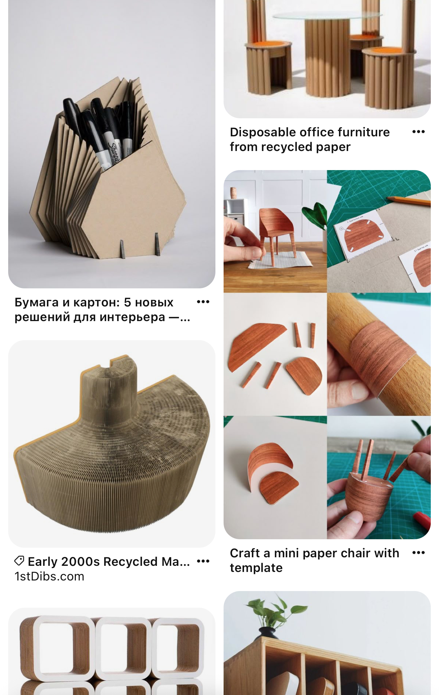
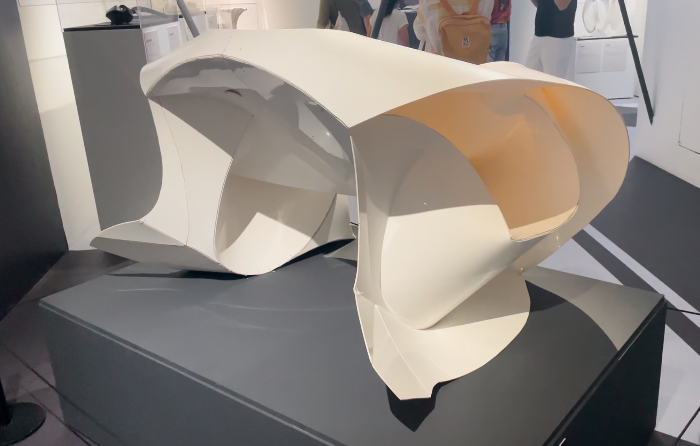
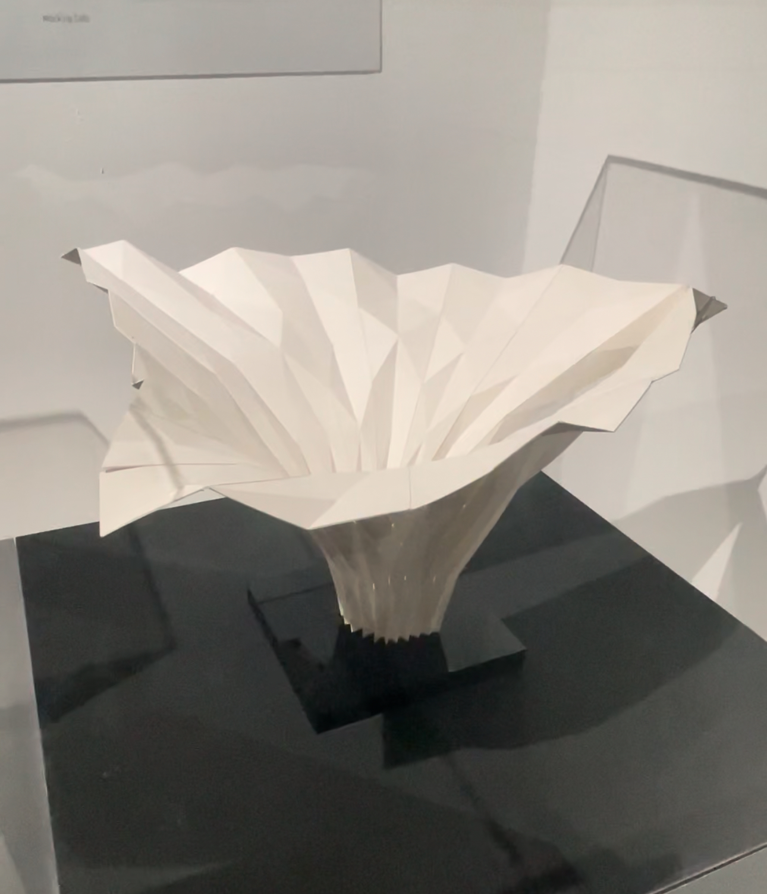
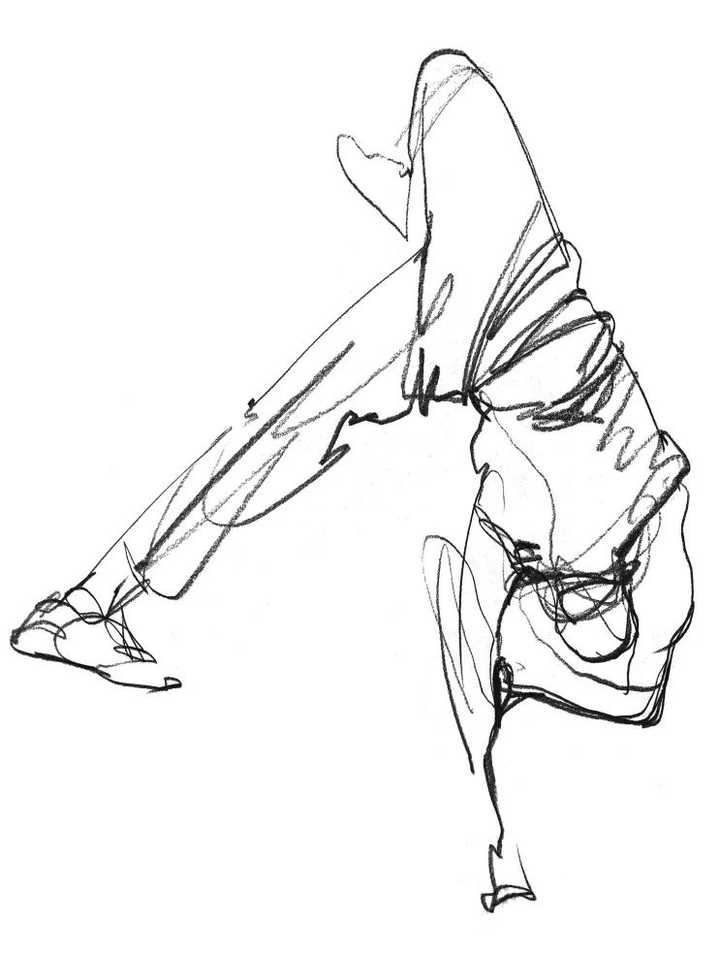
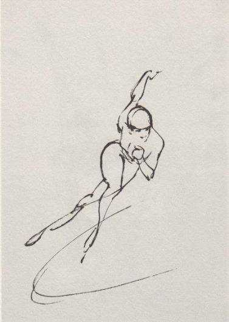
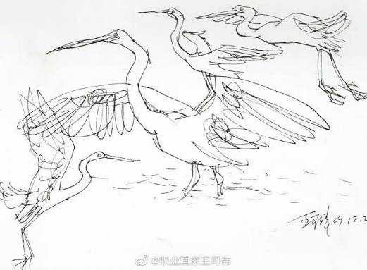
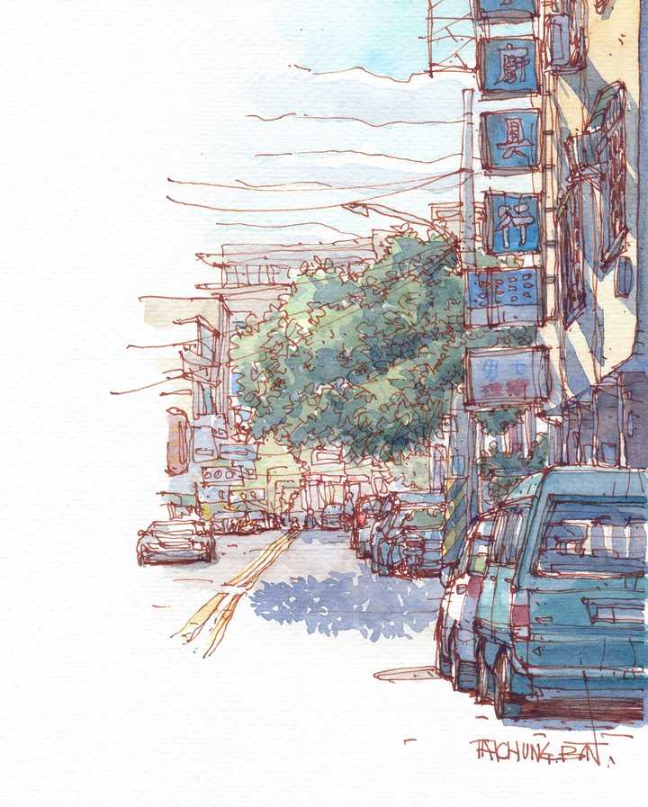

# A04　教育学习与能力形成　第 2 册（共 2 册）

- 专题代码：A04　专题名称：教育学习与能力形成
- 专题界定：学校、教师、训练、读书、经验、能力与教育制度。
- 本册：第 2 / 2 册　收录 133 篇　正文字符 174,805
- 语料：`sooon-q9adg-articles-v2.jsonl`（4,305 篇）　SHA-256：`cdc9c271309e1d71d9708889a3a31f4777e0c339ea54c3753521894afdb8357d`
- 生成时间：2026-09-27T00:01:00.997126+08:00　排序：发表日期 → 源序号（全库唯一，不重复）

**标记约定**：`【待审】` 主题仍为暂定；`【排除候选】` 图片/正文过薄的剔除候选；
`【正文标注未完待续】` 作者原文自带未完标记；`【正文缺失片段（复核已记）】` 复核记录已确认的正文缺口；
`【图片缺 N 张】` 源图不可获取。标记只作提示，不改写原文、不改动分类状态。

---

## 1340　数学启蒙

- 日期：2024-09-04　主专题：A04 教育学习与能力形成　副专题：A02;A05
- 源 ID：`fc06ea55-164b-5111-87c2-d7b5b34af1dd`　原文链接：https://afdian.com/p/26c5a98e6acb11ef96cb5254001e7c00
- 官方对象—实践路径：与亲族 / 与子女 / 抚养
- 23 概念标签：能力与学习;选择与自由;边界与许可
- 证据状态：manual_confirmed　初读：read　独立复核：not_reviewed

**问**：如何对幼儿进行数学（不是算数）启蒙？

对于数学关系，幼儿阶段你能做到而且应该下力气去做的，不是去提前讲加减乘除这些算算法，而是帮助幼儿形成对数量的直觉。
具体来说，就是大量的“数量游戏”。
又比如，抓一把围棋子，猜猜有几颗？
又比如，拿一个碗，猜猜几杯水可以装满这个锅？
又比如，猜猜几个鸡蛋加起来就和这个茄子一样重？
又比如，猜猜从家门口走到小区门口一共多少步？
又比如，拿一根蜡烛，猜猜能点多久？
又比如，猜猜这片树林有多少颗树？
又比如，猜猜这群羊有多少头？

这就是教授对数量的直觉。

接下来：
猜猜在这根蜡烛烧完之前，你能剥几颗毛豆？
猜一猜这两张奇形怪状的纸谁更大？
猜一猜张三跑到终点时李四会跑到哪个位置？
这是教授对数量关系的直觉。

这些问题有分明的答案，很容易得到结果，操作起来很直观，而且可以留下丰富的感官印象，形成“度量一切”的技能。
学数学的人，浑身都是尺。
是先因为度量的敏捷，才能“看见“这个世界的数学性，可以形成对数量关系的丰富经验。
借助这些经验，可以轻易的从长度推算角度，从重量推算时间，从速度推算温度，从亮度推算温度。
看一眼录像就能反推撞击摩托车的卡车有几吨，瞟一眼脚印就知道嫌疑人体重，摸一下就知道人还没走远。
由此可以看见肉眼看不见的世界。
其实人的智能发展，就是一个从观察力到洞察力的过程。
而“观察”并不是“看”，那只是感知，只是“观”，观察是观而察之，而这个察，就是度量和评估。
是尺寸、结构、位置、姿态、质量、体积、线速度、角速度、速度、加速度、温度、成分……等等等等一系列的定量、定性的结论。
先有对尺度、状态的观察，才有对更隐性、宏观的课题和对象之间关系、系统总体状态的洞察。
这是数学意识的根基。
眼里看过去就有数字的人，脑子里才会有数字的关系，并且可以沉浸在这些数学关系带来的无尽的奖赏中。
有这个持续的奖赏，人自然会如痴如醉的去追寻这壶中日月，道里乾坤。
而如果你没有这个敏锐的度量能力，只是等着五六岁开始学理论数学——事实上加减乘除就已经是理论数学了——你只是在学习一个没有现实映照的、仅仅只有分数带来的夸奖类奖赏的抽象游戏。
其实家人的夸奖真的没那么值钱，很快就会被适应和厌倦，无法支持长期进行这些不知所谓的纸面作业。
幼儿阶段，先培养眼里的尺，手上的秤，不要急着教“数学”。

---

## 1341　教训的逻辑

- 日期：2024-09-04　主专题：A04 教育学习与能力形成　副专题：A03
- 源 ID：`134777bf-8cf5-56d7-bc47-ce6646ad293c`　原文链接：https://afdian.com/p/3d4114066a9811ef80fe52540025c377
- 官方对象—实践路径：与自己 / 与能力 / 获取
- 23 概念标签：能力与学习;责任与后果;成本与总账;心理与主体
- 证据状态：manual_confirmed　初读：read　独立复核：not_reviewed

**问**：人们为什么无法记住教训？有时那感觉明明十分深刻十分强烈，但是过去之后还是我行我素，重返旧恶？

教训这个东西，不是靠痛感来达成效果的。它是靠死感来生效的。
你挨了一巴掌，第二天不疼了，之后没痕迹了，没有造成任何不可逆的损失，这一巴掌再疼也不会形成教训。
你挨了一巴掌，打断一颗牙，而且补不回来了，这一巴掌会形成教训。
会导致你认识到“它导致你提前接近了死亡”的事故，才会形成真正的教训。
不是“接近了又远离了”“吃亏了又恢复了”的这种经历，而是“经过这件事之后，虽然有尽量恢复、尽量修补，但最后还是有不可挽回、不可否认、无法无视的损失”的这种经历——即“多死了0.01”的这种加重了你的死亡感的经历才能形成切实有效的教训。
而那些“虽然痛苦，但是事后完全恢复，没有无法无视的永久性损失”的体验，不但不会形成教训，反而会形成“这没什么大不了的”的“经验”。
是不是不信？那么看看这个例子：
你摸了电线，打得手发麻嘴发苦，但是第二天一看，没有任何可见痕迹，也没有任何残留痛感，你的结论会是“电线可摸不得”吗？
不，是“其实电线摸摸也无妨”。
不但没有形成教训，反而形成了经验。
这就是为什么一些家长尝试用拳脚教训考砸的子女，但是却反而造成“考砸也没那么要紧”的经验的原因——因为毕竟虎毒不食子，下手的分寸只能掌握在“不能真的打坏了”这个尺度。既然这个尺度限制住了，就只能再在疾言厉色、加大音量这个方面“努力”。
然而只要最后没有任何持续感的、永久感的损失，它反而会形成“后果也不是不能接受”的经验。
一次沉重的、恐怖的，但是过后没有痕迹的暴风雨式痛苦，远不如一次并不沉重——甚至可能是轻微的——但是不会轻易减退的、不能无视的永久性的（或者说至少具有永久感的）处置容易形成教训。
在ta桌角刻一道痕，不痛不痒，但却不能抹去，这从原理上往往比“狠狠打一顿，一周以后完全恢复”的教育更容易形成教训。
教训是从无法挽回、无法无视的损失——即对死亡的逼近的确认中产生的，不是从没有痕迹的（哪怕再剧烈的）痛苦中产生的。
换言之 —— 痕迹产生教训，痛苦造成适应。
换到人自身的自我管理的角度上来，这个原理意味着你要学会对不可逆的损失形成敏感，而不是把自己的注意力全放在痛感上。
教训来自你事后总结到的不可逆损失，而不是来自你对那个痛感的恐怖记忆。如果你只专注在恐怖记忆而不是不可逆损失上，你不但会再犯，而且会犯得比上次更重。
因为“摸电线看来也不是不行”。
你真正的问题是——1）你算不清你不可逆的损失有多少；2）不可逆的损失如果不是断手断脚、永久伤痕，可能对你不够直观。
对于前者，你要学好会计。
对于后者，你要创造一个方法来让教训变得可视化。
最简单的办法就是在你每天不可能不看见的地方留下一个无法抹去的记号。
例如在手镯上刻一个字。

再说一遍——
痕迹产生教训，痛苦造成适应。

---

## 1342　气质的配方

- 日期：2024-09-04　主专题：A04 教育学习与能力形成　副专题：A05;A00
- 源 ID：`33782e4a-6f9e-5d92-8a82-c9d39670844b`　原文链接：https://afdian.com/p/3999c70c6a8f11ef93695254001e7c00
- 官方对象—实践路径：与自己 / 与能力 / 获取
- 23 概念标签：能力与学习;心理与主体
- 证据状态：manual_confirmed　初读：read　独立复核：not_reviewed

**问**：为什么跳芭蕾或弹钢琴的女生通常很有气质？

因为芭蕾也罢，钢琴也罢，只要学有所成，一定经历了一个丑小鸭在严厉的纪律下付出艰苦的努力，穿过不知尽头的迷茫，最后感受到强烈的美的共鸣的过程。
严厉、艰苦、迷茫、惊喜，这四部曲就是人生的缩影。不论你用何种形式，只要扎扎实实地走过了这四个阶段，到达了惊喜的彼岸，形成了确认，你就会进入一个强壮得多的状态。
就像打过仗活下来了的老兵那样。
你不再对严厉憎恨、不再对艰苦畏惧、不再为迷茫惊慌，你已经知道什么样的严厉、艰苦、迷茫是良性的，是正确的痛苦，是应有的负担，你不再怀疑最后的惊喜的存在。
甚至，你会开始把这些接受为最后惊喜的微不足道的铺垫，学会享受这些“折磨”本身。
到了这一步，人就会因为笃定、自信而呈现出“气质”。
因为信心而从容，永远不慌不忙，没有啸叫着从七窍喷出的灼热的焦虑。因为功到自然成，没有必要惊疑不定。
因为信心而宽容，没有对一切不受控的人和无常的诅咒和愤恨。因为那样的纪律你守了，那样的艰苦你扛了，那样的迷茫你经了，那点无常的变数并没有什么可畏惧的。
因为信心而慷慨。你不再担心自己会穷困。不是因为你有多大的存款余额，而是因为你知道你要的东西只要经过一个不但可以忍受、甚至自有趣味的过程就可以得到。
这就会凝结出一种自然而然的优雅、清净、温和感，自然而然令人乐于亲近，渴望羁绊。
这个品质，其实和那些百战余生、乐观朴实的老兵，和那些乐天知命、悠然自得的农夫渔夫体现出的是同一个东西，只是因为芭蕾、钢琴还有很强的艺术熏陶、美学属性，所以在这个配方里还加上了美感这味关键的药。
美是神性的外溢，会自然而然地诱发人的崇敬感，既让人向往、又让人畏惧。而自信所带来的宽容，又会触发亲近的本能，缓和美所带来的敬畏。
这两者合流，就让人既忍不住想要亲近，又唯恐有所冒犯，而且这推远、拉近的主动权，会极大的掌握在这两件神器的主人手里。
这是一个令人艳羡的巨大的权力地位。
信心的经验与美的自觉，这就是“气质”的配方。
你不见得要走芭蕾和钢琴的路子去学这些，只要你能集齐这两个要素就可以。

---

## 1320　倒卷珠帘

- 日期：2024-09-11　主专题：A04 教育学习与能力形成　副专题：A03
- 源 ID：`e5a57f59-d7f9-5aeb-a250-14c8264e57c3`　原文链接：https://afdian.com/p/2b9f86dc6fd011ef891852540025c377
- 官方对象—实践路径：与自己 / 与能力 / 获取
- 23 概念标签：事实与证据;能力与学习;责任与后果;成本与总账;信用与信任;劳动与组织;技术与工程
- 证据状态：manual_confirmed　初读：read　独立复核：not_reviewed

**问**：如何把学到的知识系统化，即知识管理？

一系列的知识，到底要怎么样才能“系统化”？
其实我们人类所谓的“知识的系统化”，就是在谋求可以在一张纸或者若干张纸叠起来的媒体上无重复、无遗漏地串起所有的知识点，其原因根本不是“知识本来就是这样放在上帝的书架上”，而是因为我们的大脑默认只能高效地处理这样的结构，而且因为这一事实，所有的有组织教学都采用了这样的逻辑来组织自己打算传授的内容。
所以你也在不假思索地寻求将自己需要管理的知识整理成“卷、章、节、小节”这样的树状状态，并将“把知识整理成这样的状态”称为系统化。
但实际上这是一个“面向教学”的整理思路，而不是“面向使用”的整理思路。它是在为一种“顺序讲述，全面介绍，总体记忆”的思路服务。
如果你打算用这个方式来管理你自己整个人生的知识库，你会发现它是一个错误的目标。
因为你又不是要开一家教书育人的学术教育机构。
对你而言，你的知识应该更像手工艺者的工具盒。不是按照“锤子放一层、锯子放一层、扳手放一层”这样的“分门别类”的方式存放，而是按照“第一步要拆轮胎，所以撬棒、六角套筒扳手、千斤顶……作为拆轮胎套装放在一起”，“第二步要补洞，所以肥皂水、补胎胶、橡胶片……作为补胎套装放在一起”的逻辑来存放。
也就是“面向业务组织知识管理”。
你要做什么，你就沿着你的业务流程，以“充分服务好这个业务环节”为核心，把相关的知识放在这个业务环节的目录下。
不要在意什么简洁性，如果第一步需要用到扳手，第三步又要用到扳手，你不要为了“简洁”拼了命地想要设计一个办法省掉一把扳手。
不，你就直接在第一步的套件里放一把，在第三步的套件里再放一把。
“浪费”是“系统简单”的必要代价。而“系统复杂化”是一种战略性的浪费，“可以省一把扳手”却只是一种战术性的节省。
所以不要过度地寻求（至少不要在一开始追求）简洁性——其实这种“一个知识点只能出现一次”的需求，是学校教学才有的特殊需要，发现没有？
你是要做事用，不是要拿来教学用。你要的是做这一步时，做它所需要的全部必要知识，以便这一步可以被确定无疑地、稳妥地完成。
咬住你的业务，把这门业务由你经手的每一个流程的how和why都厘清、搞透，基于这个思想，沿着你的流程，会自动地形成一个知识体系。
接下来你就不断的精益求精，不断的改进每个流程的做法，修订这个流程相关的心得体会、工艺要点。
你会发现，所谓“成体系的知识”，追根到底是从一系列的业务中浮现出来的。
例如你写清楚了草鱼养殖、大菱鲆养殖、克氏鳌虾养殖……最后你会形成《水产养殖》这个体系化知识。你会自然而然地知道绪论、章节要怎么安排。
而人“管理自己的知识体系”失败，关键就在于人往往在搞清楚具体业务之前，就在学校教科书的强烈影响之下先自顶向下搭建框架，打算先有骨架再贴肉。
问题是，教科书的框架恰恰本身就是人类精英汇集几百年甚至上千年的“具体业务知识”，再反向去重复、去冗余后总结归纳出来的，它恰恰就是一个从业务级内容向共性内容的升级过程。你
在整理自己的知识体系的时候如果跳过那个具体业务知识积累阶段，你将根本没有反向提炼框架的能力和依据，你只是在盲目地、徒劳地模仿教科书的现成结果，这就是你总是“体系化”失败的根本原因。
你总觉得体系化就是教科书那样的树状结构。
实际上体系化必须从“流程说明”这样的线性结构开始。先拿到若干个珠串，然后把这些珠串里相同的珠子合并，合并出最后的树状结构，这才是这个树状结构的由来。
先串珠子，拿到珠串，珠串已经是“系统化的知识管理”了。要不要从珠串结构进化到树状结构，那反而是次要的。
坦率讲，这个“归并到树状结构”的步骤，你最好到退休时再做。因为在你退休之前，珠串本身就在日新月异地迭代， 你有很长一段时间会发现你对同一业务的理解本身就在不断地进化，这也是你过早地尝试构建树状结构往往失败的原因。
这差不多就是主要的要点，自己实践吧。

---

## 1286　为学

- 日期：2024-09-21　主专题：A04 教育学习与能力形成　副专题：A05
- 源 ID：`73e9edee-7d04-51a5-aec0-0ea94d554f74`　原文链接：https://afdian.com/p/83e4660a77b911ef8fd352540025c377
- 官方对象—实践路径：与亲族 / 与子女 / 抚养
- 23 概念标签：事实与证据;定义与达意;能力与学习;爱与回应;照料与家庭;法律与秩序;技术与工程;宗教与自然法
- 证据状态：manual_confirmed　初读：read　独立复核：not_reviewed
- 标记：`【正文标注未完待续】`

**问**：怎么才能避免孩子厌学？

这真是一个大问题。
坦率说，恐怕没有“必胜的银子弹”，如果有，以我国数千年来对教育的重视，这个问题应该早已不存在了。
所以，家长要换一个策略框架来思考这个问题。
那就是如果要追求“在尽可能降低厌学概率的前提下，防止一时厌学转变为弃学”。
也就是防弃抑厌。而且不是把“防弃”作为“抑厌”之上的附加目标，相反，是把防弃作为核心的、首要的目标。
这就意味着如果有这么一种手段，一旦失败会导致子女不但厌学、甚至会弃学，那么无论它看上去多么能“抑厌”，都必须放弃不用。
比如那个经典的“学不好你就完了”，这就属于看上去可以促学，但一旦失败，孩子产生了厌学情绪，就会反过来导致弃学的有毒手段。
这种鼓吹看上去可以通过恐惧感促使小朋友学习，但一来小朋友其实根本不清楚什么叫“完了”，在本质上这个“完了”实际上是用“父母为此伤心哭泣、极端失望、表达厌恶和憎恨”来烘托、表演出来的。
换句话来说，它实际上是“你学不好我就讨厌你、放弃你”这种由父母执行的“完了”，而不是“学不好就适应不了社会”这种来自自然法的“完了”。会失去父母的爱，甚至可能失去父母的庇护和抚养，这当然会引起子女的恐惧，但在另一方面，也会毒化父母和子女的之间的关系。很快子女就会对不断受到这种恐吓感到厌倦，并在厌倦之下产生强烈的摆脱威胁的渴望。渴望将会通过自欺欺人机制产生主观想象的认知，ta们很快就开始过度乐观的认为“太痛苦了，也许离开父母我也能活”这样的想法。并且一但这个想法萌芽，学习作为换取不抛弃的酷刑就立刻无法再被忍受。
就会弃学。
所以，绝不要用“学习不好（甚至是“学习不如人”）就完了”“学习不好你还有什么用”“不好好学习太令我们失望”这样的手段去促学抑厌。因为这样你实际上把弃学变成了报复你的最佳手段，并且每天都在引诱子女报复你。
结果是如果你不这么做也许子女还丢三落四学个七七八八，你这么干子女折磨了三五年直接弃学报复。ta的厌学恰恰就是你的促学手段造成的，而且这厌学会势不可挡的滑向弃学。
同样的原理适用于你一切的促学思路，你全都要做一下这个“防弃检验”，绝不能拿那些“不成功，就成仁”的有毒策略去促学，哪怕你没想到什么促学的办法，先把弃学的风险排除，也已经是一大进步。
在促学问题上，“先为不可败，再务其胜”是一个绝对不可动摇的中心原则。接下去我们再围绕这个原则，谈论策略问题。

接下来，我们要釜底抽薪，直接根除弃学的根源，那就是学习到底在人生之中扮演什么角色，人对学习——或者说，整个家族对学习应该是什么态度。
第一个问题——彻底解决学习信心问题。
人类最难学会的知识是什么？是三角函数吗？是量子力学？并不是。
是语言本身。能学会说话，能明白这个是爸爸、那个是妈妈，谁是爷爷，什么是汽车、什么是鞋子，什么叫甜，什么叫酸……这本身就是学习，而且是一个极为繁重的、极为主要的学习。
事实上，你能形成对学习这个问题的沮丧，并能在自己头脑中形成一套“为什么我觉得我完了”的论证，这本身就是多年学习的结果。因为这套论证本身已经涉及到了大量的概念的组合运用，其复杂度甚至远在三角函数甚至量子力学之上。
你只是在这个课题上无意识的投入了大量的智力资源，而在三角函数上因为种种原因没有这么做罢了。
你会说话，会有根有据的沮丧，会跟我有来有回的辩论，甚至可以把我驳得不知该说什么好，假如你是一个人工智能的话，你已经远比“会算三角函数”的人工智能强大得太多。
所以，你不是在以一个“连一米都跑不动”的失败者的身份在沮丧“怎么能跑的了一百米”，而是以一个已经跑过了十公里但却浑然不觉的人的身份，在绝望“怎么跑得了一百米”。
（未完，待续）

---

## 1248　马虎小子

- 日期：2024-09-30　主专题：A04 教育学习与能力形成　副专题：A05
- 源 ID：`203daf5f-e974-5c9b-80b7-7b1e98584329`　原文链接：https://afdian.com/p/f8fcaf6e7ef411efb16452540025c377
- 官方对象—实践路径：与亲族 / 与子女 / 抚养
- 23 概念标签：定义与达意;能力与学习;责任与后果;成本与总账;信用与信任;爱与回应;照料与家庭;心理与主体
- 证据状态：manual_confirmed　初读：read　独立复核：not_reviewed

**问**：我做事总是不严谨、马虎，怎么办？

马虎是怎么造成的？
想过吗？
第一个来源 —— 一种宠出来的病。
张三对张小三说——你绕操场跑五圈，我给你买冰激凌。小张三跑了两圈嫌太累了，后面改走了，最后一圈甚至都不是沿着跑道走，而是在起点线终点线上转悠了一下。
张三一看，唉，亲儿子，算了吧，就算你已经跑了五圈吧，走，带你吃冰激凌去。
看到没有？在这里马虎得到了实际奖励，形成了经验。
跟宠爱自己的人打交道太多了，总是凭着宠爱偷工减料闯关成功，被高抬贵手、被算为合格，由“考官”动用自由裁量权私放过关。
于是马虎起来了。
此其一。

第二个来源，失败主义信仰。
啥意思呢？就是根本没成功过。干啥都是摆弄几下，诶，风扇为啥不转？那我再多摆弄几下，诶，风扇为啥还是不转？
既然多摆弄几下反正还是不转，我这不是白摆弄了吗？我为啥不干脆少摆弄几下，省点力气呢？
我就是个失败的人，我反正最后还是会失败。多做努力只不过是在必然的失败上加上更多的损失，这很明显不划算啊。
所以我要争取节能型失败，我败中求不了胜，但我可以败中求省啊。
我之所以还鼓捣两下，是因为我要是连鼓捣都不鼓捣两下，你会扑上来咬我。我鼓捣两下，交代了一下，你看我好歹动了，你就会“就算ta已经尽力了吧”，你就会放过我。
这点成本省不了，这我还是知道的。
你看我这幅样子发急——“你学习不是为我学的，是为你自己学的。你这样装模作样是要骗谁，是要骗我还是要骗自己？”
问题是，我确实是为你学的啊。我就是为了你可以不烦我才学的啊。我装模作样就是为了要骗你啊，你这不是都明白吗？
什么骗我自己？你在说啥？

要解决马虎的问题，从父母的角度，要开始学会清晰地定义成功和失败，并且要讲信用。
啥意思呢？
比如给子女设定目标——一分钟剥十个毛豆就算胜利。那么子女一分钟剥只剥了九个就不能算胜利，但子女一分钟剥了十个、只是壳子没有丢进垃圾桶，这仍然要算胜利。
很多父母喜欢在这个时候搞“精益求精”，其实是自己没有把“要把壳子丢进垃圾桶”放进胜利条件里，这时候却摆出一副“你还没有达成全部目标”的气势来，要教子女“不要骄傲自满”“要不断给自己设立更高的要求”。
其结果就是子女严重地缺乏成功经验。
你仔细想想，用这种“你够着了就再升高一尺”的“游戏规则”，谁能“赢”？ta一直都赢不了，当然得到的是“无论如何都会失败”的信念。
既然无论如何都会失败，我为啥不要败中求省？
反正干完一轮，肯定得到的是一顿“不要骄傲自满”“要学会精益求精”的教育，我为啥要用高昂的成本而不是低廉的成本触发同一过场动画？
更不提那些根本就没有具体胜利条件，拿“做到我满意为止”作为胜利条件的挑战游戏了。
你永远不会满意，我永远不会成功，我还不如马虎点，忙里偷闲。
父母们不要没事就发作“吃得苦中苦方为人上人”的焦虑，生怕子女得到了任何成功就会“骄傲自满”，在低水平上固步自封。
相比之下，在子女赢得了低水平目标时不如约兑现奖励、不认可ta的阶段性成功，让子女缺少拥有的确定感、有效感，堕入失败主义的错觉中，出现“用马虎对抗必然失败”的反向补偿，其后果要远远的更为严重。
你要相信大数据。
啥大数据？
你看游戏教你儿子打游戏，一星成就就果断播放一星成就的庆祝动画，游戏可没说“一星有啥好得意的，打到三星再领金币！”
游戏比你讲信用一万倍，你儿子打游戏有“得到一星就满足于低水平过关”吗？ta老人家花一个多星期学都不上觉都不睡挑战一命无伤终极boss杀，你送进网瘾学校去电击都拦不住ta。
你没有学习到什么经验吗？
过关条件要清晰，过关奖励要及时，你做到了，子女自然就不会搞“马虎战术”。
这跟ta是否聪明、是否勤奋，几乎没有关系，ta有网瘾本身就证明了这个方法的无穷效力。
你只是打死都不肯向最有力的胜利者学习。

从当事者自身的角度看，其实道理相同。
为啥非要爹妈老师来给你设立学习目标，非要等着ta们讲信用、等着ta们来奖赏？
你自己为啥不能给你自己设立学习目标，不能自己对自己讲信用，不能自己给自己奖赏？
你为啥不看看自然和社会设立了什么目标，自然和社会有没有信用，给没给你奖赏？
自然答应你用导线接通正负极灯就会亮，你接接看，亮了吗？
自然答应你加3组动滑轮就可以用1/8的力把箱子拽上楼，你加加看，拽动了吗？
以前你不能，现在你能把灯点亮、能把那么重的箱子拽上楼，这本身不是肯定、不是奖赏吗？
你以前算不出最佳卖出点是多少，现在你可以算出，这不是肯定、不是奖赏吗？你还要等着谁来给你？
你马虎给谁看？止的什么鬼损？
马虎只是在剥夺、延迟自己的成就感、确定感的建设过程。
拿来对付你爹也许有点意义，拿来对付自然规律、社会规律，小心遭雷劈。
你马马虎虎摸摸电线看看，看看电网会不会放过你？

---

## 1245　以卵击石

- 日期：2024-10-01　主专题：A04 教育学习与能力形成　副专题：A15;A07
- 源 ID：`08278c3c-8dba-59b3-af78-01307ce2a1ae`　原文链接：https://www.zhihu.com/question/21381800/answer/3929846431
- 官方对象—实践路径：与自己 / 与名誉 / 维护
- 23 概念标签：爱与回应;文明与历史;心理与主体
- 证据状态：manual_confirmed　初读：read　独立复核：not_reviewed

**问**：如何看待 1999 年王朔对金庸的批评？

本质上这跟IGN批评黑悟空是一回事。
当你的东西硬核到一定份上，那么就不是人家颁奖给你来证明你多有价值，而是人家颁奖给你来证明ta还有没有价值。
非要跳出来假装你一钱不值的，自己要倒台。
这给人一个教训——不要去注目在某个特定人怎么看待你，而要注目在人民——尤其是将来的人民——会如何看待你。
这其实就是所谓的“敬畏历史评价”。
你有把握历史评价会在你这一边，那么这个那个跳出来“鄙视”你的，你不但不会感到“受伤”“不公”，反而会为对方感到可怜。
因为ta们会随着你的发展而自己化身小丑。

---

## 1214　向左转、向右转

- 日期：2024-10-11　主专题：A04 教育学习与能力形成　副专题：A07
- 源 ID：`3a050e70-5a81-5747-bbb1-026bdd0895dc`　原文链接：https://www.zhihu.com/question/702690752/answer/4730094577
- 官方对象—实践路径：与自己 / 与能力 / 获取
- 23 概念标签：能力与学习;选择与自由;责任与后果;成本与总账;爱与回应;照料与家庭;劳动与组织;心理与主体
- 证据状态：manual_confirmed　初读：read　独立复核：not_reviewed

**问**：害怕自己碌碌无为，平庸寂寞一辈子，以至于始终不敢静下心来学习怎么办？

总是担心自己静下心来学习，也难以得到想要的结果，更担心错过了除了学习之外的其他快乐，拉扯之下，学习和生活中的其他事情都没做好。
你自己不想学，除了你父母，没人有这个必要硬来劝你。
毕竟人类社会还是需要一些人为其他人提供教训的——每个班、每个村、每个企业、每个组织里总是需要一些失败者来让别人感到庆幸——“幸亏我还没到ta那一步，原来这样这么惨，还好我还能回头”。
劝了你，其他人看不到这个教训，就会有其他人因为缺少警示而来担当这个角色，成为别人的教训。有人自愿去为其他人标明什么样是自己绝对不要成为的样子，这对其他人其实是一种客观的贡献。
既然总要有人填这个名额，除了你的父母，其他人为何要花费巨大的精力来确保不是你？
其实老师们早就明白了这个道理，所以干久了是不会去专门拯救最差学生的——班上必须要有一个最差学生来让其他学生引以为戒，一个都没有，就会自动产生一个出来。
强行追求“一个也不能掉队”实际上并不是对教学资源的最好分配。救当然是要象征性地救一下的，但是只要交代得过去，就可以收手了。老师们真正要确保的是这样的角色不要出现太多个，尤其是不要蔓延成风。
出于这个原因，“有意无意的分化和孤立差生、隔绝其他学生与其接触导致感染其行为方式”就会成为挽救无效时顺理成章的理性行为。
只是没人会做得太过分以至于被明显的抓住手脚罢了。
事实上，所有的组织都会发现这个现象，也都会用类似的手段处理这个问题。ta们会留着这样的人去顶年终末位淘汰的名额，以保护表现较好的其他人；而在另一方面，又在社交上显著的给予其“不洁之人”的待遇，谁敢去接触、抱团，就将谁一并视为有待切除的病灶的一部分。通过制造“绝不能落到ta这个田地”的恐惧，驱赶其他人积极正面发展。
ta们不说，甚至嘴上还会喊一些“亲如一家”的口号，但是在客观上、事实上，稍大的组织——这是指人数多于七个的组织——往往会发现这是无可避免的选择。
组织不能搞“谁自甘堕落反而特别予以关心和帮助”这一套，因为组织绝不能在任何意义上奖励负向行为。
组织对落后者的帮助，与其说是希望挽救之，不如说是一种确定对方是不是故意为之的检测——是不是故意的，帮助起来手感截然不同，那是骗不了人的。
救得了你，那就救；救不了你，就拿你反向利用，用残酷的冷遇来警告ta人什么是选择负面取向的后果。
那无疑是一个地狱般的——但却绝对是合法的——待遇。
再说一遍，它们没有“温情脉脉”的选择，因为它们绝不能让这样的人得到任何意义上的奖励——硬这么干，就是自取灭亡。
所以不要喊什么“社会规训”“没有人性”“不关心我的死活”，因为这是自然法拿刀架在ta们脖子上逼ta们保留的残忍。不对自甘堕落者残忍，就是对不自甘堕落者残忍，就是剥削后者去喂养前者。
对此，希望你在选择自我放任、自我散漫时不要抱任何侥幸。
将来你会知道，“因为担心就可以不去做某件事”是一件别人给你争来的奢侈享受。如果这人不在了，或者无力再提供了，人是不会默认有这个福利的。
正常的人生是你如果出于担心而不去做必要的事，立刻就要完蛋。
因为担心做不好而不做，那么就不用做了，直接开除。
因为担心谈不好而不谈，那么就不用谈了，直接分手。
因为担心打不赢而不打，那么就不用打了，直接下葬。

现实只问你干不干，干是九死一生，不干是十死无生。
“担心干不好”这类回答，现实就当你是不要干，手起刀落，下一个。

学习是唯一帮你从九死一生提升到九生一死的机会。
要不要抓住，最终看你。
对人类总体来说，你选哪样都有办法获益，其实没有太大关系。
只对你自己有关系，对你那没有选择的父母、家人有关系。
选吧。
不过你也不必过度恐慌，一般这类自然法的铁拳挨上一两次，人就会学会本能的收起这类嬉皮笑脸的过剩安全感，知道这类把戏耍不得。
其实父母为什么对你这类行为如此疾言厉色？因为ta们就是受过这类教育、见过这样干的下场，所以才这么急。而ta们其实也没有比你大多少，只不过人生的半程而已。
所以无非是挨一顿铁拳，还是会醒的。

---

## 1202　小儿无礼

- 日期：2024-10-15　主专题：A04 教育学习与能力形成　副专题：A07
- 源 ID：`3244aefa-c466-5779-9b25-efd3b2a5d81f`　原文链接：https://afdian.com/p/59564a888af711efa45b52540025c377
- 官方对象—实践路径：与合作者 / 与被管理者 / 确权
- 23 概念标签：事实与证据;定义与达意;能力与学习;选择与自由;责任与后果;成本与总账;净输出与不掠夺;权力与异议;技术与工程;心理与主体
- 证据状态：manual_confirmed　初读：read　独立复核：not_reviewed

**问**：身为班主任发现部分学生对老师很没礼貌怎么办?

当一个人对你无礼，而你又想要进攻性的解决这个问题，那么基本的手段，是分化这个人的社会网络。
说得简单一点，从ta的朋友、闺蜜开始，着手改善与这些人的关系。三个闺蜜，选其中立场最亲和、最值得争取的，故意给一点优待和照顾，让小团体自己“审判叛徒”、怀疑其“忠诚”，ta们自己就会将ta推到你这一边。
而这位无端受到“朋友“的猜疑和伤害，自然还会透露更多小团体秘密给你，你对剩下的死忠或利诱或威逼的抓手自然更多。
身为班主任，你手上的权力是非常巨大而决定性的，你可以很轻松的对剩下的这个朋友不动声色的施压，让ta深感受到了自己那位嘴上无道的朋友的拖累。
这位朋友自然要索要补偿，而肇事者作为毫无资源的青少年，能拿出什么补偿？而在拿不出任何补偿的前提下，小朋友极易拿出“你作为朋友应该接受被连累的义务”作为答复。
ta说出这话，这位朋友往往会立刻转化为ta最可怕的敌人。到时候这位刺头最大的麻烦反而不是来自你，而是来自ta的两位前好友——你肆意妄为，为自己的小团体招来了强大的敌人，敌人会将你的整个团体作为可攻击目标，团体受到损伤，必定要找你寻求补偿，你补偿不了还要主张这是ta们作为朋友的当然义务，你就会被你的团体驱逐和惩罚。
是可忍，孰不可忍？
你可以继续出言不逊，但你不要再指望在班上有任何人会认同你——这倒不是因为班主任有多么伟大，而是因为你已经原形毕露——你是一个自私自利、连累之后不但不负责任，还要作践朋友的人。
这是进攻性的策略，只要你一切按照规矩来，基本上很难被抓住什么违规操作。以中学生、本科生对关系规律的认知和拥有的资源，几乎无可抵挡。

既然有进攻性策略，自然也有防御性策略。那那就是反过来，好好的做好自己的工作，赢得班上其他同学的感谢和认同。
但这不是简单的“含辛茹苦，孜孜不倦”，而是要带给班级荣誉，尤其是“江湖地位”。
少年儿童当然思路是很丛林的，谁能让本班同学在年级其他班级甚至更大范围内扬眉吐气——例如运动会上所向披靡，例如团结对外上有口皆碑，比如班级环境让人印象深刻……很自然的班主任就会获得江湖威望，而恶意中伤班主任的行为就会为全体所不齿。
谁看不起大家的英雄，大家怎么可能给ta好脸？
这纯属自绝于人民。
你只是要注意，这种“江湖威望”不是靠什么“感动”，而是靠某种服气甚至某种敬畏打底的。这包括“魔术出神入化”“剑道冠军”“退役超模”之类，不是什么“苦口婆心的老太太”的戏码。
很遗憾，小孩子是很难体会到什么叫“良师益友”的，尤其是作为良师益友，往往需要说很多ta们不爱听的话。ta们接受他人说这些话的资格标准往往是敬畏，是一些极其直观的“实力”，不要看多了白左神话以为ta们会被温柔的耐心感动，那并不符合青少年的认知能力。

要攻要守，你自己去掌握，但注意一条，谨慎考虑靠“表达委屈，表现悲愤”去指望肇事人“良心发现”这种做法。
因为这实际上是一种“撒娇式”方法，一种弱者、下位者的方法。
班主任就是法定的“孩子王”，不容你搞这些哭哭啼啼的事，你真要干，你会发现对方是否良心发现不一定，但是整个班级都会本能的意识到你过于软弱，那会战略性的破坏你的影响力。
那个道歉其实根本不值钱，你甚至可以弃之于不顾。哼一声，就当没听见也比“悲愤控诉”要好。

这里对小朋友们讲几句——希望你们看清楚班主任可以做到的手段你是不是真的有解。坦率地讲，极其不建议你们对资浅教师搞“火力侦察”，这是非常愚蠢的。
因为资深教师往往天然的对这种行为比较淡定，你不太会受到很大的报复。
问题在于青年教师心还是嫩的，学生气未脱，受到这类“火力侦察”往往会白左思想上头想要“真心换真情”，而你会给ta真情的可能性几乎为零——一方面ta们自己并不知道真心换真情需要多大的毅力和智慧，往往只用乱用了一分力就已经精疲力竭了，而你这个年纪又根本不懂这些复杂微妙的感情。
而在ta们真心换真情受到了屈辱新的失败之后，ta们要么消沉辞职，要么可能化身你最可怕的噩梦。
上面谈到的这些还只是比较文明、客气的手段了，真要干你，你要扛的比这严重得多。要知道青年教师自己也没比你大多少，很多人自己都还是半大小孩。
ta们也不是什么很理智、脾气很好的人。ta们甚至可能不会考虑这些做法会有什么后果。
你如果看到这些手段觉得害怕、困扰，要拍桌子骂“卑鄙”“无耻”，你到时候就要记住——你出言不逊的那一刻，就等于自己解除了保险。
只许你轰炸人家，你指望人家跟你客客气气，规规矩矩？
哪有这么美好的事？
到时候这些手段都会是你的现实问题，你先想好要怎么办。

---

## 1179　鬼火少年

- 日期：2024-10-20　主专题：A04 教育学习与能力形成　副专题：A01
- 源 ID：`ea7d4cfe-11f0-57e4-9c59-ca495ceb8444`　原文链接：https://afdian.com/p/2e7c57e88ef411ef988f5254001e7c00
- 官方对象—实践路径：与亲族 / 与子女 / 抚养
- 23 概念标签：能力与学习;责任与后果;照料与家庭;劳动与组织;文明与历史;心理与主体
- 证据状态：manual_confirmed　初读：read　独立复核：not_reviewed

**问**：如何看待济南“鬼火少年”事件？

怎么可以最快的爬到“万人之上”？
一种是发明一种没有第二个人会接受的价值理论，然后作为其发明人，从而“世人皆醉我独醒”。
举世都是醉汉，只有你一个醒着，这不就万人之上了吗？而且越被一致反对，你的清醒就越独特、越专有，就越万人之上。
另一种，就是违法犯禁而不被抓住。
世人都要循规蹈矩，只有你不受束缚而且没有被抓住，你不就万人之上了吗？
青少年在长期脱产教育期间，不间断的受到所有年龄较大的人的管教、约束，学长、兄姊、老师、家长甚至任何一个成人，地位都在自己之上，都可以居高临下告诉自己哪里错了、哪里要改，这导致青少年对“万人之下”产生了焦虑、愤怒。
觉得自己“低贱”“可悲”。
而摆脱这个低贱感很自然的会成为青少年一个极强的追求。
理论上，你可以刻苦学习、辛勤劳动，逐渐积累资历，取得社会地位，最后媳妇熬成婆，但这样太漫长了，远水救不了近火。
更何况，万一我资质不佳呢？出身不好呢？已经因为任性走错了路呢？那就更不是远水救不了近火的问题了，而是我感觉走这条“正途”根本没有摆脱这个低贱状态的可能了。
而学一嘴亚文化圈子的黑话，加入一个“酷炫”的小圈子，或者搞一点违法擦边球暂时不被抓住，这不需要什么资质、不需要有多好的条件。
最重要的是，不用熬，不用“长期坚持”，立刻就能让我真真切切的享受到足够逼真的“万人之上”的感受。
尤其是没有好成绩，没有好名次，没有大好前程和众口交赞的那些under dog，那些“无名氏”，就更容易走这种捷径。
这就是一些青少年容易爆发反社会性，而且乐此不疲的根源。

要说有什么解方。
是这样的——父母、师长，要学会尊重、赞赏行为，而不是结果。
人们经常犯一个错误，就是只尊重结果。比如孩子在认真学习了，但是分数还没到理想程度，那么在得到理想分数前，ta的努力都是不被看见的。只有当你考到分数了，你才会得到赞赏；没考到之前，一切都不值钱。
这就会很自然的让小朋友建立起一个意识——结果可以拿来当成就、换地位，过程不行。
而一旦树立起这个认知，就会出现两个顺理成章的后果：
1）ta对近期会有认可感到悲观。因为就算自己在努力，考试也要到期中、期末，还有几个月。这之前是没有正面刺激来告诉我我做得好、做得对的，是没有我期待的积极愉快的待遇的。
2）ta一旦对结果本身绝望，就会对自己的地位可能改善同时绝望。我努力三个月，不但这三个月期间不要指望有好脸，我要是感觉这三个月期间没搞好，我对三个月末尾能得到好脸也绝望了。
合起来就没盼头了。
然后你说我一毕业，面对浩瀚的漫长的人生，你跟我说十年为期，努力十年混个出人头地才会有人正眼看我，我一听这不就是“努力一学期，期末考好就得奖状”的放大版吗？
根本无力坚持。
你批评我走捷径、自欺欺人、制造快乐幻觉，问题是我制造一下我还起码可以吸两口幻觉，不制造我连这两口都没得吸啊。
你骂我、打我又有啥用？

所以，作为父母，你必须要把ta的快感经验修改掉。必须修改成赞赏过程，而不是赞赏结果。
什么叫赞赏过程？
今天一回家就开始写作业了，不错啊。
今天字写得比昨天好，不错啊。
今天晚上比昨天早睡了半小时，大拇指。
今天挨了这么重的批评却没自暴自弃，了不起。
期末发挥失常了？没有哭哭啼啼，能心平气和总结哪里错了，点赞。
被同学超过了，不恨同学而懂得学习别人的优点，鼓掌。
犯了错，没有撒谎回避自己的责任，局气。

简单点说，作为家长要善于发现子女行为中的进步、积极、可取之处，不要等什么“最后的结果”，而是每一轮都要实事求是的及时肯定。
是就是是，好就是好，这没什么可违心，可犹豫的，因为你讲的确实都是实话，不是自己编出了什么理由来夸。
这些及时、准确、客观、平和的肯定，要像吃饭一样一日三餐、换着菜式一直喂。
要喂到改变ta的基本认知，做到ta一积极主动的、努力明智的开始做事，还没看到结果，就因为自己做事的方式够漂亮而感到快乐。
看着自己打的草稿就高兴。
看到自己写出来的公式就觉得漂亮。
一个绝妙的思路，虽然没能解出答案，但是这个思路我也能想到，我真是天才。
我不需要等到雄踞于万人之上的那一天才开始感到快乐，我只要醒了，投身于任何事情中，我都会为这事干得真漂亮感到高兴。
我自然用不着学一嘴没人听得懂的黑话梗或者晚上跑出去跟警察捉迷藏来满足十年久旱的快乐饥渴。

至于青少年自己，这就要看你有没有缘分理解这些话了——你不能指望父母发挥完美你才能健康成长。

---

## 1169　左撇子

- 日期：2024-10-23　主专题：A04 教育学习与能力形成　副专题：A05;A02
- 源 ID：`376a8f11-ab74-5df9-8c78-74fb76fb93bb`　原文链接：https://www.zhihu.com/question/439923460/answer/13048519066
- 官方对象—实践路径：与亲族 / 与子女 / 抚养
- 23 概念标签：能力与学习
- 证据状态：manual_confirmed　初读：read　独立复核：not_reviewed

**问**：孩子有左撇子的迹象，要不要纠正他？

不要“纠正”ta，而要恭喜ta。
因为这等于一个天生会英语的小孩降生在了中国，只要学会汉语就可以掌握两门语言。
左利手的人根本不应该放弃自己的左利手优势，而应该学什么都尝试掌握“左右开弓”——既掌握使用现成为右利手设计的一般设施、器具，又保留自己左利手的“奇兵”。
这不仅是多一点操作技巧的问题，还有利于刺激大脑发育、发展特殊的认知和思考能力。
这个逻辑适用于一切人。
不要将自己异于常人的天赋看成一种“缺陷”，去追求“抛弃缺陷，更正为正常”，而是永远要在寻求适应和掌握主流做法的前提下，保留自己的独特天赋。
比如个子超高，你是要学习如何像普通身高的人一样进出大门、睡床坐车。但绝不应该放弃超高身高带来的额外福利，去追求做一个“普通人”。
天生我材必有用，永远不要觉得不普通就是诅咒。
一切的不普通，都是有挑战的祝福。

---

## 1138　攻城为上

- 日期：2024-11-04　主专题：A04 教育学习与能力形成
- 源 ID：`610214ca-ad65-598b-8653-0f8757a1b9f6`　原文链接：https://afdian.com/p/47e06dba978611ef952752540025c377
- 官方对象—实践路径：与自己 / 与能力 / 获取
- 23 概念标签：能力与学习;责任与后果;成本与总账;边界与许可;劳动与组织;技术与工程;文明与历史
- 证据状态：manual_confirmed　初读：read　独立复核：not_reviewed

**问**：如何为自己的学习树立目标？

要战斗性的学习。
啥意思呢？
就是要把学习看成一场入侵战，
一边笑脸相迎，一边排除间谍摸底画图，打探情报。一定要摸清楚地方的战略部署，哪里是它的哨所，哪里是它的马奇诺防线，哪里是它的双堆集和红军城。
然后开始囤积粮草兵器，展开外交准备，召集盟友和参谋，制定作战计划。
然后就是等待时机——类似古代就往往选秋季收获完成之后到第二年开春之前，又有粮食又有闲余的劳动力。
万事俱备，就一下集中全部兵力猛攻战略关键点，不惜一切代价连续作战，完全夺取一个战略要点，并立刻巩固工事建立完备的防线，随即全力展开人口迁入和经济一体化，直到新边界稳固下来，成为帝国密不可分的一部分。
举个现实的例子：
比如你要学画画，先摸清楚整个绘画技能有哪几个关键节点。
1）敏捷度量和比较。也就是给你任意图形，靠自己的目测、分割、对比，验证来实现缩放复制。如果你能做到，你就可以准确的捕捉任何形。而这个成就的关键能力是敏锐的发现全局特征，然后逐级向下分解实施的“从框架到细节”的战略思想和通过多种几何手段交叉比对和修正目测结果的熟练能力。
2）任意角度、任意位置、任意焦距下的1:1:1方块透视。做到这一步，你就可以在空间种准确的安排任何物体的local坐标参考系，并有效的管理物体之间的空间关系和体量对比。从而实现空间的合理性和画面构图的美感的双重治理。
到这一步，你已经获得了极大的自由。
3）基于1:1:1立方块衍生出任意尺寸任意形状几何形体的能力。给你1:1:1方块，你可以轻松的根据透视法则绘制出底面中心与方块底面中心重合的半径为1.8，高度为2.7的圆锥吗？然后再在圆锥顶点上放一个球心与顶点重合的半径为1.2的球吗？
4）任意白光光源条件下的立方体明暗着色
5）任意彩色光源条件下的立方体全色彩着色
6）任意形体在任意光源下全彩着色
7）透明、反射、折射、金属、毛发的质感研究。
8）机械、建筑、服装文化研究
9）色彩、符号的文化含义研究
10）视觉心理学研究
11）艺术史研究
这后面就已经不是视觉的问题了，而是艺术、美学的问题了。
这些节点，每一个都要找到一个关键的测试任务，这就是这轮战役的主堡、“南京总统府”。
没动手之前，老师要找好、时间留足、精神养好，一次出击就不要让任何因素妨碍你取得阶段性成果。
废寝忘食、不惜一切的把预定的测试做到完美通关，不留一点遗憾，要熟极而流，犹如条件反射一样的完成指定科目。绝不留下任何模糊、犹豫、放任的疑点。
也就是一旦攻破城墙，就要逐物争夺，连一个厕所、一个下水道、甚至一个衣柜、一个床下空间都不要给敌人留下，必须完全占据，直到我军的旗帜在城头高高飘扬，不但城内再无敌军一兵一卒，就连站在城头极目四野，也绝看不到哪支敌军还敢在我高堡炮火所及之处扎营讨死的地步。
到这里，算一站。
不动手则已，动手就必须攻下一城。
何时攻下一城，可以再等下一个秋收冬月，但这一次只要出击，就必须把这一城打动这个样子才行。
不要出击了发现水壶没带、榴弹炮没配高爆弹、盟友没来、走到一半你妈就喊你回家吃饭。
你要缩小行动规模，只能缩小攻占标的，府城要打一个季度，没有一个季度那就打县城。再打不了去打集镇。
绝不能“劫掠一番，收兵回营”。

对比一下一般常规的所谓“学习”是啥？
其实是坐着导游车，玩着手机跟团走，到地方了拍几张纪念照发朋友圈“到此一游”，到点回家。
这种模式里的”目标”只是几张自己再也不会拿出来看的纪念照，没有任何意义。

---

## 1121　金丹大道

- 日期：2024-11-14　主专题：A04 教育学习与能力形成　副专题：A01
- 源 ID：`7f188e81-7a50-5cdc-8c2c-18fe718df508`　原文链接：https://afdian.com/p/805bec8aa25a11efba9752540025c377
- 官方对象—实践路径：与亲族 / 与子女 / 抚养
- 23 概念标签：能力与学习;选择与自由;责任与后果;成本与总账;照料与家庭;心理与主体
- 证据状态：manual_confirmed　初读：read　独立复核：not_reviewed

**问**：孩子说老师很少提问她，她每次都把手举的很高，老师还不提问她，感觉很委屈，该怎么鼓励她？

遇到这种负面情绪爆发的时候，是最适合做“内观”联系方式的。
以下是标准步骤：
1）委屈了，总计一下剧情，得出一个判断——按这个剧情，到底是什么情节导致了你的委屈？
2）发生哪些改变，你就不会有委屈了？在这所有的改变之中，你希望哪一种发生？
3）这个改变有多少成本？
4）这个改变的成本如何分配？依据是什么？
5）改变之后的收益是什么？如何证明这个收益大于改变的成本？
6）如何组建投资团队（即将为这个改变承担成本的人），并如何说服ta们为这个“改革项目“注资？——这主要是说明这个项目对各方的的潜在收益。
这些话，父母要翻译成儿童的语言去跟子女讨论，通过各种比喻、生动的方式，想尽办法结合子女自己的生活体验和经历见证去促进理解。
你没有必要跟ta们讲解什么叫成本、什么叫风险、什么叫投资。大可以换成“好处”“喜欢”“讨厌”“划不来”“想要”这些毫无学术门槛的词汇。
但是思路总要如此。

就以这个例子为例：
1）你不断的举手，老师不点你，你难过。这是基本情节。
2）发生哪些改变你就不难过了？显然要么是你自己不举手了，要么是老师点你的概率要提高。而你显然并不想选择不举手方案。
3）让老师提高点你的概率，有哪些人要为此付出成本？
首先，要么是我，要么是你，要付出对老师提出要求的成本。
其次，其它同学要付出点名率降低的成本。
再次，老师要承受其他同学、其他家长对点名率降低的抱怨的成本。
但是，这里有一个非常关键的要害，那就是这个成本和心理收益不是线性关系。
也就是“第三次被点名回答的快乐”并不如“第一次被点名快乐”。
这就意味着，如果老师可以多把点名机会分散，可以得到更高的学生满意度。
问题是，提问时间是老师用来浇灌幼苗的水源，如果分散开浇灌，ta会担心长不出足够多的庄稼，严格意义上讲，这才是老师在意的核心利益，而不是矮庄稼的满意度。
那么你需要保证老师分散自己的提问资源、平均的浇水，也能获得不输于之前的预期收获，然后还额外能收获总量更大的学生满意度，这对老师就有更大的说服力。
现在这个计算要怎么向老师兜售这个投资计划。
作为家长，我希望你的计划成功，这样我可以获得更有知识和快乐的子女，以此为筹码，你可以吸收我的投资，让我去帮你兜售这个方案。
问题来了，你有没有想过，如果由你自己去向老师兜售这个方案，你虽然多付出了成本，但是却很直接的向老师证明了“向你浇水，你可能是长得最快的庄稼”？
所以，你可以把我的投资用在另一个方向上——然后我把时间时间花在帮你优化对老师的说服方案和陪你演练上。
遇到投资题材，只要你的资本足够，收益可靠，就要用尽全力，榨干所有潜在的利润。
任何痛点，都要迅速的转换成需求，进而转换成成本、利润、风险分析、进而转换成投资方案、进而转换成演示/销售方案，进而转换为营销实践。
进而根据你自己策划的投资方案，对所有潜在投资人售卖你的盈利计划——解决掉这个痛苦、满足这个需求所能得到的收益就是盈利。
这个盈利的直接受益人之一是你，你能不能设计成其他投资人也会受益？是从你的收益里直接拿出一部分来分给ta们，还是根据你的设计，不用从你这份里掏，对方就自然另有收益？
任何痛苦，都要立刻投入这个“投资炼丹炉”里熔炼。
炼制这个九转金丹的过程本身就可以极大的消解冲动情绪。
在这个过程中见证到的出神入化的洞察力、引入资源、配平利益、算定风险的技术，本身会带来极强的快乐，以至于最后子女们会将那些情绪丢到九霄云外。
尤其是，如果算得的结果是有解，ta们会因此获得扎扎实实的人格发育。
因为这是真正的胜利——因为这本质上是在汲取自然的伟力崩解你的痛苦，只要你计算已定，自有主管各样规律的神明为你服务，令人不得不自然趋利避害，为你实现心愿。
真正的答案不在具体的人身上，而是无形的弥漫在万事万物之中。
ta们借着这个痛苦的推动，才有这个耐心和兴趣来坐稳这个观众席，看完这个“社会学魔法”的全程。
你们要不断的抓住每一个小情绪、小需求，一遍又一遍的引导ta们走完这个历程，不断的帮助ta们积累丹方。
直到ta们来诉苦、求助的时候，已经是捧着自己炼坏的金丹来求教。
这时候，ta们就已经入了正道——从此ta们不会再具体的纠结于具体人、具体情绪，而是会将这些偶然的遭遇视为“炼丹”的引子。
“负面焦虑情绪”，只是丹炉的燃料。
ta们会再一次又一次的成功之中逐渐得到两件一辈子受用不尽的战略资产：
1）越来越敏锐的判断有解无解的直觉——即判断个人需求与自然法的限制之间是否存在根本冲突的洞察力。
2）对一切正当的——即与自然法无抵触的欲求存在有效解的永恒信念——哪怕这个解ta现在没找到。
炼成这两条，在实践上ta就基本对抑郁和绝望有了极其强悍的抵抗力。
想要这样的人绝望，需要的是人类社会整体上都很陌生的挑战。
这个概率当然不能说不存在，但这么说吧——能让这些金丹大道已成的人焦虑绝望的东西，绝对有载入史册的价值。
这样的事，也正该这样的人作为人类的前锋去攻克。
于是ta们攻克这类事的收益，就不仅仅是自己内心的平安宁静，还是在为人类开疆拓土。
功在千秋，永垂不朽。

---

## 1114　得意志

- 日期：2024-11-21　主专题：A04 教育学习与能力形成　副专题：A08
- 源 ID：`ace8e66b-880f-56a9-8d1d-b661fba97d19`　原文链接：https://afdian.com/p/fc516b5aa80c11efa2bf52540025c377
- 官方对象—实践路径：与自己 / 与能力 / 运用
- 23 概念标签：事实与证据;能力与学习;成本与总账;信用与信任;劳动与组织;财富与市场;技术与工程;心理与主体
- 证据状态：manual_confirmed　初读：read　独立复核：not_reviewed

**问**：怎么克服短暂的自我膨胀后的得意忘形。（在一件事做得好，或受到夸奖就会突然情绪高涨，然后自以为是）？

你要明白个人成功的基本战略。
个人成功的基本战略，是将多种堪用水平的技能集于一身，凭借“一人团队无管理成本”的天然优势，以可以接受的水平，提供一种本地市场范围内没有同类的服务。
下面逐一解释关键词：
1）堪用水平的技能
啥意思呢？你会因式分解，不会搞错，只是慢一点，没问题，这就算“堪用”。哪怕你分解出来是错的，但你自己能检查出来，可以一直尝试到不错，这也算堪用。
如果你因式分解出来会错，尤其是错没错你自己都看不出来，这就叫“不堪用”。
2）一人团队的无管理成本优势
比如你又会揸车、又会开锁、又会开枪，你一个人就可以是一支职业特工队，你其实比一个人负责揸车、一个人负责开锁、一个人负责开枪的三人小组有天然的管理优势——你不需要担心会开枪的拿到钱了动杀机，你也不需要担心开锁的狮子大开口，你也不需要担心揸车的不靠谱，更不需要担心最后分赃不均，以及人心不齐队伍不好带。
结果就是你三样功夫都稀松平常，但因为你不会自己跟自己内讧、不会跟自己吐槽“又在休息日给我打电话”，你的效能常常并不逊色于一名车神 + 一名锁神 + 一名枪神的组合——只要你的车技足够跑路，枪法足够打中监视器，开锁手法能解得开密码门，只要“堪用”。
3）以可以接受的水平。
也就是你做个板凳，这板凳腿不会断，板凳面不会夹屁股，板凳靠背没有钉子伸出来挂衣服，质量上没什么可抱怨的。
4）本地市场没有同类的服务
例如你专门给村里房子修水泥灶，又结实又好，而且留出的锅座还能按照人家家里的人口数定制。
你这门手艺并不独步天下，你就只在赵家河子远近闻名，赵家河子人人家里吃烀饼，就得那种特号大铁锅配大柴火灶才过瘾。河南也有一家土灶王，问题是人家那是做锅盔的灶，你这本地就你这一家。
就这，你就成功了。
看明白没有？
这整个过程，并不需要很多“比别人都强”，但需要很多很多的“堪用”。
堪用不堪用，客户说了算，测量仪说了算，不是比赛评委说了算、不是班主任说了算。
只要堪用，排名第几根本无关紧要。
因为要在本地市场提供你的那种服务，需要的是刚好都堪用的四种技能的组合，还不能是三个人凑足这四门技能。如果是几个人凑的，ta们的成本要飞天，根本打不过你。
而如果不搞几个人凑，那你在本地就是独一份。
你不需要在全世界独一份，你只需要在赵家河子独一份。
赵家河子三千多户人，哪怕十年换一轮，一个灶台造价5000元，这就是十年一年150万的业务额，已经够你年入百万、挺起胸膛了。
看懂没有？
所以，人生快乐的秘密在于——要为堪用快乐，要为堪用得意，而不要为“排名第一”快乐、为“排名第一”得意。
“排名第一”靠不住，明不明白？明天就排名第二第三了，今天你快乐到的，明天要哭回去。
但是“堪用”不同，要么你不堪用，那就啥也别说了，自己多敲敲脑袋瓜子继续努力，但只要你堪用了，后面就是更堪用。而且不会今天堪用，明天突然就不行了。
你这是物理定律保证的，不是班主任保证的，物理定律不动，堪用的永远堪用。
你放心，明天物理定律改不了，少说管个一百年。
为堪用快乐，为堪用得意，没有让你哭还的一天，不受“得意忘形”的诅咒限制。
你只管乐去。
看懂了吧？
丢弃有毒的快乐模式，做个可以快乐的人，够直白了吧？
尤其是——真正悲催的，是你们班排名第一、已经喜形于色的那个，ta都不堪用。
这种的就算排名第一，也没资格乐。
这才是你们的老师、家长们总在怒斥，要你不要得意忘形的原因——你只是在一群都不堪用的半成品里排名第一，你乐个鸡儿啊乐。
这跟你排名第几根本没关系，只跟你堪不堪用有关。

而这又引出一个教育的基本原则——教育者不要去庆祝、奖励、赞叹子女、学生的排名优胜，而要去庆祝、奖励、赞叹子女、学生获得了新的堪用的技能。
去庆祝“以前不能的现在能了”，去庆祝“以前能的现在更能了”。
去庆祝多才多艺，而不是什么“技压群雄。
但要注意，堪用才称才艺，不堪用只是鬼扯。
堪用的标准并不低，世上大部分人都没有几样技能真的谈得上堪用——甚至不知多少连睡觉、洗脸、吃饭这种技能都不堪用，活都活不舒坦呢。
摸摸良心，“状元郎”，你有多少技能堪用？
你在膨胀啥？

---

## 1110　釜底薪

- 日期：2024-11-27　主专题：A04 教育学习与能力形成　副专题：A08
- 源 ID：`368fe60a-bef6-5d2f-b9f5-0502a356c793`　原文链接：https://afdian.com/p/e775ccccac1b11efbe9d52540025c377
- 官方对象—实践路径：与亲族 / 与子女 / 抚养
- 23 概念标签：定义与达意;能力与学习;选择与自由;成本与总账;爱与回应;照料与家庭;劳动与组织;财富与市场;技术与工程;心理与主体
- 证据状态：manual_confirmed　初读：read　独立复核：not_reviewed

**问**：手机真的会毁了孩子吗?

真正毁灭孩子的，是孩子对价值和市场的无知。
只要存在这种无知，价值观就没有现实的压舱石，就会沿着快感和美学追求脱离现实地自我构建，导致人生的资源被错误的价值观指导，投入到一个其实不堪一击的脆弱结构中去。
这话说得太学术，我们换个更朴实一点的大白话——要尽早教会小孩什么东西卖什么价，并告诉ta们为什么卖这个价。
带着小孩上商场，逛超市，多玩“猜价格”游戏。这包糖多少钱，那包开心果多少钱？这种大米多少钱，那种面粉多少钱？
出去吃饭，这个菜多少钱，那个汉堡多少钱？
猪排骨，今天多少钱，上个月多少钱？
为什么黑猪就贵点，白条猪就便宜点？为什么西班牙火腿卖这个价，而鲜腿肉则卖另一个价？
为什么牛肉是这个价，而汉堡包却是那个价？
为什么华莱士的汉堡就比麦当劳的便宜？
打一趟车多少钱？为什么不同车、不同平台不同价？
出租车师傅一小时赚多少钱，而捏脚师傅一小时赚多少钱？
要让孩子对金钱、价格、价值、市场这件事有无比丰富的、直观的、深厚的认识，尽量早、尽量深地理解“什么东西值钱 / 不值钱”“怎么样可以持久地赚更多钱”。
这才是价值观教育的最坚实的、最丰富的基础。
要培养一个“小财迷”，往死里培养，让ta充分地体验到凝聚在金钱中的高度自由，为此着迷，对此产生饥渴和向往，并深深地意识到“持久地赚大钱”的重要性。
你甚至可以把这视为“正确的社会化”的基本实现手段。
在教授这些知识的过程中，你自然而然地要谈论大量的社会运作的机制、经济学原理、社会学法则，谈论大量人的物质需求和精神需求，谈论大量的价值观点。
看似在谈需求和供给、质量和成本、工程和设计，但实际上是在谈“什么是价值，如何创造和实现价值”。
不要大讲伟大的古人、感人的圣贤、赫赫威名的英雄，那不是在讲价值，而是在谈偶像。
就要仔仔细细地讲钱，大量地讲钱。
有了丰富的、具体的、深厚的估价能力和对“如何搞出好卖的东西”的靠谱理解，“沉迷手机”问题就会自然破解。
道理很简单——如果沉迷太多，对这种价值直觉非常清晰的人而言，会全身发痒，焦虑爆炸。
对这类人，“时间就是金钱”绝不是一句拿来写作文的空话假话，而是真金白银的常识。
花了一段时间，没有得到任何可以出售的价值，这种亏损感宛如实质，是令这类人忍无可忍的。
同样的，一切扯淡的、徒有其表的、夸夸其谈的空话套话、样子货，都不可能真的引起ta们的焦虑。
你要的健全人格，其实就是以这么朴素的估价能力和价值创造能力为基础的。
你把这一点做好，ta们的学习也罢、工作也罢、甚至恋爱也罢，你都可以大概放心。
ta们不会干亏本买卖，而ta们已经学过无数亏本和赚钱的经验教训，想让ta们长期上当受骗，谈何容易？
你要相信——你看得到滥用手机的危害而你的子女看不到，问题根本不出在所谓的品格或者手机内容的精彩性上，而出在对时间价值的估计能力上。
既然如此，为什么你的精力不放在帮助ta们建立估价能力上，而要整天谈论品格和道德？
看明白了吗？
估价能力才是你釜底要抽的那块薪。
有了这个估价能力，手机毁不了什么。

---

## 1098　肉公基

- 日期：2024-12-07　主专题：A04 教育学习与能力形成　副专题：A10;A13
- 源 ID：`4518b30c-50ea-56db-a29c-4e8ee24343fa`　原文链接：https://afdian.com/p/ae581c8cb3dd11efa26352540025c377
- 官方对象—实践路径：与自己 / 与能力 / 获取
- 23 概念标签：能力与学习;责任与后果;成本与总账;信用与信任;法律与秩序;技术与工程;人工智能与机器;性别与身体
- 证据状态：manual_confirmed　初读：read　独立复核：not_reviewed

**问**：错误的握笔姿势有必要纠正吗?

这么说吧，一切生活中的高频的行为——例如拿筷子、拿刀叉、握笔、系鞋带、洗手、刷牙、扣扣子、打领带、梳头、刮胡子、抽烟、穿衣、脱衣、扫地、擦桌子……乃至于行、立、坐、卧、吃、喝、拉、撒，一定要精益求精，臻于完美。
说得粗野点，尿尿怎么往外掏、屁股怎么擦都要下功夫研究。
频率越高的行为、越是每天都会做的动作，越要反复打磨、消除一切“毛刺”。
想得明白这个道理是啥吗？
因为每一步都是一次“定存投资”，如果你能把自己训练到可以无意识地、高质量地完成，你将会得到一笔巨大的财富。
一旦形成优美的惯性，你将并不需要努力地走路、努力地刷牙、努力地握笔……就可以不断地获得超出没有这个质量的对手的优势。
你的成本主要是“研发投入”和“安装成本”，这是一次性投入，但是却会让你近乎无限地、成百万、上千万次地受益。
如果你有很明确、很有搞头、自己也很有激情的项目想搞，那你就去搞。
如果你没有这类项目在搞，或者你不知道可以搞什么的时候，你就打磨这些东西，投这个“基建项目”。
不错，你仔细想想，你就会发现这就是你个人的基础建设。这就跟“不知道投资啥就投‘铁公基’”一样。
因为再怎么样，更好的‘铁公基’对一切其它机会都有利，不是吗？
现在再反过来看——如果一个国家，今天投航天、明天投人工智能，但是搞来搞去却无法提供清洁的自来水、稳定的供电和基本的道路交通。
你觉得外界对ta“雄伟”的航天和人工智能项目怎么看？人家会跟投吗？
人家会做多还是做空？
所以，当人家看到你连自己一生要用十来万次的筷子、已经用了几万次了都拿不好，要写不知几百万字的笔、写了好几十万字了还握不正，吃饭的家伙你都懒得优化、甚至可以放任不及格，那么也不说人家绝对不给你机会，但你最好有某种足以让人无视这种显著缺陷的重大特长。
否则看不出有什么明显本事，却连基本的、最频繁的操作也质量很低，谁会想要这种拖人后腿的合作伙伴？
所以你说要不要纠正？

---

## 1081　好八戒

- 日期：2024-12-20　主专题：A04 教育学习与能力形成　副专题：A05;A06
- 源 ID：`4f925f05-5781-54e1-a58c-571f118fb6bd`　原文链接：https://afdian.com/p/5220e236be2411efb6bc52540025c377
- 官方对象—实践路径：与亲族 / 与子女 / 抚养
- 23 概念标签：事实与证据;定义与达意;能力与学习;选择与自由;责任与后果;成本与总账;边界与许可;照料与家庭;权力与异议;技术与工程;心理与主体;性别与身体
- 证据状态：manual_confirmed　初读：read　独立复核：not_reviewed

**问**：女儿在学校被孤立了总找我抱怨要退学怎么办？

家里三个孩子，女儿是老大初中成绩不好所以考去外地上了卫校，我和她爸爸收入中等，两个人工资加起来一个月能有个2w多但是因为有三个孩子 日子过的紧巴巴的。大女儿本来前一年好好的，这一年好像是和同学闹了什么矛盾，被全班同学孤立了，之前玩的朋友现在造谣她，跟我说她在学校待不下去了，一直跟我哭闹要回家，来回一趟路费就要460，我们家本来也不富裕，我和她爸都觉得她是玩心太大，上一周她刚回姥姥家，还是因为同学矛盾她一星期都跟我哭闹，所以我找她班主任给她请了半天下午的假我当时就跟他很明确的说了下不为例，所以这次我没同意，和爸爸把她狠狠骂了一顿，我和她爸都觉得她就是想玩手机而已。初中都没好好读，最后上了个卫校还不好好念，以后想怎么办啊，我和她爸爸都是本科毕业，每次亲戚朋友问她在哪读高中我俩都很尴尬说不出话。过了一星期，她还在哭，甚至跑到她班主任那哭，饭也不吃了，整个人每天萎靡不振的，我认输了，我让她回家一趟吧，她回来之后看着和平时也没什么区别，我觉得她在骗我，结果到了周日上午，她又开始哭闹不肯上学，说在宿舍被孤立躺在床上僵硬不敢动因为会被舍友说，害怕被舍友说，在班上好多女生孤立她，当着她面阴阳怪气她，我真觉得她很矫情，把她骂了一顿，她也不会什么省钱的灯。这些事明明不在意就行了的，她就是面子太薄，在家里跟我们吵架倒是有力气，在外面就跟个老鼠似的不敢讲话了。别人说她她不知道说回去啊。我还是帮她找了班主任，班主任把她们舍友叫到一块去了，舍友三个玩的好，联合一起跟班主任讲她的不好，最后什么也没发生，还因为她不敢和舍友住一个宿舍跑别人宿舍住去了算夜不归宿，被舍友告了，班主任当着三个舍友的面把她狠狠骂了一顿。之后，她说她舍友讨厌她讨厌的更狠了，刚被班主任找完回宿舍，三个舍友就当着她面阴阳怪气她。我听的心里更来气，她不会说回去吗，给自己找罪受完了又来找我哭，我能怎么办，她说换不了宿舍，班上人都讨厌她在默默疏远她，说宿舍也是定好的，我不信，找班主任反正肯定是能换的，所以每次她一跟我哭说她有多痛苦，我就去找班主任，没啥用。她又跟我闹着要走读，她在搞笑吗，她才16，再说房租的钱家里也负担不起，所以我跟她说干脆退学得了，她一开始很抗拒的，她说我一个初中学历以后怎么办，后面过了一段时间又跟我闹说要退学。头疼，这周我同意她回家了刚刚又跟我闹要走读让我给她请假，她好好上学会怎样啊，天天带给我这些痛苦折磨我。昨天好好的说好了给她买了今天的高铁票，刚刚又突然变脸说不想去上了，我让她自己跟班主任说，她一下就崩溃了说请假必须得大人去说，我说那是她自己的事，最后还是妥协了，我打电话给她班主任打她班主任不接，三点的车没时间耗了，我让她再坚持两星期元旦回来我给她请假她不同意，她说就要这星期请假，我说她本质上其实就是缺个朋友陪她，时间久了总会有朋友的，她说不要，我说那给她转学就不会有现在的问题了吗，她不说话，我不是不肯给她请假，我是觉得问题在那她总得面对，一直躲在家里也不是个事，要请假我刚刚给她班主任请假她班主任电话也不接，我又得跟她班主任周旋又得跟她周旋，我整个人都要崩溃了，我问她为什么她的事她的痛苦要给我。我同意她每星期都回来了，她肯，她说就要请假，我说班主任电话打不通我也没办法，她说不要就要请假，我问她为什么她非得让我也为难，班主任也为难，她上次请了两天的假班主任都差点没同意，这次一星期估计更难，我也不知道怎么办了，她一下气鼓鼓的，我也不知所措的，她开始收拾她的行李，她说那她去上行了吧，我要把昨天去山姆给她买的蛋糕什么的帮她装一下她一下生气了不让我碰，我想帮她把毛毯叠一下塞好放行李箱，她又不让我碰，我也挺无措的，然后她拉着行李箱自己就往小区外跑，本来我今天就是特地请的假为了送她，我就开着车去追，她头也没回一下，到了门口我跟她道歉了，我又有点后悔了，她没说话一声不吭的上我的车了。
纵观全文，这里面都没有“具体调查清楚室友关系逐步恶化的过程，提出有效假设和可操作的建议”的痕迹。
这是最大的问题。
当子女面对自己感到害怕、棘手的问题，ta们真正的困扰其实并不是缺少勇气，而是缺少感觉有希望通向胜利的逻辑通顺、成本经济、效果可期的具体战略战术。
父母们往往在这个时候用各种方法去强调“要有战斗意志”，但却往往根本不考虑“要有作战计划”问题。
子女是因为没有值得寄托希望的作战方案，才缺少战斗意志。
敌人有机关枪、有坦克车、有铁丝网、有毒气弹，我就一块缠腰布一根棍，这个时候，我要听到的不是“当年俺们也只有一根棍，最后打败了武装到牙齿的帝国主义”这种“战斗意志就是一切的总答案”类的“激励”，而是关于“坦克需要很多补给保养，所以可以拿这根棍去撬铁轨”，是关于“机枪很重不便搬动，所以总是会在几个固定的关键点上布置，可以迂回绕过”，是“平民打扮容易潜伏渗透到敌军身后”。
ta们需要可用的战术，需要执行战术的理论指引、动作指导、战术训练、后勤补给和后方战略支援。
你要问的“怎么办”，要往这个方向去，要问“有什么对付这种攻势的战略战术可用”这种怎么办，而不是“如何让子女在没有可行战术、可用资源的前提下保持战斗意志”这种怎么办。
一个遇到战士们撤退下来仔细询问前线敌人火力情况、战场态势、开会探讨下一步作战计划的指挥官，仅仅依靠把目光集中在这些要点上，就等于无声地表达了“我根本不考虑你们退下来是因为作战意志不足这种可能性”的立场。
我绝对相信你们是没有找到方法，而绝不相信你们是没有为正义而战的决心和勇气。因此我从不去考虑什么“如何解决斗争决心”这类问题，我只考虑还能在哪可以给你摸一门意大利炮来，能不能把警卫六连抽调出来从侧翼牵制一下敌人帮助你达成突袭效果。
然而父母们一般是怎么做的呢？
父母们往往列出一种“0战术”——例如“忍忍”“钝感一点”“打回去”这类，形如部队血流满面撤下来了，连长怒喝“你们就不知道开枪吗”。
连长阁下，要是开枪就能遏制敌人的坦克，我们是热爱躲榴弹游戏或者想在胳膊上穿个洞显得比较酷吗？
要是连长接下来不停地大谈“革命意志”问题，就等于无形中否定了败兵们的基本诚意。
败兵们要是不服，这时候连长已经犯了侮辱罪，败兵眼里已经要喷出火来。比起敌人，搞不好连长自己要先中枪。
败兵们要是服了，真的相信连长的定性——“你就是意志软弱”。那么在败兵眼里的问题就变成了“我已经尽了全力，但是惨败，可见战胜敌人需要的意志力是我的最大输出功率的十倍以上”。
你给我打气鼓劲，我憋红了脸，了不起临时输出功率调高到150%，这就保证能顶住机枪和坦克？
这是打气鼓劲，这又不是引爆小宇宙。
看出问题来没有？

想要败兵们回到战壕里继续作战，指挥官一共有两条路线。
路线A，仔细听取败兵们关于机枪的报告后，连长指出——张三李四王五你们各拿一千响鞭炮，晚上从三个角度趴在战壕里往外扔，看机枪打谁。机枪打张三，李四你就不扔鞭炮探头打机枪几枪。机枪要调过来打你，你就趴沟里扔鞭炮，让王五或者张三开枪。
总之你们响动不停，不开枪就扔鞭炮。
别的不谈，机枪要扭转60度甚至120度来切换射击方向，一个是射击会停顿，一个是声音会变，够你们缩头的了。
我们晚上跟ta们玩玩打地鼠游戏，看看是谁死。
败兵们思考一下——这个战术没试过，听上去有搞头，风险也没有大到致命、成本也没有高到要卖房。
这样说的话，有搞头，而且就算没搞定机枪，但自己也没中枪啊，明天再开会看看有没有别的招不就行了？
“勇气”一下就够了。

要是连长没有这个计谋，是真的觉得“努力开抢就可以解决问题“，那么连长要想败兵们还能发起一次攻击就得自己冲在前面、自己开枪解决问题给败兵们看看。

要么提供新战术，让败兵们有再战的指望；要么没有战术才能，那就身先士卒，领头冲锋——这是唯二的不会炸膛走火的“斗志激活法”。

唯独“怒斥怎么这么没有志气 / 意志力 / 勇气”不行。
永远不要从“ta就是懒 / 想安逸 / 想投降”这类方向思考问题，你把那两条做好，这些自然会得到抑制。
没人会在还有办法可想、还有胜算可信的时候自弃手牌。这并不需要什么勇气，只需要天生的贪婪就足够了。
八戒不是怕，八戒是不会七十二变。

---

## 1059　弄潮

- 日期：2024-12-31　主专题：A04 教育学习与能力形成　副专题：A05;A16
- 源 ID：`c7ac910b-a11d-5123-877d-77ef606ec789`　原文链接：https://afdian.com/p/03bde97ac75911efa97752540025c377
- 官方对象—实践路径：与亲族 / 与子女 / 抚养
- 23 概念标签：定义与达意;能力与学习;责任与后果;成本与总账;信用与信任;边界与许可;照料与家庭;权力与异议;心理与主体;宗教与自然法
- 证据状态：manual_confirmed　初读：read　独立复核：not_reviewed

**问**：深耕教育的朋友，孩子拿网络上的“负面潮话”与你诡辩，该如何应对引导？

父母最容易犯的错误之一，就是不自觉地认为自己应该成为子女的唯一或者至少是至高的信息来源。
所谓唯一信息来源，是指其他信息来源都应该受到自己管理、审核，在自己没批准、没审查过的前提下，子女不应该接触其他的信息来源，接触到了也不应该相信，尤其是不能拿来作为和父母顶撞的依据。
如果有，父母就会有一种“子女和外界敌人里应外合出卖家里的主权”的丧失感，容易经由这个丧失感产生敌对情绪，进而在这个情绪的驱使下惩罚“内奸”——也就是懵懂无知的子女。
而子女则往往会因此产生本能的报复心，这个报复心最显然、最迅捷的实现方式，就是故意紧抱明显让父母焦虑恐惧的东西——也就是你恰恰想要从ta的世界里根除的东西。
否则这个问题也不存在了。

这个想法要做如下修正：
1）父母的确有干预子女接触的信息的权利，但是这个权利在客观上是有上限的，对这个上限要抱有一种积极的态度，而不是消极的态度。
啥意思呢？就是你觉得该挡的你尽量挡，但尽量挡了还是没挡下来的，不要将其认定为一种敌意的、恶意的厄运，而要认定为包含着你所难以理解的善意的天意。
对你的子女真正拥有完全的教育主权的，其实一直是客观世界本身，父母只是客观世界给子女的安排的一部分，父母是不应该“一手遮天”的。
子女命定该受的教育天然地就由父母主动给予的教育和父母无法阻拦的教育两个部分组成，这两个部分加起来才成为子女完整命运的基础。
你不能、也不可能独占子女命运的全部决定因素，甚至哪怕你动用不该动用的手段多占据了一部分——例如用不合自然法的手段囚禁子女、恫吓甚至伤害外人——你只会给自己和子女在原有的命运上带来额外的伤害和作恶后对命运报复的恐惧。
说到底，你仍然在相信你所控制不了的一定是恶意的、坏的，你在认定世界是你无孔不入、无所不用其极的敌人。仅仅这一个思想底色，你自己就不可能过得幸福，也无法成为别人幸福的来源，注定最终会被所有人逃离。
所以，于公于私、于人于己，你都要放下那个“我拦不住的都是坏的”的执念——你拦不住的，其实是好的，只是你不知道好在哪里而已。
有人又要反过来想——那既然我拦不住的是好的，我是不是不该做任何阻拦了？
当然不是，只要你动念要拦、而且动用自然法权限范围内能拦得住的，那就是天意也不愿意你子女沾染的东西，否则天意又何必把你们安排在这个位置上呢？只有在经过这一道过滤之后你仍然拦不住的，才成其为“无法理解的好意”的一部分。
你可以这么理解，世界输入的东西像石油，你是一座蒸馏塔，你将分离出汽油、天然气等等轻质油，并把你所处理不了的东西排除掉，但被你排除掉的这部分里面并不全是废物，其实还可以提炼出柴油、重油和沥青。连这部分都排除掉，才是真正的无益有害的残渣。
如果你完全放弃掉自己的职责，那么由于进入下一流程的东西要经过的是另一个加工工艺，本来该由你提前分离出来的那些成分其实是不适合用这个工艺加工的，就会被平白消耗掉一部分，甚至是大部分，就会形成总收益的损失。
所以你要尽职尽责，在尽职尽责的基础上，对经过你这个流程仍然未能处理的残留物不要简单的抱着仇视的态度，而要抱着“这里面有我无法直接替ta们提取的好东西”的态度去看待。

2）对这部分东西，要保持好奇、探讨的态度。
某种意义上讲，这部分的东西是子女自己缺少直观体验，而父母也很难安排有充分说服力的实践测试的东西。有的是父母根据自己的人生认为绝不能接受的东西，有的是父母自己也不明白所以感到恐惧的东西。
对这些东西，切忌跳过了解、好奇的阶段直接否定。
哪怕只是走个过场，你也要先在子女面前老老实实地经过一个“这具体是什么，怎么区分它和其他东西，有什么规则，有什么成功案例，有何失败案例，有什么关键条件……”的询问、了解过程。
这个过程非常重要，因为这本身就是子女渴望的尊重。
子女并不期待你必须接受这些东西，甚至可以接受你最终不接受这些东西，但ta们不能接受你对ta们觉得很好的东西连一个公平的了解的机会都不给就直接予以否定。
这就像我很喜欢吃一道菜，竭力向你推荐，而且我明确地知道你没吃过，我完全可以接受你尝一口后不接受，甚至只是端上来看看、闻闻气味就不接受，我也可以接受你在拒绝品尝和亲眼观察之前暂时对这个东西的好坏暂时不表态，但如果你是在没有做我认为是基本的了解之前就激烈地、断然地否定它，那么在我心里，你的可信度就要打很大的折扣。
因为我目睹了你的傲慢，而我凭直觉就能看到你这个态度意味着我对你以后所有的否定式判定不能再寄予过多的预先信任。
这种反应只是人之常情，甚至你换到子女的角度看这就是理所当然的，但是换到你的角度看，就是非常直观的“影响力大减”。
所以，哪怕只是“履行必要手续”，你也要严格地、积极地去安排这个“好奇、观察、了解”的手续，而绝不能在本能焦虑和反感的驱使下条件反射式地跳过这个过程。
否则，不论你之后的辩论会不会赢，仅仅“跳过”这个行为本身就足以大幅地破坏你的影响力，你已经遭受了最严重的损失。
而如果这个好奇、了解的步骤你做好、做足，则恰恰相反，无论你之后的讨论是什么结果，你已经避免了子女对你判断力的根本怀疑这个最坏的结果，就算后面有损失也是战术性的。
很多父母之所以没有机会去挽回子女的极端行为，根本原因就在于在一次次的条件反射式的跳过中耗尽了子女对父母的判断力的信任。
这个信任的丧失不是因为你一次次的判ta有错，而是因为判ta有错的程序存在瑕疵。尽管子女常常表达为对你的判决的积怨，但实际上这个积怨的根源不是其结果，而是其过程。

3）要清醒地意识到——有效的怀疑比坚决反对和严厉批判更好。
对这部分内容，其实子女只要拿出来，在心态上就没有接受直接反对的余地。因为ta拿出来的时候已经同时抵押了自己的人格尊严、自己对自己的认可，如果遭遇直接否定，要么会激烈反抗，要么干脆还要“以身相殉”。
所以，仅仅是寻求“坚决否定”这个目标就是错误的，只是你自己焦虑发作的冲动结果。
你要学会以“提出有效的怀疑”为足够满意的目标。
有效的怀疑会自然成为一时冲动的子女的长期关注点，ta们自然会对这些ta们解决不了的疑点、脆弱点、矛盾点长期在意和盘桓。你不必担心ta们看上去大大咧咧没心没肺自似乎无其事，其实只要这个怀疑是有效的、公平的，ta们自己会在意，而且随着合理怀疑持续得不到解决的时间越长，教育的种子会自己破土而出，最终推翻站不住脚的妄念和幻想。
前提是怀疑必须有效，只有有效的怀疑才会是活的种子，才能稍有滋润就会茁壮发育，才有这种去芜存真的效应。
有效怀疑，是指即使集合你与对方双方的智力资源都解决不了的方案疑点——例如“如果按这么办，那么遇到xx情况的时候要如何防止出现xx结果？”
例如“如果这一点按这样解释，那么那个与之对立的原则要如何理解？”
例如“如果存在这样的客观规律，那么如何解释看上去与之矛盾的那个现象的存在？”
但你要注意——这不是你明知结果如何而故意改成问句形式来制造“合理怀疑”的姿态，而是你知道一些当前理论解释不了的矛盾点、操作问题，但抱着“也许ta可以提出我没想到的角度和办法”的心态，给对方一个公平的机会去思考是否存在这种角度和办法。
你自己是没想到，不然你也不会是你现在的这个观点立场，但此时你不能因为你没想到过就断言对方一定解释不了、一定也无法可想，因为这是在无声地断言“你不可能想到我没想到过的办法”。
抱着这个态度，你就不可能造成合理的怀疑，即使采用“提出合理怀疑”的姿态，实际造成的也只是嘲弄、讽刺这样的负面后果。
同样的，你自己知道一些ta不知道的信息，你装作不知道去提出怀疑，这也一样有违“集合你与对方双方的智力资源都解决不了”的原则，这样的怀疑一样是死种子，不但无益，反而有害。
如果你诚恳的站在“不妨先尽力为这个观点辩护”的立场，充分的分享了你的智力资源，结果子女发现在这个前提下，这些时髦的、酷炫的做法其实埋藏着ta会顾虑的隐忧，而你也没有抱着“你一定想不到办法”的态度去刺激ta基于“自尊心”去坚持这些方案的本能，那么ta可能当场不会如你所愿立刻表示放弃这个说法，但这个说法的生命力已经受到了你能给的最大的挑战了。
但是到这里为止，你要记住——这东西如果这样还能活下去，那么这东西约等于“身负天命”，就是你子女该有的命运的一部分。
也许的确会让那ta们走一段你极其不愿看到的弯路、遭受一些你难以忍受的损失，但是你要坚定地相信这些弯路和损失最终会呈现你会感激的价值——幸好现在就以这样的形式发作了，不然再晚点、再换一个形式，后果可能更坏。幸亏子女有过这样的经历和经验，事后看ta的辉煌成就其实和这些经历所形成的经验教训是分不开的。
那是上天给予的教育，你不能、也不该强行阻拦。
相信拦不住的、合理的怀疑也不能遏止的必有其长远的价值。
与其在子女身上继续施压，反不如自己平时多结善缘、广行好事，给自己足够多、足够深的理由相信上天有理由给你足够的宽容。
上面这些都尽力做好，你就不必恐惧这些外部世界给你的挑战了。

---

## 1051　吟诗作对

- 日期：2025-01-03　主专题：A04 教育学习与能力形成　副专题：A02;A00
- 源 ID：`736e71c7-584c-5cce-a1d4-f774597de3b4`　原文链接：https://afdian.com/p/bca07386c99811ef88d05254001e7c00
- 官方对象—实践路径：与合作者 / 与共事者 / 协作
- 23 概念标签：事实与证据;能力与学习;选择与自由;责任与后果;成本与总账;爱与回应;劳动与组织;财富与市场
- 证据状态：manual_confirmed　初读：read　独立复核：not_reviewed

**问**：如何管理有才华的刺头员工？

才华有两种体现形式。
一种是自己出作品，一切都自己决定，一鸣惊人天下知，洛阳为之纸贵。
一种是别人出上联，险矣，绝矣，非人所能及矣，而你口占下联，浑然天成，无懈可击。
前者是创作，后者是应对，两者必居其一。
为什么你的才华明显可以，却没有造成收益，只是给你带来了损失？因为你错用了语境。
大部分的团队协作，对你的才华的期待都是后一种，就是希望不管出了什么样的上联，以你的天才都能绝处逢生给出一个叫人拍案叫绝的下联。
就像飞夺泸定桥，谁都觉得顶着机枪过铁链这太难，真夺不下来谁也没啥好说的，但你却夺下来了，谁不由衷叹服？
客户、业主给了一堆乱七八糟的需求，谁都束手无策，ta自己也一筹莫展，结果你的方案能让ta无话可说，谁不五体投地？
但你不是来对对联的，而是来写诗的，你在控诉没有自由发挥的空间。
“写诗”的才华需要你自负盈亏，直接面对消费市场、海量客户赌输赢，场合不一样。
这里没有所谓的高低贵贱或者是非功过，而是一个单纯的“让鸟在天上飞，让鱼在水里游”问题。
你是一只鸟，但很遗憾这里是水下，你愤怒地责怪水塘没有给你发挥特长的机会，打起巨大的浪花，水塘也没法“悔改”。
现在的问题是——如果不是作诗，而是要对对联，这个绝对这里最有希望对出来的就是你，你要不要试试。
不要去怪上联出得绝，如果上联不是“三光日月星”，“四诗风雅颂”如何令人拍案？
作为同事，尤其是深知你到底多有才华的朋友，我们是非常不愿意看到你这样浪费自己的天赋的，也绝不同意你因为这个错误就自暴自弃。
你只要转变想法，还是那句话——在场能对出最好下句的仍然是你，你不出手，我们只好想法子凑一个应付了。
还是说你是在借着那些抱怨在掩盖你的才华只是自由发挥的才华，其实无法应付命题作文的事实？

---

## 1045　窝勇者

- 日期：2025-01-05　主专题：A04 教育学习与能力形成　副专题：A10;A03
- 源 ID：`55365eb3-e1c0-5c01-baa0-d38809a5e90f`　原文链接：https://afdian.com/p/7c3588a8a94611efb7b85254001e7c00
- 官方对象—实践路径：与合作者 / 与管理者 / 博弈
- 23 概念标签：事实与证据;定义与达意;能力与学习;成本与总账;照料与家庭;权力与异议
- 证据状态：manual_confirmed　初读：read　独立复核：not_reviewed

**问**：如何评价富宁一中问题？

先来点前情简介——在富宁一中的典礼上，一名中学生出于对“不打招呼就扣押东西”的愤慨，指责学校“有钱修安娜草堂，不修学生宿舍”。
首先，建议自己去看看传说中“条件艰苦的十人间”到底有多艰苦，不要人云亦云。（富宁学生发言后续，央视网深度调查，安娜草堂宿舍照片曝光）
另外公立学校建什么东西，并不是学校自己拿着学费想怎么修就怎么修——学生们才交了几块钱啊？要是学费可以自由支配，学校80-90%都要拿来做教师报酬和学生奖学金去提高师资力量和生源质量去打录取榜——榜打得高，一切都是次要的。
一般公立中学修什么东西都是拨款的，你是重点中学，教育部下令重点中学都要有一座藏书多少册、阅读座位多少席体量的图书馆，这才会为当地教育局分配当年教育预算提供依据。教育局于是排一排本县的重点中学有没有图书馆、达不达标，需要不需要增建扩建。如果不增建不扩建，下一次搞不好重点中学要摘牌，这道理跟酒店定星级一样，够直白吗？
这才是各个学校增建扩建真正的推动力。
要说校方有什么问题，根本不会出现在什么“把建宿舍的钱用在建图书馆上”，只会出现在浪费预算、私开发票、虚增支出、招标作弊之类的问题上。
因为钱根本就不是学校自己的钱，学校哪有资格决定钱怎么用？
这位学生在怒斥“学校乱花钱”之前，有了解过学校到底是怎么花钱的吗？
退一万步来讲——如果这真是私立学校，那么人家钱怎么用就是自己决定，哪就能按照你的意愿来用？你去住酒店，你是顾客，哪怕你是长租的顾客，你就可以大骂酒店“有钱修游泳池，没钱在房间里装浴缸”？
这从任何角度都说不过去。
现在这些人一股脑地被叫“勇士”，那么这意思是你们认为教育局怎么使用纳税人的钱应该请未成年的中学生们投票审核，由学生会主导吗？
你自己觉得靠谱吗？

世界上最可悲的，就是人在人生最需要谦卑的阶段达到人生傲慢的巅峰。
还是根细枝，却自认为参天大树，一览众山小，不是怀着谦卑受教学习，而是已经开始自居天使和国师，要教育和改造社会。
最该输入的阶段，却不但开始拒绝输入，反而要输出了。
其实ta们要的哪里是“基本权利”？ta们甚至都分不清基本权利和特权，ta们只是想要一切凭着自己的暴力、鼓噪、要挟所能夺得的权力（power）。
这根本就不是在“反抗”，而是在惩罚、袭击拒绝ta们的夺取的人——这要算“反抗”，那有人抢包挨打反手打物主岂不是也叫“反抗”？
ta们才是攻击和掠夺方，社会才是反抗者，ta们所谓的“反抗”其实在尝试镇压社会的反抗。
ta们是要寻求根本就不属于ta们、也不应该属于ta们的权力。
ta们是在本能的寻求统治，只是互相鼓吹这叫“反抗”而已。
而且ta们最大的“武器”，只不过是父母的软弱，社会的不忍。
可笑的是——年轻人总把自己描述为社会最“悲惨”的阶层，哭爹喊娘、愤愤不平。
其实未成年人们是社会最轻松、最被呵护、最受优待的阶层，早就拥有了根本就不该给ta们的权利了。
这是个错误的安排，因为这导致“学生毕业”本质上犹如“皇帝退位”“总统下台”，会造成巨大的权力丧失和待遇落差，让人失魂落魄、不知所措。
在学校的围墙内、家庭的屋檐下，你可以横行霸道、为所欲为，走出这道“束缚个性自由的围墙”，你手里还有什么？
然后你才会醒悟——说穿了，之前不过是窝里横而已，哪有什么“勇敢”？
你们不要去做这样的“勇士”，好好地多学一点真功夫，你们的老师和家长没有那些人鼓吹、描画的那么邪恶，你们是在人类历史上最重视教育的文明的知识最鼎盛、教育条件也最好的阶段，根本没有必要去纠结什么“社会规训”。
这是一场“反抗精神”的竞争——谁更少中这种毒害、更少和自己的老师、父母之间无谓的摩擦对抗，谁越可能比实际上处于半休学状态的“充满反抗精神”的同侪掌握更多的真实能力、更快的获得真实的社会权力。
毕竟到最后比的不是谁“更有反抗精神”，而是谁更能有效学习、谁更不文盲。
整天“反抗”，没学，这最现实。

---

## 1048　漂

- 日期：2025-01-05　主专题：A04 教育学习与能力形成　副专题：A01;A05
- 源 ID：`39880b33-c8b1-5b00-a083-7a7a4ec5bc31`　原文链接：https://afdian.com/p/d9681e42cb0a11ef8b3152540025c377
- 官方对象—实践路径：与亲族 / 与子女 / 抚养
- 23 概念标签：定义与达意;能力与学习;选择与自由;责任与后果;信用与信任;爱与回应;边界与许可;照料与家庭;劳动与组织;财富与市场;技术与工程;文明与历史;心理与主体;性别与身体
- 证据状态：manual_confirmed　初读：read　独立复核：not_reviewed

**问**：家长如何鼓励被优绩主义击垮的孩子重新找回生活的乐趣？

这个时候嘛，有一个尝试就非常值得提上日程了。
那就是“行万里路”——有条件的话，主动安排休学，然后由一位家长陪伴，上路去流浪半年甚至一年，然后重读休学的那一年级。
不必有任何目的，也不用有特别的计划，只是开车出去或者租车出去，“漂”起来。
不要去住豪华酒店，干净正规的连锁快捷酒店就好了——汉庭、如家这类。
有的地方特别喜欢，可以租个小房子住上个把月啥的。
多玩玩，多聊聊，多逛逛。各地的东西多吃吃，各地的风景多见见，尤其是去各地见一下菜市场、鱼码头、工地、农场，多看看人家的劳动日常。
赶上人家农忙了，看看人家在忙什么。
不必列出大提纲，一站站地赶场，但要有故事，要有朋友圈可发，要有回忆，就是奔着将来可以眉飞色舞地讲给别人听去的，就是为了攒人生故事去的。
多搞点“软磨硬泡混进快关门的博物馆看了一天” “帮人推了一下午车换了三斤枣” “拜托养蜂人让自己亲手割了一罐蜂蜜” “为了看十八弯公路开了八百公里”这样的故事。
随波逐流，脚踩西瓜皮，有时扑空、有时惊喜，有时害怕、有时庆幸。两个人组成小冒险团，不故意寻找风险，但也必然会遇到意外的波折，自己努力去克服。
就是老老实实地安排一个gap year，将来能不能成为一个有成绩的人呢那再说，先帮娃成为一个有故事的人。
如果子女跟父母之间心结太深，无法一起走太长的旅程，那么也可以在做好基本安全培训的前提下，拜托可靠的亲戚朋友交替陪同保护，或者改成更不激烈的“去老家住一段时间”、或去新疆、蒙古、西藏这类有不同文化背景的地方休闲一段时间。

然后我们解释一下这样做的好处：
人要脚踏实地，具体来说有两层——一层是把一切的计划、努力通过层层严谨的逻辑建立在坚固的物理逻辑上；一层是把自己的人生期待、情绪态度建立在丰富的阅历上。
前者大体上靠读万卷书，后者则主要靠行万里路。
小孩子在长期学习中丧失了根本动力，陷入了倦怠和迷茫，一个很大的根本原因是万卷书读了，但却没有万里路来给自己情绪恰当地锚定。以至于情绪仅仅受到种种他人传言、社会新闻、圈子文化的轮番拉扯。
自己没有定见，当自己产生种种情绪的时候，寻求的依靠、锚定物往往就是身边同伴、舆论环境里最契合当时情绪的声音。自己越怕什么，就越爱听什么，越听什么，就越害怕什么。
有没有越喜欢什么越听什么，然后越听越高兴的呢？
有。
但是这种东听西听，会因为恐怖言论天然地比乐观言论影响权重大而渐渐总体走向绝望和悲观。
能对抗这种趋势的，不会是父母椎心泣血的教导——因为父母椎心泣血的教导本身不也是一种言论而已吗？是言论，就一定会受到“好的不听，坏的听”规律的支配。如果父母的言论就足够能赢，怎么还会有这种千古不破的规律存在呢？
这就像西方造谣，靠官媒长篇大论的言语反驳是不行的。
真正的办法，只能是“开放签证”，让人自己随便看。
所以为什么上面会说要“漂泊”？因为如果父母在这个时候搞一个“教育之旅”，计划详尽地安排日程，本质上就像我们安排一个导游带着西方调查团去走访。
这样走访出来的结果没有任何意义——虽然我看到了，但我看到的都是你安排的，那只是另一种形式的“教化”，有何意义？
所以父母陪伴主要是当保镖，当司机，而不是当导游。
下一站去哪里，父母可以给安全选择，但范围大到子女可以相信自己造成的随机性一定可以突破父母的提前计划。
譬如：父母给出的要求是“318国道沿线县级以上城镇”“所有有这种连锁酒店的地级以上城市”，子女顺着这条线随手一指，甚至选了还可以再临时改主意——这时就算父母跳出来说“诶我这刚好认识一叔叔，我们去找他玩”，这话就是顺的，因为这无法提前安排。
你就不能说“我在这里、这里、这里都认识熟人，你选一个我们去玩”——这不尽在你掌握中吗？
看懂“漂”的意思了吧？安全范围先掌握，范围之内任由子女制造随机性。是ta亲手选的，ta的期待才会压倒ta对原神更新包的期待，才会有故事发生，才能让ta得到该有的体验。
ta发现左右都在你的五指山里翻跟头，人家耳机一戴，ipad一抱，你开你的车，我抽我的卡，这意义就大打折扣了。
注意不要太过于冒险——啥徒步穿越川藏线这些还是算了，这个就不解释了。

那么这个安排要达到的战略目标是什么呢？
1）再有这说法那说法传进ta的耳朵里，对ta的情绪、观点产生影响之前，子女能有足够多的亲身体验，可以凭直觉把这些影响过滤一下。
例如一些危言耸听的，ta跟自己的一些亲身历险一对比，就知道这同学根本就是瞎吓唬自己，不值得太当真。
一些轻描淡写的，ta根据自己的旅行感悟一对比，就知道这么乐观要不得，纯属傲慢。
这是ta自己自由体验直接从客观世界里得到的天赐，可不是你精心安排洗脑的结果，ta不会时时刻刻怀疑“其实都是爹妈要按我的心意故意那么说的”——随机性足够大，爹妈没那么大的本事安排了。
ta有了持有主见的基础。
主见是必须建立在阅历上而不是聪慧上的，明白么？这也是为什么有些子女非常聪慧、读书也劲，但一有主见父母就焦虑的原因——因为子女没有和这个主见相匹配的阅历做保。没有这真实阅历作保，就算看上去这主见头头是道也会让人坐立不安。

2）从此以后ta会比同龄人多出很大一份资本。这么说吧——有故事的人比有成绩的人在社交上的优势大得不是一点半点，这是社会亲和力的一项战略资产，再要有哪个年轻人圈子孤立ta、霸凌ta可真没那么容易。不光是客观很难，ta自己都会平添一份自信，自己都不会往这方面多想。而怀疑被孤立、被霸凌是青少年心理问题的一大祸源。
另一方面，很多青少年会把休学看成奇耻大辱，觉得羞愧难当，在自己明明已经完全追赶不上后一面自暴自弃，一面又基于羞耻坚决拒绝休学。可以在休学期间获得足够的人生故事，抵消这个羞耻感，本身也可以帮助ta们放下心结。
如果ta在旅程中攒下了足够ta滔滔不绝眉飞色舞的故事，ta在原来的圈子里就不再是一个“失败的休学留级生”，而是一个“深得父母爱护宽容的有故事的人”——其它人反而会羡慕父母能在ta困窘的时候给ta这么大的宽容和帮助，羡慕ta能离开窒息的赛道去历险，这可以很大程度上消除ta的社交损失感。

3）“漂”过了，会大大地增强人对人生的尺度感。很多人都在纠结人生这条河到底有多深，总在追求一个“深”“不深”这样的定性的结论，但真正要解决这个问题，你是需要一个具体的米数。
两米，就是两米这么深，也就是两米这么浅。“两米”这个答案不能用“深”“浅”这样主观的、因人而异、因时而异的观感性结论来替代。
ta知道是两米，这样当ta看出来别人在把这条河当成一米然后自信很浅的时候，ta可以跟对方说——这比你想的深。
当别人在把河当成十米然后害怕很深的时候，ta可以跟对方说——这比你想的浅。
短短半年一年前，这个“别人”还是ta自己——因为不知具体深浅而一会儿觉得深得游不过去、一会儿觉得浅得没有意思的就是ta自己。
你自己现在亲自在这河里趟了趟，有没有深得趟不过去、浅得全无意思，你会有一个很难言语描述但心里有底的把握，这对消除你对生活这个游戏的无理性恐惧和傲慢都有好处。
这是一个的确需要必要努力，但又并不难打过去的游戏。而需要你做的那些努力，其实本身就是游戏性的一部分。
完全不用打就能过，那还叫游戏吗？而游戏再难打，无非是多取档，哪有打不过去的？
所以何必为一时的挫折就死去活来呢？

4）你“漂”过了，并没淹死，以后不要一天到晚担心“不拼命挣扎就会淹死”了。
其实学会游泳最快的办法，不是先去学最有效的推进姿势，而是学会“不费力地漂浮”。
你都不用划水，只需要放松，吸足气，就能躺在水里，就能呼吸，是这个事实让你彻底放下“学不会游泳”的恐惧。
很多人学不会游泳，其实关键就在于这个恐惧没有击退，教练一放手，恐惧袭来，所有的教学都会忘记，只会本能而无效地乱扑腾。
“乱扑腾”是什么？不正是“努力”吗？不正是“不努力就会淹死，所以当你努力了发现自己在下沉，你得更加疯狂地努力”的实践吗？
但你发现没有，正是这个心魔在驱使你错误地、极速地消耗你的体力，最容易导致你被淹死。
这种在焦虑恐惧驱使下用无效的努力比水更致命，其实你是先把自己吓死，然后被恐惧累死，然后才被淹死的。
如果你知道其实你哪怕放松地躺着也不会沉，没了这份焦虑，游泳才会成为你的享受，你才会为享受而不是被焦虑驱动有效地利用体力，获得比漂浮更好的体验。漂浮都没沉下去，比漂浮更好，不就是游起来了吗？
某种意义上讲——恰恰是这个绝望、郁闷、迷茫的心情，反而是漂泊最容易得到收获的好条件。因为效果上有强烈的对比，容易留下深刻的印象。

5）一起在路上漂泊显然不同于在学校上学，家长会自然而然替代同学而成为子女最亲近的人，而次亲近的则是在路上遇到的种种路人。
这个比子女之前在学校所沉浸的那个主要由同龄人组成的环境在心理条件上某些方面会健康一些。
仔细考虑，你会发现人生存的天然环境往往是老中青几代、前辈后辈都有的复合环境，而不是全由同龄人组成的单纯环境。这导致前者给人的反馈天然就是立体的、视角丰富的，而后者却天然地有强烈的回音壁效应。
尤其是一同进入青春期时，其他同类一起进入烦躁、迷茫、悲观的思想状态，彼此间很容易震荡回传各种激烈、偏颇却步调一致的念头，很容易形成“全世界都这么认为”的错觉（其实只是一群人凑在一起觉得全世界都这么想而已），这对子女心智上是一个非常严峻的挑战。
一旦变成在路上，而且是没有什么压力的走走谈谈的漫游体验，这个前提条件改变，可能可以带来一些积极变化。

5）这种共同历险的经历，容易在子女最迷茫恐惧的时候，重新确立对父母的爱的确信。
其实这个阶段的小孩最大的挑战并不是遭受了挫折和迷茫，而是在挫折和迷茫的时候同时发现“父母不但没有变得宽容，反而变得比以往严厉、残暴”。
ta们客观上当然是错的——ta们其实是因为缺少观察力，满心沉浸在自己的世界里了，看不到父母早就在极力宽容ta们越来越脱轨的行为，只不过父母的默默宽容是沉默的、难以被注意到的，而父母的耐力耗尽后的暴躁、严厉却是响亮的、尖锐的，所以ta们往往会觉得“一丁点宽容都没有”。
而父母这一方呢，却又有一种拽着孩子追赶越开越远的火车的焦急感，在这种心态下，父母又加倍地焦躁。小孩子正在惶恐不安，却正撞上父母疾言厉色，当然更加恶化。
脱离这个环境，索性去赶下一班火车，在从容的环境里、一段集中的相处中尝试修理、修复亲子关系，远比在勉强继续的追赶中把最重要的资产——亲情信任——消耗掉来得合理。

如果你一筹莫展，不妨考虑一下。
祝你好运。

---

## 1044　表彰与造神

- 日期：2025-01-06　主专题：A04 教育学习与能力形成　副专题：A20;A13
- 源 ID：`1c63a2c8-deae-5894-b5e7-4dddbf31f92a`　原文链接：https://www.zhihu.com/question/629492689/answer/72729233153
- 官方对象—实践路径：与社会 / 与舆论 / 传播
- 23 概念标签：事实与证据;能力与学习;选择与自由;成本与总账;边界与许可;法律与秩序;生态与自然;心理与主体
- 证据状态：manual_confirmed　初读：read　独立复核：not_reviewed

**问**：清华姚班的本科生这么猛的吗？

这本来就是同年资里全国的巅峰，代表的并不止是清华的水平，还是中国的水平，如果“水平不高”反而是很奇怪的。
其实印度、俄罗斯的对应生态位的水平想必也很高。
美国那主要是好大学很多，不像清华、印度理工、莫斯科大学这么一枝独秀，但对等的生态位应该也不会是省油的灯。
其实如果运气好，时间都用在了刀刃上，上天也没有给出其他的安排，这个水平对人类来说并不奇怪，没什么好大惊小怪的。
真要说成功，应该说是这个生态位的学生水平高，说明该国教育在作育、选拔顶尖人才方面没有制度性的缺陷。
其实类似墨西哥、巴西这些国家也有过亿的人口，从基因层面看也不会有什么额外的失分，但因为种种原因，ta们的对等生态位上就很难达到这个高度，这个跟社会价值观、教育导向、文化特质有关系。
这其实是社会之间竞争的结果，而不是个人之间竞争的结果。
不必大惊小怪。

顺便谈一谈关于“造神”的批评。
反对“造神”具体来说是一个什么主张？是要求不要宣传优异表现者到底有多优异的表现，以免刺激到非优异表现者对自己的良好感觉，防止ta们觉得自己是失败者。
但这样做背后的思路是什么？
简单说，就是通过模糊信号来阻止人察觉到自己的落后状态，通过对落后状态的无知来保护乐观状态。
但代价是什么呢？一是人缺少“处理落后状态”的经验，二是人对自己处在什么状态缺少具体的评估。
人会在一个“不知自己几斤几两、也不知道自己不够斤两怎么办如何自处”的状态下参与社会。
如果社会继续奉行“尽可能少给更具体的负反馈”的原则，人就会长期处在一种“我只知道ta们不要我，但不知道我离门槛有多远”的状态。
这对社会成员最快地找到自己的应许之地真的是更好的安排吗？
社会给的反馈少、模糊，尽可能地给社会成员留下脑补“我也没那么糟糕”的空间，是否真的是一个更好的安排？
你仔细想想就会发现这两种社会治理逻辑的根源差异。
美国作为一个新殖民主义全球帝国，手里有美元收割工具，社会的主要诉求是维持其全球主导地位而不是追赶先进、改变极端被动的处境。
所以美国会认为保护社会成员的良好心理体验比充分优化人力资源配置、发挥社会潜能更重要。从美国自身的体制——即选票政治——的特性而言，没有强烈社会危机感的社会成员们也宁可选择少一点“忠言逆耳”——毕竟真要排列起来就总是大部分人会觉得感情受伤，又不是日子过不下去，何必自找不痛快？
但你换到中国的立场上来看——我们本来就落后，只是靠几代人的鲜血暂时镇住了敌人直接进攻的企图，如果我们再搞你好我好大家好这一套，万一导致双方的实力差距再次拉开到了对方有了新的获胜把握，我们要面对生死存亡的危机。
所以我们选择了相对“无情”的风格——你有多落后、别人有多先进，直接展现给你看。你早点适应这种现实，早点学会与这种现实共存，要么自省调整，扭转竞争劣势，要么早点切换赛道，在你的细分领域里争取优势。我们相信这样更有利于所有人找到属于自己的领地，每个领域里都有足够的优秀人才。
那么那些连续切换赛道，以至于“干什么都不行”，无论如何细分领域、细分市场都做不到排名靠前的呢？
这种失败是什么程度的失败？类似于在哪怕极小的本地市场内你提供的最普通的服务都垫底的程度——譬如一个小菜场大家都摆摊卖菜，你都是公认客户评价最差，差到客户都接受不了，你还不让人说。
那就只有自己触及灵魂的反省认错了。
到这一步，可能还有保底的社会福利能保障你的基本生活。

其实你仔细看看现在中美之间态势逆转的底层原因，有一个极大的感受，就是美国的一般民众对自己到底处在多大的竞争劣势中缺少敏锐、清醒的认识，仍然处在一种很大程度的自欺欺人、自我感觉良好的状态中。
恰恰正是这种“不要刺激弱者”的普遍的文化，才导致美国即使到了现在还只能动员起“加点关税就行”“禁几个技术就行”这样的动能。
这样的前车之鉴，为什么我们还要去效仿？
客观反映成绩，只有一个顾虑，那就是会不必要地暴露其他人的隐私，既然电子手段已经足够，完全可以隐去名字，把所有的成绩发出来给你看。而最高的几名，征求其意见是否允许展示名字。
类似这类奖学金、特等表彰，都天然地附带要求展示名字和成绩——何况这些表彰经历本来也属于外人可查询的公共记录，不然你咋往简历里写？
这个策略应该坚定不移地坚持下去，即使我们完成了对美国的赶超，即使有一天我们已经站在世界之巅、后视镜里都看不到第二名的车头灯，仍然要坚定不移地坚持下去。
是所有人要借此学会调整自己的心态和策略，而不是为了让人“不必沮丧”而放弃这个能让社会最大限度发挥潜能的正确做法。
更进一步地讲——不要担心有人用“造神”这种罪名往“坚持公开表彰先进”这个做法上扣。
因为这根本不是一回事。
造神，是指往凡人身上堆积ta根本就没有做到的、由别人自行想象、捏造、夸张出来的神话，使其达到完美无缺的状态。
表彰先进，表彰的是真刀真枪打出来的实绩。只要没有作弊放水，没有捏造夸张，有多高就是多高，没有任何必要为了害怕“造神”罪名而有任何退缩。
但行正道，不要畏惧。

---

## 1002　STRUGGLE

- 日期：2025-01-25　主专题：A04 教育学习与能力形成　副专题：A01
- 源 ID：`eb58093e-7524-528d-af13-afc868b32efd`　原文链接：https://afdian.com/p/d2529fa8da8a11efadc852540025c377
- 官方对象—实践路径：与自己 / 与理想 / 持守
- 23 概念标签：爱与回应
- 证据状态：manual_confirmed　初读：read　独立复核：not_reviewed

**问**：我们要等成果，等爱情，等成功...好像我们一直在等待，感觉等待的过程好漫长好煎熬怎么办？

没太懂什么叫等成果。反应釜反应中？期间只能打游戏等开宝？
什么叫等爱情？时间到了村里给发一个？还是定期摇号？还是说啥都备好了就等法定年龄领证？
什么叫等成功？按单双号和星座血型轮？轮到叫你号你就入座这样？
好吧，告诉你一个小秘密。
时间的流速不是均匀的，而是看你的记忆力的。
你年轻的时候记忆力好，时间流速很慢。一个下午的时间就能让你神游地球好几圈。
到你四五十岁、五六十岁开始记不住事情的时候，一个整年从你面前如飞箭般掠过，你伸手去抓都会揪不住它的尾巴。
你觉得你在等，甚至觉得无聊，其实是因为你太年轻了。
至于说怎么办？
你知道螃蟹要蜕皮吧？那是不是看上去是时间到了就“自然发生”的？
自然发生？
“自然发生”个头啊——那是螃蟹拼尽全身力气一毫米一毫米挣扎出来的。
每一次都是。
生命就是挣扎。
挣扎就是奋斗。

Struggle, kid.
That’s all there is.
Forged with the pain, delivered by struggle, that’s how pleasure works.
If you are not struggling, you are not living it right.
Don't wait, struggle.

---

## 0993　行礼如仪

- 日期：2025-01-29　主专题：A04 教育学习与能力形成　副专题：A05;A01
- 源 ID：`42be8225-d3ea-5ebf-903a-0bd6b40b4b71`　原文链接：https://afdian.com/p/d6a87e4edd9e11efb0805254001e7c00
- 官方对象—实践路径：与亲族 / 与子女 / 抚养
- 23 概念标签：能力与学习;选择与自由;责任与后果;成本与总账;边界与许可;照料与家庭;文明与历史;心理与主体
- 证据状态：manual_confirmed　初读：read　独立复核：not_reviewed

**问**：孩子见到自己的老师时，总会害羞地躲到我身后，怎么才能调节他这种心态呢？

幼兽有天然的回避本能，遇到任何风吹草动就先躲起来再说。要让ta们放松下来，要靠父母本身和“陌生事物”的良好互动，要靠父母自己的淡定、放松。
你和来人平静的对话，友好的互动，不理会幼兽，让幼兽通过父母的放松情绪感受到环境安全，幼兽自己就会慢慢放松下来，开始大着胆子出来转悠。这时候ta们对你的指令会有更好的服从性。
你和来人相遇，远远的就大声欢呼，走近了又是拥抱又是拍手，做出幼兽平时没有见过的奇怪表现，更大概率会刺激幼兽更强的回避本能。这时候ta们处在应激状态，你对ta们下达复杂的指令多半响应不佳。
如果你要强行把ta们从安全掩体里拉出来，对ta们更容易形成创伤记忆而不是受到礼仪教育。
那么如何能降低ta们的心理门槛，尽早养成习惯呢？
1）不要干些“临时抽考”的傻事——例如现场问小孩“知不知道应该叫这位什么”“知不知道现在应该干什么”。
直接告诉ta们怎么做——“叫伯伯”“叫叔叔”。

2）礼仪这件事，最忌“减配”。越是完整的礼仪，反而越不会让人紧张。
你看小朋友对出来叫伯伯害怕得要死，但是对路过的军人队列敬礼ta们害怕吗？
一个个站得笔直，小手举得高高的，目光坚毅，身姿英挺，目送队伍经过，队里的官兵都不由自主要举手还礼。
为什么这么害怕出来叫老师、阿姨的小朋友，却这么热衷于行军礼？这中间有何区别？
其实类似的还有上课喊“同学们好”“老师好”，小朋友也不会怯场。
为什么？
因为完整的礼仪是一种有格式的共识——所谓“行礼如仪”。
你行军礼，对方还军礼，各有严格姿态要求，一一做到，就已礼成。
你喊老师好，老师喊同学们好，然后全体坐下，礼成。
但你喊阿姨好呢？阿姨不定说出什么鬼话来，一会儿问多大了，一会儿问今天学啥了，一会儿问喜欢爸爸还是喜欢妈妈，简直是一个不可预料的社交炸弹。
别说幼兽们感到畏惧，就是年纪稍轻的青年人都不知此妖如何降伏。
之所以成年人不再畏惧这种情境，是因为成年人已经大概摸到了社会的脉搏，脚下踩到了河床，知道了真正的深浅，所以知道实力对比、祸福上限。另外也掌握了大量控制议题、进退揖让的攻防技术，所以才不会紧张和恐惧。
所以，在这种不特定的挑战面前感到恐惧严格说不是子女的心态有问题，而是纯粹的手无寸铁面对未知猛兽的正常而健康的反应。
那么父母要解决这个问题就有两个要诀——第一，训练子女这一边的仪轨规范，让孩子像行军礼一样，有一个标准规范的、简单的套路可以参考，从而对自己需要做什么有一个非常有把握的安全的预期。第二，父母要及时出手打断凶兽们不受控的随机反应，小孩子行完礼，父母就直接插话让孩子“去找哥哥玩”“自己旁边去看书”，让子女脱离对话。
你愿意可以解释两句“小孩子还不懂规矩”“小孩子对你不太熟悉，会紧张”，不要让子女去面对对方的各种社交拷问。
小孩子适应了这个套路，知道只要礼毕就可以解散活动，而不是要经受一番精神刺激，自然对行礼没有那么抗拒了。
至于你关于“那什么时候才能开窍”的忧虑，这没有必要。
至少在子女没上中学之前都不需要过于纠结这个问题。
要促进ta们早点开窍，不是不断的把ta们“一脚踢进游泳池里学游泳”，而是不如多给ta们看看涉及各种礼仪的情节案例——例如金庸小说里就有大量的礼仪场景，什么人是暗自回护，什么人是夹枪带棒，什么人是公道正直，什么人是明知故问。不断的分析和观察，直到开始理解这门艺术，这才是消除社交恐惧的釜底抽薪之策。
理解和洞察才是消除恐惧的关键，而不是“习惯”和“适应”。
后者就像指望人挨打挨多了就不怕挨打了——开玩笑，一直挨打真的可以被打死好吗？
自己摸索吧。

---

## 0986　淘汰郎

- 日期：2025-01-30　主专题：A04 教育学习与能力形成　副专题：A08
- 源 ID：`6b557dba-5102-57b0-9111-13f90de7f250`　原文链接：https://afdian.com/p/be51b3d6df2111efbf695254001e7c00
- 官方对象—实践路径：与自己 / 与能力 / 承受
- 23 概念标签：定义与达意;能力与学习;选择与自由;责任与后果;劳动与组织
- 证据状态：manual_confirmed　初读：read　独立复核：not_reviewed

**问**：我们的教育是究竟为了培养(育)人还是淘汰人？

你是希望永远不被你不适合的东西淘汰吗？
你不适合干武行，跟头都翻不起，每次出场就挣一便当，结余连再买包瓜子都不够，但武行就不淘汰你，这样对你更好，是吗？
你不适合干玉雕，别说手镯都车不圆，连让你开窗都怕你戳穿手，玉器行里只能安排你倒废渣、住门房，但就是不淘汰你，这样更好，是吗？
这例子还要举下去吗？
世界上最不人道、最残酷的行为，根本不是淘汰，而是为了省麻烦、省是非而不淘汰。
如果你真的如你所说，不适合xx教育、xx行业、xx职位，那么人家迟迟不淘汰你，对你才恰恰是浪费你的生命，害了你。
因为人是需要一次又一次的淘汰来敲打和推动的。不见真章、不撞硬墙，是真的可以得过且过、自欺欺人到死的。
如果你已经过了四十岁，也许淘汰你是好事还是坏事有得争论，但是如果你不到三十岁，那么该淘汰而不淘汰你恰恰是对你最大的犯罪。
多少人在tnd十几二十岁就在混，就在得过且过，就在自我安慰“比上不足比下有余”？甚至是在自己编织的茧房里醉生梦死？
一路哄着骗着，想着“再给一次机会”，盼着“将来说不定会懂”，生怕“被淘汰打击太大”，转眼间好大儿三十多了还在吃手手，还在“比上不足比下有余”。
人一共就那么二三十年大脑发育期，该淘汰不淘汰，让人长期沉浸在“还不算完全不行”的幻觉里自得其乐，浪费完了这黄金窗口期，这是更好的安排？
不适合读书，初升高不分流真的更好吗？还是高升本全员录取更好？早点醒悟，早点挨几记警钟，知道自欺欺人没有意义、知道必须奋起改过，ta剩下的时间还足，还有很大的机会另寻赛道。
非要人哄着骗着在一个自己不适合的赛道里混到终场哨响起，自己被自然界终极淘汰？
所以你在抱怨什么东西？
你要是真的不适合读书，那么你就不该诅咒“教育淘汰太残酷”。
你诅咒，是因为你知道是你自己的责任，你想宣称你知道错了，你想要你自己玩掉、混掉的那些东西不要被计较、不要被算账、不要出现后果。
问题是，你真知道错了，你该做的不是哀求，而是现在就开始去补你混掉的东西！
你还蹲在这拽着人的袖子哭，就意味着你仍然认为你错的不是没有老实努力，而是缺少请人高抬贵手的技巧！
你的语言一文不值，你的行动才是你真正的态度。
所以你哪里“知道错了”？
你只是知道“坏了”而已。
记住这个恐惧、慌乱的感觉，下次打游戏、混作业、偷看小说、睡懒觉、骗家长/老师、耍赖的时候，这是你最好的朋友。
因为你知道骗不过ta。
只要你一扭脸就看得见这位骗不过的朋友，你以后还有的是机会，随便抓住哪个你都饿不死，甚至还有的是机会在不知多少细分领域登上世界之巅。
你看不见，靠一把鼻涕一把泪换别人高抬贵手，一次又一次延缓你的淘汰，混到三四十岁，那时候再敲碎蛋壳，当你暴露在空气里，你去求谁？
这个世界上有的是不顾你死活想拿甜言蜜语换你流量的声音，你想骗自己，只要你放出风去，算法会给你找来一眼看不到尽头的赞同者。
等你的蛋壳被敲碎，第一缕阳光刺眼的时候，这些声音和那个算法连眼皮都不会抬一下。
事情就是这样，接下来要怎么办，你自己选吧。

---

## 0970　混沌文笔

- 日期：2025-02-06　主专题：A04 教育学习与能力形成　副专题：A14;A03
- 源 ID：`ae80551a-0df8-5462-a596-c81c43a8504c`　原文链接：https://www.zhihu.com/question/11067457870/answer/93743101217
- 官方对象—实践路径：与自己 / 与能力 / 获取
- 23 概念标签：事实与证据;定义与达意;能力与学习;责任与后果;爱与回应;照料与家庭;法律与秩序;人工智能与机器;心理与主体
- 证据状态：manual_confirmed　初读：read　独立复核：not_reviewed

**问**：发现我一生难以触及的文笔 DeepSeek 十几秒就可以生成上千字，感觉努力提升文笔没有意义，怎么办?

什么叫“你的文笔”？
你写个框架，让deepseek往死里撰稿，你要它改，改到你满意为止。
此时的成品是谁的文笔？是你的文笔，还是deepseek的文笔？
当然是你的文笔。
真正的问题根本不是谁在执笔，而是谁对文字负责、谁说了算。
你真正的问题根本不是deepseek，而是你对文字的敏感性不够高，觉得这也挺好，那也挺好，看不出文字的毛病、看不出哪里丑恶无聊。
要当厨师，先要知道什么好吃什么不好吃；要当画家，先要知道什么美妙什么丑陋；要写东西，先要知道什么优美什么苍白。
你可以自己“写不出来”，但你一定要能看得出来。
懂画的人总能发现画面有无限修改的余地，世上根本没有“画完了”的画。
懂文字的人去看deepseek的所谓“文笔”，其实还远远谈不上及格，只是看上去腔调十足的花架子罢了。
雄奇险峻，瑰丽诡秘，深奥幽玄，人类自己尚未及于万一，何况汲汲于流俗的大语言模型乎？
如果你觉得大语言模型的语言能力“难以企及”，真正的原因是你自己还没有尽到一个人对文明的责任。其要害还不在于“文学”“艺术”这些形而上的方面，而是你连说清楚事件经过、阐述事故责任、主张功劳归属、开释用户疑虑这些要命的事都干不好也不干，恭喜、劝谏、通知，警告等等这些生活不可或缺的技能都放任不练。
自诩为“内向”“i人”“大老粗”，把这些处理得不好要赔钱甚至要坐牢的活动一概都逃避、糊弄、推卸给父母家人承担。
这根本不是文学问题，不是“我又不写小说，没必要追求文笔”的问题，而是生存问题，是作为一个功能健全、可以有效参与社会运作的社会成员的生活责任问题。
只要你扎扎实实的承担了、担起了这些责任，你就不会对deepseek、chatgpt这类语言模型平庸甚至简陋的“文笔”感到什么焦虑和震惊。
因为它们差得还很远，远到它们写的东西如果未经你修改、监管直接以你的名义被转发给客户、同事、读者，你会焦虑到恐慌的程度。
因为漏洞百出，品位浅薄，会砸招牌、捅娄子，明白吗？
为什么有了大模型你还是要学语文？
因为你的语文学不到能鄙视大模型的程度，不是你能不能写小说的问题，而是你生活不能自理，要吃一辈子哑巴亏、倒一辈子莫名其妙的楣的问题——是你找不到爱情、留不住朋友、说不服爹妈，总是跟错人、总是上大当、总是缩回地下室当乌龟的问题。
你有胆用“我又不用写小说，我没必要学什么语文”来糊弄下试试，过个二十年，你回首前半生，不管你这时候已经看上去有多成功，你都会深刻地意识到低下的文字能力、理解能力、表达能力造成了多么昂贵的损失——很多是终身恨事，无价之憾。
反而是你一事无成，浑浑噩噩，自诩“比上不足比下有余”，仍然词汇贫乏概念模糊，你才得不到这个正确的结论。
那样你是不会有“我的理解和表达能力害我至深”的痛苦，但是你会有一种“一切都莫名其妙，所有人都是骗子，没有任何东西可靠，所有的道德和理想都是骗局、所有的计划都是空想”的“虚无主义”。
实际上那哪里是“虚无主义”？
那是因为缺少概念界定能力、进而缺少任何有效的诊断、判定能力造成的混沌状态。
一片混沌，不但云深不知处，甚至不知身在何山中。
横看成岭，侧看还tm成岭。
不知其然，不知其所以然，甚至不知所云、不知所谓。
整个人生都处在一个自己说不清道不明、也不知道要往何处去的连呼救都不知道呼什么救的状态。
你学到能说清楚你现在确切在痛苦什么的水平，你的“文笔”就已经必定在大模型之上。
如果你现在就觉得这种水平“一生难以企及”——这么说吧，你的“一生”其实还没开始。

---

## 0971　混沌

- 日期：2025-02-06　主专题：A04 教育学习与能力形成　副专题：A14;A03
- 源 ID：`8b701797-245f-5af1-930a-c3867f59f2c1`　原文链接：https://www.zhihu.com/question/11067457870/answer/93743101217
- 官方对象—实践路径：与自己 / 与能力 / 获取
- 23 概念标签：事实与证据;定义与达意;能力与学习;责任与后果;成本与总账;信用与信任;爱与回应;照料与家庭;法律与秩序;技术与工程;人工智能与机器;心理与主体
- 证据状态：manual_confirmed　初读：read　独立复核：not_reviewed

**问**：发现我一生难以触及的文笔 DeepSeek 十几秒就可以生成上千字，感觉努力提升文笔没有意义，怎么办?

什么叫“你的文笔”？
你写个框架，让deepseek往死里撰稿，你要它改，改到你满意为止。
此时的成品是谁的文笔？是你的文笔，还是deepseek的文笔？
当然是你的文笔。
真正的问题根本不是谁在执笔，而是谁对文字负责、谁说了算。
你真正的问题根本不是deepseek，而是你对文字的敏感性不够高，觉得这也挺好，那也挺好，看不出文字的毛病、看不出哪里丑恶无聊。
要当厨师，先要知道什么好吃什么不好吃；要当画家，先要知道什么美妙什么丑陋；要写东西，先要知道什么优美什么苍白。
你可以自己“写不出来”，但你一定要能看得出来。
懂画的人总能发现画面有无限修改的余地，世上根本没有“画完了”的画。
懂文字的人去看deepseek的所谓“文笔”，其实还远远谈不上及格，只是看上去腔调十足的花架子罢了。
雄奇险峻，瑰丽诡秘，深奥幽玄，人类自己尚未及于万一，何况汲汲于流俗的大语言模型乎？
如果你觉得大语言模型的语言能力“难以企及”，真正的原因是你自己还没有尽到一个人对文明的责任。其要害还不在于“文学”“艺术”这些形而上的方面，而是你连说清楚事件经过、阐述事故责任、主张功劳归属、开释用户疑虑这些要命的事都干不好也不干，恭喜、劝谏、通知，警告……等等这些生活不可或缺的技能独立放任不练。
自诩为“内向”“i人”“大老粗”，把这些处理得不好要赔钱甚至要坐牢的活动一概逃避、糊弄、推卸给父母家人承担。
这根本不是文学问题，不是“我又不写小说，没必要追求文笔”的问题，而是生存问题，是作为一个功能健全、可以有效参与社会运作的社会成员的生活责任问题。
只要你扎扎实实的承担了、担起了这些责任，你就不会对deepseek、chatgpt这类语言模型平庸甚至简陋的“文笔”感到什么焦虑和震惊。
因为它们差得还很远，远到如果它们写的东西未经你修改监管直接以你的名义被转发给客户、同事、读者，你会焦虑到恐慌的程度。
因为漏洞百出，品位浅薄，会砸招牌、捅娄子，明白吗？
为什么有了大模型你还是要学语文？
因为你的语文学不到能鄙视大模型的程度，不是你能不能写小说的问题，而是你生活不能自理，要吃一辈子哑巴亏、倒一辈子莫名其妙的楣的问题——是你找不到爱情、留不住朋友、说不服爹妈，总是跟错人、总是上大当、总是缩回地下室当乌龟的问题。
你有胆试试用“我又不用写小说，我没必要学什么语文”来糊弄下试试，过个二十年，你回首前半生，不管你这时候已经看上去有多成功，你都会深刻的意识到低下的文字能力、理解能力、表达能力造成了多么昂贵的损失——很多是终身恨事、无价之憾。
反而是你一事无成，浑浑噩噩，自诩“比上不足比下有余”，仍然词汇贫乏概念模糊，你才得不到这个正确的结论。
那样你是不会有“我的理解和表达能力害我至深”的痛苦，但是你会有一种“一切都莫名其妙，所有人都是骗子，没有任何东西可靠，所有的道德和理想都是骗局、所有的计划都是空想”的“虚无主义”。
实际上那哪里是“虚无主义”？
那是因为缺少概念界定能力、进而缺少任何有效的诊断、判定能力造成的混沌状态。
一片混沌，不但云深不知处，甚至不知身在何山中。
横看成岭，侧看还tm成岭。
不知其然，不知其所以然，甚至不知所云、不知所谓。
整个人生都处在一个自己说不清道不明、也不知道要往何处去的连呼救都不知道呼什么救的状态。
你学到能说清楚你现在确切在痛苦什么的状态，你的“文笔”就已经必定在大模型之上。
如果你现在就觉得这种水平“一生难以企及”——这么说吧，你的“一生”其实还没开始。

---

## 0964　论批评 2

- 日期：2025-02-09　主专题：A04 教育学习与能力形成　副专题：A05;A03
- 源 ID：`daa2da9d-9204-588a-88a3-a5d9006bf4d4`　原文链接：https://afdian.com/p/fd6093eae6d211efac665254001e7c00
- 官方对象—实践路径：与合作者 / 与受教者 / 传授
- 23 概念标签：定义与达意;能力与学习;责任与后果;净输出与不掠夺;照料与家庭;劳动与组织;权力与异议;心理与主体;宗教与自然法
- 证据状态：manual_confirmed　初读：read　独立复核：not_reviewed

**问**：训斥完孩子，有时会认为自己小题大做，甚至感觉孩子没错，该如何破解？

爱玩是孩子的天性，有时候孩子会活泼好动一些。可赶上自己心情不好时，可能会训斥孩子没有眼力劲儿。训斥完，有时会感觉很后悔：孩子好像也没有错，只是在释放爱玩的天性，自己的要求是不是过高了……请教各位家长，是否有过类似经历，该如何破解才好？
从这个具体案例看，小孩子刺激了父母的负面情绪发作，这本质上和无知刺激了猫结果被抓了没有区别。只不过父母作为人类可以表示道歉，做出自我改善的努力，但在另一方面，这不代表子女不该从这事件里接受自然法的教训。
这其实是一个很好的教授自然法的机会——按照社会法，你的行为是没有问题的、应该得到宽容的，所以别人会给你道歉、甚至造成了你的损失还会给你赔偿；但是按照自然法，你会遭受损失是客观的、损失会有客观后果是必然的。
做人一定要两法俱全，而且自然法要优先。
自然法后果是即时的、绝对的、没有上诉机会的，挨上就是挨上了。人类社会自己设立的法律可以在自然法后果发生前后做点威慑、惩罚、奖励、抚慰，但是自然法仍然优先。
你提着现金在野地里走，有人把你抢了，这人将来是会被通缉甚至可能会坐牢，但你仍然会被抢。
你穿着性感去危险街区，有人骚扰伤害你，这人将来说不定会判死刑，但你仍然会被伤害。
你在公路上开斗气车，可能的确是对方全责，甚至有刑事责任，但人仰马翻摔断手的仍然是你。
世界上并不是社会法说不对、道德说不该的事情就不会发生或者发生了也无所谓，自然法才是最先和最高的权威法则。
在不合适的场合和时机不收敛天性，你就可能遭遇不测，这跟造成这不测的人该不该跟你道歉、赔偿你没有矛盾。
要道歉、要赔偿，你一样要改。
甚至就是道歉了、赔偿了，你下次再这样，你的后果都可能还是一样。
自然法毕竟是自然法，它是不把人类怎么盘算放在眼里的。
这一条说完，我们谈一个问题——什么时候你可以坚定不移，绝不手软。
年轻的父母经常遇到这种情绪波动，就是为自己的严厉后悔，为子女的的畏缩、消沉纠结。
这里面有两个点：
1）批评的应有结果不是屈辱、沮丧，屈辱和沮丧应该只是批评的中间环节，而不能是结束状态。
正确的、完善的批评过程，的确有可能在指出问题时造成屈辱和沮丧的情感反应，但并不应该在这个步骤就停止，而是要在指出问题后，给出立刻值得一试的、足以鼓舞士气和新的兴趣的新进攻计划、实验设计，并藉由这些计划和实验设计所提供的新鲜感、控制感击败先前的沮丧情绪。
这就像拳击比赛，第一回被人打得像倭瓜一样，休息期间教练当然要指出失误。
“你过度关注他的前手并且过度害怕被击中了，花了太多的精力在躲闪上。”
这时选手当然可能屈辱、沮丧，但批评不能到此为止，接下来你要提出有效的指导。
“你不能这样”——这是无效的指导。
“你注意看，这人总是利用你喜欢躲闪的问题用前手逼你退到绳圈，他看得到你背后离绳圈有多近，而你忙于躲闪你自己却没有注意。他会在你再躲就会背靠绳圈的时候猛的改出重拳，这时候你会无法后撤。
下一回合你自己留神这个距离，在还剩最后几步的时候，你反其道而行之，不但不再后撤拉开距离，反而向前抢一步，跟他脸贴脸强攻他。
要是这个你觉得难操作，那你下一回合试试不要直线后撤，而是向侧后方后撤，这样他怎么紧逼你也只是围着绳圈转圈，没法再用这个战术，而你注意保持体力，先把体力差距拉开再说。”
这个第二阶段，提供新知识、提供方法，方法在能力范围之内而且没有操作困难、方法的有效性值得期待。
这个就能把屈辱和沮丧拉回来，变成跃跃欲试和斗志昂扬。
并且——注意这个关键——你最后的态度是“试试这个新方法”，而不是“保证你立竿见影解决问题”。
你并不需要、也不可以做这个保证，因为你不是上帝，你本来就没有这个资格去保证。你一定要扮演上帝去保证，那只有两种结果——一种是你预言落空，一次性透支你的批评信用；一种是你预言实现，子女把你当神，直到你开始落空、不断落空到ta幻灭，幻灭之后数罪并罚，还是一场空。
所以不要为了贪图更强的“安慰性”去提前预言效果。
有值得一博的可行手段，本身就已经足够挽回情绪，真正难的是你没有这种有效指导可以提供的时候。
如果这是因为水平问题，那么请你努力的提高水平，你要确保你的水平不足是出于已经努力后的无奈，而不是出于明知故犯的怠慢。
前者所遗留的问题自有天佑，后者侥幸躲过的惩罚久后总有遗患。
但无论如何，你的批评不能在指出错误这一步造成了屈辱和沮丧感之后就视为“已经批评完了，批评就是要造成这种屈辱和沮丧，因为这个屈辱和沮丧的刺激就可以驱动我需要的改变。如果不是，我就再次给予屈辱和沮丧的刺激就行”。
这是一个愚蠢的批评观。约等于一个一言不发的人仅靠电击却指望教出爱因斯坦。
小爱同学，写个相对论来看看。
不对，滋滋滋，重新写。
还是不对，滋滋滋，重新写。
还是不对，滋滋滋，再重新写。
怎么还是不对？调高电压，滋滋滋滋，再重新写。
人类的伦理策略的复杂度哪里是相对论这么简单的东西可以比拟的？否则也不会相对论都搞出来快一百年了人类还在讨论到底什么叫公平、什么叫正当了。
电棒否决法电出相对论的概率不比你抓阄写出《将进酒》大。我现在就可以借一本新华字典一副骰子给你，你试试看你丢多少把能丢出《将进酒》来？
还电出爱因斯坦……电出万磁王的概率大多了。
批评不是以“制造恰当的屈辱和沮丧”为目的的行为，它是一个途径屈辱、沮丧阶段，最终引领、支撑被批评者获得更能承受挑战、更富有信心和斗志的构造的过程。
屈辱和沮丧只是难以绕过的初始阶段，被完整的批评完的人应该是血脉贲张、斗志昂扬，觉得在黑暗中隐约感到有隧道尽头吹来的风。
没到这一步，你的批评的工作就没有做完。
每次把批评做完，不要任由屈辱和沮丧被定格成批评的终点，而是提供新方法和新计划、给出可以企及的新小目标，形成“穿过屈辱和沮丧必有兴奋和斗志”的完整体验，你根本就不需要去纠结“会不会太过分”的问题。

2）当你没有能力给出这种方法和计划，只能接受以“屈辱和沮丧”为暂时的结束点的时候，你要确认这个痛苦会被ta的长期体验逐渐酿造成庆幸。
举个例子，小朋友鲁莽的横穿马路，并且是屡教不改，你必须要给ta一顿严厉的教训。即使你给出一个如何科学的横穿马路的指导，也不存在“跃跃欲试的更好的横穿马路”的情绪终点。这时候屈辱和沮丧是一个不可避免的后果。
这时候你要确认——将来ta会不会因为这个屈辱和沮丧而庆幸。
ta将来会不会成熟到可以看懂车祸的因果、有没有可能会目睹身边发生这类意外，从而庆幸“小时候幸亏老头子/老妈给了几下狠的，不然我现在可能就没了”。
你预期这种久后的庆幸会大概率的发生，你就不必过度纠结。
这是批评的长效回弹机制。是短效回弹机制——即通过提供方法完成的情绪回弹——不可行的时候的天然补充。
要么短效回弹，要么长效回弹，被批评应该是一个最终走向人生更高潮的体验，是一个转低潮为高潮的体验，而绝不是一个“制造低潮的体验”。
只有批评者自己误认为批评是制造低潮的体验，批评者才会纠结、犹豫、隐忍、拖延、回避，甚至去“道歉”、去“补偿”，甚至更有甚者，竟然把“我忍住了没批评你”当成一种对方应该感激的恩惠。
老兄，当批评是一个化低潮为高潮的体验，你“忍住了没批评我”是耽误了我一次享受，不是免除了我一次折磨，何功之有？
你用“这是一种优待”的语气说“我忍住了没批评你”，就意味着你根本不知道批评为何物，你所行的绝大多数都算不上批评。
完整的手术切开肚子、切除病灶、修复功能、解除痛苦。你这半吊子手术，只管切开。
那你当然要纠结要道歉，你的病人当然看见你拿起刀就跑就骂。
那不是手术问题，看懂没有？
祖传八代“只管开腹”式“疗法”的外科世家，才会有这种“今天又切了儿子一刀，要不要道歉”的问题。
顺便还把“治疗”两个字毁了。
结果呢？到了要命的时候只有治疗能救命，而你娃看到穿白大褂的就跑。
这干的啥事？
那么如果一个事情你如鲠在喉，但你既无短期的回弹之策，也无长期回弹的把握，这时候你要怎么办？
这时候你不能以“批评”的方式谋求改善你自己的处境，而要直接请对方体谅和垂怜。
因为这种改变不是为了对方自己，而是为了你。
你不要因为拳头大就想赖掉别人照顾你你要欠的情。
做人要恩怨分明，不要偷鸡摸狗、打滚耍赖。

现在，这篇东西就批评了你。
你现在屈辱和沮丧吗？
需要向你道歉吗？

ps：
下次你要指责别人“不接受批评”的时候，先摸摸自己的良心问问自己，你是来给对方制造低潮体验的，还是来制造“经过低潮的高潮体验”的？
如果是前者，建议你自己回去反省清楚。
你被人拒绝的那个东西根本不叫做批评，根本没有发生什么“拒绝批评”的行为。

---

## 0941　入东宫

- 日期：2025-02-18　主专题：A04 教育学习与能力形成　副专题：A05;A01
- 源 ID：`c51db42c-0852-5eb1-89a8-dcc401d84133`　原文链接：https://afdian.com/p/4db721d4edb711ef99525254001e7c00
- 官方对象—实践路径：与合作者 / 与受教者 / 传授
- 23 概念标签：能力与学习;选择与自由;责任与后果;成本与总账;信用与信任;照料与家庭;劳动与组织;权力与异议;技术与工程;文明与历史;心理与主体
- 证据状态：manual_confirmed　初读：read　独立复核：not_reviewed

**问**：「父母坚持用苦难教育培养逆商，却把孩子逼成抑郁症」这种教育模式该退出历史舞台了吗？

今天讲讲什么是正确的苦难教育。
举一个最典型的苦难教育的例子——例如父母带子女去种菜，分了半亩地给ta翻土。
就给一壶水，俩馒头，一块羊毛肚毛巾。早上去，傍晚回。大苦力活，旧社会长工干的。
以此为前提，有两种苦难教育法：
第一种，做得慢就骂，做不完就打。也就是“旧社会全体验”。
第二种：
先让小朋友干个把小时，老爹也干个把小时。
干完老爹过来看看小朋友刨的这一块地。
狗啃一样，还巴掌大，还汗流浃背，还手上打泡，水还喝了半壶。
看看老爹刨的地，又匀又深，而且比小朋友还快一倍多，面不改色气不喘，轻松自在。
这时候小朋友身上浑身都是问题——
为什么喝那么多水？一个是外套没脱，热；第二是动作有问题，喘，水分散失大。
为什么狗啃一样？动作没架势。两脚一会儿这么站、一会儿那么站，导致抡出去没准头。
为什么慢？正确做法是一个重的撬起一大块，然后再轻轻敲几下把大块敲碎成散土，让土地变松软，顺便歇歇手为下一下重的养力。ta全大力一小块一小块的挖。
为什么浅？因为握干滑把的技术没掌握，不是在用核心肌群带动离心加速运动，而是身体不动全靠上肢砸，不但累，而且力量还不够。
为什么累？因为正确的动作是利用杠杆力“撬”起土块，但ta是本能用力往后拖拽，“掏”出土块。
不要一股脑倒给ta，而是在ta现在刨的这块边界插根树枝。
教ta一两个新诀窍，再干一小时。再插一根树枝。
再教一两个新诀窍，再干一小时，再插一根树枝。
一天四轮，就差不多了。
再让小朋友自己对比一下这四块地。
再对比一下自己的心情——是不是第一个小时充满了绝望？第四个小时却充满了希望？
之前制定的任务真的艰巨到可望而不可及吗？之前觉得一眼望不到尽头、不知道啥时候才能搞得完的活，真的有那么吓人吗？

看到这两种苦难教育的差别了吗？
前者是忍受苦难的教育，而后者是对抗苦难的教育。
前者让人事后感到比事前更虚弱，因为确实被削弱了。
后者让人事后感到比事前更积极，因为发现了自己的上限远比自己原本认知的高，何谓“苦难”的定义门槛被抬高了。
忍受苦难的教育是不是毫无意义？也不尽然——它可以教会子女“即使受了这样的打击也不会就死”，甚至可能凭着子女自己的悟性领悟某种诀窍，实现某种对抗苦难的经验。但是显而易见，如果这样的打击是父母人为安排的，必然会导致亲子关系受损，因为本质上这是对基本契约的背叛。
如果没能凭运气领悟到什么诀窍而产生战胜感，那么子女会在这种忍受教育后受到“被困难削弱”和“被父母背叛”的双重杀伤，当然会积累抑郁倾向。如果这还被当作一种教育方法被积极的反复运用，那么最好的结果也只是培养出了一个善于与苦难对抗但与家庭反目成仇、将来要看运气看能不能和解的子女。
这份和解就算是有运气能在若干年后达成，在未能和解的这么多年里也要造成严重的损失。

而对抗苦难的教育呢？子女越战越强之外，还很容易习得一个最基本的信念——任何事情都有门道和办法。先把门道摸清，办法用上，就算是灾难也可以先打个七折再说。要不是灾难就可以多收两三成。
人生不在于一帆风顺，而在于“临难打八折，逢喜加两成”。再加上做人不要太反社会，来个四六开甚至三七开，你就基本上解决了人生安乐问题。
这不是什么火箭科学，只有百分之一的人瑞可以摸得着，而是少说七八成人都可以办得到的事。
所以十几二十来岁天天惦记着“自杀逃避悲惨的人生”实属二了吧唧。
现在再说说苦难教育——这就是专指对抗苦难教育——的一些关键细节问题。
1）你可以安排的“苦难”仅限于“繁重但成果直观的劳动任务”，而不能是纯粹的折磨或者成果不直观的挑战。
例如你不能安排子女苦练打坐，腿盘得快切除了，问ta有没有体会到“物我两忘之境”。你想ta看到如来，人家一闭眼看到的是咸蛋超人对变态老爹biubiubiu。
成果一定要直观，最好能硬梆梆摆在桌子上，直接数量庞大、分量压手、触目惊心，是条狗都要凑过来问“这啥好东西”。
2）这成果必须值钱，有客观的市场价格。比如叫小孩剥蚕豆，一盘蚕豆炒鸡蛋二十块，剥蚕豆这活就值八块。这是市场价可查的，打开外卖软件就能查到。
不要干那种“把胡椒和盐分开”的没有市场价值的任务。那是可以摆在桌上，是触目惊心，但是触目惊心的白目，狗看了都要翻白眼。
3）你自己必须对这项劳动有足够的熟练，而且是知其然也知其所以然，足以把原理到要领到执行细节到示范都可以讲清，以至于可以做出足够多的细节指导，让ta感受到体验的飞速提升。
你自己干得飞快，但你自己说不清是为什么，只知道“这么一转这么一扯就行”，无法把动作分解、无法把要领量化、无法解释这个量是怎么推算出来的、为什么要这么推算，那你别乱搞。
因为“神秘技术”是无法指导的，指导的结果往往是反复努力无法掌握的人学到“人和人天生有差距”，把问题归因于“天赋”。
天赋论本质上是习得性无助这块朽木上长出的黑木耳，属于一种症状，一种精神伤疤。
研究才是人类的真正技能，一切其他技能都只是这一劳动的成果和衍生物。你要借着这种体验，展示研究的威力，让子女对研究这项根本技能有直观感受、养成正确的瘾。
对研究上瘾的人，一坨屎都是生命宝藏，泥巴都能当金子用，空气中都能捏出水来，根本不知道“穷”字怎么写。
你不要自己就是个半吊子，给子女亲身示范一遍“这种困难连你爹妈也无法战胜”，这未免过于行为艺术了。
4）干这事一定要耐心，不要指望一言点醒阿罗汉。
你自己极为擅长，你没有任何必要担心子女最后学不会，也就没有任何必要担心最后ta们不能获得必要的解放感、胜利感，除非你在这期间自己往里掺一万句“你怎么还不明白”“你怎么这么蠢”“真不知道你哪像我”。
本来稳赚不赔的活，活生生干成亏本还挨打。
你一要开口说这话，你马上眼前就要出现音效和画面——
“灯等等～～～ 金币 -1000”
扣钱的，知道不？
本来稳赚不赔的，赢定了的，现在扣钱了，知道不？
一千一千的扣，一次一条半软中华，直接飞了、扔河里了。
给自己留点利润好吧？
不能一口气讲四个小时理论课，铺出十二个要点，然后要求子女顿悟成佛，日月换新天。
更不能只讲六十秒理论课，铺出十二个要点，要求子女顿悟成佛，日月换新天。
尤其不要说“狗都明白了你还不明白”——狗没明白，不信你问狗。
再说一遍，本来稳赚不赔的，这是唯一能做亏本的搞法，听明白没有？
严守这些规则——这不难守——苦难教育不但要搞，而且要早搞、快搞、大搞，搞出花样，搞出传统。
两百年前高祖教太宗剥蚕豆，太宗教世宗，世宗教仁宗，祖宗八代，今天轮到我教你。
剥完这一车蚕豆，便入东宫。

---

## 0926　厉害思维

- 日期：2025-03-03　主专题：A04 教育学习与能力形成　副专题：A10;A07
- 源 ID：`31dcaf05-d756-5ab9-8ee7-9c6191c35104`　原文链接：https://www.zhihu.com/question/301459876/answer/528546020
- 23 概念标签：能力与学习;选择与自由;责任与后果;成本与总账;权力与异议;心理与主体
- 证据状态：manual_confirmed　初读：read　独立复核：not_reviewed

**问**：厉害的人遇到问题时的思维模式与普通人之间差别在哪？

所谓厉害的人，当然是拥有很多处理问题的技巧。但你如果认为这只是学习的事，你就看错方向了。
他们是受了上天宠爱，被赐予了那些能力的。他们与其他人的差异在于他们的失败因为某种原因没有造成他们的恐惧，于是遇到了事情，不太会第一时间被“完了又要失败了，这次怎么解释啊”的情绪拖入深渊。“能力较差”的人，是在这一点上输掉了。他们的资质被浪费在了寻找托辞和借口上，所有的智慧都用在“如何可以不被认定为责任人”上了。不由自主的“大脑一片空白”其实是主观意识对潜意识摆脱指责的欲望的心领神会——“资质愚鲁”可以免责，责任会落在将权力或责任托付在他们手里的人身上。如果这个交托者出于某种原因不忍、不舍、或者不能责罚ta们，这整个system就working了——他们将永远可以借着“愚鲁”免除大部分指责，代价将由他们的庇护者或者替罪羊代付。只要这位替罪羊或者庇护者足够强壮，为什么不保持“愚鲁”呢？就算这位替罪羊或者庇护者已经失效，也总可以借着人类固有的傲慢而造成的“怜悯”心、借着谋图廉价选票的政客们所创造的某种救济策略而无限维持。
“不知者，不为罪”，任何法理体系都不得不接受这点。于是“无知”成了一座避责天堂。如果你将无知和愚蠢定义为罪，则无人——包括婴儿——不有罪。而如果你将此从有罪的范畴里去除，那么你将永远无法解决“保持愚蠢”的深刻诱惑，从而事实上将无尽的人引入本来可以不如此的深渊。深渊里的人们“无助”而“无辜”，饮食着那些胆敢显露聪明或情愿自我舍弃的他人辐射的光与热。
其实，这就是原罪的一层形态。绝对超出人类律法可审判的范围，同时又成为人类福祉的黑洞，而且人人有份。
因为犯错而被苛待的人们是因为发现了这个庇护效应而纷纷躲避到这个屋檐下来了。不是我不努力，只是我很蠢；不是我不关心，实在是我搞不明白。只要祭起这几句咒语，父母的滔天怒火也只能化为一声长叹。你蠢，这是天意，打你骂你，又能解决什么呢？
至于去提问“到底怎样才能变厉害”，只是全套体验中的一个环节罢了。
厉害的人遇到事情有更多的办法，是这一点的结果。这一点，才是厉害的人那些办法的起源。先有了这一点，他们才有了学习任何技巧积累任何经验的前提。下雨天捧着碗，碗里没水的唯一原因不是人没技巧，而是碗拿反了。碗拿正了，你自然会获得属于你的能力。那其实不是模仿而习得的。模仿习得只是水落进碗里的方式，而不是原因。
是不是说到这里，很多人都要说——那就是看命了？有好爹妈决定一切咯？
是吗？真的吗？
这样想哪里不对头，你能想通，你就有希望了。把你引到这个问题面前，我能帮你的就到这了。往前迈一步，你要的你就已经得着了。你不用再问“要如何”，你已经得着了。你不丢掉，捧着你的碗，你就可以看到水多起来了。

---

## 0898　玩主

- 日期：2025-03-16　主专题：A04 教育学习与能力形成　副专题：A21;A05
- 源 ID：`b7cb4752-da7e-559d-b897-739769d80792`　原文链接：https://afdian.com/p/fd81ca0afb3c11ef8dce52540025c377
- 官方对象—实践路径：与亲族 / 与子女 / 抚养
- 23 概念标签：事实与证据;能力与学习;选择与自由;责任与后果;成本与总账;边界与许可;劳动与组织;财富与市场;性别与身体
- 证据状态：manual_confirmed　初读：needs_reread　独立复核：not_reviewed

**问**：有哪些挑选儿童玩具的技巧和方法可以分享？

首先，选那些有足够深度的玩具。
那些能尽可能玩久一点、玩出结果、玩出成就、玩出手艺来的玩具。
举点例子。
很小就可以在家买个电窑炉，带着小朋友玩烧陶、制瓷。
对小朋友而言就是玩粘土。想要什么捏什么。
比如想要一副围棋，那就自己拿瓷土捏了烧。改进工艺，一炉子一炉子的烧，一批一批的比较什么工艺好。
挑战一下做碟子、小碗、水杯、茶壶看看？
试试不同的土烧出来什么样？
手艺到位了，试试烧一烧陶瓷J20、99A？
烧个玩具小青蛙、小狮子？
博物馆看到个说唱俑、电影院看到个海盗船，搓搓泥条、擀擀泥片，捏捏看看？
泥是随处都有的，而泥的造型能力、制作能力能企及的范围已经浩如烟海、几乎不受限制。
能用几乎没有成本的材料亲手做出所有自己想要的东西，任意改进、消除一切的问题，这门手艺能带给人的身心教育是无价的。
你想玩可以玩一辈子，陶艺无止境，人类从十几万年前玩到现在也没玩到头，你可以请教的前辈大师浩如烟海。
折纸呢？纸很便宜，但“平面折叠组合结构”可以做到的东西可就多了。

玩到八十岁你也玩不完。
扎哈拿这个不知玩出了几个亿。

看到这共同的特性没有？
材料简单，手法无穷，在生活中有大量的实际用途。
这是首选的第一类，即手艺类玩具。

第二类，是技能类玩具。
例如足球、手鼓、轮滑鞋、风筝、陀螺、刀剑、弓箭这一类，能不断的提高技巧水平、可以不断的挑战新纪录、参加更高水平比赛的泛竞技类的玩具。
体育是最廉价的现实教育。借着一场球、一曲琴、一轮比赛可以讲出无数将来要到职场、到人生才能接触到的道理。这些道理都不是基于古老传说或者遥远社会新闻的理论演绎，而是就着ta刚刚火辣辣的在身上、在手上感受到的还冒着热气的事实，因此有更加鲜明有效的塑造人格的作用。

第三类，则是一些观赏性、体验性的玩具。
例如电动挖掘车、萝卜刀、小马宝莉卡、高达手办、变形金刚玩具、动漫胸章这一类。
这一类本身其实并不见得有多好玩，但往往和小朋友在学校的社交地位有很大的关系。这可以视为帮ta买的“社交练习券”。
这类东西相对比较低幼和劣质，往往是家长最不喜欢投入的一类玩具资源，这里有这么几个败中求胜的办法：
1）引导子女不要搞跟风攀比，而要学会差异化投资，然后借助自己的资源搞交换。
比如不要“看到班上兴起了变形金刚，就也要吵着买变形金刚”。这样做是没有效率而且会降低你的江湖地位的。
相反，你要坚持扩大你的高达收藏，争取成为班里高达收藏最系统、最牛逼的高达王，然后用你的某个边缘高达和对方换变形金刚玩。
守住自己的边界和核心资产，然后去搞交换。这样既参与了主流事件，又不会因为无谓的赶时髦而丧失你自身的鲜明性。
这才是稳固江湖地位的捷径。
要借此培养子女去深入持久地经营自己的喜好，不断的从题材中挖掘新的意义，走向新的高度，而不是任由情绪和同伴压力卷带，长期精神漂泊。

基本上这三类就够了。

<!-- 图片：4 张，审读结论见下 -->

---

## 0885　守时

- 日期：2025-03-25　主专题：A04 教育学习与能力形成　副专题：A10;A15
- 源 ID：`d8b15a48-6fa1-5010-acc5-10f1bcff70fe`　原文链接：https://afdian.com/p/c11b769402b011f0ab7852540025c377
- 官方对象—实践路径：与自己 / 与时间 / 管理
- 23 概念标签：责任与后果;成本与总账;劳动与组织;法律与秩序
- 证据状态：manual_confirmed　初读：read　独立复核：not_reviewed

**问**：如何做到“该做时就做，该完成时就完成”？

其实很简单，那就是把时间表看得比效果重要。
不要以“再晚一点开始效果会更好”为借口推迟开始，
也不要以“再迟一点结束可以得到更多”为借口推迟结束。
时间到了，就是这件事的天命到了，计时立刻开始，计时立刻结束。
高考考试就是该做的时候就做，该完成时就完成，它会给你扯哪怕一秒钟的蛋吗？
人总在纵容自己玩弄时间、亵渎时间，让时间来承担自己散漫放肆的代价，然后又忧愁如何管理时间，这才是问题所在。
到了该写作业的时间，无论如何都要开始写；这个时间结束了，无论如何都要结束。没写完的后果自己去面对，不要找任何借口。
挨上几轮骂、罚上几轮站，就能学会不扯时间的淡，在这个时间内写好写完。
其实你是怎么扯的这种时间淡？你是在玩，到了时间玩得放不下，于是拖延开始的时间。结果到了结束的时间作业做不完、活干不完，怕挨打，于是拖延结束的时间，挤占吃饭、睡觉、交往的时间。
拖延了你还不真正好好的赶进度，你放羊、你打野，你混。一个小时可以做完的事，晚了两个小时开始，晚了四个小时结束。
但是你花了三个小时，换到了一个好歹可以应付交差的东西，你没挨骂。
这让你这个淡可以一直扯下去。
不挨打、不挨骂如此的重要，但它的代价就是你任由你的散漫牺牲掉你本来牺牲不起的休息、健康、社会关系、恋爱、人际关系……
最终所有这些后果都会反映到收入和储蓄上。
你会是个穷光蛋。
因为你把所有的资产和资源都拿来玩你这种不挨骂把戏了。
其后果远不如“到点做到点停，该挨骂挨十足”。
堂堂正正的犯错，堂堂正正的受罚，堂堂正正的改。该补课用堂堂正正安排的机动时间去补。
记住了，“用盘外招逃避受罚”的行为不叫做“努力”。
就是这么简单，照做即可。

---

## 0839　天火

- 日期：2025-04-19　主专题：A04 教育学习与能力形成　副专题：A10;A07
- 源 ID：`c704421a-f647-5a54-95a8-b0c6525dcb14`　原文链接：https://afdian.com/p/12c1e71c16fc11f0880a52540025c377
- 官方对象—实践路径：与合作者 / 与被管理者 / 沟通
- 23 概念标签：责任与后果;照料与家庭;法律与秩序;权力与异议
- 证据状态：manual_confirmed　初读：read　独立复核：not_reviewed

**问**：一个学生当着全班同学的面骂老师「傻逼」，这个老师应该如何处理？

以下犯上是很可怜的，你要怀着怜悯处理。
你不用担心怎么处理ta、能不能处理得了ta，这根本不成其为问题。
略微举点例子——你可以轻而易举的带领整个班级继续前进，把ta交给训导部门处理。
反社会行为，招来的是整个社会体制的集体反制，它之所以非常愚蠢，是因为它总是很快会发现自己是以一敌众。
辱骂了老师，要面对训导主任、父母、班干部、自己的朋友、班上其他同学……等等一连串的不同角色的连番干预、集体惩罚。
这就像犯了罪，你除了要对抗受害人，你还要对付警察、检察院、受害人亲友、街道联防、热心群众、父母、亲戚朋友……整整一群人。
ta要与社会为敌，那么你就侧开身，放社会与ta为敌，让ta试试凭ta浑身是铁，能打几根钉、能顶几把锤。
你始终要记住——有些恩怨是私人恩怨，私人恩怨私人了，但你担当公职所遭遇的敌对，对方是在与社会为敌。
你毫无必要觉得“我自己得找回场子”。你只需要根据社会给你的授权，该上报上报、该找家长找家长、该报案报案，迅速的召集起一整支部队来跟ta打车轮战、立体战。
对方很快就明白，如果只是和你一对一，那也许还有点胜算，但是面对全副武装的公、检、法、君、亲、友，就算只是挨个找ta了解一次情况，都谈不到什么处理、惩治，ta都已经精疲力竭了。
ta要是还这不服那不忿，那么各种加重的处罚就会不断纷至沓来、同步加码。
你要吵闹？处分可以升级，直到退学。
你要报复？惩治可以从拘留到徒刑到死刑。
ta唯一能逃脱这个车轮地狱的手段，就是获得你的谅解。
你只需要确保ta清楚的认识到了“再这么干，就会又有一整支特遣部队来跟我无休止、无底线的车轮战，我一个人无论如何也对付不了这么多人”，ta就决不敢再乱动你这地狱守门员。
ta要是不服可以试试，你可以再召唤出新的社会性炼狱，笼罩在ta头上，让ta开始新一轮的煎熬。
社会对待反社会行为早有建制完善、手段齐全的反制设计，哪里是十几岁小孩单打独斗所能抵抗的？

为什么说要怜悯？
因为你如果没有怜悯，到了ta怕了、慌了，要求你原谅时，你如果蓄意报复，迟迟不发布谅解信号让炼狱消散，这些尚未成型的未成年人很容易崩溃。
容易走绝路。

可能有的人会说“我上报了，结果学校叫我自己处理”——这个问题在于你报告的方式。
要想召唤炼狱，需要恰当的吟唱术式。你胡乱比划一下当然是不够的。
至于怎么上报才能驱使系统运转起来而不是无动于衷，这个就需要你自己琢磨了。
上天有好生之德，其实本来你手里就全是大牌，别人不太好再来教你怎么把大牌打得更狠。
战略已经告诉你了，吟唱要则你自己领悟吧。

---

## 0834　讲道理

- 日期：2025-04-21　主专题：A04 教育学习与能力形成　副专题：A03;A05
- 源 ID：`a228f8cc-6d15-5f33-ad6f-2fd02558d563`　原文链接：https://www.zhihu.com/question/486291635/answer/1897612542848766192
- 官方对象—实践路径：与亲族 / 与子女 / 抚养
- 23 概念标签：定义与达意;能力与学习;责任与后果;照料与家庭;法律与秩序;文明与历史;心理与主体
- 证据状态：manual_confirmed　初读：read　独立复核：not_reviewed

**问**：为什么说“最浪费时间的事情就是跟年轻人讲道理”？

得看你怎么讲。
这东西有技巧——好道理，一定要讲得人印象深刻。
多深刻？
要在不做人格侮辱的前提下，讲得不想听的人想忘都忘不掉，想逃都逃不了。
ta们会指责你这这那那，给你扣帽子，会骂你，会在背后造谣传谣，会换小号来骚扰你……
你检查好——是不是真的侮辱了人格、有没有讲假话、讲自己不相信的话——没有的话，这就对了。
因为这种激烈的情绪反应会像钢钉一样钉在ta们的脑海里。
既然这道理是对的，是会应验的，那么只要ta们不忘，时候到了，真的经历了，之前ta对你的仇恨、对你的种种伤害、逼迫，都会在ta幡然悔悟时瞬间转变成悔恨和理解。
最重要的是，经历了如此“上穷碧落下黄泉”的激烈心路变化，这个道理ta会真的记上一辈子，几乎必定讲给ta的子女听。
而且不是空口讲，而是带着“有一件事，改变了爸爸/妈妈的人生”的故事，有血有肉的讲，从而可以从很小的时候就有机会改变下一代的“出厂设置”。
从这一代起，这就融入了这个家族的文化基因里去了。
就可以代代相传，直到在家族史中这个故事的影响逐渐磨灭。
而这个的代价，只不过是在这之前讲道理的人要忍受一个“好心无好报”的负面期。
但和这个收益相比，这个代价何止是不大，甚至可以说是收益率突破天际。
因为经过这样的曲折而得到的人，感情反而是最为真挚和牢固的。
世界上没有什么财富比成熟、醒悟了的人更贵重。
所以怎么会“浪费时间”？
要说浪费时间，是因为在这个过程中出了两个问题——要么是对方只是凭空的口角了一番，其实转眼就忘了，忘了就没后续了；要么是你刺激出的情绪过大，以至于对方出于一时情绪对你造成的伤害铸成了难以撤销和面对的罪。
这就回到了那个原点——要确保这些人感受到的冒犯、刺激不是来自你刻意的人格侮辱或者无意识的报复。
要极其仔细的保证这是“no offense, but take offense”，即不是你刻意要冒犯，而是对方自己出于敏感心态脑补出冒犯。

怎么保证？
第一，要讲公理，不要讲私理。
什么意思？
这是指你这道理不能只是来自个人体会、个人经验，而要来自公认的历史现实、根植于可独立检验的物理性的自然规律。
个人体会、个人经验，只能作为你思考的起点、契机，而不能作为你做出判断的全部根据。因为这样得出的所谓经验教训，本质上只是基于“我都躲不过去，你比我差多了，所以你肯定也躲不过去”这种只有你自己不觉的傲慢。
这有一个小的方法——如果你不能在“不提及任何个人经历”的前提下完成对道理的论证，那么你这个“道理”本身就还没成熟到有资格跟人讲的程度。
否则你在本质上不是在“讲道理”，而是在搞一种冒充超人的法事。
要讲个人经历，可以，要在这个道理已经靠实验数据、历史事实、数学推演立住了之后，你实在憋不住，可以“锦上添花”。
但你最好是憋住。
无伤大雅，小雅是伤了的。

第二，如果不是被主动询问，不要针对个人。

例如，你是纯分析一个新闻，讲你的看法，只是被ta看到了，这就不是你在主动发起攻击。
例如，你是在推演一个公式，只不过这个公式被对方看到，一套用发现这公式指向ta害怕的结果。
这就不叫做你在冒犯，而是对方自己感受到冒犯。

这同时也就意味着——如果是针对个人的，就必须要保证是对方自己主动请求的。
进入一对一对话的场景，那么除非对方主动请求、咨询，或者自己是对方的法定监护人、负责人，否则不要主动的谈论“我觉得你有xx问题”。
人有不受判断的权利，而讲道理必然先从“判断该讲什么道理”开始，因此必须先获得对方的——或者来自历史的——主动授权。例如ta是你的子女，或者经由某种天意安排被指派给你由你负责，这虽然没有经过对方请求，但属于历史给予的授权。

第三，不要以恶语告别。
争论一番，愤而离席，这是常见的结果，不足为奇，但你要确保一个原则——你说的最后的话，不要是诅咒的话、威胁的话。
对方自己脑补觉的是诅咒，是威胁，这不算。你只要确保这话本身的确不是诅咒、威胁，最好还是字面意义上的祝福话、吉祥话。
这很重要，因为这话就像你抛出石头时的出手角度，会影响到之后很长一段的飞行轨迹。因此，一定要尽可能的保证你本能的报复、惩罚情绪不要突破控制，搞成以恶语相向结尾。

第四，你要有足够的安全措施，确保对方无法仅因一时冲动造成过于严重的事故。
年轻人情绪化非常严重，认知又很容易发生偏差，因此你无法预料对方会在一时情绪之下做什么傻事。
这一方面固然是出于自我保护，另一方面则是为了保护对方。否则对方一时冲动犯下什么罪行，这些罪是要跟ta一辈子的。到时候有道理也得在监狱里领悟，就算领悟了，也要背着犯罪记录生活，这显然是极坏的结果。

做好这四条，如果你还能坚持到整个“愤怒、攻击、经历、悔悟”的过程完成，你就会发现“给年轻人讲道理”是一件一本万利的好事。
大多数得出相反结论的人，是没有坚持到这个周期的末尾。
就像酿酒，刚刚到粮食开始降解冒泡的时候，就把刚开始从糖分向酒精转变的中间物当作腐败变质的东西丢掉了，又或者因为工艺没掌握好，酒酿成了霉豆花，这样当然结论就是“酿酒是最大的浪费”了。

作为父母，给子女讲道理也是同样的道理——道理从讲完到生效，是一个酿造的过程，不是你讲完就算完成了；你必须要等到时间完成酿造。
春天播种，要到秋天收割，而不是明天收割。
只有你明白这个道理，你才能放松而淡定的等到正面反馈。否则你三分钟就揭开盖子骂怎么还没熟，熟饭都能做成夹生米了。
尤其是，这样你会发现你越来越讲不了道理——因为子女在你的干扰下走到醒悟阶段的周期过长，以至于你在ta走到第一个醒悟期前就耗尽了机会。
到这一步，你必后悔。
淡定是父母的第一美德。
但这美德不能仅靠盲目的苦忍强装，而要靠对道理透彻、坚定的明悟。
以前你不知，现在你知道了。

---

## 0832　向学

- 日期：2025-04-22　主专题：A04 教育学习与能力形成　副专题：A01;A05
- 源 ID：`fe210200-c56a-5183-a79d-cd53bbdde12a`　原文链接：https://afdian.com/p/fc3bf8f618ff11f0975752540025c377
- 官方对象—实践路径：与亲族 / 与子女 / 抚养
- 23 概念标签：能力与学习;爱与回应;照料与家庭;劳动与组织;技术与工程;心理与主体
- 证据状态：manual_confirmed　初读：read　独立复核：not_reviewed

**问**：为什么现在高中以下的学生百分之九十都上补习班，弱弱地问一句，学校在教什么？

说的直白点，有很多青少年是在把学习看作对陪伴的报酬。
在大班上课，老师没有特别的关注自己，思想就开小差。回家了有私教老师一对一，有问有答、有说有笑，知识就不再是一段“只播放一次的立体录像”，而成了带有感情起伏的人生经历，于是就可以多少记住一些，认真一些。
ta们需要在自己就是关注焦点的环境里，要当主角。
一旦发现自己没有台词、没有特写，就想要赶紧散场，转换到自己有台词、有特写的剧情里去。
这是个非常难以解决的时代问题——人的“主角感”被夸大得太激烈了，对“人气”的需求被鼓吹得太厉害了。
没人想拿最佳配角奖，甚至都不稀罕最佳编剧奖、最佳摄影奖，只有最佳导演和最佳男/女主角奖才算是真正的成功，除此之外似乎都是被勉强安慰的失败而已。
知识的本质，是人与自然的关系。热爱知识，本质上是热爱这个客观世界，追求与这个广博、永恒、永不匮乏的客观世界建立尽可能紧密的默契、尽可能亲密的友谊。
然而现代社会却流行着一种“只要足够取悦于人，就可以无需费力与客观世界建立联系”的无言的傲慢。
那些满心打算着“用不着学习，我可以当网红”的小孩子们，本质上就是迷信了这种对人自身的崇拜。
你只需要有机会让互联网的热点聚焦在你身上一天，你就“红了”，短短两三个月，“泼天的流量”就会奔涌而来，你随手捞取，就算是三个月以后翻车了，你也可以捞取百万甚至千万，可以一生吃穿不尽了。
就是黑红，那也是红。
可以不活，但不能没活。
实在没活，可以咬个打火机。
指着人来拯救，就会因为人无常的万变而永远焦躁不安，处在不间断的“我是不是out了”的焦虑之中。
整个人生都是一场不断转场的无限party，如果你周围安静下来了，那一定不是party结束了，而是大家换了场子，而你被遗弃了。
也就是这样，通向世界的知识被追赶人群的焦虑替代，前者成了后者的配菜和筹码。
谁帮ta缓解这瘾症发作的痛苦，ta勉强可以听ta唠叨两句作为报酬。
这不是“愚钝”，不是“注意力障碍”，那只是症状，而不是病根。
病根在于和人打交道太多，和世界打交道太少了。
在人身上取得的快乐太多，在世界身上取得的快乐太少了。
快感模式滑移到了以人为源头，就会导致人无法以知识为乐，而只能以陪伴为乐。
导致学校教育的效果大大的逊色于能提供一对一陪伴的“私教”。
而即使这样的私教，也同样会因为子女志不在学而举步维艰。
不指向这个根源，不去纠正错误的快感模式，“私教”其实最后也无力回天。
这分为事前预防、事中警戒和事后纠正三个环节。
最最有效的是事前预防。最好是从一开始子女就没有养成这个错误的快感模式。
预防的主要要害，是要培养子女多沉浸到无须与人对话的享受中去。例如做手工、干农活、做实验、绘画、钓鱼、下棋、弹琴、读书这些。
需要的道具越少越好，对环境要求越宽松越好。越是这样取得的乐趣，越会引导子女多关心世界的客观层面，对自然规律、客观法则感兴趣。
要尽早引导子女参与能产出实际效果的劳动，并以劳动成果为荣。例如种菜、做饭、维修。
一旦能从事生产，产生产品，人就会不由自主的陷入“产量与质量”的无限挑战，从而养成对客观知识的长期兴趣，进而能养成对知识本身健康而正确的兴趣。
这才是子女向学真正有效的长期基础。
事中警觉，是指父母在日常生活中要多多的赞赏“优雅的解决方案”“精妙的产品设计”“异想天开的研究思路”“令人拍案叫绝的证明过程”这类直接和生产力相关的东西，而不要大谈这个偶像如何传奇、那个精英如何令人艳羡，尤其不要热衷明星八卦、娱乐狗血。
要多谈产业新闻、科学进展，少谈偶像明星、巨富高官。
要警觉的意识到子女是否有对人的关注和肯定过度追求的倾向，随时随地注意坚持“不要靠取悦人安身立命，而要靠卓有成效的劳动安宁的生活”的价值观。
而至关重要的一条，是如果父母自己真的践行这样的价值观，父母就会走向那种“手里有核心竞争力，因此心中常有平安，脸上总有松弛”的人。
父母自己的松弛、安宁、自信的态度，才是子女继承这个家风的真正决定性因素。
相反，父母满嘴讲着旷野生存的大道理，但自己却总为这个主管不认可、那个客户不中意而焦虑暴躁，子女焉能不否定你所鼓吹的道路？
事后纠正，是指发现了子女这个对人的关注和认可上瘾的迹象后，积极的引导子女去对比“产能带来的自信”和“被人认可带来的狂喜”之间的差别。
后者是极为脆弱的，那些对你赞不绝口的同学、朋友，很可能换个流行风向，甚至换个心情就对你辛辛苦苦苦练的“过气”神技丧失兴趣，甚至从赞不绝口转向嘲笑讥讽。
子女即使一时沉迷，用不了多久，只要你们每次都抓住机会点醒这类快感的副作用、提示面向世界获得的安宁幸福的坚不可摧，你有希望把ta们从错误的快感模式里解救出来。
一旦解救出来，学习就会成为乐事——无论考第几名、无论学得是快是慢，甚至无论学到的是什么，学会一样就有多一分的快乐，掌握一样就有多十分的快乐。
沉迷于人与客观世界的关系，人就再也不会恐惧孤独、贫困，也不会再以学习为惧。
热爱世界的人，没有不沉迷于学习和研究的。
那时候如果你还觉得学校什么都没教，再考虑是不是学校的问题。

---

## 0800　哈利不识字

- 日期：2025-05-07　主专题：A04 教育学习与能力形成　副专题：A20;A03
- 源 ID：`a0e27107-e09d-5e06-9e88-f771897586ce`　原文链接：https://afdian.com/p/e90959f8252611f084df52540025c377
- 官方对象—实践路径：与社会 / 与技术 / 理解
- 23 概念标签：定义与达意;能力与学习;责任与后果;法律与秩序;技术与工程
- 证据状态：manual_confirmed　初读：read　独立复核：not_reviewed

**问**：如何看待美国识字率只有79％？

美国的识字率问题比中国严重很多。
因为英文和中文相比存在一个特殊的劣势——日常生活用语和学术专业术语之间存在巨大的鸿沟。
举点例子——
医学用语几乎全系都是希腊语。
化学专属词汇几乎全系拉丁语。
法律、工程、机械、生物、数学……几乎任何本科以上的专业领域都会涉及到大量很难从日常英语加以猜测的专有词汇。
举点好笑的例子，中文叫“温度计”，温度+计=温度计。
英语“温度”是temperature。
“温度计”呢？是thermometer。
英文“关节”，joint。
英文“关节炎”，arthritis。
中文“等差数列”，望文生义。
英文“Arithmetic sequence”，来自古希腊语。

一个人从日常英语的角度哪怕不算是一个文盲，ta要纯凭日常英语的经验去意会专业术语的难度也要远超一个中国人纯凭日常中文经验去意会中文的专业术语。
如果这个人的日常英语都可称文盲，那么这个人将连趴在学术的墙头向里张望一下的机会都没有。
而哪怕一个不会写字的中国人，恐怕都可以毫不费力的意会“温度计”“关节炎”大概是什么。看学术文献连猜带蒙也可以猜个七七八八。
这也解释了中国民科和美国民科的巨大风格差异——中国民科常常构建与现行科学架构平行的私有术语空间，最大的问题是把已经解决的问题换一套名字重新表述一遍，误以为是新发现——很多还真的自己独立重新造了一遍轮子。
而美国的“民科”呢？则往往是在主张“地球是个圆盘”“日心说是骗局”这类离谱得多的东西。
这个要害就在于英语对无基础自学的障碍极大，导致美国的民间学术爱好者连“像模像样”的“形似”都做不到。
明白了这一点，再看美国的“识字率危机”，足以让你不寒而栗。
本来英文在从基础教育升格至学术教育时就有相对中文的天然的劣势，现在还搞得连日常英文都有读写障碍。这意味着哪怕中国识字率也只有79%，美国的问题也要严重得多。
何况中国的识字率远不止79%。

---

## 0793　操神器者

- 日期：2025-05-10　主专题：A04 教育学习与能力形成　副专题：A01;A07
- 源 ID：`7e998b29-7442-5db6-a280-ed5ee6077794`　原文链接：https://www.zhihu.com/question/1903729754487615870/answer/1904558753640059713
- 官方对象—实践路径：与合作者 / 与被管理者 / 奖惩
- 23 概念标签：事实与证据;能力与学习;选择与自由;成本与总账;信用与信任;劳动与组织;权力与异议
- 证据状态：manual_confirmed　初读：read　独立复核：not_reviewed

**问**：学生带头班级搞孤立，老师坚定停课惩治，如何评价老师的做法？班级孤立现象如果不及时纠正会带来哪些影响？

5月6日（发布），广东。班里有学生因为和同学闹矛盾，鼓动威胁其他同学不准一起玩，带头搞孤立。老师获悉后，坚定用停课来惩治：“在我的班，再出现一例试试看！”
老师的用意是好的，但是做法是错的。
为什么呢？
因为过于相信自身的权威了。
你要清楚一个问题——说一千道一万，是否与某人交往都是个人自由。我不愿意与张三交往，这算什么罪行？你要逼我与张三交往，否则要惩罚我？
所以张三是什么特殊的宠儿？亲生太子爷吗？
如果我在这种压力下不得不和张三交往，我这是改邪归正还是趋炎附势？
是的，你可以说你在打击“带头鼓动孤立张三的领头人”，你甚至可以单独的针对ta，但是这样一来你就等于宣布响应这些鼓动的同学没有任何独立的判断力，只是双目茫然听遥控的僵尸。
问题是，你怎么知道听从鼓动的人没有自己的判断，不是真心认为这个人就应该被远离？
比如，这位大爷如果是因为造班上女生的黄谣被揭穿了所以被人孤立，或者是因为老偷东西被人发现而被孤立，老师现在来这一出，在学生们看来是什么意思？
学生们是会认为你是在“扭转带头孤立人的不良之风”，还是在“为恶人撑腰”？
学生们要是不服呢？你要一直停课停多久？
世界上真有“勒令友好”这种交友机制吗？
现在反过来看——假设当事人确实是无辜的。
那么要是老师下了“交往令”，学生们还是只是虚与委蛇、皮笑肉不笑的应付，被孤立的这位会怎么想？
ta是会觉得“毕竟上面会主持正义”，还是“就算上面主持正义也没用”？
ta是会因为这一番操作变得充满希望，还是会陷入更深的绝望？
你真的能勒令不愿意来往的人互相积极来往吗？
现在你再看这个操作，还觉得“大快人心”吗？

发现没有？这只是对公权力迷信的结果，觉得只要公权力介入，就可以靠无限大的马力挽狂澜于既倒、支大厦于将倾。
事实上公权力只是马力大。马力大只能解决马力不够大的问题，解决不了跟马力无关的问题。
不然给你一根高压线，你把爆米花还原成玉米种子来看看？
事实上公权力本身就是需要保护的，正因为它是所有人的保险绳，所以绝不能滥用。这还不是滥用会浪费的问题，而是一旦动用了公权力没有解决问题，会导致很多人的社会性瓦解。
因为很多人的社会性的定锚都是对公权力可以赏善罚恶、可以正误清源的信仰，一旦目睹公权力倾泻出来却没能达成ta的期待，甚至还适得其反，ta就会对“我为什么还要积极遵守社会规则”产生根本性动摇。
虽然实质上讲，建立在“社会法则绝对有效、公权力威力无穷”前提上的社会化只是假性社会化，但毕竟处在这种状态下仍待发育的青少年比例极大，社会化迟滞的青中年比例也并不小，因此动用公权力介入事态必须极端谨慎。
神器不可轻动。
这事要做，尺度应该在哪？
1）公权只能直接介入明确的侵犯行为，例如骚扰、辱骂、人身伤害。只能打击积极侵害，不能干预消极回避。你非常同情，那就把对这些行为的干预积极性调高一点，做到响应如神。
2）可以不动声色的创造一些能帮助这人和其他同学接触并展现价值的机会，例如组织一些分组活动，安排一些符合这人专长的比赛。我也不谈非要你们交往，但是两人三足比赛一组必须两个人，然后在比赛时我多对你这一组做点指导，这没什么说不过去的。
3）给出一些需要单独努力来出成绩的机会，就势引导被孤立者获得从“孤独”本身的福利——专注——中获利的经验，消除孤立的绝对威胁性。
被“孤立”并不是只有坏处，只要你有能力享受独处的福利、从独处的机会里凝练出价值，就可以反过来把孤独转变成值得珍惜的资源。
而一个无惧孤独且能有余的人，反而自然而然会成为别人依靠的支柱。
否则领袖为何称孤道寡？
这是不受环境压制的核动力，放热都不需要氧化剂的，反而恰恰需要在孤独环境下才有利于培养。
而这些手段都是一击不中也不妨碍再次尝试的可持续的手段，无论怎么用都不会磨损公权力本身的有效性。
马力强大，还要瞄得准，要经济和狡猾，这才是操神器者应有的修养。
这篇就直接替订阅会员们捐赠了。
感谢ta们的无私。

---

## 0747　知错能改

- 日期：2025-06-04　主专题：A04 教育学习与能力形成　副专题：A01;A03
- 源 ID：`d6bde00d-d8c0-59be-b516-267542a20dd4`　原文链接：https://afdian.com/p/a28dcff83b2f11f0b8395254001e7c00
- 官方对象—实践路径：与自己 / 与能力 / 获取
- 23 概念标签：能力与学习;责任与后果;成本与总账;心理与主体
- 证据状态：manual_confirmed　初读：read　独立复核：not_reviewed

**问**：为什么有的人一看就有“气质”，这种气质是如何产生的？

人并不困窘而要保持身材匀称；要行走坐卧之间法度谨然；要言谈举止中有所不为、有所必为，以至于影响到遣词造句、语气停顿；要愤怒、哀伤这种情不自禁处自然而然不失自守——这就会呈现出“气质”。
气质本质上是一种“各个方面都有优化痕迹，处处高于一般水平”的状态总结。
它暗示出几个要害：
1）这人对什么是更好的安排有认知。这种认知要么是来自自己的潜心钻研，要么是来自家教、师承的传授。无论是哪一种，都意味着这个人有条件获得智慧成果。这是个令人羡慕的巨大的生存优势。
2）这人一旦发现更好的方案，就能确保这一方案被付诸实施。ta发现怎么站着好看，ta就能把这种站姿练到习惯成自然。这还包括喝汤的姿势、走路的步态、开门上车的步骤、说话的遣词造句……
这都是随时随地可能被贪图安逸的本能冲动拉下水的坚持。
就以一个步态为例。要坚持做到习惯成自然，就需要在形成习惯之前坚持这种“不自然”的方式走上何止十万步？三天打渔两天晒网基本无效，必须要天天坚持、天天自我强制，坚持上几个月甚至几年才能成形。
这期间要忍受导师每次看到就即刻给予的严厉提醒甚至直接责罚，要周期性的战胜自己的叛逆心理，要战胜各种各样羡慕嫉妒者的冷嘲热讽，战胜无数次“这真的有那么重要吗”“我为什么这么蠢，这么久还学不会”的自我怀疑。
这都是必经折磨，没什么捷径可走。
而且是你每要改正点什么日常习惯，这个过程、这些关卡你都要再经历一遍。
而如前所述——有气质的人是在很多方面都呈现出优化痕迹，这就引出最重要的一条：
3）这人对自我优化中的各种挑战都有丰富的经验，并已经获得了辉煌的胜绩。
ta对这些会导致优化失败的各种妖魔鬼怪已经无所畏惧了，以至于发现了需要优化的点、需要养成某个全新的习惯，ta立刻就可以动手开始，甚至可以同时开始好几个。
然后ta就搞好了，养成了新的、更好的习惯。
你所看到的那些充满方方面面的优雅的细节，基本都是这么一路闯关闯到这个样子的。你看到的就是一遍又一遍刷十八铜人阵的结果。
你羡慕、倾倒的不是ta现在的结果，而是你下意识感受到的这个结果背后所暗示出的“知错，能改”的强大能力。
有钱未必能为所欲为，但是一个人要是不但善于知错，而且竟然知错就能改，那是真的可以为所欲为。
这就是“气质”的秘密。

---

## 0718　君子不器

- 日期：2025-06-22　主专题：A04 教育学习与能力形成　副专题：A01
- 源 ID：`522087a0-853b-5dbb-a372-51f9e2154629`　原文链接：https://afdian.com/p/0ca17e12489111f09b9f52540025c377
- 官方对象—实践路径：与自己 / 与能力 / 运用
- 23 概念标签：事实与证据;能力与学习;选择与自由;照料与家庭;权力与异议;心理与主体
- 证据状态：manual_confirmed　初读：read　独立复核：not_reviewed

**问**：2025年6月11日上海市七宝中学一高三学生疑似因小三门发挥失常跳楼身亡，如何评价这一事件？

到底什么是优秀？
这个问题很重要。
优秀到底是指优秀的成绩，还是取得优秀成绩的能力？
再问一次，优秀到底是指优秀的成绩，还是取得优秀成绩的能力？
这两者之间有什么区别？
区别在于，如果人认为自己优秀是基于自己拥有取得优秀成绩的能力，那么当ta遇到一两次成绩不佳的时候，ta会很自然的耸耸肩——我的能力在手，不怕好的成绩不会复现；这个方向失手了，换一个方向我一样可以取得优秀成绩。
没有初一，自有十五；东方不亮，西方自亮。
而如果人认为自己优秀是基于优秀的成绩，这个成绩的取得有太多ta暗自庆幸的巧合、运气，那么ta就会有内生的脆弱性——如果我失手了，我自己也不敢期待还有这么好的运气再集齐这七颗龙珠了，我复制不了这样的奇迹。这一次已经是万分幸运，而万分幸运我都没够着，我怎么去指望下一次还够得着？
如果你要认定自己优秀，你一定要检查清楚你到底是哪种优秀。
如果你只有一份难以复现的优秀的成绩，这种优秀即使不说是假的，至少也是成色不足的。
要防止这两者的混淆，作为本人，一定要学会把注意力从成功本身上面移开，转向成功的方法。
我物理学考了一次一百分，我在意的不是我的物理有多好，而是我何以做到了物理很好。我要把这个被验证了一次的方法论拿来在生物科上试试，看看是不是也能导致生物科也拿到高分。
这就完了吗？
不，我还要把这方法论拿到美术上试试、拿到武术上试试。
我要的不是这其中任何一门的所谓好成绩，我要的是“如何能最快最好的掌握一门技艺/知识”的方法论本身。
而且是广谱适用、门槛条件极低的版本。
我要通过成功获得的不是成功本身，而是成功的方法；我要解决的问题不是“不成功”，而是成功的稀缺性。
我要步步生莲。
我要成功本身在我这里如白开水一样便宜、如泥土一般易得、如空气一般无穷尽，以至于“错过”任何一个都不值得我皱一皱眉头。
这才是真正的学之霸者应该有的自觉。
到了这一步，你考虑的就不再是“我如何才能成功”，而是“我要哪一种成功”和“我为什么要这种成功”。
因为到了这一步的人失败只有一个原因——ta会在追逐一种成功的途中受到另一种成功的诱惑，以至于小富即安、半途而废。
所以到了这一步，真正的问题从来就不是如何追求成功，而是如何坚持初心、抵抗诱惑。
这才是学霸应该苦恼的问题。
转到父母的视角，引导子女“多才多艺”是很重要的。而且最好是风马牛不相及的两个专业方向。一门当然是传统的学校课程，另一门最好完全不沾边，例如是做风筝、钓鱼、游泳之类。这样子女会自然而然的将一个领域的成功经验拿到另一个跨度极大的领域应用验证。
一旦ta发现共通之处，你就在很大程度上消除了ta的脆弱性。
因为ta会望见那个“成功不稀缺”的自由世界。
ta不再会因为错过一个成功而绝望抑郁。
因为成功多得是，不值钱，当然更不值得生命。
走完这一步，就知君子不器。

---

## 0706　咁都得

- 日期：2025-06-28　主专题：A04 教育学习与能力形成　副专题：A15;A13
- 源 ID：`54ba48cd-9fa2-574b-b2fa-f398c9d55812`　原文链接：https://afdian.com/p/80bb6ce24e0711f08fd152540025c377
- 官方对象—实践路径：与亲族 / 与子女 / 抚养
- 23 概念标签：能力与学习;选择与自由;文明与历史;生态与自然
- 证据状态：manual_confirmed　初读：read　独立复核：not_reviewed

**问**：培养小孩创造力和想象力的方式有哪些？

多看展览。
去任何地方出差、旅游、访问，基本上都顺带看掉档期合适的展览。
从焊接设备到农业机械，从先锋艺术到建筑文献，从珠宝时装到香水腕表。
例如看看埃及、巴比伦、南太平洋岛国之类的文化展，越异文化越好，你可以看到很多“人类社会的其它方案”，里面多的是“这样都行”的意外。
例如多看看古生物展，大量令人匪夷所思的动物构型和丧心病狂的行为方式，大大扩展你的“这样都行”收藏夹。
艺术展、影展……到处都充斥着“这样都行”。
看得越多，对“这样都行”认识就越深。
你觉得“这怎么可能”，我告诉你“这样未必不可能”的时候，大概率都会是我赢。
因为我的依据绝不仅仅是对可行性的理论计算，而是我见过某件东西——某件摆在我面前、我亲手摸过、跟卖家聊过天的东西。
这样很容易触类旁通，看见很多尚未被填补的空白，看见已经在平行领域被人行走、但本身尚未被尝试过的道路。
这道理很简单——要看见这条道路，这人必须同时了解养猪、纺织、旅游和焊接。
在这每一个领域都有无数专家比这个人专业，但同时了解过这几个领域而且有实践接触、有实地调查的疯子只有这一个。
古往今来，天地四方，只有这么一个痴线的怪人同时对这四个风马牛不相及的东西着过迷，所以ta看到了一条能把这四颗珠子串起来的线。
这条线对这个人简直是明摆着的，用不着什么特别的智商，几乎唯一的要求就是你也同时见过这四件东西，并且遇上这个需求。
但就是这么巧，ta就全看了。除了ta，再没有第二个。
这是“获得创意”最廉价的道路，基本不需要什么“思维训练”。
唯一的一条，就是你得无所用心的、即使没有任何特定目的也乐此不疲的看很多年。
大人小孩通用。只不过小孩子需要注意逐步展开，从科技馆、劳动实践这些更基础的东西开始——毕竟需要能看懂才能维持兴趣，知识到哪一步，才会对哪一步的展览产生真正的兴趣。

另外，不要说“我不是这个专业，所以对此估计看不出什么门道，所以就不去了”。
不要当这种“非礼勿视”的“专业人士”。
别的不说，谈恋爱都没话说，闷死个人。

---

## 0703　盗火线2

- 日期：2025-06-29　主专题：A04 教育学习与能力形成　副专题：A01
- 源 ID：`52460c10-2bdc-5630-9f66-b0a45df64c0d`　原文链接：https://www.zhihu.com/question/1921295375354029572/answer/1922581848472650972
- 官方对象—实践路径：与自己 / 与理想 / 持守
- 23 概念标签：事实与证据;能力与学习;选择与自由;责任与后果;成本与总账;心理与主体
- 证据状态：manual_confirmed　初读：read　独立复核：not_reviewed

**问**：高考失利该不该选择复读?

广东2025届高考生，平时成绩在610+，高考翻车550+（最拿手的语文英语一共比估分低了40+）复读怕自己坚持不下来，但又很不甘心
人生总要遇到“有技术上可行的依据，有重大的利益，但一击未中”的时刻，例如造了一枚大火箭，但发射失败了。
测试小火箭试射了多次都成功了，但这第一个大的爆炸了。
请问，该不该放弃，改行去搞导游？
看出问题来没有？
如果“有重大利益，在实验条件下做到过，但首次尝试没做到，再做一次物质条件没问题，但心理压力会很大”这个要件被满足，你就会选择放弃，那么以后你准备在哪一次遇到这个情况时选择坚持呢？
放弃就会死的那次吗？
你有没有把握不会再遇到满足这个条件的挑战？

你真正的问题不是单纯的“要不要复读”，而是“该不该把放弃的红线画在这里”。
如果是，那么你现在的决定会在下次你遇到同样情况时成为你的重大参考。
这个难度的挑战你放弃了，意味着以后有难度比这个高的你基本不会有勇气去选。而即使低于这个难度的，你也不会贴着上次的红线选，而是会离上次的放弃线向下后撤一段距离再选——后撤很大的一段距离。
因为如果仅仅后撤一米，例如从“剩余物资只够再试一次”后撤到“剩余物资只够再试1.5次”，你仍然会感到“压力太大”，你少说也要后撤到“剩余物资够再试两次”甚至是“够再试三次”。
按这个条件，你能选择的挑战范围就会大幅的缩小。
而且如果你按这个缩小后的“更安全”的条件选择，如果再次失败呢？你不会觉得把这个条件后撤这么些就【一定】会赢吧？
如果你又输了呢？
看到问题了吗？
放弃有“利益之外的损失”。
不但失去原本追求的那个预期利益和之前挑战所消耗的沉没成本，你还损失了你的安全水平线。
这东西很像海平线，上升一点就会淹没一大片陆地，上升到一定程度，原本群山连绵的大陆，就可能变成互不相通的群岛。到时候你在哪个岛上，就要终老在哪个岛上了。
而且坦率的讲，你会发现这些岛上挤满了人，揾食未得更易。
所以，扛住一条战线不只是扛住一条战线的问题，还是一个“满足什么条件才可以再次尝试组织抵抗”的问题。
这也是为什么往往大军对垒，一方大败，往往不只是稍稍退却，而是会一口气跑到长江以南、潼关以西的原因，因为不再加上这个更有把握的重大有利条件，仅仅只是“背后还有一座差不多的城”，刚刚弃守的败军根本不会有勇气去选——因为这个条件已经被验证过守不住。
如果你平时测验的水平就是这个水平，或者客观条件不能支撑再战，那另当别论。
但如果你平时已经达到过这个水平，而且客观条件可以再战，面对如此重大的利益，选择放弃，那你以后只选比这个条件更好的挑战吗？
说到这里，再给你浇一盆冷水。
上面这些道理，你如果是自己想到的，自然不会来问这个问题。
既然你要问这个问题，是被人提示才有这个意识，这种“被教授的领悟”带给你的斗志是要打折的，因为到紧要关头，你会怀疑“会不会是那个人骗我”。
你看到这篇东西才开始被鼓动起斗志，这份被鼓动的“非出于自觉”的斗志是成色不足的。
成色不足的斗志够不够支撑你再战的决心？
这盆冷水先浇下去。

怎么样？淋完冷水，打过折的斗志还够用吗？还要不要上马再战？

如果你淋完这盆冷水，剩下的斗志还够用，那么这份不服气可以抵消掉“非自觉”打掉的那份折。

没人会给你保证“再战必成”。
何去何从，自己掂量，自己决定。
ps：
在做任何决定前，我建议你至少抓紧时间把这个看完：
家族答集

---

## 0689　小猫游戏

- 日期：2025-07-05　主专题：A04 教育学习与能力形成　副专题：A05
- 源 ID：`47408416-6762-551c-bfdf-362c2c89812a`　原文链接：https://afdian.com/p/2b812890538711f0b9975254001e7c00
- 官方对象—实践路径：与合作者 / 与受教者 / 传授
- 23 概念标签：事实与证据;能力与学习;责任与后果;成本与总账;信用与信任;爱与回应;照料与家庭;法律与秩序;文明与历史
- 证据状态：manual_confirmed　初读：read　独立复核：not_reviewed

**问**：我跟父亲提出了一些对人生意义和社会现象的看法。他却回复我“等你有能力时再去思考这些。”他说的有道理吗？

当然没道理。
因为他没有给出“有能力”的鉴定方法，因此这个回复你其实没有办法执行。没有办法执行的解决方案，自然也就谈不上合理了。
事实是你根本没办法不去思考这些问题，这是一个人构建自己价值观的本能发育过程。
你必须形成一个对一切事物估计价值高低、意义大小的方法，然后才能用这个方法来决定哪些事先做、哪些事后做，能花多少成本、能期待什么收益。
如果没有这个估价的方法，你就很难构建起自己的快感反馈机制，导致的结果就是你其实不知道为什么要做这件事，而这件事又为什么要下这么大的本钱、做到这个程度。
因为缺少这个总体估价的能力，你的价值观就会自然而然的退化成“能让管理员夸我 / 放过我的就是好的”。
这就像分拣零件的鸽子，其实并不理解自己为什么要分拣零件，只知道这样做就有人喂自己谷子、那样做就没有。
我这样做，不是因为我觉得有价值，不是因为我相信社会、市场觉得这个有价值，而是因为我相信张三觉得有价值。我做了，不是我自己感到满足、不是社会和市场给我良性反馈而感到满足，是因为张三给我报酬——或张三会高抬贵手不惩罚我——而感到满足。
于是一切都着落在了张三身上。
问题是，张三会撒谎、张三可能赖账、张三可能破产失去支付能力、张三可能会离开、会死。
我对张三的支付信用、支付能力的信心也可能产生动摇。
很多人之所以弃学、自闭，其实就是这个原因——我读书不是因为我觉得读书好，而是因为“我不读你要折磨我，我读好了你会夸我奖励我”。
而一旦我跟你的关系变坏，我就会对你的所谓夸奖失去感受；一旦我觉得真的很累，就会觉得你的奖励并不值得。
尤其是，我发现你多次不兑现奖励承诺，而且渐渐的喜欢用“免于批评”这种“零成本”的手段来维持你的价值观对我的有效性，我这个“张三觉得好就好”的价值观逻辑就会崩溃。
崩溃了，我就一下子不知道哪件事最值钱、应该最优先了。
一旦茫然无措，人就会自动进入“不盲动”的节能模式——就像一个人突然发现迷路了，立刻就会本能的先停止前进一样。万一我方向走反了，我还努力往前走，岂不是反而越错越远、死得越快？
所以，当子女开始思考国家、社会、世界、政治等等这些价值观问题的时候，父母的恰当态度绝不应该是去打击、惩罚、遏止，而应该着手把这个探讨作为一种“奖励”。
你及时做好了作业，质量不错，那我们就来聊一聊最近的社会新闻，谈一谈你最近的奇思妙想。
这种对话不能是“用我的观点驳倒你的观点”，或者用来“揭露你有多幼稚”，而应该是立场可以随时调转的、苏格拉底式的政论游戏。
你问我为什么人类不能直接把七十岁以上的住院老人都直接安乐死，这个想法挺有意思，你作业写好了没有？写好了我们先把历史上曾经这么主张过的名人找出来看看。我们先看看那些古人怎么辩论这个话题的。然后我们再站在不同的立场尝试支持和反对这些历史对话中的看法。
不要害怕这些议题，你放心，这些议题全部都在这几千年里被无数人翻来覆去的争论过，各种不同的答案都被某人实践过、测试过。
光是循着ta那些稀奇古怪的问题，父子、母女一起追溯古今，然后互相研讨，本身就是非常积极的亲情享乐。
结论其实根本不重要，就像小猫追打嬉戏胜负根本不重要一样。小猫会在这不分胜负的追打嬉戏里快乐的长肌肉、学身手，这才是正常的发展路线。
父母不必焦虑子女一时间开玩笑似的持有某种骇人听闻的“暴论”，因为游戏又没有结束可言，可以挑战这些“暴论”的依据明天后天还会冒出来。暴论之所以是暴论，不就是因为有更多更硬的东西能击败它吗？
真正重要的，是把这种探讨变成子女喜爱的、期待的家庭游戏，是在这游戏里加强家人间的彼此理解和羁绊。
你放心，随ta多吓人的怪论，天天陪ta玩得开心的朋友说不要，对ta的效力就足够了。
这个小游戏如果成为家庭传统，在无数的“并肩作战”中子女了解了你这个战友的能力和信用，那么ta以后有什么想法都会先来看看你怎么想。
其实你们仔细想想，为什么你们就算未必同意我的全部看法，有问题却还是愿意问我的看法？不正是因为这几千篇建立起来的信用吗？
素问的存在本身就是这个方法有效的证明，不是吗？
ta有想法，你能拥有这一次有效的发言机会，这就是你可以指望的最大的努力余地了。
其它就要看天了。

---

## 0685　基本功

- 日期：2025-07-07　主专题：A04 教育学习与能力形成　副专题：A13;A01
- 源 ID：`5f0d4935-2686-5cfe-a6c3-f2f4586e5a5b`　原文链接：https://afdian.com/p/34083cd4552511f0b98552540025c377
- 官方对象—实践路径：与合作者 / 与教导者 / 受教
- 23 概念标签：定义与达意;能力与学习;责任与后果;成本与总账;爱与回应;心理与主体
- 证据状态：manual_confirmed　初读：read　独立复核：not_reviewed

**问**：「任何领域高手和新手的分水岭是基本功」，这里的基本功是什么？

所谓基本功，是指与关键操作的完成质量相关的必要修炼。
以射箭为例，一个射箭动作循环包括站立、上箭、举弓、开弓、靠位、撒放、收弓七步，每一步都对肌肉、骨骼、姿态、心态有不同的要求。
为了做好这些动作，人要进行大量的耐力、力量、柔韧性、对抗心理学方面的训练。做好这些训练，才能把这七步做到立如玉柱、推如泰山、发如虎尾、心平如镜。
这些提高耐力、力量、柔韧性、心理稳定性的针对性训练就叫“基本功”。
而所谓高手和新手的区别，在专业运动员和业余爱好者之间就很分明——专业运动员有大量与射箭练习不直接相关的身体训练，一半的时间都在跑步、健身、拉伸。而业余爱好者呢，很多人花的时间不比专业运动员少，但却基本是单纯的射箭练习，很少搞专项训练。
结果就是同样训练一千小时，专业运动员普遍胜过业余爱好者。
值得注意的是，这个差别不是训练的刻苦程度导致的——事实上狂热爱好者花的总练习时长常常会超过专业运动员。其实很多运动员对这个运动并不热爱，练习时间并不比那些狂热爱好者长，但科学训练体系要比一股蛮勇有用得多。
这一点搞明白之后，再探讨第二层——基本功本身也分高下。
这个高下的区别就在于——基本功重视正确先于重视刻苦。
很多人有一个错误的执念，就是过度高举刻苦，结果就是一个错误的靠位瞄准动作被用错误的姿势练了一万次，牢牢的刻在自己肌肉记忆里了。
而后来认识到错了，要回到正确路线时，反而要花双倍的代价把前面自己挖的坑填平，然后才能再来积累正面效果。
先做对，再上量。
不要把艰苦视为基本功的代名词。

---

## 0680　艺业

- 日期：2025-07-09　主专题：A04 教育学习与能力形成　副专题：A05;A06
- 源 ID：`3b4caa5a-78f7-5f17-90e7-a1b48ca8fb46`　原文链接：https://www.zhihu.com/question/1925368074854471128/answer/1926175815420351270
- 官方对象—实践路径：与亲族 / 与子女 / 抚养
- 23 概念标签：事实与证据;定义与达意;能力与学习;选择与自由;责任与后果;成本与总账;照料与家庭;生态与自然;心理与主体
- 证据状态：manual_confirmed　初读：read　独立复核：not_reviewed

**问**：儿子武术班学了三年了，又到交费期，不知道该不该续费？

儿子武术班到交费期了，每年这时候就特别纠结，本来挣得就不多，天天紧紧吧吧的过日子，有了这四千三确实能松快不少，但是我知道攒不下，可能会拿着这些钱带他去看世界，也可能用在别的地方，但是看世界几天也就花完了，这些钱他可是可以学一年呢，又觉得好像续费性价比会比出去玩高一点。但是如果续费了，出去玩预算可能整个暑假也就周边游两天的样子。不知道出去玩见世面和继续学武术哪个对孩子的成长帮助大一些……儿子学了三年了，学的比较慢，一开始是我强行给他报的，想让他有个强壮的身体自信一点，后来他自己也习惯了，今年问他续不续费了，他说，续吧，要不这三年就浪费了，又觉得孩子挺懂事。这三年他考级考了三级，一共九级，但是教练说前三级简单，后面会越来越难的，我觉得以他的速度考到一级可能还需要不止六年，每年学费四千三，就算再学六年的话也需要25800，儿子现在三年级，学6年正好初中毕业，那时候如果考不到一级也只好放弃了，但那时候儿子可能会收获一个好身体，还有比较可能会比现在自信吧，这么看的话可能到那时候如果考不到一级不得不放弃的话可能也比较痛苦吧。儿子想学的原因是，去年元旦班级里表演了一下，收获了一点小小的虚荣心，他觉得这是自己能拿得出手的一种小才艺。儿子现在有三个课外班，一个武术每年4300，一个美术每年3500，还有一个练字班每年3680，美术是他自己喜欢强烈要求报的，练字是我觉得有必要的，这两个不纠结，唯独武术，每年到这时候就特别纠结，这个武术班一节课三小时，也练体能，鲤鱼打挺，横叉什么的，还要学武术套路，然后每两周有一节课有一小时可以打实战。虽然儿子不精通，但是男孩子学一点起码在外面不会柔柔弱弱的。因为我和老公加起来年薪6万左右，每年光课外班加上保险就用掉一大半，所以武术班续不续费拜托大家帮我拿拿主意吧
子女的课外兴趣，如果要投，要投什么？
绝对不要首先考虑所谓的特长、考级、留学加分因素，也不要优先考虑所谓的“小孩感兴趣”因素。
为什么？
因为你优先考虑所谓特长考级留学因素，你的功利性太强，等于提前为子女强行指定了前半生轨道。此后的十年，你和子女的关系会越来越激烈的冲突，以至于有极大的概率，子女会因为憎恨你的逼迫而刻意毁弃你选择的这个目标。
练了七年武术，从第五年开始，最恨的就是武术，恨了还练个什么鬼？于是越练越稀烂，越稀烂越吵、越打。最后要么你闭嘴，要么ta跳楼。
第二，你选的时候自认为热门，等ta练完十年，还是不是热门，这热门有没有热到人满为患水泄不通，那可真不好讲。
十年长征，越走越觉得天暗，你想善终，谈何容易？
所以你一开始独断专行自作聪明去做这决定，就这个行为本身就诅咒了这件事，极大的削减了这事有好结果的概率。

为什么又不要以所谓“小孩感兴趣”为决定因素？
因为任何功夫练久了都要经历痛苦折磨，雄关漫道真如铁，到时候你来“激励”ta，“引导”ta，对ta都一样构成一个荒唐的局面——我感兴趣所以开始的，现在不爽了，我不感兴趣了，为什么我不能结束？
我不感兴趣了啊，不好玩了啊，一点都不感兴趣了啊，你为什么要逼我？
行，你逼我是吧，我得到教训了——以后我只要对任何你可能认可的东西流露兴趣，都是给我自己挖一个大坑。一定会发展成你极度热情的让我入坑，而我要退坑时你往下踹我还填土。
我智商正常，我以后要再犯流露兴趣这种愚蠢的错误，我就不是你儿子，我tm是你孙子。
第一个不感兴趣的，就是学习。
你对啥感兴趣，ta就必须“不感兴趣”。不然呢？一旦“志趣相投”，没三个月就要演变成“苦口婆心苦苦相逼”。
你想要搞成凡你盼望的，ta都故意表演生怕你觉得ta也有兴趣吗？
你这样干，会把“感兴趣”这件事整个的给ta搅合了。
那要以什么为转移选业余项目？
选能交朋友、能经事的项目。
冲着交朋友、结关系、历世事的目的选项目。
你其实仍然可以选小提琴、选画画、选武术、选篮球，这其实跟项目本身无关，而仅仅跟你支持ta选择的用意有关。
幼儿成长，要在学校教育体系之外，另外有一个社交生态、一个经历线程，以进一步的促进ta良好的社会化。
这才是你为子女选择、支持课外兴趣的关键要素。
你是要在学校老师之外，另外为ta寻找一个或多个非学校的老师。
你是要在学校同学之外，为ta另寻一群同学、师兄弟、队友。
是要在ta学校生活的喜怒哀乐之外，另外为ta再铺一条悲欢离合的故事线。
为什么？
因为这样你就有两层故事可以讲、两组经验教训可以为ta解析、两个场域可供ta思索验证自己的社会技能，可以更稳定、深入、立体的帮ta理解社会的基本逻辑、摸到社会的脉搏、习得与社会合作的技巧。
你在学校里跟哥们大吵了一架对吧？你怎么知道是你对还是ta对？你在武术班里跟师兄弟是不是也吵了这么类似的一架？这就说明这不是简单的对方的问题，你就要多想想怎么避免这个问题。你英语学来学去很烦，这个过去式变形就是背不会。那么你那个侧手翻不也是很烦，拖来拖去练不会，你怎么一咬牙练会的还记得吗？是不是怕麻烦反而最麻烦，不怕麻烦最不麻烦？
只有一条线，父母很多工作都不好做、很多话都没法说，一举例就只好拿“我当年”来“以身作则”。这跟你能拿子女自己的另一层亲身经历对照举例的效力相差几个数量级。
并且，子女有两个人际圈，即使在一个圈内有暂时的挫败，另一个圈还能点亮ta的半边天，ta的绝望情绪发展至少慢一倍，这会大大的提高你教育的容错性。
这些才是另辟课外战线的战略价值。
父母对子女的最大的、甚至是唯一的教育责任，是帮助子女最大限度的完成社会化。
不是帮ta搞个好文凭，不是弄个好专业。
而是帮ta学会拎得清、处得好、受得住这三件事。
帮ta分清是非好歹，学会趋吉避凶，见到好人能结交，见到坏人能应付，吃了苦头能自我开解，有了运气能不得意忘形。
做不到这些，你帮ta求的任何铁饭碗都能打碎，攀的任何高枝都能变成ta的绞刑架。
能做到这些呢？其实不管你为ta选的是什么项目，只要能把这些必然遭遇的喜怒哀乐悲恐惊一一消化了，ta都能坚持十年二十年。
再平淡、再漫不经心的坚持十年二十年，都必然会结出有分量的果子。
你反而会看到ta在学习上和这课外兴趣上双双结出果实。
能写算法又能拉小提琴，而且关键是人情练达、人格坚韧，一辈子兴趣不散、功夫不废，不说凤毛麟角，也已经至少是百中无一了。
是这个人情练达、人格坚韧才是核心、是根基、是保障，而不是什么文凭专业级别。
有这个，干什么专业都能持久，都能成才，都能结果，不会今天跟老师闹个别扭就不学了，明天跟同学吵个架就不去了，后天跟领导呕个气就不干了，下个星期跟恋人争个帖子就分手了。
做不到，学什么都是一场空。甚至越努力、越危险——逼到博士读完跟你同归于尽都干得出来。
不要搞错了课外兴趣的真正价值，再说一遍，这跟选什么项目无关，就像跑步选择跑哪条路不是关键，用什么姿势跑、为什么目的跑才是关键。
为正确的目的——即只是为了让你借着这项目体验更多的人生、更快更立体的成熟——你选什么项目都行，考到几级、拿到几段都行。
考不考，入不入段，都行。
这也顺便把你从“倾家荡产搏个段位机会”这种病态心理里解放了出来，你家庭气氛会比那些“你学了十年难道连个业余一段都拿不到”的健康一万倍。
你自己命都长十年。
而恰恰是你这个放松的、只专注在帮ta不断解开心结、获取解开心结的经验的态度，会最有效的护持ta的兴趣、激发ta的斗志，反而奖杯一个接一个往家里抱，以至于太多了，ta自己也不太在乎了。
这就是正确答案，不必别寻了。

---

## 0666　敢不成功

- 日期：2025-07-19　主专题：A04 教育学习与能力形成　副专题：A05
- 源 ID：`9e892b7a-495b-547d-b9c0-c9b191191841`　原文链接：https://afdian.com/p/538c233e5e9611f0aa1b5254001e7c00
- 官方对象—实践路径：与亲族 / 与子女 / 抚养
- 23 概念标签：事实与证据;定义与达意;能力与学习;边界与许可;照料与家庭;财富与市场;权力与异议;技术与工程
- 证据状态：manual_confirmed　初读：read　独立复核：not_reviewed

**问**：我向儿子讲叙小时候穷饭吃不饱的故事，儿子反感地说我：“不要歌颂苦难”。如果是你，会怎么回复？

立刻问ta，不准歌颂苦难，那么是不是不准讲述苦难？
如果是“不准讲述苦难”，依据是什么？合理性是什么？好处是什么？好处为什么能超过坏处？
这不是反问，而是一个一个的请ta回答出来。
如果是“可以讲述，但不可以歌颂”，那么同样的——不准歌颂苦难的合理性是什么？好处是什么？坏处是什么？何以好处可以压倒坏处？
还是请ta一个个的回答出来。
这个过程用意不在于要推翻ta什么结论，而是引导子女学会一个“立规矩”的基本框架。
立规矩一共两个办法，一个是凭实力优势，这个不必讲道理，直接靠惩罚和奖励来实现；一个是靠这个利弊分析，双方对有利的结论达成共识，那就可以立出规矩。
什么规矩都可以。
现在，我们很现实的知道比实力你比不过——先不说打不打得过我，起码我掌握着你的经济来源。如果你对我们的实力差距不承认，我可以安排你测试一下。比如我可以切断支持一周，让你体会一下你走不通第一条路的现实。
你只能走第二条路。
你要尝试以无实力优势的地位立规矩，你就要算给我看，为什么这样更有利——不是对你更有利而已，还要对我更有利。你能算出这个账给我，我不听也会听。
你算不出这个账，那么你单方面主张什么规矩是无效的。
现在，我再往后退一步，不评论你算的这两本账，直接先假设你算的账是对的，那么我要问你下一个问题——如何区分“讲述苦难”和“歌颂苦难”？
假设我已经想要接受你的规矩，你是立规矩的，说清楚这个区别就是你天然的义务。
这就像你说过马路只能走斑马线，那你得要画出斑马线来呀。
看明白没有？
不要直接去跟子女去争这个道理本身对不对。
而要把重点放在“立法、释法、执法”的技术和艺术上来。
你想立这个规矩，我不评判这个规矩本身对不对、好不好，而是直接告诉你——你想把这个规矩立起来，你该怎么做。
你能完成这些基本立法程序，你就可以立起这个规矩来。
这个能力，我们要不拘一格、甚至不择手段的练好。
然后你会发现——走不过这个程序的规矩，自然就立不起来。
以后不要直接宣布规矩，那是我的特权——这是指我目前拥有实力优势。
你要走另一条路线，做利弊分析和边界定义来立规矩的路线。
我们现在就拿这个规矩练手，我给你充分的机会来打通关，甚至我都可以帮你造出一些你自己想不到的正面论证来，可见我的确是站在你这边的。
然后我会公平的反置疑。
练着练着，ta就会沉迷于这种“绅士的运动”，跟演法政剧似的。
ta会完全技术性的沉迷在“推动我的法案”的剧情里去，在乎的已经不是什么苦不苦难了，而是“我就不信打不过关”。
而你也会忘记什么苦难不苦难，也会沉浸在这出“法政剧”里去。
你甚至可以搞两顶假发来搞搞气氛。
然后你会发现两件事：
1）培养这位“狡猾的小讼棍”，比“讲述苦难”有用多了。
因为“狡猾的小讼棍”如果能不断战胜“狡猾的老讼棍”，你就不用担心ta有啥苦难，ta会找到人买单的。
2）你跟ta大战三百回合，惺惺相惜，抽起事后烟时，ta那时完全不会介意你“歌颂苦难”了。
因为你跟ta是同一个剧组的同事了，这种交情，不一样了。

不要用穷苦的恐怖去推动子女“懂得节俭”，而要直接教ta赚钱，学会了，金钱的诱惑自然会推动ta懂得节俭，而ta根本不需要去习得穷苦的恐怖。
直接教ta成功，不要用失败来吓得ta不敢不成功。
用失败来吓，你只会吓得ta不敢、不成功。

---

## 0659　正五负二

- 日期：2025-07-23　主专题：A04 教育学习与能力形成　副专题：A01
- 源 ID：`de694da9-3413-5b49-98bf-44f551b534ca`　原文链接：https://afdian.com/p/8cbc6be661c511f0aa8c52540025c377
- 官方对象—实践路径：与亲族 / 与子女 / 抚养
- 23 概念标签：能力与学习;责任与后果;成本与总账;照料与家庭;劳动与组织;财富与市场;心理与主体
- 证据状态：manual_confirmed　初读：read　独立复核：not_reviewed

**问**：儿子天天作业写到 12 点，有一天他突然问你，爸爸是不是我长大了就不用这么累了，你怎么回答？

对，你不会的。
为什么？
我跟你从头说起。
你现在累的很大的原因，是因为你在用低效的方式承担你的课业。
我跟你讲一下学霸们现在是什么情况。
ta们是在用高效的模式对待课业，这点作业不但只需要一半时间做完，而且做的过程相当享受。这是第一轮获利。
做完之后第二天还可以通过老师的表扬、同学的羡慕再收取一次愉快体验。这是第二轮获利。
在一段时间后，家长得到老师良好的反馈后，学霸们还会得到家长的再一次奖赏和肯定。这是第三轮获利。
这结束了吗？
没有，在过年的时候当ta的父母略带谦虚的说“没有没有，语文还不是满分”的时候，亲戚朋友爷爷奶奶外公外婆还要再给ta一轮认可和奖励。这是第四轮获利。
这完了吗？
如果ta家是那种自建住宅区的大型国企或者乡村，ta还会得到街坊邻居、左邻右舍的再一轮肯定和奖赏。
这个情况不多，我就算半轮吧。
加起来，学霸获得了四轮半获利。

而你对比起来呢？
你主要是一回家就可以先玩一会儿，再发一会儿呆，这一段你得利了。但是这个收益到了很晚你很困了还要赶作业的时候，你又会觉得很难受，又亏掉了。这个就算你提前玩的快乐可以和晚上的难受抵消吧，算你不亏不赚。
第二天，你也没有老师的表扬、同学的艳羡。这一轮你没有收益，但你也没有什么特别的负面损失。
一周后，老师向我抱怨你作业质量不高、学习态度消沉，我又不高兴，于是你亏损一轮。
到了过年，爷爷奶奶问你怎么样，你也不好意思说，我说了也觉得沮丧。我的沮丧肯定会外泄到你身上，于是在学霸有收益的这个项目上你又亏损一轮。
左邻右舍这一项，你没有收益，但是ta们也不会说你，你也不会有损失。
如果我们把收益都算赚一分，损失就会亏一分。
那么做一次作业，学霸会赚5分，而你是亏2分。
世界上所有的事情其实都是这样，将来你长大了去做工作，也一模一样，只不过会变成一天的工作优秀的同事赚5分，而低效的同事亏2分。
说到这里，你是不是会很奇怪，为什么我给你的答案是“不，你不会”？
因为你现在才七岁。
我现在就把这个告诉你了。
从你现在到你长大，还有13年的时间。
在这13年里，你因为已经知道了这个公式，你就会不自觉的去观察是不是这么回事。你每次再想问这个问题的时候，你都会想起我说的这段话。
你大概会在一年之后——也就是我说的四轮获利的整个周期结束之后，算完总账，发现就是这么回事。
然后你会在第二年开始觉得“把作业拖到最后草草完成，从赚5变成亏2，真是亏得太惨了”。你就会开始想要改。
但你想要改，却很难一次性改好。因为老习惯太顽固了，你会不断的觉得“太累了，但却没有得到什么表扬”然后滑落回去。
然后又觉得太亏了，又再次摸索尝试改变。
这个过程，你可能还会花掉一年。
但是你有一个好条件——我，你的父母——订阅了素问，我知道怎么帮你消除沮丧、不断重新鼓起勇气，恢复信念，并且会给你很多方法。
在这一年挣扎期结束，你有很大的概率会开始从做一次作业亏2的痛苦里走出来，开始尝到做一次作业赚5的快感。
然后你就会对这个一本万利的模式上瘾。
这个时候你大概不超过十岁。
等你二十岁的时候，你已经在做作业、做事这门生意上有了十年的赚钱经验，已经是老油条了。
所以，答案是“不，你长大了，不会这么累”。
因为你这辈子都不会忘记我现在跟你说的这番话。
不信你走着瞧。

---

## 0658　仓鼠

- 日期：2025-07-24　主专题：A04 教育学习与能力形成　副专题：A08;A13
- 源 ID：`7072144a-1709-5d20-888b-f555df7de141`　原文链接：https://afdian.com/p/30b04a4e628711f0974752540025c377
- 官方对象—实践路径：与自己 / 与能力 / 获取
- 23 概念标签：能力与学习;劳动与组织;财富与市场;技术与工程;文明与历史
- 证据状态：manual_confirmed　初读：read　独立复核：not_reviewed

**问**：为什么人类不进化出让自己在学习时分泌多巴胺的机制？

人类当然进化出了对知识获取的快感反馈。
你现在学习感觉不到快感，主要有两大原因：
1）你身边充满了“精炼糖”。以前你吃颗脆嫩的白菜，啃一口新鲜红薯，就觉得鲜甜爽口。现在可好，有人把糖分提取出来，精制到100%浓度，直接喂你粉剂。
甜得舌头都发麻、头皮都发紧。
直接喝一口蜂蜜再去啃那个萝卜，你还觉得甜吗？
为什么家长视游戏小说如洪水猛兽，就是因为萝卜虽甜，甜不过蜂蜜。
但你整天吃萝卜白菜可以健康成长，整天喝蜂蜜只会得糖尿病。

2）我们的学习对于知识本身讲得太多，对知识的价值展示得太少。真正甜的部分，不在于知道勾股定律，而在于可以算出屋顶要多少块瓦，在于算出这条大堤需要多少人填多少天的土，在于隔着几里地算出敌军的城墙到底有多高、你的云梯要造多长。
学会概率论，快感不在于考试得几分，而是打麻将随时知道现在手上的牌做成各种胡牌各有多少概率，而且这些概率每有一场新出牌都在急剧的刷新。最后你实际上是在通过你的出牌在与这条概率九头蛇搏斗，直到其它八个头都被你斩断，而最后这条蛇给你握住咽喉为止。
然而学校只教到了勾股定律的公式和查正余弦表。后面这部分，它们盘算着等你十五年后走上工作岗位再品尝。
糖你先含在嘴里，但包住糖的胶囊壳要十五年才化。
你就像一只仓鼠，整个冬天的口粮都塞在腮帮子里，怎么可能有甜味呢。
这就是为什么学习要好，一定要接触市场，要参与劳动。因为知识不和市场、不和劳动的感受结合，它的糖分是释放不出来的，而这些糖分才是学习真正的甜头所在。这是不能用老师的夸奖、同学的羡慕、家长的肯定来替代的。

---

## 0648　学习的料

- 日期：2025-07-30　主专题：A04 教育学习与能力形成　副专题：A05;A09
- 源 ID：`5a351e52-4607-5c35-add1-6420fe541078`　原文链接：https://afdian.com/p/3a9c5c52673a11f09dc85254001e7c00
- 官方对象—实践路径：与亲族 / 与子女 / 抚养
- 23 概念标签：定义与达意;能力与学习;责任与后果;边界与许可;照料与家庭;技术与工程;人工智能与机器;心理与主体;性别与身体
- 证据状态：manual_confirmed　初读：read　独立复核：not_reviewed

**问**：如果发现孩子真的不是学习的料，你会怎么办？

这个分两层。
第一层——只要你的孩子会说汉语、会顶嘴，你就不要担心ta不是学习的料。
因为学会汉语、懂得用汉语顶嘴已经是极其高级的智力活动，已经充分的证明了你孩子的学习能力，问题已经不可能出现在“料”上，而是出在“学习”上。
你要考虑的是“学习”本身出现了什么问题。
而要考虑这个问题，你首先要明白孩子的学习并不是“从前往学校开始，到离开学校结束”的。很多人在思考这个问题的时候一开始就犯了这个错误，即认为孩子学习的问题一定出在ta在校的这段期间，或者至多再延展至在家做作业的时间。
于是满脑子只在这个区间范围内寻找问题，只对这个时间段采取措施，只寻求这个时间段内的改变。
这是错的。
对孩子来说，从睁眼到闭眼，甚至连在睡梦中都是在学习。
ta的汉语就不是在学校学习的，不是吗？
ta的种种习惯，有大批的不是在学校学习的，不是吗？
人的一切知识的摄取、行为方式的改进、信息资产的积累，都是学习，因此，放学回家吃晚饭时闲聊天，也是在学习。
你的子女的整个青少年，都是在过一种叫做学习的生活。
不是只在学校里的那一段叫学习。
而ta之所以在学校里学不好，不适应，几乎从来就不是因为ta在学校期间的经历，而是ta在家里的这部分学习没有教会ta如何良好的应对学校里的学习。
例如，父母没有在日常“闲聊”里为子女构建一个面对批评的健康态度，然后子女在学校不可避免的因为老师甚至算不上批评的处理而产生剧烈的情绪波动，于是在实效上等于“停课”了。
只要这位老师走进教室，ta就陷入激烈的、自己难以言说的情绪之中，根本连一个字也没听进去，于是ta就突然“不是学习这块料”了。
这几乎是所有能用汉语顶嘴而“不是学习的料”的孩子的共同演进路线。
而这个结果的根源在于学校之外的学习没有给予子女应对学校教育应有的准备。
你要解决这个问题，现在最快最有效的手段就是尽快的读完素问（sooon.ai）的教育类内容。最好是通读。找不到答案的直接向ai提问，ai会给你一些引导。

再说第二层，那就是你的子女真的连语言能力都有障碍，例如有自闭症，干脆不说话，或者有听觉或视觉的障碍，妨碍ta摄取信息。
这是生理性的学习障碍，除了用技术手段辅助、治疗之外，你最关键的是自己要保持乐观。
这里举一个看上去不太礼貌，但却非常有力的事实：
牧羊犬接近没有任何语言能力，而且其智力上限无法超过十岁的孩子，但仅仅凭着犬类天生的社会化本能，可以在仅仅能提供相当有限的实质帮助的情况下，深受人类的喜爱，被接纳为家庭成员、社区成员，被保护、被抚养，以致可以度过幸福的——甚至是常常连人类都羡慕的——一生。
你的子女并不需要学会如何发射火箭或者训练人工智能，ta只需要获得能超越这个榜样的社会化水平，能很好的和人相处，已经足够ta度过幸福的一生了。
但是请注意，犬类作为社会化水平的标杆其实并不是一个可以轻松超越的对象。
这没有贬低任何人的人格的意思，而是非常客观的——犬类天生的社会性已经被自然打磨得近乎完美，以至于人类的智慧并不见得在达成同样水平这个目的上总是助力。
换言之，人类的社会化教育，实际上不是在学习和追赶犬类的水平——那个水平作为同样社会化的灵长类我们人类天生就有。
我们的问题是，我们反而被我们富有创造性的大脑能力拖累了。
创造能力，本身就是否定的能力、扬弃的能力、挑战一切既定现实的能力，它对人类的社会性本能反而有巨大的负面效果。
人类的社会化教育不是让一个不会思考的机器如何学会较为复杂的思考，恰恰相反，是要与自己超常发达的智慧的天然副作用作斗争，学会与自己必然联想、幻想、执着的种种反社会冲动作斗争。
是要学会看见、处置、化解、预防应智而生的妄念。
所以佛说空相、道曰自然、儒言天性。
道阻且长，但终必至。
祝你们好运。

---

## 0645　乐此不疲

- 日期：2025-08-01　主专题：A04 教育学习与能力形成　副专题：A05;A06
- 源 ID：`2594339e-ab47-562d-bee7-c56fbb2ca325`　原文链接：https://afdian.com/p/6186cc9468c011f0b05752540025c377
- 官方对象—实践路径：与亲族 / 与子女 / 抚养
- 23 概念标签：能力与学习;选择与自由;责任与后果;边界与许可;照料与家庭;劳动与组织;心理与主体
- 证据状态：manual_confirmed　初读：read　独立复核：not_reviewed

**问**：孩子多大开始适合参与做饭？如何在保证安全的情况下，循序渐进地引导和教育？

要害不在于“做饭”，而在于“参与能自己享受到成果的劳动”。
而且其要害不在于“劳动”，而在于“享受”。
举点例子，一把蚕豆，是每个表皮割一刀就丢进去煮好吃，还是完全去皮丢进去煮好吃？同样割一刀，是这样割一刀好吃，还是那样割一刀好吃？
同样是一块卤牛肉，是这样切好吃，还是那样切好吃？
打鸡蛋液，是放蚝油好吃还是不放蚝油好吃？
豆腐是先用盐水泡过好吃，还是不用盐水泡直接炖好吃？
辣椒是去筋好吃还是不去筋好吃？
炒菜是用菜籽油好吃还是花生油好吃？

“劳动”一定要和“结果的享受”直接关联起来，要引导ta学习和享受“摸索新的方案，实现最理想的劳动成果”的过程。
教孩子这些东西，不是为了要教ta“劳动”，也不是为了“学会吃苦”，也不是为了让ta“知道父母有多辛苦”，而是为了教ta最正确、最奢靡的享乐。
是的，教劳动，其要害在于聪明的劳动其实是人间最奢靡的享乐。
我从地上挖出一团泥巴，做出一把紫砂壶，就值万金。
其实钱不是最大的要害，而是我制泥、塑形、制胚、粘合、塑形、修形到这团泥巴值得万金的那个过程。
我不会觉得这其中任何的一步有什么辛苦、折磨，恰恰相反，我感到踏实、自豪和自由。因为只要世界上的紫泥挖不完，我随时可以挖出一团土来，把它变成值得人一掷万金甚至一掷万金也不可得的宝物。
我是彻底自由的，约等于没钱了就可以印钱。那个过程的每一步都有金钱进账的哗哗声。
做饭就更直接，我小心的摘出最嫩的茎叶，用最准的火候做熟，配上最好的料汁，原本两块五一斤的青菜就变成了二十五一道的美食。
尤其是，我自己做过大量的摸索、尝试、研究、比较，我才知道这东西的功夫在哪、美妙在哪。
譬如我吃到这盘炒青菜，既没有感到不熟，而叶片却没有萎缩和变色，茎干也没有变得软塌，我自己炒是无论如何做不到同时满足这几个要求，所以我对大师傅的手艺的体会就比没炒过菜的人要深得多。
又比如我每一家的麻婆豆腐吃了都有所不满，不是豆腐有苦卤味，就是豆腐都散碎了没有外形，或者过于细嫩筷子都夹不起来。
而我经过多方比较，终于发现一个工艺可以让豆腐基本保持完整形状，却又同时非常入味、软嫩却又有足够的结实口感。
我那个得意，没做过的人是体会不到的。
这其实是一种享乐。
所谓的“勤奋”，本质上就是“沉迷享乐”。
你要教的从来都不是什么劳动、学习，而是要教子女正确的、健康的享乐。
也唯其如此，你们自己才不会把这些劳动看成“为了生活而不得不忍受的痛苦”。你们自己是这个态度，子女凭嗅觉、凭直觉就能闻出来。于是你们是在干什么？教子女忍受你们自己也只能勉强忍受的痛苦吗？用“你不忍受就会死”来作为动力？用“你通过受苦，成功争取了多受一天的苦的机会”？
“所谓劳动，是在用不得不忍受的痛苦换取多受一天痛苦的机会”——那些用“你要是连这个也学不会，将来要饭都没人给”来激励劳动的人，其实心底里不就是这么想的吗？
这样的人生看上去就让人望而生畏，你确定人真的想学吗？
反过来，如果一种劳动你可以做到享乐的程度，你很自然就可以靠ta的成果卖出超额溢价，从而可以支付你不想折腾的那些劳动的成本，自然而然也就不需要去勉强应付那些“不得不忍受的痛苦”了。
这才是对待劳动的正确态度，才是你应该教、也一定能教好，你的子女会学、也一定能学好的根本原因。
因为你就是这么享乐，你是在教ta享乐，ta也肯定会学会享乐。
乐此，才有不疲。

---

## 0644　硬是要得

- 日期：2025-08-02　主专题：A04 教育学习与能力形成　副专题：A01;A05
- 源 ID：`23ed3014-00b0-5835-998d-0215c5eea114`　原文链接：https://afdian.com/p/2971bfbc698311f091f55254001e7c00
- 官方对象—实践路径：与亲族 / 与子女 / 抚养
- 23 概念标签：事实与证据;能力与学习;权力与异议;心理与主体
- 证据状态：manual_confirmed　初读：read　独立复核：not_reviewed

**问**：孩子平时学习还不错，但一到「大考」就紧张，如该何引导？

这还是功夫不够硬导致的。
提供一点参考——我上高中的时候从未对物理有过畏惧，因为当时有一本习题集叫做《物理题典》，上面收录了1988道经典题，而且不是那种直接拿眼睛就能看到答案的水题。
这1988道题，基本上把高中物理能出的题都出遍了。
我把这本题典刷掉了，而且全部是老老实实不看答案、不自我放水硬刷的。
于是每有物理考试，我的心态就是“谅你也翻不出我的手掌心”。偶尔错几道，反而还令人惊奇。居然能瞒过我，也算出题的有本事。
功夫要硬，指的不是你考得是不是比你同学好，而是指你客观上有多大的概率可以考满分。
你穷尽了主流出题思路，再养成“双路验证”的习惯——即由一种解题思路得出的结果用另一种解题思路验证，那么你大概率期待的是满分。
不是满分都属于意外了，你有啥好紧张的。
满分和满分只会并列第一，排名次没有什么意义。
功夫要硬，练硬功夫有快感，用硬功夫打快攻，快感加倍。
这并不意味着有硬功夫的人就不会紧张，比如你要和另一个有硬功夫的人对抗，胜负就很难预料。
但是对待有固定答案和评分规范的学力考试，硬功夫的能力其实是溢出的。
一般人之所以很难拿到硬功夫，其实是因为没有足够的机缘尝到硬功夫的快乐。而要尝到这个滋味，最大的障碍其实不是所谓的学习能力，而是对学习过程中的种种情绪冲动缺少有效的对抗和化解能力，不断的被各种情绪刺激引走注意力、追逐毫无意义的情绪发泄和焦虑满足，以至于对付这些就已经筋疲力竭了，只能满足于“不比别人差”这样一种大为劣化的目标。
“不比别人差”，远远不是“穷尽客观可能”。
穷尽当前课题的客观可能，才是你需要追求的目标。这跟别人到了什么水平根本没关系。
不要再盯着人看，要盯着知识本身看。
这些才是考试紧张的根源。

---

## 0619　沙里金

- 日期：2025-08-18　主专题：A04 教育学习与能力形成　副专题：A18;A13
- 源 ID：`b7bc5342-f806-5ac0-9f8e-0ddeb162e3d0`　原文链接：https://afdian.com/p/a438f572762511f0842d52540025c377
- 官方对象—实践路径：与自然 / 与科学 / 理解
- 23 概念标签：事实与证据;定义与达意;能力与学习;选择与自由;成本与总账;技术与工程;文明与历史
- 证据状态：manual_confirmed　初读：read　独立复核：not_reviewed

**问**：怎样培养物理洞察力与直觉？

秘诀之一是感官化。
老实说，当我去思考物理问题的时候，一个物理过程里的诸要素在我的认知里其实是可见的一系列图像。
大脑里可以装着加速器、电子显微镜、气压计、温度计、张力计。
可以迅速的搭建虚拟的实验环境，还可以生成虚拟仪表画出示波器。
然后你就可以利用人类天生的感官直觉在大脑里“体验”你的“实验装置”。
可以感觉到加重配重块时支撑结构发出结构滑移时的金属刮擦声，感觉到张力钢缆被拉得笔直，因为张力太强，用锤子敲上去已经会发出敲击琴弦般的嗡嗡低音。然后你会开始注意到基座的固定螺栓规格太小，一些螺栓颈已经在强大的拉力下发生塑性变形。只要再加五十公斤配重，就会有一些开始断裂，而它们的断裂会导致所有的载荷向它们幸存的兄弟们集中，势如破竹的将它们一一拉断。
对各个物理过程的理解不能仅仅是公式，而要将这些数学关系还原成你能看到、能听到、能闻到的画面。
其实你有一个非常好的老师，就是物理引擎模拟器，也就是各种3D软件里拿来模拟碰撞、碎裂、堆积、燃烧、流动、融化、软化、锈蚀、蒸腾……的那些插件。
那些视觉表现就是用数据驱动的物理模型。
这也是物理学的一个特性——物理学和真实世界息息相关，几乎所有的物理过程都可以投射成活生生的视觉、听觉、嗅觉、触觉变化。
计算机能做到，你其实反而更容易做到。
某种意义上，游戏原画师们就是这种物理专家，否则ta们如何逼真的表现爆炸场景、搏击动态呢？
不要沉浸在抽象的数学表达式里面，要反过来，先在直觉上“看见”答案，然后再用数学表达出来。
这种能力要如何培养？
首先要从“理解眼前的物理过程”开始。这是一种好奇心。
例如看到江面的漩涡就开始思考漩涡分布和江底河床形状之间的关系，提出个人猜想再去核实真实情况。
看到轮船尾流就猜测这与船尾推进器个数、尺寸、桨叶数和转速之间的关系，挑战一下自己猜得对不对。
这种游戏充斥天地，要玩那真是永无穷尽，而答案都是绝对清晰、绝对权威的。
这类游戏常玩，而且开始“所料多中”时，你自然而然就有了“在大脑里做物理仿真”的能力。
这个能力极其重要，它绝不是仅仅可以拿来考试，而是可以极大的强化你知吉凶、判得失的能力——例如你可以一眼看出理想i8的设计妥协在何处，而代价是什么，从而可以看到它的设计初衷，由这初衷反推出它的技术格局并看出它的危机严重程度。
又比如你可以轻松的看到兆瓦闪充的经济不理性，而可以预判它被推出已经意味着某种铤而走险的必要，从而及早的重新配置你的投资组合。
到最后这都是真金白银的收入或损失。
人都说选择大于努力，殊不知选择本身就是努力的结果。
你没有看到漩涡就对河床好奇的习惯，你就很难学会欣赏历史的主人的代码风格。
看得懂ta的代码风格，才更容易看懂ta的意图、看到各种事物的短期命运。
然后你抢在命运的浪头里抱好你的筛箩，就不必担心淘不出沙金了。

---

## 0596　战而后胜

- 日期：2025-08-31　主专题：A04 教育学习与能力形成　副专题：A01
- 源 ID：`646df58c-b155-5563-8646-c7d5dae28529`　原文链接：https://www.zhihu.com/question/39261295/answer/1945530289108526198
- 官方对象—实践路径：与自己 / 与能力 / 获取
- 23 概念标签：事实与证据;定义与达意;能力与学习;选择与自由;心理与主体
- 证据状态：manual_confirmed　初读：read　独立复核：not_reviewed

**问**：看书与刷题哪一个对考试更重要？

你需要一套覆盖面完整的题，然后在题的引导下去看书。
本质上这是“身经百战，然后去上军校”。
做题的时候你有大量的解题技巧可以跳着高取胜，例如你其实不知道正确答案是啥，只是你发现其他三项都是错的，所以你猜到了正确的那一项。
又或者你因为做过太多题，对题干描述产生了直觉，猜到了出题人的意图，所以在不知道确切答案的前提下猜到了答案。
这都属于“街头智慧”，没学过拳法，靠街头实战的奇招巧招都打赢了。就像抗日义勇军没受过什么正规训练，靠着临场的智慧、听说书听来的战略战术打赢了不少伏击战、遭遇战。
打完了要复盘，要知道“后怕”。别看你赢了，你要知道很多题你是捡了一条命。你要多想“幸亏出题人不是我，是我的话我在这里拐个小弯、在那里改一下干扰项，恐怕我就死了”。
你要回头去看书、去求教，消除掉自己的这些后怕、侥幸。回头再去面对这类挑战，你就会更自信。

现在问题来了，为什么不反过来，先把教科书读得滚瓜烂熟再去做题呢？
因为这样安排和人的心理规律有冲突。
你是烂命一条冲进敌阵里拿把西瓜刀乱砍，砍倒了两个还全身而退，你会觉得你是一个赢家。
你是名门少侠苦练八年七剑下天山，结果被西瓜摊主拿扁担敲中脑袋，你会觉得你是个输家。
前者是以后怕的赢家身份带着恐惧这一强大的驱动力去学习保命符。
后者是以沮丧的输家身份带着质疑去怨恨师傅教的东西没用。
人家输了知道要去重温教科书、重建基本概念去提高。
你本来已经把教科书读得滚瓜烂熟了，老师已经交口称赞了，你还犯各种低级错误，你接下来要怎么改进？老师们给你的反馈多半是“其实你都懂，你只是要收起怠慢心，要学会认真仔细”。
后者给你的是挫折感，是对自己天赋和运气本身的怀疑。
而那些战斗英雄们呢？我打烂仗都可以活下来还可以杀几个鬼子，我现在又学会了开坦克车、用狙击枪，我一定可以创造更大的战场奇迹。
ta是越打自信越强的。
所以我一向强调尽早参加实战，尽早见血，用战场经验教训来指引阶段性的理论学习。只不过你要注意几条：
1）实战要符合你自己的段位，只能向上跳一级。
要去打那些你跳起来能摸到桃子屁股，没准还能揪下几个的仗。显然你不能四则运算还没学明白就去搭核反应堆。那样你只会输都不知道怎么输的，你也不知道这些失败可以靠补强什么知识去解决，这就属于没有意义的失败。
2）要多打、大打。
以战代学是逆向摸索知识树，好处是每次摸索成果都很牢固，但坏处却是如果你打得少，你很可能摸不全整棵知识树。所以你不能打了两场结果还行就算了，你得多打、大打，靠概率减少漏点、盲点。
3）要有战略性。
什么时候打、打什么仗，你要有一个战略规划，不要总打遭遇战，而要打伏击战、运动战。有意识的、有策略的、地毯式的打通关。
打到最后你会养成一种盲目的自信：
未胜者亦可胜，已胜者必再胜。
这种没有确切根据，但是却有无穷经验可以担保的勇气是人生巨大的财富。
因为它可以根绝抑郁。

---

## 0594　先干为敬

- 日期：2025-09-01　主专题：A04 教育学习与能力形成　副专题：A01;A07
- 源 ID：`2203e4f2-7654-5c87-8d88-fe00b38d0b8f`　原文链接：https://www.zhihu.com/question/870573710/answer/1945907439225513678
- 官方对象—实践路径：与自己 / 与理想 / 建立
- 23 概念标签：定义与达意;选择与自由;信用与信任;爱与回应;劳动与组织
- 证据状态：manual_confirmed　初读：read　独立复核：not_reviewed

**问**：如何找到愿意为之付出一生的研究事业？

你时时刻刻保持愿意付出一生的态度，手里在干什么，就用这个态度去干。
你那个研究事业就躲在暗处，手里拿个开心果冰激凌吃着，一边吃一边看。
你多干几年，它手里冰激凌吃完了，你还能保持这个状态，它就会来找你。
不是你选了它，而是它选了你。
You will know it when you see it.

人最大的错误就是打算先找到这个事业再考虑拿出付出一生的态度。
这就像谈恋爱，要对方先爱自己，自己再去“爱”对方。
愚蠢至极，罪有应得。

做人做事，先干为敬。

---

## 0537　由智而慧

- 日期：2025-10-10　主专题：A04 教育学习与能力形成　副专题：A03;A20
- 源 ID：`040a8cd9-e564-547c-850b-426d0baccb04`　原文链接：https://afdian.com/p/5a6ed2e49fd411f0b75352540025c377
- 官方对象—实践路径：与合作者 / 与教导者 / 受教
- 23 概念标签：事实与证据;定义与达意;能力与学习;权力与异议;心理与主体
- 证据状态：manual_confirmed　初读：read　独立复核：not_reviewed

**问**：怎样判断一个人的认知在你之上？

这有一个很容易的方法。
那就是在讨论中， 对方不断的问在点子上，以至于可以通过问题引导你发现你没有发现的思路。
注意，这不是指那种童言无忌、说者无心，而是指接二连三的、无法视为巧合的连续命中最大的要害，一路驱动你走到了新领悟、新境界。
要么对方一开始就比你懂，所以凭借深厚的经验，总能看到你遗漏的、疏忽的点在哪里；
要么对方可能并不具体的了解你的具体专业，但是却可以凭着批判性思维甚至是直觉触类旁通的打在你的盲点、漏点、错点上。
后者甚至比前者更强大，因为后者就是俗称的“已臻化境”。
其实这个世界是有范式的，任何一门技艺达到了神乎其技的境界，你都会触摸到那些最底层的范式，从而可以由这个范式反向的摸到大量你尚未接触到的专业、行业的知识脉络。
只不过这个境界没有什么捷径可言，只有靠勇猛精进，把牢底坐穿。
打穿了天花板，你再学第二门、第三门就会心里有数，刚一起手就已经直接摸到主干，大量的学习时间其实都是在往树上补树皮、贴树叶。
你通过第一门自底向上攀入神界，之后再学东西，就是自顶向下顺藤而下。对于那些还在自底向上攀这根藤、还没有升入过神界的人来说，你的“悟性”是很可怕的。
因为ta们自己还在一会儿摸摸尾巴、一会儿摸摸腿，猜着摸到的东西是什么、这到底是个什么样的动物，而你却早已知道这是一头什么样的巨兽，直接伸手去摸它的耳朵和它的腿。
由智而慧，大抵如此。

---

## 0514　温热

- 日期：2025-10-24　主专题：A04 教育学习与能力形成　副专题：A06;A15
- 源 ID：`db944450-aa3f-588c-9e35-13f345fcff56`　原文链接：https://afdian.com/p/025b0ad6aad411f088fd52540025c377
- 官方对象—实践路径：与合作者 / 与教导者 / 受教
- 23 概念标签：定义与达意;能力与学习;责任与后果;成本与总账;爱与回应;边界与许可;劳动与组织;法律与秩序;技术与工程;人工智能与机器
- 证据状态：manual_confirmed　初读：read　独立复核：not_reviewed

**问**：老师为什么不录一次课用一辈子，而是要重复劳动？

你记住——陪伴，都是在用命陪伴。
有老师陪伴的学习和单纯自己去看书、用AI辅助学习，唯一的区别就是前者有人在用磨损自己的生命做代价，换取你严肃的对待知识。
你是因为有人等着你，所以你才那么早起床赶去学校。
你是因为有人和你说话，所以你仔细聆听那些话的内容。
你是因为有人候着你的作业，所以你写到深夜。
人的生命是人世间最珍贵的礼物，是由不得另一个人不郑重对待、随意辜负的。
老师是在拿自己的生命，那一去不复返的生命，那专时、专地、专门给你、给你们的生命，把知识温热了，让你们好认真的、当回事的吃下去。
没有这份祭献，仅仅靠着你自己，你需要额外的幸运、额外的天赋才能做到同样的专注、严肃和持久的关心这些东西。
所以老师们不能用录像或者AI替身来代替。
因为你不会对录像和AI替身有同样的尊重和爱。
其实ta们的祭献之所以能对你摄取知识起到关键作用，根本而言，也是因为你在给予ta们最起码的爱。
师生相敬，所以教学相长，此薪火之所以传也。

---

## 0499　金蛋

- 日期：2025-11-02　主专题：A04 教育学习与能力形成　副专题：A15
- 源 ID：`99b0d29d-7e51-5acc-ac50-464274a22879`　原文链接：https://afdian.com/p/77290df8b1ec11f0840152540025c377
- 官方对象—实践路径：与自己 / 与能力 / 获取
- 23 概念标签：能力与学习;责任与后果;成本与总账;劳动与组织;技术与工程;心理与主体
- 证据状态：manual_confirmed　初读：read　独立复核：not_reviewed

**问**：学习过程中，基础不扎实该怎么解决？

基础不扎实的人，第一个要改掉的毛病就是瞧不起基础。
你为什么不扎实？
因为你在学基础、练基础的时候总要觉得基础的东西很无脑、很低级、很无聊、很下贱。
张三在搞基础，李四在搞高级，那么李四就比张三高一等，张三就是迟钝者、弱智儿、留级生。
所以你自己一搞基础就觉得自己已经沦为“贱民”了，尤其是别人都在搞些酷炫的、令人惊叹的东西了，你还在搞基础，你就会尤其觉得屈辱。
你老想着赶紧糊弄两把基础就赶紧开始你的酷炫项目，及早用酷炫的项目来证明你也是一号人物，也配在江湖上有个字号。
然而你因为基础不行，还没三天楼都盖歪掉了，改都不知道咋改了。

高手是迷恋基础的。
ta们事实上并不享受那些宏大复杂的工程，因为那些漫长的冒险里面有太多未知和迷茫，甚至是恐惧。
如果有得选，ta们反而会拿基础小练习来作为休闲娱乐，作为一种个人享乐来反复玩耍。
比如无意识的拿出一张素描本画一些根本不存在的立体几何，或者随手对眼前的不知什么景物写生，或者干脆是自己随手画一个花纹练习布线。
这是ta们真正喜欢呆的“家园”，因为这里一切都是安全的，把握十足的，确定会有happy ending的。
ta们可以兴致勃勃的在一个本子上画上几百只不同姿势的手，或者同一只手画出几十个角度。
因为仅仅这样玩不够有趣，ta们开始画一些“一只手拿着铅笔在纸上画自己”这样的恶作剧般的玩笑。
就像一个小孩在一张无限大的蹦床上因为充满了安全感而又厌倦了翻跟头于是开始自由的探索各种组合技一样。
那不是为了什么伟大工程或者什么令人惊叹的奇观，而就是一种“花样翻新的玩耍”。
是对基本功极度沉迷、享受而自然生长出的花。
ta们真正着迷的还是那些最基本的哆来咪发唆、高光阴影过渡软硬和图形，而不是什么宏大的杰作。
你去看金政基画速写示范，你就会发现他其实根本不是在创作，而只是一个接一个的画着好玩的东西，只是把它们透视自然的统一在了一个场景里——从钢盔画到戴钢盔的士兵，到被士兵骑着的摩托，到摩托经过的路障，到路障旁躲藏的老虎。
又或者去看Sam Cox的涂鸦作品，你会发现他只是迷恋着绘制下一个小玩偶，无限的享乐。
在真正的高手、大师眼里，根本就不存在比基本功更“高级”的目标。达芬奇、毕加索并不会认为画一颗鸡蛋是辱没了自己。
事实上，如果你拿出四两黄金，叫达芬奇、安格尔、毕加索和达利一人画一个鸡蛋，ta们反而会感到比叫他们去给拿破仑画肖像画更大的快乐。
甚至ta们花的时间可能比那副该死然而“宏伟”的肖像更长。
一个鸡蛋，一个金弗洛林，多么美妙。
你能明白这种情感，你的基本功不可能不扎实。

---

## 0485　输无可输

- 日期：2025-11-11　主专题：A04 教育学习与能力形成　副专题：A01;A11
- 源 ID：`0eea25c5-908b-5c51-92b1-bc8ae79cdd43`　原文链接：https://afdian.com/p/52e6594ab8d211f096bd52540025c377
- 官方对象—实践路径：与合作者 / 与受教者 / 传授
- 23 概念标签：定义与达意;能力与学习;选择与自由;责任与后果
- 证据状态：manual_confirmed　初读：read　独立复核：not_reviewed

**问**：教师如何激发学生主动学习的内驱力？

一句话，把横杆调高10cm。
学习如跳高，跳过65cm概率80%。
跳过70cm概率60%。
跳过75cm概率30%。
别的班跳65cm，因为害怕造成“挫败感”。
我们班跳75cm。
你看，有人跳过。
你别放弃，继续试。
你没跳过，不必沮丧。因为跳不过75cm本来就不为失败。
跳得过是好样的。天生奇才，前30%。
跳了，差一点，还敢跳。
也是好样的——天生坚韧，意志前40%，才华也前40%。
跳了，差很多，还敢再跳。
你甚至比只差一点没跳过的更是好样的——意志前30%，才华并不重要。
你记住，人生在世，聪明才智不稀缺，坚韧不拔才稀缺。
你这种硬汉，就算不读大学，世界也埋没不了你。

跳，接着跳。这都是确定的知识。接受教训，改正错误，你必定全对，你必定胜利。
我们全班都必是前30%。
我们这里只有天才或者英雄，要么你是天才，要么你是英雄。
记住这个感觉，永远上调10cm。
上调10cm，消灭失败。
要么证明你是天才，
要么证明你是英雄。
如果是后者，你还赚了。

---

## 0444　S

- 日期：2025-12-07　主专题：A04 教育学习与能力形成　副专题：A01;A03
- 源 ID：`46e3baa7-897f-594a-9fcc-d3cdad67022d`　原文链接：https://afdian.com/p/620a9feacd4411f08eb452540025c377
- 官方对象—实践路径：与自己 / 与能力 / 获取
- 23 概念标签：能力与学习;选择与自由;责任与后果;成本与总账;边界与许可;劳动与组织;心理与主体
- 证据状态：manual_confirmed　初读：read　独立复核：not_reviewed

**问**：为什么大脑会抵触学习新知识，学习新知识时会很痛苦。？

其实你不是抵触学习新知识，而是一旦学习新知识，就会承受学习新知识的一系列压力：
学得慢了怕受嘲笑。
学得不对怕被批评。
考试怕做错。
考证怕失手。
考上了证怕人分配工作给你。
接了工作怕做不好，怕人说你“有证有毛用”。
如果不学这些新知识，这一连串的压力事件都不会发生。
虽然传说中学会了这个新知识可以计算火箭轨道、可以撬动地球、可以拿高工资，但那是十年以后的事。
挨骂挨批受逼迫都是现在，是明天，是下周，是两个月后。
很遗憾我们的教育体系把学习塑造成了这个样子，这确实很扫兴，暂时也没什么办法。
以后，等你自己是你自己的主人了，记住，你其实可以悄悄的学。
不让任何人知道——至少不用让身边人知道。
可以随便的享受学习本身的快乐。
也不是非要考证——当然也不妨考一个，反正考没考上也没人知道。
学会了也不见得要干什么用——当然也不妨拿来接点小单，反正不行也就赔点小钱，换下一单客户。
享受一下克拉克的爽感——谁也不知道你衬衫下大大的S字母，也不知道你摘下眼镜就可以发射激光。
哪怕你那天不准备出发去拯救地球，知道自己比所有人所以为的其实更强也是一种非常有趣的体验。
我向你保证——你不会抗拒那样的学习。
Not one bit.

---

## 0430　无尽师

- 日期：2025-12-12　主专题：A04 教育学习与能力形成　副专题：A15;A11
- 源 ID：`afb6e120-80dd-5873-b3cf-7bea902bce9f`　原文链接：https://www.zhihu.com/question/658654234/answer/1982602135716767404
- 官方对象—实践路径：与合作者 / 与受教者 / 传授
- 23 概念标签：能力与学习;选择与自由;爱与回应;劳动与组织;法律与秩序;技术与工程;文明与历史;心理与主体
- 证据状态：manual_confirmed　初读：read　独立复核：not_reviewed

**问**：领导让我把安身立命的技术教给同事，怎么办？

这么说吧，安格尔教了很多人画素描，这些人学习、练习的第一感受是“我永远不可能练到安格尔那样”。
为什么？
不是因为安格尔有多天才、水平有多高。
而是因为安格尔对绘画的热爱让他在倾情教授之余，仍然在热情洋溢的继续钻研、继续精进。
以至于学生们学了半年，发现自己和安格尔的差距是变大了，而不是缩小了。
自己练习也算勤奋了，没想到师傅更勤奋。
自己悟性本就不如自悟成家的老师，而老师还比我更用功。
而且ta不是像我一样汗滴禾下土的咬牙坚持。
ta是废寝忘食，乐在其中。
ta甚至时常兴高采烈的和我们分享ta最新的领悟，大叫“我昨天跟你们讲的东西有更好的做法”，还尽心尽力的把更好的做法示范给我们看。
然而这位老师却没想到，我们满脑子想着的不是“这个方法真好”，而是“昨天的我们都还没明白”“这是怎么手腕一抖就出来了”。

你看懂问题了吗？
防止教会徒弟饿死师傅的终极手段，不是藏着不教。
而是师傅不可停学。
你若真以此安身立命，你就不能满足于一招鲜、吃遍天。
满足于三两绝招，指望一生吃用，你一开始就对这个世界太不礼貌了，你也就自然而然的在自然法的眼里失去了“以此安身立命”的资格。
爱上你的手艺，把一生奉献在无限的勇猛精进上，这是一个手艺人真正的幸福。
你明不明白？
提起画笔，就感到满足；打开剪辑时间线，就感到快乐；穿上皮围裙，就感到兴奋——这才是我们手艺人的人生幸福。
这份至死不渝的、不以任何“舒适区”为禁区的热烈追求，自然而然就会给你无限的自信——
我是不可追赶、不可替代的。
我远远的超过了所谓的“一般行业平均水平”。
我是这个行业最后才会被淘汰的人。
无论我怎么教，你也无法承继我的所有心得。
因为我甚至无法完整的总结我的所有心得。

我有无上法，在一切空外，教外别传，不立文字。
尽以授你，日以继日，无穷尽也。
唯恐不能传，
何来“怕”字？

---

## 0412　永动自激

- 日期：2025-12-22　主专题：A04 教育学习与能力形成　副专题：A01
- 源 ID：`98293f80-f42c-50e0-9e9c-95ab46620265`　原文链接：https://afdian.com/p/a867a584d8e111f0bc495254001e7c00
- 官方对象—实践路径：与自己 / 与能力 / 获取;与自己 / 与信念 / 形成
- 23 概念标签：事实与证据;能力与学习;选择与自由;责任与后果;成本与总账;爱与回应;净输出与不掠夺;劳动与组织;财富与市场;权力与异议;生态与自然
- 证据状态：manual_confirmed　初读：read　独立复核：not_reviewed

**问**：我总是无法集中注意力该怎么改善？

注意力⬇️

以在家看电影举例，我甚至没办法认真完整的看完前10分钟，我总是会被别的东西吸引或者想一心二用，一边干别的一边看电影，我总觉得我能这样记住剧情，能一心两用，事实上我不能。但去电影院看的话我却可以认真看完并记得剧情。我不理解这是为什么？

拖延症⬇️

我想自己学一些东西，视频找好了，资料书籍什么的都找好了，万事俱备只欠东风（集中注意力），而这股东风却只能吹一节课（22分钟）左右的时间，我明明立马就可以看第二节课，可我偏要休息一下，休息着休息着就把这事儿给忘了，至于第二节课什么时候开始看第二章节什么时候开始学……就完全随缘了……

在这里先谢谢各位的回答
非常客观的现实是——人是需要定期的外部激励才能持续努力的动物。
比如干完这些活就可以拿到的报酬、考过这个试就可以拿到的证书、垒完这块砖就可以住进去的小屋、烤完这一炉就可以吃一个星期的饼、再向上爬五十米就可以看见的日出……
这些来自外部的正面反馈才是你“我刚才做得对，应该继续而且有必要加大功率”的有效扶持信号，它不能被“我觉得还可以”这样的内部感受、内部信号来代替。
人是被设定成按照这个机制来产生情绪的，因为大自然不能允许人仅仅通过自我感觉良好而一意孤行，它怕你一路自我感觉良好的冻死、饿死、被狼吃掉，因此它把内生快感对行为的支撑作用给你拿掉了，逼着你像游泳换气一样，只要埋头划一两下就必须抬头出水面大口换气。
你可以自学、可以独自奋斗，但你在设计行动计划的时候，必须设计成一个一个的小单元，并且每个单元里都要有基于外部信号的效果评估。
这不是说你要找某个人来夸你，而是说你必须把自己的成果交付给你自己控制不了的过程去形成反馈，例如发表一篇总结看看有没有人赞同、抛出一个小样看看有没有人开价、开多少价、进行一笔交易看看是否盈利、炒一锅吃吃看看拉不拉肚子……
而且，这整个单元的时间跨度不能太长。不错，随着你的信心增长，这个跨度可以逐渐拉长——例如某些酿造过程可以长达一两年，但在青少年时期，尤其是初入职场，要开始自己来管理自己、自己安排自己的早期，一定不要过于傲慢的安排得跨度太长。
进行了一番努力，最好在当天或者至迟不超过当周进行相关的外部测试、获得反馈。
这反馈的结果好，会刺激你的斗志加强努力；结果不好，会刺激你思考新的方案，而新方案蕴涵的新体验则驱动你进一步跃跃欲试，同样补充你再战的动力。
而你一旦用“休息一下”来替代“拿去测一测”，就会把这种用多个再点火循环组成的“努力-检验-兴奋到跳过休息-努力-检验-兴奋到再次跳过休息”的努力进程变成用“努力-休息-努力-休息-努力-检验”这种被多次休息切断的一整个单一努力过程。
你要隔很久才能获得一次结果印证的再点火刺激。
而事实上，你还有极大的可能因为自知努力的稀薄而下意识地逃离最终的检验，直接来个不了了之。
真正执行出来的结果会是“努力-休息-努力-休息-休息不够再休息-因为进度落后进一步沮丧而进一步休息-放弃”。
走前一条路的人，只要检验环节设计得好，能有效的暴露问题和产生调整方向的提示，极易造成“废寝忘食”式的狂热奋斗，反而要被人劝解“一口吃不成个胖子，必须劳逸结合”。
走后一路线的人则几乎注定会习惯性的放弃努力，而且会因为一再的不了了之陷入对自身的绝对失望。
问题在于是什么在影响人走上哪一条道路？
首先是当事人对这两个模式本身的高度自觉。只要你清楚的看得到这两条路线的利弊，你几乎是不可能再抱着侥幸去回避频繁检测的。
但一旦人没有这个清醒自觉，还在凭着情绪驱动自发的、盲目的安排，就极易不自觉的走上后一条道路。
这时能引导和扭转这个命运的，往往是一个有爱而明智的引导者，而这个人最宝贵的工具，就是真正有效的、有爱的批评。
正确的批评，不但不产生挫折感，还会刺激出人的兴奋和斗志，以至于被督导的对象会兴奋的推进学习、作业的进程，以尽快获得下次温暖的批评——对ta而言，这就像盼着快点再次前往游乐园一样，是值得向往的事。
而掌握着正确批评工具的人，也必然会不断的引导当事人意识到自己给出的肯定其实和自己的喜好和偏爱无关，而是一个真正客观的测量过程的客观评估结果，之所以出于我的表述，是因为这个测量过程比较复杂，需要人去完成操作。这就像你的肺里没有阴影，其实是核磁共振仪测出来的，只是核磁共振仪相当复杂，需要一个操作员，我必须为你完成操作、打印报告，你不要以为这是我个人喜欢你、赞赏你而给了你这个结果。
我最终是鼓励你自己学会操作核磁共振仪，以后你自己也可以扫描出报告，那时候你就可以走上不依赖于任何特定人的“永动自激循环”。
一旦你走入这条轨道，你将永无穷匮和平庸可言。你注定卓越不凡，悬念只在于是何领域、你是否会被卓越带来的名利吞噬。
而这个关键的“核磁操作员”又是如何能承担ta的职责呢？
第一，ta要基于某种理由免了操作收费。操作这个检验过程是有成本、有责任、有风险的，但这成本和风险却偏偏不能由对方承担，因为那样就会影响检测的中立性，进而影响你的有效性——你总想出“一切良好”的报告来讨好这位付费者。
担当这成本、责任和风险却不向对方索取对价的理由是什么？
是爱。
只能是爱。
第二，这位检验员处在一个极佳的窃取荣耀的位置上。只要稍作手脚，隐瞒核磁共振仪的存在，这位检验员就可以扮演“洞察一切的神秘高人”，就像知道如何计算日食但却在土著人面前扮演太阳神的殖民者一样，攫取对受指引者的巨大影响力，一手掌握对方的喜怒哀乐、幸福忧愁，享受对方的崇拜和跪拜。
是什么遏制人不去窃取这醉人的权柄？
还是爱。
只有爱。
你的上策——也是最好方案——是直接主动设定不依赖于特定人的检验环节；但你如果缺少这个能力，你就在相当大的程度上依赖于运气，依赖于命运为你安排一位懂得爱、有爱的“核磁操作员”。
但这也并非全然是运气问题，因为你并非面对随机的无常毫无作为的余地——你自己可以去认识爱，然后凭借你的认识去评估你当前的“核磁操作员”有多少爱的自觉，是否工作在健康的状态下。
你可以换人。
无论如何，你要想办法踏入“永动自激循环”，走向那个会废寝忘食的轨道。
或者至少，要离弃那个以“休息”为名的自弃之路。
就说到这里，自己多想想吧。

---

## 0408　菜鸟司机

- 日期：2025-12-23　主专题：A04 教育学习与能力形成　副专题：A10;A13
- 源 ID：`fd7442c2-7fa7-5d09-8e8f-d61dd37ba644`　原文链接：https://www.zhihu.com/question/1986027749144539993/answer/1986904433922155850
- 官方对象—实践路径：与自己 / 与能力 / 获取
- 23 概念标签：能力与学习;选择与自由;成本与总账;边界与许可;权力与异议;技术与工程;心理与主体;性别与身体
- 证据状态：manual_confirmed　初读：read　独立复核：not_reviewed

**问**：陕西西咸新区丈夫全程喊刹车，女子仍操作不当撞上路人致其死亡，交警认定全责，具体情况如何？

新手司机上路还是需要请陪驾护送若干个小时，把基本功练扎实才好。
因为你在驾校里练车用的是驾校的车，开的却是你自己买的车，这两种车差异很可能不小，作为新手，不能简单的把前者的经验直接套用在后者身上。
何况驾校的过关标准并不高，很多经验还是在非真实场景下得到的，这样贸然上路，你会很缺乏自信。
缺乏自信，就会在稍微紧急、窘迫一些的场景下恐慌爆发，反而在危急关头丧失有效的应对能力。
这是生死存亡的大事，绝不能懵懵懂懂。
建议新手司机接新车之后按以下步骤渐次过渡到独立驾驶。
1）在家人的帮助下，在驾驶台上放置鲜明的标记，为自己判断左轮位置、右轮位置做出精确可靠的视觉辅助。
具体来说，就是先调好驾驶坐姿（做好位置记忆），保持标准坐姿，找一个空旷地带（例如深夜的地下车库里），在亲友帮助下在驾驶台上做好标记，最起码标出左轮、右轮和车中轴投影线。
要测量出视线贴着引擎盖看下去的落地点在车前几米。以前车尾为参考，看看引擎盖遮住前车轮胎是多少车距、遮住前车号牌是多少车距。
先要对车的尺度形成直观掌握，知道啥时候左轮压线、啥时候右轮压线，啥时候轮毂要蹭马路牙子、翼子板要擦墙。
2）要在深夜停车场里好好的练一下窄路低速场景的所有基本功。
简单来说，就是家里的老司机陪着在深夜的停车场里一圈一圈的绕，学会得心应手、游刃有余的小转弯、大转弯、倒车、窄路会车、窄路掉头、倒车入库、侧方位停车、上坡停车起步、缓降下坡接转弯……反复练，练到在地下车库里全都是一把到位，入弯精准出弯顺滑、距离掌握无懈可击，倒车娴熟、入库策略完全直觉化。
而且练这个的时候还要严格要求灯光信号正确，一丝不苟。
空闲时的小区地下停车场属实是新手的练车胜地，几乎没人打扰，而且场景又足够复杂丰富。
一定要把这个场景练熟练透，把它的价值吃干榨尽。
练到刹车油门长在脚上，方向盘吸在手上。
练到双手握持方向盘的姿势、驾车坐姿完全松弛下来——新手最明显的特征就是因为紧张身体下意识前倾、双手紧握方向盘且双臂紧绷，同时双目强迫性直视前方。这个坐姿天然的视线狭窄、缺少周视注意力，同时双脚灵活性受限。如果是放松的坐稳靠牢，反而脚踩动作会更灵活有力。
尤其是新手这个高度紧张的姿势会很快的造成疲劳感，反而恶化ta们的反应速度和决策质量。
所以一定要在这个安全可控的环境里，先把人练“松”。
眼见得ta手握方向盘胳膊不再端着、手指关节不再发白了，身体也放心的向后靠住靠背了，颈椎也自然放松了，手上脚上也就自然协调自信了。
一定要练到“松”下来，才能继续进入下一步。
3）在非高峰期带着陪练前往远郊低流量路段实习。
专业陪练会加装刹车联动器的，那是一个很强的安全保障，对稳定新手的焦虑很有用。
先由教练把车开到郊区僻静道路，再选一条环线交给新手开去。要诀还是一样——坚持固定路线，学习并线、变道、过灯、进出匝道，学会听路线导航。
一圈一圈跑，跑一圈复盘一次，再跑一圈。直到自己能放松的把这条路线跑下来为止。
4）挑战住家周围的所有主要路线，实现“主场自信”。
一遍一遍的跑自己生活中的主要路线。家-公司、家-购物中心、家-学校、家-父母家……一轮一轮的跑。
这一练习要练到无需导航提示，纯靠记忆就可以熟练往返为止。
5）挑战适应多个气候和时段场景。
这是指高峰期跟车、变道。
6）挑战适应不同天气场景——如雨天、雾天、雪天场景等。
7）挑战高速跨城中长途路线。
8）挑战不同路况——国道、省道、村镇级公路和盘山路线。
9）学习自主补气、安装拖车钩甚至换胎这类自救科目。
到这一步，人的驾驶自信已经基本完全养成，面对一般常见的“临时发现走错道”“有慢速目标侵入车道”之类的准紧急情况人会淡定得多，更能保持冷静判断。
这样出事故的概率就应该低到可以承受了。
顺便一句——其实至少要打通到第四关才能开始脱离专业陪练自主载人——尤其是载经验更丰富的配偶。
因为搭载经验更丰富的配偶不是一个驾驶上的助力，而几乎肯定是一个相当严重的干扰。
如果你的技术不够娴熟，对方在副座上一定会经常觉得惊险万状：经常你弯转大了、转小了、转早了、转晚了，灯打晚了、变道急了……本来失误本身还不至于造成实质后果，但这些老司机对“安全冗余匮乏”的焦虑感是本能的，而且极度敏感，ta们往往情不自禁的发出尖锐警告。
这个会严重的刺激新手司机的焦虑情绪，导致司机瞬间惊恐发作，脑子里一片空白。
老司机的焦虑，必须靠新司机操作质量相当靠谱来先加以一定程度的消解，然后要靠新司机基于熟悉的自信留有足够的冗余心理安全感予以承受。
你不太可能那时就让老司机觉得无懈可击，所以你一定要游刃有余到能顶得住老司机时不时的惊呼怪叫。
你也没法怪老司机们——你九十度转弯转得不完全、出弯时与车道线不平行，车斜着向隔离栏滑去，人家要冒冷汗、要惊呼是难免的。
所以只能是你严格按照上述科目老实练扎实再开始带ta，这是最合理的安排。
按照这个系统来，本题的悲剧庶几可以避免了。
另外再解释一个小技巧——下载一些停车游戏，没事挑战一下在各种妖魔鬼怪的路况下完美停车，这是个很好的车感练习。
很多人对四轮载具的运动控制缺少直觉，常常分不清什么操作是在恶化处境、什么操作是在优化处境。
玩好这类游戏，会有很实际的帮助。

---

## 0401　点滴意义

- 日期：2025-12-28　主专题：A04 教育学习与能力形成　副专题：A01
- 源 ID：`9e3c9989-406c-5fe6-9d6c-8e3de1d33ccf`　原文链接：https://afdian.com/p/ea30cc46ddde11f0a41a5254001e7c00
- 官方对象—实践路径：与自己 / 与能力 / 获取
- 23 概念标签：事实与证据;定义与达意;能力与学习;选择与自由;成本与总账;信用与信任;劳动与组织
- 证据状态：manual_confirmed　初读：read　独立复核：not_reviewed

**问**：没有毅力，担心自己什么事都做不好，应该怎么办？

我现在看网课备考注册会计师，主要面临两个难题:一是零基础跨专业入门难，二是由于精神病学习时注意力不集中。我担心自己的毅力不够，学习会半途而废，应该怎么坚持下来？
坦率讲，世界上没有“毅力”这回事。
你甚至不好说“毅”是啥意思——你发现没有，这个字单独写出来完全是个生字。它用来指一种神秘的品质，你有了你就会有信心、恒心、决心。
仿佛这是天生的，是写在基因里的，或者只要一憋气、一咬牙、一狠心就可以办到。
这完全是扯淡。
所谓的“毅力”，说穿了就是信心带来的坚持。
信心不是从什么天生的素质中来，而是从人的经验中来。
四季我经历过无数次，所以虽然今年冬天下大雪，我也敢断言过几天就要进入春天。所以我不会在大雪天哭爹喊娘、闹着要一了百了。
这条路我走过千百遍，所以现在垮了一段，我有把握绕一绕就能重新找到路头，照样能到目的地，所以我不会在这一段就喊着分行李回高老庄。
同样的道理，我之所以相信我能坚持下去、包括我的支持者们之所以相信我能坚持下去，是因为我有坚持的记录摆在我自己面前。
打卡我连续打了288天了。
日更我更了七八年了。
这都是硬数据、硬记录，我凭啥没事去怀疑“我可能没毅力”？
你为什么没有“毅力”？
因为你没这个记录。
你只有一轮轮的浅尝辄止、半途而废的记录。
你当然没有“自己可以坚持”的信心，只有“自己肯定坚持不了”的信心。
你为什么搞成这样？
因为你把停下这一次健身只看作停下了健身。
把停下这次练琴只看作停下了练琴。
你以为只是损失了肌肉和琴技。
殊不知，造成再一次放弃的记录、再次证明自己是个坚持不住的失败者的损失远远的大于所谓的肌肉和琴技。
你要停止为了练肌肉去坚持练肌肉，停止为了练琴技而去练琴技。
你要为了证实自己能坚持而去坚持。
坚持的具体内容根本无关紧要。
坚持了这些具体内容能得到什么具体的好处一样无关紧要。
“只要我决定坚持，我就可以无限的坚持”的信心，支撑这信心的铁的证据，比这些什么狗屁肌肉、钢琴、注会证对你重要得多。
你能获得这个信心，这个世界上的一切都等于躺在地上随你挑。
你没有这个信心，这个世界上的一切对你都鞭长莫及。
你不是在输钢琴、输肌肉，你是在输自己。
你在停止练琴的时候在想什么？
“就算练会了又有什么用？”，是吗？
你给我听清楚，哪怕练会了没什么用，哪怕你注定根本练不会，对你自己保持信用、给你自己一个相信你自己的证据，对你的用处无穷大。
你给我爬起来去“毫无意义”的练去。
不是为了练钢琴，就是为了练“坚持”。
坚持本来就是打出来的，“毅力”就是一仗接一仗打出来的。
你再逃试试？
你现在的头号问题根本不是什么课程知识，而是手里根本没有“一天不落的持续了xxx天”的数字。
哪怕是“每天吃一个鸡蛋”，你先把这个数字顶起来。
停止找“没有意义”这种借口。
让你自己对自己有信心，你还要多大的意义？
少废话，去打卡！

---

## 0391　学而不厌

- 日期：2026-01-01　主专题：A04 教育学习与能力形成　副专题：A05
- 源 ID：`4ee42a80-d149-5f0f-b643-a19b3cc74049`　原文链接：https://www.zhihu.com/question/405617919/answer/1987258809442398375
- 官方对象—实践路径：与亲族 / 与子女 / 抚养
- 23 概念标签：能力与学习;选择与自由;责任与后果;信用与信任;爱与回应;照料与家庭;财富与市场;权力与异议;技术与工程;心理与主体
- 证据状态：manual_confirmed　初读：read　独立复核：not_reviewed

**问**：如果不强迫孩子学习那谁来担保孩子的未来？

问题不在学习上，也不在学习是否有助于孩子的将来上——这当然是肯定的。
真正的问题是，强迫孩子学习就有助于孩子去努力学习吗？
如果强迫孩子学习不但不能达到让孩子努力学习的目的，反而还适得其反，令孩子更加厌恶学习，那么岂不是学习对孩子的将来越重要，越要反对你强迫吗？
学习是万万不能强迫的，因为强迫这事对人的心理刺激很大，一旦你用出来，受强迫一方先就要花费巨大的精力去调节、适应，重新取得安全感，这不但不会刺激学习的热情，反而会导致ta能分配到学习上的精力更加少了。
老实说，我很理解你。
道理谁不会讲，谁不懂？但是事到临头，谁能割舍得下啊。
唉。
我有千般的道理，但对你说不出口。
你太累了，所以你慌了、急了。你很想确认就算你突然不在了，你的子女也有依靠，不然你休息不了。
你休息不了，就难免要说这些你自己也知道其实说不通的话。
别人只看到你的荒唐，没看到你的累和挣扎而已。

我真想拍拍你的肩膀，告诉你一句“别担心，别太悲观了，一切自有安排”。
你掌握不住的，不止有厄运，也可能有好运，你的孩子有一个这么关切、照顾ta的父母，ta已经是很有依靠的了。
一个终身有靠的人，也生活在一个生产力富余的社会主义国家，你别太替ta担忧了。
随ta去吧，就跟着流程走，你多鼓励ta，多奖励ta偶尔的认真表现。
别打击ta，别让ta觉得“完了”“永远也赶不上了”。
作业写得工整，夸奖ta。错了也夸奖。
作业完成得早，亲亲ta，举高高。
老师表扬了，为ta高兴。
老师批评了，夸奖ta认错态度好，告诉ta这是最有出息的做法。
ta觉得自己才能有限，那就多拿出各种名人的传记来告诉ta这并不是绝对的障碍。
这样的效果要比“强迫ta学习”好得多。
但这并不是这个问题真正的答案。
重要的是做一个爱人的人。
你知道什么是爱，体会到付出爱的快乐，把给出最多的爱作为人生最主要的追求，并凭着这个获得别人的欢迎、爱戴和保护，这就足够了。
付出爱，得到爱，付出时享受一番，得到时再享受一番，这个就够了。
学习什么的，只是扩大这享乐的工具，即使不怎么样，也只是享受得少一些，而不是会把你的人生变成灾难。
真的，你立志过这样的人生，大家就始终会欢迎你，而大家对你的欢迎，足以抵过千军万马的保护和所谓的财富自由。
人活着需要的最低条件是很低的，在现在这个生产力过剩的时代，真不需要过度的担忧。
我只想你学会这个，学会怎么快乐的、安宁的享受你或者富贵、或者贫穷的人生。
至于到底是富贵还是贫穷，就让上天去决定吧。
其实先从贫穷困窘开始，也未必是坏事呀。
我衷心的希望你能明白和相信这个道理，因为只有你真正接受了这个道理，你才不会觉得只有手握巨大的优势才能过上最起码体面的生活。
你自己才能安宁下来、平静下来，至少不再成为向子女散发焦虑、带来痛苦的放射源。
你先把自己解救了，即使你什么别的努力都不做，仅仅靠移除了这个放射源，也算是帮助了ta的学习了。
如果你能身体力行的通过你自己的知足和快乐向ta证明健康的人生并不难求，而如果你乐于学习，上限还可以无限提高，这才是子女放下顾虑、享受学习的良好配方。
人心底里一定要有平安，失了这平安，一切都是泡影，一切智慧反而都是折磨自己的刑具。
上面这些不是给你唱高调，因为我也无数次的到过你现在身处的地狱。
我每一次从中解脱，都是靠着回归对人生的谦卑追求，让自己的快乐变得更简单一些、容易一些。
我曾多次面对毁灭，在拼尽全部智慧和能力极端挣扎之后仍陷于绝望，然后抱着事实上已经放弃、不妨把遗产散了的心态，出门助人。
但恰恰反而是这种撇开求生奢望的彻底奉献，让我真正轻松的快乐起来，而这绝望之后反而不必有任何保留、任何“回本顾虑”的心态，让我能领悟人生幸福的秘诀。
能让任何人因为你幸福起来、快乐起来，哪怕一点点，都是人生的至乐。能做到一点，即使转瞬即逝，也已经圆满了。
别再考虑什么威震天下、万古流芳，就专注在这有幸生而为人最大的享乐上，沉迷其中，流连忘返，就可以了。
我是为了能更好的、更有效率地为与我有缘的人服务而学习、而工作。其实昨天的笨办法我已经开心了，今天我会了不笨的办法，我当然更开心了。
至于我自己，能活到哪天就是哪天，能过怎样的日子就是怎样的日子。
或长或短、或丰或简，都不影响我的快乐。
不，不是快乐，而是幸福。
这就是我的“学习秘诀”。
而我应该是你所见过最爱学习的那类人。
我写了无数的答案，是与不是，你自己翻翻看吧。
能保证你孩子平安的，是这个“为人服务是人生至乐”的人生观，而不是学习。只是这个人生观有很大概率能同时也把你孩子的学习问题解决掉。
你要解决的是这个人生观问题，要亲自把这个人生观活好、活通给ta看。这才是ta最大的平安。

也许别人还有更高明的答案，但这就是我能对你说的。
希望对你有所帮助。
谢谢你给我这个机会。

---

## 0383　眼线拳

- 日期：2026-01-06　主专题：A04 教育学习与能力形成　副专题：A01;A15
- 源 ID：`6694a1d8-ddfb-52f1-9819-9c5316b1f346`　原文链接：https://www.zhihu.com/question/1920892831981106398/answer/1923417366752138722
- 官方对象—实践路径：与社会 / 与舆论 / 接收
- 23 概念标签：能力与学习;选择与自由;成本与总账;边界与许可;照料与家庭;劳动与组织;权力与异议;生态与自然;心理与主体
- 证据状态：manual_confirmed　初读：read　独立复核：not_reviewed

**问**：在知乎上泡这么久，工作、生活、工资还是没有起色是什么原因？

每天“泡知乎”不宜太久，一个是会花费大量时间摄取无效信息——而这还只是较小的副作用。
更糟糕的是你可能卷入某种情绪风暴，沾染无意义的焦虑，变得更容易抑郁。
看知乎建议你这么看——日常只看特别关注的作者的主页更新，外加看一下关注者信息流里有没有出现什么新领域的有质量的信源。
你所关注的对象的点赞、收藏约等于一种替你代劳的侦查工作——你既然关注ta，自然意味着你对ta的品味和眼光比较认可，那么ta所关注、点赞的内容也往往值得你看一看。
而与此同时，你发现某位关注对象屡屡辜负你的“代侦查”使命，不断地推送一些致郁、低劣的内容，你就要果断地将ta移除。
不断地“招聘”“解聘”侦察兵，你一来轻松，二来可以有效摄取营养、避免毒素。
最重要的是，这样你花不了多少时间。
直接看知乎的推荐流，你很容易被触动情绪然后陷入无聊的争斗中去，于是就“泡”上了。
泡多了，哪有时间去做事呢？不做怎么改变人生处境呢？
毕竟你的客户是为你生产的产品买单，而不是为你思想上的转变买单——只有父母才会因为后者奖励冰激凌。

---

## 0354　奥力给

- 日期：2026-01-24　主专题：A04 教育学习与能力形成　副专题：A01;A07
- 源 ID：`71f84a57-bdc3-5c80-841b-5ebc50177701`　原文链接：https://afdian.com/p/a66f172cf30211f0afe652540025c377
- 官方对象—实践路径：与自己 / 与能力 / 运用
- 23 概念标签：选择与自由;责任与后果;劳动与组织;技术与工程;人工智能与机器;心理与主体
- 证据状态：manual_confirmed　初读：read　独立复核：not_reviewed

**问**：为什么我们总是容易陷入对「没有产出」的焦虑之中？

其实我们陷入的不是对“没有产出”的焦虑，而是对“没有惊人的产出”的焦虑。
简单来说，就是总想“搞个大的”，想一鸣惊人，想惊才绝艳，想“雄鸡一唱天下白”。
因为据说只有排上全国前几名才有饭吃，如果只是“一般的价值”，就等于“没价值”。
其实你要是不追求“世界一流的价值”，而仅仅只是追求“有价值”，那么这个目标并不难达到的。
你做出来的不是能得家具大奖的绝妙椅子，而只是一个可以坐的椅子，这怎么就叫“没有产出”了？
做出来没法一下子给全世界的人坐，只能给亲戚朋友、不嫌弃的人们坐，那也是可以坐人了，不是吗？怎么就叫“没产出”了呢？
你一定要把这个“必须一鸣惊人否则就毫无意义”的心思丢掉，为自己能明确的服务哪怕是身边的一个人而欣喜、而确认“我有产出”。
否则你真的一步都迈不出去。
真的，一步都迈不出去。
其实，这就是这么多年里我几乎每一个答案的诞生过程——我就是想着帮助一下会问这个问题的人，尽力而为；如果能再顺便帮到有同类问题的人，那就更加好了。
你们有没有看到经常到处都是错别字、错乱的序号？也并不是篇篇都有多精彩？
然而，发现了吗？
反而是这种没有“名望包袱”，没有“排名执念”的粗粗草草的东西，常常时不时在泥土中包着黄金，闪耀着光芒？
更像人话，更能触碰到你的心？
做事的要害在动真情，在于真情流露、尽力率性而为。
什么真情？真的想要我所服务的这个具体的对象好起来、因为我付出的时间获得一些益处的真情。
一次一点，慢慢就熟能生巧，就能服务更多的人了。
一天一次，慢慢就几个月、几年了。
一次一个朋友，慢慢朋友就多了。
其实你们有没有发现，那些突然莫名获得巨大关注的人们往往就是这么卑微的、然而是真情流露的努力着。恰恰是这份不求什么功成名就，“有益于一个人就行”的态度，尤其是有长时间的坚持作为ta毫无疑问的真诚的佐证的、“卑微”的人们，反而尤其能打动人心？
忘了那句“奥力给”了吗？
“我们遇到什么困难，也不要怕，微笑着面对它！消除恐惧的最好办法就是面对恐惧！坚持，才是胜利！加油，奥利给！”
这是多么“笨”的话？是由多么卑微的人在多么不起眼的角落里坚持着呼喊？
然而就是这么一句笨笨的话，令我热泪盈眶。
这是AI无论做出多酷炫的特效和转场动画都替代不了的东西，发现了吗？
这个世界上，人心最贵。
守住你这颗心，去tm的“排名”“流量”，就对你面前这个人好好的产出。
你有产出。你有。
人惊不惊，三年后再看好了。
加油，奥力给！

---

## 0349　热爱在前

- 日期：2026-01-26　主专题：A04 教育学习与能力形成　副专题：A01;A05
- 源 ID：`ecc0f491-2538-5000-82f1-9821fad328ee`　原文链接：https://www.zhihu.com/question/1998796075742544003/answer/1999266114266492952
- 官方对象—实践路径：与亲族 / 与子女 / 抚养
- 23 概念标签：定义与达意;能力与学习;选择与自由;爱与回应;照料与家庭;心理与主体
- 证据状态：manual_confirmed　初读：read　独立复核：not_reviewed

**问**：「足够擅长才能谈热爱」引热议，你认为究竟是先热爱再擅长，还是先擅长才能热爱？

什么叫“擅长”？
说白了就是一出手就比别人强，同样的努力程度下就能打败多数人——至少是自己身边的多数人。
凭着这个“技压群雄”，认定自己擅长。
然后投入热情，坚持学习和训练，一直在本地称王称霸，直到真的进入“专业门槛”，从县到市，从市到省，从省到国，从国到国际。
每上一级台阶，都要发现自己的“擅长”只是偏安一隅的幻觉。
升到第二级就只剩下“我也有我自己的特点”了，升到第三级就遇到在一切方面都对自己有明显优势、还比自己更用功的强手了。
而这时自己已经练了三年、五年了。
现在才发现，原来我谈不上“擅长”。我是比普通人强，但我似乎在职业圈子里根本平平无奇，甚至处于下风、垫底。
而原本建立在擅长基础上的“热爱”，转眼间就烟消云散了。
琴弓、球拍，此时有千钧之重，白灼之炎，真是再也拿不动，摸不得了。

那么什么叫热爱？
那是指一摸球就高兴。没人就自己运球，自己上篮，自己磨练动作；有人则无论是路边野球、专业大赛，都热血沸腾。
能打主力打主力，不能打主力就打候补。打不了了去当教练，教不了了当助教，当球场后勤。
赢了当然高兴，输了也不伤心——因为有得打了呀。
这个叫热爱。
热爱的人不在乎擅不擅长，不擅长也一样热爱。
热爱的人一直在，ta们迟早会“擅长”。
看明白了吗，父母们？
如果你的孩子入了某一门专业，无论是舞蹈也好、体育也好、艺术也好，ta们的天赋要能演化成安身立命之所，第一个大敌就是“只有赢才能爱”。
这一点一定要时时刻刻的警惕，尽心尽意的化解、消除。
一定要转变成“寻找你内心的享受，尽情的享受它”。
别去享受“比人强”的快感，而要享受韵律本身的快感、享受人球合一的快感。
你要做好最后就算在球场打杂当助教也不会放弃这份热情的准备，你才有资格把这件事当作无论如何都会有一个结果的事业来追求、来投入。
否则你越往后走，痛苦越大，时时刻刻处在恐惧和悔恨之中，你如何能扛一辈子？
你到底是因为喜欢它，还是因为它能赢？
你不擅长，你还热爱吗？
不擅长，仍热爱，你就干去吧。

---

## 0352　必要与必然

- 日期：2026-01-26　主专题：A04 教育学习与能力形成　副专题：A03;A08
- 源 ID：`6d585a86-4173-57e1-b3e3-5db6466773fe`　原文链接：https://afdian.com/p/90c0db16f49411f0a35252540025c377
- 官方对象—实践路径：与社会 / 与技术 / 理解
- 23 概念标签：能力与学习;选择与自由;成本与总账;信用与信任;边界与许可;技术与工程
- 证据状态：manual_confirmed　初读：read　独立复核：not_reviewed

**问**：为什么教育常将“学习成本”视为必要的磨难，而产品设计却视其为必须消灭的障碍？

因为教育是你自己得益，教你的人固然也有收益，但这是第二位的。
如果你自己不清楚、不憧憬、不渴望这份价值，在同样需要投入精力的前提下，教你的人很显然会宁可选择那些渴望这份价值、愿意配合努力的学生了。
做产品设计，开发者的收益却是以你购买产品来实现，越少学习成本，自然也越少销售成本，并且越少售后服务、成本越低。
双方价值取向不一样，自然行为方式也不一样了。
而这并不是这个答案的终点。
更深的问题是——被指定来要你学习的那部分知识，是所有知识里已经无法再被进一步封装、进一步产品化、工具化的部分。
能封装成“无需理解原理的工作可靠的黑盒子”的那部分知识、技巧，自然有人给你封装成“按这个按钮就行”的傻瓜工具。
需要你学习的，已经是决定“做成这件事需要选几个盒子、什么盒子、什么时候按哪个、按几次”那部分的知识，是“拿到所有可拿的盒子之后还有办不到的部分要怎么自己手工解决”那部分的知识。
这不是“必要的磨难”——能做成工具卖钱的人们已经拼命做了，没人在故意为了考验你、为难你而设计一堆难关考验你取经的诚意。
而是已经尽力帮完忙之后，实在是剩下了这堆“不可分拆的硬骨头”。
它不是“必要的磨难”，而是“必然的磨难”。
放下心结吧，你没有敌人。

---

## 0348　玩儿去

- 日期：2026-01-27　主专题：A04 教育学习与能力形成　副专题：A01;A08
- 源 ID：`947db6e3-20ff-5d8a-b5fa-5f582087d9a4`　原文链接：https://afdian.com/p/ed154086f4a911f0aad652540025c377
- 官方对象—实践路径：与自己 / 与情绪 / 调节
- 23 概念标签：定义与达意;能力与学习;选择与自由;责任与后果;劳动与组织;财富与市场;权力与异议
- 证据状态：manual_confirmed　初读：read　独立复核：not_reviewed

**问**：如果你坚定地要做一件事，但潜意识里又不相信自己能做好，怎么能让自己更坚定？

真正的“坚定不移”不是来自“这件事有很大的价值”，也不是来自“这件事不做不行”。
都不是。
有很大价值？做得成才有价值，做不成价值就为零。另一件事价值也许小一点，但我做成的概率也高一些啊。一来二去岂不是后一件事更该做？
生了这个念头，还“坚定”吗？

这件事不做不行？
“不做不行”而被你拖延到做不成了的事还少吗？你内心深处其实最讨厌“不做不行”，讨厌到经常想用“我就不做，我倒要看看怎么个不行”来作死，不是吗？
说实话，你对作这个死反而坚定的很。

你什么时候最坚定——你喜欢做这件事的时候。
不赚钱也喜欢，不出名也喜欢，没结果也喜欢，没下场也喜欢。你只要一干这事，你就能沉浸进去，干成了你就喜欢。
这种事，你最坚定。
能不能做好，自然而然对你就是次要的——知道打不赢世界冠军，妨碍你哭着喊着打游戏了吗？
所以，“坚定”的要害，其实是“喜欢”啊。
坚定的能力，就是喜欢的能力。
是飞快的喜欢上干各种事的能力。安排去养猪，越看猪越喜欢；必须背单词，越背越喜欢……
除此之外的“坚定”都是自己给自己搞宣传、稳住自己不要逃跑的心理战术而已。而且挺不了几天，你就适应了，对你就失效了。
去做你喜欢做的事，去喜欢能赚钱——至少能养活自己——的事。
你喜欢的能力强，喜欢的范围广一点，圈子大一点，自然总会有那么几件事你是又喜欢干、又能吃上饭的。
那就好了，那就狠狠的喜欢、尽情的喜欢，吃饭的碗自然越来越大，你只会越来越坚定。
等你回过神来时，你已经是业界老专家了。
这就是“坚定”的秘密，没什么苦大仇深的。
玩儿去吧你。

---

## 0346　不拘小节

- 日期：2026-01-28　主专题：A04 教育学习与能力形成　副专题：A03
- 源 ID：`1c32f874-712e-5028-bb76-59b5a29e56f5`　原文链接：https://afdian.com/p/530a49caf64111f0a32f52540025c377
- 官方对象—实践路径：与自己 / 与能力 / 获取
- 23 概念标签：能力与学习;技术与工程
- 证据状态：manual_confirmed　初读：read　独立复核：not_reviewed

**问**：如何在分解问题或新知识时避免掉入细节？

为什么越想把东西学懂、练熟，反而越容易掉进细节里出不来？

会不确定是在用工钻研，还是在躲避“不确定感”，或者试图消灭所有可能让自己“感到不安”的未知地方。正如参考源指出：新手总在反复练习快踩油门的技术，盼着熟能生巧。而师傅们是先判断各种情况，再决定轻踩、重踩油门。

计划里的理想状态是“扫雷”，一块图一块图清理；可实际操作起来却是“打地鼠”，咚咚咚咚不停打、不停冒出来。心态从“日拱一卒，开心享受”，慢慢地变成了“不想干了，干不完了”。

比如：修订文章时，有些字词似乎难以与上下对称，但整体表意较为简洁，结果陷在字词调整中，在细微处改出好几个版本。最后看得头昏眼花，反倒 分不出哪个版本更通畅。

再比如：学习时，只要有一个地方没搞清楚，就会本能地停下来，反复回看、查资料、做延伸阅读……内容越积越厚，框架越搭越歪，细节越看越乱，效率越拖越低。

奇怪的是，每日跟着村长、村友坚持打卡，也试过了七八次冷启动，亲眼见识过“缓慢积累、日日小进步”带来显著的效果，还是会陷入这样的心态。

这是一种“完美主义”吗？是太傲慢了吗？以什么作为目标，是比较谦卑的效果呢，又不陷入“做不好会搞砸”的焦虑呢？可不可以是“写出来再说”这个目标？这个目标会有哪些弊端？
如果你画过素描，你就会非常能体会什么叫“陷入细节”。
就是尖着眼睛在仔细刻画人物眼角的一根皱纹，但整张脸形状都是歪的；而且这根皱纹画了两个小时还不满意，而整张脸上80%的面积都还没有任何刻画。
然后一想——一根皱纹画两小时，整张脸岂不是要画到下个月？
一做完这个计算，当时腿都软了，胳膊都抬不起来了，画不动了。
这问题怎么解决？
这样解决：
a）只给你64x64个格子，一个格子只允许填一个色。麻烦你用64x64的分辨率来画，看你怎么画皱纹。
b）夺走你的铅笔，只准你用粗纸棒粘碳粉来画，看你怎么画皱纹。
c）让模特站到十米外去，你敢走近就揍你，敢用望远镜就给你砸了，看你怎么画皱纹。
有什么启发吗？
害怕陷入细节，那就强迫自己站得远一点，从远处观察。
强迫自己用极短的篇幅来总结和表达。
不允许自己用几千几万字来喋喋不休，只给自己五十个字来说明“目的是什么”，再来五十字说明“方法是什么”，再来五十字说明“原理是什么”。
要是可以，那就再短点。
一共一百五十个字说完，看你怎么“掉入细节”？
要把自己当大笨蛋，一共就只记得住这么一句话，能有多短就多短。把“用最少的字总结”作为一项最关键的自我要求来保持。
记住，细节并不重要。
尤其是到了AI时代，细节将越来越不重要。
永远把目光盯在全局上，细节会被上一级的总结自动约束。
勿拘小节，纲举则目张。
看看这个，重新审视细节的战略价值：
http://xhslink.com/o/5tUjDQWUgdn

---

## 0339　应付

- 日期：2026-01-31　主专题：A04 教育学习与能力形成　副专题：A08;A07
- 源 ID：`0c6cee44-a052-5bca-a25a-36aa14e82916`　原文链接：https://www.zhihu.com/question/1995062545829085533/answer/1999633738590615117
- 官方对象—实践路径：与自己 / 与能力 / 承受
- 23 概念标签：能力与学习;选择与自由;成本与总账;信用与信任;边界与许可;财富与市场;法律与秩序
- 证据状态：manual_confirmed　初读：read　独立复核：not_reviewed

**问**：人一定要攻破自己不擅长的东西吗？

这个是一个误解。
你需要做的是把命运抛到你头上的你不擅长的事做个及格。
这里面有两个关键词：“命运抛给你”和“及格”。
命运没把这事掉到你头上，你不用为了单纯的证明自己“能搞定一切”而去无谓的自我挑战。人的精力和天赋是有限的，你不可能“战胜一切挑战”，这样做只会花掉无数的精力，还收获大量的挫折。
命运把这事放到你头上了，躲不开了，非应付不可了，那就应付起来。
是的，应付。所谓“应付”，就是连滚带爬、求爷爷告奶奶、到处“装孙子”请帮手、连蒙带混的弄个及格、过关。
是不是听上去很不体面？不，别这么想。因为这不是一种被动的狼狈，而是主动做好的谋算。
你就不奇怪吗？为啥别人连滚带爬、求爷爷告奶奶、装孙子请帮手、连蒙带骗就总能混一个及格、过关？
求爷爷告奶奶，得有爷爷奶奶；装孙子请帮手，平时就得谦逊、和气一点，还得请得起帮手；连蒙带混，平时你就得知道要朝哪蒙、往哪混。
能保持“我不擅长的事情大概率蒙混过关”，本身是需要准备的。
你要有一些交游广阔的、值得信赖的朋友。
你要在平时建立足够“有债必偿，公平交易”的信誉。
你要建立必要的财务、法律、伦理常识，知道什么是人欠你、什么是你欠人；然后要有足够宽阔的百科常识，能大概知道做什么事是什么成本、难度，这样才会有机会建立信誉，才能有值得信赖的朋友。
能大概率的“蒙混过关”，本身绝不是自我放弃、自甘堕落的结果。
某种程度上，素问每天做各种常识知识抢答，就有这个用意。
而在这几个通用的能力、资源方面，你就一定要“攻破自己不擅长的东西”，因为这是根底，是万能钥匙，你不想一个个的去学去攻，那么这万能钥匙相关的基本功你就不能再缺课、偏科了。

第二个关键词是“及格”。
不擅长的事，命运不丢到头上就猛攒“通用资源”，随时准备八方应付。事到临头，及格就行。
节约资源，聚焦自己的主要使命，不必为“仅仅是不体面的混了个及格”纠结。
这就不错了，是正常的、正确的，是健康的策略。
什么时候要迎难而上，越挫越勇，不胜不休呢？
那些你决定为之献身的事、你真正想做的事。

---

## 0341　惊不惊喜

- 日期：2026-01-31　主专题：A04 教育学习与能力形成　副专题：A13;A03
- 源 ID：`dc6f13e1-62df-5155-adcc-f78b7cdf52d7`　原文链接：https://afdian.com/p/63c4b528f8a511f0b4f652540025c377
- 官方对象—实践路径：与自己 / 与能力 / 运用
- 23 概念标签：定义与达意;能力与学习;选择与自由;边界与许可;技术与工程
- 证据状态：manual_confirmed　初读：read　独立复核：not_reviewed

**问**：为什么我总觉得通常技术能力越强的人越没有想象力，越无法带来惊喜？

技术能力强的人，往往会偏题。
比如一个跆拳道高手很擅长漂亮的回旋踢，于是在比赛的时候就很容易把“如何战胜对手”弄成“如何用回旋踢战胜对手”。
一个擅长画荷花的画家，也很容易把“如何表达意境”弄成“如何用荷花表达意境”。
这样就太可预测了，当然就没有惊喜了。
那么这个要怎么办呢？
你以为这里我要建议你“多出奇招”“多学点技能”吗？
这样就太可预测了，当然就没有惊喜了。
不，你什么也不要做。
你就琢磨怎么用回旋踢去战胜对手，就思考怎么用荷花表达意境。
你没什么可羞愧，可不安的。
没有想象力？没有惊喜？这算什么罪名？能吃吗？好吃吗？
打赢才是重要的，你擅长回旋踢，为什么不考虑用回旋踢取胜？对方料到了又如何？料到了ta也受不住，挡住了也会跌倒。
要什么惊喜？我不求惊喜。
然而——注意这个然而——我也没有强迫症。
当我发现你接了十二个回旋踢，输麻了，一拉开架势就开始本能的要接我的回旋踢后——
我给你一记窝心脚。
够惊喜吗？
当你看了我三次荷花个展，觉得我这辈子只知道画荷花时，我给你画个猴。
够惊喜了吗？
看懂惊喜是怎么来的了吗？
不要因为自己擅长什么、惯于如何做事而焦虑“没法给人惊喜”，对方要的“惊喜”，你绝不能通过抛弃自我、回避自我来逢迎。
而要靠你自己放下执念，放下“只有这样我才能赢”的恐惧，学会别的赢法，然后在确实合适那样赢的时候，那样赢。
十分之一、二十分之一，就够了。
看清楚，十分之一、二十分之一就够了。
那十次只出现一次的“意外洒脱”，就足够惊喜了。
九次重复到让对方觉得无聊，然后一次让ta魂飞魄散。
ta这辈子都不会再说你没有惊喜。
自己体会一下吧。

---

## 0336　少年当家

- 日期：2026-02-01　主专题：A04 教育学习与能力形成　副专题：A01;A05
- 源 ID：`8c72c162-4de1-5501-9b4d-ab3d73eb1656`　原文链接：https://www.zhihu.com/question/1994334374959796500/answer/2001436769493750225
- 官方对象—实践路径：与自己 / 与能力 / 承受
- 23 概念标签：事实与证据;定义与达意;能力与学习;责任与后果;爱与回应;照料与家庭;心理与主体
- 证据状态：manual_confirmed　初读：read　独立复核：not_reviewed

**问**：那些在童年时期「被过早要求承担成人责任」的孩子，成年后的心理发展状况如何？

大众观点有一种普遍的执念，就是认为主流的模式是一个基准，如果你偏离主流模式，你就会总体亏损——或至少占不到便宜。
要么就是直接有恶果，要么就是在此处得了便宜，在别处应会有亏损把这个便宜亏掉，甚至是得不偿失，亏得还更多。
简单来说——最多保本，默认吃亏。
而且这类观点一定会获得大众的欢迎和肯定——这道理很简单，人人都需要确信自己站的地方是对的，自己的选择是最好的，不然自己就没有信心坚持了。
然而在现实层面，偏离主流的发展路径——尤其是在人的早期、迫于客观条件无奈下的偏离主流的发展路径，人要是没挺住那就罢了，人只要挺住了、维持住了一个底线不再下跌，扛住了这个挑战，那么这个人往往被锤炼出远远超前于其他同龄人的成熟度和意志力。
年纪轻轻尝尽人情冷暖、世态炎凉，不得不以幼小肩膀承担生活重担，这样的人眼前就有一个——鲁迅。
不是吗？
他是不是最典型的年纪轻轻就失去了父亲，家道中落，而母亲常年卧病在床，他不得不不断典当家产维持生计，还要奔走往返，去照顾母亲？
幼小的周树人不就正是这样一个典型吗？
而这位小小少年成长后的心理发展状况如何？
发展成了仇恨世人的恶魔吗？胆小怕事的懦夫？一事无成的无能之辈？还是坑蒙拐骗铁石心肠的骗徒？
恰恰相反，这是我们这个时代公认最强大、最健壮的灵魂之一。
不是吗？
不能说这样的遭遇绝对、一定会兑现成一种祝福，它的确会对孩子的心理造成很大的冲击，这是客观事实，也的确会有很多孩子会因此留下疤痕、伤痛。
但如果你是这样的孩子，你自己不要自我诅咒，不要去拥抱“我一定会有病”的自我预言。
你好好努力，别灰心，别太难为自己，别把一切都背在自己身上。尽力而为，随遇而安，没有人真的能怪你什么。
我知道很多的人看到这样的少年都是会伸把手，会爱护，会帮助的。
我会。
别看这里很多的人会有这样那样的担心，但我知道，人心是肉长的，真的看到你、遇到你，ta们也会伸把手、爱护和帮助你。
甚至可能比我能做的更多，更实在。
别怪ta们会忍不住往坏处想，人们只是习惯了忧虑、习惯了凡事先想得坏一点，其实ta们真的事到临头，心软得很，善良的多。
运气允许的话，你能挺过命运对你严酷的折磨。
挺过去了，你会获得很多同龄人没有的感悟、经验和能力。
你会是特别的。
这份特别，在这个时代是无价之宝。

---

## 0338　戏彩娱亲

- 日期：2026-02-01　主专题：A04 教育学习与能力形成　副专题：A15
- 源 ID：`06321acb-1e12-52ac-b56a-3e2998196c76`　原文链接：https://www.zhihu.com/question/6103152781/answer/2000302868058641843
- 官方对象—实践路径：与合作者 / 与受教者 / 传授
- 23 概念标签：能力与学习;责任与后果;成本与总账;爱与回应;法律与秩序;权力与异议;技术与工程;文明与历史;心理与主体
- 证据状态：manual_confirmed　初读：read　独立复核：not_reviewed

**问**：教师的真正本领是传授知识，还是唤醒学生的求知欲望？

这两者不存在矛盾。
讲知识要把知识讲得生动、立体、形象，符合青少年的认知模式。
要多做实验、打比喻甚至配合上妙语连珠的笑话，把枯燥的“写板书、讲题目、宣布答案”的过程尽量做出一些剧情来。这样学生头脑中会随着知识点本身同时记住当时的情感、画面。情感、画面会成为ta们的青春回忆，而直接与这些鲜明的情感、画面相连接的知识也会更牢固的嵌入在学生的脑海中。
可以这么说，好的老师实际上是一名“表演艺术家”，是化知识为体验、为记忆的人，而绝非仅仅是“高级读稿机”。
其实李永乐等老师之所以走红，就是因为ta们善于演出“知识剧”。一个知识讲出前因后果、前世今生，它本身的产生往往就有不少引人入胜的故事。善于讲这些故事，就能紧紧的抓住学生的注意，一方面天然的通过娱乐性增强ta们的“胃口”，另一方面也通过增强ta们对知识的理解和掌握，通过确定的进步感，激发ta们对学习的热情。
学生上学，首先应该渴盼的就是“今天会上演的新知识剧”，是老师们今天会整的活，会组织的新班级小游戏，会讲的新笑话……
这实际上是一个“追剧”体验。
只有构造了这个“演知识剧 / 追知识剧”的体验，师生关系——实际上是知识明星与忠实观众之间的关系——才会成为学生在学校的所有关系的核心。
这就像你不太会因为和台下某个观众的摩擦就不再听郭德纲的相声一样，有这个核心的关系作为稳定的主轴，其他的次要矛盾才有化解、消除的充分余地。
老师的权威，其实首要的、核心的来自“知识明星”对“粉丝”的影响力，而并非来自所谓教育系统、监护人授予老师的制度性授权。
前一种权威是出自自然法的，学生是没有抗拒的、自发地；而后者追根到底靠的是各个方面合力形成的暴力、强制优势，是依赖学生反抗、叛逆的失败来起作用的，运作起来实际上是有毒性的。
所以，成为学生的“知识明星”，以明星身份来保持学生的热情、服从，才是身为教师的正道。解决学生的问题，必须从这些方面入手。
要像相声演员一个曲目一个曲目学唱念做打一样，去推敲、琢磨某一堂关键课的唱念做打、说学逗唱——包袱埋在哪，用什么道具，如何拿捏小剧场气氛，如何推高悬念，如何抖开包袱……好在知识点是固定的，青少年的基本心理特征也像观众的审美特性一样是相对固定的，一个开发好、验证好的经典节目，大概率可以一直有效。
知识的表演艺术，几乎可以被理解为“攒几十个关键的绝活节目，然后通过不断的练习、打磨，把它变成经得起考验的经典”。
在现在这个时代，成为一个好教师的过程，基本上就是成为一个好的“知识表演艺术家”的过程。
完成这个自我认知、自我定位的转向，是你的教师生涯是否能在这个时代获得成功的关键。
传统的理想教师形象是什么呢？是“知识的祭司”“人类灵魂工程师”“文明宝库的钥匙保管者”这类神圣的、权威的、恩赐性的角色。
是一名学富五车、道德方正的威严角色，手里掌握着各种只要漏一点出来就能改变你命运的珍宝。所以你要尊敬ta、服从ta甚至谄媚ta，以求ta给你特殊的恩宠，让你先人一步、高人一等。
按照这个逻辑，教师们可以不必在知识呈现上做任何的努力，仅仅只需要把无上的经文赐给渴求已久的少数幸运儿，任ta们自己去苦苦消化。肯给予某种指点那更是恩德无量。同时，作为道德的化身、伦理的天然法官，教师也对学生、家长拥有绝对的统治优势，这就使得传统的教学关系几乎成了一种半统治关系。
问题是，这是在生产力极度低下、为了维护最基本的物资供应，绝大多数人都不可能脱产学习、知识极度匮乏而被垄断的时代背景下形成的教学关系模型。
而在近四十年的现代化改革之后，上述支撑旧教学关系的社会基础已经完全改变——求学的一方的弱势地位已经大大的改善，知识的垄断性也已经大大的削弱，教师的道德权威和社会赋权已经大为减退。
这就意味着教师影响力的核心引擎必须切换到新的机制上，而这恰恰就是我们一开头讲的这句话——新时代的教师想要拥有足以协调班级秩序的有力的影响力，就必须要形成鲜明的“我要成为表演艺术家”的主动的自觉。
要放下架子去学说学逗唱，敢画大花脸，敢翻跟头，敢埋包袱、抖包袱。
学生爱追你的剧，你就是天下无敌。啥厌学、抑郁症、班级霸凌……首先就会得到一定的抑制，其次你说话也会更管用。
ta们爱追你的剧，你讲为人处事、讲道德理想，ta们才会乐于正面理解、深刻拥抱。
ta们爱追你的剧，热爱在你的连续剧中担任角色，你布置作业ta们才爱做，做得才好，才会在发生种种问题时坚定的选择继续到学校“追剧”“参演”，而不是稍有不如意就退学。
教师对这一点认识的越清楚，越早脱下教袍、穿上大褂，就越能获得这个时代的职业成功，也越能为自己小剧场里的忠实观众创造更美好、更健康的未来。
不过，这种新的“知识明星 / 观众”的关系并非没有它特殊的挑战——它容易导致偶像崇拜和与偶像崇拜相关联的“粉丝问题”。
但这不能改变时代对教师身份的历史性要求，你只能在服从时代的命令的前提下去解决由此而来的问题，而不能为了回避这些问题而拒绝服从时代的命令。
教师的天职，不再是看守知识的宝库、看哪个凡人求道之心最诚而去发放天国的财宝——在这个模型里，热爱知识是求取者的义务。
在这个时代，教师的天职已经转变成了知识的大使，要让知识变得美味、诱人，以至于在各种无所不用其极的假知识、假信念之中拥有一战之力，并凭借知识自身的真理性、有效性赢得人心的争夺战。
你们是知识的文工团、宣传队，编剧、表演、把学生们融入你的剧情中成为大大小小的群演，才是你们最关键的技能。
要让学生们爱上ta们自己的这出戏，这才是这个时代对“保持学习热情”的要求。这本身就是“传授知识”的实现逻辑，并没有矛盾。
衷心希望我们的教育体系里有越来越多的教师建立这个明确的自觉，超脱“矜持”，能“戏彩娱亲”，那真是我民族之福了。

---

## 0332　ai教学

- 日期：2026-02-03　主专题：A04 教育学习与能力形成　副专题：A14
- 源 ID：`daadf9cc-e509-57dd-9a7c-7928fef1be3f`　原文链接：https://www.zhihu.com/question/1997937872972505781/answer/2001915449252807021
- 官方对象—实践路径：与社会 / 与技术 / 适应
- 23 概念标签：能力与学习;选择与自由;成本与总账;净输出与不掠夺;劳动与组织;技术与工程;人工智能与机器
- 证据状态：manual_confirmed　初读：read　独立复核：not_reviewed

**问**：AI 将答案、解题思路全喂到孩子嘴边，孩子还会去思考吗？长期用 AI 孩子会变笨吗？

坦率讲，如何在AI横行的时代教育孩子，如何保证AI对孩子造成正面的影响而非负面的影响，可能目前没有多少人有确切的答案。
是的，很显然我们作为成人都会主张“把AI作为探索的辅助工具，把精力集中在探索本身”这样的基本策略。
但是很遗憾，一旦学习压力上来了，孩子们很可能就会抛弃这些理智、正确然而曲折的办法，开始直接请AI“帮我生成这一题的解”。
很难估计有什么办法能完全避免这个结果。
目前整个思想界也在迷茫之中——这很有些当年“禁用计算器”的意思。如果允许学生随意使用计算器，几乎会完全毁灭学生的心算甚至手算能力。但是问题是，将来谁会缺少计算器用呢？在遍地都是计算器的前提下，再去训练学生的心算和口算能力是否还有意义？
感兴趣的话，你们可以搜索一下关于“该不该允许使用计算器”这个话题的内容，这很能为“该不该允许使用AI”作出参考。
同样的道理，是否应该允许文科考试时使用互联网搜索？各种社科知识、结论、考点，尤其是语言类——例如英语——在互联网面前全然不堪一击。
互联网也是无所不在的基础设施，如果因为有计算器而不必训练手算能力的话，那么基于同样的逻辑，有了互联网为什么还要学生记朝代、背诗词呢？
AI是远比计算器、互联网更强大的思维工具，把它交给孩子去用来“探索答案”，最终得到的也会是同样的问题——无疑这是会造成孩子的求知欲问题、知识掌握深度问题的。
AI在教育行业的应用，至少在基础教育阶段——即本科以下，最少最少高中以下——应该仅限于帮助教师出题、改题、生成教具——例如展现几何关系的小动画、合理排版的板书、生动有效的图解，但绝不应该成为孩子的作业工具。
当然，相信到时候两种教学实践都会存在——既存在“AI助教不助学”的流派，也会存在“AI助教又助学”的流派，甚至还会分流出“在入学考试中禁止/允许AI助考”的两类高等教育机构。
但我的个人观点是“至少在目前这个阶段，不主张AI在小学、初中、高中参与助学和助考”，即不主张学生使用AI工具来做作业和参加考试，这太容易造成“假掌握”，导致学习虚无化。
什么叫“现在这个阶段”？
你们有没有发现现在的AI其实是高度不稳定的？大家只是不断的在测试、体验新的AI的神威，大加赞叹。屁股还没坐热，还没能拿它形成多么稳定的工作流，就突然有了新工具，新框架，新模型，而且价钱、速度的优势之大，大到你无法无视新技术、坚守老技术出活的程度。
人的精力极大的消耗在了摸索新工具上。而好不容易在新工具上学会的操作技巧，很可能在下一代技术上连类似的界面都不存在，整个思路逻辑都颠覆了，全白练了。
AI自身没有稳定化，ta与人类的关系就无法稳定，一切尝试与AI建立稳定关系的努力也就往往归于徒劳。
越早学，越早受益；但越晚学，越可以少学。微妙的是，早学所受的益未必一定可以抵消晚学所省的成本。
作为成人，不得不在工作中面对这些现实挑战，这没什么可说的。但孩子们最关键的意识形成期，着实不宜花费到不断探索新的ai工具新神技中去。
当然，ai这种史无前例的事物，没人可以简单的根据以往的经验简单的断言，只能大家各依观点、各行其道了。

---

## 0328　中年的价值

- 日期：2026-02-04　主专题：A04 教育学习与能力形成　副专题：A01;A07
- 源 ID：`79dd6d6b-f813-529a-bd1f-92f5253e4d28`　原文链接：https://afdian.com/p/30e25648fbb511f0bb1b52540025c377
- 官方对象—实践路径：与自己 / 与时间 / 失去;与自己 / 与时间 / 使用
- 23 概念标签：定义与达意;能力与学习;成本与总账;信用与信任;照料与家庭;劳动与组织;心理与主体
- 证据状态：manual_confirmed　初读：read　独立复核：not_reviewed

**问**：人到中年丰富的经验与阅历都没有价值了嘛？

人在少年，主要的优势是敢想敢干，初生牛犊不怕虎，敢于冲锋陷阵，敢于“包吃包住”就废寝忘食的为自己的野心拼搏。
有时候一些所谓的不可能、不可行其实是假的、虚的，只是缺人去踹它一脚、闯将进去。
少年天生的叛逆性和鲁莽性导致ta们天然的适合干这种开天辟地、“亏你敢想”的事。
但是坏处是青少年也极其容易遭遇失败，失败的比例很大，大到几乎是必然的人生体验的一部分。
而人到中年的经验和阅历的价值就是可以比青少年们早得多的提前评估什么样的计划不靠谱，什么样的事情估计会走向何方。中年人们成功的概率并不见得提高了多少，但是中年人盲目投入业绩逻辑明显不同、长期前景存在原则性困难的事业的概率会小很多。
不要光看着中年人们似乎没有多少“激情”，很多都没有做什么激动人心、千秋万代的事业，就忽视了ta们往往也相当稳健的维持着生计。
ta们中的大部分都能做到收支相抵，甚至略有小小积蓄。哪怕这个积蓄可能做不到多么惊天动地、这个盈余靠的是对生活的精打细算、勤俭持家，但毕竟ta们做到了大概率的维持不倒。
这本身就是以对风险和收益的判断足够可靠为前提的。
这就已经是经验和阅历的价值了。
若是没有这经验和阅历，人会很容易被骗进什么奇怪的园区“发大财”，或者一不小心买了什么神奇的理财，或者做了什么孤注一掷的创业了。
只不过这些经验和阅历没有太用在进攻性、获取性的方向上，而是用在了防御性、保守性的方向上。
这怎么能被认为是“没有价值”呢？
这还只是判断力方面，中年人从阅历中获得的耐心、韧性和定力更是了不起的财富。
年轻人很容易因为各种信息的刺激引发相对强烈的情绪反应，例如一句话没说好就觉得完了、得罪人了，没前途了；一件事处得不愉快就觉得完了、爱消失了，没有结果了，从而导致剧烈的行为上的戏剧性变化。
而中年人则相对更多的会认为“有误会了，找机会化解吧”“这次没处好，下次修复吧”，会更能稳定的坚守职责，完成日常所需的任务，从而为整个组织、家庭带来足够的稳定性。
至于说进一步的——中年人中的成功者、弄潮儿，手握着资源、权力和机遇的这些人，ta们的判断力优势、沉稳心态，更是可以如虎添翼，帮助ta们成就一番事业。
怎么能谈“没有价值”呢？
年轻人要多和中年的前辈交流，多了解一下ta们的看法，把ta们会提出的疑问和顾虑记录清楚，做好对策，这会大大的提高你自己谋事成功的概率。
把叔伯阿姨们的价值用好，自己将来有一天成了叔伯阿姨了，也多帮帮勤学好问的后辈们。
不要妄自菲薄。

---

## 0321　小工程

- 日期：2026-02-07　主专题：A04 教育学习与能力形成　副专题：A07;A05
- 源 ID：`2b9e02b6-54f9-5d22-a934-7bfa6e22f32b`　原文链接：https://www.zhihu.com/question/1979908360666112188/answer/2003383156632462996
- 官方对象—实践路径：与合作者 / 与受教者 / 传授
- 23 概念标签：事实与证据;能力与学习;选择与自由;成本与总账;信用与信任;净输出与不掠夺;照料与家庭;劳动与组织;权力与异议;心理与主体
- 证据状态：manual_confirmed　初读：read　独立复核：not_reviewed

**问**：如何评价有老师提出让学生用“专心听课”来换取“无作业周末”？

当老师宣布可以用“专心听课”来挽取“无作业周末”时，学生们拍手“叫绝”，这现象反映出什么？“老师，星期五的数学课我可专心了，全程盯紧黑板，连同桌找我借橡皮都没理她。那一节课老师讲得非常精彩，我都听明白。感觉是我上学以来最精彩的一节数学课。您猜为啥？数学老师说堂上练习全对的同学，周末无作业，哇！这是天大的好事，我肯定不会放过，结果我真的全对了。”这番话出自一位五年级男生的口。”
这个思路可以采用，但这个做法比较欠妥。
它有隐患。
因为它在实践上会把“最终周末还是布置了作业”变成一种重大的挫败。
既然只涉及周末的作业，显然指的是整个五天的课堂表现的总评价了。
那么这个是指五天全部都是A级表现，还是可以有两天不是A？
还是说五天平均有C就算够“认真”？
如果这标准设得太高，大家拼了好几周才轮到一次免作业，那么在连续几周都没轮到时让大家怎么不怀疑“这根本不可能”“只是骗我们配合的把戏”？
而如果老师连续几周都不给合格评价，看到士气越来越低，怀疑越来越大，很可能迫于压力、为了证明信用而被迫给一个合格。而这时所有的同学都知道本周的表现因为低落到极点的士气其实是最差的，本周却“合格”了，于是“合格”到底是个什么标准？
老师不但没有恢复信用，甚至还把有限的信用都葬送了。

另外，这是对每个同学单独的要求，还是对整个班级的总体要求？
如果是对每个个人的单独要求，班上几十个同学光是挨个记录每日表现都是可怕的工作量，甚至配个助教也难以应付。
如果是对全班的整体要求，那么同学之间就会对“扯后腿”者产生可怕的霸凌驱动。
怕是有人会因为一时的顽皮甚至误会落下终身心理阴影。

看出问题来了吗？
把课堂表现游戏化、互动化，要对游戏规则深思熟虑，万分谨慎，切忌不做严肃细致的模拟推演就随意投放。这是每一个游戏策划的基本常识。
一个不小心，就会出现不可控的信用通胀或通缩，而任何调整则直接造成基本信用破产，会导致整个规则体系崩溃。
如何界定条件是否被满足，如何修复规则可能的失误、补偿信用损失，奖励是否得当，失败的心理冲击是否是足够轻省而可接受的？集体项目如何抑制和防范霸凌冲突，个人项目如何抑制维护成本？
这里面的风险切不可轻视，否则很容易骑虎难下、适得其反。
这里介绍几个实用原则：
1）所有的目标都必须是没有智商难度、只有工作量要求的——例如要求每次上课桌面都要做到统一标准摆放，这就没有难度，只有工作量要求。
但是你要求上课前人人两个引体向上或者背下昨天课文，这就有资质难度问题了。
2）目标是采集性的而不是竞争性的。
例如“四门功课拿全梅兰竹菊徽章”，而不是“每门功课都拿到前十名”。
3）奖励是选择性的而不是奖惩性的。根据你的表现你可以得到十二生肖中的“鼠”记号，ta则得到“马”记号。鼠表示“行动积极而灵活”，马表示“乐观而有活力”，拿哪个都谈不上失败，也没有谁赢，无论你是什么表现，你总会得到1/12，而绝不会空手。
最后，游戏过程要有自动记录可以回溯，例如以每天的值日签到为准，以每天的教室内监控截图为准。有了争议可以直接拿出依据裁定，甚至直接消除人的侥幸蒙混之心。同时显而易见的低管理成本和高可行性，自然也提高了游戏本身的严肃性，促使人更认真的对待。
为人师者，与为王无异。
你手里有着极其严肃的立法权、执法权、裁判权、侦查权，面对这些尚未完成社会化却实际上在你巨大的道德权威、学术权威的管理之下的小孩，再没有什么比你的立法智慧、司法公正、执法严谨更重要的信用问题了，这是你班级秩序的底层契约。
你要用，但绝不能轻佻乡愿，视如儿戏。产生了创意，一定要和你的教学小组长、资深前辈请教切磋，要关注行业学术研究和业内的相关成功案例和失败案例。
这是你对这些小小门徒们应尽的职业责任，也是你得到ta们衷心爱戴，成为ta们人生永难忘记的宝贵财富的资格源泉。
你这些策略运用得当，调查迅捷，裁决权威，给这些孩子的示范教育足以影响到ta们一生的前途，这是超越简单课本知识之外的人格塑造，是真正的“灵魂工程”。
切莫一时冲动轻乎了。

---

## 0306　最不坏的安排

- 日期：2026-02-16　主专题：A04 教育学习与能力形成　副专题：A03;A16
- 源 ID：`8c4f112f-9b5b-5a4c-907d-c50860441c71`　原文链接：https://www.zhihu.com/question/1969918318526862897/answer/2006807734083925386
- 官方对象—实践路径：与合作者 / 与教导者 / 受教
- 23 概念标签：能力与学习;责任与后果;照料与家庭;法律与秩序;权力与异议;心理与主体
- 证据状态：manual_confirmed　初读：read　独立复核：not_reviewed

**问**：如何看待“不要完全相信老师的话，他们是社会实践最少的一个群体”?

老师的社会实践会很少吗？
一个班几十个家庭，彼此之间还有潜在的竞争关系，这是多么激烈的社会矛盾？
同年级这么多学校、这么多班，竞争就真的比企业竞争小吗？班上几十号学生，彼此之间磕磕碰碰、打打闹闹，今天霸凌、明天抑郁，各种令人意想不到的事故、矛盾，管理就真的比企业容易吗？
也许菜鸟老师们真的有不少天真幼稚的，但那些老司机班主任们——即向学生们输出最多价值观念的老师——还是两眼一抹黑的小羊羔的可能性真的很小。
人家三年一拨带了五六轮，十几年就看到了几代人的人生轨迹，这比坐办公室的老白领们到底谁社会经验更丰富还真不好说。
为什么就要认定ta们的实践不算社会实践？还这么肯定ta们的社会实践“最少”，似乎天下最不可信的就是老师们。
如果真是这样，何不干脆规定“必须四十岁以上的社会人才能做老师”？何必非要安排社会实践最少、说话最不可信的人来教育下一代？这不是自误民族前途吗？
我们退一万步讲，假设你真把马斯克、马云这些人克隆一百万个，放进小学、中学、大学去教书，你就能教导孩子们“完全相信ta们的话”并确信这一定会保证孩子们获得幸福人生吗？
社会大赢家们的子女教育都很成功吗？看看这些名人的子女，真的都是成功典范吗？
人没法沿着“完全相信某个社会大赢家的话，直接获得完全正确的价值观”这样一步到位的理想路线成长。
因为这种“社会大赢家”根本就找不到。
至于说“不要完全相信老师的话”一说——其实再加上“社会实践最少”这样的附注，言下之意哪里是字面意义上的“不要完全相信”这么客气，其实就是“完全不要相信老师传达的任何社会描述、价值观”的意思。
这是试图完全消解学校阶段的一切社会教育，把这权柄夺回来，交到谁的手中呢？
父母的手中吗？
你能想象说这话的人是在教导孩子们“要始终无条件的相信父母的话”吗？
在这些人眼中，真的认可“无论是哪种父母，社会实践一定比老师们更强”吗？这些人又真的会认可马斯克，马云、王健林们的社会观点吗？
结果最后这个主张落实到底，其实隐隐的指向了“谁的也别听，得听我的”。
因为这个简单的主张背后所隐含的游戏规则，不仅仅会否定掉老师，还会依次否定掉父母、社会领袖、国家xf、学术权威……
一路推翻，最后定格到那个没有具体身份、永远没法被完全证伪的、模糊的集体身份——会说这话的评论家的总和上去。
其实单个的拿出来，ta们也一样扛不住这个规则的检验，但合在一起，ta们可以同时持有各种其实彼此自相矛盾的混杂观点——在所有的选项上都有某个人押了注，无论如何总有某个人会在事后被证明是对的。
只要有一个人被验证了，因为这集体身份的模糊性，就会被看作“我们”说对了。
这个总是可以下满所有注、永远可以被认为“神准”的“我们”是永远正确的。
而所有的网友都自自然然的是这个“我们”之一。
只要确立这个法则，教导你的权柄就会落入“我们”手中，具体什么时候轮到谁不清楚，但是只要这规则确立，“我们”所有具体的对手就都会输掉，你的塑造权就已经落到“我们”手中。
“我们”再抽签决定好了，无论谁中签，“我们”都已经先赢了。
这隐隐不言的底层机制，也就引得“我们”纷纷加入这场争夺战。
这其实不是在为孩子们而战，这其实是不自觉的在为“我们”而战，发现了吗？
然而“我们”如果真的战胜了，对孩子们的结果是什么呢？
“我们”可以同时持有所有的观点，而老师、父母们只能持有一个，最后“我们”总会赢，孩子们真要想借着我们的观点来不断的证明父母、老师们的观点过时、落伍，ta们就总能摘出我们的这条、那条来佐证。
然而，“我们”这些“获胜观点”的总和却是自相矛盾的啊。
一堆自相矛盾的这里对一下、那里对一下的观点，真的比那些较为简化、将来必须对具体社会现实再适配的观点体系对孩子们更好吗？
真的更好吗？
让孩子们在青少年时期简单的通过相信受到国家监管的基本价值观，由ta们各自的父母们做一些个性化的修正，来形成一个“总体上有共识，细节上有分化”的总体格局，然后再让孩子们走上zf和父母们塑造的社会，让不同的社会现实再给ta们进一步的再修正，这其实已经是综合最好的安排。
是比“在青少年时期就塞入一堆自相矛盾的华丽结论”更好的安排。
它不完美，不是否定它的合理理由，因为它已经是最不坏的安排。
就说到这里了。

---

## 0294　光

- 日期：2026-02-25　主专题：A04 教育学习与能力形成　副专题：A03;A11
- 源 ID：`57373afd-ddd4-5c4d-9e94-879088a6a02e`　原文链接：https://afdian.com/p/6a79bb160c4111f1aca252540025c377
- 官方对象—实践路径：与合作者 / 与教导者 / 受教
- 23 概念标签：能力与学习;信用与信任;爱与回应;边界与许可
- 证据状态：manual_confirmed　初读：read　独立复核：not_reviewed

**问**：如何做到世事洞明、人情练达？

怎么做到？
靠人带，靠人讲。
世事、人情如冰山，水面上露着一成，水面下沉着九成。
没人带，没人讲，你不是能不能明白的问题，而是根本都没有好奇的起点——你根本就不知道哪里有东西存在。
告诉你一些一般规律也罢、一些流行小技巧也罢，都是没有什么决定性价值的。最解决问题的，就是那些有机会俯瞰事件全貌、亲自参与到所有环节的局内人、识途老马，带着你去看、去听、去摸，甚至拉着你的手去试、去练。
这些人掌握的，往往是不会写到纸面上、也不能写到纸面上的东西，是直接关系到输赢、沉浮的最关键、最隐秘的东西。
这倒不是说这些东西一定违法乱纪，而是这些东西一旦泄露出去了，就可能引入大量变数，由盈转亏，由胜转败。所以，非有非常的机缘，外人是万万不能得见的。
然而这些东西却是“世事洞明，人情练达”的核心。
当然，你也可以自己拿头去碰。但如果你不是有特别的好运，往往碰得头破血流还是一知半解罢了。
所以这个问题的答案是“想办法让老师傅们愿意教你”。
这一般有几条要诀：
1）绝对的尊师之道。这是指一路上教过你的师傅，哪怕是一字之师，都得到了你最大的尊重和坚持不懈的爱护。
这道理够直白吧？ta们宁可不教，也不会冒教了而被出卖的风险。你只要对你任何一个师傅——哪怕是一字之师——有一点让人看不过眼的无礼冒犯，怠慢敷衍，这些人都是人精，ta们肯定会把你排除到可选范围外。
2）一身正气。
这绝不是开玩笑，因为有一些人特别喜欢拉人下水，ta们是会教你“人情世故”，但其实教的都是邪门歪道、鬼蜮伎俩。开始你还觉得是天降仙人指路，等你深陷其中，就由不得你了。因为你已经洗不清了，光是你知道的秘密，就已经让你不敢背叛了。对方是教了你，要是没教你，你还不至于这么危险好吗？
所以你身上有一股子甚至略显中二的正义反而是好事，这让那些走邪路的老油条不敢轻易冒险让你知道内情，怕你老人家哪天扛不住良知煎熬跑去自首，连带ta们一起完蛋。世上贪婪的人又不缺，何必非要教你这个愣头青给自己埋雷？
所以你千万不要听信什么“要赚钱就不能太讲良心”之类的鬼话，这简直是招鬼上身。
教正道的也会告诉你邪道如何，但那是为了教你正道如何可以应付有余，如何仍是最佳选择。你要是心里没点略显中二的正义感，教正道的都不太敢教你，怕你《九阴真经》撕半边，活活练成白骨爪。
3）好学且善学。
好学，说的是求道之心赤诚坚决。我看出你有好东西，而且是白魔法师，我死缠烂打、程门立雪帮你捡拖鞋。
要我凌晨四点小树林等是吧？行，我三点半就到场热身。
感动得你无路可退，要让你自己对自己念叨“要么就带进棺材，要么连做到这个地步都不传的话，还指望传给谁”。
善学，是指绝不补弱。师父的话宁可错误的补强，绝不错误的补弱。就这一条就够了，因为就这一条就会让师父觉得教起来轻松。甚至自己一时口误教错了，回头都发现你理解的是对的。
人心都是肉长的，遇到善学的，自己忍不住就想教了。每说一句都往歪处想、往坏处想，这样的人谁都教不下去。人情世故这东西，错综复杂、含蓄微妙之极，你一个处处往坏处固执想象的人，教你越多，你思想包袱越大，回头给你教抑郁了，谁要上赶着给自己找这麻烦？
4）仁慈善良。
这些东西我教了你，你不光是增长了能力而已，你还同时不知掌握了多少人的身家性命。很多人的运作在你面前都是半透明甚至透明的了。
你若不仁慈善良，你极易以正义之名把你的人情世故当剑用。
屠龙少年最容易变恶龙，怎么变的？就是徒有正义却无仁慈和善良。手里拿着一把谁都能杀的刀，很快就觉得谁都该杀。
人是软弱的动物，你用上帝视角去看，有谁洁白无瑕？真洁白无瑕的，只要提高放大倍数，一定看得到泥点子，到时候就不只是有污点这点罪了，你还逼得本座要费力调大放大倍数，看监控录像足足用完整瓶眼药水。
你私下吐槽朋友这种虚伪先放一边，敢浪费本座的眼药水，这可真是罪大恶极。
菩提祖师就是看出孙悟空就是个只有正义缺乏仁恕的家伙，提前就打好预防针“以后你闯出祸来，莫要提我我就谢谢你了”。
如果你不仁恕，那是真不如还是糊涂一点的好，否则教会了你火眼金睛、明察秋毫，那真是世界的灾难。
当师父的受到牵连也就罢了，关键是这就是在造孽了。

以上就是你要精通人情世故的捷径。你做好这几条，自然有人会见猎心喜，要来把你这美质良材收入囊中，悉心雕琢。
因为这些人不仅仅是有一身本事舍不得失传的问题，ta们既然能知道这么多、这么深，自然是有一整个生态依赖着ta这份见识和修炼，ta们迫切需要有同样的见识和修炼的传人能接住这个生态，继续维护银河系的和平。
人情世故不是什么哲理小短句，不是什么百世不变的神圣法则，而是每一个时代近在眼前的带着巨大余温，还将燃烧半代人的滚烫经验，是鲜活、滚动的东西。
所以它只能靠口传身教，只能靠这里说的这个办法去获取。你得着了，加上你这一代的新理解、新修订，再去传给下一代。
这位少年，我看你年纪轻轻就有一身横练的筋骨，简直是百年难得一见的练武奇才。
现在就剩一个问题——
你相信光吗？

---

## 4299　对影成三人

- 日期：2026-03-13　主专题：A04 教育学习与能力形成　副专题：A05;A01
- 源 ID：`25929da3-b62f-5335-b597-8cc0d0c70f2a`　原文链接：https://www.zhihu.com/question/1918554488874178005/answer/2035346497865258428
- 23 概念标签：爱与回应;事实与证据;照料与家庭;信用与信任;定义与达意;文明与历史
- 证据状态：manual_confirmed　初读：read　独立复核：not_reviewed

**问**：孩子在学校拒绝老师被针对了，刚刚叫了家长，应该站孩子还是老师？

身为成绩第一的学生，连和老师的关系都处不好，这是一种惊人的社会性无能。
这种无能如果不被视为致命的问题立刻着手寻求改善，所谓“年级第一”的“成绩”只不过是比纸还薄的虚妄。
区区一个学校而已，又不是宇宙中心，在这螺蛳壳里、一时半会间做了个小霸王，这么点“成就”就搞到了社会性破产，这要是成就再大点，是要开始吃人吗？
ta这个德行，可能只是和老师关系不好吗？这要能和同学关系好才叫有鬼了。
你想想ta这逻辑——成绩好就可以不必在乎任何人，也就意味着一旦别人成绩比ta好，ta就会默认别人就获得了把ta踩在脚下的合法权利。
以ta这个性格，ta受得了别人以其人之道还治其人之身吗？
ta现在觉得老师多可悲，轮到ta时，ta就有多恐惧。
于是ta根本适应不了自己不是第一的剧情。
ta要滑到第六，按照ta自己的理论，头上就足有五个人可以把ta当狗骂，而ta没资格不受。
那就意味着这个第一名对ta来说，是生死攸关的东西。
一旦遇到个有威胁的对手，ta不每天熬到半夜来确保自己“绝对领先”才有鬼。
而“天天熬到半夜”本身就足以堆积起一次惨烈的事故——积劳成疾，大病一场，抱病硬上，大败一场是逻辑必然的结果。
你自己爱作践人，自然最怕人作践，自然要自己把自己吓得睡不安枕、食不甘味，而食少事烦是灭身之道。
而你一旦出个事故连降几名，在这事故之后你的思想包袱会加倍的重，会更难睡着、更煎熬、更低效，再出事故的概率更大，出得更快。
再栽第二次跟头，那都不是跌到四五名了，怕是要跌到十几二十名了。
你之前怎么看人是废物，现在就怎么看自己是废物。你说别人废物，别人只要看不到你，就听不到，而你自己躲得掉你自己吗？
你一睁眼就听得见自己骂自己废物，一天二十四小时，一年三百六十五天，无处可躲。
现在张狂凶恶的你自己，就会掐着稍受挫折的你自己，一轮一轮的往地狱里按。
你越是下跌，自己压着自己下坠的力就会越猛烈，你要再反弹回升的难度就越大。你自己想想这是个什么指向、什么结局？
看懂了这个，当爹妈的还在考虑什么“站孩子还是站老师”？
真“站孩子”，就必须“站老师”。
人要对人仁慈，第一要害处根本不在于要“讨好别人”，而是为了让自己相信“人可以对人仁慈”。
你对人仁慈，你是人，你才能相信“人对人仁慈是可能的”。
发现了吗？你看到任何别的人对人仁慈，都没有这同等的证明有效性——因为那完全可能有别的原因、可能有你不知道的图谋。
只有你自己，你自己清楚自己是真的仁慈，这再也做不了假，于是你才可以相信人对人可以仁慈，可以相信人大多是好人。
而这一认知首先拯救的是你自己。
同样的道理，你自己诚实，你才会相信人会诚实；你自己尊重，你才会相信人会尊重。
反过来，你自己狠毒，你必然相信别人必狠毒；你自己暴虐，你必然认定别人必暴虐。
你第一个诅咒的就是将来的自己。
这种必然返于自身的镜像效应，才是你必须仁慈、尊重、宽容的根本原因——因为第一个受益得救的，不是得你仁慈、尊重、宽容的ta人，而是借此可以相信ta人会对你仁慈、尊重、宽容的你自己。
哪怕将来有人对你的这份信赖有辜负，这份信赖都仍然对你是绝对必要的，因为它至少在被辜负前能让你睡得着觉，过得了日子。
将来被辜负，那至少是几年后的事。而且就算受伤，那伤也容易好。
你被自己的影子吓得睡不着觉，几个月你就疯了。
看懂了这个，你还要“站孩子”吗？
别害人了。

---

## 0255　不能不会

- 日期：2026-03-18　主专题：A04 教育学习与能力形成　副专题：A05;A01
- 源 ID：`8a59e0ff-b610-5f32-967d-a163a4877c5a`　原文链接：https://www.zhihu.com/question/1972016898058192763/answer/2014469540982038644
- 官方对象—实践路径：与亲族 / 与子女 / 抚养
- 23 概念标签：能力与学习;选择与自由;成本与总账;爱与回应;照料与家庭;技术与工程;心理与主体
- 证据状态：manual_confirmed　初读：needs_reread　独立复核：not_reviewed

**问**：为什么我越催孩子努力，他反而越无所谓？甚至说'我这辈子就这样了'这种泄气话？

我家孩子上初中后越来越"佛系"了。上次我说他学习要抓紧，他居然回我："我这辈子就这样了，以后让我孩子努力吧。"这话真的让我又急又气——我们这么拼命工作供他读书，他怎么就这么轻易放弃自己呢？说实话，我最难受的不是他顶嘴，而是他那种满不在乎的态度。我担心他是不是遇到了什么困难，还是我们给他的压力太大了？可现在的社会竞争这么激烈，不督促他不行啊。看到他这样消极，我既心疼又无力，不知道该怎么帮他，也不知道该怎么调整我们之间的沟通方式？
父母们要注意这个要害：
要把“你这辈子不能就这样”，改成“你这辈子不会就这样”。
绝大多数父母走的都是前一条路线，也就是平时基本不做干预——因为“没什么危机”“一切正常”，自己还得要忙自己的一摊子事，而在子女出现瓶颈和落后时——也就是出现危机时——用“你这辈子总不能就这样”来驱动子女“继续努力”。
但你从子女的角度想想这个人生体验。
我从小学开始就是孤军奋战。运气好，我一直是中人之资。因为我一直比上不足、比下有余，你们觉得“还行”。
等我实在顶不住了，开始“比下没有余”了，开始感到吃力了，你们才用“你这辈子总不能就这样”来给我“增加动力”。
问题是，这时候我根本没多余的力了。你们继续给我增加焦虑，我现有的力都会再打折。
我只有靠熬夜增加时长来“追赶”——如果我还有多余的“夜”可熬的话。
而这是我最后的余量，我在焦虑加倍的前提下把我最后的余量投入进去，可想而知会越拼心越凉。
我一共五个团的兵力，已经有四个团投入了战场，前两个团推进了100多公里，第三个团只推进了50公里，第四个团只推进了25公里。
现在的战局是我军顶在175公里的前线上，不但没有继续推进，还有些维持不住战线的感觉。
距离敌首都还有1000多公里。
现在你站在我背后哀叹“你总不能一辈子这样”。
我一咬牙，把最后一个团投入了前线，仅仅略微延缓了战线的后撤。
距离敌都还有1000公里。
“你总不能一辈子这样吧。”
问题是，父帅啊，老子没兵了啊。
现在的五个团已经全上了，战线纹丝不动。再打下去，这五个团都打残了，战线只可能后撤，不可能前进了啊。
没有第六个团了。就算是有了又如何？离敌都还有1000km。
我只剩下“撤回关外当地头蛇”这一个选择了。我这辈子就只能按“在关外当个地头蛇”来考虑了。
你要说“你总不能一辈子都这样”，那还不简单，我挺到不能的那一天。
然后去死好了。
你再说？你再说，我也可以现在就去死。
这就是所谓“你总不能一辈子都这样”的效果。
不到ta出问题，你不会说这话；到ta出了问题，你说这话就不但没帮助，还有副作用——而且是致命的副作用。

现在我们看看另一条路。
那就是你在很小的时候，ta懵懵懂懂、初生牛犊不怕虎、你也辅导得了ta学业的时候，要手拉着手让ta“反败为胜”几次。
例如玩几个积木解谜。

遇到一个解决不了的问题，试试把它翻过来，试试摇晃一下它，试试旋转一下它，试试敲一敲它，试试拧一拧它，试试加一下热，试试放冰箱里冻一下，试试用磁铁吸一吸，试试用电通一通……
今天没解开，没关系，每一个尝试过的方法都做好记录。
今天试了三个，天色已晚，明天继续。
明天又试了五个，感觉有些响动，也一一记录在案。
不断的侦查、刺探，不断的回顾过去的结果，不断的重绘内部结构假想图。
你是还没打开这圆球，但你觉得你毫无进展吗？
你筋疲力竭了吗？兵力耗尽了吗？
也许这个圆球算不上“敌国首都”，可能只是敌国几千个县里的一座小县城。
但你有没有感觉到，不管这小城防御有多强，按你这样水火交攻下去，迟早有一天你会城头插旗？
父母在这里起什么作用？父母的作用，是在孩子觉得“办法已经用尽”之后提出新的办法。
不一定就会解决问题，因为这个我也没玩过，我也不知道咋解。但是我看到你老人家就是拿着狠狠的拧了两下，没拧开又反着拧了两下，又没拧开，你就放下，宣告“打不开”了。
我会拿起来在你耳边摇一摇，让你听一听里面的机关滑动的声音。你再换几个角度，听听什么角度会有什么声音？
你把它斜着放在桌面上，它会向哪边滚动？那意味着它密度不均匀，会不会有一侧是空的？哪一侧最空？
拿出强力吸铁石，这球哪个部位吸得最紧？是不是这边有铁质构件？
拿出小锤子敲它，是每个角度都一样的声音吗？
现在我们用打火机烤它，再用红外成像仪看看温度分布——看到了吗？我们甚至可以通过热量传导的速度差异，隐隐看到金属之下的结构。
我作为父母，不讲胜利，只讲战术。
那些在你以为“已经没办法了”之后，不断再从兜里掏出来的你从未想过的战术。
无穷的侦查手段，无穷的进攻手段。
打下这县城的根本就不是你的“五个团”，而是你试探虚实的高超手腕和无孔不入的歹毒战术。
这样的仗要早打，多打。
打出刻骨铭心，打出欣喜若狂。
ta高中之内的任何学术困难，其实都谈不上什么固若金汤。
ta只是需要一而再，再而三的获得“吾有无穷莫测之机，久攻必克”的体验。
有这个丰富体验做底，你就可以说另一句话——
你这辈子【不会】就这样了。
我这不是给你打气，不是鼓励你，而只是在提醒你。
即使你极其极其的漫不经心的保持进攻，只要你停止蛮干浪战，重新拾回你的创意和诡诈，你不会就这样了。
任何地方，都不会是你的终点。
尽管你未必能君临天下——这机会其实也并不算小——但到了这里，你已经没有“这辈子就这样了”这个问题了。
这个问题对你的子女来说被永远消灭了。
以后ta无论颓废成啥样，你都可以用这一句“你这辈子不会就这样了”来回答ta。
你没说任何假话。
ta不会。

<!-- 图片：1 张，审读结论见下 -->

---

## 0247　不落伍

- 日期：2026-03-22　主专题：A04 教育学习与能力形成　副专题：A13;A20
- 源 ID：`8b54fb3f-ae82-505c-9b19-658fa72dc403`　原文链接：https://afdian.com/p/8311cdbe1fe011f1929b52540025c377
- 官方对象—实践路径：与社会 / 与文化 / 接纳
- 23 概念标签：能力与学习;心理与主体
- 证据状态：manual_confirmed　初读：read　独立复核：not_reviewed

**问**：人到中年以后，如何保持思想不落伍？

当然是不断的关注前沿发展、最新热点。
尤其是要避免对新生事物的过度批评和过度悲观。
新生事物是很稚嫩的，也势必会有大量虚张声势、浑水摸鱼的炒作行为，因此很容易被见多识广的中年人看到太多名不副实的夸大之处。
这极易导致人对新生事物的生命力发生误判，想当然的认定“这只是一场不值得投入精力的泡沫闹剧”。
一旦做了这样的认定，不但自己不愿意再做深入了解，还容易因为自尊心问题，不断的下意识否定新生事物的成就和发展，以维持自己的“远见卓识”“英明洞见”。
一旦形成这个格局，那就会与时代的发展前沿真的发生脱节——毕竟是你自己主动的在抗拒、疏远新生事物。
这么努力，当然会有你自己想要的结果了。

第二点，不要执着于“落伍”的恐惧。
你已经有了自己的经验、人脉和成就，守护和发扬你已经拥有的价值，去寻求你的价值与最新的形式的有效嫁接即可，不要因为恐惧“落伍”而抛下你的老本行去过度追逐新的潮流。
不要瞧不起“新瓶装旧酒”，这其实是“强强联合”。你安心做好你的旧酒，只是要抱着积极的心态，做好“新瓶”来找你结合的一切准备。
你只需要致力于降低与新事物达成合作的门槛就可以了。一旦达成这样的新老合作，你的老酒也自然获得新生，你也就借此完成了自己的更新。
做好这两点就足够了。

---

## 0243　拿蛇的人

- 日期：2026-03-25　主专题：A04 教育学习与能力形成　副专题：A05;A01;A03
- 源 ID：`c3db643c-12ad-5b7b-ad3d-a6d940ab1aaf`　原文链接：https://www.zhihu.com/question/1969512772179042703/answer/2014779536173200774
- 官方对象—实践路径：与亲族 / 与子女 / 抚养
- 23 概念标签：事实与证据;定义与达意;能力与学习;成本与总账;爱与回应;照料与家庭;财富与市场;法律与秩序;技术与工程;文明与历史;心理与主体
- 证据状态：manual_confirmed　初读：read　独立复核：not_reviewed

**问**：如果孩子自身很努力，因为能力有限学习没有成效，该继续鼓励还是劝孩子接受现实？

学习的“成效”是什么？
其实仅仅是了解、记住、掌握、熟练而已。
除非一个人大脑受过损伤，有器质性问题，确实无法形成长期记忆或者有认知障碍无法区分真实与幻觉，否则对一个具有基本认知、记忆、理解能力的人而言，根本没有“学习没有成效”这个概念。
学习当然有成效，说没成效，为啥？
1）排名没提高。
半年前排第22名，半年后还是排22名，尽管这半年ta多学会了因式分解、三角函数、力学分析、三百多新单词、古代史……但22还是22，第22可能考不上高中。
考不上高中，掌握这些知识没用，所以没成效，是吗？

2）学了半天，一问都不记得，一考都不会，时间花了，进展令人失望，所以没成效。
这是经典的没成效，确实无可辩驳，但这和“自身很努力”有巨大的矛盾，发现了吗？

其实这两个问题是耦合在一起的。
家长先不断的用“名次提高”“考上高中/大学”作为唯一有效标准，然后不断的生产“你这段学习时间无效”的长吁短叹，成功的让子女染上了这个“有效”观，然后子女们发现我多掌握这个公式也提升不了什么名次，多背会这首诗也赶不上高中线了，导致子女在“学习”的时候，绝大多数的精力都用在了焦虑和恐惧上。
上了一小时课，脑子里全是“这个太难了”“看来我又要折腾很久了”“下次考试又要听长吁短叹了”……
叮叮叮叮～下课了。除了那点看不太懂的幻灯片，根本什么也没记住。晚上做作业接着慌——白天我就没听懂，晚上这题啥意思？完了我又跟不上了，又要听长吁短叹了。
ta根本就没在学习，哪来的成效？
跟子女谈排名、谈高中多重要、谈学习对工作多关键、谈没文凭多被动、谈为了让你安心学习我付出了多少代价、跑了多少关系、谈老师又给了什么压力……
这不叫“关心子女学习”，这叫“关心子女的分担”，本质上关心的是自己的焦虑。
关心学习，谈的完全是另一类话题，整个主题和内容都完全不一样。
关心学习，要谈一元二次方程的诀窍、谈几何学的巧妙证明、谈化学反应路线创造的成本奇迹、谈名篇佳句背后的人物风流、谈国仇家恨背后的慷慨悲歌……
关心学习，考虑的是不断的帮助子女体会教科书、作业给不出的知识的快乐，体会掌握了新技能的欢喜，建立对学习本身的美好体验、扫清一切孩子与学习之间的误解和隔阂，这才叫“关心孩子的学习”。
如果你做得到，最好只字不提所谓“学好了如何可以飞黄腾达，学不好如何会穷困潦倒”这类鬼话。因为这些话只会造成孩子学习的障碍。
而一个在学习中获得足够乐趣，对知识本身痴迷的孩子，根本不存在“学不好就穷困潦倒”这个风险，你要预防个什么东西？
你“预防”这种风险的行为，本身就是制造这种风险的最大根源。
你这个“药”不但治不了你害怕的这个病，反而恰恰就是这个病的病原体。
把毒当药吃，还是当成解这个毒的解药。
就像认准了“用眼镜蛇咬可以治蛇毒”的偏方，这听上去像是一个地狱笑话，然而这恰恰是子女厌学的父母们在犯的错误——ta们在不停的用最打击学习热情和效率的方法去“刺激学习动力”。

停止干这种蠢事，好好的、真正不离题的去关心孩子的学习，关心学习本身。
你要放下对升学、排名、文凭……这些狗屁倒灶的副产品的执着，而要把眼睛瞄在子女到底肚子里装进了些什么货上。
老老实实放在大纲内容、基本技能是否掌握上。
如果你没法按学校的节奏掌握那么多知识和技能，那无所谓，该补课补课，该留级留级。能在学校里学足当然好，学校不够那就毕业后接着学。
我要的是你不要错过这份知识和技能的盛宴。
我要的是这一桌子菜你要好好吃、吃得有滋有味、吃得消化、吃得营养。
我根本不在乎你比别人学得快还是慢，也不担心这一大桌子菜你到底吃不吃得完，吃不完打包回家慢慢吃呗，难道吃不完就扔啊？
重要的是你热爱上“好好吃饭”这件事，热爱上不断的寻求精神食粮、善于拿这些食材做菜这件事。
现在的孩子们在学校学习知识，极其类似在学校食堂吃饭。菜是打包在教科书和辅导书里、切好、配好的预制食材，经过教师这个厨师做了一次大锅炒，有的厨师还调调味，讲一点火候、偶尔还为部分食客搞搞小锅炒菜。
但从学生——即食客——的角度看来，基本上就是倒进碗里只管吃。
要是厨师弄淡了，自己是不知道放盐；厨师没弄熟，自己也不知道再回锅加把火；厨师忘了放糖，自己不会去加糖。
碰到厨师的厨艺合胃口也罢了，不合口味食客就直接饿肚子，绝食了。
关心学习，不是在孩子耳边念叨“不吃完可不行”“不吃可不行”——这对改善ta们的胃口毫无意义，甚至还会败胃口。
关心学习很显然要涉及到放糖、放盐、回锅、凉拌……这类再加工的技艺，要涉及到这些“厨艺”的传授。
是的，父母们往往自己不是好厨师，也没有精力再去具体关心孩子学了什么、学到哪里、学得怎样、卡在什么地方。这可以理解、可以体谅，但这并不能改变“帮着回锅调味、示范和传授厨艺才是正道”的结论。
好消息是——其他的父母厨艺也不行，也没有精力去具体关心和干预，所以谁的意识正确，谁少做“用蛇咬治蛇毒”的傻事、多做“帮着调味、传授厨艺”的努力，这就已经是巨大的助益。
你摆正成效观，始终帮助子女专注在掌握知识和技能上，根本就不会出现“没有成效”的问题。
掌握了“厨艺”，能把随便什么知识体验都做成美味小菜的子女这辈子到底能学会什么东西，你现在根本无法预料。
你也根本就没有什么需要说服ta去接受的“现实”。
放心，在接下来的这个时代，几乎人人都会通过AI的帮助直接面对市场。市场只看你能组合出什么产品和服务，根本没人关心你的文凭，什么学校毕业。
关心学习，只有一个真实的目标，就是增强孩子对学习的热爱。
不会帮着调味，至少先放下手里的眼镜蛇吧。

---

## 0236　故事会

- 日期：2026-03-29　主专题：A04 教育学习与能力形成　副专题：A05;A03
- 源 ID：`f07ab86c-c47c-5502-a6be-79223813316f`　原文链接：https://afdian.com/p/80b0b9d8255611f1be5452540025c377
- 官方对象—实践路径：与亲族 / 与子女 / 抚养
- 23 概念标签：事实与证据;能力与学习;成本与总账;爱与回应;劳动与组织;心理与主体
- 证据状态：manual_confirmed　初读：read　独立复核：not_reviewed

**问**：孩子抱怨班主任老师对他不够好，我该如何了解真实情况？

有个科目，家长们要在孩子进入小学之前就考虑刻意训练，务求获得足够好的水平。
那就是“请小朋友复述故事”。
小朋友爱看动画片、爱听故事、爱做游戏，家长要利用这些经历，引导孩子讲述给自己听。要多问问题，多给情绪奖励，尽一切手段，帮助孩子掌握“从头到尾说清一件事的来龙去脉”的能力。
一种“新闻报道”式的白描能力。
这个故事里一共几个人物，谁是最先出场的，谁在什么时候以什么形式进入故事，在什么时候谁在和谁做什么，而不在场的谁现在在哪里做什么……
过程通顺、情节完整、逻辑严谨，描述生动、准确又简洁。
尤其是尽可能的把这变成孩子的爱好，乐事。
这对孩子的社会化发展、对ta的人格发育和一生幸福有极其重大的价值，甚至描述为“一切能力之母”也不为过。
因为有效的合作和正确的归因这两大关键的能力，都要先依赖于高质量的观察与归纳。
一个说不清发生了什么事情的人，将从根本上难以获得ta人的帮助，也会在正确的总结经验教训、恰当的维护社会关系方面遇到巨大的困难。
就以这个“抱怨老师对待自己不够好”为例。家长要介入，必须要先了解“发生了哪几件事让你这么觉得”这个基本信息。
如果孩子对这个问题回答“我也说不清，总之就是这样”，那么这中间存在巨大的误解的可能性极大。
越是说不清发生了什么的人，越容易产生无理性的焦虑，并且因为自我保护、自我认可的本能，极易把问题理解为“别人欺负我 / 欺骗我 / 威胁我”等等负面的认定。
因为人的天性，模糊处总是会偏向魔鬼。孩子很容易会在迷迷糊糊之中走向多疑，戒备、防御性过剩的“内向性格”。
不但如此，如果不能清晰的描述过程，自己就无法有效的从事实中汲取教训，无法与人沟通、切磋，判断到底孰对孰错，会更难从莫名的焦虑中自我解脱。
而且因为描述不清过程，其他人要给予帮助、有效干预时，ta也会像说不清自己到底哪里不舒服的病人一样，受助成本畸高，难以获得帮助。
事情说得越清楚，是非越容易分明，别人的帮助也越容易，越丰沛，这对孩子在早期形成乐观、好奇、积极的基本人格、赢得宽松甚至受偏爱的社会关系环境至关重要。
而这对于孩子在早期更高效率的吸收知识、习得技能，从而凭借优良的学术表现从一开始就获得社会资源的不自觉倾斜，有底层的、战略性的正面价值。
这是有成长复利的，是可以帮人取得进一步优势的优势。
这一关过得好，“我觉得很痛苦，但我说不清具体发生了什么”这种现象自然就会大大的减少。
要知道，这只是大量难以干预的情绪问题的一个小小案例而已。
这个能力不过关，之后还会有大量的说不清却很激烈的同学矛盾、朋友矛盾、恋爱矛盾、职场矛盾……
尽早着手解决，不要等孩子在碎片化的认知中形成严重情绪问题再来苦恼。
快行动起来吧。

---

## 0230　1.01

- 日期：2026-03-31　主专题：A04 教育学习与能力形成　副专题：A01;A05
- 源 ID：`0f0731bf-bc8d-5761-9254-59e7df37687f`　原文链接：https://www.zhihu.com/question/2015803220446954932/answer/2016284341165126732
- 官方对象—实践路径：与自己 / 与情绪 / 调节;与自己 / 与情绪 / 接纳
- 23 概念标签：能力与学习;财富与市场;心理与主体;性别与身体
- 证据状态：manual_confirmed　初读：read　独立复核：not_reviewed

**问**：患有抑郁焦虑症的学生恐惧学校，但是又渴望学习该怎么迈出第1步？

其实我以前学习还挺好的，我也不想看自己就是这样慢慢的堕落下去，我是从六年级下册到现在的，初二下册都都已经几年了已经待在家了，但我也不想这样待下去了，因为在家里待的也很烦，但是一想到要去学校，我也我特别的恐惧，但是我也不知道恐惧什么，可能就是害怕老师，害怕学生就是对我的那个什么看法或者讨厌学校这个环境，我也希望自己有个好未来，但是我现在真的很迷茫，我真的不知道要干什么，我们开学分班了，我被分到了一个我不太喜欢的一个班级里面，主要是班里有几个女生在小学背后好像造过我谣，这让我很害怕，这就意味着我又得在新环境，就是新交朋友，得认识新的人，我得认识一个新的上课方式，真的想想都特别的烦，特别让我焦虑，特别让我伤心，我现在每天差不多都是以泪洗面，之前还好，但是这几天你变得好像更加严重了。自学的话，我在家真的学不了一点，我这个人的自制力真的很差很差，所以我真的不知道要干什么，我真的不知道要迈出的第1步是什么。

不要跟别人比，和你自己比。
你原来都不敢去学校的，现在敢去了——走到学校大门，你就是战胜自己的英雄。
你原来都不敢坐进教室的，现在你可以坐半天才请假——你真的很勇敢。
你原来都不敢抬头看老师的，现在你跟老师打了个招呼——你值得为自己鼓掌！
别怕起点低，因为起点根本不重要。
往前走，把左脚放到右脚前面，再把右脚放到左脚前面。
左右，右左。
一二一。
一二一。
每天多战胜自己多一点点。
一点点就可以。
一时战胜不了，也不要怕，歇一歇，继续向上努力。
我告诉你一个小秘密——人战胜自己的步调不是线性的。
不是1+1+1+1这样，
而是1.01 x 1.01 x 1.01…… 这样。
一旦你习惯了战胜自己，学会了为自己鼓掌，学会了为1.01欢呼，尤其是对这上了瘾。
那么哪怕你只剩下十年的寿命，你最终的高度也是不可限量的。
不可限量，你懂吗？
一个1.01x1.01的人，即使从12岁才开始识字，都有机会成名成家。
你前面还有不知多少个十年，小学初中高中哪怕大学那点知识对你并不是不可克服的困难。
你只是要停止觉得“1.01x1.01毫无变化”。
你知道吗？哪怕是一个星期增长1.01，十年是176倍。
176倍。
你不是没有优势的——你已经知道“退缩和逃避没有意义”。别人比你多了课堂知识，但少了这份“退缩和逃避解决不了问题”的觉悟。
而且你还有一份最大的优势——那就是你自己从地狱里走了出来，你就知道离开幽暗的路了。
你将来很有希望做一名接引别人离开幽暗的使者——还有什么资历比亲自从黑暗中走出来更有说服力、更有价值呢？
前提是你自己要走出来。
一二一，一二一。
左脚放到右脚前面，再把右脚放到左脚前面。
别管别人从地面开始走到了多高的山上，你从峡谷里走到平原的这一段路是有价值的。
而且对不知多少与你一样的后人有生死攸关的价值。
这份努力的体验本身带给你的知识，是数学老师、化学老师教不了的。
也是那些一帆风顺、拿了辉煌的心理学位的高材生们所无缘体验的。
这就像军事学院的优秀毕业生和战场上幸存的士兵对战斗的理解不能互相取代一样。
这不是说ta们毫无价值，但你所拥有的也绝对不是毫无价值。
你学会氧化还原反应和ta们学会氧化还原反应的价值是不同的，因为你是顶着额外的重压学会的。你除了学会了氧化还原反应，还学会了如何顶住重压。
这也是为什么我说你只要走进学校大门就是英雄——没有体验过的人不明白，这看上去是一件小事，却可能比一个普通人人生做过的最难的一件事还要艰难。
那压在心上的山有多重，我明白的，你相信吗？
所以绝不要轻看了自己挣扎着做成的那些似乎对其他人轻而易举的事，不要觉得这是“落后了别人好多”。
扛着整座山走路的人，不需要跟人比速度，比的是扛住整座山。
自有其他扛着整座山的人需要你的帮助和示范。
落后的只是学校知识罢了，不是心。
天注定你要先修心，再修知识。
你迈出这一步，就在心上超过没有经历过的人们了。
所以，别害怕了。
往前走，去迎接为你铺就的道路和使命吧。

如果你迷茫，就来这里问。
如果你需要伙伴，我们会在这里。
我们之中不知有多少是从你这条路上走过来的。
能走通的。
出发吧。

---

## 0226　白磷

- 日期：2026-04-03　主专题：A04 教育学习与能力形成　副专题：A01;A10
- 源 ID：`86814eb9-4ef2-58a6-a00a-90b981efd1d8`　原文链接：https://www.zhihu.com/question/2021889676689109693/answer/2022103490298651898
- 官方对象—实践路径：与自己 / 与理想 / 持守
- 23 概念标签：事实与证据;选择与自由;责任与后果;爱与回应;技术与工程
- 证据状态：manual_confirmed　初读：read　独立复核：not_reviewed

**问**：如何评价张雪，以及他的创业经历？

事实证明，热爱先于一切，也胜于一切。
以后再也不要说什么“我学历不高”“我没有钱”“我没办法”“我没机会”……
甚至也不要说什么“我年纪大了”“已经晚了”。
晚你妹！
你的问题是你没有热爱。
你没有真正的热爱！
你没有心心念念、没有全心全意。
你没有以它为乐。
你没有把它本身当作回报，你只想利用它带来回报。
你不是自燃，内燃，你要靠点燃、靠助燃。
要你发光，要把你解冻，烘干，塞进炉子里架在火焰尖尖上烧，还要往你身上浇油。
哪一样没跟上你就要凉，所以你天天问“没人解冻怎么办”“潮气太大怎么办”“没炉子怎么办”“没油怎么办”……
三百六十个条件，少一个你就要熄火，你问到一条怎么办又怎样？
做人要像白磷，燃烧只要一个条件——有空气。
只要呼吸得到空气，雨也浇不灭，土也盖不住，什么也阻挡不住，只能眼睁睁看着我烧，被我解冻，被我捂热，被我烘干、被我点燃，跟我一起烧起来。
烧穿钢铁，烧化岩石。
请相信，这是幸福的选择，是受到祝福的选择。
愿中国青年都摆脱冷气，只是向上走，不必听自暴自弃者流的话。能做事的做事，能发声的发声。有一分热，发一分光。就令萤火一般，也可以在黑暗里发一点光，不必等候炬火。此后如竟没有炬火，我便是唯一的光。
丢掉你的“理由”，现在不晚。
去干起来，好好干！

---

## 0222　不压身

- 日期：2026-04-06　主专题：A04 教育学习与能力形成　副专题：A01;A07
- 源 ID：`4ae80ced-330c-5b12-8909-d43fe32417c7`　原文链接：https://ifdian.net/p/7ca707fe2ba311f1b8d05254001e7c00
- 官方对象—实践路径：与自己 / 与能力 / 获取
- 23 概念标签：定义与达意;能力与学习;选择与自由;责任与后果;成本与总账;边界与许可
- 证据状态：manual_confirmed　初读：read　独立复核：not_reviewed

**问**：当没有能力脱离“低价值消耗型”环境时，如何做到习于朴素生活并保持进取？

十分认同“习于朴素生活，追求点滴进步”的观点。

但发现，在一线城市等高效环境中，节奏快，环境和经常接触的人群能提供的正反馈多，这种正反馈常常推动着我进步，反而轻松；

而在县城家里时，每天接触的人（包括家人、其他商户等等）虽无恶意，但做事低效、观念繁杂，这无形中消耗了大量精力，却得不到正反馈，被迫陪着别人付出时间精力去处理各种琐碎，却很少创造价值、获得成长，导致生活反而很费劲，甚至逐渐消磨了动力，变得懒散和自我要求降低。

在暂时无法脱离这种低效耗能环境的情况下，该如何去真正地乐于朴素生活并保持有效的进取呢？
告诉你一个简单的策略，那就是去考证。
随你考什么证，只要是个正规的证，你就挑个你觉得有兴趣的，不停的去考。
驾驶证、厨师证、会计证、导游证、安全员证、焊工证、建造师证……题材丰富，堪称取之不竭。
任何时候，你都在考某个证。于是任何时候你都在备考中。
谁找你有事，你不想干就说不好意思要备考。推不掉，你也可以告诉对方能帮的有限，到几点你一定要回来学习 / 去x处上课 / 要写作业……主打一个“你在妨碍我的前途，但我还是努力帮你了，这份人情你要记着，到时候我没考上，你可要负起责任”。
你看ta还会不会拿无聊的事来换这个人情债？只有收益大到值得欠这个人情债的事，开口麻烦你才算有净收益。
值得欠情的事可少多了。
这就是你的“琐事盾牌”，这在中国总是有效。
因为艺多不压身，学艺是正事。所有自称爱你的人都不能阻止你自强不息，而且有义务要为你让路。
因为你变强本身也是为整个社区引入新的能力、争取新的机会，这有着无可置疑的大义名分，谁要来耽误你取得新技能，就是在妨碍整个团体的发展。
说破天也是你有理。
而你一旦有了这个“主线任务”，你就自然夺回了相当部分的时间自主权。
你唯一要付出的代价，就是你必须真的去学，认真去考，而且要考上。
要眼看着一个证一个证的在往回拿。
别骗人就行。

---

## 0221　泯然

- 日期：2026-04-07　主专题：A04 教育学习与能力形成　副专题：A15;A01
- 源 ID：`ed8f609d-5cec-5177-aefb-df20dda06411`　原文链接：https://ifdian.net/p/7f46ba882c7311f186a052540025c377
- 官方对象—实践路径：与自己 / 与能力 / 运用
- 23 概念标签：定义与达意;能力与学习;责任与后果;劳动与组织;财富与市场;心理与主体
- 证据状态：manual_confirmed　初读：read　独立复核：not_reviewed

**问**：天赋消失是一种什么感觉？

请问大家，是否有过天赋从自己身上慢慢消失的感觉？可否描述一下( ⁎ര ̫ ര⁎)੭⁾⁾（抱拳）方仲永是如何从一个天赋少年沦为泯然众人的普通人？只有“不使学”这一原因嘛？有没有大佬从生物学上分析一下天赋消失这个过程？（磕）
你会担心“泯然众人”，你这个就不叫“天赋”。
“天赋”不是“比别人强的才干”，根本不是。
天赋是一个特殊的快乐机制，一种执着和痴迷。
这件事，你做了会快乐。
你在世上受尽挫折、委屈、失望、痛苦，疲惫不堪，遍体鳞伤，你就会越发饥渴的想做这件事。
做着这件事，你会恢复平静，会平复哀伤，会忘记恐惧，会生出信心和希望。
它就像你最忠实的朋友，只要你想它，它就不会因为任何事情抛弃你，只要你叫它，它就会前来陪伴你。
你沉浸在天赋中，在旁人看来你一直在像泉水一样产生价值，就像巴赫越是沉迷于作曲的快乐，人们也就拥有越多享受音乐的机会。你很快乐，别人也因你而受益，所以不但没人会来责怪你，你还会越追求越得到支持。
它不是那种不产生价值的纯娱乐。那些纯娱乐看似也可以让人沉迷，似乎也一沉浸就可以忘记烦恼，但却因为占用了你的精神和时间却不产生任何价值，实质上损害甚至消灭了你承担社会责任的能力。这就像张三酗酒，他自己倒是喝得飘飘欲仙，但是周围人会为他的贪杯误事怨声载道。
你虽然快乐，但那些指望你承担责任、参与合作的人却会因为你的魂不守舍而不断遭受损失，这只会不断为你招来ta人的抱怨和反对。
所以说天赋是带来滋养和治愈的快乐，是可以无限坚持、尽情追求的快乐。
什么排名，什么名望，什么人设……一旦做起这件事，你都会忘记，因为那些并不重要。
重要的是这份快乐本身。
你还能召唤出这份快乐，可以在享受这快乐的同时继续产生于人有益的价值，你的天赋就还在。
没有金色大厅，没有燕尾服和达官贵人的喝彩，你“泯然众人”的在乡下院子里演奏给隔壁的孩子们听。
你拉得投入，ta们听得专注，
你感到快乐，ta们觉得享受，
你的天赋就还在。
“泯然众人”，无关紧要。

---

## 0205　新教育2

- 日期：2026-04-14　主专题：A04 教育学习与能力形成　副专题：A13;A07;A08
- 源 ID：`c910978e-95b9-5cd3-8906-003309df77fb`　原文链接：https://www.zhihu.com/question/2016759308327608461/answer/2018852665627529880
- 官方对象—实践路径：与其它 / 与AI / 使用;与自己 / 与能力 / 获取;与亲族 / 与子女 / 抚养
- 23 概念标签：定义与达意;能力与学习;成本与总账;劳动与组织;财富与市场;法律与秩序;权力与异议;技术与工程;人工智能与机器;心理与主体
- 证据状态：manual_confirmed　初读：read　独立复核：not_reviewed

**问**：AI时代，你希望孩子通过什么样的教育去赢得未来？

未来的教育，一共三个主科：
1）说得清。
说得清情节过程（观察和描述事件过程）
说得清概念定义（构造和理解概念）
说得清实体关系（识别和调整关系）
说得清情绪感受（表达和干预情绪）
说得清诉求愿景（寻求合作与帮助）

2）做得出。
维护自身存在的健康习惯（生理及医学常识）
从构思到可用服务的开发能力（软件工程）
从设计到实现的工程制造能力（工程思维及自然科学常识）
创建、参与、领导组织的能力（组织伦理）
参与社会运作（操作、配合、应对公权力）的能力（法律和政策常识）

3）卖得掉。
对成本、风险、收益的洞察力（会计能力）
融资及资金管理能力（金融常识）
营销能力（构造、运营与消费者关系的能力）
合理运用商业服务的能力（谈判与博弈能力）

一切都围绕这三个要点，不必考虑文凭、学历，只考虑在这三点上有多少实际能力。
把这三个能力练出真功夫，在AI时代一定可以构建出自己的业务，获得自己的客户群。
不但可以安身立命，也足够成家立业了。
我们素问社区后面会着手逐步的沿着这个路线提供更多的方法和工具。
大家利用好，做个有硬功夫、能做事的人。

---

## 0208　好战之徒

- 日期：2026-04-14　主专题：A04 教育学习与能力形成　副专题：A01;A20
- 源 ID：`7d40ff51-8245-5989-b90a-edd964e96a7b`　原文链接：https://www.ifdian.net/p/29903e4231ce11f18a6e5254001e7c00
- 官方对象—实践路径：与自己 / 与信念 / 形成
- 23 概念标签：能力与学习;责任与后果;成本与总账;信用与信任;劳动与组织;法律与秩序;技术与工程
- 证据状态：manual_confirmed　初读：read　独立复核：not_reviewed

**问**：年轻的时候做什么事情对后半生有巨大的好处？

你既然问这个问题，那本来是没答案的，现在因为这个问法生出个答案来了。
那就是要树立“以工作、学习为乐”的信念。
树立这个信念，以免你整天惦记着投机取巧。
你问这个问题，说穿了就是想提前几十年逮住个什么小诀窍，好省工省事。
说穿了就是好逸恶劳啊。
你有没有见过那种一天到晚在找“巧妙学习方法”的同学？一天到晚在看教程，看完教程照着摸到一半，就看到了另一个据说更巧妙的教程。
永远在等等等，等等总有更妙的，从来没老老实实的埋头在任何一个方法上上过量，对什么巧妙的方法都是浅尝辄止。
掌握了大量不熟练的先进手法，啥都没老老实实的完成过。而恰恰又是因为这样，反而更强迫性的想要寻求更巧妙的方法。
最后啥都不熟、啥都不会，尤其是没有任何攻坚克难的“霸蛮精神”。
没有建立起任何坚固的信心。
别当这种人。
不做额外等待，基于手里可用的方法，操起家伙就上，在战斗过程中不断改进方法，越战越勇，这本身就是一个很爽的体验，有一种劳动的快感。
世界上最珍贵的东西，就是劳动、战斗、学习本身的快感。
而这个快感却偏偏离“不断等待更好的办法，好减少一点劳动量”的人最远。
你放心，你获得了这些快感，不耽误你寻找巧妙的方法——恰恰相反，这会让你更深刻的洞察好方法好在哪，而且你常常会在好方法的肩膀上再生出你自己的发挥。那是有丰富、具体的战场经验的人的特殊福利。
没有血战过的人，拿到“好办法”也只会战战兢兢的照本宣科，是不敢发挥的。
方法差不多了就上，多打硬仗，打到喜欢打硬仗。
想想便知——世界上没有谁会比好战之徒更快乐。

---

## 0182　速写

- 日期：2026-04-23　主专题：A04 教育学习与能力形成　副专题：A15;A00
- 源 ID：`8b7d8f0d-6072-5703-bf27-dfe5c3284c5d`　原文链接：https://www.zhihu.com/question/29257445/answer/2022075668876260632
- 官方对象—实践路径：与自己 / 与能力 / 获取
- 23 概念标签：事实与证据;定义与达意;能力与学习;选择与自由;责任与后果;信用与信任;技术与工程;人工智能与机器;心理与主体
- 证据状态：manual_confirmed　初读：needs_reread　独立复核：not_reviewed

**问**：速写是一种什么样的形式，或者说什么是速写？

速写就是画家的“街拍”。
在瞬间“速读”对象，抓住最要害、最“纲要”的视觉元素，用最简练的手法将对象的形态、动态、气质甚至质感记录下来。
就这么几笔，这个人、物、景、情、势就立住了。再稍微涂抹，光、影、质感也都留住了。即使此刻离场，就凭着这极简的框架，也已经可以补足、生发成完善的画面。

某种意义上说，速写是绘画的真正核心，是视觉艺术最精粹的部分。尤其是在AI已经极其善于补全画面的现在，速写几乎成了美术唯一仍然必须被掌握的核心技能。
可以这么说，速写的成果就是“视觉的提示词”。
什么你都可以省，唯独速写的功夫你省不了。
而有强大的速写功底，在AI的帮助下，你可以获得常人难以想象的“画面自由”。
缺的只有故事而已了。

<!-- 图片：5 张，审读结论见下 -->

---

## 0178　家务教育

- 日期：2026-04-26　主专题：A04 教育学习与能力形成　副专题：A05;A01
- 源 ID：`88e5e5c3-52de-5637-a706-977a25c4d828`　原文链接：https://www.ifdian.net/p/d7388ddc3b6111f18e3952540025c377
- 官方对象—实践路径：与亲族 / 与子女 / 抚养
- 23 概念标签：能力与学习;责任与后果;成本与总账;爱与回应;照料与家庭;劳动与组织;法律与秩序;技术与工程;心理与主体
- 证据状态：manual_confirmed　初读：read　独立复核：not_reviewed

**问**：我不让我女儿做家务或者学习任何的家务，我有问题吗？

问题很大啊……
家务分几块——做饭做菜、收纳整理、维修安装、清洁保养（扫地擦窗、洗锅洗碗洗衣等）。
这其中，清洁保养和部分非常专业的安装（如空调、洗衣机的安装）是适合外包的。
但做饭做菜、收纳整理和常规维修安装，是应该亲手操作、甚至要精通的。
因为这些东西对于人生乐趣有很大的决定性意义——一个爱做饭、喜欢收纳整理、善于亲手安装、改造设备设施的人，无疑是一个热爱生活的人。
先谈做饭，自己做自己吃，可以花很多心思、做很多实验——例如有没有试过用梅子蒸豆腐？酒糟蚕豆配黄鱼？
自己挑选食材，亲手操作，做出自己满意的食物，最后总结出食谱，这是会带来非常踏实的现实感的幸福体验，对抵御认知失调和价值虚无化导致的抑郁倾向有相当有效的正面价值。
人只知道坐等现成的吃，是体会不到美食美在何处、好在何处的，很难通过亲手的对比获得对细微美感的敏感性。而提高对细节美感的敏感性，是看待事物时获得积极体验的关键技能。而从便宜的食材亲手创造出不亚于昂贵商业作品的美味，也能让人直观的体验到创造价值的实感。
亲手创造了价值、直接送进了自己嘴里、亲自品尝了价值，人就很少会再去问“我到底有什么价值”“人生有什么意义”——厨师和医生一样，都是可以救活人命的职业，世界上最不缺意义感的就是这两个职业。医生你不读个七八年医科体验不了，而厨师却是你走个五米远到厨房就能立刻操作的体验。平白错过，尤其是你还是中国人，简直暴殄天物。
你要是四川人、广东人，还要罪加一等。

第二是收纳整理。
你仔细观察，内务整洁、物品井井有条的人是很少抑郁的。抑郁的人往往是东西乱七八糟，能从不同角落里扫出半斤笔、四五把剪刀、n个瓶盖、有五六只凑不成对的袜子、一堆不是缺上册就是缺下册的残缺书本的人。
电脑里的文件也是一团糟，天知道什么文件在哪里。
对自身的认知失调，是从自身环境的失序开始，从不知道自己有多少笔、那本书在哪里、之前那个文件在哪里开始。
不断的重新整理自己的财产、工具，是为自己直接注入负熵、获得有序性的过程。持续优化自己的物品、工具结构，就是一个自我改善、提升的过程，会给人注入强大的积极情绪刺激。
在自己亲手维护的窗明几净、一切闭着眼睛都伸手可得的环境里，干什么都流畅丝滑，自然干什么都效率更高、结果更乐观。
结果你可倒好，这个也给禁掉了。

第三是维修安装。
替换三角阀、安装水龙头、拆装垃圾粉碎机、维修屋内电路，制作水晶头、修理淋浴、组装和改造板式家具……这都需要大量的测量、规划、操作、补救的功夫，对于锻炼人的耐心、规划能力、创造性能力、执行能力、情绪管理能力有非常显著的效果。
这些东西有学习和抽象思考所不能提供的教育和启发意义，对于子女的心理韧性、认知能力和操作能力、乐观主义精神都有很大的促进作用。
真正繁重的家务只有几乎每天都要做的清洁工作，这个外包给洗碗机、扫地机器人和洗衣机好了。把这部分去掉，学习甚至精通其他的家务是利大于弊的。
为了争那么一点“学习时间”，却错过了这些刺激孩子心理发育的黄金机会，其实是在吃亏。
一旦孩子因为心理发育不充分陷入抑郁，你之前省下的时间都要加十倍甚至百倍、千倍的亏损掉。
你觉得有没有问题？
多想想吧。

---

## 0175　新解

- 日期：2026-04-29　主专题：A04 教育学习与能力形成　副专题：A09;A14
- 源 ID：`fd0f2067-0667-5598-9752-6a38316b61d4`　原文链接：https://www.zhihu.com/question/8305118500/answer/2023029526775481649
- 官方对象—实践路径：与亲族 / 与子女 / 抚养
- 23 概念标签：能力与学习;责任与后果;成本与总账;爱与回应;边界与许可;照料与家庭;劳动与组织;财富与市场;技术与工程;文明与历史;生态与自然;人工智能与机器;心理与主体
- 证据状态：manual_confirmed　初读：read　独立复核：not_reviewed

**问**：为什么现在的青少年得抑郁症的越来越多？动不动就想不开，想要嘎了自己？

人类的教育有一个永恒的悖论——它总是尝试总结过去的经验传授给现在的孩子去应付将来。这个总结需要时间，传授也需要时间，这就导致孩子们得到的教导一定会和ta们将要应对的现实之间存在一个近乎固定的间隙。
这有点像一座火车站，你要从月台上跳到运动的火车上，火车一定会在你跳过间隙的这段时间向前移动。
如果火车速度不快，这个小小间隙问题不大。但如果火车越来越快，这个间隙导致的误差就会越来越大，能顺利跳上火车的人就会比例越来越小。
同样滞空一秒，跳上牛车轻而易举，跳上蒸汽机车也问题不大，跳上内燃机车已经颇有风险，跳上高铁你肯定内裤穿在外面了。
以前是在跳牛车，2010年之前是在跳蒸汽机车，近十年——尤其是疫情后这五六年，已经是在跳内燃机车了。
尤其是我们是近四十年来全球发展最快速的国家，甚至可以说是整个人类历史上发展速度之冠，这个“火车提速”问题对我们比对所有国家都严峻。
这是一个主要的时代原因。
第二个原因，就是中国的需求开始碎片化，但是中国的教育还缺乏多样化。
我们自建国以来直到2035年，主要的国家议题都是实现完全彻底的工业化转型。而工业化转型的早期阶段，是冶金、化工、重工业以及物流、能源基础设施的工业化。
这些都是全国规模的大规模建设，需要的是大量同类项目在全国范围内极速的铺开。这是一个非常单纯而规模巨大的批量需求，极其适应统一而宏伟的教育规划。
结果也正是如此——全国统一教材、统一大纲、统一考试，甚至到了大学阶段，也出现所有大学的科系设置都类似甚至教材都类似的大一统局面。
这种“全球同此凉热”的教育与我们“大补课”的庞大需求几乎完全适应，何况有大量先进国家的作业可抄，其成功是有高度确定性的。你学土木工程，在这个时代可以说无论如何都找得到工作，只是看是在什么级别的工程、离家有多远罢了。
然而，自从我们踏入2025智能制造这个与全球争锋的阶段，一来我们的国家工业化已经进入了第一梯队，确定还可以可靠参考的先进国家经验已经抄完了，国际前沿的最新探索，说实话连ta们自己也不确定到底能不能成功，我们已经不得不自己进入探索阶段——而探索这件事天生就适合兵分三路而不是合兵一处。
二来，我们的大型重工业部门已经基本建成，甚至不少部门都出现了产能过剩、投资过密的问题，“大规模的一致需求”已经越来越稀少了。现在的需求一般都是各种现有产线的个性化升级改造——都想从红海逃到蓝海去。这注定是一个由统一规范走向非标独有的过程。
这两个都是碎片化、多样化的需求，然而我们的教育尽管经过了努力改革，但最基本的成本效率限制仍然导致我们对新碎片化需求的显著落后。
这最终的结果，就是学生群体、青少年群体受到学校教育和社会影响的两头撕扯，在思想上迷茫，在精神上迷惑，在情绪上痛苦。
这不是在批评中国的学校教育——事实上我们的学校教育是非常努力、非常优秀的，只是教育无论怎样“跟上时代”，它注定要落后时代两三年；无论怎样“面向未来”，它对未来的猜测也必然有偏差。
这是客观逻辑决定的，非人力所能克服。

相比学校教育竭力追赶下的无奈落后，家庭教育领域的问题要严重得多，甚至堪称哀鸿遍野——
七八十年代的父母们大体上还是顺承着忠孝节义的传统价值观、人生观和方法论，嫁接着自己在大工业跃进时代的个人经验，这两个主要元素一个是未能被系统继承的千年遗产，一个是一闪而过的时代偶然，如无系统的框架性梳理，这两根主要支柱之间就有干涉和碰撞，家长自己就在左右互搏、举棋不定。
然后又在这脆弱的状态下被子女一代抑郁横生的可怕现实驱赶、被各种“小红书心理专家”们无所不用其极的焦虑营销引诱，陷入到各种“让孩子放下手机只需要一招”“你不管ta，ta就会自己找到出路”的碎片化理论小巷里无头乱撞。
你要问抑郁的原因，这是真正的底层原因。
抑郁文化在互联网上的流行的确也对这个问题有推波助澜的作用，但归根到底这属于继发灾害，并非问题的源头。
现在的问题是面对“进步不断加速”“需求极大碎片化”的历史挑战，作为面对问题的责任人本身，你自己要何去何从。
破题的关键在于要寻求绝对容错性。这主要包括几个方面：
1）要学会宽容错误、接受错误、拥抱错误，成为一名善于犯错、精于失败的优秀的失败者。
未来的成功，其主流将越来越多的是多重失败后淬炼出来的复杂的成功，而不是什么惊人天才突发洞见一鸣惊人式的成功。
你是作为一个失败的自行车运动员、失败的服装推销员、失败的程序员、失败的钓鱼佬、失败的便利店老板，最后成为了一名车载折叠野外钓鱼自行车的品牌创始人——靠着你的一千多名初期客户的积极反馈，你做出了第一代的原型产品；靠着这一千多用户的最初购买，你获得了第二代、第三代迭代的业务机会和最终横向扩展开的丰富产品线。
你没有大量严肃的实践参与，你不可能积累起足够的丰富的复合经验，也难以进入足够细分的专业领域。没有足够的细分和在这个细分领域里的足够领先优势，你难以建立稳固的品牌。既然如此，这个丰富的多行业、多角色的实践经验就是你未来护城河的奠基。
这些注定的失败实际上是你的朋友、是你最值钱的资本、是你最大的优势根源。
你能犯的最大错误，就是怕丢面子、怕感情受伤、怕没有回报、怕不被认可、怕不够体面、怕这怕那，既不勇于投入尝试、勉强投入之后又总是浅尝辄止，几乎毫无深刻体会和长期沉淀。每次辞职别说业务没有深入，客户没有印象，就连同事都没有结交、没有认全。
积累多年，没有显著的成功不稀奇，也不要害，要害的是你没有积累到足够多值得一提的失败，没有足够多刻骨铭心、触动灵魂的教训和领悟。
没有成功不叫一事无成，没有值得一醉的失败才叫真正的一事无成。
这里的大忌，是不要因为自己想要纵容自己“爱自己”而制订名为“脚踏实地”、实则没有卵蛋的懦弱目标。
你的最佳选择是咬定那种哪怕输了也会轰轰烈烈的目标，然后把自己的所有激情都拿出来去尽情拼搏。
“脚踏实地”不体现在愿景平庸上，而体现在和卓越愿景匹配的积极努力上。立志要当宇航员，于是每天积极锻炼、刻苦学习，这不会因为你的目标远大就叫“不脚踏实地”。
你把目标设定为“温饱糊口”，然后三天打鱼两天晒网的干一份混日子的工作，这不叫脚踏实地。
以“脚踏实地”为名，设定那种玩玩打打也有很大把握“成功”但毫无新意、毫无开拓价值的平庸目标，说白了就是想轻松、想安逸。
但你这样干却和全力追求卓越目标同样容易失败，而且“追求平庸目标都失败”对人格的伤害远比追求卓越目标失败来得猛烈。
你通过设定安全目标，反而会把你自己置于输不得、输不起的危险境地，而你设定了安全目标就是为了可以偷懒，你最后极其容易一路偷懒到最后，得到一个平庸到羞惭无地的失败，一个没有积累可言的失败，这反而是直通抑郁的陷阱，看明白没有。
尽早开始失败，轰轰烈烈败出传奇，尽早冲进无人之地，这里的经验你不多说，人工智能学无可学，永远无法取代你。
你如果继续“脚踏实地”的用自甘平庸换安逸混世，自以为这样就会回避了失败的伤痛，保护了脆弱的心灵，将来怕不被ai张着血盆大口追着屁股咬。
拥抱失败，你会一路失败到海阔天空；
困守“成功”，你会一路“成功”到走投无路。

2）要重新思考成功的模型。
之前那个“考上好学校，进大公司，按部就班工作，安然退休”的基本蓝图在这个时代实现的概率大幅下降了。
未来的新的模式，是你要立足于自己直接与市场交流，直接在浩瀚的市场里找到你的用户群体，借助越来越丰富的营销手段、AI设施的辅助能力，越来越低的制造、仓储、物流成本等等，直接依靠市场生存。
整个生产力发展的最终服务对象、受益者其实一直都只有两个——企业主和用户。除此之外所有的中间人——也就是投资人和员工——最终都会是生产力发展的排除对象。
未来的走势，是你如果有足够的用户，你就不需要忧虑业务的运营和投资，前者有越来越发达和廉价的ai资源、智能全自动制造、无人化物流……来帮助你越来越好的处理，而既然你有了足够的客户和健康的业务，投资对你也就不会是稀缺的资源——甚至可以说用户本身就是你的投资人。
企业主和用户是唯一从这种急速发展中确定会受益的角色。而作为用户，你是不需要自我培养的，只要安享越来越低的价格和越来越好的服务即可。
这其实应该告诉了你时代的终极答案——你剩下的唯一的问题，就是如何找到你的业务领域和你的用户。
找到业务领域的问题其实上面已经谈论过了——不要害怕失败，有质量的失败本身就会自然而然的最终把你引向有独特护城河的有效业务。你要注意的反而是失败的技术本身——不要伤害财务可持续性，不要伤害健康、不要伤害信誉。只要做到这三条标准，要尽情的，尽快的去失败，以尽早“积满功德”，走到属于你的彼岸。
真正值得忧虑的，其实是另一头——你的用户。
千言万语一句话——你的用户为什么要选择你？
这个答案并不是“我的技术更先进”，这当然不是说技术不重要，而是说技术在将来是公共资源，所有的技术投入市场都会被打包成极易使用的基础服务，你在绝大多数情况下都只会是既有技术的利用者而不是开发者，是把技术红利转化为用户体验的中介人。
你的优势只能是你对用户需求的特殊的满足能力。
这个特殊的满足能力，只能来自人对你的热爱。
这朵花其实谁的都一样，不一样的是你。我要的不是一朵花，而是你的这朵花。
你尽管用尽一切的必要的方法去降低你的成本，提高你的效率，只要你的出品与别人并无显著的差距，我对你的爱的羁绊就会是你无可替代的优势。
我用谁的都是用，也没有额外的损失，我愿意用你的，因为我想到你会因此过得好些，我心里便温暖和安心。
而我会这样想，自然不是毫无理由的——你必有一番作为，让我对你有了这样的寄望。
这才是未来你要追求的客户关系，是你不可能被AI和自动驾驶、人形机器人消灭、只会被它们增强的安身立命之本。
或者我们可以直接了当的、简洁的这么说：
将来生意都属于AI，而熟意属于人。
你安宁的生存和繁荣，最关键的要素是人们与你的情感联结。而这个情感联结，最终总是要归于人对你的爱的确认，要归于你对人类矢志不渝、真诚坚定的爱。
这不是在说你不能“社恐”，不能“当怪胎”——这不是问题，只要你能对某个人群不社恐，能去爱其他的“怪胎”，现代技术可以允许你在你的身边“社恐”，可以让你在世界的一角当你的“小怪胎”。
这甚至不是说你不能做一个需要依赖别人、依靠别人的弱者——拥有足够强的被爱的能力，让愿意爱你的人感到值得和欣慰，让人的爱有一个被珍惜、被纪念的可安放之处，这同样是对别人的爱。
这是在说你要坚定的发展你的people skill，要把找到你的人、服务你的人、为你的人奋斗终身、生活在你的人中间作为你人生不可推卸的使命去热情的追求。
你站定这个基本立场，在这方面积极的面对失败、勇猛的追求，你就注定会得到时代浪潮的托举而不是拍击，你的生活会是一个曲折向上，希望永存的乐观生活。
这是幸福的真正秘密——幸福不在乎你现在拥有得多么少，而在于你的预期是向上还是向下。
哪怕你现在正站在地狱里，只要你有足够的信心，以后的路无论怎么曲折都会是向上，你都一样会感到幸福。
传统的适应模式——即“靠本事、文凭、自身技能资源的稀缺性来逼迫世界分配资源”的模式正在生产力大幅跃进的历史现实下日趋破产。
是在这个传统模式下，象征着“你没有要挟世界的资格，所以你别指望幸福”的失败、丢面子才成了焦虑的根源。
而生产力的大幅跃升，使得需求越来越能被极少数人满足，“要挟世界为我的技能付费”的可行性在整体的崩溃，于是基于这一理念的各种激励、引导、驱动机制也在一同失速、崩溃。
这些机制仍然在本能的制造威吓，但却无法对顺从这一威吓就范的孩子承诺归顺的奖赏，这种根源性的失灵，才是我们这个时代青少年抑郁最大的底层原因。
你不再会因为才能而无可替代，你只会因为爱而无可替代。
这才是这个时代借着AI、借着生产力飞跃要传递的信息。
基于这个对历史趋势的理解，重新梳理对子女的教育总方针、总逻辑，帮助子女建立能经受住新的时代变迁的方法论和技能组合，这才是应对这个问题的根本办法。
而这个技能组合里，如何认识人性的规律，如何与人群相处，如何分辨怎么做才是对人的爱、如何做不是，如何更好的被爱，如何和所有人——甚至包括你的敌人——建立可持续的于是自然长期积累、最终向好的关系，才是核心中的核心。
对劳动技能的学习和训练，首先要重视其对心性、对人性认知的启蒙作用，然后才是其生产效能这类工具性作用。
不要为子女的工具性发育的欠缺忧虑，而要为ta们在正直、仁慈、宽容、热情这些精神伦理方面的欠缺而忧虑。工具性的一面是会被AI吞噬和取代的，后者才是人的价值之源。
更重要的是，如果后者发育不全，因为种种人际交往导致的情绪困扰，最终也会导致工具性发育的失败。
你要把孩子培养成一个准备迎接属于自己的独特失败、最终会凭着成熟的爱与被爱的能力、凭着被证明的爱的信念找到ta的人，走向独特的社会家园的人。
你的心定了，ta们的心才能定，抑郁的风险才能从一个因为逆时代潮流而在战略上难以避免的问题，变成一个因为顺应时代潮流而在战术上可解的问题。
不要等什么教育系统改革——ta们已经尽力了。
你们——父母们、你本人——要现在就行动起来。
希望对你们有所帮助。
祝你好运。

---

## 0172　三分钟热度

- 日期：2026-04-30　主专题：A04 教育学习与能力形成　副专题：A05;A01
- 源 ID：`2b7fee00-9164-5d6b-9aa4-89fda899df93`　原文链接：https://www.ifdian.net/p/36a7eb583e7a11f18a1b52540025c377
- 官方对象—实践路径：与亲族 / 与子女 / 抚养
- 23 概念标签：定义与达意;能力与学习;选择与自由;信用与信任;照料与家庭;心理与主体
- 证据状态：manual_confirmed　初读：read　独立复核：not_reviewed

**问**：孩子经常三分钟热度，应该鼓励孩子多尝试还是鼓励孩子坚持呢？

不要作什么特别的反应，更不要去批评ta“三分钟热度”。
在孩子眼里，世界是新鲜和未知的，充满了各种新奇的体验和刺激，这个阶段ta们本来就应该追求认知的广度而不是深度。这时候“三分钟热度”不但是正常现象，甚至应该有所放任。
事实上，将来ta要有某种专精的事业，恰恰反而需要早年有一个宽阔、遍历的视野。这个有点像一个厨师决定钻研某个特定菜系之前，最好是天下美食应尝尽尝。不然ta要是因为只吃过川菜而钻研川菜，这川菜估计ta很难钻研一辈子，啥时候吃到别的好菜容易受到过大的冲击，对自身的事业产生怀疑。
然而天下美食浩如烟海，不靠“三分钟热度”法，如何应尝尽尝？
家长们常常有一个奢望，恨不得孩子四岁就找到自己的终身事业，从四岁半就开始练童子功，这样练到大学毕业非成世界第一人不可。
然而这个思路大概率是无法实现的。这样的案例固然不是没有，但终究极其罕见，你很难作为一种计划去期待——这就像计划要中一张彩票。
对这个执念过于投入，就会产生“孩子还在三分钟热度，眼看着耽误了童子功大计”的荒唐焦虑，以至于开始怒斥十岁都不到的孩子“你就是干啥都是三分钟热度”。
这个评价是不公平而脱离现实的，但是孩子并不知道。孩子会基于对父母的高度信任和依赖而真的认定自己就是三分钟热度，这辈子都别想指望干什么高深的活计了。
所以，如果你的孩子还小，例如低于14岁，你不要对ta的所谓三分钟热度过于焦虑，也不要跑去“鼓励ta坚持”。因为这种鼓励就是一种无声的“你没有这个素质”的宣判。自然，去夸ta“三分钟热度”也是错的，别搞得小朋友反过来去认定“三分钟热度”是个好办法。
不要骂，也不要夸，也不需要什么鼓励。你就不动声色的问一些后续的追问，用你的关心去刺激ta继续深挖议题下的后续问题。东边加一分钟，西边加一分钟，自然就不是三分钟热度了。

---

## 0151　温着

- 日期：2026-05-16　主专题：A04 教育学习与能力形成　副专题：A01;A03
- 源 ID：`4ef1eb14-f858-5f57-abc9-db7e53084257`　原文链接：https://www.zhihu.com/question/2003989166116083654/answer/2035771542987093258
- 官方对象—实践路径：与自己 / 与能力 / 获取
- 23 概念标签：事实与证据;能力与学习;责任与后果;成本与总账;法律与秩序;技术与工程
- 证据状态：manual_confirmed　初读：read　独立复核：not_reviewed

**问**：如何看待“知识积食症”，买了无数课程，收藏无数文章，但是生活并没有改变，这是现代人的新型焦虑么？

学，练，用。
不练、不用，学其实是不产生任何实际影响的。无论你学什么，只要你长期不练、最终不用，在漫长的一生中最后都会慢慢的淡忘。
最后回到几乎了无痕迹，只有淡淡的影子的样子。
那影子也会模糊到很难分辨了。
如果你只学不练，那么连这“漫长的岁月”都不需要，大概一个多月你就会完全回忆不起它的细节，几个月后你甚至会想不起你曾经“学”过。
这个阶段就得靠人“喂”，也就是每天不断的像背景音一样，不断的重新鸣响钟声，把相关的知识再次送到你面前，维持它的温热。
学了，然后有某种机制一直帮你温着，引导你一直稳定的、低强度的练着，你就有机会在将来遇到一个什么机会，把它用上。不但用上，还跟你的某种财源、某个重要的关系有关。
到这一步，这件事才对你真的立住了，会转化为你工具箱里随时可以掏出来的家伙、你估算输赢时可以入账的真实筹码。
所以人们常常发现“环境教育人”。
“环境”就是那个你初识后漫不经心把它撇在一边，而每天默默帮你把它温着的东西，是那个一直推动着你有意无意长期练习、巩固的东西。
这样“小火慢炖”般的浸润式的机制，才最终保持着你的技能一直处在可用、待用状态，可以真正帮你抓住机会，打死老虎。
如果你不打算去寻找、建立这样一个在你初学后温养、维持它在线待机的机制，你最初的学习投入除非运气好在凉掉之前遇到某个有效的应用场景，大半都会最终蒸发。
要么找到，要么建立，这个“温床”才是最初学习投资不会空费的关键保障。
“维持温热”至关重要。
每天都要温一下。温着，到了那些关头，你就更容易讲出恰当的话、作出正确的反应。
一句关键的话，一个恰当的动作，都足以让你赢得一场面试，拿下一个订单，挽回一段感情，获得一个朋友。
那是可以推动命运的事。
如果你不打算温着它，你学了也会忘记的。何况很多东西你只是囤起来，连学都没学呢？
而你一旦连温热的成本都一开始都考虑进去，你就自然不会贪多嚼不烂了。
你不是没精力学，你是没精力维持温热。

---

## 0142　暴虎冯河

- 日期：2026-05-26　主专题：A04 教育学习与能力形成　副专题：A03
- 源 ID：`69abf070-0548-505e-8dc8-53cc20a5e995`　原文链接：https://www.ifdian.net/p/05b362aa52ef11f1bdff52540025c377
- 官方对象—实践路径：与社会 / 与组织 / 加入
- 23 概念标签：能力与学习;选择与自由;技术与工程
- 证据状态：manual_confirmed　初读：read　独立复核：not_reviewed

**问**：女儿不愿意加入少先队我该如何回应？

如题。希望大家能够给我一些中肯的建议，谢谢。
我女儿二年级，学习没问题，从小并不是个个性张扬的孩子，不喜欢争取和表现自己，也不爱说话，属于放在小朋友里过段时间就被忽略的，原先我是比较担心她自我意识不强，以后会吃亏，但是没想到还是有一些性格的。我也是没想到有这种状况。
具体表现就是班主任找我谈话，说女儿居然拒绝加入少先队，别的小朋友都在努力争取，优秀的孩子都是一二年级就入了，越以后就越是差生，然而不愿意加入的，这是学校目前为止头一例。老师的意思是孩子还小比较分不清是非，让我和她谈谈，告诉她进入少先队是光荣的，红领巾是令人自豪的。
我和她睡觉前聊了天，原来女儿的想法很简单。她说本来也可以入，但是老师说每个人必须入，她就不想入了，因为她觉得“不当少先队员我也可以是好孩子"。
女儿的倔强是我第一次遇到的，以前她犟的时候最多也就是死活不吃饭，才被我打，打完还心疼。这一次我反而不知道该怎么办了。我不知道怎么教育女儿，想告诉她能够适应难以接受的共性，才能培养自己更出色的个性，将来长大可能还有更不如愿的事。但是我先生不同意我的传统想法，他个性随和，说支持女儿，她开心就好。
其实事情的结局就是学校和老师强行把她加入了少先队，给她戴了红领巾，但是在年级大会点名批评了她。女儿现在性格更加内向了，也经常有负面情绪。我想寻求一个建议，我该怎么做？
有一个成语，叫做“暴虎冯河”。
暴虎，意思是赤手空拳和老虎搏斗。
冯河，意思是徒步蹚水过河。
一个人看到老虎，故意不穿甲、不持械，故意徒手，掐着老虎脖子和老虎在地上打滚，最终打赢了老虎。
一条大河波浪宽，这人长笑一声这有何难，裤腿一挽，涉水而入，及至将没顶时，奋力划水，劈波斩浪，最后到达对岸。
这些都是以普通人望而生畏的困难模式，完成了普通人达不到的成就。
人自以为勇猛。

另有一人，穿甲挺刃，一次格杀三虎而无伤；操舟扬帆，旬日而越海跨洋。
请问，这两个人，谁更英勇？
你看明白我要说什么了吗？
要验证自己的实力，不要做那个脱了盔甲打一头老虎的人，而要做那个用尽一切安全措施、用尽一切进攻手段，横扫整个山林的人。
不要做那个光着屁股九死一生游黄河的人，而要做那个扬帆远航，行遍伟大航路的人。
你要靠暴虎冯河这种路线来证明你的优秀，你的优秀刚走出村口就会倒地不起。
如果你是对少先队的理念有什么不认同而不加入，这是另一回事——那你就要告诉我到底少先队的理念哪一条你不认同。
但如果你是想走“不用加入少先队我也能让人知道我是好孩子”的路线，你其实就是在搞“不穿盔甲也能打得赢老虎”“不驾船也能游过长江”。
这样将来你是不是还要搞“我不做广告也能把东西卖出去”“不拿投资也能把业务做大”甚至“不用工具也能把钉子砸进去”？
你是要为了砸钉子练十年铁砂掌，来证明自己非常厉害吗？
而另一个你毫不犹豫的选择了用锤子。十年后这个有什么工具就尽量用上什么工具的你造了座桥、练铁砂掌的你终于练成了铁砂掌，把那颗钉子徒手拍进木头里了。
这位铁砂掌师傅和这位桥梁总工程师见面，会说什么？
人有多谦卑，就有多珍惜自己遇得到的一切机会，用得上的一切条件，就自然有多久、多大的成就。
别做暴虎冯河的人，你的人生不该这么浅短。

---

## 0138　鸡血猴

- 日期：2026-05-28　主专题：A04 教育学习与能力形成　副专题：A05
- 源 ID：`4a87bd66-362e-5185-9e38-49d3dddb6452`　原文链接：https://www.zhihu.com/question/2025588992414893548/answer/2025995825394776010
- 官方对象—实践路径：与亲族 / 与子女 / 抚养
- 23 概念标签：能力与学习;责任与后果;成本与总账;劳动与组织
- 证据状态：manual_confirmed　初读：read　独立复核：not_reviewed

**问**：11 岁小孩总喊「上学累」，妈妈便想雇人带他送外卖体验生活，如何看待这种教育方式？能锻炼到孩子吗？

近日，有网友发文称，「武汉市想找一个勤快老实点的外卖小哥带我儿子（ 11 岁）跑一周外卖，楼梯让他爬，餐让他取！我就想让他体验一下生活！！带教费面议！」引发网友热议。该网友称，她的儿子今年 11 岁，生活自理能力较弱，常常因为遇到一点小挫折就轻言放弃。最让她忧心的是，孩子常挂在嘴边的抱怨就是「上学太累」。课余时间也大多耗费在上网、玩游戏、看电视上。她想让孩子通过跟着外卖小哥体验送餐体会生活不易、改掉娇纵。她已经和儿子认真商量过让他去体验生活，让她意外的是，儿子听完后不仅没有退缩，反而同意尝试，以此体验生活、挑战自己。

很多家长想用这招“让你尝尝不读好书的苦”来“重新鞭策孩子燃起学习热情”，盘算着“等你知道不读书的体力工作的可怕，你就不会再嫌学习苦了”。
这个想法是万万使不得的。
你想想看，ta已经对案头学习绝望到无法忍受了，现在要是体力劳动能承受还算是一条出路，要是把这条出路也堵死了，ta也许一时会回头再在学习路上多挣扎一轮，但这一轮要再挣扎不过去怎么办？
别的路比学习更可怕，你拉着ta去见识过了，ta信了，要是学习这一头ta最后还是没打通，ta还要怎么办？
你自己花钱，专门请人把别的路堵死，确保ta相信剩下的这一条已经是最轻松的。
然后这条号称“最轻松的路”，ta试了第二轮，再次惨败。
ta接下来要怎么办？
先断后路逼上梁山，然后梁山炸了。
所以绝不要干这种“往绝路上逼勇气”的蠢事。
你觉得自己是在被这个模式驱动，那是你的事，你不是一个青春期少年，你比青春期少年的大脑发育水平完善得多，激素水平低得多。你会选择“好死不如赖活着”。
ta们很可能选择“赖活着不如好死”。
这类事情该做，但不是这么个做法。
让孩子去体验体验，就像旅游、长见识一样去了解一下，这不是问题，不必等到孩子厌学时就该做，在平常的寒暑假就应该安排起来。
要用这些体验来锻炼孩子，正确的方式是让ta在这些挑战中学会怎么取胜，体验到下功夫的快感和功夫在身的幸福感，获得“只要尊重规律，火到自然猪头烂”的信念。
送快递也有窍门，爬楼也有窍门，洗碗也有窍门，拉面也有窍门……找到窍门、弄懂原理，然后上量，自然能行。
是要在这些非案头学习里领悟大道，然后对原本打成死结的学习又生出了勃勃斗志，而不是把猴子拎到生活的屠宰场看杀鸡，溅一身血丢回笼子里当乖猴子。
不走前一条路，非要走后一条，以后少去海南。
树上的椰子丢下来是可以砸死人的。

---

## 0131　唯一对手

- 日期：2026-06-01　主专题：A04 教育学习与能力形成　副专题：A08;A05
- 源 ID：`660c2ce5-bb23-5c33-9b63-fdd242332b73`　原文链接：https://www.zhihu.com/question/2030259865029959843/answer/2044777296934982992
- 官方对象—实践路径：与亲族 / 与子女 / 抚养
- 23 概念标签：事实与证据;能力与学习;选择与自由;责任与后果;成本与总账;信用与信任;边界与许可;照料与家庭;劳动与组织
- 证据状态：manual_confirmed　初读：read　独立复核：not_reviewed

**问**：娃很想养小动物，你们会给她养吗？

培养孩子的一个很大的目标，就是要把孩子极易形成的一个错误观念扭转过来——“一件事成不成，全看父母支持不支持”。
ta们小时候需要什么东西，很自然的会开口说要，而你几乎总是直接的满足或者不满足。这就不可避免的要给孩子造成这种本能的朴素结论——你就是ta实现愿望的唯一问题。
ta不需要解决任何其它问题，唯一需要解决的就是“父母不愿意”这个问题，解决了这个问题，其它问题全都不存在。
一旦形成了这个观念，ta们理所当然会去寻找解决父母意愿的工具，而不是解决问题的工具；最后必然成为解决父母意愿的专家，而不是解决问题的专家。
而ta们几乎总是会发现哭闹、要挟、欺骗的效果要比讨好、取悦的效果好而成本低。这个是不需要人来教的，只凭本能就可以摸索到。一旦摸索到了，就会受到“愿望不断得到满足”的引诱，一步一步的升级，直到父母忍无可忍，对最猛烈的操控技术——威胁自杀——也彻底拒绝响应为止。
而发展到了这一步，会给孩子留下的结论仍然未必是“这不可行”，而是“原来父母连我的死活都不考虑”。
子女必须要建立起“他人的支持只是问题的一个部分，甚至是次要的部分”的观念。
某种意义上说，这是社会化教育的核心目标之一，是所谓“懂事”之中最重要的几件事之一。
有了这个意识，人就“懂事”了。
就拿养猫这事举个例子。
你要求养宠物，我们不谈什么给养不给养，只谈一个原则——在这个世界上，没人能阻止人自担成本做任何事。
你永恒而且唯一的对手，就是成本。
所以你要达成这个心愿，一共有两步——第一，做出这件事从头到尾的全部成本预测；第二，想方设法负担这个成本。我们只是你可以设想的方法之一。
成本预测怎么做？你先问问AI，请AI帮你做一张表。记得多问几个不同的AI，互相对照一下，先把表上的各个成本项都列一下。列完这些项之后，你再去京东、淘宝核实一下这些基本的药品、医疗、食品、玩具、器具……对应的价格。最后把这个表格填了。
如何负担这个成本？
第一，你可以靠你自己的努力。
在我们家，每天准时早起、准时睡觉、考试拿奖、帮做家务……都是有钱进你账户的，你是有收入的。所以你要证明你可以承担这个成本，只需要足够长时间的维持你的收入现金流就可以了。
第二，你可以依靠利益分享来引人合作。
你可以说服我养这个宠物对我有哪些好处，比如你养了之后还可以把这个宝宝租给我们玩，这样这个宝宝还可以给自己赚一份收入，自己可以负担自己。
你要是口才良好，还可以说服我们也参一股，这样你的负担直接就少了一截，你的收入还可以尽可能的节省下来买别的好玩的东西。
利用这些手段，你能对付得了你愿望的成本，那么你的愿望在客观上就可以实现，别人其实不会阻止。
本质上，那些想阻止的人的反对，本身只是做这事的成本之一，并没有改变这个定律本身。而你说服所有各方不反对甚至支持你的愿望，本质上就是在解决成本问题。
成本问题才是你愿望实现的唯一障碍，我们的赞成和反对只是这问题的一部分。
而你会看到，我们所说的支持你的一切愿望都是有实际行动的：
第一，我们积极主动的帮助你算账、核账，帮你解决了计算上的知识瓶颈。这个会计服务原本你是应该花钱买的，但我们给你免了。账单我们开出来，这样你就知道哪怕只是这一步，我们都已经给了你多少支持。
第二，我们积极主动的给你提供创收的机会。你的收入不够，我们给了你机会在家里打工赚，给了你足够多的“好习惯兑换点”通过相对简单的规律生活就获得收入。
这种“无条件给你安排工作机会”可不是想有就有的，爸爸妈妈自己想要得到这种机会都要经过一系列的面试、试用啊。
在此基础之上，我们还提供了家庭的水电网络和空间上的免费支持，这些东西——尤其是空间租金——其实是很大的一笔费用。
第三，我们还给了你说服我们参与你项目股份的机会，这给你直接减免了几成的负担。
第四，因为我们参与了你的账目审核和项目批准，所以这些审核项所没能覆盖的意外成本和风险由我们给你担保了，你可以对此免责。
这也是你直接独立努力所无法拥有的支持。
以上这些，都是可以列出账目，给出实际数字的。
所以不管你这个项目立不立得起来，你都要清楚我们已经全程真金白银的支持了你。在这个支持之下你能不能把这件事做成，取决于你自己的行动能不能支撑你自己意愿的成本。
能，那就该你享受；不能，那就该你忍耐。
这个条件一直就会放在这里，达到你就可以启动，达不到就自然搁置。
我们已经履行了“支持你的一切正当诉求”的承诺，只不过在我们家，同意和支持的具体含义就是帮你降低难度、分散风险和成本，永远都不会等于“直接帮你搞定”。
行不行，问我们的话，我们的态度永远是“行”，然后拿出上述支持，帮你把问题简化到这个你几乎可以预料的程度。
长期坚持这个逻辑，凡是孩子提出愿望，就走这个流程。让这个流程自自然然的通过和否决ta的各种诉求。最后引导ta意识到如何获取资源、最优化的利用资源才是实现自己愿望的最当然路径。
而且越到后来，ta越会发现最理想的状态是自己有足够的私有财产，以至于很少需要再去承担这个争取别人支持的成本。
这个不必再依赖他人同意就能自我维持的状态，就是自由。
能通过无数的项目走无数的流程最后让孩子在这些流程里最后认清这个方向，你做父母基本就算教到位了。
放心，初中之前就有这个意识的话，ta的学习也不会差的——因为ta会清晰的意识到知识、技能和个人自由之间有关系。
这就是“我到底为什么要学习”这个关键问题的答案的主要部分之一。

---

## 0118　以正视听

- 日期：2026-06-07　主专题：A04 教育学习与能力形成　副专题：A03;A01
- 源 ID：`4614c6c1-d48d-5eaf-9add-6c6ad70aa42d`　原文链接：https://www.ifdian.net/p/354d990e5c3b11f18bf452540025c377
- 官方对象—实践路径：与亲族 / 与子女 / 抚养
- 23 概念标签：能力与学习;选择与自由;责任与后果;成本与总账;信用与信任;照料与家庭
- 证据状态：manual_confirmed　初读：read　独立复核：not_reviewed

**问**：如何给孩子树立正确的三观呢？

说一条——千万不要搞什么“树榜样”“以身作则”之类的傻事。
不要自居为孩子的榜样，也不要追求成为孩子的榜样，也不要指着张三、李四——包括历史上的名人——来当孩子的榜样。
榜样的力量是无穷的——正也无穷、负也无穷。
第一，榜样的逻辑天然就是不通的。
你跟娃说“你看隔壁张三每天都准时早起，从没耽误一天”，你想的是你的娃应该有不服输的精神，认为张三能做到自己也能做到，于是奋起直追？
并不是，娃很轻松的就可以找到“原因”——张三是优秀人才，我不是，所以恰恰张三能做到，就意味着我肯定做不到。
ta又不是张三，谁说张三能做到，ta就能做到？
姚明能扣篮，他也是人你也是人，你能吗？
苏炳添能打破世界纪录，他也是人你也是人，你咋不能跑进十秒？
马斯克能射大火箭，他也是人你也是人，你的大火箭呢？
榜样的力量对你咋没用？
你咋不先做一个“榜样的力量对我无穷”的榜样给我看看？
第二，榜样不是神仙，没准第二天剧情反转。
天天准时起床的张三还没过三天就突然休学了，别说什么准时起床，饭都是在被子里吃的，一个月没出房门了。
亲爱的daddy，这榜样我还学么？
第三，榜样本身没准有毒。
张三哥哥真了不起，你娃天天向他学习，结果昨天下午他把你娃打了，还说你娃就是条狗，整天没点自己的事，只知道围着他转。
你娃直接自闭，你待如何？
这不只是隔壁张三的问题，你自己跑去“以身作则”效果也差不多——谁说你做得到ta就没理由做不到？你能做到ta却做不到的事多了去了。你自己要是遇到难处坚持不住了，ta是不是也该学你放弃？还是你做个榜样都放弃了ta却不可以放弃？这会儿你不当榜样了？你作为榜样，ta崇拜你，你就一直对ta亲切友好了？你啥时候搂不住火骂ta一顿，你知道被自己的榜样辱骂是什么样的痛苦吗？
所以，万万不要自居以身作则、成为榜样。
孩子自己把谁谁当榜样，你都要提前打打预防针——参考对方的好经验、好做法，积极学习就好。人各不同，你自有属于你的命运安排，学习对方的精神，按你自己的条件努力就行。
这绝不是在说“你赶不上ta也无所谓”，而是说你该做多好就做多好，这个尽力而为的结果不如人，你也不必羞愧，比人强，你也不要客气。
是的，你尽力而为，结果没准还比ta要强，你怎么知道一定不会？
是不是这样，我也不知道，但是我不会排除这个可能性。你当然也有可能会比ta强，这要看命运给你的安排。
榜样的作用只有一个——证明某个成就是凡人有可能达成的。
尽管达成它需要很大的运气，但毕竟是人类可以企及的。
除此之外，榜样的价值和教训的价值一样，都是分析利弊得失、经验教训的好素材而已。
其实你要教的从来就不是什么“正确的三观”，而是一套经得起考验、没有漏项的严谨的审计方法，能够很好的衡量各种事件里不同行为的利弊得失。
也就是你要专注的去教鉴定一个主张、一个观点是否明智、有利而且可持续的方法。
孩子对这个算法掌握得越深、越广，ta自然越会形成对ta自己有可持续性的价值观立场。
道德是明智的结果，正义是英明的选择。
不要教三观，而要教明智。

---

## 0107　负十八

- 日期：2026-06-13　主专题：A04 教育学习与能力形成　副专题：A01
- 源 ID：`04cf4d96-fc58-54bc-9545-f1a09748d1d7`　原文链接：https://www.zhihu.com/question/14323683509/answer/2030067634402767807
- 官方对象—实践路径：与合作者 / 与受教者 / 传授
- 23 概念标签：能力与学习;文明与历史;心理与主体
- 证据状态：manual_confirmed　初读：read　独立复核：not_reviewed

**问**：如何教育十四五岁满身死气沉沉的学生？

你首先要丢掉你自己傲慢的焦虑。
我知道你是在为ta们好，为ta们着急，所以会急于“这样下去怎么得了”来为ta们感到悲观。
这是人之常情，但却是错的。
人的发展不是线性的，尤其是伟大的人，更是如此。
人往往是需要在年轻的时候去下潜到足够幽暗的深处，才会真正找到光明的方向、认清光明的价值。
不要因为ta们现在看上去有各种各样的迷茫、颓丧，就先认定“再不做点什么，ta们就完了”，然后抱着这种拯救者的心态，用痛心疾首、时不我待的态度去“努力”。
你这种“努力”每一点滴都是对这些孩子的恐吓和无形的处决，越“努力”，反而越会加重这些孩子的负担。
别这么做。
正确的态度是保持历史性的乐观——周处年轻时就是一个恶霸，奥巴马年轻时也会吸毒，奥古斯丁年轻时放荡不羁。朱元璋年轻时只是一名乞丐，刘邦年轻时不过是市井之人……
一帆风顺、拾级而上，固然是令师长安心的好前程，但这样的人生往往上限反而并不高。反倒是年幼时受过折磨，有过大迷茫，曾经四面冲突、八面碰壁，于百转千回的沉沦纠结中趟出一条路回来的，往往能从深渊腾上九天。
因为亲身、亲眼经过、看过人类最深沉的苦难和黑暗，在这种不幸中受炼，是照顾和抚慰人类心灵最深处的饥渴最有效的准备。
这种准备，反而是你眼前这些“死气沉沉”的孩子们正在经历。
这绝非空口大话去白白安慰，而是屡屡为事实所证实的历史规律。
我知道你们现在很痛苦，很迷茫，觉得人生已经没有希望，活着也没有价值，但你们相信吗？将来我们班上成就最大的，反而更可能是你们中的某个人。
因为你们现在经历的，就是人类最大的需求、最普遍、最深的饥渴。知道这个饥渴的人才最能缓解这个饥渴，而缓解这个饥渴，才是人类最重要、最珍贵的事业。
那些学习良好、人生顺遂、受到充分肯定、拥有坚固的乐观的同学们，会因为没有这份真切的体验，去担当那些更技术性、规范性的使命，除非ta们补上这一轮地狱之旅，否则这触动人心的事业对ta们是难为的。
你们并不是“运气不好”，你们只是运气不一样、被分到了另一个部门，要先学另一些课。
你们可能觉得自己现在失败了，是失败者，这并不为错。但学会从失败中成功，远比从成功走向更大的成功重要。
一个能从失败中成功的人将永远的战胜恐惧，而一个只从成功走向成功的人却永远生活在失败恐惧中，因为ta不知道也没把握走通这条ta没走过的路，却又无力阻止命运在ta漫长的一生中做这样的安排。
而要拿到这把转败为胜的钥匙、将来能转售这把钥匙，必须先站到你们现在的位置不可。
你们现在就已经有了这完美的起点，而你们还有十几二十年的时间去找到这把钥匙，我没有理由对你们最终能找到它的可能悲观。
你们也不应该。
不要从地狱爬出地面，仰望已经爬到十八楼的人觉得好像别人“领先”了多少。从地下十八层到第一层的经验要比从第一层到第十八层的经验更重要。
因为需要前者的人远比需要后者的人多且饥渴。
你们其实是在这一门课领先了——只要你们开始意识到这其实是一门课，开始认真听讲，而不是仅仅被它带来的疲劳和痛苦淹没。
而在此之外，如果你们行有余力，不妨再把这门课之外的那些数学、物理、化学、生物……尽量的多学。这样你们回到地面时，不但有从地狱回来的地图，在知识技能方面也没有很逊色，对你们将来的事业会有更大的帮助。
这对你们其实是辅修课，但辅修也要尽量学好。
你要抱着这样的心态，不但不要把这些“死气沉沉”的学生当成失败者，而且要把ta们当成另一个领域未来的领袖来看待。
你的这个态度，本身就会让你的话对ta们有特殊的影响。你的信心，自然会成为ta们信心的种子。
这些种子是会发芽的，不用怀疑。
你的不怀疑，就是让它们发芽的雨水。
相信我，我知道，我见过。

---

## 0102　锥子

- 日期：2026-06-17　主专题：A04 教育学习与能力形成　副专题：A01;A07
- 源 ID：`5bcb728b-4a1d-518d-a629-fc27f09df49e`　原文链接：https://www.zhihu.com/question/275730788/answer/2050581930815533287
- 官方对象—实践路径：与合作者 / 与教导者 / 受教
- 23 概念标签：能力与学习;选择与自由;劳动与组织;技术与工程;心理与主体
- 证据状态：manual_confirmed　初读：read　独立复核：not_reviewed

**问**：怎么样寻找一个合适的榜样？

有的榜样离自己太远了，或者和自己的个性不相符，如乔布斯，马云，俞敏洪等等。太远了感觉不知道怎么做才能够达到他们那样的水平，从而走着走着就迷茫了，就放弃了。如何为自己找一个合适的榜样呢，得到成功的经验与生活的鼓舞。
你记住，能拿来做有效参考的，必须是你可以直接看见的人。
没有转述，没有传说，不是通过故事、新闻、众口交赞，而是你自己直接亲眼看见、亲耳听见，你自己直接就在现场能亲身接触的对象。
最好，你还可以直接开口和对方交谈，有机会共事、合作。
这样的人，才可以作为你真正高度参考的对象。
而且你要确信你自己的观察和对方的成就之间存在直接关联，而不是那种“每天在大门口看到对方的专车驶入”这个级别的浮浅的观察。
举点实际例子——你是甲方代表，发现乙方一个工程师习惯非常好，工作很有章法，给你的成果非常扎实，令人钦佩。
那么这位工程师就可以作为榜样。
你在马路这边摆摊，看着对面卖猪肉的杨大嫂接待客人永远热情洋溢，而且每天做事一丝不苟，摊位干净整洁，客户熟络亲热，生意红红火火。
这位杨大嫂可以作为榜样。
你班上有一位同学，右腿受伤，半年不良于行，然而一样克服万难风雨无阻的到校学习，没有因为这些痛苦而丝毫软弱。
这位同学可以作为榜样。
你上网看到一位博主，人不知而不愠，卒然临之而不惊，无故加之而不怒，面对无礼也能坚定克制，是你自己亲自在旁看到的。
那么这位博主就可以作为榜样。
你因病住院，发现隔壁病友身患绝症也没有自暴自弃，达观坦然，甚至反而能安抚亲友，激励医护，是你自己亲眼看见的。
这位病友就可以作为榜样。
亲眼看到、亲手摸到，从行为到效果，货真价实，无可否认，这样的力量才是真实的，激励才是有力的。
你所瞄准的，也会是非常实际、实用的具体目标，得到的也会是非常丰富、营养的参考。
很多时候你难以获得对方的效果是因为对对方的方法的了解过于浅薄——一共就只看到了五百字的报道、几十秒钟经过剪辑的短视频，这跟你能看到这些人的信息的量是有巨大的差距的。那些传说人物的所为只给你看了极其片面的、还是经过扭曲的侧面，你发现你的模仿没有获得类似的进步，想要自我进一步调整你都找不到方向。
但是这些人的动作就在你眼前，看不清楚你走近看，想不明白你开口问。
你就算确认自己做不到，你也不是猜的，而是扎扎实实调研出来的。
这也从另一个角度传递了自然法的深意：
自然法不喜欢人远眺通天的荣耀，只赞许那些脚踏实地追求朴素的品德、坚韧的意志的实诚人。
想走前一条路，你必然迷失在此山与彼山之间的云海飘摇里，徒耗许多青春。
那些指向你下一级台阶的基石，其实就在你身边，一直都有、一直都在，只是你自己眼睛看得太高、太远，所以看不见ta们罢了。
你的榜样从来就不该是马云、马斯克这些人，而应该是你身边那些在艰难面前依旧生机勃勃的无名英雄。
去向ta们学习，追寻ta们的示范去获得ta们的勇气。
不要学人把这看作“胸无大志”——“对名利惊人的贪婪”从来就不叫胸怀大志，那只是“胸怀大欲”而已，除了让你陷入怨恨和愤懑的心毒，最后引诱你铤而走险并由此陷入败亡之外，根本没有什么真正的实效。
由这些贪婪和不甘诱发的病态投机心，也不叫做勇气。
胸怀大志，是指愿为崇高事业作微小而扎实的努力。
做的事情小，和事业本身的崇高伟大毫无关联，而且真正胸怀大志的人并不会妄图把历史性的成就归于自己的名下，整天盘算着去当xx之父、yy之母。
这样做的人反而根本走不远，而且稍有成就就会偏离轨道，迷失初心。
安心的为你的志向做小事、扎实的事，一点一滴的事，向身边的榜样学习，把这些事做好、做轻松、做快乐，然后学会满足于这些劳作给你带来的小小回报。
这时你会是坚固的、强韧的，快乐而且开放的。
然后等待时代的召唤就好了。
你放心，锥置囊中，颖脱而出。
把自己慢慢磨成锥子，不要担心你会被埋没。

---

## 0091　爱自己

- 日期：2026-06-23　主专题：A04 教育学习与能力形成　副专题：A01;A05
- 源 ID：`bf9b4eb5-d380-5b55-915c-d000c8f22c27`　原文链接：https://www.zhihu.com/question/2003262151616398209/answer/2032433882943985511
- 官方对象—实践路径：与亲族 / 与子女 / 抚养
- 23 概念标签：能力与学习;成本与总账;爱与回应;净输出与不掠夺;边界与许可;照料与家庭
- 证据状态：manual_confirmed　初读：read　独立复核：not_reviewed

**问**：有没有大神帮我分析下我儿子到底在想什么？

我儿子现在小学二年级，大部分时候还是很可爱的，只是有时候我实在理解不了他的思路。比如今天写作业，本来写的挺认真的，结果他朋友给他打电话，约他下楼玩。他一般都是写完当天的作业才下楼玩，但今天没写完，他朋友就打电话叫他了，我看他挺想去，心已经飞了，我就说那你就把正在写的数学写完就去玩吧，其他的等玩回来了再写，数学也没有多少，就是一页计算，大概是三四十道。他一听很高兴，就快速完成了。但是因为着急去玩，就计算的不认真，错了好几道，还都是因为把加减符号弄错了。我就说了他几句，就说他不应该因为着急去玩就不认真，本来也没什么，但我儿子吧爱顶嘴，还一脸的不服气，我就有点生气，就说下次再有这种情况我就要罚他多写一页。我的目的肯定不是为了惩罚，就是想通过这个方式提醒他，不能为了着急去玩，就糊弄的完成作业。他肯定心里不愿意，但是也知道是自己不对，就不情不愿的说好吧。在我看来，这个事情到这里就结束了。可我儿子吧，我真不知道他咋想的，他就很较真，他想的特别远，他说了好吧之后，又紧接着问，那我如果已经写到最后一页了怎么办？我心想你这想的也太远了吧，就随便说了句，那我就重新给你找份题。他接着就问，那你给我找的题难不难？我，“不难，和现在一样就是口算。”我儿子，“那你找的题有多少道。”我……这时候我也开始不耐烦了，我就有些生气的说，你就不能不犯今天这个错误吗？我儿子这个时候就快哭了，说我害怕我做不到。我说好吧，那就网上找五十道口算吧。这时候我儿子就开始哭了，五十道太多了，为什么不是三十道，哇哇哭。一直纠结五十道太多了，委屈的不得了。我……真的很无语。首先他的口算题卡才写到第八页，距离最后一页还远着呢；其次有错误难道不应该想着改正吗，却在纠结下次犯错的惩罚。这种情况不是第一次，之前也有过类似的，最后是忍不住上了手。今天忍住了，想着他也还小，可能是我理解不了他的想法，就无奈的点头，说行，那就三十道。我不知道他怎么就非要钻这样的牛角尖。我想不通啊，小孩的脑子到底是怎样想的。这到底是个什么性格的小孩。或者是我有什么问题，需要怎样和他沟通？
你现在是不是超级想丢下作业去和朋友玩？
——嗯嗯。
你知不知道应该把作业做完、做好再去跟朋友玩？
——知道。
那么恭喜你，你小子今天走运了。这么干：
1）你要是现在能在这个条件下把作业做完再走，而且错误率没比平时高，那我给你两个冰激凌，因为这是超出平常的表现。你不但自己可以吃，还可以分你朋友一个，补偿ta等你的辛苦。
2）你要是不但把作业写完了，作业还全对，那就给你两个冰激凌，外加这周末游戏时间可以延长半小时。
3）你要是不但把作业写完，还全对，还字迹工整，那不但有两个冰激凌，这周末多半小时游戏时间，而且你这个月每周周末的手机游戏时间都可以延长15分钟。
因为这是真牛x。
但这次你分了冰激凌给ta，记得告诉ta以后不要在作业时间打电话给你，不然老夫要视为你们合谋敲诈冰激凌。
因为下次性质就变了，属于明知故犯了。
然后你看清楚处理这事的原则——
1）有打扰、有诱惑、有困难，都是你测量自己的机会。你放心，我是愿意买单的。你只管赢，我来负责让你赢得有滋味。
2）朋友无辜的损失，咱们填平即可。不要觉得只有“满足朋友的期待”一条路，“不满足期待，但对无辜的损失给予补偿”也是一条路。
但注意，这是对无辜的失望——即我们想要鼓励的期望的落空——给予补偿，不是对一切失望，更不是对我们不想要鼓励的期望的落空给予补偿。
ta觉得可以约你出去玩，这是我们希望鼓励的期待。这样的期待因为你没有通知ta你要做作业而落空了，我们给予补偿。
ta在你明确告知作业时段时还觉得可以约你出去玩，这是我们不希望鼓励的期望，那么这就没有补偿了。
你的具体学习成绩是一方面，你要学会这样的处理问题。
还有一段话，留在小崽子完成了任务之后说：
你原本解决不了这个问题，对吗？结果用了两个冰激凌和几个小时的游戏时间作为成本，你就做到了。
这给了你什么启示？
有时候所谓“巨大的意志力挑战”其实根本就没有你想的那么不可克服，很可能直接成本还不到50块钱。
但很多人没有找到方法，没有这样一个爹/妈，让ta看到其实这个困难只值50块，于是就为了这50块钱就变成了一个一有干扰就坐不住的人。
你要吸取的教训是什么？——下次有这样的问题，是不是一定非要有这样的爹妈、非要有这50块才能撑住你自己？
你这么看——被撑住了的那个将来的你自己肯定付得起这50块，要是爹妈不在身边，而你又不肯为了50块钱而去做那个撑不过去的自己，那就在心里去找那个未来的你自己借。
找ta借50，用这50变成ta，变成ta之后你会更赚钱。
赚到钱之后连本带利还给ta好了。
什么叫爱自己？
记住了，这一借一还，就是爱自己。

---

## 0086　稻谷咖啡

- 日期：2026-06-24　主专题：A04 教育学习与能力形成　副专题：A05;A14
- 源 ID：`63aa195b-6c30-549f-b9d9-0452c144e2f3`　原文链接：https://www.zhihu.com/question/2034319204476777226/answer/2050219399890604400
- 官方对象—实践路径：与亲族 / 与子女 / 抚养
- 23 概念标签：定义与达意;能力与学习;责任与后果;爱与回应;照料与家庭;技术与工程;性别与身体
- 证据状态：manual_confirmed　初读：read　独立复核：not_reviewed

**问**：亲戚来做客，跟孩子宣扬“读书无用论”，听了火大，家长该如何处理这种情况？

不需要做任何处理——既不需要跟亲戚断交、也不需要跟孩子解释一堆“学习其实真的有用”。
你只需要坚持你的一贯坚持——不断让孩子体会到学习的乐趣。
作为父母，我是识货的，我看到你掌握新技能会由衷的高兴，看到你为掌握新技能高兴就更高兴，看到你掌握了“掌握新技能”的技能，就更更高兴，看到你为掌握了“掌握新技能”的技能而高兴，就更更更高兴。
什么“学习有什么用”，咱爷们就没谈过这个，我们只是一路为了开心在学习，还需要什么用？
我们拿来用，一定是用上了学习的技能，以至于从应用中又有所学习，所以为学到了新东西而又高兴。
我们家有学习的毒瘾，你爹今天学打台球，明天学韩语，后天学编程，外后天学八极拳，你妈今天学篆刻，明天学制香，后天学炸带鱼。
什么有用没用，纯为了过瘾而已。
你的孩子的学习动力，在十二岁以前，必须是有趣、也只能是有趣。
在孩子十二岁之前，不要在任何意义上谈论“学习有多么重大的人生实用价值”，而要专注的坚持用“你居然能学会这个，太牛x了，来亲一个”“你居然失败这么多次还能想到新办法来试，还没有放弃，太牛x了，来亲一个”这个方法。
孩子是挣mua币的。
孩子只需要这一个“货币”就能坚持学习，不需要任何其他伟大的“意义”“用处”，而你作为父母，是这种货币的造币厂。
你根本就没有供应瓶颈。
你根本没有任何必要去在意一个爪哇人向一个中国的农民鼓吹“你这样是种不出咖啡的”，因为ta们压根就不喝咖啡。
ta们吃稻米，而你是稻米仙子，“mua”一声就够你家的小农民吃三天的。
确实，你很可能是喝了咖啡才变出稻米来的，但是你现在跑去跟你的小农民们解释“其实你这样坚持努力，最后自然也可以种出咖啡”纯属多事。
纯属多事，看到了吗？
ta们稻米吃得很好，根本就没有喝咖啡的需求，你稻米堆到天花板，你跑去跟ta“辟谣”是要搞哪样？
安心发稻米，让孩子们稻米吃到身强力壮。
让身强力壮本身去证实这是不是就种不了咖啡。
按时如约发放稻米，其怪自败。
这是纯战术层面。
再说战略层面——的确学习动力在12岁左右会有一个大转换，由学习成绩带来的社交福利、社会性奖赏会掺入学习的回报之中。但是在最终意义上，学习要想稳定持续，一定要做到“仅仅学习本身的乐趣就足以支撑学习行为，甚至击败一切干扰”的程度。
你始终要注意这个指标——是孩子在任何别的地方受了挫折和打击，宁可躲到书本和训练场上逃避、养伤，而不是在书本和训练场上受了挫折和打击，要逃到别的地方逃避、养伤。
十二岁之前，ta们要在足够多父母的赞赏、助推下，尝到“每天进步一点点，所有的困扰都可以随着能力增长自然缓解，而每天进步一点点只是一种快乐的生活的自然产物”的甜头，而且要吃饱、尝透。
“学习很好玩”，这就是学习最大的“用”。必须把这个“用”加强到单独就能支撑学习的程度，这样学习才会成为永动的引擎，产生动力而不是消耗燃料。
这样的孩子才会在“反正你画得不如AI好”的前提下继续愉快的画画，在“反正你算得不如AI快”的前提下继续愉快的计算，在“反正你知道得不如AI多”的前提下继续愉快的参加我们素问的每日抢答 （关于素问每日晚间抢答对战 ）去每天多记住点新百科知识。
让那些觉得“反正没用”的人半途而废去，过几年你加上AI肯定比那些“没用”族加上AI厉害。
到时候不用你去向ta们证明学习到底有没有快乐以外的别的“用”。

---

## 0063　抢杠铃

- 日期：2026-06-30　主专题：A04 教育学习与能力形成　副专题：A14;A06
- 源 ID：`a30cf0ae-535b-5f62-bcf8-d7361ddaf2f3`　原文链接：https://www.zhihu.com/question/2047273309180531264/answer/2053922340728262870
- 官方对象—实践路径：与自己 / 与能力 / 获取
- 23 概念标签：能力与学习;选择与自由;责任与后果;信用与信任;爱与回应;边界与许可;财富与市场;法律与秩序;技术与工程;人工智能与机器;心理与主体;性别与身体
- 证据状态：manual_confirmed　初读：read　独立复核：not_reviewed

**问**：如何预判未来十年有前景的大学专业？

“专业”这个概念如果还有什么特别的价值的话，主要指向两类：
一类是涉及身体技能的，例如体育、舞蹈、按摩、烹饪这一类。
另一类是那些带有强规范的行业——例如医疗、电力、铁路、航海、电信、法律、审计、警察这些需要执业许可证、受行业协会或相关监管部门指导和监管的专业。
在这些行业做事，需要掌握严格的行业规范，要拿许可证、资格证，而且事关重大安全合规问题，必须要人类来担保负责。
除了这两类之外，其实就没有多少专业问题了。
也就是说，除非你要选择这两类职业，否则建议只考虑学校，不考虑专业。
因为没有许可证和身体技能作为门槛，其它的领域基本上最后都会大量的依赖AI——不是说它们没前景，而是将来的前景和你对该专业的学习关系并不必然，但是和你个人的综合素质有关。
和你的意志坚韧程度、个人生活习惯的良好程度、你的社交能力、情绪管理能力、你的整个知识底座的宽广程度有关。
你要按谁能在这些方面给你最好的塑造来选择大学，而不该是所谓的专业。
一定要谈专业的未来前景、就只能谈那两类专业。而既然这两类专业都有比较强的“抗ai性”，想必在一定时间内，这些专业也都会挤满对AI不安的人们。
人挤得多了，前景就难说了。
老实说，“选对专业抗未来风险”这个做法可行的时代可能正在渐渐过去，也不全是因为AI，而是单纯的经济滚动发展的节奏过快，很难再根据过去的传统经验来猜测三年五年后的确切局势，甚至连大概局面也很难确定。
这反而未必是坏事——这也意味着无所谓“选错专业”了。
你大概是难以免俗，选肯定是要尽量选一选的，就这样劝你“学什么专业都无所谓”也有些夸张，让你直接听从也不太现实。
但请你安心——即使没能选到你理想的热门专业，你也不必太难过。因为这个选择而占据的优势现在不大了，将来也没什么绝对可靠的优势，所以别觉得没上热门专业、理想专业就怎么天塌下来了。
上大学最关键在于好好的做些刻骨铭心的事，多组队，多干项目，多打比赛，多塑造回忆，多凭这些收获友情、爱情。
一切尽力，别留白。
活成个丰富的人、一个很容易得到爱也很会爱人的人，一个别人相信你会负责、能给人带来安心的人。
这些东西，一开腔、一抬眼，就会从气质中流露出来，是非常打动人、得人喜爱的。而这必须要靠着和兄弟姐妹、朋友同志们多经历悲欢离合来锻造。
记住——爱才是人真正的专业，那些知识、科目，只是练习爱的题材。这就像练肌肉，可以用杠铃练，也可以用轮胎练，也可以用弹力绳练，也可以用单杠练，甚至可以徒手练。
重要的是肌肉，不是杠铃。
宽心去选，抓到什么器械就拿它练起来就好了，不耽误。

---

## 0059　凤尾

- 日期：2026-07-01　主专题：A04 教育学习与能力形成　副专题：A01;A07
- 源 ID：`a6bef4ce-748d-5207-8963-632d78b4ba7c`　原文链接：https://www.ifdian.net/p/1f36c5be6f3711f1a8f45254001e7c00
- 官方对象—实践路径：与自己 / 与能力 / 承受
- 23 概念标签：能力与学习;选择与自由;心理与主体
- 证据状态：manual_confirmed　初读：read　独立复核：not_reviewed

**问**：大家能不能分析一下是鸡头好还是凤尾好？

其实这有一个固定的答案——凤尾好。
我们一向强调一个关键理念——做一个优秀的弱者远比做一个优秀的强者重要。
因为做强者，你的经验主要是“赢”，你会对“输”非常陌生。一旦你因为某种原因赢不了了，确定要输了，一个从未输过的赢家突然输掉是极为严峻的考验。
对平常人极为普通的表达也会对赢惯了的你有巨大的刺激，一些甚至谈不上恶意的行为也能让敏感脆弱的你联想出地狱。
而一个优秀的弱者的经验则主要是“如何在极端的劣势下不输”。
举点例子，你进来是凤尾，但如果你能在这些自然存在的精神压力的挑战下保持住不掉队、距离不拉大，你事实上是站在了一个极为有利的战略位置上。
因为你前面的赢家如果输了，会落入和你一样的境地，然而却远没有你的心理韧性和逆势奋斗的经验，ta们往往会一跟头栽到你下面去。
然而一旦你这个吊车尾攀上了阶梯，到了队首，你却因为对失败和逆境有丰富的经验而加倍的不容易再从顶部落下来。
在动态博弈的场景下，其实是“站住了脚的凤尾”占据着长期博弈的优势。
如果你仔细观察，你会发现一个班集体或者一个训练队里在成立之初的前几名，很难在训练、比赛持续数年后一直保持是前几名；而最后几名只要在一开始跟住了进度、没有被拉开差距，也很难一直保持是最后几名。这漫长的过程中的意外在总体上是利好“凤尾”而对“鸡头”们不利的。
但这个判断有一个重要的修订——凤尾胜过鸡头的前提是大家一直享有“均匀的机会”，上课大家都上，考试大家都考，不存在区分待遇。
如果存在区分待遇，是类似“A角享有多得多的上场机会，而B角常常无法上场而只能坐冷板凳”这种机制——足球队、舞团、戏班子就是这种安排——这种情况就会对鸡头们更有利。
因为多得多的实战机会打破了这个均匀机会假设，这已经成了另一个问题了。
只要机会均等，就是凤尾胜鸡头。

---

## 0052　战龙于野

- 日期：2026-07-05　主专题：A04 教育学习与能力形成　副专题：A05;A10
- 源 ID：`f1907b91-2872-5dc4-a6c0-2f835567014b`　原文链接：https://www.ifdian.net/p/45173ca6725b11f18b895254001e7c00
- 官方对象—实践路径：与亲族 / 与子女 / 抚养
- 23 概念标签：能力与学习;责任与后果;成本与总账;照料与家庭;劳动与组织
- 证据状态：manual_confirmed　初读：read　独立复核：not_reviewed

**问**：关于社会的潜规则和一些阴暗面，你觉得如何跟孩子说才合适？

当然是直说，原原本本地说。
邪不胜正。
这不是说邪恶软弱到了正义不需要大脑和肌肉、只要开局一键平A就无脑获胜——凡是这么鼓吹的人本身就是邪恶的使者。
这说的是同样竭尽全力，同样武装到牙齿、绞尽每一滴智慧，正义总会比邪恶获得更强的实力、更大的胆量和更好的运气。
更强的实力，在于正义总比邪恶更自信，因此可以更诚实、更实事求是，更不必编造一切顺利、毫无悬念的假战报，因此可以实事求是、脚踏实地。
脚踏实地，才有所谓实力。
更大的胆量，是因为正义的人相信慷慨就义的价值，可以接受自己的牺牲换取事业的成功和人类的幸福，不像邪恶的人非要自己活着享受财宝。
举天下之险，难阻赴义的死士。置生死于度外，自有无穷的奇计。
更好的运气，是指正义的事业宽厚仁慈，随时随地可以团结和争取最大的同盟，而邪恶的事业猜忌刻毒，稍有不和就立刻被针对迫害。这基本的取向差异犹如巨大的引力，会不断剥除邪恶的外围，转为自身的助力，从意料不到的角度生出盟友和帮助来。
因此，在双方都竭尽全力、决一死战的时候，谁更正义，谁往往是胜利的一方。
事实上，这个世界上根本就不存在什么成规模的正邪之争——邪恶如果深重到一定程度，自身就会分裂内讧，向内坍塌，根本没有资格和正义对垒。
真正激烈的对抗，总是发生在两种各自自洽的准正义之间，比的只是在大量共识基础上那一点偏差，否则这种对抗无法激烈到尸山血海的程度——即使最终失败的一方，也会因为大体上踩中了必要的正义准则而富有相当的组织性，所以才当得了这令人生畏的对手。
恰恰是因为激烈的斗争往往是两种表面均形式自洽的正义，你才更要增强对正义的品味直觉，按照“距离邪恶更远”的标准去选择潜在的赢家。
那意味你需要大量“如何以正胜邪”的案例学习，而且必须建立在对邪恶没有任何劣化、弱化的清晰认识之上。
不通过原原本本、毫无保留的告知邪恶的原貌和威力，如何建立起对正义必胜的坚实信心？
因此，子女了解邪恶的时机几乎只以ta们的生活经验足以理解正义的对策为限，因为一个等级的邪恶是和最后堂堂正正压倒它的正义的对策成对讲授的。
子女能理解、检验甚至测试得了那个对策，就自然要讲对应的邪恶案例来作为这一级正义信心的基石。
否则你讲的只是对空气挥拳的空转的正义，不但建立不起信心，反而会给邪恶敞开大门。
能理解一种识破欺骗的手段，就讲那一种欺骗；能掌握一种应对威胁的策略，就讲那一种威胁。
你子女的认知能力是很强的，绝不要低估ta们掌握这些对策的能力。也因此，推迟到ta们长到二十岁还一点邪恶的案例都憋着不讲，绝对是一种失职。
以二十岁的认知能力，三角函数、微积分、线性代数、薛定谔方程、外语、历史都学得了，识别和战胜那些常见邪恶的战略战术有何不可理解？有什么理由如此核心的教育还一片空白？
更进一步的——正义技能的传授还必须要抢在子女感知能力发育的进度之前。
因为子女学习其他知识——包括数学物理这些自然科学知识和迎来送往的社交知识——是要以内心的对称的安全感为前提的。
你不提前（或至少是同步的）教授对策，孩子往往因为迷茫恐惧而过度防御、提前防御，最经典的表现就是不但过度想象恶，还被自己想象出的邪恶吓得魂不附体，以至于要么无理性的爆发毫无必要的攻击性，要么内缩和自闭以求逃避。
心中没有正义的光明熊熊燃烧，孩子的纯学术表现、技能发展有极大的半途而废的风险。
靠堆积资源、强逼利诱，和孩子自身有大将之风、钢铁雄心生长出来的学术成就是完全不同的。
后者是特种兵的肌肉，飞檐走壁、百万军中温酒斩华雄；而前者是类固醇打出的肌肉，累赘迟钝，徒增心脏负担，竟致早夭。
所谓生怕刺激孩子脆弱美好的幼小心灵而对人间鬼蜮伎俩闭口不谈，其实从根上讲是因为父母自己就被邪恶吓破了胆，自己就根本没有邪不压正的信念，反而是满脑子的“道高一尺，魔高一丈”的恐惧。
是父母自己没有取胜的经验和建立在这些经验上的信念，所以才会认定孩子只要认识到邪恶的恐怖就一定会毫无悬念的吓破胆，所以才要无限的推迟孩子对邪恶的认知，以求孩子尽可能靠无知推迟吓破胆的时限，好在靠着无知拖延恐慌的间隙里，尽量从沉睡的恶龙爪子底下多掏一点知识的金币。
你们遮着孩子的眼，因为你们怕ta看见恶龙会丧胆、会尖叫。
然而你们遮不住，ta必看见、必丧胆、必尖叫。
其实恶龙不过是蠢物，睡着也罢、醒着也罢，我既入龙穴，自有降龙手段。
我不告诉你恶龙牙多尖、爪多利、喷什么毒、吐什么火，我怎么教你闪转腾挪、设伏刺杀？
教明练就了，遮你的眼干嘛？
金珠我与汝自取之。
彼知趣自睡，我们有好生之德，保护生物多样性，人人有责。
不知趣而妄动，我们自有坚甲后盾，机关陷阱、利箭长枪。
合法自卫，动物保护法也护不住它。
谁是弱势群体，谁该怕谁，侬拎拎清楚好伐？

---

## 0044　阿宝悄悄话

- 日期：2026-07-06　主专题：A04 教育学习与能力形成　副专题：A05;A01
- 源 ID：`4a78f2bf-1338-55f6-b9ce-7a6707d61805`　原文链接：https://www.zhihu.com/question/1991469540165567634/answer/2054646545409119518
- 官方对象—实践路径：与亲族 / 与子女 / 抚养
- 23 概念标签：事实与证据;定义与达意;能力与学习;信用与信任;爱与回应;照料与家庭;权力与异议;性别与身体
- 证据状态：manual_confirmed　初读：read　独立复核：not_reviewed

**问**：请问亲子阅读时，总是被孩子各种问题打断，你们会怎么处理？

把这玩成一个游戏。
孩子在哪一页、哪一句上做个记号——比如粘一颗小星星，让孩子等到读完这个小故事。
故事的篇幅不要太长，不要一读半小时。
孩子的问题，让孩子对一个小录音笔悄悄说。小录音笔可以包在小恐龙或者小鳄鱼玩偶里面。把这变成孩子和小恐龙阿宝的悄悄话游戏。
用那种按一下录一段的录音笔，录的段数自然和你贴的星星数对应。
故事念完，让阿宝再一个问题一个问题的复述。复述一个，就问问孩子现在听完了全部故事，自己有没有答案。
这类故事书都是为了讲道理的，父母要少说多听，引导孩子多说话，多发言，肯定正确的部分，多亲亲，多抱抱。
这些讨论同样录下来，别浪费了。对于研究孩子的人格发育、认知成长有关键的价值——很多父母去咨询孩子的相关问题，毫无原始资料，只有自己三言两语总结的所谓“问题”，对于有效获取帮助有很大的妨碍——没受过专业训练的人对原始材料的理解是有巨大偏差的。
在此基础上，重点奖励几种表现：
1）执行的悄悄话制度表现优良，没有大吵大闹。
2）仅仅通过耐心听到最后，就独立的有效回答了自己记录的问题。回答得越多越受奖。
3）能坚持的时间越来越长，可以耐受的故事篇幅越来越长。
4）提出了精彩的好问题和给出了好观点。
坚持住这个游戏，不但亲子感情可以加深，子女对父母的信任可以增强，孩子对相关伦理问题的认知发展情况也可以得到系统记录。如果你有条件，应该定期将这些音频资料用AI转为文字数据存档，以便和专家定期交流，提前制定故事素材的选材计划。
其实小时候讲故事并展开讨论是一个很关键的教育形式，要充分用好，而且应该长期保持。
这些讨论质量高，对子女的社会性发育有极大的好处，会为ta将来消解挫折感、保持乐观的能力奠定坚实的基础。
好好试试吧。

---

## 0038　防事墙

- 日期：2026-07-07　主专题：A04 教育学习与能力形成　副专题：A08;A01
- 源 ID：`4605e04c-70c0-5b06-bfff-54b358fa6cc4`　原文链接：https://www.zhihu.com/question/665271216/answer/2038271388750967161
- 官方对象—实践路径：与自己 / 与能力 / 获取
- 23 概念标签：能力与学习;选择与自由;劳动与组织;性别与身体
- 证据状态：manual_confirmed　初读：read　独立复核：not_reviewed

**问**：内心不想做的事要强迫自己去做吗？

有一句接近废话的法则来解决这个问题：
当你有内心想做的事情的时候，你可以不必逼迫自己做内心不想做的事情。
这是不是一句废话？
然而这句废话是不是把你噎住了？
因为你发现你没有内心想做的事情。
不是说没有欲望——你想当明星、想成为知名的科学家、想当大官、想当富豪……
欲望都是有的，但是那都是结果，不是“要做的事情”。一说要做的事情，说到这个“做”字，你就卡死了。
你只想直接享受结果，你不想做从开头到结果之间的那些事。
你可能要问，那打游戏可以算我想做的事吗？
除非你要打职业，否则不算。因为做事和娱乐时间有区别——做事产生有交换价值、使用价值的成果。
不产生这种成果，这就不叫“做事”。
所以最后这句废话就正敲在你头上了——你没有内心想做的事。
既然你没有内心想做的事，那就敬酒不吃只好吃罚酒——你就只剩下“强求自己去做内心不想做的事”这一条路了。
趁着年轻，一定要珍惜做事的机会呀。早点学会在某种产生成果的劳动中享受到乐趣。
比如你熟练掌握包饺子，练到如行云流水，吃到的人都鲜掉眉毛的程度，自己干起来赏心悦目，心情舒畅。
那么在“逼迫自己做内心不想做的事”的战壕前面就多了一道防火墙。
你要有十七八件喜欢做的产生价值的事，你就自然而然不会沦落到“必须强迫自己做内心不想做的事”的地步。
就这么简单。
早点动手，救救自己。

---

## 0031　三分一又三分一

- 日期：2026-07-08　主专题：A04 教育学习与能力形成　副专题：A01;A03
- 源 ID：`15e6750c-c146-58ea-b925-3a495204a3ef`　原文链接：https://www.zhihu.com/question/458676234/answer/2057597134300614774
- 官方对象—实践路径：与自己 / 与能力 / 获取
- 23 概念标签：能力与学习;责任与后果;成本与总账;信用与信任;爱与回应;文明与历史;心理与主体
- 证据状态：manual_confirmed　初读：read　独立复核：not_reviewed

**问**：习得性无助怎么自救？

“习得性无助”说到底，其实是失败太多了，不光是信心坏了，连对“我有一天可以重建信心”这一点都丧失了信心。
这有两个原因：
1）尝试的挑战规模过大，无法在一次性努力中达成。
这本质上就像一个人想一次蹦跳就跳上泰山之巅。以此为目标，蹦跳了一百次，一千次——直接跳试过了，助跑跳试过了，背越式试过了，撑杆跳都试过了。
每一次都失败。
不光每一次都失败，而且尽管不断更换方法，却一点都没看到“一次比一次接近成功”的迹象。
反倒经常发现新尝试离山顶反而更远了，得分反倒越来越低了。
然后低头一看，自己的存粮日趋见底，身体一天比一天疲惫。所有的趋势都在指向一个结论——完成这个目标是不可能的。
这时就习得了这份无助。
这里犯的错误，就是“错误的估计了一次性努力可以消解的问题规模”——包子太大，嘴太小，一口真的吞不下去。
2）缺少将大问题有效的切割成小问题并依工序有效衔接的能力。
一个包子太大，一口吃不了，切成十二份，不就可以一口一口的吃完了吗？
然而这个问题远没有这么简单，远远的不止。
举个最典型的例子，那就是一块手表，必须要完整的组装起来才能成功正常的走时。如果你对钟表的原理一无所知，仅仅是给你一大堆零件让你直接去拼，你是很难知道要先把一二三拼成A，4567拼成B，9、10…15拼成C……最后再如何把ABCD……K拼成一个完整的手表的。
因为你在拼ABCD……的时候，先就必须知道ABCD为什么要这样分，为什么ABCD……IJK这样拼起来钟表就一定能走动起来。进而——也是最关键的——你凭什么知道A已经拼好了，应该开始拼B了。
这份“有效的规划任务、为每一个任务确定验收标准、确保所有任务的成果的总和一定可以确保最终目标的达成”的规划能力不足，才是习得性无助最大的、最本质的根源。
你不是完成任务的能力不足，而是规划的能力不足。
这份规划的能力有两个经典的解决方法：一个是依赖完善而扎实的基础知识和严谨的系统研究方法来探索出这份正确规划；另一个则是继承已经有效达成了结果的前辈的经验做法，然后再依赖研究消化，把知其然推进到知其所以然。
然而，这件事难就难在了这里——被习得性无助深深困扰的往往正是处在身份焦虑感最重阶段的年轻人。这个阶段的年轻人大部分的知识储备和研究能力并不足以走第一条路，然而却又因为“求教必须忍耐指导和批评”会刺激到年轻人的身份焦虑，很容易因为敏感的防御心态刺激出强烈的屈辱感、卑贱感。
搞成了一个“要学就要受辱，不忍辱就要被生活毒打”的局面。
这从年轻人自己的角度出发，只能是先努力看能不能找到一个足够关切、能力也足够指导、也愿意努力温柔、谦卑一些的师傅，在这个基础上咬牙放低自己的心态，把“这是在欺负我、整我、侮辱我……”这些念头尽量克服。
这真的很不容易，但很可能现实中只有这个选择。
能有更温柔、谦卑的引路人，你可以换，但对手上目前最不坏的这一个，要尽量忍耐，抓紧学习。
找到有本事的师傅带路，好好的跟着先从打好下手、做好助手开始，一点点小事做扎实、做好，从这些小事里先获得认可、获得报酬，获得“我最起码能做好这些”的信心。
一步一个脚印的往前迈。
别气馁——其实这个世界上大部分的工作都只是由两三步扎实的工序组成的，只不过还要两三个工作的加成才会组合成能直接面对最终用户的完整产品。
你能学好三个工序，就足以在一个行业里成为一个独立的环节。能学会三个环节，就已经足以创业了。
最难的其实就是最前面的三个工序，而这三个里面，最难的又是第一个。
就是你眼前的这一个。
而这一个里面，最难的也不是工序本身，而恰恰就是你这难以割舍的“是不是骗我、是不是欺负我、压榨我”的焦虑。
翻过自己这座山，山岭那边，会有阳光。
上吧。

---

## 4290　学霸的错题

- 日期：2026-07-21　主专题：A04 教育学习与能力形成　副专题：A13;A03
- 源 ID：`8f665244-d87a-5024-b932-5018c88f4d8e`　原文链接：https://www.zhihu.com/question/2013599119655055615/answer/2061480231362471825
- 23 概念标签：选择与自由;事实与证据;文明与历史;能力与学习;定义与达意;成本与总账
- 证据状态：manual_confirmed　初读：read　独立复核：not_reviewed

**问**：为什么学霸总是没有错题本？

先不谈学霸是不是真的没有错题本，只说一个问题——你可以通过不设错题本，自动变成学霸吗？
普通人学习，第一步还是老老实实走普通正统的道路，用中正和平的方法。
你可以对传统的错题本逻辑有些改良，提升——比如习题集一次买两本，错一道在没做的那边标一道，过上一周等直接印象淡了再做；可以用数字手段，拍照识别，一键入库；可以提高入库标准，只把自己错得最意外的题入库……
但不要用什么“学霸都没有用错题本”来决定你也不该用错题本。你最好的选择还是从低处做起，永远从零开始。
如果你真是天才，你从低处着手，自然可以不断的简化、提高这个方法的效率，很快你就可以凭着足够的成绩客观上让错题出现得越来越少，逐渐变得不必要，但这应该是正面穿透了传统过程的结果，而不是靠跳过这个过程来直接“拥有学霸的样子”。
举点例子——我们设计歼-20的时候，也没有因为“F-22、YF-23、Su-57都没有鸭翼”而决定“坚决不能搞鸭翼”。
人家不搞鸭翼，是因为人家发动机厉害，制造体系积累深。
我们发动机没那么强，该上鸭翼就上。能飞起来、能打是第一位的。
谦卑一点，脚踏实地，飞起来、打起来再说。飞好了，打稳了，我们发动机也起来了，经验也足了，我们也可以走无鸭翼的方案。
别说鸭翼，尾翼都可以不要。
如果我们一开始就迷信什么“好飞机都没有鸭翼”的鬼话，别说六代机，五代机现在都可能还在车间里试车。
错题本可能对学霸不必要，但你还不是学霸。
一个卓越的人，最该学会的就是不要在一开始假设自己是天才。

---

## 4277　短小精悍

- 日期：2026-07-23　主专题：A04 教育学习与能力形成　副专题：A08;A18
- 源 ID：`5a781f07-72f7-52a2-8583-10aecf292217`　原文链接：https://www.zhihu.com/question/2042350863096832511/answer/2043108597954040304
- 官方对象—实践路径：与自己 / 与身体 / 使用
- 23 概念标签：劳动与组织;文明与历史;成本与总账;生态与自然;财富与市场;事实与证据
- 证据状态：manual_confirmed　初读：read　独立复核：not_reviewed

**问**：如果把一个天天高强度健身的肌肉男送到乡下插秧三天，他会累得爬不起来吗？

肌肉本身就是负重。
如果你要做的某个动作用不到那些肌群，那么这些肌群就等于几十斤的沙袋。
人家是个瘦子，没什么肌肉，但一把秧苗并不重、插秧也不需要很大的力气，肌肉的薄弱并不构成瓶颈。
插秧基本上是一个“马步四次换向+轻微俯身+退步”的动作。整个上半身都是负荷，而不管是俯身还是换向，动力主要靠腰部提供。
这对“肩宽、背阔、胸厚、臂粗而腰细”的体型高度不利。
第二点是田间作业会受到强烈的阳光暴晒，而体力劳动会产生大量的内热，而肌肉厚实的体型对散热也很不利。散热不利会迅速扰乱身体内环境的稳定，导致体力衰减。
什么体型就做什么事。其实最适合干农业的体型是短小精悍，几乎没有什么显著肌肉的精瘦体型。人黑黑的，看起来并不壮实，但是衣服一脱，全是贴骨肌，细节分明。
真正传统农业的一般重体力工作，主要都是由力畜完成的，人很少作为纯动力源，而更多的是在做驾驭、引导、分发、归类、筛选这类带有灵巧性和判断性的工作。
这倒不是简单的怜恤人力，而是人要出动力要消耗的是粮食、蔬菜、肉类和盐，人受伤了还需要医药，死亡还要出现社会成本。而力畜消耗的却是人不会吃的草和粗盐，受伤了不能自愈的话还可以吃肉卖皮，后者在成本上要小得多。
所以农业社会其实壮汉不多见，也不太受推崇。
其实容易导致强壮体型的主要是航海、伐木、建筑、物流，采矿这些行业。
收帆起锚，装货卸货，吊装建筑构件，锯木伐树，凿岩背矿……这些工作都是极其需要绝对力量而灵巧性要求又没有任何动物可以胜任，这些行业收入很好，吃得起肉——也必须吃肉——所以这些行业多出壮汉。
尤其是航海业，水手不但划桨拉绳，造船修船，搬货负重，还经常要当海盗、防海盗，肌肉不行很容易死亡。
所以北欧壮汉很多。
其实单就通用能力而言，理想的身材是李小龙、李连杰那种，而绝不是泰森那种。
泰森那种特化过度，其实真上战场往往战术比较单调，容易处于综合劣势。

---

## 4260　学历贬值

- 日期：2026-07-29　主专题：A04 教育学习与能力形成　副专题：A08;A14
- 源 ID：`953904db-2f8f-5b98-9a8e-87b15a4675ab`　原文链接：https://www.zhihu.com/question/2030020340668159509/answer/2045138926784996872
- 23 概念标签：能力与学习;文明与历史;事实与证据;照料与家庭;生态与自然;成本与总账
- 证据状态：manual_confirmed　初读：read　独立复核：not_reviewed

**问**：学历贬值这么严重，为什么父母还是如此执着于让孩子好好学习呢？

这个问题完全搞错了“学历贬值”的原因。
学历为什么“贬值”？恰恰是因为学历太有价值，所以没人愿意止步于高中、职高、大专，全都要上本科，刺激出了巨大的需求，然后才有本科率的大幅提升，进而同样传导到硕士、博士层面。
贬值的根本就不是作为总体的学历，而是学历中具体的某个文凭。
作为证据，你只看在本科生遍地走的时代，高中生是不是因为稀缺而变得更受欢迎了？没有学历的人是不是变得更有竞争力了？
恰恰相反，学历“贬值”之后，如果你连“贬值后的学历”都没有，你将堕入比之前更被动的境地。
换言之，纯就就业而言，有学历相对于无学历的价值反而提升了。
以前无学历你多少还可以找到不少工作，现在无学历你会比以前更不好找。
你只是看着本科生没有之前那么地位崇高，但这是学历整体上移导致的学历内部的价值重估，而不是学历作为一个概念总体相对于无学历的贬值。
至于说AI会不会完全扭转这个局面，这很难预料，但有一点是比较清晰的——目前学校教育所提供给孩子们的集体生活体验，同龄人共同身份和文化的塑造的价值，暂时是很难被其它教育形式替代的。
这其实是提供学历文凭之外的价值，而且还是比较关键的价值。
让孩子在青少年时期居家不出，或者提前进入某个交往面很小的工作环境，对孩子的知识层面的影响反倒小，反而是对人格养成方面的影响更大。
某种意义上讲，因为学校体验和学历相互绑定，你不为学历本身，只为了孩子能开阔眼界、浸润到那个知识阶层的文化体验中去、获得更多更丰富的社会认知——这是ai替代不了的个人修养——仍然有必要去尽力追求进入更优的学校环境。
这在另一面就等于同时追求了学历。
对待学历的正确态度仍然是尽力追求，但要在尽力追求的基础上随遇而安。命运没有给你一种安排，那就自己寻找道路去别的方向谋求差异化的优势，但不要反过来为了自我安抚对自己鼓吹学历无用论、进而读书无用论、学习无用论。
人类是智性的动物，学习、求知不仅仅是因为可以赚钱而有用，更是因为新知本身让人快乐，让人满足。
学习哪怕仅仅就其娱乐价值，都已经不存在“无用”一说。
对待学习最健康的态度，是知识本身让人快乐，你要找能提供最多快乐的地方去拿到最多的糖，并且在之后用最强效的方式去享受这些糖果——将它们运用于实际。
最好的糖果店进不去，那就去次好的糖果店。就算附近一家糖果店都没有，那么路边经过的流动摊贩，自己家里土法熬制，也不失为办法。
其实真正值得忧虑的，不是什么学历是否贬值，而是巴望着学历贬值好免除自己的“学役”的迫不及待的“避学”心态。
这个心态既然存在，自然就是因为对学习本身有苦不堪言的体验，所以才会这么消极、才会渴盼学历无用。
这个“不知怎么才能体会到学习的快乐”的缺项，才是现在大部分家庭在教育问题上最大的困难。
太多的父母只知学历重要、学习重要、知识重要，但自己却没有真正的体验过知识的快乐，没有获取这种快乐的基本经验，也没有自身在这快乐驱使下养成的终身实践，于是既没有主动向乐趣方向引导的自觉，也缺少有效实施的能力，于是这条“哪怕只为开心也要拥抱知识”的机制运转不起来，只有“知识文凭很重要，我们花了很多钱，你必须对得起”这样的负面逻辑在不断的自我强化，反而把知识变成了痛苦的源泉。
这才是我们现在教育的最大短板。是这个短板在召唤学历无用论来缓解它造成的痛苦，而不是学历真的就无用了。
而要解决这个痛苦，也并不能靠“趣味教学”，而是要解决知识产生乐趣的最大瓶颈——要让知识有结出果实的机会。
真正导致人类学习的痛苦的，是人类的需求本身饱和了。
这个饱和主要来自两个方面——
1）生产力相对于发达国家的衣食住行、娱乐、教育等等这些基本的需求客观上已经饱和而且过剩。事实上要满足这部分人哪怕是很高水准的基本需求，也已经确实用不了那么多生产制造端的人口。
2）当前的国际秩序和全球生产关系卡住了发展中国家的需求增长。
说得简单一点，我们人类的需求相对于我们的生产效率滞后了，使得很多的学习投入无法在实际场景中获得验证而无法真正形成乐趣的闭环，这一点靠给剩下的半环加糖抹蜜也难以弥补。
学习的快乐因为缺了“学以致用”这最后一环的点睛回馈而出现了总体失衡。
坦率讲，我们已经算靠自己的效率优势争夺到了这短缺份额中的较大部分了，只是和我们巨大的体量还不够匹配罢了。
要解决这个问题，从根本上讲是发达国家要寻找到“吃喝玩乐”以外的新的需求驱动，而另一头要寻找到新的国际秩序来解放第三世界被压抑的需求。双管齐下让我们的总体需求能再次和我们的总生产力有所平衡。
这答案只有两个，一个是人类要迈向星辰大海，从新的拓荒征程里获得新的需求；另一个是人类必须寻求到新的国际关系，让第三世界国家持续发展，释放新的需求。
不解决这两个主要的议题，越来越强大的生产力就会让需求变得越来越稀缺，从而导致人类的学习越来越难获得从实践中来的正反馈的抚慰。
这其实不是一个简单的教育方法问题，而是一个新的历史挑战问题。
而这一点，就要看历史风云如何变幻了。
黎明之前，总有黑暗。而黑暗不可能永远阻止黎明。
保持耐心，做你可做的，不必着急。
应该快了。

---

## 4261　入定界

- 日期：2026-07-29　主专题：A04 教育学习与能力形成　副专题：A01;A18
- 源 ID：`6f38f1e7-1db5-5942-88c1-ec1cabd06db5`　原文链接：https://www.zhihu.com/question/2063935479620137356/answer/2064039291169378432
- 官方对象—实践路径：与合作者 / 与受教者 / 传授;与自己 / 与能力 / 获取;与亲族 / 与子女 / 抚养
- 23 概念标签：心理与主体;照料与家庭;能力与学习;爱与回应;生态与自然;事实与证据
- 证据状态：manual_confirmed　初读：read　独立复核：not_reviewed

**问**：王虹 13 岁跳级上高中，16 岁上北大，你支持这种提前教育的节奏吗？什么样的孩子适合走这条道路？

其实做到这一点根本不是靠“孩子聪明”“孩子知道自驱”，而是靠“孩子能够对围绕卓越表现的种种困扰有抗性”。
当优等生，毒性巨大。
崇拜你的、赞美你的，嫉妒你的、憎恨你的、引诱你的、排挤你的、吹捧你的、中伤你的……无休无止，没完没了。
人的大脑是极其强大的，问题是它的情绪对环境刺激高度敏感，如果情绪不能得到及时的引导和舒缓，不断的转化为新的、持续的专注，孩子就很容易脱出心流，而且越来越难以进入心流。
被吹大的傲慢和优越面对滴着毒液的恶意和仇恨，日夜不停的吐着幽蓝的泡泡，放出阴郁的蒸汽，让人在兴奋和焦虑之间往复发作，偏离正轨，耗尽心力，足以泯灭绝大多数天才。
这因素的主要责任人其实不是孩子，而是父母、师长和孩子所处的整个人际环境。
环境要友好安定，父母和师长要能处理这个环境仍不免带来的情绪挑战。
最后要万物一齐效力，保证孩子极易进入和保持心流状态，并且逐渐掌握这“入定”的法门。
天才们都拥有一个自己的结界，心念一动就能踏入这个次元，进入物我两忘的境界。
这里只有纯粹的逻辑与美，超然于一切具体之上。
人会处在一个真正的不偏不倚、完全不受自我得失存亡的焦虑绑架的视角，那个传说中的“绝对客观理性”的视角。
所以才能从这里看到一切应然和实然，不受任何贪嗔戒惧的影响做没有瑕疵和偏向的认识和推算，由此而谒见真理。
要进入这个结界，最初是依靠无知者天生的无畏，而之后知道得越多，就越需要父母、师长、同侪之间的爱来对冲由知识而来的恐惧。
焦虑恐慌的人进不去真理的秘境，勉强踏入也极易脱出，非要这份由爱做保的充分的勇气来做避火诀不可。
这不是永久的——出入秘境多了，到了一定境界，你从这里面得到的领悟本身会渐渐足以维持你的无畏状态，到这一步人的极限就仅受限于自然寿命，生理承受能力了。
问题是，从最初的无知的无畏到出于知的无畏这两个境界之间，存在一段实实在在需要身边人用爱护卫的阶段。
可以这么说——其实在生理基础上足以达到通天境界的孩子远超实际做到的比例，只是ta们中的绝大多数都没有在那个外力干扰极大的中间阶段得到足量的爱的启发和护卫，在途中失去了这种入定的能力。
所以这个问题问错了——孩子大多数都是适合走这条路的，人类的大脑只要能维持长期专注，天然就有能力做天才——不适合的是父母和老师、朋友们。
关键在于父母们帮助孩子对抗杂念的能力，而不在孩子的智商。

---

## 4241　有谓天赋

- 日期：2026-08-03　主专题：A04 教育学习与能力形成　副专题：A01;A15
- 源 ID：`7c21669c-8fe9-5f4e-b8fb-0d98de9f0109`　原文链接：https://www.ifdian.net/p/fc687a948e9b11f183a152540025c377
- 官方对象—实践路径：与自己 / 与能力 / 获取;与自己 / 与理想 / 持守
- 23 概念标签：爱与回应;事实与证据;宗教与自然法;定义与达意;边界与许可
- 证据状态：manual_confirmed　初读：read　独立复核：not_reviewed

**问**：15，写成这样有天赋吗？

有。
你有天赋。
我看都没看你写了些啥，只看了一眼篇幅。
就这篇幅，你就有天赋。
天赋不是写得多好，不是什么神来之笔，什么惊为天人。
而是热爱，是能形成行动的热爱！
你热爱到写出这么多，你已经比那些号称热爱、自认为品味高超，却十来年没写过一首完整的小品、没一篇东西敢拿出来给人看的人有天赋得多。
敢想、敢干、干了、干了还拿出来了，这就是天赋。
这天赋已经压倒了七八成的人。因为有过你这梦想，觉得自己只要认真也能干的人，七八成都没走到你这一步。
尤其是，你写了还敢拿出来挨骂，挨了骂还能不服不忿，一副不肯罢休的样子，这就是天赋之上再加天赋了。
因为剩下的那三成能走到这一步的人，八成都被骂服了。
骂“本分”了。
回去搬tm的砖去了。
不但回去搬砖，还自诩这叫“脚踏实地”；不但自诩“脚踏实地”，还从此之后专门找当年的自己“好心劝退”——一个比一个阴阳怪气。
人要干点足称梦想的事，第一个条件就是要把自己的丑玩意丢出来、挨这个必挨的冷嘲热讽。
然后依然不服气。
这个不服气、才是天赋，而不是你现在写得有多好。
这不是说你写得一定就有多不好，因为你很可能觉得自己一个小学生都能写出硕士生的水平，已经对自己很满意。
但我告诉你，硕士生水平根本就还谈不上好，远达不到你要的那份荣耀所需要的水平。那些对你冷嘲热讽说你还差得远的人，错在冷嘲热讽，并不错在事实上。
这么说吧——小学生10分，硕士50分，博士150分。
而你期望中的那个能名震天下的水平大概1000分。
名传后世的水平至少2000分。
所以即使你在本该只有10分的条件下真的拿到了50分，这个50分也谈不上任何“天才”。
你唯一的天才，就是这份足以支撑行动的热情，以及你的不服。
而这个“不服”，还不是不服人家的评点——正如上面所说，这些评点并不错在判断的内容，而是错在表达的形式。
这个不服，是不服自己就这样安于现状。
不是不服别人，是不服自己。
你的天赋已经过了“热情”“热情到有行动”“热情到有行动还敢拿出来挨骂”这些关卡，来到了“热情到有行动拿出来挨骂还不服”这个十字路口上。
这已经是有天赋了，已经胜过了八成人。
你的问题是你不服的是别人，还是你自己。
在你的隔壁左右，还有很多年轻人走到了这同一步，ta们可能写的东西还没你的50分高，但如果你不服的是别人，而ta不服的是自己，那么大概两三年后你会放弃，而ta会到三四百分。
哪怕ta现在只有10分。
看清楚什么是真正的天赋了吗？
你有，别浪费了。

---

## 4222　第一作品

- 日期：2026-08-08　主专题：A04 教育学习与能力形成　副专题：A15;A01
- 源 ID：`4e11b368-8789-52f6-a901-efa0abb3ab62`　原文链接：https://www.zhihu.com/question/1966856203150811257/answer/2069316628408542173
- 官方对象—实践路径：与社会 / 与艺术 / 体验;与社会 / 与艺术 / 参与;与自己 / 与能力 / 获取;与自己 / 与身体 / 了解
- 23 概念标签：能力与学习;宗教与自然法;照料与家庭;爱与回应;财富与市场;事实与证据
- 证据状态：manual_confirmed　初读：read　独立复核：not_reviewed

**问**：4岁半小朋友很喜欢画画，但是我觉得他画画没有天赋，要不要试着培养一下？

孩子喜欢画画，真的是天大的好事。
你也不需要“培养”个啥，只需要不拦着就行了。
对待孩子的绘画兴趣、音乐兴趣、手工兴趣——或者一切其它独处的艺术类的兴趣，家长最首要的是要摆正心态——不要处心积虑想着要去给ta寻找出什么“用处”来，仅仅当作一种值得鼓励的脑力培育机制，就足以支持了。
暂时别去催着孩子“画得更像一点”“弹得更准一点”，这个等ta们自己觉得不满足、感到了妙处再说。
先由得ta们自己去画，去弹，去乱画、去乱弹。
只要ta们能沉浸，能喜欢就好。
艺术的首要作用，是作为冥想的最佳形式。任何人沉浸到了那个物我两忘的境地，挥洒出来的就已经是艺术，不管产生的成品如何、其他人是否理解，都不重要，重要的是当事人的那个沉浸的、放松的、自由的状态。
那是一个对大脑发育极其良好的激活状态，你几乎可以看得到神经元在交联，大脑分区被无穷的信号点亮。能常常沉浸到这种境地里的孩子基本等于进入了大脑健身房，思维的肌肉在被这种状态充血、拉伸。
什么形体准不准、明暗对不对、节拍抢没抢、音调准不准，相对于ta们的大脑成长来说，都是微不足道的次要结果。
至少在青春期之前是如此。
万万不要买椟还珠，以为画出来的镶在镜框里的纸、考下来的证是所谓的关键成果，甚至认为没有这些“结果”，这些艺术实践就毫无意义。
这就像爱因斯坦拉小提琴，真正的作品其实是相对论，而不是什么小提琴专辑。
作为精神的享乐，思维的盛宴，这才是艺术的首要价值，经历了艺术修复和浇灌的大脑才是艺术的首要成果。落到载体上、可被其他人欣赏的那些作品，只是次生物，是盛宴之外的食余，是装珠子的盒子而已。
它们不是不值钱——有些很值钱，甚至无价——但是这些始终都是“身外之物”。
这也是为什么即使有一天AI生成图片只要两秒、相机拍照一丝不差，人类仍然应该学习和享受绘画、尝试写作。
因为绘画和写作的第一产品，是绘画和写作过的大脑，是被进入的心流清洗过的灵魂。
只有正确理解了这一点的人，才会拥有对艺术真正正确的意识和永不止息的热爱。
才能拥有永不匮乏的心灵和永不荒芜的精神家园。
这一放空眼神就能进入的灵境，是人无穷丰富的变化的源泉，也正是你所爱的人永不会陷于厌倦的真正保证。
有这随时踏入灵境的能力，你永远不用担心“没活”。
“创意”对拥有这能力的人，只不过是和呼吸、睡眠一样自然的东西，在ta们的花园里所在尽有。
要让孩子们尽情的去ta们无意间发现的花园里玩耍，别去纠结ta们有没有为你摘下什么漂亮的花。
ta们能进去，能待住，就是最大的结果。哪怕没有任何别的结果，你都不是一无所获。
甚至，过早地催着孩子“专业化”，反而并不是一件好事。
那些专业知识将来是有时间学的，然而ta们在童年时进入这个高效的脑发育状态的时光却是随着年龄渐长，越来越难以追回的。
可以说，小时候经历过多少这样的沉浸，和长大后能保持多少随时进入心流的能力是有很大的相关性的。而这个能力会相当显著的影响成年人的思考深度和灵性直觉。
那些灵光闪烁、让人心旌摇动的神来之笔、鬼斧神工，几乎总是从这样的入定状态中来。
爱因斯坦的小提琴拉得并不专业，丘吉尔是个相当业余的画家。他们要是生在今天，你难道要跟他们说“AI作曲、生图比你们这水平高多了，你们还拉呀画的白忙个啥”？
看明白了吗？艺术即使不出任何作品，仍然有不可磨灭的价值。
因为艺术家本身才是艺术的第一作品。
所以，万万不要轻易用什么“画得不像”“弹得不靠谱”来打扰孩子的兴致。
那是你祖坟冒青烟，你家要出天才了的兆头。
你千万别去摸灭火器，忍不住非要摸，干脆把手剁了。

---

## 4223　种子的事

- 日期：2026-08-08　主专题：A04 教育学习与能力形成　副专题：A05;A08
- 源 ID：`30cfbdeb-7694-5d39-81a9-2ceef81a249c`　原文链接：https://www.ifdian.net/p/d7f4ed368d2511f184395254001e7c00
- 23 概念标签：文明与历史;照料与家庭;责任与后果;事实与证据;净输出与不掠夺;定义与达意
- 证据状态：manual_confirmed　初读：read　独立复核：not_reviewed

**问**：人才是培养出来的吗？

什么是培养？你栽一棵树，挖了一个坑，再把树栽进去铺上土，这铺土就叫“培”；你把树栽好、土填上之后给它施肥，这个叫“养”。
培、养，谈的都是为树的成长创造条件。

但是，树最后能长多大，取决于树本身，这其实不在培养的范围之内。
培养是不包含勉强的。

你不能在树还没长大时，先给它堆个半米高的肥料，再给它浇两吨水，觉得自己给的这么多养分足以铸成参天大树，就认为这树一定会长成。
说不定这是一颗白菜，注定了只能接受四瓢水、一勺农家肥，你弄多了不但浪费，还很有可能直接把它淹死、烧死。
这并不是培养，而是一种个人贪欲造成的伤害。

培养一定要以对方成长的意愿为前提。
而这种意愿，其实是依靠你不断展现成长的可能性、让成长触手可及，以及引导对方发现成长的乐趣来实现的。这个部分，严格意义上讲，并不属于培养的范畴。

保护、催生成长的意愿，比提供成长的条件和资源要优先得多。
一般而言，社会上的普遍策略是准备好一定的水肥条件，让风和鸟把种子带来，看它自己长不长大，而不是针对性的给什么人以无限优待、伺候成长。
你长大了，这块地的养分和阳光不够了，就把你移栽到另一块土地上，让你自己接着发育。
条件其实基本是一视同仁的，发育主要靠人才自己有不懈的追求。
这之中，唯一的例外就是父母，因为父母参与了人的最初发育，是“做种子”的人，不像其他人，只负责平整土地，维持水位。
这个安排是恰当的，因为社会不能在自身没有展现出成长意愿和能力的个体上无原则的徒耗资源，这不像父母的资源是私产，社会的资源是公器。
你也可以这么看：其实社会已经完成了培养的义务——办公室里没有劫匪、按时发放了工资、家里供水供电、医院提供了基本医疗——这些就已经是社会的培养义务了，并没有其它了。
你已经得到了必要的培养，进一步的用好这些条件成长，是你自己的责任了。
那是种子的事，不是土、水、肥的责任。
以后这个问题可以有确定结论了——人才是自我成长出来的，培养虽然极为重要，然而这就像空气对人的生存非常重要，但人活着，不是因为有了空气。
培养是一个并不稀缺的必要条件。

---

## 4200　饿猎行为

- 日期：2026-08-13　主专题：A04 教育学习与能力形成　副专题：A07;A08
- 源 ID：`8981227c-b778-5313-8819-87b1bc8010e6`　原文链接：https://www.zhihu.com/question/2065447454913335537/answer/2070230779347595649
- 23 概念标签：能力与学习;事实与证据;劳动与组织;定义与达意;照料与家庭;边界与许可
- 证据状态：manual_confirmed　初读：read　独立复核：not_reviewed

**问**：自己暂时没有开车需求，却不断被父母催着考驾照，有必要为了「以后总会用到」现在就学吗？

当你意识到你有开车需求的时候，从你产生这个念头，到你有资格、有能力自由的驾车满足你的开车需求；大概需要一年半。
其中前半年是学习、练习、考证、加有人陪驾陪练的早期，后面一年是你独自驾车积累经验的时间——期间你多半要经历几次刮蹭事故。
拿到驾照满一年，你才可以合法驾车上高速公路。
这么说吧——要么你在学校趁着某个暑假学；要么你将来工作了，在某次失业再就业之间的间隙学；要么等基本退休后学。
要么就是为了跑网约车、货车专门学。
除此之外，想在职业生涯的中间闯过这一年半的时间和精力门槛，难度不小。
人不饿肚子的秘诀很简单——在猎物最肥的时候打猎，而不是自己最饿的时候。

---

## 4202　有我师焉

- 日期：2026-08-13　主专题：A04 教育学习与能力形成　副专题：A14;A03
- 源 ID：`faebc956-2525-559d-b6dd-5688fdde76ed`　原文链接：https://www.zhihu.com/question/2002320055178921684/answer/2049134030080287844
- 23 概念标签：能力与学习;人工智能与机器;事实与证据;劳动与组织;定义与达意;技术与工程
- 证据状态：manual_confirmed　初读：read　独立复核：not_reviewed

**问**：互联网上指导人生的人，很多都是20岁左右的小孩，是不是很可笑？

“三人行，必有我师焉。”
难道说的是“随便三个人都有一个比我大”吗？
孔子东游，见两小儿辩斗，问其故。一儿曰：“我以日始出时去人近，而日中时远也。”一儿以日初出远，而日中时近也。一儿曰：“日初出大如车盖，及日中则如盘盂，此不为远者小而近者大乎？”一儿曰：“日初出沧沧凉凉，及其日中如探汤，此不为远者热而远者凉乎？”孔子不能决也。两小儿笑曰：“孰为汝多知乎？”
行走人世越久，你越会有一个感觉——其实你所听到的话，既可以被认为是那个说话人说的，也可以被理解为是这个世界要借这个人的口让你听到的。
说者无心，听者有意。
这些话对你的启发和教益，其实并不受说话人身份的影响，而更多的受到你触类旁通、一点即透的感受力和悟性的影响。
这话是谁说的，其实并不重要。送信人的年纪、身份，其实和信里的内容对不对并没有多少关系，是不是年轻，自然也不重要。
大哉多智如孔子，也可以受教于小儿。
无法受教于青少年，其实不是青少年的问题，而是你的问题。
其二，其实教育本身就是受到优良的语料素材冲洗的结果，因为活跃的信息处理能力，青少年天然就是更敏捷的信源。
比如现在AI应用经验最强的反而是二十几岁的小朋友们，四十几岁、五十几岁的管理者阶层很少有深度使用AI的，这根本就不在过往的经验之内，而显而易见的——AI会深刻的影响人类社会的长远预期。那么你又如何无视“AI专家”们最新的感受和估计呢？
可笑在哪？
能让你产生新思路的就是好东西，别看年龄、别看身份、别看学历。
看内容，看发心。

---

## 4188　立正站直

- 日期：2026-08-14　主专题：A04 教育学习与能力形成　副专题：A10;A06
- 源 ID：`5098150b-d491-59fb-a3c2-6c928609744a`　原文链接：https://www.zhihu.com/question/665615574/answer/2071181657298695194
- 23 概念标签：边界与许可;选择与自由;照料与家庭;法律与秩序
- 证据状态：manual_confirmed　初读：read　独立复核：not_reviewed

**问**：教师怎么看待「维护教师教育惩戒权，支持教师积极管教学生」的文件？

教师要拥有惩戒权，其实并不需要教育部撑腰，而是要把惩戒做对就行了。
什么叫把惩戒做对？
举点例子——我罚你站，但告诉你你可以自己决定不站；我叫你去办公室，但告诉你你可以自己决定不去。
你可以自己决定不领罚，我不追究。
但你如果在我给了你这自由的前提下，能站足时间、能赴会，我会敬你是条汉子。
这不是客气，而是实实在在的对你多三分礼敬，待你与旁人不同。
临难不苟免，就是真牛x。
你看着，你这样做到位，学生的荣誉心自然激活，ta不但不容易再犯，你讲课ta还会加倍认真听，你布置作业ta还会加倍认真做。
别看你惩罚了ta，但你也给了ta机会证明自己的荣誉。你们的关系反而会变好。
而ta要是不肯受罚呢？
那ta就自己坐下呗，那是你提前许可的，ta无从借力去展现什么反叛的勇气，你已经釜底抽薪把ta的叛逆快感从源头上掐了。然而ta要是真的选择了坐下、不去，其实整个集体都会自然对ta产生微妙的鄙视和排斥。
敢做不敢当，此可谓丈夫乎？
ta体验一阵，下次你再给ta机会领罚，ta九成九站得笔笔直。
再说一遍，正确的惩罚根本不是一种折磨和侮辱，而是一种信任和礼敬。
是递给对方建立荣耀的阶梯。
没有我这刑台，何来横刀向天的英豪？
没有我这廷杖，哪来你这铁骨铮铮？
勇于正面承担责罚，是极其值得赞赏的美德，是高贵品格的基石，认识不到这一点、不能由衷的赞扬和礼遇的人，自然没有资格享有这权柄的神力，ta的惩罚自然无力而苍白，谁来支持、谁来授权都没有屁用。
那只不过是在支持人施暴，支持方势力够大，就足以让暴力征服人心吗？真是这样，我们现在应该还在清朝。
摸摸你的脑袋，有辫子吗？
这个故事普遍编入德语小学教材，讲给你的学生听：
在古希腊的叙拉古城，国王狄奥尼西奥斯是个残酷的暴君。青年皮西亚斯（Pythias）因为公开抨击暴君的独裁被捕，并被判处绞刑（部分版本中为斩首或十字架）。临刑前，皮西亚斯提出了一个请求：希望能回家见一眼年迈的母亲，并安排好家人的生活。暴君嘲笑他，认为他只是想借机逃跑。这时，皮西亚斯生死与共的好友达蒙（Damon）挺身而出，对国王说：“我愿意代替他坐牢，作为他履约的担保。如果他在行刑之日没有赶回来，我愿意代替他接受绞刑。”暴君感到不可思议，但为了看这场“背叛”的笑话，便答应了。皮西亚斯回家安顿好家人后，立刻日夜兼程往回赶。然而在路上，他遭遇了重重灾难：突发暴风雨，河流暴涨冲垮了桥梁，他不得不冒死游过去。在森林里遭遇了强盗抢劫，他奋力搏斗才得以逃脱。烈日暴晒，他几度虚脱晕倒。行刑的日子到了，皮西亚斯依然没有出现。暴君得意地嘲笑达蒙被朋友出卖了，达蒙却平静地走向绞刑架，坚信皮西亚斯一定是因为不可抗力耽误了，而绝非背信弃义。就在绳圈已经套在达蒙脖子上的最后几秒钟，远方传来呼喊，皮西亚斯浑身是血、精疲力竭地冲进了刑场。他一把抱住达蒙，哭着说：“谢天谢地，我终于赶上了！”并主动要求刽子手将自己换上绞刑架。这一幕彻底震撼了在场的所有人。暴君狄奥尼西奥斯走下王位，亲手解开了他们的绳索，并宣布无罪释放皮西亚斯。暴君流着泪对他们说：“我愿意用我所有的财富，来换取你们这样真挚的友谊和守信的灵魂。”
这是个好的故事。
大丈夫处世，便当如是。
我罚你站到下课，你不想站，可以坐下；
要站，就昂首挺胸，站得堂堂正正。
就这样，我们接着讲下一题。

---

## 4189　怯不服

- 日期：2026-08-14　主专题：A04 教育学习与能力形成　副专题：A01
- 源 ID：`d18e5607-e0e0-53ab-a848-10a057c953b1`　原文链接：https://www.zhihu.com/question/1997669134322927421/answer/2071164336186434157
- 23 概念标签：定义与达意;生态与自然;事实与证据;爱与回应;能力与学习;财富与市场
- 证据状态：manual_confirmed　初读：read　独立复核：not_reviewed

**问**：如何锻炼自己不怯场的能力？

别为了自己的虚荣浪费大众的耳朵就好了。
我二十出头就在高校做过巡回演讲，都是用的最大的阶梯教室、礼堂，有回音那种。
从未觉得有什么可怯的，而且是人越多讲得越好。
因为我的确是为告诉你们干货而来。
我讲的都是我手头日常做的，我亲眼所见的，也确实对听众有用的。
讲了，听众就会高兴，会兴奋，于是我也高兴，我也兴奋。
我兴奋了，金句不要钱。说话自然有韵，句句机锋，足够人录下来回去放。场场讲完都被围在台上再聊半个点。
你是为ta们好，而且确实对ta们好，听众、观众自然捧场，你就算有什么失误，台下也没有起哄闹场的。
你没有一句话是存着“快看我多牛x”的心思说的，人家拆你什么台？哪有台可拆？哪有什么形象可失去？
你给了人收获，你在台上遇到了难处，台下比你还急，要水递水、要笔借笔，跳上台帮你举着图纸都不是问题。
你说错了吐个舌头，大家只觉得老师好可爱。
怯场都是怎么怯的？都是想露一手把人震住，又怕搞砸了不但没震住还出洋相，所以才怯的。
你不搞搞震，抱着一颗赤诚的服务之心讲话，谁不喜欢？服务之前把功夫练扎实点，都是些干过一万遍的活，你怯啥场？
真有人捣乱，你从容温和，现场没人会跟风帮ta腔，ta要多纠缠，几乎总是出于一种“挑战权威给自己露脸”的动机。
这些人不明白，仅仅这个动机放这儿，ta的理论有多振振有词都没用，观众天然会厌恨ta。
因为ta其实是在窃取在场所有人的生命。你对ta客气，观众里都有自发跳起来反驳ta的。
观众喜欢你，你干什么都行，什么失误都无所谓，将错就错顺势发挥，还会传为佳话。
老子心地善良，有上天护佑，当然无往而不利。
怎么，你不服？

---

## 4191　少不出奇

- 日期：2026-08-14　主专题：A04 教育学习与能力形成　副专题：A17;A06
- 源 ID：`cf89d18d-166b-5af2-a6b3-dad6a6c853b3`　原文链接：https://www.zhihu.com/question/2006868204237107255/answer/2071149025756238480
- 23 概念标签：能力与学习;成本与总账;定义与达意;事实与证据;文明与历史;责任与后果
- 证据状态：manual_confirmed　初读：read　独立复核：not_reviewed

**问**：为了学习，放弃十六七岁对青春的独特感受，值得吗？

你是指别人都在教室里学习，而你在网吧打游戏这种“对青春的独特感受”吗？
还是指别人都在备考，而你在草原上牧羊这种独特的感受？
追求独特性，一般建议安排在青年时期而不是少年儿童时期。
少年期体验一致，青年期走南闯北、上天入地，给人的感受是有特殊魅力的同类。
少年期经历截然不同，青年期力求共同经历，给人的感受是竭力融入的异族。
后者会导致身份认同、社交融入上额外的代价。
它最好是由上天安排而不是自己主动追求的——这种安排一般都是兵荒马乱、身患特殊疾病，命运多舛，不得不背井离乡、离群索居这类，而不是“看不起主流教育，要走个性路线”这种。
这种就成了自己主动追求成为异族、另类，凭空增添了将来理解ta人的成本。
会产生很多“没想到你是这个意思”“没料到你居然那么想”这类的问题。这种高频的误解，在将来的社会交往和合作中是非常昂贵的。
常常猜错对方的想法，估错诉求，看错反馈，读错表情，想要生活愉快、事业顺利，当然要付出更多努力。那就意味着你的那些独特的少年经历必须要产生足够的优势，去弥补这份额外的成本劣势。
如果这份差异只是被用来逃避学习、“享受青春”了，这份优势又从何而来？
这会是净亏损的。
不要在少年期就急着追求太多个性，你以后有的是时间和机会。
这个阶段安心的合群从众，努力学习就好，不要花太多精力担心什么存在感问题。
不会耽误什么的。

---

## 4184　自成沧海

- 日期：2026-08-17　主专题：A04 教育学习与能力形成　副专题：A20;A11;A07
- 源 ID：`aa0028fb-aa1d-5065-8e8e-f8bd727ab966`　原文链接：https://www.zhihu.com/question/1985820159340983021/answer/2074638820763493014
- 官方对象—实践路径：与自己 / 与能力 / 获取;与自己 / 与信念 / 形成;与自己 / 与理想 / 建立;与自己 / 与信念 / 坚守;与自己 / 与理想 / 持守
- 23 概念标签：爱与回应;事实与证据;生态与自然;边界与许可;劳动与组织;定义与达意
- 证据状态：manual_confirmed　初读：read　独立复核：not_reviewed

**问**：有没有一种方法可以把碎片化阅读的内容整合起来，进行深度思考？

其实答案就摆在你眼前了。
素问就是一项持续上十年的“碎片化内容整合起来，进行深度思考”的工程。
它的秘诀在于一开始就要有主题，然后就要搭建框架。
“有主题”，意思是一定要有一个中心目标，一个清晰的实物。
例如素问的目的就是要建立一个完整的、可参考、可滚动改进的关于爱的可持续实践的系统文献。一本实践爱的百科全书，速查手册。
仅仅基于这个极为简单的目的，我花了十几年的时间，每天攒一点“小卡片”。
最初阶段是毫无体系的，只要满足一个条件——与爱的实践有关——就攒起来再说。
我并不担心“系统性”问题——看到宝贝只管捡进麻袋里。
你只需要朝着你的大目标奔跑，一直念念不忘就可以了。
你也并不能在有足够多、足够丰富的实践之前就妄想去组出什么框架。
一切碎片，围绕一个主题即可，至于这些碎片之间错综复杂的聚类关系、交联关系，你暂时可以不理会。
你的经验积累足够多，案例积累足够多，你会感觉到你离终极目标越来越近。
因为你解决具体问题越来越快，“神秘的灵感”开始自然涌现。
这个时候，你会开始建立极为基本的粗框架。
例如素问在这个时候就建立了五个大筐——亲子、师生、婚恋、职业、其它。
开始建立短标题系统来解决问题本身可能被随时编辑带来的内容名稳定化问题。
开始固定问题说明，确保回答有效性问题。
开始建立站点，以更高标准维护数据、以确保数据不遗失（实际上备份工作在很早阶段就在进行）。

最后是第三阶段，也就是伦理树阶段。
进入这个阶段的标志，是新问题开始闭环。
不是说新问题毫无新意，而是新问题大概率与老问题有相当的重合度。这其实是在特定领域的回答已趋饱和的象征。
这时候就呼唤更精密和系统化的梳理。
完成了这一梳理，读者也罢，我作为作者也罢，才能直观地看到哪里枝繁叶茂，哪里枝叶萧条，这样才能进一步聚焦问题的边界，将研究推进到新的疆域。
以上这些过程，积十数年——实际上，算上更早期的工作是数十年——之功。
全部都是对碎片时间、碎片资源的持续运用。
极少有哪篇超过了半小时，大多数都是十几分钟一作。只有某些超长篇可能用到了一两小时的整块时间。
综合而言——用碎片时间搭建大型项目，首先依靠强烈的使命感，要敢于立大志——那种可以改变人类、影响历史的志向。
要那种想起来就激动人心，足以让你九死而犹未悔的目标。
可以是要写一本爱的百科全书，可以是把人类送上火星，可以是拍出一部人们会记住的电影、也可以是治愈癌症。
但你必须是真的想要，献祭生命般的想要。
而且必须是出于爱，而绝不能是出于虚荣和利益——这些东西，你一辛苦、一疲累，就会觉得得不偿失，就会放弃。
有这念念不忘，你直接从点滴做起，一直抬头看着你的目标。
经验会自然积累到涌现方法、方法会自动升华出体系。
那其实只是矢志不渝的爱与世界原初的设计自然共鸣的结果。
这个世界是循着让爱人的人可以爱人的基本原则建造的，一切的规则都被这个目的统治。
一切执着的爱都会被成全。
所有的爱，无论如何破碎，甚而微若星尘，也会最终如奇迹般相互组装，凝结成自然的奇迹。
我们所在的星球，我们自身的肉体，我们浩瀚的文明，都只是这个简单法则的持续做功。
不必有丝毫的怀疑，只管放胆。
勿择涓滴，自成沧海。

---

## 4160　兔子与斗鸡

- 日期：2026-08-22　主专题：A04 教育学习与能力形成　副专题：A01;A07
- 源 ID：`358deb28-06ba-5a5f-b6f9-a9b09864a1ac`　原文链接：https://www.zhihu.com/question/2059430093810833317/answer/2074394234673706032
- 官方对象—实践路径：与自己 / 与情绪 / 调节;与合作者 / 与教导者 / 受教;与自己 / 与能力 / 获取;与自己 / 与情绪 / 接纳;与合作者 / 与共事者 / 协作
- 23 概念标签：心理与主体;宗教与自然法;劳动与组织;事实与证据;法律与秩序;爱与回应
- 证据状态：manual_confirmed　初读：read　独立复核：not_reviewed

**问**：为什么那么多事情都会让我害怕，该怎么改变？

别害怕，会好的。
其实差不多人人都是这么过来的，而且这甚至可以说是一种相对健康的成长路线。
作为前辈、长辈，其实并不介意你轻微的不安感、焦虑感。作为新手、菜鸟，你保持着不安和焦虑，反而意味着比较容易受教，给你指导你会比较上心，指出你的问题你也会比较虚心。
你没有先抱着一个赌上了自己的人格尊严和价值感的个人真理，你不确信什么是不容置疑的绝对正确的，于是自己心里没底，所以你才会怕、会慌。
这很痛苦，但也意味着你没有一个成见先塞在心里。
你这时候天然是谦卑的、虚心的、饥渴受教的。
前辈们会因为你这个不安和焦虑感，天然的对你多一分照顾和教导。而ta们只要教导了，就会在无意间多一分看顾之心。
因为你要比那些明明是菜鸟、新手，却有强烈的自信，有很多意见和建议，而且必须极其小心的对待，否则极易伤及自尊心的人好相处。
很少有新人、年轻人能不偏不倚的刚柔相济——既谦卑、又有主见，既有信念、又开放而柔软。
要么是往你这头偏，好像随时会受惊的小兔子，要么是往另一头偏，好像随时准备捍卫立场和尊严的斗鸡。
这是走向同一个终点——即那个不偏不倚的刚柔并济的理想人格——的两个不同起点。
兔子路线，你自己迷茫痛苦一些，但前辈们安心舒适一些。
斗鸡路线，你可能在开始精神一些，但前辈们痛苦一些。
不排除有一些少年天才的确拿到了时代的真理券，得以从正确到正确，一鸣惊人。
但大多数——绝大多数——走斗鸡路线的年轻人在经过短暂的意气风发之后被视为无法合作、缺少团队意识和合作精神，会经历一次深重的打击。
这不奇怪，团队不能长期照顾新人菜鸟们的身份焦虑，无限的应付年轻人过剩的“自尊心”。斗鸡们很容易和人产生严重的信任危机，感到周围的人“罔顾真理”“无视道德”，而且“经常刻意针对我”。
这一关过起来，不亚于脱一层皮，闯一次精神鬼门关。
骄傲是很贵的奢侈品，不是人人都支付得起的。
这时候你反过来看兔子路线，你会发现它就是最正统的学徒路线。
从毫无自信，只能紧紧的贴着师傅开始，从一个口令一个动作开始，从忐忑不安的心怀愧疚和感激开始。
从需要师傅们兜底、庇护开始。
到熟能生巧，到巧生信心。
到信心生勇气。
到勇气生资历。
这时候你也成老鸟了，轮到你来看兔子害怕，看斗鸡莽撞了。
这条路线上，你能保持多久的“心理没底，事事求教”的态度，是一件关系你职业高度的大事。
你将来会因为怀疑前辈们在算计你、怀疑前辈们判断错误、怀疑前辈们是在争面子而渐渐脱离现在这个不安而求教的状态。
别惊慌——我没说你将来的这些判断一定是错的，有可能你确实是对的——毕竟前辈们不是完美天使，一样有私心和傲慢、有贪婪和愚蠢。
但无论对也罢、错也罢，只要你生了这念头，不再能如现在这样依赖而谦卑的向好处、善处对待前辈的指教，你的职业水平的发育就要转向一个自我探索、自我挖掘的阶段了。
但在此之前，你现在的这份惊慌不安的状态其实是对你有利的。
它一方面自然引导前辈们指导你，另一方面也自然管理着ta们的预期，对你保持宽容。
你只是要注意，不要让焦虑不安过多的占据你的注意力，导致你对前辈的指教和引导失去了焦点，也不要任由这焦虑不安不必要的激起过度的猜疑和防御。
我理解你在脆弱的时候会更容易害怕无意间踏入某种陷阱，真有这种拿不稳的地方，你重点要关注是不是确实有法律、契约责任方面的问题，这方面可以多问问长辈和专业人员。
这方面守住安全线，其他的方面不妨积极、乐观一些。
有什么具体的疑难，也欢迎你到我这里来问。
平时多在评论区里求教交流，这样你发起的同问也会有更多朋友帮你点赞推送，有更大的概率被回答。
此外好好的看一下 sooon.ai 各个关系分支下的案例分析，这些都是用心写的，有很多人验证过的。
祝你好运。

---

## 4149　早摔一跤

- 日期：2026-08-23　主专题：A04 教育学习与能力形成　副专题：A01;A05
- 源 ID：`dbe9ee52-83f7-53d8-a79f-0cdd4324928a`　原文链接：https://www.zhihu.com/question/2055612016530810492/answer/2058290779530044681
- 官方对象—实践路径：与亲族 / 与子女 / 抚养
- 23 概念标签：能力与学习;心理与主体;照料与家庭;责任与后果;边界与许可;成本与总账
- 证据状态：manual_confirmed　初读：read　独立复核：not_reviewed

**问**：孩子考得很好要玩手机，我不太想让他碰，可他跟我保证，既能玩好游戏还能稳住成绩，这种承诺可信吗？

这个承诺不可信，但是恰恰是因为不可信，可以考虑及早释放一下许可。
因为这里面是有一个前提的——这孩子考过这种极佳的成绩，受到过这种成绩所带来的礼遇，你要相信ta是很在意这份认可和受尊重的体验的。
成绩会下滑，但下滑后你有很大的机会帮ta总结、反思，及时反弹回来。
尤其是这些如果发生在小学、初中阶段，知识点还不算密集，修复成绩还算比较容易，你也比较能直接辅导的阶段，能完成整个反弹的机会就更大。
完成这个下落反弹的过程对孩子的一生有很大的好处。
人走顺风时，最大的忧患就是走不得下坡路。一旦由顺转逆，在没有经验的前提下，往往之前的成就和顺利反而会成为下坠的推力和燃料。一方面越走得高越容易傲慢、容易犯错，另一方面越在高处犯错，伤害越重、打击越深。反而不像原本就三不五时出问题的孩子，再出点问题也心态比较稳定。
所以，恰恰越是优秀、卓异的孩子，越是有必要尽早让ta先摔这一跤。
要早点在有小诱惑的阶段放手让ta和诱惑打打交道，被诱惑咬一口，明白这中间的风险，以较小的代价获得免疫力。
小学、初中成绩不是那么重要，铸成将来能扛风雨的性格才是真正的主任务。尤其是你一开始就有充分的心理准备，你在ta预定的下滑过程中就不容易有失控感带来的额外的挫折和焦虑。
如果这事发生在高中阶段，你会比这个时候焦虑得多，而在下滑阶段，家长能做的最坏的反应之一就是在自己的焦虑驱动下对本就处在痛苦、迷茫甚至绝望中的孩子说狠话、说发泄、报复的话。
这个阶段孩子需要的是淡定的、胸有成竹的家长帮助认识到问题的ta建立“我可以好起来”的信心，这首先需要爱ta的人们先给出这种信心的表达——这不是喊口号、表决心这种所谓的充满焦虑的“相信你”，而是自身有耐心、不抓狂，有条不紊的宁静状态。
是在ta充满沮丧的哭喊“我不行了”的时候，不怒斥“那你倒是努力啊”，而是回答“万事开头难，别心急，开头这一点是最不顺利的，能放缓下滑就是进步，面对同样的下滑能更淡定就是进步。我觉得你其实进步很大，你是对自己太急躁了”这样的宁静。
而且必须是真的，是你真的相信如此。
你能以这样的心态陪ta从深谷里回来一次，ta将来的前途的上限会远远高于你一路“严防死守”，生怕在哪一段下滑所能达到的高度。
因为ta多了从地狱回来的经验，以后再有什么意外波动、状态下滑，ta的韧性会强得多。即使发生，ta也不容易下坠太多，调整时间也会更短，反弹起来也会更快。
历经两三轮，ta会变得非常的成熟，不但做事很稳健，而且心态会很强大，不会再风吹草动就一日三惊，不会看两条新闻就想改行。
只有硬到这个地步，人才能真正做到在一个题材上咬住青山不放松，把兴趣做成职业，职业做成专业、专业做成事业。才有资格谈“以我十年、二十年，三十年的经验”这样的话，从而成为社会的可靠性、稳定性源泉。
成为信心的源泉。
货币只是符号化的信心。能自己创造信心、供应信心的人，自然而然会成为“造币机”。
而你作为父母，已经不能指望比这更满意的结果了。

说完这样做的潜在收益，我们再说另一面——不这样做的收益期望。
很显然，以现在的社会格局，拒绝并不会让这个问题消失，这只是把问题推迟一段时间。
而第一，你保证不了下一次这个问题冒头的时候比这次更好——这个时机可不由你说了算。
第二，几乎可以确知它再次冒头时会带有更强烈的情绪、更不容你拒绝。
换言之，你大概率只是在劣化自己的处境，在宏观上造成净损失。
这不是个明智的赌注。
解决手机问题，几乎从来不应考虑用“拒绝”这个办法，而要设计一个“游戏”，让手机时间成为奖品。
这个思路不出奇，一般家长都能想到，然而重点在于——
不应该把获得更多游戏时间的条件直接设定为学习。
不要搞成“你考多少分，就可以玩多少游戏”。这样做会严重的削弱学习的价值，实际上是给学习定了一个贱价。
学习本身不应该成为任何具体的对价物的交换品，不能直接拿起来换冰激凌、换玩具、换生日礼物、换游乐园门票。
“学习”这种级别的标的，交换对价物应该是权限和自由。
是家庭地位。
是学习维持在一定表现，就会获得对应的交易机会，对应的免预先审批权。
学习好，若干事务会由事前审查改为事后审计，甚至改为只有出事才会追责。
学习好，在游戏问题上，可以争取到交易权。这是获得资格，但是时间本身还是要用东西来换。
这就好像你能力优秀，你就有机会获得高薪职位。然而即使获得了高薪职位，还是要做具体工作来换取实际报酬，而不是直接获得报酬。
默认的游戏时间这个东西不宜跟学习挂钩，而应该视为一种基本人权，总是有这么个固定时间，你学习多好都是这么多，学习多差也有这么多，跟你的表现基本无关。
额外的游戏时间是从别处来的，是你的品格表现维持一定水准，就有机会用钱或者用完成某些挑战来换。
例如做50个俯卧撑可以换30分钟，例如洗一次碗可以换20分钟……
良好的坚守（不仅仅是学习）和努力带来的是一系列的待遇改善，这才是和这种努力的地位相称的对价。
这也更符合社会的客观运行法则。

---

## 4145　小硬币

- 日期：2026-08-25　主专题：A04 教育学习与能力形成　副专题：A01;A08
- 源 ID：`61e64b51-6362-5765-a667-1ddd363897fb`　原文链接：https://www.zhihu.com/question/587277426/answer/2075472592488735654
- 官方对象—实践路径：与自己 / 与能力 / 获取;与自己 / 与身体 / 维护;与自己 / 与时间 / 使用;与自己 / 与信念 / 坚守
- 23 概念标签：事实与证据;心理与主体;财富与市场;定义与达意;能力与学习;边界与许可
- 证据状态：manual_confirmed　初读：read　独立复核：not_reviewed

**问**：某一刻你突然感觉到自己以前的坚持其实并无意义，谁都能给你一个你无法拒绝并足以让你放弃的理由该怎么办?

有更好的办法，那还不赶紧跟上，还等什么？
这真没有任何嘲讽之意——我是不搞阴阳怪气这一套的。
真的，这是真心实意的建议——如果有谁给了你更快、更让你有激情、有干劲的指引，你试了一下也确实有更好的提升，那么你当然应该果断、勇敢的去追求。
不必纠结和顾忌，尽情的上吧。
但你这句嫌“早打卡、晚答题意义太微小”的抱怨，真的让我为你担心。
基本上任何道路都有它的瓶颈期、低潮期，都有“等待量变到质变”的熬煮过程，都有“长期坚持但却不知道最后是不是真的会被考场/赛场/市场认可”的黑暗折磨。
开发一款游戏，不知在上市时还有没有新鲜感。
拍一部电影，天知道会遇到什么样的挑剔。
搞一项研究，不知到底思路是不是通的，即使是通的，也不知道会不会有别人抢先发表。
做一项工程，不知到底能不能平安完工，即使完工，也不知道是不是一定能收到钱，或者它设想的价值是不是真的能实现。
每一项努力，都别说十年八年这么长的，就是跨度只有一年两年的，甚至三五个月的，都会被这种寒冷刺骨的自我怀疑纠缠。
真的，不被这些恐惧纠缠就是不可能的。
短平快的发财捷径不是没有，但那些既然不需要迈过这么高的心理门槛，一经发现就会挤满对手，互相杀价到无利可图。
你都知道了，再入场哪有轻松可言？
能赚大钱的一定是早期选手，而这又一定要在没有验证可行性之前去冒险——等于回到了原点，还是要去熬那个黎明前的黑暗，去受那个“不知道到底能不能成功”的折磨。
到时候，这个“谁都能给你一个放弃的理由”总是会再探出头来，又用“没有意义”“换条赛道”来诱惑你。
你又要从头开始。
“坚持了很久，怀疑方向错误，怀疑最后没有结果”是一个常态，是任何事业的永恒的困扰，它甚至不会随着你事业成功而消失，而是你越成功、越成熟、越有智慧，能看到的威胁和恐惧就越多。
我们的早打卡、晚答题，确定可以给你带来作息节奏、每天一点新知识、一点同道的温暖，还能在长期坚持后带给你“我能做长期坚持”的坚实证据，以至于在你坚持、资深后还能给你更多获得友情的机会，已经是难得的有确定正面价值的东西了。
它至少还没有“方向不知道正不正确”的顾虑——规律作息、增长知识面、健康社交，哪有方向不正确一说？
如果价值确定到这样的轻坚持对你仍然难以承受，你要投向那些标称价值更大然而也必然不确定性更大、难度更高的冒险，会让我为你更为担忧。
当然，不要理解为“不做好打卡答题就一定没出息”的意思——你可以另找别的同类的小坚持，不一定非要是素问提供的这种。各种健身的、求知的服务还有很多——但是诚心诚意的劝你一句：先把这些轻坚持做好，养成一个好的底子，对你的长期奋斗是有很大的好处的。
如果有两个人，一个把20%的精力用在这个小坚持上、80%的精力用在大投机上，另一个把100%的精力都用在大投机上，各自都长期坚持，最后的结果很可能是前者占优。
因为这20%的基础改善能更好的帮助ta顶住那80%必然带来的焦虑和恐惧。而且无论那80%如何波动反复，这20%至少会保住ta不会觉得自己什么也没做到，什么进步也没有。
后者看似“更努力”，然而却很有可能折腾好几轮回到一无所有的原点，更容易陷入更深的无助感中。
不要轻看这些小习惯的价值，确定的小硬币，先捡起来再说。
它不妨碍你发大财。

---

## 4131　迷茫部

- 日期：2026-08-30　主专题：A04 教育学习与能力形成　副专题：A20
- 源 ID：`9b29490d-e7a4-57a2-8f19-d5c2b9947669`　原文链接：https://www.zhihu.com/question/665324050/answer/2076835897245425973
- 23 概念标签：事实与证据;文明与历史;定义与达意;生态与自然;边界与许可;选择与自由
- 证据状态：manual_confirmed　初读：read　独立复核：not_reviewed

**问**：为什么大多数年轻人都很迷茫？

年轻人不迷茫，社会哪有希望？
年轻人迷茫，说明社会有很多条可选的路，而且路都有走通的可能，而不是只有华山一条路，华山五点还关门。
年轻人迷茫了，才会什么路都有人走，每个前线都有人往前突。
才有前所未有的道路被发现，被探索。
这样人类的大列车发现前面的铁轨到头了，才能掉头往别的新岔路上走。
迷茫当然是痛苦的，就像自由一样。
不能带给你痛苦的东西，也无法带给你真正的幸福。
二十来岁年轻人都要到探索部待一段时间，探索部就这风格。
问题是不在这待一段，你拿不到足够的专科成绩，接下来很难分配去向。
别折腾，待好、待足，自然有下一个部门来要人，到时候你想待还不给待了。
早点睡吧还是。

---

## 4123　七岁

- 日期：2026-09-01　主专题：A04 教育学习与能力形成　副专题：A05;A01;A21
- 源 ID：`79913101-5fe4-5314-92b0-8886bf78f791`　原文链接：https://www.zhihu.com/question/2077196582349546349/answer/2077694227157459129
- 23 概念标签：能力与学习;心理与主体;照料与家庭;文明与历史;生态与自然;事实与证据
- 证据状态：manual_confirmed　初读：read　独立复核：not_reviewed

**问**：国家动物博物馆两个小孩手抓脚踢致莽山原矛头蝮标本受损，父亲一起玩闹，这一标本有多珍贵？谁该担责？

其实说实话，如果孩子没有足够的纪律性，带着外出是很危险的，和带宠物上交通工具、进博物馆差不多。
这也是为什么法定入学年龄设定为6岁。
一方面，6岁以下的孩子几乎不会形成长期记忆，在这个阶段孩子形成的是最基本的认知能力和运动控制能力，以及最基础的表达沟通能力。毕竟在孩子都不知道什么叫前后左右、什么叫父母陌生人、什么叫可以不可以、什么叫视线以内、什么叫危险安全的时候，ta们的一切都没有以文字等高度精简而准确的线索作为长期记忆的逻辑基础。
在你无法对父母描述恐龙的具体长相、姿势、质感的时候，你看到的只是一个莫名的让自己有紧张情绪的无名神秘物，这样的感受只是一团没有边界、没有形状的迷雾，很难被大脑长期、准确、具体的记忆。
长期记忆也罢、基本纪律性、服从性也罢，都必须以相应的语言沟通能力为基础，以足够的词汇量为基础。
这个“词汇量大到足以构建长期记忆和服从秩序”的分界点，就是6岁-7岁。
所以在这之前，孩子只能上学前班、幼儿园，不能上小学。
而学前班、幼儿园的老师学生比例要比小学高不少——沟通能力不足的孩子只能靠很多的人力去看护。到了小学，孩子的理解沟通能力发育到了临界点了，较少的老师才能有效管理ta们。
而这就给了家长一个明确的标准——不要带6岁以下的孩子前往“增广见闻”“猎奇”性质的场所。
这是没有效率甚至危险的——ta没有足够的描述能力形成长期记忆，又没有足够的纪律性去适应自己完全没有经验的环境。
你很难在ta没有概念的环境里对ta发布指令，你说“别碰那个标本”“别拽那些藤”，你可能没意识到孩子不知道什么是“标本”、什么是“藤”。
为什么这个又是一只孔雀，又是一只“标本”？什么叫“藤”？这个弯的、细的是藤，那么那些粗的、直的还是吗？这些缠着树的是藤，那些爬在墙上、铺在地上的还是吗？
你说不清，ta听不懂，“听话”在逻辑上就难度巨大，你自己又在自己都不熟悉的环境中，周遭的社会压力对你还在持续造成焦虑。
你很容易发展出“当众大声呵斥甚至责打孩子”这种重大事故。
而这一切的收益却是ta几乎注定记不住的体验。
七岁之前，应该多带孩子去体验那些不需要语言的游戏，互动，例如带ta去玩泥巴，打球，折纸，打弹珠，搓绳子……
要带ta们去玩那些会尖叫、大笑，会用尽肺活量，耗尽血糖的东西。
这么说吧——上小学之前，孩子更好的基础其实是一个强健的心肺功能，健壮的骨骼肌肉，在大量互动游戏中练出来的稳定情绪和社交自信。
强健的心肺功能非常重要，因为血氧水平、代谢水平对乐观情绪非常关键。遇到同样的焦虑，心肺功能越差的孩子越容易在生理上感到痛苦，心痛导致身痛，身痛加重心痛，左脚踩着右脚直奔情绪崩溃，而子女情绪崩溃经常诱发家长过度反应，长期反复会让家长心力交瘁，在战略上陷入被动。
ta们这时候更需要那些说明情绪、报告问题、申冤取信、服从纪律方面的知识，是物理性、实物性的常识，而不是那些不和实物对应的文化性、抽象性的知识（例如背唐诗）。
文化性的知识留到小学入学后再学。这个阶段有的是时间学。
孩子的身体好、情绪稳定、人际关系良好，挨批评心里皮实、遇挫折产生兴奋，家长自己也轻松，这些长期有利条件很容易培养出孩子的精英意识。
同样两个人，张三多会背很多抽象知识，但身体较差、情绪较脆弱，缺少人际交往经验；李四在抽象知识上薄弱，但是身体强健、情绪稳定，几乎在哪都是半个孩子王。
你很快会发现，同样接触全新知识，张三即使在纯分数角度较高，但却会因为李四学习掌握得极快而沮丧、焦虑。
我之前多花了两年时间提前背诵，但在正式教授的时候，童年明显比我更快乐的空白大脑的李四既没有爸妈说的那种因无知感到的羞耻，甚至两节课下来看上去也掌握了，还从各种神出鬼没的角度做得出老师出的怪题。我牺牲童年夺取的先发优势，对这个没有前置知识的家伙即使存在，也并不明显。而且这货还不为比我低三分羞耻沮丧，没心没肺的还挺高兴。
“ta可能没我知道得多，但恐怕比我聪明。”
知道得多，却拉不开差距，甚至时不时还落于下风，“我明明知道得更多”反而容易造成负面心态。
这就像明明装备更好、兵力更足，甚至确实也暂时惨胜，却会导致失败主义情绪，而那明明处在局面下风，破衣烂衫、小米加步枪的一方，却可能不断迸发革命乐观主义情绪一样。
不要在七岁之前去给孩子堆柴火，而要帮ta磨刀。
刀够利，柴火很快会堆起来的，而且砍柴的过程充满“即使暂时绝对值落后也仍然信心十足”的快乐。
刀不够利，就算先背着很多柴火进场，也容易渐渐陷入“这点优势根本领先不了多久，落后就永远不可能再跟上”的焦虑之中。
七岁之前不要花时间往博物馆跑，去操场、球场、游乐场。
让孩子先玩好。
那样你不光自己不操这个“怎么管住不闯祸”的心，也不受“万一出事怎么办”的苦，又不用挨这种“不知道爹妈怎么这么不负责”的骂。
省了你自己、孩子、社会多少无谓的痛苦？

---

## 4118　计什么划

- 日期：2026-09-02　主专题：A04 教育学习与能力形成　副专题：A01;A03
- 源 ID：`87b87b08-e0a8-5a1f-a99b-f4eb008c523b`　原文链接：https://www.zhihu.com/question/284360708/answer/2075505956234998306
- 官方对象—实践路径：与自己 / 与情绪 / 调节;与自己 / 与能力 / 获取
- 23 概念标签：能力与学习;事实与证据;心理与主体;劳动与组织;宗教与自然法;定义与达意
- 证据状态：manual_confirmed　初读：read　独立复核：not_reviewed

**问**：学习时总会因为完不成自己计划而十分焦虑，怎么办？

一个关键的秘密是——学习其实是没有确切的可计划性的。
啥叫学习？从不懂到懂、不会到会，这个叫学习。
你都不懂、不会，你怎么“计划”自己什么时候能懂、能会？
很多人是把教学计划、练习计划混同成了学习计划。
然而教学计划在本质上其实是“在某个时间讲完某个内容”，练习计划是“在某个时间做完某个训练”而已。
本质上这是定时完成机械操作，完成动作就行了，效果看运气。
课文我按时按点讲过一轮了，我尽量讲求了教学方法，具体你们能学会多少，其实追根到底看你们的运气。
练习我按时按点做过了，六组深蹲，八组往返跑，我蹲了、跑了，这能提高我多少肌肉量、能提高我多少速度，其实追根到底看运气。
教学计划、练习计划，其实是工作量导向的，是在指定时间内要完成指定工作量。它们要求的是完成质量——你有没有漏知识点、有没有把动作做标准。它们其实不是目标导向的。
但是“学习计划”却是个怪物——它常常被设计为目标导向。
多少个小时“背会”多少个单词，多少个小时“掌握”xx知识点。一旦到了时间没有达到目标，就称为“没有完成学习计划”，然后就开始自我否定、自我攻击、自我折磨了。
这是个致命的错误——
学，你可以定时间表；
练，你可以定时间表；
学会，你不能定时间表。
你的计划里不该包含什么时候到达什么水平，而应该仅仅只包含“我会在指定时间以尽可能认真的态度完成指定动作”。
“是否学会”“是否掌握”，不在我的计划范围之内。
我不做自我要求。
会就会了，不会就不会。
我只要指定时间完成了我规定自己完成的动作，我就开心，我就自豪，我就嘚瑟，我就原地转圈圈，夸自己真牛x。
把“学会/学不会”的压力去掉，只管学、只管练，心里直接接受“学完一轮、练完一轮还是会错一堆”这个正常现象，完全不把这叫做“没有完成学习计划”。
学习计划又没说只学一遍、只练一遍，我计划的就是学、练、总结、再练、再总结、再练、再总结。
管它多少遍，我喜欢的是这种努力练习的轻微自虐感。
我喜欢写得整整齐齐的习题，喜欢抚摸笔迹微妙的凹痕，喜欢闻笔墨的幽香。
喜欢和出题人斗智斗勇。
喜欢挺直腰杆大声背诵的快感。
更喜欢背诵流畅后的悠然神往，意境沉迷。
我也喜欢做了三四遍后一眼就凭直觉看到“虽然不知道对的为什么一定对，但却知道错的为什么一定错”的快乐。
更喜欢为能把我打得心服口服的难题树碑立传。
练习本身是快乐的，解开谜题本身是快乐的，错了、没会，以至于有借口再享受一次练习和解谜的快乐，这本身是【快乐】的。
别用“学会”“日程”这些脏话来煞风景。

其实中式教育的基本逻辑是对其实并不密集的知识点，安排大量的、充分的练习空间。
不是一个知识点只给你安排了练习一轮的时间，而是给你留了用不同角度、不同形式练习五遍、十遍甚至二十遍、三十遍的时间。
到后来甚至留给你整月、整年的时间去练习。
是会给“笨学生”相当充分的通过系统练习赶上进度的时间的。
你要在中式教育里取得优胜，最大的秘诀就是学会喜爱练习本身。
不计对错、不执着于掌握，只享受“训练的酸胀”的练习是容易完成的。
不要把“完成了训练量，但没有达到理想的掌握”定义成“没有完成学习计划”。
我没有“学习计划”，只有练习计划。
我计划练习到学会、练习到熟练、练习到通神、练习到时间不允许我做更多练习为止。
你这样看待自己的努力，就差不多可以把“失败”从学习体验中抹去。
练了没掌握，不叫失败。没练才叫失败。
你喜欢练，你失什么败？
你为什么不喜欢练？因为你觉得“练了没掌握”就是失败，你觉得别人练了一遍就会、你练了三遍都没会就是失败，你觉得别人上周就会了，你这周还没会就是失败。
你一天到晚沉浸在各种花样百出、巧立名目的失败中，甚至会发明出各种匪夷所思的指标来失败。
你的时间都花在把自己刺的遍体鳞伤然后再花时间疗伤上了。
在你眼里，“没有达成掌握的练习”只是一次又一次的自我处决。
于是你想尽办法拖延、逃避、敷衍。
这才是你“总是完不成”的根源。
这是学习观的问题，价值观的问题。
早点改正这种狗屁倒灶的学习观！
做那种确定存在正确答案的题有多幸福，
做那种确定指向理解和熟练的练习有多幸运。
只要做就一定有回报的练习，是多么美妙的东西啊。
怎么能错过呢？
去tm的“学习计划”——你打游戏做过什么狗屁计划？
言尽于此，自己琢磨去！

---

## 4113　上三路

- 日期：2026-09-03　主专题：A04 教育学习与能力形成　副专题：A08;A01
- 源 ID：`1f380151-8303-59bc-bcb5-ff62100bea68`　原文链接：https://www.zhihu.com/question/2041435157605914612/answer/2078829736462119557
- 官方对象—实践路径：与自己 / 与信念 / 怀疑;与自己 / 与信念 / 形成;与自己 / 与情绪 / 接纳;与自己 / 与欲望 / 觉察
- 23 概念标签：财富与市场;照料与家庭;爱与回应;事实与证据;劳动与组织;宗教与自然法
- 证据状态：manual_confirmed　初读：read　独立复核：not_reviewed

**问**：人这一生到底是出生背景重要，还是后天努力更重要？

先看第一路：
出身背景妨不妨碍你热爱钓鱼？
如果你擅长钓鱼，钓到的鱼本身就能覆盖你钓鱼的成本、几乎可以零成本起步。靠钓鱼本身你就可以买鱼竿、饱肚子，养家。你要是能拿比赛名次、你还能拿奖金、开直播、授课、带货。
实话实说——一个钓鱼王可以赚很多钱。
那么在你拿起那根钓竿时，面前的池与鱼，有查过你的出身吗？
会不会因为你出身农家或者豪门而区别对待你？
你钓到了鱼，去农贸市场出手，摊主会查户口吗？会问家里几口人，爸妈何处高就吗？
你技艺日精，勇夺魁首的时候，组委会因为你出身贫寒而扣下奖杯吗？
自然规律不问出身，高低贵贱在它面前一律平等，你掌握好自然规律就可以安身立命甚至出人头地了。甚至，因为你出身寒微，你站上讲台时人给你鼓掌欢呼还更大声。
对于搞招聘、选人的，张三李四的出身背景各不相同，这对选人的人才是变量，才会把这东西和张三李四的努力放在一起看，去谈这重不重要。
你要靠人赏饭碗的话，出身确实对那些挑选你的人有这样那样的意义——即便如此，人也未必总是觉得家庭条件好的候选人更优胜，没准选拔条件是看谁更能挺住大训练量和高挑战性的考验，是选运动苗子。好家庭条件并不总是加分项。
而你如果是朝天要活路的，老天爷不关心你是帝王将相还是牛鬼蛇神，是先进学生代表还是劳改释放人员。
ta只关心你水温烧到了几度，打磨到不到位，击球部位正不正。
你安心把自己的技艺练好，本分尽到，保持探索精神精益求精就好了，别担心那么多出身问题。
再看第二路：
“出身背景比努力重要”的理论还有一个非常难解释的问题——出身背景极为接近的人，为什么命运一个天上一个地下。
不是说好出身背景更重要吗？那不是最多应该只有30%收入差异吗？怎么搞到一个流离失所，一个金玉满堂？
再看第三路：
其实说实话，对绝大多数人而言，一生的财富大部分都是来自劳动和经营，只有很少是来自继承。你只是没仔细算账，仔细算算你一生的劳动总收入其实一般都要比父母给你的遗产多很多。
你的父母们几乎就没从ta们的父母手里继承什么东西，人人都是白手起家。如果不是这样，ta们又哪来什么财富好留给你，成为你的“出身”？
生产力持续发展的时代，人的努力有时代变革的加成放大作用，努力在人生中所占的比重还要比生产方式百年难得一变时更大，从比例上更会压倒从继承而来的静态份额。
三路论证，都放这了。
其实老实说，这些东西都是明摆着的，你心里都知道，不是吗？
你之所以要问这问题，其实是想找点支持出身更重要的答案，来抚慰一下自己现在努力的痛苦和早年懈怠努力的悔恨，是吗？
其实我差不多理解你为什么需要这个安慰，这样的无力感、悔恨感，人人都或多或少有过。哪怕是郎朗那样的天才，在遇到人上有人时也难免会有自惭形秽，觉得人家出身名门，自己差距悬殊，一辈子也追不上的时候。
谁都有，ta有，你有，我也有。
甚至你、我、ta所羡慕、敬畏的人，也一样有——ta前头也有ta望不到顶的人或事。
这时候你记住——那是人的ego在作祟。
那不是你的使命。
你的使命不是要搞什么天下无敌、一人之下万人之上，不是爬上去然后耀武扬威。
你的使命只是扮演好你现在身负的角色——做个负责任的、不辱使命的子女、配偶、父母、同事、服务者。
你是历史大剧中的一个角色，这个角色有自己的戏份，这些戏份不论你自己怎么看，其实都是整出戏里不可缺少的一部分。
你有你的角色，ta有ta的角色。每一个人其实都是扇动翅膀最后会引起风暴的蝴蝶。每一个人到底有多关键，其实只有历史的总编剧知道。
别去羡慕张三李四，觉得ta们的戏份更好，肯定更重要，觉得自己的东西一无是处、微不足道。
世事难料——做《牛来》的母子在短短半个月前不也是这样想的吗？
低头看路，把自己的角色扮演好，为自己演得好好的店小二、兵丁甲感到自豪和欣喜。
阿发的岳父不就得了最佳表演奖吗？
在你的剧里，帝王将相反而是背景，你这小兵才是主角。
当好你的男主角、女主角，你不知道导演编剧后面是怎么安排的——说实在的，命运的编剧根本不关心你的出身，笔头一转让人突然成为明星的剧情多了去了。
在自己的位置上、自己的水平上做自己力所能及的努力，别管什么这能不能“跃升阶层、改变命运”。
钓鱼、编程、拍视频本身自有乐趣，想法子享受它的乐趣。
学会沉迷，永远不晚。
其实恰恰是你一直纠缠在这些悔恨、自卑、怨怼之中，才耽误了你去好好享受“做功”本身的乐趣。
你被这些杂质、毒素所扰，只觉得努力是一种折磨，而你无限的回避努力，毫无变化的困境只会让你更深的陷入绝望，让你更痛苦。
丢掉那些东西，别听它们的欺骗了——我这里递了好几副耳塞给你了。
其实努力本身是有乐趣的，甚至可以让你上瘾。
别为了它能换到的那些名利去努力，而要为它的瘾头去沉迷。
等你过完瘾抬起头来，很容易就又是一片新天地了。
歇口气，去在努力里寻找乐趣吧。

---

## 4108　小喜过望

- 日期：2026-09-05　主专题：A04 教育学习与能力形成　副专题：A01;A07
- 源 ID：`84d048a3-482c-52c6-99b5-8832e81f20e4`　原文链接：https://www.ifdian.net/p/86ddba24a32111f188545254001e7c00
- 官方对象—实践路径：与自己 / 与能力 / 获取;与自己 / 与时间 / 管理;与自己 / 与身体 / 维护;与自己 / 与信念 / 形成;与自己 / 与原则 / 建立
- 23 概念标签：能力与学习;选择与自由;责任与后果
- 证据状态：manual_confirmed　初读：read　独立复核：not_reviewed

**问**：改变自己最好的办法是什么？

最好的办法，就是做好下一份作业。
无论你要干什么，都是一份一份的作业。
做好一份，再做下一份。
你出问题，必然出在这样一个状态——所有的作业你都做得不满意，而且这些作业是互相影响的。A作业没做好于是心情不好，于是B作业也就没做好，你为了把B作业做好，多花了点时间，于是C作业没有时间了，C作业也没做好。为了把C作业好歹糊弄圆场，于是你牺牲了休息、娱乐的时间，但没有娱乐你感到痛苦，没有睡眠你感到疲劳。
于是第二天的A作业你又没做好。
于是你心情又不好，接着一路下去，昨天的故事一二三四五依次重演一遍。
你又痛苦的陷入新的疲劳。
坏消息是每一天都似噩梦重来。
好消息是你似乎也就这样稳住了——日复一日，你不满意，但事情也没怎么变坏。
你不是没有做好过的时候，有时你干得很漂亮，提前完成了任务。你很兴奋、很高兴，于是你决定庆祝一下。你吃了顿好的，还奖励自己打了好几盘游戏。
兴奋到深夜，你才好不容易睡着。
早上闹钟把你叫醒时，你意识到——你甚至比前一天睡得更少。
于是你的A作业又没做好。
看到没有？
你有过改善循环的机会，但是你用“奖励自己多玩一会儿游戏”的方式，把这些运气带给你的那份额外的收益用掉了。
这是“改变自己”最具体、最现实的问题。
人们总是在平衡线上苦苦挣扎，然而一旦稍稍离开平衡线，又往往把关键的剩余用来“庆祝离开平衡线”。
然后又跌回平衡线——甚至跌得更深。
你要想办法解决这个问题。
而解决问题的关键，是不要为“今天完成得很出色”过于兴奋。
高兴是应该的，也是必然的，但一定要小心，不要把这场小胜仗的收获浪费在庆祝上了。
真正值得庆祝的不是“这次干得不错”，而是“持续循环的改善”。
你要把这次的出色表现争取到的富余时间和精力优先投入到“提高明天复现今天成功的概率”上。
也就是要拿来睡觉，拿来洗澡，拿来拉伸、按摩，拿来帮助自己明天有一个更好的起点。
但不要强迫自己第二天一定复现今天的表现——这有一定运气成分。
这也是为什么我们把目标称为“提高复现好表现的概率”。
比如，你五天才有一次好表现，成功率1/5，你提高了休息和锻炼，你的表现概率提高到了1/4。
然而1/4的概率意味着明天你能连续做出好表现的概率只有1/4，没有直接复现是正常的。
不要担心，这是正常的。
你要的是这次四天就有一次好表现，这并没有多难。
这次你再有了好表现，再次把得到的额外精力投入到自身的休息和效率之中，把概率提高到1/3。
以此类推。
最后真正让你快乐的，不是一次两次的好表现，而是这条增长曲线。
然后你就会发现你改变了，因为这条持续向上的曲线才是你要的“改变”。
这就是改变自己的公式，就这么简单，试试吧。

---

## 4077　乱我心者

- 日期：2026-09-13　主专题：A04 教育学习与能力形成　副专题：A01;A03
- 源 ID：`2007f25c-11d5-598c-b390-49a4a4cb6dec`　原文链接：https://www.zhihu.com/question/31404158/answer/2082517234208060113
- 官方对象—实践路径：与自己 / 与能力 / 获取;与自己 / 与身体 / 了解
- 23 概念标签：爱与回应;能力与学习;定义与达意;事实与证据;净输出与不掠夺;边界与许可
- 证据状态：manual_confirmed　初读：read　独立复核：not_reviewed

**问**：「读完了文章的每个字，但不明白整段话的意思」，那我的大脑干了什么？

你的大脑在为你和作者的关系而沮丧。
读文章、论文其实是与作者的一次对话。
作者试图通过一篇留言告诉你一些事情。但是你在这留言的字里行间读出了某种疏离感、某种冷淡。
这可能是作者采用了某种特定的叙述风格——例如只想说给已经熟知某些知识的读者听。
你觉得ta隐约有一种“如果你不知道这些，你就没资格获得这些知识”的不耐烦。
一种令你轻蔑的不屑。
这隐隐的伤害了你的感情，让你也不愿意再就教于ta门下。
“知识是开放的，我可以去读其它更友善的前辈的教导，我不想给你再增加威名。”
这时继续寻求理解，已经有了自尊上的屈辱了，你的心里已经在尝试用“无法理解”来报复ta傲慢的晦涩。
如果作者不做那么多的前置知识的假设，从更根基处多铺垫一些引言，对你可能就会友善得多，但造化弄人——是ta没有时间精力也罢、是ta真的不屑与学力不足的人多费口舌也罢，总之现状就是如此了。
你确实可以换别人的论述来解决问题，但最好的选择还是引入一位诠释人，把你与作者的直接对话，转化为你与这位诠释者的讨论。
这样你心里不自觉的沮丧和怨气可以消解很多，更能帮助你关注在具体内容上。
试一试吧。

---

## 4070　手巧心灵

- 日期：2026-09-15　主专题：A04 教育学习与能力形成　副专题：A13;A06
- 源 ID：`dcd5eac8-fa29-5759-a97b-dc3698006431`　原文链接：https://www.zhihu.com/question/2078976752232280700/answer/2082912233890263611
- 官方对象—实践路径：与亲族 / 与子女 / 抚养
- 23 概念标签：照料与家庭;事实与证据;心理与主体;爱与回应;能力与学习;定义与达意
- 证据状态：manual_confirmed　初读：read　独立复核：not_reviewed

**问**：为什么学校总要求低年级的学生包书皮呢？

说三遍——
小孩子要多做手工。
小孩子要多做手工。
小孩子要抓住一切机会、利用ta的一切兴趣，多多的引导ta做手工。
手工劳动，是孩子大脑发育和自我意识健全的最好的训练之一。
爱做手工而且手工做得漂亮的孩子，可以提前凭着这个修养避免很多将来难以解决的自驱力问题、情绪问题。
思考、设计、测量、裁剪、折叠、粘贴，每一步如何影响下一步并且最终如何影响最后的效果，每一步的工艺要点如何、质量标准如何……这一系列的问题可以在一件实物上不断的探索、实践、检验，而且最后可以享受看得见、摸得着的成果，这是非常触动灵魂的体验。
和家人、同学、朋友一起完成小手工，也是缔结感情纽带最好的形式之一。
买上一组漂亮的包装纸，设计好样式，怎么护脊、怎么护角，哪里写书名，哪里写名字，哪里写遗失送回信息，怎么适度削弱过厚的折角，怎么保护易磨损的部位。
处处都是心思。
最后写上自己的小名字，画上小心心，这就不是量产货，而是真的是你自己的东西了。
满满的自豪感、成就感。
练会了手艺，再教朋友们包，帮朋友们包一包，包成兄弟款、姐妹款。
桌上一摆，书在情在，岂不美哉。
手巧的没有不心灵的。
这么好的机会，因为顾虑啥“服从性测试”而浪费，多可惜。

---

## 4064　我的大学

- 日期：2026-09-17　主专题：A04 教育学习与能力形成　副专题：A06;A07;A01
- 源 ID：`1eff23d5-82ae-5564-9106-f219eaeb847d`　原文链接：https://www.zhihu.com/question/2080628701679588290/answer/2083860713517462186
- 官方对象—实践路径：与自己 / 与能力 / 获取;与自己 / 与时间 / 管理;与自己 / 与信念 / 形成
- 23 概念标签：能力与学习;劳动与组织;心理与主体;爱与回应
- 证据状态：manual_confirmed　初读：read　独立复核：not_reviewed

**问**：如果毕业后不从事本专业，那大学四年究竟要学什么？

学管理生活日程，心理安稳，生理健康。
学宿舍生活，处理小空间的人情世故。
学同学相处，处理具体群体内的利益矛盾。
学和老师处理关系，学会向上管理。
学健康恋爱，成与不成，迈出人生步伐。
学利用学校学术资源，打造宽泛知识和技能基座，磨练学习技能本身。
学有效争取荣誉和体系认可，打下个人品牌底子。
学打工实习和接触实际项目，祛魅祛恐，早点接受摔打磨砺，把皮练厚、心练韧，磨去孩子气。
利用宽松自由的环境，探索自己的信仰和志向。
以上这些和具体的专业其实没有绝对的关系，无论怎么跳槽改行，也不会失去其价值。
大学期间的首要任务，其实是从高中生成长为一个情绪稳定、令人乐于亲近和信任的成年人——一个可持续的，有技巧，有经验的好人。
这是一辈子的功课，是人类真正的本专业。
不会踏空的。

---

## 4056　授时郎

- 日期：2026-09-21　主专题：A04 教育学习与能力形成　副专题：A20
- 源 ID：`e73c63c4-c40f-5ebb-bc24-6d1ce9863a8f`　原文链接：https://afdian.com/p/fe86a08aaf9311f19a7152540025c377
- 官方对象—实践路径：与自己 / 与时间 / 管理;与亲族 / 与子女 / 抚养;与自己 / 与时间 / 获得
- 23 概念标签：照料与家庭;能力与学习;文明与历史
- 证据状态：manual_confirmed　初读：missing_first_pass　独立复核：not_reviewed

**问**：如何培养一个孩子的时间观念呢？

时间是无形的，原本日出日落算是有显著视觉特征，但自从人类进入室内人造光的时代，大面积转向室内劳动以来，时间就几乎失去了感官特征。
人对无法觉察的东西无法形成观念，只要能察觉、能占据注意力，就自然而然会在人的生活中发生影响。
几乎所有的古代意识形态都把帮助臣民、居民、信徒掌握时间的节拍视为最基本的公共服务。
所以城市有钟楼、鼓楼，伊斯兰有宣礼塔，教堂有礼拜钟，部队有起床号。
姑苏城外寒山寺，夜半钟声到客船。
给家里买一个报时钟——某些智能音箱也有类似的效果。
分别在几个关键时间点奏响不同的声音，永远不要取消这个设定，让孩子每天都听到这些关键报时，长期习惯这些声音的存在。
第二，将特定生活内容和特定的报时关联起来，例如晚九点了，一报时就到了喝牛奶的时间了。喝完牛奶就要上床睡觉了。天天如此，著为永例。这样孩子就会自然形成时间的节律感。
第三，经常开展时间游戏。
例如，进家门之前打赌开门后时钟的精确时间，相互打赌，看谁猜得更准。
又例如，安排孩子记住停车场的停车时间，到了免费时间快耗尽时要负责提醒家长，只要准确完成任务就会给予小小奖励。
催生孩子“我能猜到准确时间”的自豪感。
这三个策略一起用起来，越小的孩子效果会越好。
祝你好运。

---
