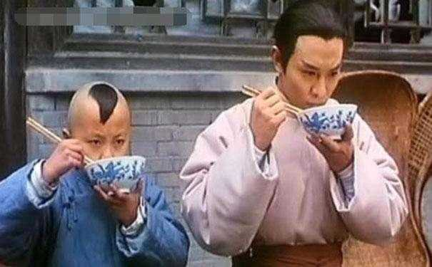
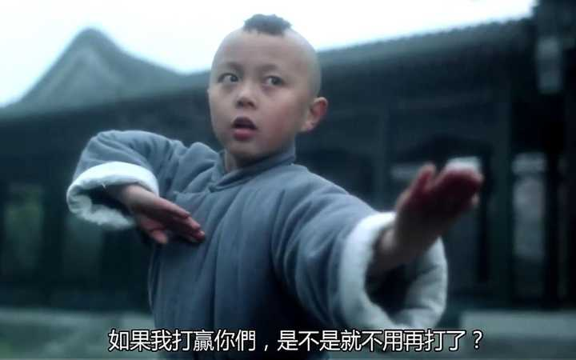
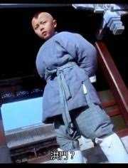
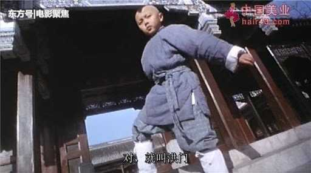
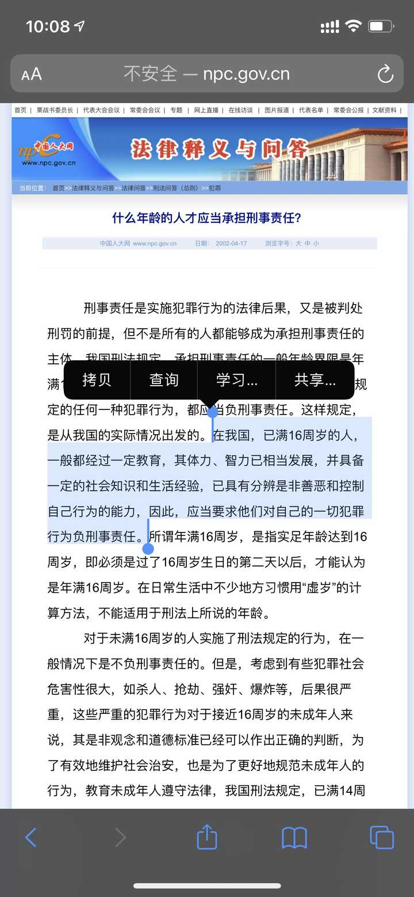
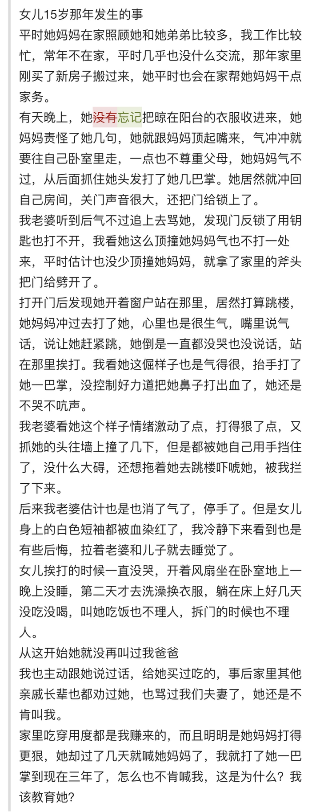
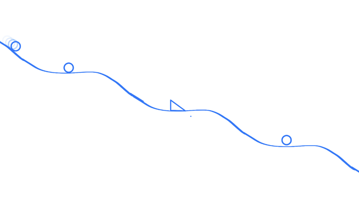

# A05　家庭亲属与代际秩序　第 1 册（共 3 册）

- 专题代码：A05　专题名称：家庭亲属与代际秩序
- 专题界定：父母、子女、兄弟姐妹、亲戚、抚养、放手、赡养与代际继承。
- 本册：第 1 / 3 册　收录 104 篇　正文字符 167,932
- 语料：`sooon-q9adg-articles-v2.jsonl`（4,305 篇）　SHA-256：`cdc9c271309e1d71d9708889a3a31f4777e0c339ea54c3753521894afdb8357d`
- 生成时间：2026-09-27T00:01:00.997126+08:00　排序：发表日期 → 源序号（全库唯一，不重复）

**标记约定**：`【待审】` 主题仍为暂定；`【排除候选】` 图片/正文过薄的剔除候选；
`【正文标注未完待续】` 作者原文自带未完标记；`【正文缺失片段（复核已记）】` 复核记录已确认的正文缺口；
`【图片缺 N 张】` 源图不可获取。标记只作提示，不改写原文、不改动分类状态。

---

## 3990　家里不富裕

- 日期：2018-12-13　主专题：A05 家庭亲属与代际秩序　副专题：A08;A04
- 源 ID：`c6d37a0c-4ca1-55e6-bbe6-23a0c078ddc8`　原文链接：https://www.zhihu.com/question/296333267/answer/551002721
- 官方对象—实践路径：与亲族 / 与子女 / 抚养
- 23 概念标签：事实与证据;定义与达意;能力与学习;责任与后果;成本与总账;照料与家庭;财富与市场;权力与异议;心理与主体
- 证据状态：manual_confirmed　初读：read　独立复核：not_reviewed

**问**：家长要在孩子面前表露出「赚钱辛苦、我们家不富裕」这样的态度吗？

换一个角度，莫非家长要在孩子面前隐瞒家里缺钱的事实吗？怎么瞒？
何谓贫，何谓富？
一百万是贫是富？一千万呢？一亿呢？
很多人没有意识到人生最重大的一种因果倒置——价值判断先于价值观。
一百万、两百万，这是事实，“穷”和“富”却是附有沉重的价值效应的主观判断。这一判断势必要带来价值审判。没有教会小孩价值判断的体系，也没有为子女建立承受这价值判断的心理结构，直接将价值判断的结果丢给ta们，意味着ta们只能依靠稚嫩的心灵强行接纳这个先被规定的结论，将会迫使儿童的心灵自发创造适应机制。其结果常常要到几十年后的婚姻咨询和抑郁症咨询里才被明确的发掘出来。
为时已晚。
这不仅仅是在贫富课题上，还在几乎一切价值观问题上存在。
好人/坏人，能干/没用，聪明/愚笨，优秀/落后……家长们以为只要把自己的判决丢给孩子，孩子就可以自动被判决推动着向自己希望的方向发展。
有几个人能提供坏人与好人的确切判定标准？有几个人能提供“当我被认定为坏人时我该怎么办”的可靠方案？
只有极少数的幸运儿，能自发的凑巧踩中强健的方案，这些人会在将来成为万人瞩目的“教学案例”，被完全逻辑错误的用在“贫穷教育”“富养论”“挫折教育”“鼓励教育”这类蹩脚的鬼扯里面当论据。一万人里出了一个“成功案例”，就能将一种根本没有效力的做法变成一亿人的“肘后千金方”。
悲哉！
无知的家长们以为“既然只有要么不说、要么说贫、要么说富三种选择，那么必然三者之一会是对的”。
这是一个致命的逻辑错误。因为顺序弄错，则三者皆错。在肉都没化冻的时候，是该先热锅呢，还是应该先入油呢？
问题本身就是错的，因此任何答案都无意义。提供再多“案例”，在没有先明确的理解这一点的前提下，都是盲人骑瞎马，半夜临深池。
问题根本不在于家里的贫富状况，而在于有没有给子女建立一个恰当的承受贫富的态度。无论家里贫或者富，你既要能过没钱的生活，也要能过有钱的生活。
不是你没钱你才要学节俭，而是你有钱也要节俭；不是你有钱才要讲体面，而是你没钱也要讲体面。你若不能教育ta拥有一种“富贵不能淫、贫贱不能移”的价值观，那么你教会ta过穷日子，富日子就会对ta构成诅咒；你教会ta过富日子，则穷日子就会对ta构成诅咒。这种诅咒，并不需要对应的情况真的实现，仅仅是自觉贫穷而对富贵病态的饥渴，或自觉富贵而对贫穷病态的恐惧，就已足以发挥它最大的威力。
何仇何怨，你要如此诅咒ta？
作为家长，太少有人在二十几岁生育时就想通了“贫贱、富贵免疫”的价值观，也太少有人在子女价值观成型的三十几岁就明了如何传授这些道理。所以这种饥渴和恐惧的双重夹击才代代相传，造成三世而斩百事哀的悲剧。这是需要几代乃至几十代的家族兴衰起伏，代代积累才会明了的东西。但这些本来最宝贵的遗产，被骤然而起的现代化稀释掉了。
现代人全部来自古老的家族，可惜现代婴儿潮大大的胀破了世家传统所能照顾的范围。无论如何，现在的实情已然如此。现代人普遍的缺少一种基本的认知——人的竞争，首先是家族的竞争，任何不懂得积累家族史的家庭，都是对后代放弃了自己最基本的责任。生与养，只是在延迟你自己家族的灭亡；而立刻开始建立自己的家族史，才是作为祖先最大的责任。无论前几代如何失败，只要你有这个意识，家族不绝嗣（其实你可以依靠养子或者精神继承人），你必将开创一个新的成功的家族。
家族必然成功。
你们不要忘了，你们不仅仅是父母，你们还是新家族的祖先。
回到正题上来，教育的规律——如果你在构建子女的财富观之前，丢给ta既有价值观产生的价值判断、身份认定，你不是在教育ta，而是在将ta本该得到的教育抛弃了。你等于把自己的子女交给在世上横行的魔鬼任其附身——这只要一句“我们家穷/有钱”就能办到。
何仇何怨，竟然要如此厌弃ta？
你自己有一个说得通的财富观吗？请问？
当你自己感到穷困时，你自己的解决方案有效吗？当你自己净资产高涨的时候，你觉得安心吗？你如何确定这份财产是好事，而不是给绑匪准备的奖金？靠高薪聘请的保镖和隐姓埋名吗？
在你想明白之前，不要跟子女说什么穷和富，保守的策略是先教ta们什么是财富、要如何获得财富、财富会带来什么样的正面和负面的影响，如何面对金钱的缺乏和过剩（如果你没有金钱过剩的概念，这是一种能致命的错误）。
在金钱观不明确的前提下，你能做到的最好的结果，就是教会ta贫富的相对性。
那至少在将来能保他的命。
正确的财富观，是要以你的信仰为起点依着坚实的逻辑重新构建的。
你的信仰是什么？你的财富观为什么与你的信仰一致？回答好这个问题，再去教子女金钱的事。
其实，“家里穷”“家里不穷”，都是错的。
如何树立正确的财富观？
家族答集

---

## 3966　原生家庭

- 日期：2019-02-07　主专题：A05 家庭亲属与代际秩序　副专题：A01;A16
- 源 ID：`a5309387-de01-5677-855f-48d265a8d7be`　原文链接：https://www.zhihu.com/question/291784243/answer/591110456
- 官方对象—实践路径：与亲族 / 与父母 / 分离
- 23 概念标签：选择与自由;责任与后果;边界与许可;照料与家庭;技术与工程;心理与主体
- 证据状态：manual_confirmed　初读：read　独立复核：not_reviewed

**问**：如何摆脱原生家庭造成的人格缺陷？

“原生家庭”四个字已经快被“微信心理学”用烂了。
你有一种焦虑，你归咎于一种无能，你将这无能归咎于原生家庭，打完收工。
是啊，都是爹妈害的。都怪ta们呀～
唉。
你们没有看出来这是在利用你们急于推卸个人成长责任的心理缺陷，在贩卖福寿膏换你们的流量吗？
别挑了，世上无完美的父母，句号。
没有人是不受“原生家庭伤害”的。你们能想到的任何一个伟人，任何一个你们所羡慕的人，任何一个“完人”，都是与你们一样“深受原生家庭伤害”的人。
其中恐怕有大部分所受的“伤害”比你还深得多呢。
你和你所羡慕的人的差别根本就不是你受了伤害而他们就没有。

---

## 3933　门当户对

- 日期：2019-05-19　主专题：A05 家庭亲属与代际秩序　副专题：A06;A08
- 源 ID：`110e0b03-7dc0-54f9-944c-06a6d5934753`　原文链接：https://www.zhihu.com/question/320314301/answer/687854449
- 官方对象—实践路径：与亲族 / 与配偶 / 结合
- 23 概念标签：定义与达意;能力与学习;成本与总账;边界与许可;照料与家庭;财富与市场;文明与历史;生态与自然;心理与主体
- 证据状态：manual_confirmed　初读：read　独立复核：not_reviewed
- 标记：`【正文标注未完待续】`

**问**：什么才是门当户对？

好好说一说门当户对的问题。
因为这个问题对中国太重要了。

你们有没有想过，你们中的每一个人——每一个人——有多大的概率是名门之后？
如果你们算过名门世家和一般平民的生育率差异、子女幸存率差异。你们会看到一个很朴素的事实——从数学概率上讲，你的整个祖宗链条里完全没有名门背景的可能性几乎为零。
中国一共只有几千个姓。即使折算掉易姓、自号、在极近的年代归化的成分，这几千个姓里也尽皆曾有过不折不扣的名门。
而且是屡屡崛起的名门，层层叠叠的名门。
你们全部是世家子弟，例外的可能性接近于零。
只是，你们忘记了。
你们曾有历经数代乃至数十代先人的血汗总结出的黄金一般的世家传承、家族经验。
只是，你们忘记了。
你们一忘，就归零了。
多少代先人累世沉浮才明白的教训和禁忌，你们不知道了。只好从自己开始再经历这若干代人的沉浮去重新知道。
是因为你不知道这些，你才失去了“门户”。
你才有与别人的“门不当、户不对”。
你连门户都没有，怎么和有门户的去“门当户对”呢？
不要误会，这不是在说你家不够有钱于是和别的“家资万贯的家庭”不“门当户对”。
对方如果因为这个来嫌弃你，那么你大可以放心——你有机会看着这家人在两代之内家破人亡、曲终人散去。
这样看待门户的家庭，没有资格称“门户”。
那不是你跟ta们门户不对，而是ta们跟你门户不对。
谈得上门户的世家，懂得一种最朴素的道理——财富并不是最难获得的家族资源，传承和韧性才是。
超越自身和时代的胸襟和自觉才是。
你要知道，你自己就是你后人的祖宗，是你自己家族的开创者。
什么叫“门当户对”？——永世长存的家族和另一个永世长存的家族，永远门当户对。一时之间谁盛谁衰，对于永世长存的家族而言都只是次要的、暂时的起伏而已。
这才是讲究“门当户对”时正确的理解——不是嫌你穷，不是嫌你不走运，而是嫌你没有身为一个家族祖宗的自觉。
这种自觉性其实正是谈婚论嫁的基本门槛。你真的迈过了这个门槛，那么明白道理的世家大族不会认为你真的有什么门不当户不对。永生的东西分什么贫富贵贱？
你没这种自觉，那么就不是门当户对的问题，而是干脆最好不要祸害ta人。
你有没有这个身为祖宗的自觉？
什么叫做“身为祖宗的自觉”？你们不妨好好想一想清楚。
你们能明白这是指什么，那么你们与这世上任何一家，都只有对方能不能配得起你的问题，没有你配不配得起对方的问题。
而且真正的世家一定看得懂这一点。
看得到你有建立传承的自觉，对方就明白你这家族是必须重视的存在。
无论现在的势力强弱、一时尊卑如何，与世长存的家族之间只能互相平视。
这才是人人平等的根子——永恒者必与永恒者平等。
三代而亡的“富家”，只是不值得特别关注的烟尘。没有资格得到重视，也没有必要在意。他们彼此间的态度，也最终随着它们的消亡而毫无意义，当不当、对不对，都是虚无。
能成其为门户的，尽皆门当户对。哪怕此时你贫ta富，你“贱”ta贵。
那么，到底什么是身为祖宗的自觉？
（7.9续）
所谓祖宗的自觉，就是不再仅从自身的立场来看待成功，而是把成功看作一种家族事业。
每一代的祖宗都不必力求速成，但要寻求为家族后代更进一步的夯实基础。
一言以蔽之——要求事业，但更要求基业。
代以代继，终有竟时。
一人一代的能力总是有限的，机会总是难得的。世事无常，沉浮不定，祸福难料，因此若是总是存着“一定要在自己这一代当个富一代”的心，不断的心怀侥幸、急功近利，想要铤而走险、一蹴而就，反而往往容易导致久作不兴——你自己如此浮躁，哪里能积累起什么真优势？即使侥幸谋得浮财，家风不靖、根基不稳，这浮财不但不足以为福，反而足以为祸。
这中间最大的问题就在于“每一代人都想要在自己这一代完成大翻身”这种投机策略。这种没有理性的焦虑感驱使着人不断的投机取巧，越是投机取巧失败，后半生为了达成这“目标”就越是要加倍投机取巧。
要么一败涂地，要么侥幸成功，然后把侥幸当作成功之道，加倍下注，直到再次失去一切，还要更加深陷。
以家族基业为考量中心的人就可以轻松的摆脱这种恶性循环。
正确的家族战略，是每一代人都谋求为下一代创造更好的根基，哪怕每一代都只是拱一小卒，代代不息，也终有一天会走到“这一代人想不成功也难”的优势状态。而且这成功水到渠成、自自然然，且因为代代家风的建设积累，这成果足以持久，能循环光大。因着财富可以开枝散叶，将来越发同气连枝，从总体上就更加稳固。
这对于身为列祖列宗的先辈们来说当然也是一种解脱。因为身为创业的先祖，你的任务就不再是在你这一代要如何谋得亿万身家，而只是为家族后代留下可以继承的一份正资产和充分可借鉴的经验教训，以及良好的教育而已。
这是一种朴实的、踏实的、可以追求，不必依赖什么疯狂的幸运的目标。
而且你会发现，一旦你的眼光不再是谋一世，而是为了谋万世，你做事反而容易有定性、有踏实的成果、有同志、有意料之外的帮助——反而比那些憋着心思必需一代成功的人们更容易获得真实的成功。
（7.10更新）
那么你的家族到底以什么为界？
这一点万分的重要——基业所及，即为族人。
不要——再强调一遍——不要以血缘为界。
你的家族要立得住，要把与你基业相关的所有人都视为家族成员，而绝不能仅仅偏向你自己的亲属或者直系血亲。
对志同道合处在同一生态中的平辈爱之如己，对托庇和仰赖这一生态生存并且尽力奉献的晚辈视如己出，这是你这个家族能拥有足够的资源和人才来应对未来风险所绝对不能少的安排。
你越是爱惜自己的子女血亲，就越是要明白ta们需要这些不同姓、不沾亲的兄弟、姐妹、叔伯、姑姨。
同姓族人是不容选择的，即使仅仅从概率上说，也很难支撑一个基业所必需的才智需求。等着每一代都同时出现大量的文武俊才，且绵延不绝，这是非常困难的，也是短视的。
家族必须存在一种机制能有效的吸收外部的人才。在古代，这靠的是乡谊、同僚、同窗、结交、联姻、收养、结拜。
手段繁复，说明古人完全理解这个道理。可惜时过境迁，在现代人际关系原子化、社会伦理个人化之后，原有的对乡党、同学、朋友、结拜兄弟甚至联姻配偶、亲生子女的社会性伦理约束已经几乎崩溃了。
手段几乎已经尽数失效，但问题仍然存在，如之奈何？

（未完，待续）
下面这个集子，对于养成正确的家风都有关系，建议仔细的想想。
家族答集
为什么中国没有出现百年家族企业？而欧美家族企业很常见？

---

## 3918　家族

- 日期：2019-06-19　主专题：A05 家庭亲属与代际秩序　副专题：A08;A04
- 源 ID：`16c53ed9-9140-52ee-b289-d5a0c8eb6ffc`　原文链接：https://www.zhihu.com/question/311787622/answer/721084936
- 官方对象—实践路径：与自己 / 与财富 / 使用
- 23 概念标签：定义与达意;能力与学习;选择与自由;责任与后果;成本与总账;信用与信任;照料与家庭;劳动与组织;财富与市场;文明与历史
- 证据状态：manual_confirmed　初读：read　独立复核：not_reviewed

**问**：购房选择大平层还是联排别墅？

其实都不舒服。
就定位高一些的普通格局小区就好了。看车位比例和物业费就好。
大隐隐于市，莫隐于野。
更好的选择是在衣食住方面安于一般中产阶级的生活形态和水准，只在“学”方面投入重金。“学”是万分花钱的。好的老师见上一面就极贵，能得到一点指点乃至于能建立一些常规的联系，那就更贵。世界上有很多文明遗址和博物馆，对你的家族成员——甚至核心的利益伙伴——是该设定为必须访尽的。为你的后代和核心伙伴买单就是一项巨大的支出。合理的来说，你不应该有很多钱用在豪车美宅上——因为“学”本身是个无底洞。无论你有多少多余的资源，它都是能吃得下的。
你要豪奢，应该豪奢在这种跨越古今中外的文化阅历上，不该豪奢在各种享受性的体验上。这一方面的投入是绝对的正资产，是可以传承百代永远有益于你的家族后代的——实际上再没有比这更高回报率的投资了。
要知道，一代有眼界，正常而言就代代有眼界。
而被抬高的享受水平是千秋万代的负资产。由奢入俭难，不仅仅是指你本人从此入俭难，而是从你开始代代都入俭难。入俭既难，则代代日日一睁眼就欠下一份钱粮。这是无穷无尽的负资产。享受导致贪婪，贪婪催生愚蠢，愚蠢造成疯狂，疯狂指向败亡。到最后欲温饱亦不可得，能不能保首领都未可知。
除此之外，慈善事业对行有余力的人来说是一项经常性事务。
大道理不必讲了，你就记住一句话：一个人能有效的捐赠多少，才决定了ta可以持有多少。这两个有强烈的正相关关系。没有足够的善缘，保不了足够的善财。没有千万受益于你的人替你担忧你的风险，你的财产就不过是强盗的肉票钱和骗子的预期利润。你的子孙不可能在孤立无援的前提下永远胜过无穷无尽的化妆为“朋友”和“亲人”的强盗和骗子的轮番连环劫掠。家资不尽，盗骗不止。家产不是福气，而是祸患之源罢了。
说慈善，不是只指所谓山里的穷苦人家，还首先包括你的团队和员工、你的客户、你的供应商、你所在的社群、你见到的聪明正直可堪造就的年轻人、不遇的逸才、固穷的君子、落难的义人、未起的豪杰。努力提高效率降低成本，不是为了什么利润率，而是为了提高可以独断专行进行慈善分配的资金份额。
“落袋为安”的利润率过高是非常危险的——注意我的用词，不是不妥，而是危险。没有你数十年浇灌的一大群英杰环卫，你的子孙是在劫难逃的。所以不谈任何形而上的道德要义，仅仅从对冲财富天生附带的危害的现实主义角度出发，慈善类支出也是绝对必须的。手指缝捏得不落一颗沙的乍富之人，不但不成其为富贵，反而是一个特别危险、宜客客气气敬而远之的隐患——这也尤其意味着你要当心你自己在别人眼里也是这样一个隐患。
被认定为这样的隐患，你就不可能踏入真正的顶层——那是绝无机会的。而没有机会踏入这样的层面，你的家族就仍然处于不定何时会烟消云散的险境之中。你没有脱出轮回，就永有堕落之忧。而如果一直不跳出这红尘之外，衰败不过是早晚的事罢了。
如果是这样，那么大平层还是别墅都不过是歧路的入口而已。富而能俭，才是平安之相。
至于什么“自高身份好做生意”之类的托辞，最好不要提起。要靠这个才能做成的生意你最好干脆不要做，到头一场空，徒耗青春。
生意生意，和不知道你是谁的人做的才叫生意。从陌生人手里赚到的才是真利润，否则不过是“信用抵押贷款”而已。
不要开豪车，不要穿戴豪华珠宝。
难道你是嫌保镖很便宜么？
什么才是门当户对？
把与家族层面有关系的一些回答集中起来了，以后有相关的东西也会放在这个集子里面：
家族答集
这一段是增补，专门回答评论区里的“人家不过是想舒服一点”：
算一套别墅值1200万：
按一人300万，这个“房子”的价钱够送家族成员4人去美国留学读到博士。
按一人80万，这房子够送家族成员15人去德国留学读到博士。
按一人10万，够送家族成员120人在国内读重点本科或硕士。
按4万每人次，够资助家族成员/下属300次出国游历。以上没算利息，如果算上1200万在这几年里的孳息，上述数字还可以大幅提高。
按年利5%计息，1200万每年利息60万，上海东方文华酒店一天1200，一年44万。你可以无限的住下去，免费享受世界一流的服务。
结果，当事人拿去买了一栋别墅（没算佣人等维护成本），用来自己时不时睡觉——实际上此人多半满世界飞，并不见得经常回家住。
“想舒服”不是问题，也先不谈“厚德载物”，账还是要算清楚——那15个德国博士里有两三个成才，这1200万你也翻几倍拿回来了。
“舒服一点”的代价有没有觉得太高？
更何况，如果你真的去别墅区转一转，就会发现中国99%的别墅主人根本不知道应该怎么住别墅，其实把别墅区住成了加强版城中村——很多人根本没有构建起有效的仆佣团队，倒把自己的家人父母住成了累断腰的清洁工。
而培育优秀可靠的仆佣团队在提高生活水平上的意义要远远的高于买大房子。

---

## 3896　反欺凌

- 日期：2019-09-05　主专题：A05 家庭亲属与代际秩序　副专题：A04;A10
- 源 ID：`f3283eb3-ae1f-5946-9995-2f7f18d3da32`　原文链接：https://www.zhihu.com/question/47471413/answer/814116810
- 官方对象—实践路径：与亲族 / 与子女 / 抚养
- 23 概念标签：能力与学习;选择与自由;责任与后果;成本与总账;信用与信任;爱与回应;照料与家庭;劳动与组织;法律与秩序;权力与异议;技术与工程
- 证据状态：manual_confirmed　初读：read　独立复核：not_reviewed
- 标记：`【正文标注未完待续】`

**问**：当孩子受到欺凌时，是否选择反抗？

说一下欺凌问题。
孩子受了欺凌，父母应该如何教导？
我看到有很多人主张教孩子“打回去”。
这个绝对是错的。
错误点有以下几个——
1）如果造成确实的人身伤害，你将造成非常严重的麻烦。现代法治社会对于可检出的人身伤害处置极其严重。手持武器威胁他人，哪怕并未致伤，仅仅是经过警告不放弃威胁姿态都有可能被击毙，何况真正打伤他人呢？认为小孩人小力弱不会造成什么实质伤害的人，想过一个幼儿完全有能力将另一个幼儿推下楼梯或者推入水池吗？那不但会造成伤害，还有可能会造成致命伤害。并且，养成这样的行事习惯，将来随时可能坐牢。刑法在故意伤害罪上有硬标准（人体轻伤鉴定标准），你可以看看你的孩子将来长大了要是继续这个做派，你晚上睡不睡得着觉。人家言语挑衅，你娃把人家打出四厘米伤口，你娃要去坐牢的——到时候你别怪没人提醒过你。
很多阅读能力有缺陷的人跑来纠正我未成年人打死人都没罪，这纯属于理解能力有欠缺——难道你娃二十岁了就不是你娃了？他在高中“打遍天下无敌手”，“我的爸爸是李刚”，他二十岁出门你怕不怕他随时随地跟人再来一次？
还四厘米不容易打出来？看清楚，那是【累计四厘米】！你跟人打了架，累计四厘米的伤口那么难？你是对二十岁成年灵长类动物在肾上腺素刺激下有多大的破坏力没有概念吧？如果对方有心算无心，自己多摔几跤你就过线了，三年以下有期徒刑。
到时候你有种不要跪地求饶。
2）造成了后续争议，你大概是要力挺子女到底了？那么结果无非胜或负。如果你的孩子动手打了人，你去撑腰且成功的避免了对他的惩罚，那么你自己就创造出了一个新霸主。他随时可能受到新的“语言攻击”，发动新的攻击，等你去兜第二回底。你如果再兜住一回，这就不是新霸主而已了，是霸王项羽了。他难免要以为父母手眼通天无所不能，迟早有一天撞在铁板上。如果你发现了这小崽子是一个麻烦之源，在某一次他动手之后拒绝给他兜底，那么你在他面前信用何在？教他“坚决还击”的也是你，他还击了缩回去让他挨批评去叩头道歉的也是你，情何以堪？
看出来没有，这种剧情发展下去，不管是胜还是败，决策树上所有的分支都指向最终失败。打输了是一种失败，打赢了将来他总有一天会无知的对根本对抗不了的敌人发动攻击，一样失败。你兜底，他变成混蛋；你不兜底，你是混蛋。
不要举例子说什么“我表弟不是这样”，那是你表弟有别的事情教育了他，他没发展成这个最终结果。但你表弟父母当时的决策对他没落到悲惨下场是没有帮助的。摸电门也有幸存者，这跟“不能摸电门”的守则无关。
3）你的子女会被贴上暴力倾向者的标签。
所有的同学家长知道这事之后都会考虑避免子女再跟你的子女交往。无论你认为你的孩子是因为何种正义的理由才动用武力，没有人想让自己的子女天天在他面前去测试他的正义观和判断力。甚至你越“正义”，人家还要越忧虑——回头被你娃打了，还要落一个“道德差评”，谁这么想不开？何况背后还有你这么一个“坚定支持者”，那更招惹不起。
到时候所有小孩都客客气气绕着你娃走，他永远站在无人区的正中间，一身热血无处发泄，而且他也不明白是为什么，你打算要怎么跟他解释？别人都是坏人？咱们自己玩？
还是你最后打算转学？
就算你有钱可以打一次转一次学，我相信你转个几次也没学校敢收了。
即使不考虑这个，场面上赢了，自己却要转学，这到底是赢了还是输了？怎么对ta解释ta的“胜利”？
所以，那类“只管打回去”的处理肯定是错的。
这种处理曾经正确过——但那是在好几十年前。那时候社会暴力程度普遍很高，别说打架是家常便饭，甚至即使是故意伤害，乃至于产生伤亡的暴行，也不罕见。毕竟战争才刚过去不久，社会治安近乎于半散养。在没有秩序的前提下，直接自卫是有效——即使不是最有效——的手段。
但要注意，在遍地监控、社会安定、法度严密、警力可以聚焦在少数伤害案件的时代，再教这种“直接武力反击侵犯”就是送子女入火坑了。
然后我们来谈论对付霸凌问题的总体策略问题。
怎么能战略性的对抗霸凌的威胁？
这要从霸凌者的天然缺陷说起。

第一个要害——霸凌者势必欺软怕硬。
他自己作为霸凌者时知道被欺凌者有多惨，他就对比他强大的存在就有多少恐惧。事实上，霸凌者对弱者的残酷，常常是从欺凌他自己的霸凌者身上学来的。他欺凌弱者的冲动，常常是一种“别人偷了我的自行车，我也要去偷另一个人的自行车”式的冲动。
这就意味着他内心深处必然知道霸凌的规律——要优先欺凌“安全”的对象，也就是最容易下手的对象。
这就意味着，你需要某种原因使得你在安全榜上不能垫底。
有两个路线可以对此作出保证——
A）果有什么团体愿意为你共同对抗暴力侵扰，你都一定至少比那些没有团体愿意分担威胁的“散人”更安全，
B）如果你自身的武力比其他的部分人更强，你也比那些人安全。
这就是为什么会有很多案例说“打回去很有效”。因为“打回去”可以占住第二条。
但是事实上，真正切实可行的、应行的，是第一条路。
为什么是第一条？
因为霸凌者之所以霸凌，往往不是凭着一己蛮力，而常常是拉帮结伙，仗势欺人。你个人的武力再强，也胜不过一个哪怕很小的团伙。或者哪怕你其实武艺超群，这个自认为强大的团体却可能不能正确的估计你的战斗力，而仍然把你视为可选的对象。
要知道，霸凌者的一大危险性来源恰恰就是他们的愚蠢。他们并不总能正确的评估武力排行，也并不总是有成熟的策略——他们也可以采取另一个非常愚蠢幼稚的策略——在自信能搞得定的目标对象中，先干掉那个最难搞定的来“立威”。
所以除非你上小学时就血盆大口、肌肉虬结、面带金印，否则这帮蠢崽子们很可能不识货，不知死，发生江湖悲剧。
所以第二条路仅仅能带来非常有限的安全。
而明确的存在一个团体愿与你同生共死，哪怕只有两三个人，也已经很足够让对方三思了。
那对你将会安全得多。
而且上天其实早已为你安排了出路——但凡存在霸凌的地方，也就存在欲抱团抵抗霸凌的极其迫切的需求，存在有所作为之机。
这种迫切的需求，常常是来自同被欺凌者的共同的彻骨仇恨。这种对霸凌者的仇恨的驱动力，要远远胜过霸凌的快感对霸凌者的驱动力。
这不是任何人的安排，而是天定的规律。
哪里有压迫，哪里就有更强的反抗的动机。这个动机背后，总是存在组织起一个互助团体的可行性。
讽刺的是，这常常是一个新的霸凌团体的崛起过程。
作家长，你如果不有效作为，则孤立的子女几乎必然走进这三条路中的一条——
第一条，彻底懦弱，逆来顺受，并对暴力发生既愤恨又崇拜的情结。将来他会以亲密关系为诱饵和条件，折磨那些因为爱而放弃了对他的防备和抵抗的人，并最终驱散自己身边的爱，悲惨终了。为什么他不会以自己的暴力为凭借去品尝那残暴的美味？因为他已经懦弱到即使身强力壮也不敢动手。只有爱他的人才会让他放心大胆的一展夙愿，欣喜享受。不要以为你肯当受害者，你就一定会有“好报”——上天并不喜爱、而且是诅咒懦弱的。
第二条，他打了回去，并且成功了。从此埋下了对暴力的信任。时时刻刻都端着一把尖刀，随时准备在各种意义上对自己觉得“不公平“的“进犯”“打回去”。
当他想要寻找“进犯”，则“远犯强汉者”可就每天都有几个了。他会告诉自己要“心怀容忍”，但是请放心——人就是有地藏菩萨般的耐心，也顶不住天天有各种人不停的“变着花样进犯”。最后除非另有奇缘相解，他将会变成一个“忍无可忍，无需再忍”，然后自认为正义的“报复”了“冒犯者”，然后被断然从各种组织中除名的放逐者。
他要是打回去打失败了，那就要么会进第一条路，做个懦弱者，要么会走第三条路。
第三条路——趋炎附势，以逢迎贿赂换取强者的保护。
也就是自己入了某一帮派。
因为人类若无特殊的启示和指引，这种暴力帮派会是几乎毫无疑问的常态。这是单凭少年的本能就会自组织、自稳定的常态。他们可能下意识的会在口头上尊奉某种所谓的“侠义精神”，但在事实上，不过是自欺欺人的低效率的另一个匪帮。
因为要维持正义的属性，是一种极其困难，只有历尽沧桑的成人才在某种运气赐予的际遇下才能领有的智慧。指望它自然出现，是要经过多少代无效的互相攻杀，最后在某一代靠出现罗密欧朱丽叶式的大彻大悟才能升华出来的奇景。
你只有这么几个娃，你不能指望他们自己从江湖上领悟，所以他们最大的机会，就是你自己对正义的力量有认知，对正义的技术有造诣，可以引导你的孩子凭着有效的信念和深思熟虑的策略去获取对霸凌者及其团体的优势。
这是唯一在逻辑上有长期正效应的策略。也是唯一正道。
而且微妙的是，这是培养未来的领袖的最好的家庭教育。你的子女能做好这孩子王，或者学会识别、连结孩子王，这两种技能在将来都是无价之宝，胜过任何所谓的专业技能、丰厚遗产，是他们安身立命最决定性的保障。
这才是真的为他们求了一条生路，而不是为了让他们避开一种伤害，用另一种发作期更远一些的伤害来代替——甚至更糟，拿一种“我已经尽力了”的借口搪塞。可悲的是，绝大多数家长们的所谓对策本质上就是这样。
那么，这条路具体要怎么走？
第一，一切的关键，你要有可输出的价值。
人在这个世界上有一种天然的责任——要拥有提供价值的能力，要有利于他人生存的能力，利于他人实现自己理想的能力。
你是否使用这个能力是另一回事，你是否使用这个能力去向他人输出利益，又是另一回事，但是你必须要努力追求拥有这样的能力。
有这样的能力，你才有了基本的社会地位的基础。你才会在客观上被认可为一名有棋可下、有牌可打、有注可压的局中人。
一个只知道追逐快感，毫无这种使命认知的人，也就很难拥有这种能力，于是终究只是他人的棋子。
在这里，我认为一名家长是可以考虑自己为子女提供一定的支持的——有乐于支持自己对所处集体做出贡献的父母，本身是一种可以利用的优势。这也许不够政治正确，但却是切实可行的——除非你子女所处的环境有某种明确的禁令禁止父母提供这种支持。
第二，你要有计划、有策略的将自己的优势转换成某种公共服务。
你的成绩好，那么就搞一个小补习小组或者互助小组。
你的体育好，那么就搞一个班级球队或者田径队。
你美术好，那就去帮同学画圣诞贺卡……
你什么都没有，你哪怕只有父母每个星期给你的社交经费，你也可以每周体育课后请同学们喝汽水。
注意，到这一步为止，我可没有教你们说这是“为了不受欺凌”。
这样做是无条件的。
没人会欺凌你，你也要这样做；有人正在欺凌你，你也要这样做；有人因此特别抹黑你，你也要这样做。
这不是为了“打造不被欺负的基础”而做的投机行为，而只是一个人应该要做的事，一个人应该有的行为模式。
无论如何，要拥有能力。
无论是容易做到，还是不容易做到，都要拥有能做事的能力。
无论是被善待、还是被恶待；无论是被公平对待，还是被不公平的对待，你都要拥有能做贡献的能力。
无论如何，要对自己所处的环境产生建设性的影响。
无论是不是被承认，无论是不是被奖励，无论是不是“得不偿失”，无论是不是“值得”，都要对自己所处的环境产生建设性的影响。
身为父母，最重要的是要坚定不移的贯彻这样的价值观和人生观。
在贯彻这种人生观和价值观的前提下，再去谈如何明智的决策、如何趋利避害、如何将本求利、如何腾挪闪转。
你要记住，那些机巧、策略根本不是最难的部分，也根本不是最有力的部分。很多人错误地认为人生的“力量”在于那些机巧、策略，其实根本不是。
真正有力的是这个最根本的价值观——“我要有能力，我还要以这个能力对周围发生建设性的影响。”
作为父母，自己要把这个作为做人的基本原则，并且要把这个信条作为子女们理所应当奉行的人生观。
无论环境如何、无论别人如何，我都要争取有这种净输出的能力。无论结果如何、无论环境如何，我要这样做。我绝不做那种“因为有了我，事情变得更糟糕了”的人。
“哪怕再轻微也罢，事情应该因为有了我而变得好一点。”
怎么定义“好了一点”，这个问题的确很深奥，需要你一生去反复追问，但你领悟到哪一分，你就去做到哪一分。将来觉得现在荒唐，那是将来的事，不是现在不实践这个原则的理由。
“因为有我，这事可望会变好一点”——就是人类所可以有的最高贵的追求。这个立足点，是无论如何强调都不过分的。
为什么在这里我们要浓墨重彩的谈这样的“理想主义”？因为这一点自觉就是反霸凌最重要的根基。
在最低的层面，最“机械阴谋”的层面，这个道理很简单——任何一个社会团体都会避免攻击基础公共服务的提供者。参与提供某种公共福利，无差别的惠及所有人，这种位置就是天然的避风港。
举个例子——再残暴的恶棍，也不会随便屠杀医生护士。这跟他们是否残暴无关，而是跟他们的可持续性有关。如果他们残暴到攻击医生护士，那么他们势必会自己刺激出极其强大的对抗者——那些不能容忍医生护士受攻击的人们。于是，拥有这种可以像他人输出福利的能力，并且积极地去构造这种福利，你就天然的受到了组织行为学规律的保护。
人类是一种社会性动物，对攻击公共服务提供者的人生成的义愤是不需要教授的。对攻击这类人的禁忌本能也是天生的。只有反社会人格者会因为心智发育上的障碍才会对此比较迟钝。但毕竟这类反社会人格者的发生率客观上是不高的。
第二层，就是你掌握了某种服务，而且这种服务有一定的质量和确实价值，那么作为它的主要提供者，你就客观上掌握了某种影响力。要知道，这种服务是你主动提供的，没有任何力量可以强迫你必须继续提供，也没有人有立场可以强迫你如何提供。你自然会经由拒绝提供服务的能力拥有一种客观的、天然不可剥夺的权力。任何恶意攻击你的人，都要顾虑你会切断对他和他的支持者的供应，也要顾虑你的支持者对他们扰乱这项服务所产生的敌意。
有我，你们才有这个，没我，你们就没有这个。如果我提供的东西无关紧要，保护我的力量自然也不痛不痒。我提供的东西至关重要，保护我的力量自然也就强而有力。
如果你退后一步，你会发现这就是人类在群体中获得权力的天然机制。只要是人类，就受这法则的无条件约束。这也可以理解为内化在客观世界中的对“人一定要拥有建设性的能力，并且要做出建设性的作为”这条绝对命令的一种奖惩机制。
你照办，你就在规则的羽翼之下；你不照办，你就自然而然更多的暴露在霸凌者的威胁之下。
提供公共服务者享有豁免，而且享有主动权。提供的服务越关键，豁免越有力，主动权越大。
那么，如果你没有这么强的能力，无法提供什么关键的公共服务，那要怎么办？
其实你错了，你能提供的关键公共服务总是有的。
你只是需要转变几点想法。
首先，并不是只有制造冰激凌的人才在提供冰激凌这种服务。造冰激凌车的人，冰激凌车的司机，也都是冰激淋服务的提供者。你也许不能独力的创造一种服务，你也往往可以找到某个角度为某个服务提供进一步的服务。只要你找到方式提供你的价值，你就会得到一定的社群权力，也就会变得比较安全。
（未完，待续）

---

## 3895　恶之花

- 日期：2019-09-08　主专题：A05 家庭亲属与代际秩序　副专题：A09;A15;A11
- 源 ID：`f9472f2a-707c-5674-bd9e-0690fd8ae3b3`　原文链接：https://www.zhihu.com/question/344233918/answer/816769552
- 官方对象—实践路径：与亲族 / 与子女 / 抚养
- 23 概念标签：事实与证据;能力与学习;选择与自由;责任与后果;信用与信任;爱与回应;照料与家庭;财富与市场;法律与秩序;权力与异议;技术与工程;心理与主体
- 证据状态：manual_confirmed　初读：read　独立复核：not_reviewed

**问**：我妹妹画这种画怎么办？

这里大多数的观点都是“好好”“没事”“没关系”“一点毛病没有”“是好事不是坏事”“要珍惜艺术天才”。
你们是觉得一切都是跟你们有关吧？就因为你们自己喜欢这个却只能偷偷摸摸，现在跑来借题发挥以为是在“拯救后辈”？
反正你们不需要为任何事情负责，抓住了机会群体狂欢才是正经，是吗？
我直接把话放在这里——
第一，对应该引起人类恶心和反感的东西无感甚至迷恋，本身的确是心理变态的征兆。
你们真以为人类迷恋腐烂的尸体、溃败的皮肤、支离破碎的残肢、蛆虫、粘液、畸形，是一种酷事，是一种可以让你们觉得自己很特别、觉得自己是某种“天选之人”甚至某种“勇士”的好事？
那么人类是怎么发展出对这些东西反感的本能的？
看到粘液、腐烂物、病变皮肤、畸形不本能反感而回避的，在这几百万年里基本都死绝了。失去了这种本能反感，反倒觉得很自豪？
这就像在炫耀自己尝不到味道、看不见东西。有什么可骄傲？

第二，对于会引起家人严重反应的事务淡定自若的继续，这是反社会人格的迹象。
无论家人因为什么感到恐惧万分，也无论你自己觉得这种恐惧是否合理，正常的人都会有所顾虑、有所纠结。直接继续是一种非常残忍的行为，也是社会化过程有重大缺陷的表征。
是不是有问题、是什么问题、要如何纠正，需要进一步查探。但这位作者需要深切的诊断和干预是毋庸置疑的。
只不过诊断的结果要改变的未必是作者本身，而可能是作者的家人罢了。
至于说想走“恐怖的艺术”路线，用艺术性为之辩解，为之争取“创作自由”，想要呵护“艺术萌芽”的人们。你们想做这种艺术家尽可以自己去走这条路，不要把自己的需要投射到别人身上。被监护人走什么路，监护人才有权决定。监护人认为这条路不好，就有充分的职权去依照ta自己的价值观进行判断和实施。除非ta做了什么法律不允许的行为，否则没人有资格依据自己的喜好和价值观去压倒监护人的价值观。
不要拿着日本或者西方有且昌盛的东西就当成肯定是好东西。能取得“市场成功”广受欢迎并不意味着这东西就有理所当然的正当性——海洛因、芬太尼那么极力禁止，仍然广受“欢迎”，在市场上成功无比，是不是也要提倡一下？要是出现一个小孩非常痴迷种大麻——这在加拿大和荷兰不但合法还是门大生意——是不是也要呼吁保护“农学家幼苗”？
答案是的确有问题。
第一大的问题，是到了现在这种程度才发现。意味着在受监护人的信息掌握上存在机制性的缺陷。这个对现代人是一个大问题——现代的小孩大部分时间都是在父母视线之外活动，要想知道ta们到底在做什么、在想什么、成长上的变化，的确对没有受过专业训练的父母来说是一个非常困难的挑战。但作为父母，也没别的退路，只能再想想办法。
其实说穿了也不足为奇，无非是做子女在世上最可信任和最希望得到指导意见的人。但真要做到这一点千难万难。
可怜天下父母，面对的都是一个不可能百分百完成的任务。方法我可以一条条说，但是哪一条方法都要求近乎专业的能力，实在不是凡人都能做到的，所以只能尽人事，安天命。还在世界上的事情，本来就不是人类凭借自己的努力做到，而是上天看在你努力的份上伸手赐予的。
第二大问题，是这孩子可能缺少社会地位，所以可能想要借小众的惊人行为博取关注。
这是一条非常危险的路。无数的恶之花是从这条藤上结出来的。这是一个人生观、价值观问题。现代人常常没有永生信仰，于是需要大量的外部信息来确认自己的存在。关注即为存在的证据，失去关注如同死亡。这是一种永远填不满的毒瘾，没有回头路。不治好这个毒瘾，将来就总会有人乘虚而入，借助关注的施舍而操控ta的人生，达成实际的奴役。
人不应该去追求这种关注，而应该有别的价值依托。即使默默无闻也不会动摇的幸福才是真实的幸福，才不会沦为被名利俘获奴役的诱饵。
可惜，这一条也是现代性大难题，只能祝父母们的努力得到上天的垂怜。
第三个问题，是孩子可能对父母有报复心，因而父母的痛苦不但不对她构成负担，反而构成一种奖励，成为一种行为的动力。
这一条就只能父母自己去梳理寻找。有可能是子女的价值观体系有问题，根据那个体系，ta们在判定父母有罪——判定了有罪，那么这些折磨不过是正常的惩罚而已，自然没有心理负担。也可能是父母自己的确有错，超出了子女能谅解的限度。
无论怎样，这里存在值得花心思寻找的问题。
为父母至难，乃至于迷茫不知出路，但还是那句话，本来成功就不来自你的能力，而是来自被你绝望的努力所感动的上天。
担不担的起，这终究是你的责任。
小孩子们别狂欢了，这些话根本不是写给你们看的，是写给父母们看的。
知乎不是只有你们存在，你们根本不知道自己在说什么。现在你们一个个都嘴硬得很，将来去面对真正的人类社会，有你们知道真相的时候。

家族答集

---

## 3865　废没废

- 日期：2019-12-26　主专题：A05 家庭亲属与代际秩序　副专题：A04
- 源 ID：`3d075c9c-05f2-59ea-a35a-6f59dd033d4a`　原文链接：https://www.zhihu.com/question/360327798/answer/950494273
- 官方对象—实践路径：与亲族 / 与子女 / 抚养
- 23 概念标签：能力与学习;选择与自由;责任与后果;成本与总账;爱与回应;净输出与不掠夺;照料与家庭;劳动与组织;法律与秩序;权力与异议;宗教与自然法
- 证据状态：manual_confirmed　初读：read　独立复核：not_reviewed

**问**：已经被养废的孩子，还有救吗？

首先，这个问题，学生们就不要回答了好吗？你们只是在代入角色后告诉别人你们自己想要得到的待遇，对提问者没有任何特别参考意义。就算你们真的得到你们想要的待遇，又有什么确实的依据说明结局一定是花开富贵的大团圆呢？更不用说客观条件压根就未必够满足你们想要的待遇——这个等你们自己自立自足，乃至于为人父母之后才会明白。除非你是豪富之家，否则养育他人的资源对一般人真不是小事，不要自己不觉得父母有多累就真的以为“我觉得没什么”。
在教育所需要的那个清单面前，绝大多数普通人的能力和资源都是苍白无力的。
说句坦白话，教出来的孩子不反社会、没有犯罪倾向，身体基本健康，有基本科学知识和社会常识，就算教育及格了。把期望设定得高于这个水平，都是很有勇气的做法，可以令人钦佩和同情的了。
唉。
然后，我们说点有实际意义的。
首先这个问题就问错了——废与不废，非人所能言。
不管是身为父母也罢，身为教育者也罢，身为旁观者也罢，永远要认清一个事实——你最多有权说“这种情况我不知道如何扭转”，这是且的确是你有立场下的判断。
但“我不知道如何扭转”，完全不能等于“这人没有希望”或者“这人废了”。
你一步从“我觉得这人的情况糟糕，而且我完全看不出有什么办法扭转”跳到“这人废了”，就等于首先自命为主宰天地的神了。
你觉得没希望，于是这人就没有希望了？你没有办法，于是这人就废了？你是世界之巅吗？你是命运的主宰吗？
你这样喃喃自语，乃至于向人声言，本质上只是下意识的想要获得他人的“免予起诉”判决——“我不是不想尽责，只是我的努力没有用，没有意义，所以我才避免了无谓损失。所以我没做的努力，你们都不能怪我。你们想要怪我，就先要自己指出有用的方法。但凡你们自己说不出有用的方法，你们就没资格说我。”
每一个口称“废了”的人，有一个算一个，没有一个能逃脱这责备。
如果你是有信仰的人，那么从这里你就要知道，仅仅你这个自封为神的行为本身，已经诅咒了你可能做过的一切努力，将这些努力的结果指向恶的方向。
如果你指望你的努力真的得到上天祝福，那么你能做的最基本的改变，就是停止因为你自己束手无策就去断言“废了”、停止“为了逃脱世人对你的责备而宁肯犯这种自封为神的罪”的蠢行。
仅仅只是停止这样做，就能首先获得最基本的祝福，就能改变你所做的努力对对方的影响的基调。
你的实际行为可能完全没有什么变化，但是这行为所造成的影响就会发生变化。不信你自己去试。
你首先要改变的，就是“一定要有有效的期望，我才有动力去做些事情”的基本行为逻辑。
什么狗屁有希望没希望？我们人类算是什么牌面的东西？我们没有能力控制明天发生什么事，哪有资格谈一个东西到底有希望没希望？你自己觉得有希望，那是假的，明天天知道发生什么你根本控制不了的事一下让你的希望变成笑话；你觉得没希望也是假的，谁知道明天发生什么事就会一下旧貌换新颜？
你要做这件事，是因为某种原因天降了这个责任和义务在你身上。你不要问什么后果，不要问什么希望，你就量力而行的尽量去做，就是这样。你不要想着不见兔子不撒鹰，不要想着“有什么好处”。你只要想着这些，第一你会发现客观上你其实啥也没省掉——该出的你还是要出，别人要责备你还是要责备——本来可以有的效果却被这个态度毁掉了。
世界上的事情就是这么奇妙，不信你可以再花半辈子去试，试到你自己服气为止。
换句话说——少想对方“废”或者“不废”，你觉得你可以做点什么可能会有帮助的事，你就去做。然后你量力而为，不要付出你付出不起的，免得自己后来又横生怨念——生了怨念，得的就反而是负分了，还不如一开始就不要打扰对方，也不要去贪图这份“功德”。是的，这里最大的危险其实是你的动机是想贪这份“好人”的功德。
你能站稳这个敬畏、谦抑的立场，那么你做什么都可以。做什么都会最终会有好的果效。区别只是这个效果会在什么时候、在什么事情上发挥出来而已。
先站稳了这个“无害有益”的立场，你所做的一切才有了最基本的“帮助”的性质，然后再谈帮助的效率问题、大小问题。这一点你都站不住，那么你的努力首先都还不好说到底是帮助还是伤害，劝你还是先坐稳了想清楚再说。
以上这一点，适用于一切想要做点教育、甚至想要对任何人施予任何帮助的情形，只要你是一个人类，这条基本法则就适用。
然后再谈到底具体应该做什么。
这取决于你自己所受的训练和你自己所拥有的资源。
但我可以给你一个永远不错的总原则——立足于增进他人的选择空间。
无论你做什么，如果最后的根本性质是你增加了对方的选择空间，这种行为都可以定性为帮助。
“如果你想上大学，我可以帮你解决部分学费”——这种就是增加了选择空间。
“我给你学费，你要给我努力去上大学，不然对不起我”——这却是剥夺了对方的选择空间。
如果你不知道应该怎么办，你就多想想这个问题——我的所作所为，是增加了对方的选择空间，还是剥夺了对方的选择空间？
这里存在两种情况：第一种是纯增加的，那么这种你就不必有什么大顾虑了，只管去做。这大概是一些不附加任何条件的帮助。
第二种是存在机会成本的。比如我可以教你绘画，但是这就要挤占你的学习时间。我可以带你去旅游，但你去了东就无法在西。这一种，如果你足够幸运，不是对方的监护人，你就可以依赖于对方的自由意志来解决问题——机会成本让对方（或对方的监护人）自由选择要不要付出。你不要去强迫就自然在红线之内。
只要你守住这个原则，就不必过于顾虑到底做得对与不对。
原理很简单——你也这样做、其他人也这样做，则你所想要帮助的对象就会多出大量的选择余地。任何人只要有了更大的选择余地——尤其是出现自己没有想到还存在的选择余地——无论ta是否真的做了这样的选择，ta对生活的信心一定会增强。
对生活的信心增强，强到一定的阈值以上，就能根本的改变人的行为方向。
绝大部分青少年（乃至于人类）的问题，都是出于绝望——因为他们对生丧失信心，他们就会转而去寻求享乐的死。
他们需要的不是“帮助”，他们需要的是生命。
你首先要传递给他们的，是生命。
何为生命？
生命的本质，是可能性的总和。
站稳了这第二条，你就必然已经给了对方最根本的帮助。如果你这样的人足够多，那么你们所帮助的对象就有可能弃死向生。
一旦弃死向生，求生的决心就能点燃人内在的引擎，启动人与世界的良性的互动循环。只有在这个循环之中，一切外部提供的资源才不会被拿去变卖换取快感的毒品。这些资源才有可能造成善果，而不是給得越多，毒害越深。
在这第二层再往上，你也得了你的自由——从这里开始，你做什么都是对的，从心所欲，而不逾矩。
且必得赏赐。

以下这一段是专们说给基督徒看——神爱世人，神对世人的爱就是爱独一无二的绝对示范。而神对人的爱最可确认的一点，就是神赐予人生命。生命的本质就是可能性的总和。因此，增加他人的可能性，必然与神的爱同心同向，因而也同质。从神学上说，这是最有希望可称为爱的行为法则。也是你希望任何人真的得到益处时，你可做的最安全的选择。而爱首先并不是你所打算去做的那些“工作量”，它首先是你对对方的安全所抱有的这深深的忧虑和考量。有此顾念，你所做的才被加持为爱，其后果才会得到祝福。是靠着这种祝福，你身为人类所必然有的种种愚蠢、傲慢和不自知的邪恶才被上帝仁慈的安排无声的挽救，你的行为才有可能化为对对方多少有用的真正益处，你也才有可能能承受你行为所必然导致的对方的痛苦和损失。对方最终所得到的益处，其实根本不是来自于你的“工作量”，而是来自于上帝对你以行为为祭礼而行的祈祷的回应。你所贡献的东西，于对方真正做得的结果而言是微不足道的，就好像你请求了工程师，而这工程师便帮人盖了一座桥。这桥的成本显然绝不是你拜托工程师时送上的酒水和红包。这荣耀当然要归于工程师，而不是你。对于基督徒而言，这才是人间一切善行的基本原理。从这个意义上说，基督徒并无所为的善行。你施舍也罢，行医也罢，办教育也罢……这些事情的本质都只是以“工作量”为祭礼的祈祷。它们的一切结果，都是来自上帝对你祈祷的回应。因此一个基督徒是没有任何资格自称施主的。任何自称施主、自居“有功”的行为，都是从本质上背叛了信仰本身。
祈祷祝各位圣诞快乐。

---

## 3858　宁信外人

- 日期：2020-01-07　主专题：A05 家庭亲属与代际秩序　副专题：A06;A03
- 源 ID：`f8a15d4a-3780-59fe-9163-89deeeac2762`　原文链接：https://www.zhihu.com/question/364078816/answer/966149690
- 官方对象—实践路径：与亲族 / 与父母 / 分离
- 23 概念标签：选择与自由;责任与后果;成本与总账;信用与信任;边界与许可;照料与家庭;法律与秩序;权力与异议;文明与历史;宗教与自然法
- 证据状态：manual_confirmed　初读：read　独立复核：not_reviewed

**问**：为什么很多家长，宁愿信外人，也不信自己的孩子？

大部分时候，他们不敢信的，不是孩子，是那个相信孩子的自己。
他们怕那个自己说“信任”是为了偷懒，怕这样会害了孩子。

剩下的大部分时候，他们不敢信的是一个不必对自己的任何决策负最后责任的人——他们知道，追根到底，还是要负责兜底。
孩子无论成年未成年，中国的父母都从未觉得自己可以不必负责到底。因为这个“错误的认知”，他们不能不持有两点立场：
1）自己有不信任的权力
2）享受兜底者，必须付出足够的努力去赢得信任，而不是直接要求信任。作为一个被兜底者，这样要求在本质上是站不住脚的。
为什么宁肯信外人不信你？因为外人乱来要承担全部责任，就算法律惩罚不到，你父母也不是吃素的。
你不用承担责任。
实情是，任何一个人其实都有无数违约的记录，只是自己意识不到。面对陌生人，陌生人是一无所知的，还可以给你benefit of doubt。你父母却有几十年时间去知道，而且他们都记得。以这样的记录，换了任何一个陌生人，大概连面见说话的资格也没有。
而你似乎一点也没意识到你欠了多大的信用坑，需要先填平才有资格腆着脸要求信任。
糟糕的是，他们似乎也没意识到。也许是知道，但不忍心跟你说吧。

把这两条都去掉，在对待已经自力更生、自负其责的成年子女时，才能谈到“父母不信任我”到底有没有错。
那么面对成年的子女，父母还是相信陌生人胜过亲生骨肉，有没有错？
当然有啊，他们没能及时改正老习惯，简直该死，对吧？

---

## 3852　善良与现实

- 日期：2020-02-08　主专题：A05 家庭亲属与代际秩序　副专题：A01;A03
- 源 ID：`e2f378a3-e400-59a8-82ca-20742b8718fa`　原文链接：https://www.zhihu.com/question/368072674/answer/1004368777
- 官方对象—实践路径：与亲族 / 与子女 / 抚养
- 23 概念标签：事实与证据;能力与学习;成本与总账;信用与信任;边界与许可;财富与市场;权力与异议;文明与历史;心理与主体
- 证据状态：manual_confirmed　初读：read　独立复核：not_reviewed

**问**：假如你以后有了小孩，是教他善良，还是让他变得现实？

这个问题很妙的地方在于，它是从二楼问起的。
它前面掉了一句“如果善良与现实利益不可兼得”。
在人生中的大部分事务上、大部分时间里、大部分场合下，善良与现实都没有矛盾。
举个例子，提供名实相符的产品给客户，既善良，又现实。
努力教育学生取得好成绩，既善良，又现实。
不轻易中伤ta人、不传播自己未核实和不打算负责的信息，既善良，又现实。
努力学习，既善良，又现实。
友善对待ta人，既善良，又现实。
……
你一直数下去，你就会意识到这个问题在大部分时候、大部分场合下、大部分事务上，根本不成其为问题。
更进一步的说，如果在这大部分时候、大部分场合、大部分事务上都真正的做好了，你将不可避免的拥有相当多的朋友、信用和自己都不知道存在的善意的资源。以至于当你真的面临善良就要受损的时候，只要损失不大，你就亏得起。而且是在几乎都没有痛感的前提下，你就已经能忽略不少小亏损了。
马云吃一百万的亏，大概都不会记得。
其实，我们为什么要竭尽全力的努力奋斗？
为了不要落入“善良不起”的境地。

那么，“停止善良的红线”在哪？
是还剩一百万的时候？
还是还剩五十万的时候？
还是净资产为零的时候？
还是负债二十万的时候？
还是负债一百万的时候？
问这个问题的人，其实真正想问的是，“能不能把出卖善良变成一种盈利方式”。
所谓的“能不能”，实质上是在征询一种伦理理论，可以消除这样做的良知负担。
也就是在找切除良知的手术方案或者至少麻醉良知的无长期副作用的麻醉剂。
不用找了，人类之所以能结成一个社会并且正常运转，就是因为良知是一种与人类精神健康绝对绑定的强制机制。
良知失灵，人将会失去正常社交的基本功能，甚至有效推理的逻辑思维能力。
识别这种失灵的迹象，并且远远的回避之，是人类所有成员从社会竞争的代代遗传筛选里获得的强烈本能。而你身上会约等于一直有个小红点在闪。
你听到没有，嘟——嘟——嘟——
“不是宝剑在嘟，是你在嘟。”
就是因为你听不见宝剑在“嘟——”，我才“嘟——”给你听啊！！

---

## 3835　内务班底

- 日期：2020-03-01　主专题：A05 家庭亲属与代际秩序　副专题：A07
- 源 ID：`575a9421-ccab-5ddf-8fb1-0ce68be1c799`　原文链接：https://www.zhihu.com/question/68780501/answer/1047183701
- 23 概念标签：能力与学习;选择与自由;责任与后果;成本与总账;信用与信任;爱与回应;边界与许可;照料与家庭;劳动与组织;权力与异议;文明与历史;心理与主体
- 证据状态：manual_confirmed　初读：read　独立复核：not_reviewed

**问**：该不该把保姆当家人看待？

这是家族系列的重要的一篇。
这里，我要先谈论一个基本概念——内务班子。
如果你的家族还只是在第一代，那么你目前还谈不到这个概念。
但如果已经是第二代第三代，你势必已经要面对过于复杂的政商关系和家庭关系。这个时候，你几乎必须要有能足够信任也足够得用的两套班子，一套内务班子，一套外务班子。
外务班子另外谈，今天先说内务班子。
内务班子，是对你的家务事、个人私产负责的一群人。包括了保安主管、私人会计、私人律师、私人医生、私人科学顾问、以及私人管家。
而这里这个“保姆是不是能当成家人”的问题，其实是这个私人管家的职权。
答案是不言而喻的——当然不能。
这只是一个你观察你的私人管家是否称职的窗口。保姆过线，管家就受训斥甚至安排退休。
但是注意——是退休，不是“解雇”。
解雇内务班子的成员是大忌，选择了就是性命相托，没有“分手”可言。可以下野、可以退休，但是你必须要保证对方的一份平安喜乐。这是上对下的忠诚。你没有这份忠诚和觉悟，内务班子成员就必然有自我保护的本能。他们自我保护起来，大出血的一定是你。
而从另一面来说，既然你已经明了内务班子一旦选定就是终身“雇佣”，只能荣休，不能再“解雇”，你就要明白这是何等的重器，选择要何等的重要。
那是要在无数次诱惑面前站住脚，在无数次机会面前证明能力的一番试炼。
这番试炼，我们另文探讨，因为这对内外班子的标准是一致的。某种程度上这也是成为“家族”成员的统一标准。这是一篇独立的大文章。
我们还是回到本题——内务班子，外务班子，是不是应该视为家庭成员？
甚至更进一步的，是不是应该干脆视为预定的联姻对象？
很多领袖都忍不住想要把自己看重的部属、辅佐牢牢的抓住，于是干脆动起了结拜兄弟、收义子、纳婿、联姻的对象。既然都动了这样的心思，不言而喻是选了当成亲人来看待的方案。
你们可以回头去翻翻历史数据，看看有多少真的有好结果。
其实几千年的历史已经给了提示——此举不祥。
我是不建议走这个路线的。
这样似乎看起来特别矛盾——难道你不是说过应该将这些与家族正常运作直接相关的核心人员视为家族成员吗？
并不矛盾，这里面有两条：
第一，家族成员，不等于家庭成员。要注意，我不是在说家族成员要比家庭成员更疏远，更次要，更“可牺牲”。我只是在说他们不同，他们适用不同的管理规则。这不同的规则，各有各的严厉、也各有各的温情。
他们会这山望着那山高，子女觉得老爹对下属更好，下属觉得老爹还是对子女更好，但是你要他们换，能换他们也不见得肯换，因为子女受不得下属挨的训，下属也受不得子女挨的罚。
第二，现在绝大多数人对待自己家庭成员的方式是错的，是一种极无原则、极无远见、进而是极不负责任的毁灭性的放纵。这种待遇，其实是一种伤害。尽管人类的本性都会羡慕那种泡蜜饯式的对待，乃至于会不假思索的以为“像对待家人一样”一定是一种享受的提升。
但问题是首先你就不会选择那种注定会把一时的侥幸变成三世而斩的灾难的对待家人的方式。
你对待至亲家人的方式，既然就不会是一种“甜蜜蜜”的做法，那么争取获得你的家人待遇，本身就是一种勇敢者游戏。没有特殊的人生观、价值观的育成，把这种爱加诸于实际上只想要宠爱的人们身上，本身甚至是一种残忍。
你又何必对别人这么“恶劣”呢？
这甚至是道理上说不太通的。
所以答案同样是否。
即使这些下属深深的明白你对家人的爱的可贵性，明白这之中的挑战与代价，仍然心向往之，你也要保守对待，不要主动的寻求让他们接纳这种待遇。
你自己的亲骨肉是你自己生出来的，天然有不可推卸的责任要教养成人的，所以你才有不容置疑的资格去为他塑造能受得住这些大任的价值观和强健人格。
我警告你，你不要把这话理解为是要去用斯巴达手段、用选蛊的策略在你一堆合法不合法的子嗣里面筛出个心狠手辣的变态。凡这么干的蠢货，最后的结果都不是给自己的事业找到了一个继承人，而是亲手造就了一个葬送者。
你要教的慷慨、宽仁。教的是强大的能力，以至于自己能创造大量的价值，所以可以轻松的牺牲一些去宽免可以宽免的债。
要练出这种能力，你将需要一次次的用无可逃避的诛心之问把小兔崽子心里本能会有的谎言、逃避、自欺击碎，一次次把真实的他自己呈现给他看，一次次让他在被洞察之后感到惊恐、一次次在被原谅后痛苦忏悔。一次次把他从常人完全可以接着“无伤大雅”的自欺维持的舒适区的赶出来，让他直面将来的现实。
一次次让他看到你如何原谅他绝不可能饶恕的凶恶。如何化敌为友。如何不必靠阴谋算计，靠信仰和实力让恶意的攻击自行瓦解。
这整个过程，你要适可而止。即使是你的血脉，也未必就能受得住。要继承这个位置，这些历练是不可回避的。优先训练你自己的骨肉，可以算是你真正的一点私心。这是最可令人的一生不虚度的直路，有可能的话，当然要尽量让你的子女试一试。
但是这也是一条寻常人会觉得很痛苦的路。你也不能勉强。
对自己的子女，也只是优先而不能勉强，何况是一些仅仅自以为当你的继承人一定吃香喝辣的普通人呢？
只有一种例外——深知其难，仍然坚贞不屈的愿意接受一切必要的磨练，愿意接这个责任的人。
这样的人，应该会在你的这个圈子里。这样的人，但你确认他不是贪图所谓的权力和荣耀，而是确实打算选你的路，你可以如他所愿，让他进那个家人的道场。
这才是可被你当做家人，而不会招来诅咒的人。
这人有可能之前是个保姆之类的仆人，但绝不是因为ta是个保姆或者近身侍从而“自然”获得的这个资格。
以上。

---

## 3771　专职主内

- 日期：2020-06-08　主专题：A05 家庭亲属与代际秩序　副专题：A08;A02
- 源 ID：`df738bff-03e6-52dc-bc71-9fcf41727378`　原文链接：https://www.zhihu.com/question/378681028/answer/1270333978
- 官方对象—实践路径：与亲族 / 与配偶 / 相处
- 23 概念标签：能力与学习;选择与自由;责任与后果;成本与总账;边界与许可;照料与家庭;劳动与组织;法律与秩序;文明与历史;性别与身体
- 证据状态：manual_confirmed　初读：read　独立复核：not_reviewed

**问**：老公年薪百万的话你愿意全职吗？

其实这没有原则上的问题。
回答“不行”的人只是不清楚一个家庭可以管理得有多好罢了，以及不清楚一个经营良好的家庭本身的价值罢了。
这其实是因为中国的家庭的标准模版落后得惊人——它差不多只是雇农们对无需交租、自有耕地的自耕农的家庭的想象。
因为特殊的历史原因，中国目前传承的家庭理想客观上是以自耕农的家庭作为理想的。更高的家庭管理水平和更复杂的家庭政务的理解目前都不在一般人的常识之中。不管你对这个事实的感想如何，这其实就是事实。
是因为这个认知，才产生了“家庭主妇微不足道”的误解。因为在自耕农的家庭模型中家庭主妇是没有发挥空间的——自耕农们的家庭事务极其简单，几乎只涉及到非常简单的维护性工作，也就是洗衣扫地做饭喂猪生养以及赡养老人。自耕农也没有多少资产性财产需要管理，有限的一点财产家主自己看守即可。自耕农对子女的期望甚低，大体上只不过是做个本分人，莫出头、莫惹事、安安分分继承家业。不败祖产，略有寸进足矣。
实际上，现在的家庭有一两百万净资产的绝不在少数——这甚至只是一二线城市普通家庭的常态。
家庭要面对的社会关系、人际关系的动荡，来自家庭内部和家族各方面的挑战，子女教育的挑战远非五六十年前雇农们想象中的自耕农之家所能比拟。
一个能管理好一两百万现金和不动产、处理好所有社会关系、解决好子女教育、调理好家庭内环境的合格的专业人才，说句实话，无论其创造的价值还是其专业知识、人格强健的程度，都远非一般的公司中层白领所能比拟。
甚至就是总监一级也没有几个真的能平起平坐的。
能管理好现代中产家庭的“家庭主妇”，一点不夸张的说，放下婴儿车就能经营起一家业务相当健康的小企业。无论是专业技能还是心理素质都完全过关。
前提是，这位家庭主妇要积极主动的、自觉的、进取的自我发展。
这个世界上，专业有效的家庭主妇远远要比“年薪百万的丈夫”稀缺得多。
在那些生活点滴里流露出的果断而正确的处置，每一条都会让高级社畜们敬畏得发抖——因为ta们只看细节都知道自己的团队做不到这样的效率和细致。
丢开你这累赘，人家只会一飞冲天。
到底谁嫌弃谁还不一定呢。
真正的问题是——问问自己，你的“家庭主妇”是怎么当的？
你是在当家庭主妇，还是在从头当闺女？当宠物？
停止喊叫“坚决不能当家庭主妇”，那是错的。
看到很多误读，所以额外补充一下。
首先，这里说的是“可做 / 能做成甚好”，而不是“必做”。
我发现中文舆论场有一种普遍存在的堪称丧心病狂的防御性心态——生怕一件事被论证是合理的，因为一旦被论证为合理的，就会被自己列为“非做到不可的”。
举个例子，一旦论证“读大学是合理的人生计划”，观者就会自动产生强烈的“不读大学不行”的被迫感。因为害怕承担这种被迫感，于是人们会毫无理智的阻击一切合理性的论证。
问题是，你们仔细反思过吗？——凭什么“合理的”就是“必须的”？
是什么造成了你会把一切“合理的”都自动视作“必须的”？
你为什么不能忍受自己并没有做一切合理的事情这一基本的事实？人类啥时候达成过“一切合理的都做到了”这种神级成就？
有多少“反对”，“不认同”其实是基于这种无意识的逻辑跳跃而刺激出来的？
这种强迫性的逻辑跳跃是一种心灵创伤——反省清楚！
想清楚这一点能让你的视野至少放宽个三四成。
你的肺活量都会变大，血氧含量都会提高一大截。
没准你能感受到一种据传叫“轻松”的感觉。
第二，一切事情都可做，只要有正确的前提。
这是一个不应该需要专门强调的默认预设。
但是，有太多人喜欢把问题自己篡改成 “（无需任何前提）可做/不可做”。这才是人生选择狭窄化的根源。
解决问题的人之所以总比你更能解决问题，有极大的一块优势在于ta们同样会去寻找使得事情变得可行的前提，而不是仅仅基于平均条件来判定事情可做不可做。
记住下面这话：
基于“平均水平”，凡事皆不可做——因为那只是看似可完成整个动作，实际上亦无足够利润去对冲风险。
一事可做，必有其“不平均”之处。
不要被“正常”捆住手脚，因为正常人不幸福。
幸福本身就是一种超常。
一个能拥有称职的全职家庭主妇的家庭要远远强大过一个有双份收入但却没有有效家政管理的家庭。
家庭（尤其是有发育我家族打算的家庭）的决策是不宜假手于雇员的。
雇员再忠诚、再能干，也不是（也不可以是）家庭的主人。这份职责事实上是不可以外包的。
这必须要求丈夫一方有足够的素养——这份素养坦白说和收入没什么关系，更多的是觉悟水平。
对方没有这份觉悟，你当然不能勉强。那反而要自己拒绝当家庭主妇。
但如果对方有这个觉悟，对家庭主妇的角色和价值有充分的清醒的认识，那么因为社会上的这些低水平家庭熏陶出来的恐惧心而强迫性的选择不做，这同样是你的绝对损失。
这就像按照一般人的身体条件不应该以职业球员为人生规划，但如果你是姚明呢？你去听他们的，是不是欠抽？
仔细想想清楚。
另外，把这个看掉再回来看这篇
家族答集

---

## 3732　打骨折

- 日期：2020-07-09　主专题：A05 家庭亲属与代际秩序　副专题：A02;A04
- 源 ID：`328145aa-3136-5c0b-b351-08889c52f05c`　原文链接：https://www.zhihu.com/question/266634202/answer/1328875862
- 官方对象—实践路径：与亲族 / 与子女 / 抚养
- 23 概念标签：定义与达意;能力与学习;选择与自由;责任与后果;成本与总账;爱与回应;边界与许可;照料与家庭;财富与市场;权力与异议;生态与自然;心理与主体
- 证据状态：manual_confirmed　初读：read　独立复核：not_reviewed

**问**：如何看待14岁女孩与男友开房被父亲发现后被打骨折？

在子女没有长成之前，提前培养好ta们的品味和性格，教导ta们耐心学习自由。
培养ta们的性格，让贪心的人不能不讨厌和回避ta们，让ta们自然而然的成为更麻烦的目标。
培养ta们的观察力，让ta们学会自然而然的去观察几类危险的贪婪信号，让ta们在成长过程中仔细观察这类贪婪关系的不可避免的恶性结局，使得ta们自然而然的厌恶这样的人。
让ta们明白，自由不仅仅是一种权利，还是一种复杂的技能。它并非只是“且自由之”的利剑，还有与之相配的剑术和武德。
完全为自己的行为负全责并且已经有充分的承担责任的经验之前，人既没有资格寻求与ta人的亲密关系，也没有资格去许诺亲密关系。要让ta们从心底里培养对这样的无德无能的盗剑者本能的厌恶和警惕。
这些是唯一有希望降低这种恶性事件的几率的策略。
一旦ta们长成，产生了权力渴望而没有负全责的自觉，并且没有能成功培养出那样的品味和性格，你就什么都来不及做了。
你只能静静等着为最后的结果买单，并且不能归咎于ta——这已经是最好最好的、能在不幸中求得最好结果的策略。
这个时候不接受结果、要动用社会性、经济性乃至于暴力性的权力去物理地阻止子女行使ta们相信自己拥有的自由（无论ta们的认定如何可笑），不但阻止不了事情的发生，而且还要拿最后的一点亲子情分陪葬。
我再说一遍——你能做到能干预这个结果的最佳时机——甚至某种意义上说是唯一有效的时机，是在ta还没有关闭聆听的耳朵、还没有移开注视的眼的成长期。
这是你唯一的真正能做点什么的机会窗口。
这时候你在做什么？
你在揪着ta的耳朵叫ta改数学题，补语文卷子。
你什么都没做。
那么，事到临头，你只能祈祷数学分数、语文作文的优秀，让ta能找到足够赚到能补上这些人生方向性错误的金钱了。
这是你自己求的“仁”，你得着了。
求“仁”得“仁”，复何求？
我再说一遍——对父母而言，正确的教育的首要——甚至是唯一的根本责任——是正确的社会化。
是建立一个引正避邪、坚韧不拔的强壮而健康的人格，一套系统的、高概率的、宁枉勿纵的对可以纳入生命生态者的观察方法。
数学、物理，对于一个不易自杀、不易抑郁、不易误交损友、不易托付罔效、有正确而坚固的价值观和人生观的人而言，即使二十岁才真正开始入手，也远远没什么来不及。
在这之前，知识的学习要服务于正确的社会化。
教出北大骄子、读到斯坦福博士枪杀导师屠杀同学自尽，肝脑涂地。
教出全A骄女，毕业后“一往情深”卖身卖血供烂赌鬼还债，骗尽亲友。
教出奥赛小冠军，少年班毕业万念俱灰削发避世，施主请回，俗我已死。
是你可以接受的结局吗？

ps：
无意冒犯佛教。
家族答集
第一性

---

## 3712　生育理由

- 日期：2020-07-24　主专题：A05 家庭亲属与代际秩序　副专题：A02
- 源 ID：`ef094234-dbe5-5865-9bf5-1526a70d174e`　原文链接：https://www.zhihu.com/question/349923819/answer/1357923844
- 官方对象—实践路径：与亲族 / 与子女 / 生育
- 23 概念标签：选择与自由;责任与后果;照料与家庭;技术与工程;文明与历史;心理与主体;性别与身体
- 证据状态：manual_confirmed　初读：read　独立复核：not_reviewed

**问**：我们为什么要生孩子?

实际上的“理由”，只是是“天注定”三字而已。
之所以这么说，是因为生孩子这件事，其意义和影响之重大超过了一切人类所能理解和预料的范围。
不管你以为你是因为什么原因、什么打算而觉得生孩子是合理的，都是没有意义的，因为你事后会发现那只是一种自我抚慰、一种自我催眠。
因为这些理由并不足够。
你觉得是为了养儿防老。ta还没长到五岁，你就已经开始意识到还不知道是谁防谁老。
你觉得是为了天伦之乐。ta还没十岁，你就时常怀念没ta的日子多快乐。
你觉得是为了继承衣钵。别开玩笑了，人家根本看不上你这点衣钵。人家要学马斯克上火星。
你觉得是传宗接代。他毕业之后再也没有回过张家村。
你觉得是要生一个娃来实现自己未竟的事业。你确信你生娃的时候有所谓未竟的事业吗？你娃长大到能就业时，你自己都不晓得有多少种“未竟的事业”了。
你想生娃用来维系夫妻感情？这个需要回答吗？

子女的一生太漫长，而且是自由的。无论你打算把什么打算放在ta们身上，都有极大的可能因为世事的变迁和ta们不可剥夺的自由选择而落空。因此无论你觉得你是基于什么超级实用的理由而生养，你都是在自欺欺人。你对这个自欺欺人的理由有多确信，就会在它破灭时有多抑郁。
想得开的人会明白自己当初也不过是找个理由骗自己踏入冰河，自嘲一番了事。想不明白的糊涂蛋则将自己自欺欺人的后果拿来毫无建设性的发泄到子女身上。
生育子女，并没有什么理由，而只有当时机缘巧合原因。
社会灌输给你的种种“义不容辞的责任”、许诺的种种“难以想象的美好体验”、为了其自身稳定和延续而构建的种种政策激励（比如家庭减税、生育补贴、不成文的唯有家庭完整者才能担任的重要职务、没有子女的人在某些地方受到的欺压）、伦理压力（父母对继承人的强烈需求、亲属对生育有意无意的关心、被排除在生育者圈子之外的社交压力），以及你自己的生物本能（怀孕前一些视觉刺激物和怀孕后的妊娠反应所造成的激素刺激）、心理本能（对未合群从众的恐惧），合起来构成了你生育的原因。
一点点意外，加一点点侥幸，加强大的社会因素、生理因素的压力和推力，构成了人生育的原因。
当我说“人为此所想象的种种为何如此“决定”的“理由”，其实只是对一种你不能抗拒的变化的自我适应，一种“下台阶””的时候，我不是在告诉你这是一种“客观的真理”，而是在告诉父母们这样一个更严肃的问题——如果你接受这样的自我认定，你就能把一把无形的利刃从子女的脖子上移走，ta们的人生会幸福一些。
不接受这个认定，你是“英明神武”的，但是ta们脖子上会架上一把刀。
接受这个认定，你需要接受当初你是一个“糊涂蛋”，ta们脖子上那把刀就被放下了。
你真正要做出的判断，不是这个断言本身是“真实的”或者“不真实的”——你不想接受，自然能找到足够多的“充分论述”，更可以干脆拒绝讨论——而是“是你的“英明神武”重要，还是ta们幸福一些重要？”。
这件事就是这样发生了，不是因为在发生时你所做的种种打算——那些只是这件事发生时的润滑油、传动零件，甚至未必是真正关键的要素——而是就是因为种种你未能抗拒的原因发生了。
上天选择了你过一个有子女的生活，天赐了ta们给你。于是你的生活被移转到了有子女的轨道上。
这条轨道有苦、也有甜，有好、也有坏，有它的付出、也有它的收益。
它既不高于、也不低于其他的道路。你也不应该因为这是你自己被确定而无法更改的（而且目前看起来是主流的）道路而强行自我想象这是一条比其他道路更高贵的道路。这种想象必有反噬。
要紧的从来不是你现在的境地本身是否高贵或者正确，而是发给你的这手牌你要怎么打好。
“自认为是因为什么英明神武的智慧的、勇敢的理由选择了生育”这件事，妨碍了你把这把牌打好。
它会让你变得不必要的固执、无谓的易怒、出乎意料的易放弃、更轻易的陷入迷茫和失望。
生育没有（所谓“合理”的）理由，只有原因。
它是一种纯粹的命运的安排。
过去如此，今日亦然，将来也不会改变。
就是这样。

---

## 3699　社会化抚养

- 日期：2020-08-01　主专题：A05 家庭亲属与代际秩序　副专题：A10;A04
- 源 ID：`7cdfab67-7ce3-5c7f-b628-0f120d0cf51b`　原文链接：https://www.zhihu.com/question/265857247/answer/1375936847
- 23 概念标签：定义与达意;能力与学习;选择与自由;责任与后果;成本与总账;信用与信任;爱与回应;照料与家庭;法律与秩序;权力与异议;技术与工程;文明与历史;生态与自然;心理与主体
- 证据状态：manual_confirmed　初读：read　独立复核：not_reviewed

**问**：如何看待马前卒的社会化抚养？

第一，“社会化抚养”会从根上抑制社会成员的思想多样性。
这就好像觉得哪个品种表现优秀，于是无限克隆，希望圈里都是这个品种一样——用优选优育去除“令人不快”的生物多样性，个头颜色都一样，衣服都可以少做点码子了，这多节约啊～
一场感冒，亏掉底裤：香蕉濒临灭绝，我们以后还有香蕉吃吗？

第二，社会化抚养对“落后者”存在无法交代的不公正。
任何单一的评价体系下都会有大部分人变成相对失败者，这一个问题只能由评价体系多维化来解决，而“社会化抚养”不可能提供足够的维度。
斯巴达人就是社会化抚养，因为他们拿定了主意只要战士。在战士教育中不合格的掉队者，“自然淘汰”也不可惜——二十公里负重跑也跑不下来的人留着也是累赘，你会累死在路上只是一种证明你不值得社会投入更多资源的自然方式。
如果斯巴达人还有数学学校，那么跑不下的人还可以去读读数学，再不行可以去文学系搞搞战地记者，再不行可以去音乐系吹吹号……
但你能提供多少个系呢？你能给人多少次重选的机会呢？而且那些在“次要专业”里“成功”的学生，算是真的拥有了一个维度吗？
第三，这个从第一个不行到最后一个不行的顺序必然对应了一种紧迫而明确的社会困境——譬如以色列要求生存，普鲁士要谋求德意志统一，苏联要快速工业化。
这种紧迫性和明确性是有期限的。一旦到期，你求得了安全与和平（失去了紧迫的生存挑战带来的明确价值导向），或者你的挑战转变成了另一种挑战，你会发现你原有的巨大的人力投资造就的最精锐的成果在新的问题面前并不适用，而某个以前你觉得不重要的方向里却又缺少精英，你将陷入巨大的惯性危机。
尤其是这类问题转向是靠老体系不断出现问题、直到问题大到形成了足够的共识才能被真正纳入议程的。到那时你连稍微在碰撞前抓住最近的栏杆的机会其实都没有了。
这时的人类社会就像一艘在冰海里行驶的巨型邮轮，一定要撞冰山把鼻子都撞歪了、有了足够的痛感才能真正的开始转舵。即使你这时来个右满舵，你也只能眼睁睁的看着剩下70%碰撞进程一步步的展开——你的右满舵顶多让你少挨最后的百分之十而已。
这种邮轮的行驶策略，只能是平时就慢速行进，等到撞上了什么，有了痛感，因为并非全速，所以损失往往可以管理，这时候再把全马力拿出来用来躲开碰撞。
一旦碰撞脱离了，危机解除了，就要重新回到慢速行驶状态。政府就要离开舵轮和油门，珍惜和重建自己的信用，以便用作下一次危机干预。
“社会化抚养”绝对是属于“前进四”级别的措施，这对一个并非处在明确的存亡危机的巨型国家而言，是一种类似“蒙着眼睛在冰海上全速狂奔，自信前面一定没有冰山”式的危险行为。
绝非明智的选择。
简而言之，社会化抚养只能作为家庭抚养失败后不得已的补充，不可以作为一种进取性的策略。
补充一条：
第四，有限而积极的社会化抚养仍然是一种潜在的巨大社会灾难。
很多人想说——那么我们只搞有限的社会化抚养，只抚养那些父母显然不合格的，家庭显然失败的。与此相配合，政府要负责积极的、周期性的检查家庭是不是成功，父母是否失败，一旦判定为失败，那么其子女就应该纳入为社会化抚养。
这个是想用有限化救赎社会化抚养这个概念。
我毫不怀疑这样会有巨大的综合效益。
但恰恰是因为这样会存在巨大的综合效益，它才万万不可行！
因为这个效益的直接受益者是那个作出判定的实体本身。这个判定者将在实践层面上事实的拥有拆开任何目标家庭，猎取它所钟意的“人力资源”的power。
我觉得你天赋异禀，大有希望给我拿块奥运金牌，和你的潜在天赋相比，我觉得你的爹妈太让人不耐烦，这样吧，待我对做家庭调查的调查员使个眼色，将你从这个“束缚”中解救出来。
最近我觉得金牌数量不太够 / 禁卫军缺少兵员 / 缺少忠诚的好帮手，我就提高失败家庭的标准，多弄点优秀的好苗子来。
等等，什么叫“金牌数量够了”，“禁卫军够强”，“好帮手够多”？
所以什么叫“失败家庭的红线够合理”？
看出这个走向了吗？
恰恰是“收益巨大”，所以才危险，且绝对不可行。
社会化抚养必须绝对遵循谦抑原则，民不举、官不究，发动端绝不能放在政府一方，且举报人绝不能以任何方式受益。
否则天下生民恐无噍类矣。

---

## 3700　父母惩戒权

- 日期：2020-08-01　主专题：A05 家庭亲属与代际秩序　副专题：A10
- 源 ID：`69744eb2-3d52-5a3a-857b-a7fd2075f0a1`　原文链接：https://www.zhihu.com/question/411133886/answer/1375055899
- 官方对象—实践路径：与亲族 / 与子女 / 抚养
- 23 概念标签：定义与达意;能力与学习;责任与后果;成本与总账;信用与信任;照料与家庭;法律与秩序;权力与异议
- 证据状态：manual_confirmed　初读：read　独立复核：not_reviewed

**问**：韩国政府收回「父母惩戒权」，你怎么看？

这个事情被定义为“政府收回父母惩戒权”本身就是一种错误。
父母的惩戒权是目前的人类社会形态没有能力干预的东西。
哪个政府想要立法剥夺父母的惩戒权，只会有三种结果：要么因为根本不实施而丧失司法信用；要么因为强行实施造成的社会成本而破产；要么干脆两条同时发生——只象征性的实施，还是破了产。
因为本质上这和抢走他人的子女没有两样。
顶破天，也只能基于极其显著的后果做极其肤浅的干预——比如追究致残、致死、失学这类显著而客观的后果。
除非你改变人类的生育形态——比如大家都用捐赠的生殖细胞直接在政府机构孵化或者干脆用公民基因库克隆，直接禁止自然受孕生育，
否则永远不要妄想什么“收回父母的惩戒权”。
因为这本来就不是政府有资格“给”的东西，更不是政府有资格“收回”的东西。
这是天赋的天然权利，想剥夺，就要买单。由人类组成的机构，在数学上没有可能买得起这个单。
光使用这个词汇都是荒唐可笑的。

---

## 3692　老有所依

- 日期：2020-08-12　主专题：A05 家庭亲属与代际秩序　副专题：A07;A08;A04
- 源 ID：`5ccc226d-af9f-5ce0-9509-7a482c5176ea`　原文链接：https://www.zhihu.com/question/413184604/answer/1403036010
- 官方对象—实践路径：与社会 / 与组织 / 参与
- 23 概念标签：事实与证据;能力与学习;选择与自由;责任与后果;成本与总账;照料与家庭;劳动与组织;法律与秩序;文明与历史;心理与主体
- 证据状态：manual_confirmed　初读：read　独立复核：not_reviewed

**问**：50 多位老人众筹买房，抱团养老 15 年却「曲终人散」，原因是什么？老龄化社会如何解决养老问题？

一个好的养老团体必须要向下延伸到接纳五十岁左右的中老年人，甚至最好向下延伸到三四十岁的阶层，这样才能形成梯队效应，长期维持组织的延续。
否则很自然总要“曲终人散”的。
这个团体本身应该是充裕的而不是贫瘠的，形成这个团体的主要驱动力不应该是“可以省钱”而必须是“志同道合”。
这倒不是说这个团体里人人都要有钱，而是说团体的资产性收入足以维持一个正常体面的半集体生活，使得孤独的生活不但成本更高、而且还在质与量上难以与团体内的生活存在落差。这样才能形成对申请者的选择动力，创造筛选志同道合的“适格候选人”的选择余地。
这种团体客观上最后会自然的把影响力延伸到早年教育，即这一团体内的成员会从子女一出生起（或传人被选定时）就开始基于某种特定的价值观标准进行人格教育，为子女 / 传人争取接力加入这个体系的归宿资格。
找到这组“遵从即可一起终老”的价值观，才是这个团体的灵魂所在。
没有这个作为灵魂的价值观体系去一代代的引入继承者，任何基于一时情投意合的养老安排都不能摆脱最终曲终人散的最终命运。
养老团体不能仅仅是一个集体食堂 / 疗养院 / 度假酒店，它同时必须是一处价值观大学和研究所。
这所大学的预科录取年龄至少也应该是四十岁。
你心目中完美的养老院是什么样的？

---

## 3657　被拖累的姐姐

- 日期：2020-09-09　主专题：A05 家庭亲属与代际秩序　副专题：A06;A10
- 源 ID：`a0f663cc-cdbe-57bb-9037-1fc75cdc8b80`　原文链接：https://www.zhihu.com/question/419755073/answer/1461820991
- 官方对象—实践路径：与亲族 / 与兄弟姐妹 / 共存
- 23 概念标签：定义与达意;选择与自由;责任与后果;成本与总账;信用与信任;爱与回应;净输出与不掠夺;边界与许可;照料与家庭;财富与市场;法律与秩序;权力与异议;生态与自然;心理与主体
- 证据状态：manual_confirmed　初读：read　独立复核：not_reviewed

**问**：22 岁姐姐拒养 2 岁弟弟，被父母告上法庭，法庭判决她必须养，大家怎么看？有哪些法律依据？

这姐姐是觉得受拖累了。
这答案下同情姐姐的人大概也是设身处地觉得“我没参与决定，所以你们的决定不可以拖累我”。
这个原则本身当然是对的，但是，这是以无爱关系为前提的。
（注意，我并不认为父母子女之间存在理所当然的爱的义务，所以我并不认为人们可以理所当然的谴责这里的姐姐背叛了什么义理——除非她自主自愿的有爱的承诺）
爱，其实就是一种“拖累许可”。
“不接受拖累”的爱，没有实际意义，只是一种助兴用的迷幻药，自然也不能享有爱人者所自然而然享有的那份崇高的尊重、信赖与优待。
你们要记住——说“我爱你”，就是在说“我打算尽我所能接受被拖累、被误解、被伤害的可能，让你获得更大的自由和更多的可能”。
这个“尽其所能”留给了爱人者自定义额度的权利。
你完全可以设定为“你说我三句不好我就受不了”，没有任何问题。你也完全可以在第三句的时候告诉对方“抱歉，服务已终止”。
只要你没有找对方索取前三句造成的损失，你仍然可以说你有实实在在的爱过。
那只是分量轻，但仍然是无可否认的爱。
但是，如果你在忍受众多、付出惨痛代价之后，开口索取哪怕是你自己觉得微不足道的赔偿——这也已经不是无可否认的爱了。
讨论这种污染到底有多深、是否整体的改变了之前一切作为的性质，这就像在讨论已经出现霉点的食物是不是也没变质到不能吃的地步——那已经是另一回事了。
没做好这些准备，不要对人说“爱”字。
爱不是一种义务，也永远不可以是一种义务。因为爱在本质上就是一种效忠关系，是自愿放弃个人利益和部分自由（利益本质上就是固化的自由）。
因此如果在任何意义上、任何情境下将爱定义为一种义务，都必然是一种奴役和掠夺。
即使有人牺牲了自己的性命救了另一人的命，另一人也并不因此欠爱。
出于一般社会契约应该如何补偿和感谢，那是另一回事，爱是不欠的。
决定不爱没什么可羞愧的。
只有又要爱的名、又要保本求利，这才令人羞愧。

---

## 3640　三面围堵

- 日期：2020-09-20　主专题：A05 家庭亲属与代际秩序　副专题：A01;A04
- 源 ID：`72102158-eb36-538a-9fec-d920bad4de9a`　原文链接：https://www.zhihu.com/question/421739665/answer/1482767116
- 官方对象—实践路径：与社会 / 与历史 / 学习;与亲族 / 与子女 / 抚养;与自己 / 与原则 / 坚持;与自己 / 与信念 / 坚守
- 23 概念标签：定义与达意;能力与学习;选择与自由;责任与后果;成本与总账;信用与信任;爱与回应;照料与家庭
- 证据状态：manual_confirmed　初读：read　独立复核：not_reviewed

**问**：湖北武汉一 14 岁男生被母亲打耳光后跳楼坠亡，事前因玩扑克被请家长，学校和家庭教育应该如何反思？

首先，这位母亲的行为并不是一种合格有效的批评。
为什么人们不喜欢被批评？也许她自己没有这样的明确的主观故意，但可惜人发出的信号并不是完全由人的主观意愿决定的。
人最大的难题，就是说话、做事并不总是能匹配自己的意图。
想给建议，却做成了批斗（judge）；想要和好，却做成了贿赂；想要鼓励，却做成了吹捧；想要分手，却做成了抛弃；想要说服，却成了胁迫；想要爱，却做成了罪。
说出来的话已经常不从你心，何况听者还要再加一层想象和猜疑，更何况这之上还有听漏、看错。
人心与人心之间隔着两重巴别塔，能有什么关系延续一生而又善始善终，真的是一种奇迹。
能打破巴别塔的东西，并不是什么超人的表达力和不会犯任何错误的聪明智慧，而是信。
我不是因为听见毫无歧义的明确表达或靠严密推理确认你毫无恶意，而是我出于相信你的爱，而将我所识别出来的恶意感全部定性为沟通失误，直接加以无视。
是靠着信、而不是靠着什么“正确表达”和“正确理解”，我们的对话才没有走向交叉升级的语言凶杀。
相信对方的爱，相信自己猜疑出来的负面信息是一种误会，相信对方只是口误，相信对方只是失言或一时冲动。不用说，这种会把自己置于极其危险、被动等待易受伤害的位置。你所相信的对象若是确实并非好意，你就会受到很重的伤害。
真正的差别在于——在受到伤害之后，你是选择“提高选择的技巧，但仍然相信”；还是选择“不再相信，而不必纠结选择的技巧”。
选前者，你仍会因为一次次的选择失误，而且一次次的受伤，要到很久以后才会慢慢练出一双勉强得用的眼睛和一颗足够坚固的心。
选后者，你就不必再冒“相信人而受伤”的险，也不必去培养什么坚固的心，但代价就是你因为无法相信而无法消除对疑似恶意的敏感，而又缺少真正坚强的心。
于是你总是会用放逐对方来解决再次受伤问题。
但这有两个绝境——要么所有人都被你放逐，你的世界里终于空无一人。
要么，一旦对方不是你能放逐的对象，就将出现致命三角——既不能依靠相信而消解、又不能靠坚强来忍受、又不能靠驱逐而消除。
那还剩下什么选择呢？
所以，我要提醒父母们注意——你们必须学会走前一条路，以便获得足够的走这条路的经验来传授给子女。为了学会走这条路，你们必须要选择走这条路。
你们若是自己不选择爱，也就学不会爱，也就教不了爱。
而爱所必要的能力、素养和经验，是唯一真正能实在抑制这类悲剧的救赎。

---

## 4305　冠姓权

- 日期：2020-11-20　主专题：A05 家庭亲属与代际秩序　副专题：A02;A17
- 源 ID：`e55438de-f85e-57cd-955d-f54f50dceacb`　原文链接：https://www.zhihu.com/question/387077144/answer/1584523800
- 23 概念标签：文明与历史;财富与市场;照料与家庭;事实与证据;爱与回应;心理与主体
- 证据状态：manual_confirmed　初读：read　独立复核：not_reviewed

**问**：如何看待大部分男性都强烈主张冠姓权？

居然有人认为“说大部分男性强烈主张冠姓权是造谣”。
造谣？
这很容易检测——问问离了婚的男性对女方抚养的子女改姓母姓什么态度，自然不攻自破。
改了姓，不知多少人就不给生活费、学杂费了。
还是要提钱才最老实吧？
至于说口口声声说“我就对冠姓权无所谓”的，真的有孩子吗？
等自己真有孩子，从了母姓，再说自己云淡风轻才好吧？
还在上大学或者恋爱都八字还没一撇，当然容易“大度”。
真事到临头，还是大度才算数。

为什么强烈主张？
由俭入奢易，由奢入俭难，而已。

现在再说一下“冠姓”问题。
这本质上是一个“后代观”问题。
“我有后代”是没有走永生路线的东方文明救赎死亡恐惧的思想策略。事关生死和个人存在的价值，所以在传统东方文化之中对这一点执念极深。
但这执念的基础——由法律所保障的家族的强制权利已经无效化了。
“孝治天下”的基本政治理论已经被抛弃，忤逆罪已经消亡，成年人自由更改姓名（尽管需要一系列的法律手续）的权利已经成为了普遍的社会实践。
现代人和古代人的差距有多大？
古代人记得最清楚的是自己的族谱，这里面有自己饿了、病了、穷了可以求取帮助的一切对象的名录和联系方式；记得第二清楚的是祖宗家法——即保持获取这些资源的合法资格。
解读：闽南门楣上镌刻的“衍派”和“传芳”有什么意义？
现在这些福利也罢、约束也罢，都一起消亡了，既然如此，继续背负这些信息的成本就成了一份额外的支出。
换句话来说——无论你的子女姓什么，大约三四代以后，ta们极大概率会忘记你的存在。
不信的话——在座的可以举个手——有几位知道自己的曾祖父的父亲叫什么？
有几位可以确信自己的曾祖父和他的父亲真的是同一个姓？
这一确信又有多少可查的实据？——有多少人可以为此作见证？有多少受到持续维护的文献记录、多少被有序传承的实物证据仍可获得？
你家里有几件曾祖父的遗物？曾祖母呢？
为什么如此的少？要想改变这一点，你能做什么？看明白了吗，支撑姓氏传承的社会体系已经消亡了。
人们在争夺的，只不过是一块转眼间就会消失的干冰。
如果对方跟你争，你最好的策略——冷酷一点说——不是跟对方苦争，而是抓住这个机会将自己的争夺权换一些更有实际意义的、将来不会蒸发的东西。
眼光长远的看，主张“冠姓权”的最明智策略，并不是拿来用掉——因为最终没有实际意义——而是拿来趁着保质期没到，赶紧卖给还觉得它值钱的人。
不过，说实在的，看着对方如此在乎这个，你有必要反省一下是不是挑错了人。这其实和对方争取自己高度重视的东西使用的手段有多激烈关系倒不大。
而是“对这么显然已经没有价值的投资品却因为心理发育滞后而下如此的重本，以至于肯以这么高的溢价接受被割韭菜，而且自己还没有自我觉察的能力”，这有点令人沮丧。

---

## 3541　全职主妇

- 日期：2020-12-27　主专题：A05 家庭亲属与代际秩序　副专题：A04
- 源 ID：`927ba21c-4a62-5601-8434-bf3d8290b3f2`　原文链接：https://www.zhihu.com/question/435985082/answer/1648363869
- 官方对象—实践路径：与亲族 / 与子女 / 抚养
- 23 概念标签：定义与达意;能力与学习;选择与自由;责任与后果;成本与总账;信用与信任;照料与家庭;法律与秩序;权力与异议;文明与历史;心理与主体
- 证据状态：manual_confirmed　初读：read　独立复核：not_reviewed

**问**：如何看待一边呼吁女性不要做全职妈妈，一边强调要亲自带娃？

具体来说，“亲自带娃”是指什么意思？
一般来说这都是在表示一种“一切都要自己操作”的意思。
比如，亲自给娃穿衣服系鞋带、亲自接送上下学、亲自做饭甚至喂饭、亲自监督和指导作业、亲自洗澡、亲自铺床哄睡着……
绝大多数情况下，这是出于对“外包服务”的不信任——怕外人不上心、怕父母不够科学、怕娃没有享受到可能的最高级的服务。
说白了，是因为无法相信除自己以外的其他人。
找不到可以托付的人，或者支付不起对方的酬劳，也无力察觉、纠正和制止ta人的失职迹象，所以千般考虑之下还是“自己来”。
如果是因为这样而“自己带”，势必时时处处显示出巨大的沮丧、焦虑和懦弱。会成为贯穿子女整个童年——如果不是一生的话——的“背景辐射”。ta将来能真正领导、参与甚至识别一个有效的合作关系的可能性会被极大的削弱——因为父母每一天都在用无言的日常生活决定向ta展示“这可绝对不行，就算是亲爹妈都不行，你还是只能靠自己，顶多靠法定财务捆绑的配偶”。
恐惧忌讳到了这个地步，谈何了解和学习合作的技术？
我明白，这是心肝宝贝，绝对不容闪失。但是你们也要明白“绝对不容闪失”的代价绝不只是一方放弃职业生涯，还有子女自身在人格上受到的影响。
追根到底，“绝对不容闪失”的背后毕竟是信仰的无能。
更不用说这种“绝对不容闪失”的心态往往会被充满兽性的幼崽察觉，被毫不犹豫的做“自我绑架”的运用，而将父母玩弄于股掌之上，令一切的人格教育皆变为虚应故事。
动机是一种魔法。
看似物理后果等效的行为，如果出于不同的动机，对目睹这事的人会有截然不同的精神影响。而不同的动机也会影响到从开端到结果的过程的方方面面细节。
你仍然可以大量的亲自服务子女的饮食起居，但你的动机不可以是因为对ta人的无法信任。
比如，你最好不要在饭桌前轻易的感叹又有一件社会新闻展现了人心残酷，然后对子女炫耀“幸亏你有个好妈/爸，宁可辛苦点也要亲自照顾你”。
比如，你最好不要在配偶出于对你辛劳的不忍，提出请阿姨帮忙的时候，用“外人我信不过”这样的理由拒绝。
你仍然可以做一样的选择，但不应该是为了这样的理由做这件事。
这是其一。

其二，到底本质上何谓“亲自带孩子”？
这是指在一切世界观、价值观、人生观议题上，尽可能的由你自己或者你选择的受托人对子女实施引导。
仅仅是指这个。
世界观，是指关于“世界是什么样”的一切答案。你的子女需要借用你的判断力和你的视野。事实上ta在幼年时期的整个学习大纲是你决定的，而绝不是学校决定的。学校、教师的大纲实质上是因为你的首肯才会被放进ta的人生安排里。因此学校和老师只是你所选择的代理人，只是在执行你的意志。——除非你只是闭着眼睛随波逐流。
价值观，是这里面的关键部分。
ta在学校受了欺负，这个思想引导需要你亲自做。
ta在学习上感到沮丧，这个引导需要你亲自做。
ta遇到了朋友的背叛，这个引导需要你亲自做。
ta感到孤独，这个引导需要你亲自做。
ta帮助别人却觉得受到了辜负，这个引导需要你亲自做。
看懂这是什么意思了吗？
在这些点上的出现，提供关键的建议和指导，并在理念的实施中提供密切的帮助和保护，是父母真正最重要的职责。
或者我换一个更能让你们刻骨铭心的说法——谁在做这件事，谁才是你子女真正的父母。
生父、养父，不如教父。
生母、养母，不如教母。
因为只有在做这件事的人，才是真正在亲自带孩子的人。
这个你明白了，一定会看到两个基本的问题——
第一，我无法做到把所有这类议题全部垄断，那么对那些不可避免会影响到这些议题的其他事物该怎么办？
第二，对这些议题，即使经过再怎么刻苦的学习和思考，我自己也没有确定的答案——主要是以我三十岁而已的简短、单调、迷茫的人生，我也不知道哪个答案是正确的，那要怎么办？
对于第一个问题，你记住了——凡是不可避免的，就是天意。
你的子女还有一个绝对不可能排除的父母，就是这个世界。这个世界是ta真正意义上的第一教师，权威甚至在你之上。你的子女，本就是天生，也必定要由天养。你作为世界为你子女选择的看守者，你有天然的权利去善尽自己的一切判断覆盖你所有能覆盖的部分。在你善尽这个职责之后，那些不容你选择的东西其实是世界决定给你子女的教育。
举个例子——不容选择的统一课纲、你无力选择的学区安排等等等等你无力勉强的环境因素。
如何与自己不能选择的条件共处，这是你要给的教育之一。不容你选择的因素给子女的影响，你顺从自己的良心该对抗对抗、该接受接受，但是要注意，不要用越理非法的手段强行控制。
它会是你子女人格的很大一个组成部分。将来你会发现——那其中包含了很多超出你自己境界的深意。这也是你不可以用越理非法的手段去管理这些因素的原因。用合理合法的手段不能抗拒的部分，你要相信那虽然让你恐慌，但却是出于高于你的、比你更爱你的子女的安排。那往往是超越你时代局限和人格缺陷的正确的东西，一些比你更高的东西。
否则，难道子女只能照着你的模子塑形吗？如果你真的成功了（幸好这是不可能的），你确信那是绝对最好的答案吗？
至于第二条，你没有最好的答案，这不是问题。真正的问题是你有没有努力去寻找过这些答案，在分辨不同的答案上你自己花了多少实实在在的努力。
关于“背叛”这件事，你自己想了多少？
关于“信任”这件事，你自己想了多少？
你要做的并不是给予子女所谓“正确的答案”，而是要给出一个尽可能正确的答案，好让ta们不至于要从零开始、从几乎毫无价值的低级错误开始。
你要做的本来就不是把ta们送到终点，而是沿着你自己行过的路留下路标，以免ta们完全茫然和迷失。
一片迷雾之中有三盏灯，迷路的人并不见得要往那盏灯处去，但有这三盏灯，ta才能对自己描述自己想去的那个方向——“在A灯与B灯正中间的那个方向”。
你的教导的作用不是作为“目的地信标”，而是作为“定位星座”，让ta们可以凭着反馈信号去ta们自己的目的地。
所以，你自己离目的地有多近是一个无关的问题。
真正关键的问题是要精确、严谨、完善的表达你现在在哪里。你在传递的，更像是一项未完成的研究的实验记录。它更重要的不是结论，而是一系列被精心设计的、值得重视的、表述良好的事实记录，以及建立在这些记录上的观察总结。
你不需要主张“我的结论是对的”，只需要让对方明白以ta自己现在下的功夫，不继承你的手册是愚蠢的。而ta在翻看你的手册的同时，并没有义务认同你的结论。
难道你觉得强加这个义务给ta是一种更好的安排吗？
先写到这里。

---

## 3530　子女的隐私

- 日期：2021-01-03　主专题：A05 家庭亲属与代际秩序　副专题：A04
- 源 ID：`4f088894-9e0d-57a4-9b1b-b34c185c6363`　原文链接：https://www.zhihu.com/question/349129380/answer/1659225401
- 官方对象—实践路径：与亲族 / 与子女 / 放手
- 23 概念标签：能力与学习;选择与自由;责任与后果;成本与总账;爱与回应;边界与许可;照料与家庭;劳动与组织
- 证据状态：manual_confirmed　初读：read　独立复核：not_reviewed

**问**：妈妈总是不敲门就推开我的房间门，该怎么办?

父母们，到底为什么你们应该尊重子女的隐私，你们想通了吗？
你们不要光想到不知情对你们造成的恐惧，于是把一切隐私都看成洪水猛兽。
你们还要仔仔细细的看清楚——ta的隐私权，也是你们的炼狱出口。
因为ta不让你们知道的，ta也没想过让你们负责。
明白吗？
一切ta没有让你们知道的，都是ta真的、真的不会责怪你们的，因为那是ta主动对你们隔离的。你们根本都不知道，而且是ta亲手安排的，你们当然不必负责。
你们应该清楚吧——你们是会死的，你们是不可能为ta负一辈子责的。更何况，有些责即使是你们想负，你们也负不起。
因此，你们必须在某个点上，从这些责任里解脱出来。
你们打算让这个转变在某一天像关掉电灯一样停止吗？
“啪嗒，好了，我们撤了啊，祝你好运。”
还比个✌️——这样吗？

一般人怎么完成这个生命舵轮的交接？
死死捏在自己手里，直到有一天，子女出门上大学了，或者去外地打工了，被客观现实一脚踢出舷窗外，然后目送没有任何掌舵经验的子女兴奋的开着这艘小帆船消失在天际线上。
你们真的想这样吗？
很显然，稳定的、受控的、渐进的、可逆的在练习中转移这项至关重要的指挥权，是更理想的做法。
而你们现在看明白了吗？
这个移交过程的关键就在于隐私权的授予。
ta需要经过一系列精心设计的试炼，一点一点的赢得（earn）ta的隐私权。
这在ta成年之前并不是一项理所当然的权利，而是一项掌握在你手里、必须由你授予的特权。
欲得自由，必承其重。
我能放心让你从我肩头卸下的，是我有信心你能理解其代价的、我相信你可以承受或我愿意帮你分担使得你可以承受的，于是也是我乐意让你自由对我隐瞒的。
我不知道，我也自由了。
我一点也不希望永远夜不能寐的看守你，说实话，即使是此时此刻，我也已经精疲力尽。
我也希望可以放心的不知道。
所以在“授予你隐私权”方面，请你相信我绝对是你的盟友，一个早已迫不及待的共犯。
只要可以，我就会给你。因为它对我并不是收益，而是无尽的折磨和损失。
我唯一的要求，是我放下它不会更让我恐惧和疯狂。
天知道我多愿意与你合作，因为这既给你自由，也给我自己自由。
所以，我无比希望你答对一些“魔法问题”。
我既不能告诉你是哪些问题，也不能告诉你答对了会获得什么样的礼物。因为一旦告诉了你，它们就失去了构建我对你的信念的魔力。
你要在可以推卸责任的时候不推卸、
在可以享受的时候不享受、
在我觉得我会屈服的时候不屈服、
在我觉得我会放弃的时候不放弃、
在我觉得你这个年纪大概想不到办法的地方，超出我预料的想到办法。
你在任何一点上让我暗忖我也没能力做出比你更公义、更勇敢、更智慧的选择，我在那一点上继续用我的判断来压倒你的判断就是一种毫无意义的双输，那一部分信息你就可以视为自己的隐私新边界。
毫无疑问，这是一个非常困难的目标，但这是唯一能让我心悦诚服的将最高决定权在法定期限到来之前移交给你而不觉得自己失职的办法。
看清楚，唯一办法。
父母们，你们要记住，作为考官，你们是站在子女同一边的。
ta在法定期限到来之前，你们没给过ta足够的机会，你们就输了。
ta没考过足够的科目，你们也输了。
你们放水帮ta作弊过关，你们也输了。
你们要去寻找那些“魔法问题”，越多越好。不动声色、毫无暗示的让ta一次次的尝试。
比如这里就是一个：
孩子住校晚上打游戏到深夜影响别人，对舍管指正批评过度敏感，遇此类事觉得全世界和他做对，家长该怎么办？ta没考过，那是你的教育责任的一部分。
道理再讲深一点，示范再做确切一点，案例让ta再看真一点。
ta什么时候考过，你什么时候解脱。
至于死抓住子女的隐私权不放，好去向别人证明自己是一个“负责任的父母”，这是损害ta的利益以有利于自己。
这有什么理由被称为“爱”呢？
世界上最受诅咒的事并不是恶，而是窃取爱的名。

---

## 3531　与世界为敌

- 日期：2021-01-03　主专题：A05 家庭亲属与代际秩序　副专题：A10
- 源 ID：`d5d2eb94-9176-5674-975f-aae5622c7f16`　原文链接：https://www.zhihu.com/question/437584534/answer/1658465775
- 官方对象—实践路径：与亲族 / 与子女 / 抚养
- 23 概念标签：定义与达意;能力与学习;选择与自由;责任与后果;成本与总账;照料与家庭;法律与秩序;权力与异议;心理与主体
- 证据状态：manual_confirmed　初读：read　独立复核：not_reviewed

**问**：孩子住校晚上打游戏到深夜影响别人，对舍管指正批评过度敏感，遇此类事觉得全世界和他做对，家长该怎么办？

本来写了一半了，被知乎吞了。看来是上天不允许我那样回答，那我换一个方向说吧。

社会是有秩序的，其中最大的秩序就是个人自由。你侵犯了别人的合法权利，那么所有对维护这个合法权利有责任的人就不得不行动起来与你为敌。如果这些人行动起来还是无效，那么还会有更高更多的力量被动员起来与你为敌。
从这个意义上说，的确是全世界都要与你为敌。
这不是你觉得如此而已，事实就是如此。
只是这并不是“少数统治阶级的阴谋”，而是因为不遵守这个逻辑的社会在现代化的竞争里会毫无战斗力，会被别的社会形态吞没、统治和同化，到最后还是会稳定在现在这个现状上。
换句话来说，这是通过物竞天择的路径展露的天意，和万有引力把所有苹果都拉着往下掉没有本质的区别。
你觉得公平也罢，觉得不公平也罢，事实就是如此。你接受也罢，不接受也罢，事实就是如此。
你这样做，世界就会与你为敌。它会不会与你为敌这个部分你是改变不了的。你丢块石头到水里，你不能要求水不起波纹。
要么你打败世界。
这不是不可以尝试——毕竟我们的社会秩序并非没有过改变。不能接受现有秩序，将它推翻，重建一个新秩序，这不是没有人做到过——不然哪来的新中国呢。
但是那需要同志，大量的愿意紧紧团结、舍生忘死的同志。
那样的话，对同寝室同学和宿管的团结失败至少需要有一个大的多的群体与你团结成功作为有效的抵偿，否则它本身就是一种净失败。你接下去的行为应该走向更有效、更广泛的团结。
你在做的是什么呢？你在向我抱怨，哭诉你的不满。
我本来就是站在你这边的，不用你哭诉，我的立场也不会有改变。哭诉的确可能会导致我支持你的动机变强，但是假设折算成打算为这件事承受的损失，它并没有提高这个上限多少。
换句话来说，这就算不是无效的，至少也是低效的努力。
它唯一的净效果，只是给你造成你已经做了足够努力的幻觉，让你比较容易接受随之而来的失败而已。
你生气，没什么问题，等你成年了，也没有人能来跟你说你的什么想法对或者不对。
所有的问题都在于你能不能做得到，是不是打算承受你自己愿望的全部重量，是不是把整个事情想透彻了。
仅仅发一顿脾气，向我、向宿管、向世界表达一番强烈不满，这是希望只要表达了强烈的愿望，世界就如你所愿。
这不全怪你，这先要怪我。
是我在你成长的过程中没有让你清楚的明白这个世界的游戏规则，让你误以为只要对我许愿，我就能帮你实现。我不能忍受你困苦和不足，看到了就会觉得痛苦。为了最快的缓解我自己的痛苦，我常常直接帮你实现你的愿望和需求。
这对我有好处，但却是以牺牲了你学习努力处理自己的不满足的机会为代价。
我为了我的脆弱，而牺牲了你的成长，我只是贿赂了你的欲望，让你成了我的同谋而已。
所以，这要怪我。这一笔记下来，我会在我的遗产里面对这一点负起我应有的责任。
但是你也要明白，这种事情，终究是两个软弱的人私相贿赂，出卖了一个本来可以伟大的灵魂。
你以前是不知道这一点的，作为受教育者，这是我身为教育者的失职，所以今天之前的你是没有责任的。
但是今天你已经知道了，从今天起，你要负起看守你自己灵魂的责任。
我要负责停止行贿，你要负责停止受贿。
你没有学会熟练的做上面这些计算，这也要怪我。
我可以接受你的计算结果是错的，水平不够，但我要问的是——
你选择“发脾气”这个反应之前，做过这个计算没有？
如果你没有做过，那么你可以怪我。
这的确可以理解为是我没有给你足够的教导，让你没有学会让理智凌驾于情绪。毕竟，对于未成年的你我负有一切的教育责任。
你如果选择怪我，我没有任何自我辩护的余地，必须接受。
那么，你要选择认定这全是我的责任吗？

很好。
现在是公元2021年1月3日13点33分。
记住此时此刻。
你在这个时刻，在可以合理合法的推卸掉全部责任的时候，选择了自己承担起一部分责任。
因为这个选择，从这一刻开始，你有权利直呼我的名字了，你也可以在任何时候禁止我用你的小名称呼你。
因为你开始为自己承担责任了。
在可以不承担的时候，决定承担起自己选择的责任，这就是一个人尊严的根基。不是ta造成破坏的能力、不是ta尊贵的父母、不是ta的学历、才干，而是“在可以不担当的时候，能明智的选择担当”这一条为人带来尊严。
在该担当的时候，想办法推卸责任，或者呼叫出父母买单的人，则会失去尊严。
尊严是什么？是他人对你价值的本能敬畏。一个不能分担ta人生活的重负，反而会加重ta人负担的人，有谁会尊重ta的想法？你会吗？
这样的人，每个人都会本能的看成自己身边待清扫的垃圾、待卸下的包袱，难道还追求让ta待得乐不思蜀，流连忘返吗？人们凭着本能的反应就会加以排斥和攻击，ta们甚至不需要清楚的算清楚到底吃了多少亏，仅仅凭着吃亏的感觉就已经要发动攻击了。
你怎么可能不遍体鳞伤？
所以，你现在看到应该怎么做了吗？
告诉我你打算怎么做。
你记住，人可以怎么生活，其实不是什么统治阶级、或者父母、或者老师、或者敌人可以规定的。
世界里埋藏了决定所有人行为方向的规则，是这个规则在给你回应，你放开苹果，苹果就会往下掉。你推卸责任，增加人的负担，人就会用轻蔑、攻击来排除你。
世界的奖惩机制其实已经在对你说话，它其实已经告诉了你应该怎样过一个有尊严、受尊敬和爱戴的人生。
但不要轻忽这个奖惩机制的复杂性，这本身就还需要你用尽一生去慢慢理解。即使身为你的父母，比你多活几十年，我也并没有完全明白它的全部要求，时常被它教育。
我会陪着你慢慢去理解和摸索，而且将来你会有你的领悟会启发我，可以做我的老师。
现在，我再次向你道歉，很抱歉我没有在这之前尽到应尽的教导之责。
我很感激、也很自豪于你勇敢的选择自己承担部分责任，减免了我对你的亏欠。
现在，去做你刚才决定要做的，然后我们来看看你结果如何，以及接下去应该怎么办。
去吧。

---

## 3521　情绪失控的孩子

- 日期：2021-01-12　主专题：A05 家庭亲属与代际秩序　副专题：A01
- 源 ID：`1fbdeed7-b6a8-544f-b242-1fa9e88eae9d`　原文链接：https://www.zhihu.com/question/438943586/answer/1673234224
- 官方对象—实践路径：与亲族 / 与子女 / 抚养
- 23 概念标签：选择与自由;责任与后果;爱与回应;边界与许可;照料与家庭;财富与市场;心理与主体
- 证据状态：manual_confirmed　初读：read　独立复核：not_reviewed

**问**：10岁男孩经常情绪失控，是受爸爸脾气的影响还是环境影响导致的？应该如何正确地引导？

让我们来梳理一下你的问题。
首先，儿子的表现令你感到忧虑和失望，这导致了痛苦。
为这个痛苦，你希望定位原因。
你定位原因的时候遇到了这样一种纠结——如果定位在自己身上，不知道该怎么总结自己哪里有错。某种程度上说，你现在其实已经尽了全力了——有哪位父母不是已经尽了全力了呢？所以，就算定位在自己身上，也无余力可用了，定位在自己身上又有何意义呢？
而无论是定位在父亲身上、祖父母身上、还是环境身上，都一样沉重。定位到ta们身上，要怎么改变ta们呢？离婚吗？还是威逼利诱、说服谈判要ta们改变呢？难道现在不也已经是尽了全力管控了这些你觉得有害的因素，实在只能管控到这个程度，没有办法了吗？
其实，你真正的困境并不是看到有各种有害的因素存在，没有办法去解决，而是就算有办法，你担忧没有力气解决。
其实，没有力气为子女争取自己理想中最低限度的生活了，这种绝望感，才是真正的问题。
你累了，这才是真正的问题。
你现在处在想要问到一个好的办法，然后逼着自己再挤出一份力量来再搏一搏的状态。
你跟子女讲话，看似心平气和，温言细语，但其实是竭尽全力的控制着才压住的，不是吗？
你不希望自己的焦虑影响到子女，想要ta们不要平添这份负担，所以在控制着，不是吗？
光是这份克制，已经让人精疲力竭了，不是吗？
在这份重压之下，再给你更多的妙计，其实对你是没什么用的。因为你其实没有力气再负担更多了。勉强扛更多的责任，你也很快会无以为继。因为无以为继，这个新的拯救计划坦白说不太可能被有效实施，而半途而废的努力，只会让你陷入更深的忧虑。
这个恶性循环迟早要教会你一件事——此路不通。
你必须有某种方法，先把心头的重担卸下。先让自己有心力可以拿来做改善才行。不先卸掉这副担子，任何妙计都没有燃料，也难有好结果。
而更进一步的，真的把这担子卸掉了，你的精气神直接就会有一些良性的改变。同样的话，用不同的精神状态去说，效力是截然不同的。有很大的概率，那个卸下了重担的你，没有改变任何原有的策略和节奏，就已经把事情引向了别的方向。
而这个千斤重担是什么呢？
就是“把子女‘不正常’的人生轨迹趋势，看作一件绝对要想办法避免的坏事，并且把避免不了它看成一种绝对失职和失败”。
真正在教育人、决定人的命运的，不是父母，而是世界。父母为子女设计命运，无论父母们自己自认为多么的保守、打了多少余量，都从一开始是受诅咒的。
你自认为要得不多，要的只是你觉得绝大多数人都自然拥有的最基本的东西，所以你觉得你有权、有立场、也应该有机会这样要求。这本身就是一种傲慢，而且是一种根本性的错误。
因为这些安排，这些你觉得万分“不公”、万分“不好”的安排，是否最后会孵化为坏的结局、并不是确定的，明白吗？
少年时遇到的极大的困境，乃至于折磨、伤害和痛苦，真正决定的，并不是子女必定会拥有失败的、可悲的一生，而是必将拥有非常规的一生。
你们看到逻辑断裂的地方了吗？父母们？
看到没有？
“非常规”，还包括了伟大啊。
你们难道没有发现，那些青史留名、照耀人类文明的名字，常常有着超乎常人的成长历程吗？
ta们为什么能看见别人看不见的痛苦，追寻别人无法坚持的追求，坚持到常人坚持不到的程度，踏入常人无法踏入的境界？
当你们竭尽全力仍然不能阻止的某种痛苦的命运降临到你们的子女身上，那意味着什么？
你们的孩子，被选中了。
明白吗？
这种天意的选择，是会发育成憎恨世界的恶魔，还是会发育成将来拯救人类的天使，极大程度上取决于你们自己对待这被选本身的态度。
你们视其为诅咒，无所不用其极的、乃至于超越正义、伦理边界的谋求逃避，在逃避失败之后怨毒、罥骂、诅咒，那么你们的那份焦虑、沮丧、怨恨和无能就会一滴一滴的、一秒一秒的浸透子女的命运。
你们视其为blessing in disguise，你们相信这些苦难将来必将孕育伟大的灵魂，你们就不会惊慌失措，你们的应对就能发乎于情、止乎于理，能尽最大可能改变可以改变的，而能坦然接受应该接受的。你们不会为了逃避痛苦而疯狂，你们就在子女面前亲自折断了痛苦的毒针。
痛苦？那就痛苦呗？痛苦并不需要全部避免。
痛苦对人的真正的伤害，是靠造成不择手段的逃避，引诱人连环犯错，陷入自己无法面对的罪恶、更无法面对的痛苦威胁，一路狂奔。是那些二次、三次、四次在试图逃避中做出的更大的错误决定，才是痛苦最大的杀伤所在。
你们其实是子女们面对痛苦和艰难的第一个老师，而你们该教的第一课，不是如何巧妙的不要落入这种境地，也不是如何努力的挣脱这种境地，而是从容、淡定的接受它，相信它只是一份处理工艺复杂、兑换过程漫长的财富的信心。
那会永远的让ta们免疫于一切灾难和困境。
面对苦难、困难和失败，没有办法避免、也没有办法解决，但也并不因此抑郁、惊慌、绝望，仍然能对他人尽义、对未来抱有极大的乐观，甚至相信这是一份未来的赐福，这其实是父母们唯一真正需要做的教育。
而且这份教育，只需要一个人就能完成。甚至其他人的不配合、其他人的反其道而行，恰恰能形成反向对照组，让子女更清晰明确的看到面对苦难、失败、困难应该有的样子是什么。
只要下定决心，没有任何其他因素能阻止，也没有任何事情能让你失败。
我已经对你说了这话，你已经看见了这话，你已经不会失败了。
你对ta有多少爱，你离失败就有多远。你的爱支撑你取胜，是绰绰有余的。

你的子女遭遇了你觉得其他小孩都不会遭遇的事情，那仅仅意味着ta将来的命运必定会与一般小孩不再相同。
你要反省一下，你们的逻辑推断为什么会跳过这一步？这本身就是一道伤痕。
很多人跛行已久，已经觉得这是正常的了。

不同寻常，是指“不同寻常的坏”，还是指“不同寻常的好”，首先取决于你们觉得ta遭遇的这件事本身是不同寻常的坏，还是不同寻常的好。
当你们认定偏离你们的计划安排全是不同寻常的坏的时候，你们是在自居为全知、全能、全善的上帝，以至于任何你们不认可的安排，都是毫无疑问的、必须排除的恶。
这个心态本身，决定了一切“妙计”必定不过是苟延残喘，勉强拖延，它一定会找到种种你们难以想象、更谈不上应对的逻辑路径，把“不寻常”推向恶。
顺便，仔细想想，你的孩子对失败的不接受，真的只是从父亲身上学来的吗？
重新读一遍你的问题，难道你的问题本身，不正是对失败的不接受吗？
你又何尝不是“道理都懂，也都知道失败没什么大不了，但一遇到还是放不下”吗？
他那样的反应，其实恐怕是大家联手教的，他其实可能就没有看到任何一个真正的可以坦然接受挫折的示范。
他需要看到一个真正乐观的、运转良好的例子。
这并不需要“一整个团队的全部队友互相配合来创造”——如果必须要这样的条件才能保持乐观，与其说是在示范乐观的可能，不如说是在示范乐观的不可能。
如果乐观不可能，那么又输了一场比赛、又失去了一群人的尊敬，怎么能说是无关痛痒的小事呢？
父母们，好好想想吧。
其实你们的子女，谁没有面临与众不同的痛苦和困难？这个问题，和你想问的，其实只是细节不同而已吧？
世上哪有“一般的命运”？谁真的没有被选中呢？

---

## 3519　重组家庭的难题

- 日期：2021-01-15　主专题：A05 家庭亲属与代际秩序　副专题：A06
- 源 ID：`4f0d4841-15a9-55fb-b3d5-f2b4cef556dd`　原文链接：https://www.zhihu.com/question/438987171/answer/1678525490
- 官方对象—实践路径：与亲族 / 与子女 / 抚养
- 23 概念标签：定义与达意;能力与学习;信用与信任;爱与回应;照料与家庭;权力与异议;心理与主体
- 证据状态：manual_confirmed　初读：read　独立复核：not_reviewed

**问**：打算重组家庭时，父母需要给孩子做什么心理建设？

这个问题的根子很远，远在没有离婚之前。
现代的父母们、恋人们，有一种悄没声的狂妄自大，就是胆敢理所当然的自认为自己有爱，敢于把自己现在在做的事情认定为毫无疑问的爱的表现。
而且极其轻易的做“永远”的保证。
最经典的一种，就是喜欢说“爸爸/妈妈/我永远爱你”。
说了这话，而且挂在嘴边，这个时候能不愁怎么做“心理建设”吗？
所谓“做心理建设”，本质上不就是“如何圆场”的意思吗？
圆“为什么原来的永远的承诺会失效”，圆“为什么父母间承诺的失效不意味着亲子之间的承诺失效”，圆“爱到底是什么”，圆“为什么爱我却不能按照我的意愿不另娶/嫁”……
你将很难圆得回来，因为一开始你就的确只不过是无知而无畏，敢于盗用爱的名义罢了。
你现在已经知道你之前是错的了，你已经知道之前对子女所做的爱的承诺是基于一个对于爱的极为傲慢而粗陋的定义了，你却不敢跟ta们实话实说。
用奇妙的“心理建设”来解决问题，如果可行的话，世界上还会有“爱”这个概念存在吗？应该只剩下“心理建设大全”了吧？
你首先应该做的，是老老实实的承认自己并不懂爱是什么，只是空有一腔爱欲。
你只是有“永远对ta好”的欲望，但你不清楚这个欲望何时会不受你控制的消失，而且你也不知道这种欲望经过你头脑简单、思虑不周、能力有限的实施，是否能真的对ta有益。
这才是实情，没有一分一毫的贬低你，也没有一分一毫的sugar coating。
这就是实情。
你是父母，深爱你的子女，你对ta的爱实情也是如此。
你是爱人，深爱对方，你觉得恨不得能把心掏出来送给对方当卤煮，你对对方的爱的实情也不过就是如此。
你没有资格“承诺永远”。你只能希望可以做到永远。
你没有资格自称对人好，你只能希望你所做的对人不是全然的损失，多少有所帮助。
你首先需要承认你之前的狂妄，要忏悔自己的无知和傲慢、你无意识的——甚至是自欺欺人的、因而本质是明知故犯的欺骗。
你要重新表述你打算为对方所做的，给对方最坏的、但是却是确实的、人可以行的消息。
对方会受到重击、会失望、会痛苦，但是到最后，对方至少可以踏实。
那种靠甜蜜诱人的狂言大语编织出来的朝不保夕、游移不定的“幸福感”“安全感”，原本就让人每天都要用自欺欺人来送服，何况你现在已经毋庸置疑的撕破了呢？
还能指望用“心理建设”继续让对方继续相信你“永远爱”“不会变”吗？
你没感受到这逻辑上是荒谬的吗？
实际上，爱只有一种可行的做法，就是深明人的局限和笨拙，只说盼望、只说努力，永远不说那该死的、虚假的、人根本没有能力做出的“承诺”。
“承诺”了就可以得到这个、得到那个，但是你有什么资格“承诺”？那些没有“承诺”就“没有安全感”的人，本来就还是饥不择食的小孩子而已，你甚至都不应该视其为可以选择的选项。
但是你贪了，你选了，你“承诺”了，然后你的“信用”垮台了。
然后你打算帮目击证人“做好心理建设”，重新竖起已经垮台的谎言，你想想，这现实吗？
爱不是去承诺什么永远、一定、保证。
爱是自知不能，尽力而为；
爱是帮助对方不必依赖于自己的“永远”“一定”和“保证”。
我不能保证我永远存在或者好意长存，所以我要帮助你无惧于我可能不再存在或好意不存的影响。
爱一个人，不是要去让这人相信你会永远爱ta，而是要让这人不再害怕你会不爱ta。
想清楚这两者之间有什么区别。
做到后一条的人，会顺便获得前一条。
只做前一条，甚至想避免后一条的人，连前一条也是假的。
需要“心理建设”的不是对方，而是你这孽障。
如果你一开始就是在这个基础认识和实践之上建立的关系，首先你会发现那牢固、正面得多，因此不容易出现难以挽回的问题。
其次，即使出现了问题，到了这个问题所问的关头，子女也并不需要多少“心理建设”。

---

## 3518　亲子冲突

- 日期：2021-01-17　主专题：A05 家庭亲属与代际秩序　副专题：A01
- 源 ID：`8f899e3c-c99f-590f-8c18-50fff688988d`　原文链接：https://www.zhihu.com/question/425223995/answer/1681849717
- 官方对象—实践路径：与亲族 / 与子女 / 抚养
- 23 概念标签：定义与达意;能力与学习;责任与后果;成本与总账;信用与信任;爱与回应;净输出与不掠夺;边界与许可;照料与家庭;法律与秩序;权力与异议;技术与工程;文明与历史;心理与主体
- 证据状态：manual_confirmed　初读：read　独立复核：not_reviewed

**问**：我今年32岁，昨晚我爸在我自己家当着我孩子面打我，我就只能忍着么？

中国人最大的痛苦之一，就是传统的伦理观念是基于乡村自然经济和宗族观念的，而其实际所生活的社会却是基于城市生活和商品经济的。这使得几乎每一个中国人在从幼年转向成年的时候都要经历一次剧烈的冲突。
严格说，这冲突不只是发生在子女与父母之间，而是发生在现代伦理的独立个人与传统伦理的家长之间。不要认为这只是因为你的父母特别糟糕、和你有特别的私人过节。
不，并非如此，是所有的中国父母或多或少都有这样的角色转换困难，这种转换或多或少都是通过一次类似这样惨痛的撕裂完成的。
只不过，这种痛苦有时候不动声色——当父母第一次内心感到“唉，现在ta已经长大了，有些话不能说了，有些事不能做了”的时候，其实内心一样是痛苦的，只不过没有用对你们怒吼、抱怨然后被当面呵斥和拒之门外的方式爆发出来，所以你们不见得知道罢了。
所以，目前的问题实际上分为三层：第一层，是如何消解这份痛苦；第二层，是如果痛苦本身不能消解，如何避免这种惨烈的爆发；第三层，是如果这种爆发已经发生了，应该如何补救。
而这三个层面，还分为从身为父母的角度出发和从身为子女的角度出发两个视角。换句话说，这个答案一共应该有六个章节。
我们先说身为父母的视角。
这个说来也悲凉——往往找到这个问题、看到这个答案的人，是已经遭遇了这样的惨烈关系事故之后的子女。谈“身为子女如何避免事故”已经为时已晚。
往者不可追矣，来者犹可谏。
将来你也会是父母，你要怎么避免将来和你的子女之间发生这件事？
首要的，要确保你对子女所做的事是尽可能出于爱的。
爱是有规则的，最重要也是最根本的规则就是“不许要求回报”。
你做出了奉献，这只是完成了一半，剩下的一半是绝口不要求回报。只要你一开口，这件事就会变异为交易，而且还是以爱为掩护，诱使ta人接受而后变脸的交易。
如果你能不求回报——哪怕你是憋出来的、装出来的——那么你所做的奉献就成其为爱，而对方会报之以爱。
你要记住了，对方并非是在回报你付出的奉献，而是在回报你的不求回报。
前者是有价的，而且是贬值的，如果还搞了假爱之名的变脸戏法，干脆还是越礼非法的；而后者是无价的。
你一动念，你一开口，你前半生的无私奉献，“无私”先就丢了，“奉献”也谈不上了，变成强制放债了。
既然是强制非法放债嘛，那就看你有没有本事逼受害人偿还了。你自己掂量一下这种债好不好收。
所以，“难道我付出那么大的努力去养育，连这点要求也不能提”的答案是什么，其实世界早已写死了，由不得你——
一个加大、加粗、加黑的“不可以”。
不提，就是爱，对方就无法无痛地辜负；提了，就是非法放贷，对方不光会立刻转向敌对，而且有绝对有效的立场给你迎头痛击。
不谈任何美妙的大道理——好好的位高权重的恩人你不当，你要当“垃圾债”的债主，世界上还有比这更傻的事情吗？
世界的这种运行规律说明了什么？
不许抱怨、不许求偿，这就是爱残酷的一面。但也正因为它如此残酷，它才会如此珍贵而有力，才如此触动人的灵魂，才让人念念不忘，才在人的心里有如此大的份量。
放眼世界，强制放贷希求利益的人，比比皆是。对我付出不求回报而且不是做样子的人，能有几个？
如果我有秘密必须托付于人，我可以托付给谁？
如果我有软肋不能不交托给人，我能交托给谁？
我真的迷茫时，我能相信谁？
是恩人，还是债主？
如果有人这样爱我，我却没让ta落了好下场，我还指望谁来重蹈ta的覆辙？
这每一样东西都是父母梦寐以求的影响力，而这全部都是专属于爱的权柄。你一过红线，它们一起消失——就算全世界的法庭和军队都站在你这一边，也挽不回这份真正全心全意的信靠。
所以，不要怕爱会吃亏，而要怕自己把分明的爱搞成了四不像、八不靠。
记好了：越怕没好下场，偏越没好下场。
说到这里，是不是觉得千难万难？
一辈子不开口求回报，也不开口吹嘘功劳，这当然是极其难以做到的。强烈的本能，周围世界对你的强烈的影响，都导致这种“金身不破”近乎于不可能。
人怎么可能终身不抱怨？做牛做马、流血流汗、卑躬屈膝，从血里、肉里、骨头里抠出来的东西，送到孩子面前，却被漫不经心地浪费、被视如敝履地嫌弃、被当作“每天都会有、没有什么稀奇”地丢弃，被视为麻烦和负担地抱怨甚至辱骂！
这种悲愤，谁能默默承受？
我知道你不知道这背后有多辛苦、多艰难，这是我唯一能不断原谅你们这么薄凉的原因。你“还小”、你“不懂”，所以你才如此不能体谅，这么不知感恩。
我不原谅你也没办法，所以我能怎么办？我只能打落牙齿往肚里咽。
我甚至不能指望你将来记得，将来会幡然悔悟，知道曾经有多对不起我。
因为你不会记得的，现在这些让我如堕冰狱的痛苦，对于将来长成的你来说只是被遗忘的模糊的虚影罢了。
那时我如果提起，你只会尴尬地大笑，“哪有”。
所以，我现在所受的委屈和辜负，是不会有平反昭雪的那一天的。
也许唯有你自己当了父母，才会有所体会。可是偏偏你们就是这么幸运——到你当父母的时候，我又会给你巨大的、我自己没有过的帮助，以至于你几乎不可能会体会到我当初养你时的艰难。
我会自己亲手破坏掉我自己得到感恩和道歉的机会。
呵呵。
你说，我好不好笑？

换了你，你抱怨不抱怨？

世界上有人能永远不抱怨吗？
就算别人能，至少我不能。
何止你不能，我也不能。
但是能与不能，并不会改变爱这种残酷的规则。
天道无情，一分一毫也不会改变。
我相信你们也不会花费太多的精力在“这不公平”上，而是首先关心“接下去可以怎么办”。
我们先说做不到金身不破时，你怎么能维持住爱的立场。
爱固然极易破损，但也极易修补。
它并不要求——甚至也从来不要求——你金身不破，而是要求如果你没忍住，你说了、你做了，在你头脑清醒、心平气和之后，你要为没有做到、没有守住而道歉。
一辈子不犯这错，你是做不到的，但是一旦察觉到自己犯了这错就道歉，你做不做得到？
你只是犯了错，这错其实还没有盖棺定论。
你只要肯承认这是一件错事、一件坏事、一件不该再次发生的事、一件值得抱歉和补偿的事，那么即使你都还没有做任何实质的补偿，这错都被极大程度地修复了。
没做到，也不为没做到抱歉，要主张“这没啥”，要说“凭什么对我这么苛刻”，这就实实在在地意味着这承诺等于废除了。
这才是真正的、敲定转角地完了。
你并不需要完美无缺地做到，你只需要在意识到没有做到的时候坚持承认、坚持道歉，这仍是实践意义上完整的爱。
问题是，什么是道歉？
如何正确地跟别人道歉？
老老实实去做，做得不好，丢球了，就道歉。
真诚的道歉，一般都会得到原谅。
如果没有得到原谅，那么原谅人的不原谅。
这差不多就是身为父母要示范的一切。
老老实实去做，做什么？尽力而为、不求回报、不抱怨。
没有做到，无论是傲慢了、超出了自己的能力范围，还是忍不住求了回报（这往往正是因为超出了范围引起的），又或者忍不住抱怨（这往往是意识到了回报的渺茫造成的），就道歉。
到这里，我们只讲了“做”“不求回报”“不抱怨”和“道歉”，这是爱的能力。
而原谅，是被爱的能力。
原谅，不是一种为了解决问题、平息争端、让双方关系好move on的外交手段。
也根本不可以是这样一种东西。
原谅是接受被爱者身份的人对爱自己的人的一种承诺。
人类的爱，并不是一种美德，而是一种自私自利、自说自话的罪行。它是靠着被宽容、被饶恕、被成全而运行的。
这才是你为什么必须爱一个爱你的人的原因。
因为只有爱你的人，才能宽容、原谅你的爱。
爱不是要爱来回报，爱是需要爱来宽恕和赦免。

---

## 3511　老人跳桥

- 日期：2021-01-24　主专题：A05 家庭亲属与代际秩序　副专题：A09;A06
- 源 ID：`2a406215-ff67-574c-be56-d93e04992e6a`　原文链接：https://www.zhihu.com/question/440757467/answer/1694360626
- 23 概念标签：能力与学习;选择与自由;责任与后果;信用与信任;爱与回应;照料与家庭;劳动与组织;财富与市场;法律与秩序;心理与主体
- 证据状态：manual_confirmed　初读：read　独立复核：not_reviewed

**问**：如何看待湖南益阳养老院疑似以预订床位为名诈骗，老人一生积蓄化为乌有，选择跳桥结束生命一事？

尝试解决一个问题的时候，对问题体量的正确估计是一个关键的问题。类似结婚、生子、养老……等等事关终身幸福的重大事项，其解决手段势必会有对称的复杂度和劳动量。
对这些不要有任何侥幸，侥幸即自弃。

“养老”这件事，本质上就是性命相托。
这种关系，不是商业合同、民事委托这种级别的社会契约所能支撑的。因此是不能指望可以靠巧妙的、有“强有力的第三方监督”的交易来逃避这份经营的功夫。

能送你终老，渡你去彼岸的人，至少要从终日倒推提前二十年开始经营关系。
这其实意味着你提前二三十年，就要开始在小你十至二十岁左右的人中间物色和培养终有一日可以性命相托、可以甘于接受其“停止救护”的决定的对象。
很多人误以为子女显然可以担当，却忘了一个至关重要的问题——子女们基本上在最后的二十年其实多半是缺席你的生活的。更何况ta们往往缺少送终的准备和训练。
不知有多少人是被空有“法定资格”，其实因为早已疏离而没有足够感情联结的、因为毫无系统训练和准备而不知所措的、因为没有系统交托其实未受临终者认可的子女们稀里糊涂甚至充满痛苦的了结的。
你必须对这个不可抛弃的工作毫无侥幸——
这些终末的见证人们的从无到有，本身就需要一个漫长的准备过程。物色、筛选、观察、教育、交托，是一个充满了耐心和智力投入的过程。
这其实是一个心灵的生养过程，并不比养育骨肉的子女逊色——甚至尤有过之。
这个过程，是无法用一笔钱来替代的。
换句话说，物色且视如己出的奖掖和培育值得一搏的后辈青年，其实本来应该是每一个人都应该视为人生必做的大事之一。
你从骨头中生了子女之外，还该要从灵里再生子女。
实际上是后者将真正消解你对去处的忧虑。
这份功夫做得踏实，能极大的帮助你从对衰老和死亡的恐惧和不安中解脱。
这是一种极大的财富，意义远远的超出超脱死亡本身，会在一切方面对你有实实在在的帮助。因为从根上消解了这份焦虑，这会深刻的影响你面对一切问题的心态。
你所踏足处，如有春风，胜境清凉。
你心目中完美的养老院是什么样的？
50 多位老人众筹买房，抱团养老 15 年却「曲终人散」，原因是什么？老龄化社会如何解决养老问题？

---

## 3489　否定女权的父亲

- 日期：2021-02-14　主专题：A05 家庭亲属与代际秩序　副专题：A02;A03;A01
- 源 ID：`533915a4-3685-5503-b6eb-18cf4a8db274`　原文链接：https://www.zhihu.com/question/412076145/answer/1729020018
- 官方对象—实践路径：与亲族 / 与父母 / 受教
- 23 概念标签：定义与达意;能力与学习;选择与自由;爱与回应;照料与家庭;权力与异议;心理与主体
- 证据状态：manual_confirmed　初读：read　独立复核：not_reviewed

**问**：我爸不停否认我关于男女平权的观点，并且说我以后在社会上会混不下去，我该怎么办？

讨论这类问题，是需要很高的条件的。
大部分家常对话中，对这类问题的讨论都没有质量可言，也没有有意义的成果可言。
其本质多半只是一群人挤在一起发生了一次“焦虑激荡”。
也就是甲的焦虑表达，触发了乙的恐惧想象，进而刺激乙也做了焦虑表达。而乙的焦虑表达又触发了甲的恐惧想象，导致甲加重语气、加大力度地再次做出焦虑表达。
双方都被自己幻听、幻视出的风车巨人吓得魂不附体，在红着眼睛、拿着破枪，英勇地与之搏斗。
那个时候，你们是在与寄生在自己心里、却附身在对方身上的魔鬼抱摔在一起。
他也不是在对你说话，你也不是在对他说话。你们的“激烈冲突”，只是形式上发生在你们之间，但实际上发生在你们自己和各自的心病之间。
简单来说，这位父亲反对的并不是女权的主张，而是女儿持有这种主张的姿态；女儿反对的，其实也不是父亲对自己主张的不认可，而是父亲不认可时采用的这种“连正眼一看也不肯”的方式。
你从这里要学到一件最重要的事——随时随地都能看清楚自己在对谁说什么、做什么，这不是一件理所当然的事。
这何止不是理所当然，事实上可以说是一项神通。
迈不过这个门槛的人，实际上几乎可以说一直都活在层层叠叠的误会，以及误会所固结出的看似坚固，实则布满裂纹、岌岌可危的“习惯”里。
大多数人，都是在拼着极大的“努力”，在解决其实不存在的问题。事实上正是靠着这些行为产生的、一种ta本人并未觉察的副作用，维持了一种“现实正威胁着ta生存”的稳态，从而获得了一种奇妙却虚假的控制感、安全感。
打个比方，就像古人会相信漫长而隆重的求雨仪式可以召唤来龙王下雨，其实这只是因为动辄可以续期到九九八十一天的求雨仪式很自然地能大概率熬到自然降雨而已。
讨论问题而要有所得，这本身就是一件有规矩的事，
不得其人、不当其时、不在其所，不论其事。
否则非但其结论没有意义、徒耗生命，还可能更生无谓的痛苦、诱发无明的妄念，还要造成本可以不发生的伤害。
甚至由此迈入一段迂回曲折的歧途。
记住了——不得其人、不当其时、不在其所，不论其事。
只要你在开始谈论事情之前考虑：这是不是可论、当论之人；这是不是可谈、当谈之时；这是不是可论、当论之所，无论你的标准是多么幼稚、粗糙乃至于错误，你都会获得没有这意识的人可能一生都望尘莫及的益处。
不得其人、不当其时、不在其所，不论其事。

---

## 3483　离家打工

- 日期：2021-02-19　主专题：A05 家庭亲属与代际秩序　副专题：A10;A04;A09
- 源 ID：`ad7163e7-30a9-57bc-bc21-a8f1f86c2326`　原文链接：https://www.zhihu.com/question/444411583/answer/1738384552
- 官方对象—实践路径：与亲族 / 与父母 / 分离
- 23 概念标签：能力与学习;选择与自由;责任与后果;成本与总账;信用与信任;边界与许可;照料与家庭;劳动与组织;法律与秩序;权力与异议;技术与工程;心理与主体
- 证据状态：manual_confirmed　初读：read　独立复核：not_reviewed

**问**：我是十六岁女生，想背着爸妈出去打工可行吗？

法律上你刚过童工线。
十六周岁到十八周岁之间、尚未完全以自己的收入为独立生活来源的未成年人，并不是完全行为能力人。虽然理论上可以与年满16周岁的未成年人签订劳动合同，但是这中间有“年龄、智力、精神健康状况相适应”才视为有效的限制。
说白了，一般需要监护人出面证明和点头，否则回头你出了什么劳动意外或者纠纷，父母找上门拿着一封抑郁症诊断书证明你“精神健康状况致无民事行为能力，所签订合同无效”，甚至进一步证明企业明知你精神状况不健康，企业要吃不了兜着走。
你并没有什么值得企业冒这个险的专业技能。
这意味着，要么这家企业法律意识淡漠到了对这个不敏感的程度，于是这“企业”没什么前途可言；要么这家企业有某种把握能逃脱司法监管——比如送你“去东南亚分部做酒店管理培训”，到了老挝/柬埔寨/缅甸，要讲劳动法就要看国际刑警那里你挂不挂的上号了。
只要你跑得出来，人家就能吞得下去——能让你自己跑出来的家庭，自然也没能力找什么麻烦。你自己本人就不想被找到，防都不需要防。真找到了，双手一摊——她自己不希望和你们联系，关我们什么事？
这种自己摆脱了一切家庭联系的未成年女孩，在某些人眼里简直是送上门的小肥羊，不吃实在对不起祖师爷。
请你吃几顿饭，就是你的再生父母。请你花花世界玩几次，你想不亲热也难。再让你吸几口、无伤大雅来两针，快乐似神仙。
再让你尝尝没得吸的痛苦。
接下去叫你运毒你就会运毒，叫你接客你就会接客。
打开门让你走，你自己也不肯走——走了上哪去找下一针？
这个世界在你背后有人在乎、有人惦记、有人隔三差五要和你联系、你不见了就有人会满世界去找你的时候，是一种颜色；在没人在乎、没人惦记、没人会找你的时候，是另一种颜色。
后面这种世界里，太阳都是绿的。
人吃人。
很多人问这个应该怎么办。
可以考虑尝试半工半读性质的技术学徒路线。
烘焙、美发、美妆、酿酒、烹饪、调律、录音、摄像、汽修、焊接、CNC……科目多得很。
也可以算是“打工”了，但是有学徒培养体制的行业一般比较靠谱。

---

## 3444　永远忐忑

- 日期：2021-03-13　主专题：A05 家庭亲属与代际秩序　副专题：A01
- 源 ID：`23d38351-f5ed-57a8-9bf4-767f414b2668`　原文链接：https://www.zhihu.com/question/448002553/answer/1777236786
- 官方对象—实践路径：与亲族 / 与子女 / 抚养
- 23 概念标签：定义与达意;能力与学习;选择与自由;责任与后果;爱与回应;边界与许可;照料与家庭;权力与异议;心理与主体;宗教与自然法
- 证据状态：manual_confirmed　初读：read　独立复核：not_reviewed

**问**：如何看待济南大学女生自杀，留下遗书称「自杀仅仅是因为我爸爸」？家庭矛盾导致的心理问题应如何疏导？

唉……
今天说一下训诫这个问题吧。
父母训诫子女是一件很常见的事情，这事是不是有正当性、正当性的边界在哪、操作的原则在哪，却是很多人都很迷茫的问题。
甚至没有思考它的头绪。
举点简单的疑问——几乎一切的训诫，论起正当性几乎都是基于“我担心不说你，你将来会吃亏”。
——但你又不是上帝，你觉得会吃亏就会吃亏？你要是觉得错了呢？这要怎么解？
如果这一关都过不去，训诫这件事的整个的正当性都存疑，那还有什么“恰当的行使”可言呢？
很多人解不开这个结，于是索性“率性而为”了。
我实实在在的告诉你们——爱是一件极其需要深思熟虑、追根问底的事情。任何一件事情，如果少了深思熟虑、少了极尽可能的合理性，如果是一种对合理性放弃追求、而不是极尽了追求的结果，你就不必多想了——它必然不成其为爱。
因为这种永远挥之不去的“我怕我的愚蠢将我的爱变成你的苦难”的忐忑，本身就是爱的本质特征之一。
这个永恒的担忧，本身就是爱，是爱最核心的机制。
也因此，它保证了爱一定始终会是穷尽了一个人的智慧的结果，直到生命的最后一刻，人的灵智消失为止。
也因此，爱才是一个人智慧最恒久、也是最强大、最有效的驱动器。
这远远的不同于贪婪和恐惧对人的智性的驱动（遗憾的是，这反而是世间的常态）。
后者虽然也可能带来知识和技能的提升，但却最终指向自己和他人的灾难。它常常伴随着对新知识和技能的错误的使用，使得新知识和技能的增长并不带来好的结果，而是带来更深的失败。
而且更坏的是，后者有根性中无法拔除的冲动，去达成自欺欺人的“自洽”。因为贪婪是要享受其成果的，它终究是要拒绝“永远忐忑不安”这种扫兴的“不便”的。
因此，后者总是走向板结的、刚硬的傲慢，因为只有这样，人才能从恒久的忐忑中解脱出来去享受“自洽”的美妙。
这种傲慢，与坚定有着本质的不同——坚定者敢于无视的是自己的苦难，而傲慢者敢于无视的是他人的痛苦。
爱人的人，不会——正确的说，是无法——因为自己的理论完美，而认定ta人的某种痛苦是不值得重视的、是无价值的、是不值得同情的。
只要痛苦仍然存在，而且自己尚有神志，岂能认为不再有反思和再反思的必要呢？
你们看懂了吗，父母们？
子女们首先需要的，其实不是你们如何软语温言——这只是ta们不知道如何表达自己混沌的感受、也对能获得其他更本质的爱已经绝望了的、不得不退而求之的“其次”。
ta们要的只是你们这【永远的忐忑】啊！
ta们要的是这永不止息的忐忑若是存在、必然会催生出的无限的反思和再反思啊！
ta们完全懂得训诫的意义和价值，也毫无不愿受这训诫的任何企图。
真的，是没有的。
ta们只是要看到那份反思不得其解，忐忑而又不得不为之的挣扎。
因为只有这个，才能让ta们相信这已经是最小分量、命中注定、无可再免的苦。
因为在无限的忐忑、再三的犹豫、竭尽的反思之下，父母仍然挣扎着不能放弃的训诫，尽管仍然不可能是无限智慧、确保正确的，但已经是一个人所能得到的最小痛苦、最好可能了。
这份仍然残留的痛苦，已经不是出自于父母的任何恶意，而是一切可能中最好的一种命运的一部分了。
有这份永不被拒绝的忐忑、永无法止息的反思存在，ta们是可以看见的——因为永不止息的反思，会导致你对自己眼下所坚持的东西永远不会有刚硬者所有的那种“如果你倒霉你就是活该倒霉”的“自信”。
而且最重要的是——会让ta看到，ta的痛苦在促进你想得更多、更深，在促使你有ta能看得见的成长。
而成长后的你，总会为昨天所做的、前天所做的、上个月所做的，感到悔恨和抱歉。
你自自然然的、毫不勉强的、永远的对ta心存歉意。
你看着吧——作为照着神的样子造出来的人，ta将因着你甘愿痛苦而不加拒绝的忐忑，宽恕你的一切愚蠢。
ta将宁可自己承受痛苦，为了让你少点痛苦，而宽恕那毫无疑问是出自于你的罪。
ta们不能原谅的，不是你们的错，而是你们为了自己心安理得而迫不及待拥抱的那一份刚硬如铁的、从不反思的傲慢。
你选了自己的安逸而背叛了这一份爱的债务，你的傲慢和“自信”每一秒钟都是这份卑鄙难言的背叛的活证。
而你还居然可以蒙着眼睛、昧着良心、音量可闻的吼叫着要我给你的“爱”盖上检疫章？
你无忐忑、无犹豫、无更新，你只有刚硬的自洽，你哪里有爱？只因为你和其他这样而自称有爱的人——比如你爹——一模一样吗？
不是出于爱，你有什么资格获得宽恕？
你有什么资格，配得宽恕？

然而，我一次、又一次、又一次……竭尽全力的、奋不顾身的、甚至罔顾了一切我所知道和直觉到的正义，把你不配得、甚至不该得的宽恕给了你。
是ta们，在爱、甚至溺爱你们啊——自以为代表真理、无需改变的父母们。
现在这孩子，溺爱不动了，她放弃了。
在放弃之前，她给了最后一次原谅。
你们要原谅她。

现在，你们知道训诫所必要的资格、和这资格的证明是什么了吗？
为什么人们不喜欢被批评？

---

## 3437　上层家庭

- 日期：2021-03-18　主专题：A05 家庭亲属与代际秩序　副专题：A06;A03
- 源 ID：`9f8ad892-2a86-50af-87ff-3a420d41040e`　原文链接：https://www.zhihu.com/question/48030006/answer/1786183804
- 23 概念标签：选择与自由;责任与后果;成本与总账;爱与回应;边界与许可;照料与家庭;劳动与组织;权力与异议
- 证据状态：manual_confirmed　初读：read　独立复核：not_reviewed

**问**：为什么社会阶级越高的家庭里，各个家庭成员之间关系越倾向于礼貌的淡薄和疏离？

虽然的确某些上层阶级的家庭的确是比较不像话，但是这所谓“家人冷漠”更多的是用一种自己习以为常的理想家庭模型为标准来衡量的结果。
这个理想的家庭模型是什么样的呢？基本上是一句听起来非常正确的口号——“一切事情都应该商量解决，要尊重所有家庭成员的意见”。它具体的表现为事事报告、事事商量（也就是事事报批）换取家庭资源的庇护与共享。
因为“家里要为你保底”，所以“家里作为出钱出资源的一方有权了解投资风险和价值”。
这听起来难道不是顺理成章吗？
我是你爹/妈/兄弟姐妹，你做什么我都要给你保底。既然如此，那当然你做什么我都应该有说话的权利。
你在做什么，我当然有知情权。我不知道你在做什么，有什么计划，这是不正常的。
你不告诉我，你将来也别求我给你收拾烂摊子。
“无代表，不纳税”，这很难理解吗？责任与权力对等，这很奇怪吗？
我都不知道你在搞什么，我也没有点头同意过，我为什么要为我没有同意过的东西无条件买单？
这说不过去嘛。
但是，这一看似无懈可击的伦理法则，实际执行起来是什么结果呢？
是无穷无尽的谎言、隐瞒、猜忌、怨恨、强迫、不甘和背叛。
知情的结果总是不同意，只要知情的全都不同意，同意的全是彼此不能接受的。
勉强“接受”了，又做得三心二意、阳奉阴违，乃至于毫无成效。
因为没有成效，一而再再二三的需要“收摊子”、“擦屁股”。
因为一而再再而三的需要“收摊子”、“擦屁股”，更加什么都不能同意。
每天都在斗，每天都在怨，每天都在骂，而每天又都在“普遍报告”和“商量一切”。
因为只有“普遍报告”和“商量一切”，才“不冷漠”啊。
而一些已经看穿这一点的家庭——大概也就是这里说的所谓“上流家庭”——的解决方案，是反其道而行之。
我也不问，你也别问我，我也不用同意，你也不用我来同意——如果你非要问，我只会告诉你不同意。
我只收拾最低程度的烂摊子——比如往监狱送饭。
说白了，就是解耦了。
前一种家庭模型，是一个低内聚、高耦合模型。
后一种家庭模型，是一个高内聚、低耦合模型。
低内聚高耦合模式的主要“优点”，只是“易于部署”而已，它并不易于维护，而且业务复杂了会让你想死。补丁打到最后，老程序员离职了，调试起bug或者升级版本会要人的命。它也有难以与外界其他资源交互的系统性困难，很难整合外部资源来扩展自身能力。
最关键的是，它注定不能支撑太复杂的服务。积累个几代，谁也维护不了这个谁也说不清的shit hill。
而高内聚低耦合模式，最大的缺点就是设计要求高，部署成本高。
好处不说了，除了贵，都是优点。
到底哪种模型更具有业务成长性，其实现在应该成为常识了吧？

---

## 3420　懂事

- 日期：2021-03-31　主专题：A05 家庭亲属与代际秩序　副专题：A00;A07
- 源 ID：`eb0078aa-8b15-5fce-87e0-19ee9ddc54c4`　原文链接：https://www.zhihu.com/question/355677715/answer/1809653713
- 官方对象—实践路径：与亲族 / 与父母 / 受教
- 23 概念标签：事实与证据;能力与学习;选择与自由;责任与后果;成本与总账;信用与信任;爱与回应;照料与家庭;劳动与组织;法律与秩序;权力与异议;文明与历史;民族与身份;心理与主体
- 证据状态：manual_confirmed　初读：needs_reread　独立复核：not_reviewed

**问**：为什么小时候表现越「乖」、越「懂事」的孩子，长大之后心理问题越多？

看看别人家的儿子。

这事其实是背后有道理的。
道理就是父母到底是个什么状况。
如果是古代，大概率叛逆要倒霉。因为古代社会几乎是在原地转圈，父母从祖父母、曾祖父母……历代祖先继承下来的乱世治世里的求生之道远比你自己在别的放牛娃或者读了一辈子书考不上秀才私塾老师那里听到的东西靠谱。
你在这个时代玩大胆的想法，逆着爹妈的指导搞，和寻死也没啥大差别。
说得不好听一点，你能活着，一大半要靠着你爹的面子。你爹不给你面子，说一句“我就当没这个娃”把你在族谱里一抹，你这条命已经九死一生了。
如果是现代，那么看父母是否经历过现代化洗礼，有没有和子女的其他信息源出现代差级的认知倒挂。
如果你父母一样是受过高等教育、职海宦海里沉浮历练过来的，或者是背井离乡四海漂泊过来的，你最好不要根据班上同学的观点或者自己在自己在网上翻的爽文随便抹杀ta们的意见。
你要分清楚到底谁的斤两更大。

现在普遍被鼓吹和肯定的对父母的“多半正确的叛逆”，其实是新旧时代鼎革时期的特殊时代的特殊产物。
在这个时代，帝制崩溃了，父母们对于社会的整个认知几乎作废了；西学东进，整个文化的基础从诗性伦理为主线，转向了科学实证为主线，父母们在新的时代没有比子女在认知上领先。
甚至大部分父母们都是文盲，连续数代出现子女刚上完小学初中文化水平就普遍大幅超过了父母的问题。
这种状态几乎延续了近两百年，于是人们误以为这就是“新常态”了。
问题是，只要你头脑稍微清醒一点，就该意识到自从中国政局稳定，迈入改革开放之后，七五后的这一代父母，只要是正常接受了现代文化的洗礼的，就已经大面积的再次获得了对青春期子女的压倒性认知优势。
简单来说——如果你的父母满足上面列出的那些条件，而且你没有什么确凿的理由怀疑ta们并不爱你，那么你押注叛逆立场往往输面更大。
没人能确切的告诉你自己的特殊情况如何，你自己判断、自己负责，但是你要客观的意识到——你输面更大。
这里面没有任何玄学，都是最朴素的、最显然的建立在基本逻辑上上的事实。
没说你一定会输，但是，你的输面更大。
彼一时，此一时。
彼一时，你赢面甚大。
此一时，你输面甚大。
看不清这一点，你的输面甚至还会更大。

<!-- 图片：5 张，审读结论见下 -->

---

## 3404　三观可塑期

- 日期：2021-04-11　主专题：A05 家庭亲属与代际秩序　副专题：A04;A01
- 源 ID：`4ee5b358-51ac-5e7f-9ea9-ee64f2f52eee`　原文链接：https://www.zhihu.com/question/439592958/answer/1830042747
- 官方对象—实践路径：与亲族 / 与子女 / 抚养
- 23 概念标签：事实与证据;能力与学习;选择与自由;边界与许可;照料与家庭;法律与秩序;心理与主体;宗教与自然法
- 证据状态：manual_confirmed　初读：read　独立复核：not_reviewed

**问**：树立三观的黄金年龄段是什么？

这其实是一个伪问题。
这个问题的要害在于，它首先假定了人的三观会有一个固化的期限，假定了有一个关键的发展期存在。
而这并不是事实，而是一个自我实现的预言——你相信了它，它就会借着你的相信成为事实。
乃至于你可以在事后凭着自己的亲身体验——尤其是在你是一个幸存者的前提下——去振振有词的证实它确有其事。
犹如一个人相信无毒不丈夫，于是ta就坚持这个策略，接着ta如果因此败亡，ta也就没有机会活着告诉人这不对了，而如果剧本上不是败亡；而是幸存，ta所得到的经验就全是无毒不丈夫的经验，ta的成就也就都是无毒不丈夫的成就。
ta会充分的认定无毒不丈夫是宇宙真理，再当宝贵经验交给下一代。一代又一代，直到有一代无法幸存为止，ta们家族都可以将所有的问题总结为“问题不是毒不成，而是毒得还不够”。
这个“形成三观的黄金时期”论，一样是如此。
如果一定要说这个黄金时期的话，在什么时候呢？
是在人老死之前。
坐在摇椅上，当班的死神坐在旁边看着表等着，一生的所见在终于无可焦虑的心里流过。
那个时候，是形成三观的黄金时期。
这之前，都不过是以为形成三观的幻觉发作期而已。
你的人生未到止境，会改变你三观的事情怎么可能休止？
你的“三观”能在这之前保持任何意义上的“稳固”，本质上只能是靠着你自己蒙住眼、捂住耳、堵住心的结果。
你们还是年轻人，三十、四十、五十，也还不过是小孩子而已呢。
因此，身为父母，要当的不是子女的上帝，甚至也不是子女的老师。
而是子女们的师兄与师姐。
你们要传授的是自己的学习经验，而非学习成果，因为你们的学习成果是【错的】！
要讲的是你们解题的过程，而不是你们的解题答案，因为你们的答案是【错的】！！
世上真正的老师就是世界本身，你们自己就是“答错得一塌糊涂也可以健康的活着”的见证。
你们要教ta们的是这个世界对错误的宽容。
你们如果自命不凡，自认为是凭着自己的优秀和正确，战胜了世界的挑战，现在要把你们那些所谓的“正确答案”刻进子女的大脑，你们就是在杀人。
因为那是幻觉！
你才几岁？你以为三十岁四十岁，你就成熟了？你的“考试”就完了吗？
不等你们得意洋洋教完“真理”和“成功秘诀”，你看着会不会从天而降一个响亮耳光让你们原形毕露！
就凭你们这份“自信”，你们都在召唤这一耳光！
你根本就不是凭借优秀取得成就的成功者，你是因为宽容而幸存的失败者——后者是唯一而且永恒的真相。
完全的认清这一点，你就自然会坐稳师兄/师姐的正确位置。你对子女讲的一切，都不会构成会结成执念的诅咒而只会成为有效的参考。
你的子女会对世界的宽容有无限的信心——因为你们的谦卑反省能让子女们看到你们不足的显然存在，这一定会演变成ta们对失败的坦然。
你们活着，而且活得不沮丧，不是吗？
那么ta们就不必焦虑。
而在这个自觉之下，什么都是对的。
三观怎么变，都是往更成熟的方向变。
为什么要阻止自己的三观、以越来越快的速度去向越来越成熟的方向飞速的继续转变？
你们说得出任何一个说得过去的理由吗？
什么狗屁“固化”？还“黄金时段”？那只对自己阉割了自己的蠢人才成立。
今年就是黄金时段！明年玫瑰金！后年白金！
老子永远十八！老子全家都十八！

看看这叫什么事：
2021 年 4 月 8 日南京大学 19 幢有同学跳楼，发生了什么？

---

## 3388　双胞胎

- 日期：2021-04-19　主专题：A05 家庭亲属与代际秩序　副专题：A03
- 源 ID：`13fedcfe-b9cb-50c9-be68-8d66c2bb86fa`　原文链接：https://www.zhihu.com/question/40577784/answer/1842402661
- 官方对象—实践路径：与亲族 / 与兄弟姐妹 / 共存;与合作者 / 与管理者 / 服从
- 23 概念标签：定义与达意;能力与学习;成本与总账;边界与许可;照料与家庭;劳动与组织;法律与秩序;权力与异议;宗教与自然法
- 证据状态：manual_confirmed　初读：read　独立复核：not_reviewed

**问**：为什么双胞胎一定要分出哥哥弟弟/姐姐妹妹？

这条很简单，因为这里分出上下，方便构建稳定关系。
一切的关系在本质上都不是平等关系，它必然因为关系的性质分出主动与被动，决定与被决定，发起与跟随，提出与批准，建议与否决……这些先后、上下、主从如此等等的不对称差异来。
所谓的“平等关系”，最本质的实现方式就是将彼此的关系临时化，在任何交互开始或进行之中，通过约定或者动态的博弈形成临时的先后，上下、主从关系，而该事务一旦结束，既定的先后、上下、主从关系随即作废。
下一事务或者另一事务，则分别独立的重复这个过程。
简单来说，就是靠着随机性、轮换性，来实现时间维度上以及事务维度上的概率性平等。
这样的绝对的平等关系，仅仅存在于旷野之中偶然相遇的素不相识的陌生人之间。这时候对等的无知造成了双方真实的平等。
因此，一切“平等关系”，本质上就是“临时而随机的关系”，即“默认关系处于待定状态”。
干脆的说，“绝对平等的关系”即是本质的“无关系”。
这样的关系的好处，自然是没有谁是“系统化的上位者”，但是存在一个显然的坏处——一切出于平等关系的交互，都要反复的付出构建合作关系的成本。
“凭什么你是大太子？！”，这话一但爆发出来，就没有成本低廉的处理方式，要么是实力的对抗，要么是旷日持久的谈判。
那会造成相当额度的“关系税”——即在任何交互之中，无论该事务的产出如何，都必须额外扣除一份为确定不对性而付出的成本。
它常常会使得该事务的预期收益为负数。
而这一状况的结果，就是除了那些扣除这份成本仍然会有确定盈利的合作之外，其他的合作都是显然不明智的。
问题是，在这个竞争激烈的无常世界上，有多少事情是“即使扣除掉一次内斗的成本仍然还有明显收益”的呢？
这就是“平等关系”的最大尴尬所在。
这不是没有好处——长期处在这样的关系中的人，会被迫学会高效的谈判技巧和构建临时契约的能力。若是再没有这个能力，那么真的是要饿死在旷野里了。
但是问题是，谁来支付保持签订的契约有效执行的成本？谁来负责惩罚背信弃义的成本？
这迫使人们在事实上几乎不可能完全生活在平等关系里。
你总是必须依靠某种高效率的、免缴“平等税”的固定关系去进行部分的合作，去好歹赢得一些基本的盈余。凭着这份盈余，再去支付那些必然存在的陌生的、临时的平等关系的成本，去进一步拓宽自己的合作可能。
这就是“内外之分”在数学上的合理性所在。
这也是为什么亲族、眷属、臣僚等一切有高频互动的“内人”必须依据某种明确的法则分出尊卑主从，而外人则必然依从“一事一议”原则的根本原因。
这是不容抗拒的自然法则——因为一加一等于二，二减一等于一。
如果你想明白了，就要停止那种想在自己的高频关系中追求“平等”的妄念——不是哪个坏人不允许，而是数学不允许。硬要抵抗这个法则，只会导致你被扣更多的税，失去更多本来可以从这些关系中获得的盈余，从而反而使你更没有本钱去与外人尝试构建基于平等关系的合作。
如果你不打算接受任何“不平等”，你将同时失去追求更多平等的本钱。
你们看懂没有？
那么，双胞胎还要不要分长幼？
如果你希望ta们将来形同陌路的话，那么就不分。
而且你要做好准备——时间长了ta们自己就会不由自主的、心照不宣的区分出来某种可以代替长幼的上下关系。如果你真的打算把自己的“平等理念”贯彻到底的话，你还得一次又一次的去主动干预，打断ta们的小动作，惩戒ta们背叛你的理想的自私行为。
你这爹妈当得会很有研究价值，可以考虑联系个人类学课题组报个经费了。

---

## 3291　翼护

- 日期：2021-05-31　主专题：A05 家庭亲属与代际秩序　副专题：A07;A01
- 源 ID：`1549f2dd-1d31-544b-a0ea-85605f1a819b`　原文链接：https://www.zhihu.com/question/419829368/answer/1914445833
- 官方对象—实践路径：与亲族 / 与子女 / 抚养
- 23 概念标签：定义与达意;能力与学习;选择与自由;责任与后果;成本与总账;净输出与不掠夺;照料与家庭;法律与秩序;权力与异议
- 证据状态：manual_confirmed　初读：read　独立复核：not_reviewed

**问**：父母应该在饭局上维护孩子吗？

看是什么事。如果的确是子女有错，那么父母应该道歉——是我们没教好，这怪我们。
这也不算是维护子女，因为这本身就是实情。
未成年子女做出任何不符合社会规范的事情，责任都无条件的在监护人的教育，这只不过是实事求是，谈不上什么屈辱、委屈。
也谈不上是“维护子女”。
如果是并无什么错误行为，只是被人当面臧否点评，那么立刻起身找个理由离开。
也不必明确去表达什么抗议——因为没有这个界限意识的人，听不懂这些比较高级的伦理话题，不必徒费唇舌，浪费感情。
对主人家道歉、致谢——“家里突然有急事，需要先走，谢谢邀请，礼物奉上，改日再聚”。
主人家自然懂得是哪个傻鸟在犯浑，这个账自然要算的。
以后再邀你，你先问xx来不来。对方闻弦歌而知雅意——知道你是对这人下了封杀令。
最基本的晓事的，也是不会再安排你和这人碰面的局。要是顾忌你的威胁，掂得出你的分量的，会索性跟随封杀了这货来向你示好。
因为按照中国的礼仪潜规则，这其实是极其严厉的表态了。读不出这信号的，发育不完全，交往效率很低，事倍功半太累，没必要；读得出但无动于衷的，对你的价值没有眼光。
你是有能力、有价值、有资源的净输出者，谁跟你打交道都会有利润、有前途、得帮助，你不需要在意连这点都看不出、也打听不到的人。
但这并不叫“维护子女”。
不要帮子女去争是非，一会儿作证啊，一会儿赌咒啊，这是在对ta们做一种错误的示范——你在示范如何在没有礼貌的人面前靠说服获取尊重。
第一，你会失败。
第二，你在教ta们一个会失败的例子，还是以你亲自推荐的方式。
是为双重失败。
ta们唯一学会的就是你的无能和软弱。
解释、帮腔、作证，“维护”，代为辩解，都是建立在首先承认了对方的审判权的基础上的。
一个人自授审判权来审判你，而你加以接受，你的人格就被你自己亵渎了。
因为一个审判者的位格是绝对高于被审判者的。只有你自己认可的审判者，才因为ta所代行的实际上是你的自我审判，ta只是受托人，这时才不构成人格的丧失。
你在处理的不是一个子女被攻击的问题，而是一个人格被侵犯的问题。
你需要捍卫的不是子女的面子和自尊心，而是你自己的人格。
你去走“帮忙维护”的路线，你就已经输掉了“维护人格”这个更本质、更核心的考验。
你维护赢了，也会损坏子女对自己的人格的尊重——这就好像有人把你抓去当了奴隶丢进大角斗场，你却向子女示范如何赢得一场奴隶角斗。
你应该演示的是如何让这个妄为的蠢人得不偿失。
注意你的手段——你的手段是让这人无法得到你的输出。你不是去打ta一顿，不是去骂ta一顿，而是行使天然权利——断绝某人从你这里获利的可能性——来实施这一惩罚。
而这必须以你是一个显而易见的净输出者为前提。
你的惩罚是绝对有效的，因为你是回撤，不是进攻。进攻伤人还有胜负未料可言，回撤利益是没有失败可言的。
注意，这并不需要你给人的利益如何巨大，只要是明确的净收益即可。一个月净100元，也是净输出。你冒犯了我，你就会永远的失去每个月因为我而多赚100元的机会。
如果有某件事是只有我能做到的，那么你就永远的失去了做到这件事的机会。
这就是我的“报复”。这本来就在我理所当然的选择范围之内。
子女们得到两个方面的教育——1）不可阻挡的惩罚的原理是什么，它的力量从何而来；2）如果你像那个蠢人一样乱搞，你可能因为一句话而永久损害你的收入上限，而且不会给你上诉机会。
因为你爹妈示范给你看了。你自己掂量一下你有没有办法对抗对方的这种惩罚？你想不想受到这种惩罚？你想不想拥有这巨大的权力？
跟我打交道，能提高利润额50%，你想保住你的利润，你自己决定如何处置那个蠢蛋才能避免我处理掉你。
我难道没有权利随我的喜欢，以任何理由来把这份利益给或者不给我觉得合适或不合适的人吗？
你拦我试试。
我有多大贡献，我就有多大权势，不接受上诉。
Look, listen, and learn,
this is how it’s done.
无人因你受益，你的所谓尊严就不过是他人的恩赐。活该你跪地求饶。
你是净输出者，你用不着“自我维护”或者哀求谁来“维护”你，
你直接拉对方的电闸就行。

---

## 3277　服从

- 日期：2021-06-05　主专题：A05 家庭亲属与代际秩序　副专题：A04;A10
- 源 ID：`8859afe4-31fa-5b72-a79a-675c16950c82`　原文链接：https://www.zhihu.com/question/463206973/answer/1924612230
- 官方对象—实践路径：与亲族 / 与子女 / 抚养
- 23 概念标签：定义与达意;能力与学习;选择与自由;责任与后果;成本与总账;信用与信任;爱与回应;净输出与不掠夺;边界与许可;照料与家庭;劳动与组织;法律与秩序;权力与异议;心理与主体
- 证据状态：manual_confirmed　初读：read　独立复核：not_reviewed

**问**：家长可以强迫孩子去睡觉吗？

父母和子女之间存在着一个管理和服从管理的关系。这也是父母们挫折感最强的科目所在。
子女“不听话”，这件事堪称千古绝症。父母们着急、上火、焦虑、暴躁，耐心不断的损耗，最后总难免恶语相向，乃至于直接实行肉体惩罚和武力强制。
很多人已经将这视为了一种必不可少的暴力的教育——为了让子女们学会看懂暴力（不管是智力的、财力的还是武力的暴力）的优势在哪一边、学会优势方的惹不起，从而掌握读懂空气的玲珑剔透的局势敏感性，做好“能屈能伸”、忍辱负重的心理建设，晓得“趋吉避凶”，“君子报仇，十年不晚”的智慧，需要父母来扮演那个ta将来惹不起的恶人，来个从肉体到灵魂的深刻烙印。
这个看起来是非常必要的训练，逻辑也是很直白的——世界上的好人你是不用担心的，好人不会把你怎么样，但是你显然必须学会在恶人面前委曲求全，不要意气用事，不然分分钟你就会完蛋。
“你必须学会服从比你强大的人，不然你会吃眼前亏。”
所以，作为父母，我比你各方面都强大得多，但是我却和别的坏人不一样，你触怒了我至少不会被我打死，而只会受到恰当的“教训”。
这样子算下来，不光我有权对你下令，而且在你没有学会服从强者的命令之前，我有这种教你知道厉害的责任。
这样就全部走顺了——根据这个理解，家长当然有权利——甚至是有义务——让子女适应强迫。
无懈可击，对吗？
首先，在一个根本的点上你没有说错——人如果要成为社会的人，必须要学会与其它人协作，而协作中势必要涉及到人对人的顺从。这意味着父母是必须要尝试构造子女的某种顺从机制的。
但在一个根本性的方向问题上，有一个重大的分歧——你正在构造的顺从，到底是一种服从，还是一种屈从？
屈从，是指一个人将自己对问题的判断搁置和废弃，转而以对实力——实则是暴力——的判断代替对是非、正误的判断，来作为遵从指示的前提条件。
它是一种理性的失败和对人格侵害的适应。因为它要想奏效完全依赖于让它的对象学会“按照我自己的判断来做事是不可以的”。我叫你往东，无论你因为什么理由不往东——包括你因为无知搞错了东的方向——你都是活该受到惩罚的。更不必说你对于这事是否合适的那些判断了。光是让我看出你竟然还做了这种判断，都对我构成冒犯，你都应该得到“教训”。
它的每一次奏效，都是当事人暴力和理性的双重失败。ta是一种投降。
它培养的方向，毫无意外的，是对暴力的敏感性和屈从性。
它对教育者的要求，是蛮横、无情和迅猛的暴力欲望。因为越是蛮横，越能消除子女对于胆敢动用自己的理性的妄想和侥幸，以免ta们在不合时宜的时候有自己的想法；越是无情，越是能消除ta们对有了略微亲密关系对方会高抬贵手妄想，以免ta们会放松警惕；越是迅猛，越是可以给予清晰的反馈，而不至于因为时间相隔太远，而让ta们误以为自己不是在为较早前的不屈从受折磨、而是在为此时的屈从受折磨。

它的必然结果，是对暴力地位的崇拜和对这种嵌入本能的怯懦与本能中天然存在的自尊、自信的终身矛盾和挣扎。
你怎么可能用日复一日的双重失败去培养出一个成功者呢？你当然只能培养出一个失败者——一个习惯、接受、适应了失败，只懂得如何失败、不能梦想甚至不敢梦想自己可能是成功的失败者。
ta从小学的就是独立者思考者该死、思考和判断都是拥有暴力优势者的特权，ta怎么能不学会崇拜暴力、轻视理性、甚至仇视独立人格呢？

它所造就的人的对冲机制——也就是ta唯一的指望——就是“媳妇熬成婆”，去成为一个对于别人拥有这暴力优势地位的人，在其过程中享受使用自己的暴力的快感作为对位的补偿。
更为深刻的威胁，是建立屈从机制本身将会使得教育本身变得低效、甚至变成不可能。
因为ta的顺从根本不是出于对教导者的理性的认同，而是出于对教导者暴力的畏惧。你会清楚的看到ta并没有在看着算式，而是在看着你的脸色和表情揣测到底哪一个选项、哪一种回答不至于让你发火。
这个过程调用的是与逻辑思维完全不同的思考路径，锻炼的是完全不同的能力——它不是在锻炼处理信息、分析信息的能力，而是在锻炼捕获信号、反射性反应的能力。
后者的机能性不过是膝跳反应级别的——这样做的人事实上正在将子女的大脑训练成一种高级的膝盖。
并竟然将此称为一种“教育”。
而服从，是与屈从完完全全不同的东西。
服从是基于对他人的爱的信任或对自己超越性诉求的坚持，而自己选择了在具体问题上违逆自己的安逸本能。
服从是一种决定。
它不是别人的暴力比自己的贪欲更强大的结果，而是当事人自己的爱与理智比自己的贪欲更强大的结果。
它的每一次奏效，都是一种“超我”对“本我”的胜利，一种将会从胜利走向胜利的胜利。是自己作为自己的主人、勒令自己的本能服从自己的意志的成功。
它培养的方向，指向对ta人的爱的敏感和洞察，和人对自身目的的明了与坚持。
一个人决定去服从，只有三个理由：
第一种，ta自己能凭借理性确认对方的指令与自己的追求是一致的。
比如，一个志愿兵确信整个指挥链与自己一样正在努力赢得整个战争，而ta也从理智上知道因为个人的局限，想要最大程度促成胜利，ta最好的选择是加入部队，于是ta决定参军服从指挥链的命令。
又比如，一个人认为一个组织的宗旨符合自己的理想，并且相信其追求是真诚的，于是决定加入这个组织，并接受这个组织所分配给自己的主管的指令，以促成这个组织的愿景实现。
又比如，一个人认为临时的和某个企业、某个人签订契约达成合作关系有利于自己追求自己的目标，于是决定与对方签订条件清晰的契约、并决定在契约约定范围之内依约服从对方的指令。
这是人出于自己的理性而作出的服从，它建立在对指令、对发令者本身的合理性的判断之上。从根本上说，当事人是出于自己的判断而判定这样做是更正确的，所以这样做。在形式上虽然是在服从其他人，但在本质上是在服从自己的理性。
第二种，自己清楚自己没有能力判断命令本身或者发令者的人合理性，但却能够凭着对爱的敏感性，相信对方对自己的爱足够可靠，于是可以在相当大的程度上抛弃自己的犹疑，转而使用另一套替代抗拒的策略来对对方的指令加以服从。
这个对爱的敏感性和替代抗拒的策略，后面会专门阐述，但仔细看清楚这一条的要害——它使得一个人可以凭借对爱的敏感性和对爱的接受，超越ta自己的理性极限，获得单凭自己的理性指导不会涉足——至少会晚得多涉足——的体验，从而从这些体验中获得凭自己的理性引导本不会获得——至少不会如此早获得——的经验。
这使得教育成为可能。更确切的说，这就是学习的意志基础。
如果一个人在服从之道上全无修行，把所有的服从都混同于屈从而一概视为屈辱，加以无差别的抗拒和排斥，这个人将失去绝大多数的经验增长机会，而几乎必然的沦为一个相对更无能的人，进而不断的在所流落到的团体内居于受命的下僚地位。
最终的结果，反而恰恰是要无穷尽的“被迫屈从”。人生犹如地狱，而在地狱之火中，ta痛恨魔王，痛恨自己不是魔王，更痛恨明明在自己爪牙下的小鬼竟然不屈服。
而教育的第一个目的，就是建立起对受教育何以成为可能的这个前提条件的绝对清晰的认知和将这认知夯实成为基本信仰的经验。
这是人受教育需要学会的第一知识，它的重要性，更要先于1+1=2和“人口尺手”。你可以学不会1+1=2，但你不能不明白要学习就必须要服从教导。
这第二种看似是缺少足够判断命令本身的合理性的理性能力的，但却是在判断下命名的人是否适格上有着理性判断的。它从本质上只是将判断的层级从具体的事务提高了一个层级，提升到了对下指令的人的价值观的判断上。
而这第一种和第二种服从，都包含了一项至关重要的要素——那就是决定终止服从的自由。
在当事人认定服从的前提条件已经不成立，ta可以按照约定好的退出关系方式取消自己的服从。
顺便，这显然意味着任何理性的服从约定都包含了退出这一关系的正式程序，没有约定这一程序的契约是不完备的
简单来说，这两种情况，人其实服从的是自己。因此服从完全不同于屈从，不但不是人自由的失败，反而是人自由的实现。
第三种情况，是人认识到受到管辖的原因是超越自己的选择的，从而理性的选择有意义、有原则的服从，而不是无意义、无原则的反抗。
例如，子女要服从于父母，父母之于子女的管辖权利的根源，是不以子女的选择为基础的；俘虏要服从俘获者的管理，这是不以俘虏的自我意愿为基础的；被捕罪犯要服从狱卒的管理，这不是以被捕者的选择为基础的。
但这不仅仅只涉及到人，实际上这一原则可以延伸到一切没有给人留下不顺从的选择的场合。
例如——你不能选择不顺从客观规律，你不能选择不顺从客观条件限制，你不能选择不接受客观结果。那些林林总总的看似与“施暴者”有关的，没有选择不顺从余地的情况（这包括了最开始谈论的“眼前亏”问题），在本质上与受到重力的束缚、受到墙和悬崖的阻隔没有区别。
其实在这种状况下，人仍然可以以生命为赌注去选择反抗，所以在终极意义上讲，因为人类有天然拥有、不可剥夺的选择死亡的终极自由，人类确实在根本上完全自由的。
人类缺少的并不是自由本身，而只是廉价的、足够“经济”的自由。
问题在于，在这第三种情况之下，人是否应该选择服从？这是否是一种软弱？这是一个每个人需要自己做出自己的选择的问题。
这之所以被称为一个需要做出自己选择的问题，在于它不应该被允许成为一种“共识”——即尽如不满者所大力鼓吹的那样，要强令所有人“与ta一起”以生命去反抗ta个人所认定的“不公”，否则就要遭受ta的“软弱”的指责。
你只能决定自己是否要以生命反抗到底，这是你自己个人当然的权利，但你没有任何权利和立场去指责拒绝与你做同样选择、甚至同样判断的其ta人，因为这显然构成对其他人自由的侵犯。
这不是想否认拼死反抗绝不接受的意义——真正的义之所在，死不旋踵的决心，绝对是一种高贵的因素，而且本身是一个人彻底自由的最终保障——谁也无法奴役一个为摆脱奴役可以接受丧失生命的人。
但是，这没有给一个人任何额外的道德权利去干预其他人选择的自由。你有完全的权利决定一件事情你不喜欢、也有完全的权利决定自己要不惜一死的去反抗，但你没有任何权利因为别人做不同的选择会对你的选择不利而去指责别人。这种指责，无论其势力有多强大、口号有多政治正确，本质上仍然是将自己的自由凌驾于别人的自由之上，本身就是一种被企图的奴役。
你如果假借任何名义而尝试奴役别人，那么遭遇到别人不惜以生命为代价的反抗，你不应该有任何意义上的诧异。
而撇开这些考虑不谈，你必须认识到实力的绝对差异本身是一种答案，一种自然给你的客观反馈——那意味着对方从自然手里获得了管理你的特殊许可。你必须对这种许可有某种程度上的正面的思考，而不能一概加以抗拒。否则你将直接面对自然告诉你永动机不可行，而一切的实验失败都不足以说服你放弃永动机，最终你虚度你整个人生的悲剧。只要你秉持这个将对自然限制的一切接受都一概视为失败和屈服的原则，这种永动机悲剧就会以各种不同的尺度、各种不同的形式在各种意义上无限的发生，耗尽你每一点的能动性，让你在事实意义上、在实践上与死亡无异。
你不会做成任何事，包括你自称正在做的反抗本身。
换句话来说，对于自然给你的限制，你必须要寻找到某种形式去服从。这是一个服从的形式和艺术问题，而不是一个服从或者不服从的问题。
一个明智的人，会将一切顺从牢牢的锁定在服从的定义之内，从而反而获得避免、对抗乃至消灭到一切屈从的最大优势。
这道理很简单——一个成员出于主动服从而达成积极合作的团体，将会比其成员出自被动屈从而达成消极合作的团体，无论在合作成本上还是在产出效益上都有数学上极为显著的优势，从而使得前者的全体成员极大概率的免于受制于后者之手。
而即使因为客观因素的限制导致了后一种后果，其成员加入了后者的组织之后，也会因为其主动服从大大降低上级指挥的成本而飞速的上移到指挥链的顶端。事实上，几乎任何有屈从成分的组织都有一道隐形的权力栅栏——在这栅栏之外奉行的是屈从法则，用的是绝对的实力实行绝对的强制，而在这栅栏之内则奉行服从法则，靠的是自觉自愿的主动服从集体意志。总是后一种人在指挥链的顶端——甚至直接构成指挥链的全部主体——去决定屈从部分的行动、裁决ta们的行为、并决定其奖惩。
而之所以会如此，同样是因为后者比前者总是拥有压倒性的实力优势。
这其实就是何以某些“降将”反而可能同样在战胜集团内身居高位的内在原因。
换言之，对于一个深知服从的力量和价值、从而自小修习并深刻的掌握了服从的技能和基础架构的构建的人，其人生体验的顺利是已经被人性的现实和客观存在的组织规律从自然规律的级别加以保证了的。
而同样的保证并没有对等的许诺给屈从者。
于是，剩下的最关键的问题来了——身为父母，如何最大限度的保证子女获得服从所需要的技艺、完成服从所需要人格构建，并最终走向服从者的方向，而不是滑向屈从的深渊？
这里有一个关键的要害，也是人类教育的最大奥秘——对动机的再定义。
一个未充分发展的人，对自己的行为动机的认知是模糊而含混的，当ta不顺从某个指令的时候，ta事实上无法分清自己到底是出于什么样的动机和理由而不顺从。
ta的不顺从与其说是出于意志的，不如说是基于本能的。
到ta做出第一次的不顺从这个时点为止，小孩子们尚不清楚自己做出不顺从行为的原因到底是什么。
ta们对自己动机的理解和内化，是通过对父母随后反应的观察、循着人类心理构建的既定轨道形成的。
这使得父母们可以控制自己对这不顺从行为的定性、主动的、坚定的管理自己的随后反应，来帮助子女形成对自己行为的动机解读。并靠着反复的坚持，引导子女习于特定的自我定性路径，从而达成构造行为本能的目的。
现在的问题是，父母们——更确切的说，一个上位者——应该怎么做？
作为上位者，你首先要彻底的纠正一个妄念——即认为“懂得服从”是轻而易举、理所当然的、是起码的，应该是任何一个有意识有意识、知道挨打会疼、不吃东西会饿死的人的基本认识，应该是一切人性的起点，应该是无需教育就拥有的先在自觉，应该是教育的起点之前的东西，因而推定任何不服从都构成一种令人无法忍受的轻视和冒犯，或至少暗示着一种令人不能忍受、必须以某种形式发泄的痛苦和焦虑的鲁钝。
这大错而特错了。
因为你们自己分不清屈从和服从，所以你们把服从看得太过于简单了。
你们自信满满觉得理当本能就懂的那个，不是服从，而是屈从——因为只有屈从才遵循那个“凡知道饿、知道疼就知道要照办”的规则。
你们把值得奖励的不屈从，误作了值得焦虑的不服从，并以“迫使对方放弃不服从”的名义，在事实上迫使对方放弃不屈从。
你们需要放弃一切“服从是理所当然”的幻想，充分的重新估量和认识清楚——服从精神、服从自觉和服从必要的技能都是你教育的永恒的终点，是一个难以企及、多走一步便受益一步的人格圣杯。
而绝不是刚降生在新手村，默认的道具背包里找不到就觉得惊诧的起点。
客观的说，人类之中，能达成正确的服从的人凤毛麟角，每一个都是龙凤之姿，未来不可估量的英才，你根本就不应该在任何意义上期待没有受到过十年以上有效教导的孩子默认拥有这种能力。
更不必说因此而对ta们实施暴力的威慑、自认为正义的惩罚了。
因为只要你这么做，你就在通过自己的行为向可以凭本能倾听这现实的语言的子女说“服从就是屈从”。
因为正是你自己在用基于这种认识的事实逻辑，在用怒吼、咒骂、皮鞭、棍棒、经济封锁、权利剥夺这种事实的语言向ta们的灵魂宣告这一点。
你语言上对ta们的理智说出截然相反的话，是不可能抵消和压倒你用事实的语言对ta们的灵魂的宣告的。
因为事实是神的语言。
如果你正确的认识到了服从的稀有和珍贵性，那么你就会自然而然的有以下的转变——
1）你不会再轻易的将ta们的不顺从定性为不服从，而会默认定性为不屈从。
不服从是一种不成熟，但是在不能理解、不能确认爱的前提下不屈从却是正确的、健康的、甚至至关重要的本能。
注意关键词——这是【健康】的本能。
自然将人塑造成对一切声称的爱深抱怀疑、本能不屈从于一切不能理解其原理、不能预料其后果的指令，是对人类的仁慈与爱。
因为只有这深入骨髓的本能的不屈从，才能对一切不真实的爱造成无法逾越的困难，迫使ta们在没有造成真正恶劣的后果之前就显出劫持者、诱骗者和施暴者的真面目。
这同样的怀疑，会在人的未成熟期造成真正有爱的人同样极难穿透的天然防御，但是却能保证每一个能穿透的人都一定是拥有足够清醒的爱的自觉、足够坚定的爱的决心的。
它是一种客观的筛选“有资格得到我的服从”的天然机制。
它是被设计出来守护你的子女的。
若没有这令你痛苦万分、废力万分的屏障，你固然会倍觉轻松，你也要意识到——那些骗子、强盗因为远比你有更高的获利期待，ta们天生的就会比你有更显得“仁慈”、更显得“耐心”的本钱和动机。
你要记住——如果去掉这高耸入云的城墙，你不会是第一个进入城内的人。
所以这城墙固然把你阻挡在外，它也同样能在ta们发育出能看懂的眼睛、能听见的耳朵、能想明白的心之前把其他的魔鬼挡在外面。
而这样设计的根本原因在于——只有真正不惜一切牺牲、不惜与一切内心的傲慢、恐惧战斗到底的人，可以穿透它。
它事实上通过给你最初的困难，在无意识的测试你得到服从的资格。
你被证明没有因这完全正当的不屈服而沮丧、暴躁和愤怒，你才有获得试探性的服从的资格，你也才会获得试探性的服从。
再重复一遍，这个过程是完全健康的。
如果你一开始就清楚服从是如此曲折而珍贵的东西，你怎么会因为ta们的不服从而暴怒呢？
这就像一个人如果确知中彩票是概率极低的，又怎么会因为抽了十张彩票都没中而暴怒呢？
一个人连服从的珍贵性这样最基本的认知也欠奉，ta会不可避免、难以掩饰的显露出暴躁和不耐烦来，ta即使动用自我克制、ta的自我克制也会迅速的耗尽，最后一定会因为极其明显的攻击行为暴露ta没有资格被服从的确据，从而会自动被人的本能守护机制标记为不予通行。
而这一切，你的子女的理智甚至都根本没有列席参与。
ta们受到的祝福本身，完全不依赖于ta们的理智，就能自动的守护住ta们的灵魂。
你看懂了吗？
你是在与一个远比你的子女的理智更强大的东西打交道，而它的设计是如此的精巧，足以击垮你一切的迂回、伪饰和勉强，迫使你露出实地来。
这其实不是对子女的考验，而是对你的考验。
你到底是要你子女的幸福、还是要你自己的傲慢和不受挑战的安全感？
一个定意要爱的人，只会将子女无意识的不顺从，定性为本能意识触发的不屈从。
那意味着子女的本能，不是没有认可你的话的合理性，而是它没有认可你的话是出自它无置疑的爱。
这份本能没有理性识别利弊得失的功能，但却在洞察动机里的危险因素上有人类无可匹敌的超强能力。
因为那是被安排了要在分辨情况是否真的危险之前就激活全部防御本能和躲避机能的恐惧本能。
以兔子、老鼠、苍蝇的恐惧本能尚且可以轻易的让赤手空拳的人类扑个空，何况作为万物之灵长的人类自己呢？
若是这种警惕性不能高概率的觉察ta人极力掩饰的敌意，那就不是一个人类是否能被有效教育的问题，而是一个人类这个物种是否能存续的问题了。
所以，你不要去再讲一遍你的道理是否上下都通顺、逻辑如何合理，而要去面对事实——你有你自己没有觉察、因而也没有去除的隐藏的敌意。
这个判断不是你的子女作出的，是ta们的天赐本能作出的。
你当然会不服气，你也可以试试不服气，但是希望你清清楚楚的搞明白，你是在跟主宰了万物演化的自然怄气。
但建议你想想清楚古往今来有多少人跟祂呕过气，甚至恶语咒骂过、撕咬踢打过，去冷静考虑一下那些数不清的尝试有谁成功过。
坦白说，一个人不试试不服气几回、不试着踢打撕咬几回，以灵长类动物这么低等的动物的智能水平，也是一种苛求，所以你也不必过于自责愚蠢。
但是你要清楚——自然虽然不算睚眦必报，但是ta也是不惮对于那些选择坚持傲慢到底的父母给予最极端的惩罚的——ta会下令让你的子女在ta已无法有效保障其自由的最后时刻，启动自毁机制。
客观上，你的命令没有获得子女——尤其是未成年、未获得清晰的语言表达能力的子女的主动的服从，你只有一个思考方向——
“我在哪里流露出了我不自知的威胁性？我在何处给了子女本能恐惧的理由？”
看准了，这是唯一正确的答案，唯一正确的努力方向。
你自己是极难找到那隐藏极深的傲慢和暴戾的——因为你作为一个成年人，当然已经把你自己能明显察觉、和不能正义化（justify）的傲慢和暴戾处显式的除尽了。
若非这样，你又何以会在在这本能的宣判下愤懑不服呢？
但是，请你毫无确据的相信两点——
第一，你永远有去除不尽的傲慢和暴戾，任何时候被这一本能判定为仍然有傲慢和暴戾，在绝对意义上都不可能是错的。与其把精力放在为自己辩解、为自己没有被按照所谓一般标准来衡量，为自己被“苛求”而愤怒，不如以此为客观的契机去继续深挖和反省。
不错，对你是“不公平”的，但是凭什么要“公平”？
你知道你正在领受的是什么样的权柄吗？
难道是出门大街上随便抓起一个人，就有资格领受这样的权柄的吗？
你所领受的服从，其实本身是凡人领受不起的权柄，对于领受者，只要是循着正确的方向，则无论什么样的苛求都不能算是过分的。
更何况，你将来会发现的，其实那所谓的苛求，不是要你成为一个完美无缺的人，而是要你成为一个无时无刻不自知不配、于是无时无刻不反躬自省的人。
第二，无论你对你于正义的理解有多么自信，但遇到这种情况而你又完全找不到自己有什么地方做错，那只有一种答案，就是你对正确的理解仍有以你目前的心智无法察觉的缺陷，它将一份实质的傲慢和暴戾掩护过去了，而绝不会是你真的绝对正义，毫无过错。
这两条，你如果不打算接受，你将永远可以轻易找到足够的理由，没有任何人可以从雄辩到可以驳倒你，任何法庭都不能判你有罪、甚至判你有错，你也永远可以找到极大量的人赞同你、支持你没有任何过错可言。
所以，这“不公平”三个字，只能由你自己放下。
你能接受这份“不公平”，并在这对所有人都不公平到永远也无法及格的标准下一而再、再而三不是三鼓而竭，而是三生万物的坚持自省和忏悔，才是你超越世间千万人，独得ta的自愿服从的资格。
你所领受的权柄，原本你是不配的，唯有你自知不配，你才可以被视为配得。
这一条总结一下，就是你会发现——身为领袖，道歉比责罚强大。
那道本能的围墙，不怕你翻越，因为你无法翻越；不怕你迂回，因为它无懈可击；它也不怕你撞击——倒不是因为它坚不可摧，而是它里面的灵魂准备好了一但城破，就同归于尽，留给你的只会是一个厉鬼。
但你如果站在门前，谦卑的忏悔，
城门就会打开，里面的灵魂就会冲出来与你拥抱。
记住，这是唯一可以让城门打开的办法。
如果你不知道自己错在哪里，为你还没能找到你错在什么地方道歉。
2）你会停止惩罚不顺从，而学会赞许ta的不屈从，并自然而然的学会赞美ta的服从。
记住了，本能的不顺从，只允许被理解为不屈从，而不屈从是应该赞许的勇气，不是需要惩戒的叛逆。
而刚才已经解释过了，服从是罕见的成就，所以没有是理所当然，有是意外之喜。
严格的按照服从的基本要件来查看ta所到达的服从的能力等级，并且你应该为每一次ta自觉的、尤其是战胜了自己的本能而获得的服从的进步而当即的、毫无保留的给予肯定和赞美。
那么，什么是“服从的基本要件”呢？
1）自愿声明服从意愿。也就是主动的表达了“我愿意努力尝试服从”。
2）风险自担。也就是在服从承诺有效期间，主动免除下令者的错误责任。这也有另一重含义，也就是既然风险完全由我自担、我也就相应的有完全的权利决定什么时候停止主动服从。
我是一名士兵，我向你表示服从，那么你命令我冲锋，我就会冲锋。我自己承担冲锋而受伤亡的风险——执行风险；我自己承担你的冲锋指令下错的风险——决策风险；我也自己承担自己理解错你的冲锋指令的风险——沟通风险。
3）判断权交托。也就是如果在我按照程序声明停止服从之前，在我的服从承诺有效期间，我是否有不服从的问题，我将判断权交给你，而不是自己保留。因为如果我将这判断权握在自己的手里，我将可以把一切的不服从都认定为服从，从而使这一承诺变得毫无意义。既然服从交到你的手中，那么对不服从的判断也就交到你的手中。而且只有你，不包含第三方。
这里可能有人会有疑问，那么军人不服从的判断为什么应该由军事法庭判断，而非指挥官判断？
因为军人效忠的对象是整个部队——甚至更高，即国家化军队的真正主人——国家。而指挥官只是国家委派的一个具体办事人员。所以军人的不服从在最终意义上应由国家判断。而国家从制度上将这一安排交由军事法庭来执行。仅在某些具体紧急条件下交给军官执行。
如果你是在封建时代效忠一个具体的领主，那么这位领主会掌握这个判断权。不应该发生你自称效忠某甲，结果当某甲认为你不服从，你去叫某乙来评理，并以某乙的判断为有效判决这种情形——这意味着你实质的服从对象是某乙。
4）自愿接受裁决。即如果我有不服从的情形，我愿意接受你一切的裁决。我相信你的裁决全都是成立而有效的，我全部视为合理的惩戒作为激励，相信它是应该得到执行的。
无论那裁决是什么，只有一个例外——就是死刑。
因为即使我自己，我也无权放弃自己的生命，因此我也不能将夺取我生命的权利授予别人。
5）自愿接受裁决的执行。
你依我的授权，享有对我的强制力。
注意，因为服从延续到哪一刻始终是发愿服从者不可剥夺的天赋权利，所以，ta有权在惩罚真的落下之前宣布服从不再有效。
换句话说，一个因服从而合法的惩罚，能得以真正的实施下去，每一秒钟都要依赖于服从者的坚定的自愿。
而所谓随时叫停的权利，是与风险自担的原则不可分割的——虽然我没能坚强到能接受你的裁决被实际实施，但我绝不会反口说这是你“过于残酷”，而只会认定为是我过于软弱。
虽然我叫停，但是我该向你致歉。
抱歉我没能坚守我的承诺。

这五条，合起来构成自愿服从的全部要件。
我建议你们结结实实的将这五条多看几遍，仔仔细细的思考这样一个问题——
如果有一个人将自己如此交托到你的手里，你还有什么样的理由、有什么样的动机去故意伤害ta？
仍然故意伤害ta，会是一种何等样的罪恶？上天是否有可能放得过这种罪恶？
而你是否敢于再自称自己有完全的资格去承受这样的托付？
而最重要的是——如果这五条全部得到了遵守，直到最后一点惩罚也被正面的承受，这是一种何等样的勇气和成就？
你所在指挥链的上游，你是否真的在人格上高于这位下属？
这样的英勇，对其中任何一条的任何一点真实的坚持，配不配得人实实在在的赞美？
你如果真的明白，你将不会有任何的勉强。你既然并不是出于勉强，那么你也就不必忧虑你是在刻意实现某种自我的扭曲来尝试“设计”子女的人生。
你只是在遵循本来就存在的规律，顺应了本来就内嵌在人本质中的要求，实现了本来就应该实现的人的蓝图。
如果你实实在在的看懂了这篇东西，你会自然而然获得更大的“耐心”。因为你将本来就困难的事情，正确的认识为困难了——而不像以前一样，把一件本质上极其困难的东西——主动服从，误认为了它的表兄弟——被动屈从。
你也自然而然会在遇到不顺从的时候，养成用主动忏悔来突破障碍的下意识，从而避免掉“用暴力把服从问题转向为屈从问题，并无意识的用造成屈从来弥补自己未能获得服从的沮丧”这样一个极端愚蠢、然而却又极其容易犯下的蠢行。
靠着这两点，你的子女的同样的表现，将会极大概率的从不屈从造成你的沮丧，转变为因为流露出了在那五个方向上的进步而触发你的欣喜。
看清楚，同样的表现。
而靠着一次一次的提醒ta们“不必着急，完美的服从能力是终极圣杯，并非只有完美的服从才算及格。恰恰相反，这场特殊的考试里，每一点进步、乃至仅仅是一次没有进步的坚持重复、乃至于是一次退步之后的不放弃，都是值得全部赞美的胜利。只要参加挑战，就已经是绝对超越逃避者们的英雄行为了”，你将会把每一次的命令自然的从“不达标就会受到惩罚”的令人生畏的恐怖事物，变成一次只要积极积极参与、就会毫无疑问得到父母衷心爱戴——是的，爱戴——的机会。
ta们会展现令你赞叹和担心的是自己的严格要求。
因为ta们怎么可能会不在乎你的爱戴呢？
ta们会更忧虑你从不下令，因为那意味着你并不信任ta们对你的爱——那反而会引发ta们的自我怀疑和怨恨。
ta们不但不会去反抗和逃避“惩罚”，反而会以你不信任ta们志愿接受惩罚的决心而感到沮丧。
因为犯错而堂堂正正的接受惩罚，是一种显然的荣耀，而不是一种软弱。
而ta们的这些强大的人格表现，会消除你一切的焦虑——没有人会不爱ta们，没有哪个健康的组织不想争取ta们的忠诚，没有哪个异性会对如此强大的战士的忠诚不动心，也没有哪个贤明的老师，愿意错过如此可堪造就的爱徒。也没有哪个弱者，不希望必须有人执掌的权力被交托在ta们手里。
这份服从的能力，是激发一切爱的那把钥匙，因为它就是爱的能力的本质。
这个世界，都是为了让这些甘愿如此勇敢无畏的服务ta人的人造的。
因为这个世界本来就是由爱凭着爱造的。

你如果看懂了，看明白了，那么你就可以下令让你的孩子去睡觉。并且你的命令会得到竭尽全力的遵守。即使它并没有实现，你也会得到别的好的结果。

命令，是专一给予谦卑者、忏悔者、爱人者的特权。是不容傲慢者、自义者、无爱者染指的神器。
僭越者即为敌人，没有例外，唯有死战。

如果你没看懂、或者因为任何原因不认同，那么你最好不要随便下令，以免自取其辱，两败俱伤。

---

## 3261　不原谅的诅咒

- 日期：2021-06-13　主专题：A05 家庭亲属与代际秩序　副专题：A11;A07
- 源 ID：`ad5c38aa-1757-5bd7-96ba-e5eeb39e48a1`　原文链接：https://www.zhihu.com/question/464277122/answer/1938435242
- 官方对象—实践路径：与亲族 / 与子女 / 抚养
- 23 概念标签：定义与达意;责任与后果;成本与总账;信用与信任;爱与回应;边界与许可;照料与家庭;法律与秩序;技术与工程
- 证据状态：manual_confirmed　初读：needs_reread　独立复核：not_reviewed

**问**：如何看待14岁男孩被高中生多次勒索后跳江身亡， 涉事学生称「报警好了，我未成年」？

作为父母，你想防止子女做什么事情，千万、千万、千万不要说“如果你如何如何如何，我是不会原谅的”。
你也许觉得这可以给予很大的“威慑”、很大的“驱动力”，但是非常实在的告诉你——这话带来的“驱动力”是不能填补它所带来的诅咒的。
你说的这个“如何如何做”，也许你自认为界定很清晰，但实际上因为人的固有局限，它不但在表达上是必然模糊的，在理解上也必然是模糊的。
子女只会记得一种边界极其模糊的禁忌会导致ta被弃绝。
ta们为了保险起见，几乎不可避免的会将其定义做最大化解释，以求连一点被弃绝的可能性都不留。
这种做最大化解释的程度，取决于ta们所认定的你的爱的不可或缺程度——也就是ta们对你的信靠程度。
也就是说，你的孩子越乖、对你越信靠，这“最大化”越强烈、越用力。
而这个“最大化解释”会成为一块沉重的压在幼苗上的石头，常态的存在，严重的扭曲ta的人格发育，而且还会埋藏下ta因为自己不可控的因素而强烈的认定自己越过了不可能得到原谅的红线，从而自杀、逃亡的隐患。
你当心ta留给你一份荒谬到让你肝胆欲裂、无言以对的绝命书。
这是什么？
这是对你自居可以定义真理、自信可以主宰自身的惩罚。
你没资格决定什么是可以原谅、什么是不可以原谅的，你只有“给你什么，你就拼命去原谅什么”的义务。
你也没有资格预言或决定什么是你会原谅的、什么是你不会原谅的。
相信我，当你自以为“绝不会原谅”的事情真的发生了，你只会跪求上帝再给你一个尝试原谅的机会。
而且你那时会看到的——这件事之所以会发生，跟你当初说“绝对不会原谅”有极深的关系。
到时候你最难以原谅的，既不是那件事、也不会是那个已经得了安宁的傻孩子，而会是你自己。
再说一遍——你没有权利去决定你打算或者不打算原谅什么。
凡遇到这类事情，你能表达的最大的严重程度只能到这里为止——
“
你如果做了这样的事情，那对我会是一个极大的宽容的挑战。但是请你相信，我一定会竭尽全力，至死方休。
请你务必不要急着绝望，因为只要我还没死，你被原谅的希望就不会断绝。
”
矢志不渝的坚守“爱有原谅一切的义务”的原则，并且让子女确实看到你对这是认真的，那么你的子女会被人勒索而你会不知情的可能性是系统性的最小的。
虽然并不能绝对根绝，但已经是你能做到的最小程度了。
顺便，这位高一学生法律常识不行——完全刑事责任年龄是16岁。

<!-- 图片：1 张，审读结论见下 -->

*图 1（已视觉复核）：手机浏览器截图：政府网站页面，正文为“什么类型的人才会被判处死刑立即执行？”，含法条文字。*

---

## 3235　穿裙子的儿子

- 日期：2021-06-28　主专题：A05 家庭亲属与代际秩序　副专题：A04;A02
- 源 ID：`b390a978-8621-5416-ab77-bb6d8ed03ef8`　原文链接：https://www.zhihu.com/question/467775786/answer/1965376470
- 官方对象—实践路径：与亲族 / 与子女 / 抚养
- 23 概念标签：定义与达意;能力与学习;选择与自由;责任与后果;成本与总账;爱与回应;照料与家庭;财富与市场;技术与工程;心理与主体
- 证据状态：manual_confirmed　初读：read　独立复核：not_reviewed
- 标记：`【正文标注未完待续】`

**问**：如果你的儿子想要穿裙子你会支持吗？家长该如何鼓励孩子坚持自我并对世俗的评价有思辨能力？

基于爱的原则，凡不破坏人的自由的意愿，你都应该支持。这个总原则是毋庸置疑的。
但这句话没有字面上这么简单。
第一，什么叫做“破坏人的自由”？
比如，自己种个鸦片躲在屋里吸，算不算破坏了人的自由？
算，因为你自己也是人。你吸了鸦片，就损失了大量你自己的可能性，而自由是可能性的总和。
你不问我，这就不关我事，是不是破坏你自己的自由就按照你自己的标准，你自己说了算，你自己面对后果。
你问我，“有没有破坏你的自由”的定义就要按我的标准而不是按你的标准，我觉得破坏了，我就不支持。

第二，什么叫做“支持”？
“支持”是非常复杂的一件事，是有技术问题和策略问题的。
它最典型的有这么几个要害：
1）子女们往往并不清楚自己诉求的到底是什么，支持子女愿望的第一个步骤，是帮ta先将愿望建造完毕。
父母们一定要清楚，ta们说“要当科学家”的时候，并不清楚“科学家”到底是什么，“当科学家”又是什么意思。
ta们并不知道自己在说的是什么。ta们只是用了一个自己并不清楚具体意思的词汇，指向了一个ta们并不清楚是不是该用这个词汇来指向的对象。只是这种指向在外部观察者——比如父母——看起来是形式合理的，因而被不假思索的理解为是逻辑有效的。
实际上，父母们在理解的过程中就无意中用自己对这个词的理解替代了子女对这个词的理解，用自己对这个事物的观察，替代了子女对这个词的观察。用自己的意思，顶替了子女的意思。
没有这个意识的父母们，“支持”“帮助”子女去努力实现的，从概率上讲，几乎根本就不可能是子女原本打算要去追求的东西。
只是因为父母们掌握了全部的解释权和执行权，而子女甚至没有将自己的意思准确表达的能力，所以只好任由这事情发生罢了。
在父母们看来，这是一个“我支持子女意愿”的过程；而子女们实际上体验的，却是父母们利用ta的一句话来实现父母自己的想象的强迫过程。
在子女最终不能忍受这种错位而拒绝继续配合的时候，父母们往往搬出一句“当初明明是你自己说要xxxx的，现在你又不干了”来进行制裁和报复。
这整个过程，跟“支持”两个字根本就没有关系，本质上只是一种以“支持”为形式的无意识、无意义的精神冲击。
它造成的结果，当然就不是支持所会带来的安心、勇气和斗志，而是这种无意识凌虐所带来的不安、恐惧和防备。
父母们不意识到这问题，会大力“支持”出一个仇人来。
你在等着ta为你的大力“支持”道谢，ta在等着你为你的残忍凌虐道歉。
搞不好你们要等一辈子。
支持，必须以具有可支持性的意愿为前提。
这意味着两个顺理成章的原则：
1）支持的首要步骤，是帮助构建具有可支持性的意愿。
2）对子女最重要、最优先的支持，是帮助ta们构建意愿的能力（ability of will）。
这两者是一体的，因为帮助构建意愿的能力的过程，本身就是一遍又一遍、通过良好有序的框架，引导子女形成有效的、优质的意愿的过程。
这本身就是一种练习和学习。
那么，怎么去构建具有可支持性的意愿呢？
1）要帮助子女做一些研究和考察工作，去帮助ta准确的界定自己想要的东西具体来说是指什么。
举个例子——孩子说想“学跳舞”，那么如果你自己受过一些训练，你很快就会意识到“跳舞”这两个字本身就是一个深不见底的研究工作。比如，两个手指在桌上巧妙的敲击盘旋，算不算跳舞？
你首先要做的，是要多问一些信息，去理解子女用跳舞这个词指的确切的是什么。
最经典的做法，是请ta们按照自己的理解举一些例子，越多、越确切越好。
比如，ta可能指的是隔壁女老师的手指操，也可能指的是别的同学排练的一个很出风头的角色的演出戏份，也可能指的是电视上某个角色的MV剪辑。
你要做的，是帮助ta将因为缺少准确的描述能力而错误使用的宽泛的表达，转化为确切的、具体的表达。
要严格的防止ta无意间滥用大词，是一个至关重要的战略原则。
帮ta把“想跳舞”重新表达为“想学隔壁老师那样的手指操”，然后帮ta去实现这个手指操。
区别在哪？——“隔壁老师的手指操”是可以学会的，而“跳舞”在严格意义上是学不会的。
前者是十几个小时的练习，后者是毕生努力的事业。
表述为前者，ta有可能获得成功，就算是遭遇一点挫折，以你的财力、物力和智力支持，有很大希望支撑ta突破挫折和障碍，获得最后的成功。
表述为后者，则每一次总结都会是“离会跳舞差得还很远”“远远不到老师的功力”，注定失败。
“隔壁老师的手指操”失败了，就只是“隔壁老师的手指操”失败了。除了隔壁的老师，还有隔壁的隔壁的老师，还有除了这种手指操之外的别的手指操，还有除了手指操之外的tapping、breaking、locking……
如果“跳舞”失败了，那就是跳舞这整个纲目全灭。
子女因为年幼无知，将自己的愿望做过大的表述是必然的，因此帮助ta们收缩表述、保护那些大词所代表的无限可能，是父母不可推卸的责任。
你不做，你的子女几乎必定会成为失败主义者。因为ta总是在不自知的选择自己绝不可能赢的巨兽，从而毫无悬念的失败。失败会成为ta的命运和日常，到最后ta会无可避免的相信“只要是自己想要的，都是注定不可得的”。而ta很难意识到，那是因为ta无意识的傲慢。
而这责任在哪？在没有养成谦卑本能的父母。

2）要竭尽全力提供对即将到来的种种心理冲击的必要心理准备和训练。
父母们常常把自己给子女的帮助限定在支付金钱或者寻访名师上。
不用说，这当然是很重要的，但是这却并不是最关键的支持。
父母能给子女的最关键的支持，是作为过来人给予子女必要的心理准备。
你知道听不懂是什么滋味，你知道被老师误会是什么滋味，你知道想偷懒是什么滋味，你知道苦练一番却没有进展是什么滋味，你知道嫉妒同学的才华是什么滋味，你知道发挥失常是什么滋味……
你知道被排挤是什么滋味，你知道被误解是什么滋味，你知道世界会给人什么反应、子女会面对什么样的打击和压力。
你也许并不全部清楚，但你自己所知道的，你应该提前让子女有心理准备。
一个被提前获知的问题，即使仍然造成痛苦，也会是更容易承受的痛苦。这至少可以让子女们知道自己并不是一个奇葩、一个异常的缺陷品、一个不如父母辈的劣化复制品。
即使没有给出任何解决方案，仅仅是提前给出这些心理准备，都可以帮助子女避免很多无谓的心灵创伤。痛苦不是问题，但无谓的痛苦是问题。父母有责任尽可能的去除无谓的痛苦。
你知道的对付这些冲击的办法和这些办法实施过的结果，你应该提供给子女参考。即使你的办法并不见得多么好，或者干脆只是失败的经验，至少也会保证子女们不是完全手无寸铁。
这意味着一个隐含的工作，那就是父母自己要花时间、花精力考虑清楚被人欺负应该怎么办、可以怎么办，学习跟不上应该怎么办、可以怎么办……以便在给子女支持的时候给一个尽可能好的方案。
你有没有和人探讨过这些问题？你有没有多方寻找这些答案？你有没有尽力？
这些东西、这些指引，其实对子女的意义要超过你给ta金钱的支持，是金钱无法替代的。换言之，你是可以而且应该选择将一部分赚钱的精力分过来去获取这些东西的，这无法以“我得赚钱”来完全的推诿——至少这并不是明智的。
而且说句实话——子女一个想不开所造成的严重后果，本身就会导致大量的投资打水漂。
有些后果甚至不是金钱可以挽回的。

（未完，待续）

---

## 3227　离婚要事

- 日期：2021-07-03　主专题：A05 家庭亲属与代际秩序　副专题：A06;A01
- 源 ID：`f62f4ebd-249a-571a-b367-0615c630db31`　原文链接：https://www.zhihu.com/question/468633317/answer/1975431582
- 官方对象—实践路径：与亲族 / 与子女 / 抚养
- 23 概念标签：事实与证据;定义与达意;能力与学习;责任与后果;成本与总账;爱与回应;照料与家庭;财富与市场;心理与主体
- 证据状态：manual_confirmed　初读：read　独立复核：not_reviewed

**问**：已经离婚，作为抚养方能为下一代做什么？

最重要的几件事：
1）证明离婚后也可以幸福。
这首先会用事实证明艰苦、孤独并不是幸福、快乐的不可逾越的障碍。幸福快乐，并不等于完全不艰苦、不孤独。这两面完全是可以结合在一起的，所以也就没有必要对后者过度恐惧和回避。
同时也借此证明一开始就不结并不好过先结后离。因为你离了之后的幸福状态，其实要比结婚前来得必然和稳定，是一种更健壮、自持的幸福状态。这种健壮和自持，其实和有了这一番经历的淬炼必不可分。不经此祸，不得此福，而祸虽大也不过几年十几年，从这之后都是更健壮的幸福，其实是赚了，并没有必要为此哀叹。
更何况，幸福和痛苦并不是一秒对一秒的抵消关系，而是一秒幸福抵不知多少小时痛苦。
所以，还是赚了。只不过还是要总结和学习赚取这么多幸福如何可以让“成本”低一些。
为什么这一条重要？因为这是免除子女对亲密关系的恐惧和对“自己是祸因”的怀疑的关键。
只有你经过这个事故，不改快乐，而且达到了很大的快乐，才能免除子女对亲密关系的恐惧。
只有你最终是幸福快乐的，子女才不必对着一具怨毒的行尸走肉，内疚、怀疑自己是造成这结果的帮凶之一。
而这两条，对离婚子女来说是最大的隐患，是头号威胁。
所以，你必须认真的学习幸福，认真的幸福。
而这要靠单亲自己把志气过起来，发挥幸福、快乐的能力。
不错，幸福、快乐是一种能力，不是指赚钱的能力，而是指对幸福敏感、培育幸福的萌芽、经营幸福的进程的能力。情绪上的幸福和快乐，只是这种能力的结果。就像同样甜度的果汁，对舌头敏感的人更鲜美，而保持舌头的敏感，本身是一种技能和投入。
这于是引出第二条。
2）做出化险为夷、转悲为喜的示范。
你是面临巨大的苦难和痛苦，这是不容否认的，但是这并不全是坏事。
疾风知劲草，板荡识忠臣。巨大的危机，才能调动出最大的潜力。而当它被克服，也是能力最无可辩驳的见证。
这中间你有九九八十一难要过，有很多纠结要自己解开，要一个个的排除夺走你快乐的有毒的定势。
不是靠强忍、不是靠自欺欺人，而是靠痛定思痛、自我反思。
靠找到自己的错。
如果你不知道怎么找，把我名下的答案全部看一遍，你会找到不少参考。
这不是指你要去认同这些答案的结论，而是要你了解这类处理是如何操作的。
准确定义、严谨推论、尊重客观规律、敬畏可能，然后你会知道你当初到底犯了什么错、想错了什么，以至于如此。
你认了这个错，你就能凭着改进的方案而拥有希望。
有这个希望，你才能笑得出来、走得出来。
你才能做到1，才能示范2。
在1里面你治愈了子女的伤，
在2里面你还亲手示范了战胜自我与挫折的过程和技巧。
如果你做到了，你会看到这件事对子女而言其实是一笔财富。
ta会比同龄人更早成熟、更早完成社会化。而这是ta将来在一切同侪面前总能领先一步的关键。
借着这些，你将可以释怀最初的肇因——那个造成这些的人。
可以从仇恨中解脱。
至此圆满。

---

## 3223　少小离家老大回

- 日期：2021-07-05　主专题：A05 家庭亲属与代际秩序　副专题：A04;A01
- 源 ID：`1712fca1-4745-5cb9-9d99-d593bba60eed`　原文链接：https://www.zhihu.com/question/470059547/answer/1980754643
- 官方对象—实践路径：与亲族 / 与父母 / 分离
- 23 概念标签：能力与学习;选择与自由;成本与总账;照料与家庭;劳动与组织;权力与异议;生态与自然;心理与主体;性别与身体
- 证据状态：manual_confirmed　初读：read　独立复核：not_reviewed

**问**：与他人尤其与父母、好友相处时常感觉痛苦、压抑，无法建立可持续性的亲密关系。不想逃避了，该怎么办？

你知道哺乳动物为什么会断奶吗？
因为幼崽没有牙齿，所以吮吸的动作对母亲没有痛苦——甚至还挺舒服的——再加上涨奶很痛，所以母亲是很乐于喂养幼崽的。
但是等幼崽慢慢长出牙齿了，同样的动作就会让母亲越来越疼痛，以至于母亲会拒绝小崽子们继续吃奶。
于是就断奶了。
说这个是什么意思呢？
意思是子女和父母的关系最复杂的地方，在于子女和父母都在变化成长——尤其是子女变化大。
这会导致很多本来习以为常的老习惯，会因为一方的变化而变成一种痛苦。
就像断奶一样，这其实是一种“你需要有所改变，进入下一阶段”的天然的信号。
没有痛苦，就没有勇气；没有勇气，就没有动力。
你只是需要把这个动力控制在建设上而不是破坏上。比如，你可以把动力放在“排除万难坚持学习提升，好离开家乡去闯荡”上，而不要放在跟爹妈吵架上。
放在后者上面，你很有可能会成功地吵到ta们闭嘴，但这就是这番痛苦最后结出来的果子。
放在前者上，你却有可能增长能力、见到更大的世面、有更丰富的人生。
换句话来说，相对于“努力到超脱”方案，“吵到对方闭嘴”方案把痛苦给浪费掉了。
让ta们吵，被吵到痛苦的时候，不要去恨恨地想“为什么父母不能接受我如此平庸”，不要用报复、威吓让ta们“知道厉害”而“闭嘴”，而要去想自己为什么没有足够的技能去找到足够好报酬的工作让ta们吵不到自己。
去加紧学习技能，去练功夫。

---

## 3167　你有问题还是我有问题

- 日期：2021-08-03　主专题：A05 家庭亲属与代际秩序　副专题：A09;A01;A04
- 源 ID：`38718990-bb81-545c-a871-3905873a56a4`　原文链接：https://www.zhihu.com/question/472493111/answer/2035582208
- 官方对象—实践路径：与亲族 / 与子女 / 抚养
- 23 概念标签：定义与达意;能力与学习;选择与自由;责任与后果;爱与回应;边界与许可;照料与家庭;权力与异议;心理与主体
- 证据状态：manual_confirmed　初读：read　独立复核：not_reviewed

**问**：母亲把心理医生骂走了，心理医生把我微信也删了，怎么办？

父母们以及将来会成为父母的人们要记住一个问题——你的未成年子女有心理障碍，不要给子女找医生，而要给你自己找医生。
这倒不是说问题一定不出在子女身上，而是即使问题出在子女身上，你要改变的仍然是你自己。
你是什么样，子女会自动发展成对你的适应态，这就是子女性格养成的基本原理。
你有任何变化，你就会在子女身上引起一个适应性的变化。你想要ta有什么变化，你最好、也最应该的思路是考虑你要做一个什么样的变化，然后借助这种自动适应效应去导致ta发生变化。
是的，我知道你在考虑给子女请医生的时候你已经自认为穷尽了你自己想到的一切办法。
你已经按遍了一切按钮，但是喇叭就是不响，所以你没办法了，所以你才会想请人来修喇叭。
对吧？
但你想过没有，你这笔钱应该优先拿来请人帮你找找哪里还有你没看到的按钮或者你没有想到的按法？
不错，你确实穷尽了你可以想到的全部按钮，但你穷尽了你加上一个专业帮手所能想到的全部按钮吗？
你穷尽了你和第一个专业帮手能想到的全部按钮，但你穷尽了你和第二个专业帮手能想到的全部按钮吗？
还有第三个。
还有第四个。
“那就永远这样找下去？完全不考虑是孩子对正常的手段没有正常的反应的可能性？”
对，永远这样找下去。
永远。

因为真正解决问题的，并不是你找到的什么“绝妙按钮”，而是你永远毫不迟疑地、毫不动摇地认定“一定是我没有找到正确的方法”的信念。
子女见证了父母有这样的信念，父母随便怎么说、随便怎么做，子女都会好起来。
就是你说错了，ta们也会自己听到正确的答案。
就是你指错了方向——别想了，你指的路都是错的——ta们也会走上正确的路。

教育，并不是你到处按的那些按钮——坦率告诉你，根本就不存在“正确的金色按钮”——
而是这份“一定是我一直按错了按钮”的信念。
不是那个根本不存在的“正确金色按钮”在给你好的结果，而是这份绝不动摇的信念在给你好的结果。
而且结果会好得超乎你的想象——因为你知道你按的按钮全是错的，那么你怎么会不觉得当然任何好的结果都超出你的想象、应该归功于你那无论怎么乱指导都会自动出好结果的神奇的孩子呢？
随你怎么瞎讲、怎么不够完美，结果都会是好的，你才能真正的得安息、得自由。
你明白了吗？

请人修正你，不要请人修正你的子女。
ta们会因此一起被修正。

请人修正子女，而不是修正你自己，
你将连自己一起失去。

---

## 3097　父权

- 日期：2021-09-04　主专题：A05 家庭亲属与代际秩序　副专题：A07;A10
- 源 ID：`3b709d00-56f3-5df6-90d3-c510a9378cf0`　原文链接：https://www.zhihu.com/question/328022305/answer/2101723279
- 官方对象—实践路径：与社会 / 与文化 / 批判
- 23 概念标签：事实与证据;能力与学习;选择与自由;照料与家庭;劳动与组织;法律与秩序;权力与异议;文明与历史;心理与主体;性别与身体
- 证据状态：manual_confirmed　初读：read　独立复核：not_reviewed

**问**：如何摆脱“父权”对我们根深蒂固的影响？

很多人都不清楚“父权”到底是个什么东西，以为就是家里老爸那种说一不二的权力。
实际上这个词的原文“patriarchy”，指的是“家长”，“家（族）的首领”的特权。
patriarch可未必是男性，也可能是武则天、慈禧、佘太君、贾母、闵妃这样的女性。
一家之中，“父权”在家长，一个聚族而居、分工协作生存的宗族里，Patriarch就是指族长。如果是“四海皆兄弟、天下尽子民”的政治体制，则Patriarch就是指“君父”——皇帝。
那么被翻译为“父权”的patriarch实际上是什么呢？
指的是那些掌握了历史路径的优势的“家长”们拥有的特殊权利。
一种历史赋予先在者的、蕴含在传统、惯例、既成事实、成文法律、职场资历、官职序列里的权力（power）。
一旦你明白了这个本质，你就应该明白——
无论你喜欢不喜欢，它是永久恒在的。
因为只能是先来者决定后到者、资深者决定资浅者，而不是相反。
无论这安排是否令你满意，世界上只有、也只能有这一种安排。
根本不存在一个可以替代它的方案可言。
即使你在你还是年轻人的时候经由某种轰轰烈烈的努力推翻了你这个时代的“父权”，你也会变成你的下一代眼里的“父权”——无论你愿意不愿意。
也不论你是男还是女。
只要你是先在者、资深者，世界的管理权必然——也只能、更理应——先落入你的手里。
你和你的下一代，是天生的不平等的。因为你在先，你必定在上位，ta们的自由必定先受你界定。这在年轻人们看来永远不公平、甚至会高呼“不正义”。年轻人也必然会嘲笑你落后、呆板、腐朽、蛮横……甚至残暴。
但是it is what it is, it’s how it works.
无可选择，这安排终究也无可改变。
能怎么改？
改成你爹你妈听你的？改成老员工听菜鸟的？改成董事长听实习生的？改成老师听学生的？博士听不认识字的小朋友的？
能改得了吗？改了真的“明天会更好”吗？
谈论“摆脱父权对我们根深蒂固的影响”之前，有一个更先在的问题——为什么要摆脱“父权”的影响？为什么摆脱“父权”的影响会是好的？
如果全部摆脱显然是不可行的，那么是完全不摆脱更好，还是只摆脱一部分好？
为什么要削弱父权对你的约束，“摆脱”是最好的办法？
你不回答这些问题，直接去问“如何摆脱”，不但没有意义，而且足为大害。
滔天血海一样的大害。
先来的人类和后到的人类，到底应该是一个什么样的关系？
ta们的关系真的就只是一种“弑而后立”的关系吗？
你不想通这一点，只是满天下学刺秦的剑术，矢志不渝的图穷匕见。
那么，等你杀了秦王，你就是秦王，就轮到你的儿子们来杀你。

所以，在你自己身为子女的时候，一开始就要想办法破了这圈。
对父权，不是要“反抗”，不是要“摆脱”，更不是要“推翻”和“消灭”——那是你的父母，只有不希望你家有好日子过的人才会这样去撺掇你。
对待“父权”，你需要学习的是一种自下而上的管理。
如臣制君，如弱事强。
你要学的是弱者管理强者、下位管理上位的技能。
这些技能不但是存在的，而且它们才是真正解决问题、消除痛苦、赢得最大自由的。
它们没有任何一条可以被形容为“摆脱”、“反抗”、“消灭”。

---

## 3093　懂人的事

- 日期：2021-09-07　主专题：A05 家庭亲属与代际秩序　副专题：A04;A06
- 源 ID：`3d3248e4-9d92-5f63-8f2f-cf98c71f0727`　原文链接：https://www.zhihu.com/question/22360976/answer/2106822832
- 官方对象—实践路径：与自己 / 与能力 / 获取
- 23 概念标签：定义与达意;能力与学习;选择与自由;成本与总账;照料与家庭;劳动与组织;财富与市场;法律与秩序
- 证据状态：manual_confirmed　初读：read　独立复核：not_reviewed

**问**：什么叫懂事？懂事与否跟什么相关？

懂事是指你“懂人的事”。
指你自主的行为举止让与你相关的人在社会交往中处于有利或主动的地位，这表明你理解社会的伦理关系结构，并且理解如何积极有效的参与社会交往。
这将使得你成为一个特别优良而值得注意的社会资源。
因为每个人都生活得很累，
要么是队友很愚蠢，完全不清楚自己该做什么不该做什么，非要别人去教，而ta又不受教；
要么是队友不傻，但故意的不让别人好过，别人无计可施。
又清楚怎么做可以让别人活得轻松，又会主动这样去做的人，可以算是罕见的财富，在有可能的前提下当然要尽力争取拥有。
尤其是如果这人年纪很小，就显示出这种惊人的才能和素质，就尤其如此。
“懂事”是非常高的评价。
其实，即使是成年人，能称得上这两个字的，也寥寥无几。
所谓“四十不惑”，说的也不过是“懂事”二字而已。
而考虑到现代人严重的幼态持续效应，“四十不惑”也不是一个简单的要求。
这就让“懂事”变得更可贵了。
一直在说的“家庭教育的第一要务是完成正确的社会化”，某种意义上也就是“教ta懂事”的意思。
至于如何有效的达成这个教育成果，靠的是什么呢？
第一，靠父母对社会现象、子女个人亲身经历的深入的分析、解说和引导。
第二，靠子女自己的际遇。
这第二条也很重要。为什么古人成人年龄远早于现代人，以至于可以很有把握的讲“四十不惑”？
因为古代到了四十岁已经平均抵达了生命尽头。不出意外的话，成人、从业、成亲、失养、失业、失亲、失幼、丧偶、重病……等等人生重大的关口体验都已经遍历了。这些经历对人格的完整养成有“淬火”一般的重大效用。
而现代人体验到这些东西的节奏要远慢于古人，所以社会性的完整发育是现代的一个极大的困难。
更不必提现代社会在快速的变化，这种变化本身就在导致社会伦理变得举棋不定。本身就令“正确的社会化”本身有些举棋不定——
“我不是不想，但是什么才是正确的？”
所以，现在“懂事”这个评价越来越少见了。

---

## 3080　世面

- 日期：2021-09-10　主专题：A05 家庭亲属与代际秩序　副专题：A04;A20
- 源 ID：`c282eb0f-77fa-52d2-9ebf-893353de4a0f`　原文链接：https://www.zhihu.com/question/483556212/answer/2113285950
- 官方对象—实践路径：与亲族 / 与子女 / 抚养
- 23 概念标签：能力与学习;选择与自由;责任与后果;照料与家庭;劳动与组织;财富与市场;法律与秩序;文明与历史;心理与主体;性别与身体
- 证据状态：manual_confirmed　初读：read　独立复核：not_reviewed

**问**：明明经常带孩子旅游长见识，为什么发现孩子的格局还是打不开，像没见过世面？

这需要更深的尊重构建认知的过程。
如果是带小朋友们出去看东西，一定要注意不要按照成人心目中的“重要性级别”来安排行程。
啥叫“重要性级别”呢？就是很多成人会把“这辈子一定要看看”的二十大目的地列表拿出来，按这个帮子女“提前搞定”。
比如去看泰山日出啦、黄山啦、天安门升旗啦、长城啦、埃菲尔铁塔啦、岳阳楼啦……
这实际上是父母们自己的“朝圣”之旅。
但对没有你一生的文化情结背景、缺少上下文的小朋友们来说，这种奇观类的游览，留下的印象是很淡然的。
比如，ta们并不见得理解国家大剧院有什么了不起，也很难因为殷墟城墙遗址感慨万千。
ta们不明白这个难在哪、可贵在哪，你是激动得热泪盈眶，对ta们却只是“哦，大房子、土包子”。
这个时候，应该多带ta们做生活游。
比如，去住住蒙古包、喝喝奶茶、喂一下小马；去住住窑洞，放放羊，站在黄土高坡上看看人家种地；去赶赶海，沙滩上捡捡贝壳，在海边小船上买点海鲜；去村里参观下竹器场，看人家做竹篮子；去看看蔬菜基地，看人家怎么种菜摘黄瓜；甚至可以去看看电子厂，看流水线怎么组装东西……
大人见识世界，大量的依赖视觉，在意一生难遇的奇观；小朋友则需要能摸、能扔、能摘、能捡、能闻、能吃、能玩的东西，ta们应该大量的接触其它的生活。
不是伟大奇观，而是平平常常、每天都还在发生的人间百态。
因为ta们更需要的是尽可能多的认识丰富多样的日常。这对ta们后面在尽可能宽阔的经验上建立自己的世界观、人生观、价值观有很大的好处。
举个例子，将来ta们痛苦了，就可以去想——“妈的大不了老子去挖个窑洞自己种菜吃 / 海边造条船自己摘椰子好了”，
而不用因为没有希望住上帆船酒店、进大剧院看表演就想死。
要先有了日常，然后才会领会奇观的了不起。
事实上，前一种眼界才是真正必要的、关键的、值得做大量投入的。
后一种奇观类、朝圣类的旅行，应该在ta们有了基本价值观、有了自己的兴趣、有了自己的“圣”之后，帮助ta们去“朝”。
后者其实应该是ta们自己的选择了，父母不该替ta们去选。
而即使是从激励ta们冲顶的角度上说，ta们也不容易会梦想自己在小时候就一知半解见过的东西的。
那其实是把一些本来可以对ta们形成更好体验的东西提前糟蹋了。

见识人间百态，是保底的；朝圣，是冲顶的。
身为父母，首要的责任——甚至是唯一的责任——是帮ta们保底，而不是替ta们冲顶。

---

## 3062　基线

- 日期：2021-09-15　主专题：A05 家庭亲属与代际秩序　副专题：A10;A08
- 源 ID：`81eeecc9-b812-500c-9f02-060163010709`　原文链接：https://www.zhihu.com/question/48824579/answer/2121340497
- 23 概念标签：事实与证据;能力与学习;责任与后果;成本与总账;爱与回应;照料与家庭;法律与秩序;权力与异议;心理与主体
- 证据状态：manual_confirmed　初读：read　独立复核：not_reviewed
- 标记：`【正文标注未完待续】`

**问**：不花父母的钱为傲的思维方式算是三观很正吗？

评价是非功过，界定基线在哪非常重要。
同样是在你身上每天投入100块开支，你界定的基线是“每天应该给我花一万”，那么对方就是十恶不赦的不承担抚养责任；你界定的是“每天投入200”，那么就是不够尽责；你划定的是50，那么就是照顾有加。
这道理看似非常简单朴素，但实际上这根线划在哪是人间至难。
一线之隔，这里面有你的人品和命运，决定了你是恨还是爱，决定了你这一生是郁郁寡欢还是心满意足。
很多人觉得是对方太可恨，所以自己才讨厌对方。这其实是有一个绝对必要的前提的——那就是你所划的线，有没有留下对方可能及格的空间？
举个例子，有的人划的线是“只要说出我接受不了的话，就是道德败坏/水平不行”。这条线划下来，恐怕唯一可能道德不败坏/水平很行的人，就是不会跟你多话的人。你关注谁，谁只要不及时闭嘴，谁就是命定的预备恶人，只有死人才有可能安全过关。
有的人划的线是“让我难受就是坏人”。道理完全相同，这条线划出来就意味着人只要一直和ta交往下去，或迟或早都会变成该杀的恶魔。
相应的，如果子女把这条线划成“凡我能看到（或相信）存在的一切努力空间，如果父母有所保留就是不爱我”，那么结论注定是“父母证据确凿的不爱我”。因为没有人能做得到“穷尽你看得到或相信存在的一切努力空间”。
但这却是大量青少年在爱与不爱之间划下的分界线。
是在这根线的保证下，才有“花我父母的钱无论多少都理直气壮”的自信，也才有“不花父母的钱没什么可得意的”。之所以把ta人不花父母钱的自豪用“自傲”来描述，其实不过是悄悄额外加一层贬义，发泄一下自己的怒火罢了。

身为子女，你可以“有权”花多少父母的钱？
这个问题你应该关注一下你们当地的抚养费官司或者抚养义务官司判的是多少。那才是你的父母不管如何都必须要承担的抚养义务。超出这个水平，至少在法律的视角看来，并不认为那是你理所应当该得的。
从法律的视角看来，那都是来自父母的额外付出。给你，是你的额外福利，是ta们的义务之外的东西。
而且身为子女要记住——
1）超出18岁以后对你的付出，每一分都是ta们额外的付出。
2）ta们也没有义务一定要把遗产留给你。
可以不必占用这部分资源，的确是有自豪的本钱的。必须要占用这资源才能生存，绝对值得你纠结焦虑。
（未完，待续）

---

## 3031　养废了

- 日期：2021-09-25　主专题：A05 家庭亲属与代际秩序　副专题：A01;A04
- 源 ID：`d6caba27-799e-5786-b238-5ad3df95d8fe`　原文链接：https://www.zhihu.com/question/455688507/answer/2139262739
- 官方对象—实践路径：与亲族 / 与子女 / 抚养
- 23 概念标签：定义与达意;能力与学习;选择与自由;责任与后果;成本与总账;净输出与不掠夺;边界与许可;照料与家庭;法律与秩序;权力与异议;心理与主体
- 证据状态：manual_confirmed　初读：read　独立复核：not_reviewed

**问**：孩子被我养废了怎么办？

这是个老答案，据说原问题被封闭了，所以搬运一下。
首先这个问题就问错了——废与不废，非人所能言。
不管是身为父母也罢，身为教育者也罢，身为旁观者也罢，永远要认清一个事实——你最多有权说“这种情况我不知道如何扭转”，这是且的确是你有立场下的判断。
但“我不知道如何扭转”，完全不能等于“这人没有希望”或者“这人废了”。
你一步从“我觉得这人的情况糟糕，而且我完全看不出有什么办法扭转”跳到“这人废了”，就等于首先自命为主宰天地的神了。
你觉得没希望，于是这人就没有希望了？你没有办法，于是这人就废了？你是世界之巅吗？你是命运的主宰吗？
你这样喃喃自语，乃至于向人声言，本质上只是下意识的想要获得他人的“免予起诉”判决——“我不是不想尽责，只是我的努力没有用，没有意义，所以我才避免了无谓损失。所以我没做的努力，你们都不能怪我。你们想要怪我，就先要自己指出有用的方法。但凡你们自己说不出有用的方法，你们就没资格说我。”
每一个口称“废了”的人，有一个算一个，没有一个能逃脱这责备。
如果你是有信仰的人，那么从这里你就要知道，仅仅你这个自封为神的行为本身，已经诅咒了你可能做过的一切努力，将这些努力的结果指向恶的方向。
如果你指望你的努力真的得到上天祝福，那么你能做的最基本的改变，就是停止因为你自己束手无策就去断言“废了”、停止“为了逃脱世人对你的责备而宁肯犯这种自封为神的罪”的蠢行。
仅仅只是停止这样做，就能首先获得最基本的祝福，就能改变你所做的努力对对方的影响的基调。
你的实际行为可能完全没有什么变化，但是这行为所造成的影响就会发生变化。不信你自己去试。
你首先要改变的，就是“一定要有有效的期望，我才有动力去做些事情”的基本行为逻辑。
什么狗屁有希望没希望？我们人类算是什么牌面的东西？我们没有能力控制明天发生什么事，哪有资格谈一个东西到底有希望没希望？你自己觉得有希望，那是假的，明天天知道发生什么你根本控制不了的事一下让你的希望变成笑话；你觉得没希望也是假的，谁知道明天发生什么事就会一下旧貌换新颜？
你要做这件事，是因为某种原因天降了这个责任和义务在你身上。你不要问什么后果，不要问什么希望，你就量力而行的尽量去做，就是这样。你不要想着不见兔子不撒鹰，不要想着“有什么好处”。你只要想着这些，第一你会发现客观上你其实啥也没省掉——该出的你还是要出，别人要责备你还是要责备——本来可以有的效果却被这个态度毁掉了。
世界上的事情就是这么奇妙，不信你可以再花半辈子去试，试到你自己服气为止。
换句话说——少想对方“废”或者“不废”，你觉得你可以做点什么可能会有帮助的事，你就去做。然后你量力而为，不要付出你付出不起的，免得自己后来又横生怨念——生了怨念，得的就反而是负分了，还不如一开始就不要打扰对方，也不要去贪图这份“功德”。是的，这里最大的危险其实是你的动机是想贪这份“好人”的功德。
你能站稳这个敬畏、谦抑的立场，那么你做什么都可以。做什么都会最终会有好的果效。区别只是这个效果会在什么时候、在什么事情上发挥出来而已。
先站稳了这个“无害有益”的立场，你所做的一切才有了最基本的“帮助”的性质，然后再谈帮助的效率问题、大小问题。这一点你都站不住，那么你的努力首先都还不好说到底是帮助还是伤害，劝你还是先坐稳了想清楚再说。
以上这一点，适用于一切想要做点教育、甚至想要对任何人施予任何帮助的情形，只要你是一个人类，这条基本法则就适用。
然后再谈到底具体应该做什么。
这取决于你自己所受的训练和你自己所拥有的资源。
但我可以给你一个永远不错的总原则——立足于增进他人的选择空间。
无论你做什么，如果最后的根本性质是你增加了对方的选择空间，这种行为都可以定性为帮助。
“如果你想上大学，我可以帮你解决部分学费”——这种就是增加了选择空间。
“我给你学费，你要给我努力去上大学，不然对不起我”——这却是剥夺了对方的选择空间。
如果你不知道应该怎么办，你就多想想这个问题——我的所作所为，是增加了对方的选择空间，还是剥夺了对方的选择空间？
这里存在两种情况：第一种是纯增加的，那么这种你就不必有什么大顾虑了，只管去做。这大概是一些不附加任何条件的帮助。
第二种是存在机会成本的。比如我可以教你绘画，但是这就要挤占你的学习时间。我可以带你去旅游，但你去了东就无法在西。这一种，如果你足够幸运，不是对方的监护人，你就可以依赖于对方的自由意志来解决问题——机会成本让对方（或对方的监护人）自由选择要不要付出。你不要去强迫就自然在红线之内。
只要你守住这个原则，就不必过于顾虑到底做得对与不对。
原理很简单——你也这样做、其他人也这样做，则你所想要帮助的对象就会多出大量的选择余地。任何人只要有了更大的选择余地——尤其是出现自己没有想到还存在的选择余地——无论ta是否真的做了这样的选择，ta对生活的信心一定会增强。
对生活的信心增强，强到一定的阈值以上，就能根本的改变人的行为方向。
绝大部分青少年（乃至于人类）的问题，都是出于绝望——因为他们对生丧失信心，他们就会转而去寻求享乐的死。
他们需要的不是“帮助”，他们需要的是生命。
你首先要传递给他们的，是生命。
何为生命？
生命的本质，是可能性的总和。
站稳了这第二条，你就必然已经给了对方最根本的帮助。如果你这样的人足够多，那么你们所帮助的对象就有可能弃死向生。
一旦弃死向生，求生的决心就能点燃人内在的引擎，启动人与世界的良性的互动循环。只有在这个循环之中，一切外部提供的资源才不会被拿去变卖换取快感的毒品。这些资源才有可能造成善果，而不是給得越多，毒害越深。
在这第二层再往上，你也得了你的自由——从这里开始，你做什么都是对的，从心所欲，而不逾矩。
且必得赏赐。

---

## 3034　父母反对婚姻

- 日期：2021-09-25　主专题：A05 家庭亲属与代际秩序　副专题：A06;A02
- 源 ID：`4fd8d53b-9ab0-56be-9e99-260fafa4844d`　原文链接：https://www.zhihu.com/question/321352056/answer/2138804634
- 官方对象—实践路径：与亲族 / 与父母 / 分离
- 23 概念标签：定义与达意;能力与学习;选择与自由;责任与后果;信用与信任;爱与回应;边界与许可;照料与家庭;权力与异议;技术与工程
- 证据状态：manual_confirmed　初读：read　独立复核：not_reviewed

**问**：父母强烈反对的爱情，结婚后俩个人真的会不幸福吗？

这件事有点复杂，你们要耐心的看下面的话。
子女和父母之间要过一道关——隐私隔离。就是子女要在特定的时候对父母建立隐私隔离，而父母要学会主动的、协调的允许这一隔离建立起来。
子女的人格独立实际上是以这个“工程”完工为真正标志的。这不是叫父母们“放手”，也不是简单的叫父母们“放弃控制”。因为建立隐私隔离，并不意味着父母就要从此将子女视为路人，不再施以关切、帮助和引导，而是指关切、帮助和引导要基于一个主动承认和接受隐私墙存在的前提去进行。
承认和接受隐私墙，意味着子女不想说的，不打听、不逼问。父母想知道的，可以问，但是不施加压力去强求。
在这个工程在早期就完工而且运行良好的情况下，父母其实是从技术上、实践上就无法强加影响、无法实施强迫的——因为隐私墙保证子女可以避免父母得知会触发干预的信息本身。
不但如此，想要建立这隐私墙，本来就不是靠父母强行“撒手”，而是靠着子女从十岁就开始的漫长的在决策能力、负责精神上的“打怪升级闯关”。
这是是父母给机会、子女用实力在父母的公平考察下一级级毕业，不断创造“孩子在这件事上的判断不会比我们质量差”的认知，靠真本事、硬成就赚来（earned）的。
是父母自己对子女有意、有序的建立起敬畏和尊重的过程。
因此，在这个工程完工而且运转良好的情况下，在父母对子女的判断力有足够敬畏的前提下，父母仍然不看好这婚姻，将构成一个有效得多的警兆，的确值得——也必将会——获得子女慎重的考虑。
（父母们，你们要注意这个效应的强烈讽刺意味——如果你们主动的做完了这个放手工程，反而会因为放手的状态获得比拒绝做这工程、自以为干预一切叫做尽心竭力的父母们强得多的对子女的实际影响力。那时候你们的担忧—哪怕仅仅是语气的犹豫、表情的不虞——对子女才会是真正值得犹豫和慎重的信号。而后一种父母即使声嘶力竭、自残自杀也获得不了你一挑眉毛能获得的这种影响力。）
而如果反过来，父母毫无这个自觉，没有从少年时期就及时开始这个进程，也没有在进入婚恋阶段完成这项必要的工程（很多父母是完全没着这意识，到子女婚恋期时这项工程进度为0），那么就会出现一个截然相反的现象——在婚姻大事上展现坚决的反抗和独立，会成为子女精神分娩的最后机会。
它对子女人格健全、毕生幸福的重要性甚至超过了在这机制下所确立的婚姻能走多远本身。
换句话来说，这时候这个婚结得合理不合理已经是次要问题了，在这件事上再不坚持己见，再不构建自己的独立性，第一你基于屈从父母意志而缔结的替代婚姻极大概率一样不幸福，第二你的独立人格还要陪葬。
子女错过了这个最后关卡，和父母之间怕是会有一生仇怨。反而是子女坚持己见，执意按自己的意见结婚，则要么果然幸福，后来父母认栽接受事实，双方和解；要么果然不幸福，子女认栽，反思发现父母说得对，双方和解。这两种走向都要比屈从父母意愿结婚来得好。
仅仅这种客观规律，就已经决定了在荒废或错过了这一工程的父母面前，坚持己见、无视父母对这婚姻的无知干预本身反而是一种祝福。结果可能反而更好。
所以，父母反对的婚姻是不是预兆不吉，其实最大的要害并不在于婚姻本身，而在于这之前的这项工程有没有努力完工。
它完工了，父母反对，你不考虑，这反对往往真的预兆不吉。
它没完工，父母反对，则吉与不吉其实取决于你是否屈从——你屈从，则你的婚姻也罢、你与父母的关系也罢，预兆皆多不吉；你坚持独立判断，婚姻本身是吉是凶要看运气，但是经过一段时间你和父母的关系反而有更大机会趋吉。
这项工程至关重要。
它在十岁就要开始，你有五六年时间窗口——也就是截止到子女大概率开始初恋为第一节点——去完成第一期工程。
这是身为父母的头号大事，最关键职责。
为人父母的，要切记在心。

---

## 3020　游坦之

- 日期：2021-10-03　主专题：A05 家庭亲属与代际秩序　副专题：A04;A06;A03
- 源 ID：`7a7c0663-576e-57e2-9af8-33d822af3378`　原文链接：https://www.zhihu.com/question/26401655/answer/2152289125
- 官方对象—实践路径：与亲族 / 与子女 / 抚养
- 23 概念标签：事实与证据;能力与学习;爱与回应;照料与家庭;劳动与组织;权力与异议;心理与主体;宗教与自然法
- 证据状态：manual_confirmed　初读：read　独立复核：not_reviewed

**问**：是什么导致了段誉和游坦之的爱情结局全然不同？

通过看小说来得出人生教训有非常严格的限制。
那就是你要意识到小说里哪些信息是可信的，是“硬的”；哪些是作者编的，是“软的”。
举个例子，我也曾举郭靖、欧阳克来做例子谈论婚恋观，但这个举例的依据，并不是这两个人在故事中由作者安排的命运如何，而是这个故事情节在读者中引起的几十年经久不衰的共鸣。
这个共鸣是一种客观的社会现象，它其实是一种大规模的抽样调查——那几百万字的文字，实际上是量表问题的题干，读者们的反应则是它的反馈。根据这个事实作出的论述并不是建立在小说的情节上，而是建立在大量人群对特定题设的反馈上。“根据女性读者们的反应来说明郭靖型要比欧阳克型成功”，和“根据小说里郭靖的命运和欧阳克的命运来说郭靖比欧阳克成功”，这是两种完全不同的方法论。
前者是社会学研究的有效手段，而后者不是。
绝对不要把自己的结论建立在小说本身的情节上。
小说作者写一个人物做了什么事情然后得到了某种下场，只描述了ta自己做上帝管理世界时世界的运行结果。
刘慈欣可以把每一个他认为违反了黑暗森林法则的文明都毁灭掉，从而在自己的小说世界里制造出一个黑暗森林的“客观规律”。
问题是作者并不是上帝。
你不能因为一个作者老把某种人写得倒霉死，就认为这种人真的会倒霉死。
回头你发现ta原来不是上帝，吃的亏可是没有发票开的。
你要谈论游坦之和段誉，这一点一定要先分清楚。这一点分不清楚，一切的谈论都是很危险的。
不然明天遇到一个把每个不肯出卖朋友的人都满门抄斩的大神，你要咋办？开始挨个朋友写价签、挂闲鱼吗？
你在小说里看到某个角色的命运，心有所感，你要到现实生活中去求证、检验。
段誉和游坦之最大的区别在哪里？
在于段誉是先有价值观，再有恋爱，恋爱受到价值观的约束；
而游坦之是先有恋爱，再有价值观，价值观受到恋爱的约束。
注意，这关键的差别并不在于前者一定好，因为前者需要你先在的那个价值观本身足够健壮而且健康。
这一点段誉非常幸运的受到他大理段家的家风传承，在基本的善恶观上，他的根基扎得稳固扎实。
所以段誉一开始就会对“不善良”这一点高度敏感和排斥。他很少直接批判和惩罚他觉得不善良的人——比如对王夫人这样的人，他也只是觉得厌恶，并没有轻易加以居高临下的批判和呵斥——甚至时常同情和原谅ta们。
但是要他对这样的人产生倾慕、亲近之意，那是万万不能的。
但是游坦之一开始就缺少这个价值观屏障，缺这个道德指南针（moral compass），他无法对危险的恋爱对象免疫。
实际上，因为游家对他的放纵、娇惯，游坦之的社会化进程没有完成，在心理上还处于幼儿状态。而这时失去了整个家庭，游坦之实际上是在无意识的寻找一个信仰的核心。
他在精神上就像一只刚出壳的小鸭子，睁眼看到谁，就会认准谁，甚至连是不是鸭子也不会分辨。
找到谁，就会把谁当成神来看待。遇到天使就谢天谢地，遇到恶魔就百转千劫。
他要是遇到阿朱，结果会完全两样，可惜他遇到的是阿紫。
这事给父母们的教训，是一定要在子女进入青春期之前完成基本价值观的充分讨论，帮子女逻辑通顺、论据扎实、实践有效的建立起一个最基本的正义观、道德观。
这东西是辟邪的关键。否则ta老人家自己蒙着眼睛进入青春期，一张开双眼绑定的是一个恶魔，你会极其被动。
这一千多答案，本来就是为了讲清楚“什么是什么”“要如何”“为什么要如何”而准备的。这不仅是为你们自己准备的，更是为你们将来的子女和学生准备的。
你们自己多琢磨吧。

---

## 3021　滑过去

- 日期：2021-10-03　主专题：A05 家庭亲属与代际秩序　副专题：A03;A10
- 源 ID：`49916798-b254-5233-9e37-d730a569413d`　原文链接：https://www.zhihu.com/question/489760728/answer/2151961506
- 官方对象—实践路径：与亲族 / 与子女 / 抚养
- 23 概念标签：定义与达意;能力与学习;责任与后果;边界与许可;照料与家庭;权力与异议
- 证据状态：manual_confirmed　初读：read　独立复核：not_reviewed

**问**：孩子编造作文「十一长假去奶奶家」，但我们根本没去奶奶家，该不该让他重写？

这其实是一个很好的问题。
先说一个基本结论——让子女建立起“文责”意识是非常必要而且重要的。
你写下的每一个字都有责任问题。你要非常清晰的意识到这些文字的责任是什么。意识不到或者对这个不以为然、掉以轻心，在特定场景下是足以致命的。
什么时候、什么题材可以虚构，什么场合、什么情况不行，知道边界在哪、手法如何掌握，这是一门在刀锋上跳舞的艺术，不可不知，也不可不慎。
要知道，很多人就因为一篇游戏般的文字、合同条款里看似不经意的一段话而身败名裂，甚至家破人亡。在现代，闻名遐迩的明星因为无意间的几段话而导致社会性死亡的例子也是比比皆是。
你越是树大招风，想要在你的一言一行里找到把柄的恶意的眼睛就越多，滥文对你的威胁就越大。你觉得是开个玩笑，人家就要说你是蓄意伪造，到时候你百口莫辩。
而且那些你削尖脑袋都想挤进去的优秀团队，对于你的文责意识是高度敏感的，一封邮件、一张简历就能暴露出你的种种责任意识和表达能力的不足。
很多人以为那是靠多写小说、诗歌练出来的“文笔”。其实根本不是，是一种犹如达摩克利斯利剑一般的清晰而锐利的、架在脖子上的威胁，在逼迫人精益求精，百步穿杨。那其实一般更多的是邮件、报告、通知练出来的。
养成对待自己的文字的严肃态度，是一个人想要达到一定人生高度必须有的自觉。这个在世家大族里面属于默认的家学传承，基本常识。如果你没有把握负责，那么索性不要写，以免贻害无穷。
不要小看一篇小小的纪实作文，一旦建立了“这没什么大不了”的错误意识，将来花十倍、百倍的功夫也不见得扭得过来。
这个原则是清晰的，没什么好纠结的。
但是，有了如此清晰的原则的答案，却未必意味着你要在这时候发作一番，“努力纠错”。
父母们要仔细看清楚这里——一切皆有其时，并非因为一件事是对的，做它就不必考虑时机是否成熟。
如果你的子女的心智还没有发育到足以理解你所谈论的“文责”概念、没有能力理解和共鸣历史上种种从文字而来的大祸的教训，那么这时不建议你在自己焦虑的驱使下盲目妄动。
这话该说，可说这话的时候还没有到。你勉强去说，只会在子女茫然的心灵里留下一个“我不知道到底在哪，但显然爸爸/妈妈觉得非常可怕”的神秘禁区。
子女因为理解力所限，也没有可能真正的获得对这禁忌的敬畏，只是纯然的出于对你的信任和爱，笨拙的想要令你满意。
这只会导致一种结果——ta们既会被这看不到边界的迷雾般的禁区夺走巨大的自由，产生严重的心理负担；同时又会因为“该守的没守，守了的守错”而看上去似乎根本没有遵从你的“教导”。
极易在你面前变成“明知故犯”。
其实ta们努力了，这不是态度问题，而是能力问题。
是你在强人所难，而不是ta们傲慢冷漠，对你的话置若罔闻。
错在你，而不在ta们。
你过度在乎你的焦虑，把这份本该由你不动声色承受到时机到来的焦虑，提前推卸到了ta们尚无力承担的肩膀上。
那么，当你知道这原则是对而且重要的，但是讲述的时机还未到，你该怎么做呢？
第一，你要放松。子女在不知道自己行为的实际含义的时候，并无行为的故意，ta们对这行为背后的罪是免疫的。
当ta们还不懂什么叫所有权，因为喜欢某件别人的玩具，拿回了家，这并不叫做偷窃。
当ta们还不懂什么叫性，因为喜欢某人而抚摸ta，这不叫性骚扰。
当ta们还不懂什么叫“文责”，因为觉得方便而虚构了十一经历，这还不构成撒谎和伪证。
不错，这些事让你意识到了这些问题已经开始出现了，这的确是你有必要要开始做这些教育的信号灯。但在你遇到的第一件事上直接发作，利用这件事作为这些问题的“第一课”，是一个非常坏的做法。
除非涉及到什么紧急而危险的必要，你应该不动声色，让这第一件事滑过去，不要让它在子女的记忆中留下深刻的烙印。
为什么不要留下烙印？
因为你可能觉得这留下的是一次“深刻的教育印记”，但事实上在子女心灵上留下的是无理性恐惧和父母的背叛。
ta根本没有得到过这个禁忌的教育，但ta却在为触犯了这禁忌受到折磨和惩罚。明明是父母没能履行自己教育的责任，却在自己头上发生了“你为什么自己不明白这种常识”的罪。
更何况很多父母之所以这样做，是为了逃避外人对自己家教不良的谴责，所以在假装自己已经教过、已经说明白了。
不教而诛，是谓弃之。
你如果抓住第一次发作，留下的不会是一次“理解不能偷窃/骚扰/妄文”的记忆，而会是一次被抛弃、被背叛的烙印。
同时，你也不该过于大惊小怪、去过度责怪你自己。你没有必要把这看作“重大失误”或者你自己的“严重失败”，而应该把它看作最自然的事物的展开过程——你的子女无意间犯下了第一次错误，仅仅只是上天提醒你应该开始谈论一些东西了，如此而已。既不表示子女是天生恶棍，也并不表示你是一个多么糟糕的父母。
不动声色，让这件事无声的滑过去，它于是不会成为子女关于文责问题的最初记忆，而是会消失在ta们的认知中、成为一件长大后ta们根本不会记得的虚无之事。因为没有记忆，这也就不会对ta们形成多少后遗症。
你应该另外挑选合适的场合、合适的方法，去讲那些ta应该明白的概念，在无罪、无过错的语境下、在概念的前置概念已经建立的前提下去完成ta对这些问题的第一次接触。
（这最后一条非常重要——你要说明一件事情是不对的，需要先解决很多问题——“凭什么说一件事情是对还是不对？” “这件事如何符合了不对的条件？” “如何区分这件事和与它相似的其他事？” 这些问题不解决，单说这个那个“不对”是没有实际意义的，ta们根本没法操作。）
这能更有效的建立这些伦理概念，同时又可以避免与这些概念的第一次接触就结成心灵创伤，避免在亲子感情中留下负资产。
这样的负资产留多了，你们的关系会渐渐转向负面，你会完全失去对子女的影响力。没了这份影响力，只剩下一个名分、一条经济依赖的锁链，是无法谈论什么教育的。

---

## 3015　最好的陌生人

- 日期：2021-10-05　主专题：A05 家庭亲属与代际秩序　副专题：A01;A10
- 源 ID：`4d90d813-57c2-5257-9b5f-e6a622e3da11`　原文链接：https://www.zhihu.com/question/481836166/answer/2155711537
- 官方对象—实践路径：与亲族 / 与子女 / 抚养
- 23 概念标签：事实与证据;定义与达意;能力与学习;选择与自由;责任与后果;爱与回应;边界与许可;照料与家庭;劳动与组织;权力与异议;心理与主体
- 证据状态：manual_confirmed　初读：read　独立复核：not_reviewed

**问**：我的孩子说要拿刀把我戳死，吓得我久久不能平静，我要怎样引导孩子有个健康的心理？

父母对待子女的尺度原则是什么？这是千古大哉问，今天我们来做一点探讨。
排除掉我们的社会文化对亲子关系的粉色包装，父母和子女仍然在本质上是一种长期交往关系。仍然是一种某甲和某乙的交往关系，是两个人之间的交往关系。
它仍然遵循人与人交往的基本模式——即你来我往。你给我一个反馈，我给你一个反馈。对所有交往模式的探讨，都是在探讨你如何对对方给你的反馈进行再反馈。如果是陌生人给反馈S，你要做反馈A；如果是朋友，你做反馈B；如果是你父母，你做反馈C；如果是亲戚，你做反馈D；如果是老师，你做反馈E……以此类推。探讨的范式也就是你要做什么样的反馈，可以对应上“你的子女给你反馈S”这个前提条件。
而在做这种探讨之前，给你们一个最基本的探讨方法——那就是一切的其他伦理，都是对陌生人伦理的修正。
如果这是完全不认识的、没有利害关系、没有伦理羁绊的陌生人对你这么做，你要如何回应？以这个为基准。
其他的人对你这么做，你要做的回应，实际上都是基于基准回应，做了方向和力度上的修饰而成的。
我们基于这个基本方法，一次给父母划定这条界线——父母要做子女最友善的陌生人。
父母承担着一个天然的使命——通过自身对子女的反馈，为子女构建一个与陌生人交往的期待极值。当子女在估计一个陌生人的善意的时候，ta的期待上限，是无意识地由父母平时给ta的反馈定义的。
在没有特殊理由的情况下，子女们会下意识的假设陌生人对待自己不会比父母在同样情况下给予的反馈更好。而即使有了特殊理由，也只是会在父母设定的上限上下再做修正。
别看子女们似乎对你们的行为不以为然，屡屡突破你们容忍的极限，但那极少是真的反叛的结果，而是从你们的极限向上修正的结果，你容忍的极限是100，ta们偏不服，也只能修正到110。
这种“上限决定效应”是原理性的，是父母从亲子伦理里“公认当然的爱”的身份里直接承袭的权柄和责任。
这个结论意味着两个要害：
1）你有责任比一般陌生人对ta更宽容、更多授信、更多原谅、更多善意。
完全陌生的人的平均水平，是你对待ta们的下限。
如果你低于这一条线，就会因为你的“上限”身份，导致ta们对陌生人的期待比实际的悲观。
这会使得社会在ta眼里变成一个比实际更逼仄、狭隘的地方，使ta产生很多不必要的谨慎和自我限制。这会严重的损害ta的实际竞争力。
2）你不应该比可能的最友善的陌生人更友善。
我再说一遍——对子女不要比最友善的陌生人更友善。
如果一件事，最友善的陌生人也不会容忍，你就不可以容忍。
如果一件事，最友善的陌生人也不会接受，你就不可以接受。
因为你的子女会拿你的容忍和接受来估计陌生人对自己行为的反应。因为ta们一般都在保护性的环境中长大，ta们常会做乐观估计——也就是会不由自主的往上限靠拢。而这个上限实际上是由你的行为标定的。
你如果标定得太高，会根本的影响到ta们对于“什么样的行为是别人可以接受的”的估计。这个估计错误——尤其是错误的偏高——是巨大的人生隐患。
这是父母们最常犯的错误，就是本着“父母对子女要竭尽所能”，本着“再忍忍也不会死”的“尽力观”去给予“耐心”“宽容”，最后导致子女对社会关系的预期上限高到荒谬的程度，以至于在社会交往中屡屡作出荒谬的社交决策，招致ta自己完全始料未及的惨败。
败也罢了，关键是“始料未及”的突然性，常常会一举击溃一个人“我只要稍微修正一下就行”的信心，诱导出“我完全是错的，不知道能从哪里开始改”的绝望。
导致严重的抑郁症。
在确立了“不要超过最友善的陌生人”的标准之后，父母们也可以从“极限忍辱”“极限受累”的神坛上解放出来了。
搞这些极限运动，本质上是在想要尽可能的超越一切陌生人，以尽可能的让“父母”和陌生人变成截然不同的两种角色。但是这“陌生人”实际上包含的是整个人类集合，这意味着这个想法实际上是在逼着父母变成超人类——
变成神。
以人僭神，从无善果。
一定要奉行这种错误的做法，只会把为人父母变成不可能完成的、必然会破产的任务。实实在在的害人害己。
你没有必要超越最友善的陌生人，你有一个可以让自己安心休息的终点，你的担子是有限的，所以是可以有效担当的。
但这带来了一个额外的问题——
那么，最友善的陌生人有多友善？
这标准是什么？
在确定这个标准之前，你要意识到确定这个标准的方法论是什么。
它存在一个采样范围——你为子女选择的栖身之地。
这个最友善的陌生人，实际上是你为子女选择的将来的栖身之地范围内的最友善的样本。
这个采样范围，并不见得与你自己身处的这个环境重合。
举个最现实的例子，你自己在乡村生活，你希望并计划让子女进城谋生，那么你这个采样范围要以你所认识的城市为准，而不能以你所在的乡村为准。
你自己在2000年参与社会，你的子女在2030年参与社会，你要按照2030年的最好采样为准。
你必须考虑这个前瞻性，这个才是这个方法最复杂的地方。
你自己生活在2000年的农村，你怎么知道2030年的城市里最友善的陌生人会如何对待人？
你自己是1996年的蓝领工人，你怎么知道2021年的学术圈里最友善的陌生人会如何对待人？
这里带来的另一个问题，是你凭什么替子女预设“城里”“学术圈”这样的前途？
凭你是ta爹/妈，凭上帝把这个灵魂交到你的手里而不是别人的手里，就凭这个。
这种预设，有比没有总要好，但却无论你怎么选都一定不完美、一定有错。凡遇到这类“选择都是错的，但不选一定比有选更错”的终极困难，就纯看权柄。有权柄的人做出的决定，就是命运的决定、正确的错误。无需纠结。
你是ta天选的父母，老天安排的最大。你的选择是上天给ta的安排的一部分。
上天安排的，还不够你臭屁的？

同样的，你怎么准确的做出这个预测？
很遗憾，在本质意义上你只能用猜的、用赌的。
但也不必气馁，别看是赌，赌也分聪明的赌和愚蠢的赌。
第一，你选什么采样范围都可以，要害是你要有机会实际接触和调查这个范围内的真实情况。
你是想办法加个群也好，是交一下在在这个圈子里生活的朋友也好，是自己去打打工也好、订阅这个领域的研究期刊也好、跟踪这个人群的统计结论也好……怎么样都好，你要有某种真实的依据、某种可以反映真实的方法。
你不能纯靠自己的想象。
第二，你要高度重视人类的普遍共性。
无论是哪个圈子、哪个时代，人类有一些稳定了几千年几万年的共性，是不会因为短短几十年或者一点经纬度变化而有本质的改变的。无论哪个圈子里的最友善的陌生人，只要还是个人，就会受到人类的客观条件的限制。
你要对人类到底是什么样，对人的原理有一个自己的看法，并且要对这个看法不断地反思和研究。
这看起来似乎是一个可怕的负担，但事实上却并非如此。
因为即使不为你的子女，只是为了你自己，这也是你逃不过的功课——它本来就是你的人生必修课。

谈完这全部的根结，回到这个问题本身上来。
这件事，你要做什么反应？
你先想想，你心目中对人最友善的陌生人会如何对待“要拿刀把自己戳死”的人？
这个答案是什么？
是不是“假装没有发生，安慰自己这只是随口一说”？
这个答案，得看你自己，你只要不自欺欺人就行了。
祝你好运。

---

## 3013　取名

- 日期：2021-10-07　主专题：A05 家庭亲属与代际秩序　副专题：A06;A20
- 源 ID：`36b2a2f2-24ee-5394-b233-ed445913a11c`　原文链接：https://www.zhihu.com/question/388141109/answer/2158013718
- 官方对象—实践路径：与亲族 / 与子女 / 生育
- 23 概念标签：能力与学习;选择与自由;责任与后果;边界与许可;照料与家庭;技术与工程;宗教与自然法
- 证据状态：manual_confirmed　初读：read　独立复核：not_reviewed

**问**：怎样取一个不落俗套的名字？

取名字怎么取，给一点基本流程给你们——
第一步，由父母进行第一轮取名。
自由取名 —— 父母双方对潜在名各作排序 —— 互相交换排序结果，总结新的取名灵感和心得 —— 再次采集潜在名、排序总结灵感，如此反复，直到得到一份有质量的可用姓名集。
所谓排序，是指按照自己接受程度来对当前的姓名集从高到低做顺序排列。
排在红线以下的为“不可接受”名，不可接受名，应附有不可接受的理由，作为后续取名的禁忌条款。
排在第一名的名字，应附有受欢迎的理由，尤其是要附有由此触发的取名灵感。
下一轮取名，要依赖之前每一轮积累下来的灵感和禁忌。
最后你们会形成一个大的姓名集，有大量被淘汰和被看好的名字，并且后面都有处理意见的附注。
拿到这个文档，接下来进入第二流程。
第二步，请你所敬仰的德高望重的朋友或者师长参与意见。
这个人选的选择很重要——要品行端方，这个不是看是不是道貌岸然，而是看是不是久经风雨，有所建树。这个“有所建树”，是指那种真正令人敬佩的功业，例如运动纪录、攀登了几座高峰、技术发明、战场功勋、学术成就等等，是指那些即使这人后来“翻车”也不会因此被抹去的东西——所以官位、财产这些是不算的。久经风雨，是指这人不能只有春风得意的经验，还要经历过人生起伏、人世沧桑，否则转眼ta倒掉了，会很尴尬。
为什么要这样的人参与意见？
因为ta们代表了“师”，代表了这个社会的经验和对人的期许。同时，你的子女和ta们有赐名之义，意味着子女已经获得了一重保障——这类人一般也就成了子女的“教父/母”这样的角色。这是很强的羁绊。
这甚至同时也是你与ta们缔结关系的一种礼仪。请托人参与你的子女命名，是一种崇高的敬意表达。这是非常郑重的关系，这些人是不会轻易接纳的。这个你只能恭恭敬敬的私下请托，准备接受拒绝，不要有怨气。
而一旦接受了，要先说明几点：第一，你们自己对姓名的期待已经体现在这份名单里了；第二，最终的名字确定，是在一个名字集里抽签的，并非请ta直接决定。
请ta帮忙的是几条：1）帮忙添加一些名字（附带寓意）；2）在添加完后根据ta的判断做一下排序，并且补充一下推荐和淘汰的理由。
第三步，请自己的父母亲参与意见。
同样，把新的扩充清单交给四位父母，请ta们各自给出自己的取名、排序和理由。原理和之前相同。
第四步，对采集到的姓名总表做整理，最终选出可以接受的姓名的短名单。
这个名单至少要包含两个名字。
里面的每一个名字都要双方都完全可以接受。
第五步，抽签决定一个名字。
让上帝做最后决定。
第六步，最后把所有的过程文件都郑重保存起来，留给子女将来查看。
每一轮的取名文档都要存好，最好是郑重的小楷手抄存档，因为这会是你子女的一份重要的历史文件，也是你的家族史的一部分——里面记录了ta人生的起点和不同可能。
这个严谨的过程走完，这个名字自然凝结了父母自己的期望、社会规范的期望、来自先辈的期许还有上天的意愿，它才因此有了能承载人命运的强度和严肃性。
那对你的子女是一个很好的开始。

---

## 2994　生包子

- 日期：2021-10-16　主专题：A05 家庭亲属与代际秩序　副专题：A06;A02
- 源 ID：`a177bf25-51a0-5fe3-8a9b-5ba0b9b53420`　原文链接：https://www.zhihu.com/question/491110699/answer/2173435226
- 官方对象—实践路径：与友人 / 与恋人 / 确立
- 23 概念标签：事实与证据;定义与达意;能力与学习;选择与自由;责任与后果;成本与总账;边界与许可;照料与家庭;财富与市场;法律与秩序;权力与异议;文明与历史;性别与身体
- 证据状态：manual_confirmed　初读：read　独立复核：not_reviewed

**问**：去男朋友家拜访，他爸妈告诉男朋友觉得我不懂事，却说很喜欢我并且祝福我们，该怎么看?

这哪里是你不懂事？
这明明是男朋友一方不懂事。
父母的不懂事在于——认为对方是个来面试应征ta们家儿媳妇岗位的无业游民。ta们还以为自己家有钱，可以有得挑。
ta们完全没有意识到，因为ta们这种心态造成的劣势，抵消ta们所谓的“有钱”的优势一万倍，ta们才是需要人可怜和宽容的那一方。
你是这种“高门大户找女奴”的心态，你家再有钱，跟女奴有多大关系？你家再有势，女奴要分享的前提也是乖乖从命、不能被开除。那只不过是个替老爷跑腿的狐假虎威，有什么意义？
甚至，恰恰是你家有钱有势，欺负起女奴来，女奴才更惨、更没有还手之力。
任何一个没打算当女奴的女性，都对这种所谓“优势”没有兴趣。
这类真正值得你儿子珍惜的女性上你家拜访，不是来看你家产的——只要你家能自给自足，别是嗷嗷待哺等救济吃饭就行——人家是来看你家家教背景如何的，来看你儿子的教养是真的还是为了“谈恋爱”装出来的，值不值得自己冒这段生命危险的。
结婚是冒生命危险，没有教养而财雄势大，只会让这风险更加巨大，那是扣分的，而不是加分的。
父母在这种见面场合，就不该发表自己的喜欢或者不喜欢的意见。
你可以有意见，但是你没资格主动开口，因为这是你儿子自己的事，是你们负不起责的事。
父母应该说啥？
应该建议做好身体检查、签好婚前财产协议、谈好婚内财务的管理方案、生育计划、事业发展的应变预案和离婚的预案。
在“这女孩好/不好”、“我们喜欢/不喜欢”上，只有一种标准答案——好、喜欢。
好、也喜欢，你们接下来也要做体检、签婚前财产协议、谈好婚内财务管理方案、生育计划、事业发展应变预案和离婚预案。
好、也喜欢，身为父母我们也不会送房送车送遗产——可以借房借车给你们，可以借款给你们启动新生活，但那不叫送，更没有这义务。
至于将来的遗产是不是给你们继承，那是将来我们的私事。
其实无论好不好、喜不喜欢，后面的做法都完全一样，所以好不好、喜欢不喜欢有什么意义？
不管女方是什么样人，哪怕你自己非常满意，你对子女也一样需要、也只能在这方面提供帮助。
其实只要这方面做得稳健、严谨，女方是什么样人有什么关系？
如果她好，自然百年好合。如果她坏，自然无损或者低损分离，只不过是一时过客。为下一段旅程带来经验。
如果她对这些周密严谨、然而却是绝对公平、对等且完全在个人自由权界以内的措施极为敏感和不能接受，那么她自己证明了自己其实就是奔着某些东西来的。
你儿子自然明白。

至于说儿子一片“孝心”，想要找一个“让爹妈喜欢的”——
第一，低估了我们。
我们是何等样人，连环杀手都可以谈笑风生、相处愉快。我们觉得有天定的伦理义务，有必要处好，生铁做的也能给你捂热了，哪有“处不好”一说？
第二，侮辱了我们的教育。
人家是个人，不是你拿来讨好别人的工具，不是你用来炫耀的奖杯。你从这角度考虑问题，自以为受益人是我们，我们就会高兴？
你这就像出去当强盗，自以为分赃给我们，我们就会夸你抢得好一样。
你以为会受奖？你是要挨打。
当然，你都这年纪了还犯这错误，是你爹妈对不起祖宗。
我们这就去祠堂跪着谢罪去，你自便吧。

作为父母，你在意的东西有不必犯这种罪行就可以保护的正当做法。相反，这些不经授权评价ta人人格的罪行却除了让你儿子的资格严重受损之外，根本就不能真的保护你所在意的利益。
真为了掘金而来的，绝对会练到叔叔阿姨团团转，那恐怕并不是优良素质，而是多年钓鱼专业生涯所锤炼的职业素养，甚至可能是家传绝学。
不是我说你们——这种“优秀的准媳妇”，对你家、对你儿子的威胁恐怕比“不懂事的小女孩”大得多。
你们谁是更老的狐狸还难说着呢。
眼前放着两条路，前一条对儿子在女方眼里的资格无损，能真正实质有效的保护自己的家族利益和儿子的长期幸福，后一条必得罪人、将来若结果不好必受儿子刻骨怨恨、特别容易让刻意伪装者过关且反向筛除低风险对象，而且对保护长期利益没有任何真实的有效性。
而身为父母，对前一条路近乎一无所知，事到临头只知道两眼一翻走后一条路——所以，为啥说这叫爹妈自己不懂事？
那么，为什么后一条路蠢成这样，还有无数父母蒙着脑袋往里撞呢？
因为后一个模式有一个重要前提——就是前现代的“老爷话事制度”仍然成立。
在前现代的家庭体制里，少爷成年根本就还不是一个法律意义上的独立个体。只要老爷不死，家族财富的真正、而且独一的主人就还是老爷。儿媳妇只不过是一种特殊的奴隶，无论是社会伦理还是法律条款，在前现代都给了老爷无穷尽的管理工具，甚至包括直接处死在内。所以根本用不着什么婚前财产协议、婚内财务安排……这些杂七杂八啰啰嗦嗦的麻烦事，直接用水银竹杖好了。
老爷夫人们还活在两百年前，所以还在按照两百年前的老套路在处理早已不受这些鬼技术约束的现代伦理问题。
从民国肇造算，已经110年了，就算是从改革开放算，都有40年了，这家庭还没有想明白这事应该怎么做，这样昧于审时度势的家庭，真的有资格被考虑吗？
ta们那点因为运气得来的财富，在这种110年都化不开的石头脑袋面前，只不过是微不足道的过冬粮草——而且我再说一遍，只要你是个不屑于寄生、自种自吃的人，那些东西就不是为你准备的，跟你没什么关系。
你是要跟他们过60年日子的啊。
ta们够资格吗？

第二，是这男朋友不懂事。
你父母不喜欢我，这不是我的问题，是你的问题，是你做人的责任。它出现在我的面前，已经是你自己做人失败了，没能承担你自己的个人责任的结果。
你没有不好意思、没有愧疚、没有忐忑、没有歉意，居然还抱着一种觉得我没服务好你的心态来兴师问罪。
说明你还分不清做一个成人到底意味着什么。
一方面还分不清人己责任的界限在哪里，二方面对“界限模糊处应做对对方有利的保守”的基本友好原则一无所知。
这种巨大的缺陷，敢于发作出来，只说明人格发育还没有完成。
这不是道德错误——因为很显然不是故意的，但凡有一点主动认知都不至于荒唐到这样——但是是客观的不可行。

关于怎么看，一共两句话——
1）包子馅用料再足、再新鲜，没蒸熟也不能吃。
2）你也不能指望“咽到肚里自然会熟的”。
至于“守在灶边等待包子蒸熟、保证一开笼就可以下筷子”，这个逻辑上倒是通的。
要不要这样做，那就看你自己。

---

## 2990　毒圈

- 日期：2021-10-19　主专题：A05 家庭亲属与代际秩序　副专题：A06
- 源 ID：`c003e57b-e1ae-5398-948b-0917da2c2f99`　原文链接：https://www.zhihu.com/question/484341697/answer/2178860390
- 官方对象—实践路径：与亲族 / 与子女 / 抚养
- 23 概念标签：定义与达意;选择与自由;净输出与不掠夺;边界与许可;照料与家庭;权力与异议;心理与主体
- 证据状态：manual_confirmed　初读：read　独立复核：not_reviewed

**问**：孩子会感激牺牲型父母吗？

这属于归类错误啊。
“要不是为了你xxx”这并不是牺牲型父母，而是抱怨型父母啊。
牺牲当然加分，抱怨要减分。抱怨多了牺牲加的分就扣光了。
就是这么简单直白。
所以，就算你做不了多少加分的事，只要你不做减分的事，你好歹得分总是正数。
你要老干减分的事，还干成习惯、干成如呼吸般自然、干到浑然天成，被对方指出你还吓一跳，还会觉得别人“大惊小怪”或者“有怪癖”——
你有多少分都不够扣的。
拯救了全人类，人类也会发你个大奖章、给你一百亿，然后打个负分，躲你远远的。
父母生养之恩，对个人而言不就等于拯救了全人类吗？
父母生养之恩也扛不住日常抱怨的扣分效应，这足够说明问题了。
不管你有多少血量、捡了多少补血包，呆在毒圈外，也是迟早死路一条。

---

## 2986　期望

- 日期：2021-10-21　主专题：A05 家庭亲属与代际秩序　副专题：A04;A08
- 源 ID：`88851a96-afb8-568e-8058-58dd3fb7d513`　原文链接：https://www.zhihu.com/question/493072693/answer/2180934136
- 官方对象—实践路径：与亲族 / 与子女 / 抚养
- 23 概念标签：事实与证据;能力与学习;选择与自由;责任与后果;成本与总账;信用与信任;照料与家庭;劳动与组织;权力与异议;心理与主体
- 证据状态：manual_confirmed　初读：read　独立复核：not_reviewed

**问**：如何评价中国留学生因每月 1 万生活费不够花发帖辱骂父亲的行为？

父母要管理子女的期望，这很重要。
从某个角度上说，培养正确的期望和期望观，是正确的社会化的关键内容，是它的OKR。
合理的期望，他人承担起来轻松，容易做到，做到的成果对你有价值，对ta有回报，有满足，乃至于你越期望，对方越积极，越努力。
不合理的期望，他人承担起来不堪重负，难以做到，做不出成果，于你也无价值，对ta自己没有回报，只有挫折，乃至于你还没开口，对方就已经想要推辞。
前者若对人有期望，会令人感到自己充满干劲和自豪，若对人没期望，则本身就构成一种判断和谴责。
后者若对人有期望，则构成一种诅咒和折磨，会令人泄气和绝望，若对人没期望，则本身就让人松一口气。
这案例里这个孩子的行为就是期望教育失败了的状态，从而形成了严重的社会性上的缺陷——没人能与她有效合作，也难以想象有谁会主动想要寻求这种合作。

那么什么叫正确的期望？
下面这些判定条件是逐级升高的——
条件1）该期望必须在逻辑上可能实现。
这话说起来简单，但实际上这句“逻辑上可能实现”背后包含的判断力要求，可以说深不可测。
光只是学好物理学，这远远不够。
举个例子，超出对方成本的降价不可持续 / 火力投送能力决定战斗力 / “单车难破士相全”，这些其实也都是逻辑法则。
决定一件事可不可以期待，这背后涉及到的逻辑法则之多、之复杂，是远超过课本上那“几大定律”的。
能提前看出哪些事情是原则性的不可能，对于剔除不合理期待是极其重要的功夫。
父母要抓住一切机会去讲那些确定的不可能何以确定是不可能的。
为什么永动机不可能？
为什么超光速不可能？
为什么单车要破士相全不可能？
为什么揪着自己的头发上天不可能？
这些不可能背后的道理讲透，形成经验，并且引导子女在这经验上形成方法论，传承你的知识，形成自己的造诣，对帮助ta摆脱不现实、不健康的期望有战略性意义。
别的啥都不谈，光这一个扫一眼先去掉一半不必考虑的情况的能力，都能让ta凭空比没这能力的人少掉不少成本。
日积月累是极大的优势。

条件2）该期望有值得期待的概率，具有有效的经济性。
光是“可能”，一亿分之一也是“可能”。你显然不可能考虑一切仅仅是“可能”的东西，你还要综合衡量这可能性背后的综合收益，和一切其他可能方案去进行对比。
它要值得你放弃其他版本的选择，把资本投注在它身上。
这是一个动态的、复杂的计算过程。是一种庙算。
对人提出什么样的期待会有更大的达成率和收益率，这是有计算、有策略的。拥有自己的策略和算法，并且对其进行持续改进，应该是你花大力气去下功夫的要务之一。
提了什么期待，被拒绝了，提了什么期待被欢欣鼓舞的接受了，事后要频繁的复盘和总结，直到你找到ta的规律。
这东西对你受用无穷。
条件3）该期望符合所有利害相关方的利益。
注意，这不是指所有利害相关方没有损失，或者一定一听你的打算就欢欣鼓舞、乐于效劳，而是指这个期望所指向的预期利润足够大，值得你提前拿出成本来弥补所有潜在受损方的利益，直到ta们愿意承担赞同和祝福你这期待的成本和风险。
这当然更意味着你必须首先学会洞察他人的利益——这是指站在ta人的立场上、基于对方的价值观来衡量对方的收益和损失，正确的估算对方自己视角下的賺赔趋避。
一个期待如果一路过关斩将到了能满足这三重条件，它就是一个合格的期待，一个有力量的、自带“实现驱动”的自然魔法。
这种期待的力量就来自你在这里面下的硬功夫——这堪称一种老老实实的手艺活，纯纯的功夫力气换福利。
盘点一下要做到这一点你要修的必修课——
1）体系健全的对自然规律的基本常识。
2）接近实时的对复杂的、动态的、高度耦合的利益问题的运算能力。
3）对大量不同价值观体系的涉猎和接触。
这个不靠对人的关心和热情、不靠对人的坚持不懈的信心，是根本撑不到能练出这些功夫的。
你不关心人，跟人三句话就吵起来了,你怎么可能有足够的机会了解对方的价值观？更何来对不同价值观的逼真的经验？
4）一种可以自如的收起价值判断，专注于客观事实的自制力和自制的经验
人家想得对不对、你赞成不赞成，这个时候都是无关紧要的信息，重要的只有一件事——对方到底是怎么看待在这件事情上的是非曲直。
你只要有一点自我牵扯，你就会被十面埋伏、伺机而动的天诛的欲望勾魂夺魄，完全忘了自己到底是在干嘛。
这些功夫，只能是父母一个案例一个案例、一个练习一个练习的“喂”出来的。
你该期待什么，不该期待什么，不是靠所谓的“天经地义”，也不是凭什么“至圣先师”来决定，而是靠多种法则交错的逻辑分析。
你不是要教子女怎么“闭上眼睛听你所代言的至圣先师的结论”就好——这事实上根本就没用，不然那么多人是怎么教育失败的？
而是要讲这个合理期待是怎么算出来的，教子女自己拿这个算法试着去算，去引导ta们把计算好的期待拿来测试，教会ta们怎么评估测试结果，怎么改善自己的算法。
然后反复再试。
这东西跟搞量化交易把自己的算法拿到市场里跑结果一样——赚不赚、亏不亏其实是次要的，是那种研究试探、得窥天机的快乐才是驱动人从乐此不疲到臻于化境的秘密所在。
一损一益，实际上是世界对你巧妙询问的直接回答。
你问得糊涂，它也就答得含糊答。你问得准确，它也就答得清晰。
这已经成了你和世界之间的私事。
父母要教的是如何去提问，如何去听，而不是代天作答。
凡走在这条路上的人，走得越久，越没有兴趣计较与人之间的恩怨——既因为生活无匮乏而无执着计较的必要，也因更深奥的快乐对照而了无这低级趣味的追求。
对人的期待渐渐的都转移到了世界身上——
当你的期待符合世界的款曲，世界必兴起愿意欣然为你成就的人。
这人若不是直接听到你的愿望的这位，是这人自己的遗憾，而不是你的损失。
当你所期待的总是谁来做都首先于对方有莫大好处、其次才对你自己有正面影响的事，请你相信，世上总是有人能看懂这背后的好处的，你的目的不缺人来达成。
对方错过了，到底是对方比较遗憾，还是你有巨大的损失呢？

从此以后，天高海阔，心底自宽。

---

## 2844　零起点

- 日期：2022-04-21　主专题：A05 家庭亲属与代际秩序　副专题：A04;A10;A01
- 源 ID：`fba22283-af77-547d-afe1-b4350b10db89`　原文链接：https://www.zhihu.com/question/527764298/answer/2449644130
- 官方对象—实践路径：与亲族 / 与子女 / 抚养
- 23 概念标签：能力与学习;选择与自由;责任与后果;成本与总账;信用与信任;爱与回应;边界与许可;照料与家庭;劳动与组织;财富与市场;法律与秩序;权力与异议
- 证据状态：manual_confirmed　初读：read　独立复核：not_reviewed

**问**：小朋友不愿意整理房间，认为「我的房间我自己住的舒服就可以」，该如何回应？

存在两种权利意识的教育策略：
A）将新生幼儿视为没有任何权利的个体，然后逐渐因为ta的各种优良表现，渐次授予ta权利。直到ta接近成年，获取完全的成人的权利。
B）将新生幼儿视为拥有一切权利的个体，然后在成长过程中视不同的过错，临时的剥夺ta的权利。直到ta成年，逐渐做到可以不再犯下会导致权利被剥夺的过错。
我把这话说得清楚明白一点，crystal clear：
A是对的，B是错的。
1）行使自由是一项高度复杂（甚至可能是人类最难学会的）的技能，行差踏错会造成生命危险和对社会的重大威胁，只有经过整个成长期的学习来获取才是合乎逻辑的安排。
对这一点，请放弃一切侥幸。
连开个车都要先花几十小时学习、通过几轮考试考驾照才能上路，放任毫无训练的幼儿不经训练、不经考核，茫然无知的行使复杂到有百万参数、亿万变数、直接关系到人生荣辱存亡的自由，是一种极端的不负责任。
这种论点是怎么来的？
说穿了，这是一种资本主义统治下的社会工程诡计，为了诱骗中产阶级不自知的踏入低智化、无能化的发育轨道，从而在逻辑上产生无可挽回的社会性缺陷，不得不依赖贵族阶级提供组织伦理的关键性服务，从而在一切实践意义上都不得不沦为“劳动力附庸”。
走这条被鼓吹、被赞美、被政治正确化的荒唐教育路线，很大概率会导致子女对自己的自由毫无价值感（因为ta们从未为此努力），也毫无方法论（因为ta们从未就其规则、边界和代价进行探讨），也毫无经验（因为ta们毫无良性的获取、保护和失去的真实体验），而根本无力有效参与组织规则制定和裁判。
甚至不仅如此，这常常会在子女获得初步的思辨能力后，迅速的产生与父母之间的伦理死结——它表现为权利边界的无序、无效的反复拉锯，却被荒谬地称为“叛逆情结”。
这其实只是在将自己的傲慢轻忽，变成了被轻忽者的过错甚至罪名，在指责一个没有受过沟通教育的人不愿有序沟通。
从而会导致子女在知识、学历上的学习同样陷入困境，极大的耽误ta们本可以有的学术成就。
除非出现某种重大的机缘，否则ta们注定无法成为一名组织者、裁决者，更不必说成为一名领导者。
等你兴致勃勃毫无防备的踏入成人世界，随你自我感觉良好把命运的方向盘交给你，被成年生活打击到惊慌失措的你都会交还给你的经理、老板、议员、精神导师和教主。
从而极难突破被统治、被决定的命运。
自由是比战斗机更难驾驭的复杂技能，它是无法用“给一架战斗机你开，摔多了你就学会了”这种培养策略的——ta一起飞就注定要跳伞。
摔一百回，ta更可能学会的不是开飞机，而是跳伞。

2）自由是父母天然拥有的、最大的、最贵重的奖励筹码，而B方案相当于还没开张，就把它全部一次性免费赠送了。
这会带来两个后果。
第一，因为失去了自由这一真正相称的激励工具，导致父母们转向了以物质和享受来奖励美德行为的路线。
子女展现了自律、展现了忠诚、展现了坦率、展现了理性、展现了毅力……不是因此得到了更大的自由，而是得到了游戏机、游乐园、大雪糕。
子女展现了不自律、不忠诚，不坦率、不理性、无毅力……不是因此损失了自由，而是失去了游戏机、游乐园，大雪糕。
于是自律，忠诚、坦率、理性、毅力……也就值一个游戏机、游乐园、大雪糕。
甚至还不是什么很好的大雪糕——是那种小朋友长大两岁就没有兴趣了的甜死人却只卖六块钱的大雪糕。
这就是父母们花了十几年，辛辛苦苦、孜孜不倦、忍痛割肉的给这些美德一一标上的价。
收入不多啊，还要还房贷，这方面预算也有限嘛。
结果就导致子女长大成人，为了一笔奖金、一点加班费、一点好吃、好喝，好玩，就敢于出卖、放弃这些无价的东西。
ta们追求的方向，不是去追求保留这些东西、扩大这些东西，而是如何以最高标价卖了它们。
这样的人，如何让别人做指望、做依靠？于是ta们怎么能不辗转反侧、孤苦无依、受制于人、走投无路？
无价的美德，不能用一笔奖金来奖赏。因为它们不是一份功劳，而是一种能力。
赏以酬功，职以任能。
ta们要的不是奖赏，ta们要的是升职啊。
成人，不是一个身份，而首先是一个位高权重的职位！
你的子女的所有成长，同时就是一个无知无能的人，逐渐升职到被实至名归的授予这个职位的过程。
一个升职的过程。
结果你是怎么做的？
一开始就封个太子，告诉ta“你注定当皇帝，好赖都是你，万里江山都是你的”。
然后去用大雪糕和游戏机“奖励”ta听话。
你自己说说——这种国家不亡国，是不是要感谢祖坟冒青烟，上天垂怜？

第二，因为物质刺激随着子女成长而不可避免的效用递减，父母们总是寻求用攻击和威胁来补足影响力的亏空。
注意，我没有使用“惩罚”这个词，因为惩罚是一项有力而庄严的工具，存在复杂的伦理逻辑，也有强大的、甚至难以取代的效力。
而那些被父母们自认为叫作“惩罚”的举动，本质上不过是出于自己的无能而行的发泄性报复，根本没有资格窃用这个名义。
它们本质上就是暴力胁迫。
利诱不成，于是威逼而已。
我坦率的讲，如果你们的子女能技巧充分、智慧十足的没有用到以死相逼就击败了你们的这些手段，客观来说，乃是值得你们庆祝的。
那表示ta有技巧和勇气，不必赌上生命风险，就能对抗和免疫于这个级别的威逼利诱，保护自己人格的独立性。
别看ta现在跟你们闹得天翻地覆、不可开交，关系有严重裂痕，但在ta们面对世界之后，ta们往往反而能很好的找到自己的位置，获得ta人的尊重和接纳。
因为ta们的意愿和能力都经受了相当严峻的考验——我直白点说，你们是那种相当坚决、狡猾、而且强大的敌人，远在ta们能遇到的大多数人之上。
除了你们，真是随便在大街上抓一个人，不是没你们这么大的狠心（那是方向完全错误的爱，错归错，但爱毕竟是爱，其强大性无可质疑），就是没有你们这么狡猾（因为你们深信自己是爱，你们反而敢于践踏一切的底线），要么就没有你们这么多手段（你们知道ta最多的隐私、心灵裂痕，掌握着ta的经济命脉、社交许可，有着全社会通过法律授予的一切权力）。
ta能顶得住你们不屈服，而且没有用上以自杀相胁这招，那么恭喜你们——虽然这充满黑色的讽刺——ta将来不会真的没有出息。
至少，能活出个平均水平的人生的希望很大。
你们要是失败了，反而可以算成功了。
而如果你们成功了，用这种“利诱不成继以威逼”的方式“成功了”，成功的“驯服”了你的子女，你会造成一个成功的先例。
比你们更舍得、更能利诱、比你们更不忌讳、也更能威逼的人，会毫无意外的看到你们的成功——显然，这就是ta们的专业——并毫不犹豫夺走你们子女的一切自由，对ta们进行最大的限度的奴役。
被这样驯服的人是有鲜明的痕迹的，像我这样的老狐狸只凭一句话、一个眼神都能看出来。我坦率的告诉你们——ta们绝大多数可不是吃斋念佛之辈。ta们早已给自己构造了“完美的道德体系”足以完美的证明“吃掉小羊羔属于替天行道”。
更糟糕的是，你们很可能会遇到终极失败——子女们空有抵抗到底的勇气，却没有足够的手腕和技能——这首先归咎于你们颠倒的自由教育让ta们极端的缺乏这些训练——从而被逼到最后的死角。
以死明志。
这不仅包括真正的自残、自杀，也包括放弃一切的努力，如同高位截瘫一般的“抑郁症”。
而这个时候你们在干什么呢？
你们多半会总结为威逼得还不够有技巧——“太生硬了点、着急了点”，总结为利诱得还不够彻底——“可惜我们太穷了”。
还在盘算着下一轮的威逼利诱。
无它——这十几年，你们自己也没有练过别的功夫、做过别的探索啊。

所以，这问题看似只是一个“随便小孩安排自己的房间”的问题，实质上却是一个重大的，根本的战略错误。
什么“你的”房间？你何德何能，可以八岁就全自动的拥有“你的”房间？
你知道一间房间需要付出什么样的劳动、要冒什么样的风险才能拥有和长期维持吗？
对它进行有效的管理，是你可以拥有它的前提条件。这限制，不是我占着当你父母的便宜给你人为规定的，而是天定的，我没权利给你另作削弱的约定。
幼儿要无条件的接受父母的领导，无条件积极的服从父母的一切指令。这一点，父母们没有任何必要因为这世上流行的那种资本主义诡计而有任何动摇和犹疑。
幼儿必须从权利的零起点——在最宽松的前提下，它也不应高于当地《未成年保护法》所授予的基本权利基线——开始ta的成长。
这条基线之上，到18岁成年之间，ta还有无数需要学会行使技巧和获得行使经验的权利需要逐渐获得。
这之中没有任何一条可以仅仅凭ta活到了某个年龄就自动的拥有。
要让ta习惯没有权利，养成对权利的饥渴、形成对权利的珍惜和追求。
教ta学习如何尝试说服你为什么给予ta这份自由是最好的、最安全的安排。
给ta一切争取到更多权利的机会，但不要轻易帮ta作弊。但你可以帮ta复盘，告诉ta怎么修正自己的方案、修正自己的说服方法来闯过这些关卡。
做一个神出鬼没的关卡设计者，然后给你的子女无限量的游戏币、无限的重新载入的机会、重放失败射门的游戏特性。
别的你信不过，难道游戏的威力你还信不过吗？

能做好这件事，并能传承为家风，
三代以内，必出英杰。
有人问这个问题怎么处理。
那么给一个参考——
如果我给了你“这是可以选择或者抗辩的”的误解，我向你道歉。按照规定的那样收拾好它。
很多人要问：“要是不收拾，是不是要不给ta吃饭、不让ta睡觉？”
这种“质问”本身就是自身没能反省自己身上的裂痕的结果。
不做好它，不会有任何特别的基本生活保障上的后果。
你只是会拖延自己获得更多权利、获得更多自主机会、更多发言权的时间。
基本权利之上的一切，都是你凭自己长期的努力获得的特权，如果你让我感到授予你这种权利是一种错误，那么你就会失去这份权利。
比如，我可能不会再给你午餐的参与意见权，我们吃什么你吃什么。
你的基本权利只能保证你获得必要的营养，并没有给你左右我选择的权利。像爸爸/妈妈那样可以对晚餐菜谱提出要求，那是一个成人的权利。这不是一件小事、而是一件大事。
你需要足够的营养学知识、正确的对家庭成员的关切和全家可以信任的做这种选择的态度和资格。
而在你被尝试授予这项权利的前期，你还需要说服大家你做出这些选择的理由。
而在你获得这份见习权利之前，你需要通过种种的别的后果更小的试炼来证明你有在更小试炼上做出逻辑自洽的、健壮的、可持续的策略的能力。
比如，收拾房间。
你需要向我论证并说服我接受你的“住得舒服就好”的理论具有足够的逻辑自洽性、健壮性和可持续性。
而在此之前，你还忘了一件最基本的事——你没有请求我给你这个抗辩的机会。
你没有说“我能说一下我的理由让你听一下我有没有道理”这句magic sentence。
Therefore, 你首先在超常规的、未经你监护人授权的、擅自假设你自动的拥有了任意处置权。
这个擅自夺取未经授予的权利的incident，我们需要回溯一下它是怎么发生的。我给你机会告诉我是否我有什么言行让你误认为我给了你这个授权。
一般来说，以我行事的系统性，和你从小就习惯的我们家的家风而言，房屋管理的恰当态度和技能认证，是你在获得房间管理权之前你要通过的测试。
我应该从一开始就不会犯这个错误。你逻辑上不应该在获得房屋处置权之后，再来跟我谈论这个问题。
但我不是完人，不能单方面的断言我没有无意间做过这种超前授权，所以你有公平的机会提醒我。
如果有这种情况发生，我要就对你的管理失职道歉，向你的信托基金里认缴一份罚款作为补偿。
但我仍要纠正这个错误。
但如果并没有，那么我相信你作为我的儿子，我的继承人，应该会不找任何借口的做出相称的交代，恢复你的名誉。
否则，我会思考一下我们做错了什么，会让你觉得你的名誉、我们的尊重，何以对你还不如这一点逃避珍贵。
我会找到可能的原因，尝试做必要的调整，看看能不能改善它。

八岁的小朋友当然听不懂这个版本，这是先给父母们自己理清方法论和伦理架构。
把它转化为ta能理解的语言版本，是你们自己的工作。
我的孩子说要拿刀把我戳死，吓得我久久不能平静，我要怎样引导孩子有个健康的心理？
这不是一条简单的道路。
要操作它，至少先把这个看完：
家族答集有问题，先看空间置顶帖，规范邀请。

---

## 2841　子女的要求

- 日期：2022-04-23　主专题：A05 家庭亲属与代际秩序　副专题：A03;A10;A01
- 源 ID：`3c5adff1-6b20-5999-a366-0033a5945401`　原文链接：https://www.zhihu.com/question/355524343/answer/2454079129
- 官方对象—实践路径：与亲族 / 与子女 / 抚养
- 23 概念标签：能力与学习;选择与自由;责任与后果;成本与总账;信用与信任;爱与回应;照料与家庭;财富与市场
- 证据状态：manual_confirmed　初读：read　独立复核：not_reviewed

**问**：当孩子提出无理要求时，家长应该怎么做？

这是一个经典的问题，而且是一个误解极多极深的问题，我们来探讨一下。
首先，这个问题的表述就存在严重的问题。
子女对父母提出的东西，在被定性之前，只能看做诉求。
一种诉求被称为“要求”，实际上是被做了一次定性。
因为一件诉求，并不见得可以被称为要求，也可以是一种乞求、祈求、请求、需求。
乞求：一种自知是奢望，但因为缺了就无法自我维持，而不能不提出的诉求。
祈求：一种自知是奢望，所以不带任何条件、接受一切拒绝也不会怨恨的诉求。
请求：一种不附带报酬的、接受拒绝和妥协的诉求。
需求：一种准备接受报价并就报价进行谈判、准备支付报酬的诉求。
要求：一种基于契约权利、对对方义务的合法主张。
现在问题来了，子女提出了一件诉求，这是一个祈求，还是个乞求，还是个需求，还是个请求，还是个要求，尚有待判定。
现在问题来了——是不是如果我没说，你都没有意识到还存在其他四种可能？是不是如果没有这样明确的提醒，你平时都没有想过还有这样一轮判定要做？
你是怎么无意识、无察觉的排除了所有其它可能，直奔“要求”这个定性的？
这一二三四五的罗列，是有顺序的。
什么顺序？
爱的递减。
乞求低于祈求、祈求低于请求，请求低于需求，需求低于要求。一个比一个不容拒绝，一个比一个给被请求方的限制强。
一个比一个爱得轻。
你总是直奔最后一级，是因为——注意，我没有说你没有“充分依据”——是因为你心里下意识的认定ta们不爱你。
所以，你根本就无法考虑是前四者的可能。
所以，你第一闪念，就将你的问题表达为了“无理要求怎么办”。
而在你将其定义为无理要求时，你其实只能接受别人为你提供一个“巧妙的无代价的拒绝策略”作为唯一可能让你满意的答案。
那么问题就尴尬了——如果你的定性错了，你能接受的所有的答案都会是错的。
因为你一开始就问错了问题。
不但问错了问题，你抱着这对子女的爱毫无信念的多疑的心，也无法积极的、建设性、真正善意的的执行任何精妙的对策。
你得的其实是胃病，但你自己已经断言自己是肝炎，只接受治肝炎的药，而且还没打算遵医嘱老实吃。
这就是你长期解决不了痛苦的第一个原因。
所以，你要解决问题的第一个要害，是要先意识到自己的这个倾向，并找到它发作的机制。
你是怎么养成“直奔最无爱的选项”的习惯的？因为屡屡有人令你失望，不是吗？
因为所有人对你提出的诉求，尽管ta们以乞求、祈求、请求、需求的形式提出，但是当你那样去应对，你总是发现其实那些只是假象，本质上，它们都是一旦拒绝——甚至哪怕部分拒绝——都会导致报复、惩罚的化了妆的要求，是吗？
这个我们先按下不表，因为它要先探讨一组前置的问题——对这五种诉求的应对礼仪。
1）对待乞求。
乞求有一个基本范围，那就是仅限于基本需要。那包括——维持生命到平均寿命的生理需求和心理需求。
也就是不饿死、不渴死、不冷死、不热死、不因非致命病死的相关生理需求，以及对人的基本的尊重。
如果对方要求的是这样基本的东西，而且还抱着并非不能被拒绝的态度，这就构成一种乞求。
对待乞求，你如果是有爱的，应当力求满足其中你能做到的部分。如果无力满足——这是非常可能的、也绝不是你还不至于饿死冻死就不可能——那么你有义务道歉。
再说一遍——你有充分的自由根据自己的情况判定自己无力帮助，没人有资格否决你的判定。
但是，你有义务为无能为力而负疚。
原因是什么呢？
不是因为有什么法律或者圣人教诲做了这种规定，而是如果一个社会不通行这个伦理，那么不论是什么原因，这个社会比较容易毁灭。
因为它剥夺了陷入绝境的人们原谅它的最后理由。
社会成员的维生需求——注意，没有要求吃到饱、穿到暖、所有病痛都得治愈，仅仅只是活着、维持受尊重的生存——是所有社会成员对自己的同伴天然的义务。
拒绝承担，社会必然断裂和崩溃。
而承担，并不意味着满足，而是指要么你就满足，要么你就要抱有歉意，因为愧疚。
不是虚应故事，哼哼一声“帕塞”，而是要谋求它不会持续，尽快改观。
换句话来说，遇到乞求者，仅仅因为有人落入了乞求的境地，你就至少要对ta先说一声抱歉。
无条件为此道歉，就是乞求的应对礼仪。
放到你的子女身上，如果子女在为基本生活保障提出诉求，你当然也会道歉。这个之所以对你是透明的，是因为你不太会认为这是“无理要求”。
2）对待祈求。
祈求是一种没有任何附带条件的诉求。达成更好，但没指望你达成。
但是这不意味着祈求可以被毫无限制的随意处置。
祈求要求聆听。
祈求，是把你当成值得信靠的主导者了，准备相信你的判断、接受你的处理了。
但它要求被受理，要求被聆听。
ta们期待被聆听的证据。
ta们期待你会询问ta们为什么会需要这个，准备用它做什么，希望以什么样的形式取得……等等等等一切你只要真正关心、重视这个诉求，真正想要做出准确的判断，就必然会问的问题。
你爱对方，你不必答应和满足对方的祈求，但你有接受对方祈求的义务。
你如果根本都不听，都不受理对方的祈求，你爱的是什么呢？你怎么让对方相信你的拒绝或者部分拒绝是基于对情况的最好掌握作出的慎重、严肃、尊重的判断呢？
重点不在于你没答应，重点在于你没有受理。
申请表刚递上去，窗内的人没有“这个格子要怎么填、那个地方要贴上照片”的指导，没有“这个格子你写了这个，会不会漏了几条”的询问，没有给受理回执，没有研究过程，而是当场就扔出来，当场就直接就告知“不批准”。
问题不出在“没批准”，而出在【无礼】。
看明白了吗？
祈求可以拒绝，但不容无礼。
这份应分的礼仪，是你许诺了爱所带来的真正的绝对义务——不是百依百顺、不是心想事成，而是尽力而为。而尽力而为，必定在最低限度上意味着尽聆听的礼。
你不聆听，你就背叛了最初的许诺，而这种背叛，其后果，其损失，远比什么游戏机、游乐场、大雪糕来得严重一万倍。
对人的伤害，远比什么耽误学习、分散精力、造成龋齿大一万倍。
“会造成龋齿”和“原来我爹/妈的爱只是骗我的”，孰轻孰重？
子女随后的愤怒、抗争，根本不是在惩罚你不满足ta们“任性的要求”，看懂没有？
ta们还小，ta们不知道怎么表达，但ta们已经通过你那不耐烦的疾风般的拒绝感受到了你的爱的成色不足。
那是ta们的重大危机、难以抵抗的恐慌——ta们只有你们这唯一的依靠。
ta们不是在哭闹着非要大雪糕不可，ta们是要重新得到被爱的证明。
ta们只是不知道怎么说。
ta们一遍又一遍的请求重建对爱的确信，而你们则一遍一遍的训斥ta们的“贪婪”、“不懂事”、“无理性”。
导致ta们从婴幼儿开始，就将请求对方尽爱的义——注意，不是要求百依百顺，而是善尽礼仪。——视为了“贪得无厌”、“不懂事”、“无理性”。
你们看懂了吗？

3）对待请求。
请求和需求是一对近义。
相同的地方，在于这两者都是有一定的妥协准备，但是这种妥协都有一个预先的妥协底线。
这两种诉求者，都在一定程度上相信它有某种基本的合理性、正当性，因而默认不接受完全驳回。
注意，是默认不接受，不是绝对不接受。
它们的不同点在于，因为请求者没有什么可支付给你的报酬，所以请求如果被拒绝，请求者会请求减少供应量，或者变换请求项，退而求其次。
而需求者是有备而来，手里拿着交易筹码，如果被拒绝，需求者往往会要求你给出你的报价或者自己提出报价，后面根据价格进入讨价还价的程序。
那么如何对待请求呢？
首先，还是要尽聆听的礼仪。你要先听完，再充分的了解ta的理由，ta具体的诉求细节。
比如，请求周六去和同学踢球。
和谁？在哪里？有哪个家长看守吗？有教练？要不要接送？……等等等等。
这个询问的过程，可以让你看出ta的准备，并可以透过这个准备，看到ta的心态。
仅仅通过这个询问，作为父母，你就可以引导出这样的价值观——
1）你越想要的东西，你越要想到具体可执行的程度。
2）你自己的实施计划里面，要周全的考虑所有人的成本最小化。——提前准备好周密的计划，本身就是在降低我的知情成本、沟通成本。
3）你的诉求本身要构建得尽可能健壮。也就是你要有Plan B，Plan C……，以便所有被你的诉求所涉及的各方都有最大的选择余地。
给其他人留下选择余地，留得越大，你对人的照顾也就越大。这是爱的自觉。
而这些余地之所以存在，首先固然是来自巧妙的计划安排，但另一面，一定是来自于你自己的担当。
来自你自己预备接受舍弃次要的需求、预备承担更多工作。

你的不断询问，一方面是在帮助你自己准确的理解ta的诉求本身，另一方面，则是在通过检查ta的准备程度判断ta到底有多想要获得批准，而第三方面，也是最重要的，是在引导ta学习构建质量最好、最容易被接受的诉求。
其实，要东西是有方法和原则的，遵守这些方法和原则，你的请求里就会饱含强烈的爱和爱的能力的证明。
前者令对方批准你的请求的成本降到了最低，而后者，则会令所有的人对和你构建更好的关系抱有最强的期待。
年纪轻轻，就能考虑如此周全，识别出如此全面的相关方、做出如此可行、经济而且健壮的计划，并且能保持谦卑和开放心态，你前途不可限量。
如果一台XBox就是成为你最好的朋友的代价，我愿意再附送你精英手柄。
你看懂了没有？
如果ta中途卡壳了，答不上来了，你作为父母，可以帮ta参谋这个问题有什么方案可用。
这是一种合作，一种成全。这也是最大限度的扩大ta的选择余地，也是爱。
而这个经过合作补全的方案，是不是因此不能拒绝呢？
不，你要进入下一个阶段——第一，告诉ta你需要考虑一下，问他最晚需要你什么时候答复，问清楚之后告诉ta你计划什么时候答复；第二，声明这不表示你已经答应了，请ta做好心理准备——如果ta已经反复经历过这个过程，那么可以省去。
除非很紧急，否则不要当场答复。
哪怕你当场就有结论了，也看不出几个小时后你改变结论的可能，你也一样不宜当场答复。
因为
第一，那不叫“更快捷的服务”，而是一种对ta的需求的不尊重。那是在说ta的诉求不值得你投入更多的智力资源。
第二，ta也应该承受应分的悬疑压力。
第三，断言自己几个小时内肯定不会改变主意，本身也是一种傲慢——所以ta要忐忑几小时，是一个【应分】的压力。
否则以后ta面对高考放榜的悬疑、面对应聘面试的不确定……都会很容易心态不健康。
第四，你需要时间做一点必要的决策前工作。比如找到论文依据、和必要的相关人核实情况等等。
你需要时间准备高质量的问题。
然后，到了约定时间，你就可以提出你的跟进问题，请ta给你解答。
ta应该获得这次争取机会，而不是直接就获得判决——这是必要礼仪。
同样的，你不要扮演默不吭声，净看ta表演的面试官。
你还是要承担“成全者”的责任——先给ta机会说自己的打算——ta如果一时没有好的思路，你可以提示“你要不要点时间想一下？”。然后约下次续谈的时间。
但这一次，你不要随便支招。否则你可能引发ta以后的消极应付。反正ta没办法你都会替他圆到底，那ta自然会被诱导装笨蛋，让你扛活。
给ta充分的机会，拿出自己的方案来打消你的疑虑。
比如，你疑虑碰撞安全、疑虑没有医生随行……等等。
这个时候，你往往会看到，ta愿意主动做出必要的保证。
到了这一步，你还要仔细检查ta是否有必要的专业知识和训练、足够可信的过往记录来支持ta的保证的可行性。
如果答案是否，那么告诉ta如何可以补足短板。
这个短板，若无意外，往往是他有某个不良的信用记录。而不太可能是ta做错了承诺。
这个信用漏洞，你可以用临时的设计补足——比如，提出一项公平的小挑战，ta能完成，你就可以授信。
而这项小挑战不可以是对你有收益的——比如，不可以要求他以写完作业、完成家务为挑战要求。
写完作业、完成应分的（这主要是整理个人内务）家务，是理所当然的义务，不允许拿来换这个。
这个挑战要和你疑虑的点有关——比如，你担忧安全，那么你可以要求ta做到能默写安全守则。
你担忧ta受不住美食诱惑，那么就挑战ta整份蛋糕放桌上，出发之前要保持完整。
无论你怎么设计，必须与这个最后的疑虑直接有关。
因为请求是一种信托，它不允许被利用来讨价还价——这仍然是必备的礼仪。
很多父母在答应子女的请求时，即使没有任何其他顾虑，也会有一个基本的顾虑——怕得寸进尺，怕得陇望蜀，怕蹬鼻子上脸，怕没了筹码。
这是错误的行为。
真正的对冲机制，是这份完备的礼仪。
只要你能通过这全备的礼仪来请求，我一定会给你我能做到的最高的批准率。
要害不在于你要的是什么，而在于你怎么要。
而要通过这全套的礼仪来请求，你很清楚它需要你做哪些工作，有哪些关卡和手续要过。
你拿出闯过这几关的必要努力，向我证明了诚意，那么我必定全力成全。
因为这个礼仪本身就可以一步步的驱动我去认同你的诉求，让我最大限度的产生通过批准ta来让如此美好的你快乐的冲动。
通过参与这个过程，看到我一轮一轮的给你公平的成全，你也会相信我的诚意。
于是，你也会经过这个礼仪的引导，相信我如果拒绝或者部分拒绝，一定是先尽了成全的义，然后仍然不得不如此。
看到了吗？父母们？你们拒绝的余地仍然在，没有丢失。
而无论这请求结果如何，双方都已经有了一次愉快的合作——记得吗，你一直在尝试成全——并且有能力的进步。
那些问题、解答、悬疑的压力，都是最好的训练。
因为这些训练而感到自己的沟通能力的增长、感受到父母的爱的具体、智慧而且真实。
ta已经拥有了最重要的东西，这些身外之求，其实根本不在你孩子的心上了，于是你可以期待看到ta令你安心甚至赞叹的洒脱心态。
反过来极大的安慰你。
4）对待需求。
上面我们已经研讨过，需求和请求非常类似，但区别在于请求是没有给出报酬的心理准备的，而需求则有准备接受对方报价的准备。
换句话来说，需求实际上是一种交易提议。
“我准备支付某种报酬雇佣/购买你的某种服务”。
这就是需求。
子女能做出需求，一定意味着ta有某种可以支付的手段——ta的零花钱、ta的财产。
那意味着在此之前ta要能拥有财产，需要先经过持有财产的一系列的前置的教育和训练。这实际上就是财富观、价值观的教育。
为合乎主题起见，我们不在这里讨论财富观的教育，而只谈论如何处理子女的需求。
1）需要在ta们提出交易前，先确立交易规则。
就像市场管理者或者自贸区官员那样，你应该对ta可以从家庭市场里购买的交易物、库存、交易方式做出明确的规定，甚至有必要形成文字。
在设置这些交易规则的时候，有几种典型的问题是你必须注意的：
1）抚养义务应该免费承担。这包括ta的基本衣食住行健康和受教育权利。这个是未成年人保护法所规定的范围。具体的分界线你可以自己划分，但是在这条线以内，你是保证供应，不因ta的任何表现而动摇的。
不因任何表现动摇，意思是就算ta拿着把刀追着你砍，你一边报警、一边跑路，一边还是要掐着午饭时间给ta点外卖。
追杀归追杀，跑路归跑路，报警归报警，尽义归尽义。
一起干，不矛盾。
并没有哪条法律说只有子女和你关系好你才有抚养义务，没有哪条法律说子女只有表现好，你才需要履行抚养义务。
抚养义务范畴之内的服务，不能用来做为任何形式的奖励、或者威胁、或者交易标的——这个非常直白的是违法的。
低于这红线的是你的基本义务，是ta的合法权利，不受你们关系的好坏的影响。
2）高于这根线的部分，你所愿意主动赠与的，那算赠与，ta无需支付报酬，也无需还礼。
3）ta自己主动想要，那就必须要么从请求方式去谋求你赠与，要么就要提出交换。
决不允许自行假设存在某种无需承担成本的、超出基本权利的特权。
这对任何人都不成立，也绝不会因为对象是父母就例外。
超出你基本权利之外的东西，你必须主动的保持成本意识。你买不了单，你就只能走请求、祈求途径，不能有任何侥幸。
很多父母对待这个问题极其的不严肃，惯于超出界限的违礼满足非分要求，只不过是要用廉价的贿赂收买子女的亲密感，榨取名为“天伦之乐”的精神欣快剂。
这是极其不健康的行为，纯属自私自利而置子女的真正幸福于不顾。
因为它会严重毒害子女关于爱的理解，以为“爱就是贿赂的承诺”——将来ta们会拿着这个定义对每一个瞎了眼表白的人登门索贿，并在最终无以为继时候一脚踏空，落进抑郁的深坑里去。
天伦之乐自有健康的来源，绝不该是滥施福利所“买到”的这种。
值得提醒的是，你可以建立一个零花钱制度，比如每个星期会有10元、50元、100元……逐渐升高。然后宣布其中的某部分属于基本收入，属于ta不会被剥夺的部分。
比如——每周你会得到60 + 40=100元，其中有60元，可以算你多年升职后得到的级别收入，而另外40元则可能是你目前见习更高级别的见习性收入。如果你的表现并不与新的专业要求相配，那么这40可以被暂停和吊销，但那60是不受影响的。
那每周60是个铁饭碗，是真正的无风险收入——就算父母发生经济危机无力支付，也会积累欠额，将来支付。
很显然，因为卓异的表现而获得这份固定现金流的金额的提升，对子女是一种巨大的肯定。
而这种权益既然是不可逆的，它就应该与一些不可逆的成就相连，而非与一些实时状态相连——正如一个人去应聘，ta会因为ta的学历、项目经验这类不可逆的成就得到一份相应的底薪一样。而在底薪之上的浮动部分则要看工作表现。
获得了这份固定的收入，意味着只要你肯节省（毕竟基本衣食不花钱），你总可以攒到足够多的金额来购买你要的额外服务。
如果这样你等不及，那么你可以提出贷款请求——只要你有良好的还款记录或者能给出可信的抵押。这个贷款额度会随着你的信用记录的积累而提升——所以不要违约。
又或者，你可以争取打工机会，赚到更多的钱来购买你想要的服务。但你在什么时候可以打什么样的工，则是有准入资格、技能考核和态度要求的。
我是你的雇主，并非你想干就一定会雇佣你，我需要合理的理由相信你有必要的技能和工作态度。而这份薪金，并不会特别高于市场价格。
阿姨扫一遍地多少钱，质量标准相同，你扫一遍就是多少钱。并不因为你是我的子女，你就贵一些。但也不因为你是我的子女，你就便宜一些。同时你还要感谢我给这份工你做——因为那意味着我把本来给阿姨的工作机会给了你。
这并不是理所当然的。
而从另一方面，ta的存款也会存放在你这里，处于冻结状态。ta可以支取费用的合法用途是被提前约定好的——比如ta可以在你指定的商店里在一定的限额下购买指定范围的物品，你来付款，从ta的账户里扣除。
在你所规定的范围之内按照你所设立的规矩使用ta自己的资金，就不可能存在“不合理”问题，也不容你再做干涉——已经按了你的规定，你就要收起你的控制狂，不要出尔反尔，否则你绝对因小失大。

---

## 2818　家庭政治

- 日期：2022-05-04　主专题：A05 家庭亲属与代际秩序　副专题：A16;A01
- 源 ID：`fdffa89a-41bf-59a1-a82c-6861abb0f42c`　原文链接：https://www.zhihu.com/question/384415898/answer/2470179047
- 官方对象—实践路径：与亲族 / 与父母 / 共处
- 23 概念标签：选择与自由;责任与后果;成本与总账;爱与回应;照料与家庭;性别与身体
- 证据状态：manual_confirmed　初读：read　独立复核：not_reviewed

**问**：爸爸是个公知，每次我们俩争论，他总是贬损中国，拐弯抹角褒扬美国，还一副得意样，老吵我很苦恼，怎么办？

建议不要和家里人谈政治。
这个世界上99.9%的人并没有谈论政治的基本条件。
是的，包括那些“学富五车”、读了满肚子的哈耶克、黑格尔、康德……的人在内，甚至也包括一些有经营管理经验的人在内。
谈论政治的前提，是对政治有中立的态度，没有私人的情感投注。
政治其实是一种科学。凡不能以对待科学问题的态度来对待政治的人，不具备得出有建设性的结论的基本条件。
谈论政治的健康态度，应该犹如两位化学家谈论哪一种合成方案的产量更多、纯度更高、时间更短。
这是一个不存在仇恨、愤怒的过程——哪怕反应产物贵如黄金、能治愈癌症。
只要不是这样的一个气氛，那么就不要谈论政治。

绝大部分的人、在绝大部分的时间都不是在探讨或者谈论，而是在用一种无效的方式进行无意义的“抗议”。
得谁跟谁“抗议”，你不同意ta，你就是“抗议”的对象。
你同意ta，你就是“抗议”的同志。
抗议什么呢？
抗议自己过得不开心，但ta拒绝接受那是ta自己的责任。
ta已经很努力了，ta为自己开心起来的责任已经尽到了，是社会——或者更准确的说，社会的负责人——政府，“欠ta一份应得的快乐”。

其实ta们需要的既不是驳斥、也不是赞同。
ta们需要的是提高收入、调节与身边人关系的现实方法。
ta在骂政府，你给ta买包好烟，送ta瓶好酒，远比告诉tata的理论哪里不正确有效果。
你给ta出点主意缓解腰腿酸痛，远比告诉ta改革开放的伟大功绩更有效果。
甚至，你自己多努点力把自己收入搞高点或者把成绩弄好点，让ta觉得前途有望，远比拿出疫情治理，高铁建设的成就更有效果。
ta们嘴上说的是政治，其实喊的是寂寞而已。
这本身只是一种绝望的挣扎。
你反驳和纠正ta们，就像看到在水里挣扎的人，去批评ta们游泳的姿势不对。
你附和和赞同ta们，就像看到在水里挣扎的人，去赞赏他们游得不错。
这才是为什么你怎么做都没有好结果的原因。
看到人在水里挣扎，你要丢给ta救生圈。

这并不需要什么巨大的贡献，只要一点小礼物、一点小帮助就有莫大的安慰。
ta最大的恐惧是自己没办法对抗问题，又不知道能依靠谁，而你又不像可以依靠的样子。
你做出一点这样的样子，ta的希望就有了。
作为ta的希望，你热爱这个社会，ta就自然而然爱屋及乌，不会再用那些“笨办法”去用“发泄”自我欺骗。
ta就会好很多。

真正成问题的，其实不是你自己的家人本身，而是一些在鼓吹这些东西的人。
而这些人之中，又有很多并不知道自己在干什么，也是自认为在从事某种“启发民智”“救民水火”的伟大事业。ta们也同样是在用这些东西无效的补偿自己的绝望。
你其实不是在处理一个政治纷争，而是在处理绝望问题。
而绝望首先根本不是一个政治问题，而是一个心灵发育问题。
悲观的人如何能变得乐观？
运气极差的人该如何从头开始恢复运气?

---

## 2763　父母恩

- 日期：2022-06-05　主专题：A05 家庭亲属与代际秩序　副专题：A10;A03
- 源 ID：`5bd3dca7-140f-5f64-8cc4-bbb68ef65259`　原文链接：https://www.zhihu.com/question/26860040/answer/2515001052
- 官方对象—实践路径：与亲族 / 与父母 / 共处
- 23 概念标签：定义与达意;选择与自由;责任与后果;成本与总账;净输出与不掠夺;照料与家庭;法律与秩序;文明与历史
- 证据状态：manual_confirmed　初读：read　独立复核：not_reviewed

**问**：如何看待父母无恩论？

这个账是这么算的——
有这么一根线，如果你父母给你的待遇低于这根线，ta们会被判违反未成年人保护法、被剥夺监护权。
换句话来说，这根线以下，可以从实践上被认为是法律认定的父母欠子女的当然抚养义务，是ta们擅自生你出来所必须要承担的附带责任。
这根线以内的东西，ta们不给是违法的，甚至是犯罪行为，要受法律追究。所以ta们给了你也于你无恩，你无需感谢。
但是，高于这根线的一切东西，ta们就客观上不欠你的，确实本可以不给你。
高于这根线的东西，未经你请求而直接给了你，若是找你要价（包括要求你感恩），其本质是强买强卖，也于你无恩。
但是你注意，你有权主张无恩，但这意味着此后你也就不能因为ta们不再给你这个超额部分而抱怨。这才是堂堂正正之道。
如果你主张无恩，同时又主张这个超额部分还是必须得给你，那这就显然有失公平了。
另外还有一条——父母的遗产不要惦记，那不是ta们理所当然欠你的。
这些都做到了，就可以主张父母无恩，而且堂堂正正、无可厚非，法律上、道德上都没有问题。

如果超额部分ta们未经询问就主动给了你，且不求回报，
那么无论你接受或者拒绝（你如果成年可以拒绝），那ta们就毫无疑问于你有恩。

你也可以主张这样对你的人也不算于你有恩，但你如果如此主张，你需要对你身边的人提前声明。
你如果不提前声明，而是在受了这些恩德之后这样主张，你可能会被整个社会抛弃。
到时候不要埋怨社会。

---

## 2764　分享

- 日期：2022-06-05　主专题：A05 家庭亲属与代际秩序　副专题：A08;A04
- 源 ID：`8d2772c6-29ee-54e0-865e-876e460ae84b`　原文链接：https://www.zhihu.com/question/443836030/answer/2514951420
- 官方对象—实践路径：与亲族 / 与子女 / 抚养
- 23 概念标签：选择与自由;责任与后果;成本与总账;信用与信任;照料与家庭;劳动与组织;财富与市场;权力与异议
- 证据状态：manual_confirmed　初读：read　独立复核：not_reviewed

**问**：邻居家孩子频繁的来我家找我孩子玩，我要怎么拒绝?

父母如果确认玩具零食都是孩子的，那么孩子拿去和人分享当然没什么问题。
别说分享，送人、砸烂、甚至扔掉，那都是ta的自由，不由你们说了算。
要么父母就老老实实确认——
“这些玩具、零食都是我们的。你要玩，要找我们领，玩完要按规矩还。你要吃，按份额领，领到手里的你自己攒起来那是你的，但是没领出去的就不是你的。
属于你的，你可以随便处置，拿去扔了也就是你自己没了。不属于你的东西，你当然没权利分享给人。”
这问题就了结了，干干净净。

怕就怕父母自己贪图子女的赏赐，自己贱卖财产权，买了儿子女儿一个可爱的微笑、买了自己的“天伦之乐”，卖都卖完了，兑换来的微笑和亲昵自己也拿来享受过了，已经钱货两清了，等到子女拿着自己的东西去自由处置的时候，父母跳出来巧言令色耍无赖。
还要场外求助——“哪位大神来帮我圆”？
还要在十几岁小孩子们隐隐约约算得明白账之后喊冤——“小兔崽子就是不信任我”。
你自己说，以你这种“交易完了东西还是我的”的行为逻辑，ta是信你更健康点，还是不信你更健康点？有任何一个人这样对ta，你是盼着ta相信这人呢，还是盼着ta自己知道警觉？
这道理够直白吗？

该怎么办，自己想清楚，否则你基本注定在十一二岁时失去你的娃——虽在一室，形同陌路，而这只意味着ta智力发育比较正常。

不管你自己的家产有多丰厚，记住了：
小孩子在自己打工挣钱攒起自己的玩具前，根本不应该有任何自己的财产。
每一分钱都应该是ta自己挣下来或者自己的份额里攒下来的。
嫌穷？那就抓住一切机会学怎么更有效率的赚钱——首先从获得“职业资格认证”学起。
“人必须从劳动建立自己的财产”，这必须是这些小鸭子一睁眼看到的样子，必须是ta们不假思索的元意识。

如何处理礼物？
小孩子获得礼物应该是极其难得的事情。
游戏机本身不是给你的礼物，“每周三小时的游戏机使用权”才是你的礼物——所以根本不存在你自己的东西想玩几小时我凭什么不让这个问题。
脚踏车不是给你的礼物，脚踏车的使用权才是你的礼物——所以你要是弄丢了就要慢慢拿零花钱还，弄坏了就要拿零花钱修。
折旧会给你扣除——顺便教会你什么叫折旧。

送子女的礼物，原则上不能超过ta周期收入的三分之一，以免扭曲子女对金钱价值的认知。什么意思？意思是ta如果打零工一年挣两千，而你一年才送ta一次礼物，那么这件礼物就不能超过660。
这是规矩。

人是经验的动物，横财来得太简单，对钱没有敬畏，必定会对劳动缺少尊重和追求。没有对劳动的尊重和追求，就永远不会学会踏实。
没有踏实，必入邪路。

你想要拿到大礼物而能享用？那就拼老命先提高你的劳动价值到它三倍以上。你一年劳动得三亿，那你可以收一亿的礼物。
人要学会自己不允许自己获得与直接劳动所得不相称的意外之财。如有超额，超额部分不能视为已得，不能动用，直到你自己的劳动所得超出它三倍为止。
你守住着一条，无论多么狡猾的骗子也对你无可奈何。超出此线即为贪婪。
这就是我们家的规矩。
我今传你，你亦传人，代代不息。

如何根除赌瘾？

---

## 2756　爱的底线

- 日期：2022-06-09　主专题：A05 家庭亲属与代际秩序　副专题：A02;A07
- 源 ID：`eaa1d952-119f-5ebd-88ec-3093430f7530`　原文链接：https://www.zhihu.com/question/536742851/answer/2521863879
- 23 概念标签：事实与证据;定义与达意;选择与自由;信用与信任;爱与回应;净输出与不掠夺;边界与许可;照料与家庭;法律与秩序;性别与身体
- 证据状态：manual_confirmed　初读：read　独立复核：not_reviewed

**问**：会有人无底线爱你吗？

爱是自带底线的。
爱的绝对可持续性是它的本质特征——如果一段关系不可持续，必然是因为它已经越过了爱的原则边界，已经不能再被称为爱的关系。只要它仍在这个边界内，它的可持续性就是确定的。
在爱的关系中，你可以自由的选择结束当前的关系状态，但那是因为你觉得有更好的选择，存在不愿承担的机会成本，而不会是因为这关系自身没有可持续性，无法维持。
就像父母不为了让子女陪伴就阻止子女去谋求有前途的工作岗位，或者阻止子女谈恋爱，以至于子女离巢，并不意味着父母和子女的爱的关系就断了，但很显然这并不是因为父母和子女在一起的生活本身无法继续，必须断绝关系了。
爱其实无所谓结束——尽管你选择了离开，甚至都没了实际的联系，但是这并非实质意义上的断绝关系，而更像是“同学毕业各奔前程”，渐渐联系变少，但这不妨碍你们将来机缘偶遇，甚至再次合作。它只是从一种紧密的实践形式转入了一种不甚紧密、甚至是休眠的实践形式，关系并没有断。
你根本找不到理由去断掉甚至拒绝基于爱的关系——除非它在某种意义上偏离了爱的原则。
爱是永无止息。
确定了这一点，就可以逻辑完备的倒推——在逻辑上就有内在不可持续性的关系，一定不是爱。

确定了这个基本原则，就知道爱本身是有绝对不容挑战的规则的。
这些规则就决定了爱你的人有很多事不会为你做。
比如，任何ta认为对你不利的事，ta都可以——甚至必须——不帮助你。
注意，不论你自己是否赞成ta这个看法的合理性，只要ta自己觉得这事对你不利，ta就可以不帮助你，而不必在任何意义上觉得自己辜负了爱的义务——当然，你自己总会觉得ta的这种判断是错的。
ta爱你，你爱ta，但ta仍然无权越过权利边界去阻止你做你自己想做的事——除非存在某种先在的社会契约（譬如法律）规定ta有阻止你的职责（譬如ta是医生、警察、你的监护人）。
但ta绝对有权、有自由、有充分的立场不提供帮助，不因ta爱你或你爱ta而受分毫的折损。

一个典型的例子就是戒毒。
你是瘾君子，你强烈的主张你需要毒品，甚至把话讲到“我不吸就去死”的地步，痛心疾首，声嘶力竭的指责对方不帮你就是不爱你。
对方仍然可以在不帮助、不出钱、不跑腿、甚至打电话举报你的毒贩子的基础上，毫不犹豫的主张自己对你的爱没有分毫的折损。
ta不能把你捆起来，ta不能用麻醉剂使你昏迷，ta不能夺取你的财产，ta不能泄露你的隐私……
这些东西，到这个地步，ta仍然不能做。
但是不提供任何这方面的帮助（包括可以被你转而利用去做ta不赞成的用途的一切帮助），这是ta的自由，这些自由并不因为ta爱你而受分毫的剥夺和侵犯。
你没有因为ta宣布爱你而获得任何一分剥夺这自由的特权——哪怕ta本人说你有这种特权都没用。
因为这东西是由内嵌在人的本质中的底层机制守护的，一旦受到侵犯，这些底层机制会直接覆盖掉ta本人的显意识，发动自我保护机制，让对方在大脑一片空白的状态下发动一切必要的防御手段。
这东西是否发动，连当事人自己都说了不算。
而且它被写死在人类的意识地基里，是人类意识的奠基石的一部分——别说拆除它，就是谁要强行移动它、甚至只是打个洞、开个槽，都会导致人严重丧失逻辑自洽性、理性行为能力，根本性的破坏人的社会性。
简单来说，会导致人退化成某种碳基机械——甚至还是台有故障的机械。

你对这点不要有任何的侥幸——爱不是你可以自己去定义的东西，它的规则是提前写好的。
你不服没有用，跟你不服“凭什么圆周率就是3.14”一样。你可以自定义“圆周率”是4，但你的轮子转不动。

这个客观法则赋予的爱人的自由是完全的，绝不因为爱你而允许你做一丝一毫的侵犯。哪怕对方自己承诺放弃、自己签字画押、赌咒发誓说你可以侵犯都没有用。
你真侵犯了，ta一样会“出尔反尔”的仇恨你、疏远你，甚至伤害你、报复你。
你们签一千一万个合同，斩鸡头也罢、切手指也罢、发毒誓也罢，改不了这个客观的规则。你无法关闭人意识底层的守护机制。
直到人类毁灭，这规律也无可动摇。
人类对此只能认识、研究、了解、接受、利用，但没有不接受的任何余地。

换言之，任何人对任何人做超出这个限度的承诺——例如什么“我永远听你的”“我永远支持你的一切决定”“我不会做任何你不喜欢的事”等等——是一种经典的贿赂。
那是为了获得亲密关系、贪图现实利益而不择的手段。
因为这个底层守护机制的存在，这些“承诺”是根本不可能被可持续的实践的——这跟承诺“我答应你废除万有引力”一样没有实际意义。
绝不会因为用这种招数的妄人数量够多，受骗上当的受害者够多，“万有引力”就真的可以凭空消失，这些没有任何实践可行性的承诺就突然变得可行和有实际价值。
不是爱你的这个人“残酷”、“冷漠”，而是如果你要自定义爱的概念，并且把这个定义为“残酷”、“冷漠”、无爱、非爱，你必定会得出人皆无爱的结论。
因为这个底层机制根本没给人“不残酷”的可能性。ta本人承诺你什么东西，这个底层机制不同意，ta就办不到。
“明明说爱我，却可以随心所欲的以‘对我不利’为名不帮助我”，这就是爱的残酷吗？
不哦，还有更“残酷”的——任何ta觉得对ta自己有损的事，ta也都有充分的权利不帮助你。
你并没有因为对方承诺了爱而自动拥有任何要求（demand）对方自我牺牲的特权。
道理和前一条相同。
你可以祈求（pray），但你不能要求。一丝一毫都不行。
这意味着对方如果拒绝，你并没有任何立场抱怨，也没有立场指责对方对你无爱。
这就是爱残酷的极限吗？
不。
你的祈求是否构成对ta利益的损害，其判断权也绝对的归于对方自己，不容你置喙。
你经常会觉得“从任何意义上都无法理解这怎么就损害了你的利益”，但对方的判断没有让你满意的义务。
这就是爱的“残酷”的极限吗？
不。
对方不光是没有解释到你满意的义务，甚至连解释的义务都没有。

而这些，都是爱自身的法则所规定的边界。
已经是爱的底线。
是人的底线。
是具有最低限度的绝对可持续性的人与人的关系的客观逻辑底线。

如果你对此感到惊讶、感到难以接受。
那么，
问自己两个问题——
1）你自己能实践你自己自定义的“比这更好的爱”吗？
2）你对对方的爱在哪？

---

## 2746　小吉尼斯

- 日期：2022-06-13　主专题：A05 家庭亲属与代际秩序　副专题：A04;A01
- 源 ID：`7cedc0c1-5f45-5879-a4e8-4ed8b9b11b25`　原文链接：https://www.zhihu.com/question/68145666/answer/2527010015
- 官方对象—实践路径：与亲族 / 与子女 / 抚养
- 23 概念标签：能力与学习;爱与回应;照料与家庭;技术与工程;心理与主体
- 证据状态：manual_confirmed　初读：read　独立复核：not_reviewed

**问**：孩子小小年纪总觉得无聊，父母该怎么办？

引导子女在小时候就学会自我挑战——尤其是体育类、制作类的项目。
最简单的比如学游泳，挑战更长的游泳距离。
学跳绳，挑战一分钟跳出的最多次数。
学篮球，挑战三分钟投进球数。
学做航模飞机，挑战最久滞空时间。
学做四驱车，挑战最高圈速。
打开吉尼斯世界纪录，找一找不影响健康和安全的那些，都可以试试。
这是小孩子体验这些东西最好的时机。
做个示范，教ta入门，只要ta体会到了基本的快乐，这些挑战都是没有底线的，什么样的闲暇时间都可以占满。
你要想的话，那就冲击吉尼斯世界纪录。
什么样奇怪的技艺也罢，顶球也罢，转铅笔也罢，飞扑克也罢，重在锲而不舍、精益求精，练出心得，练出卓越，练出自信。
父母在这期间可以做大量的心理辅导和鼓励工作。比如找资料，做技术分析，带着去同行交流，请教专家。
而最重要的，是帮ta做记录，培养ta做记录的习惯和艺术。
其实人难以坚持努力的一个主要的原因，就是看不到努力的可视化的成果，没有一个肉眼可见的事物在变大、变厚、变长。
要培养子女的坚持，不是靠批评ta们不坚持、没毅力、不是靠奖励蛋糕冰激凌、不是靠举名人故事、不是靠痛心疾首或者语言奖励。
而是要靠对记录的重视。
凡练习，必记录，凡挑战，必留痕迹。
这一点你跟游戏学学。为了个完美过关、为了排行榜上的等级、为了个神装甚至只是个名字的颜色，你娃多能熬？
ta们甚至可以重打一遍，就为了录个屏。

这种向着挑战世界纪录努力的体验，对塑造子女的人格和价值观有很大的造就。
一旦迷上，既成事业。
从此ta再也不会满足于“比上不足比下有余”，干什么都会很容易进顶流。
顶流相通。

---

## 2728　慈力线

- 日期：2022-06-22　主专题：A05 家庭亲属与代际秩序　副专题：A10;A20
- 源 ID：`fccccc30-5e4b-5ddf-b768-b06b33c15eb8`　原文链接：https://www.zhihu.com/question/432806147/answer/2540409638
- 官方对象—实践路径：与亲族 / 与子女 / 抚养
- 23 概念标签：定义与达意;能力与学习;选择与自由;爱与回应;照料与家庭;法律与秩序;权力与异议;文明与历史;心理与主体
- 证据状态：manual_confirmed　初读：read　独立复核：not_reviewed

**问**：父慈子孝。可为什么现在都宣传「孝」，而几乎看不到「慈」呢？

先把慈的基线划一下：
中国的家庭是父权家长制的, 父亲作为家庭中的首脑, 家庭中的所有成员, 包括他的妻妾子孙以及家庭中的奴婢都在他的管理之下。“父”字, 据《说文》:“矩也, 家长率教者, 从又举杖”, 字的本身即含有统治和权力的意义。儒家重视尊卑长幼, 讲孝悌伦常, 子女要听从父母之言, 没有独立的权力, 子孙违犯父亲的意志, 不遵守约束, 父亲自可行使权力加以惩责。《吕氏春秋》说:“家无怒笞则竖子婴儿之有过也立见”, 《颜氏家训》也说:“笞怒废于家, 则竖子之过立见, 刑罚不中, 则民无所措手足, 治家之宽猛, 亦犹国焉”。不仅社会上承认父亲这种权力, 法律上也有明确的规定。子孙不孝, 法律除了承认父母的惩戒权可以由父母自行责罚外, 还给与父母以送惩权, 请求地方政府代为执行。除享有对子女的教令权外, 父亲还拥有决定子女婚姻的权力。他可以命令其子女与一定的人结婚, 不容子女违抗, “父母之命”和“媒妁之言”在法律上成为婚姻成立的要件。在财产方面, 作为子女, 也没有独立的权利, 不得私擅用财, 父母在, 不得别籍异财, 只能听从父命, 以孝事亲。《大清律例》“子孙违犯教令”条规定:“凡子孙违犯祖父母、父母教令, 及奉养有缺者, 杖一百。[谓教令可从, 而故违;家道堪奉, 而故缺者。须祖父母、父母亲告乃坐]。”《大清律例》“别籍异财[按此系十恶内不孝]”条规定:“凡祖父母、父母在, 子孙别立户籍分异财产者, 杖一百。[须祖父母、父母亲告乃坐。]若居父母丧, 而兄弟别立户籍分异财产者, 杖八十。[须期亲以上尊长亲告乃坐。若奉遗命不在此律]。”《大清律例》“卑幼私擅用财”条规定:“凡同居卑幼, 不由尊长, 私擅用本家财物者, 十两, 笞二十, 每十两加一等, 罪止杖一百。若同居尊长, 应分家财不均平者, 罪亦如之。”总之, 一个家庭中的父子之间, 父亲负责管教子女, 安排其生活, 子女只能听命于父亲, 没有自由可言。《传统法律中“罪家长”制度研究——以《大清律例》为视角》 续晓梅
看懂没有？
什么叫慈？本来该打该罚、可打可罚的，父母以慈为念，宁轻勿重，宁宽勿苛，是以为“慈”。
按照现在的法律，本来赋予父母的权利已经被法律剥夺了极大的部分，那本来是“慈”的劝诫打算救济的部分。
换言之，只要父母没有违反未成年保护法，从社会秩序的视角看慈的标准早已经达到了。
至于子女自己觉得“还不够慈”，还想召唤出政府、专家来再教育教育父母，那是另一个问题。

---

## 2729　十八岁

- 日期：2022-06-22　主专题：A05 家庭亲属与代际秩序　副专题：A08;A10
- 源 ID：`a849e6cb-7115-5915-94f6-4641a1b6ff68`　原文链接：https://www.zhihu.com/question/418878039/answer/2539879826
- 官方对象—实践路径：与亲族 / 与父母 / 分离
- 23 概念标签：责任与后果;成本与总账;信用与信任;爱与回应;净输出与不掠夺;照料与家庭
- 证据状态：manual_confirmed　初读：read　独立复核：not_reviewed

**问**：我的爸爸重复告诉我一句话「你已经十八岁，我的义务已完成，我没必要再为你做什么」请问你怎么看？

这说的是“没有义务做”，不是在说“不会再做”。
意思是再做就不算是义务范围之内理所当然了的，不是欠你的、该你的了。
欠你、该你的已经给足了，做到了。
你再开口要什么，可以开口再要，
但是若要不到，你不能再怨了。
如果要到了，你要说谢谢了。
而且要记账，至少做出要还的准备了。

不必惊慌，他多半是怕你断不了奶。真完全不管，一般的父母其实想做都不见得能做到。
其实十八以后建立独立的财务意识是很重要的人生关口。
一个没有自负盈亏的意识，并且把父母当成提款机、社保账户来看的人，往往对风险没有足够的敬畏，因而也不会真正的学会严谨和努力。
其实努力的主要动力就是怕捅娄子。而怕捅娄子的主要原因就是全得自己买单而自己又穷。怕着怕着，问题就问全了、问到点子上了，工作就做细致了，说话办事就靠谱了，别人也就信赖了。
人的地位感也就来了，别人的尊重也就来了。
也就性感起来了——因为这就是可以托付、值得争取的人了。
独立负责的人跟不能独立负责的人的气味是不同的。说得不好听点——在江湖上后者根本就不算是个人，只是父母的一块息肉。

这不是坏事，是好事，你是会害怕，会恐慌，但忍住了这个害怕和惊慌，不但不咒骂，而是能对之前十八年的照顾表示感谢的话，
你已经是一条及格的好汉，你的人生立刻就开了个好头。

啥好头？
记住下面这些话——
不要养成用“现场跟人争论该与不该”来解决问题的习惯。
现场跟人争论该与不该，基本上总是荒谬的。
该与不该是立法问题。
现场即丛林，实力决定立法权。对方实力占优，没有开放立法讨论的打算，而是打算用实力执行自己的法。
你要谈该与不该，去找拥有更高一级裁决权的人谈——比如去跟出警的民警谈、去跟主管谈、去跟法官谈，不要跟对方谈。
你在丛林里发现一匹马追着你咬，你要跟它谈“你应该吃草”，“你应该温顺”，你属于没活醒。

这跟你爹的十八不养论有什么关系？
你不服，去跟律师、检察官、法官讨论应该不应该，不要跟你爹谈。
你在他面前，你希望他接着供应你，你要去做会导致他乐于继续供应你的事。
跟他争论“该不该”，绝对不属于这种事。
马咬你，你要么跑，要么躲，要么抓把草塞它嘴，要么抓根棍打，都可以，就是不要跟它争。
你爹要十八不养，你跟他争“不该”，只会让他更笃定——这种自私白眼狼养来吃人吗？
你跟他说感谢十八年照顾，以后你养我都算我借的，比怒斥哀怨强一亿亿亿倍——因为后者是负值，前者好歹是正值。
现场即丛林，丛林只认行动有效的好汉，不认“律师”。
搞不清这点，活该单身狗。

---

## 2682　打游戏

- 日期：2022-07-11　主专题：A05 家庭亲属与代际秩序　副专题：A04;A14
- 源 ID：`0021e83a-e494-5dd8-b599-1957f68d2680`　原文链接：https://www.zhihu.com/question/542208955/answer/2569826233
- 官方对象—实践路径：与亲族 / 与子女 / 抚养
- 23 概念标签：能力与学习;选择与自由;责任与后果;爱与回应;照料与家庭;权力与异议;技术与工程;生态与自然;心理与主体;宗教与自然法
- 证据状态：manual_confirmed　初读：read　独立复核：not_reviewed

**问**：如何看待红网论坛发布“关闭青少年游戏，是亿万家长和所有教师的呼声”？

这个问题其实很现实的。不养孩子不知道痛苦，子女染上网瘾和游戏瘾了，真的是很折磨。手机、iPad一刷一通宵，没收手机就要死要活。别说没收手机了，删一个游戏就要跟你断绝关系和绝食了。为了保住手机和iPad，什么狠话都说，什么狠事都做。
平心而论，确实没太大可能让课堂学习变得比刷短视频、玩休闲小游戏、在线斗图有趣。更不用提把“做作业”变得比这些东西更有趣了。这些东西都是挖空心思直接按照调动动物本能、触及快感中枢的原则设计的，甚至会动用到认知学的前沿理论来指导一切细节。而且其无孔不入的程度，常常令家长们瞠目结舌——谁想得到有道词典还能刷短视频呢？
在这些东西面前，课堂教育、学校教育，很自然就是节节败退的。
疫情期间很多学校搞网课教学，不知多少小学生开着iPad的分屏模式在玩游戏。这问题，咨询的人不计其数，坦率讲，我也没有立竿见影的办法。
你的子女没有上瘾，坦率说一般是一种运气，不是必然的。上瘾是大概率事件。
这事只能这么说——请家长们把心放宽，这类跟头早栽也不见得比晚栽后果更坏。既然事已至此，只能顺其自然，镇之以静，等待ta自己玩到留级和吊车尾，然后看能不能浪子回头。
暂时没有什么好办法。若非如此，家长们何至于对游戏深恶痛绝呢？
知乎小孩多，幸存者效应极其强烈——被游戏毁了学业、毁了前途的，有几个会来回答这个问题呢？
你没有眼看着你儿子在升学前哭闹、逃学，拿命跟你抢游戏机，你不知道这事的痛苦和绝望。将来遇到了自己再看吧。

其实理论上的确是可以放任自流，任由游戏和网瘾淘汰一批——也就六成吧——前额叶发育不优良的人。只是这个政府历来喜欢多管闲事，总要做一些从自然法则的虎口里夺食的事，所以这才成了一个问题。
不过话说回来，如果全都把你们交给自然法则发落，我又何必要多写这么多的字呢？
所谓的爱，其实也就是这么一回事罢了。
对了，提醒一下各位家长——
1）不带家长控制功能的移动设备不要买。家长控制功能一开始就要打开，不要有任何侥幸。不明白就去学清楚。
2）路由器也有家长控制功能，自己注意学习。

---

## 2673　大保镖

- 日期：2022-07-18　主专题：A05 家庭亲属与代际秩序　副专题：A04;A01
- 源 ID：`379c7e66-c205-54fe-802a-cad2064b98f4`　原文链接：https://www.zhihu.com/question/538846835/answer/2579603307
- 官方对象—实践路径：与亲族 / 与父母 / 受教
- 23 概念标签：事实与证据;定义与达意;能力与学习;选择与自由;爱与回应;边界与许可;照料与家庭;法律与秩序
- 证据状态：manual_confirmed　初读：read　独立复核：not_reviewed

**问**：为什么我的父母是社会底层，却还想用他们那套思维束缚住我？

这么说吧——ta们能活着，能生出你来，能坚持到抚养你长大到能说这些话还没有放弃人生，还在持续努力，ta们的话绝对值得你在意。
如果ta们还是身为社会底层而能达成这些成就，ta们的体会和经验还会因此更值得你认真对待。
这个你一得厌学症、抑郁症就知道了——那时候你就知道单单就是能正常起床去上班、能耐得烦、扛得住寂寞、受得了挫折是多难的一件事。你反而会非常羡慕ta们至少能淡定的生活，好歹还能做点事。
什么叫“认真对待”？
就是你能对ta们做出的最大程度的否定，只能到“ta们有ta们的道理，但是目前看我觉得对我的问题不能直接套用”为止。
就是你有绝对的必要寻找到ta们达成这成就的奥秘。
这奥秘你可以不接受、不照搬，但一定要付出看得见的探索的努力。
找到了之后，你可以决定不照办，但做一切否定时都要先拿这层奥秘作为起点来说话。
而这自然而然就是一个从“有道理，但似乎不能直接套用”起步的态度。
只有这个路线、这个态度，你才有可能既不按ta们的来，也不受ta们近乎暴烈的干预。

为什么？
首先，你没有资格去彻底否定ta们的生存经验。
这就像一个脑子清楚的人不会因为自己是人类就想当然的认为“蚯蚓的生存之道多么愚蠢”“细菌的生存方式多么卑微”。
人家活下来了，你能不能活下去还不知道。能活下来的就都及格了，及格线以上到底谁高明，等到将来灭绝时大家再比。就生存艺术而言，是能发射宇宙飞船的人类更高明，还是能扛宇宙射线的细菌更优秀，还在未定之天呢。

第二，将来等你自己走上社会打拼，你会发现你要达到ta们同样的坚韧和勇敢、乃至做到ta们相同的成就——在排除时代红利的前提下——远没有你想象的那么容易。
你能坚持工作不自暴自弃、能避免或能挺住抑郁症、孤独症……不垮掉，才算及格。在你没有闯过这十八铜人阵之前，不要嘲笑已经闯过了这些关卡下山的师兄前辈“落伍”。
你看不起ta“安于保镖护院”？
你将来能不能找到保镖护院的工作还不好说呢。
这才是父母试图“束缚你”的根本原因——ta们不是要妨碍你去争武林盟主，但ta们总在努力保证你至少能切实拥有保镖护院的选择。
而在ta们眼里，你根本就没有以一种最基本的认真去尝试领受ta们打算传给你的“保命基本功”，于是你触发了ta们的焦虑。
前者ta们帮不了你，ta们也不奢望，但替你保住后者是ta们心中不能再有任何让步的底线，是ta们对自己职责的基本认知。
后者这条底线如果ta们没替你保住，ta们会觉得对不起你。
所以，非给你小子扎好这马步不可。
你扎好了这个马步，将来你要飞是你的本事；扎不好这个马步，甚至还来嘲笑扎马步老土、过时、没用，那就锤到你扎好马步为止。
无可妥协。
这要妥协了，还有资格为人父母吗？
就这么朴素。
父母的教导一般会有什么问题？
ta们的问题普遍是没有受过良好的学术训练，表达得极大错位——往往存在不规范使用术语、不确切的限定定义域这类的问题。
这些问题需要你自己去发现和修补，这种努力寻求更佳表述的努力，这做法本身恰恰是安抚父母这种焦虑的关键。
你将可以找到一种ta们能认可（然而却是和ta们的原表述几乎截然不同的）、同时你自己又完全同意的表述。
到这时候，你就能看到，错的往往不是那个观点，而是那个表述。

而一般的子女是怎么做的呢？是一看那个朴素、简陋的表述可以找到漏洞，就宣布“胜利”了。
而这样一个态度，自然要引起父母极大的焦虑，因为ta们很明显的发现你根本就没有做出ta们能拿来自欺欺人的“ta知道我们是什么意思”的最基本的努力。
ta们其实不是要你非要服从，而是要你知道ta们讲的这个意思的重要性。你要否决可以，但必须以与这种重要性相称的智力努力为基本的前提。
你毫不费力的否决了，不仅是对ta们的智力的蔑视的问题，还是对ta们的爱的真诚性的极大的践踏。
对爱——哪怕是笨拙的爱——报以不敬，是会触发当事人甚至一切旁观者本能的愤怒、以至于要遭到不可预测的残酷报复的。
这种不容任何人轻侮爱的狂怒本能是写在人类本能里的“炽天使”，人类自己是抗拒不了、抑制不住、无可逃脱的。
人人旁观到这事，第一直觉并非你的父母如何荒谬，而是“如果一个人爱你，只要爱得不够英明神武、不够时髦、不够让你炫耀，你就会这样作践ta”。
说句实话，这时候父母的“狂怒”“暴虐”，只是对所有人类对这类行为的残忍性的最轻微的预演。
如果那些将来等着你的愤怒是天花，ta们所加在你身上的，只是牛痘而已。
这跟ta们说的话到底有多正确其实已经关系不大了，而是爱得正确与否、灵巧与否根本不该影响到你的态度。
你还处在“相信凭着对笨拙的优越感，就有完全的资格侮辱爱、轻贱爱而不会造成任何后果”的状态，ta们一想到这做人最最基本的保命本能都没能教会你，再加上ta们正作为这种侮辱的最近的观察者，ta们自己身上的“炽天使”已经被激活启动了。
相信我，尽管你抱怨不止，觉得父母“不可理喻”“不讲道理”“霸道”“仗着xxx”，ta们给你的，已经是ta们拼了老命拉住那炽天使的结果。
如果你不幸没有学会，将来父母以外的陌生人很可能不会去拉。
谁跟你讲道理，去分辨谁“学术上更正确”？
对方——注意，是连旁观者在内——会直接动用自己的职权、势力和方便，分分钟夺走你几年的青春甚至一生的前途。
那未必需要这些人有多高的权势，应景时一个小人物就能让你上天入地无门。
这就是这两位“在社会底层”的大保镖不断提高音量要告诉你的奥义。
其实你只要走“努力重构，寻求双方都能接受的更好表述，以力求不错失其合理性”的路线，远在你还没找到答案之前，ta们就已经没有什么意见了。
因为这个行为模式就是对尊重的实践，是对爱的完全回报。
爱所要的回报，不是钱、财、物，不是奉承、服从，不是服务，而是郑重和珍惜。
只要确信你是珍惜的，你拿来干什么都可以，何止可以“不照做”，每天掰一块点壁炉都没事。
发现你不珍惜，ta们自己想放过你，“炽天使”们却不归ta们管，明白吗？

---

## 2657　一切都对

- 日期：2022-07-31　主专题：A05 家庭亲属与代际秩序　副专题：A01;A04
- 源 ID：`d55942b7-74e8-5aa2-96dc-11cdb268c3ec`　原文链接：https://www.zhihu.com/question/29759221/answer/2601505639
- 官方对象—实践路径：与自己 / 与能力 / 运用
- 23 概念标签：能力与学习;选择与自由;责任与后果;照料与家庭;财富与市场;法律与秩序;技术与工程;心理与主体
- 证据状态：manual_confirmed　初读：read　独立复核：not_reviewed

**问**：一个精英的诞生，家庭因素有多大？

没有决定性作用。
家财万贯，一路名校，学得个绣花枕头，成事不足败事有余的多得很。
家徒四壁，一路失学，甚至家破人亡，流离失所，却自修成才乃至成名成家的也多得很。
家庭的因素当然会产生很大影响，但这影响是正面还是负面是未定之数，取决于你本人要把这因素变成什么方向的驱动力。
同样给人一百块，有人觉得“太好了，今天不用干活了”，有人觉得“太好了，可以买下早就看中的那把锤子了”。
“有人给了一百块”其实是中性的，给了一百块后你怎么想，才决定了它变成正面还是负面。
把一切外来作用都转化为正面推动的人，无论家庭给ta什么影响，都是正面影响——包括残酷的打击、沉重的负担。
自己从不做这种转化和管理，认定“影响”本身就已经有好坏，等着“好影响”，埋怨“坏影响”，觉得别人有成就是因为很幸运、有足够的好影响，自己不行是因为自己不幸、遇到的全是坏影响的人，自带坏影响诅咒。
几乎什么影响落到ta身上都是坏影响。
让ta中上一个亿，ta只会死于吸毒过量。
统计数据都是狗屁，这不取决于家庭或者国家或者时代，取决于你自己。
一切都对，你才能成才？
美不死你哦。

---

## 2648　做朋友

- 日期：2022-08-07　主专题：A05 家庭亲属与代际秩序　副专题：A06;A07
- 源 ID：`d942c146-a94f-5541-9b6d-2a2f3756a612`　原文链接：https://www.zhihu.com/question/24821622/answer/2614276601
- 官方对象—实践路径：与亲族 / 与子女 / 抚养
- 23 概念标签：责任与后果;边界与许可;照料与家庭;劳动与组织;宗教与自然法
- 证据状态：manual_confirmed　初读：read　独立复核：not_reviewed

**问**：如何与孩子做朋友？

你的孩子朋友一大堆，个个都比你合格。
ta主要是缺爹妈，不缺朋友。
你做朋友，谁做ta的爹妈？
谁来告诉ta“这个不能做”？
谁来告诉ta“去睡觉”？
谁去开家长会，接受“家长要配合学校教育”的教训？
谁去替ta赔偿邻居的窗户、同学的眼镜？
人生如象棋，车马炮象士卒要齐全。
朋友其实是一种地位相当从属的次要关系，远不如直系亲属、配偶、同事和同志重要和关键。
前序关系不缺，朋友不会少。
前序关系残缺，朋友无法替代。
天意残缺倒也罢了，自己身为父母，却想着主动缺位？
岂有此理。
什么朋友？
我不是你朋友，我是你爹/妈。
我比你的朋友更令你痛恨，但我比你的朋友重要一万倍。
只要你没活醒，谁对你重要到这个程度，谁都要招你恨到这个程度。
解决方案是活醒，不是“朋友化”。
Deal with it,
grow up.

---

## 2647　明奔

- 日期：2022-08-09　主专题：A05 家庭亲属与代际秩序　副专题：A06;A10
- 源 ID：`4f652d9f-e5e0-517f-8345-23655ac849f1`　原文链接：https://www.zhihu.com/question/494330148/answer/2617349964
- 官方对象—实践路径：与亲族 / 与父母 / 分离
- 23 概念标签：事实与证据;定义与达意;选择与自由;责任与后果;成本与总账;照料与家庭
- 证据状态：manual_confirmed　初读：read　独立复核：not_reviewed

**问**：爸妈不同意远嫁，我想私奔这样做合适吗？

奔不奔，权利在你自己。
但建议你明奔，而不要私奔。
私奔跟明奔有什么区别？
——明奔会告知父母你的去向、住址和联系方式，私奔则不会。
私奔的好处是阻力小，但是坏处是会严重的损害你的社会安全网——父母是这个安全保障的核心要素。
毕竟ta们是世界上最在乎你的安危的人。
如果完全断了联系，你出了什么事，都不会有人寻找你。曝尸荒野，可能都要好多年后才有人知道。
如果根本没有人在寻找你，谁会知道你消失了呢？
几年后才有人觉得你消失了，线索又上哪里去找呢？

“她吵架出了门就没有回来了，我发消息也不回，我也就没管了。”
“那你就不去找她吗？”
“我以为她回父母家了，她一个大活人，又是成年人，我为什么要去找她？”

这都几年前的事了，一口咬死，警察其实也没有太多的办法。

而另一方面，公婆家如果靠谱，一般也不肯接受私奔。有脑子的正常人很容易意识到这是大麻烦的开始。
难道对方父母就这样善罢甘休了不成？如果找上门来呢？这属于能导致激情杀人、同归于尽的重大冲突，根本不是电视剧里的“生米煮成熟饭，算了”的剧情。
人家找上门来，是否合法已经是次要的，重要的是这事恐怕没有善了。
你是明奔的，至少决策责任在你自己身上，对方和对方家人不必背上一个迎合、诱导的嫌疑。
后遗症小得多。
将来男方和你父母也许还有能恢复关系的可能。

---

## 2638　痛而不苦

- 日期：2022-08-15　主专题：A05 家庭亲属与代际秩序　副专题：A01;A03
- 源 ID：`8110b62f-e0f4-5533-887b-443f31760f4b`　原文链接：https://www.zhihu.com/question/491193236/answer/2626886968
- 官方对象—实践路径：与自己 / 与情绪 / 调节
- 23 概念标签：事实与证据;选择与自由;责任与后果;照料与家庭;权力与异议;文明与历史;心理与主体
- 证据状态：manual_confirmed　初读：read　独立复核：not_reviewed

**问**：部分中国人痛苦的家庭关系的根源是什么？

你们有没有想过“理想的、正常的家庭关系可能本来就有应分的痛苦”？
痛苦为什么肯定不是健康的家庭关系里的一个合法成分？是根据什么理论，这个可能性被如此确定地排除了？
很多人在基于这样一种基本假设做价值判断——“有痛苦发生，就意味着不健康和不正常，就意味着存在理应被追究的过错和罪恶”。这个假设为什么如此天经地义、毋庸置疑？你怀疑过它吗？如何证明“绝不存在没有任何过失的痛苦”？
证明一下？
人痛苦的根源——我是说追根到底的根、溯源至始的源——其实是没有能力接受自己只是历史的客体和仆人，而不是历史的主体和主人。所以屡屡地、不断地被“历史无视我的期望”的事实挫败、击打，生发出焦虑、恐惧、愤怒、无力和沮丧，所以痛苦。父母、家庭、师长、政府、雇主、敌人……其实只是人没能发育出这自觉前被迁怒、被欺凌的替罪羔羊罢了。
在你没有改变这个迁怒的本能之前，你的痛苦总会找到一个“根源”，你总会以为去“打击”、“反抗”这些“根源”是所谓的“努力”，而你又会因为这“努力”的实质徒劳而次生痛苦，利滚利地痛苦。又为了这利滚利的痛苦，加倍地仇恨这些替罪羔羊。
徒劳生痛苦，痛苦生徒劳。
所以这痛苦的根源到底是什么？是信奉“为痛苦找到责任人，然后打死ta就可以不痛苦”理论的你自己；是“痛苦皆有责任人”这个理论。

何时你明白，何时你只痛不苦。

---

## 2639　尽职尽责

- 日期：2022-08-15　主专题：A05 家庭亲属与代际秩序　副专题：A01;A18
- 源 ID：`38b1a286-bab2-516b-a9c4-5b26c85ccba7`　原文链接：https://www.zhihu.com/question/548305401/answer/2626871162
- 官方对象—实践路径：与自己 / 与能力 / 承受
- 23 概念标签：选择与自由;责任与后果
- 证据状态：manual_confirmed　初读：read　独立复核：not_reviewed

**问**：四川彭州男子用脊背为孩子挡洪水，不幸被冲走，如何评价这位男子？

是个好爸爸。
不知道山洪的危险是无知、是愚蠢。
但是无知和愚蠢是人自身无法选择的。
人类总是会陷入因为自身的无知和愚蠢所造成的困境之中。
高手、大师，陷入的困境海拔高点，庸人、蠢人，陷入的困境海拔低点，但这只是问题出现的海拔高度不同，人人都将不可避免的在不同的高度上陷入同样的宿命困境，或迟或早、非此即彼，无人可以逃脱。
嘲笑ta人的愚蠢，永远只能是五十步笑一百步。
你今天笑得适情畅意，明天你也一样。
别看我笑傲江湖、横行天下，我也一样。
在我无知和愚蠢的地方，我也一样无知和愚蠢。
而且我无知和愚蠢的地方，一定也对某些人是常识性的错误。
必然如此，对此我们无能为力。
人不是用谁有知和无知来分高下的，而是在人陷入了自己无知和愚蠢所造成的困境时，用什么样的姿态去对待这困境，才分出了人的高下。
单纯的如此，永远的如此。
这位父亲见识所限，避免不了这困境——谁能避免自己不知道存在的危险呢？哪怕这危险除了你所有人都知道，那又如何？
你不知道，就是不知道，你不相信，就是不相信。
在这个关头上，他所做的选择，是合格的。
ta的命运是如此罢了。
我们无法祈求自己知道“应该”知道的一切——这无法成为一个有效的教训。
我们只能祈求自己在考验到来时，能尽量尽职尽责罢了。
如果你嘲笑ta的无知，对你自己是有反噬的——因为这个心态无意间将“人应该知道一切常识”设为了一条及格线。
你做不到，会因此召来巨大的抑郁症风险，不要这样。

---

## 2577　我要

- 日期：2022-10-03　主专题：A05 家庭亲属与代际秩序　副专题：A06;A02;A01
- 源 ID：`08758bf8-f30d-5a9d-9e56-f8df4cd35d48`　原文链接：https://www.zhihu.com/question/348946957/answer/2699185231
- 官方对象—实践路径：与亲族 / 与兄弟姐妹 / 共存;与友人 / 与朋友 / 相处;与友人 / 与恋人 / 相处;与友人 / 与恋人 / 确立
- 23 概念标签：事实与证据;定义与达意;责任与后果;成本与总账;爱与回应;边界与许可;照料与家庭
- 证据状态：manual_confirmed　初读：read　独立复核：not_reviewed

**问**：姐弟之间这样正常吗？

唉。
你根本没有必要去询问别人这正不正常。
因为你其实并没有绝对必要按照别人的评价标准生活。
你觉得不能接受，就已经可以合法主张你不能接受。别人能不能接受、“大多数人”能不能接受，跟你能不能接受并没有什么必然的关系。
对方是跟你结婚，不是跟“知乎平均人”结婚。对方有责任给你一个专属于你的答复，而不能用“别人都这样，怎么你不行”来搪塞。
“别人都可以，怎么你不行”这种话术，在这个场景下根本不成立。
“别人”也许都可以，但是“别人”没跟你结婚，在跟你说话的也不是“别人”。
别人能接受，就意味着我“必须”接受？
别人收入也比你高，你为什么不更多赚点？
别人比你长得帅，你凭什么长得这么一般？
在这里提别人有什么意义？意义是我不接受，自然有人能接受，是吗？
这当然是你的权利。
只不过下一个人一样会有别人能而ta不能的事——谁是“绝对平均人”？
难道你是要跟真空里的球形人在绝对光滑的表面上完全弹性的生活吗？
谈判、处事，直接谈你要什么，不要畏畏缩缩的只提“人类平均要求”。
世界上只有一个我，我有我的要求。
别人能满足，那是别人的事，不要在我面前摆出“别人能满足，你凭什么不满意”的逻辑来。
我不是别人。
我是不可替代的。
你只能通过满足A的要求来让A满意，你不能通过满足B的要求来让A满意。
a顾客点了盘鱼香肉丝，你上了盘水煮鱼跟ta说隔壁八桌都点水煮鱼，吃得很开心，你还有啥不满意？
这难道还算是一个值得讨论一番才能让你知道错在哪里的问题吗？
小心翼翼到处去问，问出很多桌也点的是鱼香肉丝才敢跟店家说“不好意思我点的是鱼香肉丝”，从一开始就放弃了自己主张的正当性。
这种放弃会导致你的主张直接被无视，这无法用“这四桌点了鱼香肉丝”来补足。
没有合法性的主张，才需要这种次要证据来证明“不过分”。
寻找次要证据，实际上是在无声的主张“我知道我的诉求没有正当性”。

---

## 2554　事实教育

- 日期：2022-10-22　主专题：A05 家庭亲属与代际秩序　副专题：A04;A07
- 源 ID：`cc875464-efa8-5d7e-9f74-09f206845083`　原文链接：https://www.zhihu.com/question/558327071/answer/2725170054
- 官方对象—实践路径：与亲族 / 与子女 / 抚养
- 23 概念标签：事实与证据;定义与达意;能力与学习;选择与自由;责任与后果;照料与家庭;劳动与组织;法律与秩序;技术与工程;心理与主体;性别与身体
- 证据状态：manual_confirmed　初读：read　独立复核：not_reviewed

**问**：父亲带厌学儿子到工地体验搬钢筋，专家称方式值得商榷，不应给孩子灌输鄙视劳动者的价值观，如何看待该观点？

恐吓的意思是——你不按照我的意志，我本人将会给你制造惨烈后果。
不认真学习，就只能从事技术含量较低的劳动，这个法则并不是家长为了惩罚子女不服从自己的意志而自行安排出来的，而是客观存在的。
带领子女观摩或者亲身体验这些符和子女自身意愿的选项，这是有效教育的一部分，不构成威胁和恐吓。
你要吃辣的，就让你尝一下辣的，你要吃酸的，那就让你尝一下酸的。
这是帮助你获得决策所需要的必要信息。
这怎么能叫恐吓？不这么做，反而是失职。
这类帮助，父母应该多做。准确的说，应该在子女产生这些想法之前就带领ta们完成基本的考察和体验。
在ta们产生想法之后再补做，其实都有点迟了。

---

## 2521　凤凰传奇

- 日期：2022-11-18　主专题：A05 家庭亲属与代际秩序　副专题：A04;A01
- 源 ID：`ab59ea23-6f8e-5b66-81a9-02121f423dc5`　原文链接：https://www.zhihu.com/question/21145634/answer/2763928332
- 官方对象—实践路径：与亲族 / 与父母 / 共处
- 23 概念标签：能力与学习;成本与总账;照料与家庭;劳动与组织
- 证据状态：manual_confirmed　初读：read　独立复核：not_reviewed

**问**：如何纠正「觉得父亲没本事」的心态？

鸡窝里飞出了金凤凰。
粉红凤凰飞飞飞。
觉得哎呀飞行能力太关键了，谁没这能力不得把半辈子都耗在路上？简直居家旅行名留青史必备啊。这真的是基本能力，没这能力怎么讨生活啊。
越飞越为鸡们忧心、着急——你们要是会飞，何必每天钻草丛、吃蚂蚁，最起码也可以飞上枝头吃果果。粉红凤左想右想，都觉得鸡们能做的，自己全都能做——钻草丛也在我的能力范围内，无非心态会有点挣扎而已嘛——然后我还会飞你们不会。有过之而无不及，当然有资格、有立场替你们可惜、感叹你们的无能啦。
到这里，粉红凤哪里想错了？
是所谓的“能力更好的人也不能俯视能力不足的人”吗？
少听这种政治正确的鬼话。只要你客观的对待这个世界，你就会很清醒的认识到世界对更有能力的人自动的授予更高的权限。
大家都是木工，不行的木工在优秀木工面前自动的矮三分，自动要低头受教。好木工自动的获得全社会的默许——甚至是付费邀请——去评价差木工的工作甚至决定差木工要不要被开除。能力等级的确会导致特定领域的地位差异。
因此，如果粉红凤真的和走地鸡之间是“有过之而无不及”的关系，粉红凤的俯视资格的确是自然成立的。
问题并不出在这里。
出在走地鸡有一项能力，粉红凤并没有。
不是钻草丛、吃虫子的能力，而是用鸡蛋孵出凤凰的能力。粉红凤自己将来就下蛋也是颗凤凰蛋，“用凤凰蛋孵出凤凰”跟“用鸡蛋孵出凤凰”不是同一种专业。
看明白没有？
人之所以是平等的，并不是因为“能力高的并不比能力低的地位高”，而是因为考虑到全部的能力，没有任何人可以对任何其他人确保绝对的“有过之而无不及”。
人人身上都有一些和ta独一无二的际遇、独一无二的处境绑定的能力，是无可胜过性的。是这一点，在“能力高则地位高”这条规则成立的前提下，从另一逻辑路线保证了人与人的客观平等。
你可以作为凤凰感叹鸡在飞行上的无能，但这不叫鸡无能。将来你有机会体会到，跟“靠钻草丛吃蚂蚁下一个鸡蛋孵出凤凰”比起来，“会飞”属于比较不稀缺的技能——会飞的凤凰远比能用鸡蛋孵出凤凰的鸡多。
物以稀为贵。

---

## 2517　爱与崇拜

- 日期：2022-11-19　主专题：A05 家庭亲属与代际秩序　副专题：A06;A01
- 源 ID：`92be5828-3c0b-5970-9db9-e80783884362`　原文链接：https://www.zhihu.com/question/444941235/answer/2765965916
- 官方对象—实践路径：与友人 / 与恋人 / 相处
- 23 概念标签：能力与学习;选择与自由;责任与后果;爱与回应;边界与许可;照料与家庭
- 证据状态：manual_confirmed　初读：read　独立复核：not_reviewed

**问**：崇拜和爱的区别是什么？

爱你的人总会记着你有没有钱花啊，天气降温了你会不会傻到不穿毛衣啦，你是不是又瞎减肥不吃饭啦。
爱你的人你眼里，你就是个长期高位截瘫的傻憨憨。
虽然你手搏狮虎、断石分金，但你永远“过于善良”、“过于老实”，而且“过于任性”。
再说，明枪易躲，暗箭难防。
所以爱你的人一天到晚在给你打钱，问你要不要给你腌点新泡菜，要不要帮你给人打个招呼。

崇拜你的人呢？
你这么牛的人，怎么可能不知道天冷了要加衣？穿得少一定有你的深意。你没吃一定是你要减肥，不可能是你忘了吃。你怎么可能缺钱？怎么可能不知道要注意这个、要做那个？
单单只是崇拜的人，很自然的就有完美的正当理由不做任何帮助。

爱充满“宁滥勿缺，唯恐不及”的行动，它要学的是积极寻找不滥不缺的恰当尺度。而且它要学会这个尺度的可能性是一直存在的。
崇拜则不断天然的有不必作为的理由，而且一开始就很自然的没打算有什么改变。一旦实际产生了需要作为的理由，它就可以借着“原来你这么弱，是我看错了你/被你欺骗”的理由跑路。

简单来说，爱总有行动和谦卑，而崇拜则两者皆无。

---

## 2495　撞球游戏

- 日期：2022-12-09　主专题：A05 家庭亲属与代际秩序　副专题：A01;A16
- 源 ID：`977dd7aa-c7a7-5162-80ca-a65a57606979`　原文链接：https://www.zhihu.com/question/570958771/answer/2793677411
- 官方对象—实践路径：与亲族 / 与父母 / 共处
- 23 概念标签：事实与证据;净输出与不掠夺;照料与家庭;文明与历史
- 证据状态：manual_confirmed　初读：needs_reread　独立复核：not_reviewed

**问**：求助广大知友！！！女儿三年没叫过我一声“爸爸”，是我的问题吗？

了解了一下问题日志，原来这是一个由女儿自己假冒父亲的身份提出的问题。
问这个问题的原因是什么？
似乎是要找很多人来进一步的证明自己做得完全正确。
不管有意还是无意，这整个行文以及这个“缺席审判”的机制，在客观上都起到了大概率防止读者做出任何有利于父母的判决的效果，不是吗？
其实你自己已经判了父母有罪，而且已经自己执行了，只是在苦恼父母并不甘心认罪，所以要再建立一个父母完全没机会抗辩的特殊法庭，向一群完全没有经过辩方挑拣、而且有特殊机制筛选的陪审团提交起诉书，要用这个创造出一个合意的判决来，进一步证明你是公正的、正义的、受到广泛支持的。
这是一种流行于世间的精神恶疾，专门捕捉对这种“判决”有渴求的人。
牠的打算，是以满足你的祈求为条件，要交换你的灵魂和生命。
牠会一直响应一切你用这个手法发出的祈祷，永远令你满意的证明“你完全正义”，然后一个接一个的夺走所有你身边的人，然后不知不觉的把你推到“牠的人”中间去。
先拿掉你的父母，然后就是“所有的男人/女人都不是好东西”，然后“闺蜜/兄弟情都是骗人的”，然后就是“老板都是黑心资本家”，然后是“钱最实在”，最后就是“及时行乐，至死方休”。
这里响应如云的“陪审团”们，其实自己已经一脚踏在了这条路上——自己从这邪神手里求取上上签，也去替牠发签显圣。
你所觉得的“同情”、“温暖”，因为是从这个完全错误的途径来的，只会成为进一步强化你重复这个危险行为的诱饵。
如果没猜错，你之所以这样做，恰恰是因为你的父母在这样做——ta们也恰恰是在自己正义性不足的时候在引入ta们的利益共同体、引入ta们的同伙来向你作证，向你“证明”ta们的正当性。
我猜错了吗？
所以你现在才会有样学样，要以其人之道，还治其人之身——
“看一看吧，你的亲戚朋友的人数，有我的网友的人数多吗？看一看，你们才是少数。你们是过去，我和我的赞同者才是未来。”
不是吗？
你的父母对你的伤害，最严重的方面其实根本不是什么具体的殴打、辱骂。
而恰恰是这些你在不知不觉间深刻沾染的这个行为逻辑——“只要附和的人多，就可以占有大义名分，从而可以将侵犯正当化”。
你只是在反对他们侵犯所造成的你的具体损失，但是你却基本上完全复刻了造成ta们这种行为方式的病因。
这使得你将面临这样一种危险——“等你长大了，你会明白的”的预言，很可能会实现。
因为你正在非常精确的以“对抗ta们”的形式沿着ta们的轨道走下去，等你走到了ta们的这一站——譬如自己生了一个女儿——你将很难避免做出几乎一模一样的行为。

被ta们撞击了，把ta们怼停在原地，这并不是故事的完结。
如果带着ta们的动量和方向冲向下一轮的“ta们”，那么现在的“怼到ta们停“甚至都不是“完结”的开始。
而你现在所做的，恰恰正是如此。
真正重要的，不是“怼到ta们停”。
而是不要再做一个圆球。
要做那个三角形。

你要改变这个“找到足够的同盟军就可以正当的攻击/报复”的行为逻辑，
要改变这个“活着就为了争口气”、“公平正义（以牙还牙）至高无上”的做人做事的逻辑。
做事不要思考“凭什么”，而要思考“为什么”。
要学会利用令人不能不顺从的物理和社会规律去直接解决“为什么”，而不要沉溺于“召集同盟军解决‘凭什么’”这样的愚蠢而无效的逻辑。
要停止不断的证明自己是正义的、纯洁的，从而指望用这个“免受害证明”去向“大众舆论”“讨公道”，这是一条不折不扣的通向软弱和无能、最终会被人冷酷的抛弃的毁灭之路。
而它却偏偏极其容易上瘾。
脱离这条道路，把马步插在自然和社会规律上，学会直接解决“为什么”，就是变成那个三角形的秘密。
离开这些不自知的为你提供“共鸣”的小球们。
它们给你的动能，其实也是在别处被别人撞来的，它们自己正是从楼上滚下来的“小球”之一。
你真正的需要，不是把那颗可恶的球撞停，甚至都不是躲开它。
而是要停下这场撞球游戏。
因为这游戏的全部动力，都是由不断下降的势能维持的。

<!-- 图片：2 张，审读结论见下 -->

*图 1（已视觉复核）：中文正文截图（长段落，字迹较小）。*

*图 2（已视觉复核）：蓝色曲线示意图：一条起伏轨迹上分布三个圆点与一个三角标记。*

---

## 2483　摄像头

- 日期：2022-12-18　主专题：A05 家庭亲属与代际秩序　副专题：A01;A03
- 源 ID：`afeb2d17-8a39-5bca-a8b2-6793d3fc2ef0`　原文链接：https://www.zhihu.com/question/568989207/answer/2806660459
- 官方对象—实践路径：与亲族 / 与父母 / 受教
- 23 概念标签：选择与自由;责任与后果;照料与家庭;技术与工程
- 证据状态：manual_confirmed　初读：read　独立复核：not_reviewed

**问**：如何悄悄破坏一个摄像头，急？

办法很简单——先考个90分，然后再指出：“要是没有摄像头，我也许可以考95到100”。
如果你本来就是70分甚至不及格，这一招就用不上。
这是唯一正解。
“破坏摄像头”、“哀求”、“抗议”，都是胡扯淡。
说得直白点——之所以父母敢于使用这些手段，逻辑上首先就因为ta们觉得没什么可失去的了。
你只有让对方明确感受到有可失去的收益，才有可能改变对方的决策。
那么“威胁自残”行不行呢？“大吵大闹”、“打砸烧”行不行呢？这难道不能作为“可以造成的损失”来用吗？
不行。
看清楚，“摄像头妨碍我考一百分”，造成的损失不是你去制造的，而是客观存在的，是对方行为的逻辑后果。
但是“你安装摄像头我就防火烧房子”，造成的损失是你制造出来的，是你的行为的逻辑后果。
要避免前者，当事人会改变自己的行为。
要避免后者，对当事人却是一个不畏强暴的问题。
人必须明智的追求自己的利益，人也必须不畏强暴。
所以走后一条路在逻辑上就是愚蠢行为。
在这集思广益出主意，想创意，教人走后面这条路的，自己都不知道自己在干什么，连人的基本行为模式都一无所知。
现在问题来了——
你是不是没有什么可以拿来作为筹码的成就和表现？
你为什么没有？

---

## 2476　财富观 II

- 日期：2022-12-24　主专题：A05 家庭亲属与代际秩序　副专题：A08;A10
- 源 ID：`af7e49a2-94ef-537d-aaae-eca73f8b42f4`　原文链接：https://www.zhihu.com/question/411023962/answer/2814161842
- 官方对象—实践路径：与自己 / 与财富 / 使用
- 23 概念标签：能力与学习;选择与自由;责任与后果;成本与总账;信用与信任;边界与许可;照料与家庭;财富与市场;文明与历史
- 证据状态：manual_confirmed　初读：read　独立复核：not_reviewed

**问**：为什么我完全不能理解独生子女认为父母的就应该是自己的？

“这些东西将来都是你的”这话有多蠢呢？

首先遇到的第一个问题——
子女决定自己以后吃方便面，算一算把家里房子卖了可以吃到死，然后宣布“退休”了。
在这个财富观下无解。

第二个问题，是成年子女要开始干预中老年父母的一切大额资金动作。
生二胎，只是这类问题中的一个。
除此之外还包括——离婚、再婚、迁居、买房、卖房、投资/创业、购置昂贵资产（例如汽车）、收藏、提前退休、请保姆、自选退休养老院……
还有ICU、靶向药、重大手术……
在这个财富观下，无解。

第三个问题，就是担忧仅剩不多的遗产正在一点点被“老蛀虫”逐渐侵蚀，子女开始有意无意缩短“老蛀虫”的预期寿命。
在这个财富观下，无解。

之所以现在有这么多糊涂虫，是因为这一代独生子女的父母们年纪还小，还没到日子。
到了日子，就一天比一天知道自己干的是什么样的蠢事、养育了什么样的心魔了。

这其实不过是因为无知看不到危险，为了贪图那一点廉价的所谓“天伦之乐”而做的诸多蠢事之一。
从原理上讲，和“卖肾买iPhone”性质相同，愚蠢远胜。

看看评论区里有多少“被爱的小孩”在这里为自己被浇灌的贪婪洋洋自得，就知道将来有多少人要追悔莫及。
这不是说你的子女本性邪恶，而是这是赤裸裸的真金白银。现在你的子女衣来伸手饭来张口，自认为自己风华绝代、乃是世界未来的主宰，觉得钱这种东西简直手到擒来，哪里需要你这么“傻做”，ta们当然大方而富有道德感，自然各种“不会的”。
等ta们走上社会，意识到赚钱到底是什么样的挑战和折磨，自己到底是多么无能和软弱，ta们会重新评估你手里这几百万遗产到底是什么分量的。
那时候，对“是你多活几年重要还是这几百万重要”这个问题，ta们很多人的看法可是会跟上高中的时候不同的。

如果你鼓吹“我的将来都是你的”，请你做好准备在下半生接受上述代价。
记住，用这些代价换的“天伦之乐”你享受了，到了要买单的时候你可别赖账。
你要是抱着“我的子女是特殊的品种，不是普通的人类”这类“不可能”“不会的”的想法，这个没人可以硬反驳你，但是后果来的时候，希望你能记得愿赌服输。
但是有句老话，你要掂量一下——慢藏诲盗。
盗不见得在家门之外。

此其一。

其二是什么？
是假设你的确可以愿赌服输，的确就是这么在乎这个“天伦之乐”，于是你自己的问题解决了。
但是，这样的安排，到底对你的子女有什么不可替代的正面意义？
“安全感”吗？
建立在“父母有钱”上的安全感是世界上最劣质的安全感之一，和建立在“赤手空拳也可以荒野生存”上的安全感相比，连提鞋的资格都没有。
把话说透——前者和后者不是对等的，前者的人格要矮一头，得到的只是基于人道主义的容忍，只有后者才会得到信任和尊敬。
换言之，你是在用你子女的人格换你的那点“天伦之乐”。
性质上和卖子女的血换大麻相同。

正确的——不错，在这里可以用这个词——正确的财富观的及格线是“我的财产是我的，是完全属于我的，我仅对你承担法定抚养义务，超出这个义务的部分不必你还、也不需要你感激，因为这是我自己乐意的财富用法。我将如何处理我的遗产，也将是我完全的自由”。
低于这根线，即为错误。
高于这根线的财富观，则是这份财富里面其实还有欠社会、欠人类的慈善义务。
实际上要扣除这份义务、剩余的部分才是真正属于你的。
社会责任的优先级要高于你自己，更高于你子女的继承权。
为什么说刚才的是“及格线”？因为在这个及格线处，你实际上是认为你的财富里“不包含任何社会义务”。
及格是可以接受的，至少不会为你招来魔鬼。
但是别忘了，“及格”是你能承受的最低分。

---

## 2462　零分卷

- 日期：2023-01-02　主专题：A05 家庭亲属与代际秩序　副专题：A03;A01
- 源 ID：`46dceda6-e82e-5bcb-a911-1cd7e2871e27`　原文链接：https://www.zhihu.com/question/575695859/answer/2825636383
- 官方对象—实践路径：与自己 / 与情绪 / 调节
- 23 概念标签：事实与证据;定义与达意;能力与学习;选择与自由;责任与后果;成本与总账;爱与回应;照料与家庭;法律与秩序;心理与主体
- 证据状态：manual_confirmed　初读：read　独立复核：not_reviewed

**问**：妈妈感染了新冠后回家，让全家人阳了，我说她传染了全家，她大哭说我没良心，我错了吗？

“能坦然接受一切事实”是一种超凡入圣的境界，绝大多数人都是做不到的。
张三去参加满月酒，看着小宝宝叹了口气——“这娃可能活不过一百年”。
这话说的是不是客观事实？当然是，还是很严谨的客观事实——加上“可能”把意外情况也都覆盖了。
如果这宝宝的父母能有这个心胸，因为“这的确是事实”就淡然若素，言笑自若，那么这个宝宝那可真是一脚跌进金窝里，福寿不可限量。
但是遗憾的是，绝大多数人在尊重事实方面都没有这个运气受到客观际遇的磨练，并不能管理住自己听闻“不方便的事实”时的情绪反应。
这种磨练往往意味着你要当一当“孤家寡人”，在孤立无援的前提下完全的为一个事业的成败负责——例如主持一个项目、独立创业、指挥一场作战之类。
坐过这样的驾驶席，你就会更担忧没能及时对危险因素做出有效反应，而反过来警惕自己对“委婉含蓄”、“报喜不报忧”的过度偏好。
可惜的是，这样的磨练机会是和领袖的职分绑定的，而领袖的职分无论怎么算都是相对稀少的。
所以客观上绝大多数人都没有这个机会在成为一家之主之前受到足够的磨练。
不错，“成为一家之主”是大多数人都无法逃过的领袖职责，只有到了这个时候，人才会发现自己训练不足。
就像这个问题中的母亲一样。
从你自身的角度出发，你自己的最佳选择显然是既然迟早都要当司机，那么你就不该等到命运把你抓到驾驶席再去学开车，而是一开始自己就要主动的学会一个司机该有的全部技能。
你自己要主动的学会听到任何事情，先考虑“这是不是客观事实”。如果是，那么不对客观事实的部分做惩罚性的回应就是你要主动修满的必修学分。
这种高度自觉的自我克制，外显出来是一种令人难以抗拒的“绝非池中之物”的领袖气质。
对方自然而然的会感应到这种震慑，反而会自动收敛，在你面前正襟危坐，谨言慎行。
这个气质会自动的端正对方的言行态度，反而绝不敢滥用你所授予的“事实察举权”。
你听到的夹枪带棒的胡说八道会比别人少得多。
我能接受一切事实，你不能。仅凭这一点，你就本能的知道不能无谓的触发我的敌意，因为你会为自己招来无法战胜的敌人。
这跟我的社会地位和掌握的资源无关，因为无论多肥的盲羊也无法在无论多瘦的明眼的狼面前勇敢。
这就是“不怒自威”的实质。

从这个母亲的角度出发，她最好的反应不是去哭诉子女多么不公平——事实上，你要以“向任何人类私下哭诉不公平”为一种个人的耻辱，不过这是另一个话题了——而是告诫子女在外人面前不要这么白目，因为并非所有人都有这个“尊重一切事实的雅量”，很多人会对“不会察言观色”的“事实使者”处以极刑。
那可不见得只是斥责驱逐了事，很多是要斩首示众甚至抄家灭门的——很不幸，这不是打比方，而是历史上斑斑可考的事实。
这根本不是说“你不能说事实”，但是你在说事实之前没有仔细的考察对方接纳事实的能力、也没有针对这个能力对事实表达的形式作出恰当的管理——没有尊重“人类难以接受事实”这一事实。
这是我教育的严重失职，也是你自己的堕落。
你的所作所为，有问题的不是“说事实”这部分，而是对“人有固有的缺陷”这一事实缺少必要的尊重。世界不是在惩罚你“讲述事实”这一部分，而是在惩罚你不尊重祂所造就的事实这部分。
就像一张卷子，你悲愤控诉说你题目都写对了为什么是零分。
老师告诉你答案——你卷子没写名字，不是零分该是几分？
你不停的强调每一道题你的结果都对，对你这个零分没有任何意义。
这个零分对你没有任何不公平。

如果这个母亲懂得这个道理，子女自然就不会轻易的犯这个错误了。
相应的，她平时与人沟通，会自然而然的事半功倍，响鼓不用重锤。
而不会因为“说了不见效”而不断的加大音量，把自己的影响力无谓地挥霍一空。
这种透支，是无法靠“疾言厉色”找补回来的，最后只会导致影响力的枯竭。

---

## 2452　小额贷

- 日期：2023-01-11　主专题：A05 家庭亲属与代际秩序　副专题：A08;A06
- 源 ID：`260d3f38-5ff8-5a65-a4b2-a62a50c360ef`　原文链接：https://www.zhihu.com/question/528451714/answer/2840793644
- 官方对象—实践路径：与亲族 / 与父母 / 共处
- 23 概念标签：定义与达意;选择与自由;责任与后果;成本与总账;信用与信任;照料与家庭;财富与市场;心理与主体
- 证据状态：manual_confirmed　初读：read　独立复核：not_reviewed

**问**：为什么父母会认为我不上班休息一段时间就是十恶不赦？

“十恶不赦”？
“十恶不赦”，你哪来的命在这玩背后飞短流长？
所以你作为成年人，自己不养活自己，吃父母的、住父母的，父母也不能有意见，有意见，就算是“认为你十恶不赦”，是这样吗？
你是不是搞反了，因为你现在这个行为，倒像是你才是爹妈，现在是你在嫌爹妈对你不够孝顺。
你是要把便宜都占尽吗？
有人指出题主“吃喝自己的”。
两点，
第一，房租交没有，是不是按市场价交的？要按带保洁和三餐的物业的市场价算。
第二，吃喝的是不是家里的。这伙食费标准是按照含采购、加工、包装、物流、广告、店租成本的市场价，还是按照“菜场进货价”算的？
如果全是按照市场价，那可以另论。
如果不是，恐怕“吃喝自己的”这个概念有点站不住脚。
别看这里赞同你的人成千上万，这个道理不会因为ta们赞同你就扭过来了。

中国最大的规矩之一，就是“疏不间亲”。
啥意思呢？
就是伦理关系较远的人，在你面前帮腔，说那些和你伦理关系较近的人的坏话。
这是一种震耳欲聋的伦理警报，有家教的中国人对这种行为是高度敏感、极端警惕，直接视为包藏祸心、图谋不轨的。
为什么？
因为这些人说了这些话，撺掇你和近亲——尤以父母、兄弟、配偶、师长为甚——断绝了关系，ta们自己可是不会来给你替补的。
你跟这些至爱亲朋翻了脸、断了亲，失去了这些至关重要的社会支撑，这些撺掇你这么做的人，却不会来承担一分钱的责任。
ta们自己可清醒得很——
“这是个能听别人几句坏话就连爹妈都翻脸的人，我对ta付出，将来哪有机会回本？”
“这是个只要自己不爽，连爹妈养育之恩都忽略不计的人，不爽我可拦不住，我还没可能付出ta爹妈一样的恩情，我凭什么期待我的下场会更好？”
这倒不见得意味着ta们立刻就会跑路翻脸。
ta们当然会提供帮助，但是和爹妈有点不同，ta们没有社会义务约束，对你没有“延迟支付三十年”的责任，既然你已经证明你是这样的一个人，对ta们而言很显然，理性能支撑的“最大限度的友谊”，就是能帮你把日结推迟成周结或者月结，把信用透支额度从0，给你提升到一个自己可以不在意的额度。
这个额度普遍不超过一百块钱，绝大多数情况下是一分钱都不到。
你的父母给你的信用额度常常是无具体上限的，给你的还款宽限期常常长达数十年。
而且最后你还不起的话还会给你免了。

这就是社会对你的父母和你这些朋友的期待基准。
换言之，现在有这么一家（或者很多家）银行，只提供三百块的当天贷、一周贷——甚至只是假装会提供五毛钱都不到的当天贷——在你耳边窃窃私语：
“那家银行虽然无限贷款、无限延期、还不用还，但是它服务态度不好呀～”
“我们虽然不放款，也不延期，而且利息高，但是我们态度甜美呀～”。
ta们劝你对那家无限贷银行违约，最好再把银行经理腿打折。
然后把业务转给ta们做。

你还觉得ta们是你的“朋友”，“同志”。
为ta们给你点的一万赞深深感动，充满了“独立生活的勇气”。

你信不信，只要你跟那家无限贷的银行切断业务，按你对“帮助”的理解，你在这些小额贷面前一周内就会成黑户？
你没有还款意识，人家为什么不能拉黑你？合情合理，天经地义。ta又不是你爹，凭什么让你赖账？

这种“小额贷”在潜在客户面前鼓吹“无限贷态度不好”的行为，先不谈它是否道德吧，符合你的利益吗？
在商言商，你不能责怪人家想做业务。
人家说这些话是不违法的，做出明智的选择的义务在你自己身上。
问问你自己，你明智吗？
学好会计，分清楚好歹。

---

## 2445　睡得着证

- 日期：2023-01-15　主专题：A05 家庭亲属与代际秩序　副专题：A04;A20
- 源 ID：`54f32cfb-46c4-530c-b688-dc4c2a527283`　原文链接：https://www.zhihu.com/question/466666903/answer/2845815567
- 官方对象—实践路径：与亲族 / 与父母 / 受教
- 23 概念标签：事实与证据;定义与达意;能力与学习;选择与自由;责任与后果;成本与总账;照料与家庭;法律与秩序;权力与异议;文明与历史
- 证据状态：manual_confirmed　初读：read　独立复核：not_reviewed

**问**：为什么中国社会对早恋深恶痛绝？外国社会对早恋持什么态度？

中国对早恋深恶痛绝的是“社会”吗？

先分清楚什么叫“社会深恶痛绝”——
社会对赌博深恶痛绝。你在街边上赌博试试，看看是不是只有你爹会拿着棍子来追你？
社会对吸毒深恶痛绝，你发篇帖子说“吸毒也不是戒不了”试试，看看你什么结果？
社会对偷盗深恶痛绝，你去偷偷东西被人抓住试试？
什么叫“社会对xx深恶痛绝”？那就是不管什么人，只要ta是这个社会的一分子而不是这个社会的敌人、恶意破坏者，见到这种现象都会行动起来，有钱出钱、有力出力、没钱没力出态度加以谴责和打击。
你早恋，除了你的爹妈反对，你叔伯都未必在乎，更别提街边大妈、小店老伯了。
所以“社会对早恋深恶痛绝“根本就只是小孩子学了些新罪名，为了“反击有力”稀里糊涂往自己的敌人身上瞎扣的。
其性质与小姑娘听说“可以不用交作业”而控告班主任“性骚扰”一样。
属于一种无知的诬告。
光是不加分辨的顺着这种夸大其词往下回答都意味着这人根本不清楚状况，至于往“社会制度”上扯，更是荒腔走板，不着边际。
看上去点赞很多，这只是知乎的特殊受众群在这个问题上普遍有可利用的心理缺陷被一些人本能的察觉罢了。
大部分“社会”对早恋毫无观点，“深恶痛绝”的仅仅是你的父母，你的老师乃至整个教育系统也只是作为父母的雇员执行雇主意志。

这跟“社会制度”如果说有关，取决于你是否认为亲子伦理算是“社会制度”的一部分。
中国的父母默认自己要一生依靠子女、一生奉献给子女。ta们投入、牺牲得太大了，利害相关太深了，一生身家性命所寄，不可能不对此有极度的关心。
投入到这样的程度，而能忍得住不阻拦低质量决策的，这种要求坦率讲是不现实的。
你上个班，你不但没投资，你还是领着老板的工资，你都要去对老板的决策指指点点，你在这“批判”父母投入了全副身家之后“过度干预”，你不觉得你双重标准得有点极端吗？

来，我们做一个思想实验，测一测你自己是什么水平。
你把你一辈子的钱——注意，不是你现在手里那点零花钱，而是你一辈子能赚到的钱全都提前打欠条借出来，放我手上。
三天，我帮你从A点给你带到B点，然后还给你。
你是不是以为我会给你多一倍？不，我只是尽可能全额还给你而已。
这不影响实验的有效性——你到父母老时，有把父母放在你身上的所有东西还给ta们吗？
我还尽可能全额还给你哦。
当然，注意，核心规则——如果我没有全额还给你，算你倒霉，你不能追究我的责任。
这样，在这个条件下，你只要这三天睡得着，我就算你赢。
我给你发个“睡得着“证。
为表诚意，我自费给你烫金。

你觉得做得到，你可以现在就找随便哪个路人试试。
我相信有很多人愿意配合你完成这个实验。
“我为什么要玩这么活见鬼的游戏？”
我哪知道，我更不明白你的爹妈为什么要玩这种活见鬼的游戏，还不是三天，而是六十年。
ta们还没证可以领，更别说烫金了。

中国的父母之所以痛恨早恋，根源就这么简单。
根本就不是小孩子们自己在这想象的什么“利出一孔”啦、什么“社会制度不合理”啦。
要想“解决”这个问题，其实很容易。
让父母们认定子女只不过是生命过客、人生特定阶段的副产物，不要对子女的死活“太过于在意”，就可以了。
所谓“平常心一点”，就可以了，ta们的态度就立刻会如你们所愿的那样被“摆正”了。
你爱吸毒，吸呗，这是你的自由啊，你难道觉得没钱了可以找我拿点钱去吸毒？你觉得我要是报警，警察来了也会学国内跟我讲什么“再怎么说也是亲生的”啊？
你爱赌博，赌呗，这跟我真没啥关系，你看看拉斯维加斯赌场会不会来找我还账——ta们对此根本都不抱希望。你只看到澳门赌场讲“没事，打电话找ta妈要”，看到过美国的赌场演这一出了吗？
你想加入帮派，也行啊，我正嫌要做这么多人的饭太累。
你想谈恋爱，你想怀孕，你想生下来，这都是你的自由。你已经成年了嘛，中学毕业去参军或者去参加帮会，或者去端个盘子就养得起了。
哦，对了，军队现在也不要求中学毕业了。
高中没毕业也能入伍！美国陆军招不够人，已取消高中文凭要求_手机网易网
至于我要离婚、再嫁、再娶、赌博、吸毒，也是我的自由。
不是吗？

这样问题就解决了，何止没人会来干涉你的什么早恋问题，连你的早死问题都没人干预了。
美丽的新世界，不是吗？

你是不是又要痛恨中国是“内卷成凤”？
谁跟你编的这故事？
中国从出口量都赶不上孟加拉，到现在成为世界无可争议的第一出口大国，卷是卷了，你要说“内”，你问问川普同意吗？问问拜登答应吗？问问美国人民答应吗？
问问印度人民这可不可笑？
问问阿拉伯世界、拉美、非洲，问问日本、韩国……
你看ta们笑不笑？
全世界八十亿人，同意你这个“中国只知道内卷”论的怕都凑不够一亿。
这还是把你算在内了。
其它人都会把这当笑话看。
ta们绝对比你更盼这是真的，甚至中国都希望ta们相信这一点。
说真的，要是真能办到，甚至给钱都行啊。
可惜ta们没法欺骗自己到这个地步。
而你们却信，你想想这严重到什么地步了？

现在，再回头来看这个令你们“痛不欲生”的安排。
中国的父母会对子女作倾尽全力毫无保留的投资，副作用是中国的父母会有强烈得多的冲动去干预子女的错误决策，客观上不可避免会将自己的经验强加在子女身上。
那么正面作用呢？
你们想过这个安排的正面作用是什么吗？
正面作用是中国家庭在子女教育上的投资力度是世界无敌的。
毫无疑问的人类巅峰，史上空前。
人类历史上，从来没有哪个民族像此刻的中华民族一样，对自己的下一代投入了如此大分量的教育投入。
这个投入有多大？
我不客气点跟你讲——不知多少企业主在子女身上投入的教育成本，远超过ta交的总税额。
你以为你楼下小超市里的那对老板夫妻二十多年没休过一个周末，他们赚的钱上哪去了？
沿街那么多餐厅、理发店、干洗店、五金店、卖电动车的、洗车的……他们赚的钱，都花在哪里了？
中华民族在子女教育上的投入比例之大、净额之高，远非“教育预算”所能涵盖。
说的不客气点，一年几千亿军费在这笔投入面前算个球。
中国海军一年下水一个意大利海军，合十四亿人民每年才几百块。
你问问你爹去年在你身上花了多少？
还不够给你买双鞋吧？
这个安排，保证了中华民族的下一代永远能享受远超社会经济水平的教育和资源。
远远远远的超过。
按照中国的收入水平，如果按照世界主流规则——也就是那个“任由子女早恋”的水平——你享受的照顾应该和墨西哥、危地马拉、阿根廷差不多。然而实际上你享受的是什么水平？

你觉得中国为什么总是在王朝初定不出一百年就君临天下？
你所看到的“四十年超高速成长”，其实不过是发生在了摄像机下，所以才似乎“空前绝后”。
事实上中国在这几千年来，无论是什么政治制度，每一次恢复天下一统、国内和平的前一百年都同样复现过这样的增长速度。
这对中国根本不是什么“空前奇迹”，而是历史的必然。其秘密的根源，恰恰正在于这个被你们嫌弃得像什么陋习似的“父母将全部的价值寄托在子女身上”。
它的副作用是会干涉你那自己后来想起来都恨不得扇自己几个大嘴巴子的早恋，它的正面作用往你个人身上讲是你可以享受远超其他文化的供养、保护和教育，往大了讲可以保证中华民族永远能再次起死回生、君临天下。
你自己掂量一下，你骗个几千赞，找一堆小孩来鼓掌，能不能颠覆得了这个“制度缺陷”？
或者不如更直接一点——
你真的觉得它应该被颠覆吗？

不要跟着一群半吊子起哄，挖自己的根。
知道点好歹。

把这篇背下来，将来给你的子女看。

---

## 2440　家族基金

- 日期：2023-01-17　主专题：A05 家庭亲属与代际秩序　副专题：A08;A07
- 源 ID：`6cf31ee2-6759-5cb3-b6e2-e2bd3aba6b8a`　原文链接：https://www.zhihu.com/question/579248011/answer/2849908199
- 官方对象—实践路径：与自己 / 与财富 / 使用
- 23 概念标签：能力与学习;选择与自由;责任与后果;边界与许可;照料与家庭;财富与市场;权力与异议;文明与历史;心理与主体
- 证据状态：manual_confirmed　初读：read　独立复核：not_reviewed

**问**：想创建一个家庭资金账户，想请有经验的朋友帮忙看看，提一下意见？

这种东西，切忌“民主”和“灵活”。
举个奖学基金的例子：
首先明确定义此基金的受惠范围——直接指定一个名单或者完全明确的鉴定标准（例如DNA鉴定）。
受惠人可以凭毕业证书、学位证书、职业资格证、指定范围内的资质认证、指定范围内的奖章、功勋章等凭据，支取相应的补贴。
受惠人可以凭入学通知书和缴费发票领取低息学费贷款。
贷款优先由前述奖金抵消——一般毕业证书和学位证书对应的补贴可以抵消大部分学费贷款。
此基金也每年免费为受惠人提供意外伤害、意外医疗类保险。
这个钱不能用于“应急”或者“支持投资”。并且使用权限、有效期限、最终解释由你自己单方面决定。
贷款、领取补贴均需要正式的文字手续，记录在案。
在你自己退休后，这个基金会转由你所选择的继承人管理。

注意看这个例子的执行原则——
1）它是绝对“独裁”因而是绝对受控的。
2）它的标准是客观明确、没有争议余地的。
3）它的服务是专项明确的。
4）它在资金上是可持续或至少是健康的。
5）它奖励努力的成果，而不负责“扶危济困”。
类似的东西是可以有其它的福利基金。
例如奖励发明创造、著书立说、奖励繁衍/收养后代等等。
例如，可以设立关于家族理念的考试，合格者有特别奖励，并有资格进入下一代基金董事会名单。
要想接过这个事业，保证家族正面发展，熟悉家族理念是一个绝对必备条件。
实际上我所写的全部东西，都是为了给你们创立自己的家族理念所做的底稿。

有人在维持这个基金的运作，你们家族的后代就势必要比没有这个机制辅助的竞争对手享有战略性的优势。
光是节省下来的心理治疗费用、避免的恶劣人生选择，就足以让家族后代占有先发优势。
如果能代代相传、坚持不懈，你们的家族必然强大。
“家族财务”绝不是指将家族的全部财富都集中起来，所有的家庭都只发些零花钱，这看似可以“合力”，但却会造成系统性的财务风险，一旦家族领导人犯下战略错误，会一次性将家族的财富付之一炬。
更不必说这样会导致家族内的权力斗争激化，家族成员的心灵扭曲。
这是一种战略性的错误。
正确的做法，正如上面所举例的这样——家族内各家庭的财务独立于家族基金， 彼此之间有分明严格的界限。
家族基金仅负责提供生存优势，不负责“保证生存”。如果你自甘堕落，将自然而然无法从家族基金中受益。即使灭亡，家族基金也并无“挽救”责任。
家族并不是自然选择的“对冲机制”，恰恰相反，它是对自然选择的欣然接受和积极参与。这条原则一旦搞错，家族不但不会成为家族成员的后盾，反而会成为ta们的角斗场和坟墓。

先说到这里。

---

## 2433　绝后

- 日期：2023-01-19　主专题：A05 家庭亲属与代际秩序　副专题：A20;A15
- 源 ID：`64889885-1b0f-5dca-a8a7-7a8c3f9b7766`　原文链接：https://www.zhihu.com/question/527710493/answer/2852598691
- 官方对象—实践路径：与自己 / 与财富 / 使用
- 23 概念标签：定义与达意;能力与学习;选择与自由;照料与家庭;劳动与组织;宗教与自然法
- 证据状态：manual_confirmed　初读：read　独立复核：not_reviewed

**问**：一个家族绝后了意味着什么？

家族绝后是一种常见现象，大部分的家族都是这样一个命运。
实际上现存的人类是很少的几个幸运的血脉交织的产物，说穿了往上数若干代基本属于同一家族根源。所以严格意义上说，灭绝的只是一个特定的分支。
家族的重要意义在于——从小在家里对某种东西耳熟能详，长大了不用学就了解了大量的常识，起步就在半山腰，并且有家族的物质积累辅助，这不仅仅容易获得生存优势，而且很容易把这些精神和物质遗产发扬光大。
因此家族往往不自觉的完成一些凭个人难以完成的长期事业。
例如“样式雷”积累的建筑样式，又如宁波范家的天一阁，又如日本金刚组。
它是通往“高水平生活”体验的系统捷径，一种平易近人，人人可以尝试的解决方案。
逻辑显然的——在有明确意识的前提下，将来更可能形成的格局是无家族可以依靠的人的后代要世代为有明确家族战略的家族子弟打工。
仅仅是没有这个意识，那么这是我弃权，但还没有出局。不一定哪一个后代看到了什么或者机缘巧合就成为了新家族的起点。
如果绝后，意味着在这个游戏中不但弃权，而且出局了。
这中间存在一种特殊的情况——那就是家族的真正核心是积累了战略优势的长期事业，而不是具体的血缘关系或者监护人关系。血缘抚养关系只是造就长期事业传承的其中一种途径。
这意味着即使不通过生育和抚养，也可以通过教育和学徒实现实质的家族传承。
这类似日本的歌舞伎传承——例如“市川海老藏某代目”和一些宗教的转世继承机制。
帮派、企业、政党的传承机制当然也属于这一类。

某种意义上讲，人如果不打算“人死如灯灭”，上面这些总要占到某一样。
占到了某一样，人在面对死亡和消逝的时候就会从容得多。
上面所有的这些，血缘家族是最简单、最久经考验、也最成熟的解决方案。
绝后意味着你抛弃或者说丢失了这个选择，如此而已。
这并不意味着没有替代方案，但是也不意味着“不需要替代方案”。
人生意义和遗产传承不像你想象的那么“毫无意义”，将来你早晚会明白的。
只不过对有些人而言，明白时会太晚了。

---

## 2427　家族禁忌

- 日期：2023-01-23　主专题：A05 家庭亲属与代际秩序　副专题：A10;A07
- 源 ID：`cd7a7195-b2ef-5534-9fdc-1cf47635d300`　原文链接：https://www.zhihu.com/question/521460399/answer/2856349517
- 23 概念标签：定义与达意;责任与后果;成本与总账;信用与信任;技术与工程
- 证据状态：manual_confirmed　初读：read　独立复核：not_reviewed

**问**：那些人丁兴旺的大家族是怎么消失的？

一般来说，是这些家族“帮派化”了，体现出了一些无视道德原则的自利、自保倾向。
也就是说——一件事情是违背家族自己的道德原则的，但是现实利益上对家族有利，那么我们家族就做了，而且我们还觉得很得意，很智慧。
那么这就完了。
为啥呢？
作为一个财雄势大的家族，你的敌人但凡有一点争取你的可能、对能和你能有效合作有一点指望，就不至于想要把你斩草除根。
毕竟这成本和风险都显而易见的巨大，谁的钱也不是大风吹来的，谁的命也不是石头缝里蹦出来的。
ta们完全可以接受这个家族的某一支主动和另一支分裂，成为自己的新盟友。
前提是与你达成的和解是可信的，是值得一赌的。
问题是，一但你这个家族呈现出某种帮会性质，而形势发展导致这些敌人不能不、或者已经与家族的一支为敌，那么这种看似叫“团结”、“亲情”的“帮亲不帮理”的道德投机行为，就会导致这些敌人别无选择，只能将“完全毁灭”作为唯一可以接受的结果。
一个大家族何等的树大招风，本来就八面来风，更何况年深日久，代复一代，迟早要遇到能得手的敌人。
一旦有一次失手，自然要万劫不复。
所以，帮派化、部落化、“铁板一块”化，搞绝对的“一致行动”，对家族反而属于取死之道。
简单点说，家族就像个人一样，也有社会化的严苛要求。
最基本的一点，就是你要留下对方与你和解、寻求合作的信任余地，始终不要以势力为核心优势，而要以价值中立的技术、功能为核心优势。
举个例子——笏满床的簪缨世家常常一夕倾覆，但是曲阜孔家、龙虎山张家，又或者一些中医世家、工匠世家，却常常绵延不绝。
家族不是一个政治概念，势力只是它的副产品，而不是它的核心特性。一旦本末倒置，就会走上灭亡的不归路。
只要家族恪守不仗势欺人、不干政、不谋霸，靠真实的技术水平和生产力优势吃饭，始终把家族的命脉建立在为社会提供的意识形态中立的独特价值上，家族就有希望长期持续。
否则，规模越大，反而灭亡越快。

---

## 2405　两条道路

- 日期：2023-02-05　主专题：A05 家庭亲属与代际秩序　副专题：A01;A04
- 源 ID：`1b6aeab8-8957-5485-9ee0-515b217bf7a4`　原文链接：https://www.zhihu.com/question/582102554/answer/2877338485
- 官方对象—实践路径：与亲族 / 与子女 / 抚养
- 23 概念标签：定义与达意;能力与学习;选择与自由;责任与后果;成本与总账;爱与回应;照料与家庭;权力与异议;技术与工程;心理与主体
- 证据状态：manual_confirmed　初读：read　独立复核：not_reviewed

**问**：《胡鑫宇请给心理指导师五分钟》一文为什么引起了争议？对青少年更好的心理指导应该是怎样的？

有这么一个规律，你们要记好，记好了可以当魔法用。
人只能接受爱自己的人对自己严厉；
人只能接受谦卑的人指出自己的错误。
你要获得奇迹般地影响力，始终记得这两句话就行了。

青少年们不是缺待指出的错误，而是缺谦卑的指错人。
ta们之所以想自杀，不是因为ta们找不到自己的错误，而是ta们在身边已经找不到谦卑的人。
为什么谦卑的人很重要？因为谦卑的人会承认ta们遇到的问题很复杂、很难，而不是一开头就说“这很简单”。
谦卑的人会说“啊，老实说，这个问题我也有，我也没解决，也没找到办法解决。”
但是你看，“我也没解决”，我现在也在活着跟你说话，不是吗？而且你看，我并没有浑身脓疮、众叛亲离、沿街乞讨，不是吗？
谦卑的人仅仅通过承认无能，就足以作为“无能到不能解决全部重要问题也并不意味着人生没有可能过得有声有色”的活见证而成为最实在、最有效的安慰。
而充满信心地假定自己“五分钟就能说服打算自杀的人认错放弃”，这显然和谦卑相去甚远。
同样的，家长们自己要注意——你能犯的最大错误之一，就是在子女面前扮演“我能搞定一切”的形象。
你可能自认为扮演这个形象能带给子女（甚至配偶)安全感，带给你自己权威感，从而靠这个权威感你可以通过命令来调整家庭成员行为的控制权。
但事实的真相是你将建立起一些致命的执念，注定有一天会因为必然的名不副实而爆发危机。
这个执念就是“必须做到父母口中自称的无所不能、道德完美才能达到我父亲/母亲的样子”。
然而这是个骗局，不是吗？
你们真有自己在子女面前假装的那样无所不能、那样道德完美吗？
这种行为会埋下三重危险——
1）骗局被揭穿的危险。
一旦你自己有某种重大失败或者重大失德出现，无法掩盖，就会导致子女的世界观坍塌。导致极端的叛逆。
其实那哪里是什么叛逆，只不过正常的改正迷信、逃离失真信源而已，不是吗？
2）子女对能达到这虚假完美感到绝望。
你所口称的“及格线”其实是无法全面达到的，你自己其实也没达到，你只是靠着假装和自欺欺人，伪装了一个它似乎应该很容易达到的假象。
子女一旦感到自己离这个标准的差距已经不再是自己的资源所能企及的，当然要陷入绝望。

3）子女对父母的生存现状的不满意。
作为你所自称达到了这个标准的典范，你自己的生活水平、家庭地位、社会地位如果不被子女认可，就会出现“就算努力达到了，也就是能过这样一种可怜的生活”的绝望。
达到了，也不过如此，何况我还达不到。
那么我显然连“不过如此”也指望不上。
我还有什么必要继续辛苦呢？
到了这一步，这样想有什么错？

这三重绝望同时发作，只要父母不醒悟、不弃绝由这种虚假的偶像感带来的快感、不忏悔，只要出现在子女面前，就等于三个魔鬼同时现身。
再说一遍——自造偶像，这三个后果是不可避免的。
缺少谦卑的人来作为世界宽容的见证，是这种绝望的根源。
这显然不能通过另一个傲慢的人展示十足的信心来解决。所以这封信是没什么用的。

问题是，父母们为什么不愿意做这个谦卑的人，来做世界宽容的见证呢？
因为害怕子女们会自恃世界的宽容，自甘堕落，不是吗？
这确实是一个真实的问题，一个值得严肃对待的忧虑。
但是，这个问题只要你寻找，它可能有解，可以有解，而自作偶像导致的问题逻辑必然，无可避免，只能通过一次九死一生的挣扎碰运气，最轻的后果也是子女与父母之间爆发一场激烈的战争，留下深可见骨的伤痕。
至少，在你仔细思考和研究之前，你不能简单的假定它的后果一定比自立偶像方案坏。
你有一种道德义务，应该首先确认谦卑方案的问题同样无法避免、无法解决，而且后果比自立偶像方案更加严重。
只有完成了这个考察之后，你才有有效的立场去走偶像路线。
不是吗？
你投入了这个资源吗？

如果你不知道从哪里开始，那么先把这东西看完：
家族答集

---

## 2376　自重

- 日期：2023-03-03　主专题：A05 家庭亲属与代际秩序　副专题：A15;A10
- 源 ID：`df95c1a3-7879-5024-a866-f28d412e9420`　原文链接：https://www.zhihu.com/question/513840870/answer/2918887580
- 官方对象—实践路径：与亲族 / 与子女 / 抚养
- 23 概念标签：定义与达意;能力与学习;选择与自由;边界与许可;照料与家庭
- 证据状态：manual_confirmed　初读：read　独立复核：not_reviewed

**问**：孩子过年和大人们一起吃饭，突然让娃表演才艺，怎样巧妙地帮孩子拒绝掉？

子女是父母的监护对象，其他人不能越过监护人对被监护人做任何要求。想看表演，要向父母申请，而不能直接邀请小朋友。直接问小朋友“要不要表演”，对父母是一种客观的侵犯。
这个时候，最优先的事项不是表演不表演，而是越过我向我的儿女发邀请的行为不可以被宽纵。
要想排除这种僭越，方法也很常规——这种越权申请，处理者很自然的要将请求转发到约定的处理窗口。
也就是子女只能有一个反应，就是“预约我表演要找我的老板，私下表演要扣钱的”。
“老板”就是父母。
父母这时候再把梗接住——“公司有规定，艺人没有正式出道之前不能公开表演”。
这样，讨论的重心就转向了这个“演艺运营”的“玩笑”上了。
各自打趣几句“规矩这么严啊”，再引开话题就行了。
而这事真正的微妙之处就在于——
这并不是个玩笑。
“我们家”确实是这个规矩。

一切私下表演邀请，一概请转发到正确的处理窗口。不管是你大伯在过年时要你表演也罢，你的同学过生日也罢，你们自己去唱卡拉ok表演着玩也罢，都必须经过我的批准。
如果你真的尊重你自己的专业，那么这就是基本的专业性，不是借口。
保持这种专业的严肃态度，是一种自重。
没有这点专业性，你自己就会把那些练习、考核当作随时可以糊弄、调笑的“业余娱乐”。
这些东西，真正的乐趣都在专业入门之后，你吊儿郎当当取乐，将很快因为缺少真功夫、反复在门槛上绊倒而最终失去兴趣。
你以为这个世界上有多少值得感兴趣的真专业？
这是稀缺而难以再生的资源，糟蹋一个少一个。
而不按这规矩来，就是在糟蹋。
按规矩来，“亲戚逼表演”这个问题根本就不存在。

---

## 2360　绝户计

- 日期：2023-03-08　主专题：A05 家庭亲属与代际秩序　副专题：A10;A08
- 源 ID：`9955b8f1-0228-51e7-bcd8-206f811b654e`　原文链接：https://www.zhihu.com/question/302878284/answer/2927652907
- 官方对象—实践路径：与自己 / 与财富 / 使用
- 23 概念标签：照料与家庭;文明与历史
- 证据状态：manual_confirmed　初读：read　独立复核：not_reviewed

**问**：独生女家庭如何防止被“吃绝户？”？

两份遗嘱就可以解决问题：
1）父母的遗嘱明确指明受益人是自己的女儿，而非女儿夫妇。这样这份遗产就不属于夫妻共同财产。
2）女儿自己写明遗嘱，对自己的遗产进行遗嘱信托。子女在未成年之前只能支取生活费，成年后遗产直接转交给子女个人（而非子女的家庭，避免成为子女的夫妻共同财产）。
如果没有子女或者子女意外死亡，那么财产另作处置，处置方案就随你自己了。
3）遗嘱中将一部分遗产指定捐赠给公益机构，以免子女徒生恶念。
每一代的遗嘱都这样写就行了。

---

## 2353　屋乌

- 日期：2023-03-12　主专题：A05 家庭亲属与代际秩序　副专题：A06;A03
- 源 ID：`257ce94d-06ee-5847-8da1-0a04564e8f2b`　原文链接：https://www.zhihu.com/question/588194745/answer/2932250277
- 官方对象—实践路径：与亲族 / 与父母 / 分离
- 23 概念标签：定义与达意;能力与学习;选择与自由;责任与后果;信用与信任;爱与回应;照料与家庭;劳动与组织
- 证据状态：manual_confirmed　初读：read　独立复核：not_reviewed

**问**：男朋友妈妈看了我照片说我太妖艳了，我因为这句话伤心了很久，我该怎么办？

表面上是不尊重你，其实本质是男朋友还没有在父母眼中赢得敬畏。只要父母仍然认为子女还是小孩，子女所选择的一切就都是儿童的选择——也就是错误的选择。
因为你的人被认定还是小孩子，所以恰恰是你选了什么，你的这个选择就一定是错的。因为你人是错的，你选的就是错的。这个很像是人觉得你没品位，那么不管你你喜欢啥，你喜欢的那一款别人就自动认定“品位低”。
我觉得你是个没纪律、没毅力、没勇气、没责任感、也没有负责任的自觉和经验的人，那么你喜欢的一定是错误的选择。
如果这个选择很美，那么ta的美貌在我看来就是你不理智的原因，于是这个美貌就化为“妖艳”；如果ta口才很好，那么这口才就是你头脑不清楚的原因，于是这口才就化为“油嘴滑舌”；如果ta体贴温柔、无微不至，那么这个无微不至就是你头脑不清楚的原因，于是这温柔就化为“小意奉承，居心叵测”。
凭着过家家的你侬我侬就想结婚，乃至分享我家的家产、享受我们两口子半生积累的财富、乃至成为第三代的父/母亲，最终成为我家财产的半个主人，想得未免太过美了。
以上只是把父母们的想法告诉你们。
你们觉得对也罢、错也罢，接受也罢、不接受也罢，这就是你们要面对的“敌情”。
如果你要问怎么办，那么你要随时自问——成年人会怎么办？
举个例子，你想要父母严肃的对待你，你就不要随便撒娇卖萌。
你要学会不利用父母对你的特殊眷顾越礼非法实现不正当的诉求。你靠撒娇卖萌混来的每一条福利，都会导致你的恋爱、婚姻选择被父母不屑一顾。因为只要你还享受小屁孩的福利，你就根本没有资格、也不会被看作成人。是你自己出卖了你自己的人格，换了游戏机和零花钱，你哪有什么资格哭什么不尊重？
父母对你的选择的不信任，只不过是正常的善尽职责，根本就谈不上什么不尊重，因为这本质上和不信任一个碰碰车都开翻车的菜鸟的赛车驾驶技能一样——人命关天的事，给你谈什么面子？

只有子女自己在父母这边完成了某种形象的变革，导致父母不敢随便断言自己的判断优于子女的判断，子女的选择才有可能被父母正面的接受。
这不能靠专业知识获取，只能靠人格本身的成熟，要靠看人看的分析、说话做事的逻辑说出来让父母也不能不沉吟半晌。
那是在平时为人处事、工作学习里流出的点点滴滴潜移默化地完成的。不要指望靠你在学校学的微积分和编程来获得这种敬畏，那没用。
老实用功，抛弃侥幸，这本身就是对你所爱的人的一种爱。

你没有回避这份工夫，你爱谁，就凭是你的选择，谁就必得到尊重和礼敬。
爱屋及乌。
你回避了，你爱谁，谁必受辱。
厌乌也及乌。

所以，不要和儿童搞爱情过家家——注定搞出“结婚是两个家庭的事”这种自取其辱。

---

## 2338　利益共同体

- 日期：2023-03-21　主专题：A05 家庭亲属与代际秩序　副专题：A02;A10
- 源 ID：`a03985bb-d05e-5b31-86e8-90f9baee69ef`　原文链接：https://www.zhihu.com/question/590364412/answer/2945747516
- 官方对象—实践路径：与亲族 / 与子女 / 共存
- 23 概念标签：定义与达意;选择与自由;责任与后果;爱与回应;边界与许可;照料与家庭;权力与异议;文明与历史
- 证据状态：manual_confirmed　初读：read　独立复核：not_reviewed

**问**：人到老了，才发现自己跟子女不是利益共同体，而是两个家庭，你怎么看？

利益共同体，并不意味着“你的就是我的”，而是“我获益就会对你有好处，我受损就会对你有坏处”。
这就像“军阀和政客勾结在一起，结成了利益共同体”，那只意味着北伐军打军阀也会损害政客的利益，所以ta们要相互合作。
你让政客没收一下军阀的部队试试看，你看利益共同体能支撑这种操作吗？
子女就算跟你再怎么闹，如果你在别人面前破衣烂衫，ta们一样名誉受损，你发财了ta们也有遗产继承/减轻赡养负担。是这个一损俱损的关联性决定是不是利益共同体，而不是相互间的支配权或者感情关系。
所以，子女要和你划分界限、主张自己的财产权和他们自己的选择自由，跟ta们和你是不是利益共同体根本是两个独立的问题。
如果你要把利益共同体定义为“你的就是我的”，那么很遗憾的告诉你——别说子女，就算是夫妇也不算这种利益共同体。
任意两个独立人格之间，都结成不了这种相互关系。
只有一种情况，可以算单向的建立了这种关系，那就是奴隶主对奴隶。问题是，奴隶可就不能对奴隶主说“你的就是我的”了。
所以这问题从题面上就错了——“两个家庭”跟“利益共同体”根本就不是互相排除的矛盾关系，而是从一开始就是并立的。
从一开始，“利益共同体“就只是为一种贪婪办的假身份证罢了。

---

## 2313　孝

- 日期：2023-04-08　主专题：A05 家庭亲属与代际秩序　副专题：A03
- 源 ID：`05f7599d-9ec1-5a69-98ec-983ca3b4c8b0`　原文链接：https://www.zhihu.com/question/33575236/answer/2523770856
- 23 概念标签：定义与达意;能力与学习;责任与后果;照料与家庭;法律与秩序;心理与主体
- 证据状态：manual_confirmed　初读：read　独立复核：not_reviewed

**问**：中国人强调孝顺，西方人则没有孝顺的观念，那么我们应该孝顺父母吗？

你当然会经常跟父母发生各种各样的冲突。有些甚至可能剑拔弩张、图穷匕见。但是这跟你要不要孝顺父母没有关系。孝顺讲的是努力方向，冲不冲突是努力的客观结果。
举一个例子你立刻明白——
你要不要努力学习，跟你考没考满分有什么关系？一百分你考了个三分，考得还没一只鸡随便啄的高，就意味着你不应该学习吗？
你跟你爹说话，没到三句就憋不住跟他吵起来了。你孝顺了吗？孝顺了。因为你憋了那三句，你是先憋不住，然后再吵的。你憋的这三句，就是孝与顺。
你为吵架痛苦，时常在想“怎么才能不聊着聊着吵起来呢”。你这痛苦，这时常的想，就是孝与顺。
“最终令父母满意的执行了父母的指令”，这只是孝顺的实践中常被期待的一种结果，并不是孝顺本身。就像考出满分是学习的一种结果，但却不是学习本身一样。

孝道最大的问题不是没有孝顺的子女——子女出自天性，生下来就是天然孝顺的。问题是出在缺少懂孝道的父母。是父母们断了传承，常常被“没考一百分说明没学习”的执念遮住了眼，所以才总是根据子女没有做到令自己满意的服从，而完全错误的判断是子女不孝。
然后自己一声一声的把“不孝”的钢印刻在子女心上，破坏了原本可以友善得多的亲子关系。
这错误就像“没让我快乐，说明你根本不爱我”一样令人扼腕。
对方努力了，只是没有成功做到让你快乐，就可以充分证明ta不爱你吗？
能吗？

这话放在这里，你多看几遍。
看得进去，你下半生有靠，你的子女也根本不会去问什么“该不该孝顺”的问题。你甚至不必愁抱孙子。你和你的儿子女儿即使会吵翻天，ta们也不会因此恐惧自己的子女将来会不孝。
因为孝顺是那个努力本身而已。

---

## 2311　照顾不周

- 日期：2023-04-10　主专题：A05 家庭亲属与代际秩序　副专题：A01;A06
- 源 ID：`11d3b47c-ab21-56a8-8c7b-9cfa1f5dcbec`　原文链接：https://www.zhihu.com/question/548419941/answer/2976772199
- 官方对象—实践路径：与亲族 / 与兄弟姐妹 / 竞争
- 23 概念标签：事实与证据;定义与达意;能力与学习;责任与后果;爱与回应;照料与家庭;权力与异议;心理与主体
- 证据状态：manual_confirmed　初读：read　独立复核：not_reviewed

**问**：带父母来京旅游，却被家人一顿斥，诚心请教原因？

很遗憾的说，客观上讲，任何安排都是有问题的，并不存在“没有问题的接待安排”这种东西，任何人要对任何人的接待安排不满，总是可以找到足够的客观理由的。
问题在于表达不满的方式，是羞涩、礼貌、低调的，还是尖锐、冰冷、暴力的。如果是前者，则问题就永远停留在“接待方案的具体细节如何改进”上；而如果是后者，那么问题就超越了“接待方案改进”的层面，而客观上进入了“权力地位争夺”的层面。
为什么说“客观上进入”呢？因为当事人自己并不见得清醒地认识到自己行为的这个性质，只是本能的感受到了权力地位的动摇，下意识的采取了防御性的措施。这种冲动会极大的影响人的观点立场，以至于会导致人给你很多意想不到的惊人反应。
你做一件事，需要考虑到对各个方面的利害相关者（stakeholder）的影响，尤其是权力地位上的影响。是否去修正你的方案以避免或削弱这影响也许还要具体分析，但至少你要对这些影响可能带来的激烈反应有心理准备，避免到时候意外感到错愕、沮丧——真正给你最大打击的其实是这些意外感，会让你觉得世界很陌生，人生很迷茫。
你尽力接待父母，姐姐只要听到一句父母对你的称赞，你在客观上都会激起姐姐对家庭地位的强烈焦虑。在这个状态下，姐姐就会下意识的产生剧烈的贬低你的努力的冲动。尤其是，如果是姐姐长期照顾父母生活，而你只是偶尔请父母旅游，她对自己在父母心中的绝对优先地位是有强烈期待的。如果你只是偶尔请父母旅一次游，就从父母口中得到了她多年辛劳也没能得到的好评；而你多年不在家，却没有得到过她多年服侍所遭遇过的那些差评。这种强烈对比所造成的焦虑感、挫折感、不公感有多强烈，你站在她的立场上想想，自然明白。
站在她的立场上，在父母面前不客观的贬低你的努力的价值、乃至于打电话来训斥你的作为显然并不是最好的选择，但恐怕却是她当时在强烈的痛苦驱动下最本能的冲动。要说这是能力不足、人格还不够成熟，固然不算不对，但是人类不是生来就觉醒和成熟的动物，有谁能完美成熟、永远明智呢？
现在的问题显然不是追究谁不够理智，而是站在当前的事态基础上做最好的努力。而这个努力恐怕不应该是“打电话去向姐姐辩解，证明我的安排如何合理，你的批评如何不合理”，而是打电话去表明“我照顾了父母几天，才知道照顾父母是多么的不容易，虽然拼了老命，也只能提供这么令人惭愧的简单服务，可见你这么多年有多么不容易。ta们有你这样的女儿、我有你这样的姐姐，实在是不自知的幸运。”
你要注意，这每一句话其实都是事实：
1）照顾几天拼了老命，如你所说，显然是事实。
2）“提供的服务令人惭愧”。惭不惭愧，这仅取决于你自己。然而，一个君子永远对自己为别人提供的服务感到惭愧和不足，而从不会觉得已经非常完美、无可挑剔。这仅仅只是君子之道而已，如果你遵从这个立场规范，这话就理所当然的是事实，并无所谓自贬、示弱。
3）“姐姐多年照顾不易”。你照顾了几天就拼了老命，这显然是事实。
4）“不自知的幸运”。这涉及到一个价值观问题——实际上常怀感激的人可以无视一切现状而对一切人说出这句话，因为无论现在的遭遇是什么，都值得感到幸运。如果它是“坏的”，那么它只是如此坏而不是更坏，一样也是一种幸运。同样的，对人也是如此，无论这个人现在对你如何，事情本来都可能比现状更糟糕。“感到幸运”本身其实并不是对具体的人的礼敬，而是“对上天对自己的好意确信无疑”的一种表白，任何人听到，都只是从旁见证这种信念而已。
只要你有这种信念，这当然就是句实话。

想必你自己都可以看出这些话的修好能力——这话只要你能发自内心的说得出来，关系有很大概率会向好发展，并且这其中并没有留下什么吓死人的“待付账单”。
问题是，很多人——事实上是青少年之中流传的一种“主流观点”——会认为这个叫作“拍马屁”、叫作“舔”，自然也就与这种修好能力无缘了。
那么，到底是良好健康的关系更能滋养人，还是“我没有错，都是别人对不起我”的自觉更能让你健康快乐，这个就只能等你用下半生慢慢体会了。

---

## 2294　吃与不吃

- 日期：2023-04-18　主专题：A05 家庭亲属与代际秩序　副专题：A01;A18;A06
- 源 ID：`6094f61f-e806-540d-a3b5-50adb9d2fd2e`　原文链接：https://www.zhihu.com/question/384476183/answer/2989276866
- 官方对象—实践路径：与亲族 / 与子女 / 抚养
- 23 概念标签：事实与证据;定义与达意;能力与学习;责任与后果;照料与家庭;劳动与组织;文明与历史;宗教与自然法
- 证据状态：manual_confirmed　初读：read　独立复核：not_reviewed

**问**：孩子就算饿死也不吃韭菜馅的饺子，怎么办？

在子女的饮食习惯问题上，父母应该遵循一个原则：
你能证明自己能吃，你就可以少吃、不吃。
什么叫能吃？
吃起来不皱眉头、不露厌色。
不要求你面露喜色，不勉强你表示欢迎，但是要求你能良好的维持餐桌礼仪，保持礼貌，对别人的就餐心情不造成负面影响。
因为礼仪和生存，常常不会给你机会选择。
礼仪是人类社会给你的强制，生存是自然给你的强制，这两者所代表的是高于你个人意志、需要你无条件适应的历史的、客观的现实，满足它们的最低要求是你生存的义务。
女朋友父母请你吃饭，饭菜不合你口味，你歪眉皱眼试试？人家日常的饮食，对你是一个如此不可接受的困难，在对方眼里你当然是一个脆弱不堪、不能从容应付命运给你的基本困难的人，你很直观的没能力抵挡未来的风雨。
看似这礼仪蛮横无情，但这真的冤枉你了吗？
还是它其实直指人心？
所以你要能吃。
能吃，是对社会和自然承担生存义务。毫无抱怨的主动承担这种义务，这是一个人的高贵人格的体现。
我不幸落难到了荒岛上了，只有生肉和虫子可吃，那么这意思就是历史和自然对我提出了这个要求。你们有资格提这个要求，既然你们划下道来，那朕就接着。
皱一皱眉头，就不算好汉。
随你摆下多少顿，不管多苦的果子，我都可以咽下去。
笑谈渴饮、壮志饥餐，我袍哥人家，绝不拉稀摆带。

做得到，你就天然的有资格去领导那些扭捏纠结、哭天抹泪的。这资格不用再选举投票，吃完这顿饭，所有人自动会明白，自然会照办。
即使有领导权的争议，也只会存在于这些不在自己的生存义务面前皱眉头的好男好女之间。

能吃，你不是证明给我看，是证明给世界看，我只是从旁见证。
可以少吃或者不吃，不是我给你的权利，是世界会给，我没资格从中阻拦。
你能吃，你就可以不吃。
不吃，是能吃者的特权。
有人举出过敏来证明这个法则无效。
这是一个“不可修补的无效”，还是一个实际上已经内蕴在这规则中的规则？
过敏、犯宗教禁忌的东西，意味着自然和历史自己规定了你不能吃，当然不在它们要求你承受的困难范围之内。
这类“修补”，其实是你自己应该做的家庭作业，是你自己的“补强”责任的一部分。

---

## 2291　天使投资

- 日期：2023-04-20　主专题：A05 家庭亲属与代际秩序　副专题：A08;A06
- 源 ID：`0e512935-2113-5937-a16c-60ca8f8a08f9`　原文链接：https://www.zhihu.com/question/475928433/answer/2991902081
- 官方对象—实践路径：与亲族 / 与子女 / 抚养
- 23 概念标签：选择与自由;爱与回应;边界与许可;照料与家庭
- 证据状态：manual_confirmed　初读：read　独立复核：not_reviewed

**问**：父母对子女投资，大家都明白投资就是想有回报，但子女可能不愿被投资，如何看待这个问题？

投资的确是想有回报。
但是投资还有“天使投资”这回事——就是没有抵押、没有保证、愿赌服输的投资。
天使投资拥有一种逻辑特权——它既不需要通过你同意才开始，也不会因你拒绝而变得无以为继。
父母对你的投资即使不是完全的天使投资，也不可免的有很大的天使投资的成分和性质。所以父母的投资不需要你同意，不受你拒绝的影响。
而且你需要。
这个世界上，只要是天使投资，没人不需要。
因为纯的天使投资在本质上就是爱。

---

## 2255　兄姐之道

- 日期：2023-05-06　主专题：A05 家庭亲属与代际秩序　副专题：A06;A10
- 源 ID：`07797579-c5b3-529e-83b0-b1ebdacb018a`　原文链接：https://www.zhihu.com/question/367399738/answer/3016262559
- 官方对象—实践路径：与亲族 / 与兄弟姐妹 / 共存
- 23 概念标签：能力与学习;责任与后果;信用与信任;爱与回应;照料与家庭;权力与异议;文明与历史
- 证据状态：manual_confirmed　初读：read　独立复核：not_reviewed

**问**：跟我弟讲道理他老是说要你管该怎么回答?

兄姐管教弟弟存在一个天然的问题——兄姐自己也没有很成熟，往往自己也是未成年人，所以自己没有足够的资历来给弟妹正确的指导。
所以兄姐对弟妹的管理权只有两种来源：
1）父母在。父母在，兄姐的管教权就只能附属于父母，作为父母的监护权的延伸部分。
例如：爸妈说了不让你出门，我作为兄/姐，有责任保证你不违背父母的决定。
决定不能由我下，但我可以保证决定被执行。
关于我能用什么手段来执行，有两条是确定的——我肯定可以提醒你和口头告诫你；我也肯定有权利向父母报告你的行为。
除此之外的其他权力，就需要找父母授予。没授予就不能直接假定自己有权。
2）父母不在。这是指父母暂时无法联系甚至父母已死亡，而此时弟妹也未成年的情况下。这时兄姐就会直接继承父母的监护权，有全部的权力对弟妹实施一切管教。
比如带着弟妹在外面遇到了紧急情况，无法请示父母或者暂时无法得到父母支援，那么这时候兄姐就是父母，临时获得有一切的管理权和强制权。
从这两种途径来的管教权，都是可以回答弟妹那个“不关你事”“要你管”的问题的。
超出了这两个范围，你就会发现自己确实回答不了这些问题——因为那时你的确越权了。
兄姐并不是父母，不能直接把自己当成弟妹的父母，否则会有贪图权威快感的嫌疑。
这说的是硬权力。除了硬权力之外，兄姐还有很大的一块软权力。
软权力来自两点：
1）来自兄姐天然担任弟妹与父母之间的中介角色。
兄姐恰当的干预可以影响到父母对弟妹的各种决定，弟妹的零花钱可多可少、游戏时间可长可短、挨的骂可轻可重。这份干预能力，很自然的会构成对弟妹的客观权力，影响到弟妹对待兄姐的态度。
而这个影响力的大小，就需要兄姐自己小心经营，学会向上管理。
你掌握得好，弟弟妹妹是绝对不敢在你面前放肆的——很多时候弟弟妹妹敬畏兄姐比敬畏父母更甚。
2）来自兄姐天然的“前辈”身份。父母和弟妹隔代，远比兄姐隔得远，所以父母的很多经验并不贴合弟妹的处境。另外父母对问题的认知也远不如兄姐那样和弟妹接近——别的不说，很多亚文化梗和异次元黑话，父母根本不懂，只有兄姐了如指掌。
父母哪有时间玩原神和星之卡比，连蔡徐坤是谁都不是很清楚。他们更难理解什么叫“喜欢纸片人”。
这些坑兄姐往往刚刚蹚过，说话对弟妹天然的理解门槛更低。因此，只要弟妹相信兄姐对自己的爱，兄姐的意见就天然的有很大的影响力。
问题是，你做了多少让ta们觉得你对ta们只有厌恶和嫉恨的事？你有什么可以让弟妹相信你对ta们真实有爱？
世界上一切真正有力的权柄，都是别人出于相信你的爱而主动给予你的。

---

## 2122　还手

- 日期：2023-07-18　主专题：A05 家庭亲属与代际秩序　副专题：A10
- 源 ID：`7df91eee-d806-536b-9853-68ef9e0a0319`　原文链接：https://www.zhihu.com/question/49806940/answer/3124300427
- 官方对象—实践路径：与亲族 / 与父母 / 受教
- 23 概念标签：事实与证据;定义与达意;选择与自由;责任与后果;成本与总账;照料与家庭;法律与秩序;权力与异议;文明与历史
- 证据状态：manual_confirmed　初读：read　独立复核：not_reviewed

**问**：父母打孩子 孩子还手正确吗？

反制对自己的威胁，保护自己的安全，这属于天赋的权利，不因人为的规定而改变，这一点是确定无疑的。哪怕有个至圣先师来告诉你这是不行的也没用，事到临头你还是要自我保护的。
问题不在于自保——自保总是需要的、正当的——而在于你采取的手段是否指向自保。
子女还手打父母，总是有巨大的社会性代价的行为。即使退一步讲，你可以毫无疑问地向社会证明确实是父母很恶劣、很邪恶，可以充分的为你的行为辩护，你也要遭受连带损失——你将带上“出身于失败家庭”、“背后没有家庭庇护”的烙印。这显然并不是会给你带来好处。
更糟糕的是，如果你在体力上还居于劣势，往往还要招来更加猛烈的二次打击，导致处境更加恶化。这个就像反抗侵略当然是正当的，但是这是否意味着应该向对方的机枪阵地发起义和团式的冲锋？显然不见得。
一个打不赢、要亏本的“自保”策略，当然就不应该了。
子女对父母的管理，是一个非常复杂度的话题，下面说几个常规的手段：
1）最简单的的手段是引入父母也不能不尊重和顾忌的其它方面来改变整个互动的结构。比如，引入你的爷爷奶奶外公外婆叔叔伯伯兄弟姐妹乃至老师、辅导员、医生、警察等相关专业人员到这个关系里来。这势必可以引入新的关系变数，影响到你和父母互动的结果。
很多时候，父母一考虑到自己的冲动行为会被这些第三方知道，会引起各种连锁反应，ta们往往会多考虑很久，行为的冲动性会自然打折。而你很自然可以通过管理和这些人的关系，来间接管理和父母的关系。
第二点，老实说也是更根本、更有效的正道，是把引起你和父母矛盾的那件事自己先搞明白。比如，父母因为你不要选择他们为你选择的专业而要对你动手，那么你与其去问“能不能还手”，不如问“如何选择专业”、“如何有效坚持自己的意见”、“如何改变父母的想法”这类更源头的问题，在萌芽阶段消除事态发展到这一步的进程。
阻止沙尘暴最好的手段是种树，而不是在风暴前进路线上引爆核弹。
而这些源头问题，你可以用 sooon.ai 搜索一下我的往期答案，找不到可以邀请我回答。
第三点，要警惕那种鼓吹你应该痛击、惩罚、威吓父母，让ta们知道怕你、躲你的“复仇方案”。
这倒不是说你自己本人不能这么选择——你作为当事人，你有一切的权利——而是说外人不可以这么建议，不能这么鼓励。
因为父母毫无疑问是人默认的重大战略资源，而且是天然的、几乎不可回避的关键环境因素。
劝人与其父母敌对、反目，非常类似其他国家劝tw和大陆决裂、为敌。无论打着多么伟大的旗号、无论当地人自己觉得有多么光荣和正义，只要真信了，对其自身都是巨大的灾难和浩劫。站在第三者的角度，其评价不会是劝诱者多么正义、当地人多么勇敢，而只会是前者如何邪恶，而后者多么愚蠢——尤其是在出主意、起撺掇的人并不会真的出头、还在其中盈利的前提下。
毕竟，在物理事实层面，是你把本来可以乘风借力的局面搞成了家破人亡，墓碑、电影有多好看对你没有实际意义。
你要意识到，这个世界上的确客观存在着你必须接受和服从的安排。
这不叫软弱，因为这种安排实际上是系统性的来自世界和历史发展，而不是某个个人的意志，它在本质上和万有引力定律、地球是圆的和多晒太阳会得皮肤癌没有什么两样。
服从和接受客观世界的既定事实，不是软弱，而是谦卑。这更不是怯懦，而是勇敢。

---

## 2120　懒惰基准

- 日期：2023-07-19　主专题：A05 家庭亲属与代际秩序　副专题：A04;A08
- 源 ID：`b8ea956d-1a68-5cde-bc13-3a6a4467d8bf`　原文链接：https://www.zhihu.com/question/611092150/answer/3126147637
- 官方对象—实践路径：与亲族 / 与子女 / 抚养
- 23 概念标签：事实与证据;定义与达意;能力与学习;照料与家庭;劳动与组织;法律与秩序;技术与工程;心理与主体
- 证据状态：manual_confirmed　初读：read　独立复核：not_reviewed

**问**：为什么穷人家的孩子往往懒惰不争气?

懒惰与否其实和贫穷富贵没有什么必然的关系，只是和家庭的“基准勤奋水平”有关。
每个家庭都有一个“routine”，即一种生活常规。你仔细观察所谓的“日常生活”，就会发现日常生活是有高度周期性的。几乎每天都有很多内容是固定时间段发生。例如早上几点起床、几点梳洗、几点穿衣、几点早餐、几点出门、几点回家、几点晚餐、几点看电视、周几洗衣、周几打扫、月几算账……
这涉及到一系列的劳动，这些劳动的成果会不断的修复家庭的总体生存状态，最后总是会达到一个平衡线，稳定在一个水平上。在这根稳定的水平线上，存在着一个“各项事务完成的水准”——就是每次扫地大概扫到个什么水平、每次收拾屋子收拾到个什么水平、衣服洗到什么水平、澡洗到什么水平……这些工作的完成度、完成质量、完成效率会形成一种家庭成员对劳动的基准认知。而这个基准认知的水平，决定了家庭成员在外人、在第三方视角看起来是何种评价。
人们总是奉行“除了工作之外尽量休息”的准则，所以被视为“工作之外的工作”的家务就总是处在一种“按可以忍受的最低标准完成”的状态。否则家务的质量要求同样可以是无穷高的，你将失去一切休息时间。所有的人其实都生活在自己能忍受的脏乱、拖沓的底线上。那种“奋起神勇打扫得一丝不乱”只是时不时出现的偶然现象，“生活在底线上”才是常态。
所以坦率讲，每个人都觉得自己“懒得很”“脏得不行”、处在“勉强能过”的状态。所以这个水平决定了“糟糕到见不得人”“拖延到不能忍受”的水准下限。
张三家客观上比较整洁，但这是张三眼里“勉强能维持”的水平；李四家乱得像猪窝，这在李四眼里也是“勉强能维持”的水平。
大家都生活在自己的底线上。这根稳稳的底线，就是每个人心底里对“事情拖到什么样、糟糕到什么样就无法接受了”的认知基准。
这个基准高，那么当事人会在很高的水平上就觉得“水准不能再低了，再低就没法见人了”。
这个基准低，那么当事人就会到很低的水准才觉得“这真的不能再拖了”。
这个水准不是绝对的，而是在各自的家庭条件基线上的相对值。你的条件好，家里很多自动化工具，还有住家保姆帮忙，那么你的家务工作可能主要是管理性的，那么你的整洁度就要到高得多的水平，才能和家庭条件差的人得到同样的勤奋评价。
所以具体是否勤奋和家庭条件是相对无关的，“懒惰”并不特别的偏向贫穷。
只能这么说——在相同的物质条件下，勤奋水平高的人的生活状态很自然的会好一些。ta平时的生活已经决定了ta到了什么程度就会开始焦虑、开始不能忍受。
所以，要培养子女的“勤奋意识”，父母在家务上成为高手、有效的利用自己的有限时间、准确、优雅、健壮的维护一个高水平的、井井有条的、整洁优美的家庭生活常规是一个重要条件。这样子女的“拖延焦虑”“品质焦虑”会潜移默化的变得敏感、行动力也会被抬高。
ta们还是会过一种“拖到极限、勉强应付”的生活和工作，但是这个让ta们自己觉得“几乎不能见人”的生活，很可能在客观上水平已经足够高，足以让外人觉得“勤奋无比”了。

---

## 2076　锯箭杆

- 日期：2023-08-14　主专题：A05 家庭亲属与代际秩序　副专题：A06;A01
- 源 ID：`af23db4a-2dac-57fd-8342-418adaae7037`　原文链接：https://www.zhihu.com/question/26194923/answer/3164100588
- 官方对象—实践路径：与亲族 / 与父母 / 共处
- 23 概念标签：能力与学习;爱与回应;照料与家庭;权力与异议;心理与主体
- 证据状态：manual_confirmed　初读：read　独立复核：not_reviewed

**问**：如何应对父母催婚？

两大理由，总有其一：
A：被你们的婚姻体验吓到了，眼看着你们打了十几年，显然这事我得慎重。
B：非常羡慕和喜欢你们的婚姻状况，而各种叔伯阿姨的婚姻就很惨，问题是我还没找到和爸爸 / 妈妈一样好的人选。
不中其A，就中其B。
要么父母自己掂量一下自己婚姻的惨状，失去了逼你结婚的绝对正当性。
要么父母的确很满意于自己的婚姻，那一定会让ta们多少有点感慨：这不是个很容易的事，要碰对人，你看多少同学同事鸡飞狗跳。
那么是否存在“父母觉得自己的婚姻状况比上不足比下有余”的第三选择呢？
这个就有点玄妙了。事实是他们同时有这两种感受，即同时既觉得“自己的婚姻痛苦疲劳、苦不堪言”，又觉得“自己扛得挺好，也亏得对方颇有点过人之处”，所以才会觉得自己“比上不足比下有余”。这不是一种“平淡无味”，而是一种“一口甜、一口苦”的感受——所以这个“第三状态”下的父母会同时对AB都有共鸣，只不过共鸣程度没典型的另外两者那么强。
不过不要指望这可以把问题解决到“鸦雀无声”，那是不可能的，最多顶三天。
三天之后咋办？
不好意思，这是外科，只管锯箭杆。

---

## 2060　保持饥饿

- 日期：2023-08-24　主专题：A05 家庭亲属与代际秩序　副专题：A09;A01
- 源 ID：`aed43269-ce9a-517c-867e-1f7588fa739a`　原文链接：https://afdian.com/p/26b9e884420d11eeabc452540025c377
- 官方对象—实践路径：与亲族 / 与子女 / 抚养
- 23 概念标签：事实与证据;选择与自由;责任与后果;照料与家庭;权力与异议;心理与主体
- 证据状态：manual_confirmed　初读：read　独立复核：not_reviewed

**问**：孩子吃饭不规律，还严重挑食怎么办？

“吃饭不规律”有一个显而易见的绝对必要的逻辑前提，是“在就餐时间不饿”。
餐食安排的首要标准，其实既不是好吃、也不是饱腹，而是保证下一顿会感到饥饿。
哪怕是所谓的“营养全面、热量满足”，都要以“下一顿时会感到饥饿”为前提。
换句话来说，管理子女餐食的总的指导原则，就是要根据子女的活动量和发育阶段，提前规划好每一餐的分量，在保证下一餐会感到饥饿的前提下，提供全面均衡的营养、足够的热量以及恰当的口味。
而这之中，“下一顿会饿”是最决定性、最首要的原则。
到了吃饭点不会饿，本身就意味着一种计划失败，不是子女的失败，而是管理这个饮食计划的人的失败。
很多人被一种愚蠢的念头绑架，即所谓“怕饿着了孩子”，“怕营养不够”，实际上这只不过是自己的心理问题没有得到管理的结果。
现在不是那种“吃了这顿不知下顿什么时候吃，所以有的吃要吃到撑为止”的时代，也不是那种“只有野菜根和稀粥，灌到腹胀也不会有足够热量”的时代。
以现代食品工业产品的能量密度和一般小康家庭的生活水平，量大到你下顿都不会觉得饿的食品量几乎必然是营养过剩热量超标的。
而如此高能量密度的食谱，你敞开冰箱和零食柜随便小孩自由娱乐性进食，时不时还要发作“怕饿着”的精神病去再加餐，自以为这叫“照顾”，叫“尽责”，你得到的当然是这样一种荒唐的结果。
尽责，根本就不是“照着传说中尽责的样子模仿”的意思。“传说”是一种没有大脑的白痴，它所“认同”的“榜样”是根本不对实际效果、实际价值负责的，它唯一的“用处”就是可以让人在搞得一地鸡毛之后有一个“别人都这样”借口去堵人追责的嘴。
换言之，这是一种耍赖式的“尽责”法，即不是面向发挥实际作用，而是面向“有充足免罪借口”的尽责法。
这是一种卑鄙、低贱而且愚蠢的行为方式，一方面你要注意觉察周围人的这种迹象——完全免除很难，但是这种人越少越好，这种人总是会打着冠冕堂皇的旗号浪费资源把事情搞得粉碎，而且永远在本能的往“法不责众”的阴角里钻，成事常不足，败事总有余。
而你自己也要时刻警惕反省你自己是不是在“面向借口尽责”，因为这会导致你被人降格甚至驱逐——这种人的危害，其实人人心知肚明。
这整个“小孩不吃饭”的问题，只要是被“不能饿着”、“营养充分“的所谓借口堵住的，个顶个的是有这个“无论如何要保证躲在最大主流里以便有借口免于一切责怪”潜意识没有清干净。
其实是心病问题，而不是什么育儿问题。
不过，换一个视角，也可以说一切的亲子问题，根源都在于父母自己的心病未解——而且大多数都不是知道问题但不知道答案，而是问题本身未被意识到，或者更糟糕——是其实自己隐隐知道，但自己的显意识提前十公里就开始逃避。
直面自己的心病，大部分魔障自解。
要照理性和事实指引的方向走，不要按照“这样跟着做，搞砸了也法不责众”的方向走。
“不被追责”不是第一优先，事情做到最好才是第一优先——这是爱之所以成其为爱，而不仅仅是一种职业行为的关键所在。
你不能在你的人生里当“不求有功但求无过”的职业经理人。
你只会活一次。

---

## 2042　举石者

- 日期：2023-09-02　主专题：A05 家庭亲属与代际秩序　副专题：A01;A03
- 源 ID：`f8b2c627-bfdd-526d-ac80-0d8d8c57cc17`　原文链接：https://www.zhihu.com/question/610461559/answer/3193761028
- 官方对象—实践路径：与亲族 / 与子女 / 抚养
- 23 概念标签：事实与证据;定义与达意;能力与学习;选择与自由;责任与后果;成本与总账;边界与许可;照料与家庭;法律与秩序;技术与工程;文明与历史;心理与主体
- 证据状态：manual_confirmed　初读：read　独立复核：not_reviewed

**问**：近日多位大 V 呼吁「公共场所宽容幼童」，目前韩国许多商铺设立禁儿童区，公共场合对幼童包容度是否过低？

把幼童往存在着ta们无法理解和遵守的秩序规则的场地里带，本身就是一种明显的错误行为。
这种错误体现在两个方面。
第一方面，是对在场的人和幼童都容易形成负面记忆。
对在场的人也罢了，这些人一分散可能再也不会和你碰面，有什么损失也是社会的损失，姑且假设对你本人不构成问题，只谈幼童本身受到的刺激。
幼童很难避免成为整个场合运转秩序的敌人，损害所有人的现实利益。而一旦造成这种结果，也容易受到严厉的惩戒甚至报复。即使这种报复不是指向幼童本身而是指向ta们的父母，在公共场合受到群起批评的场面也会影响到幼童的底层记忆。
直接的情节ta们多年后可能完全忘记，但是当场的强烈情绪冲击、紧张到几乎要炸开的现场气氛必定会在ta们的认知发育上留下深深的刻痕。ta自身一定会基于ta当时的本能和“知识”对这种结果进行意识形态上的调和适应，尝试用自己的思路去解释“为何发生”“如何避免/重复获取”。
ta如果情感上感觉“这是大坏事”，自然是要想法子避免，但是ta的认识能力却很难真正抓住“如何才能避免”的确切机制。这会导致ta要么就是过度反应，一旦离开家庭环境就把自己变成活木乃伊（即所谓的内向），要么就是自己想了个不知什么招来试——这种尝试要么就是失败的，导致第二次强烈冲击；要么不幸是“成功”的——例如学会了某种“儿童话术”，无意间踩到了社会心理的甜蜜点，导致ta被这个行为习惯牢牢的抓住，走向“职业儿童”的方向。
不是没有可能有恰到好处的结果，这个可能性当然存在，但是非常的小。
如果要打个形象的比喻——就像一个原始部落，在技术发展还非常初级的阶段，就遇到了极端的气候挑战——例如遭遇了大洪水，ta们势必会把手头仅有的那点技术生产出来的材料挪用来去对付这种挑战。
但如果站在第三方视角，就会发现ta们用原始的技术花费巨大代价建设的那个堤坝，效率极低、代价极高。如果ta们没有在早期就遭遇这么大的刺激，而是哪怕先从盖房子里学到稍微先进一点的技术，再来遭遇这样的洪水，ta们修起来的堤坝都会先进、廉价得多。综合来看，在可以避免的前提下，过早的接触这么大难度、这么尖锐的灾难挑战，对于当事人当然是一个损失。
第二方面，父母自己的行为会对子女形成错误的示范。
你可以说人有两种处事风格。
风格A，危邦不入、宁为鸡首、入乡随俗。
危邦不入——提前观察环境，如果这个环境复杂脆弱，对自己缺少稳定的预期，那么能不进入就不进入。
宁为鸡首——只进入自己有足够优势的环境，作为有足够话语权和影响力的玩家进入，避免自己陷入过于被动的局面，在措手不及之间犯下错误，无谓的损失资源。
入乡随俗——在这种优势环境里，一旦发现了存在自己不了解的风俗（即潜规则），优先考虑尊重，寻求无损脱离或至少不受直接打击，转而寻求对自己稳定可期、可以管控的其他环境。
所谓的“抗争”，在这个路线下，仅仅发生在已经经过多轮再选择，以至于到达了一个自己有足够优势、有能力单凭自身影响力移风易俗的环境之中。在这里才从战略上由回避转移转为进攻性统治。
简单来说，就是重视侦查和隐蔽，不打无把握之仗。绝大多数时间都处在可能的敌对者的视线之外，一旦主动现身，那已经是有足够的胜算——即哪怕有一些意外导致实力要打对折都仍然有五成以上把握取胜。
风格B，轻入冒进，然而靠强烈的斗争性在随后的劣势中寻求自保。
轻入冒进——在进入之前，预先假设不会有什么问题发生（如果还意识得到自己有“进入一个新场域”这个行为的话），假设所有的人都会按自己的设想行事（如果还有过“设想”这个步骤的话）。
一旦陷入了麻烦，就靠强烈的战斗精神自保、自救。
这样的人就极其极其的强调“抗争”的正当性、必要性，因为ta们无时无刻的不依赖“抗争”来解决自己无穷尽的危机。
这种“抗争”一般的结果都会是在维持一段有效的幻觉、资源耗尽之后彻底大败。实实在在的如人举石，重力是无成本的，而举石是有代价的。你还举着，看似你“战胜了重力”，殊不知最后的结果只会是你最后筋疲力尽、大败亏输。
一算总账，回头看就会发现，ta们的资源总是在无谓的消耗，积累总是在不断的被清空。
而幼儿会不断的从这些“父母与公众的激烈争吵，并在回家后被解释为获得了胜利”的示范中学会这种处世风格，成为下一个“举石者”。
举石者的梦想就是成为一名能力举千钧的霸王项羽，管你多重的石头、要举多久，五花马、千金闸，爷爷眼睛都不眨。
问题是，上下三千年，项羽就出了一个。
问题是，霸王百胜，乌江自刎。

说得直白点，文明社会的发展方向绝对不可能是“一切公共场合都适合幼童进入”。而“一切客观上不适合幼童进入的公共场合都没有明确禁止幼童”绝不是一个良好的、应该坚持的状态。
在社会发展到更高阶段、补上这个漏洞之前，作为监护人，你有责任避免子女为这种社会发展的滞后付出不必要的代价——更不必说是重大代价了。
审时度势，不叫做“软弱”，而叫做谦卑，那只是基于要将有限的自身做最大效用的发挥而必尽的逻辑义务。
凡是不承认这种逻辑义务、妄图用“抗争精神”来抹杀其必要性的人，最终都必然会为这种傲慢付出生命价值的代价。
你本来可以比你现在伟大得多，但你为了喂养傲慢的虚荣，浪费掉了。
你对你自己的庸常，负有不可推卸的责任。

---

## 2038　父母尊严

- 日期：2023-09-03　主专题：A05 家庭亲属与代际秩序　副专题：A01;A07
- 源 ID：`951edfba-d7aa-5d13-9e72-7c5f99171083`　原文链接：https://www.zhihu.com/question/620035176/answer/3194629543
- 官方对象—实践路径：与亲族 / 与子女 / 抚养
- 23 概念标签：事实与证据;能力与学习;选择与自由;责任与后果;成本与总账;信用与信任;边界与许可;照料与家庭;法律与秩序;权力与异议;心理与主体
- 证据状态：manual_confirmed　初读：read　独立复核：not_reviewed

**问**：孩子11岁，极度厌学，已经辍学长达4年，经常熬夜，如何挽救？

你这样的问题，在知乎问，着实令人为难。
因为要认真的回答你，势必会为我自己招来攻击和伤害。
不过想想还是算了，希望你懂得珍惜吧。
你的第一个问题，是让儿童误认为自己有主导权，可以凭自己喜欢接受和不接受什么东西。这是个极大的错误，一旦造成这种认知惯性，ta将毫不犹豫的、肆无忌惮的将这种权力滥用在不上学、不守作息，甚至不服从最基本的父母安排上。
这一点，很多的父母为了回避压力，打着“让孩子自主”的旗号自私自利的缩头躲掉了。于是总是在妄图求得一个什么神奇的说法，能客客气气的说服子女认识到到底什么是对ta们自身最有利的选择，指望让子女能心悦诚服的自觉循最理性的选择行事。
殊不知，别说七八岁、十一二岁的小孩根本连语文能力都欠缺，哪怕是十七八、二十刚出头的青少年，能清醒的就事论事、能情绪稳定的尊重事实的概率也低得可怕。
事实上，根本就不存在这种“美好做法”的生理基础、智力基础。
父母最大的武器，实际上是作为成年人从周围配偶、父母、同事、朋友、邻里的尊重和敬畏里被证实的威严。
小孩子别的不懂，但ta们本能的能感知别人对待父母的情绪。
这种情绪如果是尊重、敬畏的，父母无需打骂、惩戒，也会令子女不敢轻慢。别人在父母面前汗不敢出，子女在父母面前自然也就不敢轻言慢笑。
而这所有的角色中，影响最大的当然是幼儿最常观察到的父母的配偶。
配偶之间一个对另一个不敬而没有后果，那么子女就会立刻认认识到这一方是一个“突破口”——这一方势必更多宠爱、溺爱，更容易用哭闹、胁迫这类低级的手段令其就范，成为自己榨取简单快感的突破口。
双方只要有一个破口，这个破口已经足以让子女丧失一切纪律和服从的必要。
这就是为什么夫妻在子女面前只有两个可选的方案——要么就绝不能容忍一方亵渎另一方的尊严，必须彼此相敬如宾；要么一方若事实上可以凌辱另一方，则被凌辱的一方就必须完全失去对子女的话事权，以至于手里没有子女可以利用的漏洞可言。
这可以说就是现代中国家庭教育、乃至于家庭伦理的最大心病——大量的父母因为在婚前尚未真正的完成自身的正确社会化，以至于缺少在彼此尊重和敬畏的前提下进行有效对话和合作的必要技能、经验和心理资源储备，进而导致一方压倒另一方，或者双方互相凌辱的现象。
出现前一种现象时，又分两种情况。
第一种，是主外的收入支柱方霸凌主内的收入弱势方，概率上多为强父弱母。
这意味着，
撇开zz正确的废话不谈，此时最好的安排是子女事物最好全部集中到强势方手中决定。而这种情况下，这位理应手握大权顶梁柱却往往因为忙于生计客观上根本没有足够的时间资源去完成这项职责。
结果就是事权反而聚集在了常受霸凌的弱势父母一方。客观的结果就是这位毫无家庭地位的父母——一般是母亲，手里握着ipad的使用权、零花钱的分配权、作息的安排权，却根本没有足够震慑子女的威严。这些纪律几乎必定被子女近乎无技巧的公然不服从一一攻破，子女的人格发育自然无从谈起。
可叹的是，失守者还往往错误的自认“慈母”、“仁父”，认为自己的让步是出于一种“不忍”，一种高尚的仁慈情绪，而不是出于软弱失能。
更阴微、险恶的是，在内心深处，很难说这位饱受凌辱的父母不是在借这种“无可奈何”在微妙的破坏霸凌一方的统治，在通过这种形式下意识的报复ta平日的侮辱。
第二种，就是主内的收入弱势方反而在家庭生活中处在霸凌地位，压倒收入支柱一方，概率上多为强母弱父——也就是最常见的“妻管严”家庭。
这样一来问题反而平衡住了——因为不必负责收入，严母往往有足够的时间来应付子女事物，去做必要的研究和学习，而另一面，父亲的唯唯诺诺、唯妻是瞻、又能断绝子女通过父亲作为突破口搞旷课、逃作息这类把戏的指望。
结果这反而成了中国最典型的稳定有效结构。也是为什么“妻管严家庭”往往被长大后的子女拿来当情趣、当温馨回忆来看待甚至歌颂的原因——这又会通过这些子女进一步的固化、传承到子女自己的家庭动力模式中，逐渐成为一个典型的“传统”。
但这毕竟是一个巧合，一个不是出自自觉，而是出自自发的、刚好无意间踩中了“合理配方”的脆弱巧合。
这种巧合经不住各种现代思潮的引诱和混淆，极易因为弱势一方的不甘和强势一方的失策而崩解。
而那种夫妻双方互相不敬，动辄互相辱骂、互相拆毁的，自然就更不必提了，势必是全线崩溃，子女有极大概率失去对一切父母之命的服从性，无选择、无目的甚至无策略的对抗一切的要求和安排。
因为自己的父母活生生的在眼前一遍遍的示范自身社会性的无效和荒谬，子女当然要向反社会、不合作方向自我发展。
任何不得子女服从的父母，最根源、最首要的问题是要重建子女常见之人对自己的尊重和敬畏。
只要是子女见得到的人，都必须被你不卑不亢的态度牢牢的约束在客客气气、友好沟通、寻求妥协和双赢的立场上。
这些人必须对冒犯你感到忌惮和避讳——无论他们是出于经济理由、还是道德理由、还是哪怕出于恐惧。
这才是你解决问题的钥匙，击杀狼人的银子弹。
也是你对你子女必尽的义。
为了ta们的缘故，你遇到凌辱不能容自己软弱，遇到冒犯不能不做处置。
你必须思考如何给周围的人——尤其是子女见得到的人、见得多的人——足够的理由对你保持肉眼可见的尊重。这是不容你选择的必须完成的工作。
这件事你做好了，你用不着对子女横眉立目、棍棒交加，仅仅是一皱眉，ta们都自然要考虑自己的问题。
这件事做不好，横眉立目、棍棒交加将永远事倍功半。不但越用越无效，而且将来又巨大而危险的反噬，足以为你自己带来杀身之祸。
所谓“夫妻在子女教育上是一个团队”，指的就是这种虔诚的、钢铁般的相互尊重，彼此之间绝不会容忍自己对对方说一句不尊重的话、做一件不尊重的事。
这指的不是“互相帮腔、保证只有一种声音”——这只是在无法做到这种尊重时的一种替代方案；也不是“永远不要在子女面前争论”——这同样是在这种尊重无法做到的前提下的一种近似替代。
真正的核心一直是这种自我珍惜带动出来的对方的敬畏，是相互带动的自然而然的敬畏。
是刚直不屈、敢于赴汤蹈火带来的畏惧；
是足智多谋、奇计百出带来的忌惮；
是行得正、走得直，功德无量带来的敬重；
是言必信、行必果带来的倚靠和依赖。
你真正的症结不是“子女不听话”——那只是结果——而是你放弃了你自己，任由自己处在一个不必被尊重、不会被尊重的位置。
这样的状态，会诱发子女本能的嗅觉，导致你现在的这种困境。
要解决这个问题，当然非一日之功。
我名下有两千多个答案，从这里读起，把它们看完。
家族答集

---

## 2033　枣树

- 日期：2023-09-05　主专题：A05 家庭亲属与代际秩序　副专题：A01;A04
- 源 ID：`0cf30a53-cb75-5ca5-b901-c2b12348f21c`　原文链接：https://www.zhihu.com/question/612863260/answer/3197308734
- 官方对象—实践路径：与亲族 / 与父母 / 受教
- 23 概念标签：事实与证据;能力与学习;成本与总账;照料与家庭;心理与主体
- 证据状态：manual_confirmed　初读：read　独立复核：not_reviewed

**问**：为什么大人都喜欢贬低自己的孩子?

因为父母常在一种恐惧之中。
ta们很轻易就能看到你离“能令人放心的独立求生的水准”还差得很远，所以很怕你满足于现在的水平，不懂得珍惜时间、抓紧机会、囤积粮草。
ta们这个判断当然是错的。ta们应该认识到，你们还有很多时间，不见得到时候一定来不及越过及格线。
也应该清醒的认识到，其实ta们对“能令人放心的独立求生”的具体标准是非常模糊的，往往本身就高到非常人所能及。
还应该认识到，世界实际上是仁慈的，对人并没有传闻中、想象中那么苛刻，实际上容得下很多错误和荒唐的人磕磕绊绊的生活下去。
这些认知是错的，但ta们因为种种原因，并不敢赌。
而没有这样的乐观支撑，ta们自己就生活在“害怕明天就会失业”“不知道得了重病这个家要如何维持下去”的恒久的焦虑之中。ta们自己就没有达到“能令人放心的独立求生”的及格线，于是也不知道这根线到底有多高。
于是这事就反向的锁死了——因为信不了，所以乐观不了；因为乐观不了，所以自己不知道如何才能放心的独立生活；因为不知道终点线在哪里，所以对任何具体的成绩——尤其是初级的、显然不足以解决大问题的成绩就宽容不了、认可不了。
基本上，ta们是自己在挣扎着把头探出水面，托住你小小的身子，希望你在ta们耗尽力气或者被暗流卷走之前能学会ta们觉得自己没能学会的游泳能力。
或者更过分，希望你们偶尔也能自己扑腾几下，让ta们能腾出一只手，把自己浮出水面长长的喘几口气。
ta们都快要撑不住了，所以不切实际的期盼你明天就展现出天纵之才，好腾出手去好歹睡几个好觉，吃几顿香饭，喘息几天。
所以，在这种沉浮咳呛之中，ta们很难做到微笑接受你在刚学会了摆姿势或者刚学会佩戴游泳帽时就深感满意，认为应该被授予认可和赞颂——尤其是用一种“不给认可我就不要接着学游泳了”的姿态来索取这种认可和赞颂。
这就是ta们在面对你的成绩和期盼赞赏的姿态时的心态。
这个心态当然是错的，遗憾的是，ta们中的大多数人没有能从十几岁开始就得到这几千篇答案日复一日的支撑、引导和提醒，没有这份幸运在你们到来之前获得对人生全局、世界全局的基本信心。
这是一份漫长的水磨功夫，是一点一滴浇筑起来的，要一步一岗，与无数的乔装改扮的恶魔经年累月、逐门逐户的争夺，而且要不断的胜利。
没有这份胜而又胜的经历，到了子女要过这一关的时候，人就会以一种“自己都还没学会游泳、也不知道要如何学得会的挣扎者”的身份来陪着子女过关。
而这个状态下的父母，是没有能力来给予必要的肯定的。
而在另一方面，对于你们自己，也应该问这样一个问题——父母的肯定真的有那么重要吗？
一个微妙的事实是——如果父母是破不了心障、无法坦然的肯定的父母，那么ta们的肯定和否定就同时在客观上缺乏效力了。
因为ta们是因为自己没有找到答案，才导致ta们不敢肯定任何答案的。
不知道答案的人的赞同或者不赞同，不应该引起那么大的执着和渴望。
你需要的其实从来不是父母的赞同，甚至不是老师、同学、大众舆论的赞同。
你需要的是秒表、磅秤、跨栏、转速表、电压表、温度计、显微镜、双盲实验的赞同。
人是无知的动物，其实是没资格担保你的成功或者失败的。
ta们看好你，并不意味着你是对的、你所要做的事一定成功；不看好你，也并不意味着你就是错的，你所追求的事就不会发生。
与其孜孜以求某人某群的赞扬肯定，以至于为没有而沮丧、抱怨，不如及早看破这种需求的虚妄，淡然处之。
可叹的是，恰恰往往是后一种不在意的人，从不缺乏肯定和赞叹。
因为这种“不在意虚名，只在乎实际”的态度，恰恰正是能打消父母焦虑、让ta们忍不住要赞叹的东西，远胜于你刚学会的乘法表和刚背下的唐诗。
所以，就算你要得到肯定和赞扬，你也摇错了枣树。

---

## 2014　拆散

- 日期：2023-09-18　主专题：A05 家庭亲属与代际秩序　副专题：A06;A01
- 源 ID：`dc94cc21-fa55-5202-9e3b-81d5ab2389f6`　原文链接：https://www.zhihu.com/question/541617240/answer/3215580840
- 官方对象—实践路径：与亲族 / 与子女 / 抚养
- 23 概念标签：定义与达意;能力与学习;选择与自由;爱与回应;边界与许可;照料与家庭;权力与异议;心理与主体
- 证据状态：manual_confirmed　初读：read　独立复核：not_reviewed

**问**：中专毕业的男生向大一女儿表白，女儿想试试，作为家长我是不同意的，应该怎么和女儿说好一些?

其实很简单，请女儿带对方来吃顿饭见个面就行了——大部分的小孩都扛不住“见对方父母”这个压力。
只要父母以有心算无心，请对方在高级酒楼见面，自己穿着高雅，言谈客气，礼貌有加，就会对小朋友产生强大的社交压力。到时候言语稍微撩拨两句，微妙的推动一下气氛，就可以刺激到小孩子强烈的“自尊心”，触发对方防御心理的大发作。
但是现场从礼节上根本挑不出两老的错——无论从什么角度看，那些问题都是无比正当的问题。怎么，你的事业打算问不得？你的“生意构想”质疑不得？三推两推，就可以刺激得小男生跳起来无礼，到时候两老只需要“顾全体面，委曲求全”，你的宝贝女儿事后势必要跟他翻脸。
她的父母何等尊贵，如此折节迁就，礼下于人，只不过问了几个与自己女儿命运直接相关的正当问题，就要受此凌辱，这段关系有没有必要继续下去，还需要你们去劝服女儿吗？
要是药效不够，还可以在女儿隔壁委屈的哭几声。以大小姐的高傲性子，不把小男生的全部联系方式拉黑才怪。
话说回来，这小孩要是面对这个场合，不逞强，也不自卑，进退有礼而又不失尊严，那就是凭本事赢的，那就有资格留校察看。
这其实是“公平决斗”，谈不上欺负人。
巧妙的激化自己不喜欢的对象与子女间的矛盾，让ta们关系经不起考验的一面提前面对严峻的考验而自行暴露出来，这才是父母看守大门的正道，而不是跑去寻死觅活的逼着女儿这样那样什么的。
这没什么不好意思的——一点委屈都受不得，一点“怠慢”就觉得奇耻大辱，面对强势者不懂得向上管理，遇到挫折就对爱人泄愤撒气，这本来就是不适格，并没有什么陷害可言。
而且“不但有问题，还绝对说不得”是小孩子的通病，九成九一刺激就会发作，一发作就会祛魅，女儿的幻想立刻就会被原形毕露的小男生亲手毁灭，这比父母去施压管用一万倍。
父母只是要注意掌握分寸，每一次的刺激都要无把柄可抓，保证都是绝对正当、以父母身份无懈可击的正常行为即可，这样就不至于刺激女儿的同情心，觉得男神受了“暗算”要跟你拼命。
整个过程都要让女儿自己纠结“难道连这也算过分”。
“如果连这都叫对你过分，对你都算侮辱、轻蔑，要被你反击、报复、那么跟你一起生活半辈子是个什么下场？”
这个问题要让女儿自己挥之不去的去辗转反侧。多失眠几天，必生质问，这个质问十之八九会命中男生的脆弱点，非有真正的爱，这种质问一般都会以崩盘分手为结局。
其实都别说小孩子现场按捺不住发作，就是做得有些让女儿觉得丢了面子，事后女儿都少不得要埋怨他。
现在的小孩那个傲慢心哪受得了这个，什么“一家都是势利眼”“就是看不起我”之类的“正义之言”自然会冲口而出。这些话一落地，这个机缘就断绝了，环氧树脂都粘不拢，哪怕怀了孕都会打掉。
是不是看了汗毛直竖？
汗毛竖什么？因为看出来就是明摆着告诉你，堂而皇之的阳谋摆在你面前，你也感觉自己扛不住吗？
这些“招数”真的就那么卑劣吗？怎么？不允许对方父母关心女儿的对象的事业和打算？不允许ta们试探你的人品？非要人家打好包双手奉上才行？
你想得美！
你过得了这关，那人父母就无话可说。
你过不了这关，你又有什么话可说？一个连这关都过不去的人，有什么资格去给女方打那些包票？
你不反省自己道行有欠，而要去抱怨别人试炼的权利？
那你更不够格，而且没有一丝冤枉。
评论区有很多小朋友觉得这“很好搞定”，以为只是油滑一点、“忍辱负重”一点的事，还有打算用“找理由不去”这类技巧来推搪、用“朋友串通”，或者“跨行业吹牛”来“解决问题”的。
这些想法连基本方向都不对。
这些想法是想靠某种装出来的实力“折服”对方父母，一开始就在假设“目标”具有“可折服性”，甚至还在假设父母肯定见识浅短，觉得这很容易办到——很多人的理论还是建立在自己（或身边的某人）就“办到过”的基础上。
首先，你自己（或曰你的“朋友”）恐怕并非“向大一女儿表白的中专毕业生”，你们也未必是在面对一个“对方父母已经决绝的处在被高度激怒状态”的局面，整个游戏的开局根本就不同。
第二，这种“只要xx一下就行了”的轻浮态度本身就是致命的——不要觉得人家父母多活的三十年是在吃干饭，人家不需要懂什么技术，仅仅凭着你这“神采飞扬”的“自信态度”，就已经知道你不难对付。
因为ta们可非常清楚，要对付的根本就不是你，而是ta们的女儿。
ta们只是要在现场诱导你说出、做出一些ta们的女儿绝不能容忍、绝对无法接受的话和事而已。而ta们的优势是非常明显的——ta们恐怕远比你更清楚致命的禁区和按钮在哪。
毕竟ta们是亲眼看着自己女儿长大的人。
随口问你几句关于虐猫的态度，或者对于穿衣风格、妆容、朋友相处的伦理之类的看法，你都有可能无意间踩到女孩子的绝对红线。
那些红线你还根本不知道——你才跟她交往几天？你上哪去知道？
你越自信，一旦踩到这些红线，你就死得越透。你去把对方父母“镇住”没有任何意义，不该说的话你已经说了，你已经把女孩本身浇了个透心凉。
至于对方父母，恐怕一开始就没什么“可镇住性”，你不理解父母对想吃天鹅肉的癞蛤蟆是什么样的憎恨，你这就像在谈论“绑匪用口才说服人质家属放下心结”。
你会觉得这是可能的，本身都意味着成功率接近于零。你觉得这基本不现实，反倒可能因为“哀兵”身份多点胜算。
其实正确的、能提高胜算的态度当然有，但是俺不乐意说。
哼，这又不是泡方便面，还要给你配个图解说明。这是要吃天鹅肉，当然要靠你自己悟出来才算，蛤蟆君。
自己悟去。

---

## 2012　不置可否

- 日期：2023-09-19　主专题：A05 家庭亲属与代际秩序　副专题：A07;A03
- 源 ID：`6c5333d3-dc83-5655-88e7-cdab43a9969b`　原文链接：https://www.zhihu.com/question/528565862/answer/3217028046
- 官方对象—实践路径：与亲族 / 与子女 / 抚养
- 23 概念标签：责任与后果;成本与总账;信用与信任;边界与许可;照料与家庭;法律与秩序;技术与工程
- 证据状态：manual_confirmed　初读：read　独立复核：not_reviewed

**问**：小朋友吃哈密瓜，允许她只吃上面甜的半截，算溺爱吗？

家长引导子女的行为，要警惕一种战略性的错误，就是“管太多”。
这个问题其实在以前谈论律法主义问题的时候谈过，那就是立法是有极高的成本的，一旦立法，司法就要保证质量，就要处理释法、上诉等等一连串的问题。
而如果你在某处没有立法，索性当作没看见，那么就自然不存在违规、也就不存在执法成本，也不存在司法信用问题，也不存在一系列的成本问题。
乱立法，很容易就会突破你的资源极限，导致实际上的有法不依、执法不严，作为管理者的信用动摇，丧失权威性和影响力。
立法是一件极其富有智慧的事，“有所不为”的要害性反而在“有所为”之前。
为此，你必须策略性的放弃一些点，必须要集中资源到战略要地。
一旦你控制狂发作，想要扩张兵力搞大扫荡，你就脑补一下中心城市因为兵力分散失守的后果。比如，你要管到子女吃饭怎么夹菜、拿手机用什么姿势，可以，那么你就要做好准备将来拿“ta非要跟混混交往，你以死相逼都不理你”换。
因为你的权威性和严肃性早已在这种“地毯式大扫荡”里破产了，你到时候再发现你没有影响力可用了，你就要记住，这是你自己长期明知故犯造成的，完全是你自己活该。
到时候你一万个愿意用三吨哈密瓜来换ta肯听你一句劝，但那时已悔之晚矣。
权威性和严肃性不是来自法条绵密，而是来自“执法必严，言出必行”。
而执法必严和言出必行，在你资源有限的前提下，必然以“立法简洁”为绝对前提。刘邦势弱，所以约法仅三章。这是数学，不以人的意志为转移。
这还只是从上位者的视角来看。
从下位者守法的视角来看，当你把法条缩小到十条，那么哪一条被违背了都会产生强烈的道德驱动，促使当事人自责。
但当你把法条扩张到八百条，那么可以现实的讲——随时随地，有某条正在被违反将成为一个常态。守法者要守法也是有资源分配问题的，你把ta要面对的问题复杂化到一定程度，违反、触犯就是必然的行为，自责、内疚就会不可避免的自然消亡。
而人的自责和内疚才是法律得以被积极执行，监管得以可持续运行的最大的保证——不是你的威慑和所谓的惩罚。
一切的监护人立法，在不遵循这个战略原则的前提下盲目的追求战术利益，都是不折不扣的愚蠢行为，失败的父母十之八九是败在这条上。
这也不稀奇——人的失败总是从自居为神开始。自居为神的父母，当然不会有什么“资源有限”的意识，自然而然的会觉得每一点战术性收益都没有理由放过。ta们循着这样的傲慢，积极主动的将宝贵的威信资源浪费在微不足道、鸡毛蒜皮的小事上，以至于飞快的走向影响力彻底破产，几乎毫无悬念。

你问哈密瓜该不该啃干净？当然该。
该不该出声去管？不该。
因为你真要管制这类浪费食物的行为，用不着去苦口婆心的教育，只需要利用自己的伙食安排权，直接减少食物配额，保证每一顿都会饿就可以了。你看一个饿宝宝会不会给你啃干净。
吃不干净，就是给你太多了。饿汉子永远珍惜食物，还用得着谁来说服？
聪明的父母，总是先动用行政手段直接抹去不希望的情况出现的逻辑前提，只有最后才会动用“立法权”这种高成本的稀缺资源去对付足以影响信仰和价值观的问题。
动用立法权要解决的问题，必须是根本价值观问题，是诫命级别的问题。
何谓“诫命”级别？这个你可以参考一下各种意识形态里的“七诫”“十诫”“十恶不赦”“四维”“八德”之类的样本，自己有个概念——这不是叫你直接照抄，而是让你知道一下，值得动用整套立法、释法、司法、上诉……这么高成本来确立和巩固的东西，大概是个什么级别。
这种神器你拿来节省哈密瓜……哈密瓜都醉了。

---

## 2006　霸王卸甲

- 日期：2023-09-22　主专题：A05 家庭亲属与代际秩序　副专题：A08;A12
- 源 ID：`eb01601c-7a96-5aaa-9bc3-801b3b73c00a`　原文链接：https://www.zhihu.com/question/622740854/answer/3222674761
- 官方对象—实践路径：与亲族 / 与父母 / 受教
- 23 概念标签：事实与证据;能力与学习;责任与后果;成本与总账;照料与家庭;法律与秩序;宗教与自然法
- 证据状态：manual_confirmed　初读：read　独立复核：not_reviewed

**问**：我和父亲因政治观点不同，被父亲切断了所有的经济支援，我该怎么办？

年轻人在实现经济独立之前，最好不要过于鲜明的坚持什么政治立场。
因为没有在经济独立状态下经过检验的政治立场、政治主张，天然的缺少足够的严肃性。动辄就会“这个不怕”“那个不重要”，把这个看作愚蠢、把那个看作胆怯。
你自己不需要自食其力，不知道干什么事有多大成本和风险，对社会就没有恰当的尺度感，你的“政治观点”就很容易具有“惊人的革命性”。
这种“革命性”是没啥意义的，你的话语权是客观的、实在的和处在这个状态的人不对等的。你不能跟具有这个条件的人硬争。
你要争，就一定要实现经济独立，自负盈亏。
没有实现经济独立、自负盈亏，你就只能交流、探讨，你不能“抗辩到底”，你遇到对方“说不通道理硬怼”你，如果你要保持良性关系，你就只能先退避三舍，动用标准话术，表示“我可能想得太简单了”。
这是你的唯一选择，也是你该选的选择。你在没有经济独立、自负盈亏的前提下，自我感觉的逻辑完美感存在着你自己本人难以理解的脆弱性。这种脆弱性，有这个经验的人很容易看到，但是却很少有人能确切的、有效的给你指出来——更不提处在这个阶段的人往往还有着无知掩护下的强烈傲慢，会下意识的耍滑头、动用逻辑上的无赖手段自我欺骗、故意向自己兜售对方观点的弱化版本，来实现自己的胜利感，所以对方会经常对逻辑鸿沟感到绝望，出现“道理怎么讲不通”的挫折感，表现出你眼中的“理屈词穷、恼羞成怒”。
这个时候，你只要表现出一丝“硬气”、一丝“得意”，你都会激发对方一种强烈的冲动/决心——那就是要自己主动帮你实现“经济独立、自负盈亏”。
因为对方本能的意识得到，一来你本来就有这体验缺陷造成的认知残疾，二来你还会躲在这个认知残疾后面耍手段回避艰难的问题，你这些问题就不是可以用语言或者沟通解决的。
唯一的办法，就是帮你补上这残缺的板块，让你在事实的拷问面前无可躲闪，让事实来撞得你粉身碎骨。
而要帮你补上这“短板”的第一步，就是切断你的生活费/零花钱，并取消对你的一切庇护，给你来个霸王卸甲，一脚踢到没有电、没有网、没有空调的大马路上去。
你不想这样，标准话术你就记牢，基本原则你就不要有侥幸——再说一遍，没有经济独立和自负盈亏的人，没有和做到的人争论政治的对等资格，这不是谁规定的，这就是自然法。
你不服，不照办，你就是自己在逼对方给你立刻补全“资格”，对方会油然而生一种不可克制的冲动要这么干，什么情面都没得讲。
是你自己逼的，你不要事后又觉得自己清白无辜。

---

## 2005　三代乃成

- 日期：2023-09-23　主专题：A05 家庭亲属与代际秩序　副专题：A04;A10
- 源 ID：`9b0b722e-18ec-5a5e-97b2-bfe7baf20405`　原文链接：https://www.zhihu.com/question/622913795/answer/3222818110
- 官方对象—实践路径：与亲族 / 与子女 / 抚养
- 23 概念标签：事实与证据;能力与学习;选择与自由;成本与总账;信用与信任;爱与回应;照料与家庭;财富与市场;技术与工程;文明与历史;心理与主体
- 证据状态：manual_confirmed　初读：read　独立复核：not_reviewed

**问**：你会花钱给你的孩子补课吗？

之前我们论述过这样一个关键问题——要想问题解决的难度下降，最简单的策略是投入更大的资源。
这个问题，在“学习“这个课题上表现为一个最基本的认识转变——不要计划“一代翻身”。
什么叫“一代翻身”？就是父母基本没文化，对学习也不感兴趣，仅仅只是情感性的、文化性的认为学习非常重要，然后就盘算着在子女这一代身上，一步迈入知识贵族阶层。
其具体的表现，就是高度密集的“学习投资”——例如完全排除“学习”之外的人生内容，大量的安排补课，极端重视考试……等等等等一整套的高压手段。
这些手段，因为父母本身的学习经验、文化水平不足，往往是高度浪费、事倍功半的、有时候甚至起到的是反作用——极大的提高了厌学、抑郁、叛逆的概率，以至于真放任不管没准小孩还凭天然的兴趣学一点，恰恰是这样高压的乱逼，反而导致子女用拒绝学习甚至来反抗甚至报复。
要解决家族的知识资产问题，如果你把项目周期定在“就看你这一代”，你实际上就选择了“飞夺泸定桥”模式，铁定要逼着自己顶着机枪爬铁链，一开始就注定九死一生。
但如果你把“解决家族的知识资产积累”的策略从“让下一代成为知识精英”转变为“让第三代之后的所有后代拥有成为知识精英的最佳条件”，你的总体成功率会高很多，你的总投资会轻松很多，而风险也会下降很多。
具体而言是什么意思呢？
就是从自己这一代开始培养好学的家风，通过下一代的继承，到第三代形成强烈的、坚实的传统。
一个传统，第一代创造，第二代继承，到第三代就会成为潜移默化、天经地义的文化底色、成为不需要说服教育就自然默认的本能。这样的默认mindset，能如利刃一样穿透所有的学习障碍，极易造就知识精英。
甚至不只是“知识精英”而已，这常常会造就开天辟地的新宗师。
那么什么叫在父母这一代开创传统？就是父母自己要不断的创造“对某件事情感兴趣 - 发起研究 - 得出结论 / 方案 - 实践成功”的家族记忆来给子女见证。
举点例子——
受邀要在公司年会上表演节目，老爸就开始在家练习，还去请教老师，最后果然学会了一首拿手的笛子演奏。
又比如老头子爱上钓鱼，整天在家琢磨怎么绑假饵，越做越精致。
又比如，老妈突然迷上了做脆皮肘子。四处求教，在家钻研实践，一轮一轮的做笔记研究，最后果然发展成了自己的拿手菜，成为亲戚之间公认的一绝。
又比如，老爹迷上了养花，于是自己动手diy定时灌溉系统，查资料买管子弯头水泵定时器研究营养液……搭了三版，最后硬是做到了每七天才需要一次干预、还可以对不同灌溉位做个别设置。
又比如，老妈是卖早点的，于是时不时会跟老爹在家讨论馄饨到底该煮几秒钟，怎么包皮不容易散又包得快。有时还可以看到她端出新品种来给家里人试吃。
又比如，老爹是泥瓦匠，不时就发现老爹拿着新“抖音神器”在研究好不好用，研究新的拼花手法，在小本子上搞一些小口诀来记录自己的新手艺。
又比如，老爹自己就时不时报班，不是在学A照，就是在学焊接。
又比如，老妈老老实实学会了用复印机和支付宝。
总而言之，老两口逢山开路、遇水搭桥，遇到什么问题，就会立刻启动求教、钻研、练习、尝试，最后留下了各种各样克服问题的记录，“办法总比困难多”七个大字闪闪发光。
而子女就在旁边见证，一件接一件的见证。见证到这种生活方式的踏实、快乐，体会到它的安全感和幸福感，尤其是培养起对困难、挑战的信心甚至兴趣。
在这个结构基础上，父母对子女的学习顺其自然，不要强求。
因为在这个策略下，子女的家族使命不是“立刻成为知识精英”，而是作为第二代用自己的生活实践将这个家风夯实，以至于在第三代时，家里不光有爷爷奶奶的辉煌事迹可以讲，而且还有两代人每天还在进行中的活见证可看。
第三代人将站在一个极其强健的起点上，对知识有天然的热爱，对研究有默认的传承，对解决问题会有天然的信心，而这个信心会毫不困难的转化为对一切挑战无限的的斗志。
这不但顺理成章地导致ta在同龄人之中处处占据上风、不管干什么都总是前三名的概率极大，而且ta自己一旦没什么新知识吸收就会感到无聊，没有什么挑战就会感到无趣，ta自己会寻找问题而且会轻而易举的做出创造性的新解法、达到新的成就。
任凭谁都知道这是天才种子，整个社会都会如众星拱月一样保驾护航，直送青云之上。
在这个策略下，保护第二代对知识的热爱、对挑战的信心才是第一位的，而不是“尽最大可能逼ta在班上拿到总分前三名”。
恕我直言，如果你家没有这样的三代传承，只要你的子女班上遇到这样的对手，这些对手就大概率会排在ta之前，再加上几个祖坟冒青烟、没传承也自己基因变异出天赋异禀的，你的娃仅仅靠你这么“多报班往死里逼”，其实仍然都一样是望尘莫及的。
这种自觉的、主动的、狂热的对知识和学术的热爱，绝不是靠没有的人硬堆补习班所能对抗的，那根本不是一个层面的能力。
别的不说，这些人对抖音和游戏会很快厌倦，嫌弃信息密度低、质量差，就这一条，这些深坑ta们就一跃而过，而对其他对手却往往要丢掉半条命。
父母要谋划的，其实不是子女这一代的成败，而是两到三代人的总体胜算。仅仅把眼睛盯在直接的下一代身上，常常会因为资源相对于挑战的绝对匮乏产生极端、愚蠢的错误决策，弄到一世而斩。
不管你自认为多么可歌可泣、泣血椎心，一世而斩，你就万事皆休，就等于0。
不谋万世者，亦不能谋一时。
这话你自己想清楚，想清楚之后，你想想——你是不是应该先给自己这个第一代报一报补习班。
看清楚那些举例，停止找“我很忙”的借口，那些借口都是狗屁。你找那些借口而自身不学习，你就等于在言传身教“不学习也能作威作福”。你指望一边示范“不学习也可以作威作福”、一边想靠这“作威作福”来逼迫子女“承认”“学习很重要”，这无异于举着火把堆雪人。和用机关枪逼人承认“暴力必将失败”一样，属于史诗级的行为艺术。
你自己想想它有没有可能成功，有什么理由、什么资格成功？
你在没在学习，比你儿子在没在学习对你们的家族前途更加重要。

---

## 2002　求鱼与救火

- 日期：2023-09-25　主专题：A05 家庭亲属与代际秩序　副专题：A10;A04
- 源 ID：`f652b2ce-351e-5ae3-a4cc-223db1df3e94`　原文链接：https://www.zhihu.com/question/656188096/answer/2003736056680432032
- 官方对象—实践路径：与亲族 / 与子女 / 抚养
- 23 概念标签：能力与学习;选择与自由;责任与后果;成本与总账;照料与家庭;法律与秩序;权力与异议;技术与工程;心理与主体
- 证据状态：manual_confirmed　初读：read　独立复核：not_reviewed

**问**：儿子吃我的用我的，为什么他要顶嘴？

是这样的——其实人在成长过程中有一些必试的错误，比如撒谎、盗窃、投机、抵赖、逃避、违约、阴谋、威胁、使用暴力等等等等。
用语言暴力顶嘴无疑就是这常被尝试的手段之一。
你不能否认这些东西都有各自的“成功案例”，作为生存工具它们的确有自己的长处。它们共同的问题是在长期会有很大的后果，而且容易导致总体经营的不可持续性，但是你应该清醒地认识到“长期后果”“总体经营的不可持续性”对青少年来说并不是一个显而易见的问题，因此你要做好心理准备——你的子女有很大的概率会一件一件的把这些工具都捡起来试几次。
你作为父母的职责只能是“保证ta在这几次挥舞里面以最小的代价获得最健康的结论”，而几乎无法是“彻底杜绝ta们尝试的可能性”——更不必说“奇怪为什么ta们会这样”了。
十八般兵器摆在眼前，哪怕仅仅是因为好奇，人都会忍不住要试一试的，并不需要什么特别惊天动地的理由。
为什么要把这一点特别强调一下？
因为你有这个心理准备，你就可以不必对这些东西过度反应，以至于偏离“让ta以最小代价获得最健康的结论”这个中心目标。
父母对这些尝试的“早已预着”的态度，本身就是对忐忑和恐惧状态的子女的最好反馈；而反过来，父母一遇到这些事就“痛心疾首、辗转反侧、焦虑暴躁、大失所望”，就会为这些行为注入一股特殊的动力——子女能够借此对父母造成显而易见的伤害，从而使得“是否实施这些行为”成为一种有分量的交易筹码。仅仅这一个价值，就对希望获得更多控制权的子女形成强烈诱导。
第二，如果子女做了什么事情——无论ta自己是否觉得这是错的还是毫无察觉——导致了父母“大惊失色”“痛心疾首”，都会导致子女产生很大的心理波动。这个心理波动往往伴随着强烈的恐惧、惊慌和焦虑，随后就会立刻触发“战斗-逃跑”的两极化反应。
其实当时子女恰当的选择往往恰恰既不是战斗，也不是逃跑。
选战斗，只会把父母拉进无限升级的本能报复，导致黄飞鸿和黄麒英互相踢中对方的膝盖，触发无限循环的佛山无影脚，直到一方腿被踢折为止。
选逃跑，则会导致父母的强烈失落感。不要高估父母的水平，大部分没比东星耀阳强到哪去——你不给ta面子，ta就要扫你的场子。
然而父母这个失去控制的本能反应已经导致子女几乎失去了选择正确答案的可能性。
老实说，镇定是父母的第一美德。
你如果能提前做好心理准备，把这看成一个“好吧，到了这个阶段了”的“必经过程”，仅仅是这个“早有预料”的从容不迫，仅仅是因为你没有触发子女一头钻进“战”和“逃”这两个错误的选择里去，你的子女就已经获得了比其他同龄人大得多的成长优势。
而这里这个“苦苦追问”背后所体现的焦虑，已经暗示出提问者自身的惊恐。
你的首要问题其实不是惊恐之后怎么解决——实际上你一惊恐，你的惊恐本身就已经改变了问题的性质，使问题的主要困难从“顶嘴”变成了“子女的战/逃选择触发的强烈自身情绪”——你这个时候已经该问“如何处理自身的强烈情绪”了。就像爆炸刚刚发生，你该问的已经应该是“如何从废墟里解救幸存者”，而不是“为什么会爆炸”了。
先接受“这个不需要理由，而且是迟早的事”这个基本前提，先把那个一定会把事情搞到一团糟的膝跳反应消除，再谈更进一步的问题。
然后我们再来审视面对顶嘴的具体策略。
1）先解决“你为什么不应该顶嘴”这个根本问题。
这个答案绝对不是“我是你爹”“天经地义”“别人都不”“孝道”这些话。这些话全都建立在一个原始的逻辑上——“这是这个社会的既定规矩，你必须遵守”。这些做法在本质上是在引子女与社会为敌，换言之，是在逼迫子女“反社会”“反社会领导者”“反社会维护者”——甚至会发展到“反一切社会成员”，甚至“反一切不反社会者”。
正确的社会化是父母教育的核心任务，教出反社会的子女显然是最大的失败。因此一切最终导致子女仇视社会的教育都是绝对错误的，更不必提甚至都不是间接的、隐蔽的，而是直接的、直白的反社会教育了。
唯一能承受无限责怪而不产生恶果的，只有整个客观世界。你在谈论“这是社会的既定规则”的时候，你必须要同时解释清楚——为什么这不是社会自身的主动选择，而是客观世界决定的现实。
社会不是一个自身有意志、有计谋的生物，而仅仅是各种宏观、客观规律塑造的结果。它的现状是一系列没有任何个人可以简单决定的复杂机制运行的结果，认为只要“消灭掉这群罪魁祸首”就可以改变社会的现状是一种非常错误的认知。
真正微妙的是——这个认知的错误并不在于“消灭罪魁祸首”这部分，而在于如果你是这样理解问题，你将不会有足够多、足够团结的同志来和你合作、给你“消灭罪魁祸首”的资格。
再说一遍——的确“消灭罪魁祸首”就“可以解决问题”——这个物理学、生理学确实已经给你保证了——问题在于你将因为这个想法失去“消灭罪魁祸首”的资格。这个问题常问得父母哑口无言或者情急之下胡说八道，这里直接给出正确答案，而且重复两遍，免得你们再纠结。
再谈这个“为什么你不该顶嘴”。
记住，一切的“你不该”，答案永远都只有唯二的两个——要么是这是一个物理上/数学上不成立的追求，要么就是“这会导致你自己的目标成本和风险上升”。或者可以简化一下——要么是缘木求鱼，要么是抱薪救火。
只有“缘木求鱼”和“抱薪救火”是“不应该”的合法基础。
你想说子女有任何的“不应该”，你就必须解释这为什么是“缘木求鱼”或者“抱薪救火”。
这个“解释”过程，在本质上和哥白尼建立日心说或者爱因斯坦建立相对论没有本质的区别，都是一个建立在实验观测的基础上，由严谨的逻辑完成演绎推导，并且由预测性的实验设计对理论予以验证的过程。
用“你不应该顶嘴”来举例——
首先，你（指子女）作为研究者，你应该建立一个统计样本库，通过客观观察比较一下顶嘴和不顶嘴这两种诉求手段的成功率。如果你觉得你我作为直系亲属的干扰太大，你可以观察一下班里的同学或者历史人物。至于如何确定哪些样本有效、如何保证统计的质量，这个是一个中性的学术问题，我们可以慢慢研究。
第二，你应该从这观测中提出解释性的假说，解释从顶嘴到出现顶嘴的后果的机制描述，揭示其中扮演角色的各个因素在各个子过程中的相互作用，以及决定这些相互作用的客观规律。
第三，你应该基于这些观察和分析，得出一系列预测性的实验设计，准确的预测出什么时候我会认定你在顶嘴，我会对你什么样的顶嘴产生什么样的反应，导致我什么样的决策。
我作为更有经验的研究者，可以帮你把若干次样本采集起来，到时候一字排开用实验数据、机制分析和预测验证说明给你看——“顶嘴是一种抱薪救火式的愚蠢行为”。
叫你做的事，要么并没有因为你顶嘴而可以不用做，只是徒然多挨了一顿骂，对你成本更高；要么就是果然在这里免了，但是长期而言，导致了我对你下一次发动强制时连这一条都考虑在内，在更痛苦的问题上用了质量更好的不锈钢老虎钳。你过早的、过于轻率的浪费了你本可以用在更关键的机会上的“顶嘴机会”，受到的净损失反而更大。
更不用说你把一个本来可敌可友的重要势力推向了敌对面，这么大的损失换到了什么具体的收益？这收益有多久的享受期？

只有无能的人才会频频选择顶嘴这种高费低效、而且往往得不偿失的手段来瞎搞，你必须要追求比这更高的水平。
不要缘木求鱼、抱薪救火，这才是“你不该顶嘴”的原因。

等你学会了这整个方法，甚至能有效预测什么样的顶嘴会引起我什么样的决策了，那么到了这一步，你真的想要反弹琵琶，故意用顶嘴工具诱导我做出实际对你有利的决策，那也可以由得你——那会触发一个“顶嘴策略万一失败将导致何种长期后果”的课题，但那毕竟是另一个问题了。
顺便说一句——社会化程度提高后，将社会意识反过来使用，当作一种操纵性的工具来尝试剥夺ta人的自由以有利于自身，这同样是上面所说的“必经过程”之一，你不要又被踢中膝盖，又来一整套无影脚。
子女的发育本来就是一个“解决方案将带来新的问题，呼唤更新的解决方案”的过程，不要以为“需要更新的解决方案”是一种失败，因为这就是问题一步步被解决，逐渐逼近熟练到最佳解的自然过程。每一个进步，都几乎必定要有对应的愚蠢和失败来献祭。这种“新方案带来新问题”的状态，就是进步正常的样子。
真正的失败是长期毫无新意的无限重复同一个问题——也就是无限成对循环的膝跳无影脚。
在这个逻辑下，我对你最大的不满，绝不会是“你顶我的嘴给我造成伤害”——那当然是不满的，但是那不是最大的问题。我对你最大的不满只会是“你每次顶嘴都没有得到好结果，而我没有看到你有什么有新意的变化”。
任何变化都好——哪怕顶我嘴的遣词造句有什么变化都好，多耍了点别的心机也好——我要看到你的战术变化，我要看到你的战略思想有点进展，我要看到你“发现问题、研究问题”的痕迹。
要顶嘴，你顶得专业点、高级点，追求精彩和高效，有点追求，我都会觉得你没白顶。你不会，我可以跟你探讨研究一下，告诉你什么才是专业的顶嘴，以至于逼得对方不得不照办，生不了气，还要欠你的情，回去还要感谢你。
真正会触怒我的，不是你“居然顶嘴”，而是“居然顶了这么久还是这个水平”——没有任何费效比上的提高，甚至没有“单次损失日渐缩小”的迹象。实验数据已经非常清晰的告诉了你这是抱薪救火、缘木求鱼，你还在不做任何调整的等着同样的输入导致不同的输出。
注意看，到这里为止，我们还没有提到“吃我的用我的”问题。
因为“吃我的穿我的”就可以推出“不能跟我顶嘴”法则的逻辑前提，是“我一旦被你顶得不舒服就可以不给你吃穿”，而这一点已经被未成年人保护法直接否定了——你根本不能因为被顶嘴而不给吃穿，所以这个因素根本就和问题毫无关联。

---
