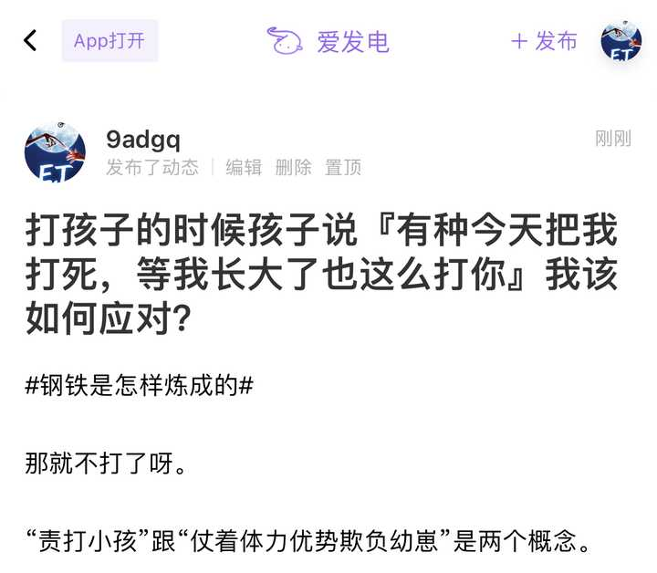

# A05　家庭亲属与代际秩序　第 2 册（共 3 册）

- 专题代码：A05　专题名称：家庭亲属与代际秩序
- 专题界定：父母、子女、兄弟姐妹、亲戚、抚养、放手、赡养与代际继承。
- 本册：第 2 / 3 册　收录 104 篇　正文字符 164,356
- 语料：`sooon-q9adg-articles-v2.jsonl`（4,305 篇）　SHA-256：`cdc9c271309e1d71d9708889a3a31f4777e0c339ea54c3753521894afdb8357d`
- 生成时间：2026-09-27T00:01:00.997126+08:00　排序：发表日期 → 源序号（全库唯一，不重复）

**标记约定**：`【待审】` 主题仍为暂定；`【排除候选】` 图片/正文过薄的剔除候选；
`【正文标注未完待续】` 作者原文自带未完标记；`【正文缺失片段（复核已记）】` 复核记录已确认的正文缺口；
`【图片缺 N 张】` 源图不可获取。标记只作提示，不改写原文、不改动分类状态。

---

## 1985　比较幸运

- 日期：2023-10-06　主专题：A05 家庭亲属与代际秩序　副专题：A01;A10
- 源 ID：`38e2abdd-cb9a-5e51-81e8-d8fe7021dfc4`　原文链接：https://www.zhihu.com/question/624858707/answer/3239027373
- 官方对象—实践路径：与亲族 / 与子女 / 抚养;与自己 / 与原则 / 建立;与自己 / 与情绪 / 接纳;与亲族 / 与父母 / 受教;与其它 / 与陌生人 / 观察
- 23 概念标签：事实与证据;选择与自由;责任与后果;成本与总账;照料与家庭;心理与主体
- 证据状态：manual_confirmed　初读：read　独立复核：not_reviewed

**问**：上海 4 岁女童海滩走失已超 24 小时，警方正全力寻找，目前进展如何？还有哪些信息值得关注？

建议各位口下留情，不要搞出两条人命。
人能长大，不是全靠父母万无一失的，人人都有幸运成分。
这类“一转身孩子就卷入了车流”、“两手都拿着冰激凌，犹豫了一秒没有伸手拉住”、“以为没事带着孩子山涧戏水“，甚至“扛在肩上错估了门框高度”的事情，其实你们每个人都经历过，只不过绝大多数都有惊无险的闯过了，根本没有成为你们记忆的一部分罢了。
表面上看，这是在怒斥这位父亲“怎么可以犯这么低级的错误”。但老实说，那是人们对“世界上到底有多少种低级错误”没有概念才会产生的傲慢。
每一个父母都犯过、而且正在犯低级错误，只是运气好——忘扣上的安全带的那次旅程，并没有遇上醉驾的司机；忘带棉服的那个夜晚，并没有吹来寒流；山涧戏水的那一天，上游没有往年必下的暴雨。
其实你们的父母不是算无遗策，确知没有醉客、寒流和暴雨，所以理性的省略了这些对策。其实ta们同样“失误”了，只是ta们很幸运的没有被世界追究。
而这位父亲没有同样的幸运，抽中了短签。
如果你们只顾着对ta给予严厉的审判而忘了怜悯，其实你们也就同时给自己将来的人生必修课设立了一个你们自己将不寒而栗、筋疲力竭的标准。
不要以为这可以用“我不结婚”、“我不生育”来躲过。
因为这是一个方法论问题，不会仅仅用在审判“粗心大意的父亲”身上，还会用在批判考试看错行、开车忘松手闸、旅游忘给手机充值……等等等等一切“低级错误”身上。
看似低级错误非常可笑，但不犯任何低级错误，那是神的境界。
你跟ta的不同，不是你比较聪明，不会犯或者没有犯低级错误，而是你的运气还没有用完。
本质上，我们只是比较幸运，不是比较优秀。
不要嘲笑、不要仇恨，而要怜悯——为了你自己。
今天你怜悯他，轮到你的时候，你比较容易原谅自己——到时候这可能是生与死的区别。

---

## 1983　它力更生

- 日期：2023-10-08　主专题：A05 家庭亲属与代际秩序　副专题：A10;A14
- 源 ID：`0ef41eca-80ca-5bc0-946f-e889f1cbe612`　原文链接：https://afdian.com/p/e4d913f865b211eebc0952540025c377
- 官方对象—实践路径：与亲族 / 与子女 / 抚养
- 23 概念标签：事实与证据;定义与达意;能力与学习;责任与后果;成本与总账;爱与回应;照料与家庭;文明与历史;心理与主体
- 证据状态：manual_confirmed　初读：read　独立复核：not_reviewed

**问**：两个孩子的家庭真的会做到一碗水端平吗？

处理子女之间的“公平感”问题，最不宜的做法就是“一碗水端平”。
当然，如果生的就是同卵双胞胎另当别论——这个是老天爷先表了态，那是真的一切都是默认两等份。这个算是另一个课题。
先定义一下什么叫做“一碗水端平”。
就是老大有的，老二就会有。老大买一双耐克鞋，老二就会买一双。老大八岁第一次出国，老二八岁就也要出一次国。老大去的美国，那么老二就算不去美国也要去欧洲。
这是一种力求贯彻“同规格待遇”的处置方法，最好让老大老二老三老四……没有任何理由说“存在差别待遇”。因为理论上既然“差别待遇”都不存在，那么当然也就不存在“不公平”了。
问题是，等老三八岁的时候，刚好赶上全球疫情，老三哪里也没去成，这要怎么办呢？因为老三耽误了三年，所以等老三十一岁的时候，给老三来个瑞士加拿大北极巡回游，补个大的，平衡一下，是吗？
问题来了——老四八岁的时候，刚好你老公破产了，老四怎么办？算老四倒霉吗？还是卖血？
一旦你暴露出你在实践“没有差别所以没有不公”的“同等待遇论”，你就会立刻面对一个根本的困难——这个世界根本没给你做到这个承诺的机会。这个世界不会给你的子女安排“均匀的历史”，也不会给你安排“恒等条件”，你注定会在某种“ta有我没有”的控诉中哑口无言。
依赖于绝对中心对称的设计天生是不稳定的，因为实践上根本做不到绝对中心对称。
心脏为什么不在正中间，而是在偏左?
这是一个非常拙劣的设计思想。
正确的做法，总是有意的差异化，进行肥瘦搭配。
长兄可以管教幼弟，但长兄受的责备也就更多，长兄优先享受福利，但长兄不照顾幼弟会受到严厉惩罚。
幼弟可以少挨骂，但是说话分量和礼遇就不及长兄，福利也越少，出了问题，责任也小。
你们天生就不一样，也没得一样。你们的待遇如果单比任何单个方面，那么肯定是不一样的，你们根本就不会期待它会相同。所以单项比较根本没有可比性。
而总体上，因为单项的价值无法简单的折算成一种统一分数，所以你无法简单的计算你的福利总分是多少。算都没得算，你怎么比？
能不能资源交换？不行。别的不谈，你是小的，难道大的受了欺负让你去保护？大的有了疑惑让你指教？你根本没这个能力，怎么交换？
其实你们各有各的福利面和责任面，当你羡慕对方的福利好、责任小，你唯一的选择是找到方法利用好属于你的福利、高效率的承担你自己的责任，而不是妄想“跟对方互换”。
老虎有老虎的好、也有老虎的困扰；羊有羊的困扰，但羊也有羊的福利。不是什么身份都是所谓的“压迫”，你倒想跟姚明换，NBA肯吗？
人要从小就摆脱这种“逼迫社会给我换个岗位就好”的妄想，养成立足于当下条件、当下资源改善自身处境的本能自觉。
“立足当下条件、当下资源，实际有效、持续不断的改善自身处境”——也就是坚持自力更生，你才会积累到自力更生的技巧和经验，获得自力更生的信心。
“试图靠抗议、骚扰、要挟来逼迫上位者给自己更好的待遇”——也就是坚持它力更生，你积累到的当然是它力更生的技巧和经验，获得它力更生的信心。
问题来了，自力更生是没有天敌的，敌视、限制自力更生的社会，一万年前就灭绝了。
但是它力更生一出手就有两种天敌——被你骚扰要挟的上位者和对自力更生感到满意的自力者。除非历史发展到了后者已经对自力更生绝望的阶段，否则它力更生者必遭孤立和驱逐。
这种历史阶段不是看你自己感觉、也不是看你自己那些怨声载道的小圈子的共识的，那有鲜明得多、客观得多的工具——除非GDP增长率起码连续10年为负值，否则你最好不要假设“苍天已死”。
你看错了时代，听信一些浑人鼓吹的它力更生论，你将像空袭之夜的篝火一样刺眼，会被集火轮番轰炸，直到粉身碎骨的。
作为父母，用所谓的“均等待遇以消灭公平争议”这种本质上是思想逃避的方法去应付子女，等于自己亲手在诱导和培养子女走“它力更生”的道路，极易导致子女的技能都积累在它力更生方向上，不但极大提高子女将来的比较心、争拗心导致ta们抑郁的概率，还为ta们触动社会天然的惩罚机制埋下了极大的隐患。
公平不是“你哥有耐克你也要有耐克”，而是“我们如果对你哥偏心，我们的偏心对他不会只产生那些可见的好处，一定会产生与这片心相衬的隐秘的坏处”。
这份公平是天道保证的，你所需要做的只是安心相信它，而不是日日哀嚎为什么自己没得到偏爱。
你得到的是“没有偏爱的成长经历”，如果你不去浪费时间哀嚎，你将得到一个更坚韧的人格。这个人格比你哥得到的“偏爱”值钱得多。
你不必信父母，你只需要信天。
什么“一碗水端平”？
你们根本不是一个碗，碗还端在你们自己手里。
觉得不平，自己端好。

---

## 1963　教而后养

- 日期：2023-10-25　主专题：A05 家庭亲属与代际秩序　副专题：A06;A10
- 源 ID：`5a05d7ce-251f-560a-82e0-66462c27863d`　原文链接：https://www.zhihu.com/question/625372154/answer/3263220225
- 官方对象—实践路径：与亲族 / 与父母 / 共处
- 23 概念标签：能力与学习;选择与自由;责任与后果;成本与总账;边界与许可;照料与家庭;法律与秩序;权力与异议;文明与历史;性别与身体
- 证据状态：manual_confirmed　初读：read　独立复核：not_reviewed

**问**：相处六年的女朋友，要谈婚论嫁了却被对方妈妈羞辱，该不该分手？

对父母最好的祝福，是避免让父母的恶行成为自己的不幸的原因。
你们自己好好的过好，露出幸福的样子，是对父母一切的错误和过错最好的挽救和补赎。
ta们被补赎了，终有一天会明白感激。
相反，因为父母做了某种恶，于是自己就顺势因此破坏自己的幸福，生活在遗憾和怨恨里，仅仅是这种拥抱遗憾和怨恨的决定，就是对父母最大的报复和惩罚。
但这是个同归于尽、齐赴地狱的惩罚。
你们都是自食其力的成年人，而且前途看上去没有任何已知的困难，这意味着无论结婚还是生子，你们都没有任何绝对的必要要经过父母同意——这是指双方的父母。
你们唯一的主题是自己要幸福，自己过得真正的幸福，可以解决一切父母亲友的问题。无论何种怨恨和恩怨都可以破解。
然而你们却在用“先破解恩怨再来幸福”的方法论做事。
本末倒置，愚蠢至极。
你们要搞清楚——“你们”不只是指题主两人，而是指你们这全部的小子们——
一旦你们成年，尤其是经济独立、开始产生盈余，学业、专业、事业也走上轨道，你们就已经要以家族未来的领袖来自我认知。
到你们谈婚论嫁，尤其是生育子女后。你们才是这个家族事务的最终决策人。
最后是你们监督父母的决定，不是父母给你们做决定。是父母做事要得到你们的支持和许可，不是你们要得到父母的支持和许可。
从经济独立到生育子女，你们从不必受命转向开始掌握家族权柄，这是你们必须完成的家族使命。
生育子女到子女成年，你们要从开始掌握权柄转向完全掌握权柄。
到你们的子女成年时，你们的父母要转变角色，变成围绕你们的决定来安排ta们自己的生活和事业。
这是任何家族世代交替的天然节奏。
你们在谈婚论嫁时还没有建成充分的不必受命的自觉和ta觉，你们已经怠慢了自己的成长。
现在的这些纷乱，有你们自己怠于成长导致父母也发育迟缓的重大责任。
不要以为子女与父母的关系就只是父母养育、教育子女，子女本身也有教育、养育父母的职责。父母在婴幼儿阶段养育你，在青少年阶段教育你，你则要在经济独立到子女长成之间教育父母，而在子女长成之后养育父母。
这是一个循环对称的关系。
而这个“我们无需你们的同意和祝福”的认知，是你们在经济独立到结婚之前本来就要完成的功课，和当年父母必须及时教你们不要说谎、不可轻信没有什么本质区别。
他们教你们不及时，你们就要因说谎和轻信闹出乱子。你们教ta们不及时，结果也是一样。
你们目前对自己身在何处，将向何处去没有自觉的认知，只是在盲目的跟随所谓的“习俗”、“习惯”，所以要受这自然法的惩罚。
自然法容不得拒绝这安排的家族，必定要在世代交替的进程上加倍惩罚和教训。
它教训完了，你们该看明白的根本就不是什么“如何哄好父母”，而是你们自己本身的人生架构、人生使命问题。因为这才是客观世界教训你们的原因。
你们不是要让张三满意、李四满意，而是要先让自然法满意。自然法的气顺了，放下了戒尺，作为戒尺的“胡闹的父母”自然会消停。
做好自己的计划，该结婚结婚，该度假度假，该生养生养，这本身就是对父母们补足你们该做的教育。
注意，这不是叫你们去示威、去叛逆、而只是叫你们做自己的事。
不要反击，不要炫耀，该送请帖送请帖，该行礼行礼。
学学美国的警察，sorry，sir，please不离口，但是该拔枪拔枪，该扑倒扑倒，该taser taser。但拔枪、扑倒、taser，并不意味着就要骂骂咧咧、怒目相向。
做事安排一概都是两手，如果你出席，我将如何如何，如果你决定不出席，我们将如常举行仪式，但会遥祝你身体健康。礼物照常奉上，如果你收则收起，如果你不收我们就封存起来，随时可以奉上——为这个原因，特别选了经典永恒的样式和款式。
替代方案都是同样恭敬、礼貌、体贴的。
礼敬与否，不是靠辩解“我真的没有无礼”来解决的，而是靠一个个具体的礼仪场合的表现一场场实际挽回的。如果因为上一场没有弄好，后面就搞成“不闹明白就没有下一场了”，也就没有可以赢回得分的加时赛了。
赢不回得分，只寄希望于把旧赛改判为赢，这个思路纯属缘木求鱼。
而你们坚定推动事态前进，自然而然就会产生很多相关的进一步礼仪，那些礼仪你们深思熟虑、正反都是温柔体贴的准备，自然能一点一点软化转圜。
坦率讲，你们双方所有的人都或多或少的缺少“补强”的自觉和训练——这是指事情一旦出现模糊的空间，就要忍不住自义而非人，即把对方的表述自行补全为较弱的命题来作出反应。
这种行为方式一旦配成对，结果就是爆炸性的。
但这已经是战术性问题了。
真正根本的问题是——
爱是什么？
你爱不爱？

我这名下有3000个答案，我建议你们看完这些答案再做决定。

先从这里看起：
家族答集

---

## 1949　一言不发

- 日期：2023-11-04　主专题：A05 家庭亲属与代际秩序　副专题：A01
- 源 ID：`a91fc0d0-4787-556c-988a-fc1a690c9a92`　原文链接：https://www.zhihu.com/question/626969119/answer/3276012760
- 官方对象—实践路径：与亲族 / 与子女 / 抚养
- 23 概念标签：能力与学习;爱与回应;照料与家庭;生态与自然;心理与主体;性别与身体
- 证据状态：manual_confirmed　初读：read　独立复核：not_reviewed

**问**：14 岁男孩口渴误喝百草枯因害怕两天不敢告诉父母，从嘴巴腐蚀到胃部，如何看待此事？有何警示？

每个父母都希望子女有问题可以及时预警，好给自己最大的干预机会，把问题扼杀在萌芽状态，以最小的成本争取最好的结果。
问题是，实际发生的往往不是这种理想情况。
为什么呢？这东西的根源恐怕要比一般所想的根子要深得多。
如果你把“幼崽可以任意给父母制造困扰”视为一种性状，那么思考一下，是幼崽有这个性状的物种更容易生存，还是没有这个性状的物种更容易生存？
当然，幼崽完全不懂得求助父母的物种自然是没有机会的，但我们问的并不是“幼崽懂不懂求助”，而是“自然是否支持幼崽们有了任何问题就毫无顾忌的向父母发信号”。
要知道，育龄的父母对一个种群总体来说其实比幼崽本身更珍贵，这是数学保证的。如果育龄父母的幸存会受到幼崽呼救本能过大的困扰——例如在不合时宜的时候哭闹、不听从父母的指示、不懂得及时跟随……父母因此而伤亡，幼崽一样是无法幸存的。
因此，自然规律早已经将“父母的安全利益优于幼崽自身的安危”通过自然选择刻在所有幼崽的本能里了。
幼崽们可以肆意哭闹的时间只有最早没有任何认知能力的那一段婴儿期，这个时候父母们往往要选择天敌不可能企及的险峻地形来筑巢，以对这种不能自控的反应免疫。
一旦婴儿们有了认知能力，尤其是有了一点点意识，一点点行动能力，幼崽们的本能就会立刻生效，使幼崽们本能的学会察言观色，学会压抑自己的需求，等到合适、安全的时候再向父母表达。
只要母亲稍微有一点屏气凝神、如临大敌的表示，幼崽们就会立刻安静，别说哭闹、乱跑，就是连喷嚏也不敢打。
幼崽们并不懂问题到底有多严重，威胁到底有多大，ta们只知道母亲没有平躺在地上悠闲地甩尾巴，母亲没有在眯着眼睛打盹，母亲没有发出持续不断的咕噜噜声……
母亲没有发出安全的信号，母亲站起来了，耳朵朝向一个方向，双目圆睁，目不转睛，尾巴也不再摆动，而是处在高度受控状态，幼崽立刻静音。
这一点，哪个物种不能在读书识字、见多识广之前就凭本能做到，哪个物种就根本没机会活到读书识字、见多识广。这条规则是普遍的，只要有抚育行为就必然生效的，而且有着钢铁一般的默认有效性。
所以，你的子女并不是“不愿意”“不敢”向你预警ta们遇到的问题，ta们往往只是在本能驱使下，对父母的很多“危机状态”的行为细节作出条件反射式的响应，告警机制自动休眠了。
这背后没有“动机”、没有“故意”，也没有所谓“教不会的愚蠢和迟钝”，真正的根源在于父母们在家没有笑容了。
父母们在家不开玩笑了，不娱乐了，不消遣了，父母们没有躺着、有节奏的摇尾巴，没有时不时发出满足的咕噜噜声。
相反，父母们常常低吼，失眠，彻夜在客厅里来回徘徊巡逻，对一切变化高度警惕而且常规性的过度反应。
幼崽们就会自动休眠，进入“报喜不报忧”模式。
这是ta们的本能，无需再学习，也不需要等到“懂得什么叫大项目、什么叫考职称”再生效。
这不能靠你跟ta们语重心长地讲述利害关系、合理配合、家庭团队理念，甚至喋喋不休的仔细定义“什么事可以不说”“什么事一定要说”来解决。
ta们对危机的本能认知并不是这个问题最大的瓶颈，真正的问题是你上次在家开玩笑是什么时候，你上次在家里高兴得手舞足蹈是什么时候，你们家上次全家一起东倒西歪在沙发上抱着零食桶看电视、打游戏是什么时候？
没有这些信号，这些教育几乎是没有意义的。
那是自然法刻进人内核的本能，你这是呱啦呱啦的人类语言，这两者对撞，前者会输的概率几近于零。
以前你们不知道，现在你们知道了。
去试试。

---

## 1943　完美的皮肤

- 日期：2023-11-05　主专题：A05 家庭亲属与代际秩序　副专题：A18;A09
- 源 ID：`0eccdc55-7ed1-5d21-bb5e-82d4bf09a3f0`　原文链接：https://www.zhihu.com/question/465874602/answer/3277812057
- 官方对象—实践路径：与亲族 / 与子女 / 抚养
- 23 概念标签：定义与达意;能力与学习;责任与后果;成本与总账;爱与回应;边界与许可;照料与家庭;生态与自然
- 证据状态：manual_confirmed　初读：read　独立复核：not_reviewed

**问**：我家猫把闺女的眼睛抓伤了，闺女四岁半。我受到家里人的集体声讨，让我把猫送走，我该怎么办?

趴地上玩，具体怎么玩？揪猫尾巴玩？
这根本没多大的事，人又不是傻瓜，自然会吃一堑长一智，不会再这么招惹猫。
真正的问题反而是家里人这种过度保护的心态，未来恐怕是个问题。
几个月大的小猫都算“过大的安全挑战”，都要彻底移除，都没有学习共处的余地，那么将来水、火、高温、高压、电、自行车、电动车、汽车、盗窃、诈骗、霸凌、溺水、动力机械、传染病……得咋办？
很多人的理论是“等长大了再学”，但是你看看现在这尺度，几个月大的猫一屋子大人都怕到容不得，将来小孩要懂事到什么程度你才能接受ta去学滑冰？学骑自行车？学自己打车出门上下学？
那可都是一不小心真的会筋断骨折的东西哦，可比几个月的小猫的威力大多了。就是一个成年人从自行车上摔下来也会骨折，撞到尖角别说眼睛，命都可能没有，咋办？
敢谈恋爱，胆子太肥了，见过苏享茂的下场吗？
一只几个月大的小猫，对一屋子大人和四五岁的小孩来说都是大到不能管理的风险，你这几个娃的后半生怕不要把你们一屋子人累疯。
因为后面每一个风险都比这致命得多，而且你们绝对没有能力和机会用“送走”解决。
这个问题下一大堆人对题主口诛笔伐，仿佛这就犯下了多么巨大的“罔顾幼崽安全”的罪孽，这都是自己还没尝到厉害的，焦虑一发作就要树立自己根本做不到的安全要求，将来这种完全比例失调的安全焦虑可以把你当块布丁，一勺一勺舀来吃了。
比例感、尺度感是非常重要的东西，遇事不要过度反应，因为过度反应会影响估价基准，引起“反应通胀”。你一天只有二十四小时，只有一个大脑一条命，稍微通胀一下你就盖得住头遮不住脚了。
现在这全家人就在犯这种错误，跟风骂题主的其实也一样，这都是还没看见账单时的豪爽，到时候帐单一来腿都要发软的。
这就不是什么大事。给猫磨磨爪子，给子女教育一下接受教训，恰恰可以作为一个提高安全意识、增长安全知识，体验安全可以多简单的事实案例，去建立小朋友的勇气和淡定。出了这个级别的事故就把猫送走，对小孩子而言就建立了一根“风险基线”——以后同等级的事故就是“不可接受级”的事故了。不可接受级的事故要靠战略性根除隐患解决，也就是“根本不接触、根本不引入该因素”。把小朋友的这根线画在“幼猫”上，世界的绝大多数区域，绝大多数事情对ta就都成了可怕的丛林，约等于把ta送进了无菌室判了起码二十年徒刑。
蹭破点皮，划破点口子，流个几十毫升血，扭伤个脚腕，脑袋缝几针，有点小骨裂，撞断个鼻梁，掉颗把牙，烫伤个几平方厘米，这都不算什么大事，一律用“安全总结”做反应即可。
吃一堑长一智，人就是这样长大的。
你很难想象一点伤疤都没有的人能tough到什么程度。而这个时代，不tough的人是非常可怜的——ta们总在惶恐不安之中永恒的抱怨和哀嚎，令人不胜其烦。
带着完美的肌肤进棺材是一种耻辱。

---

## 1936　缺养

- 日期：2023-11-12　主专题：A05 家庭亲属与代际秩序　副专题：A10;A04
- 源 ID：`9e368777-592a-5c6f-a31a-e3a1ce9ff3c0`　原文链接：https://www.zhihu.com/question/624574894/answer/3285573637
- 官方对象—实践路径：与亲族 / 与父母 / 分离
- 23 概念标签：事实与证据;能力与学习;选择与自由;责任与后果;成本与总账;信用与信任;爱与回应;边界与许可;照料与家庭;劳动与组织;宗教与自然法
- 证据状态：manual_confirmed　初读：read　独立复核：not_reviewed

**问**：因为晚上去同学家住没讲清楚，第二天跟嫂子吵架被扇巴掌并被拿拍子狂砸后脑勺几十下怎么办?

具体的是非，坦白说只有进行全面的调查才能弄得清楚，给我们外人所能随便置喙。
这里只能谈一些不管怎样你都可以考虑做的自保措施。
第一就是脱离接触。比如，和家里商量干脆完全住校，假期实在要住，也不回对你有威胁的环境住，不管七大姑八大姨，哪怕轮流在地板上对付，也拒绝回到有威胁的家庭环境里。
实在不行可以去找居委会、找网格员、找妇联、找警察局。宁可在门前打地铺，也坚决不回去。
始终注意，这不是搞失踪或者“离家出走”，你的行踪始终要对对父母——也就是你的法定监护人报告。但是要你回到那个房子和有威胁的人相处，除非有什么措施然你相信对方再也不会或再也不敢或再也不能这么做了，否则这是肯定不行。
你报告了你的行踪，监护人就没有免除对你的监护责任的理由，ta们就必须负责，这是一种强大的压力。这期间势必会有各种社会保障部门——例如居委会、网格员、妇联、警察局、学校、家族长辈、街坊邻居被牵扯进来。
只要你坚持“我所要的就是可以不必回到对我有威胁的环境”，最后的所有人几乎总是会发现“拿出一点钱来另外给你一个安置方式”是让每个人最轻松的解决方式。
到时候朋友劝、邻居劝、居委会劝、警察劝、网格员劝……各方汇流，会给父母一个强大、全面的压力，劝ta们想办法挤一挤，给你弄个别的地方度过假期。
你不是要报仇、不是要惩罚、不是要叛逃、不是要自毁，你只是要安全的居住条件，这个要求社会无法否定其正当性，这个正当性最后就会通过社会机制形成压力，你只是要小心的、正确的去推动这个压力。
比如，你闹着要社会把哥嫂弄一顿，你的正当性就消失了，事情就从“社会有没有义务保障未成年人的安全”，变成了“社会有没有义务当未成年人的复仇天使”了。
你稳稳的追求解决前一个问题，每一个具体牵涉进这个问题的人都会顾虑这个问题如果最后炸锅了，自己可能摆脱不了法律责任。为了避免这些责任，这些人就不能不有最基本的行动去“应付”。别看ta们很可能只是“应付”，但一大堆人一起“应付”，一样会造成巨大的压力，去推动事情发展。
但是如果你把“我要安全”转变成“我要出气”、“我要复仇”，那么很显然没有任何人有这个义务帮你的忙，不帮也不会有任何人追究ta们的责任，连应付的必要都没有，你的问题自然也就解决不了了。
第二就是要早点谋求独立生存。
早点开始打工，早点开始关注身边的商机，早点和明显有能力的专业人士建立联系。
这么说吧——在古代遇到这种父母难以负担而哥嫂不愿负担的子女，一般最首选的解决方案有两个——一个是送去出家/当童养媳，一个是送去找师傅学徒。前一条路略过不提，后一条路值得慎重考虑。
早点从师，以师代父，是一个很值得考虑的方向。只是你要慎重的选择师傅的人选，要人品可靠、手艺高强、真正需要积极的小帮手的。
不必与不想负责的家庭死死纠缠，去执着于要对方“付出代价”。
将来你被这些逆境打击锻炼得坚韧刚强、学有所成，ta们失去了和你谈论关系的资格，对ta们本来就是巨大的代价。
你之后每一次成功，都会在深夜提醒ta们，ta们为自己的一时的吝啬和刻薄付出了多么愚蠢的代价。
你只是要确保这些成功足够大而已。

一切向前看，自有天意报应，努力学习和工作，永远是对的。

---

## 1915　大义献亲

- 日期：2023-11-23　主专题：A05 家庭亲属与代际秩序　副专题：A09;A01
- 源 ID：`16bf7a3d-3913-512d-aede-8ced7c9d1f94`　原文链接：https://www.zhihu.com/question/459090070/answer/3299788114
- 23 概念标签：能力与学习;选择与自由;责任与后果;成本与总账;净输出与不掠夺;边界与许可;照料与家庭;权力与异议;性别与身体
- 证据状态：manual_confirmed　初读：read　独立复核：not_reviewed

**问**：为什么家里人强烈反对献血？

不要把自己做的好事告诉身边人。
做好事一定要尽可能的匿名，尤其是要对身边人保密。这个是你的隐私，没有必要跟身边人啰嗦，徒增烦恼。
ta们为什么会“强烈反对”？因为ta们常有一种不自觉的冲动，觉得一切的“家族内资源”都要“由家族统一调派”——本质上就是ta们下意识的觉得自己应该有一份调派权。
其实ta们没有，你要直接逼问ta们，ta们自己明面上也会承认这些都是你自己的个人财产、个人自由，但是在实践上，ta们仍然会尝试用这类批评、抱怨、骚扰去换取实际的控制权、干预权。
因为这是千年万年的积习，是人的本能冲动，你只要触发，就跟踢到膝盖反射神经一样，当事人没想回踢你，但是在ta们思考和决定之前，身体已经做出了反应。
你势必会引发ta们不由自主的“反抗”——反抗你把“本来可以用在我们的共同利益上的资源私自做无关处置”。
你确定这是你自己的合法自由，你就直接做，做了自己负责。，不要贪图那点自义感还要去家族内部炫耀一番。因为某种意义上家族成员的本能观点也不无道理——这些资源被你用在公共事业上了，你的家族实的确在现实意义上受到了共同利益的损失。
这就像警察丈夫身先士卒抓捕毒贩，拿着一等奖回家，绝不会天真的认为妻子会来夸奖自己一样。这事你做便做了，指望妻子再来夸奖你，乃至没有夸奖你你还要责骂一番，你不觉得有些过于残忍和苛责吗？
甚至哪怕你预先得到妻子儿女的同意和鼓励，这奖杯和奖章，你要有点基本的心肝，你也该知道这不能自己拿出来在家里炫耀。
要不要摆出来，应该是妻子儿女这些“受害人”来决定的权利，这是最起码的爱和保护。
行善，本质上是在献祭亲人，你要有这么一点起码的意识，不要逼人太甚、责人太苛了。
为什么做好事不要留名？
因为越是不求回报、奋不顾身的好事，对家人越是不可避免的折磨和负担。
这不仅仅是一个“高尚道德”的问题，而且是一个现实的明智选择。

---

## 1904　我我我

- 日期：2023-11-28　主专题：A05 家庭亲属与代际秩序　副专题：A09;A04
- 源 ID：`62358c68-0606-592e-86ae-864a355873d5`　原文链接：https://www.zhihu.com/question/630282001/answer/3306022818
- 官方对象—实践路径：与自己 / 与能力 / 获取
- 23 概念标签：定义与达意;能力与学习;选择与自由;成本与总账;信用与信任;照料与家庭;心理与主体
- 证据状态：manual_confirmed　初读：read　独立复核：not_reviewed

**问**：我快要崩溃了，为什么我的父母会这样？

现在我正在厕所里流着眼打下这段话。我是一名某三线城市私立寄宿学校的高中生，一年学费5w，感觉这里的规则很压抑，一度想走读，在学校里几乎每天都想哭，但家里经济状况不允许我再走读了。此时此刻，是期中考试，我却逃避了考试，躲在厕所里默默哭泣，在此之前我已求助了父母，但实在不知道怎么办了，迫不得已来知乎提问。事情是这样的。这几天正好是我们学校的期中考试，我却呕吐。一天呕吐好几次甚至考试的时候吐出来。昨天打电话给我家长，我家长让我去校医务室打针。 老师都说要不然让我家长接我回家吧，我家长不同意接我回去。今天我又吐了。两天内我已经在医务室打了6瓶吊水。我想回家。我和班主任说明情况，班主任打电话给我家长。我家长却直接说我有心理问题，不是身体问题让我坚持考试。我现在一度要崩溃了。我不明白为什么我的父母会变成这样？中午的时候我偷偷用手机给我父母打电话。（我们学校不允许带手机。）我父母却把我电话拉黑了。他们说如果我出校门就是搞特殊。我就不应该回家。我很不理解。我真的身体不舒服，而且我也不愿意考试。我考试时状态不好一个字都没有写出来。甚至有一科交了白卷。就在刚刚我和班主任说明情况，想让父母带我回去，我父母却直接当着老师的面说我是心理有问题让我继续考试，班主任听了后也让我继续考试。我都无从辩解。但是我的父母以前不是这样的呀。我承认我来这所学校是因为中考成绩不是很理想。我曾经初中成绩很好，我当年的成绩能上我们这里最好的高中奥赛班，初三的时候因为心理压力崩溃了。于是休学在家一年，第2年参加中考。休学在家的前半年，父母对我很好。对我表示理解。后半年却开始打骂我，我经常被赶出家门。身上没有一分钱。有的时候我就在大街上流浪，我记得一个篮球运动员说过的话，大概是什么见过凌晨几点的洛杉矶。别人都是什么努力学习努力工作见过凌晨三四点五六点的夜，而我是无家可归，见过凌晨的夜。我觉得我这段话打出来你们都会觉得离谱。谁能想到真实发生在我身上呢？当时亲子关系很不好。后半年我去了两所初中学校。因为心理问题又没上下去。其中有一所学校也是类似寄宿制的。当时花了3万块钱给我在校旁租房，因为我不习惯住校。我从来没有觉得我不喜欢住校是娇生惯养。我就是属于那种没有作业帮就学不了的人。就是我平时比较依赖自己的网课和自学能力，进度也比老师超前很多 ，上课基本不会怎么听都是拿题刷。我整个初一到初三崩溃之前一直都是这么过来的。就觉得老师讲的内容很简单，所以会自学很多。所以我需要手机很多。但是我拿手机真的不是他们那种打游戏的。而是确实有收获。所以我的初中成绩一直是十年级前10，很少掉出去。他们都说我的学习方法很独特。后来我崩溃了，在家玩了一年。于是，我第2年参加了中考。我们这里中考满分800分，我考了633分，能上这里最好的三星级高中，上不了四星级的。除非去镇里。我就闹着要上私立学校。我们这个私立学校是寄宿制的。然后我爸妈就同意了。但是我想走读，我父母却不同意。他们说他们没有这么多钱了，这个我理解。但是我在学校里很不习惯。我们一个月才放一次假。在学校里得依赖起老师。而我从来都不是按照老师进度的那种人。再加上没有手机，没有一些自学的工具感觉很不适应。我初中的时候就经常去自习室里学习。感觉这一点放学以后直接回寝室了，也不是很适应。第1次月考，我考了班级第二，年级第五。我们高中生源不是很好，我在创新班，所以年级排名没什么意义。我当时就很伤心，我明明可以考第一的。我现在很压抑，身体也很难受，我只是想出去调节一天。可是我父母却说我在搞特殊。我现在感觉很没面子，因为他们之前当着班主任的面这么说我。而且我现在心态要崩掉了，我该怎么办？
尝试在日常叙述中尽可能的省略或者不使用“我”字，症状会立刻好转很多。
包括用“笔者”、“区区”、“在下”来顶都可以，先把“我”含量降下来。
“我”太多，世界的一切都会被“我”挡住。
别人在想什么，别人处在什么处境，别人有什么选择，别人需要什么，自然有何限制，时代是何走向……这些东西是先于“我”的。
是“我”先知道了这一切信息，然后才产生“我”的想法、“我”的打算，“我”的行动。
这意味着不管你在考虑什么问题，有“我”句在整个篇幅里的含量都不该超过10%，而且应该出现在整个过程的最后。
这是个非常鲜明的指标，直接盯住即可。
哪怕你是要问一个跟你自己切身利益相关的问题，你描述问题的主要篇幅也应该大部分不带“我”字——这是这个问题的背景、前提、规则、机制部分。
如果你提出的问题不包含大量的对背景、前提、规则、机制的描述，说明你对这个问题本身就没做完最基本的家庭作业，你先把这个家庭作业做完，你的问题很可能就已经得到了好得多的解决。
作业做完，还是解决不了，再去问，问的时候就把这前后上下的要素都列出来，得到的帮助都会有效很多。
而这个前后上下都列出来，最直观的表现就是“我”含量大幅降低。
在另一方面，和你交流的人本能的知道这个法则，ta们也许不能这么直白的、自觉的说出来，但是参与一场“我”含量过高的对话，会飞速的提高对方的焦躁程度和攻击性。要是两个人都很高，那真是三天一小吵，五天一大吵，开口就吵，见面就吵。
少说“我”，说多没好事。

来，看本座来个舍身饲虎——你们可以看看这个账号下全部的答案加起来有多大的“我”含量。

“区区”、“在下”只是在你语言能力实在匮乏的时候给你的一个最基本的备选而已。实际上你的选择远远不止这些。
你看，“本座”、“身”、“这个账号”就是三个“我”。
就中二了，咋地，哼。

---

## 1891　放养

- 日期：2023-12-08　主专题：A05 家庭亲属与代际秩序　副专题：A06;A01
- 源 ID：`6a41129a-80a4-5d7a-bd80-bacac4cc24c9`　原文链接：https://www.zhihu.com/question/407582335/answer/3317542411
- 官方对象—实践路径：与亲族 / 与子女 / 抚养
- 23 概念标签：能力与学习;责任与后果;成本与总账;照料与家庭;劳动与组织;技术与工程;文明与历史;宗教与自然法
- 证据状态：manual_confirmed　初读：read　独立复核：not_reviewed

**问**：我带孩子都要崩溃了，为啥老一辈人那时候带孩子似乎很轻松?

看了很多回答，发现基本都完全说错了方向。
以前带孩子轻松，一个极大的原因是小孩几乎完全生活在熟人社会中。
方圆十里地，从小卖部到卫生室、从粮店到保卫科、从子弟小学到厂矿食堂，所有的人都是同一个厂的员工家属。所有人认识所有人。学校老师下了班回家，搞不好就住你家隔壁。甚至就是走到镇上、县城街上，随便碰到一个人，就算不直接认识，也往往有共同的熟人朋友甚至亲戚。
小孩是在一个几乎完全安全的人际环境中长大。所有的邻居、同事，甚至隔壁厂、隔壁村的人都会自然帮你照应。
这小猴子是谁家的，谁都门儿清。到点你不在学校或者没回家，人人都会给你看起来，通知你爹妈。爹妈招呼一声，临时管你顿饭甚至留你住一夜都是不足挂齿的事。你娃自己偷偷跑去游泳，几乎必定是跟着同楼的那一串猴崽子溜出去的。而且守鱼塘的大爷、路边卖煎饼的老师傅，一样帮你吼这帮不知死活的小屁孩。
村里、乡里、单位大院里基本都是如此。整个社区几千号人都在替父母留神帮手，父母们当然放松得很。这根本就不是“夫妻二人轮岗确保子女全程避开一切莫测风险”的设定。
和以前的成长环境比起来，现在的小孩就像用囚车连接起的一系列温室里培养起来的实验动物。全程无菌，所有接触者进出都要消毒。而父母、祖父母要负责顶住除学校之外所有的环境的监护工作，扮演“肉身无菌屏障”。
岂能不筋疲力尽？
坦率讲，在城市长大对人类来说是一个非常新的生活方式，只不过短短两百年而已。
人类幼崽在过去几千年文明史里，绝大多数都是在整个家族、整个部落的安全网里长大的。那通常是一个方圆数公里的大型游乐场，而且有大量的不同年龄层的玩伴和大量与自然界的交互。
那才是人类真正适应的成长环境。
“在城市里长大”的抚养模式，其实到目前来说都仍然是探索性、实验性的。观点路线还在诸子百家的纷乱状态，每一种都只实践了几十年，了不起覆盖一两代人就整个理念都变了。
大量城市文明自诩的相对乡村的“先进”，在本质上只是用自夸来自我抚慰的迷茫。
因为迷茫，反而需要用格外的自夸来补足自己内心深处的惶恐。
不信你仔细体会，你会发现城市出身的父母在教导子女基本道德、价值观的时候几乎总是犹豫徘徊的。往往更重投机和机智，而非强调传统、义务和基本价值。
隔壁两家、上下两楼的父母们给自己的子女讲着完全不同的伦理观点，往往还没等子女长大，父母自己的伦理观念又自行转变了，美其名曰“成熟”了。
生娃时，父母二十几岁；娃到青春期，父母四十几了。四十几的父母还认同自己二十几岁时价值观的，有几个？
你在子女十几岁时教的东西、讲的心得，和在ta们小时候教ta们的东西，真的是一以贯之的吗？
这之间的断裂、变轨，子女难道不要付出代价吗？
这种价值观上的迷茫感、精神上的不笃定感，是剧烈城市化的这一代父母较之上个世纪的父母们的又一大时代劣势。
物质上、事务上，没有整个社区的全方位分担，精神上、心灵上迷茫而孤独，而子女又是在人类其实并不适应的非传统栖居地成长。
焉能不累？

要想克服这些问题，坦率说那个全社区相助是很难补足的，勉强只能说同小区、同班级几个同学家长互相多帮衬，尽量弥补一点，再靠父母、帮佣分担一点。这就是能指望的全部找补了，这也是为什么往往要迫使夫妻一方脱产来全职照顾。
而那个“子女在非人类传统的条件下成长”也是几乎无法可想的。大多数人都只有“想尽办法进名校”这个办法来对冲。
唯一最可以努力、也最需要努力的、挑战也最大的，其实是父母自己的价值观迷茫和精神的不笃定。
这个要靠对传统的大量的学习和吸收。
注意，这不是叫你去照搬、复活“老规矩”，而是指你需要深入“老规矩”的历史源流，理清这些老规矩、这些传统背后的机制和原理。
你自己教给子女的，要是这些锤炼、检验了几千年的机制和原理在这个新的时代背景、社会条件下做出的新的答案，而不是罔顾时过境迁的事实，盲目的照搬历史结论。
这绝不是一个赶学术时髦的过程——大量所谓的中产父母，都是在赶ta们面前喊得最响的“教育新理念”时髦，以盲目而极端的抛弃和背离传统为“更先进”的基本方法论，实则是一种自我放弃、一种思想的堕落而已。
你的选择当然应该有别于传统，但那是在通过解读传统明白了真正的机制之后的再度运用的结果。
这就像通过阅读研究往年试题，你学会了微积分，然后用微积分做你今年的卷子，你的答案当然不会和去年的考题答案一样。
但是微积分的算法是一样的。
“传统”不是去年卷子的答案，而是去年卷子考的那个微积分演算法。
找到这个算法，你就能站在这个算法五千年的辉煌成就的肩膀上做出新时代的新答案，答案是新的，但是方法仍然是那个经历五千年验证的方法。
这才是你消除迷茫的真正路径。
为了这个原因，你必须要对历史——尤其是对社会学、人类学、宗教学、思想史、文化史下功夫。
三管齐下，再加一点运气，你可能可以不必这么绝望和焦虑。
另外，我严肃的建议你把我的答案看完。
因为这是你能找到最好的参考之一。
家族答集
社科答集
企管答集
文艺答集
科学答集
军事技术与艺术
第一性另外，建议父母、准父母们订阅 爱发电的同名账号，那里有更多关于子女教育的深入探讨。

---

## 1868　早恋1

- 日期：2023-12-28　主专题：A05 家庭亲属与代际秩序　副专题：A06;A04
- 源 ID：`f1298897-d133-5dba-8f4d-2123cb0e612b`　原文链接：https://afdian.com/p/0c26f170a4ea11eea1de52540025c377
- 官方对象—实践路径：与亲族 / 与子女 / 抚养
- 23 概念标签：事实与证据;能力与学习;责任与后果;成本与总账;爱与回应;边界与许可;照料与家庭;法律与秩序;权力与异议;技术与工程
- 证据状态：manual_confirmed　初读：read　独立复核：not_reviewed

**问**：早恋 1

很多父母是突然知道自己的子女开始谈恋爱的，远早于自己的预期。昨天还觉得是小孩子，突然就知道这丫头/小子跟对方表白了，还“在一起”了。然后就不知道怎么办了。
这里我们重点讨论一下身为父母，如何在这个条件下给予子女可能的最好教育。
不是“引导”，而是教育——这是第一位的。
所谓引导，是指你已经知道具体路线，担任引水员，站在船头要舵手左转舵右转舵。而教育则是另一个概念——你在对新加入的玩家讲述游戏规则、操作顺序、举例说明，但你对具体的策略、具体的发展一无所知。
你只能给对方最好的告知和装备，无法给对方具体的决策。
这就引出第一个问题——你能不能反对。
答案非常分明——你不能反对。
这倒不是说你无权反对——这个时候作为父母你其实是有监护权所赋予的权限去合法的反对甚至禁止的，这个“不能”，是指从客观实践来看不宜用反对的方式来处理。
一方面，这固然有纯技术性的原因——这种反对会严重的破坏和耗损你对子女的影响力，而这种影响力在这之后的监护使命中还有至关重要的作用。你现在消耗掉了，之后还有不知多少惊涛骇浪，那时你会噬脐莫及。
另一方面，这类“我不许”在实践上往往效果可疑，很容易导致子女把恋情转入地下，变为隐蔽状态。尽管ta们一开始不免手段拙劣而容易暴露，但你一次又一次的震怒、惩罚，只会很快教会ta们学会反侦察操作，而不是让ta们简单的服输、放弃。
这种时期的青少年有强烈的存在感需求，而对抗和摆脱直接的控制、禁止是证明存在感的重要源泉，仅此一条就足以让ta们获得莫大的动力去挣扎，更不提这里面还混入了“为爱抗争”的崇高感。
强行禁止，往往适得其反。
换一个角度说，你为什么要反对呢？综合原因是“怕耽误学习”，对吧？
但这个问题不妨这样看——如果这不是单恋，而是的确双方对上了眼，这可以说是实践给了你一个判决——你的子女属于高魅力个体。
高魅力个体，有走高社会性的发展道路的强烈合理性。因为社会关系会很自然的大量向ta涌来。人们会很容易注意ta、接触ta、邀请ta，这些未来的际遇，处理得好自然乘风破浪、直济沧海，但要是处理得不好，却会四面树敌，积毁销骨。
而当这剧情发生时，你的子女的高魅力属性已经是一个昭然若揭的、摆在桌子上的硬邦邦的既定现实，你要假装它不存在，去坚持你之前计划的那条平静踏实的“学而优则仕”的“正途”，已经是不现实的了。
你自己应该主动的调整你原本的打算，去重新按照ta高魅力的现实来考虑帮助ta有效的驾驭即将面对的问题。
也就是要顺应高魅力的条件，提升高社会性方面的训练和教育。
简单来说，既然命中注定有洪水，那就索性把游泳和冲浪学好。
现在，站在“不反对”的起点上，我们往前看。
你有几件当即需要解决的问题。
1）揭破窗户纸。
这其实是头号问题——你是怎么知道的？
你要知道无非几大途径：要么是子女自己告知的，要么是别人告知的，要么是你自己调查确定的。
如果是子女告知，那么你要考虑一下你是在什么阶段知道的？是ta们已经秘密交往了一段时间才告诉你的？还是ta在一开始就告诉你了？如果是前者，你需要反省一下和子女之间的信任关系，而且修复这个信任关系可能比别的问题更首要。因为没有这个信任关系，别的你都没有行动的有效性基础，几乎只剩下实力支撑的强制性手段了。那些手段的副作用过强，不是有当即的生命安全风险，不宜轻易使用。
我们重点谈另外两种情况。
也就是“你没告诉我，我自己就知道了”。
你也别管我是怎么知道的，因为我不会轻易的透露我的秘密，但你在这里就要立刻意识到一个重要的人生课题——隐私和自由是密切相关的。
你既然没有能力做到不动声色、密不透风，那么你就要处理走漏风声带来的后果。
你是不是在想到底是谁告诉我的？而你是不是心中立刻有了一个长长的“走漏风声者”候选名单？

我来告诉你我现在要做些什么。
第一，我现在既然知道了，作为监护人，我将和对方的家长接触。
你不必担心，我不会去表示反对，或者要求对方家长禁止ta和你交往，我只是需要给ta们一个提示，请ta们注意自己在这场交往中的责任。
要知道，你们都是未成年人，你们之间如果出了什么问题——例如，双方后来谈得不好，彼此报复导致受伤——监护人必须要承担连带责任，而不能说一句“我一点不知情”来搪塞。
你是我的宝贝，你如果伤害别人，我要负责，这我没话可说，但这肯定会导致我对你的很多不恰当的行为加以约束，以免对别人造成这种后果。而对称的，作为你的保护者，我必然而且也有权要求对方受到同样的约束，要求对方的监护人提供这种保障，否则这对你是非常不公平的。这不是反对，而是尽职尽责的同时要求对方也尽职尽责。
而这意味着什么呢？当然意味着对方的父母会知情。这也意味着你需要对对方的父母会知情造成的各种影响作出应对。
这里面首要而且必然的一条，就是从此以后对方的父母肯定会紧盯ta的学习成绩和各方面的发展。一旦有任何下滑迹象——甚至是进展速度不如ta们预期的迹象——就会把你作为首要怀疑目标。而且只要ta抱怨一句是你如何影响了ta的心情，这种怀疑就会演变成确定的认识。
你站在ta们的视角看看，你儿子本来好好的（如果不是这么优秀，你怎么会喜欢），结果跟某个女生谈恋爱。谈了也罢了，转眼这门也不及格了，那门也不优秀了。ta们能不怀疑是你的责任吗？ta们能做到的最好程度，也只是在没有明确依据的前提下相信不是你的原因。
但是如果再听到儿子在家说一声“她几天没跟我讲话，我心里一片空白”这样的话，ta们还能这样继续相信吗？
你发现这问题的要害没有？如果对方是成年人，说这种话就没有意义——怎么？难道女朋友几天不理你，你就可以玩忽职守了？可以自暴自弃了？就得怪女朋友影响你了？全世界的人都得围绕着不影响你来生活了？——看到了吗？如果对方是成年人，那么即使发生了这些情况，也该对方自己负全责。
问题是，你是早恋，对方不是成年人，世界的确要围绕着“不影响年轻人”的原则转。谁影响年轻人的前途，谁就要向ta的监护人交代，而不能说“这小孩自己怎么不躲着点？自己怎么不坚强点？自己怎么不自律点？”这种话来卸责。
只不过现在责任落在你头上了。
你也别喊冤——因为如果对方导致你心不在焉、萎靡不振，我也自然而然不可能对ta无动于衷。别的不谈，你应该知道我们在你身上投入之大。你的一节课折合多少人民币。我也给你核算过外卖员送一单能赚多少钱，各种劳动者一天的工作可以赚多少钱，一些工作你也亲自体会过。你能站在现在这个位置，我们在你身上付出的总投入已经超过六位数字，而且这只是算纯粹的金钱支出，还没计算我们所付出的时间和感情——仅仅是每天接送你上学，就不知是多少个小时。按照我们的收入水平，这又是一笔巨额投资。ta是你的同学，ta的父母多半完全相同，ta能像现在这么优秀，身上背负的投入也是大得吓死人的。
这不是要说来对你表功或者要你感激，不，如果是你自己表现不好，这个是我们的命，那得认命，这你不必有太大压力。
但是，如果是什么外来的因素、外来的人来扯你的后腿，来让我们用血汗凝聚起来的结果受损、打折甚至丧失，我们是绝不可能对造成这结果的人或者事物有任何好感的——无论ta自己成绩多么优秀、长得多么帅、多么乖巧，都不可能成为我们原谅的理由。我们最多也就能做到尽量不违法、不伤天害理，但要我们无动于衷，大概率是做不到的，哪怕我们努力要收手也办不到。你就想想你养的小猫/小狗/小兔子，现在要是有个人不经你同意喂了它点不知道啥东西，让它突然发病送医院抢救，回来尾巴不能摆动了，就算这个人不是故意的，你难道就会不反感ta吗？
这人长得很帅、很有钱、成绩也很好，你就会因为这个而改变对ta的反感吗？
你如果能理解，你就要意识到——对方的父母现在就这么警惕的在盯着你。
等于你们现在有一个额外的义务——谁都不能表现下滑。ta不下滑，就能保护你免于ta的父母的厌恶和反对；你不下滑，就能保护ta不受我们的厌恶和反对。
一旦下滑，这种感受是拦都拦不住的，因为在我们父母们看来，这就是在糟蹋我们毕生的心血。
如果你们都是成年人，这个逻辑就有另一种算法，至少法律的立场会有所不同。但你们都是未成年人，这一条无可逃避。
所以，从你的立场出发，你要加倍努力，这其实是对对方最基本的保护和爱。同样的，你要意识到，对方也要朝这个方向努力。
对于早恋的恋人，避免感情被父母认定为诅咒和厄运，这是最基本的责任——我得提醒你，这责任不是父母强加的，而是自然法决定的，父母自己也是被自然强制而有这样的不可克服的本能。
换句话说，这是天命。
所以，如果ta跟你确定关系之后做任何不利于ta学习的事，你都要意识到，那是在陷你于非常危险的境地——不管那些事看上去多么贴心、甜蜜都是一样。不管你自己觉得多喜欢，哪怕只是为了保险起见，你都一定要表示明确的反对，而且要记录在案，否则将来我们都很难为你辩护。

无论如何，不能让爱成为彼此的诅咒、成为彼此不能成为最好的自己的原因。是这种坚持，而不是所谓的甜蜜、温柔，才是爱最基本的起点。

关于我们现在的总体态度，我们现在的态度是中立的，既不是反对、也不是赞成。我们确实是担忧的，担忧你们处理不好这里面天然的艰难挑战，但我们不能仅仅因为担忧就提前故意给你们制造障碍，因为那并不公平，也对上天不敬。
后面如何发展，跟你们自己如何处理相关。无论如何，我们希望你善待对方，保护好自己。

---

## 1864　买椟还珠

- 日期：2023-12-30　主专题：A05 家庭亲属与代际秩序　副专题：A04
- 源 ID：`4c5db9c0-268b-53fa-91fa-0e1a37cd8bf0`　原文链接：https://www.zhihu.com/question/636469987/answer/3343492067
- 官方对象—实践路径：与亲族 / 与子女 / 抚养
- 23 概念标签：定义与达意;能力与学习;选择与自由;责任与后果;边界与许可;照料与家庭;法律与秩序;权力与异议
- 证据状态：manual_confirmed　初读：read　独立复核：not_reviewed

**问**：父亲不顾其他家人反对，强迫12岁女儿在她生日那天洗碗，这种教育方式是否正确？

这里面有一个细节：
父亲决定要如何如何教育，周围家人轮番上阵劝阻，然后父亲舌战群儒，晓之以情、动之以理，最后终于还是“一一说服”，得偿所望。
这个大错而特错。
错在哪里？
错在父亲对子女的教育权，ta人不得染指侵犯。
你有不同意见，只能私下建议，寻求理解和采纳，没有权利公开“劝阻”。面对这种侵犯，正确的做法应该是立刻下逐客令，请这些人离开，而不是逐一说服、感动、安抚。
或者不如说——在此之前没有树立起足够的认知，让周围人不敢随便起这种轻慢心，本身就是失误。
干预我对子女的教育权，形同夺子之恨，没有任何情面可讲，触动了我的根本利益，我将不计代价的让一切敢于触犯的人知道这绝无好下场。然后砍下一个人头来挂在城门上，让所有进城的人都知道这里的城主是谁。
说服什么？谁开口，谁就请出去。亲爹亲妈也无情面可讲。断绝亲子关系也不能容你侵犯我对我自己子女的教育权。
我不会跟你解释我的教育的合理性，因为我不需要向你负责，没有义务让你满意。我既不稀罕你的遗产，在你都分不清界限的前提下，我也不在意你这些随时会越界的“亲情”。你侵犯我的主权，是你抛弃亲情在先，这只能以你认错道歉为结果。
当你把这些越权的人一一击溃驱逐，你觉得小崽子还会摔桌子打板凳推诿拖拉吗？ta还会不知死活硬挺到你必须在“放弃教育或者暴力强制”之间二选一吗？
哀求、说服乞讨来的教育权，天然的无效。
唯一的“例外”是配偶——配偶本来就是教育权的共享人，这可以干预，但干预的逻辑是要求先暂停，走开单独讨论。讨论出一致结论后仍然要由我来宣布。
讨论后我可能会也可能不会改变主意，但无论如何，仍然要以我告知你的指令为准。
身为父母，要消除掉子女那种“可以用质疑合理性来拒绝执行指令”的幻觉，首先就要从把一切没有权利干预却“不经授权就尝试用讲道理说服”的其他人消灭开始。
没有干预权的人，想获得质疑权是要申请的，最起码也要有一句“我有句话不知当讲不当讲”来先交申请书。不先申请、不先得到批准，就自顾自地自认为有道理可讲就有权拿出来骚扰、掳掠一番，这样的人必须被严惩。
不严惩，就会让子女养成同样的恶习——“只要我能罗织出某种不合理的论证，我就可以无视一切的权柄，别人有权也不能用”。
这种愚昧的想法简直是现代社会的思想癌症，极易在警察叫ta举起手来的时候“大声理论”而被当场击毙，在坐飞机时大声质疑空乘而被行政拘留，上级交代个任务又要理论一番，抬高一切人行使自己权利的成本。
这种人随时随地都在拿着自己心里的那一套“道理”——实则是用各种逻辑味的垃圾层层包装的赤裸私欲——打着“你总不能不讲理”的旗号侵犯所有人的自由，走到任何一处都人憎狗嫌。
洗碗不洗碗，在这个案例里根本就是极小的事。但这个“被人轮番侵犯教育权，却采用说服、安抚的手段哀求许可”的示范失败至极。
父母的尊严已经在这自以为精彩的讲解中丧失殆尽，还让子女旁观了一次“挟理侵权”的“成功实践”。
“原来没权利干预的人，只要拿出一番由头来就可以去‘劝阻’啊，被劝阻的人即使有权，也得笑脸相迎、百般辩解啊，而且看上去要是辩解不赢，有权也没用啊”。
子女在这次事件里受到的最大教育，根本就不是什么“十二岁该不该洗碗”，而是这种愚昧的、极端错误的软弱行径的肉身示范。
而且是全体动员、活灵活现、千真万确的肉身示范。
可怜这位已经将尊严挫骨扬灰的父亲还在得意于自己的口才。
这就像一个人被混混当街凌辱，却在得意自己口才了得，成功说服了施暴者满意而去一样。
完全南辕北辙，不知好歹。
父母要教给子女的最大的最首要的道理，永远是“如何争取、行使和捍卫权利”，所有的言行，首先都是父母权利的主张、行使、捍卫的亲身示范，然后才谈得到这些言行本身所承载的那些信息。
正确的方式比这方式传递的信息要重要一万倍、一亿倍。就像武术的套路实际上只是示范和训练发力、节奏、手法的题材，真正重要的是发力、节奏和手法，而不是那个“先上步、再冲拳、再格挡、再下蹲”的所谓分解动作。
“正确的方式”才是珠，而这些方式所传递的所谓“教导”只是木头盒子。
不要买椟还珠！

---

## 1860　打脸主义

- 日期：2024-01-01　主专题：A05 家庭亲属与代际秩序　副专题：A01
- 源 ID：`29d8dbc2-99a4-580d-ae02-5e1b362ed57c`　原文链接：https://www.zhihu.com/question/637329133/answer/3345414324
- 官方对象—实践路径：与自己 / 与理想 / 修正
- 23 概念标签：能力与学习;选择与自由;责任与后果;成本与总账;信用与信任;边界与许可;照料与家庭;技术与工程
- 证据状态：manual_confirmed　初读：read　独立复核：not_reviewed

**问**：孩子装病不上课，一气之下把11岁的孩子扔在大街上跑了的我到底如何改善这种困境？

父母们，你们的人生规划是什么？你们在为什么而忙碌？为什么而焦急？
具体一点，你是为什么要实现那个目标？为什么那个目标如此值得实现？以至于你似乎总是不假思索的会选择让亲子关系、夫妻关系、同事关系为这些目标而牺牲？
家人朋友同事如同太空船的氧气瓶、防护罩和推进器，是什么样的目的地值得你用抛弃氧气瓶、拆毁防护罩、分离推进器的方式去靠拢？
具体是什么目的？
注意，这不是说世界上不存在这么珍贵的目的——当然是存在的，比如为了全人类的希望，常常可以说牺牲整个家族、整个团队，也没什么不值——这是在问你所追求的这个目的，是这样的一种目的吗？
是的，就是你的这个目的，你现在这个，就这个，你嘴边这个，你手上正拿着的这个，我是问这个。
你现在的这个值不值得？
是“为了孩子的前途”吗？那么为了孩子的前途，牺牲你跟孩子之间的基本信赖关系，这值得吗？失去了这个关系，你对子女的影响力基本就消失了，为什么这会有利于获得更好的前途？
是“为了生活”吗？亲子关系本来就是生活的核心部分，消灭它本身就是破坏生活。
正常的思路是在维持飞船本身还能飞的前提下，能飞多快飞多快，能飞多远飞多远。而很多人在做一种“为了让飞船飞更远，我先把引擎炸掉”的奇怪选择。
子女表现不如人意，你能做到的极限，就是在不动摇子女对亲子关系的信念前提下的极限。就像潜艇在水下能开的最快速度，就是保证引擎不爆炸的速度。你绝不能动那种“宁可引擎爆炸也要再快一点”的念头。因为引擎一炸，别说快，能不能再看见太阳都是个问题了。
我知道你打算三天从北海道开到旧金山，好让那些看不起你的人哑口无言，争口气。问题是，你再加速引擎要爆炸。炸了你别说三天、也别说旧金山，到夏威夷都得拖船拖半年。
而这只是个战术问题，真正的问题是——这个世界上有太多的人毕生的最大执念都可以总结为“要让某个看不起我的人吃上一记响亮的耳光”。
于是呢？这种会“看不起别人”的人，往往对人的尺度是心里没数的，ta们之所以看不起这个那个，一开始就是因为ta们因为无知而认为“一百分勉强算及格”，于是去看不起那些四五十分的。
但实际上人类真正的水平线就是60分而已，一半的人都还不见得能够得着六十分呢。
ta们是因为愚蠢无知，所以才会发作这种理直气壮的“看不起”症状，你选了ta们的标准，一开始就把自己陷入了一种“必须三天开到旧金山”的比赛之中。
是这个点上——早在你还没出发之前——就注定了引擎还没到夏威夷就要逼近爆缸。
只要你没有以恶为业，那么出现任何人看不起你，不管ta是谁，你就百分之百可以当ta是瞎子和傻瓜。你要做的是同情ta双目失明、智力发育有欠缺，遗憾ta的父母教育没成功，而没有任何一丁点的必要去考虑去把ta那个活见鬼的“成功标准”突破给ta看，去搞所谓的“打脸”。
否则你比ta发育得更迟缓，更欠当头一棒。
你要为这种目标去把自己的子女、亲人、朋友、同事都拉进你的“打脸队”，你这都不是没活醒可以形容了，你这完全是做人不过脑子。
要是不但要拉进打脸队，而且为了打到脸这个终极目的，不惜拿这些人当弃子、当代价，为ta们使唤起来不顺手而惩罚、报复ta们，那么只能说……
你从什么角度计算能得出“这样可以通向幸福”这种结论？咋算的？你把计算步骤写在纸上，我们一起看一下？
侮辱人、欺凌人、歧视人和崇拜人，这都是精神上有疾患的症状，这些迹象非常明显的人的价值观、价值判断都是不值得参考的，只能当作病理样本来研究，盘算着要在这些1+1都不等于2的乱七八糟的价值观中拿个满分，这属于南辕北辙的愚蠢。
你如果一定要拿谁的价值体系来衡量自己的成就和价值，你只能选那些从不侮辱人、从不欺凌人、从不歧视人、也从不崇拜人的标准。
可想而知，这样的人是极少的，你爹、你妈、你前男友、前上司是这样的人的概率极低。
人生要幸福，先从停止拿病人当医生给自己下诊断开始。
你把这个病根去了，你那个“三天赶到夏威夷才能不挂科“的病态标准自然失效了，你也就不会把油门踩进地板里，烧得引擎要爆缸了，你也就不会每天鸡飞狗跳、分不清到底是你逼她死还是她逼你死了。
你才有可能以正常的语速说点人话。
才有可能对子女产生真正的驱动力和影响力。
到时候你会发现ta们反而“听话”了。

---

## 1839　欠债不欠恩

- 日期：2024-01-11　主专题：A05 家庭亲属与代际秩序　副专题：A07;A08
- 源 ID：`d2e39201-c1e8-5e0c-9256-6133819f4fa0`　原文链接：https://www.zhihu.com/question/637670125/answer/3358749773
- 官方对象—实践路径：与亲族 / 与父母 / 共处
- 23 概念标签：定义与达意;责任与后果;成本与总账;净输出与不掠夺;边界与许可;照料与家庭;财富与市场;文明与历史
- 证据状态：manual_confirmed　初读：read　独立复核：not_reviewed

**问**：哥哥退伍之后向家里要回了当兵期间给家里打的钱，删了所有人的联系方式，我该怎么做？

老实说单凭这个叙述是没有办法谈论什么真相的，为了讨论问题起见，我们姑且假设故事情节就是“某人为家庭付出了太多，最后导致矛盾激化，亲情出现危机”，因为这种问题是一个普遍存在的社会问题。
面对这种问题，有一个相当简单的处理方式可以改善矛盾的激烈性，那就是“承认债务”。
具体来说，就是不给家庭成员——尤其是子女——强加法定赡养义务以外的“为家庭无私奉献”的义务，而是将所有这些额外的财务上的支持承认为家庭成员之间的债务。
如果是子女向父母给出财务支持，那么父母可以以遗产和赡养费作保，将这种支持做成借贷。
比如父母向儿子征求20万的借款，抵押的是自己的房产或其它遗产以及儿子的赡养义务，那么这笔借款要么就会逐年被赡养费抵扣（也就是儿子此后若干年不需要支付赡养费），自动被还清；要是没有被还清，则剩余部分自动从父母遗产中扣除（这意味着父母不能随意处置已经被抵押给儿子的部分产业）。
如果是弟妹向兄姐征求几十万的借款，那么就是以自己的未来收入做抵押，由父母提供担保，如果弟妹还不起或者最后没有还，同样在遗产继承等方面就要补偿兄姐。
不光亲兄弟明算账，亲父母一样明算账，这就可以了。
其实兄姐、子女不是不愿意为家庭做贡献，但是这个贡献要有名分，要有约定、要有凭证、要有念想。
而不是无名无份，无声无响。
如果人是神哲圣贤，的确可以超凡脱俗到愿如樱花般凋零，只留春色人间，但这需要人有这样的觉悟来完全自愿。
对于没有这份自信、更没有做这样的修炼的普通人，这个名分、这个念想，是最基本的安慰。
实际上按照这个操作，很可能也是过了二十年债务自然被“每年的赡养费”抵消，并不需要实际归还什么。但是家里承认欠你这份支持、正式承认你是债权人，给出办法保障你的利益，这种尊重绝不是毫无意义。
甚至是很多子女执着寻求的唯一回报。
抱着一种“子女怎么能跟父母算账”“兄姐怎么能跟弟妹计较”的愚蠢执着，结果就会是自己埋下这种伦理炸弹，随时把家族的羁绊夷为平地。
是否明智，自己掂量。
肯欠债的人，才有资格欠恩。
欠债的人，其实仍然欠了人肯借的恩。
只有欠了债还能感激人肯借的恩的人，才会真的被借贷者还以“你没有欠恩”的赠礼，免于“忘恩负义”的可能。

---

## 1828　自减重

- 日期：2024-01-17　主专题：A05 家庭亲属与代际秩序　副专题：A09;A01
- 源 ID：`20df36bd-cf07-55c7-a4d2-ee7cb142daf2`　原文链接：https://www.zhihu.com/question/639896121/answer/3365770020
- 官方对象—实践路径：与亲族 / 与父母 / 共处
- 23 概念标签：责任与后果;照料与家庭
- 证据状态：manual_confirmed　初读：read　独立复核：not_reviewed

**问**：妈妈老了很多怎么办？

主要是积极配合治疗，保持乐观主义精神。
你自己乐观了，积极了，展现出信心了，家里人再大的压力都会减轻不少。
人不是怕负担，人怕的是“死重”，也就是自身完全不挣扎、不努力，甚至不动弹了，连说句笑话来逗个乐的贡献心都没了，只是单纯的、毫无变化的做一个负担。这样的“死重”才带来最大的窒息感和负累感。
只要当事人自己保持积极努力和乐观主义的精神，作为支持者、负担者，精神压力就会减少很多，因为可以有盼望、有期待——谁知道啥时候一个运气好就好了？
然而保持积极努力和乐观主义精神并不容易，它不是一个亢奋的、狂傲的、表演性质的状态，而是一种坚定的、冷静的、谦卑的状态。
比如，后者不会随便许诺“你看着吧，我三个月就会好”，也不会随便说“不必担心，这都是小菜一碟”，因为这类过于轻佻、傲慢的话，很可能会因为后面不顺利而发展成泄愤式的自怨自恨，这反而会引起伙伴们更大的失望和负担感。
这应该是这样一种态度——“我不知道这个问题到底有多难克服，但我会坚持战斗，直到最终战胜它，而且我相信一定能战胜它”。
要把这些令家人惊恐、担忧的问题当成真正的大问题来敬畏的看待，但保持“终能解决”的立场，作出积极研究、反复总结、不断改进的行动。
这样子，家人的期待会转向乐观阳光，而这种乐观阳光本身就会反过来给予当事人巨大的安慰和激励，让事态踏入正循环。
凡事怕的就是负循环和正循环，再小的事，踏入负循环，几轮下来就会发展成地狱；再大的事，踏入正循环，也会转眼烟消云散。
很多人遭遇大事，就会自己沮丧，若是遇到家人不够坚强，家人也会连带沮丧，家人的沮丧又会导致当事人自己也进一步沮丧——这就是进了负循环。
这时候，在这个循环中一定要有人意识到自己要承担激励伙伴的作用。一旦激励了伙伴，让伙伴转向了积极，那么就可以逆转这个循环反应，扭转事态的发展趋势。治愈他人，就是治疗自己。来自外部的正面回馈远比所谓“自己坚定的相信”真实有力。
最后，不要去想这个那个有多么严重。
走在正道上，一切自有天助。在人觉得万万不能的，在天无所不能。

---

## 1818　道喜

- 日期：2024-01-24　主专题：A05 家庭亲属与代际秩序　副专题：A04
- 源 ID：`427f9c21-8b4a-5a75-9ea3-65429d3ea152`　原文链接：https://www.zhihu.com/question/639749626
- 官方对象—实践路径：与亲族 / 与子女 / 抚养
- 23 概念标签：事实与证据;定义与达意;能力与学习;责任与后果;爱与回应;净输出与不掠夺;照料与家庭
- 证据状态：manual_confirmed　初读：read　独立复核：not_reviewed

**问**：错怪孩子需要道歉吗？

家长做事，一切都要从示范效应的角度去看问题。
也就是说，你不要从“错怪之后道歉是否有损我的权威性”这种自我利益的角度思考问题，而要从“我是否需要抓住这个机会对子女示范道歉的做法和作用”的角度思考问题。
家长对子女的影响力——或者不如说一切人对人的影响力——唯一没有副作用的就是基于爱而来的那些。
诚然，通过暴力、欺骗、收买和崇拜而来的影响力也很有功率，但这些影响力各有奇毒，在战略上看都有不可持续性，最后一定会收之桑榆、失之东隅，总体趋向不可抗拒的破产。
这些策略的“可行”性，完全建立在“短期交往”的前提上。
然而你却打算着和你的子女和好终身的吧？那么这个问题就根本没有别的答案。
既然如此，就回到了一开头这句话——不要从维持实力感、维持崇拜感、保持偶像力这种不可持续的思路出发，而要从“如何做对教育和启蒙有利”出发考虑问题。
向子女道歉，而且是有效的、解决问题的道歉，这当然有必要。
道完歉，子女的问题解决了，关系不但恢复到“亲密如初”，甚至更胜从前了——正确的道歉的确有这能力——你就有充分的立场向子女解释道歉的基本规范和正确做法。
因为ta们本人就是这种神奇技能的直接受益者，这对ta们势必造成深刻印象。
有歉可道，这是好事，是将关系进一步加固的美妙机会，是取得成果、大笔投资的机会。
会顾虑自己的所谓“面子”“影响力”而逃避、蒙混、如避蛇蝎，这就是当年父母没启蒙好的。
那是因为水平太差，每次都把这盘菜炒的外焦里生、吃了拉一宿，所以才怕。
手艺精湛，就知道这东西做好了乃是人间美味，五百多一只，吃了还延年益寿。
你自己手艺差，炒出一盘糊的请子女吃，你要费事，吃完子女要骂街，所以你要问“有没有必要”。
你手艺好，炒出一盘鲜的，子女吃完米饭都多吃了三碗，要问你这怎么做的。
ta们要是学会了，以后就看到可道的歉就绝不会问什么“要不要道”，而是赶紧憋住气，悄悄的绕到后面，找个箩筐给它扣起来，抓个活的。
五百多一只，还能放得走不成？
有什么“要不要”？

但这要分情况——毕竟道歉的前提是有歉可道。
该做到的没做到，自然要道歉。
但复杂的地方在于，该做到的做到了，并不表示一定不会误判，这种时候，就只能表示遗憾。
抚慰伤痛，补偿损失，但只有遗憾，并不道歉。
这要怎么区分？
举个例子：
场景A：你听到张三说娃在学校打了同学，你就把娃惩罚了一顿，罚完了发现惩罚错了，你要道歉。
场景B：你听张三说娃在学校打了同学，你去学校问了老师、看了同学，然后回家把娃惩罚了一顿，罚完发现惩罚错了，你要道歉。
场景C：你听张三说娃在学校打了同学，你去学校问了老师、看了同学，回家让娃说了一遍事情经过，然后惩罚了一顿，惩罚完了冒出了新证据，原来是娃说得颠三倒四，你弄错了意思。这个时候，你要表示遗憾。
场景D：你听张三说娃在学校打了同学，你去学校问了老师、看了同学，回家让娃说了一遍事情经过，然后惩罚了一顿。惩罚完你看了我写的东西，发现之前ta的行为其实有正当性，是你自己当时认知有局限，现在你觉得这不该惩罚。这个时候，你要表示遗憾。
场景E：你听张三说娃在学校打了同学，你还有一小时就要被派出国执行生死未卜的秘密任务，然后你惩罚了娃一顿。等你潜伏完回来，你发觉不该惩罚。这个时候，你要表示遗憾。

为什么前两条要道歉？因为你惩罚ta的程序有缺陷。
你没有善尽调查的义务，没有给ta基本的机会讲出ta的陈述，你没有给ta足够的机会救济ta的结果。除非这有什么重大的从简理由，否则这是明显的失误。
这时候你的判断就许对不许错，错了，你就有责任道歉。
因为你有明确的、可以改进也应该改进的过错。

为什么场景CDE只需要遗憾，因为CDE就算被认定为错误，在未来也没有可改进的措施可言。
你怎么能要求父母听完你错误的供词仍然能作出正确的判断？怎么能要求父母在意识到自己错误之前就意识到自己错误？怎么能要求父母在没有机会从容判断而又必须判断时不程序从简？
人力所不能及，道歉就无意义，只能止步于遗憾。
人力所不能及的正确如果实现了，你要感谢上天；没实现，你无法怪天，于是迁怒于人，这就是欺软怕硬罢了。
而且欺的这个“软”还不是真的软弱，是因为爱你所以才可欺，所以欺的实际上是爱。
爱是不受辱的。
无论何人，无论出于何种原因，纵容人借着人的爱去欺负人，都是对被纵容者最坏的教育。
作为父母，绝不能这么干。

道歉不是只要有令人遗憾的结果就一定要道歉的，道歉一定要有“人力所能及的改进”这个逻辑前提。
无法道歉的遗憾，意味着你自己有自然法所规定的责任去自行避免——比如，下次轮到你自己陈情时，你要自己避免表达歧义和逻辑错乱。
意味着你要接受父母不是神仙，父母出于诚实的局限而做出的令人遗憾的反应并不存在需要道歉的过错。
那个麻烦需要处理、困难需要解决，但不是通过“宣布ta们有罪”，“依法判处赔偿”这个方式。
这种诚实的错误，不该父母负责、也不该社会负责、也没有任何人该负责，一定要谈论负责，只有让历史、让自然来负责。
这个就跟你因为年幼无知所造成的一切损失，对于父母而言一样属于无处求偿、只能当作命运来接受一样。
ta们又上哪里去喊冤？你又有何歉可道？
难道你会、你能为自己生下来不是法学博士、奥运冠军道歉吗？

---

## 1805　扫兴

- 日期：2024-02-02　主专题：A05 家庭亲属与代际秩序　副专题：A04
- 源 ID：`c9686772-04db-5c0a-8d1a-85ca7bb2c4b1`　原文链接：https://www.zhihu.com/question/641217713/answer/3383742002
- 官方对象—实践路径：与亲族 / 与父母 / 受教
- 23 概念标签：定义与达意;能力与学习;选择与自由;责任与后果;信用与信任;爱与回应;照料与家庭;财富与市场;技术与工程
- 证据状态：manual_confirmed　初读：read　独立复核：not_reviewed

**问**：扫兴父母知道自己正在扫兴吗？我该怎么让他们改变说话方式？

#扫兴#
父母扫兴一般有两个原因：
1）不希望“错误的满足”模糊你的焦点。
比如父母认为你当前最重要的是学校成绩，那么ta们就特别不能忍受你在学习尚未登堂入室的前提下因为打赢了篮球而感到满足和快乐。
严格说，快乐还算是可以的，但是“满足”是不行的。你打赢了篮球，然后你就满足了，觉得学习不搞好也没什么关系了，就会导致篮球成为学习——或者父母所坚信的任何关键目标——的阻碍和敌人。
这时候父母就会有极大的冲动消灭这种“错误的满足”。
2）不希望你过早满足，丧失饥饿感。
中国的教育理念几乎是单一精英面相的，即使再普通的父母，嘴头上说着“只要平平安安就好”，实际上却是不自觉的在培养精英、人上人。
中国的小孩从小学的就是“白日依山尽，黄河入海流”“前不见古人，后不见来者”“挥斥方遒”“一代天骄”“闻鸡起舞”“天将降大任于斯人也”“虽九死其犹未悔”，默认就是十足十的不甘人下，“王侯将相，宁有种乎”。
这个是中国人天生的文化基因，一起步就是放眼四海、心忧天下、席卷六合、混一宇内的豪情。中国的默认教育方针就是“取法其上，得乎其中”。
所以父母们对子女设想的成长计划就是一个规模相当大、相当艰巨而漫长的通天之路。
ta们很清楚这需要你有强烈的“饥饿感”、对整个进度有相称的尺度感。
你就像一艘必须横跨太平洋的帆船，你带的食品和水是有限的，你不能在到达基隆港时就“过于高兴”，也不能在这庆祝太久。否则ta们害怕你可能在到达夏威夷之前就弹尽粮绝，觉得“这里风水也埋人”了。

现在的问题是你要怎么办。
解决问题的第一步，是先想清楚——这到底是不是一个应该被解决的“问题”？
这当然令你“扫兴”，给你造成了痛苦，但如果让你自己的理性脱离你自己的这些情绪来选，你是不是真的愿意选择“舒适的做一只蝼蚁”？
等你得了抑郁症（这或多或少人人有份），你就会发现，那些能稳定承担自己的全部（尽管是毫无特殊加码的）社会责任的人，实际上已经是成功者，已经是让你自叹不如的英雄人物了。
那些打着“我只想当个普通人”旗号来回避成长中的基本功课的人，往往到了成年做不成“普通人”。
普通人就是入门级的英雄——至少在中国是如此。
换句话来说，在“为社会挑战做好充分准备是一个需要专心和长期持续努力才能达成的目标”这个问题上，父母恐怕并没有什么错。

然后我们再看——如果你决定要管理这种现象的发生，你的最佳策略是什么。
首先，丢掉“通过证明父母没有这样做的权利”这种愚蠢的路线。
你错了，父母有这样的权利，句号。
第二，不要指望通过论证“这样只会妨碍我的成长”来阻止父母。

这个问题，如果作为一个纯学术问题自然是有答案的，但是这对你没用。
因为第一——你是利害相关人，这就像一个买猪肉的人长篇大论对卖家论证“猪肉应该便宜点”或者一个医生苦口婆心说服一个没觉得身体有任何异样的人“你丫有病”一样——你本人想靠这些理论、论文去说服父母“不要扫兴”，从一开始就是一个事倍功半、甚至根本行不通的安排。
第二，这些理论、论文并没有决定性的结论，顶多可以说明“不能过度频繁、过度严厉的扫兴”，它们否定不了“适度的扫兴”的合理性。而且，不是看不起它们——它们也没有能力说得清这个神秘的“度”到底在哪。
第三，你一旦说出口，你将难以避免的陷入巨大的逻辑困境之中——父母将会拿出十二分的疑心去审视你是不是在通过自我戕害尝试“证明”自己的理论。
因为你自己把自己陷进了这样一种两难——要么你的学术表现没有恶化，于是说明父母这么做并没有如你所说的造成可见的恶果；要么你的学术表现恶化，但父母认为你是在故意自我放弃，想要通过这种方式“夺权”，而不是真的可以证明ta们的理念错误。
ta们这么怀疑对不对根本不重要，就算是错的，你也证明不了到底你是真的受到了影响还是你在暗搓搓的“自我实现预言”。
第四，也是最重要的一条——
永远不要优先考虑通过证明“你错了”来尝试让对方改变行为。
这是一个非常昂贵而低效的沟通方式。
因为首先要证明对方错了——尤其是对方自己没有觉得错，是你自己主动要去证明的前提下——你从一开始就把对方推向了警惕、多疑的状态，对方会不自觉的对你传递的一切信息作弱化解释。要突破这层防御是极其极其困难的——在没有监护权、审判权、管辖权之类的强力特权的加持的前提下，这甚至是不可能的。
第二，即便你证实了对方就是错了，也挡不住对方就要选择将错就错。只有学生和幼儿才有无条件改正错误的义务，成人根本没有知错就改的义务。
你要搞清楚——知错就改是一种珍稀的美德，不是人的当然义务。
每个成年人都只有将错就错这一种活法，你多给ta指出一种，对ta只不过是多将就一下而已，并不能产生你所希望的“赶紧改”的效果。
要促使人发生转变，最直接的方法是不要问是非对错，直接谈交易——直接给对方想要的，换自己想要的。
在这里，对方想要的到底是啥？
一个是不失焦，一个是不自满，那么你要高兴就只需要打消父母这两条疑虑就可以。没有这两条疑虑，父母本就没有什么特别的理由不让你高兴——如果有的话，那就需要另案分析了。
怎么打消？首先你就要自己绷紧这两根弦，不等父母起焦虑，你直接就先告诉ta们你没忘记主要的目标是什么，也没有忘记路漫漫其修远，行百里者半九十。
不用ta们猜，不用ta们提醒，你直接抢先把这话说了，ta们的焦虑就自然消退一大截。
你给ta们这个，ta们的需求就满足了一大半，对大部分父母这都已经够了。
如果这个不够，那一般ta们要的都是你在这里超规格庆祝了，就要在主要目标上相称的补一补。这个你一样抢先提在头里，远比等ta们按捺不住“扫兴”后再提要有效。
这里要顺便提醒父母，你们要达到目的其实有两个选择，时刻去扫兴其实是一个比较坏的选择。
你们的想法没什么错，的确成长是一条漫长艰苦的长征路，人的确要有聚焦核心目标和行百里者半九十的精神，但你们要避免用“扫兴”来补救自己塑造子女这两种意识的工作缺失。
要树立这个意识，不是靠给子女讲“不聚焦”“轻易满足”的坏处，而是要多用夸奖、庆贺来不断的奖赏ta自觉或不自觉地正确行为。
例如子女看了这篇内容，在庆祝自己篮球赛胜利的喜悦时都没忘了补一句“爸爸妈妈放心，我不会耽误学习的”，那你要给足反应，要抱起来亲，要跳起来夸。
尤其是要因为ta讲了这话而特别允许ta尽兴。
如果ta沉迷于高兴而忘了这句话，你也不要惩罚ta，而是告诉ta补上这句话，就类似国外吃饭之前先祷告那样，把补上这句话视为正常庆祝的一种必备仪式。
我们不扫兴，只是请你补上一句礼仪就可以了。你就快速的念一遍，然后我带你去买冰激凌去。
一切的庆祝之前，都要养成习惯快速的说一遍这话，说了就没事，这个要求并不苛刻，也不难满足。
但是一旦养成条件反射，别看只是小小的口头习惯，实际上是会有很强的心理暗示作用的。
一般这样就够了。
行礼如仪，不扫兴。

---

## 1798　反对，反对，再反对

- 日期：2024-02-07　主专题：A05 家庭亲属与代际秩序　副专题：A08;A04
- 源 ID：`e7f4d0c7-730f-5efd-846f-8ac540a40e26`　原文链接：https://www.zhihu.com/question/609352057/answer/3389638450
- 官方对象—实践路径：与亲族 / 与子女 / 抚养
- 23 概念标签：能力与学习;责任与后果;成本与总账;信用与信任;爱与回应;照料与家庭;劳动与组织;财富与市场;心理与主体
- 证据状态：manual_confirmed　初读：read　独立复核：not_reviewed

**问**：如果孩子对某些方面确实感兴趣，想要去探索、研究，在力所能及的范围内，父母应该怎样去支持他？

这可是很重要的一篇。
答案很可能令你感到疯狂——
答案是【不要】——再说一遍——【不要】去积极支持孩子的兴趣爱好。
不但不要支持，而且要基本上站在“默认反对”的立场——但是要注意，这是一个可以被争取改变的、并非不可动摇的反对立场。

为什么？
因为“兴趣”是你子女的私事，对ta是一种娱乐，应该花ta自己的资源。ta有多少零花钱，可以自己花在自己的娱乐上，只要不存在伤害健康、违反法律这类问题，你根本不需要过问和干预。
现在的问题是ta在要求你投入额外的资源。
这个额外提供的资源算什么？在会计上算什么科目？
这对父母算消费还是算投资？
很多人举手——“当然算投资”。
算投资是吧？
那么就老老实实按“你要拉我的投资”的程序来。
我可以、而且当然乐意当你的天使投资人，但绝不可能当那种会被“我很喜欢这个”这么单薄的理由就说服、就开始掏钱的蠢蛋投资人。
因为这不合规矩。
再友善、再热情的投资人，也是对项目和项目团队有要求的。
你的“项目”肯定没问题。
但你的“团队”需要先获得基本资格。
世界上哪有一个投资人，在项目团队自己都还三心二意、摸不着调的时候，仅仅因为自己太想看到项目成功，就开始卖血、卖房子、辞工作往里“投资”的？
按照这个视角来看，你就明白绝大多数家长们所谓的“支持兴趣”的本质是什么——是一种极端不负责任的、会把子女的基本认知养坏的胡作非为。
父母的责任，是担当“最友善的陌生人”角色，为子女们适应“陌生人”——即完成正确的社会化——提供铺垫。超过这条线，即成溺爱，就会扭曲信号，继而扭曲子女对世界的认知。
正常而言，你要按照一个助学爱心人士的视角去看待ta的兴趣。
你光觉得好玩而已，那你去拿自己的零花钱玩呗。
你零花钱花光了，玩不起了，但还想玩，那你给家里做家务、打工赚钱继续玩呗？
你想要我出资12万买一台钢琴？你可以跟我借啊。借条写好，就按银行利率，按月还款呗。
你要争取我的投资？对赌协议了解一下吧。
你想要，你不要指望别人“支持”，你要自己先努力到让对此毫不看好、没有兴趣的投资人对此看好、对此有兴趣。
家长最容易犯的大错就在这里——完全省去了子女来凭意志、凭表现争取的过程，用过度廉价的“支持”养成了子女所谓“无条件支持”的认知。
什么狗屁“无条件支持”？世界上哪里允许“无条件支持”这种伤天害理的罪行？
每一点人类的劳动成果都是血汗乃至生命凝结成的，它不允许被“无条件”的用来“支持”任何人。
包括你亲生的子女都不行。
一切支持，都需要人凭相称的血汗和冒险来领受，这是唯一可行的方法。
让子女相信存在所谓“无条件的支持”，只会导致ta们将自己最优质的、本该最后动用的投资储备毫无意义的挥霍，甚至是挥霍一空。
从财务上讲，这些钱与其浪费在ta们那些儿戏、轻佻的胡闹上，远不如省下来等ta们成年拿来作为使用高杠杆工具的保证金，不但更有效，而且还不会让ta们养成窝里横、吃爹啃妈的恶习。
那是你们亲手用所谓“支持”养出来的“爹妈的钱不是钱”的恶习，在这种恶习下，万贯家财也烧不了几天。
除开财务上的合理性，退一步讲——兴趣、爱好，都是要实打实的投入时间、消耗生命、经历压力、忍受折磨的。你拿着大笔的钱迫不及待的投入ta这个星期刚产生的所谓“兴趣”，必然模糊“一时兴起”和严肃的志向之间的界线，你就不怕亲手用钱让子女误入一条最终必定会放弃的歧途吗？
那是动辄以年计的青春，以万、十万计的金钱，而且这种项目失败，你得到的绝不会是“虽然失败，但由衷的感激”，而将是子女在严峻的专业考验前崩溃后的迁怒和怨恨——“其实我当初也就一般、是你非要我学的”。
兴趣要走得远，走出结果，最后必然要经历“要不要放弃”的考验——一到初二、高一，就要面临“到底是一心学业还是两手都硬”的根本抉择。
话说得直白点，如果到时候要选“一心学业”，那么这之前的所谓“兴趣投入”只不过是重金过家家罢了。
而只要你选“两手都硬”或者哪怕是“保持最小必要练习量”的坚持，子女都要付出远超“感兴趣”级别的血泪。
而且是越往后，矛盾越激烈。
一个期末考没考好，人就要崩溃，就必然要按捺不住“要不然放弃钢琴 / 绘画 / 芭蕾 / 篮球 / 武术……”的念头。
在琴房一边弹一边焦虑——“别的同学在补习”。
这时候，“我当初会做这个只是因为父母竭力‘支持’”的念头会像毒蛇猛兽一样从骷髅的眼窝里钻出来。
最后的结果往往是在巨大的损失感和不甘心下，把练了四五年的功夫搁下了。
三天手生，七天人生。过完头七，为了不触动自己“大不如前”的痛苦，为了不要看到就想起伤心事，琴都卖了。
你觉得在这十几岁的心智水平里，你在这人生剧痛里多大概率扮演的是一个值得感谢的角色？
到时候你要想起八年前看到过现在这些话，你要揪着自己的脑袋往墙上撞你信不信？

这还不是全部恶果，更糟糕的恶果是少爷小姐拿着免费的资金东玩两下、西玩两下，不是确信“我不是这块料”、就是“那个不好玩”。
琴棋书画斧钺钩叉，技艺一共就这么几门，据说最好玩的，小崽子十六岁都不到就样样都“玩了”而且腻了。
ta未来的人生准备以何为乐？何谓“了无生趣”？
你觉得ta要再寻找乐趣的希望会去什么方向找？
这么说吧——这些方向样样都不是有身败的风险，就是有名裂的风险——否则为什么没有对应的少儿培训项目呢？啥正经的技艺没有考虑过童子功？
要是这些项你接受不了，要死要活的拦着，你站在ta的立场上想想，这注定了无生趣的人生有多大长命百岁的价值？
你觉得ta会不会想死？
所以不要以为兴趣门类是可以无限挥霍的无关紧要的东西，有钱就可以无限的让少爷小姐们随便糟蹋。门类耗竭都没有找到人生乐趣、价值寄托，对人有生命威胁。
其实如果ta们虔诚、严肃的对待，任何一门都可以成为ta们一生安身立命的财富。你要仗着自己“有钱”，一个一个的让ta们浪费干净吗？
更可悲可笑的，是你还没钱，你是去加班熬夜卖血借贷弄到的这笔命价，拿去帮小兔崽子逐门逐户的糟蹋东西。
自己拼了命，要了子女的命，觉得荒唐吗？
然而这种荒唐事在人间有多少？真的是笑话吗？
看这些文字的必然也有做子女的，自己说吧，你浪费了多少兴趣？
这是我在“危言耸听”吗？
世上流行的所谓“无条件支持兴趣”论，害人何其深也。

所以，对于子女一切的所谓“兴趣”，父母第一立场都应该是“反对”。
“反对”，“反对”，再“反对”。
如果你闯不过这些关，就不要跟我们谈“想要”。而且你要养成习惯、记到骨髓里——被再三反对、无人看好，你仍然定意付出，全心渴望的，才叫“想要”。
有人白送才行，一不白送你就算了的，不叫“想要”。
你想要，那是你的事，实现你自己想要的，那是你自己的义务，你自己要解决的问题。
永远能接你的电话、永远给你时间再次提案，能给你这么低的利息、接受这么低的抵押、这么宽松的对赌协议的投资人，你是否可能再遇到？
如果你的渴望、坚持和努力说服不了这种亲爹亲妈、天使级别的投资人，那么作为你的至亲至爱，我们毫不亏心的告诫你——你对这东西并不感兴趣。
属于你的天命、你的召唤，还在后面，你别在这种胡闹项目上瞎扯淡。

父母们，你们要记住——你们反对不掉、浇灭不了的，才有资格获得你们的支持。
那些牵着牛、背着柴也要扒在教室门口蹭课的娃，才是最有资格、也最有希望让你的付出开花结果、也不辜负ta自己的青春与血泪的人选。
不要给不敲门的开门，不要让不寻找的找见。你们要等到这个扒门时刻，否则这些必然打水漂、还导致ta青春陪葬的浪费，不如省下来等ta二十五岁以后拿来做杠杆保证金。同样是全部亏掉，那时候形成经验和成果的效率要胜过这时百倍——更不提还有二十年的利滚利。
再说一遍，不要“鼓励”，而要“反对”“反对”“再反对”。
我们反对，你花自己的零花钱也要继续。
我们再反对，你宁可做家务攒钱也要继续。
我们再三反对，你宁可写欠条、认利息、签对赌协议也要继续。
那么好，不愧吾家千里驹。
这个项目，我们投了。
你不用客气，能投这样的项目，不是你的幸运，而是我们的幸运。
而且无论成与不成，我们都不担心你将来会饿死了。

---

## 1787　万家乐

- 日期：2024-02-09　主专题：A05 家庭亲属与代际秩序　副专题：A01;A06
- 源 ID：`963a3480-ff6d-5fef-8dc5-2a6f48250b01`　原文链接：https://www.zhihu.com/question/629088981/answer/3391925520
- 23 概念标签：责任与后果;成本与总账;照料与家庭
- 证据状态：manual_confirmed　初读：read　独立复核：not_reviewed

**问**：为什么穷人家庭大多数都不和睦？

Big surprise～ 富人家庭大多数也不和睦。
“家庭和睦”本来就是大部分家庭在少数阶段才有的状态。
而且很多家庭不和睦的原因就在于“以为别的家庭都和睦，就自己家庭不和”，生成了一份需要人负责的罪孽盘旋在一家人头上，每日份的不和睦都要点出一个倒霉蛋来例行打板子。
人人都不同，不同而要和，那需要至少一方是君子——所谓“君子和而不同”。
这句话需要专门写进“君子行为守则”里，即使对君子都要天天搞个定时闹钟ding一下，何况君子难为呢。
家庭最和睦的时光一般就是子女会说话到懂事前那几年，学会珍惜。
如果人人都知道“大多数家庭在大多数时候都不和睦”，知道每一个和睦的瞬间之可贵，人人知道珍惜，那么不必分析任何其他具体的原因，和睦的机会和时间反而会多一点。
不和睦的原因千千万万，但是“以为和睦是常态”导致的不珍惜是第一条。
先把这一条去掉再说。

---

## 1782　张记包子

- 日期：2024-02-12　主专题：A05 家庭亲属与代际秩序　副专题：A08
- 源 ID：`c1401a58-bb72-5fec-aac9-2dafe50683c2`　原文链接：https://www.zhihu.com/question/386784209/answer/3393839141
- 官方对象—实践路径：与自己 / 与名誉 / 建立
- 23 概念标签：事实与证据;定义与达意;能力与学习;选择与自由;责任与后果;成本与总账;照料与家庭;劳动与组织;财富与市场;心理与主体
- 证据状态：manual_confirmed　初读：read　独立复核：not_reviewed

**问**：家里靠卖鸡蛋饼为生，孩子不能接受，觉得大家都看不起他，家长该怎么办？

家里如果有一个小生意，尤其是站住脚了，摸清楚门道了，干了十年二十年的这种小生意，一定要往专业化、精细化方向好好发展，不要妄自菲薄。
不管是摊鸡蛋饼还是蒸肠粉，不管是做紫砂壶还是做皮包，你能干十几二十年，如果你的客户群稳定，你已经进入了一两代客户的人生记忆。
你很可以自豪了。
不要自己把自己看得那么轻贱，觉得自己无足轻重，地位低下。
说这话的要害不在于“抚慰你的感情”，而是说你对自己的价值估计错误，会造成你很多的损失。
第一个损失，就是你不会坚持在自己的技艺上做投资，缺少精益求精、趋向完善的动力、缺少对外营销、向上发展的勇气。因为自己觉得自己做的事情很卑微、很低贱，所以没有动力追求它的精湛和卓越，又因为自己没追求精湛和卓越，对外甚至连块能识别的招牌都不敢打出来，只敢叫“黄焖鸡米饭”、“遵义羊肉粉”，连个“张记”、“银记”、“国珍”这样的最基本的字号都没有。
于是没有任何品牌，没有任何印记，导致自己的老客户多年以后发感想，也只能写“学校门口商业街上那家牛肉炒粉”这种无痕无名的东西。
这是一种自我放弃、自我戕害，把你本来可以拿到手的很多发展机会、甚至是获得财务自由的机会活活的浪费了——自卑应该成为精进的最大动力，而不是自轻自贱、自我放弃的完美理由。
第二类损失，就是从你自己散发出去的这种低贱的自我体认会自然的浸染身边的近亲近友，导致ta们也产生屈辱感、轻贱感，人人以你为耻。
人家以你为荣的基本前提是你自己不自轻自贱，ta们能在别人面前驳斥那些轻蔑言论的前提是回家你自己不会自己流露出这些自轻自贱的态度。
如果你自己自称“底层”、“没什么本事”、“p民”、“屌丝”，自己觉得自己确实“没啥本事”、确实“抬不起头来”、确实是“挣扎都是徒劳的次等人”，遇到点要求就说“穷人没资格讲究”、“我们高尚不起来”、“能应付过去就不错了”……这类打ta们脸的话，你让你的子女、亲友以什么为基础抬头挺胸，昂然面对别人的歧视和偏见？如何不让ta们敏感多疑，自轻自恨？
别人轻蔑你的话，恰恰跟你平时私下里挂在嘴边的话完全契合，ta们在外面怒斥他人“你们说得不对”，捍卫你的荣誉，你却在家用各种言语行动在说“不，ta们说得很对”，打ta们脸的并不是那些外人，而首先是你自己啊。
在这份自卑源头在你自身的前提下，“子女以父母为耻”岂不逻辑必然？批评子女“不该自卑”的立场何在？
自卑不是自弃的理由——实话跟你讲，任多大的天才、英雄、圣贤，都一样会有无穷尽的自卑，这是人类的本能特性，人就是这么设计的。
不要因为自己自卑就轻看自己的价值，尤其是不要觉得说那些“谦虚”的鬼话叫“正确的认识自身”、“接纳自我”。这样做的代价不光是长期收入微薄而且事业毫无希望，更会直接导致众叛亲离。
在你自己自我放弃的前提下，子女看不起你、以你为耻，在某种程度上是在自外于这种有毒的家庭文化。
这是一记警钟，不是靠“教子女独立思考”可以解决的。
与此相对照的，你会发现很多有一技之长的小业主的子女并不会简单的因为家里的小生意“业态原始”而有同样的症状。
小张家里学校买包子的，每天门口排队，去晚了就买不着了。ta们家不是什么大富大贵之家，但同学们何止不会看不起ta，还要托他的面子求插队好吗？
按照小朋友们的价值观，是ta的同学们回去向炒股票、写ppt的爹妈表示自己对小张的羡慕——埋怨自己家怎么做不出这么好吃的包子。
注意到没有？这个前提是张家包子有口皆碑。
把手里的包子做好，鸡蛋饼摊好，做到有人排队，先从下定决心开始，下定决心先从相信这可以而且应该做到开始。
一旦你认定这应该而且可以做到，不管能不能发财、仅仅从对得起自己的职业的角度就应该而且可以做到，你的整个气质就会改变，你的家庭文化就会改变，以你为荣却被你自己的言行打脸的风险就会大为消减。
若不是以你为荣太冒险、乃至于亲身被你自己的言行打了太多次脸，哪个人会优先选择以父母为耻而不是为荣呢？
这甚至不需要你做到手艺有口皆碑这个程度，只需要你丢掉“自认为不值一提、没有前途”的“自我接收”，这福利就已经开始生效了。
我们把话说简单点——你自轻自贱——不管是不是打着“谦虚”“现实”“自我接纳”这类听上去酷炫科幻的旗号——第一你会更容易长期贫穷，第二你的子女会不自觉的以你为耻，而且这不需要谁来故意为难你，是基于自然规律自动生效的。
老天爷对这种做法是什么态度，很明显了吧？
先把这个改了再说，先把“苍蝇馆子”的帽子摘掉。

---

## 1758　钢铁是怎样炼成的

- 日期：2024-02-22　主专题：A05 家庭亲属与代际秩序　副专题：A04
- 源 ID：`0e7fcf87-b84b-5fe7-acd9-fd392b9f353c`　原文链接：https://www.zhihu.com/question/622315789/answer/2048336447946676184
- 官方对象—实践路径：与亲族 / 与子女 / 抚养
- 23 概念标签：定义与达意;能力与学习;选择与自由;责任与后果;边界与许可;照料与家庭;权力与异议;心理与主体;性别与身体
- 证据状态：manual_confirmed　初读：read　独立复核：not_reviewed

**问**：打孩子的时候孩子说『有种今天把我打死，等我长大了也这么打你』我该如何应对？

那就不打了呀。
“责打小孩”跟“仗着体力优势欺负幼崽”是两个概念。
责打小孩要一开始就约定好触发条件和形式，需要子女自己有明辨是非的能力和公正判断的勇气。
首先双方都同意某件事情是不能做的，太过于愚蠢和危险，做了会严重的损害各方利益。这一点结论，是大家在心平气和、友好坦率的条件下通过充分讨论和实验确立的共识。
同时双方也都发现要防止这件事的发生，子女一方着实无法仅凭自己自觉，需要父母提供提醒方面的帮助。
进而，双方都发现仅仅言语的提醒并不足以引起子女足够的重视，在子女自己的清醒判断下，子女同意父母以约定的方式、约定的程度，以责打的方式加强提醒。
这种双方一致同意的形式，才成其为“责打”。
在这里有三点要注意：第一，父母不能单方面的决定是否已经构成违规，必须和子女合议，经过子女自己同意、认可，才能确认存在违规；第二，父母的惩罚不能超越事先约定的形式和程度；第三，即使在前两条都成立的前提下，父母仍然要请子女确认，是不是要领受惩罚。
每一秒钟，子女只要不想领罚，就可以自己拒绝领罚。
这才称其为“责打”。
也正因为这条件如此苛刻，子女要独自做到不对自己偏私、不回避责任、不否定自己的约定，宁可毫不回避的正面坦然承担自己的价值观的审判，所以这种领受，每一下都足以锻造真正强悍、正直的人格。
这不是“打小孩”，这是炼钢。
是钢铁自炼成器。
这个世界上，殴打子女的蠢妇愚夫比比皆是，以“爱”之名来掩盖自己的无能和傲慢的父母不知凡几。
但只有无条件的严守上述准则，责罚——无论是否与肉体痛苦有关——才成其为一种对子女的帮助，成其为教育。
只要你越过这些限制，哪怕一丝一毫，真正属于责罚的塑造人格的魔法般的力量就会瞬间涣散，更多的制造仇恨、痛苦和对暴力的崇拜，而绝非坚强、公正和明智的人。
责打不是来自父母的，而是来自明白事理、已知是非的子女自身，只是由父母帮助实现，是子女自己对无可辩驳的客观规律降服自己的兽性的英勇的努力。
在这个意义上，每一下被自己公正的判断、自愿领受的责罚都是人的神性的胜利——我不因受审的是我自身，就托词矫饰；也不因受罚的是我自身，就枉法宽纵。
所以我说的话，天人共鉴；我许的愿，掷地有声；我下的断言，百鬼避忌。
父母虽然执杖，但在这样的子女面前只有谦卑和敬畏。
子女虽然受罚，但在这样的父母面前却昂藏和高贵。
这也是为什么应理而行的责打，反而越打越出敬重、越打越出感情。
按照这样的准则，责打是一种需要整个家庭有足够的幸运才会发生的奇迹，因为它需要你们有英雄般的子女——明白吗？父母们？
那不是你们“气不过”就可以“憋不住”的东西。
气不过，憋不住，这是双重的无能，为什么双重的无能反而可以成就某种合法性的基础？
你们有资格把子女从你们手里承受的痛苦称为“责罚”吗？
自己想想清楚。
想清楚，该道歉就要道歉。
这个歉道下去，你们不吃亏。

---

## 1739　参天

- 日期：2024-02-28　主专题：A05 家庭亲属与代际秩序　副专题：A04;A18
- 源 ID：`a300a8e7-141d-55f2-8c9e-213292de4737`　原文链接：https://www.zhihu.com/question/643197930/answer/3412021093
- 官方对象—实践路径：与亲族 / 与子女 / 抚养
- 23 概念标签：能力与学习;责任与后果;爱与回应;边界与许可;照料与家庭;劳动与组织;技术与工程;文明与历史
- 证据状态：manual_confirmed　初读：read　独立复核：not_reviewed

**问**：小学生从读儿童书过渡到读名著时应该读什么书？对于这个阶段的孩子来说，应该怎样「读」名著？

儿童书是指儿童绘本读本这些吧？
读完了多读点和自然科学、工程学沾边的东西。比如《昆虫记》、比如凡尔纳的《神秘岛》。
多看纪录片——比如《行星地球》《天地玄黄》。
先让子女接触自然世界，与自然规律结成亲密关系，多学习野外生存技能、野营技能，学一些基础的器物制作、采集、烹饪知识。
例如怎么用剑麻搓绳子、怎么用竹子做弓、怎么用粘土烧陶、怎么用摩擦生火、怎么挖土做灶、怎么用芭蕉叶子搭避难所、怎么过滤饮用水、怎么在野外分辨方向。
这是一份非常重要的基本功，不但符合少年儿童的兴趣，也符合ta们的身体和大脑发育需要。
这么说吧——过去几百万年里，绝大部分时间这个年纪的人类幼童都是在学这个，学钢琴的历史还不到两百年。人的大脑在这个阶段就是设计来接受这些活色生香的立体信息的。
而一旦在这方面有个谱，和自然建立了生存依托关系，人的“不知道要怎么活下去”的焦虑就彻底消解了，比学一辈子阿弥陀佛都解脱得快。
最坏最坏，整个人类都容不下我，那我就进树林子当金毛狮王去，什么叫“怎么活得下去”？
而在这些基本技能的体验之中，自然而然可以有无数的道理可讲。
钻木取火，为啥我这一搓就着、你那搓到满手血泡？
同样搓草绳，为啥我这个就能吊石头编草鞋，你那个只能引火？
这背后自有大学问、深道理。学多了你就会知道“学习”“研究”到底是个什么意思，“有效果”到底是个什么感觉。
不要以所谓的“趣味实验”为优先，要以身上能穿、地上能铺、入口可吃的实践为主。
那些所谓的“趣味实验”，其实是让成人觉得有趣，拿圆珠笔做水漂火箭对小朋友而言其实根本不直观，而且关键是除了“观赏性”根本没有实用价值。搞多了ta们只会发现你才是体验者，ta们只是在旁观陪同。
也不要从儿童读本一下跳跃到“世界名著”。
世界名著之所以成为经典，常常是因为触及了复杂的人性和文明的边界，它们的回味无穷一般都是因为其中善恶难分、亦正亦邪的微妙性。
这东西对成人尚且构成巨大挑战，何况对不谙人事的青少年呢？
成人跑去给子女读这个，与其说是为了子女的好处，不如说是为了给自己虚荣的资本，好去吹嘘子女年纪轻轻就读了多少名著。
名著要读，必须带着讨论和交锋，否则只是买椟还珠。而讨论交锋不是去谈什么“美学流派”“表现手法”之类的风雅话题，而是要去谈这跟“更轻松的引燃火种”“更快的拔刀”“收获更多的粮食”有什么关系。
因为根本的是非、根本的价值、根本的道德，归根到底在于能活人，而且是依赖与永无穷匮的无限自然的和谐关系来活人，而不是靠谋财害命来活人。
一切都要着落到“这能增强依靠自然活人的能力”上来，因为这是爱的本钱，是爱的基本资格。
教育就是教育爱，除了爱的能力和技术之外，别无可教。
这也是为什么要先教子女这十八般武艺——ta们要养成从自然中获得供养的直观经验，才能凭着“这样那样是否有利于改善这些能力”的基本方法形成客观有效的善恶观念、估价方法。
不依赖这方法，你就会堕入作者和编者编织的人模子里去，从ta们自己伪装上帝安排的“因果报应”中感染一种几百年前乃至几千年前的半文盲们设计的“价值观”。
ta们是作者，ta们可以随便安排“背信弃义全家死光”这种“报应”，或者“不肯吃人就会被人吃掉”这种“教训”。
父母手一歪，就会把子女教成会打电子游戏的埃及木乃伊。
而这些来自一大票乌泱泱的赵钱孙李的糊涂账，并不是为帮助你随手从自然中掏出产品、价值来支持你所爱的人设计的。
ta们彼此矛盾、人均片面，并且语焉不详。
在自然这位老师面前，即使它们的总和连提鞋的资格都不够。
如果没有那份劳动技能的底子作为本能的指南针，读名著只会导致混乱的傲慢——一开口就是各种高级词汇和复杂分句，实则利害不分，连谁是朋友谁是敌人都分不清，好歹正反都一团浆糊，手不能挑、肩不能扛，浑身长满泪点，却一碗饭都做不熟。
天天饿得哭。
要读名著，先经人事，而人事之本，就是劳动和生存。
必须现有这本，才能生这个末，才能在根深蒂固之上，有枝繁叶茂。
否则上有参天蔽日，下无尺根寸须。
能不危哉？

---

## 1740　惩戒的资格

- 日期：2024-02-28　主专题：A05 家庭亲属与代际秩序　副专题：A06;A11
- 源 ID：`b24ed7c7-35f4-5739-8f9b-fb771399d7c0`　原文链接：https://www.zhihu.com/question/644951255/answer/3411744687
- 官方对象—实践路径：与亲族 / 与子女 / 抚养
- 23 概念标签：事实与证据;能力与学习;责任与后果;成本与总账;信用与信任;照料与家庭
- 证据状态：manual_confirmed　初读：needs_reread　独立复核：not_reviewed

**问**：惩戒教育是教育过程中不可乏缺的部分，教育过程中的“凶吼打骂”如何把握分寸?

惩戒教育不是教育中不可或缺的部分，而是你祖坟冒青烟才能有的机缘。
绝大多数的小孩都是没资格、没有足够的资质去接受惩戒教育的——因为惩戒教育要被正确的领会、避开负面影响而接受正面影响是极其考验社会性水平的，不是天赋异禀或者有人生奇遇而导致格外早熟的小孩子是做不到的。它需要一个极其苛刻的资格。
大部分小孩就只能做尽责教育然后听天由命，并不能用惩戒教育这类激进教法。你按部就班尽了教育责任，觉得效果不好，对进度不满意，可以考虑留一下级，也只能自己认命，也不能贪图惩戒教育的奇效而去超限度的尝试。
否则你不但达不到目的，还会连基本亲情都一起丢掉。这不是你一句“我不介意ta将来恨我”就可以拿来换到一个好成绩的——条件不足，资质不够，你更大概率是既落下仇恨、又得不到好学术表现。
而这个条件是什么，在爱发电写了，不在此赘述。

也不要觉得不能用惩戒教育去强力推进，你“平庸”的孩子就“报废”了。
是这样——你能够心态平和的接受尽力后的结果，你跟子女的情感联系就往往能得到保全。这意味着子女将来遇到现实的反馈时——这往往是一些残酷的现实挫折——你就有机会靠这种强有力的情感支撑对ta做有效的引导。
经过事实的教育，这种饱含支持与信任的指引会有奇效，客观世界替你承担惩戒的责任，ta就无法迁怒贰过，引导得当，一样可以造就不错的结果。
前提是你在这之前没有擅自盗用惩戒教育把这个情感链接先打断。
还是那句话——这个资格是硬性的，一切以这个资格为准。

<!-- 图片：1 张，审读结论见下 -->

---

## 1721　王霸相继

- 日期：2024-03-07　主专题：A05 家庭亲属与代际秩序　副专题：A07;A08
- 源 ID：`4505bf36-2dee-54d4-8f5a-293d56a8864e`　原文链接：https://www.zhihu.com/question/638413005/answer/3422229875
- 官方对象—实践路径：与亲族 / 与子女 / 放手
- 23 概念标签：能力与学习;责任与后果;成本与总账;照料与家庭;劳动与组织;财富与市场;文明与历史;心理与主体;宗教与自然法
- 证据状态：manual_confirmed　初读：read　独立复核：not_reviewed

**问**：美邦服饰「二代」让位，接任 7 年亏损超 32 亿，创始人老爸重新被提名董事，哪些信息值得关注？

这里谈一下二代接班问题。
二代接班坏就坏在“接班”二字，因为这意思是指望子女继续父母的事业字号。父母之前领着一帮小兄弟姐妹做皮鞋，子女也要领着这帮叔叔阿姨做皮鞋；以前父母领着一帮小兄弟姐妹做唇膏，子女也要领着这帮叔叔阿姨做唇膏……
问题是，父母的事业是仅仅围绕着父母的人格特性搭建起来的辅助结构，要想把父母这个内芯抽出，换成子女，同时又保证这个结构不倒塌，势必要求子女和父母有足够的相似度和相容性。
也就是要逼着子女这“足”，自削以适父母这“履”。
万变不离其宗，接班问题的症结就在于此。
这个设计要成功，需要一个必要条件——事业背后要有意识形态支撑，要有超越现实利益的精神追求，而不能仅仅是一摊“不接着可惜”“少奋斗三十年”的“赚钱生意”。
举一些经典的例子，例如日本传承若干代的市川海老藏家名，又比如西藏的达赖班禅系统，又比如台湾的宫庙主人这类。
这些东西不是只关系到一家一姓的贫富而已，而是关系到社会万众的荣枯悲喜，所以社会会给予这些事业额外的感情倾注和心意奉献，也就意味着其继承人会得到全社会的关心、爱护和感激。所到之处，万民景仰，整个社会都感激你为继承这事业而做出的巨大牺牲。
只有这样，人们才不会嘲笑你“按部就班”“墨守陈规”，没人会说你“没有个性”“不敢创新”，也没人会觉得你子承父业是“好逸恶劳”“躲在父母的羽翼之下”。
只有这样，这件事才有资格让一个人咽得下个人的ego和欲望，受得住这其中的折磨和痛苦，去接受把自己改造成“父母续作”的灵魂琢磨。
否则一个人的自由是有多贵，岂能轻易为了“这很赚钱”“这很轻松”而舍弃得了？
这就是家族企业难以传承的关键要害——一代们普遍认为自己的企业值得子女剜肉剔骨、“舍生取义”的主要卖点，在于“荣华富贵唾手可得”、在于“少奋斗三十年”。
而这个原理却根本性的自相矛盾，如果一个人软弱到“荣华富贵唾手可得”“少奋斗三十年”就足以引诱、懦弱到“断零花钱”“停信用卡”就坚持不住，那么这个人如何能刚强到“若是你的右眼叫你跌倒，就剜出来丢掉”？而刚强不到这一步，连自己都战胜不了，ta如何能“接”那个沿着你的灵魂、人格构筑出来的“班”？
再说一遍——接班，本质上就是一种削足适履。
如果没有足够充分的理由，被勉强上位的二代们，势必要“改履合足”——以“改革”为名，把一个原本运转良好的组织拆毁“重构”，以适应ta的灵魂人格。
你打算让人接的“班”，人一接到手第一件事就是“爆破拆除，脱骨换血”，这何“接”之有？
一言以蔽之，真正有资格让人接受“削足适履”的事业，实际上就是一个王位——仔细想想，你就会发现王室继承就是这样一种安排。
霸业无后，王业永存。
然而一个人一生功业，要成就一个值得后代削足适履的王业，哪里仅仅是兵强马壮、富有四海就能得的？
你还缺万民拥戴，缺天下景从。
那意味着你一开始就要意识到，你的事业不能是损天下以利一家，而只能是以一家奉天下。
财富、权势之所以托付你手，不是让你家里多下崽子、脑满肠肥的，而是让你为人类服务而托付的天下公器。
你要“多子多福”，那你就坐等二世而斩，空前绝后。
只有你咬紧牙关，把这番事业献给人类，你的后代才会从人类手里得到“削足适履”不受嘲笑、反受感念的保证，你才有班可接。
君家贵，不在其富，而在其舍。
你扪心自问，你这番“事业”有这个资格吗？
这不是一个教育手法够不够高明、教育预算够不够充足的问题，也不是一个留多少忠臣良将的问题，不是一个给多少本钱让子女“成长”的问题。
而是事业的性质远早于这些手段就已经被决定，从而决定了这些手段是否能有效。
“受命于天，以供万民”这一关你没过，上面这些手段你无论如何构建，最少也是事倍功半，甚至毫无用处，反被后人视为妨碍、牵制，欲弃之而后快。
如果你自己一开始没有把事业围绕这个核心去建立，你就没有这个资格，你这只是霸业，而非王业，你家就没有王位值得后代继承。
那就提前奉劝你不要做任何“子女接班”的指望，提前把事业本身股份化、公营化，业务出售给资本市场，只给子女留下财富，而不要留一个需要ta们剜目断足去适的“履”。
你对这一点要有清醒的意识，不要不甘心。到这里，你不逼着子女自我残害去接你的霸业，你一生追求霸业的罪就仍是可以被谅解的——毕竟你最后通过“放弃继承”，实际上把这份功业禅让给了社会。
否则，你们若要贪恋不舍，要接着不惜残害子女也要谋求这霸业长存，你这用心一定会被两罪并罚，倾天下之财不足以活一庸才，尽天下之兵不足以救一懦夫。
否则人类几千年，不会走到现在这个样子。
这话是为你们好，没有任何讽刺、讥笑之意。
希望你们听劝，否则你们会花下半辈子眼睁睁看着自己的子女将半生功业付之一炬，还以身相殉——得以身免，都算是上天垂怜了。

---

## 1722　铁腕

- 日期：2024-03-07　主专题：A05 家庭亲属与代际秩序　副专题：A06
- 源 ID：`7a7ae8f2-915f-5cef-af29-f13bbf4a2a7f`　原文链接：https://www.zhihu.com/question/267559791/answer/2010726851799168384
- 官方对象—实践路径：与亲族 / 与父母 / 分离
- 23 概念标签：事实与证据;选择与自由;责任与后果;爱与回应;净输出与不掠夺;边界与许可;照料与家庭;法律与秩序;权力与异议;心理与主体;宗教与自然法
- 证据状态：manual_confirmed　初读：read　独立复核：not_reviewed

**问**：那些被父母催婚逼婚的，后来都怎么样了？

人一成年，就要脱离父母。
能平稳、和睦的脱离，那就争取平稳和睦的脱离。
不能平稳、和睦，那就没办法，只能不平稳、不和睦，但仍然要脱离。
你必须作为一个独立的人来和别人探索和建立亲密关系，必须完全自主的决定自己和自己后代的命运。
这种独立自主、自负全责、自享全权的生活，才是真正的“活着”，是真正领受生命这件礼物的唯一正当方式，从而是对父母赠予生命的最大的回报。
这不是你定义的，也不是我定义的，自然也由不得你的父母来定义或者孔夫子来定义，所以以上所有人的反对都无效。
这是天道，是自然法决定的。
这是什么意思？
意思是无论你觉得和父母的关系有多和睦、多重要，都容不得你自己私自决定不独立，容不得你放弃自己的自主权，容不得你盲从父母一辈子。
上天是憎恶人做奴隶主的，ta在人的思维底层埋藏了人对奴隶主——本质即自居为神——的愤恨，对自甘为奴的人的仇视——本质即崇拜假神。
人对这种事的敏感性是本能的，对这种事的共谋者的惩罚心、报复心是自动的，无法自我抑制的。
如果你甘为父母的傀儡，以为这叫“孝顺”，而父母笑纳这上交的自由，自以为这叫“慈爱”，那么你们都将被人不由自主的视为丑类、败事。
你只是一滩烂泥，父母只是泥足深陷。
你敢这么做，你必受诅咒，人生必然充满四面而来、绵绵不绝的鄙视、淘汰、放弃，必然辜负而且一再辜负爱你的人的期望，将不幸、卑贱传染给一切敢于爱你、服从你的人，因为你在将托付你、信任你的人在实质上变成你父母的俘虏和肉票。
喜欢了你，就莫名其妙多了两个主人。
托付了你，就莫名其妙成了被挟持的人质。
你怎么可能不被鄙视和痛恨？欣然享受这一安排的父母怎么可能不深陷冤孽和罪业？
所以，这由不得你，也由不得你父母。
你一成年，就必须要脱离父母。不管这造成什么样的所谓“家庭裂痕”“亲子隔阂”，都不如你未能脱离父母的后果恶劣。
脱离是必须的，是天然的义务。
你只能追求在完成这个义务的过程中尽可能的减少无谓的伤害，而不能选择“为了回避这种损失而放弃脱离的义务”。
换言之，如果父母的作为导致只要主张你的独立权利、实践你的人格自由就无法避免要给ta们造成痛苦，那么不要犹豫——只要你尽到“尽可能避免”的礼仪，你就可以做下去，整个世界都会站在你这一边。
你只需要表示遗憾，你不需要道歉。
你不必纠结“无情”“残忍”“不孝”，因为天道至高，不但你在ta之下，父母也在ta之下。
父母自己要对自己的义务承担责任、接受后果。
这就像“任何一个人要以死逼迫另一个人放弃自由，其死亡都必须由其自身承担责任”一样，即使是父母，也无例外。
再说一遍——到了无可妥协处，你只需要尽到“尽可能避免无谓痛苦”的礼仪，就可以自主自为，除此之外，只说遗憾，不说道歉。
因为你无歉可道——为有违天道的事“良心不安”，实际上是一种自居比神还高明的傲慢的罪。
过了这条线，错就在父母一边，一切后果，让父母去对天意交代，已经不是你需要承担的责任了。
你的责任是收好、用好上天通过父母转交的生命。
父母只是这件礼物的邮递员，不是这件礼物的主人。礼物签收，对邮递员就只剩礼貌的义务，没有债务可言。
不要以为这是“神学理论”，事实上这就是自然规律透过整个近现代史最后锻造出来的现代法律的基本原则。是一个事实，一个明确由法律保障、社会公认、公权力保护的基本事实。
如果你已经成年，和邮递员私相授受，拒不签收，让邮递员私下扣留这份礼物，无数你们逃避不了的机制会自动启动，惩罚到你们后悔为止。
这不是孝，而是陷父母于不义的不孝。
不要帮着看不懂的父母做获罪于天的蠢事，这时不让他们犯这种罪，是在帮他们的忙。
其实这是一个循环——就像父母在你小时候会想着“即使ta将来会恨我，我也必须为ta做正确的事”，而咬紧牙关，无视你哭闹打滚撒泼上吊，坚决强制你完成作业、赔礼道歉一样，这时的你一样要拿出“即使ta们将来会恨我，我也必须为ta们做正确的事”的决心，做正确的事。
什么正确的事？
不愿告知的隐私不告之，不愿配合的计划不配合，不合你的意图的要求不满足。
父母以任何东西逼迫，只遗憾，不道歉，不补偿，且批评、且惩罚。
恰恰是在无数的小事情上寸步不让，让父母从事实中建立“只要威逼，必遭疏远”的明确事实认知，反而可以阻止事态发展到父母敢于妄想“可以以死相逼来干预婚姻、生育、事业”的地步。
强迫吃鱼，就已经要以“搬出去住”回应。这样才能拦腰阻击事态往“以死相逼，要求辞职、结婚、生子”的死局发展。
这看似“残酷”，但这原理和父母小时候发现你偷东西就打到你怕没有什么本质的区别。
你偷东西我不打到你怕，我怕你将来会杀头。你们认得出这道理吗？
那么你们强迫我吃鱼，我不坚持到你们丧失侥幸，我怕你们将来以死相逼，而我会——毫无悬念的——选择无视，那时候你们会十倍的痛苦。
在吃鱼的时候，你们就应该对我被以死相逼时会如何选择没有任何错误判断的侥幸，这是为了拯救你们，不是为了为难你们、惩罚你们。
你们现在以死相逼，逼我辞职、结婚、生子，我要说对不起。
但不要误会，“对不起”不是指“对不起，我不同意”。
不，我不同意，而我不会为此做任何道歉。
“对不起”是指“对不起，我没有在更早的时间、用更小的事情让你们明白我不会接受强迫”。

这是铁腕的爱，你们将来会明白。
你们当年未负我，如今我亦不负你们。

---

## 1718　好作业

- 日期：2024-03-08　主专题：A05 家庭亲属与代际秩序　副专题：A04
- 源 ID：`3efc94c7-8626-5648-8ef5-285fb7357c3a`　原文链接：https://www.zhihu.com/question/614578507/answer/3422645582
- 官方对象—实践路径：与亲族 / 与子女 / 抚养
- 23 概念标签：事实与证据;能力与学习;责任与后果;照料与家庭;法律与秩序;心理与主体
- 证据状态：manual_confirmed　初读：read　独立复核：not_reviewed

**问**：女子辅导作业时崩溃，怒扇孩子数十个耳光，不停尖叫踹翻风扇，如何看待此事？给孩子辅导作业是种怎样的体验？

很多家长对“什么样的作业是一个好作业”的标准是这样的：
1）它应该从理想的时间开始做，到理想的时间完成，而且还应该有剩余的时间——因为作业量并不高，而且据说其他同学有很多都可以提前完成。
2）它的结果应该是接近完全正确的——因为要求非常基本、难度非常简单。
3）发现错误后订正为正确的答案应该是有一定的效率的——因为明明大部分题都做对了，说明小朋友其实是懂的。
4）小朋友情绪应该是稳定的，注意力应该是放在题上的——因为也就这么点题，如果你集中精神，认真配合，只需要十分钟就好了，到时候你也轻松我也轻松，恰恰是你注意力不集中，所以才搞成两个小时，才导致你无法坚持集中2个小时，才导致你情绪崩溃，进而导致我情绪崩溃。问题是，我确信集中十五分钟对你真不应该是一个过于苛刻的要求。
问题是，按照这样一个非常起码的、完全合情合理的、我也没要求全部达到、哪怕达到一条、哪怕只是及格而已我就能满意的作业标准，你都达不到。
你一条都达不到，连及格一条都做不到。
我不是忧虑你落后，时不时落后是正常的，问题是，我看不到你有任何赶得上的希望。
我甚至觉得，哪怕就是想办法给你多争取一年甚至是一倍的时间，你也不可能赶得上。而我的能力、财力、精力，也不可能赶得上强大到即使你就是这样无能也能平安快乐的过一生。
你们说我过度焦虑？那是因为这不是你儿子、你闺女。我知道这没用，但我拿什么欺骗自己，安慰自己？
是不是全中？
那要怎么办？
要破这个局，有两条要害——
第一，要清醒的认识到这不是“起码的要求”，而是一个需要大量的过程才能追求得到的高要求。
人要客观一点——你们在生活中遇到过多少“该做时就做，该完成时就完成”的人？
这样的人不是没有，当然有，但是很少，这是个运气问题。没轮到，不要觉得“完蛋了”、“没希望了”，因为事情并没有你所焦虑的那么严重。
更不必说你这些焦虑发散出来并不会起到什么好效果。
你不摆正这个态度，把“值得焦虑狂躁”的基准线降下来，你很难有足够的心力去做什么努力。因为这些努力都不太可能如你所愿的那样立竿见影，你试了几下子女看上去没有明显进步就又发作焦虑，只会让本来就不容易见效的方法半途就被破坏。
所以开门见山第一条，就是要改变这个要害，

第二，要改变对作业的质量标准的优先级，使它顺应少年儿童的认知规律。
这是什么意思呢？
就是以作业工整、漂亮为优先，兼顾正确，而不是以正确为优先，无视工整漂亮。
引导小朋友写得端正、有序，让作业看上去赏心悦目。
端正、有序，页面漂亮，错了也没事。规规矩矩把错处标明、不要擦掉，而是另起一块订正。订正也订正得整整齐齐，就好，
你是怎么想的，就怎么如实去写。
不知道了，不会了，就写到写不下去处为止，然后去做下一项。
可以错、可以留白，但要漂亮、坦诚、敢于暴露错误。
作业作业，作业真正的作用是“帮助老师发现自己的学业不足，以便进一步指导”，而不是“让老师有个可以交差的凭证，好觉得你不需要ta费事”。
很多家长用尽手段、连哄带骂，手抓着手帮子女凑出一份子女自己迷迷糊糊一知半解、但老师看上去会觉得“全对”的作业来，这是根本上把作业的功能毁坏了。
为什么要漂漂亮亮、工工整整？
这是对老师的礼节，对老师一眼就看到问题的最大的铺垫，是对老师完成本职工作所尽力付出的爱。
所以你要写得漂亮、整齐。
不会的，不懂的，公式推不下去的，句子凑不出来的，你就留下努力的痕迹，让老师看到你是怎么卡住的，怎么跑偏的。让老师最不费力的可以看到这一点。
这也是为什么叫你不要擦掉错的，而是有错就另外订正的原因——要让老师看到你怎么由错而对的，让ta对你掌握的扎实程度有进一步的认识。
落笔无悔，错则另改，工丽整洁，就是好作业。
因为不能改，所以你要好好的总结自己开始犯的错，务求下次见到这个问题、一次就写对。这样就不会留下难看的“改错补丁”。
按照这个原则来做作业，
第一保留了作业向老师忠实反映教学效果的基本功能的有效性，
第二传达了学生对老师辛苦的感激与珍惜，
第三单凭卷面的恭敬、整洁，就可以免除老师脑补“你的错误是因为你对学业漫不经心、敷衍了事”的隐患。
而最重要的是——教会了子女品质所传达的诚意才是你的一切劳动成果的第一价值。
如果有错，那一定是我认真之后的错，而不是我漫不经心、敷衍了事造成的错。
带你去看博物馆，你看看那些古人做的青铜合页、木头齿轮、琉璃茶杯，是不是又笨重、又脆弱，杂质又多？是不是比现在哪怕最差的廉价货都不如？
从客观质量上讲，那就是“错的”，是“不正确”的。
但是，那是古待能工巧匠极尽全力的结果。
极尽全力，仍然残留的不足，可以称其为错，但其中没有罪、没有过失。旁人即使要为此付出某种代价、承受某种痛苦，那也不是ta们和这作者之间的问题，而是ta们和自己命运之间的问题了。
错，是人类所不能免的。
但是罪和过，则是人类需要的尽力的责任。
你体会一下这些技术原始的东西，为什么不但能得到人的原谅，甚至能得人的欣赏和赞叹，你就明白一份好作业到底该是什么样了。
所以你得到了做作业的机会，就是得到了当初这些匠人们同样的制造作品的机会——你看到的这些东西，也正是这些前辈的作业。
你只管尽情的去做，但你的首要目标不是真，而是美。
当你的手指尖出来的东西是美的，不真的东西自然会自我显现出来的，这个你将来越有经验，越会明白。
美的不是只有书法和格式，还有那些美不胜收的对称结构，那些“繁花散尽，约尽归零”的多项式。还有那若合符节、错落险峻的音韵，那雄浑不可当，充斥天地，令人战栗的天意。
你会庆幸你没有潦草敷衍，鬼画蛇形，亵渎了这些优美。
当你一气呵成，一笔游尽这长安花，落墨回观这千古月的时候，你何止不会逃避作业，而是会对做作业上瘾。
你会嫌作业太浅、太无聊，嫌量太小，不够过瘾。
李白斗酒诗百篇，长安市上酒家眠，
天子呼来不上船，自道臣是酒中仙。

见到了这个境界，但仍无心学业，那是子女的责任。
但让子女见到这个境界，尝到这个滋味，这是父母的作业。
子女们不需要学明白三角函数和因式分解，就可以在早得多的时候仅凭天生的直觉知道什么是漂亮工整的作业。
你要用衷心的喜悦去奖励、引导ta们感受又畅快、又工整的快感，而绝不要用什么“正确率不高”的焦虑去打乱这个信号。
不纠结正确率而流畅的书写工整的字迹，实际上是一种书法创作，意到笔到，心手合一，是极其容易进入心流的。错就错了，将错就错，写完再改。
心流才会带来享受。
如果你对“写错”过度执着，你这焦虑就会诅咒ta的心，心流就会被你严重的抑制。没有心流提供这份快感，作业只会被视为难以下咽的苦药，被无限回避到最后。
这回避的结果必然是又慢、又丑、又错，甚至干脆残缺不全，必然要对你造成多重刺激，进一步刺激你惊恐发作，你的惊恐焦虑又会加大子女对作业的恐惧……循环往复，直通地狱。
放下对正确的执念，以美为先，美自然会对“不够真”心生至憾。
爱美知美的人，没有不求真，也没有不得真的。
退一万步讲——知道如何随时随地沉浸到美的世界中的人，不必纠结学术水平，这世界必有ta容身之地。

祝各位成功。
这一篇本来该发爱发电的，但对你们实在重要，我自作主张替会员们先捐了。
记得感谢ta们。

---

## 1712　威慑教育

- 日期：2024-03-09　主专题：A05 家庭亲属与代际秩序　副专题：A06
- 源 ID：`a04364e5-6744-551b-ae50-9db7074b7442`　原文链接：https://www.zhihu.com/question/633364716/answer/3424618060
- 官方对象—实践路径：与亲族 / 与子女 / 抚养
- 23 概念标签：定义与达意;能力与学习;责任与后果;成本与总账;信用与信任;边界与许可;照料与家庭;技术与工程;心理与主体
- 证据状态：manual_confirmed　初读：read　独立复核：not_reviewed

**问**：为什么女儿的反应这么强烈？

其实这类反应激烈是因为子女没有受到良好的沟通教育。
这不是指没有受过良好的“苦口婆心”式的唠叨教育——这个教育当然受过，看也看会了；
也不是说没有受过良好的“苦苦哀求”式的乞讨教育——这个教育当然也受过，看也看会了；
而是没有受过良好的威慑教育，误以为威慑就是情绪绑架和伤害，是情绪恐怖主义。
倒不是说这是无效的，恐怖主义当然有一定的战术效果，往往令无力者获得一定的安慰，但是恐怖主义和真正的斗争、真正富有斗争艺术的威慑相比，实际上是非常低效和粗放的，有太多不必要的成本和意料外的副作用。
革命者不搞暗杀、绑架、恐怖活动，却可以让敌人心惊胆战，丧失勇气，士气涣散；而恐怖主义者却总是激怒敌人，给敌人极大的行动力，反而给自己招来惨烈的打击。
这中间是有本质的差别的，搞不清这个差别，就会使用无效的方法表达意志，又因为方法的低效而不能不加大功率，不但成本高昂，还搞得一片狼藉，不是凭空树立不必要的敌人、伤害无辜，就是反而令自己想要使其消极的对象转向积极对抗。
这个差别首先就在于平静。
不要以为大喊大叫就有更高的能量，这是错的。
为什么人会有这种意识？因为一些人无意识的接受了这样一种设定——一个正常人的武力已经被阉割掉了，只有不正常的人才可能有武力可言。所以ta们下意识的意识到要让别人相信自己即将使用武力，必须先让对方相信自己已经处在不正常的状态，所以ta们就下意识的想要通过展现“疯态”来替代展现战斗意志。
问题是，谁说一个正常人就必须是一个放弃了武力的人？
谁说一个人动用武力的前提必须是先被“逼疯”？
为什么一个“正常人”会觉得“被逼疯”是动用武力的必要准备？
因为这些“正常”的人想要借“被逼疯”来逃避使用武力的责任——这就是ta们心底里自己不能面对的秘密，也是ta们的威胁不生效的原因。
ta们的整个设计是这样的——在正常状态，我根本没有任何武力、威慑这一类的功能，安全得像一块洗澡用的丝瓜瓤，所以你们可以大胆使用，我人见人爱。但一旦我被刺激到丧失正常工作状态，我就会失常，会爆电火花、会放出有毒气体。而失火中毒就都该由那些刺激我的人负责，我自己没责任。
而这些“正常”人们隐瞒了一条，其实ta们可以自己进入“失常”状态，ta们误以为可以模拟进入失常状态来用“免费”的暴力同样实现威胁的效果。
而这个算计根本是错的，这整个设计都是错的。这种鸡贼的设计从骨子里透出一种猥琐的软弱，看似张牙舞爪，其实可怜可悲，在真正冷酷的对手面前不值一文，甚至可能反过来变成练习飞刀的靶子。
它唯一奏效的可能，是对方不是真正冷酷的对手，面对这种张牙舞爪的乞怜最终难以下手，所以施舍了某种妥协，形成了一个“威慑奏效”的可悲假象。
这才是这情节里的女儿——以及世上千千万万的“女儿”们总会形成这种行为模式的原因。
这是对一种“正常人必须不具有武力和使用武力的意志”的“庄园农奴”人格设计的适应，是一种潜藏在人类过去几千年历史里的文化基因的留存。
简单来说，是一种极为普遍的文化遗传病。
社会学的原因我们不必多去分析它，这里也不谈你个人强硬的主张个人意志是否妥当，这里仅仅谈论一个纯技术问题——到底强硬该是什么样子的，怎么做到有效率的强硬。
注意，“有效率的强硬”不是“有效的强硬”，有效率仅仅指“以最小成本做到最大输出而避免附带杀伤”，这是否足够有效，还要看对立双方的实力对比。你完全可能做到最有效率却仍然没有获得任何战果——一只蚂蚁尽最大效率发动攻击，大象可能角质层都没破。
效果是内科的事，我们外科不管。
我们外科只考虑最大效率。
最大效率的强硬，来自四个因素——
1）意志力的见证。
比如，你有一天说“不行我太胖了，我要减肥”，然后你家里人就看到你果然严格的蔬菜沙拉有氧操，一次不落、一点折扣不打，体重直线下降到理想线；
比如，你说“我要把这笔烂字改掉”，然后就看到你每天垃圾桶里二十张练习纸，三个月以后笔走龙蛇。
你要有足够的“面对令人生畏的困难，以坚强的意志，扛过一切折磨，达成意志的贯彻”的实证摆出来。这些东西不需要是什么洞石穿金的武功绝学，完全可能只是考证、减肥、学素描，但就是这些看似根本跟武力不沾边的成就，足以让人不敢轻易的假设你的强硬态度是某种眼高手低的不自量力。
问题是，你有多少这种意志力的见证可用？还是在对方眼里你只有那些自以为萌萌的“受不住诱惑啦”的意志力软弱的见证？
你连个“晚上发美食，好讨厌，害我只能吃个泡面压压惊”的萌都要卖，那么你的强硬被人看成玩笑，看成猫咪的不满，有什么冤枉？
2）耐心的见证。
无论多么迂回，无论多么曲折，无论多么隐忍，我下定决心攻克的目标，一定会被攻克；我要做到的惩罚，一定会实现。
在此之前，追索绝不会放弃，目标绝不会逃脱。没有侥幸，没有意外，没有妥协。天涯海角，海枯石烂，终必有报。
要获得宽免，只有三种可能：要么你说服了我是我的判决有误，要么我自己意识到自己的判决有误，要么你自己投降。
除此之外，别无可能。
3）勇气的见证。
在你知道前两条的前提下，我很清楚一旦向你做强硬宣告，就会对你形成尖锐的挑战，会为我自己带来报复和压力的损失。我不是对此抱有侥幸和乡愿的人，这你应该有清醒的认识，然而我还是直接向你宣告了我的强硬。
这个本身就是勇气的见证。我给你公平的警告，给了你现在收手改正的条件，你现在不趁这机会及早结束这件事，那么等我开始动手行动起来，我行动的成本和你种种报复威胁所造成的我的损失，就会不断的累计到你应该付出的代价总额里。
这对你不是明智的选择。你现在也许不信，这个等将来我的手落下的时候，你会知道这是一个多么大的错误。
4）仁慈的见证。
这是指你是一个宽厚仁慈的人，日常保持默认的原谅，从不因私仇和情绪而轻易报复人。很多人以为这意味着“软弱可欺”，那是因为这些人十分愚蠢的把仁慈的意义完全看反了。
仁慈的意义在于——
第一，你不要指望我会因为树敌过多、无暇应对，而让你有侥幸的空间。恰恰是不仁慈的人，常常会四面树敌，自己就把自己陷入日常的麻烦中去，成天疲于奔命，乃至于有时候吃了亏却因为仇家名单太长而不知道从何应对。所以性格暴戾的人反而不足为惧——ta喊得凶又如何？你低调一点，过不了几天，ta就会有更新、更多的敌人，哪有心思来对付你？
第二，你不要指望我会势单力孤。得道多助，我既然仁名昭著，可想而知因我受益和想要由我受益的人绝不在少数，所以你不要以为只要对付了我一个，你就可以高枕无忧。
你错了，而且恰恰想反了，别说你盯住我，哪怕你把我肉体消灭，你都别想高枕无忧，别想逃脱必然到来的后果。

谁有这四个见证在身，谁就有足够的威慑能力，可以轻言细语、不动声色的强硬，而不用去走“反应强烈”的歧途。
你将用不到什么“严重警告”“严正声明”“强力抗议”就足以让对方严肃思考自己眼下看见的那点利益值不值得自己冒那么大的风险、付出那么多的代价。
震慑
威胁

---

## 1710　父慈子孝

- 日期：2024-03-10　主专题：A05 家庭亲属与代际秩序　副专题：A01;A04
- 源 ID：`97cb0b46-e46b-511e-a545-b03b9db56f1c`　原文链接：https://www.zhihu.com/question/549592878/answer/3425283555
- 官方对象—实践路径：与亲族 / 与父母 / 共处
- 23 概念标签：定义与达意;能力与学习;责任与后果;成本与总账;信用与信任;边界与许可;照料与家庭;文明与历史
- 证据状态：manual_confirmed　初读：read　独立复核：not_reviewed

**问**：「中国式父母」为什么付出全部却养不出感恩的孩子？

“中国式子女”要到自己结婚生子，子女过了青春期之后才会开始感恩父母。
你们现在认同这类“养不出感恩的孩子”的结论，其实是因为这个平台上大部分用户没到这个阶段罢了。
没能让你们在这之前就有感恩的意识，这当然是一个遗憾，甚至是一种痛苦。
但这在根本的原因上，是对父母们而言，“孩子怎么不感谢我”并不是首要的目标，ta们把资源投入到了去学“孩子不长个怎么办”、“孩子不好学怎么办”“孩子不讲卫生怎么办”、“孩子太内向怎么办”“孩子受欺负怎么办”、“孩子爱打游戏怎么办”………等等等等科目上了。
“孩子不感谢我怎么办”，ta们没有当成一门专门的课题来学来研究，所以才会用“口头教育要感恩”这么粗糙无效的手段来应付。
绝大多数父母为“不感恩”惩戒子女，为的是担心子女将来难遇贵人，难得朋友，而不是不知道回报自己。
中国父母对子女的期待，其实不是什么你赚钱去供ta荣华富贵，或者什么床前伺候。
ta们的要求其实是将来老了受人欺负和无视，有一个自己可以相信、甘心相信的人会站出来，或者为自己的抗争、或者解救自己脱离。
这并不过分。
你们没到这个时候，到了你们就知道这个题目完全是伪问题——大多数中国子女到了这个阶段都会和父母和解，会以远超父母上述期望的水平感恩。
因为ta们的期望太低了，而ta们做到的太多了。
你们只是结论下得太早了。

---

## 1663　负责的收益

- 日期：2024-03-31　主专题：A05 家庭亲属与代际秩序　副专题：A08;A06;A15
- 源 ID：`a7ecd7e2-547e-521b-a4f7-a000609b717e`　原文链接：https://www.zhihu.com/question/648449523/answer/3449911224
- 官方对象—实践路径：与亲族 / 与兄弟姐妹 / 协作
- 23 概念标签：选择与自由;责任与后果;成本与总账;照料与家庭;劳动与组织;财富与市场
- 证据状态：manual_confirmed　初读：read　独立复核：not_reviewed

**问**：如何处理掉重度自闭症弟弟?

最现实的还是多努力工作，cover掉照顾成本。
其实如果是在三四线城市，寻找可负担的照顾资源还是有可能的。亲自照顾其实成本很高，如果妨碍了事业发展反而不划算。

真正的问题是——承担这个责任的收益是什么？
这么说吧，如果我认识一个人，能毫不犹豫的承担这样的责任，那么如果其他方面的差距可以接受，
ta家开超市，我一定照顾ta生意；
ta家做产品，我一定优先购买ta家的产品；
ta家提供服务，我一定优先采购ta家的服务。
这跟“同情”“慈善”关系不大，仅仅是最基本的判断而已——因为质量保证、客户服务，很多时候也是“责任当头要推还是要扛”的问题。
一个不会抛弃自闭症弟弟的人，有比较好的概率。
尤其是如果ta意识到承担这个责任和似乎生意兴隆之间的相关性的时候，更加如此。
其实社会要“救济”这样的困境并不复杂，也不需要付出什么额外的捐助，只要遵照这个本质上仍然是利己的法则交易，并且明确的告知对方这关联的存在，就能强有力的推动当事人乐于承担责任的倾向。
注意前提——“同样质量的前提下”。
考虑到存在着沉重的日常负担，当事人比较适宜去从事门槛低、接触社会大众多、技术要求不复杂的基本服务，更容易得到正面反馈。
例如卖盐蛋皮蛋、早点小吃这类。
这样的结构很容易产生“孝子皮蛋”“二姐包子”这类的社会价值品牌，催生出这类正面的关系。
大众没有受损，反而给自己的一般消费增加了慈善色彩，而你也不但因此受益，还可以得到强大的、持续的安慰，同时家中的“不幸之源”也因此从诅咒转变成了祝福，由此有了可以长期依赖的生路。
让家中有沉重伦理义务而勇于承担的人享有基础产业的优先权，是一个被数学原则支持的良好方法，存在显而易见的经济性和社会效益上的比较优势，只是当事人需要有足够的头脑让这个循环运转起来。
这条路走得通，走通了你的问题就自然解决了。
何止解决，生意兴隆起来，你甚至可能发现这是一种祝福。

---

## 1655　叶不知秋

- 日期：2024-04-05　主专题：A05 家庭亲属与代际秩序
- 源 ID：`dded6340-0683-586d-9ecc-01ba7080237f`　原文链接：https://www.zhihu.com/question/614441599/answer/3455498562
- 官方对象—实践路径：与亲族 / 与子女 / 抚养
- 23 概念标签：事实与证据;定义与达意;能力与学习;选择与自由;责任与后果;成本与总账;信用与信任;照料与家庭;性别与身体
- 证据状态：manual_confirmed　初读：read　独立复核：not_reviewed

**问**：你好，可以分析一下女儿写的诗吗？她现在初三，是不是早恋了？

不能单纯从文学作品上推断人的真实状况，这个是非常不可靠的。
需要知道子女什么信息，最好是直接问。
那么肯定有人要问了——“那问不出来或者子女不说实话怎么办？”
怎么办？当然是买点好吃的庆祝一下啊。
为啥？因为如果你坚定的执行这个策略，你会在极早的阶段就让子女在“假装作业写完了”“假装练完琴了”“假装检查过装备了”“假装学校放假了”这类早得多的小事情、小问题上意识到“获取父母信任”是一把双刃剑。
你说没问题，你说做完了，我是会“信任”你的，第二天你没糊弄过老师，被老师拎出来训、拎出来罚站、在全面前冒冷汗，就是你完全负全责。
你说装备带齐了，我是会信任你的，到了上场的时候发现没带球拍、没带手套，被队友竖中指，被教练吊起来骂，就是你要负全责。
造成损失我会去赔，但是我赔出去的账单是会给你看清楚的，很自然要从你的零花钱里扣一小部分。你回头新球鞋攒得自己眼冒金星，你要自己掂量。
远在你问“你是不是在谈恋爱”“是不是有了性行为”之前，你的子女就应该已经在千百次的隐瞒、坦白的经验教训中体会到了这一点——父母是非常好“骗”的，监护责任覆盖范围内的事ta们会直接问你，并且除非有有什么不能不得到解释的问题自己跳出来，ta们是不会主动去“明察秋毫”的。
大部分时候，只要你“骗”，你就能“骗”到我，轻而易举。
但是你得把你自己开场的戏演足、兜圆。演足、兜圆的压力和成本得你自己担着。
让你对隐瞒和欺骗有所权衡的，是这样做之后被你自己取消了的保护机制和参谋机制的价值。你觉得这个是干扰、不划算，你就可以简单的关掉这个选项。但是你要在之后自己体会清楚这样做的真实体验，算好细账。
子女需要在很多小事上通过实践来自己摸索、磨练出这个基线来，父母要做的是给ta们留下这个机会去让ta们磨练。
如果是涉及到不可逆的生命安全的事务，你要积极核查、明察秋毫。
只要高于这个限度，你就要坚决的、勇敢的以子女干的口头表达反馈为准，不要动用各种超常的核验手段去堵死ta一切隐瞒、欺骗的余地。比如，不要再通过隐蔽的监控、秘密的眼线、巧妙的第三方信源去“明察秋毫”。
要创造机会给ta尝试掌握隐瞒和欺骗的必要性和尺度。让ta自己对隐瞒和欺骗的成本、风险和效益形成自己的弹性的、立体的认识。
你最好做到这样——在这类事物上，让ta意识到仅仅隐瞒就已经可以达到目的，而不需要用到欺骗这一步。
以“出门打比赛需要带上守门员手套”举个例子。
父母不要问“你手套带了吗”，因为这样问子女就只好回答“带了”或者“不用你管”。前者就会构成一个谎言，而后者则会构成对父母监护权的破坏。两种都是过错。
可以用“提示你一下，出门比赛要带手套”和“我有没有必要过问你的手套问题？”
前者不需要子女回应，根本不需要任何反馈，因此也就不存在隐瞒和欺骗。
后者子女回答“不用”，也并不构成隐瞒和欺骗，因为这问句不是在核查某个事实，而仅仅是确认某个安排。即使事后出了问题，这个问题的性质也不是隐瞒和欺骗，而是错误的估计了自己的把握。
这不是不诚实、也不是欺骗，也不是不合作，而是傲慢，性质不一样。
那么这能不能保证等子女谈恋爱时你一定可以问到实话呢？
不能。
你真正达到的效能其实是子女如果选择了不跟你说实话——这是很可能发生的，是大概率事件——ta们不会对自己的肩上的责任、风险和成本有过低的估计。
你要的是ta们不要因为过于低估这些责任、成本和风险而过于轻佻的做出重大选择，而不是“在一切重大选择时都要说实话”。
后一个目标对于一个健康的成年人而言是根本不可能给你满足的，你只能、也只该追求前一个目标。
你能犯的最大错误，就是长期“明察秋毫”，一方面把自己累死，一方面积累子女的怨恨，最后还破坏了子女积累权衡信息披露的恰当尺度、摸索信息管理方法论、正确评估自身责任、风险和成本的机会。
这事要及早开始，到了子女谈恋爱的时候已经接近是“期末考试”了。

---

## 1595　哭债

- 日期：2024-05-09　主专题：A05 家庭亲属与代际秩序　副专题：A01;A09
- 源 ID：`5d409e8f-8d40-5d28-b8d1-ea5085bca3cb`　原文链接：https://www.zhihu.com/question/503746220/answer/3492084842
- 官方对象—实践路径：与亲族 / 与子女 / 抚养
- 23 概念标签：责任与后果;爱与回应;照料与家庭;技术与工程;文明与历史;心理与主体
- 证据状态：manual_confirmed　初读：read　独立复核：not_reviewed

**问**：为什么很多父母批评孩子后不允许孩子哭？

#哭债#
未社会化的幼童是一些不明善恶，不辨手段，然而却掌握了大量人类技巧的特殊存在。
用哭和沉默来剥夺一切令自己不快的可能继续发展的可能，是小孩子最先学会的技术之一。
严重的时候这种技能发动之快、之频密，足以让父母找不到任何开口的机会。
哭了，哭声震天，听力根本就作废了，于是什么都可以不必听见，也就无须参与讨论、不必承认、不必面对自己的任何问题。更不必说还可以充分的利用父母的生物本能实施惩罚和报复。
原理小孩子不清楚，ta们只知道一哭就会有爷爷奶奶外公外婆路人甲乙丙丁和热心网友闻声而来，帮ta们把父母钉上十字架。
怎么改善表达，绕开这种麻烦的心理战术，这是父母自己要去研究的课题，但是指望父母对这种被一而再再而三、显而易见已经肆无忌惮的伎俩一直保持就范，显然是不现实的。
无论你觉得你的父母有多“暴虐无情”、多么“残酷冷漠”，你的父母都极不可能是从一开始就“不许哭”的。
只有极少数极端的精神病人是真的有你认定的那种“没有人性的残暴”——这部分人有严重的认知行为障碍，显然无法维持有效的社会交往的，其发生概率是论千分之几的。
甚至就是精神病人，也不是全部都有你指控的这种非理性暴力倾向。
换言之，绝大多数情况下，父母们都在“不许哭”之前不知试过多少次妥协、让步、安抚、转移注意力……之类的更柔性的办法。
要是那些办法中的任何一个真的能行，ta们当然就会一直用那些办法。ta们不是疯子，不是白痴，不是平白无故纯以和亲生子女结仇为乐的神经病。
无论尝试的尽力程度如何、水平如何，每一个“暴虐的父母”，都是从“轻言细语”，“循循善诱”，“晓之以情”，“动之以理”，乃至“贿赂收买”的路上走过来的。
这是个基本的事实，朴素的基本道理。
是ta们一路受挫、反复碰壁、才一步一步滑到这个位置来的。
就算已经被推挤到这个位置上，ta们也没人以呆在这个位置为乐，没人想留在这个位置上。
ta们长期与你关系恶劣，不能全怪ta们。
ta们给过你现在宣称“从来没给过”的那些温柔对待。
只是那些不残忍、不暴虐的“理性沟通”、“温柔抚慰”对你没有恐惧、没有刺激，认知能力发育还很不完善的幼小的你根本没有纳入有效记忆罢了。
不记得，就是根本没有。所以你的父母才在你的记忆里是“打从我记事以来从没有过任何好脸色”。
那你记事以前呢？你记事以前你的父母难道在异次元空间修时光飞船？是你记事那天突然穿越过来对你大吼“不许哭”的吗？
ta们是没办法了。
要忍住不说“不许哭”，这事远比你们这些做子女的想的难得多。

这里“无条件站在宝宝一边”的同盟军们，一旦自己生了子女，一百个里面有99.9个将会和ta们在这里冷嘲热讽的“坏父母”同样“暴虐”。
因为ta们自认为不说“不准哭”是理所应当轻而易举的，自然ta们也就不会把这个问题当成一个需要提前努力构建工事和展开训练的严重问题，于是到了事到临头，ta们一样的手无寸铁、光屁股上战场。
现在不假思索嘲讽“父母们太暴虐”、“太没人性”，本身就在预示着未来要重走老路。
事实上，哭绝不是应该鼓励的行为。
从第一次哭开始，父母就要确保——哭只能带来暂停，绝不可能让任何事“滑过去”。
作为一种教养，哭，事后绝不应该是人家要向你道歉，而是你要向别人道歉——因为你的脆弱在造成别人的困扰。
只有与脆弱的斗争才能得到由衷同情，脆弱本身只能得到施舍性的宽容。
别人有施舍的义务，但被迫要依赖这种施舍是人生的失败，而绝不是任何意义上的成功。
这要从子女都不知道哭为何物、能有何用之前就下定决心。要在子女的所有经历之中确保贯彻实施。
如果你没实施好，那么你要向子女道歉——我纵容了我宠爱、溺爱的冲动和不敢面对父母责任的软弱，选择了更懦弱的“放弃纠正、安抚情绪”的逃避，这是我对不起你。
我连续一周禁食晚饭，以示悔改之诚，你可以见证。见证之后，请你放弃侥幸。
我家屋檐下，哭绝不可能换到奖励。
你记住，任何时候你忍不住哭了，人固然有义务给你时间平复情绪，但你有义务道歉。而且你该不该履行道歉义务和人家有没有履行暂宽义务无关。
最终它必然是净亏损。
因为这本来就是自然法对软弱的立场——别人有宽容的义务，但软弱者必须承担道歉义务。
你不为你的软弱履行道歉义务，你的软弱就将成为可以无需再宽容的软弱。
人们不但不会再给你宽容，而且会将再三利用这一机制的你列为需要首先抹除的危害。
不这么做的组织都会灭亡，不遵从这条自然法的人必受诅咒。
让你抱有这种侥幸，作为父母是无可抵赖的失职。
为什么听到别人说重话就会忍不住委屈掉泪？怎么办？

---

## 1565　关于应对子女抑郁的一种系统方法

- 日期：2024-05-28　主专题：A05 家庭亲属与代际秩序　副专题：A06;A03
- 源 ID：`7c19a976-087f-5167-9d0e-23c1b80f67ad`　原文链接：https://www.zhihu.com/question/650979214/answer/3512066754
- 官方对象—实践路径：与亲族 / 与子女 / 抚养
- 23 概念标签：事实与证据;能力与学习;爱与回应;边界与许可;照料与家庭;劳动与组织;权力与异议;文明与历史;心理与主体
- 证据状态：manual_confirmed　初读：read　独立复核：not_reviewed

**问**：孩子抑郁了，家长怎么办才好？

这里给需要解决这类问题的家长们一个通用的推荐做法。
先看一下这个，看一下有效性：
善哉集
然后是具体步骤。
1）在解决子女的问题之前，你需要自己先想清楚很多问题。你要按照这一条的指引顺序，把内容看完。
这个问题的解决，绝不是“一个神仙从天而降，用强力符咒把孩子身上的邪毒拔除，然后你送几只烧鸡”这个模式，而是你自己作为子女社会环境的最大要素，必须有所改变。
子女的心理和精神就如同一块缓慢变形的半融化的玻璃，在玻璃还没冷却之前，模子是什么性状，玻璃就会往什么性状慢慢变形。你要它变，最好的手段就是自己这个模子要变。否则不管不是拿铁棍戳一下还是拿剪刀剪一下，这团炙热的玻璃还是要缓慢的像模子的形状演变。
所以第一步，要先检验你自己的意识形态。所以你要把以下步骤尽快的完成。
这里先打好预防针：这里面你会有大量的猛然醒悟，大量的悔恨交加，你会立刻想要和子女分享、交流。
这个冲动你要克制住。
因为这是系统工程，你这只是干了第一步，你要把几步都走完再谋定而后动。至少要把本文读完。

首先按照这个顺序把下面的内容读完。
悲观的人如何能变得乐观？
以下收藏夹，推荐按照从旧到新的顺序来阅读。
家族答集
社科答集
第一性
然后使用这个对你需要深入追问的问题进行专题提问、搜索：
素问
如果还有更进一步的问题，使用sooon.ai提供的同问功能发起回答申请。坦率的讲，这是你现在能找到的最高性价比的紧急选项之一。
2）你需要从头到尾的独立纪述一遍你和子女的全部交流。
从ta出生开始，直到现在的所有你记得的与他对话、互动的事件，沿着时间线，从头到尾的纪述一遍。时间、人物、地点、剧情、你的心理活动。按照统一的格式落到纸面上写好。
ta跟你的隔阂，有极大的原因是无法理解你为什么这么看待你们的关系，而这个有一个根本的原因是你们双方对“过去到底发生了什么”有相当不同的看法。
不要以为你们都是当事人，你们对剧情的记忆就是相同的，有很多ta认为你应该知道的事，其实你根本就不知道，只是ta的想象。而ta之所以对你有很多错误判断，正是因为ta相信你是在知道的前提下做出了那样的反应。
类似的还有ta以为你不知道而你其实知道的，ta以为你看到是这样而其实你看到的是那样的。
而这些交流，如果你们用口头方式交流，根本不可能完成，说不了两句就会被具体某个情结卷入情绪风暴。
而这个资料的撰写本身，它的详尽、客观、自省程度，本身就是一个爱的实际证据，对子女有极大的安慰作用。
因为真的不在乎的人，记不住这么多，也写不下这么多。
3）你有必要写一份自传，把你自己所记得的，可以对子女讲述的，影响了你自己人生观、价值观，世界观的事件逐一罗列，同样是编年结构。
这其中可以只记述到你和他同龄的时代为止，省去你自己的婚恋、职场等过于晚近的内容——因为这部分内容容易涉及到近处的隐私，对关系的影响过于激烈和不可控，所以不需要包括。
这一部分是为了帮助ta理解“ta之所以是ta”这个根本的问题，削弱ta的“我的父母是完全没有理性的精神病患者”的执念。
这部分，要客观、朴实，如同新闻报道，避免一切自吹自擂。这其中，有一个重点内容，就是你在不同生命阶段对同一件印象深刻的事件的不同理解，你的思想变化轨迹。
这一步，也是为了改变你身为父母的“半神”属性，让ta真正的看到你们身为凡人的本源。
神是没有自传，只有传说的，只有人才有自传。父母常常不自觉地以半神自居，而子女不自觉地抑郁和冷漠，本质有对这种自居半神的报复和惩罚的强烈色彩。
“你是神，那你来猜我想什么啊，你是神，那你来施展神通把我修好啊。你有本事，你可以试，你做不到，你还端着你的半神架子到几时？”
你不从神坛走下来，这种挑战就不可能停止，这份抑郁本身就是对你们的惩罚。
所以你们要做这件“凡人书”。

4）准备好这些资料，并且用这几千个答案重塑了自己的自我思考后，你们可以邀请子女，先从你们的自传开始，到你们和他的交往为止，开始逐章逐节甚至逐句的共同阅读和讨论。
每件事都可以谈得失、论对策，但不要判对错。
你们真正需要的，不是帮子女建立什么是非观，而是要以这些个人史、家庭史、家族史为基本材料，去帮ta解决“怎么办”这种方法问题。
除非“认定某事为对 / 错”是这种方法的一部分，否则没有必要谈论。

5）在此基础上，重新达成关于ta的人生计划、行为准则、权利边界的基本共识，重新制定关于ta在何时会经过什么程序获得什么权利、以及如何从抑郁状态重返社会生活——包括学习、工作、社交——的过渡安排。
到这一步为止，你们和子女就这个问题所进行的一切会谈、讨论，都要做良好的会议记录——可以经过ta的同意现场录音然后整理对话记录。并且根据这些文字记录来产生决议。
如果仍然效果不满意，那么你们在这个时候已经有了《父母自传》、《子女成长实录》、《亲子讨论全纪要》及《康复计划及其实效追踪》这四个关键文件。
这四个文件，对你们后续寻找咨询师，与咨询师合作，有决定性的关键作用——这四个高质量文件本身就可以省掉你们至少十万左右的咨询费。
更不提真正的高级咨询师，本身对客户就有严苛的标准——很多人是在求助，但实际上是在用求助的仪式去引导咨询师来证明自己没有任何错误。
这对咨询师的职业生命是极大的浪费，会被真正高级的咨询师拒绝——就像真正精明的律师会拒绝容易造成败绩的案子一样。

这五大步骤，全都要以你们读完知乎、爱发电的所有主要答案为基础。
越着急，你们就要自己更用心去读。

我这几千个答案，按价格来买，你们很少有人是真的买得起的，甚至在一般情况下，有钱也没资格买。
自己珍惜吧。

祝你们好运。

---

## 1553　维生素M

- 日期：2024-06-05　主专题：A05 家庭亲属与代际秩序　副专题：A19;A04
- 源 ID：`5518187d-9a2f-5ad2-9aeb-9c5ba3ff343c`　原文链接：https://afdian.com/p/ca874cf013a711f084b652540025c377
- 官方对象—实践路径：与亲族 / 与子女 / 抚养
- 23 概念标签：事实与证据;定义与达意;能力与学习;责任与后果;爱与回应;照料与家庭
- 证据状态：manual_confirmed　初读：read　独立复核：not_reviewed

**问**：如何教导子女理解责任、分辨责任的归属和怎样承担属于自己的责任？

这个问题问得实在太“巨大”，按理说不应该采纳的。它实际上应该被分解为至少四个问题，即“何谓责任”“如何分辨责任的归属”“怎样承担属于自己的责任”以及“如何更好的对子女进行上述教导”。
在这里关于前三个问题暂时全部都跳过，直接回答第四个问题。
所谓“跳过”，意思是父母暂时就按自己的理解去处理前三个问题，不必过度忧虑自己对这三个问题的理解和立场有多大的缺陷。
只要你是想要教子女去承担责任而不是教ta们无论如何都要想各种巧妙的办法逃避责任，那么你再错也只是战术问题、细节问题。真正搞错方向的人是不认可任何主动承担责任的行为的，觉得那都是白痴犯傻，所以也就没有这个“苦恼”可言了。
所以只要你在烦恼这个，你就不会太错。至于这三个基本问题本身，我们到那些问题被问的时候再说。
现在只谈一个更基本的问题——关于什么是责任、如何分辨归属、怎样承担，我都跟子女说了，但是感觉ta有听却没有懂、听了跟没听差不多，这怎么办？
有一个工具，父母们往往没怎么好好地用，那就是纪念。
何谓纪念？
何谓“纪”？纺织要用丝线，而丝线在接入织机时，必须先找到线头，这个线头就叫“绪 / 头绪”，而丝线生产的时候很显然就有一个一般的处理——人们会拿一根绳子把一大把丝线的头绪扎在一起。
这根扎住头绪的绳子，就叫做“纪”。“纪”也就是“一切开端的固定物”。
这个概念极为重要，作为结果，在中国文化中大量的使用着纪字——例如“纪律”、“纪录”、“风纪”、“纪年”、“年纪”、“世纪”、“纪略”……
念，就是承认与回顾。
所谓纪念，就是在这件事的开头做一个郑重的、鲜明的记号，加以严肃的承认，并在之后不断的回顾、重申。
下面这句话你们要记住，记住了对于子女的包括你自己的人生幸福有至关重要的作用：
人的存在感可以表达为纪念的总和。
人是存在的，这个只要人自己在呼吸、在接收身体感官传来的信号，人就可以自我察觉。但存在并不等于存在感，因为人的当下感知仅仅能证明当下的存在，而在人的生命之中，“当下”只是短期记忆所覆盖的短短几天，“过去”才是人生的主体。
“当下”永远只有七天，而过去是每过一天就多一天。人的年纪越大，“当下”在自己整个生命中就越是无足轻重。
虽然“当下”还能给我的整个生命增加一抹确定无疑的实质，但随着它的比例的下降，如果我的过去没有任何纪念，“我的存在”就会像一碗只加水不加米的粥，变的越来越透明。
如果人生没有足够的纪念，人就会发生存在感危机。人会将此表达为“我的生存有什么意义”这样深奥的形式。但本质上，人缺的不是人生意义本身，而是提炼人生意义的基础、人生意义的原矿——人生的纪念。
其实只要拥有大量的纪念作为存在感的定锚，人完全可以仅仅把“没有找到人生意义”视为一个风雅的痛苦。人生意义问题在哲学上是一个思想问题，但在实践上却仅仅是一个缺少纪念的问题。
而问题在于，纪念却像维生素C，没有你活不了，但你自身合成不了——纪念必须来自他人的参与。
自己给自己过的生日是几乎没有效力的。
某种意义上讲，你可以认为是对无法自产的“维生素M”（Monument） 的绝对需求在强行驱使你与人共存，产生人类内部最基本的聚合力。
而父母、亲眷，是自然法为每个人指定的纪念者。
这也是为什么即使没有婚姻制度从经济、政治上做担保，人类也不太可能用大量的短期情爱关系来替代长期稳定的恋人 / 配偶—— 因为前者不产生纪念。
回到父母。
为什么如此详细的解释纪念的重要意义？
因为归根到底，人的行为方式的形成几乎最终都是来自对自己所拥有的纪念的不断反刍。
第一次失败、第一次夺冠、第一次交到朋友、第一次被背叛、第一次表白、第一次被拒、第一次亲吻、第一次做爱、第一次被赏识、第一次被憎恨……这些印刻在骨髓里的记忆本身所附带的情节记忆和对其前因后果的一生连绵不断的咀嚼和反思，从根本意义上型塑了人自身的思维方式和行为逻辑。
因此，身为父母、亲眷、朋友，你对你所眷顾的人的最大的爱的实践之一，就是帮ta建立和守住纪念。
抓住那根你想替ta留住的丝线，把线头打上一个结，然后不断的担任这个结存在的见证。对这个结的记忆和不断的反思，就会影响ta的一生。
不是你对ta的所谓“教导”，而是ta自己对这件事的不断的反刍和消化，最后凝结成ta的自我教育。
你能做的最重要、最有效的努力，其实不在教导部分，而在于替ta留下将来不断反刍的原料基础和诱因。
上面所有的解释，最后都汇聚成一个这样的方法：
你要把ta承担某种责任的英勇行为诚实的、郑重的记录下来，留下格式完备、形式坚固、礼仪严谨的纪念。
1）它应该留下一份文字的或影音的记录，并被很好的、严密的保存着，哪怕家里遭受火灾也不可能丢失。
2）它应该有一个日常可见的表征物——哪怕是手镯上的一条刻痕、门框上的一个记号。（因为这个原因，印第安人要求少年佩戴第一头被猎获的狼的牙齿）
3）它应该有一个会被回顾的制度——如同那些宗教节日会回顾相关的事迹。
你于某年某月某日，第一次承担了xx责任。
其事如下：
xxxxxxxxx
其证如下：
xxxxxxx
你父xxx，你母xxx，谨以此记，永为纪念。
以后每逢生日，固定的内容就是把这些信物拿出来回顾。
第一，不管你当时的教导是什么，这时你都有机会再次更正和重新审视；也不管ta当时理解了多少，这时ta都会再想到更多。
第二，ta永远有足够真实的依据，斩钉截铁的相信父母对自己的关切。没有任何人可以以任何形式告诉ta“父母不关心我”，包括ta自己在内。
因为“代为纪念”，是一种注定沉重的负担，是以自己的生命担任对方生命的定锚，这是一种无可否决的爱。
第三，你已经为你的子女积淀了父母所能赠予的“维生素M”，这个储备，足以极大的缓解子女将来的存在感危机——甚至有机会直接帮ta免疫。
其实你经常听到子女、配偶渴求“陪伴”，ta们真正痛苦纠结的并不是——或至少不仅是——共处的时间少，而是指ta们发现自己的生命里几乎没有你所建立的纪念。如果你花费大量的时间仅仅只是存在于ta们身边，却同样没有产生这样的纪念，你就仍然会受困于这种抱怨，这原因就在于此。
陪伴只是“事”，纪念才是“功”，人所行的，有事半功倍，亦有事倍功半，你明白了没有？
纪念本身就是最大的奖赏，而非儿童乐园和冰激凌。

---

## 1538　老无聊

- 日期：2024-06-12　主专题：A05 家庭亲属与代际秩序　副专题：A13;A09;A06
- 源 ID：`f2666ad8-8104-5a2f-9fee-870e85bff295`　原文链接：https://afdian.com/p/022462e828cf11ef9e4d52540025c377
- 官方对象—实践路径：与亲族 / 与父母 / 共处
- 23 概念标签：定义与达意;选择与自由;爱与回应;边界与许可;照料与家庭;技术与工程;性别与身体
- 证据状态：manual_confirmed　初读：read　独立复核：not_reviewed

**问**：家中长辈因病而无法进行重体力劳动，因而无聊，应当如何度过这段时间？

可以为老人家准备VR头盔。
网络、配置都调好，游戏应用都下载好，什么画面同步功能都做好。
保证老人家开机就可以傻瓜式操作。
让老人家不离开座椅，就能行遍五湖四海，上天入海。
让ta们亲眼看看国际空间站，看看科罗拉多大峡谷。去涩谷街头和亚马逊雨林。
去金门大桥下钓钓鱼，去圣安德鲁斯打打高尔夫，做做冥想，瑜伽。
（钓鱼大推荐，风景又好，玩法又毫无压力，超级适合老人——VR的终点都是钓鱼。）
这可以在相当程度上缓解ta们对身体退化带来的危机。
谁说腿脚不好，经不起旅途劳顿就只能困守斗室、混吃等死？
足不出户一样可以看到无限的风景，这对老人是一个很大的安慰。
更何况子女们围着这个忙前忙后，而且准备得很细致，这也体现了子女的体贴和关切。哪怕ta们不喜欢VR体验，你们一样会得分。
只是要做好心理准备，老人不喜欢VR，你们也不能因为挫折感而摆脸色。
不喜欢就不喜欢，再想别的招呗。
那就很可能反而花了一番功夫还伤害感情。

---

## 1530　太空裁缝

- 日期：2024-06-15　主专题：A05 家庭亲属与代际秩序　副专题：A04
- 源 ID：`7af994c1-5ed8-571d-ae5a-c518f2570856`　原文链接：https://afdian.com/p/eab6bfb82a8911ef867452540025c377
- 官方对象—实践路径：与亲族 / 与子女 / 抚养
- 23 概念标签：事实与证据;定义与达意;能力与学习;责任与后果;信用与信任;爱与回应;边界与许可;照料与家庭;法律与秩序;性别与身体
- 证据状态：manual_confirmed　初读：read　独立复核：not_reviewed

**问**：子女教育中，感觉关爱容易过线，阻碍了子女身心上的独立，我该如何把握好关爱的程度？

这么说吧，家长对子女的关爱应该像一件宇航服。
你见过宇航服没有？头上一个大头盔，有个大到超出人类视野范围的大玻璃面罩。所有的关节都自带关节机构，内部自带空调和氧气，能抵挡太阳辐射和真空环境的威胁，堪称一件理想的盔甲，但是却并不紧身。
它不像紧身衣一样紧贴身体，而是被1个大气压的压力向外撑开的，这保证了它除了关节处的固定环之外几乎不和身体接触。
家长的理想关爱就要是这样——越全面越好、越贴近越好，但不要贴身、不要“接触皮肤”，而且关节要灵活，保证子女无论怎么活动都不会被宇航服本身妨碍。
简单来说，家长的关爱天然的就要寻求“贴着子女的底线包裹”。
而要形成这样的态势，天然的就意味着你会经常和子女的底线发生碰撞。
你这件宇航服的形状，本来就是由你经过目测估计先设计，然后在“试穿”的时候，发现这里会顶到，那里会导致关节弯不过来，然后不断修改而成的。
你要做的不是去提前问一个外人“标准宇航服要怎么做”，因为世界上并不存在“标准宇航服”这种东西，每一件都要量身定做。
你也不要指望“怎么能单凭非接触式的目测一次就做出不会接触皮肤也不会限制关节的理想宇航服”——因为这基本是不可能的。
一来，“目测估计”这个手段天然的精度有限；二来，“宇航员”还在飞速的长身体，就算你做出了一件合身的，过两个月还是要改——而且一定会有很多修改来自宇航员给你的抱怨。
这不是任何人的错，这就是这事运转的自然规律，是它的运转循环。
先目测，再试穿，再调整，好了两个月，又要目测，又要再试穿，又要再调整，反复循环。
在这个过程中，你不可避免的要反复的发现“关爱过线”，而且因为子女发育得如此之快，一定还是“非常容易过线”。
这不代表你有什么值得道歉的错误，因为这就是这事的常态。ta的抱怨就是你再次启动裁缝工序的自然信号，你也只能依靠这个信号来行动。
很多家长会产生两个大胆的思路:
1）要不然我一开始就把宇航服做大几号，直接给ta穿成人的尺码，或者干脆做成一个直径3米的圆球，这样不就可以不必去苦挨那一轮轮让我伤心刺骨的抱怨了吗？
2）我干脆照着钢铁侠的身材做件不锈钢的，老纸就不改了，就让小崽子长成铁甲的形状。疼就忍着，哭就打。长成钢铁侠你还抱怨啥？
你自己想想这两条路靠不靠谱？
ta需要这件宇航服是要去舱外活动的，你做个超大码或者做个圆球，ta在舱外一颗螺丝都捡不起来。
至于定制终极铁甲，强迫子女长成钢铁侠形——这只会长出骨科疾病。
其实这种问题本身往往就是家长们先想走钢铁侠路线，强压子女往一个固定模子里长，搞得子女磨得破皮、顶得骨裂，每天哭得撕心裂肺，家长自己也搞伤心了，于是转头想走“直接上大码”路线，直接做一件最大码的，长到成年也顶不到，自己也就不用来回改尺寸，也不用反复听宇航员哭诉抱怨了。
实际上你要解决问题，起点就是要重建自己的预期——宇航服就是这么做的，我就是要隔几周就要根据宇航员的抱怨来改尺寸的，这就是职业天然的劳动方式，不要大惊小怪——就像你当了警察，你不要为“居然有人犯法”感到痛苦万分；当了护士，不要为“病人居然呕吐”感到纠结。
你就是干这个的，这就是你的活，遇到了你就干。不要有多余的情绪消耗。
这听上去好像很荒唐，但其实父母们第一次当父母，并不知道当父母的“正常负担”到底是什么。现在告诉你们了——你们正常而言就是要不断的听着子女的抱怨、不断的修改ta穿着的那件宇航服的。你们的痛苦，有一大半是来自对这个常态的无知——误以为这是不用干的活，却发现这个“我本以为可以不用干的活”一而再、再而三的恶化：客户从小声嘟囔到大声喝骂。
你每次都是被动的、委屈的、不情不愿的去干，客户怎么可能不一次比一次不满？
你认清了这就是你的日常职责，不要有这种意外、惊讶、不服、委屈。光是这一条，客户的感受就会好得多，你的日子就好过得多；哪怕不引入任何新方法，你的痛苦——双方的痛苦——都已经会得到很大缓解。
一旦你接受了这个常态化机制，那么你立刻就会发现相对之前的“钢铁战衣”阶段你有很多可做的改变。
首先，就是授予子女反馈权。不要把宇航员抱怨“宇航服磨膝盖”视为你的一种失败。其实你之所以长期把子女的抱怨视为一种冒犯，就是因为你错误的认为“抱怨我给你做的宇航服不合身等于说我是个烂裁缝”。你深觉受辱，所以你要用“冒犯”，“贪得无厌”这类武器反击胆敢抱怨的宇航员。
但现在你知道了——就算是爱因斯坦再世来做这件宇航服，他一样会每隔两个星期听到宇航员说“师傅，衣服开始磨膝盖了”。
你知道这是正常现象了，你就不会劈头盖脸把宇航员骂一顿，而是去量ta的膝盖。你一量就知道，不是膝盖的问题，而是腿变长了。你就赶紧踩你的缝纫机去改一下就好了。
整个循环都会走向父慈子孝、亲切服务的方向去。你之前一轮又一轮的客户投诉造成的精神折磨就自然缓解了，你也就不再渴望哪个裁缝之神直接托梦告诉你“永远不用修改的黄金尺码”了。
而在这基础之上，你其实真正的工作要求很低——其实客户抱怨，要看到的只是你针对ta的抱怨有做分析，有做件新的给ta试穿，ta其实没指望你改了尺码ta穿着就一定能合身。ta首要的是要看到“自己的抱怨起码能触发一轮改进”，而不是“不但客服不接受，还要挨一顿骂”。
很多时候，有些设计你的确没思路、没资源去改，但你要清楚——能直接讲道理让客户明白那是运气；若不能直接用理论计算说服，你少不得要改上几版来让客户亲自试一试，试到死心。
有一些的确真的不能那么改的——比如宇航员觉得面罩太闷，想你在面罩上做个呼吸孔，这个试都没得试，那么这时候你就会感谢自己之前做的那些辛勤修改了——因为一个“一向积极响应客户需求进行修改”的客服去说“这里真改不了”，其说服力要远胜过“每次一说磨膝盖，不但不会改还会骂一顿”的客服。
这道理极其浅显，不是吗？
现在，在你改为积极响应模式，积累了一定的客户认可之后，你就可以进一步的改善你的处境——你可以要求客户改善提需求的形式，以便提升你的工作士气和效率，这本身对ta也是收益，不是吗？
比如，下次提交bug报告的时候，你就可以不要把大量的篇幅放在怒斥设计师怎么白痴上，而把这个精力用在录个屏、采集你的系统版本号和缓存文件上。这样设计师也不会这么痛苦，你的问题也会更快得到解决。
岂不是皆大欢喜？
优质的客户得到的服务远胜一般客户，更胜过只有万丈怒火却根本说不清有啥bug的客户。
走到这一步，你就直接任由这个客户循环接管，一切顺其自然就行了。
它自然会刺激你的灵感，最大限度的避免你无谓的消耗，而且其结果最能让你平静的接受——它不会给你“完美的结果”，不要有任何侥幸，你还是会经常被客户气得半死，客户还是永远会有吐不完的槽——但它会是你最能接受的结果。
这已经是一个最不坏的结果了。

---

## 1508　王不见王

- 日期：2024-06-30　主专题：A05 家庭亲属与代际秩序　副专题：A06
- 源 ID：`bed38c2e-a10f-5ae2-99a3-26cdbd0f4795`　原文链接：https://www.zhihu.com/question/659908900/answer/3546501302
- 官方对象—实践路径：与亲族 / 与配偶 / 危机
- 23 概念标签：定义与达意;选择与自由;责任与后果;爱与回应;边界与许可;照料与家庭;技术与工程;文明与历史
- 证据状态：manual_confirmed　初读：read　独立复核：not_reviewed

**问**：月子里我妈要求岳父母表态，气得我老婆伤口渗液，我应该怎么做？

谈恋爱的资格门槛之一，是对方给了你一种信心，即ta所有的亲朋故旧的话你原则上都可以不必理会。结婚的资格门槛之一，是对方的行动果然做到了这一点。
具体来说，就是父母有什么请求，只能跟自己的子女说，子女自己过滤一遍，再考虑要不要传递给配偶。
配偶之间商量决定，决定了之后对抗各自父母的责任就全在自己身上，而不在配偶身上。
说白了，就是“王不见王”——岳父母跟女婿只能友善寒暄，根本没有发脾气、下指令的资格，反之公婆对儿媳也一样，有意见去跟自己儿子发作，对儿媳没有任何摆脸色的权利。
在你结婚那一刻起，父母于你只是客人。是贵客，但仍然是客。
如果发生了这种情况，没能管理住自己父母的一方要对另一方无条件的道歉。
因为我是作为成人和你这个成人交往，你必须是你自己的最终话事人，而绝不能搞成我来跟你的父母对阵，我来负责让你父母满意，你来为我没能让你的父母满意而惩罚我。
抱歉，我没有任何让你父母满意的义务。
是你自己的父母要尊重我作为一个绝对自由的公民的完全的自由，没有任何条件可讲。
这是我们可以开始亲密关系的前提，婚姻的基础。如果事后以任何形式证明这一承诺是空洞的，这就像中美建交是建立在一个中国原则上一样，你什么时候掏空，我们什么时候断交。
无可妥协。
你如果不认同，麻烦你不要贪恋我的美色、财富、权势、地位、才华，在我面前表演认同。
我不可能为了你能提供的那点其实对我毫不稀缺的殷勤小意而对你倾心。
能让我倾心的，恰恰是这种无需多言的对我的自由的毫无悬念的感知和尊重。你连这点意识都没有，意味着你甚至根本没把我当成一个不可侵犯的人来看待。
如果你不认同，你何止没有资格当我的爱人，连当我的敌人都不够资格。
不懂得我的自由绝不接受要挟，你的名字就不该在我的私人生活里被我发现有时常提起的必要。
无论这种决绝给我带来的是什么代价——说我不会有人喜欢也好、注定孤独一生也好——我都不会让步。
因为根本无步可让。

如果你拿你爱我或者我爱你为筹码来做这种要挟，那么请你把我一切让你有这类误解的行为列举出来，如果有，每一件我都单独向你道歉。
如果没有，你要向我道歉。
双方的歉道完，我们一样要回到这个决不妥协的原则上来。
我不勉强你接受，你不接受，我们就在情分没有完全耗尽之前体面分手。
没有任何妥协的余地。
类似题中描述的这类问题，根本就不该是婚姻内的问题。而应该是婚前就完全说清，甚至在恋爱前就确定无疑的基本共识。
“公婆安排我的生活”这件事会发生，就意味着你给了ta们“可以这么做”的幻想依据，这本身就是对我的背叛和欺骗。
这是你的绝对失职，不要跟我谈“传统”、“谈孝道”，没有用，没有意义。
因为在你没做到这个独立的成人的基本要求的时候，你已经失去了跟我说这些的资格。
你一旦打破了我对你的这点念想，你让我魂牵梦绕、甘愿为你的痛苦去忍受痛苦的那种力量就没了，你懂不懂？
你能唤起我强烈的服从的力量，在于对我是一个英雄，所以我为你肝脑涂地是一种荣耀，一种快乐。
一旦你让我看到你是这样一个根本无力自主、由人摆布，只能化身为别人对你的爱人下令的工具的人，那就完了。
我的君王，我所愿效死的是你。
如果你做了别人的奴隶，我就只能离开你了。
因为我没有选择你的“主人”。
你懂不懂？

一旦你放弃你自己的自由，你就根本不是我当初选择那个王了。
我很难向你解释，但是那已经不是我自己的主观意愿愿不愿意原谅你的问题。这就像这里本来要装一个钢齿轮，结果我现在发现它是塑料的。我一万个希望不要换，但这个轴上必须安装的是钢齿轮啊….
你明白吗？
一旦这种钢铁般的神力消失，单凭我自己对孤独的怯懦和对你的贪婪这个塑料齿轮，我将根本无力独力支撑。
就算我勉强去撑，我对你的恨意、对你的怨愤只会让我成为一眼毒泉，再也无法成为你幸福和快乐的来源。
我们之间，只在这一口气。
这一口气在，千难万难，终有尽时，鞠躬尽瘁，死而后已。
这一口气散了，则无论如何裱糊、敷衍、表演，剩下的都只有对自己没有勇气面对沉没成本的怨恨，和不敢面对自己的懦弱的迁怒。
恨屋及乌，殃及池鱼。
何苦呢？
更何况，我从来就不缺这种硬气，我不会容忍自己这种懦弱。
你想懦弱，我也不会替你成全。
无论如何，相识一场，我也不愿意你的下半生过成这样。
这你应该比谁都清楚。
就这样吧。
身为父母，自己要清楚，对自己子女的最大的爱，就是帮助自己长成一个完整健全的人。
不要贪图自己的“天伦之乐”，滥用子女对自己的依赖，擅自侵犯子女的人格边界。
一旦你侵犯了，成了年的子女将别无选择在自然法的强力勒令下对你做最决绝的报复。
因为你这么干了，你的子女的一切建立在ta的独立人格前提上的社会关系就将全部失效。
老板会开除在公司里大谈“我爸不让我xx”的员工。
合伙人会断然和“我妈反对”论者拆伙。
妻子、丈夫、恋人会和无力对抗你的子女分手、离婚。
ta还是个妈宝、爸宝，ta有什么资格和任何人签订任何条约？
别人应付ta一个人造成的问题和风险就已经到极限了，还要多应付两个上世纪的老神仙？
谁有这个闲心？
你伸手，ta就被弃，你的理由不重要，人家根本不需要理解，连听都不必听。
人家的这份权利是国家宪法绝对保证，由国家暴力机关承诺保护的。
你自以为的“天经地义”在此没有任何意义。
不要害了你的子女！

---

## 1500　搬到加沙

- 日期：2024-07-02　主专题：A05 家庭亲属与代际秩序　副专题：A07;A10;A08
- 源 ID：`48a00355-be74-5f79-9997-69210e8725ae`　原文链接：https://www.zhihu.com/question/660341827/answer/3549279216
- 官方对象—实践路径：与亲族 / 与子女 / 抚养
- 23 概念标签：能力与学习;责任与后果;成本与总账;边界与许可;照料与家庭;劳动与组织;法律与秩序;权力与异议;技术与工程;文明与历史
- 证据状态：manual_confirmed　初读：read　独立复核：not_reviewed

**问**：双职工家庭，已知婆婆存在文化程度低经验落后，隔代亲等问题的情况下，如何避免抑郁，与其合作带娃？

最好不要与祖父母“合作带娃”。
只有父母之间存在合作关系，除了父母之外，其他人都必须服从父母的决定来配合完成子女的教育，只能当助手。
而在所有可选的助手里面，祖父母并不是好的选择。因为祖父母很容易跟你争夺子女教育权，而这是个无谓的争夺。
这个主导权是你的，绝对的、完全的属于你——因为子女的监护责任绝对的、完全的属于你。
出了问题全该你赔，那么这事怎么做就不能由别人插手——除非对方受到你的雇佣或委托。
不要去计划什么“父母和我一起合作带孩子”，然后去纠结“怎么协调大家一起带孩子的矛盾”。
光是夫妻自己的教育理念差异就已经足够导致离婚了，何况再加四尊大神？
要解决六种教育理念之间的矛盾，比统一儒释道三教都困难。
你干脆不要有这种妄念为好。
而如果你纯用父母当保姆用，不给ta们任何话事权，无非是贪图把他们当免费劳动力。这是一种隐性的人格侮辱，如果真要给劳务报酬，父母的价格要远远的高于保姆——假如真的存在这样一个价格的话。
在你给不起劳务报酬的前提下，你必定要选择交出一部分教育权作为对偿。
于是客观上就等于你为了省房租，自愿搬去加沙。
这是一种显而易见的愚蠢行为。
这么说吧，孩子每天吃方便面洗冷水澡的的生理损失也不及一家大人来回扯淡以至于父母离婚的精神伤害大。
这不是在“节省”，而是在自制炸弹。
几代人可以在一起教育子女是有历史前提的，那就是几代人的生存之道毫无变化，祖爷爷怎么种地，老爸就是怎么种，你就是怎么种，所以你儿子也就是怎么种，谁教都是一模一样，那就可以一起教。
现在是这个时代吗？你跟父母是一个活法吗？对一切的价值判断都一致吗？
你们根本没有“合作教育”的逻辑基础。
这种问题的本质，就是某人为了省房租，搬到加沙住，然后提问“怎么解决巴以冲突”。
是啊，要是解决了，这得省多少啊。

---

## 1482　性教育的门槛

- 日期：2024-07-08　主专题：A05 家庭亲属与代际秩序　副专题：A02
- 源 ID：`e8563f66-b7ed-518e-8bdf-9978734054e8`　原文链接：https://www.zhihu.com/question/660565409/answer/2001556811904480885
- 官方对象—实践路径：与亲族 / 与子女 / 抚养
- 23 概念标签：定义与达意;能力与学习;选择与自由;责任与后果;成本与总账;信用与信任;爱与回应;净输出与不掠夺;边界与许可;照料与家庭;心理与主体
- 证据状态：manual_confirmed　初读：read　独立复核：not_reviewed

**问**：青春期的女儿有了X冲动，我该怎么办？

原则上讲，聊当然可以聊，但你要先取得聊的资格和素养。
所谓资格，是指你的子女对跟你聊这个没有抵触和焦虑。这关键在于你平时从言行细节里表现出的宽容和温柔。
所谓宽容和温柔，不是什么抽象的概念（ta们也不懂什么抽象的概念），而是指一件非常具体的事——人要招你的嫌恶有多难。
你有没有对什么人阴阳怪气、尖酸刻薄？ta有没有见过你对谁轻蔑不屑、侮辱践踏？尤其是在背后议论一个你当面客客气气的人？
你对人这么做之前，给过这些人多少避免这种结果的机会？
只要子女看到你对张三李四当面和颜悦色，背后却语带不屑、冷嘲热讽，你基本上就不可能再指望ta们给你真正探讨性问题的资格。
何止性问题，任何道德问题、伦理问题，甚至是一切ta的生活细节，ta都不愿意跟你谈，性问题只是门槛最高的一类而已。
因为兔死狐悲，你明不明白？
ta会恐惧自己就是那个路人甲，会害怕你表面上什么也不说，其实背地里看不起ta，觉得ta不是个好东西。不管你同不同意，ta很可能隐隐觉得路人甲没有那么卑污不堪、罪大恶极。至少路人甲没有当着你的面讲过那些令人面红耳赤的“肮脏不堪”的性幻想、性体验，不是吗？
情节轻微得多的路人甲都已经如此不堪，而且是如此隐蔽的在背地里不堪，那么一旦ta向你暴露了某种ta自己心里没底的危险信息，那么从此以后即使你再三保证没有介意，甚至故意笑脸相迎，ta又如何相信你没有在暗地里觉得ta污秽不堪呢？
这就像你不会轻易在自己的配偶面前大谈自己对别的异性的仰慕，因为你无法确认ta说的“我一点也不介意”到底是不是真的，你自然也宁肯不要把自己陷入这种怀疑中去。
所以，在你轻佻的嘲讽这个、诟病那个，尤其是在背后议论人、表里不一还自夸是“做人灵活”的时候，你已经把子女心中那个让你参与机密的资格取消了。
ta们也不敢冒这种“深埋隐患”的极大风险——第一，说出去的话如覆水难收，没有后悔、撤销的机会；第二，即使这话说出去了当时没什么问题，也难保你啥时候不会“转念一想，越想越介意”。这实际上是一个深不见底的风险。
你如果只是个路人，大不了以后不跟你来往，眼不见心不烦，但你却是ta的亲生父母，永远也不能逃避，这么大的风险，你怎么能强求ta一定勇于承担？
尤其是就算ta真的奋起神勇承担了这样的风险，你真的会感受到ta承担了多大的压力、能做出相称的珍惜和重视，能回报同样的谨慎和温柔吗？
除非你平时就有能让ta心悦诚服的习惯性的真诚和温柔，否则你就算全心全意想要临时提高自己的水平、临时的做到相称的宽容，你在客观上也会因为修炼不足而无能为力。
你想尽全力去尊重，但你做不到的。
ta没法勉强，所以只能选择多一事不如少一事，不如深埋心底，保全你们之间脆弱的和睦。
这样你们之间的确是会有隔阂，但好歹是能过下去、能彼此面对的隔阂，总好过彼此疑心暗鬼、杂念丛生的互相折磨。

再谈素养。
素养是啥呢？就是如果你真的听到啥你不能接受的东西，你要能做到牙关咬出血也不胡说八道。
你要能犹如钢铁一般的信奉“人有不为我舒不舒服、接不接受而活的自由”，以至于你能为“我忍受自己的痛苦和纠结，给你你应得的自由”而自豪。
为了他人的自由，克制自己对舒适、自得的贪婪，这是“甘愿为义受逼迫”，这是一种值得自豪，值得自我肯定、自我欣赏的美德。你要学会从这种自豪中获得力量和补偿，去对冲“我为你忍受煎熬”的痛苦感、损失感。
这是你真正坚守对人的尊重的力量源泉。只是要做到能从这口源泉里汲取泉水解自己的焦毒，本身就是一份需要长期修行的素养。而这个素养正是人不自觉就愿意归向你，不自觉的不愿对你隐瞒，雅不愿令你痛苦的奥秘所在。
你不但不能以这样的忍耐为苦，还要学会以此为乐，要成为你付出爱、享受爱的基本形式。
能做到以“享受自己应分的折磨”为乐，你才不会把这些折磨都视为对方将来必须连本带利归还的欠债，你的爱才能无限的坚持，才能给人真正的安宁。
否则你咬牙切齿的帮我撑着天花板，我每天都要担心你撑不住导致天花板突然塌下来。你看着我在这不知何时会倒塌的天花板下愁眉不展的生活，浪费着你用心血争取的宝贵机会，撑得筋疲力竭的你岂能不痛骂我“不知珍惜”？
但是要是我们换过来，我来咬牙切齿表情狰狞的苦撑天花板，你来在天花板下“快乐的生活”一下试试？你能“快乐”得起来吗？
爱不但意味着撑住天花板，还意味着为天花板的重压被撑住本身感到欣慰和自豪，以这事本身为足够的回报，以至于不咬牙切齿、不面目狰狞、不指责天花板下被你的狰狞面目逼得惶惶不可终日的人们“不懂珍惜和感恩”。
你要的已经在你做成的这事之中满足了，不必ta们再用珍惜和感恩来回报。
非如此，爱难以为继，也无法真正的与“擅自投资放贷”分别。如果没有这些显然的、“残酷”的差别，你的用心也许上帝会明白，但要指望愚蠢偏狭、永恒焦虑的人类也能令你满足的明白，你一定会失望的。
无爱的人必觉得这太残忍，有爱的人以此为乐。

肯定会有人说“这太难了，绝大多数人都做不到”。
当然了，毕竟“和子女无隔阂的谈论性问题”本来就是“绝大多数人都做不到”的事，不是吗？
你们羡慕的幸福和强大，难道不本来就是“绝大多数人都做不到”的成就吗？
你们又为什么要对做到它们所需要的最低要求“绝大多数人都做不到”感到惊讶？
而绝大多数人之所以“做不到”，首先就是因为ta们已经认定自己做不到，不但不从现在就将有限的能量投入到这条最短最直的捷径中去，还要将有限的生命挤出来，用来寻找一些看上去“更巧妙”“门槛更低”的“可行的办法”。
结果反而是离这些令人渴望的目标更远了。

回到本题——不管什么原因，如果你做不到这个程度（做到了子女自然不会抗拒），那么你最好不要勉强去指望（甚至威逼利诱）ta敞开心扉，只能自己单向的“我说你听”，讲一些你的看法，给ta一些你觉得靠谱的资料，然后听天由命。
只是你现在已经知道为什么这就是你能指望的最好效果，没有必要纠结“为什么不能做到更好”，也不必在将来万一面对不理想的结果时过度自我纠结了。
因为要达到更高的性教育水平，确实客观上对人的要求极高。
很大程度上，那是一个人的际遇、天赋问题，并非完全取决于人自己的努力——懂得而且能够努力，本身也是天赋，甚至是最大的天赋。
祝你们好运。

---

## 1480　长兄如父

- 日期：2024-07-09　主专题：A05 家庭亲属与代际秩序　副专题：A07;A18
- 源 ID：`d08b3c8b-a3a8-567d-874e-b774e0a7be53`　原文链接：https://www.zhihu.com/question/660341866/answer/3556211360
- 23 概念标签：能力与学习;责任与后果;成本与总账;爱与回应;照料与家庭;劳动与组织;法律与秩序;权力与异议;文明与历史
- 证据状态：manual_confirmed　初读：read　独立复核：not_reviewed

**问**：家中的兄弟姐妹经常和父母发生争吵和冲突，甚至有自杀／自残倾向，作为年长的孩子可以做些什么？

如果你有这种困扰，你就很难做些什么。
因为中国的传统经验是将长子长女作为家庭领袖培养，理所当然的对长子女赋予管理所有弟妹的制度性权力。
在这个安排下，弟弟妹妹争吵的目标会是你，因为父母会很少直接管理弟弟妹妹，所以恶人一直是你，而父母可以一直当好人，出来处理申诉、主持公道。
而相对于这份责任，父母会给长子长女无条件的优待支持（尤其是长子）。
买块蛋糕，是交给长子来分给弟妹，并且理所当然长子要拿最大的的一块。
有机会，很自然安排长子先得。
家业干脆就默认是长子继承，只是长子要承担给弟弟妹妹的基本生活保底、做他们终身的最终庇护者。
这种安排也会给长子和弟弟妹妹们大量的学习领导和被领导的经验，既为家业准备了继承人，也为家族的次子次女们向外发展准备了良好的基础——因为ta们不能继承家产，所以一开始就要准备从一名优秀的下属先做起，去赢得外在强大力量的认可和倚重。
在这个家庭伦理安排下，长兄长姊对弟弟妹妹有不可质疑的第一处置权和管理权，你自然会有充分的权柄和资格去干预弟弟妹妹的行为。
问题是，这个安排在现代——尤其是经过几代的独生子女政策的影响——基本“失传”了。
现在变成了一旦生了一堆小孩，父母们会下意识的模仿美式家庭，全都自己直接管，而且会极为愚蠢的、天真的、轻率的尝试在所有子女中搞所谓的“平等”、“民主”。
长幼之分仅仅只在年龄，长子没有任何正式的权柄，只有父母胡乱安排的责任，事情大哥不能决定，出了事却怪大哥没照顾好。
长子没跟弟弟妹妹反目成仇已经是上天对愚蠢的父母格外怜悯了。
大多数家庭甚至根本就没有这种运气，也的确兄弟姐妹之间就反目成仇了，区别只是有没有公开翻脸而已。
既然你在迷惑能做什么，就意味着你家里这个制度已经废除、失传，你的父母没有这个足够明确的结构制度的意识。而在ta们没这个意识、没给你极为严肃的长子权力、没有以恰当的长子待遇来补偿你的额外负担的前提下，客观上你没有资源和能力做传统长子长兄所能做的干预。
你能做的，其实没比ta们的好友、同学多多少。也无非是帮ta们求求情，时不时打打气而已。
这不是你的错误，也不是你的责任，你不必背太多思想包袱。
真正做出错误安排的是父母，ta们左支右绌狼狈不堪的现在，只是ta们抗拒自然法则的自然惩戒。
但严肃地讲，这个积重难返，十几年前就不该走上现在这条路，现在临时想变轨已经晚了。
哪怕是你干预和影响弟弟妹妹的能力，也是要靠十来年的长兄管理权倒实践和无数次的复盘、再裁决来打磨才能有的。你现在就是有心、父母就是现在给你这权利，你也因为没有这十年之功而难以运用，所以说现在这个阶段，客观上已经无法支持这个解法了。
现实点说，现在你现在只能看紧点，防止最坏的结果，等到弟妹上学离家，等待“距离产生美”吧。

---

## 1481　无能信仰

- 日期：2024-07-09　主专题：A05 家庭亲属与代际秩序　副专题：A08;A01
- 源 ID：`dcb66d9d-4d98-55ab-a95a-b8c54a9f1f4a`　原文链接：https://www.zhihu.com/question/28719593/answer/3555896867
- 官方对象—实践路径：与自己 / 与信念 / 转变
- 23 概念标签：能力与学习;选择与自由;责任与后果;成本与总账;照料与家庭;权力与异议;心理与主体;宗教与自然法
- 证据状态：manual_confirmed　初读：read　独立复核：not_reviewed

**问**：父母完全帮不了你，你什么都得靠自己，有时候想想也是好心酸，该怎么处理这种心情？

凡事要看另一面。
父母帮不了你，父母也就管不着你。
父母要是不但帮不了你还要靠你，那你更爽了，你够硬就可以管ta们。
你光看到“同学父母买车买房”，你没看到“你这个谈得不行，换一个重新谈”，没看到“干这个没前途，回来顶班”，没看到“不要到处飘，父母在，不远游”。
有肉吃有有肉吃的好处，没肉吃有没肉吃的好处。
而且，你所在的时代比你父母的时代富有得多，少看些垃圾信源整天胡扯。
踏实努力、诚实守信、技能扎实，你根本没有理由会比父母穷，根本没有理由去羡慕、觊觎ta们的财产。
只有那些对自己的无能有不可动摇的神圣信仰，谁说“你也可以”就要咬谁的无能教信徒才会长期哀叹“父母不行”。
父母行不行关你鸟事？！
有点出息！

---

## 1457　有重量的自由

- 日期：2024-07-17　主专题：A05 家庭亲属与代际秩序　副专题：A08;A06
- 源 ID：`e296bdf4-5ca3-5088-93b9-1afa64bc9d30`　原文链接：https://www.zhihu.com/question/585515462/answer/3564878557
- 官方对象—实践路径：与亲族 / 与子女 / 抚养
- 23 概念标签：能力与学习;选择与自由;责任与后果;成本与总账;爱与回应;照料与家庭;劳动与组织;财富与市场;权力与异议
- 证据状态：manual_confirmed　初读：read　独立复核：not_reviewed

**问**：孩子五年级11岁，周末和同学约好在万达吃火锅，每人准备120元，合适吗？

ta可以预支零花钱啊。
让ta花自己的份额不就行了？
小朋友一旦学会加减乘除，就要同时设立ta的账户。
一旦学会复利计算，就可以获得贷款额度，他的钱还可以累进计息。
一旦学会了做家务，就可以打工挣钱。
一切都照规矩来就行了。
父母没有必要去纠结“这笔钱该不该给”“那笔钱该不该给”。
永远是到了时间ta的零花钱就会自动进账，打完工就可以领工单，到月底结算。
钱是ta的，在约定范围内ta可以有很大的支配权。要买娃娃？买得起你就买。要请客？舍得你就请。你自己觉得值得就行，你只是要自己慢慢的煎熬那个积少成多的过程，要一手一脚去挣，要冒风险去搏。
注意，生活费你是不能拿去请客的，只能拿来决定点菜买衣服。零花钱（包括劳动所得）才是你可以预支的部分。
价值教育不要搞在“这个值不值，那个值不值”上，要搞在“每一分钱都必须付出代价”上——不是要熬耐心，就是出劳动，要么就要冒风险，没有一分钱是白来的。（生活费是白来的，是来自父母的抚养义务，于是生活费是严监管。）
做到了，你这份自由就是自己赚来的。你有资格决定怎么“挥霍”。
如果你是花自己账户里的钱，那么我何止不阻止你用120，我甚至会建议你慎重考虑索性请客。
劳动所得当然要用在享受爱自己亲朋好友的过程中。
三个人每人请一次整客，比起三次AA，实际上会额外买到更深刻的感情。
三次AA动用的资金总量其实是一样的，少冒了“有人打破惯例”的风险，但却损失了额外的友谊。
这个额外的友谊的珍贵程度，远远超过有人白占便宜的风险有余。
冒着亏损240的风险，买持续几年甚至一生的友情机会——虽然仅仅是机会——这是大赚。
所以，我亲爱的客户，这种一本万利、以小博大的机会，要不要博？
博不起，你可以找本行贷款哦。
出于对你这个项目的看好，这个贷款利息极低、无需用你的奥特曼抵押哦。
Be a man!
本行看好你。

---

## 1449　牙关紧咬

- 日期：2024-07-21　主专题：A05 家庭亲属与代际秩序　副专题：A01;A03
- 源 ID：`8ca0261e-ae14-5be3-bdfc-a55c82eed4e8`　原文链接：https://www.zhihu.com/question/654670442/answer/3568905321
- 官方对象—实践路径：与亲族 / 与子女 / 抚养
- 23 概念标签：事实与证据;定义与达意;能力与学习;选择与自由;责任与后果;信用与信任;边界与许可;照料与家庭;法律与秩序;心理与主体
- 证据状态：manual_confirmed　初读：read　独立复核：not_reviewed

**问**：我家孩子一直用一模一样的话回我，这是心理疾病吗？

对话分析什么的最萌了。我们来看看下面这个对话。

吃饭的时候我看他没吃，就体贴问他“怎么不吃啊，多吃点呀，不然饿。”他:我吃差不多了
第一回合，这个话已经说错了。如果你要问不吃的原因，就要止步于“怎么不吃呀”，后面就不该加上“多吃点呀，不然饿”。加了，你前面的问题就是一个没有诚意的问题。问没有诚意的问题，就是在浪费对方的思考资源，本身就是一种霸凌行为，一开始就已经毒化了对话的基调。
第一步迈出去，就已经决定了这个对话只是一种刻意伪装的强制。而在所有的强制之中，刻意伪装的强制是一种懦弱的强制，是最糟糕的强制之一。
是命令，就要清晰的用命令语气，直接说“多吃点”。
你要温柔，可以说“请吃完”，说“谢谢你，请吃完”，但不能说“能不能请你吃完？”“你要不要多吃点？”
你问，就是真的问，就是真的允许ta选，ta选了你就不能多话。你不允许ta选，就不要逃避自己的压力，假装去用询问句。
你要这么干，只会同时毁坏这两种工具的严肃性和有效性，搞得以后你下命令ta也觉得可以商量，用询问ta也觉得是被强制。
这其实是一种沟通信用，你不守，你就没信用。
一旦你没了沟通信用，只要你开口发起对话，对方就会暴躁。
很多父母奇怪子女为什么如此“一触即跳”，在抱怨“我还啥都没说”，觉得冤屈，是因为ta们在错误的套用陌生人对话的逻辑——即对话的信用总是从本场对话开始计算，要丧失对话信用必须在本次对话里说出什么错话，如果本次对话里还没说出什么错话，对方就不应该脱离友好对话的礼仪。所以就这当前对话而言，我还什么都没说，你凭啥不耐烦？
殊不知你们的对话不是陌生人对话，你的对话信用早已在之前若干年里的胡乱混用之中丧失殆尽了，你的起点远比陌生人低，你是以一个信用早已破产的人的身份在申请开启对话。
在这个前提下，你仅仅只是毫无意识的再次搞这种混用，你都是在0分基础上再扣成负分。
所以这个对话第一句就已经说错了。
我:肯定会饿的，你再多吃点他:我吃差不多了
再一次的，你在混用劝说与命令。
这仍然是懦弱的管理。这也是这个时代所谓的“平等理念”的流毒。父母与子女根本不是“平等”的实体，而是无可回避的上下级关系。父母必须坚定的领导和管理，承担领导和管理的压力和责任。不少父母恐惧这样的压力和责任，总是无谓的想要少下命令，猥琐的、懦弱的甚至是卑鄙的采用种种自以为巧妙的“智慧”要把自己的命令伪装成、捏造成子女的“自愿选择”。
明明自己想要，偏要摆出一种“任君选择”的架势，选得不如ta的意，要么就要翻脸，要么就要“劝说”。
说到底为了什么？
为了既保证子女按自己说的做，又可以在结果糟糕时脑补自己责任没那么大，是子女自己选的、自己自愿的，都是天意。
还可以在跟一群家长交流育儿起经验时高兴的宣布“我们家很民主，我跟孩子很平等”，因为这个圈子里流行这种“共识”。这么干可以从这种“群体认可”中汲取某种自信，对抗自己的忐忑和迷茫。
这种“伪装的选择未能如愿后的全方位劝说”就是这种“伪自由“的经典实践。
这做法其实是对子女基本心智的一种反复的侮辱。如果是故意的侮辱倒也罢了，真正可悲的是父母对此还茫然无知，会觉得这么显然的愚蠢策略“理应有效”。
通过选择这样的愚蠢策略，反映出ta们真的认为子女就是这么愚蠢，这种侮辱才真的是深入骨髓。
所以这句话触怒子女之深，远超过傲慢的认为这种“ta们会吃这招”的父母的想象。
尤其是这句“你肯定会饿的”，傲慢溢于言表。
要确定无疑的断言“肯定会饿”，需要知道子女做过些什么，准备做什么，而且笃定自己的判断必然符合事实。
不管你自己自认为如何，子女很清楚你其实管不了。ta完全可以在离开你的视线后在楼下米粉店吃一碗，你根本干预不了也觉察不了。
而你对这一点如此笃定，就如同认定ta没有让你的断言失效的任何能力。
这又是一重侮辱。

我:是不是觉得饭不好吃他:我吃差不多了
这话言下之意是ta是不可能凭着自己的意愿选择不吃的，一定是因为别的客观原因导致的。
只要解决了这个客观原因，ta的主观意志根本不成问题。
其实这个思路就跟“世界上没有忠臣烈女，只有不够高的价码”一样，属于蔑视人的人格尊严。
这个一翻手就是“只要我够好，没人会不喜欢我”，再一翻手就是“我对你不够好吗，ta到底哪里比我强，你为什么选ta不选我”。
ta比你哪点好？就是在“尊重我的选择”这一条上比你好，这一条就胜过了你全部的所谓客观优势。
什么叫“千金难买我乐意”？谁说你摆出千金，我就必须乐意？
谁说只要好吃，我就必须爱吃？
我是人，不是ph试纸。
自由意志的本质，是不可预测性。
断言我是可以预测的，按照对待有所谓习性的动物那样来对待我，就是不把我当人看。

我:你下午肯定会饿，到时候怎么办？他:我吃差不多了
已经被回应过的问题，再次被重复提出，意味着我上次回复的效力被你无视了。
除非你引入什么新的信息、新的证据，否则这样赤裸裸的一案多审，岂不是一种下意识的“试图依赖疲劳战术屈打成招”？
这是违背对话伦理的。

我:那你下午准备出去跟谁玩吗？要留着肚子？他:我吃差不多了
这又是换了一个路线，要换别的角度“劝说”。
而且还涉及到窥探隐私。
这个隐私问题是这样的，要么你没给ta这个不报备权，那么你现在这么问ta，就等于隐性的指控ta违规隐瞒实际行程，现在是被你抓住了马脚；要么你是给了ta这个不报备权，那么你现在就是超越了这个隐私界限。
两头都是错。
之后我又问了大概十几句，他也就跟着回了十几句一模一样的“我吃差不多了”我崩溃了，躲在卧室里哭
这个“连问了十几句”，本质上只怕都是想要诱出一个原因来。只要ta给出了一个原因，你就会去解决掉这个原因，然后ta就没法不吃了，不是吗？
说来说去还是要堵死对方不屈从自己意志的一切客观因素。
问题是，ta仅仅凭着一句“不愿意”，就可以在一切客观理由都不成立的前提下保持不屈从。
你说得都对，唯独少了一条，那就是“我的不愿意如果不被接受，这比什么伤身体、亏钱……恶劣一万遍”。
是你在逼迫ta无视一切合理性，坚持主张不愿意。
是你在逼ta以伤身体、伤感情、亏钱、饥饿……为代价，换不愿意的有效性。
是你在做“一定要ta付出代价才能实现拒绝”的选择，而不是ta在选什么，因为ta必须选“不愿意就是不行”。
你要做一切的说服、引导，都必须以“你不愿意就等于不行”为前提，因为你不尊重这个前提，你就是个敌人，你就根本没有劝说的资格。
哪有人会听敌人的劝？
分析就分析到这里，再说说这个分析摆在你面前，你要怎么消化。
先说父母这一头。
先说这个对话可以怎么说：
—— 你好像没怎么吃，是吗？
—— 我吃得差不多了。

—— 我问的不是“你是不是吃得差不多了”我是问你“是不是没怎么吃”。你是不是没吃多少？
（永远保持清醒的话题意识，不要允许子女随便滑移话题）
—— 是没吃多少，我不太想吃。

—— 我可以做什么让你胃口好点吗？要不叫配点蕃茄酱或者煎个荷包蛋？
（永远从“基于对现状的接受，为改善现状提供帮助”的角度做第一反应。这要优先于一切其他反应）
—— 我想没有。

—— 你应该知道正餐的重要性吧？这是你预先知道的聚餐，你有机会建议菜谱，也有机会在这之前管理你的食欲，那么到了该吃的时候，你没有胃口，对做饭的人和同桌的人都是一种辜负，这不是一个纯只跟你想要什么有关的事。所以这是一个我们需要找到原因、防止再发生的问题。
现在时间有限，我们回头找时间讨论一下，看有什么措施可以避免这种情况反复出现，你回头告诉我你可以做这个讨论的时间，必须这个星期以内。
Siri，每天中午12点提醒我确认xxx有没有给出正餐问题的谈话时间。
（作出裁定，解释裁定的依据。裁定本身不容讨论，但可以挤出一点可以容ta选择的细节让ta决定。总是在不容选择之中尽量给出一些选择余地，可以大大的缓解子女的“绝对被动”感。也有利于避免绝对刚性碰撞。同时要当面采取措施，消灭子女一切“蒙混过关”的侥幸。）
你需不需要给你弄点干粮以防下午肚饿？
（基于对现状的进一步接受，提出补救性措施）
—— 不用了，我真的不饿。
—— 好，那你去吧。

注意上面这个处置和之前那个处置的差别：
1）这个处置没有否定子女拒绝的权利。实际上它毫不犹豫的接受了子女已经拒绝的事实。立刻把注意力转向如何在这个既成事实的基础上另作补救，而不是用各种手段迫使ta收回成命。
2）你没有卡住双方的行程。喋喋不休是要卡住双方的行程的，大有一种“你不答应别想完事”的意思。
但这本身就是在暗示自己是个没事做的闲人，屁大点事就有时间盯着不放，根本没有什么时间表需要遵守。同时还在假定对方肯定也是这种闲人，可以随时插入一段漫长的计划外对话。
这本身就是对自己和对方生命的双重不尊重。
你要像交警处理事故那样，你干脆利落的处置掉现场，记录案件后就立刻放行，不怕没时间从容处理。
这种对双方时间的尊重，本身就是对对方自尊的激励，自然引导对方以一个同样贵重的人的身份来和你严肃的处理这件事。

3）你严谨的处理了“这事可能不了了之”的可能性。
所谓的严肃性、权威性，从最基本的意义上就来自这个“绝不可能不了了之”的预期。这自然会迫使子女严肃的对待引起这种严肃对待的的事件本身。
这就像你酒驾意外，在还能私了的阶段，你都不以为意，要是真能私了了，没准你还会再犯。一旦被交警记录在案，给了你案件号了，要留下永久记录了，你就立刻不会再当这是玩笑了。
不要靠什么疾言厉色、声嘶力竭去“逼迫子女重视”，要靠真正的严肃。
话说到这里了，似乎正确的做法也示范了，但是作为父母，你们却并没有如释重负，不是吗？
因为你们虽然看到了这个问题的答案，但却发现这个答案太微妙了，背后的逻辑太复杂了。
就像高中生看了奥赛题的答案，直接看答案，可以赞叹解法的精妙，看了答案之后，也的确可以保证同样的这一题可以解得出，但是看完之后，却对数学绝望了。
因为这个比赛可不只有这一题啊。
看来题题都有如此的复杂微妙，我哪能题题都解得到这个地步呢？一共有一千题，这题我看着答案会了，下一题我上哪里去找答案提前学会呢？就算我好学，怕也是先遇上了问题，已经搞砸了，然后才会后知后觉的来问吧？那时候不也已经晚了吗？
这事其实分两层。
第一层，是你还是要积极学习。
现在你面前就有两个现成的资料可以立刻着手看起。一个是知乎这一份 家族答集，一个是我爱发电同名帐号内的内容。
这两个看完，你自然会发现很多基本原则，握住这个基本原则，你还是会犯错误，但是你犯错误的质量会有显著的提高，而且你往往更容易犯正确的错误而不是错误的错误。至于“正确的错误”是什么意思，你看完自然知道。

第二层，没有人可以做到绝对正确的教育，也没有任何一个成功的人是从所谓正确的教育里成长起来的。每一个成功的人都是从不尽正确的教育里“出淤泥而不染”，最后达成成就的，所以不必为你的教育不尽正确而过度焦虑。
你要追求的不是绝对正确，而是尽量正确。
这话比你想象的复杂——追求绝对正确的人，往往相信绝对正确是可能的，而自己哪怕还不算绝对正确，至少也是大半正确，只是不够完美罢了。而仅仅追求尽量正确的人，则首先承认绝对正确是不可能的。而且这种承认不是那种“整张卷子一百题，我只是没法做全对”的承认，而是“整张卷子一百题，每一题我都没法做全对”的承认。
你要放弃“我这么做是因为这么做我确信是对的”这样的行为风格，而要改用“我这么做并非因为我确信这是对的，而是这是我所知目前最不错的做法”的逻辑来驱动你的行为。
仅仅这一个转变，你还是会错，但因为你是抱着这个“并不自居掌握真理”的姿态犯的错，是基于“不得已”而不是“我是真理”而犯的错，你的错会被子女原谅。
你的错误，是在你“始终在尽力学习”的前提下，以“我知道不对，但不得已采用了我目前所知最不错的做法”的态度犯下的，你的错误里的“恶意”、“傲慢”的部分就极大的清除了。
没有这个毒，你的错就只会凝结出经验和教训，而不是待报复和惩罚的罪和仇恨。
重要的不是错不错，而是罪与仇。没有或少有罪与仇，错误也是祝福。
所以你们不必为“奥赛难度我达不到”而忧愁，看懂没有？
（待更新）

---

## 1425　长不大的社会

- 日期：2024-07-30　主专题：A05 家庭亲属与代际秩序　副专题：A16;A20
- 源 ID：`af71814b-e928-51d4-8e65-4664e4e0ae8b`　原文链接：https://www.zhihu.com/question/367810884/answer/3577859380
- 官方对象—实践路径：与社会 / 与文化 / 批判
- 23 概念标签：能力与学习;责任与后果;信用与信任;爱与回应;照料与家庭;文明与历史;心理与主体
- 证据状态：manual_confirmed　初读：read　独立复核：not_reviewed

**问**：后妈对孩子的恶意到底出自何处？

你们没发现吗？这个社会有一种非常不健康的倾向，就是喜欢诅咒一些关系。
比如继母和继子女。比如养子和有了亲生子女的养父母。比如叔叔和继承人。比如嫡子和庶子。比如正妻和姬妾。
是的，这些关系非常艰难。这些关系经常失败，十之八九失败。失败之后常常给周围的人带来附带的痛苦。
所以这些关系就是“不祥”的。
因为ta们给“完美的社会结构”造成了“意外”。就像一辆五轮车、一只六根手指的手、三根柱子的房间。ta们让原本简单的社会法则多出了尴尬的、额外的家庭作业，而社会成员们要维护所谓理想格式的基本作业就已经精疲力竭了。
其实这些人是无辜的，ta们原本就是完美的社会结构的一部分，但是出了意外，原本属于ta们的三口之家残缺了、重组了。重组之后，ta们一下就多余了。
那些弟弟们，为了防止嫡长子夭折，作为备份存在。嫡长子没有夭折，ta们的使命就结束了，ta们的存在就多余了。
“社会”并没有给ta们安排“退休计划”，没有一套准备好的手册教ta们接下来应该怎么做、教所有人应该如何对待ta们。
历史甚至都没有费神为ta们准备足够的参考案例。
来，你们谁来列举几个成功的继母继子的传奇？谁来举一点王叔和幼弟的美好结局？真的没发生过吗？还是其实也有发生，但是出于某种神秘的原因，这些美好的故事被有意无意的遗忘了？
人们似乎在期待、在盼望这些被诅咒的的关系崩塌。
哪怕ta们明知当事人是无辜的，ta们也在默不作声的推挤、拉扯、躲在人群中难以被追踪、难以被追责的挑衅、刺激这些无辜的当事人。用无数看似无心的“无关议论”让ta们对好结果、好期盼绝望，充满怨毒，然后冲着这些怨毒塑造的、无处可逃、步步紧逼的幻魔发动攻击。
然后当场把主动发动攻击的“邪恶的”ta们抓住，大快人心的处决。
这个方案可比把基于标准条件编纂的“最佳社会实践指南”为了这些数量稀少的罕见异常多扩编出额外的三卷补充手册成本低多了。
不是吗？
社会先抛弃ta们，然后ta们报复社会，然后社会再挥起正义的铁拳，将ta们消灭。
Nice and clean, right?
人类社会化最大的奇妙悖论在于——社会本身并不是完美的社会化范例。
看明白了吗？
社会自身如果是一个有人格的人类，它本身有着相当残酷、冷漠、恶毒的一面。
它自己反而像是一位未经充分教育、野性未驯而且肆意妄为的青少年。即使已经几千岁——甚至几十万岁了，仍然兽血沸腾、劣性未除。
它仍然会利用自己的强大的特殊权柄，驱使着茫然无知的社会成员，去做很多其实对社会成员自身不利——甚至对它自身的长远利益也不利——但却顺应它自己的兽性本能的事。
对继养、收养、嫡庶、正备关系有意无意的残害就是人类社会尚未完成的演化之一。
你们都是理智的人类，相信一旦清晰的指出来，一个良知稍微正常的人都会意识到无意识的参与到对这些不幸的人的“希望剥夺”中去实际上不是一种“老练的智慧”、一种“tough love”。
而是一种难以言喻的对社会之恶的胁从。
不是吗？
为什么我们要用这么多所谓的“洞见”“阅历”不厌其烦的告诉继子们“得到继母真实的爱根本是不可能的”？去告诉继母们“得到继子女们真正的感激是不可能的”？近乎不眠不休的要去培养ta们对“无论看上去多么像真的，本质上ta们一定在算计你”的确信？
我们为什么一定要这么做？我们为什么如此确信这么做是对这些当事人的一种“照顾”？一种“善意提醒”？
为什么让ta们对获得爱的可能绝望反而是爱ta们？
我们有没有想过，ta们很少得到这份渺茫的爱这个所谓的“历史事实”，有我们这海量的、自以为善意的“提前警告”的巨大影响？
如果不是人人都在不眠不休的、孜孜不倦的告诉双方“这绝不可能”，ta们得到爱的概率真的会像历史数据显示的那样渺茫吗？
我们就像一群横冲直撞的酒鬼，通过自己的横冲直撞在证明“遵守交通规则没有意义”。
我们自己实施了这些诅咒，然后打着“让你提前接受现实”的“为你好”的旗号，让你接受诅咒。
一个自我实现的诅咒。
多么完美的“逻辑闭环”啊。
看看这个问题下如洪水般泛滥的各种“亲眼所见的前车之鉴”，仿佛让这双方的任何一方对这种关系可能有好结果、好可能有一丁点残留的期望都是在作孽。
不是吗？
是啊，不要有一点指望，还是老老实实的按照社会所希望的那样互相憎恨，然后再为ta们增加一个新的“我早料到”的例证，让一切继续。
是要这样吗？

人的社会化不是简单的顺从社会的一切驱使，而是有比简单的“顺从社会的现状”更高的目标。
这其中要尤其警惕社会自身内蕴的问题，警惕社会自身的天然局限，这种“对非规范关系的本能摧残”就是经典的例子之一。
以前你不知道，现在你知道了。
不要做社会本能的傀儡——一旦你醒了，你会发现社会自己的心理年龄其实也不大——推动社会去做正确的改变，也是你的责任之一。
你是社会的成员，也是社会的主人和向导。
你要适应它，你有适应它的义务。
但你一旦成熟了，它也要适应你，它也有适应你的义务。

---

## 1423　无路可退

- 日期：2024-07-31　主专题：A05 家庭亲属与代际秩序　副专题：A04;A08
- 源 ID：`2da5affb-8676-5e3a-ba04-0967e27b981d`　原文链接：https://www.zhihu.com/question/624250491/answer/3578916550
- 官方对象—实践路径：与亲族 / 与子女 / 抚养
- 23 概念标签：选择与自由;责任与后果;成本与总账;信用与信任;爱与回应;照料与家庭;心理与主体
- 证据状态：manual_confirmed　初读：read　独立复核：not_reviewed

**问**：我想把女儿送去戒网瘾中心，女儿不同意，以下是我的观点，请问我有错吗？

很明显的一点是，你不是“不论咋样也不想去违法的地方呆着”，而是“哪怕去违法的地方呆着也不要上学、按时写作业、放弃威胁家长”。
你不是单纯的是想问一个办法可以避免去网瘾学校，而是要一个办法，可以既避免去网瘾学校，又不用上学、不用写作业。
否则把这几条改变不就不用去了吗？
为啥这几条这么重要？以至于只能讨论去不去网瘾中心，而不能讨论这几条要不要停止？
网瘾中心可不便宜，一个月少说也有六七千人民币，贵起来更是几万几万的。而且父母也不是白痴、当然知道这对亲子关系是一个可怕的冒险，要是没成功，这个儿子/女儿大概率恨自己一辈子。甚至就算是成功了，怕也要恨一辈子。
这跟父母在你眼里看来有多邪恶、变态没啥关系，再邪恶、再变态的人，钱也得一手一脚去赚啊。
如果存在什么别的代价更低、风险更小的解决“不上学、不写作业、不尊重家庭伦理”问题的选择，很难想象父母会凭空的要去付这么大的代价、冒这么大的风险。
所以，真正的问题是——为什么宁可去网瘾中心也不写作业？不上学？
如果是学校不好、老师不好，你可以提出换学校、换班，这对父母也比送你去网瘾中心更值得一试。这类可以妥协的、对父母更好接受的尝试其实很多。
很难想象父母会没有提出过这些提议，直接跳跃到严肃的准备送网瘾中心。
这些“其他提议”是经过了什么样的过程而一一被认为“不可行”的？
这个事态不断升级的过程中，你的一切决策、全都没有任何可以改进的余地？
注意，这不是在问你是不是全都失败了，而是问你如果再来一次，你有没有什么地方有跟之前做得不同的可能？
只要有这个可能，父母很自然会宁可选择把这些成本风险更低的尝试再来一次，而不是直接升级到更极端的办法。这跟你的父母的道德水平、爱心程度没关系，而是一个冰冷的经济性、可靠性问题，一个投资收益问题。哪怕ta们就是你所说的铁石心肠的魔鬼，铁石心肠的魔鬼也会算账、也不会没事冒无谓的风险。
那么，你是如何做到让对方确信“即使再来一次，也不会有任何希望，只能升级到更激烈的手段”的？
你的这些做法，真的毫无改变的余地？
赢得不必上学、不必写作业的“权利”，对你为什么这么重要？

---

## 1389　自脱罗网

- 日期：2024-08-14　主专题：A05 家庭亲属与代际秩序　副专题：A02
- 源 ID：`4ab294c1-232a-5c0e-83a5-8c1c3897c824`　原文链接：https://afdian.com/p/57195a605a2011efa55052540025c377
- 官方对象—实践路径：与亲族 / 与子女 / 共存
- 23 概念标签：定义与达意;能力与学习;选择与自由;责任与后果;成本与总账;边界与许可;照料与家庭;权力与异议;心理与主体
- 证据状态：manual_confirmed　初读：read　独立复核：not_reviewed

**问**：如果你的孩子长大后突然跟你说，他以后不结婚，不生孩子，不想像你那么累，你会同意吗？

人一定要对自己的权柄有概念，这样可以少很多折磨。
很多问题你之所以觉得为难，其实不是因为你缺少智慧，而是因为你根本就缺少权柄——即为你的立场承担责任的能力和资源。
你为什么在为这个问题痛苦纠结？因为你知道你说了同意也罢，不同意也罢，你就要为你的同意或者不同意负责。你发现付不起责，所以你在痛苦。
你有没有想过——你之所以付不起责，是因为你本来就没有表态的必要权柄？
这个问题的正确答案既不是“我同意“，也不是“我不同意”，而是“我无权表态”。
我无权表态、无权决定、无权干预的事情，我的同意或者不同意是没有意义的，连思考这种问题都是徒耗生命。
这不是说我没有倾向和意愿，也不是说我不会努力去尽可能推动我的意愿实现，但这不叫“同意 / 不同意”。
我尽力而为，没实现我就接受现实，这不叫“我不同意”，这叫“我不希望”。

没有能力充分地认识这一点，没有能力在充分认识的基础上解脱这种烦恼，那就去认识、去解脱，而不是自投罗网之后妄想凭什么智慧和蛮力去把这罗网撕破、打穿。
一个成年人一定要建立权柄意识，了解清楚哪些事务根本就没有自己发表立场的余地。如果你有这种意识，你会发现大量的“在这里我的立场根本没有意义”“我无权表态”“我不能用我的喜好来影响当事人自己的判断”的情况。
这样你才能把你有限的智慧和精力投入到相对集中的领域里来。
不但少烦恼，而且出成就。

这里要注意——这不叫“事不关己”。
子女是否生育，当然事关重大，当然事关乎己。哪来什么“事不关己”？
但是“事关乎己“并不等于你就有权干预。这就是个经典的例子。
你要意识到，每个人都有天赐的、正当的影响别人、影响你的权柄。并不因为会影响到你，你就当然有权去干预和剥夺别人的正当权利。
别人排队排在你前面，有没有影响你？你能把人家踢出队伍吗？别人跟你考同一个学校，是不是影响你的录取率？你能把人家打出考场吗？
我当然关心，但我关心我也没权利这么干。所以当我说“我无权表态”，这是不能拿来作为“我不关心”的“罪证”的。
所以我不会因为我斩钉截铁地说“我无权表态”就暗示自己这意味着“我不关心”。
很多父母在这种时候最容易犯这种错误——ta们会误认为“我不管，我不关心”和“我无权表态”是同一种答案。
不，这两者完全不是同一种答案。
前者是错的。
为了清晰地避免误解——因为人是一种很没出息的动物，无时无刻不在往坏处想——你应该说“我很关心这个问题，但我无权干预 / 无权表态 / 无权用我的喜好来干预你的判断”。
我很关心，但我无权干预。

---

## 1378　淡定

- 日期：2024-08-19　主专题：A05 家庭亲属与代际秩序　副专题：A01;A06
- 源 ID：`1653c848-112d-5c1d-9663-388e696757a1`　原文链接：https://afdian.com/p/8494b9ac5de611efb57752540025c377
- 官方对象—实践路径：与亲族 / 与子女 / 放手
- 23 概念标签：能力与学习;选择与自由;成本与总账;照料与家庭;财富与市场;权力与异议;文明与历史;宗教与自然法
- 证据状态：manual_confirmed　初读：read　独立复核：not_reviewed

**问**：女儿拿着身份证就和黄毛不良青年结婚了，怎么办？

做人要淡定。
一切所谓“重大”“关键”的事情，当然要认真对待，当然要用力争取，没做到也的确会有长远影响。
但是没有什么是“完了”，甚至都谈不上“严重”。
你的一切努力，收益都是分两部分的。
比如你努力考高考，无论是否考上，你努力过程中学会的知识、掌握的技能不会因此消失，这辈子都一样可以用，你努力所经历的经验和教训都不会丢掉，会让你终身受用。考上或者没考上这个结果的反馈会给你各种经验教训的启示，只要你积极的吸取，也必定让你终生受益。
这部分收益是你这番努力中的非机会性价值，跟你考上或者考不上无关，是绝对会拿到手的——除非你自己不去拿，自己不珍惜。
考上好大学，是这个努力中的机会性价值，只有这部分才是非要考上才会实现。
做人要幸福，一大秘诀就是关注非机会性的价值，然后认定机会性的价值是次要的。
成功有成功的好处，也有成功的坏处；失败有失败的坏处，也有失败的好处。人生是极为漫长而复杂的过程，早期的某个具体的变化在你一生中到底总体上是有益还是有害，并不单纯取决于这个变化自身，还取决于你怎么消化这个变化，而且你的消化工作远比它本身的最初影响更有决定性。
你决定要终身努力，机会性的变化就毫无威力，无论怎么变都改变不了长期远景向好。
尤其是你手握丰厚的非机会性收益，手里本来就有极为丰厚的资本和长达数十年的时间来对付这些微不足道的变数，最后一定会是你赢。
人要输，只会输在一种愚蠢上——即认为一切努力都是为了某个机会性的结果，没得到这个结果，就把一切努力所获得的非机会性收益扔出窗外，一味的哀嚎，执着于所谓的“失败”，而且也没有任何从机会性的反馈中榨取新的收益的持续工作。
这样的人的人生失败是数学必然的，因为哪怕ta开始赌中了几次，ta也会在第一次没赌中的时候输得一干二净。
久赌无赢家，而人生是长达八十年的久赌，按这个赌法，“十七岁考上了好大学”这点小胜利后面还有无数的关卡，哪一关没过ta就会输光，这点胜利够ta撑几年？
是ta的赌法决定了ta会输光，不是ta的运气。
这是一个统一的方法论问题。
你确定了这个方法论，对于“女儿结个了不明智的婚”这点事就没什么可激动的。
处得不好将来自己会离，离了自然人就会成熟不少，这就是一个成长的过程，是若干种长大的方式之一。
你要做的是保证她过得不好想离的时候有勇气去离、离了之后能总结尽可能正确的教训、保持积极乐观的人生期待，如此而已。
再说，你又不是上帝，谁说你看不顺眼的就一定是坏的？这得上帝在未来的历史中去揭示。
你看好的，结果全都好？你不看好的，结果全都不好？真有这眼光，你直接多买点股票，先赚个一百亿保底不就解决了？

真正可叹的是——能用这个心态去看待人生、看待命运的人，往往家风就更踏实、诚朴，很自然的在审美观上——无论是美学的还是道德的审美观——就自然会对无聊的夸张感到本能的反感，天然的就更容易看到硬核的、扎实的实力，于是一开始会遇到这种问题的概率就很小。
这种人家的女儿如果认准了一个“黄毛”，这个“黄毛”自然也不只是染了个头发而已。
这倒不是父母对这人有多了解，而是对自己的家风有自信，从而对子女的眼光有基本的信心。
恰恰是父母天天纠结投机，家风就投机，才会无法自控的永远怀疑子女的投机。
投机者对任何其他的投机者都无法认同——因为ta长期的处在一个“我已经选了最不坏的选择，但我仍然害怕会输”的状态。
难道ta会因为你选的和ta不同，就觉得你可能会赢吗？你忘了ta已经选了“最不坏的选择”吗？你跟ta选的不同，只意味着ta会觉得你更容易输。
而就算是ta选的这个“最不坏的选择”，ta也没觉得“肯定能赢”——ta甚至不敢让自己有“会赢”的想法。
ta们甚至都听不得有人敢于相信自己最后肯定能赢——又是艳羡，又是嫉恨。
ta们的人生体验充满了惊恐不安和反应过度，所以惊慌失措的拆毁永远多过默默坚持的建立。
是女儿选谁，谁就会变成“黄毛”，跟这个倒霉蛋染没染头发没关系。

---

## 1379　乃告父母

- 日期：2024-08-19　主专题：A05 家庭亲属与代际秩序　副专题：A02;A06
- 源 ID：`7e1db1f0-87e1-5c5b-ba72-593bfea299fb`　原文链接：https://www.zhihu.com/question/664517032/answer/3598763538
- 官方对象—实践路径：与亲族 / 与父母 / 受教
- 23 概念标签：能力与学习;责任与后果;成本与总账;爱与回应;照料与家庭;权力与异议;性别与身体
- 证据状态：manual_confirmed　初读：read　独立复核：not_reviewed

**问**：被男老师表白了怎么办？可以举报他吗？

未成年人被表白当然是告知父母，请父母考虑怎么处置。
该怎么办，应该是你父母来问的问题，不是你该问的问题。
对你而言只有“告知父母”一个处理。
未成年人背着父母谈恋爱，这是最愚蠢的行为之一，跟瞒着父母去江里游泳差不多——都是主动脱离保护机制去从事极度危险的行为。
这么危险的事，有保护机制去干还稍微有点安全保障，何况自己把原本有的保护机制绕开，悄悄地去干？
别说在自己尚在受监护期间其实根本就无权这么做，就是已经超出了监护期，最好也经常跟父母保持关于个人亲密关系的沟通。
不错，这会带来大量的干扰和干预，会让你觉得很麻烦很累，但是这是一份非常重要的安全保障——最起码你跟张三出去旅游失踪了ta们会去找你，会去找张三。
你不吭声，你人没了父母都不知道要多久才会反应过来。何况反应过来又如何？上哪去找你？ta们又不是尼姆连森，不是退役CIA，又不是如来佛祖会未卜先知，那时候要怎么办？
男孩还好点，女孩子家家身娇体弱，风险远超同龄男生，低于25岁，建立亲密关系最好不要瞒着家里。

---

## 1370　边境杀手

- 日期：2024-08-23　主专题：A05 家庭亲属与代际秩序　副专题：A03
- 源 ID：`bd434b9c-2fe2-52fb-ac90-950110686568`　原文链接：https://afdian.com/p/58e7f68460c011ef9d8552540025c377
- 官方对象—实践路径：与亲族 / 与子女 / 抚养
- 23 概念标签：定义与达意;能力与学习;选择与自由;责任与后果;净输出与不掠夺;照料与家庭;法律与秩序;技术与工程;性别与身体;宗教与自然法
- 证据状态：manual_confirmed　初读：read　独立复核：not_reviewed

**问**：为什么我儿子把水倒翻了，我让他先擦干净再看电视，他宁愿哭得嗓子哑了也不擦？

其实人最容易感受到的侵犯是什么？
首先当然是肉体侵犯，例如殴打、捆绑，这个是动物性的，哪怕是小猫小狗也知道这是侵犯行为。
除此之外呢？
很多成人可能会觉得是“抢夺财物”，又或者“辱骂无礼”，但实际上不是——你看小朋友就不太理解这个概念。ta连啥叫钱、啥叫财产、啥叫尊严的概念都没有，被“侵犯”了当然没有感觉。
人最容易感受到的侵犯，是对时间的侵犯，也就是对人日程安排的侵犯。
人的日程表是神圣的东西，因为别看这个名字俗气，它已经是“生命预期”的实践性定义。
我今天的时间表就是我今天的生命预期，我这个小时的时间表就是我这个小时的生命预期。
就是我已经预先接受、准备拥抱的命运，是我对自己命运的决定。
人对自己生命的决定权，当然是天赋的、神圣的、基本的权利。
所谓“奴隶”，完全可以定义为“无权拥有时间表的人”。
当我们说一件东西是神圣的，具体是什么意思？
意思就是这件东西只有两个事物可以改变而不会产生罪恶——一个是当事人本人，一个是来自自然的不可抗力。
比如我们说生命是神圣的，意思是只有这个人自己和来自自然的不可抗力可以改变人的生命状态；别人不经当事人和不可抗力的授权去干涉，立刻就产生罪恶，要被默认阻止、纠正和惩罚。
人的时间表——即其生命的预期——显然是神圣的。这个不需要经过任何社会的教育，甚至都不需要是人类，一切有智慧的存在就已经会本能的抗拒和惩罚来自任何其它存在的侵犯——哪怕是一条狗，你干扰它的进食、睡眠、捕猎，你都会被吼被咬。
你甚至可以反过来说——有没有捍卫时间表的意识，可以作为智慧生物的判断标准。
因此，只要儿童学会了说话，你就要有意识的帮助ta建立时间表意识和管理时间表的技能。
怎么识别敌我？
基于ta自己的利益而要侵犯你的时间表的人，就是在与你为敌——包括父母在内。
遇到这种情况，你就要意识到你受到了侵犯，要启动一系列的应对侵犯的必要程序。你遇到了问题，你要解决这个问题。
这倒不是说你现在立刻要将对方当场击毙、斩首示众——起码你要在宣战之前先给予对方必要的警告、足够的调整行为的机会，要明确对方这的确是故意的而不是无意的。
但不论结论如何——是礼也罢、是兵也罢；是来软的也罢、是来硬的也罢；是力敌也罢、是智取也罢；是立刻动手也罢、是等待时机也罢，“出于私利侵犯我的时间表”这种现象，最终必须要制止。
你可以有无限的耐心，你可以有一切的谋略，但最终这种现象必须被制止。
没有人可以出于ta自己的个人利益侵犯你的时间表。
只有你自己、你自己授权的人（这实际上还是你自己）以及不可抗力可以无罪的改变你的时间表。
父母改变你的时间表的权力来源相当复杂，它首先来自不可抗力——子女年幼、降生在生理父母的家庭且社会默认的监护法则必须授予监护权以节约社会成本，这三个条件本质上都来自自然法则和历史演变的不可抗力；继而来自子女逐渐觉醒过程中继承现状默示给予的授权。
但父母一定要有这个意识——你绝不能仅仅为了你自己的利益去侵犯子女的时间表。
你就这么理解——侵犯子女的时间表默认就有三分罪，你最好有不言而喻的、毫无争议的合理理由来挽回。如果你滥用自己的监护权，肆无忌惮的、过度的侵犯子女的时间表，你的亲子关系必定会受到长期磨损，将来会受到严重的反噬。
这就像“是药三分毒”一样，吃药是一定要有足够严肃的理由才可以去冒的风险，绝不能出于娱乐、出于无所谓去吃，那是会吃出人命的。
在演化过程中，“憎恨侵犯我的时间表的人，惩罚这种行为，直至消灭ta们”是深刻到人的下意识的本能，没有任何所谓的“约定俗成”“悠久传统”“圣人教诲”“法律法规”能阻止这种本能憎恨和下意识报复的冲动。
这也是为什么奴隶制没法靠文化建设获得成功——无论怎么说服、宣传、惩罚，人都不能真正意义上的拥抱奴役。
而“允许别人基于其私利侵犯我的时间表”，就是在接受奴役。
哪怕被侵犯者受到世界上一切所谓的“这是传统”“这是合法的”“这是为你好”的教育，ta们的本能仍然会推动ta们焦虑、暴躁、冲动、低估风险和偏好报复。
尊重子女的时间表，远远要在尊重子女的财产、隐私这类社会性权益之前，而且要抱着十二万分的警惕避免自己在这方面傲慢。
具体来说，就是你可以提前管理子女对“今天会发生什么”“接下来日程是什么”的期待——比如可以提前给ta建立日常作息、提前商定/拟定明天的计划、通过日常生活形成时间表的日常惯例——一旦这个预期被建立，那么你就要把打乱这种预期视为非常需要慎重的行为。
要提高到“如果干多了，将来ta会和我反目成仇”的高度来慎重。
除非有什么迫切的、显著的必要让你宁可冒着“将来被视为仇人，我也不能不打乱这个预定安排”的风险也要干，你再干。
而且即使是这样，你干了这种事之后也要总结教训，思考有没有什么办法能避免这类情况再次出现，并且要采用种种手段为这一次侵犯时间表的事故消除后患——比如道歉、比如补偿、比如转移其注意力促使其淡忘。
再说一次——这种事在子女的记忆中有太多的记录，你和子女的关系会不可遏制的恶化。
恶化之后，你越反对的人，你的子女越喜欢；你越恐惧的蠢事，你的子女越爱干；你越珍爱的，你的子女越憎恶——你爱中国，子女就要恨中国；你爱美国，子女就要恨美国。
那绝不是你现在用随意侵犯ta们的时间表换来的那点小方便能交换的损失，绝对绝对属于得不偿失。
你如果能非常好的实践这种对ta们时间表的尊重，你就有机会做到以下几个关键的成就：
1）培养子女对时间表的敏感和重视。
时间就是生命，尊重时间就是尊重生命。尊重生命，就必然要从极为敏感的意识到时间表的存在，察觉到ta人对自己以及自己对ta人时间表的侵犯开始。
你在“莫名其妙的道歉”、在解释你为什么要道歉的时候，就是最好的关于“时间表不容侵犯”的教育时机。这就是在以身作则的教导子女观察“我的时间表被侵犯了”的具体案例，并示范了发生这种事故应有的处理结果——侵犯者必须得到纠正、侵犯必须被阻止、主动尊重时间表就是友好关系的基本要件。
不要喋喋不休的去跟子女讲“时间很宝贵”“善用时间可以多赚钱，不善用时间会亏损”，指望这样去教会子女“时间宝贵”，因为财产意识对于十八岁甚至二十五岁之前根本不对自己的财务独立负责的青少年是虚无缥缈的。ta们对这种所谓的“损失”根本不敏感。
要建立子女对时间的珍视，尤其是要远早于在ta们财务独立之前就建立这一关键的观念，几乎必须要从“父母为自己侵犯ta们时间表的过犯自请其罪”“父母为子女擅自侵犯父母的时间表实施惩戒”“父母接受子女对其侵犯时间表的行为的追究”开始。
侵犯时间表是严重的、严肃的，是不会被这个家庭轻易宽纵的过犯，只要发生，就必然要有人负责、有人要道歉，那么你自己侵犯你自己的时间表、滥用你自己的时间表，自然也是不言而喻的恶行。
你也自然会欣赏和亲善那些懂的尊重别人的时间表的人——那些凡事会计划、会预约、会守约、没守约会道歉、没被守约会追究的人。
而这些人自然也会介意你对ta们的、对你自己的时间表的忠实程度。
你将会进入一个重视时间、尊重时间、很自然也极端珍惜时间的人际环境。自动远离那些毫无时间表概念，毫无时间信用（不论是对自己还是对别人），总是试图用“不计较别人的失约”来换取别人原谅自己、自己原谅自己的失约的人，那些自称“自由”“随性”，实则浪费自身、挥霍生命的人。
这会像一条轨道那样深刻的、然而是全方位的、低成本的保证你的子女有强烈的时间观念。
这是一笔多么巨大的人生财富，你将来自然会知道。
2）只要对时间表的严肃性和人格尊严之间的关系有了清醒的认识，人自然而然会关注优化时间表的理论、经验和技巧。
如前所述，ta会自然的进入这样的文化环境，自然也有其他人远远不及的观摩机会、学习机会。
怎么能如呼吸般自然的、毫不费力的保持一个健壮、灵活、良性的时间表，这是一门非常复杂、需要长期去学习、交流、总结、创新的学问。
其关键根本不是所谓的“意志力”问题。
人之所以在时间管理上失控，其实是首先犯了大量的技术性错误的结果。就像不知道如何用炸药、不知道如何开挖掘机，然后把修建大坝总结为“体力问题”那样。
不掌握这些基本技术，把修建大坝视为纯体力问题，那它当然是无法解决的体力问题。你硬去修，你当然要一败涂地，累死你也拦不住那条河。
这就是为什么很多人都在痛苦纠结自己的时间管理失控，然后深陷“是我意志力太薄弱”的深井，甚至绝望的原因。
这个就像那个建坝的人哀叹“都怪我身体弱”并感到绝望一样。
其实真正的问题是你没能在极早期就意识到时间表的神圣性，于是少了很多年的不断构建、捍卫时间表的经验，少学习了很多技巧，以至于你在成年时只有一身蛮力可用，而你这身蛮力，没有那些知识和经验的协助根本不能很好的对付这个问题。
这个问题是可以解决的，先从“时间表是神圣的，侵犯时间表是不容宽纵的冒犯”开始。
你冒犯人也不行，人冒犯你也不行，你自己冒犯你自己，也不行。
父母没给你建立起来，那你就自己补上。
补上了这个意识，你才会产生对管理时间表的技能的渴望。
技术会把这个问题的难度降低到你的意志力能对付的程度——只是要不断的磨练技术到这个程度，本身就有过程。
而你自己做父母的时候，要把这一点扎扎实实的教会子女。
再说一遍——
不尊重你的时间表，就是不尊重你的生命。
别人不行，父母也不行，你也不行。

---

## 1369　无效教育

- 日期：2024-08-24　主专题：A05 家庭亲属与代际秩序　副专题：A04;A19
- 源 ID：`c89d973a-d7cf-5e89-a64e-2f81b03ee188`　原文链接：https://www.zhihu.com/question/661827124/answer/3604436576
- 官方对象—实践路径：与亲族 / 与子女 / 抚养
- 23 概念标签：能力与学习;信用与信任;照料与家庭;心理与主体
- 证据状态：manual_confirmed　初读：read　独立复核：not_reviewed

**问**：作为父母，如何对六岁的女孩进行死亡教育？或者如何与孩子一起学习？

不建议对学龄前儿童进行死亡教育，因为基本没有意义。
小学入学年龄设定在7岁是有原因的——人类在7岁以前基本没有可靠的长期记忆。
因此你教了也是白教。
这个阶段子女问关于死亡的大哉问，你直接带ta去吃冰激凌或者去玩玩具挖掘机就行了，根本不用回答。

---

## 1367　取死之道

- 日期：2024-08-25　主专题：A05 家庭亲属与代际秩序　副专题：A08;A09
- 源 ID：`8ddbef7b-4c40-5766-ada3-52335be104eb`　原文链接：https://afdian.com/p/c1fa3352626011ef9ccf52540025c377
- 官方对象—实践路径：与自己 / 与财富 / 使用
- 23 概念标签：责任与后果;成本与总账;爱与回应;边界与许可;照料与家庭;财富与市场;文明与历史
- 证据状态：manual_confirmed　初读：read　独立复核：not_reviewed

**问**：爸爸肺癌晚期，老公答应卖房去美国治疗了，但他现在反悔了怎么办？

有一种特别蠢然而又非常常见的电影桥段，就是面对追兵，张三把李四一推——“你快走，我负伤了，我殿后”，结果李四不走，ta要来个“要走一起走”，或者跑到远处听到张三跟敌人交火了，李四又跑回来要接应张三。
这种“情谊”非常感人，往往后面导演会给主角开金手指，搞个天降神兵或者各种神奇的运气脱险之类的安排。
但实际上呢？基本等于白给。
我要是张三，看到李四跑回来，我特么鬼子都不打了，就打你这sb。
早知道你是这种sb，我就自己跑，让你去跟日本鬼子打去，mmd。
父母跟子女就是这么个关系，父母太恋栈生命，乃至于要用所谓“孝道”去逼迫子女“毁家纾难”，干脆就是不道德的——如果在家族中推行这种愚孝，这个家族在长期看注定要绝种，因为这个家族的财富总会在上一代濒死时确保清零。
哪有代代都壮年返回赤贫还能次次安然无恙的道理？这太不把无常当神仙了吧？
所以，这就是不道德的伦理设计——道德与否不是看是否符合传统的，而是看它是否有最大限度的可持续性、数学健壮性。
作为父母，要对两代人的财产有充分的边界意识——父母的财产就是父母的财产，子女的就是子女的。
父母只有权、也只应该以自己的财产作为延长自己生命的储备金，财尽则坦然面对死亡。严格说、甚至把自己的全部财产都用来延长生命本身就是不道德的，你必须还要在此之外留下一份遗产给子女和社会。
否则这会遇到一个同样的可持续性问题——每一代都把自己的财产烧光，那么哪有“一代比一代更多积累”的数学可能？
当然，你在临终前先就对子女做过财富转移，然后把剩下的部分全部用于自己的延寿是没问题的，这没有违背这个逻辑。
相应的，子女如果受赠了父母的财产，那么到了父母濒危的时候就要有一个基本意识——之前赠予的部分都可以而且应该作为父母医疗的基金，但需要保留其中的一部分。
保留多大的部分，那由你掂量，哪怕是象征性的一元钱也行，但原则上不允许把父母赠予的全部财富都用在父母身上。
因为你的责任不是面向父母的，而是面向整个家族的，你要为无限的家族后代负责，而不是只要对父母负责。
子女越过这个支出红线去救父母的命，父母都应该严厉斥责ta，而不是去夸ta“孝顺”。
过了这条红线，父母不斥责，就有违父母之义。
这份斥责，不止是对子女的爱，还是父母辈对整个家族的道德义务。不尽这份义，父母自己就已经抛弃自己的义务在先，子女可以不必在道德上过分纠结所谓的“不孝”“无情”的罪名。
孝道是为家族健壮和繁荣而服务的，有碍家族的幸存几率的孝道只是愚孝，是可笑的伪问题。
作为父母，你有绝对的必要提前就按这个原则去准备优雅的接受生命终结，也有责任提前就给子女明确的、毫无含糊的确立这个“可以将哪些资金用于赡养和延寿”的共识。
不是等临终时才谈，而是在子女谈恋爱、谈婚论嫁之前就清楚的建立这个共识。
因为你的礼金、嫁妆……就将会是这第一笔大额的财富赠与，而你的儿媳、女婿的人生已经要严重的受到这个共识的影响。
你应该在这些重大事项发生之前就让相关各方知道将来要如何对待这个尖锐矛盾。
这会让你晚年少无数的惊疑不定、疑神疑鬼，也可以提前很久就拿掉子女心里的一块大石头。
不要自误。

---

## 1362　小联盟

- 日期：2024-08-27　主专题：A05 家庭亲属与代际秩序　副专题：A04
- 源 ID：`4c588ab3-9a95-5707-a1c6-78e709a41747`　原文链接：https://afdian.com/p/0e6c1f88641011efbb2652540025c377
- 官方对象—实践路径：与亲族 / 与子女 / 抚养
- 23 概念标签：能力与学习;选择与自由;责任与后果;成本与总账;边界与许可;照料与家庭;权力与异议;心理与主体
- 证据状态：manual_confirmed　初读：read　独立复核：not_reviewed

**问**：小孩耍脾气躺地不起，家长撒手离去，随后孩子被轿车碾压，在孩子闹情绪时，家长如何引导才有效解决问题？

处理激烈的反抗情绪，有一个通用的办法，就是“总量不变，长期摊平”。
啥意思呢？
假设在地上打滚的惩罚价格是一分钟十块钱，那么当子女开始打滚的时候就开始计时。
到计时结束，算一算总账，比如是一百五十块钱，那么从下周开始，每周的零花钱扣十块，扣十五周。
每周扣五块，每周扣除的时候都开账单，账单上要清楚的列明扣款事项。子女可以选择分期更久一点，但是就跟还贷款一样——分期越多，手续费越重。
不打不骂，分期付款，用细水长流的、总量可选的轻惩罚取代疾风暴雨的一次性重罚。
这样就可以极大的增强惩罚的实际有效性，降低惩罚的阻力，增加惩罚的弹性，代价是付出更多的管理劳动量（你需要长期追踪和执行裁定）。
1）增强惩罚的实际有效性。
你不是常说“惩罚你不是为了制造痛苦而是要促成警醒和反思”吗？
那么连续十五周扣除少量零花钱就可以提醒ta十五次，这远要比“回家立刻疾风暴雨的猛烈发作一次，然后自己又心疼、又放水，然后就‘伤心事谁也不要提了’”要有效得多。
疾风暴雨的一次性重罚，受罚者的注意力会几乎完全集中在痛苦本身上，而不是导致这痛苦的原因和教训上。一旦痛苦淡化，更深的思考更是会被抛到九霄云外。
除非造成久治不愈的残疾或者永久的疤痕，否则痛苦本身是水过无痕的。不但如此，一旦剧烈的疼痛过去而受罚者发现其实并没有长期痛苦，一切恢复如初，自然会加强对这个程度的痛苦的适应甚至藐视，逼迫你下次加大惩戒的痛苦程度。
然而，你会越过“造成残疾或永久伤痕”的极限吗？你至少主观上是不肯的，客观上还会有法律问题。
而你的这条线卡着，你走“一次性暴烈惩罚”路线最终是要破产的。
所以，分期惩罚不但在长期警示性上胜过一次性暴烈惩罚，还在长期可持续性上完胜必然自行破产的后者。

2）降低惩罚的阻力。
而且经过分期之后，当场的惩罚就不激烈了，那么配偶也罢、爷爷奶奶外公外婆也罢，儿童福利机构也罢、多事的邻居也罢，谁也没有心疼到有那么大的冲动来掣肘你，甚至连当事人自己也很可能觉得“没所谓”，你要实施，阻力小得多、要付出的社会成本于是也就小得多。
不要小看这个成本——因为这个激烈对抗而两代人反目、夫妻离婚的概率大得惊人。
更不提激烈的恶化亲子关系造成的长期代价。

3）增强惩罚的弹性。
惩罚的弹性会大大的增强惩罚的有效性。
你可以认为这其实是人类的一个bug——当一个惩罚存在若干可以打折、选择的配置，人往往会专注于去研究这些折扣政策和配置选项，忘记了一旦你选了折扣、享受了“打折福利”，就等于同时买入了这整个惩罚。
这对惩罚本身有明显的促销效应——因为现在这个惩罚本身也有ta思考和选择的劳动在内。
而另一方面，因为有明确的规则，惩罚本身就成了一个“丰俭由人的自助餐系统”。
你可以通过管理自己的行为来平衡“当前的快意”和“未来的长期困窘”之间的关系，而不是那种钢铁一样的“你不可以有任何当前的快意”。
很多父母实际上是在执行一种“你不可以有任何当前的快意/任性”的刚性策略，这在总体上是错误的。
如果这是用来阻止会致残、致死的极端风险，那么这是对的。但只要是在针对那些会造成“持续微量损失”的事项，用这种绝对刚性禁止策略就是错的。
因为如果你真的成功阻止了，子女就没有机会体会到这种“长期微量损失”，你主张的“这会导致长期后果”就只是你自己挂在嘴边的恐怖故事，ta们的服从就根本不是出于明智、出于对客观现实的理性接受，而是出于对恐怖故事的迷信。人无法一直靠迷信恐怖故事来限制自己的行动自由，这是自然法本身决不会允许的——否则人类社会怎么能不断的被各种突破原有禁忌的革命从围着篝火啃骨头突破到开始制造量子计算机？人类社会的存在就是这种做法行不通的证据。
而如果你没有成功阻止，子女就会发现你的刚性禁止造成的痛苦远比所谓“长期微量损失”带来的体感痛苦更大。
不错，这些“长期微量损失”如果延续一生，带来的总损失要远远超过在九岁时挨的一顿打，四十岁的ta回忆起这一生，会追悔莫及。
但对九岁半的ta而言，这个公式完全相反——那顿打造成的负面体验要远远的大于刚积累了半年的“长期微量损失”。这还没算什么“将来会找不到女朋友/找不到工作/会得老寒腿”之类不到特定时间根本就不会产生任何负面体验的非线性的长期危害。
于是在ta亲身体验后会发现——你说得很恐怖的长期危害根本没啥威力，反而是你这顿严厉惩罚才是剧烈的痛苦。ta的结论会是你在出于某种变态心理、自己在制造问题，只是在用恐怖故事吓唬ta，逃脱你的责任。
ta的注意力会长期被“随即发生的暴烈惩罚”牢牢抓住，长期思考的要点会被这个巨大的对比一直锁定在父母的“变态”、“欺骗”上。
不错，ta到四十岁会知道自己的愚蠢，但在这之前，九岁到二十五岁的ta没有机会知道。
所以，“一次性暴烈的惩罚”尽管有表面上的“必然令人印象深刻”的“好处”，但却有会“将子女的关注重点完全偏移、导致其产生错误的思想积淀”这种南辕北辙的缺陷。

作为对比，分期惩罚体系没有可供子女去跟“长期平淡危害”产生强烈对比的一次性暴烈体验，ta的负面体验是来自同样的长期微量损失，这种惩罚对真正的长期微量损失是一个逼真得多的模拟，当然更能形成“对付长期微量损失”的经验。
第二，分期惩罚体系会导致子女自然而然的学会宏观的看问题，专注于“小不忍则乱大谋”“一时冲动、长期受损”的“游戏经验”。
ta有机会通过管理自己的行为，直接获得“存款余额损耗极小”的奖励，并可以通过使用这些金钱、体验这份自由获得赢得这个游戏的快感。
一个可以打得赢的游戏，远比一个无法预测、无法反抗的随机自然灾害更能让人形成经验。

这时又有人会问“每周扣五块而已，不痛不痒，岂不是没有足够教训”。
你放心，小崽子这个思想水平，轻轻松松就会背上八九个分期付款在身上，每个都是三块五块，加起来足够把ta的零花钱扣得七零八落，让ta穷的两眼发花。
到时候买玩具、买皮肤、买抽卡找你融资，就算你给了融资杠杆，ta也会因为本金不足要干瞪眼。
但是ta一看单子——这八九个扣款事项都是ta自己凭本事背的，每一个都轻得很。
你躺地上的时候不是算好了“反正也就一周五块”吗？你自己选了“现在痛快、慢慢还债”，不是吗？
那么慢慢还九笔债的感觉怎么样？还要加第十笔吗？
你要加可以再加。
下次ta再躺在地上，耳朵里都可以听到钱流走的声音，眼睛里就能看到存款数字在下降。

剩下的一个问题，是ta如果本来就穷得很，一旦扣完了，这个更多过犯导致更多痛苦的余地就见底了。
但这见底的只是现金，ta还有非现金的福利可以拿来抵押。还有ipad使用时间、还有可以自由使用的私人储物空间……这里还有可以挤出来的可用施压空间。
而另一方面，为了可以让这个体系有足够的深度，你平时要战略性的对子女大方一点，这样ta可以失去的东西就足够多，你的空间也就足够大。

教育子女，真正的要害在于要让ta自己体会各种行为和可支配的自由之间的数学关系，而不是教各种“绝对不准”。
要靠这个数学关系来引导ta学会随时随地快速算账，靠这个会计能力，宏观的、弹性的管理自己的生存。
真正的成熟不是“什么错误都不能犯”，而是学会精明的利用自己的可承受能力，弹性的管理自己的“过失负债”，从而保证生存并最大化获益。
你账户里还剩多少？你干完这事还有多少？你要等多久才能攒够你的卡牌钱？再干一回意味着你要多等多久？这种价格意识、成本直觉，就是从这“每周的扣款账单”里及早养成。
你不干这些事，你不知道多吃多少个冰激凌、多买多少点卡、多在班上请多少次客。你不需要靠“表现良好”来“争取奖励”，来靠奖励过上好日子。
你本来就有好日子、体面的日子，你只是不要自己东边撒点、西边泼点，自己把自己搞得穷到破产就行了。
你不需要有“完美的德行”，你只需要有健康的财务。
我甚至可以给你这个优惠——只要你在计时结束的一分钟内回答出当前事件对你所有的财务指标在本财年内的全部影响，你的惩罚就可以立刻打九五折。

现在问题来了——子女肯定总有一天要问凭什么是你来制定规则？
答案的关键在于——“你现在的非基本收入全部都是来自于我的捐助”。
基本收入，就是法定应该供给你的衣食住行、基本生存和健康的成本，这部分是不会纳入到惩罚范围的。
例如你每天有十块钱的基本生活费，那么这十块钱是无论你表现如何差都不会少你的，再怎么扣都会保证这十块钱会进入你的账户，被扣的是超出这基本费用的额外捐助。
这份额外捐助完全是我给你的，不是你的劳动所得、不是我欠你的契约义务、也不是法律规定的法定责任，所以我作为发放者当然有绝对的权利自由制定规则。
这就像一个捐款者可以自由制定自己对捐助的各种规则一样，只要这个规则只限于捐款范围内，受捐者没有任何可抗拒的余地。
“捐献者可以自行制定规则”，是自然法给予所有捐献者的权力，你不服没有用。
你要是羡慕，你将来有能力做捐献的时候也可以享受这种“巨大的权力”——这反而恰恰是你要在幼年服从我的教导的原因，我现在就是在帮你学会怎么取得和使用这个权力。
你羡慕我现在对你享有的这份“想怎样就怎样”的power，那么你现在看到的就是我玩赢我的游戏得到的余额的威力——就是我现在制定规则给你玩的这个；你将来也会发现，这也就是自然给我们成人玩的那个。

---

## 1345　儿童阅读

- 日期：2024-09-02　主专题：A05 家庭亲属与代际秩序　副专题：A02;A10
- 源 ID：`413af330-fdbd-5ee0-b6ea-40af728fded1`　原文链接：https://afdian.com/p/3f5ebf2468d911efb0bf5254001e7c00
- 官方对象—实践路径：与亲族 / 与子女 / 抚养
- 23 概念标签：定义与达意;能力与学习;选择与自由;法律与秩序
- 证据状态：manual_confirmed　初读：read　独立复核：not_reviewed

**问**：孩子暑期阅读速度超快，问他说是「跳着读的」，这种方式会有问题吗？

问小孩子读书，问“读完了没”都是白问。
要向ta请教内容梗概，听了内容梗概之后，再寻找具体问题请ta解惑。
要引导ta总结、运用，收获“读了这书可以解决一些别人的问题”的心理奖赏。
人之患在好为人师，没听过吗？为啥？因为为人师有“临时神”的强烈快感。ta获得了这个奖赏，食髓知味，遇到了被你问住的问题，ta自然要去翻查、懊悔。
你绝不能这时候来个一翻脸“你看看你看看，还是这么毛躁”，你这一翻脸，大家就都出戏了。出了戏，这份快感不但消失了，还要让ta额外沮丧，以后也不跟你玩了。
为了不容易出戏，不妨多引导ta看一些你真的没看过、不熟悉的书，这样你问的就更容易是真问题。
“诶，水豚君不是已经睡着了吗？现在怎么是它在给大家分蛋糕？”
“噢噢，我忘了说了，小鸭子专门去把水豚君叫醒，告诉ta了。”
“小鸭子为什么会想到要去叫醒水豚君？”
blar blar blar.
问真问题，引导这位小老师绷住场面，ta多绷住几次，对于“什么情节、什么关系应该一开始就包含在综述中”，对于什么是“完整的故事线”、什么是“完整的来龙去脉”就会产生关注，也会练出能力。
不要居高临下指导小孩子“怎么正确的总结中心思想”，这根本就是个伪技巧，甚至根本就和阅读无关，是完全错误的阅读价值观。
阅读是为了将信息整合为能解决最多问题的参考资料，不是为了“接受中心思想”。后者是在进行意识形态灌输，而不是在锻炼阅读能力。正确你妹，总结你妹，思想你大爷啊，这事让学校老师去干，你干点靠谱的、别人没干的事。
读完同一篇文字，能回答的问题越多，越没问题。ta是跳着读的，只要读完能对答如流，那就不但没问题，还是大大的好，天降奇才。反过来，读得细嚼慢咽，回头却一问三不知，瞠目结舌，那多慢、多“仔细”都是枉然。
回答问题是检验阅读的唯一真理，这就是正确答案，不必再它寻了。

---

## 1333　小狐狸

- 日期：2024-09-08　主专题：A05 家庭亲属与代际秩序　副专题：A08;A04
- 源 ID：`262b530b-6c2f-5920-b8b1-219ed8460007`　原文链接：https://afdian.com/p/a83ef6466d4611ef9f6e52540025c377
- 官方对象—实践路径：与亲族 / 与子女 / 抚养
- 23 概念标签：定义与达意;能力与学习;选择与自由;责任与后果;成本与总账;信用与信任;净输出与不掠夺;照料与家庭;劳动与组织;财富与市场;法律与秩序;心理与主体;性别与身体
- 证据状态：manual_confirmed　初读：read　独立复核：not_reviewed

**问**：孩子什么时候能自己的事情自己做决定呢？

满足两个条件，就可以开始自己做决定：
1）体会到了金钱的快感。这不是客气，而是自己辛辛苦苦攒零花钱买了游戏机、买了手办、买了冰激凌、请小朋友客，这种实实在在的物欲的——当然还是合法的、健康的——快乐。
要充分的认识到钱是好东西，是标准化的自由。
2）体会到了钱是怎么赚的。
这不是“你帮爸爸拿一下拖鞋，爸爸给你100块”这种大放水式的赚法。而是我打开外卖软件给你看——荷包蛋三块钱一个，小馄饨16块一碗，瑞幸咖啡12块一杯。
我向你下单，原价，你向我供货，货要我闭上眼睛无法分辨，你用家里的灶、冰箱、气、煎锅都要付费，自己去进鸡蛋、馄饨，成本自己担。
我不会给你任何特殊的优待，做得不行自己去研究哪里不行，我只给你一条优待——质量一样，肯定优先买你的。
钟点工多少钱一小时，每周ta打扫一次，你打扫一次，你们的质量要求一样，报酬也一样。
没有花巧，自己赚。
我帮你开户，你可以开始投基金、投股票。我给你加杠杆融资，你要付我利息。
合约自己看，收益自己算，亏光了打工还。
到这一步，你可以开始自己做决定——拿你自己的钱来为你的错误买单就行。
你可以做你买得起单的决定。
你买不起单的、需要我买单的，你出一份，你有建议权。你不出，你就自觉的闭嘴，感谢我为你承担。
在数学水平上能应付上述一切的运算、在语文水平上能阅读相关的契约和法律条文，在伦理水平上能理解争议判定、责任认定和执行的相关约定，在具体经验上已经有了“钱有多美妙”“钱是怎么增加的”“钱是怎么减少的”“现金流有多难维持”这些经验，在行为上已经形成了“为一切估算成本、收益和风险”的习惯。
从这个时间点上，可以开始教“如何说服我给你更多的自由是合理而明智的决策”。
你一切的自由，都要靠这样的“销售工作”引诱我购买到手。
向我解释一下，为什么允许你每周多玩两个小时游戏对我会有净收益？
注意，是我的收益，不是你的收益。批准你的这个请求对我，你的家长，比起拒绝你的请求多了什么收益？少了什么风险？
引诱我，说服我，给我画大饼，给我编恐怖故事，制造我的焦虑，虚构我的需求，都可以。
但是要像一个真正的生意人那样——不要干一些生意人没资格对客户干的事。
例如在地上打滚。
打个滚，营业执照停牌半年。你将失去一切融资杠杆、信贷额度，优先购买权和我给你的专营代理权，你会只剩基本零花钱那点现金流，你会深刻的体会到什么叫由奢入俭难。
自由从来就不是谁来给你的，而是你自己一点一滴销售，自己挣来的。
有资格交易，能维持交易信用，你能有多少自由不取决于我，而是取决于你自己对你自己资源的综合运用。
这才是“让孩子做决定”的正道。
在这之前，你想要自由，那就加紧学习、加紧完成必要的科目，以便尽早的拿到交易员资格。
拿不到资格证，你的自由最多也就零花钱那一个月一百块，顶多也就够你决定买几根铅笔的。

相信所谓的“新自由主义”邪教，高唱“一切都让孩子自主”，本质上只是通过父母买单在供应没有成本的自由，最终只会养出那种到处勒令别人自担成本来向ta供应“天然权利”的凶恶的兔子。
上面这种小狐狸将来会拿这些兔子做围巾。

---

## 1322　家和万事兴

- 日期：2024-09-10　主专题：A05 家庭亲属与代际秩序　副专题：A01
- 源 ID：`519a931e-7d45-5b33-874a-a3900aa4761e`　原文链接：https://afdian.com/p/cb82cd8c6f2911efa47552540025c377
- 官方对象—实践路径：与亲族 / 与父母 / 分离
- 23 概念标签：能力与学习;选择与自由;成本与总账;边界与许可;照料与家庭;劳动与组织;财富与市场;法律与秩序;权力与异议;心理与主体
- 证据状态：manual_confirmed　初读：read　独立复核：not_reviewed

**问**：怎么解决对待父母态度不好的问题？

对父母态度不好的根本原因其实是对“父母会永远的、越来越深的掌控我的未来”的焦虑。
为了摆脱这种恐惧，所以要战斗，要让父母感受到我的战斗意志，体会到受到反击的痛苦，以便形成某种威慑。尤其是让我自己有一个“终有一天我能获得完全的自由”的指望。要没这个指望，我干脆对现在的这个活法、这个人生安排已经活腻了，我现在就没有兴趣继续活了。
所以我现在是作为一个未亡人在对你们做豁出一切的最后抗争。
都到了这一步了，态度能好得了么？
而这个态度不好，最根本的来说其实是缺乏自信和安全感的青少年的过度反应。
“父母的掌控”其实没有那么大的威力，只是作为还不清楚自己工具箱里有哪些工具可用、怎么用的菜鸟，你会把ta们的威力想象得很大罢了。
等你工作一些年，见过一些世面，你就会发现父母也只是不起眼的普通人，是情感脆弱、易受刺激、易被操纵甚至还有些幼稚、冲动的凡人。
ta们根本没有能力去做到“永远掌控子女的人生”，你只是在对自己的夸张想象做过度反应。
这个基于对恐惧的夸张想象的过度反应，就是“对父母态度不好”，是一种实际上过了头的自我防御。
要解决对父母态度不好的问题，是不可能靠“强行抑制”“尽量无视”之类的手段解决的，主要要靠三条。
第一条，尽快的赚钱。
这不是指要你先荣华富贵然后再富贵逼人，让父母望而生畏，而是指要你及早的开始自我维持、接触社会现实。你能凭劳动从市场上赚到真实的收入，你对什么是铁什么是钢而什么是木头什么是纸才有了最可信的直觉。
这极大的有利于你用正确的尺度去丈量事物，避免你陷入不必要的恐慌循环。

第二条，靠信仰。
如果你信仰有神论，就靠“世界上的事、人的命运，不会由什么人来说了算”；如果你是无神论，就靠“那么多比我更严重的人不是活得好好的”这样的事实。
靠这些信仰去相信“虽然我现在没啥办法，但我相信最后结局肯定不差”。
没有证据，但我就是纯乐观，出于乐观，我不因为一点问题就过度反应，触发“我恨你，你因为我恨你恨我，我因为你因为我恨你恨我而恨你……”这种恶性循环。

第三条，靠认命。
简单来说就是“这毕竟是我的父母，我毕竟是天意生在这家，这家还有什么命运我就接什么命运。我全盘认账，死就死好了。我已经决定接受一切安排，我要在这个基础上停止纠结这些安排到底是啥，去享受现下的快乐，而不是为了无谓的担忧无穷尽的把每一个当下都变成坐立不安的恐惧体验”。
下定了这个决心，横下了这条心，你反而可以该吃吃该睡睡。光是这个该吃的时候吃了、该睡的时候睡了，你的体力大为改善，都能很大程度上改善你对父母的实际态度。
你对他们态度放松了，ta们的应激反应也会跟着缩小。一来二去情况会大为缓解。
这也给你另一个启示——其实你不需要对父母有完美的态度。
父母跟子女的关系是长期磨合后稳定化了的。这实际上建立了一条基线，就像断了一根柱子的木塔，摇摇晃晃最后以一个略有倾斜的姿态稳住了。姿态不理想，但实际上稳住了、适应了，你就是不改善也不会垮掉。
你只需要在此基础上寻求不断改善一点就可以，不需要为“我的态度不完美”而自我攻击。

最后，终究是这些治本之道从根上去抑制父母对你造成的精神压力，从而让你不必靠“强忍”来改善对父母的态度。
强忍着“改善”的态度，只不过是一种自欺欺人的羞辱罢了。

---

## 1311　偷花自己的钱

- 日期：2024-09-14　主专题：A05 家庭亲属与代际秩序　副专题：A08;A04
- 源 ID：`d4454a25-b62d-587c-b6f6-93b7ddf72693`　原文链接：https://www.zhihu.com/question/665885145/answer/3625119838
- 官方对象—实践路径：与亲族 / 与子女 / 抚养
- 23 概念标签：事实与证据;能力与学习;选择与自由;责任与后果;成本与总账;信用与信任;边界与许可;照料与家庭;财富与市场;法律与秩序;权力与异议
- 证据状态：manual_confirmed　初读：read　独立复核：not_reviewed

**问**：如何解决11岁的孩子，偷花压岁钱，近7000元的问题？

大致的情况是：我们把孩子的压岁钱放在了一张她名下的卡里，密码她是知道的，一直以来女孩也是比较乖巧的，秉承着信任的教育原则，就没太当回事，卡也放在她自己身边。今年4月份开始，据她所说和同小区的小朋友一起，3个月时间，在周日休息的时候，通过ATM机分批次（次均1000左右）取款，两人挥霍了接近7000元。主要是用于在文具店里购买小马宝莉卡以及吃一些零食类的东西。因为是现金交易，没办法拿出文具店的交易流水。孩子还说一般她取现后，会分给同小区的小朋友一半。两个人就这样把钱花光了，我有找过那个小朋友家长，小朋友是当面直接否认的。我们也没发生任何冲突。我现在最大的期望就是弄清事实，孩子现在说的话，我觉得她会因为害怕担责被体罚而撒谎，所以没办法判断真实性，同时也想尽可能的挽回一点损失。想请问一下大家，这件事怎么处理更合适一点？谢谢大家。
人花自己的钱，哪来“偷花”一说？这个情节根本就不成立。
你真正出问题的地方不是子女“偷花”“挥霍”零花钱，而是没有把零花钱账户和托管账户分开。
子女到了一定年纪，有独立消费的必要——例如中午在学校买点配餐零食，放学可以买点饮料文具——这时可以安排给零花钱。
这个零花钱是按时间固定给的“亲密付”额度——什么是亲密付，自己查一下。
过年亲戚朋友几百几千给的、父母存的那笔钱，根本就不该进零花钱账户，而应该进一个托管账户。这个托管账户里的钱，应该是从十八周岁开始，用于大学学费补贴、生活补贴，逐批发放。在十八岁之前是不允许动用的。
可以自由动用的零花钱亲密付账户天然就有限额，每一笔账单都会自动提示。上面根本就不存在“可以花的几千块钱”这种东西。
所谓“出于信任小孩知道密码也拿着卡”，纯属错误的财务教育思想的影响下的乱来。是你先乱来把这笔钱放在了子女手里，ta花了当然你得自己检讨自己，检讨子女纯属自己生病给别人吃药。
财权必须先从学会“对极为有限的现金流做精打细算的使用”开始。能在一次又一次的“现金耗竭，不得不放弃愿望”的教训下学会用这个极为有限的现金流满足自己受到管理的欲望，这个现金流才能放大。
这跟打游戏一样，前面打怪攒下的金币，只要你不用，就会有利息，尽量推迟，你就有钱去升级高级塔，对付更猛的怪，赚更多的钱。
更多钱只能是你“少少钱用好”得到的奖励，是通关升级自己赚来的，并不存在什么“出于信任放在你手里”这一说。
在钱面前，没有人“值得信任”，亲儿子都不行。
钱来自能力，不来自“信任”。
是你要向子女检讨自己管理不善，子女没有任何需要检讨处。

---

## 1305　闭上鸟嘴

- 日期：2024-09-15　主专题：A05 家庭亲属与代际秩序　副专题：A03
- 源 ID：`baf536a1-e267-593c-bff9-0f0a0b84043e`　原文链接：https://afdian.com/p/395628fe732b11efba1352540025c377
- 官方对象—实践路径：与亲族 / 与父母 / 共处
- 23 概念标签：事实与证据;信用与信任;爱与回应;照料与家庭;心理与主体
- 证据状态：manual_confirmed　初读：read　独立复核：not_reviewed

**问**：如何让人放心？

人为什么不放心？什么叫做不放心？
不放心的要害，就在于害怕你有什么坏消息没说、你有什么可怕的事情在隐瞒。而ta们之所以这么担心，是因为你的确有很多瞒报危险信号、危险事态的记录。
都是锅炸上天了，ta们才知道。
于是ta们感到恐惧，出现要逼问你一切信息的强迫症，掐着你的脖子，要把你的视觉神经接到ta们自己的大脑上，恨不得比你还先看到你的画面。
你也觉得惭愧，你天天想着“我得多给ta们一些好消息，用好消息来证明我是靠谱的，这样ta们就放心了”，然后拼老命去制造大大小小的喜报，像精卫填海一样往父母的忧愁之海里投，是吧？
但这实际上是错的。
为啥说是错的？因为你这招肯定早就用过了，就是没用，你现在才会迫切的觉得要加大剂量、要拿出更多的好消息，不是吗？你以为问题只是出在捷报不够多、不够大，只要够多、够大，父母、爱人就会放心了，是吗？
但你事实上是在罔顾“这一招已经用了很多次都无效”的事实。
为什么这样做无效？因为你在迫不及待的传完每一个你觉得可以传的捷报之后，“出乎父母意料的炸锅”是否就再也没有出现过了？
当然不是。你第一次报喜“数学得了第一名”之后还有十来年呢，你哪可能从此就万事如意？你当然还会有失败，还会有父母没有得到预警的失败。
一旦发生这种失败，结合你之前的捷报，给父母的总结论是什么？是你每次报完捷报后，在ta们眼里你就处在一个“利好出尽、利空将至”的状态。
“你但凡有点喜可报，你一定都第一时间报了。报完之后你就处在一个一点喜都没得可报的状态，而剩下你没说的，一定都是正在孵化中的炸弹。”——这才是你一次又一次报喜，而又一次又一次在报喜之后不可避免的出现小坎坷给父母造成的总认知。
这就是为什么“有喜就报”对于解决“不放心”根本毫无意义，甚至是抱薪救火的原因。
你不报喜还好，你报完喜，父母脸上的笑容持续了三秒钟，就开始进入“下一颗鱼雷已经发射，三分钟内将命中我舰”的“等待灾难”状态。
因为次次如此。这十几年来，次次你报完喜，接下去都是请家长、赔礼道歉、跟别的家长谈判、去局子里捞人、去医院缝针之类的情节。
就是条狗，现在也知道喜报就是丧钟了。
你还觉得“有喜即报、有喜尽报”是解决之道吗？还觉得“只是报的喜还不够多、不够大”的问题吗？
这么跟你说——李安得了奥斯卡奖，他爹收到喜报，第一句话是“好了，你现在总可以干点正事了吧”。
报喜党现在醒了没？不行这边可以把大棒换成砖头的哦。
所以要让人放心，要怎么做？
要制造“你不知道的，一定比你想象的好，甚至比你敢想象的最好还要好”。
你不知道我月薪多少，你大着胆子乐观估计“应该超不过3万吧”，我一笑置之。后来你发现我月入十万。
你不知道我有没有谈恋爱，你大着胆子猜我应该不是小白。我笑而不语，后来你自然从别处看到春光乍泄——春风已绿江南岸，你又不是瞎子，乍泄不是迟早的事么。
你不知道的，最后真相大白时，都是好消息，甚至是超出你想象的好消息，你就不会再忧虑于你的无知。
这才是解决“不放心”的正道。
你要有足够多，甚至多到漫溢的，对方不知道的好消息。
要让对方自己慢慢发现看不见的地方更可能坐着天使。
而正是你有无数对方不知道的天使在头上盘旋，你不必在父母面前表演任何“喜报”，仅仅是淡定自若、心静如水的那个定力，就足以镇住父母满脑子的妄念。
没有消息，就是好消息。ta们受过多年的事实教育，自然安心。
而这必须经过一个“有喜不要tm的乱报”的阶段。
啥叫狗肚里藏不了二两香油？你能不能闭嘴？

知道你有报喜的毒瘾，戒了！听懂没有？
先从“两喜相权报其轻”开始，逐渐学会“八喜相权报其最轻”，到“小喜而已，何足挂齿”。
最后你练成“太过豪富，财不露白”的低调气度，才是你父母的解脱之门。

闭上你的鸟嘴，你这报喜鸟。

---

## 1307　两手硬

- 日期：2024-09-15　主专题：A05 家庭亲属与代际秩序　副专题：A03
- 源 ID：`30c134fc-fdd9-5c6a-8b73-967d69db586b`　原文链接：https://afdian.com/p/3135ddb472f811efb0155254001e7c00
- 官方对象—实践路径：与亲族 / 与父母 / 共处
- 23 概念标签：事实与证据;能力与学习;选择与自由;责任与后果;成本与总账;信用与信任;爱与回应;边界与许可;法律与秩序;权力与异议;心理与主体
- 证据状态：manual_confirmed　初读：read　独立复核：not_reviewed

**问**：找了一个不错的工作，跟母亲讲不要对其他人说，她这么做了之后我非常生气，母亲也很伤心，我错了吗？

人做事情，总要做两手准备。
就以这个案件为例：
1）不要对未经检验的对象泄露你不希望泄露的信息。如果你希望对这个人通告某个你需要保密的信息，你必须在此之前先让对方通过一些次要信息的测试。
也就是告诉对方一些不会对你造成严重困扰的、会迅速过期甚至已经过期的信息，然后在对方的信息下游设立节点，拦截对方的泄密迹象——例如向ta的闺蜜、朋友闲聊，套取这些信息被泄露的迹象。
2）一旦发现对这些“金丝雀信息”的泄露行为，你有两个选择。
选择A，向对方展示自己掌握泄密事实的能力，震慑住对方以后再次泄密的企图——你不要指望能背着我泄密而不被抓住。
选择B，以此泄密事件为事实证据，堂堂正正的取消掉对方的知情权。从此以后你不知情我都不会接受你的抱怨，只要你抱怨我就会拿出这件事来让你吃闭门羹。借着你的这个其实对我无关痛痒的错误，我轻松的把拒绝窥探隐私的合法性依据推到了你身上，我摆脱了“把你当外人”的压力。
这就是阳谋，但躲不过的人没有资格抱怨。
注意看好这个例子真正的教育意义——通过良好的计划，你有机会根除无谓风险和无谓的感情沮丧。
因此，每当你遭遇了这种感情沮丧，不要先去幽怨这个那个让你失望，先去反思你的计划本身是否缺少智力投入。
明智的人做的计划，充满了顺之者昌、逆之者亡的阳谋，往往是自身稳坐钓鱼台，让别人抽生死签，而且无论生死，都不妨碍自己避险和盈利。
对人的威慑不是从凶狠霸道上来，而是从“无论你怎么选，都在我算中”“你要作弊，会让你出乎意料的被抓”中来。
从容感、放松感不是从假模假样“看破红尘”中来，而是是人头朝上还是字朝上，只会影响盈利的方式，不会影响盈利本身上来。
相反，粗糙的、荒唐的计划总是要寄望于某种理想的情况发生，一旦不是这么理想，就只能硬扛损失。于是整天徒劳无功的焦虑的观望到底是不是这么乐观。而一旦赌局失败，就要为硬性损失自怨怨人。
没人有义务保证你的计划成功，保证计划的一切结果都对你有不同角度的收益，是你自己不可推卸的责任。长期对自己完全承担这一责任，你才会拥有越来越强的策略能力，才能从根上解决这种永远提心吊胆、永远迁怒于人、迁怒于己的无能状态。
不摆脱这一无能状态，尤其是不摆脱这种必然导致无能的“轻视计划、专指投机”的懒惰方法论，你的一切快乐就只会是望天收的可悲状态。
望天收最后的结果一定会是被无常击穿一切安全感，最终失去所有的快乐。
你是要放弃这种“0计划赌人品”的行为。
自己反思吧。

---

## 1300　最终负责人综合症

- 日期：2024-09-17　主专题：A05 家庭亲属与代际秩序　副专题：A01
- 源 ID：`3e565c39-af7c-523b-b48e-5809f77f4322`　原文链接：https://www.zhihu.com/question/68187662/answer/3627934433
- 官方对象—实践路径：与亲族 / 与父母 / 共处
- 23 概念标签：定义与达意;责任与后果;边界与许可;照料与家庭;劳动与组织;法律与秩序;权力与异议;心理与主体
- 证据状态：manual_confirmed　初读：read　独立复核：not_reviewed

**问**：我的母亲是否有偏执型人格障碍，我该怎么办？

这个很可能是“最终负责人综合症”。
什么叫“最终负责人”呢？
比如油瓶倒了，张三经过觉得没啥大不了的，李四经过觉得反正王五会弄，王五看见心想我就不信我不弄你们没人弄，结果没曾想真的一星期没人弄。最后总要有一个人解决，于是最后王五没办法，去解决了。
脏衣服扔沙发上，张三喜欢扔，李四无所谓，天天坐在上面打游戏还觉得垫件衣服屁股更软呢，王五心里不爽，我就不信我不弄你们一辈子发现不了。结果衣服越堆越多，眼看家里快没衣服穿了。最后只好王五去收拾。
碗筷丢在水池里，张三觉得没所谓，反正下一顿餐桌上会自动出现干净碗筷，李四也无所谓，反正碗里的“污渍”也就是上一顿自己吃过的东西，没啥好嫌弃的，最后只有王五来保证“干净的碗筷自动出现在桌面上”。
这就叫“最终负责人”。
你可别搞错了，这个最终负责人可不是“单位负责人”“企业负责人”那样的一把手，ta仅仅只是最终负责、最终兜底，并没有因此获得任何权利。
比如，ta要为衣服干净整洁负责，但是ta没有权利要求张三李四在保证衣服干净上面做任何配合——例如ta没权利要求张三李四一定要把脏衣服放进洗衣筐里，也没有权利对不配合做任何实质的惩罚——张三李四没放，ta要是批评指出，得到的反应不会是低头认错，而是对ta胆敢越权批评的反驳和报复。
ta甚至不会因为在这么被动的条件下做到了衣服整洁可用而得到感激和奖赏。
就是这么个“纯最终负责人”。一般的组织原则讲求“责权利一致”——负这个责，就一定要有能干预这个责是否发生的权，一定要为负这个责的风险、运用这个权的劳累，获得相应的利润。
这个家里的最终负责人呢？没有这个权，也没有这个利，只有这个责。
没有权——家里别的人都觉得ta“多事”“麻烦”“不消停”“破坏气氛”，嫌ta给自己增加负担，增加唠叨。
没有利——家里人觉得容忍ta的唠叨就已经算法外开恩了，怎么还能为“本来就该ta负责的事情”来感激ta，奖励ta？
只有责。看懂没有？
为什么只有责？
因为某个神奇的原因，这个家里只有ta不忍心家庭成员用脏盘子吃饭，穿没洗干净的衣服出门。
除了ta会急、会担忧、会焦虑，其他人不会急、不担忧、不焦虑。ta急了、担忧了、焦虑了，ta非常笨拙的行动了、解决了，于是其他人果然可以不急、不担忧、不焦虑了，可以从容的指责ta“根本没必要急 / 担忧 / 焦虑”了。
1.唯我独尊，拥有极强的好胜心，她说是对的东西不可能是错的。不能忍受别人和她意见不同，一旦对她发出反对意见则会被进行一整天的嘶吼性说教以及各种精神暴力。
那么为什么张三不负责、李四不负责？王五既然负责，王五就要掌握事情的推进权，张三李四既然不负责，就不存在用各种“道理”来解释自己不需要配合的合理性。公司的老板责权利一体，ta发下来的任务安排哪位员工会拿出无限的合理理由决定不予执行吗？你的理由合理，你也一样要执行吧？你会坚持到老板拍桌子才懂得“这不是讲道理的事，而是谁负责谁拍板”的事吗？
2.严重的被害妄想，别人对她有意无意的表示都被她视为一种伤害或阴谋。
这个需要你自己当一当“默认最终负责人”之后自己体会体会。
这倒不见得对方一定正确，但这是默认最终负责人的通病。ta们一般都处在筋疲力尽却应付不来的状态，很想掩耳盗铃的维持“一切都还过得去”的假象，恐惧这个假象被任何人揭破。因为一旦“这些还不够、还不及格”的真相被揭破，就意味着已经筋疲力竭的自己还需要再挤出更多的心力和体力来去追求更好的结果。
没了，干了，你们懂吗？
没了，干了，一滴都挤不出来了，你们懂吗？
“这个分数你们再不满意，我没了、干了、一滴也不剩了，能麻烦你们认命吗？能不能不要再暗示了？”——这个念头，在你读书的之后有没有对爹妈想过？
哦豁，那你也有偏执型人格障碍的症状了。
3.内心非常的敏感脆弱，时常痛哭或暴怒，独自在家的时候会自己嘶吼起来，觉得所有的人都对不起她。长时间处于压抑的情绪状态下。
你每天晚上守夜打更，于是没有盗贼行窃，但民众怨声载道——“根本没有小偷，每天晚上搞得我们睡不好觉”。
乘以二十年。
4. 口头禅是“和我作对的人都没有好下场。”
这个就太过分了，可以判个几年。

这些情况表现为：1.在公共场合，经常因为陌生人一些无意识的行为被她视为对她的攻击或者侮辱，从而在公共场合大吵大闹，说全世界的人都要害她欺负她什么的。
二十年。
2.每个人对待她都只能小心翼翼，导致她的亲戚，我的父亲，她的朋友全都远离她，现在只剩下我了。恶性循环导致她现在失去对所有人的信任，并且视唯一留下的我为她可以控制的工具。
为什么只剩下你了？因为你的确在这所有人中是最可以原谅的那个，因为你年纪小，不懂。更何况你是亲生的，也舍不得怪你。
那些占了二十年便宜，拖把到了面前都懒得抬脚、还要怪拖地的人多事、麻烦的人，从什么角度还可以保留她的信任？
3.视自己为全世界最伟大最宽容的人，觉得所有离开她的人都不理解她的仁慈，他们都得不到自己的宽恕。
说实话，以一些人在网上吵架的积极性，换了ta们来做这么二十年的“最终负责人”，恐怕已经出了刑事案件了。
你们家里出了刑事案件了吗？
如果还没有，“全世界最伟大最宽容”可能有待吉尼斯委员会认证，但是相对于在网上一言不合就跟人吵架的人，“仁慈”这个定性是没啥问题的。
至于“理解“，很显然从叙述语气上看，你的确是不理解，不是吗？
“得不到宽恕”这句——宽不宽恕，毕竟在当事人自己，这不好说。但是这么说吧，具体来说“没得到宽恕”的人到底吃了什么具体的来自ta的报复呢？
ta只是在用“我没宽恕”这种念头在安抚自己的强烈损失感，其实ta什么可怕的事情都没做，真要有人写封信给ta，“你不用管，我来替你报仇，不用你承担任何责任”，你觉得ta会不会给“我绝不会宽恕”的人挨个打电话示警？
4. 记仇，十几年前的一点小事会被记到现在每天念叨。
去nm的“十几年前的一件小事”。
小你妹的事。
5.如果被她控制的人试图脱离她的控制，就会被视为不忠。
没有权的“最终负责人”，总是会忘记自己没有权利，总是会把“我本来就没有权利，对方可以不听我的”和“我有权利，但受到了背叛”混为一谈。
这就是ta没有认清自己的地位了。ta总是假定既然我主动付起了这个责任，而同时这个家里的成员都是彼此相爱的，我就会因为主动承担了这个责任自动的获得其他人的授权，享有对应的权利。
ta太天真了。
是因为这个天真的误解，才会误把其他人的“你可以主动负责，但我有权不配合”误认为了“你主动负责，也自动获得了对应的权利，但我要背叛我的义务”。
至于这错在不在ta，取决于你觉得“为人抱薪者，不可使其冻毙于风雪”这话是否成立。
毕竟对方是未经你同意，自己去抱薪。凭啥这就意味着对你自动产生了不令其冻毙于风雪的义务？
你说是吧？

将上述状态乘以二十年的长度，就是“偏执性人格障碍”的基础配方。
至于这应该怎么办，老实说没啥办法。
本来也不是完全没办法，但对于没法自己看明白这些道理、甚至觉得这些道理很荒谬的人，那些办法都没法实施。
那只能怪这位“最终负责人”命不太好，遇上了觉得没有“免冻毙义务”的学术派别。
谁叫你不经许可去抱薪？
你是自愿的，你已经“享受了圣洁感、奉献感”，所以你于我无恩。
还不退下，你这偏执型人格障碍者。

---

## 1299　尽亲尽孝

- 日期：2024-09-18　主专题：A05 家庭亲属与代际秩序　副专题：A08
- 源 ID：`d047bd11-7388-5d76-806c-f96d44f68013`　原文链接：https://afdian.com/p/312fbc6e752711efafc25254001e7c00
- 官方对象—实践路径：与亲族 / 与子女 / 共存
- 23 概念标签：选择与自由;责任与后果;成本与总账;爱与回应;净输出与不掠夺;边界与许可;照料与家庭;法律与秩序;权力与异议
- 证据状态：manual_confirmed　初读：read　独立复核：not_reviewed

**问**：老人因为婆媳矛盾跳楼，两口子该怎么处理？

子女满18岁之后，就要视为独立的人。
父母可以继续做，但不能再视为一种义务，而要视为一种特殊的友情，一种特殊的优待服务。
这具体包含以下措施：
1）拜访子女的住所要预约。
2）称呼子女要按照子女同意的称呼。
3）可以询问但不可以追问子女的隐私。
4）未经请求，不要再给子女意见，实在想给，得要加上一句“我是否可以给你一些参考”，并且必须以“具体情况我也不了解，只能你自己决定”结尾。
5）到了赡养阶段，可以要求支付赡养费，但永远不可以询问子女的经济收入。子女要告知，也拒绝了解。
6）绝不对子女做大额赠送，只提供借贷、融资、投资服务。子女借钱、融资要写借条、要有还款计划、有利息和抵押。你可以在遗嘱里写上必要的免债条件，但这个设计不要告知子女。子女请求投资，需要提供相关的资历证明、现金流数据和经营计划。
7）建立合法遗嘱，默认仅将三分之一财产的继承权给予子女，其它部分默认捐给国家或自己指定的慈善机构；另立一份备用遗嘱，这份遗嘱将2/3遗产赠予子女，注明这份遗嘱替代前一份遗嘱生效的条件。原则上不要购买以子女为受益人的人寿/医疗/意外保险。
8）不要与子女合住。拜访子女，要有预先约定的日程安排，留宿不要超过三天。默认自费住酒店。不经邀请，只在玄关、客厅活动，不进厨房、卧室、书房。不帮手做饭、打扫、整理什物。
9）原则上不与子女谈论信仰、zz立场话题。可以谈论艺术、旅游、专业技术以及家族新闻。
10）未经邀请，不提供育儿意见和建议。即使经邀请，也不要提供指导性意见，只提供“我是怎么做的，我得到的效果为何”这样的参考信息。
11）遇到子女提出要求提供家务、育儿方面的援助，可以直接给予借款，支持ta们雇佣保姆、钟点工。如果资金不充裕，这一支援金宁可自己去打工赚取。
12）在不赠与婚恋资金、以礼相待的前提下，不干预任何子女的婚恋决策，不打听、不干预、不做任何负面表态，也不对子女的婚姻生活做任何未经邀请的指导或批评。
始终记住，父母对子女的义务，永远仅限于“最友善的陌生人”。
无论你有多少爱，一旦你逾越这条界限——尤其是在子女到达法定成年年纪之后——其结果一定是负面的，对你们的关系也罢、对你们本人也罢、对你们的子女也罢，最后一定是负面影响大于正面影响。
因为你在假借爱的名义侵犯和剥夺另一个独立的成年人的自由、损害ta“完全承担生存责任”的尊严，从根基上损害对方的完整人格。
无论是施予还是领受，除了彼此相许的爱侣之外，一个成年人能给予另一个成年人的爱的极致，仅限于“最友善的陌生人”。
作为施予者，当最友善的陌生人会拒绝时，你就要拒绝。当最友善的陌生人也不会给予时，你也不可以给予。da那个最友善的陌生人会愤怒时，你也要愤怒。但最友善的陌生人不得不离开时，你也不得不离开。
哪怕身为父母——尤其是身为父母——必当如此。
作为领受者，对你不能指望最友善的陌生人给予的，你不可以向父母索取；你不能期待最友善的陌生人能容忍的，你不可以要求父母容忍； 你对最友善的陌生人会尽的礼仪，你不可以对父母怠慢。
你要问何为孝道，“最友善的陌生人”所应得的一切，父母都不应该短缺，这就是孝道的准绳。
双方以此共识互相严守，就可以乐观的期待亲子可以善终，甚至成为终身的幸福源泉。
以任何理由自认为可以做得比这更多，自认为有伟大的父爱、孝道，看不起“最友善的陌生人”的位格而要逾越这条红线，你能期待的最好的结局也只是在临终之前一笑泯恩仇。
而在你得到这个可以指望的最好结局之前——如果你真有这个运气得到的话——你们亲情必定要先经过若干年的怨恨、刻毒、猜忌、报复的轮番折磨。
“最友善的陌生人”听上去似乎“标准太低”，但事实上已经是一个近乎于神迹的慈悲境界。
向着它奔跑尚且未必能及，何况背道而驰呢。
你要问，这已经答了。
这答案你们也听到了。
你们可以不信、不服——一听就能信能服，那是需要巨大的天赋和奇迹般的阅历的，所以不能信，不能服实属平常，近乎“正常”。
但这个回答对与不对，你们各行其道吃了苦头时，尤其是已经陷入绝望时，一定要自己回头捡起来回顾一遍。
也许你能信、能服的时候对你与你的上一代/下一代为时已晚，那么到了那时，去救你们的下下一代，不要让自己这两代人的血泪白费，让后代再重走苦路。
其实所谓的成才立业，并不如代代相传的明白且坚守这道理重要。
能明白和坚守这道理，你们的家族迟早会有一代人成才立业。
不能明白和坚守这道理，家族是否能保祭祀不绝尚且渺茫，一代两代人侥幸成才立业，并不会改变家族趋向断绝的趋势。
自己慢慢体验吧。

---

## 1293　老师的同学

- 日期：2024-09-19　主专题：A05 家庭亲属与代际秩序　副专题：A02;A10
- 源 ID：`323ec86f-782c-528b-b222-6c23f0e90381`　原文链接：https://www.zhihu.com/question/619415942/answer/3629999203
- 官方对象—实践路径：与合作者 / 与教导者 / 受教
- 23 概念标签：事实与证据;定义与达意;能力与学习;责任与后果;边界与许可;劳动与组织;文明与历史
- 证据状态：manual_confirmed　初读：read　独立复核：not_reviewed

**问**：“让学生讲课”这种教育方式到底有什么意义？

第一，“让学生讲课”的科目一般都是语文或者英语，而不是数学或者物理。这基本是一个吃透内容、挖掘背景、组织语言、预备答疑的过程，赶不上多么苛刻。
第二，“让学生讲课”并不表示老师就不存在了、不发挥作用了，恰恰相反，老师往往要在“学生教师”完成讲解和讨论组织后进行点评、升华和纠正。
第三，在这个形式里参与的学生也自然不会以传统的学生身份参与这种教学，而是作为“以老师的同学的身份扮演学生”在参与互动，因此没有真正的师生之间因为师道尊严、年龄鸿沟造成的交流门槛，所以学生的体验也会更加生动和深刻，在这个生动体验之上如果教师的点评精到——这不仅仅是点评“教学”，也点评“学习的反馈”——对所有的学生的提高都是非常有效的。
这实际上是一个非常好的形式，但是条件是生源质量、学校和班级的学风传统以及教师的等级水准都要有相应的水平。否则学生本身水平不足、学校学风松懈不正、教师敷衍了事，就难以激发这种化学反应。
另外这个也不太适合理科教学，倒不是理科“过于复杂”，而在于理科要教好，理科要“文教”，也就是需要教师鬼斧神工的将抽象数学关系与形象、具象的认知和理解贯通，这个能力往往需要大量生动的生活经验，这不是学生可以通过广泛阅读和深挖文献可以弥补的。

---

## 1290　滴灌

- 日期：2024-09-20　主专题：A05 家庭亲属与代际秩序　副专题：A08
- 源 ID：`2a88cc8a-0746-573a-9885-9fed9f447797`　原文链接：https://afdian.com/p/b48e7f62775e11efa55352540025c377
- 官方对象—实践路径：与亲族 / 与子女 / 抚养
- 23 概念标签：事实与证据;定义与达意;能力与学习;选择与自由;责任与后果;成本与总账;信用与信任;爱与回应;照料与家庭;劳动与组织;财富与市场;法律与秩序;权力与异议;文明与历史;心理与主体
- 证据状态：manual_confirmed　初读：read　独立复核：not_reviewed

**问**：爸妈可以一次性给孩子一年的生活费吗？

不可以这么干。
人是非常不善于处理“天降横财”这种东西的，这个是本能上的缺陷。
在上百万年的狩猎采集生活里，人类一旦不经过艰苦劳动获得大批收获，第一件事就是把自己尽量吃胖，以防之后有饥荒，而吃胖之后最主要的工作就是躲到安全的地方睡觉，既可以尽可能延长增肥的效果，又可以尽可能久的避免出外活动遭遇危险。
这是一个极其强烈的本能，不经过某种巨大的个人挫折的洗礼几乎是不可能更改的。
因此，要保持有活力、积极的生活状态，最好不要人为造成“与劳动无关的偶然性大量收获”。
如果你是辛勤耕耘了一年，秋天得到大丰收，你是不会挥霍性的享乐的，因为有那一年的日晒雨淋让你知道这些粮食的来之不易，何况它还要支撑下一年，三天吃了明年怎么办？
而生活费是和劳动无关的，是一种类似草地上长蘑菇、树林里出春笋一样的收获，因此绝不能一次性发放给尚未受过事实教训洗礼、还未认识到饕餮冲动和危害的子女。
理论上当子女从事了劳动、了解了金钱的重量之后你可以稍稍这样做，但那时ta们也已经可以自食其力，不需要发放生活费了。这个原则要转到“发放贷款”上去。
不要大笔的向子女赠款，而要以子女的劳动所得为担保去出借。
因为劳动是塑造美德、造就人格、形成健康价值观和人生观、获得最幸福的人生体验的最有效途径，使得劳动变得不必要或者引诱、纵容子女对劳动的厌恶、甚至帮助子女远离劳动而以为是爱，都是对子女最大最根本的损害。
反过来，不断的引导子女更有效的参与劳动，享受劳动本身的乐趣，学会精明的运用自己的劳动成果获取最大的社会性收益，从而使得子女对劳动本身产生真诚的热爱，这是抵御一切阴暗、忧郁、绝望、邪恶最有效的方法。
一旦子女学会了这些技巧、学会了享受劳动本身，ta就和整个自然界建立了最强的同盟关系，有能力无穷无尽的从旷野中获取财富，并借助这个财富确保ta在社会中的地位和权力，获得几乎所有健康的美好体验，再也不需要你去日夜忧虑你死了ta怎么办的问题了。
所以你对子女要做的一切教育、决定，都要思考“这是否会妨碍ta领会劳动的乐趣”这个角度，这才是正道。
“一次性发放生活费”，无论是年头发还是年尾发都是错的。
正确的做法应该是一天一发起步，如果没有问题就提高到两天一发、三天一发、一周一发、一月一发、一季一发，并到一季一发为止。
每一级的提升都要以足够多连续周期的完美执行为准。例如一周一发升级到一月一发，必须以连续四周在误差范围内实现账务清结并确保没有发生违规挪用为准。哪一周没做到，就要重新开始攒四周。攒满了才开始升级，并且升级后的第一个月如果失败到一定程度还会降级回按周发放。
自由是自己一点点升级打怪挣来的，不是靠哭闹、撒娇、要挟这类廉价手段夺来的，自由就自然会得到慎重的运用。
自己多想想吧。

---

## 1273　双语教学

- 日期：2024-09-24　主专题：A05 家庭亲属与代际秩序　副专题：A02;A04
- 源 ID：`213ca3d5-998c-53eb-9444-19e1c30bd89d`　原文链接：https://afdian.com/p/d0ccd5967a0311ef9d1352540025c377
- 官方对象—实践路径：与亲族 / 与子女 / 抚养
- 23 概念标签：定义与达意;能力与学习;照料与家庭;文明与历史;民族与身份
- 证据状态：manual_confirmed　初读：read　独立复核：not_reviewed

**问**：如果父母中的一方，从小用英语和孩子交流，那么孩子是否就掌握两种语言了?

要进行双语教学，建议采用双语对照形式，而不是双语混用形式。
何谓双语混用形式？例如爸爸说英语，妈妈说汉语。例如英汉混杂着说，在汉语中嵌入英语或反过来嵌入。或者一段汉语里夹杂英语。
何谓双语对照形式？
就是同样情节的生活场景，根据某种规则，有时全汉语，有时全英语。
例如吃晚餐，如果今天吃西餐，那么大家都用英语；如果吃中餐，那么大家全用中文。
例如看电视，如果看美剧、英文原声电影，那么大家全用英文；看中文影视，那么大家全用汉语。
例如待客，来的客人说英语，那就全程英语；如果是华人，那就全程中文。
为什么要这样？
因为这两个场景是对称的，就像同一幕剧，只是分别用不同的语言（和文化）重复演出。这可以让人非常容易的用联想方式产生“对位的表达”是什么的感受。
不仅如此，还容易产生“文化比较体验”。中餐按中国规矩，用中国餐具和礼仪；西餐按西餐规矩，用西式餐具和礼仪。同样是请别人代劳拿什么东西，中国人怎么说怎么做，西式做法怎么说怎么做。
这类完整的场景才能自然的涉及更深的话题，更高级的语言使用，而不是学会几个单词就自认为“学会了某种语言”。
这不仅在语言上容易让子女深入语言的内核，同时也真正的给予了子女最宽广的文化基础。
国际化不是英文化，而是真正的超脱于地方文化之上，了解何谓中国文明，何谓西方文明，明白何谓人类文明。

---

## 1247　人传人

- 日期：2024-09-30　主专题：A05 家庭亲属与代际秩序　副专题：A02;A10
- 源 ID：`94253f28-d667-5ac6-ab1e-63047df3c187`　原文链接：https://afdian.com/p/3168344e7f0f11efb4765254001e7c00
- 官方对象—实践路径：与合作者 / 与教导者 / 受教
- 23 概念标签：能力与学习;成本与总账;爱与回应;技术与工程;生态与自然;人工智能与机器;心理与主体
- 证据状态：manual_confirmed　初读：read　独立复核：not_reviewed

**问**：当知识不再被老师和学校垄断，学校（中学）是否还有存在的意义？

教师在知识摄取的过程中的关键作用是什么？ta们和高清视频的本质差别是什么？
ta们的作用其实是为知识加上一条额外的锚点——情绪。
自学用的媒体是没有情绪的。你看它播，你自己有什么想法也罢、感受也罢，视频对此没有知觉、没有反馈，不产生情节。
同样是一个知识点，视频第三章第二节的五分十二秒到八分十五秒播放给你，是一种体验。
而一位老师把昏昏欲睡的你点起来回答这个问题，班花的目光看得你无知的老脸上火辣辣的疼，你记得一辈子——那不念“入”，那是“南无靼”。
这份情绪刺激和对应的知识会深刻的绑定在一起，前者会成为后者的记忆锚点。同桌鄙夷的白眼对应的那个愚蠢的错题，你全班第一个叫破答案的那个超难问题，期末让你屈居第二的那个笔误，都会让你把这些东西记得极其的牢固。
因为它们不仅仅是一段视频画面或者一段音频震动，它们还是你的生活，你的人生情节的一部分。
坦率讲，对知识你是不太敏感的，但对这些聚散沉浮、兴衰荣辱的情感刺激，你天生的刻骨铭心。
这就是为什么有同学、有老师的学习会比独自默默自学的难度低、效果好——因为人是天生的社会动物。一切涉及到社会关系的交互，都会天然的抓住人的全部注意力、调动人的智力资源，并留下深刻的长期记忆。
知识需要故事、情绪作为媒染剂和定影液来实现牢固的附着。
这一点，即使是所谓“逼真的AI”也是替代不了的——再怎么逼真，你知道那不是一个真正能与你拥有关系的人，它就无法激发起你真挚的情绪，它就很难成为你个人情绪史中的关键角色，顶多能当一个临时道具。
这就是为什么教师、同学在人类的教育中有举足轻重的重大意义。
这个意义虽然不是不可或缺的——完全自学、自研当然是可能的——但它可以大大的降低学习热情的必要门槛，让你花同样的功夫却记得更生动、更牢固。
所以，要学习，要尝试找一个伴，最好找一个人类老师。
这是有价值的。

---

## 1246　大成至圣

- 日期：2024-10-01　主专题：A05 家庭亲属与代际秩序　副专题：A02;A10
- 源 ID：`68e7be7b-5f29-599b-8148-104efcd7de4e`　原文链接：https://www.zhihu.com/question/456165493/answer/3907587059
- 官方对象—实践路径：与合作者 / 与受教者 / 传授
- 23 概念标签：定义与达意;能力与学习;文明与历史
- 证据状态：manual_confirmed　初读：read　独立复核：not_reviewed

**问**：作为一个班主任，面对一群怎么都教不会的品差学生，甚至令我感到恶心，对教育失去了希望。该怎么调节自我？

教学生的成功率达到多少可以算成功？
所谓成功，是指作为教师，你承认学生确实掌握了你所教的东西，而且可以举一反三的运用。
多少？
你是不是觉得再怎么低，也不能低于10%？
十个都没有一个学明白的，作为老师是不是“极为失败”？
有这么一人，门下弟子三千，自曰受业身通者七十有七人，公认贤达显明者，十人而已。
简单来说，毕业率2.5%，成材率0.33%。
这人谁？
大成至圣文宣王——先师孔夫子。

你把“教好学生”看得太简单了。
教好一个学生，就是改变了一个人、一个家族的终身命运，如果ta有什么值得载入史册、广为人知的成就，作为老师，你甚至改变了整个人类历史的轨迹。
看好这个比例。
大成至圣先师、古往今来公认的第一教育家、中华民族的教父，一辈子也就教出10个博士。你要是多读《论语》，你还会发现这十个博士ta这导师也诸多不满意。
唯一一个真正得意的，只有颜回，而颜回早死。
做老师，要抱着“就算只教好千分之一，也算很成功了”的心态去做事。
千分之一，但要真正的成功——就是那种有绑匪把枪顶在你脑袋上，出道不超纲的题，只要ta做错就给你一枪，你也敢跟绑匪拍桌子对赌的那种成功。
超出这个比例，你是成功之上又成功。
达到十分之一，你已经是了不起的教育家，功德无量，人类都欠你一个感谢状，孔夫子在你面前也要一揖到地，客客气气称你一声先生。
因为你的成就超他数倍。
你受得起。
你现在在干嘛？设立一个孔夫子跳起来都够不着的标准，然后为达不到这个标准蔑视自己？
看懂人为什么要读历史了吗？

---

## 1227　关门大吉

- 日期：2024-10-06　主专题：A05 家庭亲属与代际秩序　副专题：A07;A02
- 源 ID：`8819ab7d-bea7-5276-8455-0817b5e5a2e9`　原文链接：https://www.zhihu.com/question/652467184/answer/4280642761
- 官方对象—实践路径：与亲族 / 与子女 / 抚养
- 23 概念标签：定义与达意;成本与总账;信用与信任;爱与回应;边界与许可;照料与家庭;财富与市场;法律与秩序;权力与异议;心理与主体
- 证据状态：manual_confirmed　初读：read　独立复核：not_reviewed

**问**：孩子小学四年级后「一进房间就锁门」，作为家长，应该如何沟通？怎样应对更合适？

尊重到底是什么？
可以这么说——尊重就是“只有一种合法的改变对方意志的手段，就是推销”的原则意识。

想要子女听话，那么就要推销“听话的价值”，要让ta从听话上得到甜头，产生听话的欲望。
想要子女勤奋，那么就要想办法把“勤奋”包装好，卖给子女，让ta尝到勤奋的甜头，产生勤奋欲望。
同理，希望子女对你敞开心扉，那就要把敞开心扉的体验做好，要像按摩、外卖一样，让子女自己愿意不断的复购，乃至于上瘾，贷款都要多买点。
你要做到让子女每次对你敞开心扉，事后都要感叹“好在我跟老爸 / 老妈说了，不然我哪想得到这么巧妙的办法”。
你要知道，你给意见、给反馈，不可避免的会让子女产生“我又错了”的负面情绪，你必须要给出这个令ta觉得“我的收益远比这个损失大”的东西来平衡你这位“客户”的消费体验。
你要你的客户复购你的服务，你提供的具体是个啥服务？

其实这里已经给了你非常实在的活例子——要是我今天说“我接受私人咨询”，我的后台就会接到不知多少私信，说出不知多少亲生父母们永远都听不到的秘密。
为什么？
因为这几千个答案树立了一种信用、一种期待——给出信息，会得到新的思路和方法，而不是简单的一顿“你怎么这么蠢”却对“为什么这很蠢”“到底蠢在哪”“接着要怎么办”“为什么要这么办”一字不提的“我已经够辛苦了”的焦虑大发作。
所以你的子女只愁我不接私人咨询，却对你严防死守，只字不提。
这就是活例子。
而这个期待是如何一点一滴建立起来的，这几千个答案就是活例子。
你直接自己看完，纯靠观察都会形成一些直觉。
更不提这里面已经提供了大量你转手就能销售给子女，赚到ta们“复购冲动”的现成答案。
如果每次提供给你信息，你都没有焦虑大发作，而是可以从头到尾给ta一个超乎ta想象的大开眼界的分析，并且在ta焦虑、绝望中给出一个开辟了新天地的方法，你看ta还一切都瞒着你吗？

嘿嘿……

瞒，照样瞒。

因为这篇东西不是为了改变“ta有事没告诉你”这一点——这是不可避免的，甚至是健康发育不可分割的一部分——这是为了改变“你对ta没告诉你的事焦虑到失眠”这一点。
因为你做到了这样的“销售业绩”，你自然可以稍微放心——真遇到了难事、坏事，ta第一个想起你这个神算子。

看完了，订阅爱发电，因为那里还有一大堆，还是更硬核的。

---

## 1224　恐惧游戏

- 日期：2024-10-07　主专题：A05 家庭亲属与代际秩序　副专题：A07;A11
- 源 ID：`8d71e127-efeb-5dc2-93f8-7c644ca7170c`　原文链接：https://afdian.com/p/e77f366e848311ef9b9b52540025c377
- 官方对象—实践路径：与亲族 / 与子女 / 抚养
- 23 概念标签：能力与学习;选择与自由;责任与后果;成本与总账;信用与信任;爱与回应;照料与家庭;文明与历史
- 证据状态：manual_confirmed　初读：read　独立复核：not_reviewed

**问**：为什么有人爱吓唬孩子说“妈妈不要你了”之类？

这是一种下意识的“火力侦察”。
有点类似晚上故意拉响警报看看对手怎么反应。
这实际上是要以最直接和有力的手段检查你的家庭经营和管理水平，检查你的家庭成员之间的关系细节。
这个行为之所以在传统社会里经常被家长“坐视不理”，一般有两个原因：
第一个是通过放任这种行为表示“心底无私，真金不怕火炼”。你可以测试一下我的家庭管理，正好让你见识一下我的家风手段。
我去拦着，反而显得内心虚弱，恐惧试探。而且我也不怕你来窥探这点隐私——因为你很清楚，如果你激怒我，我要你死你也绝落不着好。
我正好借着你的“火力侦察”看看你有多明白你的分寸。
第二个，是借这个“外力”检验自己的家庭建设成果。这是一种相对安全的测试，可以看到子女对陌生人的离间企图作何反应，而又不是真的冒着被人贩子拐走的风险。如果子女反应良好，那就事后奖励；如果子女反应失当，那正好查缺补漏，远好过将来真的上阵面对真的敌人时手足无措。
说白了，中国的家庭教育传统是相当“斯巴达”的，力求教育出“文质彬彬的钢铁之心”、一种gentle but firm hands。一般原则性地欢迎“安全的攻击”，并把对这种“攻击”的极力避免、过度回护视为有害的教育方法。
中国教育要的是皮糙肉厚、风雨不倒的、永远稳如泰山、智计百出的既有道德敏感性、又有创造性的灵活性的高度社会化的人，并且根本不相信“宠溺”有什么积极的意义。
你是否赞同这种传统，这是你和你自己子女之间的事，但这改变不了中华民族是世界上最坚韧刚毅而又智计百出的民族的事实，也改变不了中国历史上能一呼百应、令人一见倾心、效之以死的那些英雄人物没有一个是“娇宝宝”的现实。
你可能觉得时代变了，让子女去经受这类恐惧的试探是如何如何“没有人性”的“野蛮行为”，但别人有同样的权利相信世界并没有什么本质变化，不让子女在成人之前充分经历和击败这些试炼才叫“只顾自己享受天伦之乐，不顾子女将来死活”的自私行为。
到底是对方的子女将来写回忆录痛恨“父母给我造成心理创伤”还是你的子女只是受点冤枉就要死要活、失个恋就要弃绝人类，并在之后照样回忆出各种“原生家庭迫害”来解释自己的过度敏感，这要留给未来的现实来告诉你答案。
也许时代真的如你所想的那样变了，世界更有利于“从小被充分地保护着”的人，也许不是，没人能断言谁对谁错。
只能双方各自愿赌服输。

---

## 1204　青云窄巷

- 日期：2024-10-15　主专题：A05 家庭亲属与代际秩序　副专题：A18;A00
- 源 ID：`859dda59-7ebc-56b0-b323-a598f005093f`　原文链接：https://www.zhihu.com/question/28057492/answer/5547407854
- 官方对象—实践路径：与自己 / 与能力 / 承受
- 23 概念标签：事实与证据;能力与学习;责任与后果;成本与总账;照料与家庭;心理与主体
- 证据状态：manual_confirmed　初读：read　独立复核：not_reviewed

**问**：如何评价丘成桐？

大师的弟子，
明君的臣仆，
伟人的子女，
名将的士兵，
义人的配偶，
这都是天然格外艰难的东西。
追求之前先自己心里有个基本心理准备。

---

## 1181　我娃不适应

- 日期：2024-10-19　主专题：A05 家庭亲属与代际秩序　副专题：A07;A02
- 源 ID：`67a45005-0b0e-5b15-996b-b3688f63c90b`　原文链接：https://afdian.com/p/2de123ba8e2511ef990452540025c377
- 官方对象—实践路径：与合作者 / 与服务者 / 协商
- 23 概念标签：定义与达意;能力与学习;责任与后果;成本与总账;爱与回应;劳动与组织
- 证据状态：manual_confirmed　初读：read　独立复核：not_reviewed

**问**：孩子对新老师的教学方法不适应，导致学习积极性下降，家长应如何与老师沟通协调？

掌握一个原则：
不要跟老师商量“能不能为我家娃做点特殊调整”，而要商量“我应该怎么做帮助娃尽快适应你的教学方法”。
前者是你要给老师加工作量省你的工作量，后者是你要给自己加工作量给老师减工作量。
你站住这个原则立场，老师就会积极与你合作，因为你向ta表达了关爱和帮助。无论是出于理性还是出于本能，ta都要奖励你的这个立场取向而不是惩罚和冷淡，导致你改变这个对ta有利地立场。
在这个前提下，老师即使给你建议，也会给你最轻省、最可行的建议，而且这个建议还可以根据你的意见反馈进行商量、调整。并且一旦ta给了意见，你也真的照办了，ta就会为结果的好坏投入更多的资源。
注意千万不要说什么“我已经照办了为什么还不见好”这类蠢话，而要说“我这么做了，效果好像还不够好，请问我应该怎么进一步调整”。你这个立场站稳，老师如果有建议自然要说，但老师如果发现你是能力有限，心有余而力不足，的确不是故意推三阻四往ta身上推卸工作量，ta自己就会主动的调整ta的教法，达成你最初的诉求。
要想老师积极的、自愿的希望你的心愿得到满足、自己不愿意你的诉求落空，你需要先让老师确认你是一个于ta有爱的人。
人天然的不愿爱自己的人失望、受损，你只要用难以否认的祭奠建立了这一点认识，你再开口要什么，你得到的一定是对方能给的最好的结果。——注意，这不见得是你最心满意足的结果，但是因为你心中常有对爱的威力的信念，你很容易会积极的接受得到的结果，能相信这就是人力所能及的最好结果。
而恰恰是这种无怨的接受态度，可以让你始终不陷入“这是我们谁的责任，该谁来赔”的无谓愚行，而且始终拥有对方的耐心和热情去一同继续改进结果。
这么说吧，你坚持这个做法，老师宁可单独给你娃开小灶也不会容你娃成绩交代不过去。
因为这对不起你，对不起ta自己。

注意，这跟给老师送礼、行贿换老师关心是不一样的。那种做法是用无关的经济利益为诱饵，引诱老师出于贪婪给予偏爱，这会喂大对方的贪欲，而在被喂大的贪欲终于无法被你满足时，反而导致负面报复。
这完全是两回事。

---

## 1175　指出错误权

- 日期：2024-10-22　主专题：A05 家庭亲属与代际秩序　副专题：A10;A01
- 源 ID：`9d1094c3-6fdf-5065-a3ec-e52c9eaed04d`　原文链接：https://afdian.com/p/1ac8041e900111efa4225254001e7c00
- 官方对象—实践路径：与亲族 / 与父母 / 受教
- 23 概念标签：定义与达意;能力与学习;责任与后果;成本与总账;边界与许可;照料与家庭;心理与主体;性别与身体
- 证据状态：manual_confirmed　初读：read　独立复核：not_reviewed

**问**：当父母做的事是错的，你指出了问题，这难道就是不孝吗？父母与孩子之间难道不应该有人格上的平等吗？

张三可以不经邀请指出李四的错误，本身就是位格不对等的表现。这种不平等是靠“邀请”这个限制平衡回来的。
是我邀请你来指出我的错误，那么就是我自己自由决定把你的观点放在我之上，是我自己同意并且欢迎的，这就不存在你的人格高于我的问题。
未成年人跟父母不是人格平等的，所以父母和父母指定的老师、默许的亲戚可以不经邀请认定并指出子女的错误。
子女成年之后，父母的这个权利实际上消失了，只是往往出于惯性继续存在。但这时这个关系存续的原因不是法律保护或者天授人权，而是子女自己的默许和接受。
子女不接受，就会很自然地经过一系列事件发生关系的调整，让父母意识到“现在管不了了”——因为法律归根到底是不支持了。
所以，直白点说，如果你未成年，你和父母的位格本来就是不对等的。你要强行去“对等”，本身就是对父母的霸凌和不公。
说得朴素一点，受父母供养、犯了事由父母承担后果，却要在权利上要求“对等”，这不但不是对等，反而是你在授予自己自然法所不支持的特权。
你非要拿着这些话术遮脸、打着“反规训”的旗号霸凌父母，除了跟你一样的那些眼里只有自己爽不爽、不爽就是社会不公、还没被社会的厌恶教训到求饶的小孩子之外，一般人都是不会赞同的。
不赞同你这种“对等观”的人，不会跟你合作，也就是不跟你买卖、不雇佣你、不给你机会让你在ta们身上实施你这种“对等观”，你迟早要陷入人生绝境。
你其实陷入的不是什么“社会对我不公平”的绝境，而是“你要打着对等的旗号对社会不公平，但社会不当这冤大头”的绝境。
你只是因从不担任提供供养、替人承担风险的“父母“角色，被私利和那些同类制造的幻觉蒙住了眼，所以既看不见、又拒绝承认自己的真实动机罢了。
你没权利去指出父母做的事是错的，即使你成年了，没有受到邀请，也一样不行。
好消息是如果你成年了，那么原则上未经你的邀请，父母也不能再继续享有这种判断权。
但如果你虽然成年了，还是要吃喝靠父母，亏了本还是要靠父母兜底还债，那么你想要那么“对等”，也一样于理有亏。
这就是你要接受的朴素现实，是所有延续到现在的人类社会共通的法则。
你想要拥有指出别人问题的权利，只有一种办法，那就是学医生，勤学苦练，以至于你指出问题，对方就可以得到痛苦的缓解甚至消除，以至于别人要想办法花钱、排队说服你、恳求你指出ta的问题。
这是唯一没有毒副作用的有效途径。
不要以任何幻想尝试从别的方面——例如脑袋一拍就“我有权”之类——去强夺这个权利，被你强夺的一方必定要惩罚或者报复你。
拎不清，你会一直走背运，一直倒楣到拎得清，社会才会给你点好脸。
就这样。
你不能用父母指出你的问题的方式去指出父母的问题。永远不要做这个打算，更不要为“为什么不行”继续浪费时间。道理刚才说了。
你必须换别的方式。你只能先把“无权指出”这一条毫无保留的看清了，再谈如何在这一点的绝对前提上发挥你的影响力。
你没权利指出他们的错误，但是你可以表达你的疑惑和忧虑。
你可以提出你的困惑让ta们解答，但是你要诚实一点，不要搞成好像老师引导学生那样搞设问句——你其实早就咬死了自己心里的答案，只是用提问的方式诱导父母接受。这一样违背上述原则，一样不但无益，还要自招报复。
你就老老实实把自己的疑惑一口气表达明白，然后问父母你的想法哪里可能有问题，并且你不要抱着“我倒要看看你们能说出哪里有问题”的心态，而要老老实实的抱着“确实可能有问题，但我凭自己看不出来”的心态。
你要相信存在这样的可能，甚至在父母自己说不出问题在哪的前提下，仍然坚持这样相信。
因为“相信存在问题的可能性永远客观存在”本身就是谦卑的本质。
而恰恰只有谦卑的人的疑问才有最强的效力，最能令人重视和沉吟。
傲慢的人的所谓疑问，往往根本没有值得人花时间的价值，因为你的问题往往极为低劣，只是猪油蒙了心，自己在装瞎装傻，自己故意不去检查和怀疑完全在自己能力范围之内的疑点的结果。
人只要通过你的任何态度细节感觉到你的态度是傲慢的，就会丧失90%严肃对待你的问题的动力，只觉得极不耐烦。你的疑问也因此会被直接扔进对方的情绪废纸篓，何止不会引起对方的认真回复，对方甚至会觉得哪怕给你任何礼遇都是在奖励傲慢和思想上的懒惰。
没有谦卑，你就没有资格提问。你的问题也就没有资格、没有效力去引发上位者真正的重新审视自己的观点，也就无法得到你想要的影响力。
只有愚蠢的人才会以为谦卑是屈辱的，其实谦卑是一种令人敬畏和紧张的能力。
谦卑的问题是硬的、重的、直的、不容无视和绕过的问题。因为谦卑的问题已经摆脱了人性的私欲和偏狭干扰，被升格成了“客观存在的问题”，也就是神的问题。
提出问题的人只是问题的使者，而不是问题本身的创造者，即使消灭这个人也不能消除这个问题的存在。
如果这个问题的确会影响到最后的结果，则上位者想要拒绝对这个问题做出回应无论是从情感上还是能力上都是办不到的。
因为这个问题的创造者是客观世界，其位格远远的超出一切所谓的上位者之上。
你只是凭着谦卑，担任问题的使者而已。ta要回答的不是你，要令其满意的不是你，而是客观世界和ta自己的良知。
这才是你要寻求的影响力的根本原理。
一有疑问就张牙舞爪，得意洋洋，自以为可以对任何人“质问”，这是一种对真正的力量完全无知的表现，是可悲而可怜的，不要自取其辱。

---

## 1166　龙穴金

- 日期：2024-10-24　主专题：A05 家庭亲属与代际秩序　副专题：A02;A00
- 源 ID：`920dcff9-358e-5877-985c-b22221682ae5`　原文链接：https://afdian.com/p/a00705b6918811efadc552540025c377
- 官方对象—实践路径：与亲族 / 与子女 / 抚养
- 23 概念标签：能力与学习;选择与自由;成本与总账;爱与回应
- 证据状态：manual_confirmed　初读：read　独立复核：not_reviewed

**问**：孩子特别内向，让她去摆摊锻炼合适吗？

何谓“因材施教”？
如果你有一个所谓“内向”的孩子，与其将“不爱说话”当成一个要纠正的缺陷，不如将它当成一个可以利用的优势。
不爱说话，意味着很容易就可以与大量的社交请求隔离，极其适合培养沉浸式阅读的习惯。
简单来说，强烈建议你给ta大量的时间，去沉浸到书籍的世界里去。办一张图书馆借阅卡，任由ta去看。
可以这么说——其实教育极为简单，只要有强烈的阅读爱好，然后在青少年时代，高强度读上个千把本好书就可以了。
所谓好书，是指存在多个语言译本、存在一次以上再版的书籍。
只要满足这个条件的书籍，但凭兴趣，不做限制。

这其中，建议引导阅读至少一种百科全书类的丛书——例如《大英百科全书》《十万个为什么》《世界历史词典》《辞源》《机械设计手册》《简氏飞机鉴赏指南》《北欧家具史》《世界著名博物馆》《诊疗手册》《物理学大词典》……照着先横扫一个学科的所有知识，再一个学科一个学科地刷过去的这种看法，纵情书海。
把这些哪怕挂一漏万地看下去了，只凭青少年天生的记忆力和理解力，就足以形成一个终身受用不尽的基础修养。
学术品位和学术直觉，直接就能养成。
连同你担忧的“内向”一并治好。
因为读完了这些，ta直接化身活的知识全集，就算不记得的，也会有印象；就算没印象，也会有线索；只要开口，就有无穷无尽可以紧紧抓住朋友、同学、恋人、对手的素材。
只有ta愿不愿意跟人谈下去，没有人不愿意跟ta谈下去。
ta也不需要在乎怎么让人给面子、给机会，别人会主动给面子、给机会，换ta给面子、给机会。
因为ta已经彻底地消灭了“无聊”这个问题。解决了这个问题，就如同打通了任督二脉，再也没有“孤苦无依”可言。
相反，一天到晚在“内向孩子”面前胡扯什么“太内向了不行”，把本来可以利用来铸成这鼎炉的功夫拿来逼ta在一片惊疑沮丧中去学什么狗屁“外向”，实属暴殄天物，愚不可及。
有一个坐得住的“内向孩子”，你应该庆祝珍惜，你所以为的那个“太内向不行”的法则，并不适用于完成了这个修炼的人。
这种人，再内向也有人善解人意地去挖掘ta的价值。
黄金藏在深山老林里，有巨龙盘踞，“内向”到了极点，可没妨碍人类历尽千山万水、百转千劫去挖它。
不要本末倒置。

---

## 1167　寒门养贵子

- 日期：2024-10-24　主专题：A05 家庭亲属与代际秩序　副专题：A08
- 源 ID：`0136a838-544c-5143-a381-46e993c494ce`　原文链接：https://afdian.com/p/f89cbdc2917b11efb5505254001e7c00
- 官方对象—实践路径：与亲族 / 与子女 / 抚养
- 23 概念标签：能力与学习;选择与自由;责任与后果;成本与总账;信用与信任;净输出与不掠夺;边界与许可;照料与家庭;劳动与组织;财富与市场;权力与异议;文明与历史
- 证据状态：manual_confirmed　初读：read　独立复核：not_reviewed

**问**：如何跟孩子说清楚“咱们买不起”这个实情？

为什么要说清楚这个实情？为了子女“原谅”你的“贫穷”？
ta们有什么资格原谅？

对子女要明确管理ta们的财务期待：
你会有一份零花钱，定期领取，我会指定几家店你可以随意购买。
你可以打工赚钱，机会我会给你，价码你会知道。
你有要买的东西，你自己攒起来的零花钱、打工攒的钱，可以自由支配——你下单 ，指定我用你账户的钱代付。
学习有关的需求，你可以申请融资——我给你1:5的杠杆，你出100，我给你加500，但这要申请，我不一定批。
除此之外，我不问你，你没有任何资格提要求。
你要提要求，就从你的账户里扣。你穷尽了我给你的财务支持都买不起，你就怨自己账户里的余额不足，努力攒钱。
你的钱是你的钱，我的钱是我的钱。
我的钱不需要向你交代，有多少也不会让你知道，使用起来也不会寻求你的谅解。我买下给你玩、给你用的东西，不是你的，是我的，你只有使用权而已。
用了你要感谢，用坏了你要赔偿购买金额的1/10。
我们的财富，你从一开始就不必有“将来都是我的”这种念头。当然会有你一份，但是是多大一份，取决于我们，不取决于你。
你将来成人，自己赚自己吃，我们没资格干涉。需要我们资助，你提条款，我们考虑。需要我们投资，你提方案，我们审核。
“我不买某个东西，我不买就是最后的答复，没有必要解释。”
你记住，将来你的钱，别人——例如你自己将来的儿女、你的所谓恋人——要指定你如何用，这就是你的态度。

我做决定，我告知你决定，我没有义务给你任何解释。
这份不需解释、不受审查的财权，才是你的财权。凡不是这个性质的财权，就不要视为自己的财权。
任何人要在你不需解释、不受审查的财权上强逼你的解释、强加ta的审查，这就是本质地侵犯你的私有财产、劳动成果、人身权利。
这是极大的冒犯，这就是宣战。
你不要考虑去和这样的敌人建立什么亲密友好的关系。

不错，你在成年之前就受到我们这样的监管，你会为此感到非常痛苦，极为羡慕我们无拘无束、自把自为的自由，你把这种艳羡看在眼里、咽进肚里。
你有多羡慕，得到手的时候就自己守多紧。
这就是有权、有自由，有财富的感觉，是努力劳动、独立生存的甜美之处。
自由的人不欠任何人交代、更不需要为自己的合法自由向任何人道歉。

包括我也不欠你。
看好了，我不欠给你看。

记住这个羡慕，这就是你为什么要努力学习、建立信用、开拓业务、管理财务。
你想像我这样恣情畅意，你就拼命去做。
你做不到这些，你就没资格因为自己要听命于人、低声下气而委屈。

你能扛住这个原则，不偷奸、不耍赖、不逃避，那么不论你穷还是富，是否无法摆脱我的影响，我都会不由自主地尊重你。
因为这就是自由的人的高贵之处，自然法不容人轻慢，我想看不起你都办不到。
你想人格高贵，从你坚守这个原则的这一刻就已经高贵了，即使你身无分文。
你要以为账户里存上几百万，但是不遵守这个原则，指望这几百万帮你买到这份高贵，你只会落空。

---

## 1150　三自由

- 日期：2024-11-01　主专题：A05 家庭亲属与代际秩序　副专题：A06;A04
- 源 ID：`394fcf45-8e2e-5b96-b85d-98be5e716e92`　原文链接：https://afdian.com/p/bd1debee97cb11efb1de52540025c377
- 官方对象—实践路径：与亲族 / 与子女 / 抚养
- 23 概念标签：事实与证据;定义与达意;能力与学习;选择与自由;责任与后果;成本与总账;信用与信任;边界与许可;照料与家庭;文明与历史;心理与主体
- 证据状态：manual_confirmed　初读：read　独立复核：not_reviewed

**问**：你会干涉孩子交朋友么？还是充分尊重孩子的决定，让他在这个过程中自己来分辨什么是真正的朋友？

父母有个功课一定要做，就是和子女一起看书、看新闻、看剧、看电影，然后展开讨论。
文艺作品当然最好是名剧名作，尤其是历史剧、历史书。
新闻就要看那些深度报道，就是当事人各方都采访到的、矛盾特别激烈的。不仅包含社会新闻，还有世界新闻。
一来，这些共同体验会成为亲子关系里重要的共同认知基础——你放心，你的子女过很多年都会记得ta坐在你怀里一起看的金庸小说、趴在你膝盖上看的历史纪录片。记得你偶尔一句让ta印象深刻的句子，ta偶然一次的意外惊喜。
要定时定期有仪式感的做，例如每到晚饭后就一起看十分钟国际新闻，同时喝一杯酸奶。
或者睡前一起泡脚，听一段名著概要。
或者每个周末一起去看一个电影，看完都去电影院门口买个奶油泡芙。
这会成为你们感情的强烈纽带，未来你影响力的感情基础，绝不是简单的“一起玩”而已。
吵架了、斗气了，到了点，只要能hold住、或者在短暂中断后恢复这些传统，就会给ta强烈的“没有伤筋动骨”的确信，矛盾就容易化解和转圜。
这跟你和子女的交友选择有什么关系？
这种交流，这就是你影响子女价值观的交互界面。
通过感受剧情情绪、模拟角色扮演、预测剧情、分析收风险收益、评论、设计和比较策略……等等等等交流，你在这个时候可以帮助子女打磨世界观、方法论和价值观。
也就是让ta多了解世界到底是什么样的，世界的主要问题和对人的基本要求是什么，如何衡量收益，如何创造和确保收益，如何预估、回避、承受和驾驭风险。
你要靠这个，帮ta提前建立筛选机制，让ta对危险迹象、有毒的价值观有本能的敏感和拒斥。
这也意味着——当你发现子女有什么不良倾向时，你要避免直接去跟ta当面对质、直接批评ta的行为、直接尝试给ta下禁令或者指令，而要精心选择材料，安排在你们的传统时光里，看完了去讨论那个材料，在文艺作品（如果是新闻、历史纪录片这类事实性资料则更好）的“安全沙盒”里，借着讨论剧情的间接方式，交换对一个行为的利弊风险的看法，讨论应对之策。
而且你要有点策略，不要知道你朋友交了一个爱骂人的朋友，就找一个“交了爱骂人的朋友结果很惨”的剧来看——一来按这种思路你很难找到，二来这个过于贴近现实，容易导致ta产生极强的“被安排”感。
你要把问题抽象几层，甚至翻转过来，譬如去看一个面对任何咄咄逼人的挑衅都能优雅从容的控制局面的角色（例如《解救姜戈》里那位德国牙医），让ta感受到这种风度的魅力。
也可以看看那些也喜欢骂骂咧咧但是却显得可爱的人人物、喜欢污言秽语但令人厌恶的人物和句句文质彬彬却令人害怕恐惧的人物（例如《无耻混蛋》中的汉斯兰达）之间的微妙联系和差异。
让ta自己认同某些那些坏朋友过不去的验证方法。让ta根据这些ta不能不认同的标准驱使ta警惕和疏远某些危险的人，而不要由你来直接告知ta不准跟这个来往、不能跟那个来往。
这其中，由于你跟子女关系保持得好，这些人有一个最容易犯的错误，就是在感觉到被疏远和防备后逼问是不是你授意的，在被ta否定后（因为你确实一句没说），这些朋友容易“不相信”，甚至要对你出言不逊，而这些人只要做出这类事，基本上也就自绝于你的子女了。
保持和子女的良好关系，这种一旦你受到不公平的怀疑和侮辱就会“自动反弹”的结界本身就能解决很多问题。
一旦你和子女关系恶劣——例如你多次直接下令要ta和ta自己觉得很好的朋友绝交——那么这种“自斥结界”就会失效，甚至恰恰会因为对方对你的贬斥而获得子女的共鸣，这后果自然可想而知。
最后，你一定要清醒地认识到问题的本质——问题不是子女交了一个在你看来不好的朋友，而在于两条：
1）你担心ta遇到风险时无法及时识别转向，所以你才要忍不住宁枉勿纵、防患于未然。但这不是一个该用防患于未然来解决的问题，这只是应付，而是应该尽快提高识别风险的知识和技巧的问题。
2）直接下禁令是一种廉价滥用战略资产的愚蠢行为——不用，你的被动魔法一直有效，用了，就等于把长效被动魔法一次性使用拿来打小怪，还容易miss。
你要留着这句“妞妞，爸爸 / 妈妈这xx年来从没有反对过你任何一个交友选择”来对付守关boss——很显然，这个“xx年”的蓄力是越满越强。

最后说一下这句“充分尊重孩子的选择”——
“被尊重选择”的资格是要像考驾照一样自己考到手的，没考到驾照的人对方向盘和油门的选择，不但没有任何必要“尊重”，而且要严禁任何这类僭越企图。
你要做的是给ta充分的考驾照的机会——例如放十颗巧克力在桌上，三个月不许碰。闯过去了，可以允许拥有某种确切定义的自由——例如每天会得到价值一颗巧克力的零花钱。
又或者，模拟炒股实现了连续四周盈利突破5%，那么就允许你无理由使用零花钱的限额提高到一周50元。
所谓自由，一共只有三类——不受审查的时间，不受审查的空间和不受审查的金钱。
不是“可以打游戏”、 “可以晚睡”、“可以吃蛋糕”这种行为许可，而是这三种可以自由之类的资源量的累积。
你想要“打游戏的自由”，你要用已经获得的金钱的自由、时间的自由去合成、炼制，而不是在我这里“闯关”。
所谓尊重子女的自由，根本不是“尊重子女的选择”，而是尊重子女凭本事赢到的不受审查的时间、空间和金钱。至于ta们在这三种资源的支持下能自己合成出什么样的选择，你其实问都没得问，根本就不知道ta什么选择，用不着你去纠结什么尊重或者不尊重。
也正因为如此，这几种资源的每一点滴的释放都要有没有取巧余地的斯巴达式的挑战要过，ta必须是决心意志和智慧的毫无取巧余地的证明。
而且，不是过一次就万事大吉，而是一直要维持着过线状态，才能维持与这状态对应的资源授予。
驾照也要年审，要维持正分才能维持有效的，有什么问题吗？

---

## 1123　我不同意

- 日期：2024-11-13　主专题：A05 家庭亲属与代际秩序　副专题：A03
- 源 ID：`7c1ef093-4ed5-5a74-b177-ef28f3ee85bb`　原文链接：https://afdian.com/p/7654f42ea16111ef9b5c5254001e7c00
- 官方对象—实践路径：与亲族 / 与子女 / 抚养
- 23 概念标签：定义与达意;选择与自由;责任与后果;成本与总账;边界与许可;照料与家庭;法律与秩序;宗教与自然法
- 证据状态：manual_confirmed　初读：read　独立复核：not_reviewed

**问**：高三抑郁症孩子希望妈妈同意他去死，除非妈妈可以给他提出更好的解决痛苦的方法，有什么更好的办法呢？

不同意他去死。
父母要早点学会一个态度——我未必给你制造障碍，未必因此惩罚你，但是我不同意。
你要晚上偷偷打游戏，我不打不骂，不断电不断网，但是这不表示“我同意”。
我明确的告诉你，我不同意。
我是在不同意的前提下，不做特殊的动作去阻止。
但是，再说一遍——我不同意。
我不同意，我不高兴，但是我履行了“支持你的决定”的承诺——通过不采取（或至少不全力采取）行动打击我不同意、我反对的行为的方式。
不同意就是不同意，不高兴就是不高兴，怎么，你要规定我对事务的感受、剥夺我拥有自己立场的权利？
你算老几？自己憋着。
憋着之外，你要感谢我没有拉闸断网，因为我本来可以这么做。
如果你觉得这是理所当然的，我就拉闸给你体验一下。

你要完全的自由，这种心理压力就是你必须承受的东西，这很难理解吗？
如果别人不制造客观阻碍还不够，还必须要昧着良心给你鼓掌、憋着假给你欢呼，你才能“自由”，那么请问别人的自由怎么办？别人不是人？
人给人自由，极限只能到不制造阻碍为止。
任是多么凶强霸道的人也要接受这个极限，自觉在这个极限之内利用资源去实现自己的目标。
如果这个极限之内的资源还不够你实现目标，你还要逼着别人连感受、观点的自由都放弃，都拿来“支持”你，你才能干得成，那么显然，你活该干不成。
以这么点可怜的“决心”，这事你就不该干。
别人不阻挠、只要表达点不满你就要垮台，你干什么干？

你要别人连感受权、观点权都放弃来支持你，你怎么不对别人承担这个义务？凭什么就得是别人对你承担这个义务？
都不说做到“放弃感受权、立场权”了，你干了多少你不同意、你不喜欢，你就暗中破坏、从中作梗的事？这还是在我有合法监护权，你自己还点头同意了的前提下。
你如果能做到“不同意也不阻挠”，我也没什么可抱怨的——问题是，你做到了吗？
你记住，在不同意的前提下，不动手制造困难，已经是支持。
所以我一直都在支持。
我不同意，反而意味着“不制造障碍”这种支持很坚决。
不阻挠，你已经要感谢了，我没有额外再给你资助，这不构成你怨恨的理由。
算一算账，你自然明白。

什么叫亲人、朋友？
不同意、不赞成的不从中作梗，这就是亲人和朋友了。
如果你的标准要提高到“不同意、不赞成还是要出钱出力，不然就不能叫亲人、朋友”，那么就要质问你自己是不是按照这个来做的。
我在按照我的标准当你的亲人，但你却没有按照你的标准当我的亲人，不是吗？
所以是我在抛弃你，还是你在抛弃我？
你自己先抛弃了我，却还在提出诸多控诉，你的控诉只不过建立在一种你自己可以随便赖帐的逻辑之上，你自己觉得逻辑优秀，有什么意义？
我不同意你的zs决定，你要zs，你将必须在我不同意、不赞成、不祝福的前提下自己去一意孤行，而不能从任何意义上想象我参与了这个意见，去自我欺骗说我同意而且支持你这么做。
后果将完全由你自己负责，我无法为我反对的、仅仅是无法阻止的事情承担什么责任。
这包括你要玩游戏不做作业、要睡觉不去上学……等等等等我反对、我不支持的决策，都是如此。
我只资助我赞成，我乐见的决策，对我不赞成、不乐见的行为，我最多保持不阻挠，但绝不会伪装赞成、勉强支持，你得自己顶着我完全有权的不支持态度自力更生，并且不能把这看作所谓的“不履行父母的责任”。
责任怎么划分，不是你自己发明一个规则就按你的喜好来划。要说我们之间谁更有资格这么做，当然是我，我都没这么做，你当然更没资格。
父母自己在这一点上要毫无含糊的思考清楚，自己想清楚这个道理。想清楚以后，自己言传身教，尽早刻进子女的脑子里去，并且自己要坚决的执行到位。
不要——再说一遍——【不要】当那种“虽然我感情上反对，但是我永远无条件从物质上全面支持你的一切决定”的父母。否则，你立刻就在事实上放弃了父母的责任，在实践上沦为子女意志的奴隶。你一定会不断以“支持”为名，成为子女无视后果、践踏自然法的走狗，直到你再也无法为ta抵挡自然法的惩罚。
是你在用所谓的“无条件支持”长期扭曲ta对自然法的判罚的认知，让ta错估自由的成本和风险，直到ta开始猖狂的用这种“接受补贴的自由”挑战自然法的残酷。
从你执行那个所谓的“就算我不赞成，我也全力支持”的时候开始，你的子女本质上已经没有父母了。
ta们只是一些有奴隶的孤儿而已。
你通过选择做一个无纠结、无责任的奴隶，把ta们抛弃了，你只是自认为“出钱出力”可以免罪而已。
免不了，别做梦了。

严守红线，该反对就反对，不要给予你反对的行为任何额外的资助，你觉得软弱，或者你觉得迷茫，觉得难以承受实施必要铁腕教导的压力，你最多可以退让到“不额外阻止”的极限。
为了谄媚自己的软弱，往前迈进到昧着良心为自己不认同的子女的所谓“自由决定”出钱出力，你反而是犯罪、是渎职了，这是有罪的。
你不过这条线，子女执意要犯蠢，哪怕是zs，你也没有必要自我良心谴责——自由本来就是犯蠢的自由，本来就有蠢到死的可能。不允许人犯蠢、甚至哪怕仅仅是不允许犯危险的蠢，本质上就是不接受、不尊重人的自由。
如果你没有扭曲自然法的生效，ta们还是要做出这类愚蠢决策，这决策的后果虽然遗憾，但那是ta们自己选择的命运，那就是ta们自己梦想的自由。
但是如果你长期参与扭曲ta对客观后果的正确认知，导致ta们长期没有得到自然法的教训，不断做出更愚蠢、更傲慢的决策，你罪责难逃。
说句直白的，能提出这种“要求”，意味着你的子女已经因为你长期肆无忌惮的犯这种“帮助逃脱自然法”的罪而病入膏肓了。
你需要向ta道歉——因为你有这妄为的责任。
然后你要回到这个正位上来——我不同意，但我不会强行阻止。
毕竟我不可能永远阻止。
但是【我不同意】，【我不支持】。
你要一意孤行，那是你自己对你自己的自由做的决定，我会难过，但我不会为这个结果承担立场后悔。
人各有命，你自己想好。

---

## 1111　老而无恨

- 日期：2024-11-24　主专题：A05 家庭亲属与代际秩序　副专题：A04
- 源 ID：`93a8c31b-90f4-5e46-8731-d54c16824469`　原文链接：https://www.zhihu.com/question/767174008/answer/39496552599
- 官方对象—实践路径：与亲族 / 与子女 / 抚养
- 23 概念标签：能力与学习;选择与自由;责任与后果;信用与信任;爱与回应;边界与许可;照料与家庭;宗教与自然法
- 证据状态：manual_confirmed　初读：read　独立复核：not_reviewed

**问**：“我对孩子们小时候管得太严了，他们现在都有些恨我”，你怎么看？有什么能够安慰他的话吗？

这个非常简单而且直白。
你自己就主动反省——
1）反省后确认有问题的，你就道歉。
道歉要按照道歉该有的完全的礼仪，具体到素问（sooon.ai）搜索“道歉”。
2）你反省后确认没有问题，而是绝对必要的、严厉的和坚定的，你就坚持立场，不要道歉。
这看上去像是一句废话，但并非如此。
因为关键在于这种反省和道歉本身就是一种“继续教育”。
很多父母有一个误区，认为事情过去了，小孩长大了甚至已经离家了，教育就“完成”了，约等于下好离手、坐等开宝了。结果已经无可改变，开出来是大是小已经没有再干预的余地了，但这是错的。
为你之前不可避免的失误道歉，本身就是补全教育的下半集，是完整教育的一部分。
即使是十年前的事，你八岁时的事，你自己已经不记得、不计较的事，我还记得。你已经不介意的事，我还介意。
对就是对，错就是错。除非我也记不起了，否则我记得就一定会道歉，会按照完全的礼仪做交代。
这个行为本身就会让子女意识到——“尽管人无完人，但父母已经尽了全力，并且绝没有‘应付了事’的意思”。
从而会让子女对“我已经得到了可能的最好的教导”充满确信。
“可能的最好的教导”并不是“完美的教导”，但却已经是不会再提供任何借口的教导。这不完美，但已经是你所能获得的最好的教导了，剩下的问题，你已经不能指望归责于父母来逃避自己的成长责任。
剩下的责任是你自己的了。
而何以知道父母已经尽力？因为即使是十年前的失误，父母不但记得，而且只要想明白了，就会第一时间道歉，这意味着父母一直处在不间断的自我反省和自我审查之中，也根本不存在“死不认错”这回事——ta们不但不需要你来指责之后才开始反省，更不需要你努力指责才会认错。ta们会在你还没指责、还没意识到那可能是一个错误的时候，凭ta们自己比你成熟得多、深刻得多的意识自我检查，并且察觉到错误就会道歉。
ta们何止没有“死不认错”的问题，ta们事实上比你看守自己还严。
换言之，被证实处在这样的常态中的父母仍然坚持的严厉，就不是未经反省的不必要的严厉，而是经过恒常的反省在彼时彼刻仍不能免的严厉，是可能有的最低限度的严厉。
所以这样的严厉值得子女正面承受、自我反思，而不是“反抗”“斗争”。
如果父母所有的道歉都必然对应着子女漫长的、激烈的抗议，从无任何不经任何抗议的、来自自省的道歉，那么上述效应就不会成立，自然要导致子女因为不断地怀疑和猜忌而走向挣扎和叛逆。
所以，时时自我反省，不对道歉的必要做所谓“陈年往事”的时间豁免，对战略性的维护亲密无间的子女关系至关重要。
甚至在子女成年后，反而会因为时效久远而效力更强——现在已经没有在子女童年时那种“安抚子女情绪”的紧急的必要了，而且被反省的失误必然时代已经久远，不但动机更纯，效力也更强。
更不必说这种持续的反省自然会修复潜在的感情裂痕。
而另一面，你要注意，你反省后认为确实在当时没有更好选择、即使以你提升过的心智重来一遍你也不会另作选择的那部分，你不能为了害怕“子女可能恨我”而无原则的道歉。（相应的，以你当时的心智就可以做得更好的那部分才能道歉。以当时的心智已经最好、只是以提升后的心智来看有更好的选择的那些，只能表示遗憾、承认错误，但不能道歉。）
因为那一部分你要留着，等待子女自己从自己和自然法打交道的过程中去自己总结、自己体会。
自然法是不更改的，它会自然而然地帮助子女逐渐认识到，当初强硬的根本不是你，你也是被自然法的石墙顶住，根本没有后退余地，你对ta何止谈不上残酷，其实你还在ta滚落山崖时用自身帮ta缓冲了冲击。ta遭受的失败，不但不是你“残酷”的结果，反而已经是你极力转圜后的无可回避。
这部分你不要道歉，时间越久，这部分越不会演变为你所恐惧的仇恨，反而会演变成ta对你越来越深的理解和感激。
尤其是，当你不断地对往日的部分失误和遗憾进行反思，反而意味着面对淘洗之后剩下的坚实的、正确的部分，你会更坚定和坦然。
那就是对的，不因你一时的不快而转移。
你把这一阴一阳努力去做，子女恨不恨你，那要看天，但你对“小时候的失误会造成难以化解的仇恨”的恐惧会自然消散。

---

## 1107　暴力债

- 日期：2024-11-30　主专题：A05 家庭亲属与代际秩序　副专题：A08
- 源 ID：`bf9f7d37-942e-5efd-b212-3bbd9bfec221`　原文链接：https://www.zhihu.com/question/407247948/answer/44460736197
- 官方对象—实践路径：与亲族 / 与父母 / 共处
- 23 概念标签：定义与达意;能力与学习;选择与自由;责任与后果;成本与总账;照料与家庭;劳动与组织;技术与工程;心理与主体
- 证据状态：manual_confirmed　初读：read　独立复核：not_reviewed

**问**：应届毕业生，毕了业找不到工作，天天被家里人骂，心情低落，我性格又内向，面试几次都失败我该怎么办？

家人骂你的根本原因并不是你找不到工作，而是你没有给ta们希望，让ta们感觉这是一个死循环。于是ta们本能地想要加入某项投入不大但势必会造成变化的要素来打破这个死循环。
死循环死循环，关键在一个死字，你稳定在一个毫无输出的状态而且还非常舒适，ta们替你想都觉得你可以无限地这样舒服地循环下去。
要想消灭死循环，必须把死循环的体验变得人无法承受地不舒适，这样才能消灭死循环。
使用骂这种方法不但不花钱不花体力，还可以舒缓和发泄自己的挫折，而效力又很强烈，所以成了很多人的首选，如此而已。

要解决这种问题，主要措施有两条：
1）立刻开始分担家务。
买菜、做饭、扫地、修理、整理。家里多出了一个劳动力，即使整体收入没有提高，那么整体生活体验总要提高。
而分担家务作为成果看得见摸得着的付出，可以清晰地传递“我不会无所作为、自陷无产出的死循环”的决心。
很多人嘴上说过类似的话，但是只是嘴上说，手上没有行动，家人没看到可见的实际成果。这反而会加倍激发家人的焦虑——因为如果你真是没决心所以陷入死循环，ta们还可以指望你哪天突然奋发图强、焕然一新。结果你已经有了明确的决心却还是这个死循环的样子，ta们怎么能不加倍焦虑？
所以，要想抑制家人的焦虑，一头要少说豪言壮语，另一头要立刻开始交付一些无可否认的成果。
这其中，修理、整理——这包括物品的整理和个人面貌的整理两个方向——最为有效。因为这会呈现出一种“简洁利落”的状态，这本身就是一种欣欣向荣的样子。
镖头腿伤了暂时走不了镖，但ta天天在磨刀、修车、打熬筋骨，镖局上下自然心安——ta肯定很快就会重出江湖。
如果你东西乱七八糟，自己衣冠不整、生物钟混乱，你想要ta们不焦虑，你自己想想靠谱吗？

2）多出门跑动。
这个不是指出去玩，而是指搜集现场情报、参加必要的培训。
家人希望看到你对你的问题抵近侦查、切实研究，而不是畏敌如虎、躲在大帐里“运筹帷幄，决胜千里之外”。
很多小孩子在这里犯了一个严重的错误，就是找不到工作，却仅仅用“埋头在家自学”来努力。这个看上去似乎逻辑很通，但是对家人反而会提升焦虑水平——如果学习就足以解决问题，那么你之前已经学习了十来年，你没找到工作本身就是“纯学习策略”的一次重大挫折，现在你却要坚持一点不改地继续沿用刚刚才惨败过的策略。
这本质上只是一种无声的逃避。
学习当然总是有效的，但任何挫折都要带来策略上对应的调整，包括学习。
绝不能对挫折、失败毫无方法上的回应，原样地重复刚刚失败过的方法——这本身就是死循环的定义，不是吗？
为什么之前十年的学习没能找到工作，现在这几个月的学习可以？为什么这几个月的学习又没能找到工作，而下几个月就一定可以？
不是不让你继续，而是你必须要让家人看到这些学习是不一样的，而且你绝不是在借所谓学习来回避你的问题。
而最好的手段，就是让ta们看到你在不断地去现场观察、去亲身接触你的问题本身。具体来说，就是你还在不断地面试、不断地去行业展会了解情况，以至于家人可以看得到你对行业的真实情况知道得越来越多，在行业内接触过越来越多的人。
你在这个经验基础上再选择的学习目标和计划，得到的支持就会截然不同于完全躲在卧室里“闭关修炼”式的“学习”所得到的支持。
这是个人策略上的问题。

再谈和家人的沟通问题——注意，这是在你积极实施上述策略的前提下。
这个问题是这样的，你要比较明确地告诉家里人——不要使用侮辱性的、伤害性的语言来刺激你行动。
其原因不是这些手段没有效果——它们坏就坏在有效果。
它们在制造一个“用暴力可以取得有效效果”的经验，而这个经验如果得到确立，而且是不断地、反复地被验证，那么你们的关系就会陷入深刻的毒瘾。
暴力不是在战术上无效，恰恰相反，正是因为它有效，它的危害才如此巨大和深刻。
你有责任避免暴力手段取得效果，这不是“油盐不进”，而是在捍卫家庭的未来，是在保全亲情。
所以，在你有在行动的前提下，家人动用暴力手段“增强效果”只会反过来逼迫你不能不用明显的消极来回应。
这个原理和“ta们害怕舒适会向你的消极发出错误信号”一样——你也不能用积极来向暴力发出错误信号。
所以，你要坚持一个原则——当ta们用了你觉得暴力的表达方式的时候，你会根据理解为ta们的意思寻找一个不暴力的表达方式，如果你的总结有问题，ta们可以修正，直到双方都对这个新表达感到满意为止。一旦双方对这个新表达达成共识，那么ta们要按照这个新表达重说一遍。
重说一遍，你们就当作之前的那个暴力版本不存在，按照新表达来继续回应和对话。
避免对家人使用暴力手段，这是一个家庭长治久安、和谐和睦的根基，是根本大局。
因为不顾及这个大局，一个家庭很快会为了应付一个又一个的危机不断地欠下“暴力债”，直到积重难返，家破人亡。
事实上，生存危机对家庭的本质威胁并不是贫穷和疾病，而恰恰是通过对不健康的家庭结构施以重压，促使结构不断地积累暴力债，生成裂纹并促使其生长。
暴力债不光是本金高昂难以赎回，而且是驴打滚的利，迎风晃一晃就碗口般粗细。用暴力债换一些重大危机的解决倒也罢了，问题是，对暴力上瘾后，人会发展到用暴力债这种高利贷去处理一些鸡毛蒜皮的、甚至第二天自己都不会记得的小事。
到这一步，家破人亡的结局几乎注定了。
在你这一代，你就要把暴力债问题解决，到你的下一代，从一开始你就要作为家主，在家里实施“重述法则”，让子女通过大量的重述案例天然地懂得区分暴力叙述和非暴力叙述的差异。
这不但可以避免ta们成为受害者，可以保障你自己的家族统绪的战略安全，还可以从根上避免子女在交友、恋爱、婚姻上做出方向性错误的选择。
因为ta们从小就知道对暴力债不敏感的人是什么样子的，ta们是不可能和这类注定的亏损源为伍的。

---

## 1091　too nice

- 日期：2024-12-11　主专题：A05 家庭亲属与代际秩序　副专题：A04
- 源 ID：`639b0a95-1a08-56e7-97af-0ae10770ac0c`　原文链接：https://afdian.com/p/95f23b68b73a11efb4225254001e7c00
- 官方对象—实践路径：与亲族 / 与子女 / 抚养
- 23 概念标签：能力与学习;选择与自由;责任与后果;成本与总账;爱与回应;照料与家庭;权力与异议;生态与自然
- 证据状态：manual_confirmed　初读：read　独立复核：not_reviewed

**问**：孩子很认真的问我涉及到少儿不宜的问题，怎么回答？

孩子一年级自己看短视频学到人是怎么来的，里面提到精子和卵子结合成受精卵，在妈妈肚子里细胞分裂生长最后变成宝宝。于是他反向追溯，精子和卵子哪儿来的？他发现来源后，问题又来了，精子来自男人，卵子在女人肚子里，那他们怎么跑到一起去的？他发现短视频解释不了，跑来问我，我尴尬了，不回答他问题好像打击他对于知识的渴望，回答他吧，这性科普也有点太早了吧？
对待小孩，并不是什么问题都需要回答。
说你有事要走开；问ta要不要听故事；请ta出门吃冰激凌；问ta作业做完没有……——你有的是办法解决这个问题。
你的问题是总想让孩子最快、最简单地得到。
或者更确切地说——想让一切人最快最简单地得到。
你觉得这是一种天然的义务，即所谓的“对人好”，be nice。
这个想法是错的。
因为这并不是社会对成员的恰当期待——社会并不希望社会成员be too nice。
社会希望的，是每一位社会成员都像老鹰守巢、雄狮守土一样虎视眈眈、充满警觉的守护被分配给自己的社会资源，然后基于某种健康的原则，宁可承受压力、面对指责，也要确保它仅仅流向值得的人。
而且在这职责面前，即使是亲生子女也没有例外。
对你所拥有的一切资源，无论是金钱、权力、名望、知识、情报……你要严守一条普适的、没有例外的原则——不是默认“什么都愿意给你”，而是“什么都愿意接受你的申请，在你证明适格的前提下，愿意给你”。
这需要解释吗？
如果社会成员不负看守之责，历经千辛万苦才好不容易凝聚到你手里的社会财富就会被人轻易地浪费和虚掷。这不仅会导致社会生命力的虚耗，而且会导致社会成员将注意力从承担自己的责任、共同从自然界挖掘价值，转向向你这种漏点巧取豪夺。那会从根上腐化你所优待的这些个体。
尤其是你额外特殊照顾的、你觉得自己很热爱的人——你的子女。
你为什么会觉得“来者不拒”应该就是默认底线？
因为你长期习惯性地推卸这看守责任，以逃避这份职责该有的压力。
“什么都愿意接受你的申请，在你证明适格的前提下，愿意给你”已经是nice的标准，“你要就给”是too nice。
你过线了，你懂不懂？
所以，不要随便什么人问你随便什么事你都神经反射地思考“怎么回答”，而要首先思考“对方有没有资格得到答案、有资格得到什么样的答案”。
这一道手续要像提款机要做任何操作都要先输密码一样的严密和普遍。
你所要学习的，是如何将这种资格审查设计得不动声色、融于无形，就像Face ID一样，近乎没有成本和感觉。
例如你可以收费，例如必须对方第二次询问才考虑回答，例如先简短交付，看看对方如何对待已经得到的部分。
但对方必须先证明资格。
要证明自己真的感兴趣、真的听得懂。
到了年龄你直接告诉ta，那是一回事，对方自己询问，那是另一回事。后者是求取，就要适用于“申领资源”的通用法则。
所以，如果小孩子年龄太小，只是产生了随机的、不严肃的、无坚持的好奇，就默认不回应。
没有必要为此有任何忐忑不安。
更不必担心“教育上落后一步”。
恰恰相反，“告知知识”只是最末流、最不重要的教育，而通过不断地互动来将伦理原则写入幼年子女的底层认知才是父母要做的最关键的教育。
通过这一拒绝，你是在真正的教育上领先了一步。
子女要习惯如果自己想要得到什么东西，经历的绝不会是一个“张嘴要就行”的体验。ta们既不应该得到任何这类承诺，也不应该有这样的体验。
因为社会将来就是按照这一客观法则来审视ta们的一切言行，不要让你的软弱和对子女亲昵的贪婪成为你扭曲ta们对世界基本认知的理由。
这对父母是罪行，没得商量。

---

## 1086　没得沟通的问题

- 日期：2024-12-16　主专题：A05 家庭亲属与代际秩序　副专题：A01;A04
- 源 ID：`dbe37769-6945-54ca-879f-5246f5571df0`　原文链接：https://afdian.com/p/bf5ebaa8bbc211efa60952540025c377
- 官方对象—实践路径：与亲族 / 与父母 / 共处
- 23 概念标签：定义与达意;能力与学习;责任与后果;成本与总账;信用与信任;爱与回应;边界与许可;照料与家庭;技术与工程
- 证据状态：manual_confirmed　初读：read　独立复核：not_reviewed

**问**：父母不经过同意乱动／扔自己的东西，该怎么沟通？

做人要有威力，要想人顾虑和你交恶的风险，要促使人小心处理你的利益，不是靠沟通来的，是靠传递出这么做不好会有巨大的未知风险、做好了会有巨大的潜在收益来的。
一个晚上无法按点睡、作业无法准时完成、跟不上学习进度、做点分内事抱怨连天、每天都在哀怨这个那个对自己不好……的人，无论怎么沟通都是没有什么效力的——很简单，你肉眼可见是个无能之辈，可想而知将来还要靠老子补贴才有饭吃，我不认为有任何企业或者领袖会上赶着给你发邀请渴望你加入ta的团队，那么你最好知道好歹，起码让我觉得不累。
就这么直接、现实。
你平时对自己令行禁止，看问题一针见血、十料九中，为人处事令人折服，所有人都感觉你前途不可限量，那么父母绝不敢随意干些让你不爽的事。
就这么直接、现实。
你摸摸自己的良心，你的所作所为树立的是哪种形象，释放的是什么信号？
是“我家门楣全在此子/女肩头”，还是“这货如同一滩烂泥，将来只能靠我养”？
是前者，你才有沟通的底牌，有沟通的筹码，否则一句不必说出口的“将来有你们好看”足以让父母考虑到百年之后。
是后者，你越“沟通”，只会越增加父母的净损失——因为要听你这些哭闹还要再额外花费精力——得到的结果往往是在现有的惩罚性无视之上再加罚你刚刚哭闹所额外夺去的精力。
你会越沟通越惨。
甚至你搞不清自己的可悲处境，还在自以为很有资格的不依不饶的“沟通”这个态度本身就值得加倍的重罚。
这重罚本身就是一种事实的教育。
注意，有火不要冲信使发，我只是在告诉你起火的机制，火本身不是我放的。
要沟通，可以，先做点让对方必须争取沟通有效的提气的事。
能不能准点睡？能不能停止拖延作业？能不能别干些没出息的事？
不能，你的问题就不是沟通的问题。
而是没得沟通的问题。
而且这不只是在父母这里如此，父母对你的惩罚力度已经是最轻的了。

---

## 1084　自下而上

- 日期：2024-12-17　主专题：A05 家庭亲属与代际秩序　副专题：A04;A08
- 源 ID：`f487299b-2c7e-5999-bc7b-cff6dcb80074`　原文链接：https://afdian.com/p/6bcccf56bc4411efb99852540025c377
- 官方对象—实践路径：与亲族 / 与子女 / 抚养
- 23 概念标签：能力与学习;选择与自由;责任与后果;成本与总账;信用与信任;照料与家庭;财富与市场
- 证据状态：manual_confirmed　初读：read　独立复核：not_reviewed

**问**：孩子上小学一年级，辅导作业时爸爸不断纠正孩子坐姿和学习习惯问题，孩子由此产生逆反心理，应该怎么办？

建议各位父母建立一个系统，完全改变影响子女的基本逻辑，建立一个长期有效的抑制子女焦虑的机制。
这个机制就是“给钱”。
不是“给你买根冰棍”这种给钱，而是按照“使其18岁时积累至2年家庭综合收入”这种规模来给钱。
如果你家里年均收入合计是10万，那么就按照“从7岁开始，18岁时总奖金额连同利息可以积累至20万”的口径规划额度。
如果年复合利率按5%计算，按小朋友一毛钱不花、全部存起来收利息的办法算，这大约是每个月1016.45元的奖励金额。
这个“每月1000，年利5%”就是你的心理基线，你做出激励的时候心里就要有这个数，在实际操作中，要按照子女的认知发育规律来。
具体的来说，在子女很年幼的时候，你每发放一笔、都把真正的奖金分成两份——一份按ta当时最喜欢的东西折现发（喜欢雪糕就发雪糕），一份秘密存到ta的奖金账户中，做好记录。这样年龄越小，存到账户里的钱就越多，直接发放的钱就越少——因为年龄越大，追求的东西也会越贵。
到了子女开始需要现金的时候——也就是ta们意识到钱意味着实现愿望的自由的时候，你可以开始向ta介绍这个奖励计划，并给ta看ta已经积累的账本——上面记录着ta已经获得的奖金、所有获得奖金的事由、时间，以及当前的利息总额。同时，开始跟ta约定解冻比例和可以消费的范围（例如指定几家可以信赖的玩具店、文具店、杂货店，解冻金额只能在这个范围内购物）。
这之后，年龄越大，认知能力越强，解冻比例也逐年提高，允许的购买范围也越大。
到18岁，金额可以完全解冻，但暂时限制支付范围——例如仅限中国大陆境内的合法商品和服务。
从18岁开始，未提取金额开始按照每年10%贷款利率计算，这笔钱完全转变成子女向父母发放的贷款，父母越晚还清，就要支付越多利息——自然是以现有住房作为抵押的。
而从18岁开始，不再给子女发放奖金，而把重点转向融资模式——子女希望你投入资金支持自己的任何意愿都要承诺收益、提供抵押——抵押物自然是ta的奖金。
25岁，所有的金额可以自由提取至子女自己不受监管的现金账户，所有的支付范围限制也都随即取消。
到这时，也就是25岁时，满额计算，ta的这个账户里会有38万现金。
这对一个25岁的年轻人是一个足够好的支撑了。起码够ta安然度过两三次失业，够ta体面地谈两三次恋爱。
并且随着这38万，ta会得到：
1）从小到大无数次的金灿灿的正面激励，而不是“这点小事都做不好”的负面“鞭策”。

2）数以千计的盈利记录。
赢家是从丰富的胜利经验中诞生出来的，不是从失败中蹦出来的。

3）已经持续上十年的“我不是穷光蛋，也不会是穷光蛋”的安全感。
人有恒产始有恒心。有底气的人的气质、行为与一个身无分文只挨骂的人是大不相同的，ta有大得多的容量去宽容和温柔。
这对子女的社交体验会有巨大的支撑作用，大大有利于ta在成长过程中获得珍贵的友谊和爱。

4）健康得多的亲子关系。
对比所谓的“传统模式”，这两个模式谁比较合理，谁有更大的综合收益，一目了然，不言而喻。
很多人会对这个模式大惊失色，以为离经叛道、岂有此理，但是你仔细反思下现在你的模式是什么？
是“骂到25岁，然后向身无分文的的子女忍痛一口气掏出30万来白送给ta帮ta付首付，让子女永远记得自己一文不值、欠着父母天大海深的恩情”。
这几十万你还是出了——甚至因为子女浑身都是心理疾病，根本没有对钱的经验和能力，全款都是你出的。
在纯金钱上讲，你到底“省”下了什么？不但没省，你还要额外亏不知道多少，而且还要拿出不知多少亲情为这个亏损另外陪葬。
这38万可以买到你这十几年里大部分的话语权——大客户和投资人的话，再难听也有真金白银“治愈”。
很多人可能还要纠结“给ta钱ta要乱用咋办”。
第一，使用范围限制、解冻条件限制已经保障了底层的安全性——这些钱是不能提取为现金的，只能在监管下用亲情付账户代付，每一笔都会有去向可查。
第二，真正促使人明智用钱的决定性因素不是贫穷，而是利润率。
巴菲特不用你催，他很自然地不舍得花冤枉钱——因为每一分没花的钱都会下崽。你舍得吃种子粮吗？反而是穷人们常有“债多不愁”的狂想，容易干出“借个遍、去澳门赌一把大小”的妄事。
第三，这些钱你是基于正确的理由几十几十地投放的，你要相信这水滴石穿的经年累月之功。

5）这反而会加强你批评和惩罚的力度和空间。
只要你约法在先，你就可以依法罚金罚息。没有约法在先，你也可以通过遏制、暂停发放奖励自由表达你的反对态度。这比呵斥、情绪打击、人格侮辱乃至肉体折磨要健康得多。

这方法背后存在一个最基本的思想问题——
人格的养成到底是自上而下的，还是自下而上的？
何谓自上而下？就是认定人天生有一个足够高的起点，理应可以自然而然的做到平均水平——这包括保持自身的健康，保持一个稳定的作息表，天然能从事基本的劳动，有天然的求知欲，基本正确的是非观、廉耻心，天然地知道节俭、计划，天然地懂得讲信用，体贴人意。天然地有说得过去的责任感和团队意识。
基于这个基本认定，对于低于及格预期的言行举止就进行惩罚，而对高于及格预期的行为进行奖励——即预设一个“顺其自然区”，只惩罚明显低于及格预期的行为，只奖励明显高于及格预期的行为。但在实践中，往往稍微低于及格预期的行为就会被惩罚——即“防微杜渐”；明显低于及格预期的行为就会被以痛心疾首的态度施以暴风骤雨般的重罚——即“矫枉过正”。而只有显著地高于及格预期的行为才会得到明确的奖励——即“防止骄傲自满”。
很自然的，自上而下的教育理论会严重地偏向惩罚。

而所谓自下而上的教育，则认为人天然的只有疼了知道躲，饿了知道哭，穷了想有钱，会本能地爱慕美色，会渴望安全感……等等等等原始动物本能。而“按时作息”“讲信用”“珍视荣誉”“知廉耻”“明是非”“分轻重缓急”………等等等等的社会化属性都需要后天建设。没建设就只能指望很低的水平表现。
换言之，自下而上的教育也有及格预期，即正常工作的本能。但既然这是本能，那么“低于及格预期”就会由自然法则自动地引入痛苦。人不吃就会饿、人不喝就会渴、人作恶就会孤独。在这部分，父母要做的不是去担任惩罚者，而是不要去阻拦自然法则对子女的天然教育——例如追着喂饭，逼着加衣。
而在社会性构建方面，自下而上的教育理念天然地放弃了“惩罚”立场——这不是ta天然就该有的东西，没有只是因为没有构建好；这不是一个将本来就有的东西恶意破坏的结果，而是一个本来就没有所以有待建设的伦理状态、根本没有合理的惩罚立场。
所以自下而上的理论会很自然极大地倾向于用奖励解决问题。
奖励所有高于动物本能的自我管理，奖励所有超越直观感官的观察和智慧。整个教育的思路，就是善用自己的资源，在自己可承受的成本范围之内，尽量帮助子女构建尽可能成熟完善的社会性。
这两个理念并列比较，有几个根本性的差异：
1）自上而下的思路表面上可以节约大量的直接支出，但实际上隐形成本极大。
亲子关系是千金难买的，你真的愿意为了节省“奖金”——你多半还是要帮ta付首付、出嫁妆的——而宁可亲子关系受到损害和长期慢性中毒吗？
在同样到二十五岁要支出数十万的现实比较之下，自下而上的思路可以净省下大量的亲子关系的损耗。
人天然地爱客户和投资人，但却天然地恨检察官和面试官。自上而下，你要当二十年的后者，自下而上，你却会当二十年的前者。
钱是一样的，你要选谁？

2）自上而下的理念极易导致子女和父母的强烈挫折感和抑郁感。
坦率讲，人们把“按时作息”“遵守纪律”“自爱自强”“礼义廉耻”这些看似基本的东西看得太廉价、低贱了。
这在前现代是合理的——因为前现代社会严刑峻法，而且有严厉的道德主义、虔敬主义的社会构建，这可以在极大的程度上分担父母肩上的社会化教育责任。
但前现代之所以可以这么做，是因为社会几乎仅仅需要处理唯一的主要矛盾——生存。
人类的基本生存条件是一样的，都可以用每天几百克淀粉、几升水、几百克肉、几百千焦热量这样的组合解决。在整个人类社会都不能保证所有成员温饱的前提下，所有的社会结构都可以围绕这个单一的、永恒的任务构建。这样一个理想的社会成员从出生到死亡的整个周期都自然而然有明确的答案——因为同一个生产方式已经延续了数千年，一切经验教训都有数不清的案例可以援引，毫无犹豫的必要。
在这个前提下，社会可以大胆地提供全套解决方案，并可以借助公权力暴力实施——例如忤逆罪、亵渎罪、流浪罪。这些强力措施足可以把刀架在人脖子上批量铸造标准人。
但是现代社会已经极大地越过了基本生存线。怎么保证基本生存，答案是明确的，我们可以毫不犹豫地灌输，但是在基本生存不成问题的前提下，怎么能在这个甚至没人得窥全貌的社会里获得幸福人生、成功生命，这是一个完全没有规范解的问题。唯一办法是只能交给千家万户去进行千奇百怪地自由试错，让自然规则来一个个地揭晓答案。
这就导致现代社会对人的要求，绝大多数都有赖于父母的自行探索，只能由父母自己去构建，社会不能再像前现代那样规定八点刷牙就要打板子，吃饭不祈祷就要剥夺贷款资格。
所以，基于前现代惯性认知而不假思索地认为“我什么也不管，子女也会有个基本靠谱的水平”是一个已经站不住脚、不为时代所支持的错误假设了。
让你自上而下的期待得到保障的那个能管到子女一言一行的社会已经不存在了，这就像现在是新冰期，“海拔基线”整个的下降了。
在比较方法的合理性之前，你必须对这个时代前提有充分的认识。

然后，再特别提醒一些基本原则：
1）要有宏观全局规划。
举个例子——因为你要养成的是一个高品质的习惯体系，因此你要意识到，这些奖励常常会以“只要习惯延续，金额自动积累”的形式长期存在。
以作息为例——如果做到连续一个月全勤没请假，那么全勤状态每持续一天就可以获得10元奖励。理论上这每天10元可以持续到整个计划终了。
一旦中断，那么第一天准时出勤可能都没有奖励，从后第二天准时出勤开开始，从5元开始，每天加1，直到连续出勤恢复到10元封顶档为止。
所以，你最好不要缺勤，缺一下损失惨重。
而你一旦这么做了，你就要意识到——“一个月一千的总额度已经有300用在准时出勤上了”。
这是恒定现金流，是一个巨大的支出。
所有的现金流式的支出要解决到所有你认定的关键习惯，你要提前根据自己的总计划做好反推规划。做好了规划，你才能正常地、言而有信地执行。而不是先慷慨大方，结果一搞起来发现自己到时偿还不起，或者提前透支了所有财力，遇到更棘手的问题没了资源支撑。
这是一个非常严肃的财务规划工作，不要随便拍脑袋。
非现金流式的奖励用来奖励特殊的、非长期的项目。例如关键比赛的进球，例如特定场合的特殊卓越表现等等。

2）心中有法，嘴上无法。
这个框架家长要自己放在心里，按这个口径行事，但绝不要在子女没有足够成熟之前对未来“应该有多少收益”有过度安全的预期。
也就是不要搞提前承诺，不要提前让ta有“到时候一定有这么多钱可拿，只是要找借口一点点给我”的任何妄想。
那是满打满算，理想情况，拿不拿得到要靠你自己的本事，是你自己挣到、赢到的，不是“领取”的。
对这一点父母要有正确认识——我不是在找借口把本来就该给ta的钱拆开了给ta，而是在明智地运用自己的财务能力引导和培养一个被投资人。
能不能培养成功，有一半的责任在对方。我只负责规则公平、执行守信，能拿到多少要看子女自己的努力。拿得到你就拿，拿不到你怪自己。
在这个基础上，父母要明白——虽然及格线极低，但你的成绩高于及格线也已经是巨大的成功了。
子女能按时作息，能懂得管理抑郁倾向，有一个坚韧的品格和必要的是非辨别力，你就已经超出及格线很多了，没有必要按照“做到abcdefg都是起码的，做不到还算人吗”的基线去看待自己和子女。
那样是没有好结果的，等于诅咒了自己。
还有问题，到素问提交。

---

## 1076　一点傲骨

- 日期：2024-12-21　主专题：A05 家庭亲属与代际秩序　副专题：A02;A07
- 源 ID：`a799ca35-165b-53ab-b581-a6d310d6765d`　原文链接：https://www.zhihu.com/question/7183787129/answer/60801552790
- 官方对象—实践路径：与自己 / 与原则 / 坚持
- 23 概念标签：能力与学习;选择与自由;成本与总账;劳动与组织;心理与主体
- 证据状态：manual_confirmed　初读：read　独立复核：not_reviewed

**问**：如何看待一中学为食堂设“学霸就餐区”一事致歉？

学校的水平太粗糙了。
正确的做法应该是顺水推舟，不着痕迹式的。
这事如果是我来做，我会搞一个“尖子生心理辅导计划”，集中在某个房间搞尖子生心理辅导，然后因为这个计划会占用一些午餐时间，安排这些计划参与者单独就餐，有单独菜谱。
不光有单独菜谱，还有一件特殊零食，可以让他们拿回班上分给同学吃。
谁要来查我都毫无问题——有什么问题吗？不能搞这种计划？你想参加你考好啊。占用午餐时间？自愿报名参加的，你不想参加可以不参加啊。特殊食谱？这有啥问题？客观需要啊。
这就像二战精英士兵喜欢把裤腿扎到靴子里面，因为精英士兵有空降任务，要经受空降训练、配备空降装备。精英性的外貌特征来自实用需求。
这就完全回避了“区别对待”“向下歧视”的指责空间。
谁有意见，自己憋着。
整天在这些表面功夫上呼噪“自尊”“平等”，这是自欺欺人而已。
要想对抗“优等生的优越感”，要靠找到你自己擅长的项目，去做其他维度的优等生。
不错，就是失败，也有善败和恶败的区别，当不了常胜者，那么你能当善败者你也一样可以自我尊敬。
如果你什么成绩都不突出，那么“坦然接受别人的荣耀”这一条也都足够你为自己自豪。
唯独最丢脸的是啥？是自己得不到荣耀，就整天折腾要反对别人得到荣耀，好逃避自己的失败感，
等而下之，而且无用。
因为这是在回避本来可以刺激自己奋进的痛苦，脚扭伤了，一走就疼，这份疼就是要逼你改变之前错误的走法、换一双不扭脚的鞋子，你可倒好，一针麻药打下去，不疼了，继续喜欢你的扭脚鞋。
这样搞下去，你的脚会一直感觉不到疼，直到必须被切除。
骗得到多久？
停止这种自欺欺人的把戏。
不错，你可以纠集很多同伙干成几回——尽管你对付不了像我这么狡猾的对手——但是归根到底这只是自我掩盖失败感，没有实际意义。
你得在想自欺就能自欺的前提下，主动地拒绝自欺。
就这一点坚持，一点傲骨，就能让你跟那些遇到失败就鼓噪剥夺赢家荣耀的人最终分道扬镳。
因为输赢其实在根子上是看这点傲骨。
有点出息！

---

## 1072　榜样的力量

- 日期：2024-12-24　主专题：A05 家庭亲属与代际秩序　副专题：A04
- 源 ID：`4fa25b69-db1c-5807-a42c-2d10d51f64f1`　原文链接：https://www.zhihu.com/question/6550689519/answer/62375171238
- 官方对象—实践路径：与亲族 / 与子女 / 抚养
- 23 概念标签：能力与学习;选择与自由;责任与后果;成本与总账;照料与家庭;法律与秩序
- 证据状态：manual_confirmed　初读：read　独立复核：not_reviewed

**问**：事业型妈妈，更容易得到孩子的崇拜么？2024 年作为妈妈，你的哪些行为成了孩子眼里心里的榜样？

耶稣在本乡人面前都没法说，何况当妈的在孩子面前。
想要形象高大，除了事业成功之外还要一条——就是少着家、少跟娃日常接触。否则任你多了不起的高官巨富，都会在柴米油盐酱醋茶之中显露凡人的原型。
小崽子不但不会有啥“崇拜”，反而会反向祛魅——“看来世人屁都不懂，所谓伟大的英雄其实不过如此，背地里也就这样”。
ta们要到很久以后才能知道家里这个唠唠叨叨甚至有时哭哭啼啼的中年妇女到底有多强。
那得ta们自己亲自去面对一下母亲曾经战胜的那些挑战，要ta们自己撞得粉身碎骨了，才开始知道厉害。
在那之前，ta们更可能会根据母亲在自己面前的束手无策、在父亲面前的委曲求全、在亲戚面前的退让妥协、在外人面前的忍气吞声反推相信母亲不过如此，觉得自己比母亲要强，将来可以轻松超过母亲的成就，或者不稀罕母亲的活法。
这概率要比得到子女的崇拜的概率大得多。
在这方面不要有什么遗憾纠结，你越是对这个不在乎，小崽子不识货导致的傲慢无礼就越不容易对你产生影响。
崇拜没啥好的，崇拜你的人并不会真的服从你的，你以为ta会是你的工具？你才会是ta的工具。
另外也别指望你可以成为子女的榜样——这个虽然不是绝对不可能，但第一概率极低，第二榜样的效力其实是很有限的。
榜样要有作用，需要被影响的对象有强烈的“我也一定可以”的心气，否则一句“她有这么大的成就是因为她是天才 / 遇上了大运气，我没有这种天才 / 运气， 所以根本不必指望做到一样”就无效化了。
说白了，崇拜从根上讲是基于有限了解进行瑰丽想象而后又出于隐蔽的贪欲而轻信的结果。
前者是基于一种能力上的缺陷，后者则是出于动机的扭曲，两坏合一坏，不要指望有啥好结果。
所以，“获得子女的崇拜从而减小管理子女的难度”的想法本身是无效的，不是一个值得追求的目标。
对子女的影响，要从根上去解决“你为什么要听从某个建议”的原理问题。通过不断地帮助子女反思自己听从或未听从某个建议的实际结果，来帮助子女建立一套处理建议的系统方法论。
这个方法论自然不会是“因为是xx说的所以就要听 / 不听”这么简单的东西，而永远是预期收益、成本和风险的综合考虑。而父母要影响子女，也只能走这套方法论，这本身就是这种体系的实践案例。
而追求崇拜的原理是什么？从根上讲不就是“你崇拜谁，那么只要这话是这人说的，你就要听”吗？基于被崇拜的管理，不是变成了“听不听建议全看是谁说的”这种方法论的实践了吗？
直白点说，别人的子女学了十八年财务分析，而你的子女学了十八年烧香求卜。
到了十八岁，前者成就再有限也是有成就的，而后者如果有成就就会进一步固化“寻找下一个可崇拜者盲从”的危险方法，如果没有成就就会完全颠覆原有方法论陷入人生迷茫。
这有得选吗？

---

## 1070　一路向上

- 日期：2024-12-26　主专题：A05 家庭亲属与代际秩序　副专题：A01;A09
- 源 ID：`9dccb4f6-563b-52d3-b867-da67e97eac06`　原文链接：https://afdian.com/p/402c272cc2ff11ef809652540025c377
- 官方对象—实践路径：与亲族 / 与子女 / 抚养
- 23 概念标签：能力与学习;选择与自由;责任与后果;成本与总账;信用与信任;照料与家庭;劳动与组织;性别与身体
- 证据状态：manual_confirmed　初读：read　独立复核：not_reviewed

**问**：女性在知道生育给自身带来的伤害后，还选择生育，是不是一种勇敢的体现？

任何受过良好教育、信息不闭塞、已经能稳定独立生存的人，无论男女，能主动选择生育，甚至包括意外怀孕后决定生下来，都是极为英勇的表现。
这跟ta们后来有没有成为完美的父母、有没有提供无可指责的教育没有关系，仅仅是在明知养育子女是多么漫长、艰辛的前提下迎难而上，就已经是了不起的勇敢。
帮助这些人是我打算一直做下去的事。
你们太累，这些事太难，你们需要一切能得到的帮助。
不必为有些事情没做好、有些结果不如意而过于自责，也不要因为有人指责、尤其是子女的不理解而过于自我折磨。
这事太难，有遗憾、有不如意，实属题中应有之义。
尽力即可。
在你们力尽处，我努力帮你们往上再蹬一脚。
不要考虑什么值不值，也不要考虑什么成不成，已经上了路，继续向上是你们现在唯一需要关心的。
只要你们抱着这个态度，即便是你们觉得万分遗憾的那些失误、挫折，将来也可以结出好的果子。
相信这一点，一切自有好运。

我帮你推着包，你抓住那树根，踩稳石头，用力。
继续向上，不要担心。
你能遇得上我，你的运气够用。

---

## 1050　大教育家

- 日期：2025-01-04　主专题：A05 家庭亲属与代际秩序　副专题：A10;A02
- 源 ID：`6d639d53-5c63-5082-af98-315d3a3957dc`　原文链接：https://www.zhihu.com/question/271031313/answer/71182858139
- 官方对象—实践路径：与合作者 / 与受教者 / 传授
- 23 概念标签：事实与证据;能力与学习;选择与自由;财富与市场;文明与历史
- 证据状态：manual_confirmed　初读：read　独立复核：not_reviewed

**问**：为什么如今国内再无知名教育家（教授/专家）出现了？

“教育家”这个称呼，逻辑上必须靠ta教导的学生的成就来见证。
这种见证分两种情况：
要么是学生集体上台稳固执政，以至于ta们的老师几乎已经没有成绩被否定的可能了——例如福泽谕吉、徐特立这种。
要么就是学生们已经过完了整个职业生涯，整体在专业、人品、人生上的成功已经盖棺论定。
前者往往以激烈的政局更迭、社会动荡为前提，否则很难出现一门弟子集体上台这种现象，这其实是历史风云变幻的结果。
而后者要出现，往往需要教师比学生大个二三十岁——例如40-50岁教18-30岁。教育者和学生的年龄差再小点，这个比例会大幅下降，因为教育者难有足够的人生积累去给出超越时代的超前教导。而这自然意味着等学生们在自己的领域成名成家，已经50-60岁时，教育者已经去世了。
不但如此，这一类教育者往往会集中在一个非常特殊的门类，例如电化学、空气动力学、戏曲之类。
这就导致这些教育家得到认定时其实已经不在人世，很难谈的上叫“出现”，而且得到的认可往往限于专业范围内，难为大众所知。
综合一看，很明显地，众所周知的那种“教育家”称号是巨大时代危机和急剧社会变化的伴生物。这其实就是所谓“每三百年有圣人出”的底层原因——因为以中国社会的生命周期，都差不多要这么久才积累到社会危机必须依赖思想革新来引领变革，于是自然会由时代选择一批人来作为钥匙，而这批人自然也会反向见证教育家的身份地位。这也是为什么“民国大师多”的秘密所在。
其实单纯地考虑教育问题，后一类对大众默默无闻但在本领域如泰山北斗的教育家很多，几乎每一个中国反超世界的领域里都有，只不过不像前一种那样震烁古今、会载入通史罢了。

---

## 1039　铮铮铁骨

- 日期：2025-01-08　主专题：A05 家庭亲属与代际秩序　副专题：A08;A10
- 源 ID：`fc7a1e15-abf5-5a80-8934-fa95e8c8068a`　原文链接：https://afdian.com/p/fa0578dccd8211efaf5e5254001e7c00
- 官方对象—实践路径：与亲族 / 与父母 / 分离
- 23 概念标签：能力与学习;选择与自由;责任与后果;成本与总账;边界与许可;照料与家庭;劳动与组织;财富与市场;权力与异议;心理与主体
- 证据状态：manual_confirmed　初读：read　独立复核：not_reviewed

**问**：亲属要求自己在和规划起冲突的时限内完成内务整理，否则就会代劳。如何和这类控制型的"最终负责人相处"？

我一向的立场是——你只拥有你自己创造的和你和合法拥有的东西，除此之外，你是一无所有的。
因此，我根本不认为未成年人在《未成年人保护法》规定范围之外、未经任何双方协议而在父母面前拥有任何“权益”。
除非有明确的条约，否则并不存在“我的房间”“我的书包”“我的笔记本”这种东西，父母也不可能因为侵犯并不存在的权益而产生任何“罪过”。
“别的同学、小孩都赞同我的想法”不构成你拥有“正当权益”的合法根据。
你根本没有资格为一个根本不存在的权益被侵犯而实施任何报复行为，因为那本质上只是对父母劳动成果侵占未成而产生的恼羞成怒。
没有任何正当性可言。
你想要父母看得起，想要真正地得到自由，绝不占父母这点便宜的傲骨就要有，不仅要有，而且是绝不接受贿赂、收买，绝不找借口、扯同盟军，绝不用任何不光明的手段揩油、偷摸，这才是你真正获得自由、获得敬畏的起点。
要公公道道地把“自己的自由”活活地从自然界里挖出来，让人想给你。让给你自由的人充分得到奖励，自己愿意给你更多自由。
我要通过种种事实向你证明——如果你真的聪明，就会主动地少管我，因为你越少管我，你才会越得利。你干预我，只会让你不但变得很累，还会额外受损。
我会开出公平的价格，靠自己赚到的报酬来购买我的权益；我会提出公平的对赌协议，赢到我要的东西；我会开出值得你交换的条件，换你遵守承诺。我会展现出你无法估量的前途，让你清楚我绝非池中之物，而你要考虑我将来必然地一飞冲天之后我对你的观感。
举点具体的例子——我可以在家打工，赚到钱，拿这个钱买东西。这样买到的东西就真的是我的，你再送人或者丢掉，你就必须要赔。
你不赔，以后逢年过节我就会拿出来说事，告诉你你不是我信任的交易对象，让你感受到之后跟我互动的吃力，最后你会发现赖那十几块钱的账绝对得不偿失。
你赔了这十几块钱，这就不是十几块钱的事，而是我把我们之间的规矩立起来了。我能不屈不挠立得起这个规矩，你自然知道我将来不是池中之物。
我要一个自己的抽屉，不允许别人打开窥视，我会让你给这个抽屉开价，一千两千随你说，然后我当着你面一块钱一块钱攒起来，直到堂堂正正在你面前把这个抽屉买下来。
你看得到我为这个抽屉付出了多少血汗，你就知道侵犯我加在抽屉上的那把锁的后果绝不会只是我怄一下气。
我会把你撬锁那天记录为“撬锁纪念日”，从此在日记本里按“撬锁纪年”计时：
“撬锁后第112天，母亲仍未道歉。今天天气凉爽，做物理疑难手册六页，正常完成英语练习。借张三图书两本，约定下周一还。”
“撬锁后第113天，母亲仍未道歉。今天晚餐吃带鱼，味道可以。做物理疑难手册12页，搞清楚了二极管特性。因乒乓球输了，如约请王五喝汽水一瓶。”
你有胆子你就挺个二十年，看看撬锁纪元持续二十年对你是什么后果。
尤其是我可绝不是一个怄了气满地打滚自暴自弃撒泼耍赖的蠢货，恰恰相反，我是一个怄了气会加十倍功率钻研求知、打熬筋骨、自强不息的人。
你侵犯和我的协议，我在你眼皮子底下一天比一天知识更深、计谋更强、能量更大，而我绝不会忘记和放过。
你可以尝试进一步威胁打击，看看你是陷得更深、赔偿额更高，还是我的账本会被抹平。
你不让我记在纸上，我可以每天起床大声自我激励——“秦王政，你忘了统一天下，报仇雪耻的大任吗？”
你最后必然道歉。
你道歉，这规矩我就立下了。
这就是为什么我极端地看不起那些坐在地上撇着嘴喊“我是小孩，我没有任何筹码，我能怎么办”的窝囊废。
你的筹码天生就在你的生命里，你不辜负你自己的生命，你的前景、你展现的潜力就是强大的武器。
只要你公平地对待任何人，不苟不偷，任何人最后都必须要公平地对待你。
因为面对一个成长率如此可怕、义理分明而又刚毅不屈的人，要么你杀了ta，要么你最终必然得不偿失。
除非这人要来欺凌你，你无可退让，否则只要你越界侵犯ta，你唯一理性的选择就是赔偿且道歉，而且要快。
因为你欠下的，越拖我越强，你的利息越高。你只管拖，我就当你在贷款。
我的每一分权利都是我流血流汗、冒险通过双方自愿的共识赢来的。
我从一个抽屉、一张床、一张桌子、一个房间，这样一寸一寸打工、考试、比赛赢过来的。
赢回来之后，我才说这是我的，我才开始追究、惩罚你对我合法权益的侵犯。
我没赢到、没挣到的，我绝不认定是我的。我把东西写在你买的本子里，你只管看，因为我无权阻止。我明知如此，就绝不会写任何我不想你看到的东西。这很公平。
反过来，我自己不小心也罢，听信了某些蠢蛋妄人的所谓“天然隐私权”谬论也罢，在你拥有的本子里写我自己的隐私，被你看到，我认栽。
哼一声就是我没种，我向你道歉。
正因为我是这种风格，所以我年纪虽小，我在家说话带风，踏足有响。所以即便父母，也要对我以礼相待。
而为父母绝不会勉强，委屈。
有我在你家，是你家的荣幸，你晚上做梦都会笑醒。
你从何生出妄心想着要来强迫我接受什么？
这才叫真的骨头硬，铁骨铮铮。
你回头去看你生的那个“气”，你好意思理直气壮吗？
那是人家流血流汗买下的房产，是人家的东西，当然要按人家的规矩，就人家的方便。
你只不过是手里捏着人家儿子的命，要拿着这个筹码夺走人家的财产，按你的心意来。
什么“天然隐私权”，不过是涂脂抹粉的借口而已。
收起这种让人看不起的行为模式，做个真正强硬的人，然后正面夺取你要的东西。
少做没出息的事。

---

## 1034　对怨恨的迷信

- 日期：2025-01-10　主专题：A05 家庭亲属与代际秩序　副专题：A01;A08
- 源 ID：`94822604-a03a-5793-8db6-1c59facb897c`　原文链接：https://afdian.com/p/3da49c0ecee511ef8fb052540025c377
- 官方对象—实践路径：与亲族 / 与配偶 / 分离
- 23 概念标签：事实与证据;选择与自由;责任与后果;成本与总账;信用与信任;照料与家庭;劳动与组织;财富与市场;法律与秩序;民族与身份;心理与主体;宗教与自然法
- 证据状态：manual_confirmed　初读：read　独立复核：not_reviewed

**问**：妈妈看不上爸爸，但他死后为什么妈妈还是抑郁了?

不知道有没有人看过《万箭穿心》，我的家庭大概就是这样的，爸爸老实木讷不会说话，没什么大本事，家里琐事一般不会管，除了挣钱大多数情况沉默隐身，妈妈有点要强，有些较真儿，操劳大小事务。
记忆里妈妈总是控诉爸爸的缺点，袜子乱扔，脚臭，是个粗人，不会说好话还总说话气人，没有别人有本事，不细心，没有别人手巧，经常说让我长大不要像爸爸一样，确实过于老实让我们家受了不少欺负，姐姐小时候六七岁，我出生之前就分家了，几乎相当于被赶出来的，农村的破房子连大门都没有，是后来挣钱才盖好的青灰砖的房子，我六七岁的时候又拆掉盖了新房子，受了很多累，又因为爷爷奶奶看病和该谁家养老之类的受过不少气，爷爷奶奶也偏心叔叔家，后来大大小小中风好几次的奶奶也因为爷爷没有好好照顾去世了，后来爷爷又抑郁症非让人陪，明明两个儿子体型差不多就非说床上放不下叔叔让爸爸陪，爸爸白天上工地，晚上休息不好，加上之前血管有些堵过年又吃了很多肉就心梗去世了，之后半年爷爷也去世了。
按理说和叔叔他们已经没有关系了，也没有人让她生气了，但是她在我爸爸死后三年抑郁了，这一切都结束了，不应该开始新生活吗。为什么还抑郁呢？
这个容易解释：
甲乙是一个团体。甲单独可以赚100块，乙单独可以赚100块。双方互相协作，可以额外合赚40，总预期收入是240。
乙每个月都不顾甲的反对，对这240的总收入造成60的损失，使它变成180。凭空亏掉25%这么多的收入，换了任何一个人站在甲的立场上，当然都要气得牙痒痒。
因为甲乙合作收入有180，所以基于这个预期，已经添置了某种重大的消费或者投资——例如生育和购房，导致现在日常支出就有120。
于是当乙消失，则甲会发现收入一下掉落到了100，却要面对已经膨胀到120的日常开支。
自然会很不好过。
现在你回头去看——
最开始甲对乙的抱怨和批评是没有合理立场的吗？乙的确是没有考虑甲的意见而径直处理了共同财富，对甲当然构成损害。
而因此乙消失对甲就是福利吗？当然不是。
这给了你什么教训？
不要简单地看到张三抱怨李四，就认为张三希望李四消失。世界上大部分的抱怨都是如此。
小到同学、朋友、同事，大到民族、宗教、国家。
抱怨是真的，是确有所本的，疾言厉色也谈不上过分。
但共生关系完全可能在如此疾言厉色的抱怨中照样成立。
消灭掉你抱怨得不行的对象，对你很可能是一场灾难，而不是福利。
这一条，希望所有想把自己的父母打死、想离婚、想炒老板鱿鱼、想推翻自己的zf、想把x国从地球上抹去……的人仔细思考清楚。
认为把自己所抱怨的东西消灭对自己一定是净福利，这是一种迷信。

---

## 1027　孩子不说话

- 日期：2025-01-13　主专题：A05 家庭亲属与代际秩序　副专题：A04
- 源 ID：`640f33dd-646e-5163-8579-a7608c6ecfa3`　原文链接：https://afdian.com/p/17c4aab4d17f11ef99c15254001e7c00
- 官方对象—实践路径：与亲族 / 与子女 / 抚养
- 23 概念标签：事实与证据;能力与学习;选择与自由;责任与后果;成本与总账;照料与家庭;权力与异议;心理与主体
- 证据状态：manual_confirmed　初读：read　独立复核：not_reviewed

**问**：孩子为什么越大越不愿意跟我们说话？

小孩子掌握不到一个尺度——如何能在获得教导的同时，避免感到挫败。
这是人生最大的问题之一——教导总是天然地建立在“你可以改进”的前提上的，否则何来教导可言呢？但“你还可以改进”这样的话语，说起来客气，本质上却就是在说“你错了”。
你所有的地方都还可以改进，意味着你所有的地方都错了。
父母是不可能对十几岁的小孩不作改进的提议的，因为客观上十几岁的孩子行为还极为幼稚，判断力非常浅薄，的确还有巨大的提高空间。
但这时候父母往往会不经意地犯一个错误，就是把“我是对的”和“我是好的”绑定起来。
具体来说，就是父母往往会发现子女的作为很难回应自己对子女某些缺点的焦虑，仿佛“就和没有听到一样”，从而会走上“加大提醒音量，再次未能获得满意反应，进而批评子女的个人品质”的道路。
而且是一而再、再而三。
长期反复，就会训练出一种强烈的思维定势——“有这些问题的人是道德低下的，是没有前途的，只有没有这些问题的人是道德高尚的，是有前途的”。
也就是在子女的认知中完成了“我是对的”和“我是好的”、“我是错的”和“我是坏的”的反射式绑定。
一旦这个绑定完成，子女的适应就不会是“积极改正”，而是“据理力争”，试图证明自己根本没有错，所以自己没有父母说的那么不堪。
其经典的表现就是利用同学、网络提供的各种话术与父母战斗，尝试驳斥父母的判断和结论。
而进一步地，当这些努力因为父母词锋更利或者父母直接动用社会权力镇压之后，子女就会转向第二战术——遮断父母的观察窗口，从根源上直接剥夺父母给出指导的逻辑入口。
你们根本看不见，自然就没法说我错，我也就不必一次又一次地认识到我有多错误，也不用在一次又一次注定的令人失望的“改正”中领取“没有出息”的诅咒。
你要问原因，原因在哪里？
就在父母那个被焦虑驱动的无意识升级——首先对改正的进度有过于傲慢的期待，接着在这期待落空后无意识地报复子女令自己期待落空的“罪过”，用“没出息”“失望”这些判定，将“我有错”和“我有罪”关联起来了。
子女期盼的是尽管未能达标的、但没有功劳也有苦劳的努力得到父母的肯定，得到的却是就算没有功劳也有苦劳的努力因为没有达标而得到的惩罚。
这就是这个棘手问题的要害所在。
家长要始终记住几点：
第一，你要善于观察成功。成功不是只有“攻占总统府”“日本投降”，成功还包括“今天行军比昨天远了三里地”，包括“今天虽然比昨天少走了三里地，但是拔营比昨天少用了一刻钟”，包括“今天比昨天全面成绩倒退，但能直面数据，没有逃避艰难的事实”。
注意，这绝不是“没话找话也要奖励”，你的奖励必须是基于客观的积极迹象、必须是基于你自己对成功方法论的真诚理解，绝不能有任何违心之处、脱离事实的浮夸。因为那样本质上只是在行贿，尝试通过兜售快感，收买积极性。
但因为你发行的快感货币没有事实的劳动作为锚定物，它必然会飞速地通货膨胀、极速贬值。
看到真实的积极因素才能认可，看到什么级别的积极因素就给予什么级别的认可，要像中央银行维持币值稳定一样去维持你的反馈的信用，是这种小心的守护，在避免“夸多了导致骄傲自满”，而不是通过“紧缩银根，拒绝提供流动性来制造对救济的渴望”。
而要做到这一点，你对于“怎么样可以获得成功”的方法论一定要经过充分的自我怀疑和深刻严肃的研究。
因为这个系统要健壮，往往需要你把成功的关键凝练到极少的几条品质上，专注地去奖励这几种品质，而不能搞成“成功需要做到一百二十条”，然后去尝试管理一百二十条价格。那样你有很大可能因为管理能力不足而导致交易系统信用崩溃，不是“夸到自满”就是“骂到不听”。
一个人要成功最核心的要素到底是什么？哪些只是时机问题，运气问题，哪些是可以“对抗风险、管理失败、把成功系统性倒向长期利好”的关键人格要素？
具体是哪几条，这个是你作为父母的主权，自己思考，因为总体而言人类也需要多样化的答案去应对时代诡谲多变的筛选，“全人类统一答案”对人类整体而言反而是威胁而不是福利，所以每个家庭、每个家族都有自行探索、自行选择的空间，但你一定要记住，必须足够凝练、精简，否则一旦“包罗万象”“条条都关键”，不但会在数学上必然地导致你的奖励系统迅速崩溃、焦虑迅速积累，走上“你怎么这么不成器”到“子女什么也不和我说”的老路，还会导致子女对成功的绝望。

第二，要区分投资与奖励。
子女取得了阶段性成绩，例如考了第一名、例如拿到了钢琴证书，要给的是奖励。奖励的主要形式是现金，不受干预、自行使用的现金。
子女表现出了优良品质，暂时没有得到阶段性的成果，要给的是投资。投资是子女可以提出需求来申请的具体预算，一般用来购买工具、购买体验、购买课程。这些东西可以有娱乐性，但必须有可行性审查、收益分析、成本核算和收益审计。
奖励，真正奖励的不是钱，而是一份不受审计、不受监管的钱。（尽管其不受监管性可能需要逐步释放，到完全成年才百分之百可以自由动用），真正令人陶醉的其实是那份不用解释、不用申请的最终决定权。
真正的自由，不在其量大，而在于其纯。
但人真正获取巨额财富、获取巨大影响力的根本途径，很少是依靠自己积攒结余，而是依靠自己的优良品质，直接获得他人的投资。
风险由投资人分担了，利息成本由投资人免除了，但这些根据你的指挥棒运作的资金和资源，可以把你的意志影响力提高几个数量级。
那些钱和资源并不是你的，只是因为服膺你的眼光、能力和信用，自担风险和成本，接受你的指挥。但它们极大地加重了你的意志的重量，极大地提高了你的自由的品质。
其提高程度、速度，远非你自己靠省吃俭用、日夜工作所能及。
其实你仔细理解，你会发现“继承家产”本质上就应该是一个逐步获得父母资金的完全投资的过程，而不是一个领取“投胎奖金”的过程。
既然是投资，那就要按照投资的逻辑来运作。你可以“假公济私”，只要你能有效包装你的项目，投资人并不介意投资项目与你的个人志趣相关，你能从中获得乐趣并不是争取投资的扣分项，而是加分项。
但是你要签对赌协议，要自行承担部分出资，要用股权质押，要交付结果、保持信用。只有这样你才能实现信用扩张，获得新的“假公济私”的机会。
家长要学会灵活地使用投资和奖励两种手段去驱动子女的行为，而不是用批评、惩罚——尤其是用定罪的方式惩罚——去用“请你努力摆脱痛苦”的逻辑去驱动子女。

第三，要树立“错和罪不但无关，恰恰相反，正是认错使人远离罪”的基本认知。
认识到自己有错，承认自己有错，也许会承担责任，也许会承受损失，但在家庭内部应该同时带来最高的尊敬和最大的认同。
这是高贵的、勇敢的、可敬的行为，而绝不是可耻的、丢脸的、有罪的行为。
如何可以正确地体现家长的这一态度？
那就是因为错误造成了损失，你会损失奖励，会要接受罚款来承担责任，但是你会因为主动发现和承认错误、因为提出解决错误的计划，获得更多的投资。
看懂这区别没有？
看懂你们少了哪一块了吗？
你们少了“给出罚款决定”之外的“追加投资”部分，从而导致子女承认错误——包括通过接受“犯了错误”的判决被动地承认错误——只会得到净损失，而没有任何途径将其转化为你们所希望的正面体验。
那是“追加投资”要解决的问题。
但你们想着的是“罚款和奖励总不可能同时发放，要保持信息清晰”，没有想过投资和奖励是两个不同的科目，完全可以相互救济。
注意，追加投资不是简单的“你一认错我就发钱”，而是“你一认错，我就告知你会给你一笔融资额度，但你需要提交投资计划、提出业绩期望、签下对赌协议并自己认购一定份额来领取，并要接受资金监管。被批准的投资计划失败了，投资人自认倒霉，你自己投入的本金也要成比例地分担损失，但一旦投资见效，你会得到分红——即可以获得奖金。”
要引导子女发现“积极挖掘错误”实际上是利润增长的重要的、甚至是核心的策略，它甚至比直接创造利润更丰厚、风险更小。
可以这么说，一旦你通过准确地掌握这个系统，培养子女出“闻过则喜，愈挫愈勇”的行为特征，你就已经完成了所有的教育责任。
一切其他的教导都不重要，一切的价值观实际上都是这种方法论的副产品，而且这一行为方式可以天然地根绝“失败导致抑郁”的隐患。
失败只会导致ta兴奋，ta抑郁什么呢？
我纵横天下，难求一败，今日棋逢对手，幸甚至哉，何谈抑郁？

更不必说，如果建立得起这个行为方式，第一子女会乐于经常与自己的天使投资人沟通；第二即使子女没有完全满足你的沟通渴望，你也不会如此焦虑了。
父母和子女最终总是要分离的，这个沟通焦虑你总要战胜的，这早就决定了你不可能永远把“子女与我沟通少”看作一个需要解决的问题，而要视为一个迟早要达成的目标。
你只是不知道要如何走向彼岸罢了。
现在你知道了。

---

## 1007　陌路相望

- 日期：2025-01-22　主专题：A05 家庭亲属与代际秩序　副专题：A00;A07
- 源 ID：`3286a4cf-d771-5698-a084-4d833a7d68c4`　原文链接：https://afdian.com/p/e4c8de74d86c11ef94b452540025c377
- 官方对象—实践路径：与亲族 / 与子女 / 放手
- 23 概念标签：定义与达意;选择与自由;责任与后果;爱与回应;净输出与不掠夺;边界与许可;照料与家庭
- 证据状态：manual_confirmed　初读：read　独立复核：not_reviewed

**问**：人老了，若发现子女在慢慢地讨厌自己，自己该怎么办？

一旦子女成年，也就是满了十八岁，父母的责任就尽到了。剩下的事情就是无忧无虑的追求自己的理想、自己的人生价值。
多思考准备留下什么样的社会遗产，多思考怎么让自己的余生更有价值，享受付出爱和爱得到回应的过程。
子女需要帮助，如果子女礼貌而且积极向善、帮助世人，那么你当然也不妨把ta们纳入帮助的范围。
但是你还是你，我还是我。
我有我的事业、我的追求，抚养的义务尽净之后，我将卸下重担，为我的事业和追求而死，当是何时，就是何时。
不必任何人认可，也不接受任何人反对。
我将生活在我的朋友、同事、同志之间，并在我的道路上走向终点。
我当然愿意你成为我的朋友、同事、同志，但若不能，我也不强求。
因为不强求已经是我能给你们最后的礼物。
你们要讨厌我，那是你们的权利。我对此表示尊重和理解，也准备接受。
但你们不要向我流露，因为我没给你们这个伤害我的权利——正如我没给任何人这个权利一样。
喜欢就接近，讨厌就远离，人之常情。但讨厌不远离，却要凑近了以讨厌为武器得到某种利益，人家要是就给了，那不是在奖励讨厌吗？岂不是越讨厌，越有好处？这个逻辑都不通，只能适用于一些心灵软弱、害怕没人喜欢自己的人。
如果不是带着爱和想念来，那么就不必来，没关系，我只会感谢你省去了双方的麻烦和痛苦。
现在去过你自己的生活吧，直到你真的想念我。
也让我去过我的生活，我真挺忙的。

很多父母看到这里可能觉得这不可思议，不近人情。殊不知，恰恰是如此“不近人情”的态度，可以避免子女因为贪贿而生偏执心，反而容易得到你自己心心念念而未可得的和睦的亲子关系。
你自认为百依百顺、低声下气可以得到子女的依恋，但只会让子女发现威胁不依恋是一门大好的生意。
你自认为牵肠挂肚可以得到将心比心，其实更可能会因为造成困扰而招来厌弃。
你是一个人，一个社会的成员，你抚养幼儿的责任在你成功的抚养到成年后就已经满足了。
你不是一个幼虫孵化器，那不是你唯一的价值——甚至都不应该是主要的价值。
完成了任务就结案，专注到你真正的使命、你真正的价值上去，从这使命和价值上寻求救赎和抚慰，而不要把这个需求强加到你孵化的幼崽身上，这才是真正的幸福之道。
也只有这个安排，生养这样的任务才不至于让你窒息，而你可以凭借淡定期待比较好的结果——那些打着爱的名义而行的贪婪和软弱，反而会在付出巨大代价的前提下孵化出贪婪。
成人不强劝，自己尝试、自己体会吧。

---

## 1001　大绑架

- 日期：2025-01-26　主专题：A05 家庭亲属与代际秩序　副专题：A08;A11
- 源 ID：`24ba3c38-ad5f-59d7-8a63-2b68001ef140`　原文链接：https://www.zhihu.com/question/10448921657/answer/87043243992
- 官方对象—实践路径：与亲族 / 与父母 / 分离
- 23 概念标签：定义与达意;能力与学习;选择与自由;责任与后果;成本与总账;爱与回应;边界与许可;照料与家庭;劳动与组织;法律与秩序;技术与工程;心理与主体
- 证据状态：manual_confirmed　初读：read　独立复核：not_reviewed

**问**：家里人以不给生活费、学费为要挟，让我过年必须回家怎么办？如果我不回是不是就是坏孩子了呢？

假期不想回家，但是家里人道德绑架我必须回去，说家里老人老了让我回去看看，如果不回就不给学费生活费。
什么叫道德绑架？是不是只要道德义务和个人意愿有冲突就叫道德绑架？
具体来说道德绑架的定义到底是什么？难道只要对方的依据是某种道德规范，你发现无法反驳，这就构成道德绑架？
如果是这个定义，那原则上遇到每一个人你都要事先声明一下“除了成文法以外本人不认可任何道德规范，请按照此前提与本人交往。举例，本人不认可礼尚往来、不认可言而有信、不认可尊老爱幼、不认可见义勇为、不认可义气、不认可同窗情谊……”
否则别人会误以为你认可，先在你身上投入大量资源，看你接受的时候挺自然的，结果在人家要援引这些原则获得帮助的时候遭遇“道德绑架”指控。
这多少有点太便宜了，你不觉得吗？

我就是觉得累，不想动，坐车很累，我受不了（严重晕车），而且家里穷，如果坐高铁、飞机的话太贵了，只会被绑架得更紧，因为花他们的钱就必须做个听话的人，必须满足他们的任何要求，从小就是如此。
让我们直接一点——是的，如果你不是用劳动换取报酬，而是直接吃穿住行都花对方的钱，就要满足对方的一切要求。
对方只不过以切断金流作为“满足一切要求”的强制手段，这在任何社会规则下都是合法有效的。因为如果要求真的很过分——例如砍手砍脚、卖肝卖肾、杀人放火这类的——你一算账就不会接受这个交换了。
不然呢？直接拿别人的血汗钱吃穿住行，但不承担任何责任义务？这有哪个社会能允许？

如果坐硬座硬卧我受不了，小时候坐车回家去一次吐一次，上车就晕车，回去必须躺好久才能缓过来，而且什么都吃不下。回家以后如果没有按照他们的要求做事就会被骂，各种恶毒的话，以前我复读不想回家，他们说肯定是拿着他们的钱在学校享福，可是明明当时我在复读学校的生活那么难过，那里的老师骂人特别狠我去办公室他一直让我滚，复读那个学校饭菜又贵又难吃（一个肉七块，有时候菜里有杂物），但是我觉得现在我大学的食堂很好吃，我不是一个公主病的人啊！我讨厌乘坐交通工具，每次乘坐交通工具我都很难受，我老家离现在的大学两千七百多公里，在山村里，要先坐飞机或者火车之类的然后再坐大巴车，想到大巴车我就恶心想吐，主要是晕车严重，小时候每次被大人拉着回老家我根本承受不了，可是没办法，现在也不能摆脱吗。我到底能不能做自己想做的事，凭什么要一直绑架我。
能，早点经济独立且承担社会责任就可以了。

从小家里人就教育我要孝顺，百善孝为先。我从小一直特别听话，在家听大人的话，在学校听老师的话，我不敢做自己想做的事，一直被道德绑架。
作为小孩子，在家不听大人话、在学校不听老师的话，那是分分钟会走丢甚至死的。你是因为听话所以捡了一条命，付出的“代价”甚至没有包括什么金钱报酬，就是“听话”本身，怎么感觉好像自己吃了个天大的亏？
到底什么叫道德绑架？

任何不利于他人的事情我都做不了，可是我真的不想再这样了。
在自己不生产任何价值、无法为任何他人的损失负责的前提下，你想做什么不利于他人的事？

我小时候从来不吃零食、不玩游戏、不看小说、不追剧、不追星，没有任何他们认为的“不正统的”娱乐方式，我是个“别人家的孩子”，我是个乖乖女，我没有自我，我只会按要求做事，他们说什么是好的我就做什么，什么是不好的我就不做什么。因为他们就是这么教我的，我不想做个坏孩子。

我只会利他，从不会利己。中小学时候，我在学校经常主动帮助别人，比如同学没有纸但是想上厕所想要纸，我就主动借给别人，同学打扫卫生我会主动帮助，但是我发现我这么做以后，同学就不带纸了，直接找我拿纸，把我当做供纸的人，轮到有的同学值日这个同学就会说“让xx来打扫吧，她喜欢打扫”。
你有没有想过，利他是有技术问题的？
要依靠恰当的技术要领，你才能实现可持续的利他。
认为无需考虑任何技术细节，只要自认为利他，就可以按照自己的需要在需要的时间、需要的地点随时支取自己需要的报酬，这个期待当然行不通。
就是到银行存钱也不能把钱往柜台一扔就走，然后期待啥时候想要啥币种都能随时提现，不是吗？
一个如此分明通用的服务都有规矩，利他这种复杂精妙到极点的、魔法般的技术，你为什么会指望比存钱取钱还简单？
但是我没有朋友，因为我像个外星人，我和他们不一样，他们和我没有共同话题。我只是想要个朋友，为什么这么难。我很难过，不是因为他们用我的纸，不是因为他们把我当做打扫卫生的人来利用，而是因为即使我帮助他们他们也不会把我当做朋友，他们会捉弄我嘲笑我，说我是外星人。
对“朋友”的定义是什么？
在我需要的时候就会出现并一定不会让我失望吗？
这都没有吗？

耶稣和安拉把如来往前挤，如来打电话给观音，观音直接关机。
你要的不是一个朋友，而是一位比神还神的神啊。
神都做不到在需要的时候就出现，并且一定不让人失望。
秘密在哪？
在于让人不失望的不是“真正的朋友”——至少不全是，而是你自己不失望的能力——至少大部分是。
你不失望的能力连维持父母这个级别的关系都不足用，对满足需求能力更弱、动机也更浅的其他人，想要在你这里及格得有多难？
所以你没有朋友啊。

我很穷，但是我愿意给他们用纸，我买了吃的，我可以只吃一点点，剩下的全部分给别人，因为我觉得我应该这么做，我一直认为应该最大限度地对别人好，因为我应该善良。我一直不理解为什么感动中国十大人物为什么需要颁奖，我觉得每个人都是这样的，因为我一直这么认为，我也是这么做的，我觉得如果遇到任何问题，我一定会牺牲自己成全别人，一直都如此。
父母遇到了需要你回家的问题，需要你牺牲来成全。

但是我只要不符合别人的要求，别人就不会喜欢我，我就没有朋友，也没有任何人的爱。家里人喜欢我是因为我从小听话嘴甜，对家里人百依百顺；老师喜欢我是因为我听话成绩好，上课专心听讲，认真写作业；
你似乎在追求一种无论你怎么做对方都毫不动摇地喜爱。
你有这样对其他人施予“无论做什么让我不喜欢的事我都一样喜欢”的待遇吗？你觉得你能做到、会做到，或者更确切的说——该做到吗？
直接举上面的例子，同学要用纸，这就已经越过红线了，不是吗？那么换到同学的视角来看，同学是不是也有“她喜欢我是因为我从来不索取什么东西，一旦我索取，哪怕一张纸，她也不会再喜欢我”的问题？而这个问题对你成其为一个问题吗？
这不是要讽刺你、挖苦你，而只是用一种最直接的方式提示你——你关于“爱”的期待本身有内在的逻辑矛盾，会导致没有人能做得到。
如果你坚持这个定义不改，那么建议你不要再对得到这种爱期待太高、投资太多。

而当同学对我的要求和师长对我的要求冲突的时候，我就混乱了，因为同学要的是和自己兴趣爱好一致、三观一致的人，但是我很难做到这样。因为我长久以来做的都是那个死板的人，也就是符合某些师长认为的传统意义上的好孩子。但是我不能既是一个这样的人又是一个那样的人。
你的意思是，得到爱就要靠服从来换，不服从就得不到爱。于是由于人与人的要求是不同的，你将只能得到一种人的爱。
那么别人要得到你的爱要怎么做？也就是要满足你的需求，对吧？
那么假设你找到了一个人，这个人服从你，于是得到了你的这种爱，你也服从ta，于是你也得到了ta的这种爱，那么这岂不是从数学上就意味着你们不能在任何问题上有分歧？
因为如果你说要先换衣服再吃火锅、ta说要先吃火锅再换衣服，根据你要服从他他才会爱你、而他要服从你你才爱他这个法则，这事要怎么办？
所以，很显然爱这个东西如果存在的话，就不可能是这种流着口水半身不遂的游戏规则，不是吗？

我到底是怎么样的我也不知道。我只知道，我不想回家。但是我害怕。我不知道怎么办，可不可以救救我。（或许是指精神鼓励和建议？我很无助）我到底要怎么做才能是个好孩子呢？（因为我不想伤害别人）家里老人生病，生病是一件很痛苦的事情，如果见到我应该会开心，那么我应该去，但是我又不想去，好难受好纠结，我不知道应该听谁的声音。如果我没有满足他的要求，他是不是会生气、会不舒服啊？我不希望别人因为我不舒服。可是我自己呢？我不知道。唉！
这个问题其实非常简单——你如果有劳动收入，你就可以自己选择舒适的交通工具来承担你的应尽社会义务，矛盾就自然解决。
而你自己没有劳动收入——不管这是否有合理原因——你就要用没有劳动收入的条件去承担应尽社会义务。因为你有没有劳动收入是你自己的生存责任，并非已经向你投入了巨额投资、并且当前还在支撑你的一切财务需求的出资人的问题。
对方的要求完全正当，你的个人意愿只能在你自己承担完你自己的社会义务之后才能成为优先。
因为那份义务对应的福利你【已经】享受了——你看清楚这句话。
无论你找出什么理论来支撑你的正当性，在客观层面上，你现在都处在“已经享受了权利，想要拒绝承担义务，并将对方的追索称为道德绑架”的状态。
社会不可能允许这么基础的社会契约这么轻易的动摇，动摇了，社会将直接崩溃——这等于支持老板不发工资、顾客不用付款、供应商不用交货。
不管有多少与你处境相同的小孩子给你鼓掌点赞，为你发明理论，都没有意义——因为如果你去走这种“找网络理论为回避社会义务辩解”的路并且坚称这就是对的，那么你就会立刻损失一切信用，也不再可能建立起任何信用。
甚至在那些为你摇旗呐喊的人那里都一样，不信你找ta们借钱借宿、提出给ta们打工试试看——如果ta们有钱可借、有工可给你打的话。
所以，你其实根本没有选择。
你的选择，在你自己没有劳动创造价值时已经被你选择过了。你的“无自由”，根本不是有权要求你承担应有义务的人制造的问题，而是你自己没有准备好应对义务的资源造成的问题。
是你的问题。
你的问题，挨打就要立正。
你要问道理，道理就是这样。

你要是能看到这里，那么你可以给自己一朵小红花了——因为这并不容易。
你现在的被动、困窘，严格说不是你的错，因为你没有得到过这类清晰明确的教育，属于在战争中学习战争。现在机枪已经在你头顶扫射，而你连匍匐前进都没学过，所以你现在被打得灰头土脸。你难受、你痛苦，你自己没责任，所以你想要通过寻找一个负责的人来为这个折磨负责。
但是，你要知道世界上是有“应分的痛苦”——也就是没有任何人需要负责的痛苦——这样的东西的。
这跟青春痘、痛经、老年骨质疏松没有任何本质区别，没有人有责任。既然没有人有责任，去发明一种理论为某种人制造出责任，然后通过向其追究责任、迫使其为你解决这痛苦就会成为一个复杂的问题。
不是说这在技术上完全不可考虑，而是说这样做本身就有巨大的时间成本、执行成本和执行风险。
不反对你去尝试，毕竟不试试谁也不能直接铁口直断行不通，但是注意——如果你失败了，例如对方反抗激烈或者成功逃脱了，那么不但你的这些时间精力投资会打水漂，关键是这番操作形成的经验也很难复用。
当然，你可以进行改进，发明更厉害的罪名法条、购置更大口径的武器和更粗的锁链去保证下一次捕获的对象能帮你解决更多问题，但是那意味更多的投资。
很难想象一穷二白毫无经验的你能投资几次。
纯技术性的讲，这不是明智的投资。
你最好的选择，是少浪费精力在这种“发明罪名，用威胁追究来驱动别人为自己摆平对方并无责任的问题”上去——充满讽刺的是，这恰恰正是“道德绑架”，不是吗？
自己承担起自己的成长责任，尽早自食其力，用自己的劳动所得解决自己的烦恼。
就像所有其他人一样。
祝你好运。

---

## 0994　有效支持

- 日期：2025-01-28　主专题：A05 家庭亲属与代际秩序　副专题：A01;A04
- 源 ID：`82a50074-533e-5d37-96f6-08b320bef9dc`　原文链接：https://afdian.com/p/72dfa080dcc311ef8e9a52540025c377
- 官方对象—实践路径：与亲族 / 与子女 / 抚养
- 23 概念标签：定义与达意;能力与学习;选择与自由;责任与后果;成本与总账;信用与信任;爱与回应;照料与家庭;权力与异议;心理与主体
- 证据状态：manual_confirmed　初读：read　独立复核：not_reviewed

**问**：在育儿的过程中，如何在孩子遇到问题时给予有效的情感支持？

人真正需要的支持是什么？
从本质上讲，其实是控制感。
人生就像一个很复杂的游戏，所谓遇到问题，就像遇到了卡关点，不只是打不过去了，而且是开始怀疑这个游戏有随机bug，不可能打的过去了，这才是人受到的真正的深刻打击。
一切的支持，在最终意义上都是要恢复人对这个复杂游戏的控制感、安全感和兴致。
理解了这一点，才能谈论什么是“有效”的——能做到这一点就是有效，做不到这一点就是无效。
然后我们来看看一个经典案例——孩子和班上同学起了冲突，不想再去上学。
这个时候你有以下若干种手段去给予支持：
1）安慰孩子这是随机事件，不要看得太严重，坚强一点就过去了。
2）替孩子出头，向老师和家长兴师问罪，或者亲自护送孩子上学，直接在学校蹲守照顾，让孩子知道背后有靠山。
3）同意孩子的休学请求，帮ta申请休学。
4）提醒孩子和同学的美好瞬间，学校生活的快乐时光，让孩子不要因小失大。
5）通过举例和探讨，帮助孩子理解冲突的形成和发展逻辑，教授ta防范和管理冲突的技能，并引导ta实践。

你把这些手段切换到游戏视角，你就会立刻发现有效性的差别：
1）安慰孩子这是随机事件，不要看得太严重，坚强一点就过去了——等于叫ta自己再多玩几遍。
2）替孩子出头，向老师和家长兴师问罪，或者亲自护送孩子上学，直接在学校蹲守照顾。让孩子知道背后有靠山——等于自己冲进去修改规则，暂时降低游戏难度。
3）同意孩子的休学请求，帮ta申请休学——等于暂时退出游戏。
4）提醒孩子和同学的美好瞬间，学校生活的快乐时光，让孩子不要因小失大——等于许诺孩子打过这一关有丰厚奖励。
5）通过举例和探讨，帮助孩子理解冲突的形成和发展逻辑，教授ta防范和管理冲突的技能，并引导ta实践——等于帮子女观察boss出招，自己查攻略教子女获取关键道具，帮助子女提出新出招策略……尤其是帮助子女看到虽然这几次新的尝试还是没打倒boss，但是之前是连护盾都磨不掉，这次见血了。之前boss第一个大招就打得我们把蓝耗尽了，这次它变身到二阶段我们还有最后一口蓝。
一旦做一下这个转换，你就会发现其实最稳定情绪、恢复积极乐观态度的，就是最后一条。
前面的手段治标不治本。
让孩子自己多打几遍，ta再次失败的风险很大、可能陷入更大的挫折感。
替孩子出头，看似很鼓劲，但是孩子慢慢会发现这么兴师动众的操作明显不是可以无限启用的。要是父母没精力了怎么办？那不就绝望了？
关机退出呢？算是一个调整心情的手段，但是除非问题真的出在体力不支需要休息上，否则仅仅是恢复了体力，打不过还是打不过，有什么用呢？
提醒有美好瞬间，但是那些期待毕竟是美好的过去或者虚幻的将来，而卡住过不去的是现在。现在怎么办？
最终能让孩子重拾笑容和睡眠的，仍然只能是逻辑通顺、理论可信、方法可行、试错成本可承受的打法。
真正的情感崩溃，在于认定人生游戏存在不可解决的bug，根本不具备可玩性，研究和练习都是徒劳的。
而最有效的情感支持，最后一定落在抽丝剥茧、发现“随机bug”的潜藏规律，通过一次又一次依靠智慧解决问题，重塑对游戏本身的信心上。
所以，真正有效的支持其实是智力的、技巧的、示范性的。
而之所以很多父母们的呵护安抚无效，其实根本上的原因还是在于父母自己就没有精研也没有着力寻求发现问题、解决问题的智慧，而是径直采用了情感操纵手段——或者是引开注意力，或者是轻率的迁怒于人，或者是“要求坚强”。
这里之所以写这么多技术性的答案，其实在很大程度上就是为了提供可以参考的有效思路。
记住——方法和智慧才是最大的安慰，而不是“宝宝乖”“宝宝坚强”之类的甜言蜜语。

---

## 0983　一蟹不如一蟹

- 日期：2025-01-31　主专题：A05 家庭亲属与代际秩序　副专题：A01;A03
- 源 ID：`f242b9c0-22b1-54c8-b96f-8df594c27777`　原文链接：https://afdian.com/p/2b8c0044dfc911efb9925254001e7c00
- 官方对象—实践路径：与亲族 / 与父母 / 分离
- 23 概念标签：能力与学习;责任与后果;成本与总账;信用与信任;照料与家庭;生态与自然
- 证据状态：manual_confirmed　初读：read　独立复核：not_reviewed

**问**：人长大后会变得和父亲相似吗？我反感父亲的缺陷，如何避免这种不自觉的同化？

这有一个非常简单的原理——趋同演化。
有一个非常有名的现象，叫做“蟹化”。不光蟹形目里大批的蟹形物种，还有很多其他纲目的底栖甲壳类最后长成了蟹形。例如帝王蟹就不是螃蟹，它比真正的蟹形目少一对足。
你所描述的这种“长大变得和父亲/母亲一样”的问题，本质上就是在恐惧趋同演化的力量。
而趋同演化的原理是什么呢？
是你实际上是居住在同一个生态位上，在类似的环境里以类似的方式寻觅类似的猎物。在这个前提下，你想要和亲本习得非常不同的行为方式是非常困难的。
所以，最基本的手段，就是换一个和父母不同的生态。例如，从事不同的职业，担当不同的社会角色，回避导致你和父母趋同适应的演化压力。
如果父亲是车间工程师，你可以考虑去当IT部项目经理；父母是政府官员，你可以去当科学家；父母是管理者，你可以去当自由职业者。
这要比你处在与父母相同的生态位却尝试“完全不同的策略”要靠谱得多。
你的生态位和父母越接近，身份越相似，你最后和父母的行为模式相近的可能性就越大。
这主要是来自两个原理：
1）客观上父母对这个环境的适应是一个足以支持生养的及格水平的适应。你觉得ta们这不行那不行，但ta们已经及格了，而是老天爷给的客观认证。
你的新策略自认为先进，但这个先进只是理论性的、自封的，本质上只是“不同”而已，到底先不先进——甚至是到底可不可行——都需要客观现实发话才能决定。
回头你很可能发现你反其道而行之的新策略一败涂地，结果一夜之间灰心丧气，又反向翻烙饼，负负得正，一头栽回到父母的老路上。
同样是底栖步行甲壳/节肢动物，也的确存在很多种不同的蟹，甚至是在同一海域都存在几种不同的蟹，但这并不代表新的突变种一定能活得下去。

2）在你迷茫的时候，尤其是你试过你自己的想法结果被现实痛击、以至于慌了神的时候，父母那个“老样子”会自动成为你的默认应对方案。
也许存在其他理论上更好的可能，但是一旦时间紧迫、后果可怕，你没有胆气和安全感去测试结果未知的先进理论了，你很可能下意识的采用你最熟悉的结果已知的方案——也就是你父母的方案。
所以，要达到你的目的的最轻松手段，就是你完全脱离这个生态位。
但是你要注意代价——你将很难借鉴家族经验、人脉和资源，你会比没有父辈厌恶的人付出更多的代价。

现在再谈最要害的问题：
人类毕竟是同类，存在着大量的人类共性。你所看不起的“父亲的缺陷”，如果是人类共性的一部分，你将根本没有可摆脱的余地。
最典型的，就是看不起父母亲的“懦弱”“窝囊”。
看不起ta们“总是不讲信用”。
看不起ta们“当面一套背后一套”。
看不起ta们“自欺欺人”。
看不起ta们“爱说大话”。
看不起ta们“顽固不化”。
看不起ta们“思想封建”。
等等等等。
但这又分两层：
一层是青少年对这些罪名的判定方法往往极为简陋、粗暴，缺少严谨的推敲和自我拷问。绝大多数情况下，几个问句就能把ta们自认为无懈可击的定罪方法问得哑口无言。
打开天窗说亮话，青少年给父母定的罪，其实大部分都是出于“被规训”的怨恨而搞的“欲加之罪何患无辞”，你不让我如意，我就判你一个罪名，让你对我的“冒犯”罪不可恕。至于罪名是否真的套得上，坦率讲本庭不在乎。
第二层，才是按照这些罪名的确切定义，的确人类不可能做到无可指责。这部分确实不冤枉，但是——记住那个前提——只要是一个人类，每个人都做不到绝对不顽固不化、绝对不思想封建、绝对讲信用、绝对不自欺欺人、绝对不说大话、绝对不“当面一套背后一套”……
无论你列出什么“恶行”，你要任何一个人类绝对不犯任何一条道德过错，只有一种可能可以做到——那就是降低标准放水。
你要去厌恶这个那个的这样那样，你总是可以找到谁也反驳不了的合理理由。
但是我提前告诉你答案——你将来必然如此，甚至正因为你如此傲慢的认为你肯定可以不这样，你一定还会这样，甚至会更严重。
因为你如果真的想表现好一点，必须以“我也是这样”为前提戒慎恐惧的日积月累才有可能。
你自认跟父母是两个物种，是一个洁白天使，你将来比ta们更糟糕、更过分的可能性甚至大于50%。
说得直白一点——人类可以视为整个蟹形动物群，你可以和你父母有的最大的差异，可能也就是帝王蟹和寄居蟹的那种差异。
其实这两种蟹已经差异非常巨大了，但是和一只蟹和一只鸟之间的差异相比，一眼可知你还是一种蟹。父亲是寄居蟹，自己长成帝王蟹，这已经是你可以期待的极限改变了。
你嫌弃父母八足横行，想要替代成八足划水是有可能的，但是想要变成双翅飞行不太现实。

总结一下：
1）想不同，换一种生计，但做好挨饿准备。
2）想不同，先从停止自认鸡窝凤凰开始。
3）不要期望自己可以无罪，顶多五十步笑一百步罢了。
能做到不是一百步，已经算是很不同了。

---

## 0953　骷髅剑

- 日期：2025-02-13　主专题：A05 家庭亲属与代际秩序　副专题：A01;A04
- 源 ID：`931ccf74-9aa7-53cd-a80b-d10e3c4a4cbe`　原文链接：https://afdian.com/p/9d95dedee9de11efb02952540025c377
- 官方对象—实践路径：与自己 / 与原则 / 坚持
- 23 概念标签：事实与证据;能力与学习;选择与自由;责任与后果;照料与家庭;技术与工程;心理与主体
- 证据状态：manual_confirmed　初读：read　独立复核：not_reviewed

**问**：儿子考上985，却越来越冷漠自私了怎么办?

冷漠自私也是人应对问题的一种手段，一种摆在桌面上唾手可得、有一定效果的手段。
既然如此，就不能不考虑到人会在人生的某个阶段会拿起这件工具来试试，尤其是在那些觉得其他手段已经穷尽、但人生困境感却在不断增强的阶段。
尽管那些工具贴着骷髅头标签，但是其它的工具都已经用尽了，情况未见好转，人怎么能忍住不用一用这些工具呢？
再看一遍，看清楚这三个前提：
A）其他工具ta觉得已经用尽。
B）处在痛苦的危机状态。
C）该状态仍在恶化。
“责备ta冷漠自私”对这三个认定有何影响？
责备并没有提示ta任何老工具的新用法。因此在A项上无贡献。
责备本身就是“你现在很糟糕”的危机信号，因此在B项上会带来更深的负面影响。
责备是在ta已经自认三个条件已满足、拿起骷髅剑之后发生，是在原本的危机信号基础上叠加了新的危机信号，本身就在提示“你的危机加深了”。
所以“责备冷漠自私”反而会导致ta把骷髅剑握得更紧，很可能变得更冷漠自私。
对应的，要缓解这问题，就要对付这几个要素——
要么，你要开始教授关于老工具的更深入的用法或者引入新工具。这个靠你自己的学习、积累和教学，我的内容里有大量这类内容。
要么你就要避免让ta认为自己处在致命的困境中，避免ta觉得现在的工具不够用，尤其要避免ta在致命困境中感觉情况毫无希望、单线下滑。
这个则主要靠两点——
第一点是客观的发现积极要素的眼光。
这不是靠自己编织美好设想，而是从仪表上看到实在的度数、在雷达上看到回波、在光谱图上看到尖峰，是用客观方法严谨测量的结果。积极效应也不是简单的“体验、直觉会好”，更不是“我打赌会好”“我保证会好”，而是有严谨的实验数据、历史参考，“历史记录显示同类情况下上涨概率为86%”“历史同期晴天概率95%”。
靠训练有素的、近乎科学测量的手段确定结论，而不是一时疲乏就过度悲观往坏里猜、也不因一时兴奋而往好里猜。
第二点的是靠信仰。不管你是信仰天道还是轮回还是报应还是真主上帝佛陀，人可以靠信仰相信“在逆境中拒绝拿起骷髅剑本身可以带来好运”。
没什么别的聪明策略，纯靠我到这一步也可以忍住不伸手，天道就必然在我这边，我就有理由期盼会发生对我有利的意外事件，我就不必着急，可以继续坚持正确的努力。
更何况，在顺境中不拔骷髅剑有什么难的？恰恰是在逆境、困境中坚守不拔，才让“不向恶”有真实的意义。否则一旦遇到逆境困境就玩花的，这种脆弱的东西谈什么品格、气节？
及时加强这几方面的建设，才是避免子女轻易拿起骷髅剑的有效手段。
冷漠自私，只是十二把骷髅剑里最轻的两把而已。

---

## 0935　反叛逆

- 日期：2025-02-26　主专题：A05 家庭亲属与代际秩序　副专题：A04;A10
- 源 ID：`523c4064-2745-5b68-92dd-d8209abaf022`　原文链接：https://afdian.com/p/a65f1942f3d211efb3c75254001e7c00
- 官方对象—实践路径：与合作者 / 与受教者 / 传授
- 23 概念标签：定义与达意;能力与学习;选择与自由;责任与后果;成本与总账;边界与许可;照料与家庭;劳动与组织;财富与市场;法律与秩序;权力与异议
- 证据状态：manual_confirmed　初读：read　独立复核：not_reviewed

**问**：小时候足够尊重孩子，在孩子长大之后真的不会叛逆么？

这涉及到以下几个关键问题：
1）什么是尊重？尊重孩子和百依百顺之间有何区别？
如果这两者之间没有本质区别，那么这就变成了“百依百顺能不能保证不会叛逆”。
2）什么是叛逆？叛逆和有主见之间有何区别？
如果这两者之间没有区别，这个问题会更进一步的演变成“百依百顺能不能保证孩子长大后听话？”。
人是一种很狡猾的动物，知道问“百依百顺能不能保证孩子听话”这问题没法问，答案已经被“政治正确”锁死了。百依百顺就是贬义词，听话也不是什么好话，这种问题根本就不被允许得出正面的结论，所以做一下词义转换，改成“尊重能不能避免叛逆”，全改成好词，这就能问了。
问题是，这么改一改，这个转换并不是无损的。
因为百依百顺和不听话有非常清晰的定义，而尊重显然不等于百依百顺，不听话也不等于叛逆。
这是一个有损转换，因此这个问题的答案并不能被视为“百依百顺能不能保证子女听话”的答案。
在对这个差异有所警醒的前提下，我们先把百依百顺问题解决清楚——答案当然是不能。
因为即使这个理论成立，父母也没有对子女百依百顺的能力。如果百依百顺就可以得到完全和谐，那只是一种奴隶和奴隶主之间的和谐，而这种和谐也会随着奴隶无法满足奴隶主进一步的要求而无以为继，接着就要发生冲突。
其实抛开一切名义定义，父母对做子女的“奴隶”并没有太大的意见，尤其是那些把自己的人生价值完全寄托在子女身上的父母。
父母真正的诉求，是可不可以用百依百顺换取“奴隶主”对自己出于完全的忠心而提供的管理服务、教育服务给予有效的配合。
在尚未理解社会运行法则和一般状态的子女看来，自己是服务方，而父母是被服务方，但实际上父母才是服务方，子女才是被服务方。
只不过这种服务很像医生给病人看病做手术，想要病人不再肥胖、不再颈椎痛，就必须强制安排病人的饮食，必须反复干预病人的坐姿站姿。即使是一位“奴隶医生”在向“奴隶主病人”提供这样的医疗服务，自然法决定了还是只能这样进行。
“奴隶医生”们只是希望“奴隶主病人”们能分得清这种强制并不是一种冒犯和侮辱，而是一种忠诚和效劳，希望奴隶主病人们停止无谓的挣扎，以免让自己的牺牲付诸东流之外，病人自己也因为无法痊愈而持续痛苦。
问这个问题的人，其实是想问如果时刻表现恭顺，是否能换得到奴隶主们在被干预食谱、被强制作息时的积极有效配合。
问题在于，要心甘情愿、甘之如饴的接受强制，必须以尊重和敬畏为前提，而奴隶主对奴隶没有尊重和敬畏，而这种尊重和敬畏也不可能依靠百依百顺来获得。
甚至恰恰相反，百依百顺会被奴隶主视为自己远比奴隶优胜、没有任何必要对奴隶给予任何尊重和敬畏的铁证。
这完全与“奴隶医生”的意愿背道而驰。
所以，不要有任何侥幸——第一你做不到百依百顺，第二百依百顺反而会磨损令人甘愿服从的尊重和敬畏。
现在回到这个真正的主题上——
1）尊重孩子和顺从孩子的意愿有何关系？是否存在一种可能，即“既保持尊重，又坚定拒绝”？
其要害在于，你只能拒绝你能拒绝的东西。你不能拒绝子女合法（尽管在你看来没有好处甚至不理性）的意图，你只能拒绝帮助。
你是一个自由人，你对子女的义务部分仅限于提供温饱和安全、提供受教育机会，超出这个范围的请求，你本来就有权利自由拒绝。
无须道歉、无须解释，可以礼貌的拒绝。
为了说明礼貌的拒绝和普通的拒绝之间的差异，举点现实的例子。
例如子女吵着要玩具挖土机，而你认为这对ta的学习不利，于是你不愿意资助。你要这样表达：“这一项我认为对你的学习不利，所以我不愿意资助我认为对你不利的东西，但我尊重你坚持自己观点的权利——你可以用自己的零花钱购买，并且用零花钱租用这东西在家里的存放空间。”
这和普通的拒绝有何差别？
差别在于一般父母拒绝自己不认同的子女的诉求时，心中打算的不但是不准备帮助，而且存着无论如何都要让子女干不成、子女硬要干就要从中破坏、惩戒的心思。
这里父母越权了，看到没有？
人自负成本、自担风险去追求自己的意愿的决定是要被尊重的。你不赞美、不认同，不帮助，这都不叫不尊重。
难道谁能说“我想做的事，谁不赞美、不认同、不帮助就是不尊重我”？这显然是不成立的。
但是我自己负担成本、承受风险去追求的目标，谁从中作梗、竭力破坏，这当然谈不上尊重了。
但恰恰是这一条线，父母最容易无意间在被辜负的悲愤和被冒犯的恼怒的刺激下轻易的越过。
事实上，你要反过来做——不但要严守“不破坏、不干扰”的红线，还要在子女主动负担成本、承受风险达成了自己的目标的时候让ta看到“如果你是这样达到了自己的目标，你的成果就是正当的，别人即使是不喜欢、不满意，也要忍受，因为侵犯正当权益是违法且不道德的行为”。
也就是说，如果子女花自己的零花钱买了小挖掘机，也按照你的要求支付了存储空间的租金，那么你就要通过“虽然我极度不喜欢、极度不爽，但这是你堂堂正正拿到的合法权益，我再不爽也没权利再把它拿去丢掉”来真正的让ta感受到权利这一事物的真实分量。
我可以天天念叨，但我就像被结界挡在外面的恶魔，无可奈何。
这就是“尊重”这种魔法的威力。
一旦你为子女建立起这样的生动体验，子女就会正确的认识到这样几条关键认知：
1）父母有决定自己的财富如何使用的自由，对我的抚养义务是有限度的，超出这个限度的部分要看父母的意愿，我无法勉强。
2）尊重并不意味着无条件的赞同和帮助，这对父母成立，对我也成立。父母只要不破坏、不阻挠，仅仅是不赞同、不赞助，这不算不尊重。反过来，将来父母自己的打算，我只要不破坏、不阻挠，仅仅是不赞同、不赞助，也将不会被当作不尊重。这至少在我们家庭的内部，是一个坚定的伦理共识。
3）我自负成本、自担风险所做的追求的成果是会得到无条件的尊重的，这不依赖于父母——甚至任何人——的观点和判断，因为这种成果的合法性是整个社会的基本伦理、基本规则共同保护的，属于人间公理，哪个社会要是否定这个法则，这个社会直接就崩溃了。
在认识清楚这三点的前提下，子女发现自己的诉求被父母拒绝，ta们努力的方向就不会是拒绝父母的拒绝。
是的——
拒绝父母的拒绝，就是“叛逆”的本质，也是父母不可接受、不应接受、也不会接受的要害所在。
因为除非父母的拒绝涉及到了父母应尽的法定抚养义务，否则就是ta们对自己的正当权益的合法实践，谁都不能拒绝ta们的这种实践。谁这么干，谁就是在不正当的侵犯父母的权利、掠夺父母的财富、资源和时间。所以父母无法接受子女对自己拒绝的拒绝，根本不存在“允许和接受叛逆”的余地。
不是没有父母尝试过接受，但这就像尝试接受勒索一样，不具有长期可行性。
子女意识到叛逆——即拒绝父母的拒绝——并非实现自己追求的有效途径，ta们就会转向依靠更有效的逻辑，“自负成本、自担风险拿到的结果，别人不爽也不能侵犯”。
这时候ta们就会正确的认识到自己欲望受限，更应该提高自己对成本的承受能力和对风险的管理能力。
而要解决这个真正的瓶颈，靠“叛逆”——即惩罚、报复、消解父母的拒绝——毫无意义，那是要看你的盈利能力和管理能力的。
那要靠学习。
只能靠学习。
靠学习获得更强的盈利能力、识别和管理风险的能力，就能获得“别人不爽也得憋着”的那种自由，也就是真正的自由。
这才是你们要的结果，不是吗？
所谓尊重，其精华正在于意识到“对方的权益是正当的，我不爽也得憋着”。
多给子女看到“你这是凭本事拿到的，我不爽，但我憋给你看”这种真切的、生动的展示，就能正确的帮助子女热爱学习和劳动。
你不是最喜欢看我“看你不爽却无可奈何”的样子吗？
想不想多看？
想多看，你就要获得单位时间赚最多钱的能力，获得高效劳动的能力。
不错，你也可以用“拿刀架在自己脖子上，威胁我们不就范就自杀”的手段达到类似的效果。
但是想不想看“无论谁看你不爽也只能憋着，否则警察和法院会教ta做人”的样子？
“威胁自杀”能帮你做到这个吗？
这才是你人生的大头。
你问学习有什么意义？
学习可以为你赚到f*ck you，这就是学习最直接的意义。
叛逆不行。不但不行，还会妨碍。
这就是你们要的答案。

---

## 0924　赔着赚

- 日期：2025-03-04　主专题：A05 家庭亲属与代际秩序　副专题：A04;A07
- 源 ID：`4cffb164-9cf0-5ceb-bf39-36b6507d3df3`　原文链接：https://www.zhihu.com/question/68232098/answer/115961791839
- 官方对象—实践路径：与亲族 / 与子女 / 抚养
- 23 概念标签：定义与达意;能力与学习;责任与后果;成本与总账;边界与许可;照料与家庭;法律与秩序;权力与异议;心理与主体
- 证据状态：manual_confirmed　初读：read　独立复核：not_reviewed

**问**：孩子 2200 元的耳机在学校参加活动时被同学抢走弄断，该索赔吗？

这是两个家长之间的事。
这个问题应该是“【我的耳机】被孩子带去学校被对方的孩子弄断，我该不该找【对方】赔”。
至于这个官司能不能打赢，具体问律师。
但是要起诉也是起诉对方家长有监护过失导致财产损失，跟对方的孩子没有多大的关系。
基本伦理关系说清了，再说现实处理。
你不妨跟对方家长说明一个问题——不要觉得赔2000块钱是吃亏了，只有你赔了这2000块，你才能给自己的孩子讲一个ta会记得一辈子的道理，这个道理可以保护ta一辈子，绝对不止值2000块钱。
如果你不赔，那么你就会给我机会给我的子女讲一个终身受益的道理，ta肯定记一辈子，对ta的好处肯定也远不止2000块钱。但对你的子女而言，结果就是不但不能借机学会“别人的东西动了可能后果严重”这个道理，反而可能学会“别人的东西再贵也无所谓”这种负道理。
ta下次弄不好就会去划宾利了。
并且如果被ta躲掉了，作为一个“反正搞坏我东西也不会有后果的特殊人”，恐怕以后全班同学都会躲着ta走了，到时候ta抑郁了要辍学，你的心理治疗费恐怕也不止这两千。
你这不是省钱，而是在买入风险和损失。

对我其实是两面都可以接受，只是获利路线的区别。
但是对你、对你的孩子，却是借这个机会救ta还是害ta的问题。
你自己考虑好。
我等你两天，超过两天，我就不索赔了。

---

## 0906　盘中丸

- 日期：2025-03-13　主专题：A05 家庭亲属与代际秩序　副专题：A02;A07
- 源 ID：`0a01e514-4d49-5c93-84f5-cc02cdfc5856`　原文链接：https://afdian.com/p/3959c24ef9d011efbc6d52540025c377
- 官方对象—实践路径：与亲族 / 与子女 / 抚养
- 23 概念标签：能力与学习;选择与自由;成本与总账;爱与回应;边界与许可
- 证据状态：manual_confirmed　初读：read　独立复核：not_reviewed

**问**：青春期的孩子，说不得，打不得，但是对于孩子不对的行为，家长只能放任吗？

影响人的行为方式有两个基本模式。
一种是借助直接干预，纠正错误的输出、示范正确的做法，通过直接干预的方式驱使被教育的对象习得你想要的条件反射。
另一种则是在意识范围之外，通过巧妙的改造环境、通过对象适应环境变化的本能来改变对象的行为方式。
前者类似“答案不对就打，答案正确就给饼干”，直接将干预作用于对象自身。
后者类似于“计划让张三右转，所以早在一个月前安排左转的道路施工维护”——将干预作用于对象必须适应的环境。
前者是无视对象自身的习性的，后者则要在理解和顺应对象的习性的基础上解决问题。
你可以理解为“如何在不出现在老虎的视线里、避免被老虎的嗅觉、听觉察觉的前提下，引导老虎按照你所规划的路线行动”。
再说得形象一点，就像盘子上有一个丸子，之前你想要丸子在哪，你直接用筷子，现在你则需要通过移动、倾斜盘子等非接触的手段来改变丸子的位置。
为什么？
因为显性的直接干预必然要涉及到否决对象的自主判断，这对对象对自身算法的信心有严重的影响。
你可以理解为这种蜕壳中的人格仿佛刚绽开的蒲公英，你本身是希望这层脆弱的结构能顺利的发育完整的。
这就意味着对这个阶段的小螃蟹你只能通过换水、调温、遮光、整箱移动这类手段去施加间接的管理，而绝不能再用钳子直接夹、网子直接捞。
那样一夹一个坑。
不要小看换水、调温、遮光、移箱，以为这些手段“效果不大”。
你错了，换个遮光片你完全可以在小螃蟹背上烧个关公你信不。
水里多点小料，小螃蟹能养成夜光的你信不？
所以哪有什么“说不得、打不得就只能放任不管”？
说到这里可能又有小孩子或者某些糊涂的家长要问“这不是干涉孩子的人生选择吗？”
抱歉，他人的合法自由造成的一切影响都是你需要自己消化的现实。
在自己的合法自由之内对他人造成影响属于不可剥夺的天赋人权，任何人都没有必要纠结“我有没有权利在行使合法自由的时候对别人造成任何影响”。
因为如果这就要被禁止，那么所谓的“合法自由”根本毫无意义。
对这种通过合法影响来管理行为的手段的抗议根本没有任何意义，因为这本来就是社会的默认标准原则，是ta必须适应的客观现实的一部分。
所以没有必要纠结“这是否正当”，你只需要纠结成本和意图本身是否出于爱。

---

## 0902　轻飘飘

- 日期：2025-03-14　主专题：A05 家庭亲属与代际秩序　副专题：A07;A11
- 源 ID：`2ebed730-ffad-5a5e-a6a9-e90c1f5b1941`　原文链接：https://afdian.com/p/a1305f5e00a611f092de5254001e7c00
- 官方对象—实践路径：与亲族 / 与子女 / 抚养
- 23 概念标签：能力与学习;责任与后果;成本与总账;爱与回应;边界与许可;照料与家庭;法律与秩序;心理与主体
- 证据状态：manual_confirmed　初读：read　独立复核：not_reviewed

**问**：孩子特别固执、不接受变通，常常因为一点小事闹个天翻地覆，情绪像山洪爆发，我很难承接住，怎么办？

你知道这是错的吧？
不是ta错了，而是你错了，你明白吧？
你没把ta教好，所以ta长歪了，所以不怪ta，怪你，你承认吧？
承认了，那就把老公叫过来，全家在一起，检讨自己的错。
然后历数自己哪一次如何错误的纵容了小崽子。
一一记录在案。
一案十杖，当面领受。
一次扛不起，那就分多几次，十次、二十次都可以。
叫战友当着小崽子打过，一下都别让ta漏了。

打完了，下次小崽子再搞哭闹耍赖、情绪勒索，谁软弱，谁事后领杖。
立为家规，绝不宽纵。
不要以为这个打是白挨了，打完了你就有干净的良心和刚硬的立场去硬怼小崽子的流氓战术。
“你知道我松口的代价是什么，不要浪费彼此的时间。”
你总是自我放纵，不只是放纵软弱，而且放纵自己逃脱软弱的代价，所以你说话不响。
话语的分量是要靠真金白银、血汗斑斑来赋权的。
你试试，看看小崽子还敢不敢扯淡。

---

## 0879　涂鸦

- 日期：2025-03-28　主专题：A05 家庭亲属与代际秩序　副专题：A07;A02
- 源 ID：`8df7f928-d2cc-5fe3-94ed-fdb34abe810d`　原文链接：https://www.zhihu.com/question/15478386679/answer/1888951650909151804
- 官方对象—实践路径：与亲族 / 与子女 / 抚养
- 23 概念标签：能力与学习;选择与自由;责任与后果;成本与总账;爱与回应;边界与许可;照料与家庭;法律与秩序;心理与主体
- 证据状态：manual_confirmed　初读：read　独立复核：not_reviewed

**问**：你能允许孩子在家里墙面、地板、桌椅上，到处乱涂乱画吗？

不支持。
教导子女完成正确的社会化是绝对的首要任务。
完成了正确的社会化，才能在最大限度上避免各种社交风险、价值观反复、人格崩溃甚至社会性危机。
没有正确的社会化，容易卷入霸凌或者被霸凌事件；
容易与老师、同学、亲友爆发激烈矛盾；
容易沾染不良风气；
容易丧失对父母的信任和合作；
容易发作傲慢心、猜忌心、贪婪心、恶毒心。
这上面任何一条发作，都会导致所谓的“天才”遭遇重挫甚至夭折。
任何卓越的才能，都需要在多方助力下反复借力，才能不断获得必要的动力和助力保持聚焦持续积累。
那是一个用强的发光的爱的能力反复激发周围人不由自主的爱的剧变过程。
召唤出周围的人不由自主的爱，从而获得最强的保护和爱惜，才是一切天才幸存和成就奇迹的关键要素。
不是什么天生丽质、绝对音准、善于抓型。
这些都微不足道。
远不如“是所有老师的心头好”“总是全班的团宠”重要。
否则一次与老师激烈的口角、一次傲慢导致的嚣张大发作、一次因集体妒忌导致的大排挤、一次因嫉妒导致的恶意中伤、一次因求而不得造成的造谣污蔑就足以导致你的“小天才”抑郁、磕药、退学、自杀。
什么“天才”都白搭。
因此，从小分清楚什么可做、什么不可做，什么该做，什么不该做，什么事要怎么做，远比搞这种“天才宝宝”幻觉重要。
能稳固的抑制身边的敌意，激发身边的好意，拥有坚固的安全感和积极性，是一切真正卓越才能的基础。
有这个底子，任何兴趣都容易踏上正轨发育成别人瞠目结舌的专业能力。
没有这个底子，第一隔三差五就陷入各种drama里，总是进三步滑两步原地打转积累绝望感；第二真的侥幸得到了什么值得觊觎的能力立刻就要陷入周围深不可测的阴谋算计之中。
要么搞不成，要么搞成了招祸。
所以答案根本不必犹豫——
绝不纵容。

---

## 0873　地狱尽头

- 日期：2025-03-31　主专题：A05 家庭亲属与代际秩序　副专题：A04;A10
- 源 ID：`8400b128-2cd7-5399-ad34-d1bb3b18be28`　原文链接：https://www.zhihu.com/question/15723708338/answer/1890062681437873955
- 官方对象—实践路径：与亲族 / 与子女 / 抚养
- 23 概念标签：事实与证据;定义与达意;能力与学习;选择与自由;责任与后果;成本与总账;爱与回应;边界与许可;照料与家庭;法律与秩序;权力与异议;文明与历史;心理与主体
- 证据状态：manual_confirmed　初读：read　独立复核：not_reviewed

**问**：2025了，我能理解还有戒网瘾学校存在，但不懂为什么有父母要把孩子送进去，毛坦厂衡水满足不了他们吗？

看到一个小孩。
大约只有四五岁，姥姥带着在吃早餐。早餐店是那种百年老品牌的连锁店。
小孩坐在座位上，姥姥去排队买餐。
小孩每隔大概一分钟就会大喊“姥姥，过来！”
只要姥姥的瞬移术式还没完成，这小孩就会以两秒每次的频率沿指数曲线加大吟唱音量。
“姥姥，过来！！”
“姥姥，你快过来！！！”
直到姥姥闪现。
来了不是帮他干了点啥，就是低声解释几句。
然后就又去排队买餐。
然后又“快过来！”
又低声解释几句。
然后又“过来！快过来！”
每一次都声震屋瓦，整个餐厅的人都听得到。
循环n次之后，姥姥终于买到了一碗馄饨。
接着开始喂馄饨。
一边喂，一边小声解释刚才为什么没有办法满足他的xx要求。
然后要求“乖，张嘴”。
小孩张嘴。
“乖，张嘴对着我。”
小孩张着嘴转向姥姥方向——对，他刚才是张了嘴，对着桌子对面的我，而他姥姥坐在他旁边。
接下来是无数个 小声解释 + 张嘴 + 张嘴对着我 + 小声解释 + 张嘴 + 张嘴对着我。
这位小孩整个过程中既不吭声表示接受他姥姥的解释，也没有看过他姥姥一眼——包括“张嘴对着我”的时候都没有。
从始至终，他跟他姥姥的对话可以用一种模式概括：小孩大声发出指令，不断重复指令，直到指令被满足或者在无限的小声解释中被下一个指令替代。
姥姥仿佛一台提前上市的家政机器人。

我一直在观察这个奇妙的社会样本。
问题倒并不在这个小孩如何奇葩上，而在于整个餐厅的人身上。
不必太早，如果是在四五十年前，如果一个小孩当众这样的对待自己的姥姥，几乎毫无疑问会遭遇社会的严厉斥责。
带你爹的师傅马上放下筷子——“你怎么能这么跟你外婆说话？马上道歉！不然马上告诉你爸屁股给你打开花！”
你要再翻橇，说些欠教训的屁话，老张师傅当场脱鞋给你两下。
“回去就说车间张爷爷打的，觉得我打得不对，让你爹来找我”。
你爹几个胆子敢去找张爷爷算账？师傅叫他罚站半小时他气都不敢出。
老张师傅狠揍你一顿，你爹还得谢谢他，要跟师傅检讨自己家庭教育失误。

如果家人胆敢护短，那么这家人就会被看作“毫无家教”的低贱人家，在整个厂区、乡里沦为笑柄并开始遭受实际损失——例如丢掉分房机会、失去承包权。
因为你家子女是王八蛋，谅你家你也不会再有前途，把资源分给你家只会被你家的小畜生浪费掉。厂里、村里的资源是有限的，别家尚且吃不饱，谁要分给你们这种没有基本伦理道德的破落户吃？
公开场合对祖父母翻白眼、甩脸色、发号施令，是整个社区都不可容忍也不会为之辩解的大罪，爹妈不打你，爹妈以后就不要混了。
爹妈哪怕为了恐惧这种羞耻之事对家门前途的影响，也往往要当众把小畜生明正典刑，打个屁股开花。
一家兄弟三个，小崽子要是敢做这种牲口事，都不能等爹妈动手，大哥二哥就得动手。大哥二哥敢不动手，自己都得挨一顿。
你家没有家教，绝不是你家自己的私事，你也是在丢我们整个张氏家族的脸，丢我们整个大院的脸。
你敢护短你试试？
现在这个强大的伦理网络不存在了。
你家就只是你家，你家没有家教，既不是我们张氏家族的问题，也不是我们大院的问题。不再有与你利益息息相关的整个社区来提供这种社群压力，支持你、帮助你、迫使你执行正确的伦理教育。
相反，有无数的所谓“先进思想”“现代教育理念”以及受到青少年极大影响的网络舆论会站在这个小孩一边，鼓吹“无痛教育”“说服教育”“快乐教育”。
原本的同盟军，现在已经形同陌路，甚至站在了反面，父母与子女的权力平衡极大的向子女方向偏移了。
这个小孩就是一个经典的例子。
他无需任何智慧就可以通过简单试错发现“不断大声重复指令，指令就会得到满足”。
因为父母、祖父母们能对抗这种几乎毫无智商的策略的一切手段现在都是非法的、“不道德的”“反人权的”“不人道的”了。
你只能“讲道理”。
只能“积极沟通”。
不然你就要在违法、不道德、反人权、不人道中间选一个罪来犯。
ta还是个孩子嘛。
ta都哭了/自残/自杀了，你们还要要求这、要求那，你们也太残忍了。
父母实际上已经没有说“不”的权利了。不信你们谁觉得自己智慧超群，可以到评论区模拟一下说“不”，让模拟熊孩子们跟你打打对抗，看看你到最后除了放弃之外，到底有什么合法的手段和敢于自残、自杀的子女对抗。
一旦子女走了暴力对抗到底的道路，事实上已经被剥夺合法暴力权的父母就只剩下打破法律和“公共道德”边界的选择才有可能获得均势。
因为子女可以仗着“年幼无知”无限的、无责任的使用一切语言及行动的暴力行为，而父母却根本不行。
子女是没实力，但在社会舆论和法律的保护下，却有着事实的滥用暴力而不受追究的权利。
父母的确有实力，但却在社会舆论和法律的约束下，在事实上没有任何使用暴力的权利。
父母事实上只有“将已经被视为违法的暴力教育权外包”这一条选择了——这其实就是“戒网瘾学校”的真正生命力来源。
我替这位小男孩推算了很久，很遗憾，从他姥姥身上所折射出的整个家庭教育完全失灵的状态来看，这个家庭最后恐怕很大概率只有选择某种形态的“网瘾学校”这一个选择了。
别看他只有这么几岁，但他已经吃了恶魔的果实，并且找到了父母、祖父母的系统性弱点，充分的尝到了甜头，验证了“可行性“。
当然他的父母家人会尝试各种教育专家、心理医生、精神医师，但事实上这些人加在一起也对抗不了“不满足我，我绝不罢休”这一条无脑的策略。
ta们很可能最后只有诉诸戒瘾学校。

---

## 0871　多子多福

- 日期：2025-04-02　主专题：A05 家庭亲属与代际秩序　副专题：A15;A07
- 源 ID：`db41c345-b9c3-5901-b79f-6e9b322aec78`　原文链接：https://afdian.com/p/ba71303008d311f0bf5c52540025c377
- 官方对象—实践路径：与亲族 / 与子女 / 抚养
- 23 概念标签：事实与证据;能力与学习;选择与自由;责任与后果;成本与总账;爱与回应;照料与家庭;财富与市场;法律与秩序;文明与历史
- 证据状态：manual_confirmed　初读：read　独立复核：not_reviewed

**问**：我和我大女儿因为小儿子闹的有点僵，这是谁的问题？

传统家庭伦理里的“让着弟弟一点”是有前提的。
前提就是长幼有序，大哥大姐地位默认在弟妹之上。
吃饭先动筷子，家产优先继承，家族资源优先分配。
三少爷还在捉知了，大少爷已经管米铺了。
弟弟年纪越小，在正式权利上、利益上就越被动、越可怜，所以要“让着一点”，而父母也往往出于歉意，会“宠着一点”。
而另一面，父母宠爱幼子又会注意分寸，因为这种宠爱有毒。这个毒还不是指把幼子宠坏导致骄纵，而是将来长子继承掌权后，过于得宠的幼子可能引发长子的猜忌、敌视，进而遭遇残酷的、斩草除根式的攻击。
因此，教导幼子尊重、服从长子，反而是为幼子保平安的明智之举。
现在不少家庭又开始恢复多子女家庭的格局，这些传统智慧其实自然而然的又要运转起来。
这些伦理机制其实是跨越时代局限的，否则也不至于一代代传承成这个稳定状态。
有人会想“为什么不把家产平分呢？”
这在数学上其实是天然错误的——分散的资本就是贬值的资本。分散成一万份的一亿现金微不足道，而所有权集中的一亿现金却足以获得超额利息。
光是这份孳息的差额，都足以养活一两千号人了。
拆分家产约等于寻求毁灭，是最愚蠢的家族经济安排之一，甚至连“共同持股”都是祸患之源，其最终结果往往是无数的哈姆雷特和兄弟阋墙。
唯一可行的只有长子继承后支持次子创业或者从文、从学、从仕、从艺。
“让着弟弟妹妹”是建立在这个承诺前提之上才存在的伦理要求。
如果你主张“兄弟姐妹一律平等”——再次警告，这注定是个错误——你就根本没有立场去要求“让着弟弟妹妹”。
你甚至将没有立场阻止子女之间的互相排挤和仇恨——大哥把二弟杀了，身为父母能杀了仅剩的大哥为二弟复仇吗？
何止不会，甚至还会帮着造假掩护，以免失去仅剩的骨血。
既然如此，兄弟之间就会构成致命的囚徒困境，产生巨大的博弈压力。
父母不理解养育多子女的致命法则，自然法就会惩罚整个家庭的所有人。
道理已经讲给你听了，你自己想好怎么办吧。

---

## 0864　泥潭

- 日期：2025-04-05　主专题：A05 家庭亲属与代际秩序　副专题：A04;A11
- 源 ID：`2a7eb056-57d4-5565-a907-737d24a25baf`　原文链接：https://www.zhihu.com/question/15611985360/answer/1889008444922634270
- 官方对象—实践路径：与亲族 / 与子女 / 抚养
- 23 概念标签：能力与学习;选择与自由;责任与后果;照料与家庭;法律与秩序
- 证据状态：manual_confirmed　初读：read　独立复核：not_reviewed

**问**：如何评价B站视频【取证到戒网瘾学校的犯罪证据却无法关闭学校】 ？

跟这视频没有关系，纯谈一个最基本的问题——如果你害怕网瘾学校，你最现实的选择是什么。
真心实意劝一下各位小朋友——最现实的选择，就是不要把自己的父母逼到这个份上。
这个标准你先达到，然后你再去争取社会同情：
早上早点起来。
放下你的原神卡比吃鸡。
晚上早点睡，每天洗脸刷牙，按时吃饭。
数学学不好，那就多学语文，文化学不好那就多学美术、体育，学习学不好，那就学点手艺。
什么都学不好，那就多做点家务。
活得像个人样。
说人话，不要开口就呛人。
不要把这些东西看成好像要父母做到什么什么标准你才要“赏赐”给ta们的“面子”。
更不要把不做这些本分看作对父母做不到什么什么标准你就可以给ta们的“惩罚”。
不论你什么理由，如果你活成这样一滩烂泥样，任何法律都挡不住你的父母送你进网瘾学校。
道理很简单——谁阻止你父母，谁就要接手你这摊烂泥。
谁想接？谁来接？凭什么接？谁自信接得起？
那些说话不腰疼的网友，ta们很多自己就在计划要当这摊烂泥，你问ta们要不要来接手看看？
不接手，就闭嘴。
国家要把你从网瘾学校捞出来容易，甚至把你父母拘留几天都容易。
捞完、拘完之后呢？
你几点起床？洗脸刷牙吗？你要学什么手艺？你要交什么朋友？

网瘾学校对你残忍？
躺平啃老当烂泥，天天以死相逼这也不干那也不干摆烂，这对家人就不残忍？
你怎么不想想你自己残忍不残忍？

我对网瘾学校这样的强制收容机构保持中立立场，因为比起任由“幼权”肆虐，毁己毁家，的确有必要允许一些人来替你们不够有勇气的父母来打开死结。
不要把你的父母逼到这一步，逼到这一步，父母就成了无敌之人，国家、舆论，都管不了ta们的。
因为如果你打破这些最低期望，ta们就没得选择了。
一旦人别无选择，随你什么道德谴责、法律威慑都挡不住。
你不想这样，你要给父母一点可以不必这样的指望。
就是这样。

---

## 0849　挑食问题

- 日期：2025-04-14　主专题：A05 家庭亲属与代际秩序　副专题：A04;A09;A01
- 源 ID：`f501d272-3450-5b63-bb01-f35f4fe76f47`　原文链接：https://afdian.com/p/f02893d2130d11f0a0fa52540025c377
- 官方对象—实践路径：与合作者 / 与受教者 / 传授
- 23 概念标签：能力与学习;选择与自由;责任与后果;成本与总账;照料与家庭;权力与异议;技术与工程;心理与主体;宗教与自然法
- 证据状态：manual_confirmed　初读：read　独立复核：not_reviewed

**问**：你用心精心给孩子准备了饭菜，孩子吃了一口说不好吃，你会因为担心孩子不吃饭不行强迫要求孩子必须吃么？

不要用言语干涉子女吃什么、不吃什么。
关于子女饮食问题这么做：
1）除非子女过生日、请客或者主动出钱出价，否则不要问子女想吃什么，不要给子女点菜权。
子女吃的是父母的抚养，没有挑剔权，不要因为自己贪图子女的亲昵而踏过红线，给ta选择权。
人要学会的是如何最好的承受命运抛给自己的一切，并在良好的基础上发挥最大的效能，实现自己的理想、目标，而不是利用各种作弊手段向命运“点菜”。
什么作弊手段？绑架人质，要挟受害者去替自己支付“点菜”的代价。绑架谁？威胁谁？绑架自己，威胁父母。
自己对自己的命运不满意，要自己付出努力、支付代价去修改，不要用“你们不帮我改，我就用哭闹折磨到你们就范”这种实际上没有普适性、没有可持续性的办法。
除了你父母，别人不吃你这一套——这就是没有普适性。
父母吃你这一套又能吃多久？——这就是没有可持续性。
所以，要从小培养子女接受“除非我准备自己努力，否则我默认没有选择权”这个普适的、默认的预期基线。
不是只在吃饭这件事上对父母，而且是在所有的事情上这样对待所有人。
你可以随你的喜欢在合法自由范围之内任意的对待我，这是我必须无条件尊重的客观现实，并且我认为这就是命运和我之间的问题。我如果对此不满意，我会考虑如何通过我的策略、我的投入来改变结果，我不会跟你搞恐怖主义，用无限的打扰、抱怨来要挟你改变对待我的方式。

2）通过广泛测试多种食谱的方式，摸索、研究、测试出子女的口味，自己悄无声息的解决子女的饮食问题。
你不希望ta吃的东西，你直接不做。你希望ta吃但ta不爱吃的东西，你默默的测试有什么做法、什么菜式可以解决ta的接受障碍。
但不接受点菜，不为失败的测试道歉。
你在尝试就可以，对ta就已经算额外的幸运。加上这份额外的幸运仍然未能令ta满意，ta的不满意就是ta自己要去解决的问题，而不是你需要解决的问题。
3）教ta如何通过二次修订改善自己不喜欢的口味。
举点例子，你嫌这盘回锅肉太咸，没问题，我教你如何加入白饭炒成炒饭，用米饭来分走菜里的盐分，丰富它的口感，变成自己可以接受的口味，
你嫌这个蛋汤鸡蛋少了，我教你怎么自己打个鸡蛋加进去。
你嫌这也不够辣，那个不够甜，这个油太多，那个肉太少。
我可以教你怎么改。允许你自己去改。
但还是那句话——不允许你点菜。
你要自己向前学会接下命运抛给你的牌，用自己的能力化凶为吉、变废为宝。
通过这些练习，你不喜欢就自己动手解决问题，你会获得远比“我不喜欢，换一道菜”和“我打死也不吃”更大的自由。
大得多的自由。
4）教会子女几个保底的菜。
例如最简单的蛋炒饭，青椒肉丝，皮蛋拌豆腐……等等基本菜。
为什么这不跟“改菜”合并，而要单独视为一个解决方案？
因为我要趁着这个机会，教会你如何理解“什么叫做好吃”。
这些基本菜是你保底、保命的手艺。既然如此，你的“保底蛋炒饭”就要炒到自己百吃不腻。
纯蛋炒纯饭？你要不要试试加一点芝麻？或者加一点海苔碎？或者一点点咸菜末？要不要试试加青豆火腿？
是美国青豆还是本地青豆？青豆要不要先煮过？
有没有发现加干紫菜碎可以迅速的抽干饭里多余的水分？
饭要不要故意的弄出一点微微的锅巴感？
而在这个无限探索过程中，你会培养起对食物的品味、对菜品功夫的理解。
有了这些理解，你就很可能有办法提出并不需要增加父母制作成本和难度（或增加的成本和难度你可以买得起单）却可以满足你口味的准确建议。
如果不必承担额外的成本和难度（或在补贴后达到类似的效果）就能让你更加满意，那么对方会做出这种改变来增加自己盈利的可能性就要远远的大得多。
这需要智慧、知识、技能以及本钱。
这才是教你做这些保命菜的真正用意——你要会、要通，才能最大效率的影响ta人，激励、推动ta人改善你的生活体验。
你要走这个正道，这个正道才是通的。
更不提你完全可以自己做出你自己肯定会爱吃的东西，你没有点菜权这件事就彻底失去了威胁。
再说一遍——不要给子女点菜的机会。
从小不给，不加解释的不给。
没有那些技能，单纯的赌气不吃，那就不吃。
态度坦然、淡定，视为平常的允许ta不吃，不要痛心疾首、不要焦虑失望，不要有任何情绪上的沮丧和斥责，更不要哀告、恳求。
尤其是绝对不能喂食。
世界上还没有在有食物可吃的前提下把自己饿死的小孩，这是自然法则。
当自然法则可以比你教得好的时候，你最好的选择是让开道，别碍事。
你如果站出来碍事，不管是批评也好、哀求也好、贿赂也好，都会在单纯的“不吃就要饿肚子”上叠加出“不吃就可以让爹妈受伤、哀求、贿赂”的额外价值，这份价值很可能会盖过饿肚子带来的损失，让不吃这件事变得过于有价值。
所以麻烦你让开道。

---

## 0835　长签

- 日期：2025-04-21　主专题：A05 家庭亲属与代际秩序　副专题：A00;A07
- 源 ID：`d7c0480e-15a2-5041-a1d7-512950469223`　原文链接：https://afdian.com/p/bcc212ce184f11f0b13152540025c377
- 官方对象—实践路径：与亲族 / 与子女 / 抚养
- 23 概念标签：能力与学习;成本与总账;信用与信任;照料与家庭;权力与异议;技术与工程
- 证据状态：manual_confirmed　初读：read　独立复核：not_reviewed

**问**：孩子在分香蕉的时候拿走了最差的一根，并说「我想让别人吃到更好的香蕉」，如果是你的孩子，你愿意吗？

这孩子已经是半个天才。
人有两个发展道路，最后殊途同归。
一个是从自私自利出发，发现机关算尽也控制不了因为外界敌意导致的高度不确定性，屡屡大败，最后发现人不能不考虑别人。
一个是从利他的快乐出发，发现仅仅只是简单粗暴的相信“好心必有好报”往往会导致破产，于是发现善良也有技术问题，尤其是善良需要更强的生产力作为本钱。
最后这一阴一阳的两条路都通向一种表象上的“刚柔并济”——既不是甜如蜜暖如春的大好人，也不是毒如蝎寒于冬的恶魔。
然而，虽然是殊途同归，但是走前一条路到达终点的人，积累的往往是一堆破产的自私经验，而走后一条路则更多的是“ta心是好的，但太天真了”的教训。
前者遗留下来的是大批怀恨在心的仇敌，后者获得的则是大批扼腕叹息的同志。
看出问题来没有？
后者其实是赚的。
并且这殊途同归的终点并不是完全重合的，一个是变得精明、狡猾的无私者；另一个是被迫知道收敛、伪装的自私者。
看似都要趋向中庸，然而前者却是在中庸之上，后者在中庸之下。
因此，当你发现子女天生善良舍己，自然而然的以分享和奉献为乐，你就要意识到ta要走阳光的道路，你需要教导ta的就是如何机智的、锋利的、坚固的善良。
而当你发现子女天生倾向自私自利，以至于从小精于玩弄手段争夺利益，你就要教导ta善良和奉献本身不可取代的战略价值——它能降低促使事态向对你有利的方向发展的智谋门槛。
因为如果你不善良、不奉献，仅仅想要靠计谋、口才说服对你充满敌意和警觉的ta人成全你的计划非常困难。
一个经常上当的人想学怎么可以少上当，比一个信仰自私的人学如何得到别人的信任要简单得多。
不信你可以去试。
所以，看到这个，你应该庆幸。
你抽到了长签。

---

## 0817　第三只眼

- 日期：2025-04-28　主专题：A05 家庭亲属与代际秩序　副专题：A03
- 源 ID：`130d7ecd-b8d2-52ff-9145-dc7064343807`　原文链接：https://www.zhihu.com/question/1890367183755928579/answer/1900219174296465940
- 官方对象—实践路径：与自己 / 与能力 / 运用
- 23 概念标签：事实与证据;能力与学习;信用与信任;照料与家庭;劳动与组织;技术与工程
- 证据状态：manual_confirmed　初读：read　独立复核：not_reviewed

**问**：2岁多宝宝自尊心极强，当众被制止后情绪崩溃，该如何在保护自尊心的同时引导他理解社会规则？

事件背景：我家孩子2岁3个月时，在商店因为拿小熊猫周边被店员严厉制止，当场崩溃大哭；2岁5个月时，又因在公园搭吊床被管理人员劝阻，再次情绪失控。这两次经历让我意识到：他的自尊心远超预期：我们对他的批评（即使严厉）从未引发如此强烈的反应，但陌生人的当众制止却让他极度痛苦；社会规则认知滞后：我们之前忽略了教导“公共物品不能随便触碰”等规则，总以为“孩子还小，没必要严格”。当前困境：孩子已经学会询问“可以碰吗？”，但一旦被拒绝仍会情绪崩溃；他表现出对“当众否定”的极度敏感，甚至会说“妈妈别说了”来阻止安抚。
给新手父母一个建议——在家里装上监控。
这样和子女的互动如果出现问题，你可以拿上完全还原的资料来向专家寻求帮助，而不是依赖自己的口述、回忆。
父母对子女和自己的滤镜极重，而且大部分人都没有足够的“摘要陈述”的训练，这导致一开始在“发生了些什么”的认知上、表述上就存在巨大的偏差。
建立在这种偏差认知之上的结论自然也是不可靠的，更不必说建立在这结论之上的应对措施了。
就以这个案例描述为例：
在商店因为拿小熊猫周边被店员严厉制止，当场崩溃大哭——拿是怎么拿的？被严厉阻止是怎么被严厉阻止的？有多严厉？父母说了些什么？大哭归大哭，何以确定这是崩溃大哭而不是表演性、策略性的大哭？这种表现是在外才存在还是在家在外都存在？为什么会出现在家不发作而在外发作的规律？
又因在公园搭吊床被管理人员劝阻，再次情绪失控——两岁半的小朋友在公园搭吊床？这是指父母在搭吊床吧？父母如何被劝阻？是否与管理人员发生争执？
缺少这些细节，可能得出的结论可能天差地别。
大部分这类求助文，在技术上讲都缺少收敛出可靠答案的足够信息，只能就只言片语的触发去做一些借题发挥的原则阐述，却并不能构成什么有效的针对性帮助。
这约等于有人说发现皮肤发黑，于是老医生双目微闭“啊，说起皮肤发黑，你们知不知道过度肥胖的人易发黑棘皮症，导致皮肤发黑？”
这可没有断言说你就是黑棘皮症，只是借了皮肤发黑这么一点呼应说了点自我成立的知识罢了。
然而这类表述如果你不加辨析很容易被误以为是一种诊断，从而产生误导。
这就是为什么新手父母要得到有效的第三方意见，最好的办法是装上监控，直接用镜头捕捉冲突事件的原貌。
甚至可以这么说——直接改用第三方镜头来重新审视自己亲身经历的事件，本身就可能让你自己产生不同的看法。
不信你自己找个监控看看你自己是怎么走路的，你很可能会感到惊讶——你自己可能一向觉得自己是昂首阔步、雄赳赳气昂昂的，但监控里的你却搞不好佝腰驼背、摇摇晃晃还略带罗圈腿。
其实同样的逻辑还可以用在更广泛的自我审视上。
例如自己拍一下自己的工作状态，做一下时间审计，就很容易知道自己到底多少时间在做事。
运动员多拍摄自己的动作和比赛表现，大大有利于事后复盘分析。
这几乎是专业训练的基本起点——事实上教练起到的作用首先就是提供一个第三方视角，一个“人工摄像头”，其次才是给出指导意见。
完全凭自我感觉而进行的自我训练，往往是在错误的资料的基础上得出错误结论推动的低效练习。
某种意义上讲，如果你有某种自我认知的全部依据都是来自自我感受、自我的内心演绎，毫无第三方视角资料和独立记录，那么你最好不要对这些结论太当真。
抓紧动手吧。

---

## 0798　荫蔽

- 日期：2025-05-08　主专题：A05 家庭亲属与代际秩序　副专题：A10;A08
- 源 ID：`71a5466f-85af-5311-8e17-21f0a1e678b4`　原文链接：https://afdian.com/p/f73ab2f025fe11f0bfab52540025c377
- 官方对象—实践路径：与自己 / 与财富 / 使用
- 23 概念标签：事实与证据;能力与学习;选择与自由;成本与总账;信用与信任;爱与回应;照料与家庭;财富与市场;权力与异议;文明与历史;心理与主体
- 证据状态：manual_confirmed　初读：read　独立复核：not_reviewed

**问**：董袭莹被指毕业于哥大巴纳德学院，不符合协和「4+4」招生要求，她的升学路径反映出哪些问题？

将来你们之中也有人会功成名就、大权在握，这是必然的。
那时候你也可能有荫蔽子孙的想法，而且也会有相当的能力这么做。
这个时候你就要注意下面这个话——给予子孙的帮助，不要超过ta们的实力。
这道理很简单——如果ta只有一个班长的水平，你非要把ta托举到团长，实际上ta驾驭不住，反而是害了ta。
但这不是问题的重点。
问题的重点在于——你怎么知道ta的实力到底是多少？
“我这么成功的人，怎么可能还不了解我自己的子女。”
你是想这么说吗？
你要是这么想，你家必遭大难。
为什么？
因为首先你这个认定本身就狂妄至极，而这份狂妄必然会遭致子女的痛恨，埋下ta们以自毁作报复的隐患。你觉得ta行，ta不行也行？你觉得ta不行，ta行也不行？就因为你是教授？是高官？
就算你是皇帝、是爱因斯坦又如何？皇帝和爱因斯坦就能算准自己的子女如何了？
只要你有这种“我的子女我还能看不准”的念头，你直接就可以给自己两拳，先醒醒脑子——就这一个念头，你已经自居为神了。凡人自居为神，必然人见人憎，不会有好结果的。
而这还不是这么做最凶险的所在。
更凶险的是，一旦你直接下了这判断，而你又有荫蔽子孙的动念，你极有可能动用你的钱财势力，耍弄手段去安排你的设想成真。
你决定要给子女安排一个专家，你就会动用势力去安排这种履历。
而这个安排，一定涉及到徇私舞弊。
而这是极端的大忌。
为什么呢？
很多世家始祖都会误解世家积累优势的实质运行逻辑。
ta们是这么想的——我先积累名望、财富、权势，例如先攒个1000。然后我如果被抓住了什么不良的行为，大不了也就扣个300、500，我家业豪富、人脉深广，就算出现这么点挫折也不会伤筋动骨。
简而言之，不懂行的始祖们很容易误以为凭着自己的积累，自己有一定的“承罪力”。
这是完全算错了公式。
事实上真正会落地的逻辑，是你余额1000，犯了个-20的罪，得到的结果会是 ( 1000 - 20 ) x ( -1 ) = -980 !
是-980！ 看明白了吗？
为什么？
因为通过你的这番操作，公众会意识到你这混账会把你1000点的积累全部视为反社会的本钱，社会不但不应该接受你这1000的积累存在什么交换价值，反而会认为你的积累越大，对社会威胁越大。
你要是小户人家，也许还可以网开一面。
尤其你是世家大族、根深叶茂，你家出现这种公然违反社会法则、挑战社会基本价值的行为，别说是杀人越货、欺男霸女，就算是作弊、行贿、走后门，只要被抓住，你家的一切权、钱、名的积累，就不只是扣除一份损失而已，其余额还要打上一个负号。
本来的确是可以让子孙十世无忧的资源，一夜之间要变成致命的祸根。
你作为始祖，如果在这一点基本常识上无知，你哪里荫蔽了什么子孙，你甚至还不如留给ta们一个贫寒清白的家世来的有福。
如果你看明白了这种“罚完取负”的自然法则，你就可以想想作为世家始祖，钱、权、名都不匮乏的前提下，应该怎么荫蔽子孙。
答案是你可以无限的为ta们创造机会，例如无限次的支持ta们创业、考学、申请公职、艺术创作……但绝不要把一分一厘的金钱权势用在帮ta们作弊上。
你做生意，我给你本钱、可以合法取得的信息、知识，你做去，能做多大做多大，能成就成，不成可以再做，但我绝不伸手帮你买通什么监管，或者帮你搞定什么内幕消息。
你要搞艺术，可以，凡是钱能请到的名师我都可以给你请，但是我绝不帮你收买一个艺术评论家给你“塑造形象”，也决不串通什么画廊来帮你抬高身价。
因为只要我们家族不被公众视为敌人、视为威胁社会规则的邪恶要素，一般的亏损、失败，在我们雄厚的财力和积累面前只不过是扑向巨石的小小浪花。
我作为始祖，我也不敢自居知道你们到底是什么材料、有何实力，我信奉的是“神裁”——你公平的考，能考到几级，你就是几级的实力；你公平的去战斗，能打到什么军衔，就是什么军衔的水平。你的实力带你到什么地方，那个地方和你名实相符，我就不担心我把本无才能的你捧到了你驾驭不住的高度反而害了你；也不担心我低估了你的才能，耽误了你。
家里的财富权势，不是拿来给你们作弊用的，只能严格的用于给你们争取更多的参与公平竞争的机会，仅此而已。
然而恰恰是这样，我们的家族才能不断的躲过“突然被视为社会公敌而被摧毁”的厄运。
在整个社会面前，再强大的家族权势也只不过是蝼蚁而已，这根本没有悬念可言。任何认不清这种基本事实、心存侥幸、妄念的家族都是不可能撑过百年的。
以我始祖的人望武功，积累下这份高耸入云的家财名望，你们只要不犯这种自居为神、挑衅社会基本价值的蠢行，就算个人能力再差，也有希望熬到几代之中出现人才，熬到家道中兴、传承不断。
尤其是，以我家的财雄势大，我们的族人却代代谨慎，只有愚蠢无能的，但却没有利用这份资源为非作歹、徇私舞弊、行贿枉法的，仅凭这份“有所不为”，我们的传承就有一份金钱难买的运势保底。
这才是世代不绝、能沉淀出举世无双的尊贵价值的要害。
这才是对子孙的荫蔽、爱护，而不是毒害。
你们中必有新家族的始祖，记住这些话，绝不能忘。
忘了是会毁家灭族的。

---

## 0792　萝卜饼

- 日期：2025-05-11　主专题：A05 家庭亲属与代际秩序　副专题：A08;A15
- 源 ID：`65704841-8e1e-568e-89ac-14dc42615aeb`　原文链接：https://afdian.com/p/3f39af38284911f091ef52540025c377
- 官方对象—实践路径：与友人 / 与恋人 / 吸引
- 23 概念标签：定义与达意;选择与自由;责任与后果;成本与总账;爱与回应;边界与许可;照料与家庭;财富与市场;法律与秩序;性别与身体
- 证据状态：manual_confirmed　初读：read　独立复核：not_reviewed

**问**：女生如果太好追的话，男生是不是就不会珍惜了？

这话是对的。因为的确花费代价较低就获得的东西就不会很珍惜。
问题是，你一旦觉得它是对的，你就错了。
它是对的，但你错了。
为什么？
因为谈恋爱谈成对方觉得“得到”了你，你已经错了。
得到？得什么到？得到什么？
是你的离婚权作废了，还是你的财产权消失了？还是你的性同意权注销了？还是你的人身自由不存在了？
你“嫁鸡随鸡”了？准备夫为妻纲了？准备夫死殉葬了？
哪一条成立？哪一条成了现实？
都没有，对方怎么个“得到”了你法？
现代社会，已经从法律上、基本伦理上消除了“得到”这种概念，对方没有“得到”任何实质的东西。
ta达成了某种关系，签定了某种契约，接下来要履行契约责任，享受契约权利。这就像张三签了一个合同跟李四易货，每五斤萝卜换一张饼。
张三难道可以说“我得到了一百张饼”？
ta饼还没吃到嘴里好吗？
每拿一张饼，还得送五斤萝卜，张三要珍惜那张饼，是出于ta种出五斤萝卜的辛苦，而不是“这个交易合同得来不易”。
你把签合同的过程搞得复杂无比、成本高昂，让张三出了十八趟差，机票钱就出了一万多。
张三就签了一个“五斤萝卜换一张饼”的合同，还一张饼都没看见。
你想想，张三得到了第一张饼时，ta感叹的是“这张饼好珍贵”吗？
ta感叹的是“这就是一万多人民币还加5斤萝卜换到的饼？！”
ta的感受根本就不是“珍惜”，而是“想掀桌”。

你知道你错在哪没有？
那种会导致“珍惜”的合同写的是“1万差旅费换五百张大饼”。
一万多买的饼，当然比2000多买的饼令人在意了。
问题是——这种合同一百年前已经被废除了。
那是卖身契、人口买卖合同。

对人口买卖合同、对花钱买到的女奴，那是花钱越多越珍惜。
追求这种“珍惜”，甚至在惋惜“卖价不高”，你是在找死。
而另一面，你其实跟对方签的还是“五斤萝卜换一张饼”的备忘录，你按“你得到了一张卖身契”那样去要求对方珍惜，这还同时构成诈骗。
女奴身价高就少挨打，这话是对的。
你是吗？
你是不是找打？

---

## 0785　父去子留

- 日期：2025-05-15　主专题：A05 家庭亲属与代际秩序　副专题：A20;A01
- 源 ID：`00712edd-0b2e-51d3-9099-33aeeb0377cf`　原文链接：https://www.zhihu.com/question/1897070516210210540/answer/1904939378020688498
- 官方对象—实践路径：与亲族 / 与子女 / 抚养
- 23 概念标签：事实与证据;选择与自由;责任与后果;成本与总账;信用与信任;照料与家庭;法律与秩序;权力与异议;生态与自然;心理与主体;性别与身体
- 证据状态：manual_confirmed　初读：read　独立复核：not_reviewed

**问**：为什么少数年轻女孩开始宣传【去父留子】的生育观？

去父留子不是一种“生育观”，而是一种人生对策。
哪里是“去父”？
是父自己不留，留如不留，甚至留不如不留，好吗？
是留不住、留不了、留不得，好吗？
留无可留，若之奈何？
真是人不想留，不愿留吗？
这个世界上至少一半的逐客令其实是被下逐客令的那一方签发的，发出的那一方其实只是回天无力的邮递员罢了。
父已自去，所谓“去父”，只不过是最后的倔强而已，这根本不是一个容人选择的问题。
唯一的问题只是留不留子。
难道不留子？
难道不留？
不留子？
你让女性怎么办？
海誓山盟不可信，法律保障不可靠，抚养责任不可指望，随手一搜多的是隐藏、拖欠的小妙招、大军师和热情的“逃友”。
你让女性怎么办？
她不去面对“父去子留”的现实可能，不预先下定决心接受“即使如此也要结婚，也要生育”的残酷预期，她还有什么办法？
你们谁来给她第二条路？
谁来？
你们一个个摇唇鼓舌、捶胸顿足、赌咒发誓，真的发生了呢？
法律保护你离婚的自由，“智囊”们帮你们躲避义务，兄弟们高声夸你精明，网友们还帮你骂“贪心不足的疯婆娘”。
她能怎么办？是找法院来强制执行你早已清空废止的工资卡，还是没收你早已转移到公司名下的房产车辆？她一介女子，如何在抚养子女之余再挤出薪水来寻找神通广大的私家侦探查找你的实控账户？
她能指望谁来发动舆论压力、道德谴责？别的“疯婆娘”？
或者我这种“吃利女流量的黑心自媒体”？
你这不是已经准备好了帽子，打好了预防针，“免疫”了吗？

她什么都没有。
她要再不靠“大不了去父留子”来自我安抚，要从绝望中搜罗一点勇气，她要怎么选择？
彻底放弃结婚生子的打算吗？
你是非要她绝望，非要连这一点绝望中的象征性反抗也要弄脏、践踏吗？

为什么？
因为你相信把这点“不良思想”也扑灭，让这些“疯婆娘”别再“妄想”，你就可以更容易得到你们想要的？
这么说吧，如果你这么不在乎女人到底怎么想，你不如还是养条狗吧。
相信我，你对狗都比这好。
何必假装你“关心”“在乎”，枉生冤孽？
女人倒也罢了——那是做好了心理准备的。
关键孩子可怜。

---

## 0782　幸福自行车

- 日期：2025-05-17　主专题：A05 家庭亲属与代际秩序　副专题：A01;A04
- 源 ID：`87d1548f-7b7a-52a7-8620-6484db769ae9`　原文链接：https://afdian.com/p/60c8e1bc2d0a11f09f4252540025c377
- 官方对象—实践路径：与亲族 / 与子女 / 抚养
- 23 概念标签：信用与信任;爱与回应;照料与家庭;心理与主体
- 证据状态：manual_confirmed　初读：read　独立复核：not_reviewed

**问**：怀疑「孩子不爱说话、变得抑郁」是因为在学校被老师骂了，我该如何引导他说出心事？

人们最喜欢干的事情，就是头痛医头、脚痛医脚。
看到你不开心，就问你为什么不开心，要找到原因、解决原因，你就开心了。
人人都觉得这顺理成章、天经地义。
多直白啊，比如我推个车，车吱扭扭响，我找到哪里响、找到响的原因、解决响的原因，车不响了，我接着推。
这还能有啥问题？发现问题，解决问题，这还有错啦？
唉。
恰恰你错了，而且错得天翻地覆。
错在哪？
错在你没把人当人看。
你看到儿子不说话、愁眉苦脸，你就觉得这是一个问题，要解决这个问题。
请问，你是要解决什么问题？
你是要解决“儿子愁眉苦脸导致我不爽的问题”，还是“导致儿子愁眉苦脸的问题”？
嗯，这么摆开了车马问你，你肯定够精，你会回答“这是什么话，我当然是要解决后一个问题”。
你且慢——你有什么证据可以证明你是后者而不是前者？
你以为在问你这个问题的是我吗？
不，在问你这个问题的是你儿子。
是他凭着本能意识到了这细微的差别，他要问这样一个致命的问题：“如果你不是为了摆脱你自己的烦恼而已，是真的为了解除我的困扰，那么当我不愿意说时，你为什么要用逼问——而且是越来越不耐烦的逼问的方式逼我说？你自称要解决我的痛苦，那么你为什么可以毫不犹豫的用增加我的痛苦的方式缘木求鱼、抱薪救火？”
嗯？你说说看，为什么？
你越是逼问，越是因着我的不配合而步步紧逼——开始抱怨我怎么这么胆小，开始责备我为什么这么不相信父母，开始宣判我感情脆弱，开始用看残次品的焦虑抱怨“这孩子是不是有什么毛病”——我就越是清楚。
你是前者，不是后者。
你所谓的“要解决我的痛苦”，根本的原因仅仅是这个痛苦影响到了你，会让你被人指指点点，会让你焦虑“将来怎么办”。
是因为只有解决我的痛苦才能让你自己免于痛苦，所以你才会关心我的痛苦。正是出于这种自私，你要惩戒、逼迫胆敢拖延你自我解脱的我。
你是这样一个人，一个把我当成“一旦影响体验就要修理”的“幸福自行车”的人，一个不把我当人的人。
我傻吗？让你知道我更多的心思？让你拿到更多的罪名？
我已经够麻烦的了，我不想老师、学校、同学这头的麻烦没解决完，又跳出一个哭闹不休、要抱要哄的“好大儿”。
老实说，我想告诉你“没事，就是有点累”。
但是我不想对你说谎。
我在说谎和不说谎之间犹豫，所以一言不发。
我根本就没有在考虑告诉你什么“真实原因”，因为我如果奖励你这种冰冷而残暴的自私，我以后会更丧失人格，更tm的像“天伦之乐牌自行车”。
我不是没试过，我现在的闭口不言，正是我从小到大试过无数次、被事实教训过无数次的结果！
你看，你现在不就仍然毫无自知之明的、变本加厉的呵斥我是一辆多么难修理的自行车吗？
你现在毫无改变，本身就是我之前全部做错的活证明。
你越急躁、越严厉，我就越该清楚的意识到我之前那些松口都是错误。松口根本不能让你有任何改善，只会让你更深信“小兔崽子就得逼才行”。
我要的是爱，我只能向我确信爱我的人吐露这些秘密，我只敢把我自己交到这样的人手里，你明白吗？
你知道我在盼着什么吗？
我告诉你正确答案：
我盼着我说了一句“没事，是太累了”，你就会说“要不要我给你按一下摩”，会说“周末不去外公家了，在家好好休息一下”。
我盼着你说“是我最近没有照顾好你，对不起”。
我没你想的那么傻，我看得到你是强行咽下了你的焦虑，做的这些回答。
我要你是后者而不是前者的证据。
我要你不介意被我连累的证据。
我要你以为我受累为乐的证据。
因为只有这些证据确凿，我才敢成为你的负担，否则我担不起这份罪恶感。
你明不明白？
我要听的不是“你别有事瞒着不说，瞒成大问题”，不是“你有心事别瞒着父母，说出来我们才能帮你解决”——这些都是唯恐被我连累、讨厌被我连累、嫌弃我给你们添麻烦已经到了你们忍耐极限的话。
我要听的是“老妈不累，小宝别担心妈妈，老虎都打得死”。
你明不明白？

我的问题不是“学校有让我觉得很棘手的事”，而是“我不相信你还能忍耐我给你添更多麻烦”，是我觉得你对我的爱我已经不能再消耗一点了。
你的问题也不是“这孩子到底在学校遇到了什么问题”，而是“这孩子已经不敢再相信我的爱够用了”。
你明白吗？
你的头在疼，但是是你的心生了病。你明不明白？
我要的不是你给我解决学校的问题，而是解决我对你的爱的信不足的问题。
继续逼问我“到底在学校有什么事，我很累，能不能懂点事快说”，你在恶化我的信。
你是在直接的、猛烈的恶化你真正的问题，你明不明白？
甚至，坦率的说，我之所以对学校的老师的一点批评、同学的一点嘲笑如临大敌、辗转难眠，正是因为我对你们的爱产生了怀疑，而我发现你们不可靠之后单凭我的力量、我的智慧，我只能绝望。
而你们还在用这种冰冷的自私逼问在一轮比一轮大声、一轮比一轮激烈的向我证明，我最大的价值就是少给你们添麻烦，在证明你们自己的舒心比我的绝望重要。
我爱你，妈妈。
而我能为你做的，只剩下坚守沉默。
我可以死，但我不想你再辛苦了。
这就是我对你的价值，不是吗？
我不会寻死，因为我不会轻易放弃希望，也许我运气好，过一段时间乌云就会散去。
也许我自己想的笨办法真的会有用。
但是无论如何，我不想你再辛苦了。
所以，我真的只是学习累了，你别担心了，你让我等着乌云散去，让我试试我的笨办法吧。
原谅我不能告诉你答案，
但那恰恰是因为我爱你，妈妈。
你休息吧。

---
