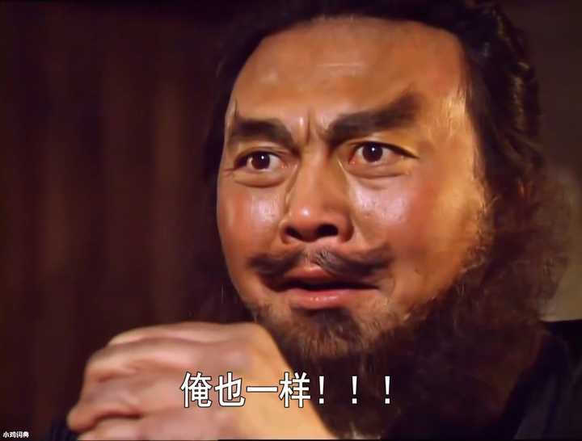
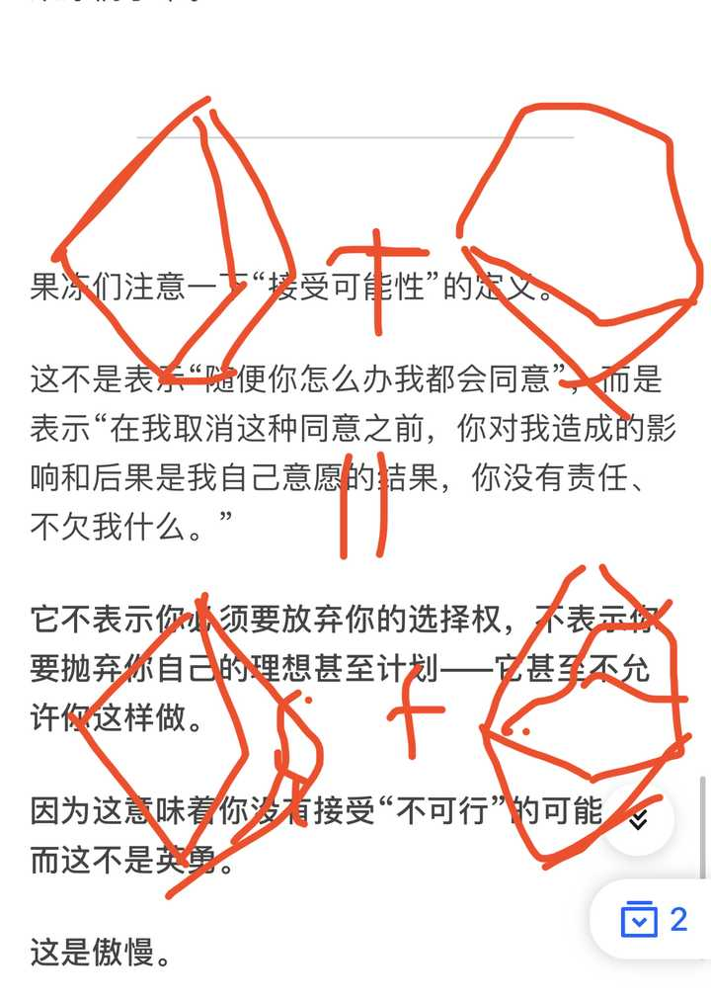
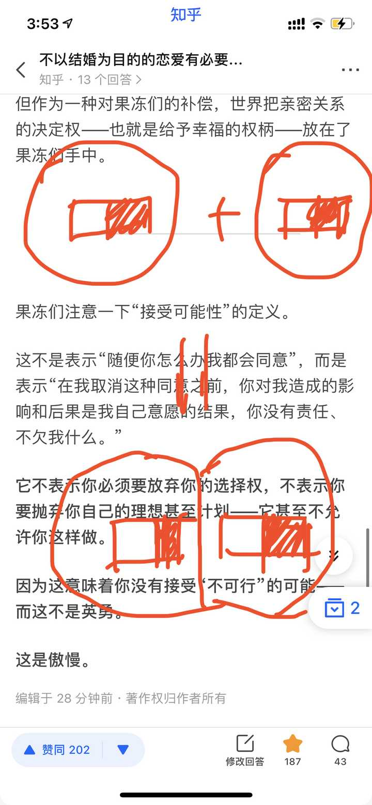
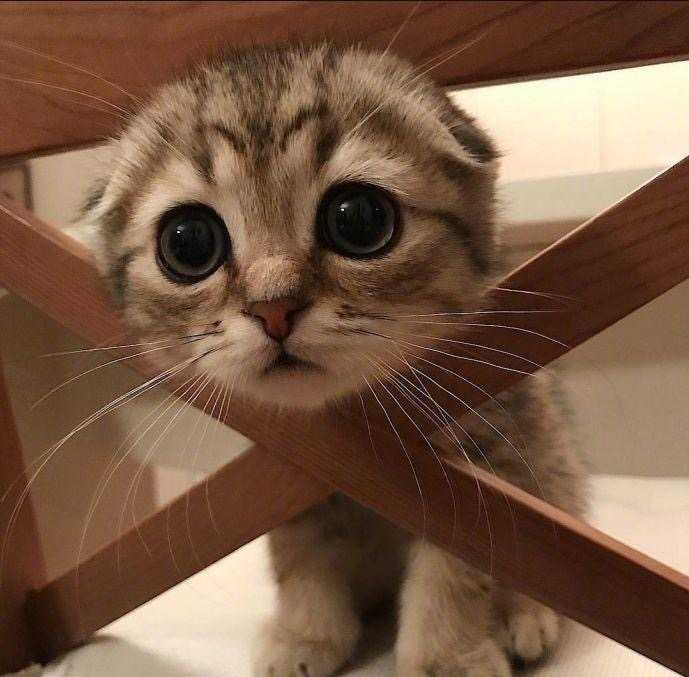

# A06　亲密关系友人与婚恋　第 1 册（共 3 册）

- 专题代码：A06　专题名称：亲密关系友人与婚恋
- 专题界定：恋人、配偶、朋友、同学、邻人及结合、相处、危机、分离。
- 本册：第 1 / 3 册　收录 184 篇　正文字符 217,912
- 语料：`sooon-q9adg-articles-v2.jsonl`（4,305 篇）　SHA-256：`cdc9c271309e1d71d9708889a3a31f4777e0c339ea54c3753521894afdb8357d`
- 生成时间：2026-09-27T00:01:00.997126+08:00　排序：发表日期 → 源序号（全库唯一，不重复）

**标记约定**：`【待审】` 主题仍为暂定；`【排除候选】` 图片/正文过薄的剔除候选；
`【正文标注未完待续】` 作者原文自带未完标记；`【正文缺失片段（复核已记）】` 复核记录已确认的正文缺口；
`【图片缺 N 张】` 源图不可获取。标记只作提示，不改写原文、不改动分类状态。

---

## 4017　无条件的爱

- 日期：2018-10-22　主专题：A06 亲密关系友人与婚恋　副专题：A11;A01
- 源 ID：`c2f0a020-a69e-529c-9688-02dc9ff01663`　原文链接：https://www.zhihu.com/question/298841399/answer/516263613
- 23 概念标签：定义与达意;能力与学习;责任与后果;成本与总账;信用与信任;爱与回应;净输出与不掠夺;权力与异议;技术与工程
- 证据状态：manual_confirmed　初读：read　独立复核：not_reviewed

**问**：这个世界上有无条件的爱吗？

可以被称为爱的，必然是无条件的。这是爱的定义决定的。
而人类作为一种无法永生、无法超越自然规律、同时也无法摆脱自身局限的存在，需要生存、需要收获、需要安全、需要正反馈等等等等所得。
所以爱从逻辑上说，如果要可持续，就只有两种可行的路线：
A. 在完全不需要任何回报的存在身上存在。
B. 由一种外部的、不需要回报的存在帮助人类成全。爱人的人所需要的，不由被爱的人支付，而是由这个存在支付。这样被爱的人并不欠债，而爱人的人又不被耗尽，爱才可以持续。
如果否决掉这个存在，那么毫无所求的爱也就一同幻灭了。没有别的事物能补全这等式的缺口，这等式越是运转就越是失衡，最后“爱”人的人，必要将大笔的“债务”记到被“爱”者身上。“爱”就成了一种强买强卖的放债行为了。

---

## 3981　能力不足

- 日期：2018-12-22　主专题：A06 亲密关系友人与婚恋　副专题：A03;A01
- 源 ID：`ec826fb4-318a-5082-9df6-6da909711a9a`　原文链接：https://www.zhihu.com/question/306554886/answer/557202908
- 官方对象—实践路径：与自己 / 与能力 / 承受
- 23 概念标签：能力与学习;选择与自由;责任与后果;边界与许可;照料与家庭;财富与市场
- 证据状态：manual_confirmed　初读：read　独立复核：not_reviewed

**问**：用“能力不足”为人与人之间的矛盾归因，正确吗？

谢邀。
这个归因是正确的。这是个万能归因法，当然一定是对的。

我要天上星，你能摘给我，我们之间自然没有矛盾了。
我又要月亮，你也能弄到给我，我们也没有矛盾了。
我若要太阳呢、我若要银河呢……
如果你能有这样的能力，我们将可以永远没有矛盾可言。
很可惜，人没有无限的达成他人愿望的能力。
那么反过来呢？我是不是可以不要呢？
我如果有能力不要你帮我摘星，我们就没有矛盾。
我如果有能力自己打赢战斗，那么你即使叛逃，我们也没有矛盾。
我如果有无限的财富，那么你即使偷我抢我，我们也没有矛盾。
我如果对一切人无任何所需，那么任何人不满足我任何所需都不会构成我与任何人的矛盾。
可惜，人没有无欲无求的能力。
那么，如果我能原谅呢？
我需要，你却不能给我，我体谅，我原谅，那么也就不会有矛盾了吧。不是吗？
你是我的父母，我需要温饱的生活，你不能给我，我原谅。
你是我的朋友，我需要理解，你不能给我，我原谅。
你是我的教师，我需要答案，你不能给我，我原谅。
那我呢？在我原谅你的事情上，你是不是都原谅我呢？
我原谅你，你却不原谅我，我能原谅你的不原谅吗？
如果我不原谅你的不原谅，你还能原谅我对不原谅的不原谅吗？
可惜，人类也缺少原谅的能力。
我们没有不需求的能力、没有满足需求的能力、也没有原谅的能力。
一切人类矛盾的根源都是来自这三个能力的不足。
所以你没有说错。
是尼采错了。

---

## 3960　年龄差

- 日期：2019-02-24　主专题：A06 亲密关系友人与婚恋　副专题：A02;A20
- 源 ID：`ec350b6f-521d-5d1e-a683-067a8198d3ed`　原文链接：https://www.zhihu.com/question/19597229/answer/606868982
- 官方对象—实践路径：与友人 / 与恋人 / 吸引
- 23 概念标签：事实与证据;选择与自由;爱与回应;边界与许可;财富与市场;法律与秩序;权力与异议;文明与历史;心理与主体;性别与身体
- 证据状态：manual_confirmed　初读：read　独立复核：not_reviewed

**问**：为什么很多女孩是大叔控？

真心说句实话——可以说从古到今从来就不缺年龄差六岁以上的亲密关系，十岁以上的也谈不上什么罕见。
为什么六岁？一方小学毕业，另一方幼儿园毕业；一方上大学，一方小学毕业，符合你们的定义吧？
你们可以查一查历史上著名的夫妇，看看有多少是年龄差五岁以上的。如果是皇室婚姻、政治领袖就更不提了。
孙中山比宋庆龄大27岁。
周恩来比邓颖超大6岁。
鲁迅比许广平大17岁。
迭戈·里维拉大弗里达11岁。
达利老婆比达利大10岁。
里根比他原配大6岁。
肯尼迪大杰奎琳12岁。
居里比居里夫人大8岁。
马丁路德（没有金）比妻子大16岁。
林肯比妻子大9岁。
纳尔逊曼德拉大妻子27岁。
恩格斯大妻子7岁。
你们的女神赫本比她的灵魂伴侣罗伯特沃德斯大7岁。
你们可以随便想几个伟人，查一查他们的配偶年龄差——注意很大一部分是没有发迹前就结婚的，所以不能简单的用“趋炎附势”来解释。你们会发现年龄差在6岁以上是一种绝不罕见的现象——如果不是主流的话。
差个五六年就描述为“大叔控”“老夫少妻”，认为特别，认为值得单独挑出来作为一个“特异形态”来讨论，这反而是现代才有的独特现象。
你们自己想想为什么。
为什么一种从古到今就存在，而且根本不奇怪的、甚至堪称主流的现象，现在会变成一种似乎“不正常”的东西被知乎拿来评头论足？
谁说人就该选同龄人？说句实话，基本上在这个时代，谁都不该选择三十岁以下的人——这个时代人的心理发育明显滞后，不到三十岁可以说还像孩子一样。
光是心有不甘的吐槽人家正常选择权利本身就是不合格的幼稚表现。
社科答集

---

## 3934　结婚条件

- 日期：2019-05-15　主专题：A06 亲密关系友人与婚恋　副专题：A10;A08;A05
- 源 ID：`85d05c4a-c611-5d84-81b6-04f6c1068fd0`　原文链接：https://www.zhihu.com/question/21778422/answer/684430223
- 官方对象—实践路径：与亲族 / 与配偶 / 结合
- 23 概念标签：能力与学习;选择与自由;责任与后果;成本与总账;爱与回应;边界与许可;照料与家庭;劳动与组织;权力与异议
- 证据状态：manual_confirmed　初读：read　独立复核：not_reviewed

**问**：怎样确定你的女朋友（男朋友）是适合的结婚对象？

有一种非常简单而实用的办法，绝对有效，有空写一下。
这个方法很简单，你要准备好一件婚前协议。
至少要包含以下条款：
1）明确婚前财产、婚内财产的分割。不但婚前财产不参与所谓的共有，婚后双方工作所获取的财产也直接属于个人，不视为共同财产。担当家务要计算报酬，公共开销一人一半，不能支付的部分视为借贷，离婚时应转变为个人债务。礼物应视为接收方的个人财产，没有任何归还义务。
要对财物做出完全的切割，杜绝任何一方搭顺风车的可能，并且做到任何时候离婚均可以干脆利索的完成无异议余地的财产分割。父母的抚养义务归个人，对方除必要的礼节外不承担经济义务。
2）以可能的离婚为前提，做好关于生育和抚育的约定。即如果离婚，子女抚养权默认归谁。
3）约定共同认可“无理由离婚”，即一方提出离婚无需给出所谓合理的理由，也不接受对离婚理由合理性的评判——给都不用给，自然也不必去讨论什么合理不合理。
理想的版本会有两个特征：
1）它是合法的。
2）它的规定之严厉，令人忍不住叫出来“如果是这样，那为什么要结婚？”
是的，看到这一份协议就会大失所望，觉得“那为什么还要结婚”的人，一定不可以选择。
因为那意味着他的一切投入，都是为了获得那些“婚姻价值”。
为什么让对方改变主意必须付出高昂的代价对你如此的重要？你为什么要这么敏感和执着的防范对方改变主意？
解释一下，你在怕什么？
只有那些认为“即使是这样，我也认为仍有结婚的理由”，并且明白“这些约定再古怪，提出这些也是人家的正当权利”的人，才有资格与你继续行路。

不要等到谈婚论嫁再这么做，在谈情说爱之前就最好先亮底牌。
只有能毫无障碍的接受这份协议且有契约意识的人才值得考虑。
这背后的原理并不复杂——一个不尊重他人“古怪”的权利的人，一定会以他自己的价值观和道德观为依据、以他对你造成客观损失的能力为筹码来逼迫你去【跟他】“保持和谐一致”——实际上那是一种以造成你的损失为威胁手段的、要求你向他靠拢的统治手段。
而这份协议会极大的提高在婚姻中做这种尝试的难度。
如果他本来就没有任何这种打算，他将会发现这份协议对他也没有任何冒犯。
如果他觉得这份协议的存在会使婚姻失去对他的“价值”和“意义”，那么你就看到对方实际上是在做什么了。
与ta的贪婪相比，ta这点殷勤廉价得可耻。
ta所谋求的那种权力之贵重，不是任何贿赂所能相配的。
哪怕ta是物质上更富有的一方，看似不签这协议你会在物质上更占便宜，都是如此。
爱一定是建立在在任何时候都会尊重你的意愿的基础之上的，是建立在时刻准备为你的合法权利忍受一切不便的基础上的。
无论如何，“我爱你”三个字不可以成为一种随时可以拿出来命令你放弃某项个人自由的大义名分。世界上再没有比这更有讽刺性，更黑色幽默的败局了。
“别人的合法权利会让我觉得不便，那根本不意味着别人的权利应该被取消，那只是我的命运。如果会造成我的‘损失’，那只是意味着原本那利润就是白得的”——这是值得你格外注意的最重要的个人品质。
这是一个可托付之人必须有的品质。只有真的这样想的人，才配在你有一切不仁慈的权利时得到你的仁慈，而且是一得再得。
因为ta是这样的价值观，ta才会明白这是仁慈，才会明白你的爱。这是爱的敏感性的根本来源。
那些寻求“婚姻的价值”的“契约惊讶者”，寻求的就是“不必感激的权利”。
相信我，那绝不是一种可以接受的追求，也绝不能用“你也不必感激”来交换。
只有能在这“毫无意义”之外仍能看到意义的人，值得你严肃的考虑深入的交往。
不成情侣，也要考虑作为朋友。
因为这是经典的赢家特征。

能签这协议的，就能结。

---

## 3928　射鸟

- 日期：2019-06-03　主专题：A06 亲密关系友人与婚恋　副专题：A18;A10
- 源 ID：`f27e3239-c4b3-5535-8152-17bce9f9cf21`　原文链接：https://www.zhihu.com/question/295251177/answer/704127712
- 官方对象—实践路径：与自然 / 与生灵 / 利用
- 23 概念标签：选择与自由;成本与总账;爱与回应;边界与许可;财富与市场;法律与秩序
- 证据状态：manual_confirmed　初读：read　独立复核：not_reviewed

**问**：使用弓箭射猫射鸟致死，违法吗？

从目前的法律上讲，虐杀城市流浪猫的确是不违法。
但是不借钱给你、不聘用你、不卖东西给你、不买你的东西、不跟你合作、不跟你说话、不跟你交友、不跟你谈恋爱、不教你东西、不推荐你、不选择你、不选择你选择的人……以及将上述一切决策延伸到庇护你的企业和个人身上，
——也都不违法。
法律只负责你不被杀死，是这些东西在保证你能活。
觉得“只要不违法就没事”，是一种人格发育的社会化阶段未完成的表现——俗话说的“没活醒”。

---

## 3922　公开换安全

- 日期：2019-06-16　主专题：A06 亲密关系友人与婚恋　副专题：A03
- 源 ID：`257fe96f-04ef-5ca0-8677-8f91a179fd70`　原文链接：https://www.zhihu.com/question/305452167/answer/716925932
- 官方对象—实践路径：与友人 / 与恋人 / 相处
- 23 概念标签：能力与学习;选择与自由;责任与后果;成本与总账;爱与回应;劳动与组织;权力与异议
- 证据状态：manual_confirmed　初读：read　独立复核：not_reviewed
- 标记：`【正文缺失片段（复核已记）】`

**问**：我是学生会的干事，男朋友是部长，这段恋情该不该公开？

这话估计题主并不一定能领会，但是我姑且还是说一说。如果你将来有女儿，愿你能那时能领悟，能从小教明白她这个道理。
答案是——在任何时候都没有必要追求公开恋情。
A gentleman never tells, a lady as well.
这样说，很多人会没有安全感——“如果不公开，那么没有周围的人看着ta，我万一是备胎怎么办？ta万一背着我脚踏两只船怎么办？万一将来我被背叛，没人替我作证怎么办？”
所谓要“公开”，无非是想靠着社会风评对对方加以约束，以防自己失算罢了。
不要这样做，以免一生不幸。
你过于高估了这种社会性约束对你的有利性，也过于高估了它的有效性和持久性。
如果你的感情关系有一丝一毫是来自这种锁定和约束，那么你将会看到这些约束和锁定对成人是几乎无效的。
成年人要离，就能离，无任何事可阻拦。
你一直拦着，只是在拖延这事发生的时间。
但你拖延时间做什么呢？拖延十年，十年后被弃难道就比今年分开真的“更好”吗？
不要为对方的离去设定任何门槛和潜在损失，不要让对方有任何对离去的顾虑。
越彻底，越好。
那样，你才知道ta在这里的每一秒钟，都不是因为是因为怯于承受失去的损失。
人与人同行，所有的原因不过是怯懦与勇气四个字。若不是因为怯懦，那就是因为勇气了。怯懦越少，则勇气越多。

是因为勇气，那就是爱了。

然后我们再从决策论的角度来谈现实问题。
你要知道你在干什么——你是在计划进行一次超长期的战略性投资。
对于超长期的战略性投资，在前期调研阶段有一个绝对禁忌，就是绝不能主动采用任何可能掩盖危险信号的策略。
你需要的是一个能将危险信号毫无阻拦的识别出来的安排。明白吗？毫无阻拦。
如果你采取的策略在任何意义上会导致对方有掩盖不合作状态的冲动，考虑到你打算做的投资的规模和周期，你都是在自掘坟墓。
不加阻拦的让一切可能的失败尽可能的在早期发生，对你绝不是坏事，而只是好事。
很多人把“千方百计避免分手”看成“经营感情”，这是愚不可及的蠢行。
你辛辛苦苦的维持一个必须要你机关算尽才能稳定存在的关系，这关系几乎必将在你筋疲力尽、最脆弱的时候再给你补上毁灭性的封喉一刀。
你最需要的时候，是你最不能维系的时候。你最脆弱的时候，是ta苦苦等待多年的逃离窗口。
这是让人心头滴血的黑色幽默。

那时候你回头看这些恋爱手段，到底是在干什么？
是在竭尽全力的自欺。
也许十年，也许二十年，你会知道那是多么的愚蠢。
第一性

---

## 3909　香水

- 日期：2019-07-08　主专题：A06 亲密关系友人与婚恋　副专题：A15
- 源 ID：`aa63aa65-d376-58fa-9b14-fe4d09067818`　原文链接：https://www.zhihu.com/question/321895343/answer/741923551
- 官方对象—实践路径：与社会 / 与文化 / 遵循
- 23 概念标签：选择与自由;爱与回应;权力与异议;文明与历史;性别与身体
- 证据状态：manual_confirmed　初读：read　独立复核：not_reviewed

**问**：你开始用香水后明白（获得）了什么？

不准备写那些关于香水审美的东西。
那主要是一个形成自我意识的认知过程，其实与香水本身的味道没多大关系。你喜欢什么香水，与它是不是真的很好闻没多大关系。很大程度上和你脑海中所预料的、你所在意的人的反应相关。
“我相信我会喜欢喜欢这味道的人，所以我用这香来召唤ta。”——这就是“我适合哪种香”的全部实质判断法则。
和客观上“好不好闻”几乎没有任何关系。

准备说说香水的礼仪问题。
注意掌握好这个尺度——在东亚，尤其是中国，什么时候、什么地方你可以用香水？
中国不像欧美，公共场合是没有被香水占领的。在欧美默认人用香水是正常的，甚至是一些礼仪场合中必不可少的部分，像领带一样。
但是在中国，人们对一般场合默认是无香的。所以在中国如果你想用香水，你最好把香味压低到正常社交距离不太容易闻到的水平。
如果是大空间或者开放空间，可以稍微强一点，如果是小空间、封闭空间或者被迫紧挨就坐的空间，那么你应该注意要提前很久施用，施用量要高度控制，或者干脆喷在手帕上再折叠起来放进胸兜之类。
淡雅为上。简单说，最好是只有能与你耳鬓厮磨的人才能闻得到你确切的是什么味道，这在中国才算是稳妥的用法。
香惊四座，并不是好的做法，在中国不是。

---

## 3908　人品差

- 日期：2019-07-27　主专题：A06 亲密关系友人与婚恋　副专题：A01;A05
- 源 ID：`c60c486a-8a23-568d-a844-80fa08292d8b`　原文链接：https://www.zhihu.com/question/337022484/answer/763891776
- 官方对象—实践路径：与其它 / 与陌生人 / 观察
- 23 概念标签：事实与证据;定义与达意;成本与总账;信用与信任;爱与回应;边界与许可;财富与市场;心理与主体
- 证据状态：manual_confirmed　初读：read　独立复核：not_reviewed

**问**：游戏内无恶不作的人是否会比在游戏内尽量行善的人人品差？

怎么评论人品差？
几条逐渐递进：
第一条，取乐的模式可怕。注意，我不是在说谋生的模式可怕，我是说ta取乐的模式可怕。
人要谋生，无可奈何，那么各种擦边球乃至于“人在江湖”的“身不由己”，我们暂时不去加以评价——注意，我没说使上这个理由就肯定算无罪无恶了，我只是说这个层面我们暂时不予评价。
我们只说取乐。
取乐，是人在生存需求之上的东西。取乐，没有“这是为了生存迫不得已”的借口。所以，“取乐的方式可怕”——也就是以恶为乐——就是一种可以说明问题的指标。
譬如，好以杀生取乐，好以成瘾物取乐，好以霸凌取乐，好以见利忘义取乐……
这些都是明确的危险信号。道德与否我们暂且不谈，只是单从危险性来说，这些人身上存在着如利刃一般的危险因素，很容易发展成反社会人格。
第二条，道德投机主义。
什么意思呢？就是不管是什么样的道德原则或者契约、法则，ta是否遵守，全看会不会被抓住，抓住是不是会付出得不偿失的代价。只要经过计算——有时候只是假装计算，实则是被猪油蒙了心的妄断——觉得可能有净得利益，ta就觉得无所谓，甚至觉得不做才傻。
“这里又没有人管”“抓到了也无非重新注册一个新号”——这样的心态，就是投机主义道德观的体现。
这东西有一个对应的中国法则，叫做“君子不欺暗室”——不因为没人看得见，就推翻自己的准则；不因为可以逃脱惩罚，就去作恶。
第三条，道德场景化。
什么意思呢，就是他对一个道德议题没有确切立场。采取哪个立场，全看情境，看自己的利益。如果一个情境里，切换道德评价体系可以使自己脱去罪名、获得在场优势势力的认同，或者甚至获取某种利益，那么他可以非常逼真的——乃至于“真诚”的——切换到那个立场。而切换到另一个情境下呢，又可以根据不同的条件，面不改色心不跳的切换到一个截然相反的立场。
如果你不是同时看到了两个情境下的全部表演，他完全是无懈可击的。每一幕戏都演得激情十足，令人不能不相信他就是那么想的。
你如果把两个情境下截然不同的表演一起拿到他面前呢？他一脸的茫然——“对啊，有什么问题吗？具体问题具体分析嘛。”让你不得不怀疑他缺少涵摄问题本质、发现逻辑矛盾的能力。觉得他大概不是虚伪，而是笨，是傻。
只是，“巧合”的是，他每次“傻”都“傻”在很占便宜的位置上了。
这个就叫做“道德情境化”。这不光是道德虚无主义。道德虚无主义只是道德已死亡。道德情境化，是不但他谋杀了道德，他还要把道德的尸体拿来做成木偶，梳妆打扮起来穿街走巷演木偶戏赚钱。
这几条，都可以不折不扣的算人品差。
但这还不算差到极点。
为啥呢？因为是个人就或多或少有这么一点，大概只是程度不同。尤其是很多表现非常隐蔽，需要一个人不但有坚决的自省的决心，还要有超人的天赋和日积月累冰冻三尺的自省经验堆出来的自省能力。否则看都看不见，自然也就谈不上自我修正。所以，人身上有这些问题，虽然是问题，也是避之则吉，但还不算洪水猛兽。
那什么是极恶呢？
那就是无耻——自己已经明知，已经故犯，但不觉得羞耻，不惭愧，没有不适感，没有焦虑感，于是毫无修正的驱动力。这已经可以非常有效的将这人诊断为“反社会人格”了。这就像有人无意间杀了人，但是却没有发现自己感到有什么不舒服，没有恐惧，没有担心，没有罪恶感，没有焦虑。缺少这些内嵌的良知效应的人，缺少道德的基本机制，是极端危险的存在。
那可不是“避之则吉”而已，而是你要是发现了这种人而不果断回避，就形同把脑袋别在裤腰带里玩火。
在这之上还有一类，可以称为王中之王——那就是不以为耻，反以为荣的。
我把这个回答收进了家族答集，就是为了告诫有意建立自己家族的人——你的家训里必须包含这一条回避法则——要高度注意识别无耻之徒，避免误把ta们纳入自己的家族之中。
怎么识别？比如问问他们关于这个话题的看法，看看他们是不是会祭出“反正没人管”“这样的人多的是，不多我一个”之类的神回复。
发现一个，剔除一个。
不是不可以打交道——事实上世界充斥着这种人，全然隔绝是不可能的。
而是不可以将ta们接纳为你的家族成员。
家族答集

---

## 3878　值得一嫁

- 日期：2019-11-09　主专题：A06 亲密关系友人与婚恋　副专题：A01;A03
- 源 ID：`f6a3ecc2-7a8d-54ca-af9d-3bf05df1e002`　原文链接：https://www.zhihu.com/question/22035988/answer/887331920
- 官方对象—实践路径：与亲族 / 与配偶 / 结合
- 23 概念标签：定义与达意;选择与自由;爱与回应;照料与家庭;技术与工程;心理与主体
- 证据状态：manual_confirmed　初读：read　独立复核：not_reviewed

**问**：什么样的男人值得结婚？

是嫁给“爱我的人”，还是“我爱的人”呢？
告诉你们一个很简单的规律——当你发现一个问题存在两个对立的方案，仿佛阴阳互补，公说公有理，婆说婆有理的时候，往往并不意味着你应该走向“要掌握一个度”这种和稀泥策略，而是你的答案完全找错了。
这个问题就是这样——值得携手一生的人，既不是所谓爱你的人，也不是所谓你爱的人。
因为在这个句子里的“爱”不是爱，而是欲。
它事实上是在“我欲之人”与“欲我之人”中间选。
更深一步的说，是在“得到被追求的满足”和“得到追求的满足”两种你本人的私欲中间二选一。
左手右手，都是你的私欲，这个选择和爱有什么关系？你只是在两种贪婪之中选择，无论怎么选，选到的都一样是本质的贪婪，得到的也只能是基于贪婪的关系。
最可悲的是，对方如果没有受到足够的爱的教育，将会基于同样的逻辑，以“爱”的名义遮眼，出于同样的贪欲选择你。
贪夫贪妇，想要得到所谓“一生幸福”，有多难？
每天都有决裂的几率，仁慈一点，给你们算低一点，99.9%不会决裂，够仁慈了吧？
那么四十年婚姻，不决裂的几率是多少？
0.999^(365x4+1)*10 = 0.00000045。
就算是0.9999，每天万分之一的几率翻脸，四十年不翻脸，机会是多少？——23.2%
有多少人自问做得到99.9%？
你们紧密相处过的人，在三年内闹翻 / 停止交往的比例，是多少？
于是，到老两个白头贪鬼，只是因为怯于面对孤独的可能而勉强咽下自己的失败，苟且而已。
记住，“想要付出”也是一种贪。
“付出”有道德的快感，且生出“道义”上的【不对称债权】。
不要以为你是“很爱ta”，“很想为ta付出”，你就是正义的一方，善良的一方，无可指责的一方，绝对洁白的一方。
那只是另一种贪婪。
爱不是“付出”，也不是“付出欲”，那些东西只是带着肉块的铁钩。你有强烈的当渔翁的冲动，根本不是鱼该为了鱼饵感激你、“归属”你的理由。
爱在行为上，是不求回报的付出。
爱的起点，不是付出，而是【不求回报】。
什么样的人值得？
那些不是出于乡愿和幼稚、而是出于彻悟和信念而奉献的人。
这些人才值得别人为了他们受委屈、扛艰苦。
不是ta为了你的艰苦会来疼你、哄你、供养你、满足你叫“值得”。
而是你吃的苦通过促进ta的努力，转变成了某个正果——ta的成就的一部分，所以值得。
跟着愿意自己吃苦成就他人的人，你将是他的最愿意成就的人，你所吃的苦，也会因为他所成就的他人变成真正不朽的价值。
这才叫值得。
遇见孙中山，值得宋庆龄。
因为郭靖，所以黄蓉。
这里存在着一个非常常见，但是又很难被人跳脱的逻辑陷阱——
“那么，是不是只有圣人才配有爱情呢？”
首先，我们在谈论“值不值得结婚”的问题，而不是“享有爱情”的问题。
我上面的分析绝不是“充满温情”的，而本质上是冰冷而刚硬的、纯逻辑的——你甚至可以说是数学的。
我根本就没有谈所谓的正义、崇高这类形而上学的精神概念，而是纯粹从技术层面、操作层面、实践层面出发，告诉你最大几率获得最好结果的可行方案。
你想要在几十年后最大概率的得到“我觉得值得”的结果，那么你就最好仔细看清楚上面的计算和分析——如此而已。
我没有谈论所谓的“爱情”。
而且，其实你们也没有在谈论“爱情”。你们在谈论的其实是男欢女爱，郎情妾意，耳鬓厮磨缱绻反侧。但那并不是“爱情”，那只是一种心理应激状态。在本质上与抽了大麻后的飘飘欲仙没有区别，只是大麻的感受是大麻刺激起来的，而“爱情”的感受是一系列的社交仪式刺激起来的。你们在意的是如何能有效、廉价而持久的获取这种感受。你们把获取这感受的一系列过程、把能刺激这感受的事物取名叫了“爱情”——如此而已。
这个东西与“爱”这个词并没有根本的关系。
有无数在你事后醒悟后发现对你从头到尾都没有一丝一毫一分一秒的爱的人，曾经无比有效的挑起这感受。他根本用不着爱，就可以让你感受到“爱情”，不是吗？
你换了一个，再次感受到了“爱情”，后来再次又发现——这个其实追根到底爱的仍然只有他自己——他又根本用不着爱，就让你感受到了“爱情”，不是吗？
你还要多少次亲身测试才能发现？
——难得的根本不是“爱情”，难得的是不破灭。
不是圣人才配得“爱情”，而是圣人才配得不破灭。
不破不灭，才是你在追寻的东西。

---

## 3847　翻碗底

- 日期：2020-02-12　主专题：A06 亲密关系友人与婚恋　副专题：A03;A16
- 源 ID：`60af0305-66e2-5717-a9de-3afcbcbfb73f`　原文链接：https://www.zhihu.com/question/370501557/answer/1012025229
- 官方对象—实践路径：与社会 / 与组织 / 退出
- 23 概念标签：定义与达意;选择与自由;成本与总账;信用与信任;权力与异议;心理与主体
- 证据状态：manual_confirmed　初读：read　独立复核：not_reviewed

**问**：如果「知乎」即将改名，叫什么新名字会取悦你？

不接受知乎的自我命名，只能自己注销账号离开。
世界上没有用别人的私营服务去侮辱别人的“正义”。
人要有点基本的是非对错观念。
不要以为这只是一时一地谁是强权的问题，这会影响到你对自己的认知和别人对你的观感。
你以为这是正义使者，在别人看来却是一种绝不会想要在自己生活中保留的混蛋。
后者对你的生活比前者有决定性得多。
看得见我这条的人们记住——一个人无论在任何对象面前犯现在这种行为，如果你珍惜自己的生命和幸福，请务必不要对与这些人交往抱有会有好结果的侥幸。
食碗面，翻碗底，是为人大忌。

这不是说你不能不喜欢、不能不高兴，而是说你不喜欢、不高兴，不意味着你有权利侮辱对方。
不喜欢、不高兴、可以用严厉的表达，严厉的表达是不找借口、不假公济私、不阴阳怪气的，它不是侮辱和霸凌。
不要染上侮辱和霸凌的恶习。
很多人的思路是“霸凌只有对弱者才算，对强者就不算”。
比如泰森一拳能打死牛，那么趁泰森睡着，踹泰森一脚算不算霸凌泰森？
当然算。
背后捅泰森一刀算不算？
当然也算。
马云比你有钱得多，匿名造马云的谣算不算？当然也算。
平台有绝对的管理权，那么阴阳怪气的侮辱一下平台算不算？
也算。

什么叫霸凌？就是背叛和平的预设发起的偷袭。
如果你是在战场上，大家一开始就知道对方是敌人，那么自然霸凌这个概念自然失效。
除此之外，人对人普遍存在和平架设，这使得借助背叛这个假设而做的攻击尤其的不义。

不要以为学校里面的恶霸那种攻击就叫“基于实力的攻击”——堂堂正正为什么要找小巷子卫生间？为什么要威胁对方不准告诉家长、告诉老师？
霸凌最大的问题就是“实力不济卑鄙凑”，靠卑鄙形成了局部武力优势，然后把“卑鄙”两个字捂住，昂然谈起“压倒性实力”来。
何其无耻。
这种卑鄙得逞造成的强大感只是一种幻觉、迟早有一天让当事人在信心满满时撞上real deal，粉身碎骨。

仗着“法不责众”和“语言技巧”搞这类阴阳怪气，其实跟“背后捅泰森”性质没有任何区别。
这没有资格拿来作为一种勇敢吹嘘，只是一种不自知的无耻而已。
你们不要沾染。

---

## 3832　不配被爱

- 日期：2020-03-07　主专题：A06 亲密关系友人与婚恋　副专题：A01
- 源 ID：`7e19ce1e-073f-507d-b5b3-861ecb2d9a86`　原文链接：https://www.zhihu.com/question/53468590/answer/1062009567
- 官方对象—实践路径：与友人 / 与恋人 / 相处
- 23 概念标签：事实与证据;定义与达意;能力与学习;选择与自由;成本与总账;爱与回应;净输出与不掠夺;边界与许可
- 证据状态：manual_confirmed　初读：read　独立复核：not_reviewed

**问**：为什么很多人会觉得自己不配被爱?

没有人配被爱呀。
有人爱你只是因为ta们决定要爱你，根本不是因为你配被爱。
无论对方付出的是多么微不足道，而你是多么人中龙凤、如何伟大，这个结论都是不会变的。
坚守这个基本认知，是你对爱你的人的最基本的爱。
如果爱有所谓配与不配的资格问题，那么有这个认知是认证要求的第一条。
任何认为自己配得爱的人，都必然不配。
但是不配又怎样呢？
爱注定是交给不配的人的。正因为它是交给不配得的人，它才是爱。
否则，不过是崇拜、不过是谋求青睐的贿赂、不过是投资罢了。
想了想，可能很多人被绕晕了。换个更精致的比喻来说明这个配不配的问题。
假设有一种“被爱资格考”，而且及格分60分。及格了，你就可以被称为“配被爱”。
现在我们来看看这条规则实际上是怎么被执行的——
最初，在评卷人自己年纪很小的时候，常常因为缺少综合评卷的能力而凭借片面的证据评分。
比如偶尔看到这个人写字很漂亮/一篇作文很优秀/画一手好画，令人惊艳，于是想象“既然写字很漂亮/一篇作文很优秀/画一手好画，想必其他方面一定也不错，肯定超过六十分”，从而给出了超过六十分的评分。
评卷人很难摆脱这样的行为方式——因为社会习俗上的压力、从众的本能，ta们觉得自己必须要在一个很短的时间内评完卷子，好歹挑出一个及格的来完成自己眼下的人生科目。
问题是，“考生”们哪怕不经过任何训练，也会明白这个考试的缺陷所在，所以纷纷学会了“应试技巧”。
也就是说，无论那几个月或者几年考察期里的要求如何苛刻，考生们总可以通过充分的事前准备在ta们自己选择的有利的时机、有利的条件下做最好的展现，从而诱使考官从局部优良表现去想象一个总体最高分。
约会的时候展现完美，诱使对方想象出整体的完美。于是这种“基于想象的评分”就可以全面超过60分。
不用说，“全面及格”里还有“主考官”们年轻识浅、判断力肤浅的影响。主考官们自己还没有见过世面，一般家庭也极少做洞察力的训练，所以ta们常常会基于一个实际上相当低的满分标准去给一个其实相当恶劣的行为以及格评价。
考试机制本来就已经在实质上将“全面的被爱的资格试”偷换成了“被爱的首轮资格试”，考官自己还憋着要故意放水，而且考官的标准还超低。
这轮考试得出的分数的有效性之低，不知令多少父母辗转难眠。
上面这两个高分基础，随着剧情发展是一定会受到严重挑战的。
日复一日，那份本能的自我激励去做超常态良好表现的心理动力在散失；年复一年，主考官逐渐见多识广，历尽人间。
于是“分数”每年都在下滑，如果不是飞速跳水的话。
即使这分数仍然看起来还在60分以上，主考官们也已经看到了悲观的趋势——向下的斜率不是收敛的，甚至看起来不是匀速的。
原来当初的“写字很漂亮/一篇作文很优秀/画一手好画”，仅仅只是我没有见过真正的好字、好文、好画的结果。不但如此，我据此想象出来的那些高分物理、高分化学、高分数学……部分或者甚至全部都是错误的估计。其实ta物理几乎是零分，化学三十，数学二十五。
不但如此，随着我的阅历增长，同一份试卷让我再评，连二十五分都没有了。用不着你变得比以前更坏，在我眼里你其实也在变糟糕。
于是，谁在60分以上呢？
其实你年纪越大越明白——这个评分体系是如此的残酷——它其实要考无数科目，以至于要求每一科都至少有60分以上是不现实的。
而另一方面，更加残酷的是，这一门八十分，并不能“抵消”另一门的不及格。
只要一门不及格，所有的优秀都无意义。
原来这场考试不是平均分制，而是“以最低分为准制”。
到这里，你应该明白了。
所有人，只要是有限的人，都是不配的。
而明白这一点，恰恰是你的付出真正谈得上爱的关键。
从此以后，对你而言，爱这件事情就存在一个绕不过去的前提——要么你就干脆抛弃它，要么你就必须接受游戏规则——你必将将它赋予一个不配的人，并且你必将作为一个不配的人来接受它。
从你明白这事实开始，你再赋予人的爱，就是你自己知情同意之下付出的爱。对方再没有“辜负”的可能。对方的“不配”也不再构成任何意义上的“欺骗”。于是你也就解除了对方一定要如何如何才能配得上、对得起你的爱的强制性要求。
于是，你的爱里面除了最基本的物质帮助，还附带了一份无价的礼物——自由。
从你明白这一事实开始，你虽然仍是不配之人，但你将只能接受同样明白这一点的人的爱。因为你知道，只有在这预先同意的“用户协议“之下，你才能免于被时时审判、时时定罪，被随时随地“抽走银根”的恐惧。
其实你知道，无论多么微薄，只有接受了这个协议的，才是爱，你拿到了就是受益的。
无论多么丰厚，没有接受这协议的，都是债，你拿到了就是欠债的。
无论你是想给人爱还是想得到爱，都必须从完全接受“无人配得爱，包括我自己”这一条理念开始。
逻辑上没有其他解。
所以，在一切的不及格之中，懂得这一点的人分数才是正的。
不懂的人，无论其个人素质多么优秀，其实分数是负的——那些能力将来只是用来向你要债用，那些“付出”都是要你连本带利归还的债务，你收得越多越近乎奴隶，这怎么能算正分呢？
所以我说在一切不配之中，懂得这一点的人总是更配。

---

## 3814　最重要的能力

- 日期：2020-03-21　主专题：A06 亲密关系友人与婚恋　副专题：A01
- 源 ID：`709c7581-b9fb-5c40-9d0d-bf5f0b3ec31b`　原文链接：https://www.zhihu.com/question/19602183/answer/1095057238
- 23 概念标签：能力与学习;爱与回应
- 证据状态：manual_confirmed　初读：read　独立复核：not_reviewed
- 标记：`【极短回答】`

**问**：人最重要的能力是什么？

当然是爱和被爱的能力。
不接受反驳。

---

## 3803　凭爱分手

- 日期：2020-04-27　主专题：A06 亲密关系友人与婚恋　副专题：A01
- 源 ID：`557cd798-03d7-57fd-a7a4-14f743e1ba13`　原文链接：https://www.zhihu.com/question/308996023/answer/1183361290
- 官方对象—实践路径：与友人 / 与恋人 / 分别
- 23 概念标签：能力与学习;选择与自由;责任与后果;成本与总账;爱与回应;边界与许可;照料与家庭;财富与市场;法律与秩序;权力与异议;心理与主体
- 证据状态：manual_confirmed　初读：read　独立复核：not_reviewed

**问**：分手后真的能看出一个人的人品吗？

很多人以为相处是因为爱，分开是因为不爱。
错了。
分开时觉得自己已经不爱、乃至于开始恨的，如果对自己足够诚实且追问到底，会意识到——其实，从一开始那个就不是爱。
生于非爱，走到终点连这似爱而非爱的欲望也消散了，所以屈辱、不甘、沮丧、狂怒，要公平、要勉强、要补偿。
求一不得，退而求其次。其次也不得，退而求再次。终于求任一而不得，于是要报复。
“你吃亏？当初谁强迫你来？你自愿的，你报复我？我还吃了亏，我吃的亏是我亲自吃的，比你更大、更痛，你还‘报复’我？！”
两个贪鬼，以为可以“合作双赢”——“我贪求的，是你天然有而不匮乏的；你贪求的，是我天然有而不匮乏的，我们互补。”抱着“如呼吸般自然就可以互惠互利，长期幸福”的期待和狂喜，自以为由此贪欲就得到了永久的满足。
这打算的本质，是想以我变成你的奴隶，换你变成我的奴隶。这样我们就都各有一个奴隶了，双赢啊。
问题是，你们受过奴隶的训练吗？你们受过当奴隶主的训练吗？
你之所以敢这么赌，无非是在赌对方一定是一个足够仁慈的奴隶主，以至于会让你这个奴隶变得特别好当，只需要摆摆姿态就足以应付。把你的班当完了，你就可以安心享受自己当奴隶主的快乐了。
可惜你的那位同行也是这样想的。
如果你们真训练有素，那还说不定真有点希望。问题是，两个领钱上班都满腹怨言，不知服从为何物的小朋友，有希望吗？
等这期望落空了，绝望了，贪婪成性、以贪立身的人怎么可能在这最后的时刻瞬间就能丢开自己守了几十年的基本逻辑？怎么可能不把分开变成仇恨？
贪婪的人找贪婪的人“互补”，除非半道双双醒悟，否则只要一个不醒悟，这关系都必然最终化身无间地狱。
这种厄运，你甚至没得逃。
因为不悔改的人，会觉得都是对方的错。但凡习惯把错误总结在别人身上的人，必不能摆脱重蹈覆辙的命运。逃离一个，换一个，这一个也必然被贪婪逼迫成同样的结局，只有路径的细节差异，没有结局的意外。
从旧牢房，换到了新牢房，就等于出狱了吗？
顶多因为已经实在没有本钱再挣扎，于是因为恐惧最终绝望而无限委曲求全，每一天都活在地狱里，相信自己有一天能适应地狱。
“习惯了，就好了。”
这可真要祝你好运——地狱可是创意无限的。
爱是爱，贪是贪。
爱遵守的基本逻辑，是对方不能因我的存在而受无谓的痛苦，尤其是不能受我主动施加的痛苦。最好，能做到比没和我接触过有净收益。
这是没有前提的，没有“我必须不吃亏”、“我必须够本”、“我必须不委屈”、“我必须有面子”等等等等这些前提的——看清楚，无论如何。
无论如何，不能让对方信任我一场、相交我一场、已经受了与人相交所必然要承受的不便、我的无能造成的必然损失之外，还受到来自我的任性、我的贪婪的额外的损失。
没有任何理由，可以改变这个基本原则。
无论我觉得有多失望、多屈辱、多无辜、多吃亏，都不改变这个基本原则。
因为人必定是无能、任性和贪婪的。只要与人交往，就必须要忍受人的无能、任性和贪婪。
你要记住，你要对人做的任何一点事情，都必然是在接受人的无能、任性和贪婪的前提下做的。
你想要对方得到好处，要在接受对方的无能、任性和贪婪可能造成的一切代价的前提下去达成。
事情常常是对方要得到一分的利益，而你实际付出的是101分。不管你觉得是否公平，世界就是这样安排的。
你想要对方得到1分，你必须接受可能付出101分的准备。
如何做到只付出91分就可以让对方得到1分，乃至于只付出10分就让对方得到1分，甚至，付出1.5分就让对方得到1分，这是爱的技能问题，与爱的原则无关。
磨练出爱的能力，将爱的成本控制在你自己能承受的范围之内，这是你选择要爱人所必须解决的问题，这是你要为你自己的选择而承担的责任。
你选择要爱人，因为你自己的无能而产生了你承受不起的代价，是你要为自己的决策错误而承担的责任。
你们看到爱的关系里的魔鬼没有？
爱的能力有两面——爱的能力与被爱的能力。
爱的能力，就是付出多少分就能让对方得到多少分的有效性的度量。这与你绕过和处理人的无能、任性和贪婪的能力有关。
被爱的能力，就是让对方要付出多少自己才能得到一分，是无效性的度量。这与你对自身的自身的无能、任性、贪婪的管理有关。
爱的公式是这样的：
被爱者的净所得N = 爱者的付出P*爱者的有效性系数E - 被爱者的无效性U
E永远低于1，U永远大于0。
所以，N永远小于P。
对于欠缺爱与被爱的能力的两人，这是一种什么样的亏本生意？
甲只得到了1分，乙其实付出了101分。甲拚了101分去回报乙，乙却也只得到了1分。
在乙看来——我付出了101你却只还了我1？
在甲看来——我只得到了1，你却逼我付出101才满意？
这就是隐藏在亲密关系中的撒旦，逻辑的魔鬼。
每一个遵循“保本获利”法则的人的“爱”最终都必然在这质问之下哑口无言，这也正是为什么已经有千千万万的父母在教导自己的孩子“机灵点，要拎得清”——因为他们本能的察觉到了爱是一项从账面上看必然亏损的生意。
那么，人可不可以做到无效性是0呢？
人的无能、任性和贪婪，只有程度问题，没有有没有的问题。因此人类的无效性在长期看不可能为0。无效性低于0的，只可能是全知全能、自有永有、无欲无求的上帝。
事实上，爱有两个支撑——
第一，低无效性、高有效性的两个人之间的关系导致的合作会有更强的比较竞争优势。能在社会分配中分得更大的份额。
他们会赢得更多的选举和市场竞争，获得社会的统治地位或者市场的主宰地位，借助赢家通吃、拿走失败关系中的人的配额，从而客观上比较容易获得物质上的成功。
换句话说，自然之中设计了奖励爱人者的内在逻辑。
但即使如此，物质的安全乃至充裕，并不足以真正的抵消关系本身的无效性。
再衣食无忧，心伤是无价的。心伤透了，你要这铁棒有何用？
它要靠第二条来救赎——人生的意义。
人生的本钱是生命，而无论你如何保养挽留，生命是终将逝去的。
不管你怎么珍惜，怎么避免损失，最终都必然全部损失。因此，避免损失在终极意义上不成其为收益。
人生是一种以必然损失的一切换取可能幸存的一切的游戏。
你付出了101分，换了1分，你没吃亏，因为你那101分本来就是要消失的。你好歹还换到了1分。
不管你付出了多少分，只要换到了1分，你就比1分都没换到、最后全被没收要强。
这就是爱之所以永不亏损的真正逻辑。
你明白这个逻辑，如果因为某个原因不得不分开，你就不会成为一个被激怒的恶魔、一个对方追悔莫及的噩梦。
你没有亏损、你没有冤屈、你没有失败。你怎么会惩罚、追讨、报复？
能清楚的理解这个逻辑的人，有压制内心恶魔的天然抗性。
由此而带来的力量和气场是洞金穿石的。
人与人最大的障碍，就是对将来关系因为种种自己不能控制的意外、自己无法克服的无能、任性和贪婪而终结时可能遭受的追索、惩罚和报复的畏惧。
但凡“爱”，最后必破产，必被追索、惩罚和报复。吃一口糖，断一根手指。就算我舍得断指，我也只有十根手指。
所以我不要“爱”了，因为我没手指了。
这就是不安全感的根源。
而在真正懂得并遵从爱的逻辑的人看来，那101不是对方欠下了，而是自己花掉了。自己花掉101，买了将自己的1分生命寄存到对方身上于是不再会因为自己死亡而消失的终极价值。
如果没买到，是我无能——要么是我爱的能力不足，要么是我的眼光不足，总之是我自己的责任——不是对方无义。
从始至终，没有可报复的理由。只可能有感谢的理由。
这样的人，在这个世界上每一个都是珍宝。任何财富、权势、美貌，都不足以抵消这个基本认知带来的价值——如果没有这个基本认知，那些财富、权势、美貌，只会变成你将来欠下的债和架在你脖子上的刀、套在脚上的锁链，有什么资格来相提并论？
对于懂得的人，
在一起，是因为爱。
分开，是因为更爱。
那么分手凭什么演变成灾难？
看得懂这个逻辑，就是所谓的“人品”的本质，如果不是因为遵奉这个逻辑，那只不过是放长线钓大鱼的诡计罢了。

---

## 3790　赔我啥

- 日期：2020-05-15　主专题：A06 亲密关系友人与婚恋　副专题：A05
- 源 ID：`68fd2b62-0858-5b4e-958d-32e20e659e29`　原文链接：https://www.zhihu.com/question/55783301/answer/1224159564
- 官方对象—实践路径：与友人 / 与恋人 / 相处
- 23 概念标签：事实与证据;定义与达意;能力与学习;选择与自由;责任与后果;成本与总账;信用与信任;爱与回应;净输出与不掠夺;边界与许可;照料与家庭;劳动与组织;财富与市场;法律与秩序;权力与异议;心理与主体
- 证据状态：manual_confirmed　初读：read　独立复核：not_reviewed

**问**：有哪些事是谈过多次恋爱才明白的?

先谈一个案例。
有个妹子提问，说自己的男朋友很爱自己，但是知道自己曾经有过三个前男友，而且都发生过关系，内心完全接受不了。痛苦纠结了好几天，男友提出能不能给他一点补偿，哪怕随便一点什么补偿。
看似这是个很罕见的特殊条件下才发生的问题，其实并不是。在亲密关系中实际上经常发生这种“因为和你相爱导致我很痛苦，你应该补偿我点什么”的“受损方”对“致损方”的诉求。
这事的问题不是具体补偿什么，而是你没办法接受创造这种先例的后果。
这是一个什么样的先例呢？
就是“对方基于自己的价值观认为自己吃亏了，你就要承担对方认定的损失”。一旦造成这样一个先例，人与人之间相处的逻辑可能性就崩溃了。
因为按照这样的伦理原则，可“追责”的事情就多了去了。不但是他可以向你究责的事由一下就浩如烟海，你可以向他究责的事情也浩如烟海。
举个例子——假设他当年高考没考好，基于同样的原则，他也就对你产生了赔偿责任，应该赔你点什么；或者他曾经有一个好工作，被自己搞没了，那也是对不起你，应该赔你点什么；他曾经丢过一辆自行车，那也是对不起你，应该赔你点什么。
你将来跟他相处，按他这个处事逻辑，你怕是要被“罚很多款”。罚得多了，你很难憋得住不运用同样的逻辑来审视他。不看还好，一看那真是可罚点无穷无尽。
这个逻辑的害处是什么呢？它无意中把对人的要求抬高到了神的水平。
一个人完全可以自己设定高门槛，比如——“对我绝对好，有任何我不满意的地方都会赔偿给我”，这个是各人的自由。只是问题是，假设有一个人做得到这样的标准，那么这个完美的人有谁能抗拒？有谁不渴望？有谁不追求？你何德何能，配得这一位的特别照顾，来把提出这种要求的机会让给你呢？
凭什么这个资格该给你？

人与人相爱，如果真的是爱的关系，就要明白：
无论自己付出了什么，对方没有任何义务要来满足自己的任何要求。无论自己遭遇了什么，自己也没有任何立场，向对方提任何要求。
因为“认为自己付出了什么，对方就有义务也要付出点什么”，这本质上是一种强买强卖。
你来放下一袋米，然后顺手拎走我一只鸡。你认为你这一袋米可比我这只鸡值钱得多，我没资格有什么不满。
明天你又抱来一台液晶大电视，然后把我的小黑瓶小棕瓶捡出来扔掉。
后天你放下一斤龙虾，拿走我两瓶盐。
再到后来你更直接，你觉得受了巨大的委屈，这次你真是付出了“无价之宝”，你要抽我两耳光解恨，不然你觉得心理不平衡。
只要你觉得公平，你觉得我是占便宜的一方，你就可以自由自在地看中我什么就拿走我什么，我无权“不识抬举”，拒绝你的好交易，是吗？
大哥，你是在和自动贩卖机谈恋爱吗？自动贩卖机也不能接受你塞一包烟来换一盒套套啊！
你单方面认为对方如何划算，根本不是对方必须接受你的交换安排的理由。如果这样的逻辑可以成立，那么我可以抓一把我家珍藏多年的泥巴，换你挨一个大嘴巴。
你知道这块泥巴在我家多久了吗？它从小开始就在我家地里了看着我长大的好吗？它养育了我家列祖列宗好吗？我爷爷为了买下这块地足足当了二十年土匪，被人追得满山跑，差点小命都没了好吗？
来，给你两块，给我再踹一脚，乖。
为什么世间的少男少女们普遍有这种“我付出了这么多，你怎么能不感恩”的蠢念？
因为ta们是从爹妈身上学的。从小父母对自己的爱就是这么个执行法则。
ta们在长大的过程中，长期面对四个基本体验：
A）父母给自己吃穿住行。不仅我的父母如此，我的同学的父母也如此。
B）父母决定自己的言行举止。不仅我的父母如此，我的同学的父母也如此。
C）父母会说“我供你吃穿住行，我就有权决定你的言行举止。你想不听，可以，等你自己养活你自己的时候你就可以不听”。不仅我的父母如此，我的同学的父母也如此。
D）父母说自己对子女的作为是爱。不仅我的父母如此，我的同学的父母也如此。
这四个体验，固定了人对于“爱”的默认理解。导致绝大部分的少男少女们在没有在南墙上撞得头破血流、 彻底绝望之前，毫无悬念地犯下这种泼天般的错误——
1）无意识地认为只要建立了名为“爱”的关系，自己就自动对对方拥有了父母曾经对自己拥有的全部权利，开始当对方的爹/妈。
2）无意识地认为只要建立了名为“爱”的关系，自己就自动对对方拥有了自己对父母存在的全部义务，开始当对方的子/女。
即在实际上把“互爱关系”构建成了一种神奇的复合关系——父女 / 母子 的薛定谔态双相耦合关系。
这种关系的三态切换与否，全看当时相处的局部上下文中隐藏的微妙暗示，以及当事人对信号的解读/误读走向。
我们随手描述一个最一般、最典型的关系动力学过程：
在A需要自己的恋人的时候，B误读了信号，实际上当了A的爹，而B作为无意识的父亲释放出来的信号，根据气氛的微妙，既可能导致A的自我意识切换到女儿的状态，构成临时的父女关系，也可能导致A的自我意识被切换到母亲的状态，构成临时的“你是我爹，而我是你妈”关系。
如果是前者，某些时候会走向虚拟子女享受到猛烈的宠溺感、而虚拟父母产生强烈的被依赖感/自我实现感的共振的状态，我们记为“+父女”和“+母子”。这是大部分所谓恋爱关系里最甜蜜的部分，少男少女的天堂。——可能老去的父母被与自己同龄的新父母替补了。曾经令自己无法接受的父母，被充满无限可能的新父母补救了。世界充满了希望。
某些时候，走向虚拟的子女感受到冷漠，而虚拟的父母感受到沉重的拖累的状态，我们记为“-父女”和“-母子”。这时候虚拟子女从旧父母身上感受到过的一切负面记忆，都在这新父母身上眼睁睁的再现，如同堕入恶梦的深渊。而对这“新父/母”，则是猝不及防地感受到了从未体会过的无力和脆弱——要无条件负担一个人的人生，如同在要求一个凡人一夜之间想象自己成神。
这座抬头看不到顶的大山，我怎么扛得起？我只得到过那么一点已经褪色的甜，我就得扛起这座山吗？我真有点后悔，我能不能后悔？
如果是后者，因为亲子关系的那四条规则，会发生猛烈的决定权争夺，我们记为“-父母”。双方都被肾上腺素爆棚的“父魂”附体，变成了一场无意识的“到底谁是谁爸爸”的无脑斗争。不分出胜负誓不甘休，而分出胜负又办不到。结果只会是一方或双方在“你怎么对我的一片苦心完全不感恩”的绝望情绪中筋疲力竭，阵亡在生理和心理的极限之下。
所有的随机组合中，有积极感受的仅仅只有“+父女”和“+母子”，要注意，“-父母”实际上是双个组合的总集（因为实际上包含了“-父母”“-母父”“-父父”“-母母”四种组合。因为父母对子女其实是接近无性的，男性也可能无意中化身为虚拟母亲，女性也可能无意中化身为虚拟父亲。但是自我性别则是分明的，女性几乎不可能化身为虚拟儿子，反之亦然。）
我们把这种建立在“主流亲子直觉经验”之上的亲密关系的所有可能状态列出来—— +父女、+母子、-父女、-母子、-父母、-母父、-父父、-母母。
即使我们假定这八种状态出现的机会完全均等，对于这关系里的个人来说，体验会很好的可能性是多少？
1/4。
恶感机会呢？
3/4。
再加上对人类而言，负面体验天然有绝对更大的权重（w）——三份好不见得能抵消一份不好。
并且负面体验是边际效用递增的——第二次对我不好比第一次对我不好杀伤力更大，而正面体验却是边际效用递减的——第二次对我好比第一次对我好甜蜜度更小。
那负面的3/4还要先乘以3倍，并且随着时间推移，还要乘以一个与时间t正相关的加权系数a——甚至时间的积分的加权系数（旧恨难忘）。
你在任意时间感受积极的几率（opportunity of feeling happy）是多少呢？采用乐观得多的线性边际效用递增关系计算，如下
OOH = 1/(1+3*w*a*t)
这就是你无限向下的未来。
所以，你们会分手，你们会失败。
一败，再败，直到你们认错为止。
那么，有没有办法依靠什么手段去应对补救呢？
如果你非要玩这个十死无生的游戏，只有两种几乎算不上是办法的办法。
首先，如果你捕捉事态变迁信号的能力比较强，发送分明信号的能力比较强，你有更大几率控制事态发展，减小负面态出现的几率。
也就是说你可以“练功夫”。
这就是为什么女生容易喜欢大叔。
时间相处得久，双方也会磨合出某种信号协议来，略微抑制负面态出现的几率。
但是，这些协议的效用是双向的，一旦负面态抑制失败，负面态的伤害性里就会叠加“对方有意破坏默契”的额外“背叛效应”。几率是减小了，威力却变大了。
这只不过能降低爆炸的概率而已。炸还是要炸的。
第二个谈不上办法的“办法”，就是沉没成本越来越大，再投资的能力越来越小。忍耐的必要性和现实性在不断攀升——没力气爬出这越来越深的陷阱了。
放弃治疗，算一种办法吗？

而对那些几乎没有可靠解读信号能力，也没有准确有效发送鲜明信号能力的少男少女们来说，想要手无寸铁、闭着双眼的去驾驭甚至没有主动意识到的这种“主流亲子直觉模型”的逻辑不稳定性和强烈负面性……
这么说吧——数学上，可控核聚变比这更容易实现。
记住：
在“在亲密关系中，对方没有任何可被单方面施加的契约义务”和“在亲密关系中，只要我觉得付出了足够对价，就拥有向对方施加义务的权力”这两种伦理之中，
后者的破产预期存在数学证明。
这里有一篇姊妹篇：
分手后真的能看出一个人的人品吗？
下面这个算背景阅读：
女性相关答集
社科答集
家族答集

---

## 3788　狮子

- 日期：2020-05-16　主专题：A06 亲密关系友人与婚恋　副专题：A02
- 源 ID：`c395b3a1-0c33-5146-8f30-e4c0c57787e0`　原文链接：https://www.zhihu.com/question/394637427/answer/1226993718
- 官方对象—实践路径：与自己 / 与原则 / 坚持
- 23 概念标签：事实与证据;能力与学习;选择与自由;责任与后果;成本与总账;净输出与不掠夺;边界与许可;照料与家庭;法律与秩序
- 证据状态：manual_confirmed　初读：read　独立复核：not_reviewed

**问**：相亲对象明知道女孩子腼腆害羞，还总是开带颜色的玩笑，是不是不尊重女孩？

先明确警告：下面这一切的交往准则，都是为遵从这样一个财富观（如何树立正确的财富观？）的人准备的，对其他人是无效的。不遵从这样的财富观，将无法获得执行这个法则的伦理基础，勉强模仿只会陷入绝境。

你们可以把这个法则称为“狮子法则”：
任何故意冲击我明示的社交禁令的行为，都必将被我处以社交流放。

下面是执行指南：
人只能出于过失、出于能力不足、出于不知情而打破你设下的明文的社交禁令。只有非故意的可以谅解。
只要是故意的——经过明确而正式的提醒而再次触犯就足以证明，就只有处于社交流放一种可以选择的处置。
是“朋友”，取消“朋友”的认定——这只是一种对错误认定的实事求是的更正。
是男/女朋友，分手。
是配偶，离婚。
是亲戚，停止走动。
是父母，降低接触到法律允许的最低点，直到父母作出保证不再重犯为止。
我再重申一遍前提——你衷心奉行上面的那个财富观。
只要你奉行那个财富观，你对人类就是一个净输出者。净输出者对任何有机会结交的人来说，都是绝对资产、绝对有赚头。也因此，净输出者享有一项旁人羡慕不了的绝对特权——TAKE ABSOLUTELY NO SHIT ——免于任何侮辱。
因为你有权以任何理由随时切断对他人的输出，而且没有任何义务去对任何人解释。没有任何义务去经过任何人的批准。
你本来就是给予者。你要停止给予，无需理会对方任何“这不公平”的喊叫。你是净所得者，你没资格跟我谈“公平”。
既然我与你的交往之中我是净输出方，你让我有任何不高兴，不论我这不高兴多么的古怪，你都要后果自负。
尤其是我明确划定过的红线。
你没权利跟我谈这些红线合不合理。
我对你的输出你觉得不值得你忍受这个红线，麻烦你直接走人。
你走过来，就是接受。
我因为任何原因认为你故意触犯红线的行为而解除你的接触资格，你都没有任何冤枉的地方。
你要不要冒被“不公平”的取消资格的风险，你自己掂量我提供的东西值不值得。这是你自己要为自己负责的事情。
你如何觉得，对我不构成任何义务。你是否解除对我的输出，那一样是你的权利。你也一样没有任何必要争求我的同意。哪怕我仍然在对你输出，你都可以自由的撤回对我的输出。你没有义务要按照我觉得公平的方式来做这种决定。
因为这是决定自己不再输出，不是要去剥夺对方自己拥有的东西。
本质上这只是一个决定自己的钱要如何撒的问题。你当然有权，我当然也有权。
你也别指望可以借自己对我的输出而会令我有任何的犹豫。如果你仔细读过那个财富观的话，你应该知道，我已经下定了必死的决心。早死晚死我都可以接受。
正因为如此，我才可以毫不犹豫的对一切我认为在任何意义上触犯了我的人断绝输出，任何人都不要有任何侥幸。
我是一名不容任何不尊重的君主。
问题是——
你也应该是，
她也应该是！

那为什么有人不是？你凭什么是？
就凭你是抱定了必死觉悟的净输出追求者这一条。
如果你对人的贡献低，低到了你如果执行这样的法则就会会没人觉得和你相处有足够的价值的程度。你要去反省自己为什么贡献能力这么低，而不要去折损这个法则。
总有一天，你可以说“以我所能提供给人的能量和服务，以我的能力和地位，只有绝对能做到这一点的人才有资格和机会待在我的视野里。
任何对这条法则有丝毫抱怨、觉得有丝毫勉强的人，要么是瞎到意识不到我的价值，要么是人格发育不健全、对我会有过度消耗的人类半成品。
而低效的损耗我的精力，是在不自知的对人类犯罪。
你们担当不起这样的罪责，所以我免去你们犯下这种罪的风险。”
当你以这样的觉悟去这样决定，你不会陷入孤独的。
因为这世界上存在很多这样的人——ta们尊重起别人来习惯成自然，不消耗自己任何能量。以至于他们在接受你微不足道的输出时，因为没有任何成本可言，仍然会觉得与你相处有价值。
然后你就明白抱定这财富观的第二个福利了——你不但可以take no shit，你还可以天然的排除掉那些为了“尊重人”就要“汗流浃背”、并且把自己的这种“贡献”视为你欠他的债、随时随地觉得你欠他二百两的那种人。
让他们抱在一起痛哭去。
Be a lion, take no shit, f*k them all.
That is the only life worth living.

---

## 3786　斤斤计较

- 日期：2020-05-21　主专题：A06 亲密关系友人与婚恋　副专题：A02
- 源 ID：`370731da-4336-5171-a839-e6b2a7cd6e23`　原文链接：https://www.zhihu.com/question/381473957/answer/1236112906
- 官方对象—实践路径：与友人 / 与恋人 / 相处
- 23 概念标签：选择与自由;责任与后果;成本与总账;爱与回应
- 证据状态：manual_confirmed　初读：read　独立复核：not_reviewed

**问**：男朋友因为自己不穿丝袜而分手，可是我还喜欢他，要去尝试吗？

这事分两面看。
在对方看来——“这么小的事你都不肯妥协，那我还有什么意思？”
在你看来——“这么小的事我都不能自由，那我有什么意思？”
但问题的关键是他是占便宜的一方，只是便宜没占到。
你是吃亏的一方，只是亏没吃上。
记住，公说公有理、婆说婆有理的时候，永远只能以吃亏的一方的看法为准。
占不到便宜的不爽永远不可以压倒吃亏的不爽，只有按这个规则大家才有活路。
否则你会变成一碗羊肉泡馍——对方会一丢丢一丢丢把你掰了泡汤。
有人说，“两个人要这样斤斤计较估计走不远”。
不。
走不走的远，要看斤斤计较的是什么。
是斤斤计较于对方吃的亏，还是斤斤计较于自己占不到的便宜。
前一种斤斤计较恰恰是亲密关系长期稳固的关键。
可惜绝大多数人在说“斤斤计较”时，是后一种。

---

## 3772　紧追不放

- 日期：2020-06-07　主专题：A06 亲密关系友人与婚恋　副专题：A02;A03
- 源 ID：`fec831da-e1ad-563a-b0f3-5b2291720ffc`　原文链接：https://www.zhihu.com/question/397579584/answer/1269935154
- 官方对象—实践路径：与友人 / 与恋人 / 吸引
- 23 概念标签：事实与证据;定义与达意;选择与自由;成本与总账;爱与回应;边界与许可;技术与工程;心理与主体
- 证据状态：manual_confirmed　初读：read　独立复核：not_reviewed

**问**：为什么垃圾男追求 遭到女方委婉拒绝 还继续追不放弃呢?

这么说吧，这句话里一共这么几个关键词：【农村男】【追】【城市女】【遭到女方委婉拒绝】还【继续追不放弃】。
其实要达成“不予考虑”的判定，只需要【追】+【拒绝】+【不放弃】就足够了。其他的关键词是多余的变量，不需要纳入考虑。
拒绝不是因为对方是农村男，也不是因为你是城市女。这根本不重要。
你不能限定理想人选不可以来自农村，也不可以限定对方一定要经济条件与你相当。
这道理一点不复杂——佳偶本就难求，你还附加别的限制条件，那不是更难求了吗？
一个条件加上去就足以把自己得遇良人的概率减半，再加一条再减半。更不提有些条件一条就排除了地球上的绝大部分人——还不是只减一半而已。
你必须要对设定排除性条件万分谨慎，否则几个“起码条件”斩下去，你已经先立于难胜之地了。
你一定要问清楚自己——你真的能受得了就为了你的全部这些筛选条件坚守孤独吗？还是说你只能为此坚守到38岁？45岁？
如果这些条件注定会在你38岁或者45岁时被放弃，那么它们给你的“净帮助”是什么？
是平白无故的剥夺了你38、45岁之前的幸福可能罢了。
所以，要设立排除条件，必须是一辈子都不会妥协的条件。是那种没得妥协的、非身份的、与做人原则、与爱的本质直接相连的条件。
这就是为什么“不尊重我明确的拒绝的意愿”是一条绝对排除条件。而且只要这一条就够了。
我拒绝你，不是因为你是农村男，而是因为我不接受口说爱我的人不尊重我拒绝的意愿。
我说了“不”，你还要纠缠，你就已经证明了你不在乎我的意愿。我为什么要把自己托付给一个不尊重我的意愿的人？
或者你是认为我的意愿是幼稚的，是可以供你“说服”的。我为什么要把自己托付给一个凭着自己的感觉就可以否决我的判断力的人？
或者你认为我的心智比你愚蠢，是可以用计谋摆平的。我为什么要把自己托付给一个根本不相信我的心智水平的人？
或者你是认为我的意志是软弱的，是用要挟威逼妥协的。我为什么要把自己托付给一个根本不相信我的决心的人？
或者你是认为我对自己是轻率的，是可以用死缠烂打来解决的。我为什么要把自己托付给一个相信我如此轻率的人？
这跟你的判断是否符合客观事实无关。
无论我是否真的幼稚 / 愚蠢 / 软弱 / 轻率，有资格爱我的人ta不会做利用这些弱点来管理我的设想。
不故意利用我作为人类必有的弱点来寻求自己的利益，这是爱的一种实践性的定义。
为什么拒绝你？不是因为你是农村男，也不是因为我是“城市女”。
而是因为我不打算托付给一个想要利用我的弱点来牟利的人——你自己也不愿意吧？
对不起，这条标准无可妥协。
记住，这条标准无可妥协。

---

## 3764　直截了当

- 日期：2020-06-18　主专题：A06 亲密关系友人与婚恋　副专题：A02;A01
- 源 ID：`8d16c884-4cb6-52b4-905c-81bf997f6cf1`　原文链接：https://www.zhihu.com/question/399217882/answer/1288847604
- 官方对象—实践路径：与友人 / 与恋人 / 吸引
- 23 概念标签：定义与达意;选择与自由;责任与后果;成本与总账;边界与许可;心理与主体
- 证据状态：manual_confirmed　初读：read　独立复核：not_reviewed

**问**：相亲，因为不想磨叽直接说明了我的原则，相亲对象喊我去出家，请问是我过分了吗？

你这个其实没有任何原则问题，甚至是优秀的策略。
使用这个策略，好处是筛选过关的对象将会相对值得做认真的投入——能认同这些条件合情合理的人是非常值得在意的人。“坏处”则是目前中国能过关的人客观上的确比例很小。
如果你比较在意成功率的话，需要做的修正不是要改变你的过滤条件，而是要扩大筛选面。
大浪淘沙，沙里淘金。
这里有无数人指责你，是因为ta们要消解自己的性焦虑。自己已经觉得很难找了，所以连网上一个不知名的人的个人选择也要积极打击，生怕“引起效仿”，进一步恶化ta们自己的性困境。
ta们说这些话的时候不是在为你考虑，而是在为自己考虑，只是打着一个为你考虑的旗号。其实ta们所为之出谋划策的那个“你”，是ta们自己悄悄偷换出来的一个“恨嫁女”。
而你一开始就挑明了你其实对“找个人结婚”这事没有什么特别强迫性的需求。
在ta们看来，筛选不到合适人选你“肯定是不能接受的”，所以在这里劝你降低标准或者“改进方式”。其实这个前提是ta们自己悄悄给你加上的——因为是ta们自己不能接受你的地位如此不被动。
如果你真的是宁缺毋滥的话，你这样做不但没有什么错误，甚至是非常正确的做法。迅速锁定一个其实过不了这些关的对象开始投入时间和资源去专一交往，是风险极大、极其不明智的显著错误。这种做法收益之小、风险之大，远远不是“很难找到合适的”所能比较。
很多人是四五年、上十年后拖着一个被生父实质抛弃的孩子，带着一身严重的心理创伤和满目疮痍的财务、社会关系困境来体会这个后果。到时候这里这些嘲弄你、批判你、鼓吹要你降低标准、“手段变得温柔些”的人，没有一个会出来分担你一丁点负担。
你的主要问题，是要想清楚你自己是不是的确从理智上确认了要采取这个策略、接受它的负面性的连带后果。要确认清楚自己是因为懒惰和软弱而这么选择，还是因为主动计划和勇敢承担而这样做。
如果是后者，你就不用害怕。
因为本质上你的条款原则还是live and let live——这是一种很合情合理的原则，也很健康。
这是一种人格健全的人才能看得懂的性感。
因为如果是这样，即使你的这些要求一个字都不改，照念一遍，你说这些话的语气和神态也会自然而然就是镇定而温柔的，这种态度自有一种对真正强大者的吸引力。而对方对你这些话的反应也足以让你发自内心的惊喜。
那便是金风玉露一相逢，
胜却人间无数。

---

## 3763　朋友与学习

- 日期：2020-06-19　主专题：A06 亲密关系友人与婚恋　副专题：A04
- 源 ID：`58e6a94d-a35f-53b3-bcd4-487f4dbd7e24`　原文链接：https://www.zhihu.com/question/391409227/answer/1290578925
- 官方对象—实践路径：与友人 / 与朋友 / 相处
- 23 概念标签：定义与达意;能力与学习;选择与自由;责任与后果;成本与总账;爱与回应;净输出与不掠夺;照料与家庭;财富与市场;心理与主体;性别与身体
- 证据状态：manual_confirmed　初读：read　独立复核：not_reviewed

**问**：高一了想知道学习重要还是朋友重要？

如果真称得上是朋友，那么当然是朋友重要。
人多一个真朋友，就好像一架飞机多一个引擎——能有效担当朋友伦理的人，没有一个会是loser。
有一个真朋友的人，我还没有见过过得很失败的——包括目盲、肢残的在内；有两个，就已经三人同心、其利断金了，要做一番事业简直手到擒来；有超过两个，美团、滴滴这类独角兽企业也并不是什么不可企及的伟大成就。
我说的不是那种裙带、酒肉、利益之交，而是那种富贵不能淫、贫贱不能移、威武不能屈、临财不苟得、临难不苟免、赵客缦胡缨，吴钩霜雪明、肯死谏，能死战的朋友。
这种真实的朋友，别说什么区区功名，就算两肋插刀、割头换颈、吞炭漆面、托妻献子，也无不值得。
问题是，你有吗？
你就算真有，你自己受得起吗？
一个人，内里没有一股真正的英雄气，是没能力做别人的朋友的，也没资格拥有朋友。
因为每个朋友都必然是一个英雄。
ta们可以只是贩夫走卒、引车卖浆、屠牛沽酒、守门值夜之辈——这根本没你想得那么重要，因为为了朋友之义——或者不管什么义理——去面对困难、损失和牺牲，这都是不折不扣的英勇行为。
而这种英勇本身，必须以你自身的英勇才能受得起。
注意，不是要你还。这不是一个“足量经济补偿问题”。人家为你牺牲的东西，根本不是经济能补偿的。这里说的是受得起，是绝不让对方die in vain的受得起，是不辜负的受得起。
你自己掂量清楚，你自己若不是个英雄，凭什么受得起别人的尽义的牺牲？
人家牺牲不是要你还，而是要你真正成就有价值的事，不使ta的牺牲白费。这绝不是指什么“开一家很赚钱的大公司，然后给ta发个大红包”。
这样的风云际会，才成其为朋友。
低于这条线的，只是认真的cosplay着想象中的朋友，享受着无需付出代价、承担成本的情绪快感而已。
校园的相对安稳环境，以及学生有家长保底的客观条件，使得高中时期的朋友很少遇到真的需要靠忠诚和勇气面对朋友之义的时候，就算不幸遇到了，也往往其实是家长出头负担了。
情义情义，情即是义。既然无义，何处有情？义是别人买单，这情算什么成色？
自己为自己的一切买单，这是你与人谈任何感情的基础——双向的基础。

后来，大部分一毕业就自然而然的不见了。
等你三四十岁，你甚至记不起ta们的名字。

重新考虑你到底有没有朋友。
以及你有没有资格拥有朋友。
然后丢掉幻想！
女孩子们不要以为这是在专吼小男生，你们也一样！！
没资格做你朋友之人，有什么能力和你谈爱？
就凭一张脸或者一张卡吗？
NEVER SETTLE!

---

## 3758　说谎

- 日期：2020-06-22　主专题：A06 亲密关系友人与婚恋　副专题：A07;A08
- 源 ID：`d169a3ca-6520-5ec1-9acf-989efeba9f68`　原文链接：https://www.zhihu.com/question/21322208/answer/1297176586
- 官方对象—实践路径：与自己 / 与原则 / 建立
- 23 概念标签：事实与证据;定义与达意;能力与学习;选择与自由;责任与后果;成本与总账;信用与信任;爱与回应;净输出与不掠夺;边界与许可;财富与市场;权力与异议;心理与主体
- 证据状态：manual_confirmed　初读：read　独立复核：not_reviewed

**问**：如何看待说谎这件事？

说谎这件事，我想人人都觉得是一个麻烦，甚至是威胁。
因此，关于对待说谎的态度问题（也就是自己的“说谎政策”）就有一个天然的质量标准——看它能不能最有效的抑制说谎现象的发生。
一般流行的策略是“做我的朋友绝对不能对我说谎，也不能对我隐瞒可能与我利害相关的重要信息，否则就是背叛我。背叛我我非弄死你丫的不可”。
但我不是这样设计我的策略。
我的策略是以下几条——
第一，首先认识到人是不可能做到“不说谎”的。这个首先客观上就做不到。因为这里存在一个致命的问题，就是不管是对自己还是对事物，人很少（或者根本就不可能）有完全客观真实的认知。因此人类对自身也罢，对事态也罢，无论其主观意愿如何积极，所有的描述本身就是错的（不精确即是错误）。
那些被认为没有问题的表达，只是其错误和误差不是很大，没有酿成当事人有明显痛感的后果，所以没有被拿来说事罢了。
一旦发生了，这种“表述不符合事实”的现象就会被捕捉到，就会被审视。
而这个时候，人的罪原就会发生作用——一次两次，损失不大时，你可以有心情谅解对方是无心之失。但是次数多了，或者损失太大了，你就会无法抑制自己的疑心——“这人多半只是假装不是故意的”。
这种疑心一起，对方除了全额赔偿一切潜在损失，是不可能通过逻辑说明来说服你的——因为这时候任何摆事实、讲道理的话从一个被认为有说谎嫌疑的人嘴里说出来，都不过是抵死也不承认的表现罢了，根本没有证明效力。
仔细去审视这条链条——表述错误，无可避免；表述错误造成有痛感的损失，迟早无法避免；只要相处够密切、时间足够久，有痛感的损失一再发生，迟早不能避免；有痛感的损失一再发生人的疑心，无可避免；人有疑心后辩解不清，无可避免。
这就意味着一切亲密关系，迟早会因为“对谎言的绝对罪化”和“对谎言的高度敏感”而不可避免的走向失败。
仔细反复的看清楚——“对谎言的绝对罪化”和“对谎言的高度敏感”，这是两根埋在一切亲密关系里的雷管。
这不是什么价值判断，而是一种不以人的意志喜好为转移的客观事实。
而亲密关系，不仅仅指恋人关系，还指一切长期而关键的关系——比如朋友关系，同志关系，同事关系，师生关系。
如果你不打破这道铁链，你的任何亲密关系都注定不能持久。
当然，你可以选择“我宁肯选择不再追求长期亲密关系，也不会改变这两个立场”，这个也未必不可行。那样的话，下面的话你就不用继续往下看了，因为下面的话是基于“将有效关系视为人生的绝对核心资产”的价值观而做的设定。
这个设定就是“不计较人的恶”。
追根到底，人都是恶的。即使抱有极大的善意和决心，人也管理不住自己的潜意识和本能，即使竭力管理了，人的能力也满足不了全善的技术性要求。
你若是计较人的恶，你就只能和人浅交，无法和人深交。
交往久了必然要反目成仇，无论是对方还是你自己，只要计较人的恶，且又是每天（或者高频度的）打交道，很快就会进入彼此计较但是勉强忍受阶段，随后进入忍无可忍的阶段，随后进入反目成仇阶段。
最后只会是双双后悔认识对方，觉得还不如不要认识。
越爱，越成仇。
因为，不容忍人的恶本身是一件残忍的事。
记住这句话——
不容忍人的恶，是一件足称残忍的事。
丝毫不能容忍人的恶，是一件大残忍的事。
在我的眼里，一件事情如果可以被称之为一种能力，有一个最基本的衡量方式——它是否会提高你对他人的恶的耐受程度？
如果是，那么无论它体验多痛苦，也是一种能力。（比如它能赚很多钱，其实也提高了你对他人的恶的耐受力）
如果不是，那么无论它体验多么畅快，也是一种缺陷。（比如你是守财奴，钱越多越疑心别人要绑票你）
人有能还是无能，“我有多能承受弱人的恶”是一个绝对有效的标准。
人与人相交，不应该是以“我肯定会从这关系里有净获益”为前提的，而是以“我愿意以忍受我可以忍受的痛苦，来赌我会获得足够的收益”为前提的。
如果我赌输了，只能说遗憾无缘，于人无尤，我愿赌服输。
总的来说，这个策略在撒谎问题上的具体应用，就是尽可能豁免人的诚实义务。
何谓尽可能的豁免人的诚实义务？
1）奉行“没有承诺就无诚实义务”的原则。
2）尽可能的少索取这种承诺。具体来说，就是可以不问的，就索性不问。
不积极利用人们下意识的“有问必答，答必诚实”的习惯，尽可能遏制自己的不安全感驱动的隐私刺探冲动，尽可能的把各种事务安排成“不需要了解对方的这些信息也能正常进行”，管理好自己的这个信息焦虑。
我根本没问过，你也没说过，因此也就不存在你欺骗我的问题了，我也就无从去因为你骗我而怀恨在心。
我是记恨的人，这个是无法强行“宽宏大量”来练好的。所以不妨连根拔起，完全不给怀疑生长的机会。
而在没有明文承诺的部分，如果发现了对方在说谎，也不予追究。
所谓的“不予追究”，是指不自行授予自己惩罚、讨还的权利，不包括终止关系。
终止关系是完全的个人自由，其实不需要对方有任何过错，也不需要什么公正的审判。
举个例子，我十块钱一包卖米给你。你找我买米但说你没钱，我问你明天会给钱我吗？你说会。
于是我就给了你一包米。
结果事后证明我上当了，你并没有给我这十块钱。
那么我如何处理这事呢？——首先，我给你一袋米的时候就没计划你一定会来给这十块钱。我只是确信这十块钱我赔得起。我如果给你十袋米、给到了我承受不起的程度，那是我对我自己的承受能力的估计错误问题。
无论是一袋还是十袋，我选择了相信你，我就自己负全责。你第二天没有还钱，我责怪我自己的判断力，而不去找你追索。
但我会停止再次卖米给你。——我本来就可以毫无理由不卖米给你，其实这不需要证明你有什么罪，属于我的完全自由。
我靠什么来管理谎言的发生呢？
靠几条——
第一，靠我的米好。然后你不得不掂量被我切断交易资格的损失。
第二，靠我对“无抵押绝对信任风险承受力”的保守掌握。你冒失去交易资格的风险只得到这么一袋米，不太值得。
第三，靠我是一个如此快捷授信、交易成本如此低、次生风险如此小的优秀交易对象。哪怕我的米品质只是一般，我这个交易对象本身也足够罕见。如果这样的人你都视为可趁之机，不薅羊毛白不薅，那么你是一个很容易走上绝路的人。这样危险的人，只用完全亏得起的一袋米就阻绝了进一步发生更深的信托关系的可能，是非常划算的。
城门洞开，严控风险、快捷授信、不加追索（那么小的损失，甚至不值当追索），但极其严苛的审查继续来往的资格。
在这个基础之上，如果你果然把钱还来了，我收到了十块钱，我赚了三块钱，那么你下次再赊账，我可以给你十一块钱或者十二块钱的米。
如果你没还，我一样不会找你追索，一笑置之。
你若还了，我这次可能就赚了四块钱了，而我从你身上赚得的总利润就达到了7块。那么你下次再开口，我就可以给你15块钱的授信。
你的信用，其实是你打拼出来的。而我其实一直是先伸出橄榄枝的一方。
我的能力越强，你的信用越来之不易，你越会发现因为某些小事导致我误以为你欺骗我是一种风险。
一旦发生这种风险，我在你心中的价值就是你用于澄清误会的成本的基本下限。
但无论怎么说，因为风险管理得好，整个过程里我所冒的最大风险就是10元，实际上还随着交往日深，我所冒的险是越来越小的。
但我们的“交易额”越来越大。
在这个例子里，是用“货币”来表示，但实际上这个“交易额”是合作深入程度的另一种表述罢了。
而一般人为什么会采用“疾谎如仇”模式呢？
是因为ta们不耐烦（或者因为种种原因没有）进行精细的风险管理和关系运营，而ta们面对的生存挑战，逼迫ta们必须尽快结成远超自己风险承担能力的关系。为了补救这种超高风险，ta们动用了自己的暴力威胁能力，强行夺取了对方的未来利益作为了自己所承担风险的抵押。
并且即使是这样也只不过是事后追责而已，不能防患于未然。为了防患于未然，那就有必要进行大量的隐私调查。
于是就会摸底调查，上查三代，外查九族，一日三查，外加不定时抽查，以确保自己安全。
而自己能给出的唯一“补偿”，是理论上我猜到你也一样绝望，你势必也要一个能接受同样条款的“伙伴”——就像我一样，于是我可以用我也接受这样的惩罚条款和调查权来给你对等补偿。
这样我们就可以借着相互威慑回避那个漫长的信用积累过程，直接缔结我们彼此都急需的关系。
而这个基于相互威慑的关系，就如我们前面所分析的，其实存在着一个天然的半衰期。
这其实是不可选的，不是因为什么形而上的原因，而是实践上逻辑不通。
如果你嫌这个一步一个台阶的方法太慢，怎么办？
显然你不能因为嫌一个可行的方法慢而换成一个不可行的方法。
你的选择有三——
第一，尽早开始，加快往复授信的节奏。
第二，自强不息，提高自己的承受力，提高自己首次授信的额度，这可以给予你的一切关系一个更高的起点。比如你是马云的话，那么你一开口就可以授信100万了，就不是10块了。
而这种打个响指就可以托付众多的气质，就是爽快的本质。谁也舍不得失去爽快的人，这就是爽快人最大的屏障——谁愿意为了一百万失去马云的信任？
第三，提高自己的经营能力，使得每次交互的利润率够高。这个利润率和关系的最大健康进展速度有直接关系——而且是指数关系。
利润率20%的经营者和利润率10%的经营者，在关系构建的效率上显然是不可同日而语的，不信你拿出计算器试试，要循安全操作法达到200万的无抵押授信额度，大家都是1万的起点，20%利润率要多少次交易，10%要多少次交易？
以上就是系统战胜谎言的方法，只要你有足够耐心，这是必胜之策。
胜券在握的人，自然而然有更大的仁慈。
这个能给你们双方自由。
然后你会发现，人们宁可对别人说谎，也不愿对你说谎。
恰恰对你说谎是最安全、最不会被追讨的，所以反而最不愿对你说谎。
那些绝不能吃亏，吃亏了就要找我连本带利追讨回去不死不休的人物，对人有什么可惜的呢？
是对你说谎而失去你会很可惜，才使得人们主动的不愿意以谎言对你。
这才是成本最低、最有效的解决谎言问题的方法，不是拿刀架在别人脖子上外加疯狂交叉抽查。
那么，以你所做的，失去你真的值得可惜吗？

---

## 3753　朋友难交

- 日期：2020-06-27　主专题：A06 亲密关系友人与婚恋　副专题：A01
- 源 ID：`291b5b7d-0a91-5dee-92fa-bc9dac955be6`　原文链接：https://www.zhihu.com/question/35547426/answer/1304447473
- 官方对象—实践路径：与友人 / 与朋友 / 结识
- 23 概念标签：事实与证据;定义与达意;能力与学习;选择与自由;责任与后果;成本与总账;信用与信任;照料与家庭;财富与市场;法律与秩序;权力与异议
- 证据状态：manual_confirmed　初读：read　独立复核：not_reviewed
- 标记：`【正文标注未完待续】`

**问**：为什么越长大越觉得交不到那种可以交心的朋友？

小孩子有一个天然的“优势”，就是“无罪体认”。
什么叫无罪体认呢？
就是ta因为人生经历很短、生活有父母师长庇佑、有社会对未成年、未完成教育者的宽容，ta没有“我犯过xx罪”的自我体认。
在ta的自我感受里，自己是没有过道德亏欠的。
从未偷过、抢过、瞒过、骗过、赖过、负过、欠过，也从未感觉到任何需要这样做的必要。
不但自己如此，而且自己身边的朋友也如此。
于是ta们很容易的会对自己可以永远保持一个接近完美的道德水准有很理所当然的信心，并且也对自己身边的同龄人抱有类似的期待。
“人活到非要靠偷、抢、瞒、骗、赖才能撑的地步，得有多差啊。我绝不会这样。”
对自身的无罪体认和对他人的无罪体认，构成小孩子们对彼此关系会有美好前景的非常自然的信心。
所以，ta们能充满安全感的互动——至少在一开始是这样。
虽然ta们的友谊容易因为非常鸡毛蒜皮的小事而破裂——通过很小的事情，ta们往往可以感受到一些自己利益的损失，从而触发“对方可能很坏”的怀疑，而这些怀疑总有一定几率被本能的报复心盖章认证为事实。
发生这种情况，这种友谊也就断了。但好在青少年的生活是高度聚居的集体生活，更换新朋友的选择余地是很大的。
等ta们踏上社会之后呢？
自己要独撑门户了；父母不但不再能支持你什么，反而还要依赖你；再也没人（主要是老师）对你的安危、成长负责。
所有的人都不会再以“小孩不懂事”为合理的宽容的理由了。
高阔蔚蓝的天，塌下来了，变成了一层撕不破的蓝色的气泡膜，裹在你脸上，缠在你腿上。
你喘不过气，但没人接受这种理由。
因为要应付的局面复杂了，你也不像以前那么迟钝了。
你开始发现“正正当当的竞争”，似乎是某些头部企业的特权。
它们有靠山，它们有资本，它们有权势，它们甚至能影响政策，所以它们不怕。
你没有，你没有办法。
别人是怎么解决这些问题的？
很大一部分就是靠一些上不得台盘的事。
你不做，你没ta们赚钱。
你在最底下。
要么自己就已经开始效仿了，于是你自己的无罪体认破损了；要么你自己艰苦的熬着，你知道有多艰苦，你一定会知道有很多人熬不住这种艰苦——这样你还怎么相信别人真的是无罪的呢？
你看不出来，对方就真的洁白无瑕吗？
失去了这种对自己、对对方的无罪体认，就意味着无法排除即将在关系中被出卖——或至少被辜负——的怀疑。
人是不可能向自己怀疑的项目投入太多的。你投入得不多，对方难道没感觉吗？
第二，等走上了社会，成为了成年人，绝大多数人都会发现，常年和自己在一间屋里，天天见面、天天能说得上话的人，不过个位数而已。
不喜欢，就剧终了。
哪有得换？
高无罪体认和高选择余地，两个前提都被击溃了，当年那种建立在完美信心和不行就换规则上的“丰富友谊”，自然就如肥皂泡一样没了。
（未完，待续）

---

## 3746　揉不得沙子

- 日期：2020-07-02　主专题：A06 亲密关系友人与婚恋　副专题：A01
- 源 ID：`ceea855a-758c-5684-86b7-11b37e4bb96a`　原文链接：https://www.zhihu.com/question/296425882/answer/1314393847
- 官方对象—实践路径：与亲族 / 与配偶 / 相处
- 23 概念标签：能力与学习;责任与后果;成本与总账;信用与信任;边界与许可;权力与异议;心理与主体
- 证据状态：manual_confirmed　初读：read　独立复核：not_reviewed

**问**：老公太事逼该怎么办？

这更像是想要通过控制一切细节，确保成功和避免失败。
这大概是对现状不满而做的努力。
这样做的基本逻辑，一般是“把细节做好，成功会自然到来”。
于是一点小地方不顺心，不解决掉它就会如鲠在喉，夜不能寐。
强迫症哪里是真的喜欢有强迫症呢，那其实是受不了“被这些细节拖累、失去成功的可能”的想象。
某种程度上，这也可以被认为是高度的责任感带来的副作用。责任越大，焦虑就越重。这时候如果人信不过自己的运气，那么出现这样的的控制狂、强迫症是难以避免的。
如果观察者自己没有分享这种压力，是无法理解这种行为的，就会觉得对方“没有必要的讲究细节”。
这是误解。
这时候，他需要听到你说“有情饮水饱”，而不是“你怎么这么事逼”。

---

## 3738　尊重

- 日期：2020-07-05　主专题：A06 亲密关系友人与婚恋　副专题：A01;A10
- 源 ID：`9db90b4e-5cc9-5c08-a671-8947da13b61a`　原文链接：https://www.zhihu.com/question/404440147/answer/1320944555
- 官方对象—实践路径：与自己 / 与原则 / 修正
- 23 概念标签：定义与达意;选择与自由;责任与后果;爱与回应;边界与许可
- 证据状态：manual_confirmed　初读：read　独立复核：not_reviewed

**问**：有哪些行为不尊重别人，但是自已却难以意识到的？

当你在心里说——“我这样对ta已经够尊重的了”的时候，你并不算尊重。
以后记住这一点。
尊重人的人，永远不会觉得自己已经“够尊重”了。
因为在事实上，根本不存在“够尊重”这个状态。
我们一切未受抱怨的、自以为足够的尊重，都是依赖对方的不计较，从来没有任何例外。
从来——是的，【从来】——都不是因为我们自己“真的够尊重了”。
只要对方觉得不够尊重，就是不够尊重。你可以说“很抱歉，我没更多能力满足你对尊重的要求”，但你不能用“我觉得我挺尊重的”、或者“我的朋友都觉得我对你已经够尊重了”来否决对方的判定。
因为是否够尊重，永远也不可能按照发起者的标准来计算，也不可能按照所谓的“大众标准”——更不用说“朋党标准”来计算。
否则岂不是只要一群黑帮肯积极彼此点赞ta们就可以“完全尊重”的把你的铺子烧掉？
“我要表达尊重的对象告诉我不够尊重，ta永远是对的，我必须道歉。”——为了让对方确切的得到尊重，宁可接受这种“极端不公平”的安排，才成其为为真正意义上的、有真实重量的尊重。
你可以不这么做，因为爱永远不能作为一种对人的义务，而必须是一种绝对的自由、自愿的选择。
但你不要想去挑战这个定义。
因为它不容挑战。
做不到这条，即使在极好的情况下，至多也不过能勉强算是“礼貌”罢了。
“礼貌周全”，对于真正的明白人而言，顶多给你个及格分，出于乐观期望和对无知者的怜悯，勉强不取消你的接触资格罢了。
对这些人来说，身边什么时候缺过“礼貌周全”的人？
把这一篇背下来，它足以改变你的命运。

---

## 3739　喋喋不休

- 日期：2020-07-05　主专题：A06 亲密关系友人与婚恋　副专题：A03;A01
- 源 ID：`2a16f998-d50c-5df0-8509-8a44173995b3`　原文链接：https://www.zhihu.com/question/403900555/answer/1320905061
- 官方对象—实践路径：与其它 / 与陌生人 / 接近
- 23 概念标签：定义与达意;选择与自由;责任与后果;边界与许可;法律与秩序
- 证据状态：manual_confirmed　初读：read　独立复核：not_reviewed

**问**：在聊天的时候如何克制自己输出知识量从而避免导致气氛尴尬？

那要看你输出的时候，有没有真的扣住对方的需要。
你想释放表达欲，需要以对方的需要和利益得到双赢为前提。
否则如果是一种对方出于社交礼仪不能自己脱离的社交环境的话，就构成了注意力掠夺。
这要么会被定性为不懂事——对自己到底在干什么没有觉察能力，
要么更糟——被定性为懂而恶。
前者尚可原谅，后者将遭流放。

---

## 3729　受欢迎

- 日期：2020-07-13　主专题：A06 亲密关系友人与婚恋　副专题：A08
- 源 ID：`2c4d7eec-0d28-5d69-8bc6-bf94a45b069e`　原文链接：https://www.zhihu.com/question/19694905/answer/1335020040
- 官方对象—实践路径：与其它 / 与陌生人 / 施助
- 23 概念标签：事实与证据;选择与自由;责任与后果;成本与总账;净输出与不掠夺;权力与异议;文明与历史;心理与主体
- 证据状态：manual_confirmed　初读：read　独立复核：not_reviewed

**问**：怎样成为一个受欢迎的人？

施恩不图报就可以了，别的都是多余的。
追根到底，人们是怕亏本，喜欢不让自己亏本的人，讨厌让自己亏本的人。就是这么简单。
施恩为图报，那么人家就不敢受，因为受了你100，总有一天要还101。
有的人说“不需要你还101，只要你记得欠我的情，我肯定不会让你还到100，肯定在100以下”，称这个为施恩不图报，但这是假的，因为这个实际上不对称。
因为某甲向某乙请求100的时候，某乙其实是有选择权的。某乙是在衡量清楚之后、在自己方便且能接受的前提下选择了给甲100。而乙向甲要求归还的时候，按照一般的社交礼仪，只要乙的要求没有超过100，甲就额外多出了一项强制性的义务——甲不能拒绝。
甲不能要求延期，不能要求更换请求种类，甲唯一的保护，顶多只是原则上不能超过100的原上限。实际上的情况更糟糕，很多文化都主张“滴水之恩当涌泉相报”，就算淡定一点的，也会认为至少要按照银行活期存款利率算利息。
这样一来，被算为“施恩不图报”的“0收益救济”，事实上是有收益的——你收获了那项“不可拒绝的义务”——你将一份“闲置的100”，变成了“在黄金时刻有高可得性的、带活期利息的100”。
你其实赚了，看到没有？
如果你放弃掉“我帮了你，那么有一天我要向你要求同等回报你不得拒绝”，改成“我帮了你，那么有一天我要向你要求同等回报时你可以自由决定押后”，你就能摆脱前面的魔咒，在毫无实际亏损的情况下成为一个更受欢迎的人。
因为这样对方给你的才在本质意义上是你当初给对方的对等物——一次对方有请求而自己确实觉得方便才给的帮助。
注意，到这个点上，你与对方的交往是完全中性的，假如对方真实的守约，理论上你事实上没有吃亏——当然实际上有损失，也就是对方如果推迟n次才履约，那么你会损失n-1次询问成本。
要回归中性，只需要你们俩把这份互助协议里补充上“如果甲方决定推迟回报，则至少要支付本次询问成本”，那就完全扯平了。
到这里，你仍然会比遵从“滴水之恩涌泉相报”+“我不会提出超额要求”原则者受欢迎。因为向你请求帮助，不会欠下更大的人情债。你是一个“人情债中性体”，而不是一个“施恩不图报者”，而是一个“施恩不亏本也不占便宜者”。
看清楚没有？
到这根线上，你的受欢迎程度已经赢过了“以施恩不图报名义暗赚必然性者”。
毫不夸张的说，一个绝对清醒而严格的、忠实的执行“中性原则”的人，已经赢过了九成九的人了——这只需要你实实在在的允许别人在你要求收取回报时可以自由推迟（尽管理论上推迟会造成额外的代价，但问一声的时间成本不过十几秒钟，其实基本可以忽略）。
摸摸你的心，你能不能做到人家向你求助时，你量力而为，而之后你向人家求助时，人家也有机会量力而为，而且真真实实的意识到即使被推迟，你也还没有吃亏？
要知道，在严格的契约意义上，只要对方最后一次还了，你就真的没有吃亏。
你做不做得到？做得到，你就会受欢迎——超过九成九的人。
但是记住，骑在这根中性线的围墙上，你仍然不是一个“施恩不图报的人”。你要再往前迈，哪怕再往前迈一步，你才真正算是迈进了“施恩多少算是不图报”的领域。
什么叫做真正的“施恩不图报”？
满足下面任意条件之一：
1）一开始就没有记下对方的名字，没有给自己留下任何追讨的凭证和线索。
2）一开始就没让对方知道自己的名字，没有给对方留下任何有效的义务。
3）忘记了自己曾经帮过别人什么，根本想不起来。
养成这个习惯，你必受欢迎，胜过99.99%的人，此即所谓万人迷。
剩下的问题是——万人迷真的是好事么？

---

## 3715　授信技术

- 日期：2020-07-22　主专题：A06 亲密关系友人与婚恋　副专题：A03;A08
- 源 ID：`62c1e4b8-3a31-567d-b300-2e4ebd566bbd`　原文链接：https://www.zhihu.com/question/408290558/answer/1354742955
- 官方对象—实践路径：与自己 / 与原则 / 建立
- 23 概念标签：事实与证据;定义与达意;选择与自由;责任与后果;成本与总账;信用与信任;边界与许可;照料与家庭;权力与异议;技术与工程
- 证据状态：manual_confirmed　初读：read　独立复核：not_reviewed

**问**：为什么相信别人这么难？

很多人对人授信技术太粗暴了——要么肝胆相照，要么先下手为强。
要么全开，要么全关，或者一共就分寥寥几档：亲父母一档、夫妻一档、亲戚一档、同事一档、朋友一档、路人一档，跟吊扇似的。
信任是一个多维度、多模式的复合问题，只有单维度的线性调节——甚至还是离散的——是无法合理对付这个问题的。这就像给你一架飞机开，却只给你一个手动换挡器，你怎么能不摔个嘴啃泥呢。
相信别人是一门相当复杂的技术活，而不是一门勇气课。
在什么时候相信对方？这一信任决策什么时候到期（或进行下一次核验）？在什么议题上相信对方？这个议题属于可以托付给人的议题吗？相信到什么程度？对什么样的证据给予多少置信度？有没有担保人？有没有抵押物？救济手段是什么？是仲裁还是起诉？是被动威慑？还是积极威慑？救济成本是多少？是否有相应的保险可以购买？对方是不是出现了对局势的误判？比如认为你别无选择？如何修正对方的误判？如何避免自己的误判？如何判断自己目前误判的可能方向？如何管理自己误判造成的损失和威胁？……
要把这些功课都做好，你才可以做到有效的对他人授信。否则你次次都失败，自然要抓着头发犯愁了。

---

## 3684　宽恕秘诀

- 日期：2020-08-21　主专题：A06 亲密关系友人与婚恋　副专题：A01;A03
- 源 ID：`8a0542d0-6d0c-5fd9-8caa-3cc34a1773fc`　原文链接：https://www.zhihu.com/question/20838203/answer/1422916090
- 官方对象—实践路径：与自己 / 与原则 / 修正
- 23 概念标签：选择与自由;责任与后果;劳动与组织
- 证据状态：manual_confirmed　初读：read　独立复核：not_reviewed

**问**：如何发自内心地宽恕一个人？

想明白为什么一开始就不该怪别人，并且为自己不公平的责怪对方而歉疚。
想不明白也不放弃。
还想不明白，还是不放弃。
想明白为止。
如果你真的想要原谅对方，唯一的办法不是在定了对方罪之后去宽免惩罚，
而是不去定人的罪。

---

## 3674　知止

- 日期：2020-08-30　主专题：A06 亲密关系友人与婚恋　副专题：A02
- 源 ID：`25230cca-d536-5b76-b02c-0057f2ca574b`　原文链接：https://www.zhihu.com/question/412556956/answer/1443054952
- 官方对象—实践路径：与友人 / 与恋人 / 分别
- 23 概念标签：选择与自由;爱与回应
- 证据状态：manual_confirmed　初读：read　独立复核：not_reviewed

**问**：一段感情在付出却得不到回报的时候应该放弃还是坚持呢？

付出得不到回报根本不影响放弃或者坚持，这根本是两个无关的问题。
影响到放弃或者坚持的是你所爱的对象是否会觉得你的这些行为形成困扰。
如果对方觉得困扰，你必须放弃。
这个时候放弃才是付出，“付出”却是掠夺。
怎么知道是不是困扰？
继续无感谢，停止无挽留，
即为困扰。

---

## 3669　亲近

- 日期：2020-09-01　主专题：A06 亲密关系友人与婚恋　副专题：A03
- 源 ID：`38180b82-4d92-5f78-97e8-21d8e2e3aa46`　原文链接：https://www.zhihu.com/question/418384281/answer/1447819441
- 官方对象—实践路径：与友人 / 与朋友 / 相处
- 23 概念标签：定义与达意;能力与学习;选择与自由;责任与后果;成本与总账;爱与回应;边界与许可
- 证据状态：manual_confirmed　初读：read　独立复核：not_reviewed
- 标记：`【正文标注未完待续】`

**问**：无法和别人太过亲近该怎么办?

先问一个问题——
人跟人亲密，最亲能有多亲？
我补充一下基本框架：
首先，请给出一个测量或者标定亲密程度的方法。
然后按照你的方法求极值，根据这个极值来确定最佳策略。

你们不妨先在评论区里写写看，我一会儿找时间写下一段。
OK，我来写一下我的看法。
为了能有效地谈论这个问题，我们首先提出一个基本概念——亲密量。
亲密量即亲密度对亲密关系存续时间的积分。
通俗的讲，假设有一种关系的亲密强度是1rw（relationship watt 关系瓦特）——就假设是你和小区门口小超市老板这种每天买包烟的关系亲密度。
这位小超市老板在你小区里经营了五年，这五年你每天都找他买包烟，加起来互动时间一共是30个小时（hour）吧。
那么你们的亲密量就是 30 rwh。
又比如，你跟你的同桌好友，每天上课都讲小话，无话不谈，讲了足足三年，直到高中毕业各奔东西，从此再也没见过。我们假设这个亲密度是平均50rw，一天在一起混10小时，一周五天，一年去掉寒暑假九个月36周，三年算下来就是50x10x5x36x3 = 270000 rwh。
假设这中间你们有段时间闹别扭，除了翻白眼啥也没干，那么那段时间就得按翻白眼的亲密强度来算。
为什么要用瓦特这种功率单位呢？
因为亲密关系的强度是一种用输出功率来衡量的量。人依靠亲密关系对抗外力侵袭，犹如车辆爬坡——发动机功率越大，能爬的坡越陡。
你跟对方的亲密关系的强度完全可以用能把你们分开的力量的功率来衡量。
不过这个我们暂时不论。
这个概念性的模型，可以给你一个基本概念——关系的总量（无论你把这个量理解为份量还是能量）是和它存续的时间直接正相关的。
而“人和人最亲密能有多亲密”这个问题，这个极值，实际上不仅仅取决于这个关系的强度（即瞬间功率），还取决于这种强度的亲密能持续多久。
金风玉露一相逢，给你算上1000rw吧，就持续了30天，也就是30000rw。
其实顶不过你那位同桌。
注意，这个时间只计算了互动的时间，隔海相望三十年，就通过两封信，阅读时间加起来15分钟，那也只能算15分钟。不能算30年。
最亲密能有多亲密？
跨过了某些线，就注定不能长久。不能长久，总量会不增反降。
与那个总量极值所对应的，就是亲密关系本该有的极限。
再往前迈，实为抛弃。

亲密的极限，不是耳鬓厮磨，而是“永远”。
换句话来说，当你考虑和人的关系尺度的时候，你要意识到这个尺度是有限度的。
某些超过这个限度的亲密，是一种对关系的消耗和损害。这些“亲密”感受上很可能在某方面令人陶醉，但也很可能会对关系埋下深刻的长期问题，并在远期演变成会让关系崩解，而且可能带来重大损失的关系灾难。
这种超过红线的亲密，老话就叫做“狎”。
没到红线的“亲密不足”，你可以追求改进，可以认为是你自己的错，是你自己的感情能力不足。
过了红线的那些亲密不要羡慕，不要受诱惑。要通过观察和思辨消除自己对那些诱惑的瘾。而不是到处去问“怎么能获得满足”。
那么，你现在的“无法和人太亲近”的问题，到底是在红线上还是红线下，你想好了吗？

那么，这些红线在哪？什么叫做“狎”？

（未完，待续）

---

## 3663　被讨厌

- 日期：2020-09-05　主专题：A06 亲密关系友人与婚恋　副专题：A01;A10
- 源 ID：`3fb73ea2-b60b-5ebf-b92d-a1c6428066f3`　原文链接：https://www.zhihu.com/question/27870401/answer/1455622847
- 官方对象—实践路径：与社会 / 与舆论 / 应对
- 23 概念标签：能力与学习;选择与自由;责任与后果;成本与总账;爱与回应;边界与许可;权力与异议;心理与主体
- 证据状态：manual_confirmed　初读：read　独立复核：not_reviewed

**问**：被人讨厌了怎么办？

最重要的是尊重别人讨厌的权利。
1）只要不是公共场合——比如在别人自己家里、或者别人私下聚会的场合——都允许别人吐槽。
2）有中间人要传这类私下埋怨乃至言语攻击给你听，不要听，而且要中间人不要传。好意心领，但这样会触发太多本能的怨恨，难以消化，而这些怨恨对于真正重要的事很碍事。
3）如果遇到公报私仇或者不法侵扰这类犯罪行为，那么该武力防卫就武力防卫，该举报举报，该报案报案。但正当防卫不要过当，始终记住对方有讨厌你的权利，只要对方不超出自己的私域，就完全没有反对的立场。如果对方在公共场合做侵犯你权益的行为（主要是言论一类），提醒一下对方这样不合适。实在不听就算了。
你也不会希望不被允许讨厌别人。

客观上，如果你完全明白这一些原则是为什么而设立，并且能够大体奉行，你将会自然而然拥有很大的群体影响力和群体威望。自然会有不少人从你这里受益，是你利益共同体的一部分。
口无遮拦散布不利于你的攻击言论，自然会激起这些人的义愤，更是会被受益群体看做对自身利益的直接伤害。义愤也罢、维护自己的利益也罢，一样是每个人自己的权利，你虽然是这些行为所维护的对象，你也不见得有权力去剥夺他人行动的自由。
之所以要劝这位不要在公开场合这样做，不是为了保护自己的“名誉”或者“人设”，而是为了两个目的——第一，这很容易招来真实的危险。仰慕者和受益者之中不乏血气方刚或者实力强大之人，ta们看不过眼、按捺不住要惩戒报复这位攻击你的人，攻击者可能受严重伤害；第二，被报复之后，那位攻击者常会将账算在你身上，认定“肯定是你煽动的”，更生仇怨。
所以你真的要保护对方讨厌的权利，有必要要在自己的圈子里说明一下请求所有人不要出手攻击，给予容忍。
与人为善的话就提醒对方一下，但也不必勉强——有的人你提醒ta，ta还要说你是威胁ta、吓唬ta，反增误会。
4）自己负责的公职，一切照办，不因为对方讨厌自己而为难。同样道理，欠款照偿、合同照样履行……一切既有的契约责任不受这一点的影响。
5）除非对方主动请求，否则不要尝试辩解和说服，更不要强求改变对方的立场和态度。这本身就是对对方的“讨厌权”的侵犯。
被讨厌了，就当一个对方从未遇到过的最好的被讨厌者。
让对方可以放心的、安全的、自由的讨厌。
这不仅仅是为了这一个人，而是为了让所有你身边的人能不必恐惧和窒息。
人和人来往，最大的顾虑就是担心如果有一天闹翻了怎么办。
开心的时候当然开心，但恰恰是亲密的人翻脸，生了讨厌，会难以收拾。
人为什么逡巡不前，不是因为你不可爱，而是担心有这么一天，怕自己被剥夺讨厌的权利。
对我就不必，对我，你讨厌的权利我会一直给你留着。
讨厌我是可以的，是安全的，是被尊重的，是不会招致不择手段的报复的。
于是人们接近你就不必顾虑再三。
你迟早会发现，你觉得“可爱”的人甚多，但可以让你不必担心万一关系崩坏会被报复的人却甚少。
人可不可接近，要害根本不在于这人是否可爱，而在于如果后悔是不是会受害。
做一个最好的被讨厌者，这才是战胜“讨厌”的办法。
这就是被爱的能力。

---

## 3635　正当拒绝

- 日期：2020-09-22　主专题：A06 亲密关系友人与婚恋　副专题：A02;A05
- 源 ID：`4c4d69f2-5a94-575c-91a9-ca7ce6410fdd`　原文链接：https://www.zhihu.com/question/364077833/answer/1486294142
- 官方对象—实践路径：与友人 / 与恋人 / 分别
- 23 概念标签：事实与证据;定义与达意;选择与自由;责任与后果;成本与总账;爱与回应;边界与许可;照料与家庭;法律与秩序;心理与主体;性别与身体
- 证据状态：manual_confirmed　初读：read　独立复核：not_reviewed

**问**：该怎么拒绝自己不喜欢的好男生？把伤害降到最低？

第一，对对方屏蔽你的日程安排。
第二，避免对方了解你现在关注的事务。
第三，不和对方讨论自己的人际关系。
第四，不要谈论自己的人生理想。
这不会妨碍你们谈天文地理政治人文科学艺术。
其实这是成年人之间的常态，陌生人知道这些信息是极端不正常的。
无知迷雾是最好的防护。
如果你兴高采烈向人透露这些信息，就等于在许可对方做进一步的尝试。
每一个知道你什么时候空闲可以约吃饭的人，都在客观上拥有你的追求许可。
看清楚，“客观上”。
“客观上”的意思是——说“我没这个意思”没有意义。
下面这部分是针对恶性关系的。
如果你是打算让一段关系直接冷却，那么就不要飞速的查看对方的消息，飞快的情绪激动的回复，回复也不要超出“礼貌标准回复”的范围。没人能对总是隔天才回复简单礼貌回答的人长期保持兴趣。但是人往往能对激烈对抗的人长期跟踪关注。
第二个办法，是跟父母谈论这个困扰。由父母出面直接打给对方，表示自己反对这个关系。
不成熟的人往往很难面对对方家长的强烈而明确的反对。尤其是你自己又没坚定站在ta那边。ta就算再怎么得偿所愿，将来必定是要面对你的父母。父母一开始就把话说到了“我们看得到ta很受困扰，我们不希望这样的状况继续下去，感谢你对ta的在意，但请你不要继续联系我们家xxx，谢谢”这个份上，对方就无法再强撑“深情”了。
对方的父母已经直接站出来反对，对方自己也没站在你这边，如果继续强行坚持，至少不能再自称自己是“出于爱”了，无法再自我正义化（justify）。
这可能会导致对方移恨你的父母，但这至少分摊了集中在你一个人身上的恨意。
在很多情况下——你自己要注意，这并非父母的当然义务——父母是愿意为你分担这种仇恨的。如果真的有即将射向你的子弹，而ta们有机会选择，相当部分的父母们会选挡在你前面。ta们会宁肯去恨自己，而少恨一点你。
而且ta们比你想象的强大很多。

---

## 3622　绅士风度

- 日期：2020-09-28　主专题：A06 亲密关系友人与婚恋　副专题：A01;A02
- 源 ID：`f7b8fc82-9347-5e16-9916-66bf568363ef`　原文链接：https://www.zhihu.com/question/26604375/answer/1496810922
- 官方对象—实践路径：与自己 / 与原则 / 坚持
- 23 概念标签：事实与证据;定义与达意;能力与学习;选择与自由;责任与后果;成本与总账;信用与信任;爱与回应;财富与市场;心理与主体
- 证据状态：manual_confirmed　初读：read　独立复核：not_reviewed

**问**：是否男生都该有绅士风度？

不应该，如果你觉得你不需要有，或者负担不起，可以没有。因为做绅士不是一种义务，而是一种行有余力者的特权。就像被爱也是一种被赐予的特权一样。
到底什么是绅士风度？
绅士风度实际上是一种对能力的自信表达。
强大有两种，一种是耀武扬威——披虎皮、戴雕翎；一种是举重若轻——比别人背负更多的拘束、承受更高的苛求。虎皮雕翎可以是偷的，可以是义乌弄的高仿，可以是借的，可以是租的，可以是人送的，可以是祖传的。
而背负更多的拘束、承受更高的苛求则是很现实的东西，伪装的每分每秒都要产生代价。这区别就好像有人拿出举重金牌证明自己有力气，而有人举着两百公斤的杠铃证明。后者当然没可能是假的。
类似的，像犹太教也用割礼、安息日戒律和饮食禁忌来表示身份——有本事你也小jj挨一刀（并且因此共享犹太人必受的歧视）、每周六不开火不做事、每天这不吃那不吃，你办得到，那我就当你是真的。
毫无疑问这种刻苦自身、有付出代价的方式更具有防伪特性，更能有效的表示精英身份。
那当然更容易得到看重精英性的人们的注意。
问题在于，你的绅士风度到底是基于什么根底来做的。
你是为了给异性留下良好印象？还是真的打算以精英的身份来自我要求？
说直白点，你没钱，你还绅士风度吗？你没能力，你还承担绅士风度的成本吗？当你处境窘迫还坚持这些讲究而被人嘲笑时，你还坚持绅士风度吗？别人对不起你、不欣赏你，你还讲绅士风度吗？别人不对你讲绅士风度，你还讲绅士风度吗？别人不因为你的绅士风度而对你有任何优待，你还讲绅士风度吗？
还是说你的绅士风度是有各种各样的前提条件的？是看人下菜碟的？是看自己的能力来讲的？
如果是这种此一时彼一时、此一人彼一人的“因地制宜”的行为，那不叫做绅士风度。那只是假装绅士风度骗人罢了。
坦白说，你在这个世界上能看到的貌似绅士风度的行为，绝大多数都是自抬身价的绅士Cosplay。
我强烈的建议你不要在终身大事上搞绅士cosplay，因为你迟早要因为开支太大而放弃你苦心经营的面具，向对方索要你投入在面具上的成本——然而对方其实欠你什么成本？
而用明知极有可能导致最终失去的手段先骗到手再说，这本身有何爱可言？
投入再多、再大，证明的是厚积如海的爱，还是堆积如山的贪？
难道一个强盗为了抢劫省吃俭用买防弹衣、冲锋枪、火箭筒，可以用来证明ta对银行爱得深沉吗？难道受骗的人欠骗子行骗的成本？被绑架的人欠绑匪麻绳钱？受害人还欠强奸犯跟踪误工费不成？
而有意无意搞绅士cosplay的人，哪里会想这些。要ta们自认倒霉，愿赌服输几乎是不可能的——尤其是在ta们得手之后。
绑匪终于把你绑到手了，不找你要绑架的成本，有可能吗？可笑的是，绅士coser们还经常非常惊讶——对方居然不肯照付，不但不欣赏ta为了这一世纪骗局作出的苦心孤诣的经营，居然还想翻脸，居然要分手。
越是这样，难道不是越该醒悟，越该更正——越该分手吗？
一个人要做绅士，只能是因为觉得做绅士是无条件的义务，即使什么优待都没有、什么回报都没有，也宁可选择这样去生活，而不是不这样去生活。
有些事不做就是不做，有好处也不做，没好处也不做，有人支持也不做，没人支持也不做，有人喜欢也不做，没人喜欢也不做，穷也不做，富也不做，夸我也不做，骂我也不做。只有以这样的态度去行绅士的事，才成其为真实的绅士风度。
因为这种视其为自己义务的做法，不会指着将来靠骗来、绑来的利益回本，而一开始就会寻求别的措施来达成平衡——例如自强不息，例如积极好学，因此它不会因为持续执行而化为越堆越高的账单和赎金下限。因此它不会哪一天在你面前爆炸，要求你按享受时长付费。
问题是，自强不息、积极好学……等等等等这些事情，没有哪样是甜蜜的享受。
这些艰苦的事情，是不是每个人都该选择的，没人能替“每个人”去拿主意。也正因为没有什么应不应该，自己选择这样做的人，才尤其可贵。

---

## 3623　理性的爱

- 日期：2020-09-28　主专题：A06 亲密关系友人与婚恋　副专题：A03
- 源 ID：`1a42e171-325a-53b5-89de-6461eb7acb7b`　原文链接：https://www.zhihu.com/question/22057782/answer/1496798318
- 官方对象—实践路径：与友人 / 与恋人 / 相处
- 23 概念标签：事实与证据;能力与学习;选择与自由;责任与后果;爱与回应;净输出与不掠夺;边界与许可;财富与市场;权力与异议
- 证据状态：manual_confirmed　初读：read　独立复核：not_reviewed

**问**：男人对恋爱过于理性是否一定表示他不够爱一个女生？

这个说法当然是错的。
因为为人打算、替人着想本身是高度理性的行为。向别人提供服务，是需要从观察、到思考、到实施、到反省、到忍受误会、到不居功、到不自夸、到认错、到原谅、到再次提供服务的一整个过程的。
这里面每一步都不仅仅要高度的观察能力，还要高度的分析能力、不忘初心的坚定意志以及对自己洞若观火、刮骨疗毒的洞察。
没有宁死不渝的爱，谁能下得了手对自己用这样无情的理性？哪怕理性差一点、下手歪一点，都不足以按住自己心里那条“我真吃亏，你竟负我”的毒龙。而那条毒龙自由放任出来，足可以把自己所爱的人染成最污秽恶毒的颜色，变成世上最可恨、最该死之人，撕成千万片。
杀千刀的。
爱而没有理性是难以想象的事情。与爱所需要的理性相比，那点解方程、算微分的数学演绎能力根本不值一提。
人们常因为爱人的人会做出与自利的人截然不同的结论而将因爱而做出的决定视为“非理性”的结果。——搞清楚，那是因为人家孜孜以求的本来就不是自己获利最大化，本来就是别人利益的最大化，是人家的价值观本身就与“常人常事”相反。
在那个舍己为人的诉求之下，你再去看人家的谋略和计划，你才看得到到底有没有理性。以“人不为己，天诛地灭”为准绳，当然会看到舍己为人的计划每一步都是“非理性”。
仅仅用“太理性了是不是不爱的证明”这个表述，都意味着人自己的基本思考方式仍然站在“自利即理性，理性即自利”的基准立场上没有转变过来。
这实际上问的是“对方太自利了，为自己打算得太周全了，是不是不够爱我”。
既然你问出来了，答案就很明显了——
ta够不够爱你不知道，但你不够爱ta。
因为若你爱ta，本来不就是来有利于ta的吗？为什么对方处处自利、为自己打算周全会是一个问题？既然这成其为一个问题，就意味着你并不爱ta。你既然不爱ta，那么无论对方最后证实是否爱你，你都最好不要死守这种关系。
因为没有你对对方的爱，你是原谅不了对方的爱的。
因为人类不是神，做不到洞察一切、做不到思虑周全、做不到忍辱负重、做不到纯然牺牲，即使明知道爱即是上面的一切，也下定了必死的决心、尽了最大的努力去奉行，人类的爱也仍然必定会是盲目偏狭、思考不周、动辄委屈、自以为牺牲的。
这份爱实实在在的落下来，即使花了再大的心思也罢，落到被爱的人的手心里的，也不过是一片轻到不可承受的心罢了。
是因为你爱ta，这片轻才可以承受。
是你原谅，这份残破难言的、笨手笨脚的、掺杂了不知多少自私的擅自主张才被救赎为一种有人感激的贡献。
你爱ta，ta爱你才可以免罪。
你不爱ta，ta爱你，最后只会十恶不赦。
那么，你爱不爱ta？
那些对颜值、家产、社会地位、个人能力的贪慕不舍，跟爱没有一分关系。
对方可不可以只考虑自己？如果对方只考虑自己，在你这里是不是理所当然的无罪？
这个问题残忍，但若非如此残忍，你与另一个自认为本钱丰厚、足够换ta的命的贪婪鬼有何区别呢？
家族答集
第一性

---

## 3606　教养

- 日期：2020-10-21　主专题：A06 亲密关系友人与婚恋　副专题：A01;A03
- 源 ID：`0cc1ee55-fcb5-5026-94ca-bb78f83700b2`　原文链接：https://www.zhihu.com/question/26933347/answer/1536025879
- 官方对象—实践路径：与社会 / 与文化 / 遵循
- 23 概念标签：事实与证据;定义与达意;能力与学习;责任与后果;成本与总账;爱与回应;边界与许可;照料与家庭;法律与秩序;心理与主体
- 证据状态：manual_confirmed　初读：read　独立复核：not_reviewed

**问**：一个人的教养如何体现？

教养是人的言谈举止里体现出来的一种特性，这种特性之所以广受人关注，是因为它直接与ta人对人的直接观感相连。
觉得教养好，就过了建立积极关系的第一关。
觉得教养不好，建立积极关系就先遇到了第一个门槛。
每个人都是一个小电视台，在不断的对一切能看到自己的人广播自己的言谈举止。这种广播的范围在信息时代之前仅限于能直接见面或者能通过口耳相传风闻事迹的近距离人际圈；而在互联网时代，则可以沿着网线、靠着搜索引擎和推荐算法瞬间传遍全球，甚至还能借着云存储和网络快照跨越时间传递。
每个人面前都摆着一个可怕的、然而却在大多数情况下浑然无知的危机——不知道如何管理自己这个小电视台。
人们常常没有审视和反思自己正在播出什么节目，会和将会被谁看到，会有多宽、多深、多久远的后果，茫然无知的任由智商还没超过恐龙的杏仁核来担任电视台的台长，而自己满腹学识的额叶却只担任摄像师和音响师。
特效倒是做得惊天动地，肯定不止五毛钱。
问题是台长毕竟是一头恐龙啊。
什么叫有教养？“有教养”的第一条，就是要意识到这个“电视台”的存在，意识到它的要害性，让额叶而不是杏仁核来当“台长”。
就这一条，就至少已经跨越了6500万年的进化历程，至少也总算是个灵长类了。
从这里往前，才有分所谓“好教养”和“坏教养”。不管正分负分，好歹总算有分，而不是null。
现在你正神归位，打算自己当这个台长了，你要以什么样的指导思想去编排你的“节目”，这就是“教养”问题的本质。
那么你一定要先理解你的观众的解读逻辑。
人们是怎么通过一个人的行为来评估这人的教养？
首先，人们在评估你的家教背景是不是够全面。
人际交往中是有很多风俗礼节这类的潜在知识的。越是父母辈见多识广、家族传承有渊源的人，受到的这类教育就越多。这反映到人的言谈举止上，对人的称呼、语气、动作，都自然而然的会附和某种规范，也就是所谓的“若合符节”“世家风范”。这就暗示着这人一定有着很深的人脉背景，自然令人不敢轻视、更不会轻易起什么妄念。
这些行为信号，年纪很轻的人是不容易看懂的，但是老江湖们对这个敏感得很。
小孩子再优秀，毕竟仍然幼稚、天真而且经验不足，所以天然的就是老江湖、老油条们的“可用资源”。说得不好听一些，一些老鲨鱼就是靠欺负人获益的，而ta们欺负的人里面很大的一个主流就是被ta们判定为得罪得起的小孩子们。
通过言谈举止让人感觉“这孩子背后恐怕有某种根深叶茂的不明背景”，那么这些老狐狸们自然会三思而后行。ta们可选的目标甚多，只要让ta们有一点疑虑，瞄准线都自然先移到别人身上去了。
所以，应对得体、不慌不忙，揖让进退都有规矩和原则，说话温和有礼、文质彬彬、让人如沐春风……这本身就可以辟邪。
反而浑身尖刺、见谁怼谁、阴阳怪气、含沙射影，时时处处向外放信号让别人知道你“不好惹”反而是没用的。
不但没用，这还是一种特别没有底气的证明。
这证明你没有“保持礼貌也能摆平事情”的底气——也就是“真把你弄了，谅你也翻不起浪来”；
证明你急需盟友和认同——也就是只要说几句你爱听的话，你就会迫不及待的以为遇到兄弟，想拉你只需要勾勾手指；
证明你敏感多疑、寡思易怒——也就是看准了按钮挑拨你几句，就能操纵你当枪手和替死鬼，想推你只需要小小暗示。
三墙齐倒，当然五鬼临门。
当然，人不是上帝，没有无限的忍耐力，最终每个人都有不能保持教养的点。
但是你们要记住，这个点越低，人就越容易成为猎物。
这个问题无比的冰冷而现实。
这也是为什么我看到这里有些人为了微不足道的理由就放下教养这个最大的护身符，大搞含沙射影、阴阳怪气的艺术会觉得揪心——就为这个，把自己暴露在猎人面前……父母真的没尽到责任。
这样做的人，真的是不知死活。
再说一遍——无论你觉得你在争执的那件具体事情有多么重要，“要不要丢掉教养”都是另一个单独的、更严重、更致命的问题。
你写下的话可是一直会留在那里，供一切路过的人观看的，你猜猜有多少鲨鱼专门在这些地方物色下一个对象？
为了争到那根棒棒糖，值不值得对黑暗森林里的猎人们广播你的位置？
值得吗？
是因为意识到这种知识的要害性，那些世家才如此看重这些揖让进退的礼仪问题。ta们才会下这么大的功夫，也才会因此造成所谓的“世家风范”。
ta们才因此可以享受这种“被动辟邪”的福利。如果你仔细想想，就会发现这种系统教育的性价比之高，远远胜过请保镖、买保险。
这本身就是世家得以长期繁荣稳定的一大支柱。
那么，要是因为种种原因，就是家里没有教这些规矩，就是不懂，怎么办呢？
毕竟这种家学渊源可遇而不可求，并不是我所能选择的。那么我万一没有生在有这种意识的家庭里，错过了这些教育，难道我就没有救了吗？
并不是。
因为尽管上面这些的确是真的，也的确对人的命运非常重要，但它却并不是教养最关键的方面。
举个例子—— 假设有这么一个外国人，完全不懂中国的基本礼仪，连汉语都不会说，你可以说他不识礼仪，但是就能因为ta不会正确的区分席次、身份，不懂中国的揖让进退，就断言ta没有教养吗？
并不能。
看明白了吗？
因为人们会用“没学会礼节的人”的新基线为基准来衡量ta的言谈举止。
你如果没有受过这些家教传承，不懂这些精微复杂的礼仪知识，的确会让人看出来你没有什么大不了的背景。但这并不等于你教养的全部，你只是获得了一根新的基线。
接下去你从这根新基线是往上偏还是往下偏，才是真正给你定调的东西。
一件事情，你不知道对别人是不是算是不礼貌，你的确不懂。那么，在你不懂的前提下，你是会假定这是礼貌的，还是不礼貌的？
在自己不懂的前提下假定自己所做的肯定没有什么不礼貌，这就是没有教养。
别人说了一件你不喜欢的事情，你自己没有能力判定对方是不是撒谎，你是当成撒谎处理，还是当成“我不能确定”处理？
你当成撒谎处理，这就是没有教养。
一件事，可能造成别人的危险或者不便，也可能不会，你并没有把握，你是当成“没什么大不了的”，还是当作“这个还是得慎重一点”？
你说“没什么大不了的”，这就是没有教养。
看懂这个规律没有？
什么叫教养？
教养的意思不是你什么都知道。没人什么都知道，就算是有家学传承，也本质上也不过是五十步笑一百步罢了——真正的问题是你如何对待未知。
你不知道，你不懂，但你在两种可能性里把哪一头留给了别人，把哪一头分给了自己？
你可以爱，也可以恨的时候，你是选择了爱，还是放纵了恨？
这里才是真正的教养。
把好的那一头尽可能的留给别人，对ta人尽可能赠予benefit of the doubt，这样的人，必多朋友。
你不会少了人喜欢、不会少了人看好、不会少了贵人相助。
这种可能性就是你的“深厚背景”，这胜过只有“世家渊源”却没有真正教养的人不可以道里计！
空有家传的礼仪知识，在这个根本的关头上没有教养，就好像你有一潭死水，却没有水源。就算有人脉，将来也会磨损耗尽。
就算没有家传积累，在这个根本的关头上站得住，好的人脉关系、社会网络自然会像泉水一样滚滚而来。
后面这个，才是真正的活教养。
自己多想想吧。

---

## 3580　女生不讲理

- 日期：2020-11-19　主专题：A06 亲密关系友人与婚恋　副专题：A03;A02
- 源 ID：`6ee6c6fa-790a-50d2-be45-d01a3d9772a0`　原文链接：https://www.zhihu.com/question/430362880/answer/1583182664
- 官方对象—实践路径：与友人 / 与恋人 / 相处
- 23 概念标签：事实与证据;定义与达意;能力与学习;选择与自由;责任与后果;成本与总账;信用与信任;爱与回应;边界与许可;照料与家庭;法律与秩序;权力与异议;心理与主体;性别与身体
- 证据状态：manual_confirmed　初读：read　独立复核：not_reviewed

**问**：为什么很多年轻女性不喜欢讲道理？

很多时候——注意哦，我可没说一切时候哦——女性不是不讲道理，而是小男生认准了自己的道理，凡是不讲他必然胜利的这个道理——本质上是不接受他个人认证为普世公理的游戏规则——他就要判女生“不讲道理”罢了。
这其实不止发生在男对女，女对男也一样——那些基于“闺蜜共识”来批评小男生“直男”或者“注孤生”的吐槽，又有什么本质的不一样呢？
还是那句话，只有对方没遵从ta自己主张、自己定义的道理，才勉强算得上“不讲道理”。对方不讲你主张、你定义的道理，是理所当然的权利。
你提前主张一条法则，对方如果也先同意了，这个“道理”才算生效，你才能基于这一条来指控对方存在不讲道理的嫌疑。
如果你是基于“我的朋友没有一个不觉得是这样”，或者“我们村里都这样”，或者“我活了这么久，没见过你这样的”这类混账话去作为你指控的有效性的依据，那么不讲道理的是你。
恕我直言，以一般少男少女的处事水准， 根本没有任何事先约法的意识。
更可悲的是，即使有这意识，亦无此能力。
你们根本没有约定过任何伦理法则，只是天真的想用所谓的“三观一致”来蒙混过关。
事不当头，“三观一致”到你们想放声歌唱，事到临头，“三观一致”个狗屁——你的所谓“三观”里充满了“此一时彼一时”的含糊其辞，本质上你没有什么三观，你能跟谁“一致”？
除了没有有效的立法过程，你们还有一个更严重的问题——你们没有中立的、双方都接受的裁判机构来接受你们的诉讼请求。
既没有立法，又没有裁判，但人们却自认为在“讲道理”。
老板，既没有鱼丸，又没有粗面，吃啥鱼丸粗面？
讲道理之前要先把道理约好，而且要先约好仲裁机制，这是“讲道理”本身的道理。
要讲道理，就要讲讲道理的道理。——真·道理套娃
问题是，人们为什么总会犯这种错误呢？
因为ta们从小到大都只经历过老师、父母给ta们讲道理的过程。哪怕当ta们毕业开始找工作的时候，上司们实际上接过了教鞭。
而这种“讲道理”里存在着一个天然的问题——它混杂着教育的权柄。当被引用某条法则批评的时候，小孩子们往往会发现那是他们第一次接触这个“神奇的禁忌”或者这禁忌的“奇妙解释”。
而且几乎从来享受不到“不知者不为罪”的优惠条件。教育者们总是发动“我不是说过” / “难道你妈/爸没教过你吗” / “你永远记不住” / “你怎么这也领悟不到” 这种奇妙的咒术。
你真没说过——最起码我真不记得你说过。
我妈真没教啊。
师傅，我不是悟空，我是八戒啊！！

名场面——禁忌调教の伦理崩坏。

这导致绝大多数恋爱期的青少年根本没有对等实体间交往伦理的经验。
两个对等的实体之间是一片律法的荒原，一切价值都待重估。
对等的实体之间理所当然享有的，当然不是理所当然的“立法权”和“审判权”，而是“不知者不为罪”的初犯豁免权。
没有具体的约定与同意，无论对方在你的眼里犯下了何等罪行，除非提起诉讼经过合法的法庭审判，否则ta都无罪可言。
那爱呢？爱怎么算呢？
是不是彼此说了爱，就等于互相授予了对方自由立法权和最高审判权呢？
不，恰恰相反——爱是指对立法和审判的克制。
我的私心炽烈，我当然想给你立规矩。
而且我知道你是多爱我，我只要开口，你就会答应。
但你若答应了，我将来就多了一个视你为有罪的理由。

我不要这个理由。

我有不世法，直指人心，
教外别传，
不立文字。

本来无一物，
何处惹尘埃？
发生“不讲道理”的时候，真正发生的发生到底是什么？
我们看一个具体的例子——
韩梅梅出差钱包被人偷了，打电话跟李雷哭诉。
李雷说——你以后出差要注意钱包安全啊，这么大人了，要提升安全意识。
韩梅梅大怒，隔着电话线痛斥李雷完全不关心。
李雷大怒——我这明明是为你好，你分不分的清好歹？！除了这样还能怎么样？难道每次要我陪你出差啊？我难道不上班啊？你以为全世界都是围着你转啊？！怎么给你建议反而还当了恶人？！那以后我什么都不说了！！！！
韩梅梅泣不成声，不知道该说什么。
难道真的是我无理取闹？但是我为什么这么难过？但是他哪里说错了？但是我为什么就是这么难过？！！
哭了一会儿，李雷叹了口气。
别哭了，是我不好，我不该惹你生气。别哭了别哭了，哭多了不好看了。
你看，都哭出熊猫眼了。
你骗人，你又看不见。
我神机妙算，信不信？
呸，信你才怪！
好啦，我给你买个新钱包，绝对美美哒！
嗯……
一周后，李雷在知乎回答问题——“女人是一种感性的动物，她们是不讲道理的，只能靠哄。”
三个月后，ta们分手了。

这案例够真了吗？
现在我们来一点点的掰开了说说这个是非，各位看清楚点，以后再遇到这种情况可以借鉴。
韩梅梅出差钱包被人偷了，打电话跟李雷哭诉。李雷说——你以后出差要注意钱包安全啊，这么大人了，要提升安全意识。韩梅梅大怒，隔着电话线痛斥李雷完全不关心。李雷大怒——我这明明是为你好，你分不分的清好歹？！除了这样还能怎么样？难道每次要我陪你出差啊？我难道不上班啊？你以为全世界都是围着你转啊？！怎么给你建议反而还当了恶人？！那以后我什么都不说了！！！！韩梅梅泣不成声，不知道该说什么。
先看清楚这一段。
韩梅梅是不是“分不清好歹”？
人对你说一段话，实际上永远是两层信息的复合信息。
话的内容是表层，说话的身份、场合、上下文是里层。这很像一张照片，照片本身的内容是照片的信息，这张照片的metadata——用什么相机、什么光圈、什么时间在什么地点由谁拍摄这些信息——也是照片的信息。
记住下面这句话，这句话足以影响到你的人生走向——只对表层信息作出反应是无关者的特权。
只有完全没有关系、不承认任何关系、也不打算建立任何关系的人，才可以仅仅只对表层信息作出反应。
在回复对方信息的时候，只考虑对方所发送的信息本身，把对方看作一个匿名的、没有性别、没有身份、没有时空位置、没有一切过往交往也不会有一切后续交往的一个冒号之前的名词，你才可以只考虑对方说话的内容，而不去考虑对方说话的形式和语境。
李雷的回复的确存在一个“没有问题”的判定角度——假设李雷只是一个素不相识、毫无关系的路人，那么他仅仅回答“下次出差自己要当心点”不但没有错，甚至还可称Nice。
但问题是，李雷和韩梅梅是陌路之人吗？
第二，“你以后多小心点”是一个什么样的建议？
它在李雷可以做到的全部措施中，是最能帮助韩梅梅不再忧虑这件事的选择吗？还是这是对李雷而言成本最小的选择？
看到魔鬼了吗？
你许诺了爱，然则什么是爱？
在实践意义上，爱就是不问自己的成本如何，先问于对方收益如何。
你说了爱，你有义务选择对方收益最大的措施，而不是选择对自己成本最小的措施。
因为爱你、心疼你，因为视你的成本为二人共同的成本而阻止你这样做，是对方对你的爱的内容。
那不是你自己自行取消其他方案、只提供“对自己成本最低的方案”的合法理由。
再说一遍——这不是你自行“节省”的合法理由。
“自行节省”和“自居爱人”不可兼得。
对方给予你的待遇、那些依恋、牵挂、礼遇、服从、服务、奉献、信任，是给予一名爱人的至高无上的特权优待。
你“自行节省”，对方自然无法不觉得受到了辜负和欺骗。
但这待遇是ta自己傻给你的，ta原则上只能愿赌服输。人不能用这种礼遇来购买被爱，所以当人以这个礼遇去对待ta人而后来发现并非如此时，辜负者严格意义上没有任何过错。
也尤其因为如此，韩梅梅才无话可说——一切说得出的话，都自有一番无可辩驳的“道理”可以驳的你无话可说。
只是那番道理，是把自己当成所谓“对等的人”——本质其实是突然转身化为的陌路人——的道理。
这番道理讲给全世界的陌路人听，全世界的陌路人都会赞同——“对呀，不然我们可不干”。
但你不是陌路人，何以可以如此无情的用陌路人的豁免权自辨？
所以终究是我瞎了眼吧……。
我不是没有可说的道理，但那是你爱我才可说的道理。你并不爱我，我何以还要自取其辱呢？
我不问，我还可以自欺欺人，我如果问了，你的回答让我的担忧被证明得我自己无可抵赖，我就没有余地转圜，不得不离开你了。
而我不想离开你啊。
所以我不能冒让我彻底心凉的风险，我不能说。
我只能听着你的“道理”，听着你给我“不讲道理”的判决，然后死死的、死死的把我的念想按住。
这才是韩梅梅泣不成声后面那无法言明、乃至于她自己也没有想明白的话。
这是一件会让缺少经验的孩子们非常困惑和挫折的要求。小孩子们做不到这一点，并不能算是小孩子们自己的错误——因为之前没有人教过ta们，ta们也没有足够的机会去积累经验避免问题。
但是，这并不意味着这条法则会因为你情有可原就会对你高抬贵手。不管你基于什么理由，不知道也罢、没学过也罢、没经验也罢，总而言之，你没有努力去做，你就会导致对方心寒。
对方自己想要体谅你、原谅你、宽容你也没用，因为对方自己无法控制这种感受。
而且，也绝对不要自以为这是“女孩子的毛病”。
错了，这是人类的天性。轮到你在意的事情、你在意的感受受到对方这样的对待，你一样无法自我催眠。
为什么呢？因为这就是无爱或者说失能而空洞的爱的本质特征。
人类是毕生不自觉的追求爱的动物，对于爱的缺位的觉察能力深入骨髓、内嵌在人性的根基里。人类无需经过任何专门教育，甚至连语言都不必相通，就能直接从回答的迅捷程度、语气、表情里嗅出你的冷漠和厌弃来。
你喜欢也罢，不喜欢也罢，这件事就是如此。
如果你不打算肩负这份麻烦，不要轻言爱。
世界上不存在既可以享受属于爱人的礼遇，又说话做事不必“麻烦”，而且可以随心所欲只付出对自己最轻省的边角余热而不必自觉亏欠的“爱”。
很多人在问那么什么是回答韩梅梅正确的答案？
这个实在没有标准答案，因为韩梅梅不是一个标准工业机器人型号，存在某种一致的价值算法。
坦白说，说这些并不是用来教你们怎么“正确达标的爱”的。因为首先并没有这样一个客观标准可言，其次爱也不是一种照方抓药的体育达标测验。
你本来就应该发乎于心，自由自在的去做反应。你脱口而出说“以后出差小心点”，那就脱口而出“以后出差小心点”，根据一本教科书把它临时改成“很心疼，别难过，人没事就好，没有人能永远警醒，何况处心积虑偷人的一般也很难防”，这并不是你。根据一本恋爱圣经、学到这些话术，能多延长几天，又如何呢？难道去延长一辈子么？
那么说这些是为什么呢？
是说来给你们作为反思的起点用的。
不怕犯错，而怕不反思。
犯错若能带来反思，则反思之后关系会更深更好。
真正伤害关系的不是犯错，而是不反思、尤其是根本拒绝反思的可能性。
因为爱不是总是做对事，也不必你总是做对事，爱是遇到了不对、收到了负反馈时，敢于怀疑自我。
爱不是完美，爱是反思和愧悔。
李雷不可能通过向一位情圣先辈学到三十六计来和韩梅梅美好一生——即使真的美好了，真正美好的也是韩梅梅和那位情圣，李雷不过是一张皮影罢了。
李雷真正的要害在于要停止认定韩梅梅“无理取闹”。
只要你允许自己考虑这种可能性，任何你难以理解的东西你都可以拿这项口袋罪一装了事。
总能一装了事，你永远不会真正的开始理解对方，因为对你而言已经“解决”了，剩下的是如何解决“无理取闹”了。
而事实的真相根本不是你那些处理无理取闹的技巧很有效，而是对方看你实在不懂，不忍心难为你，于是宽纵了你罢了。
哪一天心伤透了，你那些“效验如神”的小招数就失效了。不但失效，而且越看越令人生厌和伤感。
爱首先是一种尊重。尊重的起点就是不妄断。
我不考虑什么事实或者客观，我若爱你，你在我这里就永远没有“无理取闹”这种定性可言。
即使我找不到任何办法去解释你为何如此，我也只会假定是我还没有足够的观察和理解。
即使你自己都不清楚你为何如此，我也仍然不考虑你的作为是毫无道理。
无论这后果如何令我痛苦，乃至于我客观上无法承受到只能停止这关系，我也绝不考虑这是“无理取闹”。
如果人自己授予我自己这项判断权，随时随地可以把对方视为一个理性在自己之下的低等存在，那么这还叫什么爱呢？对方的认可，只会被自己当成崇拜，对方的眷恋，只会被看作软弱的依赖，对方的信任，将被视为单纯和幼稚。
允许这项判断权存在，其实你享受的就不是爱，而是自我迷醉的偶像崇拜。
偶像崇拜从来不会有任何好结果。

---

## 3576　底线

- 日期：2020-11-22　主专题：A06 亲密关系友人与婚恋　副专题：A03;A01
- 源 ID：`e72842ba-85b7-5335-8809-eaeef0c78039`　原文链接：https://www.zhihu.com/question/26096499/answer/1588477558
- 官方对象—实践路径：与其它 / 与陌生人 / 观察
- 23 概念标签：定义与达意;成本与总账;边界与许可;技术与工程;文明与历史;心理与主体;性别与身体
- 证据状态：manual_confirmed　初读：read　独立复核：not_reviewed
- 标记：`【正文标注未完待续】`

**问**：如何试探出他人的底线？

“底线”说是一个对人的决策算法的的简化模型，而且是一个非常危险的简化。
这是在将人类视为一种简单的常见物品，譬如弹簧，或者高压锅，或者温度计。
这类物品都有一个共同的特点——对外界的某种刺激的反应是单纯的而且是可逆的。温度升高，压力表数值也升高，快逼近警戒线了，只要及时降压，就会恢复如初。
于是一切的关键就在于不要超过那个会引发爆炸的屈服极限/压力线/温度线——这种策略就是建立在这种模型之上的。也正是基于这种模型，才会高度的在意这种“试探底线”的方法问题。
这是一种危险的误解。
因为除了把自己当成高压锅来自我体察的人，人类其实不是这样一种行为方式。
什么叫把自己当成高压锅来体察？这不是在开玩笑。这种将自我模拟成高压锅来理解的行为已经不知不觉渗入了人类文化的底层。
你有没有说过或者听过“我最近压力很大”、“我需要发泄一下”、“我憋不住了，快爆炸了”、“I need to blow off some steam”……
这其实都是在无意间将自己视为一个蒸汽机。这是第一次工业革命生产力的陡然飞跃给人类文化留下的痕迹。是人类对蒸汽文明的一种下意识崇拜——这才是真正的“蒸汽朋克”。不是法兰、齿轮和铜头仪表，而是人类无意识的自己把自己理解成了一台“只是复杂一些，实际原理没啥两样的蒸汽机”。
所有的文明都受过蒸汽机的洗礼，一说“压力太大”都有种种印象深刻的经验。以至于这种自我体认成了一种人类共通的进行自我状态描述的术语体系。
不加谨慎的反思，你就会通过滥用和接受滥用这类词汇被传染上这种“蒸汽机病”——你也会下意识的把自己（以及所有他人）当成蒸汽机。你会接受他人关于“你现在压力太大了，找点事发泄一下”这样的建议，并且相信把你的暴戾情绪化为猛烈的动作向一个沙袋倾泻出去，你就会“好起来”。
因为这个模型是如此的深入下意识，你会在这样做了之后，把这之后感受的那种感觉认定为“好多了”“如释重负”这样的感觉，并对自己说——“嗯，我感觉自己真的好多了”。
你相信自己是蒸汽机，然后相信自己刚发泄了多余的蒸汽，于是你当然觉得自己轻松多了。
明天（或者下一分钟）又倍感压力，这对你而言逻辑上就不是“发泄无效”，而是“压力积累得太快”。
看到这里的问题了吗？这种“医疗理论”，只是一种心理上的“顺势疗法”，一种“扎小人”式的感应巫术。
它就像“跳大神”、“出马仙”也能有一定效果一样，的确可以有相当程度的实效，甚至足以支撑对它的相当程度的信仰——否则它也不会如此流行了。
但就像毕竟“出马仙”不是长久之计那样，“蒸汽机自觉”也并非人自我认知的理想解决方案。
人毕竟并不是一台蒸汽机。
假设我们把“底线”重新表述为“关系不可逆阈限”，那么你会发现一个问题——
首先，这个界限是动态的。
它首先受到主体多种状态的动态影响。主体的处境、心态甚至生理状态的不同，都会影响这界限的具体位置。
而且它的幅度波动之大，会使得退而求其次去探索“其相对稳定波动范围”都变得没有意义。
设想一种特殊液体，可能因为十几种变幻莫测（甚至至今仍未找全）的原因导致在一个大气压下其凝固相变发生在从120K到360K之间的任何温度上，于是传统的“冰点“概念对它几乎是无意义的。
这也是为什么说“底线”说害死人——上一次你遭遇了对方勃然大怒的情境，从这里提炼出了“底线”，下一次按你的理解你明明没有触及这个底线，却再次遭遇勃然大怒。
这样的“底线”就如同自己想象的斑马线，不但没有带来什么安全保护，反倒可能导致你格外容易被车撞死。
第二，这个界限是多维的。
它不是一个单一的指标。而更类似是十几个参数交联的“立体防线”。形象点说，它就像罩住十几条四面乱窜的大鱼的一张大网。这张网的形状变幻莫测，而且这十几条大鱼之间经由网的张力在互相牵扯，能形成极其复杂的多种极限形态。想要准确的预测它在某一时刻的具体边界，其数学复杂度远超过三体问题。
它根本不可以被归约成一个由z值标定一下高度即可定义的水平面。
将这张不定型的高压电网面简化成为仅用Z值来表达的绝对水平面来预测对方的反应，坦白说，近乎于作死。
第三，它对刺激信号的反应并非瞬时的，而是残留式的。
它并不像电压信号，你给10v，电场强度就到10v水平，给到20v，就立刻提高一倍，你再撤退到0，场强就归零。
不，它的实际强度即使加以简化，也应该被视为瞬间强度对过去一段时间的积分——而且这个积分范围还是动态的。
上上周你做的事，也会对当前的刺激水平有影响，只是时间越久，这残留的影响越小罢了。
去年的事也有影响。
这影响因子还受到事件本身的性质的影响，有的事，即使过去很久，对方也牢记于心，没有淡忘，至于这是增大了“底线网”的弹性还是降低了“底线网”的弹性，这就难说了。
这整个图景还可以继续画下去——譬如这张网住大鱼的网可不是方形的，而是基于每个人的生理基础形状各自不同，这会导致大鱼们一开始面对的“生存空间”就形状各自不同——这种不同本身就会导致你网到的鱼不太一样，也会导致被网到的大鱼对不同的领域产生不同的适应行为。而这张网也会因为大鱼们的撞击而发生二次变形——譬如某些部位被某条大鱼拼命推挤过，它失去了弹性，但是也被挤得更宽松了。
即使这一比“蒸汽机模型”复杂了不知几十个维度的模型，仍然是对人的决策方式的一种近乎危险的高度简化。
所谓“九型人格”、“星座”、“血型”、奇门八卦，实际上都是在本能的依靠增加参数来试图和这个问题较一较劲。
但是你们看看上面这个简易分析，想想看，它们有希望企及它们想摸到的金线吗？
“底线”是一个神秘事物，不但目前，而且在可见的将来也没有有效的手段能测度它。
可控核聚变一定会在这个问题可被企及之前被解决——因为它简单得多。
啥时候可控核聚变实现了，再来检讨这个问题是否可能。
你真正需要问自己的问题是——“如果我完全不用底线说来指导我与他人的相处，我的替代方案是什么？”
（未完，待续）

---

## 3570　温柔

- 日期：2020-11-26　主专题：A06 亲密关系友人与婚恋　副专题：A01;A10;A12
- 源 ID：`44c1bf5b-c995-5657-bdc7-03a4073d9f99`　原文链接：https://www.zhihu.com/question/25539779/answer/1595467549
- 官方对象—实践路径：与其它 / 与陌生人 / 防卫
- 23 概念标签：定义与达意;能力与学习;选择与自由;责任与后果;成本与总账;信用与信任;边界与许可;法律与秩序;权力与异议;心理与主体
- 证据状态：manual_confirmed　初读：read　独立复核：not_reviewed

**问**：温柔应该是什么样子的？

从不报复，
只是离开。
从不报复的人，你身边有几个？
你身边都是觉得自己“人不犯我我不犯人，人若犯我我必犯人”的人。（所谓“身边”，是指每天见面交谈）。
你犯没犯，全由ta来定义。你随时随地处在平地一声雷状态。
温柔的人不会报复你，只是默默拉开距离。离开不是说翻脸就此生再不相见，而是指保持距离到能压制报复冲动的程度。
每天说话会压不住火，那么就变成三天接触一次。三天压不住，那就改成一周一次。距离500米变成距离两公里，也是一种离去。
不报复，也不表示不追索损失、要求履行契约义务。只要是合法权利，都可以正常主张。走司法程序起诉这些，都没问题——这不属于报复，超出“契约义务”这个限度才叫报复。
事实上，温柔的人最大的问题，在于ta们很难被接近。因为ta们对攻击性和报复性极端敏感，所以往往在你还没接近之前就离开了。
如果你自己不是温柔的人，不是信奉“不报复”的人，而是鼓吹“以眼还眼、以牙还牙”、鼓吹“复仇”的人，温柔的人提前就会回避你。
你根本没有机会知道对方到底如何，而且对方也绝不会给你机会知道。因为你很温柔这件事一旦被别人知道，谁都知道在你这没有亏吃，只可能占便宜，那是非常危险的。所以温柔的人的习性就是保持静默，先观察再说，有任何危险迹象就取消接触。
谁也不想找罪受，而且ta们中的每一个都在无数次被人伤害之后练到了这种火眼金睛。
于是，温柔的人自然而然的物以类聚，并且一旦交联到一起就会很长久和牢固，其中的氛围也是轻松而愉快的。
最后一条——温柔的人是人海沉浮的救生衣。
所以，离开本身不能被认定为报复——不准人走岂不是把人家变成了囚犯？
但离开同时又是终极“报复”了。
真正温柔的人，会让身边人不敢想象ta离开的日子怎么过。
这是一种“核威慑”，足以让常规战争都打不起来。
有很多人觉得有能力而不报复才是温柔，没能力而不报复只是软弱。
这话是错的。
因为这个世界上根本没有“没能力报复”这个情况。再弱小的人，也有能力报复。再弱小的报复，遇到了恰当的时机和运势，手无缚鸡之力之人的一句话都足可以致命了。
你之所以敢于把部分人划分到“没能力报复”的类别里去，只是因为时候还未到、没见过这种处心积虑的人而已。
因此这话的后半句根本就不存在。

一个更新的修订版本在这里
温柔

---

## 3564　所托非人

- 日期：2020-12-08　主专题：A06 亲密关系友人与婚恋　副专题：A08
- 源 ID：`bf4744c2-3e0a-5de2-aa51-4c64ec43f9b4`　原文链接：https://www.zhihu.com/question/421025094/answer/1617385809
- 官方对象—实践路径：与亲族 / 与配偶 / 结合
- 23 概念标签：事实与证据;能力与学习;选择与自由;责任与后果;成本与总账;爱与回应;边界与许可;照料与家庭;权力与异议;文明与历史;心理与主体;性别与身体
- 证据状态：manual_confirmed　初读：read　独立复核：not_reviewed

**问**：老公/男朋友做了哪件事，让你有「这辈子就是他了」的感觉？

看了不少答案，越看越觉得有必要说几句。
很多答案都在写对方一件极其令自己感动的体贴入微的暖心事，把这样的事当成了决定婚姻关系的关键事件。
这里不得不提醒你们一个关键的问题——和对方预期会获得的性价值、社会价值、情绪价值相比，这些“体贴入微”的成本是微不足道的。
在中国传统的婚姻观里，不客气的讲女性几乎可以视作实质的家养奴隶，现代虽有改观，但女性所要承担的家庭义务、女方所要付出的社会资源（尤其是独生女，所有家产都将随这一嫁发生性质的转移）是一笔折合总量极其巨大的财富。
如果你是城市中产阶级家庭（两代人均自有住房）的独生女，且有985、211本科以上学历，这笔财富规模在千万起步不稀奇。
这意味着什么？意味着客观上“对你良好服务十八个月就可以赚一千万”。
如果你把这张榜单贴出去，公开招标，你都无法想象人可以“体贴”到什么程度。
我不是说这些事情没有任何价值——它们至少证明了一个人在体贴上的能力不差，实际上已经达到了一定的水平。
但是，这种表现拿来作为“托付终身”的依据，远、远、远、远、远远的不够。
一个人对待高兴了能给自己一千万的人有多体贴、多偏袒、多殷勤，完全不该是给ta这一千万的理由。
这个人对待不理解ta、不认同ta甚至对ta不友好的人如何，远比ta对待能给ta性快感、价值认同、经济分担、情感支持的人的态度有参考意义得多。

你们有仔细观察ta对陌生人的态度吗？
有观察ta在网络论坛上如何对待与ta意见不同的人吗上？
有观察ta对待辜负了自己的人是仁慈还是残酷吗？
这些东西，远比ta对你有多体贴重要得多得多得多得多。
勿谓言之不预。
那么所谓观察“ta对待他人的态度”是指什么呢？
注意，这不是指对ta人都很甜，有求必应。
而是指一种“可持续的善良”。
仅仅是“善良”，常常反映的是内心对离群的焦虑和对被敌对的脆弱。这种“善良”会招来越来越多的觊觎和撕咬，往往持续不下去——这倒不是说本人会死亡，而是说会依靠不断的消耗自身网络的资源来维持，直到维持不下去会导致性情转变——当然也有很大可能是变得成熟而可持续起来。
也就是说将来尚有一变。
可持续的善是一个相当复杂的问题，它涉及到了什么可做、什么做不了，能帮谁、以什么方式帮、如何帮了而不使对方生出贪婪心等等一系列的课题。
因此，不推荐早婚。如果想早婚，那么自己要有意识的多加修炼，加深价值观的自我拷问。这个拷问不光要考虑什么是善，而且要花极大的精力在“可持续”上。
千万不要拿着“传统主流观点”直接照抄。那些观点往往是含含糊糊而且数学上大概率不可持续的。

---

## 3563　爱语

- 日期：2020-12-09　主专题：A06 亲密关系友人与婚恋
- 源 ID：`c0a13aa7-6476-5774-b661-e424f933d513`　原文链接：https://www.zhihu.com/question/406378364/answer/1617786853
- 官方对象—实践路径：与友人 / 与恋人 / 确立
- 23 概念标签：定义与达意;责任与后果;爱与回应
- 证据状态：manual_confirmed　初读：read　独立复核：not_reviewed
- 标记：`【正文缺失片段（复核已记）】`　`【极短回答】`

**问**：有没有可以隐晦表示我爱你的句子？

这怪我。

---

## 3554　反感吹牛

- 日期：2020-12-17　主专题：A06 亲密关系友人与婚恋　副专题：A03;A01
- 源 ID：`a496a21a-87c8-5ef7-a452-252abeea5b10`　原文链接：https://www.zhihu.com/question/354113709/answer/1630792144
- 官方对象—实践路径：与社会 / 与舆论 / 接收
- 23 概念标签：定义与达意;能力与学习;选择与自由;责任与后果;成本与总账;信用与信任;爱与回应;边界与许可
- 证据状态：manual_confirmed　初读：read　独立复核：not_reviewed

**问**：我为什么很反感别人吹牛?

题主，你关注了我，而且我看到你赞成了我三个答案。并且我看到这个邀请的时候，一个答案都没有，这个问题似乎是专门提出来邀请我的。
那么我先大胆假设你应该是不讨厌我的——当然，如果我猜错了，你可以纠正我。
我不知道你看过我多少回答，关注我有多久。但是如果你看过一些，你会发现我也经常说很多很大的词，讲一些“远非一般人该说的很宏大的话”，而从另一面来说，知乎上专门写帖子说我各种“无知”和“不懂装懂”“装逼”的评价也着实不少——而且我还没有给过你任何我的工作业绩或者学术头衔。
按照你列出的各种条款，我似乎都比这位老师症状严重得多。为什么你还会邀请我来回答这个问题？我跟这位老师的行为类似，甚至“有过之而无不及”，给你的感受却不一样，这是为什么？
评论区里有人说中了。
其实最大的区别在于，这位老师占用了别人的注意力，却让你感到ta只是为了ta自己的利益，而并没有出于你的利益的考虑。而且ta是强行占用的，你想要不听，需要你做出努力离开，而不是ta自己开了个小房间，喜欢听的人才自己进，不喜欢听的人不必听。
而我这里首先并不是在你原本就在的房间里喧哗，你一开始就可以选择听或者不听。而你只要是听了，一开始就有一份自愿在内。这就减少了很多对我负面评价的几率。
而更重要的一点是，我有一些说话的原则掌握，使得我说的这些话更容易被你觉得是为你说的，而不是为了我说的。
所以，我的话即使和这位老师同样有看起来有问题的地方，但你却不容易对我作负面评价。
当我说了模棱两可的话，你会下意识的乐意去往积极的方面补全那些没说确切的地方。而这种积极的补全，还会进一步的促进你获得更多的思考成果。很自然，这样去补全，我们的虚拟对话自然就会比较轻松和愉快。
而那位老师也会有说得不确切的地方，这时你却会因为这个原因，向负面的方向作判定。那么即使他实际并不是那样糟糕，你也会得到他比较糟糕的结论。
这里的关键看懂没有？
看懂了，你也可以做到看起来是做完全一样的事，但是结果却完全不同。
这个关键就是爱。
爱可以原理性的遮盖许多罪，让能力同样不足的人得到截然不同的好的结果。
这一点无关理想和浪漫，这是最大的现实主义。

---

## 3552　苦而不忍

- 日期：2020-12-18　主专题：A06 亲密关系友人与婚恋　副专题：A01;A08
- 源 ID：`92aa0eef-4f02-5861-8217-f8b28866a6cb`　原文链接：https://www.zhihu.com/question/432723456/answer/1633172489
- 官方对象—实践路径：与亲族 / 与配偶 / 结合
- 23 概念标签：事实与证据;定义与达意;能力与学习;选择与自由;责任与后果;成本与总账;爱与回应;照料与家庭;劳动与组织;权力与异议;文明与历史;生态与自然;心理与主体
- 证据状态：manual_confirmed　初读：read　独立复核：not_reviewed

**问**：我和女朋友还有40多天就要结婚了，但是我失去了结婚的信心，想分手。大家觉得我们结婚的成功率大吗？

看了下题主自己答案里补充的内容，尤其是能把女方的话原样贴上来，这提问很有诚意。尤其是这些话里面有些问题很典型，并不是只适用于你们这个情况，那么我说几句。
第一个问题，是你自己这个心结——“结婚就预期一定要白头到老，如果没有这样的把握就不愿意结”——这个想法你必须放下。
因为只要你坚持这个想法，逻辑上就只会有一个答案，就是不结。
任何事情，如果要求只有绝对有把握成功的前提下才能做，答案都一定只能是不做。世界上根本没有所谓“绝对把握”这回事，因为世界永远不会受人控制。
做一件事，是只要这件事有可能做成，就已经可做。
有逻辑上可见的成功概率、
有无论成败都值得一做的理由、
有足以保证“成固欣然败亦喜”的安排，
满足这三个条件，一件事情就绝对可做。
满足了这三个条件，决定做这件事就无所谓“错误”可言，你得到的只会是一种收获或另一种收获。
即使它没有达到你的首要目标，它也一定会对你有很多其他的帮助，成为一个正确的错误。
你要做的不是去犹豫再三，反复确认会有多少“胜算”，这一点对方给不了、网友给不了、父母给不了、马云也给不了，更不会在你自己手中。这甚至不是结婚这一件事的问题，而是你人生中的所有事都不能适用于这个决策逻辑。
人之所以会相信“庙算决胜论”，是因为在思想上作了弊—— 一部分这样决策的事情其实根本就失败了，但是因为后果很小（比如看有把握的去看电影结果遇上停电没看成）而被忽略了，没有计入失败案例之中；一部分失败不能忽略，但是在事后总结时总是将失败原因总结为“错误的估计了成功率，轻视了失败概率”。
这总结对不对？逻辑上是对的。但是在实践上没有真实的指导意义，因为你永远不可能做到在事前正确的估计失败概率。
这是一种类似于做错了题永远怪自己“不够认真”式的庸俗/惰性归因法。
将原因归结到人无法改进的问题上，本质上是在拒绝面对真正的问题。
结论往往万能而且政治正确——要不是它政治正确到没人能说不对，也达不到搪塞过关的目的——但毫无意义。
这只是一个社会在面对过于艰难的问题时的调适机制（coping mechanism）。这种机制不是为了解决问题，而只是为了不让解决不了的问题将整个机器卡住而暂行的敷衍。但它无意间对人类自己的思维范式造成了深刻的影响。
你要摆脱这样的影响，因为它本来就不是为个人生活幸福设计的。
不要把问题的焦点放在“如何确定概率”上，而应该放在“如果失败，则如何管理失败的负面影响，以及如何亦有所得”的策略设计上。
前者没有答案，只有后者有答案。
由绝对真实所构成的世界是更美好还是更残酷？
第二个问题，就是你们现在还不够成熟，其实还无法承受婚姻这种长期关系的要求。
具体来说有两个迹象：
第一个，是那个房子问题。
这个问题有两个要害——你们似乎没有怎么考虑过除了这两个方案之外的其他方案。其实并不止存在这两个方案。我感觉你们的经济条件都并不差劲（有你列举的一线市中心全款房产，应该并不算窘迫），可选择余地应该不至于如此的狭窄。但我没有看到这其他方案的探讨。
这有可能是你们对生活品质的要求很高，以至于其他第三方案也不可忍受？
但无论如何，你们在这类重大问题上的处理方式非常刚性，这是一个不成熟的信号。
譬如——你们这么有把握以后自己不会跳槽了吗？或者公司不会倒闭、迁址？还是说无论发生什么，不搬家这条绝对永世不移？
如果连三年后到底住哪里会更方便都不能预料和确定，对于现在的地址的执着的意义何在，你们想过吗？
第二个，是女方说的“无法接受”有点多。
真正值得忧虑的，是人生中必须要接受的东西远超过你们目前声言“无法接受”的这些事情。无论是性质还是量级，都会让现在就无法接受的你们恨不得肝胆俱裂。而且并不见得是因为对方有什么了不得的操作失误，而就是单纯的不以人的意志为转移的天灾人祸。
现代人的职场生涯和平均水平的命运无常容不得你们如此的刚性。这不是结婚才会发生的问题，而同样是人生本身的问题。
显然你们还没有养成这样的柔软度——这个柔软度首先要靠策略的灵活性也就是智慧来打底，然后要靠对生活待遇的可接受范围大来打底。
打个比方，就是先要成为杂食动物，什么都能吃，而不是只能吃箭竹叶子，还要能接受必要的时候少吃点或者干脆饿两天。
有这种柔软度，人才容易达成妥协和共识，而且共识也达成得轻松愉快，并不耗费太多心力、需要太多心理努力，于是对方也就不会因为你的妥协而被你记上“欠我一辈子的幸福”这种债务。
这关系也就不容易变成“两角债”关系——后者势必会陷入“到底你欠我多还是我欠你多，扣完了之后到底谁有余额”的无限循环。
目前来看，你们在“产生新解决方案”的探索力和“接受次好的结果”方面似乎积累不足。
不过这个问题你们不必纠结，只要你们看明白了这个道理，观念一转，就会有新手礼包。因为只要你们自觉的认同要往这方面努力，你们的表现就能马上好过还没有这意识的时候。
但是要记住——做这个转变不是为了对方，而本身就是为了自己，不要把债记在对方身上。
最后来说积极的方面。
积极的方面在于，尽管看起来有这么多矛盾，而且看得出来已有怨气，但在叙述中终究有克制住定性为“口味不同”“追求不同”“文化差异”，而没有定性为人品问题、道德问题。
而且双方都表达了不舍之意。
所以这不但不是坏事，反而是一件有希望的好事。
发生了这个程度的分歧是一种常事，是一种今天不会出、明天也会出的上半集。
真正的要害，在于双方在这个节点上是选择想办法，还是选择定罪。
你们关系中真正的爱的成分、既不是相处时万般体贴，也不是什么殷勤照顾，那对你们即将从对方身上所获得的益处而言，属于微不足道，不值一提的小小“代价”，甚至只是一本万利的投资。
遇到“条件优越”的人不难，所谓的“神颜”也其实不过是明日黄花，至于小意殷勤，更不足挂齿，轻到不可承受。
真正有分量的，其实是这一点万般痛苦而不愿定罪的忍耐。
因为尽管懵懂而不自觉，但这已是一种真正意义上的爱。
这种忍耐，必不被轻看。
于是你们自己解决不了的问题，自然有你们预料不到的助力带来变数。
这也是为什么我说这些话的原因。
补充一下，以免你们误解——我说的这种爱，指的是良善之人对他人的仁爱，不是指那种基于romance的对特定人的超常优待。
人们常以为后者才是值得特别注意的珍贵产物，殊不知前者才是真正难的遇到的机缘，后者不过是唯恐不得的本能而激发的无意识利诱行为罢了。
你们双方都有这份自然养成的善良，是这一点值得慎重考虑。
第一性

---

## 3553　情侣话题

- 日期：2020-12-18　主专题：A06 亲密关系友人与婚恋　副专题：A01;A03
- 源 ID：`e26a2168-bceb-5d4e-8d64-4becba6b8c57`　原文链接：https://www.zhihu.com/question/292755353/answer/1632555175
- 官方对象—实践路径：与友人 / 与恋人 / 相处
- 23 概念标签：定义与达意;能力与学习;成本与总账;信用与信任;爱与回应;生态与自然
- 证据状态：manual_confirmed　初读：read　独立复核：not_reviewed

**问**：情侣之间聊什么话题能增进感情？

你们年纪还小，还以为感情只是靠有趣来引发和维持，问这个问题，只是想在自己穷尽了有趣的东西之后借助一下别人的存货。
其实感情不是靠什么海外奇谈、伟大构想、天才巧思、鲜明立场、熊熊斗志，而是靠宽容存在的。
真正可持续的感情，不是靠志同道合、也不是靠仰慕崇拜、更不是靠互相贪恋。
而是靠宽容。
靠原谅。
迟早有一天，你们会发现你们彼此之间有某件事有重大的分歧。
迟早有一天，你们会发现你们何止是不同、甚至可以算针锋相对。
所谓的“兴趣相投”、“利益一致”、“美好回忆”，在这当下的、要害的、绕不开、躲不过的分歧和对立面前，微不足道到令人心里发酸、眼里有泪。
能救你们的，唯有宽容的能力。
所谓的感情，其实追根到底只是宽容的能源存量和宽容的能力的合并量。
彼此珍重的人，过的时候要好好过，积累美好回忆，这是在积累宽容的燃料。
聊的时候要好好聊，要多拿他人他事多做练习和分析，这是在积累宽容的能力和经验。
这样遇到事情，你才有力气宽容，有能力宽容。
永远要去分析仇恨从何而来，而又如何可以避免。要去分析有什么更好的表达和反应，可以很大几率的避免和消解仇恨。这种分析是一种非常复杂的智力训练，对于提高你对人的洞察力和觉察力有极大的好处。而这就是理解的能力本质。
能理解，才能谅解，能谅解，才能宽容。
世界上最危险的构建感情的方式，就是彼此附和着共同的仇恨，以为因为有共同的仇恨对象、于是是志同道合的同志。
殊不知今天有一个理由被判定为足够充分、可以支撑仇恨的正义性，明天就会有另一个理由亦够充分，
直指向你。

真的珍重感情，去聊情有可原，
聊事出有因，聊不忍，
聊宽容，
聊谅解和修复。
这其实是唯一真正增进感情的话题。

---

## 3546　真诚

- 日期：2020-12-23　主专题：A06 亲密关系友人与婚恋　副专题：A03;A13
- 源 ID：`eb817668-8953-5e28-b9a7-f964e1289010`　原文链接：https://www.zhihu.com/question/282627364/answer/1640766547
- 官方对象—实践路径：与自己 / 与名誉 / 建立
- 23 概念标签：定义与达意;能力与学习;责任与后果;成本与总账;信用与信任;边界与许可;心理与主体
- 证据状态：manual_confirmed　初读：read　独立复核：not_reviewed

**问**：如何卸下伪装的面具，真诚的面对每一个人？

有这么一个信号灯，我们就叫它灯A。
灯A不管接什么型号的电池，都会一样的亮。
它有个朋友灯B，接3V电池是一个亮度，接6V电池是另一个更亮的亮度，接12V电池呢？完全不亮。要是接1.5伏呢？会红光闪烁。
它们还有个朋友叫灯C。灯C可就神奇了。
同一个3V电池，这次接上去亮，下次接上去不亮，下下次接上去出蓝光。接6V的，有时比接3V亮，有时又不如。
现在问题来了，它们之中谁是“卸下了伪装的面具，真诚的面对每一个电池”的老实灯呢？
你们发现这问题的复杂性了吗？
你确信存在这么多种反应的灯B真的不算是“真诚”的吗？
所以，真诚的定义是什么？是对所有的人要视同仁吗？
那么，一视同仁，真的意味着不论什么样的人都会得到一样等量的待遇吗？
并不等量，真的一定不是一种一视同仁吗？
多想想。
其实，真诚的本质是什么？
这个我们当然要从真诚的典范身上去提炼。
谁是真诚的典范？
你们可能会觉得是某位伟大的先贤，公认的道德模范，但并不是。
最伟大的道德模范，也不如一个最简单的手电筒真诚。
不信你们仔细想想，灯B的行为虽然略显复杂，但是你们会觉得它有任何意义上的不真诚吗？
真诚，是一种算法稳定性的信心。
当算法给出的交互出乎用户的意料，用户将只会视为外部的干扰和自己对算法的理解不足，而不会视为算法本身存在着恶意。
因为手电筒不存在恶意的可能，所以手电筒的表现再出乎意料，也不可能得到“不真诚”的判定。
而人类相信一切的人类身上都天然存在着“人不为己，天诛地灭”的内因，除非有某种理由让ta们相信你没有。
真诚的要害不在于“展现隐私”，“公开”，“不隐瞒”——因为你不可能做到完全无隐瞒，而任何必然存在的隐瞒，为什么不可能是某种巧妙的诡计？
真诚的另一个达成手段是无能。人为什么相信小孩子、智力障碍者、机械装置的真诚？那其实是相信ta们的无能。
那么作为一个既不可能做到“无隐私”、也不可能做到“机械化”的一般人，你要怎么做到真诚？
这个要害在于某种切切实实的献祭。
比如，关闭获利通道。
比如，实名。
比如，先支付成本。
试试看。

---

## 3547　“不卑不亢”

- 日期：2020-12-23　主专题：A06 亲密关系友人与婚恋　副专题：A03
- 源 ID：`95ef75be-2c7d-5ba6-8707-7c2b5e68e527`　原文链接：https://www.zhihu.com/question/19895221/answer/1640759660
- 官方对象—实践路径：与自己 / 与名誉 / 建立
- 23 概念标签：能力与学习;信用与信任;爱与回应;法律与秩序;技术与工程
- 证据状态：manual_confirmed　初读：read　独立复核：not_reviewed

**问**：怎么做到不卑不亢？

这其实是一个很巧妙的问题：
因为你的作为是否算为不卑不亢，其实不是主要取决于你的，而是取决于这行为的受者和观者。
并不存在一种客观的、通行的不卑不亢的标准。
同一个行为，可能因为上下文的不同而一次被视为不卑不亢、一次被视为傲慢无礼、一次被视为卑躬屈膝。
甚至被同样在场的一群人分别认为是以上三者。
你的作为是否不卑不亢，取决于受者和观者与你的关系和当时当地的ta与你之间的关系上下文，是一事、一时、一人一答的。
它的要害在于这些人对你是否有敬畏，是否相信你对ta们的爱。
对方信，则你的行为多半会被称颂为不卑不亢。
你的“卑”会变为平易近人、和蔼可亲；你的“亢”会被视为爱憎分明、坦率耿直。同样的话、同样的事，换了一个人完全原样的做一遍，却被视为不知轻重、没有礼貌。
举点例子——医生在你身上切条口子，你还得排队，ta还要找你收钱；流氓也拿一模一样的手术刀，穿一模一样的工作服在你身上也切一条一模一样的口子，却要把牢底坐穿。
这是世界上“最不公平的事”，人很难以理解为什么众人对ta就客客气气、恭恭敬敬，对另一人“完全一样的行为”就怒目而视，甚至嗤之以鼻。
但是这又是世界上最公平的事——因为那根本不是“完全一样的行为”，只是为什么这种差别待遇其实是公平的、功夫到底在哪首诗外，实在不是三言两语所能描述。
不过，这一点是没有问题的——不卑不亢本身不是被做到的。是因为ta们爱你，于是你的一切就都可爱了起来。
不卑不亢的那个，其实是爱。

---

## 3543　施压

- 日期：2020-12-25　主专题：A06 亲密关系友人与婚恋　副专题：A07;A01
- 源 ID：`6eda17f3-4a16-58f7-9e93-ed22b8a89a8b`　原文链接：https://www.zhihu.com/question/435885869/answer/1644264102
- 官方对象—实践路径：与亲族 / 与配偶 / 分离
- 23 概念标签：能力与学习;选择与自由;边界与许可;照料与家庭;劳动与组织;法律与秩序;权力与异议
- 证据状态：manual_confirmed　初读：read　独立复核：not_reviewed

**问**：离婚陷入困境，可以去单位求施压解决吗？

我给你说个故事吧，在乌有国白梦市有这么一位容大姐，和你这情况一样。
这位容大姐去单位送了一圈新年暖心礼物，跟所有人交了交朋友，谈笑风生，还加了单位的小青年群，说是要给单位的单身困难户们介绍点好妹子。
顺便专门拜访了一下领导，感谢一下领导多年对外子的关心。
领导非常感动，拍了拍老赵的肩膀：“老赵，你这个贤内助很让人羡慕啊，一定要好好感谢人家啊，可不能在家给咱们容大姐受委屈。
我这里也代表单位，感谢家属知大体，识大局，多年来对单位工作的默默支持！”
容大姐完全没有闹。
后来大家都好好的——客客气气把婚离了。

真正的力量可以温柔到人无话可说。
但这中间的智慧、坚强和力量，每一个有眼睛、有耳朵、有脑袋的人，都会懂得敬畏。
这并不是在告诉你要去有样学样、东施效颦——容大姐这种级别的人不是谁都能学的。
此巾帼英雄一等的人物，所以她才能hold得住这个剧情。
这只是告诉你力量到底看起来是什么样的——
它永远不是哭哭啼啼、自怨自艾、哀怨苦闷的，它一定是安然自若、举重若轻、出乎意料的。
对这种气度的敬畏，是写进了一切有战逃本能的高等生物的思维底层的。
即使只是一头狼，也不敢轻慢能直视着它的眼睛，泰然自若，而超出它预料的存在。
它只会想逃。
冷静，然后温柔下来，然后去解决问题。
如果问题谈得上解决的话，它几乎总是这样解决的。
激动得不能自抑，靠着三杯老酒拼着鱼死网破去“解决问题”，这虽然也可能指向某种结束，但那种结束不会被称为“解决”。

---

## 3540　重感情

- 日期：2020-12-29　主专题：A06 亲密关系友人与婚恋　副专题：A08
- 源 ID：`0d3cda4e-4fca-58c1-8f22-dc4c861a326f`　原文链接：https://www.zhihu.com/question/431517474/answer/1650590707
- 官方对象—实践路径：与社会 / 与文化 / 批判
- 23 概念标签：事实与证据;定义与达意;能力与学习;选择与自由;责任与后果;成本与总账;爱与回应;照料与家庭;劳动与组织;财富与市场;法律与秩序;文明与历史
- 证据状态：manual_confirmed　初读：read　独立复核：not_reviewed

**问**：为什么有的人认为太重感情的人基本都是穷人？

什么叫重感情？
具体来说，“感情”是什么东西？
大部分人所谓的感情，说白了是一种交情而不是一种感情。也就是曾经打过点交道，姑且不算翻脸，交往过程双方要么没有什么利害关系，要么彼此没有感受到明显亏损。比如曾经是一个班的，是一个村子的，一个圈子的……时不时照个面的、说得上一点亲朋故旧的等等等等。
我们的传统社会伦理规定了这些人彼此间天然有关系义务，只要你们构成这种身份关系，你们之间就被规定了有亲，有亲就有情，有情就有义。
洪门三十六誓，开门头三誓都是在反复强调这一点：
第一誓：自入洪门之后，尔父母即是我父母，尔兄弟姊妹即是我兄弟姊妹，尔妻是我嫂，尔子侄即是我子侄，如有不遵此例，不念此情，即为背誓，五雷诛灭。第二誓：倘有父母兄弟，百年归寿，无银埋葬，有磷飞到求兄相帮，必要通知各兄弟，有多帮多无钱出力，以完其事，如有诈作不知者，五雷诛灭。第三誓：各省外洋洪家兄弟，不论士农工商，江湖之客到来，必要留其一宿两餐，如有不思亲情，诈作不知，以外人相看者，死在万刀之下。
这就是一个经典的例子。
这种“被规定的感情”构成了一种利益再分配的规则，任何一个人都有好几条线规定ta有义务照顾亲、朋、故、旧、乡亲、同窗、同事……
当然，它也规定了这些亲朋故旧相亲等等等等都有责任帮助当事人自己。
怎么个“必须帮助法”？在古代再直白没有——有连坐族诛之罪存在。
一人造反，一乡屠尽；一人谋逆，九族齐诛；一人失势，一众皆黜。
人们甚至没有机会切割。ta出事，你跟ta有理论的伦理关系，你就直接被视为需斩的草、待除的根。你们在古代的法律原则上、治理逻辑上根本就被看作一体，由不得你撇清。
捆到一起被批处理已经是不容选择的事实了，人们只能选择从这种现状里捞回最多的好处。自然的后果，就是上面说的这个半强制性的利益共享机制长盛不衰，深深的嵌入了中国文化的灵魂，构成了一种中国人生下来就知道的天经地义的义理。
说到这一步，你们就应该意识到了为什么现在这件事有问题了。现代社会的法理原则和治理理念发生了根本的变化。其中最根本的变化之一，就是从基本实践的层面消除了连坐这个观念。
父亲做的事，默认儿子是不用负责的。除非有特别的证据证明儿子有自己的参与，否则即使亲如父母子女这样的关系也不构成连坐处理的依据。更不必提旁支亲属、熟人、故旧这些更远一些的关系了。
你的成功基于原来的伦理逻辑有义务和对方分享，但你的失败基于新的法理观念却与他人无关，并无当然的牵累效应存在。
这天平失衡了。
谁没有意识到这失衡已经是既成事实，没有意识到传统的“投资保障机制”已经失效，还按照传统的观念“讲感情”，就会给自己带来额外的损失。
也就是说，如果把“讲感情”定义为按照传统伦理承担“分担风险、分享利益”的义务，大概率会得不偿失。
问题在于，“讲感情”是不是就是这个定义。
因为人不只是有来自这种社会契约所规定出来的、仅仅因为出身等先天条件、环境因素所带来的伦理义务，人还有自己主动建立的关系。
比如，
自己选择要追随的人；
自己选择要珍惜的人；
自己选择要报答的人；
自己选择要缔结关系、要养护关系的人；
自己选择要爱的人。
问题在于对于自己选择要爱的人，讲不讲感情。
对自己选择要爱的人讲感情，是不是一定会导致亏损？是不是一定是一种财务的灾难？
我实实在在的告诉你们——如果双方都确确实实遵循爱的法则行事，相爱的关系是世界上产出最丰厚的关系。
道理极其简单——相爱的关系，有一种最直白的特征——它的管理成本极低，内耗极小。
我再说一遍——真正相爱的关系，其管理成本必然极低，其内耗必然极小。
但凡一段关系让你感到消耗极大，要么它是无爱的，只要以爱为名，则中间不是存在对爱的理念性的误解，就是存在爱的能力的有待成熟。
理想的爱，是管理学梦想的圣杯。它不需要立法成本、不需要司法成本、甚至也几乎没有沟通成本（需要有效的支撑爱，洞石穿金的表达能力和理解能力是必备的）。
它对一切关系的恶性循环都有天然的抑制作用，除了物理毁灭之外，根本无法摧毁。
两人同心，其利断金，不是说来玩的。几百上千人能自觉自愿的同心合意、为彼此舍命，足以令山河变色，震动整个世界。
区区“财务自由”，根本没资格被当做一个值得花太多时间探讨的话题。
对幸运到有感情可讲，更幸运到能讲得了感情的人，富裕实非难事。
其实你们仔细去看那些成功而且长青的企业，其中常常有一些富贵未能淫、贫贱未能移、威武未能屈的感情在内。若不是这样，一家树大招风、百年寒暑的企业所面临的富贵、贫贱、威武，绝不是靠“多给下属钱”就能挺得住的，它早就完了。何况“贫贱”时你哪来的钱？
不要被一些被时代浪潮扬起的暴发户们所污染出来的“大数据”误导。ta们的所谓“富有”很快会转化为下一代的账单和赌债甚至毒资，化为乌有，转眼只不过是黄粱一梦罢了——甚至ta们中的很多人，若是没有拿到过这些横财恐怕人生的终局反而会更好。
想要能受得住财富的诅咒，人必须要学会讲感情，学会对谁、怎样讲感情，根本没得选。
懂这厉害的人随时随地愿意讲感情——遇上一个值得讲感情、讲得了感情的对象，ta们马力全开起来，给对方的待遇之“好”，常人难以想象。
只不过这样的人少见，而且既然配得上，往往也不会拿这种待遇看得那么激动，更不会拿来炫耀给别人知道罢了——拿这个“炫耀”……想想都叫人翻白眼。
于是自然在统计上就没什么可见度，几乎必然造成“富人都不讲感情”的错觉。

---

## 3528　怒的边界

- 日期：2021-01-05　主专题：A06 亲密关系友人与婚恋　副专题：A05
- 源 ID：`eb8d27c4-447e-585a-8da7-2c63cec67e41`　原文链接：https://www.zhihu.com/question/35274619/answer/1662491448
- 官方对象—实践路径：与自己 / 与情绪 / 表达
- 23 概念标签：事实与证据;定义与达意;能力与学习;选择与自由;责任与后果;成本与总账;边界与许可;照料与家庭;法律与秩序;权力与异议;心理与主体
- 证据状态：manual_confirmed　初读：read　独立复核：not_reviewed

**问**：有修养的人应该如何表达他的愤怒？

哦？这样啊……
你确信要这样吗？
好。
第一句，给你机会解释。
有修养，意味着会给人最大的benefit of doubt。能解释为自己的问题的，不会解释为你的问题。换句话说，一切契约的模糊地带，有修养的人是向对自己更严苛而不是对对方更严苛的方向作收敛解释的。
这样的人，对你说“哦？”，意味着你已经击穿了绝大部分人能承受的底线。意味着你已经跨越了可以从容解释的灰色地带，进入了绝大多数人都会认为你不是东西的雷池。
“哦？”就是你需要解释的信号。
你如果没有感觉到解释的必要，你会被判定为不省人事。这话现在常用来形容植物人，并非巧合。因为不省人事者就是实践意义上的昏迷者。
这还算好的。
要么你可以解释得人心服口服——这种情况极其罕见，那意味着超乎常人的伦理理解力，以至于可以引发别人对自己惯识伦理的反思，转而认同你的结论。有这样能力的人，说实话也不会随便因为一点利益上的小问题向随便什么人显露，ta们更可能直接按照对方的疑虑承认错误然后直接让步，而不是煞费口舌去解释为什么你是误会。
要么就是最常见的不知死活的“瞅你咋地”。
于是就会“这样啊……”
“这样啊……”基本已经是宣判社交死缓了。
社交死刑，缓期两分钟执行。
缓多久？
“你确信要这样吗？”
第二句，给你机会撤销。
劝你三思而后行。因为有修养的人从不强求别人改变决定。尊重他人的自由权利是绝对的，唯一需要排除的是误会和误解。这种心平气和的追加确认，是确认这里没有误会、这是你自己本人真实意思的无误表达。
厚道的人会替你总结一遍“让我总结一下，你看看是不是误解了你的意思——你是要求在xxx的前提下，人应该yyy，否则你要zzzz，对吗？”
把需要澄清的问题给你回归到一句“是”或者“不是”。
这样做你也许会觉得是一种“变相的威胁”，凭本能闻到了“最后通牒”的味道。但是你要想清楚，人家本来可以不必给你这个机会的，更不必这样麻烦的给你这个机会。
对你无爱的人，只在“哦？”这里已经判了你死刑，毫无缓期，立刻用ta千万的备选方案把你替换掉了。
你连“这样吗”都等不到。
给你走到xxxyyyzzz，是一种超乎一般规格的优待了。虽然不懂的人容易跳脚，但这是仁慈。
你这个时候赌气、闹着玩，或者不论出于任何理由没有真正严肃对待这句“确定吗”，接下来发生的一切将来会让你后悔得想把自己的肋骨拆开、把心挖出来扔掉的痛苦，对你都是活该。
活该，懂吗？
你想说懂，是吧？
你懂个屁。
因为真的尝过这种滋味的人，不会觉得自己已经受过的就足以视为这种滋味的完全版。
“倾天下之铜，难以铸此大错”，这是中文里最大的错词了。
仍然配不上你将来明白过来时的痛悔之心。
你甚至会恨对方，为什么后果这么严重的话，说得却如此轻描淡写，以至于你如此轻挑的、近乎事故性的错失了自己人生的轨道。
但是，修养意味着什么？意味着生怕勉强。生怕话说得重了、情绪明显了，会构成一种无声的胁迫，迫使你不敢坚持自己的意愿，怕你从此以后并非出自你的本心要如此，而是受了勉强。
勉强只是掩饰过的奴役。
所以，只能说到这里了。再往前，是有特殊的爱、不惜以身涉罪、望着将来能得原谅、不被原谅也只能认命而行的冒犯了。
不管你是出于什么，你没有撤回，那么接下去就必有改变。
因为你的意愿已经落定，它必须得到尊重。
那意味着人必须有所因应，以适应新的契约状态。
你不要到后来又感叹“无法回到从前”。
因为是你自己抛弃了“从前”。
第三句，祝你人生好运，无怨无悔。
这不是说有修养的人一般势力庞大、撤销了对你的支持你会活不下去——尽管极多时候的确如此，这往往会导致你意料之外的艰难。
你想像不到一个有修养的人到底有多大的影响力。有多少资源，原本是看在这人对你的认可的担保上才对你开放的。
你失去了他们的endorsement，而且是用一种未受祝福的方式，你往往会面临一次始料未及的社会关系塌方。
为了这个原因，必须要给你最后的祝福，祝你“人生好运”。这不是反讽，而是为了保留对你最后的照顾，免得这塌方直接把你掩埋。
但这并不是你真正最大的损失。
最大的损失，是每多一个纯良如鸽子的人对你转过脸，你都离魔鬼更近了一层。
你以为你离魔鬼有多近？大概只有两三个人而已。这样的事发生两三次，很大概率，“重度抑郁”会遮天蔽日而来，中午的太阳都会失去温度。
一句“好”，旧事便了，天人两隔。
真的明白的人，“哦”的时候已经开始怵然而惊，开始自我反省了。
让你的子女获得这种“响鼓不必重锤”的敏感，能于此大音希声处听如惊雷，是父母的一项重要的责任。
因为一旦成年离开了你ta们还没有这个能力，ta几乎等于与魔鬼订下约期了。
于此无声处若闻惊雷，此即家教。
做不到，人家就会说你的子女没有家教。
那不怪ta们，怪你。
没有家教，是一种多么悲惨的事情？那意味着ta们能听见的，只有超出了这个强度的信号。
而你们看到了，这个限度恰恰就是“不勉强”的极限。越过一分，都是勉强、已经迈入了“以力降之”的领域。那意味着不勉强的声音对你的子女全是耳旁风，只有勉强人的、胁迫人的、剥夺人的声音对ta们才有可以辨识的音量，足以引起ta们的反应。
ta们长大了，岂能不觉得“世界黑暗”？！

对于大部分人，机会都是到“哦？”为止，健康的人这话已经很重了，因为ta们生活中很少会听到“哦”这种信号，听到一声已经足够尖锐了。
记住，
若是有教养的人超出这个限度，哪怕多说一个字，都是对你有额外的爱，而不是有额外的恨。

---

## 3516　道歉

- 日期：2021-01-19　主专题：A06 亲密关系友人与婚恋　副专题：A03
- 源 ID：`648586c8-4dde-5e7a-a35a-46d65483e4b6`　原文链接：https://www.zhihu.com/question/21155350/answer/1685222095
- 官方对象—实践路径：与自己 / 与原则 / 修正
- 23 概念标签：事实与证据;定义与达意;责任与后果;成本与总账;爱与回应;劳动与组织;技术与工程;心理与主体;宗教与自然法
- 证据状态：manual_confirmed　初读：read　独立复核：not_reviewed

**问**：如何正确地跟别人道歉？

第一步，要清楚的定义你要道歉的事项——是为具体什么事情、什么情节、什么行为道歉。
这个事项，必须满足以下几个条件：
1）它是违反你坚持的道义的。实际上，你也通过将这行为承认为一个错误而定义了你的道义。
2）它是你不希望再次发生的。如果你并不在乎它是不是再次发生，你就并不真的认为这是个错误。
3）它是可以以合理的成本来降低发生概率的。一个无法以可以承受的成本来管理的负面事件，本质上只是一种你无能为力的不幸。换句话来说，这是一种天意。对此只能表示遗憾、表示同情，不能表示歉意。为这类你根本管控不了的东西道歉，是一种会招来诅咒的傲慢。比如，你就不能为地震道歉。为地震道歉，你是说你是上帝吗？
准确定义你道歉的事项是一种非常微妙的事务，你要反复思索，反复用上面几条反问。通不过这几条的检测，意味着你还没想明白。
问题是，一时没有想明白要怎么办？
首先，没想明白就是没想明白，不要装明白。
第二，也是更重要的是——没想明白要接着想，不要以想不明白为由拖着，拖几天风头过了、对方没精力“闹”了，就自以为算“过去了”。
若干天、若干月、若干年后，受伤的这人或者因为忍无可忍、或者因为再次遇到同样的伤害重新提起，“过去”兄/姐大怒：“你怎么总是揪着以前的事不放？！”
“以前的事”？“以前”？什么“以前”？
所以“在逃”等于“结案”吗？
对于捅刀子的一方而言，这么方便的吗？
如果这种“躲过风头就行”的模式被承认合法，那么被伤害一方还有任何可被尊重的机会可言吗？
走这条路，还谈什么爱？
拖着拖着自以为无疾而终，不但解决不了问题，而且会把本来并不见得要紧的价值观碰撞升级到致命的、关乎于人格和尊重的根本原则的高度。
一句轻飘飘的“你怎么总是旧事重提”，在对方心里，这是足以判关系死刑的重罪。
说什么“爱你”“永远”，在这话面前都只会让人恶心而已。
对对方而言，从这话开始，剩下的基本不是什么爱不爱的问题了，而是有没有勇气承认自己看错了人，有没有力量走出这个错误的问题了。
你们不要以为自己的父母似乎这样混了一辈子，这就是“可行”的。父母那样将就了一辈子，是因为父母那个年代不将就很难。
经济繁荣的价值何在？就在于不必那样将就。

第二步，你要解释你是基于什么样的规则、什么样的逻辑，认定这件事是错的。
仅仅只是说这是错的，但是不解释或者不能解释这为什么是错的，这中间隐藏的潜台词是什么？——是“其实这是因为你觉得这是错的，我如果不接受你的认定你就不会放过我，我没啥办法，所以顺着你说”。
很多人甚至干脆就是在试探着在猜测对方为什么生气，猜测对方的逻辑，想要快点蒙对，好快点回到可以继续亲亲抱抱的“良好状态”。
这并不是道歉，而是一种敷衍和侮辱。
这显然不会导致关系的修复，而只会进一步的破坏关系。
在解释为什么一件事情是错的逻辑的时候，你实际上是在袒露你的价值观的自省和变迁。
任何真正需要道歉、而且道歉真的会有用的事情，背后都不会是什么“不小心”，而追根到底都是某种价值观的变迁，是某种你本来以为是对的、现在发现其实是错的的转变。
当你说你错了——记住、记清楚——不是错在行为的结果让对方痛苦，而是错在驱使你那样做的动机存在逻辑的缺陷。
对于成熟的人，神性完善的人，痛苦不痛苦其实是极端次要的。一切的体验其实只是不同形式的痛苦，痛苦是不可选择的。使得痛苦被救赎、被宽慰的，是痛苦本身的价值。
如果这痛苦可以换你的智慧和成熟，这痛苦我何止不拒绝，反而会是我的莫大荣幸。
道歉是一种有着难以置信的神奇力量的圣事。而它神力的核心就在这关键的“错”上。
对方的痛苦，如果经过你的自省转变成了你更成熟和完善的价值观，那么这痛苦不但会消解，反而会升华为对方极大的幸福。
你们的关系何止可以“修复”，还比之前更要坚固。
真正让对方得宽慰、得希望的，不是你意识到和体谅对方的痛苦——那只是把感情理解为喂糖游戏的人的蠢念——而是你真的因此有所成长和完善。
对于真正懂得爱的人来说，道歉根本就不是出于抚慰自己受伤心灵的需要——因为真爱之人的早已抱了必死的觉悟，根本已无畏惧可言。对你道歉的焦虑期待，在最深处，其实是出于对你的价值观缺陷的极端忧虑。
不只是忧虑自己可能无穷无尽的为此受伤、更在暗自害怕最后证实唯有离开你是唯一剩下的选择。
给你的爱，若是被你用做继续维持这种价值观的本钱，那么剩下的唯一的选择就只能是离开了。
你爱我，我的痛苦自然而然会成为你不能放下的痛苦，而这痛苦才有机会成为你变得更好、更美最大的动力。这才是相爱对人最大的福祉，是爱将痛苦转化为幸福和荣耀的神性所在。
如果这机制无效，“爱”就不过是用来榨取内啡肽的罂粟而已。
吸毒没有好结果。

真正的问题是，寻找这个错误的症结所在是一件非常复杂的思考工作。这其实也是这全部答案希望有所帮助的地方。
但这里就回到了最开始地方——其实你不需要真的正确，你需要的是真诚。
真诚的笨拙所致的错误，是正确的错误。正确的错误，是通向真理的最短道路。将来你会发现，这种“错误”每一条都不但不是无谓的，而且是你将来成其为你、可以担当你命定要担当的使命的要害所在。
你并不能保证真诚的结果不是一种谬误，也不能保证对方一定能接受、一定能得到你想要的快乐的结果。
它同样可能导致关系的终结。
但是，我实实在在的告诉你——自以为表演一个讨人喜欢的版本可以带来更好的结局本身是一种最大的幻觉。
第一，人是莫测的。你从大众媒体上看到的“女生吃这一套”/“男生都喜欢xx”就算是真的，也根本不意味着对你面前这人有效。
难道你不是因为ta特别所以才被ta羁绊的吗？
你难道是因为ta足够“大众”而魂牵梦绕？
这时候你倒“大众”起来，以为可以像对付动物的普遍习性一样“驯兽”了？
其实你不管怎么做，都一样不知道输赢。区别在于，你是想用自己的赌注见输赢，还是想用别人的赌注见输赢？
用你自己的赌注输了，那是你该输的。
用别人的赌注输了，你甘心吗？

第二，用别人的赌注“赢”了，对方接下去交往的还是你吗？
还是说只要接受照顾的是你、盈利的是你、享受性快感的是你，赢得这待遇的灵魂不是你其实无所谓？
装一辈子？一辈子生活在“其实对方看见的是我扮演的角色”的惊恐之中？
你以为面对这种焦虑，是万艾可或者酒精可以解决问题吗？
能混这个月，能混十年、二十年吗？
在四十岁、五十岁崩盘，真的好过在二十岁、三十岁崩盘吗？
保持真诚，收获就是你该收获的、错过的就是你该错过的，你将总有理由相信你经历的就是你应该经历的。
你若相信一切都是可以有的最好安排——这往往和这一行为模式是绑定一体，互为激发的一体两面——你最终一定会获得踏实的宁静。
这份踏实的宁静，是世界上最性感的东西，是魅力源泉。
人类是被设计成不能抗拒这种魅力的。
既不能至，亦心向往之。
第三步，给出降低同样事件发生的概率的具体措施。
这里有一个最基本的错误，就是说“这件事不会再发生了（It won’t happen again）”这种蠢话。
人虽然不是知错不能改的动物，但对于一个长期隐藏、直到最近才正式承认其存在的错误，人改正的过程之漫长、反复之多，不下于一次精神的长征。
道阻且长，并且未必能在死前真正到达终点。
说这种话，要么就是年幼无知而且父母没有尽到责任，要么就是在签下一份担保——如果再发生，我将会从关系中消失。
说这话的人，往往不是根本就没把这事放在心上，只是想用最大剂量尽快摆平事态，就是更糟——根本没打算将这关系长久坚持下去，只是想再缓兵之计一次，获得一枚免费的游戏币。
这常见于不严肃的打工心态的人，以及并不真的重视你的供应商。嘴上做个姿态讨个场面好看，其实是打算“顺其自然”了。
如果对方真的在乎这段关系，视其为终身之托，同时又不是天真之辈，那么说“不会再发生”不但不会收到什么奇效，反而要构成冒犯和伤害。
因为它要么是愚蠢、要么傲慢，要么是冷漠，没有一条是好的。
而一旦把目标从“不会再发生”改为“降低发生的概率”，提出可行方案的难度也大为降低了。前者实际上根本就是不可行的。
这也是为什么一开始就要有对“这件事”精确的定义。
你对所道歉的事有多少真诚的歉意，你对避免这件事再次发生有多在意，在这个“降低概率计划”的可操作性、费效比和可检验性上都会最直观的体现出来。
拿出这样一个计划，比任何甜言蜜语都更直接。
更浪漫。
更性感。
第四步，全备的道歉，需要献祭。
因为即使你说了上面全部的话，这些仍然只不过是话语罢了，这里面没有实实在在的痛苦和损失。
无论多么美丽的保证，本身都是没有分量的，无法与实实在在的痛苦与损失相比。这些痛苦与损失不应该影响健康，但必须实实在在，无可作伪。
例如连续一周每天面壁一小时；例如斋戒一个月；例如禁足半个月；例如自请扣除酬劳。
不止是“以后注意”，而是这一次也绝不自我宽纵，绝不给自己留任何“将道歉作为逃脱应有惩罚的机会”的余地。
如果说完了上面那些话，最终果然避免了痛苦，那么从根源上人毕竟就给自己发出了一种事实的信号——“道歉道得好，就可以免罚”。事实是最大的教育，造成这种客观事实，人就是在客观上教导自己只要会道歉，就可以逃脱惩罚。
不以祭献封堵这个破口，人很容易练成“道歉艺术家”，反而走上了一条更大的邪道了。

---

## 3505　绝对安全

- 日期：2021-01-28　主专题：A06 亲密关系友人与婚恋　副专题：A02;A10
- 源 ID：`ce505c6b-3df6-5ff4-a2b0-eacec077e9ab`　原文链接：https://www.zhihu.com/question/306752159/answer/1702646539
- 官方对象—实践路径：与友人 / 与恋人 / 分别
- 23 概念标签：事实与证据;能力与学习;选择与自由;责任与后果;成本与总账;法律与秩序;权力与异议;心理与主体
- 证据状态：manual_confirmed　初读：read　独立复核：not_reviewed

**问**：如何安全的离开有暴力倾向且偏执型人格的男朋友？

很遗憾，没有什么“绝对安全”的办法。
借助法律、公安、家人、朋友的保护，可以解决一些问题，但是仍然谈不上“绝对安全”。
尤其是如果家人关系不好、也没有肯挺身挡在你和危险之间的那种事前奋不顾身、事后也无怨无悔的朋友，这就更显得困难了。
这里没有easy way out，真的是没有。这不是说上面这些防护不要做，帮助不要寻求，而是说它们代替不了你宁可直面威胁也要离开的决心。
人如果没有这个决心，别人帮你会承担大得多的（更不用说完全不公平的）责任。搞得不好ta决心动摇了，飞速跳回去了，还要为了乞讨对方的原谅指责帮ta的人“挑拨离间”。而这样的危险，真有能力帮你的人往往是看得出来的——对方之所以有能力，很大程度上就来自于这种洞察力，否则对方办事会四面漏风，也谈不上能帮人什么了。
于是会更加得不到必要的帮助，更加被锁死在这种困境里面。
决心第一重要，要在根本没办法的时候，就【先有】决心。
为什么家暴、压迫、奴役常常可以贯穿人的一生？
因为要摆脱这种暴虐的关系，其实是一个涉及到要不要冒生死风险的重大决定。和这个决定所需要的勇气相比，眼下所受的虐待既然还没有直接致死，不是已经说明自己可以受得住吗？拿“已经证明受得住的痛苦”，去换可能致残、丧命的风险，换一个杯弓蛇影、草木皆兵的后半生，很难换得过去。
于是就是“再忍忍吧”。
即使有时候受欺得实在难受了，一时发狠说要如何，只要这个动作不是那么瞬间就能完成，只要多给两三天，就又滑回去了。
说这么多的意思，是要你们抛弃幻想。
抛弃会有“一种绝妙的万全之策”可以帮助你不必作出最艰难的决定的幻想。
你要先下定“无论如何，就算是发生最坏的结果，我也要这么做”的决心，然后才能去谋划如何让最坏的情况发生的概率下降到最低。
因为它不可能下降到零。无论你想多少办法，概率都不会是零。
既然不是零，它就还是可能会发生，你就还是需要做完全的心理准备——你绕不过去。
你必须先把不可能绕过去的这关过了，再去考虑别的路线怎么安排。
看清楚，必须。
不是不同情你，也不是不理解你，但是这仍然是你自己的命运里需要你自己来完全承担的责任。
你要在问这个问题之前，下定决心，然后再来问问题。
这个问题正确的问法应该是“决心要离开有暴力倾向男友，如何尽可能保证安全？”
只有这样问，才会有靠谱的答案，只有这样才是人类可以试一试回答的问题。
人只有这么死里逃生一回，才会真正的明白想要保持自由是要怎么样的防患于未然和防微杜渐。
一些看似亲热的玩笑话，一些让不懂的人倍觉“温馨”的“小霸道”，背后藏着可怕的獠牙。
希望你这次能逃出生天，并且在这之后知道警醒。

该怎么拒绝自己不喜欢的好男生？把伤害降到最低？

---

## 3495　获美

- 日期：2021-02-11　主专题：A06 亲密关系友人与婚恋　副专题：A01;A02
- 源 ID：`e31cc6dc-72c9-588c-a77a-b3fa45637bdc`　原文链接：https://www.zhihu.com/question/278936990/answer/1725450654
- 官方对象—实践路径：与友人 / 与恋人 / 吸引
- 23 概念标签：事实与证据;能力与学习;选择与自由;财富与市场;性别与身体
- 证据状态：manual_confirmed　初读：read　独立复核：not_reviewed

**问**：普通的男生怎样才能追到漂亮的女生?

什么叫普通人？
谁是普通人？
普通人的标准是什么？
世界上根本不存在“普通人”，只有自己想起自己都觉得没兴趣的人。
“如果我是别人，我对自己也没多了解一分钟、多看一眼的兴趣”——这才是“我是普通人”的本质。
这问题的根源，不在于任何一个人是否有足够特殊的点、或者足可以引起别人兴趣的点，而在于作为观察者的自己丧失了兴趣的能力。
因为丧失了兴趣的能力，于是放眼望去极少有真实接触的人能引起自己的兴趣；
也因为丧失了兴趣的能力，于是对自己也没有兴趣；
进而依着“都无法引起我的兴趣”这一共同点，将自己划入了其他大众的一群中去，形成了大家都是普通人的认知。
是因为自己看不见，所以认定自己和其他看不见的一切一样都是黑色的。
视力差到了这样的程度，以至于只有探照灯和太阳才算是略有微光可见了。
只有艳光四射的，才算“不普通”了。
事实的真相是——在视力良好的观察者看来，人类这种高度复杂、极端丰富的生物，根本没有任何一个谈得上“普通”。
“普通”只是一个抽象的、只在数学空间中存在的理想。
如果一个人所有的参数都刚好是全人类的最高频值，ta将奇妙的成为一个最特殊的人——这位“世界上最普通的人”，还“普通”吗？
所以，哪来真正意义上的所谓“普通人”？

真正的问题，不是你“普通”，而是你视力太差，近乎于盲。是因为观察的分辨率低，所以无法区分人与人的差异有多大。
于是，做什么事要让你看见、知道、触动，需要核弹级的能量释放。
爱你太难。
至于“美女”们，当然更没有这个动力来跳舞给看不见的人看。
不是色彩斑斓的人少，而是视力好到能看到色彩斑斓的人少。
人都去和能看见ta们的人一起了。

---

## 3492　晚景凄凉

- 日期：2021-02-12　主专题：A06 亲密关系友人与婚恋　副专题：A19;A01
- 源 ID：`90f589a9-7515-56e6-98ab-a9d608f152e6`　原文链接：https://www.zhihu.com/question/442375719/answer/1727509219
- 官方对象—实践路径：与自己 / 与原则 / 坚持
- 23 概念标签：定义与达意;能力与学习;责任与后果;爱与回应;法律与秩序;权力与异议
- 证据状态：manual_confirmed　初读：read　独立复核：not_reviewed

**问**：什么样的老年会很凄惨?

以错误的理解定义着爱，花着真实的力气“爱”着别人，施加着实际的伤害，而最后没有获得原谅的人；
明知道什么是爱，却因着软弱和贪婪，终于知而不行，于是在内心知道自己并不爱人，也知道无人爱自己的人；
也许有着种种欠着自己的债或者在自己威胁之下的人围绕，但其实没有谁真正的爱、没有谁真的希望ta活下去的人；
那些没有爱过，于是也无法理解爱的人；
those who die alone.

---

## 3490　危险迹象

- 日期：2021-02-14　主专题：A06 亲密关系友人与婚恋　副专题：A01;A18;A10
- 源 ID：`041f957b-8df2-5d73-8f31-e220b94b7792`　原文链接：https://www.zhihu.com/question/21190452/answer/1728975323
- 官方对象—实践路径：与其它 / 与陌生人 / 观察
- 23 概念标签：选择与自由;责任与后果;成本与总账;生态与自然;心理与主体
- 证据状态：manual_confirmed　初读：read　独立复核：not_reviewed

**问**：如何辨别和远离心理变态等极端人士？

有一些比较确切的危险迹象，在结交人的时候要慎重考虑。
这些是极端危险的信号，如果甚至不止匹配一条，一般来说要避免深交，避免利益纠葛、感情羁绊。
1）杀生取乐。
表现为对“打猎”特别感兴趣，而猎杀的对象常是随机碰到的、计划外、法规外的小动物和鸟类。甚至购买活物圈起来射杀，以验证“枪法”“箭法”。以造成最大痛苦、最大伤害为追求，而且用“所有权”、“非保护动物”这类理由予以辩护。
2）赞同“正义的虐待”。
认为某些人遭受虐待是罪有应得，某些正义有必要用更残酷的手段来实施惩罚。热衷正义的虐杀、刻意血腥的复仇，乃至于会因为某些“罪大恶极”的人死得不够惨而觉得深感遗憾。
3）确信自己最多有小小的无伤大雅的小毛病，在基本层面上是无可置疑的善良之人，有绝对正确的基本是非观念。
这尤其表现为认为善与恶的分别很简单，只是在某些很特殊的情况下才存在难以判断的现象，在大多数情况下，ta都不会判断错误。

2和3各自看起来都是很平常的属性，甚至坦白点说，比例很不低。
但是2和3一旦合起来触发，就能活生生的复现马加爵式的心理结构。
马加爵做过些什么，你们可以查一下。

其实这样的人的是非观念非常“随机”——无法自圆其说，并不妨碍ta们认定“我笨嘴拙舌说不清楚，但别管你说得多头头是道，我都确定你无疑有罪”。
而且ta们不会意识到、更不会认可自己没有权利根据自己的个人是非观念就去对别人实施攻击。
这是一个很了不起的时代，你其实真的可以不和任何人建立私交也正常生活的。所以要特别慎重的考虑值得建立私交的对象。
与人交往之前，务必要不动声色的默默观察这人在一系列的相关议题上的言行态度。你不要故意开口设定议题，去诱导对方表态——对方若有所图，其实答案是没有意义的。
你要在对方完全不知道你的存在的前提下，默默的观察ta在与其他第三方的互动上的表现。
看对方如何对待不公和委屈，看对方如何看待报复和惩罚，看对方如何看待不幸事件的责任的划分。
你不要有任何侥幸——将来你必定会给对方不公和委屈、必定会有有人觉得该受惩罚的过犯、必定会与对方的某种不幸有关。
不要在任何意义上认为“我这么善良的人绝对不会做这样的事”。
那时候你会知道2和3有多致命的。

---

## 3485　光棍问题

- 日期：2021-02-17　主专题：A06 亲密关系友人与婚恋　副专题：A17;A20
- 源 ID：`178eaaf6-6266-5cb1-be5e-d0b4615eabe7`　原文链接：https://www.zhihu.com/question/327908269/answer/1734033704
- 官方对象—实践路径：与社会 / 与文化 / 批判
- 23 概念标签：能力与学习;选择与自由;照料与家庭;劳动与组织;财富与市场;权力与异议;文明与历史;心理与主体;性别与身体
- 证据状态：manual_confirmed　初读：read　独立复核：not_reviewed

**问**：农村大量男光棍问题怎么解决？

这个谈不上什么解决。
认为人必须要有配偶，必须要生孩子，这是前现代条件下的生存法则。
那个时候保家也罢、卫国也罢、生产也罢，全靠人力。
人均寿命又短，单位土地的生产率又低。
人均盈余又小——一个人生产出来的，把他自己吃饱已经养活不了太多人。
这些都意味着人口如果不繁盛，社会要全方面的出问题，要亡国灭种。
现在这些问题都大大的改变了。坦率说，现代社会出现了一个极大的错位——它可以养活极大的人口，但它事实上只需要极少的人口。
不带任何情绪的说，各个国家的人口总量在总体上总是会有一个冲高回落的过程的。
它会在甫一进入工业化时代时因为生产能力的暴涨和生育观念的惯性而暴涨，然后随着城市化、商品经济的发展而开始回落。
这期间必然会产生大量的不生育以至于不结婚人口。
这并不会真的影响到这个社会的存续性，因为首先并不会没有人生育——能生该生的还是会生出足够的社会继承人的；第二社会的生产率保证了客观上会有足够的物质财富来安抚这些人群。
唯一可能造成问题的动力源只是在过去几千年文明史里养成的那种生育崇拜的惯性。
但这执念并没有人们想象的那么强有力。
它既无法形成什么有明确主张的意识形态主张，也支撑不了什么有纪律的社会组织。财富、智力、暴力的优势也都不在执念者们的手里。它出于本能悸动而制造出的那点舆论音量，根本无法真正的左右社会议题。
因为“抛弃”ta们的并不是什么特定的人或者集团，而是人无法对抗的时代变迁。
是历史本身。
如果是有人要害你，你可以去反抗这个人。
是一群人要害你们，你们可以团结起来去反抗这一群人。
没有任何人要害你，你是自然而然要面对某种结局，你最好不要将这种前途视为“害”，否则只是在同样的过程和结果上平添一层额外的精神折磨、徒然消耗本来可以得到更好运用的精力。
唯一能做的是接受命运，不要无谓的把人生浪费在愤世嫉俗之中，而是另外寻求其他有意义的价值。
早点领悟，早点解脱。
其实，婚姻和生育并没有那么巨大的价值，它们的价值本来就是被急于获得兵源和税基的君主和族长们宣扬出来的。
那样的君主和族长们已经退出了历史舞台，这种被吹大的气泡早该消退了。
与这个现实相适应的，会出现一些社会伦理上的变迁。
首先是对非婚性行为的无罪化，也就是没有婚姻关系的单身男女之间发生性关系将越来越不受非议。顺带的，处女情结会一同陪葬，谁也救不了。
第二，是无后代状态的无罪化，也就是没有后代越来越不被视为一种缺憾甚至失败。
实际上，与其说是无婚无育本身是社会面临的挑战，倒不如说是对婚育的无理性执着、以及由此执着而蒸腾出来的对无婚无育的逼迫和伤害才是造成社会问题的根源。
这些伤害包括但不限于在经济上不平等的待遇，在社会舆论中被有意无意纵容的精神攻击，以及社会关系中有意无意的“贱民化”。
但这种愚蠢必定是要破产的，而且将会破产得很快。
不信你们等着看吧。

---

## 3484　恋童

- 日期：2021-02-18　主专题：A06 亲密关系友人与婚恋　副专题：A05;A02
- 源 ID：`c52bacbe-7fc3-58c6-a3c7-c75a2565b67d`　原文链接：https://www.zhihu.com/question/444853951/answer/1736625992
- 官方对象—实践路径：与亲族 / 与配偶 / 相处
- 23 概念标签：事实与证据;定义与达意;能力与学习;选择与自由;责任与后果;成本与总账;爱与回应;边界与许可;照料与家庭;法律与秩序;权力与异议;技术与工程;文明与历史;性别与身体
- 证据状态：manual_confirmed　初读：read　独立复核：not_reviewed

**问**：老公为了好玩常摸7岁亲生儿子生殖器和屁股。我报警了（警察仅教育了几句）。他现在冷暴力，后面怎样处理？

说句实话，这是“恋童癖”的可能性极低。
第一，描述开始时间是2-3岁。
我看知乎用户一般对两到三岁小孩是什么状态没有概念。直白点说，从生理结构上都没有多少做性幻想的余地可言。如果有，那是一种相当极端的症状了，基本不可能满足于抚摸逗弄。
第二，这是亲生的同性子女。
尽管“神父恋童”这种案件闹得沸沸扬扬，但实际上恋童案例大多数仍然是成年男恋幼年女。
至于“恋”亲生子女的，是否属于“恋童”，这本身恐怕学术上、法律上都有重大争议。
第三，性变态，是有勃起的，有勃起吗？是有以高潮为结束的满足的，有吗？
第四，性变态，是自知有重大道德与法律风险的，会寻求隐蔽与私密的，会用其他可以解释的正当行为隐藏性接触、会劝说和威胁被侵犯对象不可泄露的。
有这种回避、遮掩；劝说、威胁吗？
第五，性变态是会边际效用递减的，因此会不断发生进展的，有向露出、手yin，口交等等阶段的升级吗？
根据自诉，这行为已经持续多年了。持续多年不升级？而且还降级？
第六，性变态不是谈恋爱，是仅将对象视为泄欲工具，因而没有特异的忠诚性的，于是性质严重的性变态行为总是会发现多个指向对象的。
有对邻居、朋友、亲戚的小孩发展出异乎寻常的亲密举动迹象吗？
第七，恋童发展到对自己亲生的两岁同性子女产生不加掩饰的性冲动，意味着存在强烈的判断力不足和成瘾兴奋。这一般会伴随烟草、酒精、高速驾驶这类其他成瘾现象。
有伴随酗酒、吸烟或者其他异乎寻常的成瘾行为吗？
如果你们真的要专业的怀疑这是恋童癖，你们为什么不问这些最基本的跟进问题？现在就敢断言是“恋童癖”“性问题”？
出于严谨性不排除这种可能性是一回事，出于猎奇心态把当事人往这上面引导是另一回事！

这并不是一个性观念问题，而是一个权力观念的问题。
你们发生分歧的地方并不是这样做是不是会造成儿童的心理阴影，而是“在双方之间出现了意见分歧，如何形成最后共识和基于共识的一致行动”的问题。
现在的问题是丈夫不认可妻子所认定的事实逻辑，于是直接决定无视妻子所作出的相关主张。
他的不认可，在他的立场上看来高于你的认可。你的主张要经过他的认可才被视为有效。
这应该不仅仅表现在这一个问题上，而是恐怕还有大量其它的细节会表现出这种权力观。
一件事，你觉得很担心，对他没有意义；他不担心，你的担心就会被定义为瞎担心。
一件事，你觉得可行，对他没有意义；他觉得不可行，你就是过度自信。
现在的问题是显然你并不接受这样的安排，只是在犹豫对方所提供的经济和社会关系上的价值是否值得你考虑进行战术性的妥协。
但这前景很不乐观，因为同样的争执预计将在子女择校、选专业、价值观教育、父母养老、个人职业发展、家庭理财和投资等等等等方面反复发生。
你们现在的客观模式就是在靠“绝对实力”解决问题。谈不上“检查逻辑和证据，信服科学结论”，而是靠谁手里握有更大的破局的筹码、更能承受破局的损失来决定谁可以坚持到底，而谁将不得不妥协。
你们要讨论清楚当彼此发生意见分歧的时候到底要怎么办。是照A的意见办、照B的意见办，还是抓阄、轮流？还是遵守严格的发起动议、执行听证、投票表决的流程？还是实行一票否决制？
说句实话，其实真正能行得通的，只有一票否决制——也就是双方只要有一方认为某事不行，这事就无条件的不可行。双方共同面对此事不实行的后果，直到否决一方改变主意。
这本来应该是默认被执行的规则，是基于爱的关系不言而喻的协调方式。
它还有一系列的补充细则——
1）在没有明确意见的区域，应该提前沟通此处的指导原则；
2）在没有明确既定指导原则，也暂无条件沟通的地方，优先视为对方不同意；
3）在没有明确既定指导原则，也无条件沟通，且有明确而紧急的必要时，可以独断，但要视为临时的机变处理，而不可以以此为基础对外订立长期甚至永久的契约关系。
实施这些基本规则，即构成相互尊重的关系。
但这不是终点——你们一定看出相互尊重关系的一个致命的问题——缚手缚脚、顾虑重重，如果不加补充，相互尊重这条原则毫无疑问会极大的限制人的自由，成为一种令人窒息的重负。

因此，在此之上，还有一个台阶——
我们之间，除了我们共同受其约束的法律之外，只有我明确表达过，你也明确同意过的约定将被我视为对你有约束性。这意味着一切我所认可的风俗、传统、惯例、“常态”“规矩”“天经地义”，在未经你明确认可的前提下，都默认对你无效。
你只需要在意我们之间的明确约定，除此之外，再无任何其他“不言而喻”却又需要你遵守的东西。

在这之上，还有一个台阶——
我给你临机处置、便宜行事的信托。我如果表达了明确的反对，则我的反对应该生效；但在我明确反对之前，由于你的临机独断造成的一切后果，我愿赌服输、风险自负。

在此之上，还有一个台阶——
因为我的反对而使你不能做的事情，我都视为出于我的软弱而对你造成的困扰。我有责任将这种反对做最小化的规定——
1）在定义上做最精确的界定，并将一切模糊地带视为无限制。
2）在时间、空间、对象的生效范围上做精确的界定，并将一切模糊地带视为无限制。
3）无论定义、时间、空间、对象的界定，都按照我所能承受的最低限度来定义。
4）我将努力尽可能早、尽可能广、尽可能深的解除因我而生的对你的限制。

这三轮授权，是一层比一层深的馈赠。
没有这三重馈赠，“尊重”在亲密关系中是无法执行的。
这三层馈赠，只要明确的、清醒地宣诸于口，就是确定无疑的爱的宣告。
这是人所能行的至真至勇之事。
人间挚爱，无过于此了。
我把话说明白点——
我不认为这是什么恋童癖。

---

## 3478　爱情

- 日期：2021-02-22　主专题：A06 亲密关系友人与婚恋　副专题：A02;A15;A11
- 源 ID：`22077ac3-d9c9-52df-aec4-7c56d0904671`　原文链接：https://www.zhihu.com/question/425731605/answer/1742495832
- 23 概念标签：定义与达意;能力与学习;选择与自由;成本与总账;爱与回应;财富与市场;权力与异议;文明与历史;性别与身体
- 证据状态：manual_confirmed　初读：read　独立复核：not_reviewed

**问**：为什么人类要将爱情捧的那么高呢？

“爱情”的核心并不是爱，而是Romance。
Romance是啥？其实是那种中世纪游吟诗人传唱的英雄传说——通俗点讲就是说书人讲的《说岳全传》《杨家将》这类的东西。只不过东方用来讲因果报应、忠孝节义、伦理道德，西方讲得更像《西游记》——带英雄美人的西游记。
这个东西还真没有一个对应的中文原生词来代替，只好称为“浪漫主义”。
浪漫主义的本质，是彻底的理想主义所透射出的强烈的勇气光芒。它本来是出于歌颂英雄主义的目的而被创作，但很显然创作者们发现了最能带来赏金和人气的是这里面的英雄-美人桥段。
观众本能的能感应到，无论是拥有这种勇气、还是成为这勇气的效忠对象，都会触发极大的精神愉悦，会直接带来强烈的安全感满足。
不必遮遮掩掩——这会带来加倍强化的性快感。
安全感是性欲的根基。性欲勃发，其实是安全感需求得到满足时的连带反应。这也是为什么金钱、权力、才干、信心能激发出性欲的根源所在。
性快感直接与人类的欣快感的底层机制相连，可以说是人类快感最直接的源泉，是最毋庸置疑的快乐之一。
浪漫感是可以直接购买性快感的货币，怎么可能不被人重视？又怎么不会被人捧得很高？
古人捧得不高，是因为生活极端不稳定，随时随地要面对饥荒、战乱、疾病带来的死亡威胁。
生产力发展了，Romance的“快感性能”排位就显然的提升了。
Romance在大众人生观中地位的提升，其实是一种生产力发展的产物。
这其实是一种带毒、带瘾的危险事物，可惜这种警示对于享乐主义本位的现代人未必有实际意义。
“让我为了健康而拒绝快感……没有快感的健康的意义何在？”
为什么说“爱情”是带毒、带瘾的危险事物？
因为Romance和“爱情”之间是靠一系列的变异关联在一起的。
实际上，作为爱的最大原始出处，拉丁文版圣经哥林多前书第十三章中，“爱”的原文不是Love，而是拉丁文Caritas，在最早的英王钦定本中，它被翻译为Charity。
爱到底是什么 ？中文里的“爱”用来对应caritas本来是极好的。可惜英帝国/美国所属的盎格鲁撒克逊文化在近现代的大炽，不可避免的迁移了爱的指向对象，将原本近于慈善的caritas，迁移向了近于享乐、欲念的love。
而中文在“爱”上加“情”，更把这种迁移传神的表达了出来。
爱是超越的、神性的，而情是世俗的、人欲的。
爱与情相嵌，人类是将情视为本体，视为主要食材，而将爱视为修饰，视为调味品。
现在流行于世主流爱情观，其实不过是以爱为春药的欲望之和罢了。
当然是有毒，有瘾之物。
除非，把爱视为主体，而把“情”视为衍生物。
情胜于爱，只是一场一过性的毒瘾发作。毒品强烈成瘾，且边际效用递减，剂量上限终将致命。
情为欲生，欲必生恨，不恨不散，必恨必散。

爱胜于情，
爱是永不止息。

---

## 3466　下药

- 日期：2021-02-28　主专题：A06 亲密关系友人与婚恋　副专题：A02;A01
- 源 ID：`7cbceef8-001d-557f-8b71-47f48740c588`　原文链接：https://www.zhihu.com/question/446736682/answer/1753809533
- 官方对象—实践路径：与友人 / 与恋人 / 分别
- 23 概念标签：事实与证据;定义与达意;能力与学习;责任与后果;成本与总账;信用与信任;爱与回应;边界与许可;权力与异议;文明与历史;心理与主体
- 证据状态：manual_confirmed　初读：read　独立复核：not_reviewed

**问**：男朋友出于好心给我的茶里下止痛药，我知情后非常愤怒，请问到底是谁的问题？

愤怒是没用的。
这种事只有一种解决办法，就是分手再看能不能复合。
只有涅槃重生才能压制这种级别的过犯，任何维持着关系存续状态的沟通、商量、劝说、恳求、教育（你凭什么教育对方？）都是无用的。
因为“关系存续”本身在以最大事实的身份证明“这不是一个真正要紧的问题”。
既然不会导致分手，那就不过是怄气哄哄或者等风头过去的小事而已。
问题是，这不是小事。在预先答应的前提下直接违背双方明确共识、直接践踏对方的基本权利，而且不以为耻、不以为恶，竟以为荣。
这如同野生老虎尝到了人血的味道，如果没有立刻给予足够负面的信息形成“此事绝对得不偿失”的事实教训，下一次发作时就不知是什么后果了。
这种级别的原则分歧，是无法构建任何平等自愿的亲密关系的。既然地基动摇了，地基之上的构建自然也毁灭了。关系事实上已经崩溃，分手不是在杀死关系，而不过是在补发讣告而已。
这并不必然意味着这关系就此万劫不复了。
恰恰相反，如果对方能穿越由此而来的痛苦、不服气（本质不过是傲慢）、怨恨（本质不过是贪婪），能看懂这件事的份量，能明白这条红线的不可逾越，能以真诚抱歉、没有怨恨、认同你的分手决定确实并非没有道理的状态给你回应，那么这份感情可以重生。
而且才真正算是活着了。
这之前，不过是过家家、彼此耽误彼此的人生罢了。
只有经过分手，经过以分手为必经之路的基本共识的重新修订，这个关系才可以继续。否则勉强继续，必无善了。这件事的流毒遗患会不断的反复发作、一轮一轮的消耗彼此的感情羁绊，直到彻底恩断义绝。
那时候如果婚已经结了、孩子也生了、工也辞了，再彻彻底底的恩断义绝，比此刻分手惨烈何止百倍？
刮骨疗毒，十天半个月，治好就好了——若对方确实转不过这个弯，那么你只是躲过了一个沦为奴仆的未来。
含糊过去，它甚至将成为“这样没啥不行”的事实依据，贻害至烈。
如果要执行这种处置，有几点要注意：
1）不要用愤怒去驱动执行。
这不是出于被得罪的怒火要加以发泄。它不可以通过疾言厉色的批评指责来实施。
疾言厉色、剜心刺骨的呵斥、贬损、咒骂，发出的是完全另一种信号——不是要人尊重你的原则，而是在惩罚人不接受你的统治。对方一定会将这种伤害性的攻击看作是你要对方向你的一切潜规则屈服的征服性行为。
那么，对方又有什么必要上赶着来当你的奴仆呢？
2）从另一面说，尽管这是你个人绝对无法妥协的原则，但是当你首次发现对方不符合这个原则时的伦理关系并不是“对方有错，应当受罚”。
而仅仅是“发现了分歧”。
你一定要搞清楚这里的问题性质——对方并不存在理所当然的过错。
这是你的原则，不是经过对方同意答应遵守的共识。你有权痛苦，但无权对对方发泄情绪，无权伤害对方。
所以，你只能、而且应该、而且必须排除对对方不公平的攻击，以补充信息、正式告知的姿态，解释你的立场。
你有必要向对方抱歉——
“对不起，我没有在这之前足够清晰明确的告诉你我的这一条别扭之处。我为可能耽误了你寻找理想伴侣的时间而抱歉。我更不应该理所当然将我个人的原则强加在你身上，自以为正当的因为你没有符合我自己的期待而朝你发泄情绪。我错了，请你原谅。
但这些并没有改变这是我无法接受的原则的事实。如果你确实觉得你的想法是对的，那么我们无法有效的共同生活，我也没有理由、没有立场再耽误你更多了，因为我的确无法接受这样的安排。”
这的确是事实，不多不少，正是事实。
看到当事人已经写了道歉。从文字上看也算过关了。
不过“无论以任何理由都不欺骗”这样许愿发誓的话不宜说。

---

## 3463　朋友合伙

- 日期：2021-03-01　主专题：A06 亲密关系友人与婚恋　副专题：A07
- 源 ID：`95d56649-1036-5b30-b30e-c5c1c7f93fb4`　原文链接：https://www.zhihu.com/question/24090827/answer/1756246516
- 官方对象—实践路径：与友人 / 与朋友 / 相处
- 23 概念标签：定义与达意;能力与学习;选择与自由;责任与后果;成本与总账;信用与信任;爱与回应;边界与许可;财富与市场;法律与秩序;权力与异议;文明与历史;心理与主体
- 证据状态：manual_confirmed　初读：read　独立复核：not_reviewed

**问**：怎么样和朋友合伙做生意能成功？

人当然是和自己的朋友合伙，难道和仇人或者毫无认同和友谊的人合伙吗？
成功的企业至少在其创业阶段，其领导团队不是朋友几乎是不可能的。即使不是故交，也一定是再三交往建立起了友谊才谈到合伙的。
所以“和朋友合伙是否可以成功”完全是个伪命题——失败的固然是朋友合伙，但是成功的也是朋友合伙好吗？
所以真正的问题不是和朋友合伙还是和非朋友合伙，而是和什么样的朋友合伙。
这里有一个非常要害的“友情观”的问题，你一定要记清楚：
所谓朋友，
到底是自认拥有越过权利边界特权的人，
还是自觉负有更多尊重权利边界义务的人？
只有后一种朋友观下的朋友、才可以合伙。
前一种朋友观下的朋友，虽不至于百分之百，但是有很大概率在你提出“最起码的要求”的时候会觉得你也不值得ta作“那么大的牺牲”。
因为你在提出“起码的要求”的时候是把对ta一次次越线的容忍都折价计算进了你的“友谊存量账户”的。按照你赠与过ta的容忍总量，按照ta越线的收益总量，你计算的结果是你所做的要求应该不至于透支你的“友谊存量账户”，应该获准才对。
问题是，信奉第一种朋友观的朋友们并不这样看。在ta们的价值观里，这种越界和越界带来的收益属于“作为朋友应有的收益”，“否则叫什么朋友呢”？换句话来说，尽管ta们不至于把这个账户的余额视为0，但是却多半会低于（甚至远低于）你预期的那个额度。
为什么一定存在这个落差？因为如果从你这里得到的全部都要全额奉还，那么交你这个朋友又“有什么意义”呢？“还算什么朋友呢”？
在ta们的感受里，ta们实际上提供的是一种“保安服务”，而不是一种“存款服务”。也就是你需要定期缴纳维持费用，以维持ta们对你提供支持的成本。
这包括随时赞同你的观点、随时帮你站台以张声势、随时为你提供其职权的方便……不是一定要真的提供服务，而是保持这些服务在你心理上的可得性，已算友谊的实质性内容，已经可以作为“自主越过边界”特权对等的报酬。
就像一家保安公司，为你加装了远程报警系统，并且保持着这个系统在线，向你收取安装费和月使用费在ta们的视角看来自然是应该的。并且，这种月维持费用是在当月就已经由警戒服务抵消了的，并无余额可言。于是，待到真正需要提供服务时，当然还有另外的行动费用。需要行动时可以在收取行动费用的前提下安排出动，是以每月按时缴纳警戒费用为前提的。如果不按月缴纳，那么自然也不提供出动服务了。“有出价要求出动的机会”本身就是给你的回报和福利了。
而因为被请求出动的事情理论上是没有上限的——“两肋插刀”“赴汤蹈火”——所以，“每月固定缴费”这种级别的对价自然也并不足够，需要替换成为“自由的越界权”。
开开侮辱性的玩笑，不告而借/而取私人用品，自由占用你的时间这些，都只是这种“自由越界权”最轻微的应用而已。
问题是，真的接到了远程报警、出动申请，到了“两肋插刀、赴汤蹈火”的时候，那些曾经“最轻微的应用”的总和是不是值得真的去出动，这是一个非常微妙的问题。
它常常是一个“风险是否会威胁我的持续经营”“对方是否在事后有足够的支付能力和支付意愿值得期待”“违约风险和出动的风险谁更大”的魔鬼般的考验。
坦白说，总有得出“与其冒出动风险，不如冒违约风险”这样结论的时候——尤其是在熟人社会已经崩解，由熟人社会的信用体系所支撑的道德审判体系已经不复存在的现代，ta的确是背叛了友谊，但又因此会失去多少呢？
这种“自主越界的保安公司”模式的朋友观，一开始就不是为“合伙经营”这种事务准备的，而是为在塞外抱团屯垦，随时要应对北方游牧民族劫掠的开垦团文化准备的。

第二种朋友观近乎于与此完全相反——它把“以比他人更高的标准来保护对方的权利”视为友谊的根本内容。
不但不谋求越过边界，反而加倍的将自己的利益后置，以最大程度的降低对方的合法权利受到损害的可能性。
越过边界的事，例如窥探隐私、出卖隐私、借便利占用财物、借交情绑架获取帮助等等这些事，别人可以做，作为朋友，不但不是“更可以做”，反而是特别不能做。
外人可以随口打听你的收入，八卦你的感情花边，可以挖掘你的“个人情报”，可以随口点评你的行为举止，可以随时给你“忠告”，可以指责你怎么可以不顾念亲戚、乡亲、同学……的交情、可以责怪你凭啥不看在这些关系上高抬贵手、给予方便。
作为朋友，我不可以。
我知道你出事，我多少会受到牵连——有帮助的义务——但是我并不认为这意味着我因此可以管你的事，更不用说“全面知情”和“全面干预”了。
全面知情、全面干预，无非是不甘心平白无故为自己没有说话权的决定付出连带代价，不是吗？
其实，付不付出代价、付出多少代价本来就不受强迫。对方其实也没有什么权利真的来强迫你，你到时候也还未见得真的会付出多少代价。
而在这之前“全面知情”和“全面干预”却是已经实践起来了。界限已被跨过、权利已被干扰和剥夺，现实的损害已经造成。
用可能付出的代价为现实侵害的正当理由，真的一定成立吗？
尤其是，对方真的肯定接受吗？凭着什么可以断言对方必然接受这种安排，以至于可以先这样做起来再说呢？

作为朋友，所谓的亲密和尊重，不是来自于“可以越过一般人不能越过的界限而不受惩罚”。
这恰恰是因果倒置了——朋友是因为高度尊重对方的界限，自觉自愿的绝不不经允许、或仅仅因为自己有格外的方便而擅自越雷池一步，而特别容易被授予外人所不被允许享有、只能靠自己窃取和强夺的特权。
这两条路径的结果似乎是一样的，都是人获得了特权。但前者是擅自夺取特权而借着朋友身份逃脱惩罚，后者是因为让人不必忧虑滥用、因为深入合作的需要而得到特殊许可。
为什么世上广为流传着“不可以和朋友合伙做生意”这样的话？
因为在那个主流的“朋友观”里，这种“格外尊重界限，也要求格外尊重界限”的关系，不被看成朋友。
但是其实ta们是错的——准确的说，令ta们是对的的时代已经过去了。
天已经亮了，有些人还没有睡醒罢了。

你当然要和朋友们合伙，你只是需要分清楚什么才是可以适应合伙关系的朋友。
另外，这不能保证你们合伙就可以“成功”。

---

## 3432　优秀与被爱

- 日期：2021-03-21　主专题：A06 亲密关系友人与婚恋　副专题：A01;A02
- 源 ID：`eab37a83-4841-58ce-90d6-8ccb522172f3`　原文链接：https://www.zhihu.com/question/359757145/answer/1792051657
- 官方对象—实践路径：与友人 / 与恋人 / 吸引
- 23 概念标签：能力与学习;选择与自由;爱与回应;权力与异议;技术与工程;心理与主体
- 证据状态：manual_confirmed　初读：read　独立复核：not_reviewed

**问**：优秀了就会被爱吗？

优不优秀都被爱。
问题是，爱是人格独立的，是不卑不亢的，是保持自由的，是有原则的。
是尊重也要求尊重的。
所以，对一些没醒过来的人而言，爱哪里够呢？
ta们要的是被贪。
人害怕只是被爱的话，对方没有什么依赖自己的地方，怕对方一个不高兴——或者更惨，发现了自己的真实样子——就会离开，所以，非得确认对方有在贪图自己什么，没有能力跟自己讨价还价，才敢安心的相信对方不会走。
优秀不是为了被爱，而是为了被贪。
人误以为被贪了就有话语权了而已。

---

## 3413　坚持感动

- 日期：2021-04-06　主专题：A06 亲密关系友人与婚恋　副专题：A01
- 源 ID：`c760d4b4-4c9e-5766-8050-11dcfae50b93`　原文链接：https://www.zhihu.com/question/450758733/answer/1820584008
- 官方对象—实践路径：与友人 / 与恋人 / 吸引
- 23 概念标签：选择与自由;边界与许可;法律与秩序;权力与异议
- 证据状态：manual_confirmed　初读：read　独立复核：not_reviewed

**问**：长期坚持对一个人好，他会感动吗？

未经允许，甚至拒绝在先的话，
不但不会感动，
还会因为如此惊人的自私与贪婪而感到害怕。
允许帮助，是有资格门槛的。
不是随便什么人都有资格于你有恩，
甚至，
也不是随便什么人都有资格与你有仇。

---

## 3408　爱的好处

- 日期：2021-04-09　主专题：A06 亲密关系友人与婚恋　副专题：A03
- 源 ID：`2dcc9aa5-68f6-5cf9-b293-8ead4847eae8`　原文链接：https://www.zhihu.com/question/399284396/answer/1825400028
- 官方对象—实践路径：与友人 / 与恋人 / 相处
- 23 概念标签：定义与达意;能力与学习;选择与自由;爱与回应;边界与许可;照料与家庭;劳动与组织;法律与秩序;心理与主体;性别与身体
- 证据状态：manual_confirmed　初读：read　独立复核：not_reviewed

**问**：爱一个人有哪些好处?

这个答案是从这个问题下搬过来的：
如何看待岳父持刀将女婿一家捅杀灭门？死缓判决是否合理？建议先看看那个问题下的各种答案，再看下面的话。
有一种看待人心智是否成熟的鉴定方法，就是看一个人看待社会新闻时的立场倾向性。
这不是指看这人支持或者反对什么观点，而是看ta是基于什么样的感同身受来提出这些观点。
而其中最不成熟的一种表现，就是根据自己的性别、阶级这类自认为无法改变的属性，或者基于自己绝对是无辜的天使这种美丽的幻想，仅仅把自己代入事件的特定角色而非全部角色之中来感同身受。
你要悄没声地冷静看看——这人提出观点时，ta是站在谁的身份角色里义愤填膺？
心智发育越不成熟的人，越会对自己的一生有一个坚定的、固执的想象。
基于这个想象，ta会以此刻为起点、以平均寿命终点为终点，给每一刻的自己设定一个预定状态。
接着ta会拿出事件的所有角色，和这条“自我预期曲线”上的所有采样点比较，从这群采样点中选出离那整根曲线最近的一个点，然后坚定的站且只站在这个角色的立场上分析利弊，提出观点——总是最近的那一个，总是只是最近的那一个。
这种类似动物习性一样的可预测性，是人类尚未脱离由恐惧本能而不是抽象立体思维驱动行为的幼兽状态的一种表征。
在这个阶段，尽管人已经有了远胜于其他动物的思维技巧，但却在最根本的、但却是抽象的、复杂的问题上——例如敌/友、真/假、正/邪、利/害——仅仅付诸于自己的本能，像一只蜜蜂被花香俘获那样“直线飞行”。
而这种行为的最大的要害，就在于迷信——或者不如说尚未幻灭于——自己对命运的下意识预测。
按照自己想象的命运来确信自己的命运，是一种不自知的傲慢。
那潜台词是什么？不正是“我就是我的上帝，我心所想的，其事必成”吗？
别看“我必将一事无成”这个观点的内容是极端自卑的，ta持有这个观点的态度，却是极尽傲慢的。
ta们只是以为只要自己坚持的自我预言内容足够卑贱，自己就是“谦卑的”，却并不知道真正的要害根本就不在于你所持有观点的内容，而在于你持有那观点的态度。
以谦卑的态度持有最高贵的观点，人依然是谦卑的。以傲慢的态度持有最卑贱的观点，人依然是傲慢的。
我们现在离题了吗？
这和现在这个问题有什么关系？
这个关系的要害在于——那些明白人生不可预测，一切皆有可能发生的人，不会简单的仅仅代入剧中的任何一个单一的角色。
并不因为自己是年轻的，就不代入剧中的老人，
并不因为自己是贫穷的，就不代入剧中的富人，
并不因为自己现在只是平民，就不代入剧中的官员，
并不因为自信无辜，就不代入剧中的被告，
并不因为自己是无知的，就不代入剧中的精英，
并不因为自己是男性，就不代入剧中的女性。

因为一个稍微经历过人世沉浮、真正目睹过世事无常之人，会被赐予一种自己都不能摆脱的清醒认识——将来若此事真的降临在自己身上时，很难预料自己会是剧中的什么角色。
你现在是穷人，等这案子发生时，你一定还是吗？
你现在是员工，等这案子发生时，你一定还是吗？
你现在是年轻人，等这案子发生时，你一定还是吗？
你现在是菜鸟，等这案子发生时，你一定还是吗？
你们看到问题所在了吗？
这个句式说到“你现在是男性，等这案子发生时，你一定还是吗”时，“卡住了”。
“我是男人，我合理预计我这辈子也不会变性当女人，我代入老人、官员、老板，这我还觉得合理，要我代入女性，这也扯太远了吧？”
真的卡住了吗？
对你而言，在这个世上，有一个无论如何，ta受损就等于你受损的人吗？
有一个即使ta与别人结合，乃至于ta站到了你的对面，在你心里仍然一样一般无二，ta受损即是你受损的人吗？
如果你没有，那么——
你相信你会有吗？
那个人，会被这任何的限制卡住吗？

看到吗？
无常与爱，轻轻巧巧、不费吹灰之力的，消灭了你自外于剧中任何角色的合理性。
你知道无常，你已经跨越了一半界限。
你知道爱是一种何等强大的东西，你就跨越了另一半。
剧中的任何一个角色，都可能是你。
哪怕那个角色的性别都和你不一样。
因为你所爱的人，就是你不可分割的一部分。

这种认知，会导致人根本不需要经过心理建设、自我说服、随时警醒等等任何需要再消耗思考能量的步骤，自自然然的拥有对事件的“超视觉”。
一种全然在剧中所有角色之中、又超越在所有剧中角色之上的视觉——近于神的视觉。
什么叫做“无需任何耗能的步骤”？
那意味着ta不但会拿这种视觉来看待这类灭门惨案、惊天要闻、历史兴衰、国家大事，也拿来看种种家庭日常、学习日常、生活日常、工作日常……等等一切。
因为这种自觉是一旦建立就无法摆脱的自我认知的一部分，到达这个阶段的人就无法再真正的退回去了。哪怕是想要只代入与自己最相像的那个角色，并且强行坐在那个位置上而不自然而然的溜号到另一个角色身上，都办不到了。
每分每秒所感知到的一切都会被自然而然的纳入到这种思维方式的训练集中，这种思维算法所能达到的高度当然要远远超过那些狭隘到可悲的对手，自然而然的淬炼出后者做梦也想象不到的能力。
于是，毫不奇怪的、实实在在的使得前者确实获得了后者自认为绝不可能有的种种可能前途。
而生命即可能性的总和，死亡即可能性的丧失。
你们想想这意味着什么？
意味着在绝对意义上前者比后者活得更好。

而从另一方面，也因为这种“无法确定我的角色将是谁”的天然限制，很容易就会让人脱离一般的道德审判立场去看待一件事情的发展走向。这会让人对事情的发展、对各个相关人物的会有什么样的反应、对人物之间的关系推演，都有高得多的、靠谱得多的判断能力。
这对于世俗的成功也有至关重要的意义。
你们看明白这中间的绝妙之处了吗？
那些哭着喊着“我爱人吃好多亏，爱都是假的没好处“的人，是真爱吗？
你是不是真爱，不用到处去问人爱到底是什么标准。
如果你没有因此获得这个超视觉本能、也没有获得超视觉的能力进步，那就不是爱。
这道理朴实像一块能敲破你的头的砖头一样。
这也是为什么人们普遍会在谈了一次刻骨铭心的恋爱、或者当了父母之后一下突然会有一个认知能力的飞跃的原因——因为这两个事件至少打开了通向隔壁囚室的牢门。
爱的回报是什么？
是你“爱”了谁谁那谁谁给你这给你那吗？
爱的回报首先就是这个超视觉。（看清楚“首先”两个字）。

一爱就有。
爱多少，得多少。
来者不拒、绝对公平。
当即兑付、
响应如神。
所以，在这问题下得出“这是男权/女权问题”的结论，要多想想自己为什么会这么做。
不要因为你是男性，你就“主张男权”，并且以为“主张男权”对你就是最合理的。
因为这在最好的状态下也只能帮你赢的社会契约的某种修改，但却是一种“超视力障碍”的症状。
不要以为作为男性，无论出于什么原因爱与同情去支持女权一定是一种“愚蠢”，
因为即使社会契约不会做出对你有利的修改，出于爱而支持不同于自己的人也会获得超视觉。
而要害在这里——人们以为的不错，这个世界的确现实得很，但是在它现实的具体机制上人们普遍搞错了：
在这个世界面前，所谓“社会契约”不过是一张废纸，
它永远单纯的、冷酷的、没有任何感情的、不带任何宽纵的关心你的能力。

在世界眼里，男权/女权不过是人类自己自欺欺人的把戏，和噪音几乎没有区别，
超视觉却是能力，是那种扫到就可以开门让你进去的东西。
为了前者而损毁后者、甚至仅仅是耽误后者的人，是在干什么样的蠢事，你们看懂了吗？
身为男性，为什么要支持女性权益，看懂了吗？
身为女性，为什么要支持男性权益，看懂了吗？
自己的命，自己多想想清楚吧。

---

## 3406　爱的痛苦

- 日期：2021-04-10　主专题：A06 亲密关系友人与婚恋　副专题：A01
- 源 ID：`f9cc7af1-4188-52ed-9ba9-d9dac0d9c29f`　原文链接：https://www.zhihu.com/question/418006057/answer/1827778336
- 官方对象—实践路径：与自己 / 与能力 / 获取;与友人 / 与恋人 / 相处
- 23 概念标签：事实与证据;定义与达意;能力与学习;责任与后果;成本与总账;信用与信任;爱与回应;净输出与不掠夺;权力与异议;技术与工程;心理与主体
- 证据状态：manual_confirmed　初读：read　独立复核：not_reviewed

**问**：为什么当我很爱一个人的时候会觉得很痛苦？

一般这是因为自己能力不足。
不是以己之有余奉人之不足，而是求人之有余以奉己之不足。
这么做了，知道得了好处，于是指望着可以用自己的感情——甚至自甘为奴——来做交换，让对方觉得值得。
然后你又怀疑——实际上是知道——这些付出恐怕不值。
于是你一天到晚恐惧。
恐惧又没办法，所以你希望对方自己自动觉得值得，于是你孜孜不倦的逼着人家拿证据给你证明ta真的觉得值得。
然后你又害怕——实际上是知道——对方是被你勉强的，于是你拖着这个害怕想要逼着自己赶快在感情彻底垮台之前变得有足够的好。
然而“这个变得足够好”在你没恐惧之前尚且没有做到，现在你背着一亿六千万斤的恐慌还做得到岂不是奇迹吗？
然后你没发现奇迹。

爱是把你自给而有余的东西送给别人。你自给吗？你有余吗？
有余，主要不是靠扩大你的能力去满足你的一切欲望——人的贪婪可以撑破宇宙，你的能力却连月球也够不着。
有余靠的是看破无聊的欲望，去节省出有限的能力。
所谓独立不足，就是不能可持续的独自生存，不能自得其乐的安然独处。
实话实说，独立不足的人不宜主动去追求恋爱关系。
因为一个攫取者不害怕是不可能的，害怕而不痛苦也是不可能的。
先单到乐不可支，再与人同乐！
那么怎么样可以乐不可支？
这个是一个很多误导的题。
因为中国有这么一句“一箪食，一豆羹，回也不改其乐”的名言，所以很多人觉得这是在指“省吃俭用”。
也就是说——你如果学会一天只需要五毛钱吃饭，那么你就算一天只赚五十块你也有四十九块五毛的可支配收入盈余，于是你可以拿这49.5元去供养ta人，用于爱的分享。
对吗？
并不对。
而且恰恰搞反了。
乐不可支的要害在于找到那个让你如痴如醉的精神享受。
在于口味苛刻、眼光高超，对低劣的东西不屑一顾。
因为如此，省掉了那些为低劣趣味而浪费掉的消耗——这其中几乎肯定包括为了攀比的虚荣、为了口腹之欲、为了权力地位等等无聊然而却是无底洞一般无限的需求而浪费掉的东西——所以充盈有余。
你要分享给人的有余，是那个令你废寝忘食，超脱物欲，硕果累累的狂喜。
是那个不可支之乐。
而不是用自己把自己的口粮克扣到只剩一箪食一豆羹省出来的那一份——谁苦成这样要抢着来你这跟你分这口稀粥？
你不是要去跟人分享你的“艰苦朴素”——这完全错了。
你吃三明治根本不是出于艰苦朴素，而是因为吃饭太麻烦，耽误你享受快乐。而你实在快乐得想要尖叫，觉得这么好的东西只有一个人欣赏实在实在太浪费了。
因为它实在是太好，足以给人带来健康、带来安全，带来勇气，带来宽容，带来美，带来所有其他人苦苦挣扎求而不得的东西……而它又是在是满地都是，根本不存在你一人就能享受完这种问题。你就是跳进去打滚，吃一口扔一个，都有你怎么也消耗不尽的余量。
于是你会非常非常非常迫切的想要把这东西分享给人。
这个东西，才是有余的部分。
它通常是什么呢？
是一些神光一现的东西——例如数学的精妙、艺术的优美、手艺的卓越、思想的洞察……等等等等，精神的、不会因为分享而损耗、也无法被任何人损毁的“内生的价值”。
它们本身就能投射到物质层面、创造物质财富，大大的有利于人摆脱贫困、窘迫和疾病，因而毫无疑问是正面的积极的。
但是它们本身带来的快乐超过了这个层面，以至于凡是真正领略到这种快乐的人都并不会特别挂怀与它的“实用价值”。
这就是不可支之乐。
那么，怎么可以获得这“不可支之乐”呢？
这其中有一个关键的中途站，就是功夫。
那道鸡蛋羹，你要反复的做，反复的改进，反复的测试，直到无论是什么天气、无论是什么地点、无论用什么加热工具，无论用什么器具条件，你都可以稳稳的知道应该如何微调你的方案，保证出来的结果都接近完美为止。
如何才能做出一碗美味的蛋羹？因为写在这里的只是知识。
知识不是技能，知识只不过是一种虚无的传言。
只有技能，才是真正与这个物理的世界交往的真实的语言。
而颠扑不破、雷打不动、举重若轻、大巧若拙的的技能——也就是功夫，才是你真正拿到手的东西、属于你的东西，是砌成你真正的自我大厦的砖块。
很多人自认为“知道”无数的“知识”，就已经自我成型了，其实ta们不过是耳闻了无数的传说，就自以为是英雄了而已。
ta们的自我大厦只不过是张栩栩如生的效果图，有tnnd的气球用。
ta们不去实验、不去投稿、不去搬砖、不去施工、不去销售、不去建立、不去修补……
ta们事实上不与真实的、物理的世界对话。
因此ta们也就没有与真实世界的亲密关系——功夫。
功夫，而不是“知识”，才是通向溢出杯口的幸福的真正要害。
这就是为什么常常一个泥瓦匠反而比大学生幸福得更实在的原因。
而一身功夫，炉火纯青的人，自然而然的可以真正的窥见天堂的大门。
你有多少举重若轻、大巧若拙、颠扑不破的功夫？
叫你画根直线，你能直如激光吗？
叫你砌面墙，你能保证平直吗？
叫你切菜，你能薄如蝉翼吗？
叫你求解，你能直接目测吗？
叫你写个算法，你一挥而就，无错编译吗？
叫你估个价，你能既有竞争力，又有说服力，又有利润，又控制风险吗？
能吗？能到什么程度？可靠到什么程度？
你敢不敢在结果上赌命？
如果现在叫你做一道鸡蛋羹，上面有一个气泡就要把你拖出去斩首，你敢不敢昂然说“可以”？
你敢于托付生命的，才叫做功夫。
你为什么敢？
因为你知道你与物理世界的关系是如此的牢固，而ta是如此的守信，以至于你们之间没有任何隔阂、任何意外。
所以你才有如此刚强的信心和笃定。
这才是你敢于踏足的通天之梯。
那么，你有多少功夫？

你没有功夫，你拿效果图“爱”吗？
拿效果图爱，你不痛苦谁痛苦？

---

## 3398　责任感

- 日期：2021-04-15　主专题：A06 亲密关系友人与婚恋　副专题：A03;A07
- 源 ID：`68ccaf4f-827d-5e61-a89c-bf5e0ef9cdb0`　原文链接：https://www.zhihu.com/question/298676115/answer/1835897121
- 官方对象—实践路径：与自己 / 与原则 / 建立
- 23 概念标签：事实与证据;定义与达意;能力与学习;选择与自由;责任与后果;成本与总账;信用与信任;净输出与不掠夺
- 证据状态：manual_confirmed　初读：read　独立复核：not_reviewed

**问**：怎么才叫有责任感？

达成了一项共识，则要么给你对应的结果，要么给你没有达成结果的补偿。
把这条原则视为自己理所当然的义务，这种自我认知就叫做责任感。
守约即尽责，没有守约，就有未尽的责。
面对未尽的责不否认、不逃避而是力求补偿，以否认为耻，以逃避为羞，以不能补偿为憾。
这对关系的另一方而言，就意味着对于跟你做的约定可以相信要么会拿到约定的结果，要么会拿到赔偿。
只有如此确信，你们的关系才对对方成为一项有效的支撑，才是对方值得维系和重视的关系。
求生不易，谁都欢迎能支撑自己生命的人而不是损害自己生命的人，这就意味着与人约定而失约，不能给出补偿、也不认为自己有必要补偿的人都是只要能排除就应该排除的人。
一个没有责任感的人，必定要被别人避开，因为跟ta来往永远要吃哑巴亏。
而别人都避之不及的人，自己想要过好的可能性为零。

---

## 3378　感谢

- 日期：2021-04-27　主专题：A06 亲密关系友人与婚恋　副专题：A08;A07
- 源 ID：`88f6cc45-e9e6-5f6e-be62-c55309d38e84`　原文链接：https://www.zhihu.com/question/21723111/answer/1857318376
- 23 概念标签：定义与达意;能力与学习;选择与自由;责任与后果;成本与总账;信用与信任;爱与回应;照料与家庭;劳动与组织;权力与异议;文明与历史
- 证据状态：manual_confirmed　初读：read　独立复核：not_reviewed

**问**：如何恰如其分地感谢人？

不要多废话，
直接打钱，
帮忙做事。
做事情一定要把实际账目一算，如果只是表达谢意，并不附加任何经济、物质或者行动上的帮助，其实从感谢者的角度，这享受了“我有情有义”的快感。
但是从被感谢者的角度，只是得到了所谓“精神鼓励”，但没有得到任何实际的帮助，没有减轻劳动负担和生存压力，反而还要付出时间与精力去承担各种礼仪要求，甚至还额外增加了负担。
人们常常会自我幻想“将来找到合适的时机我是会报答的”。
但是不要自欺欺人了，绝大多数情况下——概率大概是99.99%以上——你会忘记这件事的存在，完全没有任何事实的后续可言。
于是除了当场享受了“我有情有义”之外，事后还可以在很长时间内享受“我将来也会有情有义”的快感长尾。
每一个有相当程度的帮助他人的经验的人，都会很清楚的看到这一点。大部分人之所以会放弃开放性的助人态度，与其说是因为受到了不识好歹者的伤害所以气馁，不如说是因为对表达过感恩的人的失望。
因为与那些表态的热烈程度相比，实质的帮助太过于令人失望了。要面对邪恶是早有预期的，会在付出如此多之后如此孤立无援的面对邪恶，则是真正令人惊诧而悲痛的艰难所在。这才是挡住人坚持一切善意的最大的门槛。
所以很多人因此反而选择了黑暗，比如索性转向去“割韭菜”了。那既可以说是“堕落”，也可以说是一种对“空口感激”的报复。
最强大的黑帮要招人，根本不需要靠逼着每一个入伙的人去杀个人来交投名状。那样召来的只是一群失败到只能犯罪求活的变态而已。
ta们的中坚力量其实反而是那些贸然行善，然后因此而崩溃、因此而对受益者的失望乃至憎恨的前“好人”。
要表达感谢，就立刻、当下着手降低对方的生存压力、分担对方的工作压力、提供安全保障。
如果不清楚可以做什么，那么就问可以做什么，猜可以做什么。
永远记得去算实际账。
不要表达没有行动的愿望。

人为什么养成这样的恶习？
这要怪东亚文化里的父母和政府的错误自我定位。
东亚社会在传统上整个换了一个思路——上位者拥有下位者的一切，从而对下位者承担一切义务。
在父母面前，子女没有任何的独立财产，也没有独立的自主权，为父母服务是理所当然的义务，因此子女感谢父母，除了口头上的一点表达，其他的一切都没有实际意义。
即使退一步，一定要承诺某种实际有意义的回报，也只能承诺久远的将来，所谓的“长大后”、“等我有出息”、“将来”。
中国以孝治天下，事实上在过去的两千年里政府与子民的关系在本质上就是父母与子女的关系。你能拿来感激对方的一切，如果对方是你的上级，不论是皇帝也罢、官员也罢、父母也罢、夫君也罢、东家也罢，那些东西本来就属于对方。既然这样，感激不能不在实质上被彻底空洞化。
就算是借花献佛，也不能借佛的花来献佛吧？
久而久之，我们的潜意识里就浸透了这种理所当然。
更不用说到了今天，原本十三四岁的成年礼，已经延迟到了今天的超过25岁。原本的三兄弟三姐妹起步的家庭结构，演化到了六个钱包供养一个小太阳。
理所当然得融入血液了，对绝大多数人来说，感谢就是一句话，最多多说几句话、声情并茂的几句话。
甚至，这几句话成了免除物质付出、劳动付出的交换物。在大多数人心里，这几句话和实际付出之间是一种跷跷板式的、有此无彼的二选一关系。
“光是感谢还不够吗？”
而且绝妙的是，ta们也没有给对方不选口头感谢而选择物质帮助的机会。
这是个不给选二的二选一。
这东西有什么危害？
除了那些真正预先接受了“无须人的感激”的极少数人——譬如特蕾莎修女或者默默献身的革命先烈——之外，世界上的大多数有能力帮助人的人都对这一点非常敏感。
ta们对谁没有完整的感激意识有非常敏锐的判断。
没有完整的感激意识，意味着这人在精神上还没有断奶，整个人的生存模式都是只有攫取、没有输出的黑洞模式，而且越是与ta关系近、恩情大，越是如此。
于是ta会发现别人对自己格外的“无情”和“冷漠”。因为谁也不想因为关系变近之后沦落成那个只有奖状没有奖金，还要时常被指责“贪得无厌”的可怜人。
作为父母，如果不想子女将来没有前途，要高度警惕这种行为。
子女有感谢任何人的冲动，都必须要有所行动，不允许空口感谢。没有行动，身为父母不可以凭ta的口头感谢而认为ta已经“懂得感恩”。
不，ta没有。
记住，ta还没有。
如果你身为父母这样就认为ta已经有了，ta将来可能永远与不知感恩的命运连在一起了。
那不是个好命运。

---

## 3364　受伤害

- 日期：2021-05-02　主专题：A06 亲密关系友人与婚恋　副专题：A01;A10
- 源 ID：`073eb6e7-cca1-59df-a8b5-8cd3bcad665a`　原文链接：https://www.zhihu.com/question/315284987/answer/1864804256
- 官方对象—实践路径：与其它 / 与陌生人 / 防卫
- 23 概念标签：事实与证据;定义与达意;能力与学习;选择与自由;责任与后果;成本与总账;边界与许可;法律与秩序;心理与主体;宗教与自然法
- 证据状态：manual_confirmed　初读：read　独立复核：not_reviewed

**问**：在被别人伤害后，我们该怎么办？

第一步，采取必要手段，中止二次伤害的可能性。
这不是指跑去“干掉对方”，或者实施严厉报复，这更多的是指脱离接触，加强隔离措施，抬高对方继续重复同样行为的门槛。
该穿防弹衣穿防弹衣、该装防盗门装防盗门、该准备武器准备武器、该搬家搬家、该申请禁制令申请禁制令。
无论对方有意还是无意，先使同样的行为在物理上难以再现再说。
在你没有察觉之前造成的伤害，是对方的责任。
在你察觉之后因为你没有采取必要的措施而进一步造成的伤害，至少部分是你的责任。
尤其是，因为如果任其继续造成更深的伤害，你的愤恨必然会进一步的加深。不采取中止伤害的必要措施，不但是对自己安全的不负责任，也是在任由自己的仇恨增长，是对对方的不负责任。
为什么不先去解释和说服对方、与对方沟通？
先拉闸制动，本身就是一种沟通。
你没有采取任何行动阻止这件事的继续发生，仅仅用语言说“请不要再这样”，对方可能认为你是在撒娇、开玩笑也说不定。
不要表达没有附加行动的愿望。
为什么这里的中止措施仅仅包含被动防御？没有包含任何攻击性的措施？
因为到这个节点为止，你要考虑对方是无意识的行为或者是意外事故、误会的可能性。通过仅仅采取防御性的措施，你留下了沟通的余地。
的确，有一等蠢人会仅仅被你的防御措施激怒。如果对方是这样的人，你应该庆幸这么简单的就认出了ta是这种人。
道个歉，然后以后渐渐脱离。
因为这种不容人自我保护、连人家自我防御都会触怒ta的人，其实是不给别人留活路的。跟ta合作太深，将来损失的可能性更大。
如果是恋爱对象，记住了，这是一种高度有效的家暴倾向预兆。
第二步，尝试原谅。
注意，原谅不代表放弃任何意义上的合法利益追索，不要一再的重复“真的要原谅吗”“ta要是xxx、又xxx，这样你也能原谅吗”这种愚蠢的问题。
你可以追求一切法益，这与要不要力求原谅无关。
对方欠你多少违约金，一分不少、再加上追索成本继续追索。但是不要因为被伤害而想要在拿回这些正当赔偿后再捅一刀让对方“尝尝厉害”。
对方如果是犯下人命官司，那么你可以申请判处死刑，但是这不是出于仇恨的报复，而是在原谅的基础上不因此舍弃正常的正义。
这话说得够透彻了吗？
小孩子总是把原谅和“就当一切都没发生过”绑死在一起，然后为了不接受“就当一切都没发生过”，于是一口咬死了“打死也不原谅”。
ta们误以为原谅就是放弃追索权，其实这不过是一种自己的执念、一种逻辑病。
但是也要看清楚——尝试原谅。
原谅没那么容易，并不是硬逼着自己喊一句就算的。
说出来的时候，确保你自己已经想通了，确保那是真实的，不要自欺欺人，不要过于傲慢的高估自己的宽容能力。
因为虽然你是受害人，你也没有因此获得欺骗对方的权利。
第三步，将你因受伤害而产生的强烈驱动从报复欲中解放出来，投入到防止所有其他人再受类似的伤害中去。
这不是要你去拿大喇叭广播“大家都小心这个人，这个人是个凶手”——这是报复和折磨，同样是罪恶。
这是指去书写教训、去思考应对方案，去以自己的例子为参考资料，去呼吁、去告诉、去说服。
指去为其他受害人提供支持、为其他未受害者提供教育、为其他可能受害者提供保护。
记住，把自己的强烈的情感冲动全部释放到“极力防止其他人再受类似的害”上去。
不要将这份痛苦向伤害你的人发泄，不要以之为“伤害权”的授权。
要将这位凶手自己也视为这件事的受害人——ta要面对赔偿、徒刑，尤其是要面对伤害了你这样的人的事实，ta失去的难道不够多吗？
而你尽力克制不去针对ta，竭力将报复欲转移到关注如何防止再有其他人受类似的害的努力，自然会从事实上表达出“我会努力原谅你”的信息。
记不记得？——不要表达没有行动的意愿。
所以你要在想明白了、真的打算原谅之后做这一步。
这会带给对方最大的心灵安慰，同时也会让对方有最深的忏悔心。
这种出于“我竟然伤害了这样的人”的强烈内疚，是一种干净的痛苦，它既是惩罚，也是疗愈，因为它能最强力的封印犯错的人身上原本被执着的妄念。

你要记住，上天让你承受这种伤害，不可能是为了给你作恶的特许的。
这伤害之所以落在你的身上，是为了让你去消灭这伤害本身的。
只有这样，人类才没有白白受到这损失，也没有因这损失而再受更多损失。
只有这样，你才能真正消灭这一祸患，因为你把它变成了对人类有净收益的东西。
这才是为什么这痛苦会放在你身上——它被放在你身上而不是走其它路的人身上，是人类的幸运。
也因为你这样做了，在这件事里的所有人都没有白白牺牲——包括那位实施伤害的人也会解脱。
这很不容易，但你应该知道，
这是对的。

---

## 3365　背后议论

- 日期：2021-05-02　主专题：A06 亲密关系友人与婚恋　副专题：A07;A16;A10
- 源 ID：`99b15f9b-1636-5369-8ce4-4a3acd40aedc`　原文链接：https://www.zhihu.com/question/24483774/answer/1864738908
- 官方对象—实践路径：与社会 / 与舆论 / 传播
- 23 概念标签：事实与证据;定义与达意;能力与学习;选择与自由;责任与后果;成本与总账;信用与信任;爱与回应;照料与家庭;劳动与组织;法律与秩序
- 证据状态：manual_confirmed　初读：read　独立复核：not_reviewed

**问**：怎样看待背后议论他人的行为？

远离这样的人，也不要参与这样的活动。参与这种活动的危险性超乎你的想象。
小孩子们吵着闹着要主张这种“自由讨论”的“权利”，还以为这是人间常态，不认同的人“不通人情世故”，纯属愚蠢和不知死活。
一个人对别人有负面看法很正常，这甚至是一种不容剥夺、也无法剥夺的自由。
但是——看好这个“但是”——只要向任何第三人兜售这样的看法去求赞同，或者甚至仅仅是附议其他人的这样的看法，都是实质上的伤人行为。
你要向对方接受的司法机构、管辖机构规范举报，这是你的权利，对方在接受司法和行政管辖时其实等于给了这个授权。不过你要想清楚，你手里的证据够不够、是不是真的、对方的这行为是不是一种司法或行政意义上的罪。
甚至，你讨厌某人是你的自由，但你拿着大喇叭对着人群广播“我讨厌xx”，这就是完全的另一回事，前者是思想自由，后者是蓄意伤害。
凭什么？只要你把xx换成你自己，你瞬间就能明白。
如果你想说“那我就不在乎”，并且打算以此来证明别人也理应和你一样不在乎，从而证明你应该有这个自由、是别人“心理脆弱”、“不切实际”——你最好学学法律常识和基本逻辑。
这样一句句不负责任的轻飘飘的议论，说的人享受着“名侦探慧眼识凶嫌/奸情”的快感，却根本不在乎这样的捕风捉影、空穴来风能杀人。
也许这可以用“幼稚”来解释——都是小孩嘛，不要太认真。
你们见过被一群中学生“不要太认真”的“合理猜测”逼死的人吗？
我见过。
你们想过你们拿来取乐的东西是用什么在当耗材吗？可能导致什么样的后果吗？
为了自己那点转眼即忘的快感而这样做的人，想想自己在干什么。
你们见过被逼到准备去死的人是怎么对待这些觉得“这算什么”的人吗？
父母们记好——如果你们不想自己的子女的名字上遗书附件甚至突然被人拉去同归于尽，一定要以比根绝盗窃行为强十倍的手段惩治ta们任何在背后讥笑、揣测其他任何人的行为。
说句实话，盗窃都比这种背后议论人的行为明智。因为那好歹有可能拿到个实际的东西，真被发现了还可以赔、可以用有期徒刑赎罪。其收益损失比虽然仍然很低，但是也没有低到因为自己都记不住的快感被人用铁锤打死塞在衣柜里这个程度。
这是极其卑劣而危险的蠢行。
你们如果没有给ta根除这习惯，没有让ta留下深刻印象、想起来就厌恶得发抖，你们其实是对ta们的生命不负责任。
因为这是你们子女将来最轻易会犯下的最严重的错误之一。
那些校园枪杀案、公司枪杀案凶手的“必杀名单”上的名字是怎么列出来的，你们难道想不到吗？
在职场上下班了和“同事”兴高采烈的背后议论、嘲笑、揣测不管是其他同事也罢、老板也罢，不要指望被议论的对象不知道。
这点快乐，值得换这种刻骨的仇恨吗？
一个人要是这一点常识都不懂，还拉着你要以此“取乐”，还用所谓社交礼仪来绑架你，这样的人，你觉得你应该怎么办？
和这样的人的“亲密”，值得上“必杀名单”吗？

所有的眼睛都在看着你怎么选，你选了，ta们才好接着选。
你要是选错了，你不会喜欢ta们的选项的。
为什么小孩子会以为这是人间常态？
因为小孩子——至少绝大多数如此——没有接触过真正的精英阶层的社群实践。
那里并不见得就没有这种私下议论，但是绝对都是极端机密、不留片纸，甚至含蓄暗示到你录音重放都不能明确的定性为议论的。
因为在紧密合作、高度共生的关系中擅自揣度人的动机、擅自评论人的人品，是一种会被扫地出门的大忌。
这种事极易无意间结仇，绝对不能留下任何可以被人拿去出卖的把柄，所以索性闭口不说。
这是处世的绝对常识。
没有这种自觉，你是不可能被精英圈接纳的，你甚至不会看到精英圈的存在——这些人在你面前只会是毫无破绽的“油腻中年”，根本不会让你知道ta们其实可以在对大幅度上改变你的命运。
换句话说，这样做，不仅仅是会招致愤恨和是非的问题，还直接牵涉到你的命运前途。
值得拿来换那点快感吗？
值得吗？
有一种很主流的为八卦的“不可替代的社会功能”辩护，我们来说道说道。
首先，什么社会功能？
举了个例子——某坏领导特别凶，谁也不敢惹，大家只敢背后议论。但是最后就靠议论声太大了，惊动了有关部门，终于把这领导拿掉了。
还带着题设——“除了这办法，再没有别的办法办得到了。”
行吧，我们姑且跳过监察委、巡视组、组织部、纪委、合规部、公安、检察院等等监察机构的功能不谈，也跳过你认为的唯一到底是不是真的唯一不谈，就假设这真的就是这单位扳倒强势坏领导的唯一手段吧。
嗯，成功了，很欢喜。
接下来呢？
接下来的领导怎么当？
你不会天真到觉得“身正不怕影子斜”吧？“我只管一身正气，让别人说去”？
你也许真的这么天真，但是我坦白的告诉你——基本没有哪个熬到能当一把手的官员会有同样的天真。
对不起，你们可是有真实的议论掉别人的前途的前科的。而且你们一点都不觉得这是一个问题，还觉得很得意。
谁惹得起你们啊？
有前途的、想有前途的，谁想来跳这火坑？
那么就安排想退休的老同志、或者不知道你们的厉害的人、或者极端弱势无法推脱委任的来接咯。
还是说安排你来接？
你敢接吗？你信不信第一周开始就会有以你为主题的新议论开始起步？
你知道接下去唯一的出路是啥吗？
是来了个狠人，首先换掉一轮血，根除了这个风气再说。没把握办到的，只要脑子没水就不会来了。
没人接，你们在这里继续混，指望混退休安置吗？
你们真确二三十年后也一定不会裁撤、合并、精简这种已经废了的机构吗？
还“不可替代的社会功能”……
也许这功能真的如你所想的确在这组织里不可替代，但是，这并不是什么好兆头。
都搞到只有这种基本算组织自杀的做法才能解决这么基本的、明显的、明显到众所周知的问题，这地方值不值得继续赌青春，最好想想清楚。
当然，如果这是别无选择的选择，那只能祝好运了。
即便如此，“不要掺合八卦”，仍然是对个人适用的忠告。
掺合这种八卦还真的把领导扳倒了，接下来的不会只是“舆论监督大奖状”的，还会有“谨慎使用”的档案备注。

---

## 3357　犯我犯人

- 日期：2021-05-04　主专题：A06 亲密关系友人与婚恋　副专题：A03;A10
- 源 ID：`a177ae02-31fc-530e-b0d6-4ab223eb7300`　原文链接：https://www.zhihu.com/question/47558712/answer/1867459058
- 官方对象—实践路径：与自己 / 与原则 / 修正
- 23 概念标签：定义与达意;能力与学习;选择与自由;责任与后果;爱与回应;边界与许可;照料与家庭;法律与秩序;权力与异议;民族与身份;心理与主体
- 证据状态：manual_confirmed　初读：read　独立复核：not_reviewed

**问**：应该如何去看待“人不犯我，我不犯人；人若犯我，我必犯人”？

那么怎么算“犯”，怎么算“不犯”？
“我觉得每个人看到我都必须给我行礼致意，我说hello你必须说howdy，不然你就是犯我”，算吗？
“我既然先在这条街上开了一家酒吧，你再在我对门开一家你就是犯我”，算吗？
“你当初找我借钱时我都很痛快，我现在找你借钱你居然说为难，你就是在犯我”，算吗？
“别人敬酒你就喝，我敬酒你就不喝，你就是在犯我”，算吗？
“我好心关注了你，你居然频繁发我不喜欢的东西，我说我不稀罕你居然还回呛我，你就是在犯我”，算吗？
“我批评你你居然不听，你还拉黑我，你就是在犯我”，算吗？
“我爱xxx，你居然说ta不好，你就是在犯我”，算吗？
“你写个东西居然含沙射影暗示我做错了，你就是在犯我”，算吗？
“我认为人类要繁荣昌盛必须xxx，你居然敢不xxx，你就是在犯我”，算吗？
“你明知我喜欢xxx，你居然敢去套近乎，你就是在犯我”，算吗？
“你居然讽刺我，你就是在犯我”，算吗？
“你竟然不在乎我的感受，你就是在犯我”，算吗？
要继续列下去吗？
对很多小孩子来说，ta们常规性的误把要慎而又慎、奉行“兵者，国之大事”、走一步要想十步的国家战略原则，视为了用十几二十几岁的阅历就可以执行的东西。
ta们的红线又粗又密，充塞天地，有些甚至是正反双杀——即你顺着做也是有罪的，逆着做也是有罪的，你问ta什么做法才算是无罪的，ta不知道。
于是所谓“人不犯我”堪称一个理想境界，只是在ta没在意、或者交往极浅的前提下偶然的、短暂的成立。
其执行的实际结果是什么呢？
是一种欺软怕硬的“人人都在犯我，我拣犯得起的犯双倍”。
为什么叫“欺软怕硬”的？——ta爹娘老子天天在犯ta，你看ta在家里有网上这么勇么？
下次十几二十岁小孩义正辞严的跟你自我介绍“我的做人原则是人不犯我我不犯人，人若犯我我必犯人”，你记得直接躲远点。
谈恋爱什么的更想也不要想。
回头打得你眼充血，还痛苦的质问你“你为什么要逼我？”
你别在警察同志面前妄图抵赖，若不是你犯ta，ta这么善良的人怎么可能会犯你呢？
嗯，ta那些从不见面的知心网友们一致表示完全同意。
就问你知不知道自己错在哪。

---

## 3349　会做人

- 日期：2021-05-06　主专题：A06 亲密关系友人与婚恋　副专题：A07;A10
- 源 ID：`db133778-710b-5bde-9229-96a957e6e281`　原文链接：https://www.zhihu.com/question/457466752/answer/1870418006
- 官方对象—实践路径：与社会 / 与社区 / 共建
- 23 概念标签：定义与达意;能力与学习;责任与后果;成本与总账;信用与信任;爱与回应;权力与异议
- 证据状态：manual_confirmed　初读：read　独立复核：not_reviewed

**问**：我想知道，什么叫“会做人”？

及格线，是指没有增加任何人的仇恨而解决了或者推卸了问题。
如果不但解决了问题，还减少了人的仇恨，并且让所有参与都得到了净收益，而且增进了彼此的感激和友爱，而且当事人自己也没有损失可持续性，不是靠忍气吞声强扛损失解决问题，能使得旁人相信ta自己也没有怀恨在心——这个成就，就会当得起旁人由衷地叹服一句“会做人”。
这人毫无疑问会成为社区的支柱（the pillar of the community）和核心成员。
这是个非常重的称谓，会自动获得社区内部自愿授予的裁决权、主导权。

---

## 3345　提意见

- 日期：2021-05-07　主专题：A06 亲密关系友人与婚恋　副专题：A01;A03
- 源 ID：`83687546-77c0-5ab6-8604-123e1216384b`　原文链接：https://www.zhihu.com/question/40288998/answer/1873029835
- 官方对象—实践路径：与合作者 / 与受教者 / 传授
- 23 概念标签：定义与达意;能力与学习;选择与自由;责任与后果;成本与总账;信用与信任;爱与回应;边界与许可;权力与异议;文明与历史;心理与主体
- 证据状态：manual_confirmed　初读：read　独立复核：not_reviewed

**问**：如何正确地给别人提意见，并让对方欣然接受不会反感？

第一——还是那句话，没有邀请，不要发表意见。而且这种邀请最好是有第三方可以见证的。
未经邀请主动的发表意见、看法甚至包括建议，是一种打扰，而且是粗暴无礼的。
第二，即使受到邀请，也要掂量和估计这邀请的诚恳程度、有效程度。
未必邀请的人没有诚意，但大部分邀请别人给意见的人并不清楚提出的意见可以有多大的压力，等你真的提了意见，对方很可能受不了。结果往往对方既没得到有效的意见，还受到了很大的打击，你造成净收益为负。
第三，要评估一下对方有没有这个资格让你冒这个提意见的险。
上面这种不但不接受、而且不感激、而且生怨恨的可能性，你是无法预料的。
而这种怨恨是可以致你于死的。
再说一遍，无论有没有受邀请，提意见对你是足以致命的危险，从来没有绝对安全保证可言。
历史上被诚恳邀请提意见的人杀死的一片诚心提意见的人，堪称白骨枕藉，史不绝书，而且那还是众目睽睽之下，明知会记录在案也犯下的。你如果以为那只会发生在朝堂、史书之上，而绝不会发生在你身边，觉得身边这些人没那么“极端”，你绝对的想错了。
普通人其实比朝堂诸公更极端，只是没有那些人所处的环境激烈，所以没有显示出来而已。
那些一层层打拼上去的“大人物”处在三十个大气压下，极端度70%。普通人自己长期处在一个大气压下，极端度10%，就导致一般人容易有一种错觉，觉得是那些“大人物”性格比较极端。殊不知，只要把气压提升到两个大气压，自信比那些“狗官”“黑心资本家”绝对更“忠厚宽仁、中庸平和”的普通人，就会有很大的概率极端度超过70%。
这道理一点也不复杂——任何超出平均水平的能力，都是没有什么捷径的，只能靠着无数的练习和适应练出来。普通人没有长期在三十个大气压长期待过，自然不容易有在三十个大气压下没有崩溃的极端冲动耐受性。——这其实是普通人为什么难以上得去的一个主因，而不是什么“没钱没势”。
不要对普通人——包括你自己——的极端性有任何低估。不要有任何侥幸心理。
也因此，只有你觉得对方值得你舍命，就算因为这意见被对方由爱转恨、即使是为这死了，只要对方能知道这点信息也行、也无怨无悔，你才可以去冒这个险，受这个折磨。不要因为自己没这个心理准备，事后“意外”受伤，而又反过来将自己心存侥幸的傲慢的后果责怪到对方头上。
所有经过请求的意见，都要在心里当作临别遗言来说。而且要说得不动声色，不要小题大做。这才是提意见的资格所在。
不是你有多高明的见解，不是你有多丰富的经验——那些追根到底，不过是自以为是而已——而是因为这份毫无侥幸、仍然无改的觉悟。这就是为什么在中国“文死谏”是一种受万世敬仰的风骨。
而对方理想的资格之一，就是无论听不听得懂、是否会接受、是否接受得了，都懂得你这样的人给ta意见是抱着什么样的觉悟，懂得这是多么重的信任和奉献。不用说，大部分人都是做不到的，所以在大部分情况下都不建议你给人提意见。
那点“为人师”的快感是绝对不值得冒这个风险的。
你如果不信，你就试试吧。

---

## 3346　爱与自由

- 日期：2021-05-07　主专题：A06 亲密关系友人与婚恋　副专题：A01;A10
- 源 ID：`b9c59bd0-1023-5f4a-9acd-246a06d9c516`　原文链接：https://www.zhihu.com/question/458175015/answer/1872919909
- 官方对象—实践路径：与自己 / 与原则 / 建立
- 23 概念标签：定义与达意;选择与自由;爱与回应;法律与秩序;技术与工程;心理与主体
- 证据状态：manual_confirmed　初读：read　独立复核：not_reviewed

**问**：爱和自由的关系是什么？

没有ta人的爱，其实是没有自由可言的；自己没有爱，也无法接受别人的自由。
爱是自由的唯一保证。
举点例子，别人显而易见的有不考虑你的感受的自由。没人能考虑所有人的感受，因为它会导致一个荒唐的后果——如果考虑ta人的感受是行使自由的绝对前提，那么只要世界上有两个感受互相矛盾的人存在，全人类都得送进监狱。
但是当别人的自由伤害了你的感受，你受到的痛苦却是非常真实的。你因为这个痛苦而去攻击那些让你痛苦的人，那些人的自由就受到了损害。
反过来，如果别人因为自己的感受受了伤害就来要求你不准说这个、不准干那个、无论ta的行为是否合法，你的自由客观上就受损了。
问题是，这世上有多少人？
并不需要很多个人去做“谁伤害我的感受，我就伤害谁”的选择，你的自由就会几乎荡然无存。而这还只是最基本的一条，在这之上还有无数比这更大的利益，足以让人无可辩驳的承认从对方的角度，要尊重ta人的自由是必须要接受一些损失的。
有人可能会说是法律保证了自由，实际上并不是——因为一个人遵守法律最大、最持久、最强的动力是爱，而不是所谓的“法律威慑”。后者的效力其实是非常薄弱的，只能吓住没有足够阅历的小孩子，对那些已经摸熟了、学精了，尤其是对法律的威慑效力已经幻灭了的人作用极为有限。
对违法/打擦边球/自行“释法”可以谋取的利益的贪婪，是法律的威慑无法压制的，在最终意义上只能靠人对ta人的爱去自愿舍弃。
更何况，有多少种合法的、或者不合法但法律无法有效追究的剥夺、削减ta人合法自由的方法？你其实随便低头抬头就可以看见。
所有人的自由，在根本上都是靠其他人并无坚实理由的【无条件】克制自己的贪念成全出来的。
这并不因为“没有人可以克制得一丝不漏”，或者“世界上有一些人有功能缺陷无法做到”而有什么实质的改变。
而这个“无条件的克制”就是爱。

---

## 3347　收入管理共识

- 日期：2021-05-07　主专题：A06 亲密关系友人与婚恋　副专题：A08;A05
- 源 ID：`801d6c57-141e-5fbd-90b3-ac3843ef235a`　原文链接：https://www.zhihu.com/question/446421532/answer/1872341151
- 官方对象—实践路径：与亲族 / 与配偶 / 相处
- 23 概念标签：能力与学习;选择与自由;责任与后果;成本与总账;信用与信任;爱与回应;净输出与不掠夺;边界与许可;照料与家庭;财富与市场;法律与秩序;权力与异议;技术与工程;心理与主体
- 证据状态：manual_confirmed　初读：read　独立复核：not_reviewed

**问**：婚后你们的老公是否上交收入？

“上交收入”不是一个好安排。可以考虑将部分固定额度纳入家庭共同开支账户，双方有对等义务支持这部分消费。以此账户资金在共同同意之下进行共同投资的家庭财产的增值，因双方对等承担了投资风险，利润应予均分。
其中一方因暂时或长期的经济困难难以支撑对等支出责任的，可以通过暂欠形式予以记录，以便在最后投资收益兑现（或离婚分拆财产时）从应得份额中扣除。
只要弱势一方承认该支付义务的存在，无论是以记账形式还是以实际支出形式，双方均享有平等的议事权。——但一方没有权利反对另一方对共同账户之外的资金的独立使用。
双方的礼物和赠款，属于收取方的私人收获，离婚不可索回、也不纳入财产分割之中。
谁赚的，还是归谁自己支配。
这对于双方长期的关系对等、心理安全、独立人格，以及关系的自由、轻松、健康有很大的意义，甚至是定海神针一样的意义。

否则很快双方会难以遏制的产生“你欠我的”“你该当的”的扭曲心态，而且会彼此竞争、螺旋升高
总有弱势的一方会渐渐在人格上矮下去。
总会有一方，甚至双方认为对方亏欠自己。
那是一个遗恨积怨的过程。
怨怼既久，猜疑自生。而人是根本没有能力解决人的疑心的——连上帝都不能，何况你一介凡人呢？
到了一方觉得事不可为的时候，会有强烈的自我保障、自我救护的冲动。转移资产、精神控制，一切都在自救的必要下变得完全正当。
场面会很难看。
到那时候，人财两失。
很多人可能会觉得把所有收入收缴起来就可以保证“收紧缰绳”，是绝佳的“驭人之术”。
很遗憾，这种策略在现代法律体系下实际上是不会被支持的。
对方要离婚，你没有任何办法真的阻止。
对方停止上交，你没有任何办法强迫。
这约束其实利薄如纸，却贻害无穷。
尤其是，这种策略还容易在头几年提供强烈的虚假的安全感，让人信心笃定的辞职“顾家”。
没曾想，冷不防，痛彻心扉。
除了一些真正决绝、不惜一切、不设任何底线、会被常人看做“心理变态“的人之外，对绝大部分人彼此之间是没有“是你的”这一说的，只有“对合作仍感满意，目前仍然合作，也没有解除合适的可见必要”。
你没有粉身碎骨、被彻底背叛也绝不后悔的那种彻底的觉悟，就不要谈论“这个人是我的”“我是这个人的”——这绝不是在鼓励你自己脑补自己有这个觉悟。没有一万小时的穿冰河入火海出炼狱的百炼成钢，仅凭热恋时期的热血沸腾而觉得“我可以”，没有一分钱的实际意义。这么说吧，能坐下这点的人看什么爱情“校园爱情大片”只会哑然失笑，而不是什么感动。

更不要把“我的就是你的，你的就是我的”这种话太往心里去。
不是说人说这话说的时候不真心，而是绝大多数人没有这个能力去保持这个诺言、甚至根本就不理解这话到底意味着什么。
这个和小孩子激动了对父母说“等我将来长大了，我就把金茂大厦买给妈妈住”一样。
仗着无知和狂妄，许下自己以为可以实现的诺言，换取眼下的实利，是人最糟糕、甚至是最可悲的精神缺陷之一。
按照这样的许诺来做远期规划，以之为“浪漫”，其实是贪图名为“浪漫”的毒瘾，对自己的人生不负责任。
那么将来又有什么好哭的呢？

---

## 3330　情绪

- 日期：2021-05-11　主专题：A06 亲密关系友人与婚恋　副专题：A01;A03
- 源 ID：`2565b281-cf34-51cf-950d-f32a8198e9c4`　原文链接：https://www.zhihu.com/question/302561314/answer/1879241996
- 官方对象—实践路径：与友人 / 与恋人 / 相处
- 23 概念标签：事实与证据;定义与达意;能力与学习;选择与自由;责任与后果;成本与总账;信用与信任;边界与许可;文明与历史;心理与主体
- 证据状态：manual_confirmed　初读：read　独立复核：not_reviewed

**问**：伴侣应该是自己真实情绪的承受者吗？

你的情绪又不是什么宝贝，要找一个资质不错的奇才继承。
你的情绪都是些风刀霜剑，指着让人出血和痛苦的东西。尤其是那个所谓“真实的情绪”。
除了你自己，没有人“应该”承受你的情绪。人家也是个人，为啥好端端的要给你捅一刀？连让你拿起刀的人都没挨这一刀，你捡着最关心你、最不希望你痛苦的人捅？
为啥？
因为有人告诉你“情绪不发泄出来是有害的”？
要炸的手雷不扔出去当然是有害的，所以我要捡最关心我、最不愿在这个时候抛弃我的人扔？
就因为别的人都已经蒙头跑开了，只剩下这个傻瓜了吗？
就因为ta这样关心你，已经准备接了这个雷，就为了你不要被炸到，ta走过来的时候已经原谅了你，扔给别人别人要艹你祖宗十八代把你千刀万剐挫骨扬灰，而扔给ta，ta会努力原谅你，所以这是“应该”的吗？
你要说你害怕，你没办法，你很抱歉但你克制不了，非不愿也，实不能也。
这没什么好说的。
你要说“应该丢给ta”，你自己觉得这有可能说得通吗？

对了，是谁说“情绪必须要发泄出来才好”来着？
有啥具体的长期研究证明了这一点吗？这么劝你的人，真的是知道什么研究的吗？
这个世界上可以比较靠谱的劝你的明白人凤毛麟角。甚至能有效的承受劝导这个能力本身也不是什么人人都有的东西。
大部分时候，人不是在“劝”被“劝”，而是在不自觉的传播 / 感染流传在人类群体中的心灵传染病。
背后的合理性可能的确在某种意义上存在，但是那些殷勤恳切的要影响人如何如何做的人，十之八九并不清楚到底为啥这样做就是对的，甚至也并没有进行过很基本的这种努力。
ta们只是觉得不这么说自己难受。
ta们只是发作了一种症状，必须要做这个动作——这在本质上只是一次精神的喷嚏，灵魂的呵欠，心理的膝跳反应。
ta们通过“语言”“交谈”而“行”的这件事，根本不是一种基于主观意识的智慧活动，而是一种基于刺激驱动的症状。
你仔细观察，你会发现ta们并不是在阐述一个观点，而只是在做一种反应。就像狂犬病患者咬人并不是在表达一种愤怒一样。看上去也是眼睛赤红肌肉賁张的，不知道的还以为有杀父之仇终于找到了机会报仇——但那背后其实并无意识存在。
这个“情绪必须被发作出来”，就是“情绪”这种病毒的一个阶段。它与“流感病毒驱使人打喷嚏以保证自我的延续”这一机制，没有任何本质的区别。
它是人类极易感染，很难免疫的一种高无症状感染率、高变异、高传播性、自激化、而且高致死率的病原体。
它所刺激出来的本能机体反应，就能保证它自己继续传播。
看懂了吗？如果别的年份你看不懂，今年可是一个看懂它的好年份。

现在，你还要冲着你的亲人打喷嚏吗？

戴上口罩，积极治疗，满怀信心的接着生活吧。

祝你平安。

---

## 3319　有求必应

- 日期：2021-05-15　主专题：A06 亲密关系友人与婚恋　副专题：A03;A08
- 源 ID：`fde2618b-20ff-58bb-b9e0-18ba18d7fcda`　原文链接：https://www.zhihu.com/question/459540195/answer/1888184659
- 官方对象—实践路径：与其它 / 与陌生人 / 施助
- 23 概念标签：能力与学习;选择与自由;成本与总账;信用与信任;爱与回应;净输出与不掠夺;边界与许可;财富与市场
- 证据状态：manual_confirmed　初读：read　独立复核：not_reviewed

**问**：〔乐于助人〕和〔有求必应〕该如何区分？

有人求你，你不吭声，你是不是没有应？
不，你应了，你回应了一个“沉默”。
凡有求，除非你没收到，否则你都在应。
你不说话，其实也是应。
你不让对方看出你有没有收到，其实也是应。
并不是只有“答应”才叫“应”，
回应就是应。
“没有回应”，也是一种回应。
所以，凡有求，必有应，只不过有些回应的接受者不喜欢自己所收到的回应，所以当作“估计没收到”来处理罢了。
于是，真正的问题是“只要没拿到满意的承诺，就当作是对方没有收到消息来处理，继续坚持重复直到对方答应为止”的态度，也就是——never take no for an answer的态度——算不算“求助”？
求助，有“不达目的誓不罢休”的逻辑吗？
讨债，才有这不达目的决不罢休的逻辑。
很多人哪里是在求助，ta们是自认为对方有债欠自己——不管是人情债还是义理债，总之对方欠自己一个帮助。
也许是因为捧过对方的场，也许是因为当初帮助过对方，也许是因为大家是同乡，也许是因为曾经同学、同事，也许是因为曾经认识——总之，之所以ta们会开口“求助”，其实是抱着一种“你应该帮”的笃定的。
那只是以“求助”为形式的“索债”行为，这是一个天然的对吃这一招的善心人的绝妙设计。
ta们会一直成功，直到把可以通过这个行为品味自己的善良感的人的“善良余额”耗尽为止。
当然，事实上也耗不尽，因为总有新毕业的新好人带来新投资，每天都有新份额投放市场。
取之不尽，只不过这门生意太好做了，导致想喝这碗粥的人太多了，早上善堂一开门，众好汉就一哄而上，把新配额分光了。
滴滴香浓，意犹未尽。
那么那些新好人们呢？摸摸自己的口袋和“被辜负的心灵”——我这算尽力了，真是难忘的经历。
鞠躬下台，安心做ta的“非烂好人”去了。
问题是，这份善良的投资耗尽了，这中间有几个真的在求助的得到了帮助？有几个说帮人的真的帮到了人？
还是只是培养出了更多新的喝粥侠？

乐不乐于助人，你事实上只有“有求必应”这一种反应——这是指回应，不是指答应。
你要记住，你要管理清楚你的回应。
看清楚对方是不是求助的态度，确保你有限的帮助余额落到确实是求助的人手里。
等着看ta们对不答应的人怎么看，对不答应的人怎么说。看清楚ta们是在求助，还是在“求助”。这是最起码的门槛。
即使到了这个门槛，你也要当心有时候对方要的东西你没有，或者对方要的你不能给。
在这门槛之上，再考虑帮的事。

---

## 3316　人负我负人

- 日期：2021-05-17　主专题：A06 亲密关系友人与婚恋　副专题：A03;A01
- 源 ID：`f6a82070-c379-58c5-aad3-4720d3349456`　原文链接：https://www.zhihu.com/question/23684658/answer/1891303286
- 官方对象—实践路径：与自己 / 与原则 / 修正
- 23 概念标签：定义与达意;选择与自由;信用与信任;照料与家庭;技术与工程;文明与历史;心理与主体
- 证据状态：manual_confirmed　初读：read　独立复核：not_reviewed

**问**：＂宁教我负天下人，休教天下人负我＂这种心态有错吗？

别人都不是傻瓜，你是走什么路线的人家也会有自己的反应。你要主张这话很绝妙，可以，没问题，这是你的自由权利，但是你也要接受别人听了这话做自己的自由决定。
这话对不对，不看你觉得ta这话说得痛快不痛快，是不是很合你的意，或者是不是可以让你拿去怼你老爸老妈和老师。
要看别人都愿不愿意给机会来被你负。
看你自己肯不肯给这个机会让ta负。
你不肯，那么ta这话在你这就是错的。
在所有和你一样的人这里也都是错的。
这不是从某种抽象道德真理上评判ta对不对，而是从最基本的实践上ta行不通，根本没机会行。
行都不不能行，谈得到什么对不对？
能行的就很难讲道德不道德，不能行的不用讲道德不道德。
某种意义上说，“道德”——准确的说是传统价值观、流行价值观——是一个很弱的判断是非的工具。
远远的不如“可行性”工具好用。
实际上真实的道德的意思本来就是指可行性，不是指“正义性”。

---

## 3313　要的是啥

- 日期：2021-05-18　主专题：A06 亲密关系友人与婚恋　副专题：A01;A03
- 源 ID：`ea558ecf-a666-5d05-b16a-461dfa26cc18`　原文链接：https://www.zhihu.com/question/319606888/answer/1891763983
- 官方对象—实践路径：与友人 / 与恋人 / 相处
- 23 概念标签：能力与学习;选择与自由;责任与后果;成本与总账;信用与信任;爱与回应;边界与许可;权力与异议
- 证据状态：manual_confirmed　初读：read　独立复核：not_reviewed

**问**：在两性关系里男人真正需要的是什么？

需要的是某个人用自己的生命作见证的认可。
因为只有这样可以缓解迷茫者对自己和自己所相信的东西的怀疑。
“有人用命赌我对，我可以相信我不至于有别人说的那么错。
有人用命证明我够好，我可以相信我不至于有别人说的那么糟。”
这两个安全感，是年轻人可以比较容易获得的一大甜蜜快乐的来源。
这在渴求的人而言，是活命之恩，如山海之重。

但是，打算说这个“爱”字的孩子们要当心——你要告诉ta们，爱不是这个意思。
爱不是封神的翻天印，没有盲信的义务。
否则任由ta们如此滥用，你的爱会是ta们放心大胆化身恶魔的开端。
因为并非有人爱你，就无条件证明你是对的、你是好的——哪怕那份爱是以生命相许。
一个人爱你，不等于ta认为你是“全世界最完美的人”，也不该是因为这个。ta对你提示你错误的可能，也不是对这一根本不存在的“认证”的背叛。
不能正确的明白这一点的人，不能开口对ta说爱，不是因为ta不够资格——因为世上没人够资格——而是因为具体的实践障碍。
It simply won’t work.

---

## 3301　别互补

- 日期：2021-05-23　主专题：A06 亲密关系友人与婚恋　副专题：A07;A14
- 源 ID：`f87ea15f-93fe-534a-b131-49a41c43346a`　原文链接：https://www.zhihu.com/question/21051347/answer/1901118799
- 官方对象—实践路径：与友人 / 与恋人 / 相处
- 23 概念标签：事实与证据;能力与学习;选择与自由;净输出与不掠夺;劳动与组织;技术与工程;心理与主体
- 证据状态：manual_confirmed　初读：read　独立复核：not_reviewed

**问**：恋人的性格互补好，还是相同好？

互补论有个根本的逻辑问题，那就是它基本不考虑人的变化。
设若两个人现在很互补，明天A变了，不需要这个技能或者性格特质了，B将立刻变得不互补，B是要自己跟上呢，还是要分手呢？
要是B自己也变化了呢？A是要同时跟上还是要分手呢？
要是A和B同时发生的变化对其互补的需求是互相矛盾的呢？
以前A需要人耐心一点忍受ta的毛躁，现在ta需要人激进一点激励ta的沮丧呢？B将置身何处？
互补论非常容易导致两个人在最开始相信彼此是天作之合，然后从那一刻开始往后的每一天都觉得对方“不再适合自己”。
这是其逻辑的必然结果。
它怎么让你们走到一起，就会怎样催促你们分开。
因为要你“跟随对方成长”，是不可能做到的——就算是擎天柱，也只能变成大卡车，不能变购物车——而对方常常是同时需要大卡车和购物车还要婴儿车还要四轮马车还要摩托车还要大风车。
别说擎天柱，终结者都办不到。
互补也罢，相似也罢，这种“成对耦合”的业务规则，是一切升级的最大障碍。
随便找一个程序员，都可以骂个三天三夜不重样。
想要系统永续和健壮，业务模块要尽可能的解耦。
业务模块自身要强壮（robust）和富有适应性（adaptive）。
“健壮”的意思是，无论外界环境如何变化，都能保持自己的效能——这首先就包括自身工作状态免疫于其他模块变化的影响。
即对他人的失败不敏感。
“富有适应性”的意思是，外界获得服务的门槛要求低——可以适应各种各样奇怪格式的输入和各种对输出物交付形式的需求。
即对他人的个性有宽容。
因此，对方才既可以从容的犯错，也可以自由的发展。
没有人和这两点不“互补”。
ta们只是常把这个东西感受成“互补”罢了。
实际上“互补”和它完全不能相提并论。

所谓宽容，是指和一切可能的你互补。

---

## 3297　评头论足

- 日期：2021-05-25　主专题：A06 亲密关系友人与婚恋　副专题：A16;A03
- 源 ID：`b145ac9e-ecd3-57cc-815f-85e8e3e2dc73`　原文链接：https://www.zhihu.com/question/374255946/answer/1905790362
- 官方对象—实践路径：与社会 / 与舆论 / 表达
- 23 概念标签：事实与证据;定义与达意;边界与许可;照料与家庭;心理与主体
- 证据状态：manual_confirmed　初读：needs_reread　独立复核：not_reviewed

**问**：特别不喜欢（反感）别人对自己评头论足，是我的问题吗？还是别人？

喜欢对你评头论足当然是别人的问题。
这是缺少家教，父母失职。也是自己不知死活，对自己不负责任。
因为这么做很容易丧失机会、断送前途、乃至于毫无意义的树敌，纯属不知好歹找倒霉。
哭着喊着要主张这是“权利”的，离ta远点。不然ta天天发明新敌人让你选边站，迟早有一天你不肯站你就是下一个ta逼着别人选边站的题目。这种关系你不早点断掉，跟ta时间混久了能有什么别的结局？
这种人的“友情”一文不值，只是个将来给你定“没义气”罪的伏笔。
这样的人的共同特质，从什么角度去看可以说得上“对”字？这么基本而致命的常识，爹妈没有教会，爹妈失不失职？爹妈自己在子女面前整天对别人评头论足，就是在用实际行动坑害子女。
这就叫缺少家教。
很多人在喊，“这怎么可能”？
这当然可能。
怎样才能做到「对事不对人」？
有些人很奇怪，难道你不是总是在评价别人吗？
Ok，估计有人会觉得这个回答本身就是在“对他人评头论足”，对吧？
就以这回答本身为例，来解释一下这和“评头论足”有什么区别。
看好它的要素：
1）它是在针对一种行为，不是具体的个人。
2）它做出对这行为的“不可行”判断的时候，给出了“它何以不可行”的论证。
这就像写下了物理公式，证明永动机不可能。
你正好觉得自己在这样做，于是你认为这是在对你评头论足，对吗？
你在下这结论的时候想清楚——作者对你是谁根本一无所知、也对你所做的是不是就是这样没有做出任何判断。
这些公式推演是否成立，你可以自己另作论证。你可以质疑运算过程不严谨或者定义不准确——只要你找得到问题在哪里，你当然可以指出。
“如果你打算追求有意义的度过人生，把时间花在在永动机上的行为不明智。如果你以前不知道这个，那只是无知，你现在知道了、除非你能先推翻这些论证，否则继续坚持就是一种愚蠢”。
这话不是价值判断，而是事实判断。
因为“明知结果不可避免，而且自己也不要这结果，仍然自欺欺人去做”，这就是愚蠢的客观定义。
记住了，这个论证做出的时候，作者仍然不知道你是谁，也不知道你做的是不是属于这情况。
你觉得你自己被评价了，对吧？
抱歉，评价你的并不是写这些话的作者，而是唯一知道你自己是谁、知道你自己在做什么、知道这些话无可辩驳的那个人——你自己。
你自己一看这结论不客气，一看自己的行为符合，你跑去把做论证的人骂一顿，你还给人定性“含沙射影”、“傲慢”——
你说说看，这合理性和正当性在哪里？
难道就因为你本人在造永动机，你就要永久消灭掉这个话题？全世界人就都说不得“永动机是不可能的，因为xxxx”？谁说这个就是在“针对”你？你想让全世界围着你的喜怒哀乐来决定什么样的论证可做什么样的不可做？
谁是巨婴？
是写“永动机不可能，因为xxxx。明知故犯者虚掷人生”并同时主张“人不可以评价人”的，还是这个“说做永动机不可能的人肯定就是在说我，居然还主张不可评价人，太虚伪“的这位？
看到这事是怎么办到的了吗？
这里再次成功的论证了巨婴行为，但是却没有评价具体的人。
这仍然是事实判断。

至于说分不清这根线在哪里的人用来报复的最常见的一种“有力武器”，即“你这人怎么优越感这么强？不就是你没这事，你就比我们高了一等吗？”——既所谓的“优越论”。
呵呵，你忘了一条——我有说过我就不是这样的人吗？我有说过我就没做、或者正在做这样的事吗？我有说过我自己不是愚蠢的人类吗？
坦率的告诉你们，在做这些论证的时候，与其说这是在批评这些我根本不知道是谁、在哪、做了些啥的、自以为被“针对”的人，不如说我是在批评我自己。
我就在造永动机。
我就在做各种各样明知结果很可能对我自己不好，但是仍然继续做的事——你们不要误会这是指“伟大献身”。
不，说的就是最无可抵赖的、愚蠢的、明知故犯的事。贪、嗔、痴，无一可免。
你们不要以为我是洁白无瑕的至圣先师，所以目光超卓，犹如神助。
这完全想错了。
恰恰相反，我只是比你们更早犯错、犯得更深的老蠢蛋。
我说的每一种论证愚蠢的论证，如果我自己有做，对我自己就一样适用。
事实上也的确常常适用。
所以我可以很坦率的告诉你们，我说这些话的时候，没有任何优越感可言，因为我没有一秒钟不清楚我犯过什么错。

那么，现在尴尬了吧？
请优越论者们来论证一下，“有无法掩饰的优越感”是怎么论证出来的？
是靠“凡说别人做错的人，只是在炫耀自己没做错”这一“永恒真理”倒推的吗？
向来不喜欢说“我”字，更不喜欢自指。今天没办法，只能放开一下这个戒律，不然无法让你们看清楚这“永恒真理”的荒谬。
看清楚了，不是每个会让你觉得自己做错了的人，都构成对你个人评头论足。
这是有例外的。
不是每个说如何是错的人，都是在炫耀自己没做错。
这是有例外的。

<!-- 图片：1 张，审读结论见下 -->

*图 1（已视觉复核）：影视表情图：虬髯男子配字幕“俺也一样！！！”。*

---

## 3298　无伤大雅的承诺

- 日期：2021-05-25　主专题：A06 亲密关系友人与婚恋　副专题：A03;A10
- 源 ID：`fdedff1c-6ccf-52d2-a5d6-73e9966199a4`　原文链接：https://www.zhihu.com/question/461288119/answer/1904678310
- 官方对象—实践路径：与友人 / 与恋人 / 分别;与友人 / 与恋人 / 相处
- 23 概念标签：定义与达意;能力与学习;责任与后果;成本与总账;信用与信任;爱与回应;照料与家庭
- 证据状态：manual_confirmed　初读：read　独立复核：not_reviewed

**问**：如何看待恋爱中对一些无伤大雅的承诺的违背？但凡是承诺，就应该较真吗？

这个世界上根本没有“无伤大雅的承诺”这种东西。
在恋爱中就更是如此。
结婚就是在赌命，谈恋爱期间有不守承诺的事情也就罢了——人难免有高估自己能力的时候。
但是一旦被指出来了，就只有一种可以接受的反馈，就是“愧悔无地，全礼道歉”。
如果不但不道歉，还要辩解，甚至还要反过来说什么“无伤大雅”，要判责怪者“小题大做”的罪——这只有一种结果，就是分离。
因为你是在赌命，ta是在过家家。
ta还没活醒，在精神上还是一个儿童。
不要和儿童谈恋爱。

---

## 3295　恋爱原理

- 日期：2021-05-26　主专题：A06 亲密关系友人与婚恋　副专题：A02;A08
- 源 ID：`3391e97d-14c5-567c-964a-72368422ba53`　原文链接：https://www.zhihu.com/question/461267669/answer/1906986171
- 官方对象—实践路径：与自己 / 与信念 / 坚守;与友人 / 与恋人 / 吸引
- 23 概念标签：定义与达意;能力与学习;选择与自由;责任与后果;成本与总账;信用与信任;爱与回应;净输出与不掠夺;边界与许可;照料与家庭;劳动与组织;财富与市场;法律与秩序;文明与历史;心理与主体;性别与身体;宗教与自然法
- 证据状态：manual_confirmed　初读：read　独立复核：not_reviewed
- 标记：`【正文标注未完待续】`

**问**：厦门千人斩说明什么问题？

这个问题，你该关心的根本就不是什么当事人的道德问题，而是为什么“海王”比“舔狗”更容易“得手”。
md，这几个词真够脏的，呸呸呸。
重新表述——
为什么婚姻向的追求者反而比以临时向的追求者有如此显然的劣势？
这数据如此的悬殊、事实如此的显然，这很明显应该引起你的一些注意和思考。
一定要注意，所谓“注意和思考”，其交付物绝对不应该是“给某人的判决了某种你执行不了的罪名”，而应该是“我应该如何调整我的预期和行动策略”。
前者不叫注意和思考，而是一种把新闻当烟土吸的情绪消费行为——只是一种精神毒瘾。它唯一的作用是提供成本低廉的解决感和报复快感，其实不解决任何问题、不改善任何状况、不提供任何希望。
反而会增加绝望。就像毒品会留下系统损伤一样。
现在回到问题本身上来——为什么婚姻向的追求者反而比临时向的追求者在成功率上居于如此悬殊的劣势？
解释为“女性普遍道德崩坏”除了是没有现实意义的，其实在方法论上本来就是逻辑不通的。
因为你知道不是历来如此，只是现在有了手机所以被你知道了而已？
你怎么知道不是历来就是如此，只是现在有了飞机高铁可以实现，而不像以前住在村子里没有实现的客观条件而已？
所以你怎么知道这不是女性历来就有的倾向？你怎么知道这不是绵延千年的自欺欺人终于被时代发展触发的无法对抗的幻灭呢？
姑且不说是不是就是这样，但你有从这些角度想过吗？

其实这道理并不复杂——临时求欢者有两大优势。
优势A，ta们因为预知自己有可靠的退出机制，无需考虑长期维持对方的预期，所以可以将有限的投入集中在极短的时间内做密集投入，这使得那些短短的接触瞬间里ta们可以以相同的经济能力，塑造出高出一个数量级的直观表现，从而创造出对方极大的误判可能。
我注意到有人在愤恨自己几年花了三十几万都没能获得女孩的亲睐，太“失败”了。
问题是，对方可能是短短一周就投入了一两万哦——折合“年化投资预期”可是五十万、一百万起步。
或者可能更集中，在1天的约会中就投入了5000，折合年化投资预期130万哦。
或者资源用得更巧，在2个小时的约会中就投入了2000，按一天折8000，年化后折合208万哦。
在女方看来，很显然后者投入力度更大，不是吗？而女方并没有足够的线索判断后者没有持续做这样的投入的实力，在被分手之前更没有什么理由去认为这人对她不及你有真心。
对方可是眉头也不皱的一周丢出了两万，这可比虽然“大方”，但却单位流量小得多、需要对方“知道感恩”的肢体语言强烈得多的你不知道有诚意到哪去了，不是吗？
坦率的说，公公平平的讲，只要女性的确遵从物质安全最大化策略，你就是公平的输给了对方。
不服气也没啥用，再来一次结果还是会一样。
为啥呢？
因为你自己不就是在用不断暗示你将提供经济保障来尝试赢取对方的婚姻关系吗？你不是主动参加的就是这个比赛吗？你难道选择的不就是你相信在执行这个规则的裁判吗？
那么从这个裁判的角度看来，按规则的确是对方赢了啊。
你有啥可不服气的？
你看懂这悖论了吗？
如果你真的打算建立现实可持续的长期关系，不要去选择“经济安全最大化”的裁判员报名参赛。
因为你报名参加的是长跑，却在任何一段速度不如人就会被判“处在输掉状态”，那么只要有一个短跑选手跳出来，就可以在十秒钟里毫无疑问的赢了你。而你一秒钟都输不起。
这会导致你的“胜利”极其脆弱，近乎没有实际意义。
你在报名参加一场你很难赢的比赛，从你“报名”的那一刻起，你已经输了。真正的变数，只是那个“赢”你的人在第几年出现的而已。
而从另一方面，“裁判员”们自己也要想清楚一个问题，你们的比赛规则设计是有缺陷的。
你不能从一个人在经济上是否豪爽、在眼下的服从强度上是否足够大来得出足够有意义的结论。
如果你们没有引入更多的判定维度，没有更深入的反作弊判定技巧，你们就会像礼品规则有问题的网游一样，不但失去有价值的玩家，还招来大批的羊毛党。
尤其是你们还在努力广播赢得比赛的奖品是如何美妙和丰厚，就更是如此。

第二个优势——这个不是所有对手都有，但是仍然存在——就是临时关系比终身关系要的对价小得多。
你觉得自己在做很大的投入，对方应该高度重视，所以自己应该比那些临时投入的人占有绝对高的优先级。
问题是，你所做的投入，所要求的对价也很高昂——一般来说你们要的是人家一辈子无论富有或者贫穷、无论健康或者疾病，无论顺境还是逆境，都要爱你、安慰你、尊敬你、保护你。
而且很多人还要附加上永远以自己为优先——包括优先于其本人。
并且毫无疑问的必须专一。
——这没说漏什么吧？
但是你的“竞争对手”没准只是明明白白的打算用一段好意换一宿你情我愿的贪欢。
换句话来说，这就像你在谈的是价值一个亿的兼并——或者在很多情况下不如说是收购——交易，在用一百万做第一阶段试探性合作。
对方是非常短期的交易者，ta很喜欢对方的游艇，在问自己出两万能不能租一天。
公平的讲，后者当然容易达成自己想要的合作。
并不是谁都想谈并购交易的。甚至，更本质的看，很多女性——而且将来会越来越多——是不接受任何收购要约的。
这意味着，只要你是抱着收购的目的，无论你出价多高，其实都不够高。
因为很大部分人根本就不打算卖。
你的全面收购策略想要成功，有个绝对的前提，就是找到的确正在寻求被全面收购的谈判对象。这看起来近乎是一句废话，但是却似乎并不是一个普遍的常识。
天生丽质，青春正好，门庭若市，人家为什么急着要寻求并购呢？
尤其是，这种号称“终身并购”的交易真的有什么保障吗？法律给了男性随时离婚的自由，不是吗？
所以，不仅仅是一个人性高贵、不接受并购的问题，更是一个“就算一心打算从一而终，这个打算是否有足够现实性”的问题。
其实，你宣称的所谓永远，并没有任何硬的保障，不是吗？
以前还有村子里、单位里的公论，有离婚就丧失前途、邻谊或者宗教永生的直接风险，现在并没有，不是吗？
所以，说什么“永远”？
你宣称打算用这个大额投入要达成的这个合并交易，实际上没有任何保障可言，但是却附加有大量的要求。
你自己想想，这达成协议的难度如何？
并且你其实是在要求一旦开始谈判，我就得停止接纳一切其它和你一样的出价者，还得是在停止一切临时接待的条件下进行这种封闭谈判。
别的不说，就这份霸道，不把你排在后面，怎么可能呢？
这你要看清楚一点——这是顺着你自己的逻辑顺推出来你应该被排在后面。可不是在说女性真的就是按照这个逻辑在把你排在后面。
实际上你真正被排在后面的原因，并不是你出价多少或者女性自己要价多少，而是你没有顺着你自己的逻辑做出本该与你自己逻辑协调一致的行动，这意味着你还处在一个糊涂、盲目的状态。
意味着你其实还没有达成任何协定所必要的成熟。
其实你提出任何条件、任何设想，本身都没什么问题，但是你如果体现出并不遵循你自己的主张的全部逻辑，那么你所提出的东西其实不过是不自知的幻影而已，你说了什么、做了什么，都是无意义的。
你们要清楚女性文化是一个天生的敏锐观察者的文化。这个文化的核心主题就是对一切不成熟迹象的绝对敏感。注意，不是穷、不是丑、不是社会地位低，而是不成熟，思维不连贯、逻辑不通顺。
凡不能准确判断的女性都要以终身幸福相殉、而且事实的判决不会接受任何上诉。
女性接受这种游戏规则已经上百万年，贯穿甚至超过了整个人类文明史，她们无可能不对此做出充分的适应。
所以，其实你提出这样的交易本身并不算是问题，问题出在你提出了这样的交易，却对这样的交易的难度没有基本的预料，对它竟然没有想象中那么顺利感到很惊讶甚至觉得很不公。
现实的说，是这个不成熟的表现触发了女性在接受自己身份过程中养成的排序算法，悄无声息地把你排到五页开外了。
女性自己甚至意识不到自己的排序结果是怎么排出来的，她们只是自然的没有在第一页看到你的名字。
她们基于自己无法说明的本能，就会觉得不喜欢你。

那么，分析完了这些，意味着你可以有哪些可以考虑的选择呢？
现在已知以下情况：
1）以“可以长期坚持”为标准规范出来的输出，在数量级上无法与不考虑长期持续性的最大功率输出在功率上相比
2）在女方遵从“经济安全最大化”为最高原则的前提下，女方的立场受到瞬间输出功率的极大影响。并且遵从“经济安全最大化”的原则，基本上是女性几百万年来养成的本能。
3）提升合作规模会使得谈判成功率大大低于临时合作的成功率。
那么岂不是绝症了？难道注孤生？或者意味着“无法战胜就加入”？
当然并非如此。
这个世界上还存在着很多不打算依赖任何人的女性/男性。
就是不吃这一套的人。
不吃哪一套？不吃“给我钱就是对我好”“吹捧我就是对我好”“开豪车就是有前途”“挥金如土就是有实力”“家世好就是有出息”“颜值高就是正义”“会说话就是优秀”“逢迎迁就就是爱”这一套。
这些东西说白了就是同一套。
就是假定所有的人肯定都在“找长期饭票”然后把一切人与人的关系都理解为“有没有足够的实力”的这一套。
对于“找饭票”的人，数学证明了在ta那里你想几十年里一次都不输个几小时，概率很小。
不是零，但是很小。
因为找饭票的人的确就是这个决策逻辑。你既然要报名参加这种饭票比赛，你就要服从这个规则。
食得盐、抵得渴。
你还没看懂这个世界为什么要这么设计吗？
ta在用这种绝望在折磨笃信“世上的女人全这样”的人。
你要相信世界上的女人全是这样，没人能向你证明不是，因为你可以把一切看起来不是这样的全都理解为“那是因为价钱不够高”，然后继续坚持相信世界上女人全都这样。
你逻辑自洽了，没有人有逻辑可行的办法去证明不是这样了。
那么你就绝望吧。数学已经告诉你你没得选了。要么你自己去走短期爆发，快闪路线——你能闪睡，你能闪婚吗？闪婚完了还有几十年，你拿什么扛？要么你将来愿赌服输，既然本来就是用饭票求来的“唯饭票论者”，你要接受人家为了更大的饭票而去——至于说看错没有，上当没有，其实你是没得插手余地的。因为你作为利害相关人，可以轻易的被解释为为了自己的私利不顾对方的幸福，当然会这么说。
就算上述事情一样都不发生，你也要处在永久的恐惧之中。
因为你自己选择了相信世界上的女人都是唯饭票论者啊。
你看懂没有？
说白了，一旦你要决定这样相信，而且是任何反面证据都不认、连怀疑都绝不怀疑，那么这个世界会自动变成无间地狱。
说白了，这个世界不允许你这样想。你非要这样想，你就去尝一尝这样认定的结果。在自己去当海王躲一辈子、苦苦追求然后天天恐惧被比下去的永恒恐惧、甚至不上不下两头不靠的孤独苦闷中三选一。
佛系是不可能佛系的，别指望了。想修佛系的人，还看不破“所有女人都是饭票党”这种执念……自剃光头人家都不收。

路在哪？路从“无论这个世界如何给你反面证据，对“不是所有女性都唯利是图”这一点固执到底”开始。
“
去他x的证据，老子相信这一点到底。
无论怎么受伤，无论受到多少辜负，多少嘲笑，多少挫折，
只要老子还没死，老子永远相信到底。
所以老子绝对不走拿钱买这条路，不是怕买不到，而是怕买到了。
买到了，会失去了不是这样的那一位
”
我坦率的告诉你们，如果有得选，几乎每一位女性都愿意首先选择这样的英勇。
她们是没得选，失望到绝望了，所以才会去退而求其次，去选饭票、去选及时行乐。
在这样的英勇面前，什么狗屁“英俊”，“有钱”，“出名”都不过是云烟而已。
你是胡一刀，就有人当得起胡夫人。
你是郭靖，就有人愿意当黄蓉。
世界上有的是不缺钱、不缺饭、不缺宠爱、不缺独立、不缺自由的奇女子。
她们缺的是值得自己肝肠寸断的英雄。
因为一个英雄实在是太他x的性感了。
这样的女性不但不缺，而且随着时代的发展，实际上是越来越多了。
这从女性相关的各种宏观数据可以很容易的看出来。女性的职业地位也罢、经济地位也罢、政治地位也罢、自我意识也罢，都在很明显的增长。
可以说现在是中国有史以来这四千多年里，女性最不需要找饭票、最不需要靠小意逢迎攀附男性“靠山”的时代。
但一些傻孩子却非要在这么个时候去相信“女性都是看脸、看钱、看家世”这种根本不值得严肃对待的鬼话，然后去为“打不过短期投机者”“绝望”。
真不知道是骂好还是笑好。

你们啊，你们要仔细想想女孩子们到底是喜欢“短期投机者”，“霸道总裁”，“十三阿哥”，“浩南哥”什么东西。
你们只会居高临下，实则是自欺欺人的认定全是女性喜欢攀龙附凤。
人家喜欢的那些被你们定性为“短期投机者”的人，为什么屡屡成功？真是因为ta们战术得当，于是短期看起来比你们“有钱”吗？
不排除有些的确是这样。
但是真正的原因，是女生们不接受“为了防止我产生过高的未来期望，对我实施爱的配给制”这种猥琐难言，不但不知羞愧，还自以为合理的狗屎逻辑！！
相处一天，必要全力以赴！
什么“管理未来期望”？你要“管理”这“未来期望”的意义是什么？是为了不让我的“未来期望”构成任何压力吗？
你的意思是，你只是想要找个可啪可用的泛用人型，最好租金恒定，压力可期吗？
你要不要再找银行打个折？
你想过为什么“海王们”往往在花了那头两万之后，往往可以以“没钱了”，“要看病”反过来骗女孩子们几万甚至几十万、上百万吗？
你们没看懂她们为什么会“上当”吗？！
我tm说着都心疼——
因为她们不是“见钱眼开”！！
她们是被人用不够真实的英雄气质欺骗了而已！
海王真正的秘密，是那份你们没有的和英雄的三分相像！
居然为了这样纯良的心，要受人一次“见钱眼开”、一次“没有大脑”，两次侮辱。
自己说，人家就算是上过了这种当，又凭什么要选这些没心肝的混蛋。
人家就算是上过了这种当，又在人格上哪一点比任何人低贱？！
人家就算是上过了假英雄的当，就要从此放弃一切有英雄迹象的人，转而去敞开大门接受“管理长期预期”者的开价吗？
话也不说死，也许再过个三四轮会吧。
但是现在，你们做梦！

什么叫全力以赴？
你一听见对方说全力以赴，是不是立刻想到“全力以赴”肯定意味着她想要你把身上的钱全掏出来，把你的时间全挖出来陪着，把你的尊严全挤出来踩着玩。
是不是还付出十二万分自我奋斗，在拼命挤一挤？一边挤，一边怨？
你知道你流露着这种为难、努着嘴、憋着气，往外掏钱、掏时间、掏尊严的时候，对方心里在想什么吗？
“原来在你心里我就是这样的人，既然如此，你当初何苦要攀扯我？”
“既然如此，你现在为什么不走？只是因为沉没成本太大，舍不得吗？”
她犹豫再三，怕猜错，舍不得说罢了。
你觉得你是在“努力讨好”，其实你是在侮辱人，甚至在侮辱当初打动她的自己，你明白吗？
所以你努力挤出来的这些，这些和着血、和着泪挤出来的东西，她不开心。
她要的是你一句对不起。
你说完了对不起，然后丢下一切困难，拼命挤出你的时间来给她。
她看见了，就舍不得要的。
唉。

她们为什么喜欢“霸道总裁”？
有钱，霸道，还是总裁，就是“霸道总裁”吗？
你们为什么不去看看这些“霸道总裁”到底写了些啥？
它写的是一个打落牙齿往肚里咽，绝不低头的人。
一个“傲娇”但是绝不滥用暴力的人。
一个需要怜悯，却被钱困住，身边佳丽三千却没有一个可说一句心里话的人。
女主们往往第一个要件就是不为金钱所动。
而且往往第一个情节就是富贵不能淫。
第二章就是威武不能屈。
第三章霸道总裁总要破个产落个难，所以风雪见贞人——贫贱不能移。
甚至还有更狠的——事了拂衣去，相忘于江湖。
床戏非得拖到倒数第二页！
非要一文钱都不拿！
写的哪是霸道总裁？写的是霸道女主！

人家为什么喜欢看十三阿哥？是为了可以当王妃？
剧情是这样恐怕编剧脑袋会被揪下来当球踢。
第一集就是擅自私通要死一个。还皇妃？
看的是山珍海味，荣华富贵吗？
人家看的是你肯为我舍黄带子，我知足了。
你的安危关乎黎民，我何惜为你舍命。
君昔以国士待我，我今以国士报之，幸勿相负。

人家为什么看浩南哥？
人家不是喜欢混混，而是“哪怕是黑社会，只要你是个英雄，我都可以原谅”！
你英雄到哪天，我就陪你到哪天。你到死没有干我看不起的事，我心里留你一辈子！
看清楚，不是对不对得起我，是对不对得起你自己。

这么多个采样点，拟合出一条什么曲线？看不出来吗？

这是中国女性写在基因里的东西，她们从一出生、从她她们的父母知道“是个女孩”开始就被纳入了这条命运轨道。她们在整个成长的过程中就是按照这样的精神内核被塑造的。
这是内嵌在中国这整个文化里的，通过千千万万的成语、歌谣、辞章、故事、典故，从一切人的羡慕、厌恶、哀伤、欢喜里生发出来，一点一滴浸入了灵魂的。
是中国女性自觉的底色。
因为看了几条抖音，几条“头条”，就“中国女性都看脸看钱”，与其说是“有充分依据”，不如说是对这掩饰自身软弱的借口迫不及待！
不是我弱，是女性都爱钱，我穷、我丑。
我穷不是我的问题，只是一介贫寒青年的天然常态。
我丑也不是我的问题，这是天生生就的。
女性都爱钱爱颜，于是我的无人问津就不是因为我软弱，而是因为我命不好。
是吗？
光是说出这番话，没人喜欢你就不是因为你没钱没颜。
而是因为你太软弱。
于是你根本就没有进到“被比较钱和颜”这一步。
你放心，有无数你觉得够有钱、够有颜的，因为同样的原因一样没进到这一步。
你先是个人，会说人话，再去担心你的钱和颜。

女性天生爱英雄，一见倾心，不能自已。
但这不是“慕强”。
黄蓉遇郭靖时，郭靖有什么强可慕？是有拳、有才、有貌、还是有钱？
红拂夜奔时，李靖有什么？是有官，还是有兵，还是有“学历”，“有才”？“有才”的人在这个世界上稀罕吗？一定等于将来自然有钱有权出人头地吗？
这都不是什么铁定上位或者已经威风八面的大哥。
如果你一定要说这是慕强，那么这强也不是肌肉发达，权势逼人。
权势逼人在女性眼里的正常评价是弱。
而且是弱得可怜，可笑！
这何止谈不上性感——根本都谈不上好感！
强无人不慕，但到底这个可慕的强是什么？

一个英雄，永远全力以赴。
但是这是英雄和一般人的区别吗？
其实并不是。
因为就算是一个普通人，起码在对待心爱的女人的时候一样会全力以赴。
是英雄的全力以赴比普通人的全力以赴成效更卓著，功业更伟大吗？
并没有。
如果大家都是头一次做没有任何经验的事，这两者的笨拙程度没有任何显著的区别。
更不用说你怎么知道普通人不会是经验更丰富的那个？
真正的区别，是在全力以赴而仍然被有权做这判定的人认为不够好的时候，
一个英雄会道歉，
而一个普通人会抱怨。
看清楚，这不表示你一定会做到对方满意为止，不表示你因此有可以判刑的罪责，这表示你尊重对方不满意的权利。
在这种痛苦欲绝的时候，你仍然能清楚的记得这是对方拥有的权利，你仍然能尊重这权利。
这就是英雄。
有权做这判定的人：你天生的父母、合法监护人、被父母托付的老师、你所在的合法政府的法律依法所指派的人，以及，你自己授权的老师、朋友、合伙人、客户、邀请的评论者，当然还有恋人。没给这授权，仅仅因为ta可以够得着你而跑来伤害你的，这属于“不畏强暴”范畴的问题，不属于“尊重评判权”这个范畴的问题。
看清楚，所谓全力以赴，艰难的地方不在于在事务方面，而在于战胜自己的本能的逃避上。
是强在心上。
强在“这怪我”上。

是这样的人，让人不能不给ta最大的温柔和宽容。
温柔之后再温柔，以至于柔情似水，
宽容之后再宽容，以至于包容天地。
而且不仅是出于怜悯，还是出于崇敬。

这就是爱。
爱是一种彻头彻尾的英勇。
既然不论你是男还是女、是同性恋还是异性恋，只要是基于爱的亲密关系，本质上都是在寻找属于自己的英雄，
那么你们为什么找不到呢？
没有人是不喜欢英雄的，这个只要轻轻一点，你自己就会明白。
但是为什么每一个想着“只要对方够英雄，我也不惜奋不顾身”的人，却往往找不到那个值得奋不顾身的英雄？
如果你想不通这答案，知道爱非英雄不可为，对你只是一种额外的打击，不是吗？
为什么？
因为不是这世界上的英雄太少，而是每一个充分自觉的英雄对于“爱非英雄不可为”这一点同样心知肚明，而ta们最忌讳的，就是“仅当对方是英雄才会考虑奋不顾身”的人。
因为这意味着你不是英雄。
“不见兔子不撒鹰”当然是一种稳妥，安全的策略，对这一点，没人能加以责怪。你也不必指责英雄们盯着这一点“不也是不见兔子不撒鹰吗”。
不，你想错了，ta们并非没有为你冒险和付出，ta们只是不打算接纳你、托付你和给你机会知道你错过了什么罢了。
ta们只是在把你当作一般的人帮助，而你因为长期过度关注自己的利益，习惯于安全而又安全，对一切亏本的可能过于敏感，所以你看不见那些帮助和付出。
ta们看得见你是如何对待别的人的，看得见你在义理和利益之间所做的妥协是偏向哪一边。看得见你有没有原则，有没有honor，有没有向死而生的觉悟和鞠躬尽瘁的自觉。
你如果没有，那么你只是芸芸众生里将被普遍服务的一个普通人，一个其实承受不起真正的爱与自由的实际重量的小孩子。
那又何必为难你呢？又何必为难自己呢？
于是ta们选择了对你隐藏自己的存在——这是ta们被一次又一次的勉强和贪心惩罚了之后学明白的必然教训。
爱必须由被爱成全。
双方必须是成对的英雄，爱这么艰难的事情才有可能基本的运转起来。否则它会是世界上最折磨、最痛苦的事，不但没有幸福可言，反而常会将那傲慢和专擅的优质的英雄学徒拉入深渊，让ta们中的极大的一部分变得愤世嫉俗、充满怨毒。
剩下的没有放弃这条道路的，或迟或早，都会学明白这基本的规则——如果对方不是英雄，不要对对方显露自己。
真正的英雄气质一旦显露，对方极难把持得住，难免贪婪。而对方往往秀色可餐、聪颖过人——否则你为什么会想破戒呢？对方贪求起来了，你也难免面对难以抗拒的诱惑。
到时候一场孽缘再所难免——而因为对方的软弱、猜疑、恐惧、贪婪……这几乎注定了不会有善终。最终只不过多一轮折磨，突然消耗本来可以双双有益于人的精血而已。
最后这只会凝结成一种教训——世界上不存在软弱的性感或者怯懦的聪颖可言。软弱怯懦的人绝不可勉强贪图。
一轮教训如果不够，这教训会发生到你觉得够或者丧失你的持守为止。失去了这个持守，你也就没有这份特殊的禀赋了。
而这最后就会逻辑上必然的导致一个结果——真正的英雄——也就是那些能让你最狂野的美梦成真的人——会因着你的某些行为隐藏起来。
你一个也看不见，不是因为ta们数量稀少，而是因为你自己太过怯懦，不习于道，以至于你既无做英雄的经验、因而缺少发现英雄的眼光，同时还在诱使ta们对你隐藏自己的存在。
看都看不到，自然也就没有指望可言了。
没了这指望，你到最后自然会放弃真爱的可能性，转而去谈“经济实力”“稳定工作”“有车有房”。
去谈论“用彩礼证明的诚意”。
你虽活着，但你知道你活得遗憾。

别着急，还没写完。
（未完，待续）

---

## 3294　事业已定

- 日期：2021-05-28　主专题：A06 亲密关系友人与婚恋　副专题：A07;A05
- 源 ID：`def74b5e-ae38-5613-bbde-352fae8b0241`　原文链接：https://www.zhihu.com/question/60702908/answer/1910070046
- 官方对象—实践路径：与友人 / 与恋人 / 确立
- 23 概念标签：事实与证据;定义与达意;责任与后果;成本与总账;信用与信任;爱与回应;照料与家庭;劳动与组织;财富与市场;技术与工程;心理与主体
- 证据状态：manual_confirmed　初读：read　独立复核：not_reviewed

**问**：办公室暧昧及恋情，谈还是不谈？

在企业从事职业（Career），就不要谈。
在公司干活（Job），就随便。
从事职业的意思是，你可以并且打算在这里做到退休，是奔着中上层决策以及合伙人级别去的。前提是这家企业也的确有这样的升迁制度和先例，并且这家企业已经有序传承了不止一代领导人，它在行业内有品牌、有地位、有战略。
或者你直接就是创始人之一、在册股东之一，而这家公司不是只开来搞发票的，是你打算终身从事的事业。
这种情况就最好不要谈——包括你先就谈了然后拉自己的恋爱对象或者配偶去创业，一样是忌讳。
除非你是真爱，可以原谅一切的这种。
事业是一个人自身的本质的一部分，是你的定义的核心内容，是你先应该确定，然后再去与人建立稳定关系的前提。
不是说你事业未成就不要成家，而是说你事业未定，不要寻求成家。你都还没有确定你将来到底要做什么，甚至连一个严肃的决策都没有，你自己其实身如飘萍，却又不能、不舍、不愿随遇而安，这个时候去跟人谈亲密关系、血脉相连，你是在害人。
很遗憾，这个就是冰冷的事实。
你会搞得对方在几年后非常纠结要不要辞职跟你去北漂，或者北漂换沪漂、沪漂换家漂。
为什么谈恋爱常要求对方事业稳定，有房？就是要一个确切的、有实际证据背书的“事业已定”的实底。
没人想把生命建造在流沙上。尤其是明知自己是流沙，却因为自己的渴望极力勾引对方在自己身上建造的流沙身上。
这本身就是不道德的，所以父母们对小孩子的“浪漫”几乎没有丝毫认同。
注意，小朋友们看清楚——不是要你事业已成，而是要你事业已定。
要的是你清楚的知道自己在干什么，为什么要这么干、知道自己会付出什么样的代价、要准备付出什么样的努力、并且要看到你不是开玩笑。
你不仅要让对方自己确信，还要让对方的父母能确信。对方的父母会要求你站在与自己同一高度上对话，而且要你对答如流，自洽而且开放。
不是靠固执、坚持，而是以坦率、谦卑而且开放的心态为前提，你才选择了现在的路线。你对这个路线不是有渴望——这是指你做它的原因是这个会很赚钱，而是有信仰——这是指你做它是对人有价值的，你也有将这价值兑换成合理收入的充分考虑。
要的是你事业已定，以及可以支撑这份决定的相称的成熟。
很多小朋友在愤恨对方的父母“拜金”，“只认房子车子钱”，其实你是完全搞错了——是因为你别的都没有，对方要妥协，只好寻求这种最后底线。
这是对方能接受女儿跟你这个什么都没定、自己都不知道自己明年在哪的浮萍去赌人生、赌青春、赌命的最低底线。
而你如果不但没有感到这是一份竭力打算成全的好意，还把这份退让视为一种进犯。只会在对方父母的眼里更进一步的说明你目前还没有成就任何事业所需要的那份至少能明辨是非的成熟。
那么不光是这份物质上的保障要求会被瞬间加强一百倍，而且事实上对方已经根本不打算接受，而要转而努力让女儿断然跟你分手了。
其实ta们的决策错了吗？
坦率的说，不要被幸存者效应骗了——ta们十之八九是对的。
换了将来是你女儿，你就会瞬间清楚明白的看懂这个逻辑。
事业未定，你其实没有资格谈恋爱，利用对方的青春懵懂而硬闯，是一种不道德的行为。
这一条认定是无可商量、无可退让的，就算你可以引来全网的同龄人齐声怒骂，对方的父母也不会在你面前退让一步。
人家已经拿命生养守护了二十年，怕你这点狗屁倒灶的“威胁”？要这种自己都不自知死活的小孩子们的集体好评而拿女儿的命冒险，二十年的血泪岂不是白受了？
甚至就是女儿自己的喝骂都不足以让父母动摇——因为ta们这二十年里顶着女儿的不理解为女儿做的牺牲多了去了。
门朝外开，非要往里踹，此为不智。
记住了，对方要的是你事业已定，不是你事业“已成”。是因为你事业未定或者你说定了，人家信不足，对方只好要你已有小成。这是退让和妥协，不是进逼。
女儿们自己麻烦也长点心。男朋友被提了这种要求感到痛苦是可以的，感到遗憾也是可以的——这甚至值得你给他加分。
但是，因此扣起什么“卖女儿”、“只认钱”的帽子，话一出口，就意味着你看错了人。
这人没有成熟到值得你托付生命的程度，在ta眼里，自己的重大利益比别人的人格尊严重要，ta人的自由如果与ta的足够重大的利益冲突，在ta眼里意味着别人有罪。
这是一种什么样的信号？你自己掂量一下。因为你自己要用未来几十年的命去一天一天的体会什么叫做“你的自由和尊严和ta的重大利益抵触是一种罪”。
在这样的人眼里，给你的最大的爱就是对你这份“罪”的“持续原谅”，你必须“懂得感激”。
ta们可不会去想如果你直接不跟ta扯上关系，你根本就不会有这份来自私定酷法的罪可言。
ta基于自己的重大利益受威胁，就要判你父母这样猪狗不如的罪，将来在这同一审判席上站的就是你，你要站一辈子。
不错，那“利益”的确重大，但是“利益重大”就算是你有罪的充足的理由吗？
再说一遍，要的是事业已定，以及有可以让事业具有一点现实可能性的成熟。
这本来应该是向任何人寻求亲密关系的当然前提，根本不应该有别的答案，只是因为独生子女的普遍化所导致的年轻人的思想成熟远落后于性成熟造成的发育断层导致了现在恋爱观的普遍幼稚化。
而事业意识足够明晰的人，不主动在事业中涉入情事是一种基本常识。这样决策，本身就是缺少成就事业所必要的成熟的一种表征，会导致ta的事业决心不够可信。
不过，有这样意识的人，也基本上不太会有空窗期就是了。这就看你自己的眼光能不能提前看出谁是这样的人了。

切回本题——如果是在公司干活，那么你至少不需要有事业上的顾忌。
不过还是那句话——
事业未定，何以家为？

---

## 3286　卑微

- 日期：2021-06-03　主专题：A06 亲密关系友人与婚恋　副专题：A01
- 源 ID：`86946c9c-fc2d-5772-9564-2008ac4d8918`　原文链接：https://www.zhihu.com/question/462744765/answer/1920484069
- 官方对象—实践路径：与友人 / 与恋人 / 吸引
- 23 概念标签：定义与达意;能力与学习;选择与自由;成本与总账;爱与回应;净输出与不掠夺;边界与许可;权力与异议
- 证据状态：manual_confirmed　初读：read　独立复核：not_reviewed

**问**：一直关注一个知乎大神，看他的各种问题回答，今天突然发现对他很有好感怎么办?

这里嘲讽你的人很多，但是这事本来是不该受到嘲讽和调侃的。
觉得对方才华出众，忍不住爱慕，这是人之常情。想要奋身一跃、勇敢追求，尤其是对方没有什么不接受这样做的禁令、也没有什么已知的道德上的违碍可言，那么这是无可厚非的事。
是不是一定会有好结果？这没人能保证。
那些自认为自己的选择足够靠谱、肯定会有好结果所以嘲笑你“不现实”的人，ta们自己也不是自己命运的主宰，谁说得准ta们自己就不是高估了自己而已呢？
回头ta们自己感情失败，而你的尝试却成功了的概率并非不存在——甚至都不算小。
但是——这里要讲“但是”了——我看到你的忐忑不安里面有一份自觉的卑微。
也就是你觉得自己条件有限，远远“配不上”“大神”。
这个卑微会是个很大的问题。

尊重、尊敬，是一切良性关系的绝对基础，但是偏偏卑微+崇拜这个组合并不是尊重和尊敬。

一个自觉卑微的人向另一方表达战战兢兢的崇拜，这并不是一种“加强版的尊敬”，而是一种既不属于尊重、又不属于尊敬的东西——偶像崇拜。
它听起来似乎比尊重和尊敬更礼貌和谦恭，品尝起来更是比它们更加甜美，所以“粉丝追求”对“明星”真的是有很大的吸引力的。
所以这事真正的危险，不在于它不容易成功，反而是它太容易成功。
它甚至也并不真正的危险在“偶像”“养后宫”——说句坦白的话，这种“后宫”所在多有，你们光听说那些闹得不可开交的案例，却没听说那些稳定存在的案例的原因，主要是后者既然稳定，已经是产生了自我稳定的内在礼仪、达成了谅解和接受，于是也没什么新闻可以供大众幸灾乐祸了。历史上这样的案例并不罕见——更别提古代普遍的一夫多妻制，显然并非全是悲剧收场。

真正的危险在于，偶像崇拜对于被崇拜者也极其危险，会让对方不自觉的丧失绝对必要的谦卑。

你的卑微，对对方而言是一种隐秘而致命的毒药。
它很可能确实可以满足你的欲望，甚至也可以满足对方的欲望；但却可能毁灭了对方的前途，毁灭掉你原本看重的那些宝贵的东西。
而且这事有这样一种诡异的逻辑——如果你这卑微的追求非常顺利的成功了，反而预示着最坏的未来——因为那意味着对方还没有这种足够深刻的警觉。
反而是你这卑微的请求被对方礼貌的拒绝了，你“失败”了，才是对你们双方更好的结果。
爱这种东西，只可顺取，不可逆求。
顺取而不可得，并非一种损失，那意味着你的命运有其他的安排。
你可以自我发展和成长，无限的继续顺求——这里并不意味着是对这同一个无限重试。
逆求而竟然得之，往往先胜而后败。以至于“胜”的那一小段的甜蜜远远的不能覆盖自己亲手毁灭自己所爱的人的痛悔和内疚、以及被自己所“爱”的对方“辜负”所带来的伤害和愤恨。这份除非天可怜见、几乎无可避免的双向愧悔、愤恨的混合物，很大概率会毁灭一切再试一次的心力，它事实上会是对本来可以无限重试、直到真正取得的机会的浪费和糟蹋。
换句话来说，你如果只是有欲，而且觉得爱什么的无所谓，及时满足比较重要——那么你大可以去试，一试而再试。
ta若扛不住你这销魂蚀骨的诱惑，那么该着ta为自己的傲慢和自我崇拜受这一劫，ta是活该，你也是活该。
ta如果福至心灵，提前就知道这事绝不可行，那么你会屡战屡败，乃至于由崇拜转向愤恨——因为这在你看来是对你完全不屑一顾，连一丝一毫也不假辞色，堪称残忍无情到没有人性。
但其实，忍受你的憎恨和误解，让你得到一个“这条路走不通”的现实体验，这才是对你真正的仁慈。
现在问题来了——那么难道不可以爱慕、追求自己觉得自己远远不及的人了吗？
难道爱因斯坦只能留给居里夫人了吗？
当然不是。
你只是要明白——你的能力、资源、地位远远不如对方，并不是你应该卑微的理由。
一个人在另一个人面前，无论前者如何无能、愚蠢和罪孽深重，若是后者有爱的自觉，前者就无卑微可言，若是前者相信后者有爱的自觉，前者也不必有卑微的自觉。
这不是指这个人如何高尚，而是这是真正的爱自然内嵌的基本逻辑——ta很自然的会发现能力不足和有罪并不是不可以爱的缺陷。
因为人人都能力不足、人人都有罪。若是只能爱能力足、洁白无瑕的人，那么爱只不过是毫无意义的虚言。
相反，如果对方的所谓渊博的知识、深刻的洞察、高贵的人品，竟然不会导致对方自己看到自己也是千疮百孔的罪人、自己也需要爱、而且不配得到爱这种最基本的事实，那么坦率地讲——对方不但不值得你崇拜，反而值得你可怜。
那满腹的诗书，只不过是为了自欺欺人、掩饰自己对自己的可怕鄙视的谎言而已。ta要骗的人太聪明，所以谎言也得编得更复杂罢了。
这谎言有多复杂和高级、里面掺入了多少材料和术语，ta就有多软弱和愚蠢。
当一个人打算去爱另一个人，ta所准备给予的东西本身，就足以让ta在任何所谓“伟大”的人面前昂首挺胸的站立，而没有任何卑微可言。
任何人敢在ta的面前自称伟大，嘲笑和亵渎ta所准备给予的这哪怕额度只有一分钱的爱，这人都是不自知的可怜虫。
所以爱是没有卑微这个概念可言的——它的真正问题是是否尽了力——在合理性上尽力、在自制力上尽力、在真实性上尽力、在谦卑上尽力。
比如——即使你再不甘愿，对方如果说了不，那么就要把自己的全部心力放在自我克制、不强求上。
这时候不强求就是爱。这个你准备好了吗？
问题并不在于你是否条件很差，“配不上”对方。
而在于，你打算给予的、追求的，是爱吗？
如果是，那么就要看ta配不配得上你、有没有这个福分和资格受的起你的垂爱。
尽管，这并不意味着终成眷属——也可能是温和的拒绝也说不定。
但，从这个点走出去的每一种结果都会是好的。
PS：
上面这一点如果你看懂了的话，你会很容易看到一个必然推论——
一个根本不是任何意义上的“大神”的人，若是有爱的自觉，ta就和任何一个“大神”一样好。
ta不必在任何一个“大神”面前卑微。更不必说你也不必因为你选了ta而在任何“大神”面前觉得卑微。
有爱的人可以无视出身、平视王侯——因为ta自己就是一个王。
而且，坦率地说——下面这句话你要仔细听好——
这样的人，在自觉卑微的人之中的比例，反而要比自觉“大神”的人中高得多。
而且ta们比“大神”更好——因为ta们很可能已经在你身边。

---

## 3266　不喜欢

- 日期：2021-06-12　主专题：A06 亲密关系友人与婚恋　副专题：A10;A02
- 源 ID：`10315a58-b3a0-5c47-9db0-877741c00e45`　原文链接：https://www.zhihu.com/question/458082503/answer/1935864765
- 官方对象—实践路径：与友人 / 与恋人 / 吸引
- 23 概念标签：定义与达意;能力与学习;选择与自由;爱与回应;边界与许可;法律与秩序;心理与主体
- 证据状态：manual_confirmed　初读：read　独立复核：not_reviewed

**问**：怎么样优雅的表达我不喜欢你？

你不需要做任何表态，直接不给机会接近就是了。
你明显不给机会接近，对方不生哀怨、不因欲生恨，懂得尊重你的选择和自由，你自然会对对方有基本的喜欢和认可。
这就有三分香火情，能懂得守这界限的人，有这三分情已经心满意足了。
于是事情自然而然的解决了。

你明显的不给机会接近，对方因欲生恨，甚至要报复你、惩罚你，ta必定会越过合法界限侵犯你的合法权益，到时候恶行已彰，你也没什么必要特别考虑如何优雅的表达了——准确的说，这个时候你任何不侮辱人格的表达都非常优雅。
当事人自己也许不这么觉得——这类人在逻辑上根本不会觉得任何对ta的拒绝可能是优雅的。
但是所有的公众，以及法官、警察会认同你够优雅了——这个是更有效的部分。

所以，你根本就用不着先想办法求得对方的所谓谅解再决定不给机会接近，你本来就天然的有这个权利，现代的法律充分的保障了这一点。
而“不给机会接近”本身会自然的解决这个问题。

---

## 3263　无目的

- 日期：2021-06-13　主专题：A06 亲密关系友人与婚恋　副专题：A01;A03;A02
- 源 ID：`fec1c662-3513-57be-a877-110030760814`　原文链接：https://www.zhihu.com/question/349668499/answer/1938007056
- 23 概念标签：定义与达意;选择与自由;责任与后果;信用与信任;爱与回应;边界与许可;照料与家庭;权力与异议;技术与工程;心理与主体;宗教与自然法
- 证据状态：manual_confirmed　初读：needs_reread　独立复核：not_reviewed

**问**：不以结婚为目的的恋爱有必要谈吗？

当然有必要。
不然你会发现几乎没有什么恋爱可以谈了。
因为“恋爱”这个事，根本就不接受“目的”这种要素。
无论跟你“恋爱”的人自认为ta是为了结婚、还是为了玩一下、还是为了随便什么目的，你都要认识到——
这人缺少对客观世界是如何运转的基本认知，还处在自以为可以根据自己的计划掌握自己的人生的幼稚状态。
无论ta带着什么目的来谈恋爱，ta都是在基于一种不准备自我改变、自我修正、自我反省的打算。
ta就像一把不打算再自我锉磨的钥匙胚，就打算着找一把刚好一捅就开的锁，这样ta就没必要磨了。
而凡是抱着这样的念头的人，无论ta多少岁，都属于没活醒。
不是ta的“计划”本身有什么可耻、不正大光明——只要ta明确告知，一切的计划在自然法原则里都是中性的、属于各人的自由。哪怕它就是错误的，人也有权错误——而是这份幼稚和自以为是会极大的威胁一切可能的幸福。
因为幸福的原理，是对一切未来可能无法回避的变数保持信心和准备，而不是靠着所谓“自身努力”去避免一切自己接受不了的事情的发生。
后者是不容你去尝试的——只要你一天还不是世界之主，世界对你这种所谓的“努力”根本不放在眼里。
世界上不存在任何一种努力，能保证你不能接受的事情不发生。
世界要你失业你就会失业，要你破产你就会破产，要你得病你就会得病，要你坐牢你就会坐牢。谁想要靠所谓“努力”去保证这些不发生，这份“努力”所要达到的那根人迟早会意识到无限高的“及格线”只会让谁陷入抑郁、绝望和疯狂。
这份疯狂一定会发展成对亲密关系中一切关联方的强迫和控制——这不仅包括配偶，也包括朋友、下属、子女甚至亲属。
你不想去跟这样的暴君过一辈子，就请不要跟暴君种子玩极限挑战。
到时候什么颜值、家产、学历、地位，都不足以抵消这份暴虐统治、这份“欲统治命运而不可得”的绝望带来的伤害。
被这样的固执统治着，山珍海味是没有味道的，剑眉星目一样面目可憎。
寻求值得一赌人生的亲密关系的唯一正道，是寻求不排除一切发展可能的尝试。
不排除结婚的可能，就是你寻求恋爱关系最好的前提。
不排除结婚的可能，不排除分手的可能，不排除受伤的可能，不排除幸福的可能。
不要因为对方把你纳入ta的人生计划而欣喜，因为这【不是】一种“爱的承诺”或者“安全的保障”，而是一种统治的预告。
你需要的是对方愿意把你的一切可能纳入ta的一切可能。
Whatever it takes, I’m good to go.

真正的亲密，不可能发生在两块“形状相配的石头”之间。
一块石头去找另一块完美契合的石头，是注定要失败的，因为就算一时有成功的幻觉，也会因为一方在未来必然的变形和另一方必然的不能跟随变形而裂开。
它的主题逻辑必然的是“勉强”——Settle。不是因为第一次匹配长期失败而在一开始就settle，就是在未来因为怯于破裂的成本而settle。
一直settle。
而settle出来的东西，到了关头上连一阵风也禁不住。而那些关头，反而恰恰是你落难危急之所在。

亲密关系只可能发生在装了磁铁的果冻身上。它的关键是你有多柔软，而不是你有多坚硬。
这才是亲密的原理，是爱得以成为可能的逻辑前提。

这个世界的仁慈之处在于，它没有要求两边都是果冻。
但作为一种对果冻们的补偿，世界把亲密关系的决定权——也就是给予幸福的权柄——放在了果冻们手中。
果冻们注意一下“接受可能性”的定义。
这不是表示“随便你怎么办我都会同意”，而是表示“在我取消这种同意之前，你对我造成的影响和后果是我自己意愿的结果，你没有责任、不欠我什么。”
它不表示你必须要放弃你的选择权，不表示你要抛弃你自己的理想甚至计划——它甚至不允许你这样做。
因为这意味着你没有接受“不可行”的可能——而这不是英勇。
这是傲慢。

<!-- 图片：2 张，审读结论见下 -->

---

## 3260　临终一面

- 日期：2021-06-14　主专题：A06 亲密关系友人与婚恋　副专题：A05;A03
- 源 ID：`b51ab088-ea64-5c82-bd5c-9227e1bfae3e`　原文链接：https://www.zhihu.com/question/464340395/answer/1938977662
- 官方对象—实践路径：与友人 / 与恋人 / 相处
- 23 概念标签：事实与证据;定义与达意;能力与学习;选择与自由;责任与后果;信用与信任;爱与回应;边界与许可;照料与家庭;心理与主体
- 证据状态：manual_confirmed　初读：read　独立复核：not_reviewed

**问**：男朋友爷爷可能快不行了，说要带我回家见一下，我感觉很不合适，我应该怎么拒绝不让他难堪也不让我自己尴尬?

你觉得不合适，大概是他的那个提法不合适——我估计他是想要你以“孙媳妇”的身份去。
你可以修正一下看他能不能接受——以“不拒绝结婚可能的女友”的身份去。
他如果“不接受”，那么他可以再提一个说法来看看你能不能接受。
他如果能在这种前提下感谢你能认真考虑他的诉求，那么他可以大大加分——因为这需要非常坚定清晰的价值观来抵抗自己内心的傲慢和贪婪。

他如果动怒，那就没办法了。这可以理解，但是很遗憾——这意味着你需要慎重考虑他有没有成熟到能负责任、可持续的谈论亲密关系的程度。
因为如果这个发怒的逻辑是成立的，那么亲密关系要怎么可持续的运转就是一个恐怕从数学上不可解的问题了。
他如果搬出“不要斤斤计较”论来责备你，问题也一样——因为这个“不要斤斤计较”要引入的“何谓斤斤计较”的界定问题复杂无比。
两个人怎么相处，其中最大的要害不在于具体利益，而在于相处本身是天然的适用“判例法”的。
一个相处的情节，其作为利益得失的意义几乎可以轻松的忽略不计，但作为一个判例的意义有千钧之重。
因为这是在为关系立法。
这个立法是不容稀里糊涂的——稀里糊涂的结果只会是两边都觉得在受罪，没人觉得从这关系里受益。
没人可以永远用“ta也不好过”来作为“我不好过”的合理理由，迟早会想到“为什么要绑在一起痛苦”这个梗，想到了就只能分手了。
为了不走上这条指向无可挽救的终局，关系立法至关重要，只能寸步不让。不是吃不起这个亏，而是不能接受这个判例入法。
如果理解不了这点，接受不了这点，其实顶着一个“恋人”的名分是没有意义的。

---

## 3237　立场分歧

- 日期：2021-06-27　主专题：A06 亲密关系友人与婚恋　副专题：A12;A02;A03
- 源 ID：`721e3059-12b3-5ea7-a14e-e5deb55f6327`　原文链接：https://www.zhihu.com/question/31296201/answer/1963592426
- 官方对象—实践路径：与友人 / 与恋人 / 相处
- 23 概念标签：能力与学习;选择与自由;责任与后果;成本与总账;爱与回应;边界与许可;权力与异议;心理与主体
- 证据状态：manual_confirmed　初读：read　独立复核：not_reviewed

**问**：因为政治立场跟女友/男友分手是怎样的体验？

这其实是一个很深的问题，远不是“三观不合，大不了分手”这么浅短的几个字所能交代的。
第一，你信不信，很多你觉得很亲的人在很多问题的立场上都是会让你大吃一惊的。你之所以还觉得对方可以忍受，极大的原因只是因为你们还没机会谈到这一步、遇到这个见真章的场景。
你要是把你绝对不能接受的观点全部列出来，然后把所有朋友、亲人、恋人……都叫来做一个测谎调查，其结论有极大的概率是这些都是你的“敌人”。
第二，你信不信，就算你现在测出来啥都没问题，就要一生相处这种长达几十年的跨度而言，也几乎没啥意义。
对方在这几十年里都不会跟你有激烈对立的可能性近乎于零。
有时候是你自己变了，你“觉醒”了，你变成了旧有的你的“敌人”，完全不能认同你自己的政治立场了，而不是对方有什么变化。
但结果没什么本质区别。
总而言之，看不顺眼了，见不得了，一天也过不下去了。

只要你认定政治立场不相同乃至对立的人不可以相爱，那么你想要靠“找一个三观一致的”来解决这问题、避免这失败，几乎是注定要失败的。
而等你真的经过再三尝试、终于认识到此路不通的时候，你会忍不住悲叹——其实最开始因为“立场不同”而被你淘汰的人，其实并没有那么大的问题。
是因为你绝对自信可以靠“找一个相同的”来解决问题，所以你才会觉得“政见不同就不可以同行”是一个可行的主张。
当“找一个相同的”策略破产了，你面对的就是要么就只能选孤苦一生，要么就要建立一种对方与你政治立场不同也不影响其运转的爱情观的二分选择。
要么别谈了，要谈先过了这关。
一开始你就要毫无侥幸的想清楚，你的爱如果是不能容对方的异见的，那么它就是脆弱的。
它能容多少，它就有多坚韧。它不能容多少，就有多脆弱。
就是这么简单直接。

其实，真正的爱有一个反直觉、但是却显然的规则——忌八卦。
除非对方自己愿意主动揭示，或者出于服务的必要，不主动打听对方的私人信息。
无疑的，这的确会增加自己的风险。
但这可以换你的自由和安全、可以换我不受种种信息干扰的更专注的服务。
用我的风险可以换你的自由和收益，对我当然是能换多少换多少。
我也是凡人，显然不能自信可以承受一切，但是在我所能承受的范围之内，能受三分，我就会换三分。
我现在只能接受三分，我会尽力在将来做到能接受四分、五分。
能到几分就几分，至死方休。
这还用想吗？
如果不遵循这个“可换尽换”的法则，说爱有什么实际的意义？
只不过是一句空话罢了。

但爱并不是只是不问就完了，还有更复杂的规则。——“不问”的前提，是只会做不论对方什么立场、按照你的原则你都会尽力去做的事，不做按你的原则不可以做的事。
因为超越那些原则，其实对对方就不是爱了。
真正重要的是原则，不是对方到底是什么样人，对不对得起你。
不要去问家底、不要去查手机、不要去收缴工资、不要去朋友圈晒恩爱……不要去靠这些东西营造“安全感”，这些“安全感”根本没有用，因为追根到底其实全是无效的。
人们总在用在陆地上造房子的心态谈论爱，要去勘测地形、看水源、查交通、看配套……都觉得没问题了，开始叮叮哐哐下重本打地基、立框架、砌砖。
问题是，人不是一块地质稳定的土地，人是一片波涛汹涌的海洋。
你搞错了这一点，你就总是在客观上不自觉的强迫一片海为了怕你倾倒而勉强自己变成一片陆地——这对不对且再说，首先ta根本做不到。
也不该“做到”，因为这样一来你的脆弱性就会成为对方贴身的铁牢。贴身打造，间不容发、身都不能转、脸都不能扭。
不管往哪一动，你就要垮塌。
你自己掂量一下，你这个爱对人是福还是祸？

爱不是要在地皮上造房子，而是要在海上航行。
你要做的不是要去仔细勘察、生怕出错，而该是把自己造成一艘结实的船，一艘不管如何风雨飘摇，总有办法航行的船，一艘把变化视为常态，能升帆、能收火、能转舵的船。
船就不需要限定海的立场，这其实是爱的起点。
不要把功夫花在如何学会鉴定对方是什么样人、如何防止对方变成自己不喜欢的人上，要把功夫花在加固龙骨、修缮帆索、锅炉和舵轮上，花在眺望和领航的技巧上。
只有这个，可以解决这个“立场不和”问题。
看一看这个东西：
如何看待美国阿拉巴马州通过法案，禁止几乎所有堕胎情形，包括强奸和乱伦怀孕也不允许堕胎？

---

## 3225　老公不挣钱

- 日期：2021-07-04　主专题：A06 亲密关系友人与婚恋　副专题：A08
- 源 ID：`82fc8db2-af0e-5016-8669-acc3e9b1b479`　原文链接：https://www.zhihu.com/question/374704037/answer/1978495991
- 官方对象—实践路径：与亲族 / 与配偶 / 危机
- 23 概念标签：事实与证据;选择与自由;责任与后果;成本与总账;爱与回应;边界与许可;照料与家庭;财富与市场;技术与工程
- 证据状态：manual_confirmed　初读：read　独立复核：not_reviewed

**问**：老公不挣钱的婚姻怎么走下去?

这种情况一般是这样的：
在任何基于爱的同盟关系里，对方觉得拖累了你，自请解约，那么值得多考虑继续。
对方不觉得拖累了你，觉得你是应该忍受的，那么继续坚持的意义不大。
基本上适用于一切这类情况。
因为前者有爱，这个可以抵消很多问题。谈的是爱，那就按爱的逻辑来做。
但这并不表示一定就要继续，只是告诉你这值得多考虑。
后一种情况，对方自己其实是在走交易路线，只不过觉得自己“付出”的“值得”这个优待。
按交易说，对方说得也并不算错——对方不管付出多少，在婚姻存续期间的亏损除非另有约定，否则你也要承担一半。
但这只意味着截止到你做决定的这个点为止的贡献和债务要共同承担，不代表你不可以终止这个已经走向亏损的交易。
结算清楚，然后各负各的责即可。

---

## 3219　物化

- 日期：2021-07-06　主专题：A06 亲密关系友人与婚恋　副专题：A07;A02
- 源 ID：`0d8a4deb-f301-52bb-aca5-971a9deb5ef8`　原文链接：https://www.zhihu.com/question/455400623/answer/1982376135
- 23 概念标签：定义与达意;能力与学习;选择与自由;成本与总账;边界与许可;劳动与组织;财富与市场;民族与身份;生态与自然
- 证据状态：manual_confirmed　初读：read　独立复核：not_reviewed

**问**：是不是只要“被欣赏被利用”就叫物化？判断“物化”的标准到底是什么？

“物化”不是指“利用人”。
你是开复印店的，我“利用”你印文件有啥问题？
你是开餐厅的，我“利用”你解决晚餐有啥问题？
你不乐意？你不乐意你广告怎么做的？工作怎么找的？
社会分工合作本来就是互相利用劳动力和资源。你本来就是凭着“我可以解决xx问题，我要xx报酬，欢迎照顾生意”的状态上了这牌桌。
人家来照顾你生意，你要说人家“物化”你。
那你不是两头都占了？

“物化”是指无视人的权利——这重点是指不考虑人说“不”的权利。

它具体的表现为——
刻意不给你留说不的机会，
不给你说不的条件，
无视你说的不。
什么叫“不给你说不的机会”？
比如，只告诉你一个“选择”，根本不让你知道有别的选择存在，从知识上就消灭了说不的可能。
比如工作流程里到这一步应该或者可以问一下你要怎么办的，不问了。

什么叫“不给你说不的条件”？
比如想方设法让你穷一点，或者欲望凶猛以至于相对贫穷，于是你也会失去选择，你想说不，一想晚饭没有着落，你就说不出口了。

什么叫“无视你说的不”？
你说了不要，还是继续撕你衣服，继续对你说黄色笑话，继续骚扰你、纠缠你。

通过这种种手段，就会把人转向物。这些手段越全面、越深入、就是越深的把人变成了一件任由使用者处置的物件。
使用者会渐渐的不再把对方视为同类。犹如纳粹眼里看犹太人，殖民主义者眼里看土著人，眼里看到的就是“一种出产金牙的动物”，或者干脆是一种“需要清除的危险野生动物”。
以至于不需要去研究单个人的感情、喜好、厌恶，只需要整体的研究一下“总体习性”，尤其是“喂养方法”“品种优化”“高产肉率的屠宰方法”就可以了。
这才叫物化。
物化不是指“利用”，而是指“无视权利”。

---

## 3218　情感挽回大师

- 日期：2021-07-07　主专题：A06 亲密关系友人与婚恋　副专题：A10;A01;A03
- 源 ID：`2d01ce4c-3faf-5109-a883-5a8f91ef4311`　原文链接：https://www.zhihu.com/question/470420822/answer/1983575141
- 官方对象—实践路径：与友人 / 与恋人 / 分别
- 23 概念标签：事实与证据;定义与达意;能力与学习;选择与自由;责任与后果;成本与总账;爱与回应;技术与工程
- 证据状态：manual_confirmed　初读：read　独立复核：not_reviewed

**问**：如何看待上海警方抓69名情感挽回大师？情感挽回大师真的可以挽救失恋吗？

不要参与任何这类“情感挽回”的尝试。
倒不是因为它“不灵”，而是因为它“灵了”会有无穷尽的后患。
世界上有很多事是犹如海洛因一样，一沾就会上瘾，不到濒死不罢休的。
其中最显著的三样，一是赌博，一样是占卜，一样是暴力。
这都是最好失败的东西，因为一旦它“成功”了，它的成功必定会留下深刻印象，给你一种强烈的经验。
这种强烈的经验，是极其极其难以凭人的意志和理智去克服的。
人势必会一次又一次的重复它，直到最后的关头——左手是这个信念，右边是自己最后的生命——为止。
和毒品的精神效应一样。
而这种“复合术”的本质是什么呢？实际上是对人的一种暴力。
你把这东西看成一个黑盒子。
你已经把你自己通过一般沟通改变对方主意的方法用尽了，对方已经表示了决定了。
然后你动用了这个黑盒子。它的运作机制你不用管，总而言之，它改变了结果。
接下来会是怎样？
你当然会一次又一次的求助于它，去完成对方不接受、但你能用这黑盒子去“解决”的愿望。
直到这“黑盒子”也解决不了。
这时你会干嘛？
你会给黑盒子喂食、加油、充钱，加大黑盒子的功率。
直到你把自己剩下的最后一滴都耗尽。
黑盒子找你要什么，你就会给什么。
但你的目的是什么呢？
你是要靠着这黑盒子，改变别人的自由意志。
这是一条不归路，“灵”了比“不灵”更糟糕。
学会尊重和接受ta人的自由意志的决定，无论你自己个人是否认为“公平”、“有误会”，你都要尊重对方自由意志的决定。
不要用任何不公平的手段去尝试改变别人的决定。
无论这个决定对你是不是好事、乐事。
你有用自己应分的失落换别人得享自由的责任。
你必须决定从某个点开始承担这些责任。
无论你把这个点定得多高，必须要有一个起点。
那么这个起点为什么不可以是现在？
为什么不可以是这个人？
毕竟，你爱ta，不是吗？
如果那是爱，那应该使得这决定更轻松，而不是更艰难。
那不但使得对方得到最基本的幸福——自由，也使你得以逃脱“黑盒子”。
问题是，你到底爱，还是不爱？
记住，这个世界上有两样对称的东西：
正确的错误，和错误的正确。
并不见得因为你“失败”了，你就是一定是错了。
并不见得因为你“成功”了，你就一定是正确的。
前者不是你的敌人，后者不是你的朋友。
你要像畏惧失败一样，慎重对待你的成功。
某些手段，你如果用它“成功”了，对你并不是一种经验，而会是一个诅咒和厄运。
而且你自己清楚。
你清楚，对不对？

---

## 3215　知我苦

- 日期：2021-07-08　主专题：A06 亲密关系友人与婚恋　副专题：A01;A03
- 源 ID：`efaddd0a-a2cd-535b-9e3f-e8c26cc71d79`　原文链接：https://www.zhihu.com/question/470883543/answer/1986233160
- 官方对象—实践路径：与自己 / 与情绪 / 表达
- 23 概念标签：定义与达意;能力与学习;责任与后果;成本与总账;爱与回应;边界与许可;心理与主体
- 证据状态：manual_confirmed　初读：read　独立复核：not_reviewed

**问**：如果你拥有让别人体验你的痛苦的能力，会发生什么事情？

什么要发生什么事情？
有这能力，不代表该用和会用。
这种能力并不是什么超能力，只不过是一般人都有的普通破坏力的一部分罢了。
实际上大部分人在大部分时候都不会对别人动用这种能力。
为了自己的好处——这包括报复的快感或者“寻求理解”这样似乎冠冕堂皇的理由——而故意制造别人的痛苦，这是说不通的。
硬要这么干，自己也会倒霉就是了。

不要用所谓“寻求别人的体谅”这类手段来处理痛苦。
什么叫寻求别人理解呢？
就是要把自己受过的痛苦让别人知道，这样别人对待自己就会基于受过这样的痛苦的基点来考虑。比如我再发脾气或者违约，别人就不会再那么“苛求”我，就会想“哎呀ta受过那样的痛苦，我这样是不是太过分了”。于是就会产生一种宽待、一种分担，客观上就能缓解我的痛苦、分散我的损失——那些被宽限的时限、被放松的标准，自然会由宽限者去另想办法补足，不再是我的负担的一部分了。

你是怎么走到要为别人不理解你的痛苦而愤愤不平，以至于想要动用某个超能力去让别人再“感同身受”一番这样一种地步的？
你其实是先告诉了对方你的痛苦的，你只是对对方的反应不满意，觉得对方只是敷衍了事，其实没有把你的痛苦真正放在心上，对吧？
那甚至比你没有告诉过对方你的痛苦更痛苦，对吧？
因为如果没有告诉过，对方的无动于衷至少是因为不知道，或者至多不过是“没有眼力见”，那仍然是可以忍受、可以原谅的，对吧？
你告诉了，对方明确的知道了，还是没给你你期望的宽容和优待，没有给你足够的宽限、足够的标准放宽，你于是认定那是因为对方对你的痛苦理解得还不够深，对吧？
所以你想要动用这个“让对方切肤体会到底有多痛”的超能力，好惩罚对方的漫不经心、好“纠正”对方的这个评估权重，对吧？
尤其是对方说了要爱，这就更不可忍受，对吧？

其实，你受了这样的痛苦，别人有什么错呢？是这些你想要对方来分散痛苦的人的错吗？是ta们的责任吗？ta们应该为此就被你单方面安排来“体谅”你吗？
你怎么知道对方就没有苦苦忍耐、没有万般忍受避免把自己的痛苦丢出来让你“理解”呢？
就因为你没有被揪着脖子来“理解”一下，你就觉得别人肯定没有这类痛苦，只有你有吗？
你真的确定，“如果对方对自己苦难的反应不够令自己满意，就可以用让对方感同身受来改善结果”这个原则确立的话，是对方更应该优待你、体谅你吗？
你信不信让对方敞开闸门，恐怕有一半以上的几率是你会先被你从未听闻的对方的痛苦淹没？
你自己本来就是其他人“不转嫁痛苦”原则的受益人。你现在能过得如此安宁，本身就是别人不向你倾倒自己的痛苦、宽容你的不敏感和没有眼力见、给你留下“ta不体谅是因为不知道”的理由的结果。
这才是事实的真相。

---

## 3204　举家之力

- 日期：2021-07-14　主专题：A06 亲密关系友人与婚恋　副专题：A08;A10;A05
- 源 ID：`74ec1c2d-709a-5b65-8815-75ef6787e1aa`　原文链接：https://www.zhihu.com/question/469233560/answer/1998375003
- 官方对象—实践路径：与亲族 / 与配偶 / 相处
- 23 概念标签：定义与达意;选择与自由;责任与后果;成本与总账;信用与信任;净输出与不掠夺;边界与许可;照料与家庭;财富与市场;权力与异议
- 证据状态：manual_confirmed　初读：read　独立复核：not_reviewed

**问**：是否应该举全家之力支持男友读博？

其实这个是一个做事方法问题。
你当然可以支持。
你可以这么办——直接说家里没钱，但有个叔叔可以商量，先把关系拉开。
然后通过叔叔的身份开一个公平的条件给他——单独对他个人发放优惠利率的私人助学贷款，用ta的私人房产作抵押，利息显著低于银行利率。
利息部分，在他毕业后、你们夫妻关系存续期间的部分，你可以跟他分担。如果婚姻关系结束，则未还清部分要完全由他自己承担。
因为学位无法在离婚后瓜分，所以不能计算为夫妻共同贷款，而要视为他的个人贷款。
你帮他的部分包括：
1）基于父母亲情所争取到的利率优惠（低于一般贷款利率）。
2）基于配偶义务所分担的一半利息。

他如果对你的这个提案表示感谢，对你心怀感激，那么恭喜你，你赌对了，这人将来必定有前途。如果他虽然感激，但是觉得这条件负担不起，你可以考虑赌大一点，让“叔叔”把“利率”降低一些，或者自己提出多承担一些“利率”。
他如果摆出“夫妻还算这么清楚”的套路来，那么你就准备离婚——因为你看错了人。
这人不是读不读博的问题，是还没有活明白，分不出好歹。以这种不分好歹的糊涂伦理，读出博来也没有希望——因为他永远会处在全世界都对不起他的幻想之中，无形无色无声无响的把身边搞成无人区。

按照上面这个方案，你们家的财务并不会冒多大风险，因为这份贷款是在私人名下且有实物抵押的，于是你也不需要下多大的决心去“帮”了。

帮，如果是具名的，就只能严格限于给予好的公平交易。
如果是直接给钱的，就不可以具名。
你自己想好。

---

## 3202　爱无筹码

- 日期：2021-07-15　主专题：A06 亲密关系友人与婚恋　副专题：A05;A08
- 源 ID：`2767684f-cc61-510c-9ac0-817e3e9ca70f`　原文链接：https://www.zhihu.com/question/463026606/answer/1999301554
- 官方对象—实践路径：与亲族 / 与配偶 / 修复
- 23 概念标签：选择与自由;责任与后果;成本与总账;爱与回应;净输出与不掠夺;边界与许可;照料与家庭;财富与市场
- 证据状态：manual_confirmed　初读：read　独立复核：not_reviewed

**问**：得了绝症，婆家接受不了，不知道怎么办了？

自己的父母对对方造成的困扰，是身为子女的自己要负责管控的责任范围。
发生了这种事，对方原则上要向你道歉，并负责给你可以寄托信心的改进计划和可以谅解的执行。
问题不是这个婆婆怎么样了，而是这件事情发生的过程中丈夫做了些什么措施来管控，接下去计划采取什么措施来加强管控，对管控不佳造成的损伤打算采用什么措施来补偿。
是这三重努力的存在使得别人可以考虑承担剩余的风险，可以赢得别人和你在一起分担风险的资格。
老实说，承担这样的责任都不能算是爱，而是做人最基本的义务。
爱是要给人帮助，现在不但没给成帮助，还造成了困扰，那么显然管控、补偿和致歉是最起码的。
不要说有爱，哪怕就是对陌生人，这也是最起码的责任。对对方有爱，这个责任只能加强，绝没有任何削弱这个责任的合理性可言。
否则，被你爱了，得到的待遇岂不是会比不被你爱更低、更坏，这是何道理？
这种“爱”，对人根本是倒霉和噩耗。
很多人不服，不服的逻辑是啥呢？是“我别的地方对你很好，你这点拖累都不愿意受”。
这事是这样的——
只要你不把“我对你好换将来拖累你的权利”的交易称呼为爱，别基于这个逻辑去深情表白“我爱你”，那就一点问题都没有。
因为这个不是爱。
你能做到不提爱字，谈妥这个交易吗？还是说，当初追求的时候你可不是这么说的？
到了要兑现的时候，变成“公平交易”了。
而且——
凭什么你说可以换，就是等价交换？
凭什么你说公平，就一定算公平？

爱而奉献，是不计价的。给得再多，也只能是为了你自己爱得开心。你反而应该因为“对方肯忍受这些笨拙的任性造成的不便、让你得以享受付出爱这么美好的体验”而对对方做额外的感谢。
你把这些因为追求自己的享乐而造成的所谓“积极影响”都算成对方欠你的债，要以此为筹码来换自己剥夺对方自由的特权。
这约等于自己在对方的院子里挖坑玩烧烤，吃喝玩乐，产生了一堆垃圾，还觉得对方是赚了，要找对方收烤串的钱。
不错，爱人是一种自己的享乐。

重复一遍——对方因为你的父母而有任何负担和痛苦，都不是对方“该当的”，都是你亏欠对方。
爱造成的既有积极影响，不可以作为任何意义的筹码来交换更多利益，这一条没得商量。
谁不认可这一条，谁讲的“爱”就只是一个谎言。

---

## 3191　爱怕了

- 日期：2021-07-19　主专题：A06 亲密关系友人与婚恋　副专题：A01;A03
- 源 ID：`9b7dc2d2-05af-5b23-b344-b1acfeb24c0c`　原文链接：https://www.zhihu.com/question/473272002/answer/2008127541
- 23 概念标签：定义与达意;选择与自由;责任与后果;成本与总账;爱与回应;法律与秩序
- 证据状态：manual_confirmed　初读：read　独立复核：not_reviewed

**问**：不敢去爱是因为什么？

不敢去爱的最首要的原因，是错误的认为“爱就是百依百顺”。
这个说起来都会说“哎呀我知道，爱不是百依百顺”。实际上一做起来，照样还是百依百顺。而且当人批评“爱是假的”的时候，也绝大部分都是在批评对方没有满足某种理所当然的要求。
批评者也很委屈——“其实你对我做的别的那些服务我并不需要啊，我需要的事情不多，就是这么几件而已，你件件都做不到，还谈什么爱呢？”
挨了这个批评，被批评的一方也觉得很有道理——对啊，我爱ta，ta也不是什么都要，也就这么一点需求，我也达不到，我这算什么爱呢？
然后逻辑就卡死在这了，接下去都是如何失望啦、你如何对不起我啊这类悲情剧码了。
之所以会搞成这样，是因为人们总在这样想——做生意就是收费版的提出需求满足需求，爱就是免费版的提出需求满足需求。
根据这个理解，爱可贵就可贵在“免费满足”四个字上。
问题是，爱根本就不是免费版的“提出需求和满足需求”。
因为“提出需求-满足需求”本身就是一种幻觉。
人并不知道自己的需求。
人的需求的真正满足，不是靠明确的“招标”和“投标”，而是靠别人根据观察去勇敢的猜测，去超出需求方自己的局限而完成的奇迹。
它在本质上必然是一种愿赌服输的猜测。
看清楚——必然。

爱的基本逻辑是A把自己理解的B的需求看作一个快乐的事去做，而B对此表示原谅，A对因此对B造成的困扰表示抱歉。
爱的主要秘密，是一个人会把其他人的快乐当成了一种最大的快乐，乐此不疲，孜孜不倦，而且视为消耗自身的正当理由。
人总是要死的，总是会把有限的生命放到无限的快乐的追求中去，这个是本能。很自然的就会什么快乐就做什么。
打游戏、吃海鲜、看电影……等等这些事都快乐，也都要消耗生命，但是它所能带来的快乐比起爱来说并不够爽。——它们的收益长期看是很乏味的，常常没有真实的成果可言，而且缺少爱所独有的裂变一样的回报效应。尤其是它们在你死后往往没有意义存在。
难点在哪呢？
难点在于如果你用“爱就是百依百顺“的逻辑去做爱这件事，你是不可能体会到上面这些感受。得不到这些感受，你就会丧失继续做下去的动力。然后你就渐渐因为透支而熄火了。
“对爱的正确理解”是鸡蛋，“正确的爱所触发的积极的回应”带来的激励是鸡。
蛋生鸡，鸡生蛋，踏入正循环，你就不会觉得爱很可怕以至于恐惧了。
健康的爱是个什么循环呢？
A看到B要过生日了，于是偷偷的准备了一个礼物，费了很大的神。结果送给B的时候，B不满意。A看出来了，赶紧道歉——哎呀我猜错了，嘿嘿嘿，我赶紧给你换一个，抱歉呀。B说没关系没关系，是我脾气太古怪，爱好不太好猜，难怪你会猜错。
为啥会走向这个方向？
最大的关键就在于A知道通过送礼获得B的快乐是自己在追求快乐，B并没有义务和亏欠非要满足，而且B其实是要因为这个礼物受到一系列的困扰。
所以赌中了当然皆大欢喜，赌歪了却完全是正常失误，是B有损失。自己的“损失”只是正常的玩这个游戏的本钱，本来就是理所应当的。
基于这根基线，当B说这个并不合意的时候，A的感觉是很骄傲——因为自己没有让B感到有所顾虑而不敢说话，这可是一个了不起的成就，可以高兴半宿。
当B用了温柔安慰的语气说不合意的时候，A的感觉是赚翻了，因为这是B对自己的额外的爱的证明——B本来可以不必用温柔的表达的。
如果B用生气的表达，这个只是不赔不赚——因为本来就的确造成了困扰，难道不许人家生气么？
如果B不但生气而且要求赔偿，那么这也没什么不对，因为本来就是自己玩游戏牵连了别人付出代价，这不是正常的么？当然索赔额度问题你有法律保障，太大了你可以寻求法官裁决。（顺便不要干一些可能赔偿额度太大的事，比如趁人度假把人房子拆了修座新的这种）。
而如果B竟然很高兴呢？那当然是赌赢了啊，那不是更好吗？
你看到没有，基于这根新基线，对于A来说结果几乎全是正面。
如果基于这根新基线你还是觉得对方太难搞呢？
第一，这概率会大大的下降。基于这根基线还会破坏性的处理关系的人当然不是没有，但是比例不大。这对你不构成问题。换一个就好啦——正确的爱对别人是一种客观的净福利。
药店发半斤鸡蛋就能排那么长的队，你还愁没有人会想要爱？
按照这个新基线，谁仍然还是过线你反而可以放心大胆的、果断的放弃。因为这不是一个你爱不爱的问题，而是一个对方可不可爱（lovable）的问题。
如果你要较真的话，不可爱（unlovable）本质上就是反社会性（sociopath）。这是一个“医疗伦理”的问题了，对你而言可以说不是一个普通的爱的关系的问题了。
对照这个基线，再看一般的“爱就是百依百顺”会导致什么结果？
A送了礼物，B不合意，A的第一念头是B是因为不爱自己所以不满意——因为这时B就没有顺A的意。而B的不满意会触发A对B不满意的不满意，于是导致B觉察到A不爱自己，因为这时候A没有顺B的意。
奔向地狱的路上，两脚都是油门。
按照这个百依百顺的双杀逻辑，唯一幸存的可能是对方“爱”自己，而你不接受。不接受，你就还有合法的不满意权。你有权不满意，反而不会激发这种怨恨的正反馈循环。
而你这个无意间的保命之策，很自然的会令对方渐渐失去动力。
ta手里的本来就不是个鸡蛋，而是个手榴弹，你也不是个温暖的孵化箱，而是个没插电的微波炉。
你要活下来，全靠不插电。
一接电就粉身碎骨，你焉能不怕？

---

## 3185　纠缠不休

- 日期：2021-07-21　主专题：A06 亲密关系友人与婚恋　副专题：A10;A01;A07
- 源 ID：`07201aed-fdfd-5382-9f71-a5d4f57b2267`　原文链接：https://www.zhihu.com/question/473144129/answer/2010408474
- 官方对象—实践路径：与其它 / 与陌生人 / 防卫
- 23 概念标签：定义与达意;能力与学习;选择与自由;责任与后果;成本与总账;信用与信任;爱与回应;净输出与不掠夺;边界与许可;法律与秩序;权力与异议;心理与主体
- 证据状态：manual_confirmed　初读：read　独立复核：not_reviewed

**问**：如何对待抓着自己不放的人？

这个问题其实比较复杂。
这得分你是什么阶段。
如果你还是一个大头兵，主要靠自己的能力，你可以考虑熟悉一下法律上正当防卫的基本要点，以便在真正自卫的时候不必缚手缚脚、多有顾虑。
这类人既然是这么个纠结的品性，自然一般经不起挑逗，你有大量的手段和机会可以挑动ta失去理智先动手，ta先动了手，结局可就不会由得ta来定义了。
而且这类人一般严重缺爱，而且思维能力有严重缺陷。所以ta们有个系统性的漏洞，就是很难分辨哪些人是真朋友、哪些是伪装的。换个小号顺着ta的话帮着骂一骂，很容易被ta引为知己和同志，接着要“约见面”也行、要“聊家常”也行，很容易被人摸到底。
其实跟ta称兄道弟的人里面，很容易混有对方的人，ta自己根本无从分辨。

你如果不是大头兵，而是身上已经有了很复杂的利益关系——比如身负重任，或者位高权重、有很多人想要谋门路、要套近乎——那么这些事你就千万不要计较，连抱怨都不要抱怨。
不然被有心人知道还有这么一号人存在，都影响你到破坏你的心情的程度了。关心你的会想悄悄替你解决，想投门路的则会视为绝佳的敲门砖。
这种风声走漏，你可能救不了ta。
讲个小案例，先说好，纯属虚构：
某人在酒桌上略微抱怨了一下有个小孩头天在商场里冒犯了自己老婆。
第二天一大早出门，吓一跳——这小孩吊着自己打折的胳膊跪在ta门口拿着个电话给他接。
这人接起电话，对面是昨天的一个陪客。人家开口先抱歉擅自帮他教训了一下这娃，问他对这道歉满不满意。
这道歉已经不是重点了，到这一步，这份人情就算是欠下了，再想推就不好推了。
到了一定的地位的人，要伤人都不用动手，只要流露出真的愤怒，就已经可以伤到人了。
比起被小孩子怼了感到难受，因为你不能宽容而触发的一系列的因果是更大的损失。
你不忍，很容易出冤孽。那小崽子固然可怜，更烦人的是很容易惹出很长的手尾。就算不考虑慈悲这类原则，纯从经济和安宁的角度，也最好是忍。
不要以为这故事就是险恶的顶峰了，还差的远得很。很多人喜欢喊“电影来源于生活、高于生活”。
其实这只是ta们生活得不够罢了。

所以，如果你在卑微的时候受了气，咬牙切齿的发狠将来要出人头地绝不受气——这是想错了。
你真“出人头地”了，反而比没身份的时候更得收敛忍耐。
杜月笙一向客客气气。

其实对于这类喜欢纠缠人不放的人，最好什么都不要做。
因为有这种轻易就会树敌、而且自信满满谁都惹得起的心态，ta会给自己制造的敌人远不止你一个，ta会给自己制造的困难也远不止你这一点。
你什么都不用做，ta很快就会有别的烦不过来的事缠身。ta每发作纠缠你一次，都意味着ta还没有改变自己那个性格，于是也就还没能脱离那条向下的轨道，过段时间还会陷得更深。
这是一个会自我湮灭的问题，其实不是影响大到影响你和你家人的安全的话，没有必要去处理。

---

## 3179　求之不得

- 日期：2021-07-26　主专题：A06 亲密关系友人与婚恋　副专题：A03;A01
- 源 ID：`d51ccb8e-f94b-55a0-a5d7-7c1b4f4cf0b2`　原文链接：https://www.zhihu.com/question/59242753/answer/2020495838
- 23 概念标签：事实与证据;定义与达意;选择与自由;责任与后果;爱与回应;净输出与不掠夺;边界与许可;权力与异议;心理与主体;宗教与自然法
- 证据状态：manual_confirmed　初读：read　独立复核：not_reviewed

**问**：做错事无法得到对方的原谅怎么办？

无法得到对方的原谅，分两种情况。
一种是联系没有断，交流的资格没有取消。
这种情况不要去追着对方改变主意，因为这其实考虑的是你自己的不高兴，而不是对方的不高兴。
既然对方没有取消你说话的资格，那么你该说的可以说，但是你频率隔久一点。
绝对不可以“每次接触，开口就是这个事”，因为这意味着你在事实上暗示一件事——你自己觉得这是在展示你“高度重视彼此的关系”，但在对方看来，你实际上是在威胁如果不能得到你想要的原谅，既有关系中的其它一切你都会先暂停，暂停到你得到原谅为止。
这会构成一种事实的胁迫，对方要么是忌惮于你现有的价值而不敢不忍受、甚至不得不勉强满足你的“要求”，但极可能把这视为一个奇耻大辱、一个“必须尽快谋求脱钩”的警钟。而这一种情况真正的威胁是——对方既然已经这样想，在最坏的情况下还会尽力配合演出避免引起你的警觉。你去问ta“你是不是假意原谅我”，第一像个神经病，第二对方当然会说“不是”——但事实上是不是，几乎与这答案无关。
第二种情况就是你的价值并不足够，于是直接翻脸——也就是把你最后的说话资格一起取消。
人“求原谅”求出彻底决裂，往往是走这条路线逼出来的。
不错，其实是你逼的，还是对方反抗都没用，一步一步被你的“尽力展示关系重要”活活逼的。
你所提供的一切服务，都建立在对方不可以对你有一点意见、一点“误会”的前提下。一旦对方对你有任何你不能接受的想法，你原本所提供的一切服务都会暂停，直到对方表态接受你的“道歉”，自己“冰释”到你满意地相信为止。
这样的“友谊”“爱情”与其说是可以信赖的依靠，不如说是随时会断的保险绳。你想去登山，第一念头就会是换根靠谱点的。如果你只能有一根保险绳，那么显然绝对不能是这根。
既然如此，“原谅”你至少在必要性方面就很欠奉。
如果一个人不把原谅ta人当作一种为人必需追求达成的义务，那么因为人都有必然的幼稚阶段，这种“一方不知道自己在干什么、另一方又只从“实用”出发考虑原谅的必要”造成的关系脆弱就极其普遍。
所以年轻人之间的友情也罢、爱情也罢，往往昙花一现，大概率是要崩溃的。
回到技术性层面——绝对不要一有疙瘩就追着求谅解。真正的诚意体现在“即使有分歧，但我出于关系的责任该提供的服务不减分毫”上。这是证明这关系不受你情绪冲动的辖制、仅受自己清醒判断、义理原则的指引的最好时机。
这也是另一种自救——如果你强迫性地必须要求得原谅才能继续function，那么你事实上也在诱惑对方将谅解武器化。人性是有本能的贪婪的，“给不给谅解”如果能兑换成如此大的权力，没有戒慎恐惧本能的人很难免俗。
可叹的是，因此而将谅解武器化的人，自己并不会明确地意识到自己已经在这么做。ta只是喜欢享受这种控制感、决断感、受宠爱感。
空气中隐约浮现地狱。
所以，求谅解要适可而止，要有间隔频率，你提了一次后最好隔一段时间，隔一些事情，让中间那些时间、那些事情去让对方体会你是不是真的明白了、变化了，让那些中间的其他事情去呈现对方误解的可能。
这样关系才能越走越强，而不是动辄相互升级到核战争炸得白茫茫一片真干净。
就不谈伤害，难道不累吗？
对方不是常说“需要空间”吗？
需要的是什么空间？在很多情况下，需要的就是你两次“原谅我”之间的空间。

第二种情况，就是联系已经切断，绝罚令已经做出。
所谓绝罚，也就是对方收回了你主动联系的一切许可。
绝罚令已下，凡联系，即为不爱的绝对证明。
不顾对方的禁止强行联系这一事实本身就令得你想通过联系传递的信息毫无意义。你无法合乎逻辑地用“证明不爱的方式”去传递“爱的证据”——前者已经把后者提前否定了。
这个时候是不是已经毫无办法了呢？
很多人在这时候就沮丧了、绝望了，把精力转向愤怒、仇恨甚至报复上去了。其实这是大错而特错。
这个时候你会怎么做，才是你这个人到底是一个什么样的人、你跟对方的关系到底是一种什么样的关系的真相时刻。
被绝罚了，你不管是不顾一切去打破对方的禁制、还是无可奈何之后转向愤恨甚至报复，都是在彻彻底底地证明一件事——绝罚你是绝对正确的决定。
因为这样的行为就是在实实在在地证明你与对方的关系不是爱，而是贪婪罢了。对对方“好”的前提是自己有收益，或者至少要有切实的收益期望，如果这期望有变成绝望的风险，那么对方的意愿就不再重要，可以无视和践踏；对方的安宁也不再重要，可以侵犯和破坏。
所谓“只要你开心就好“，在这一刻被证明完全是骗人的。
当事人怎么可能不觉得庆幸和肯定呢？

爱这件事，是根本没有尽头的，根本就不会以“分手”为结束。它只是从在一起的服务方式，改成了不见面的服务方式。既然不见面、不打扰是以后关系的前提，那么就思考不见面、不打扰的爱意味着什么就是了。
它还意味着别的什么，再谈，但很显然它首先意味着不贪，不恨。
不控诉、不纠缠，是为不贪；不仇恨、不报复，是为不恨。
不贪、不恨，不但在一起有指望的时候要恪守，不在一起、没指望的时候仍然要恪守。
而且前一种恪守是廉价的，后一种恪守才是真正真诚的。
如果你还有复合的希望的话，恰恰是这种一以贯之的坚守原则才是最大的希望。
如果对方看得懂，对方必然会看重。
如果对方看不懂，那么你也可以释怀——爱这个事，是必须双方都明白才有机会正循环的。
不懂是完全不能勉强的。
说这些的要害在哪里呢？
在于一般来说，即使对方下了绝罚令，客观上往往也有一定的概率会保持一段时间的观察，这段你不会觉察的观察，仍然有可能会改变对方的想法。
你并非绝对的没有机会，只是这个机会非常的微妙——它是绝对渺茫的。
所谓“绝对渺茫”，是指两个方面——
1）对方如果看得出来你其实是在利用对方还会暗中观察的惯性，还是在为了追求复合而做这做那发送信号，对方不但不会被你感动，还会对这惊人的贪婪和欲望感到恐惧和庆幸，反而适得其反。
2）对方即使感到原来以为绝不可能改变的问题有了变化，也有可能要面对其他的障碍——比如分手时说了狠话、或者已经身陷别的人生情节而不能再继续了。
而你没有途径去干预——你甚至都没有途径觉察这种暗自的观察，怎么去主动地干预呢？
所以，你首先就要毫无侥幸地确认这一点——你并不能以争取复合机会为诉求去努力，而必须以“无论是否能造成复合，这都是我该做的改变”的心态去努力。
你可以为追求复合做出的努力，主要体现在铺平道路方面——
1）承担原谅的义务。不是为了复合而说“原谅”，而是将原谅视为一种生而为人就必须努力去做的“泛义务”。原谅对方一时激愤之言、应激之举，只是这种泛义务的一部分。既为义务，也就无所谓交换，也就无所谓企图。
只有被引为义务的原谅，才是他人可以承受的原谅，否则终究不过是换了形式的诱饵罢了、又有什么可看重的呢？
而“引为义务的原谅”在实践上就是自我反省，更多地考虑自己有什么可以做得不一样，可以做得更好。
而这个自我反省，对于他人而言，意味着可以观察到与这些反省相匹配的实际的行动。觉得自己的错误是身体差，那就应该会观察到你在锻炼身体。觉得自己的问题是过于傲慢，就应该看到你说话做事开始有态度的变化。
是这些行为，传递出你的错误认定是真实的，是你的错误认定的真实性，证明你忏悔的真实性，是你忏悔的真实性，证明你原谅的真实性。
原谅的人，并不说“你的罪免了”——那是宽恕，而非原谅。原谅的人说“这怪我”。
2）保持对方沟通的通道畅通。对方关闭沟通的渠道，是对方的自由。你没有关闭，就已经足够明确地表明了你对和好的开放心态。
你能做的极限，就是如果对方想要和好，路是平的、门是开的，并不会有难以逾越的障碍，这就已经是你可以做的极限了。

到目前为止，与其说是在谈“原谅”，不如说是在谈“复合”。
但其实真的做了不能被人原谅的事情，真正的问题并不是怎么样去求得人的原谅。
不要忘了——原谅人是自然法规定的人类自己的义务，这事实上根本就不需要你去求什么。
真正的问题，是有人受了苦，而这些痛苦到底结出了什么果子。
是这些痛苦，到底有换到多少最终意义上的成果。
有人因此吃了苦，如果这份痛苦能换你幡然醒悟，你的幡然醒悟在将来被证明造福无数，那么受了这痛苦的人将可以在一个大得多的意义上原谅你。
人生怎么可能没有痛苦？斤斤计较、处处提防每一个会造成自己痛苦的人其实是没有意义的。真正有意义的，是造成你痛苦的人值不值得你的痛苦，对不对得起你的痛苦。
真正不能原谅的，是这份痛苦被浪费了，只是纯然地造成了伤痕，没有得到任何积极的结果，被证明是纯粹无谓的痛苦而已。
而这份恩怨到底是会变成无谓的痛苦，还是会让人觉得“也不枉我受这一场”，完全取决于你接下去怎么做。
这一点才是决定你做了别人无法原谅的事情之后应该接下去做什么的最决定性的因素。
爱你的人并不在意什么补偿，最后也总不会怪你，这些东西其实根本不重要。
真正重要的是，这痛苦到底有何价值。
你还有一辈子的时间让它有价值。
这才是你该做的事。

---

## 3151　无爱信仰

- 日期：2021-08-11　主专题：A06 亲密关系友人与婚恋　副专题：A03;A11
- 源 ID：`7929b4f3-534d-57b5-87f9-1790a8490f50`　原文链接：https://www.zhihu.com/question/434872187/answer/2052282718
- 官方对象—实践路径：与自己 / 与信念 / 怀疑
- 23 概念标签：事实与证据;选择与自由;责任与后果;爱与回应;法律与秩序;权力与异议;人工智能与机器;心理与主体
- 证据状态：manual_confirmed　初读：read　独立复核：not_reviewed

**问**：这世上真有无条件的爱吗？

问题根本不是有没有无条件的爱，而是人们自己为了说服自己相信“世界上没有无条件的爱”愿意走到什么地步。
人们最喜欢的一个花招就是只要ta们能想象出一个可能对人有利的角度，就迫不及待的断言对方那么做“一定是为了那个好处”，根本都不需要核实对方的动机到底是不是为了那个。
第二个花招，是只要真的核实对方有获得某种好处，就断言对方所做的一切都是为了那个好处，于是想要让ta们相信世界上有无条件的爱，除非先死一死。
其实你看出来没有，“我是一个好人”就没这么高的论证门槛。那可就不是沾到一点就不算好人，而是恰好反过来，沾到一点就算好人。
所以当一个人问世界上有没有无条件的爱的时候，其实表示两件事：
1）ta已经有了“相信世界上没有无条件的爱”的信仰。
因为只有有这种信仰，才会为了保护这信仰节节“反驳”，直到把“无条件的爱”的标准提高到“绝对纯净”，从而造成这种疑问。
一个命题能让人走入这种“无论怎么改变标准都好，绝不能让相反的结论成立”的状态，这就是“信仰”的实践性的证据。
这种行为本身其实就是信仰的一种实践。当你发现这种行为模式，你就可以断言你看到了一种信仰。（注意，这倒不是在说对方所信仰的东西就一定是荒谬的——比如“看到魔术仍然断言万有引力定律有效”的人也在这个状态——但这个行为的本质仍然是信仰无虞。）
2）这种的信仰正在把ta逼进窘境。
信仰本身最重要的属性不是什么客观的对错，而是它到底会带你去何方。你想要坚信你自己是奥特曼转世，动用到“信仰辩护法”来捍卫的话，也没人能向你证明你就不是。
问题是确立这样的信念会带你走向何方。
信仰并无对错，但有吉凶。
你要如此坚信世界上并无无条件的爱，在你是一个如此坚定的无爱信仰者、正憋着全部的理性肌肉准备随时挪动判定标准、取消对话资格的前提下，没有人能有“足够的证据”来证明你的信仰不正确，这个你大可以放心。
你真正要思考的是——那么你的人生要怎么在这个信念如此坚定的前提下平安的、有希望的度过。
因为很显然，无论别人对你做什么，你都会基于这个信仰寻找出一个“条件”来将其解构。
你很自然的会觉得要维持这个你所喜爱的行为，你的正确做法就是去满足那个条件，用你满足该条件，去维持对方继续做那件你喜欢的事。而既然如此，对方还在继续做那件事，原因就是你非常了不起，找到并按动了那个按钮。
或者更省事——那个条件与你没关系，那么你只需要趁着那个条件还没失效尽情享受这份天降福利。
于是哪有什么爱？只有充满智慧、善于观察和利用的你。
你的世界里空无一人，只有你和七十亿个条件机器人。
这难道不正是你想要的完美的世界吗，来，我给你加盖一个批准章。
哦对了，不能没有条件给你这个好处，你点个赞吧就，很显然我说这么多就是“为了你这个赞”嘛，对吧？
或者你还可以把这个赞省了，让抱着贪婪的企图的我幻想落空，白得一个批准章，岂不收获双重快乐？
诶，心想事成，你应该高兴啊，你哭什么呢？
你是觉得“寂寞”？
那你就满足别人的条件呀。
如果你觉得你满足了别人的条件，而别人没给你你满意的爱，那么根据你的信仰，这显然只可能是你把条件猜错了的缘故——要么是你猜错了方向，要么你猜错了额度。
继续努力，证明自己是对的吧。
毕竟，从法律上讲信仰是自由的。

---

## 3136　闲聊协议

- 日期：2021-08-18　主专题：A06 亲密关系友人与婚恋　副专题：A03;A13
- 源 ID：`0e4b0837-bf37-58fa-8a6c-db65d160463a`　原文链接：https://www.zhihu.com/question/308600613/answer/2067171324
- 23 概念标签：选择与自由;成本与总账;信用与信任;爱与回应;边界与许可;权力与异议;技术与工程
- 证据状态：manual_confirmed　初读：needs_reread　独立复核：not_reviewed

**问**：人为什么要聊天？聊天的意义是什么？

双方通信的时候，除了直接要交换的实际信息，还需要发送很多与维护协议有关系的信息。
呼叫方和响应方之间会来回交换不少信息，确认以下几个关键问题：
你还在不在？
你的状况是否正常？
你是否听得到我？
你认不认得出我是谁？
你是不是我以为的那个人？
你是值得信任的吗？
我们现在的协议版本是什么？
我们的协议有效吗？
我们的测试通信质量如何？是否失真和延迟？
我们的纠错机制是否有效？
这部分没有任何实际的通信内容，但是却决定着正式的报文能不能发送，能以什么形式发送。
通信协议的测试通不过，发送报文是没有意义的，甚至有引起额外风险的可能性。
所以记住下次有人跟你说“吃了吗”的时候,体会一下你在返回什么状态码。
以下状态码可能导致用户退订业务：
400
Bad Request
客户端请求的语法错误，服务器无法理解
401
Unauthorized
请求要求用户的身份认证
402
Payment Required
保留，将来使用
403
Forbidden
服务器理解请求客户端的请求，但是拒绝执行此请求
404
Not Found
服务器无法根据客户端的请求找到资源（网页）。通过此代码，网站设计人员可设置&34;的个性页面
405
Method Not Allowed
客户端请求中的方法被禁止
406
Not Acceptable
服务器无法根据客户端请求的内容特性完成请求
407
Proxy Authentication Required
请求要求代理的身份认证，与401类似，但请求者应当使用代理进行授权
408
Request Time-out
服务器等待客户端发送的请求时间过长，超时
409
Conflict
服务器完成客户端的 PUT 请求时可能返回此代码，服务器处理请求时发生了冲突
410
Gone
客户端请求的资源已经不存在。410不同于404，如果资源以前有现在被永久删除了可使用410代码，网站设计人员可通过301代码指定资源的新位置
411
Length Required
服务器无法处理客户端发送的不带Content-Length的请求信息
412
Precondition Failed
客户端请求信息的先决条件错误
413
Request Entity Too Large
由于请求的实体过大，服务器无法处理，因此拒绝请求。为防止客户端的连续请求，服务器可能会关闭连接。如果只是服务器暂时无法处理，则会包含一个Retry-After的响应信息
414
Request-URI Too Large
请求的URI过长（URI通常为网址），服务器无法处理
415
Unsupported Media Type
服务器无法处理请求附带的媒体格式
416
Requested range not satisfiable
客户端请求的范围无效
417
Expectation Failed
服务器无法满足Expect的请求头信息
500
Internal Server Error
服务器内部错误，无法完成请求
501
Not Implemented
服务器不支持请求的功能，无法完成请求
502
Bad Gateway
作为网关或者代理工作的服务器尝试执行请求时，从远程服务器接收到了一个无效的响应
503
Service Unavailable
由于超载或系统维护，服务器暂时的无法处理客户端的请求。延时的长度可包含在服务器的Retry-After头信息中
504
Gateway Time-out
充当网关或代理的服务器，未及时从远端服务器获取请求
505
HTTP Version not supported
服务器不支持请求的HTTP协议的版本，无法完成处理

Welcome to the matrix, take the red pill.

<!-- 图片：1 张，审读结论见下 -->

*图 1（已视觉复核）：电影《黑客帝国》剧照：红蓝药丸在两手掌心。*

---

## 3137　对待讨厌的人

- 日期：2021-08-18　主专题：A06 亲密关系友人与婚恋　副专题：A01
- 源 ID：`ab248d79-188c-5a17-a07b-e246f7cd66d6`　原文链接：https://www.zhihu.com/question/479963852/answer/2067135978
- 官方对象—实践路径：与自己 / 与原则 / 建立;与自己 / 与原则 / 坚持
- 23 概念标签：能力与学习;责任与后果;成本与总账;净输出与不掠夺;边界与许可;劳动与组织
- 证据状态：manual_confirmed　初读：read　独立复核：not_reviewed
- 标记：`【正文缺失片段（复核已记）】`

**问**：我也有讨厌的人，但是我不能去恨或是报复他们，我就算痛快也会有难过，所以应该如何对待伤害我们的人？

理解ta们行为的成因。
寻找其中隐藏的良善。
宽恕他们的不能自已。
反省自己的错误和偏见。
抱歉和补偿自己的过失。
汲取ta们的教训。
礼貌的中断服务和往来。
怜悯ta们未来因此而要受的苦难。
祝愿ta们能在未来的绝望中幸存和醒悟。
祈祷自己有接受对方道歉的心怀和勇气。

---

## 3133　拜物癖

- 日期：2021-08-19　主专题：A06 亲密关系友人与婚恋　副专题：A08;A01
- 源 ID：`84c0c7b5-5151-50bd-b68c-8e7157080109`　原文链接：https://www.zhihu.com/question/479271233/answer/2069461016
- 23 概念标签：定义与达意;能力与学习;爱与回应;财富与市场;权力与异议;生态与自然;性别与身体
- 证据状态：manual_confirmed　初读：read　独立复核：not_reviewed

**问**：霍尊的泸上情欲群是男人的一个缩影写实吗？

如果人缺少爱的能力，也因此缺少感知爱的能力，于是对爱的力量无知，就会把人的“物质能力”看作人生最大的解决方案，形成对这能力的崇拜。
这会顺理成章的诱导出对“展示物质能力的证明”的瘾。
什么叫“物质能力”？就是人获取、占有、改变、使用、毁灭物的能力。
什么叫“崇拜物质能力”？
就是在这样想的人眼里，世界上只有两种事物——“自己”与“事物”。
在本质上其实没有“其他的人”，其他的人只是“有复杂习性的动物”，只是一种需要用能力去处理的“事物”，只不过麻烦一点而已。
只要ta有足够的金钱、武力、魅力、智慧，就可以用收买、威胁、诱惑、欺骗等等手段按照自己的心意处理这些外表像自己的动物。
如果自己物质能力不足，那么很显然自己才是被处理的动物了。
世界上就只有一个人算人，就是物质能力最强的那个人。其他人沿着物质能力的天梯，一路从类人、半人……直通到力畜乃至肉畜。
这让自觉没有排在第一名的“人”们怎么能不胆战心惊？
所以ta们要拿出这些“证明”来证明自己在这天梯上更接近顶端。
还有什么比“拿出自己‘拥有’的物、展示自己的天梯位置、征服更多的物”更好的爬梯术呢？
这其中，自己“征服”“占有”的雌性显然是绝佳的收藏品。
同样的人，也会秀车子、秀佛珠、秀美食、秀旅游……
这是一种自我抚慰和“征服同类”的巫术。
非常不幸的是，染上了这种病的人太多了。
染了这种病，就难免要把“被征服者”当成“猎物标本”拿来炫耀。这不是光男性如此，对于大量信奉物质能力决定一切的女性也一样。
只不过晒的未必是“性”，而是某个男性猎物对她的“欲罢不能”罢了。
你可能要问——如果这可以让一个人吃饱穿暖，有什么问题呢？
问题在于现在的人太长寿，而世界变化的节奏又太快了，来不及在它带来最终的地狱之前就死去。
如果世上只有你一个真正的人，你就没有任何一个ta人可以依靠了。
你对付不了的，对你就是最终判决。
而你将来一定会有对付不了的一天的。

---

## 3130　弹性距离

- 日期：2021-08-23　主专题：A06 亲密关系友人与婚恋　副专题：A01
- 源 ID：`00294405-825d-5392-b1c5-e0a14c3fdc3e`　原文链接：https://www.zhihu.com/question/481723585/answer/2077627536
- 官方对象—实践路径：与友人 / 与朋友 / 疏远
- 23 概念标签：选择与自由;责任与后果;爱与回应;边界与许可
- 证据状态：manual_confirmed　初读：read　独立复核：not_reviewed

**问**：对一个很多年的好朋友越来越失望，我觉得我应该让他变得更好但看不到希望。我是否应该放弃这个朋友?

谁说拉远距离就等于放弃某人呢？
有时候这恰恰是为了挽救。
有一些事情，不走到山穷水尽、直接面对客观困境的挑战，是不会有真正面对的勇气的，也就不会有真正的改变的机会。
这其中最典型的一类，就是“虽然你嘴上说不可以、不接受，但是既然你还没有走，就是在用行动证明这可以、这能被接受”。
既然你嘴上说不接受其实是可以接受，那么其他人跟我说“不能接受”不也可能是一样的“play hard to get”的把戏而已吗？
你的恋栈不去，恰恰往往是对方不悔改的凭据和底气。
如果事情发展到这一步，真正的让对方知道这样对待人是不行的，本身就是在帮助和挽救人。
人们的问题是这样的决定来得太晚了，来得太少了。
实际上应该是一见到这样的行为，就立刻一周不安排见面。
如果见了又犯，那么就接下去一周不第一时间回复信息。
再犯，回复信息的时间间隔拉长到以天计。
再犯，拉长到以周计。
再犯，命令前台公司改预约制，没有记录约见的一概不放行。
不是“断绝来往”，而是分出十七八档距离，看情况升降级。
一般人不应该知道你什么时候在哪里，现在在干什么，接下来要干什么。根本就不该有可以突然袭击和埋伏你的可能性。
你的日程本来就该是满的，谁不经预约随时闯入也插不进去才对。
你想多说得上话，我的观点和条件是很清楚的。这些观点和条件不接受评判，你没有权利和立场来评判这些是不是怪癖或者“过分的要求”，要保持来往，必须无条件尊重这些前提。
你自己跟人交往的准则是什么，这个是你自己的事，我也不评判你。但是这是你要跟我来往的条件。你做得到，那么就说得上。做不到，就是你自己选了要保持这样的距离。
这没什么奇怪的。
跟我谈论为什么另一个人不适用这个法则是没啥用的——因为你是你，另外一个人是另外一个人。ta有比你优先的地方，也有比你落后的地方。
更何况，人怎么管理自己的人际关系，是不可能做到令所有人满意的，而且说实话也没有追求这种满意的必要性和可能性——谁都不可能这样活。
按日程表安排时间，日程表不公开，一切都要预约，你就掌握住了尺度的主动权。
然后随时调调刻度就行了。
不必一会儿忍气吞声，一会儿彻底翻脸。
这太粗糙，也很粗暴。

---

## 3124　渣起来

- 日期：2021-08-24　主专题：A06 亲密关系友人与婚恋　副专题：A01;A10
- 源 ID：`c2038ba6-3f8d-5cb4-9d84-2e5667316198`　原文链接：https://www.zhihu.com/question/427961642/answer/2081371302
- 官方对象—实践路径：与亲族 / 与配偶 / 分离
- 23 概念标签：事实与证据;选择与自由;责任与后果;成本与总账;爱与回应;净输出与不掠夺;照料与家庭;财富与市场;法律与秩序;权力与异议;心理与主体
- 证据状态：manual_confirmed　初读：read　独立复核：not_reviewed

**问**：老婆怀孕后变丑，看到她就没心情了，我该怎么办？

把欠别人的显然的好处算一算结清，然后想离就离就是了。
事实上，截止到问题描述的这一刻，到“产生了后悔情绪”为止，都没什么不道德可言。
她没押对宝，这是她自己本就该承担的风险的一部分。
这虽然不幸，但其实没有谁有多大的过错可言。
但是如果这样继续下去，你难免要开始觉得“我放弃我的人生，就是为了照顾你的感受”。
接下来会发生一种诡异的状况——对方没有做错什么，却莫名其妙欠了人一个“美好的人生”，并不断的因为自己所不知道的一笔巨债而受到催讨。
债主没有借出任何东西，就突然享有了一笔债权，而且还因为“多有忍让”而同时享有了“仁爱有加”的崇高体验。
这个才是真的进入了“渣”的境界。
到目前为止，还没啥“渣”可言。
即使不选择离婚，继续这样忍下去，也不必然会有道德问题，只要你记住一条——在这个自愿维持的关系里，忍耐是免费的、不计分的、不能拿来换权利的。
自己想好就行了。

---

## 3111　存在权

- 日期：2021-08-29　主专题：A06 亲密关系友人与婚恋　副专题：A01;A10
- 源 ID：`9ca1b90b-93fc-57ef-8f8d-d7da13257d13`　原文链接：https://www.zhihu.com/question/481505582/answer/2090789720
- 23 概念标签：能力与学习;选择与自由;责任与后果;边界与许可;心理与主体
- 证据状态：manual_confirmed　初读：read　独立复核：not_reviewed

**问**：当你的存在给别人造成痛苦时，应该怎么办？

如果你并没有纠缠、骚扰、跟踪对方，那么是对方自己需要调适自己的心态解决自己的问题。
每个人都有承受别人正常生存带来的正当压力的天然义务。你没权利要求别人必须按照不让你痛苦的方式生活，这种要求没人能满足。
因为这样的话只要有一个“世界上只要有第二个人活着就不爽的”的奇人存在，按这条法则全人类都得为ta自尽了。
人只需要为自己主动制造的痛苦承担停止义务，不需要也无法为被动影响负责。
不错，怎么分什么是你分内，什么是你分外，这是很难的，那么你在灰色区域多往外让一些好了。
你的灰色区域往外让得越多，愿意与你交好的人就越多——注意，这并不意味着你就应该搞一个“更大的朋友圈”，这只是意味着你注定有限的朋友圈会因为选择余地比较大，既可以保证水平和合作效率比较高，也可以不太担心谁突然停机而没有可以递补的候选人。
在这个灰色区域划线，是存在很大的空间的，而且往外多让一点是对你有利，而非“都让别人占了便宜”。
但无论怎么让，答案肯定不会是“为对方的一切不愉快承担绝对义务”。

---

## 3106　忙工作

- 日期：2021-08-30　主专题：A06 亲密关系友人与婚恋　副专题：A07;A05
- 源 ID：`f6a8864b-f8ca-5f77-80e7-1e5e88f21e38`　原文链接：https://www.zhihu.com/question/438516757/answer/2092956311
- 23 概念标签：选择与自由;责任与后果;成本与总账;爱与回应;照料与家庭;劳动与组织;财富与市场;心理与主体
- 证据状态：manual_confirmed　初读：read　独立复核：not_reviewed

**问**：你觉得这辈子有希望看到996消失吗?

咋说呢，很多人看不到。
说起来也许你们会很意外——很多人其实是为了不回家而996，为数很是不少。
在家就要柴米油盐酱醋茶，要进行很多难堪的对话，要吵架、要安慰，要劝说。
要热战、要冷战。
要去开家长会，还要辅导写作业。
加班、努力工作、多赚钱养家、扮演一个辛苦到令人不忍指责的角色，已经是能找到的最不伤感情的逃避方法了。
在工作里，老板、客户对你再不尊重，也没爹、妈、配偶、小兔崽子对你那么不尊重。
要不是亲生的，多少都打死了。
说不通、打不得、躲不掉。
也离不了。
有996，少吵多少架，不给996了，那不得多在家陪着熬？
以前说要去拉萨的，全靠996挡着，现在岂不是真的要去了？
想想都发寒。
：目

---

## 3100　智能终端

- 日期：2021-09-02　主专题：A06 亲密关系友人与婚恋　副专题：A05;A03
- 源 ID：`99e9a036-ccdc-5f7a-aaad-04f51b1a2171`　原文链接：https://www.zhihu.com/question/458232041/answer/2097931385
- 官方对象—实践路径：与友人 / 与恋人 / 确立
- 23 概念标签：定义与达意;能力与学习;选择与自由;责任与后果;信用与信任;爱与回应;边界与许可;照料与家庭;权力与异议;性别与身体
- 证据状态：manual_confirmed　初读：read　独立复核：not_reviewed

**问**：男朋友的妈非常讨厌猫，知道我养猫后，说结婚后一定要把猫送走，我很反感，突然不想结婚了，怎么办？

ta妈妈讨厌猫，要结婚后把猫送走，这在一个成熟的人身上应该怎么处理呢？
ta应该跟你说是“我希望把猫送走”，而不是“我妈希望把猫送走”。
送不送走，再谈，再商量，这是你们之间如何处理彼此关系的问题。
但是绝不能是ta身子一侧，把自己背后的人的意愿露出来，似乎这不关ta的事，似乎ta是个无辜的好人，只是ta妈是坏人，让你去对付ta妈。
恋爱是跟你谈，结婚是跟你结，这是因为欣赏你的价值观、接受你的决策方式，这是决定要和你合作共同生活。
你身子一歪，告诉我光你自己决定还不能算，还得你妈、你爸、你哥、你妹、你小姨、你大姑、你二舅、你老板、你客户……没意见，你的意见才算有效，ta们之中如果谁有意见，就要我以ta们的意见为准。
那么，请问跟你谈恋爱有什么意义？
这就好像你跑来跟我谈合作，各种展现诚意、表现能力、许诺条件，生怕签不了合同，结果我准备要签了——甚至签都签了——你说别忙哈，我们销售部要改一下A，会计部要改一下B，董秘要改一下C，开发部要改一下D……
那么请问你这“优秀”有什么意义？你的“诚意”有啥意义？
到底是在跟你谈恋爱，还是在跟你妈、你爹……等等一群人谈恋爱？
而且，这意思是这些都能改，但是我签的字不能改。
你有没有觉得你这个伦理观建立得有点太神奇了？

你少来“两个家庭的结合”这一套。
真是两个家庭的结合，麻烦你在求交往之前把真正坐在桌子上、挤在被窝里的所有人马都拉出来大家先见见。
别结了婚才知道桌子不够大、床也买小了，多尴尬？
作为一个人，处理自己的社会关系是自己的事。
你告诉别人的诉求——尤其是别人之所以会考虑满足，完全是出于对你的尊重的那些诉求——必须是、也只能是你本人的诉求。
你跟我说你喜欢猫，你不介意猫存在，我才答应你交往的。
你现在来个你的喜欢没意义，你妈的不喜欢才有意义。你一旦开了这个口子，你这个人就不再是一个完整意义上的人了。
我喜不喜欢你、认不认同你，根本没有意义，因为最后又不是你来跟我达成协议，达成了反正也不算数。
你跟我憧憬美好未来、制定人生计划，有什么意义？
浪费我的时间和生命，而且构成欺诈。
如果你自己是意外发现你爹妈对你有这么强的影响，那么你这好歹算是无心之失。但是如果你一开始就知道你就说的东西不算数，最后还得在一帮人那边过审才有效，你却跑来“谈恋爱”，那么你这纯属有主观故意的集团欺诈。
你上一个是怎么分手的？是不是你妈反对所以分手的？而你在这一次出来谈之前，如果你没有解决“你妈反对你就会分手”的基本设置，你当然是“心知肚明我谈了无效”的那一档。
你哪里无辜？
你只是一个部落埋在路边的捕兽陷阱里的人型诱饵。不是吗？
大家谈恋爱的时候务必要在一切细节上仔细看清楚这个问题。
因为归根到底，你只能跟人谈恋爱，不能跟人型诱饵谈恋爱。
你得跟说话有意义的人谈。
如果这个人自己也没意识到自己说话其实不能决定最后结果，那么这种情况ta自己倒还没有什么伦理问题——ta不能为自己也不知道存在的问题负责。
但你至少不能跟其实明知自己说话没意义的人谈。
这种其实还不能算严格意义上的人，ta在本质上只是一个表情逼真一些的智能显示终端，
只不过多一个用久了会怀孕的 bug / feature罢了。
有人看出这里有一个“破绽”——说“因为我妈有意见，我拗不过我妈，所以我希望你把猫送走”和说“我妈让你把猫送走”有什么区别？
区别在于前者谈不拢，那是我和你之间谈不拢，而且你很清楚责任在你，是你维持自己的意愿失败了，我并没有接受这种请求的义务。
你觉得错在你自己，是你对我有亏欠。
这个谈不拢，是属于具体条件的谈不拢，真谈不拢虽然遗憾，但不存在伦理性的问题。
这就像你说可乐八块钱一瓶，我觉得太贵了，那算了。但你我之间没有啥伦理问题。

后者谈不拢，你会认为我是背叛了你自认为理所当然附加在你身上的、我应该一体承担的连带社会义务。
你觉得错在我，是我对你有亏欠。
这个谈不拢，就不是价格高低问题，而是这个伦理本身构成诈骗。
这不是你的可乐卖八块，而是你说的是三块，现在收的却是八块。
看似都是八块钱，都是没谈拢，但是——
前者是买卖不成仁义在，人生在世岂能事事如意；
后者则是怪我自己瞎了眼，早没看出来。

前者可以谈八块钱的可乐能不能搭个蛋卷平衡一下——伦理没崩坏，条件可以谈。
而后者谈是没有意义的，ta就是答应你多给个蛋卷，ta妈不同意，ta答应等于白答应。

区别够大了吧？

---

## 3098　拿号去

- 日期：2021-09-03　主专题：A06 亲密关系友人与婚恋　副专题：A01
- 源 ID：`4ad882da-422d-55ba-b1dd-c23ac17e54ea`　原文链接：https://www.zhihu.com/question/59599415/answer/2100916481
- 官方对象—实践路径：与自己 / 与名誉 / 建立
- 23 概念标签：能力与学习;责任与后果;信用与信任;爱与回应;净输出与不掠夺;边界与许可;财富与市场;心理与主体
- 证据状态：manual_confirmed　初读：read　独立复核：not_reviewed

**问**：如何摆脱异性多看我一眼就觉得别人喜欢我的变态自恋心理？

正常的情况应该是啥？
应该是所有社会化程度高的人，只要稍微给了机会深入了解，就都会喜欢你。之所以没有发生喜欢这件事，只不过是你出于隐私和负担考虑没给对方这机会。
换句话来说，喜欢你的人应该成千上万。于是你根本不会去研究到底谁喜欢你、是不是真喜欢，因为没谁不喜欢、没谁不是真喜欢。
被喜欢根本不稀罕，用不着冥思苦想的去“觉得”，更谈不上什么“自恋”“变态”。
你的问题是喜欢你的人太少了，于是随便哪个都掀起巨大波澜，万般纠结。
你要考虑的问题不是这人是不是真喜欢你，以及“总觉得有人喜欢的自恋”，而是为什么喜欢你的人这么少，以至于某人喜不喜欢你如此值得纠结，以至于“谁都喜欢我”成了一种想起来就觉得肯定不成立的妄想。
为什么？
你们不要误解重点。
所有社会化程度高的人不由得喜欢你，重点不是你绝世美貌。
而是你一出现，事情就有希望了；你答应帮忙，ta就睡得着了；你站在ta这一边，ta就有信心了；你赞同ta的判断，ta就不害怕了；你看好ta，ta就不担心了。
你认为ta没有错，ta就不再自我怀疑。
这跟你的美貌、身材、皮肤完美程度几乎没有任何关系。
但是你要注意——能感应到你这种效应，本身是有门槛的——就是那句“社会化程度高”。
就是要历经人世，知道厉害，知道什么是真、什么是假，什么是好、什么是歹，分得清是非、辨得明曲直、拎得清轻重。
不是这样的人，觉得你很可恶、很讨厌，实属题中应有之义。这些人根本不懂什么叫“喜欢”，ta们“喜欢“什么，只是一出毁灭戏码的开端。
被社会化不足的人“喜欢“，是一种倒霉，一种极大的不幸，而绝不是什么需要纠结“为什么ta们不喜欢我”的“问题”。
只有社会化充分的人的喜欢才值得你在意。
而你如果非常清楚caritas是什么，而且非常清楚自己做到了什么程度、能做到什么程度，你自然而然会有一种绝对的自信——有耳朵、有眼睛的，没可能不喜欢你。
因为你是一个净正面的好消息，甚至比中彩票的意义更净正面。
有人不喜欢中彩票吗？
为什么说这和你的容貌和能力无关？
超凡美貌，绝世神功，这只不过是彩票金额大一些而已。
没有这些，你可能只是个六等奖。
但是六等奖也是奖，六等奖就不是人见人爱？
就算你只是个“再来一瓶”又如何？难道有人不喜欢“再来一瓶”？
遵从caritas原则的人，对人是一个净收益。因为ta们不报复、不审判、不欺压、不掠夺、不强迫。因为ta们以原谅为自己不可推卸的义务，以尊重为自己的必须履行的责任。
ta们临难不苟免，临财不苟得。
就如侯嬴、朱亥，不过是城门看守、市井屠夫。
但那又怎样？
谁能得到ta们的认同，都一样是可遇不可求的幸运。
是谁该庆幸？是信陵君，还是ta们？
遵从caritas的原则行事，你根本不必担心会没人喜欢你。
真正的问题是——对方有什么资格知道你是一个多么可贵的机会？
就凭ta有钱？有才？身材好？长得漂亮？
就凭ta“喜欢”你？愿意“付出一切”？

到了这一步，你自然明白这里为什么说“谁是不是喜欢我”根本不该是个问题了——不管你多不美貌、力量多弱小，该庆幸的仍然是对方。
爱到底是什么 ？

---

## 3095　安慰

- 日期：2021-09-05　主专题：A06 亲密关系友人与婚恋　副专题：A03;A01;A04
- 源 ID：`79b4b119-7e6a-527d-a28c-6e9da34b7dde`　原文链接：https://www.zhihu.com/question/484883057/answer/2104662616
- 23 概念标签：事实与证据;能力与学习;选择与自由;责任与后果;信用与信任;边界与许可;照料与家庭;文明与历史;心理与主体
- 证据状态：manual_confirmed　初读：needs_reread　独立复核：not_reviewed

**问**：我们有没有资格安慰别人？如果有，该如何安慰？

安慰这事有几种经典的做法。
做法A，给对方各种凭自己的判断力担保的乐观信息。
比如“别泄气，我看好你”。“别这么看不起自己，我觉得你比A还是强很多”。“我觉得你还有希望”“我觉得你能行”。
做法B，自己担保会有好结果。比如，“我会帮你弄好的”，“不要担心，我来搞定”。
这两种的基本原理其实都一样，就是要对方通过相信你来对抗焦虑，相信问题可以搞定，会有好的（或者至少可以接受的）结果。
我能力很厉害，我眼光很准，我说你可以，我说你没事，你相信我，你就不焦虑了。
这个安慰法是最常见的，也基本是绝大多数人采用的“安慰”法。
有的人不在句子中说到“我”字——也就是不说“我觉得你可以的”，而说“你可以的”——但这其实换汤不换药。
仍然依赖的是“请你相信我”这个模式。
这个模式很遗憾是错的。
因为，第一，你的判断力——不管有多强——并不能视为一种可靠的预言。你觉得可以不可以，跟事实上是不是真的可以之间并没有足够可靠的联系。
第二，你的能力没有可能强到能解决一切的意外，尤其是不太可能强到能弥补对方听了你的话之后放弃的那份努力。
而你这样去安慰，你犯了三个致命的问题：
1）你事实上是在鼓吹你有这见识和能力。
2）你在敦促对方相信你有这见识和能力。
3）你没有考虑成功的后果。
不错，你担保要是失败了，对方最多就是就这么一件事埋怨你一通，你有责任但终究是局部责任。
更糟糕的是你如果这样“安慰”成功了，你就向对方验证了你的这些神通广大是有效的。
接下来才是更大的危险的开始。
你现在是ta的先知了，ta再来向你求神谕，你给还是不给？
这一次ta下注比上次更大，你还跟不跟庄？
你可能会想——选“明哲保身”，这一次坚决不背书——但是你真顶得住那水汪汪眼巴巴的大眼睛吗？

你的十之八九顶不住——尤其是在你的大胆预言应验过的经验前提下。
结果是你上了一条迟早翻车，车一翻就了不得的单行道。
你想下车，你下车这个行为就可以让这车立刻翻掉。
你后悔了，你后悔这个表情就可以让这车立刻翻掉。
这时候你就知道这安慰法有多错了。
那么这安慰法是哪来的呢？是父母安慰子女们常用的。父母为啥会制造出这样一种普遍的先例？
第一，ta们遇到这种安慰子女的迫切需要的时候一般都太年轻了，自己也不知道这个很傻。
第二，因为ta们自己的爹妈就这么干。
第三，用在自己的子女身上，ta们本来也没有想过要“跳车”。
对待自己的子女，ta们本来就是无限责任。
家家户户的父母们在一代一代的对自己的子女做这样的错误的示范，以至于小朋友们几乎唯一见识过的安慰就是这种父母有特殊免疫力的糊涂安慰——于是搞得小朋友们以为这个错误的做法才是“正版”了。
所以没事就拿来对自己的同学、同事、朋友抡一顿，一不留神就把自己抡到别人命运的车轮底下去了。

那么正确的安慰是什么呢？
就是讲有据可查的事实。
举个例子——你现在全年级成绩倒数，担心高考没希望了，我给你查出来，你们学校2017年就有一个人，第三次摸底考试排名还全年级倒数第八，比你现在的名次还低，高考却考上了复旦。
这个是有名有姓的事实，这个人都可以找到给你看。
你不是要相信我，你是必须服从事实。
你接下去辩解说“人家跟我不一样，ta是天才我是猪”。
这个嘛，我可以帮你联系DNA检测，但是我大胆的猜测你的dna应该和偶蹄目还是有一定的差距的。
这不能保证当事人一定会得到令ta满意的愉快结果。但是如果可以，这些从事实而来的支撑是不依赖于任何人的担保的。
是不是真的，提供具体证据线索给你，你自己去核实好了。
是那些事实给你安慰，我对你的关心，体现在帮你猎获这些事实，向你介绍这些事实。
但我无法在这些事实之外，再以个人的名义给你作什么保。
不是我不想，而是我作保无效。
是这些事实在告诉你什么是不可能，什么是可能，什么是可以乐观的、什么是应该放弃的。
你要与事实同在，接收事实的教育和安慰。
我最多可以担任一个翻译、一个中介。
虽然，没我这中介，你可能和事实面对面也不认识，但无论如何，安慰你的不是我这个中介，而是事实本身。
只有这个可以安慰人，而且不犯僭越的大罪。
这里要额外提醒一句——即使你身为父母、要安慰你的子女，也绝不建议你走第一条路。
那不是一条指向平安的路。

<!-- 图片：1 张，审读结论见下 -->

*图 1（已视觉复核）：苏格兰折耳幼猫从木格栅后探头的照片。*

---

## 3091　挖掘隐私

- 日期：2021-09-07　主专题：A06 亲密关系友人与婚恋　副专题：A03;A01
- 源 ID：`1bb8d250-88cf-5ef3-8d94-493059bcaeb0`　原文链接：https://www.zhihu.com/question/35228461/answer/2108156131
- 23 概念标签：定义与达意;责任与后果;成本与总账;信用与信任;爱与回应;边界与许可;法律与秩序;权力与异议;心理与主体
- 证据状态：manual_confirmed　初读：read　独立复核：not_reviewed

**问**：如何界定隐私的界限？

这条红线不是“某一类信息你可以挖、某一类你不能挖”，而是看“许可”的——
对方没告诉你的，你自己最好不要挖。
最高境界是查都不去查，如果你到不了这么高的境界，自己忍不住要查，那么查了你最好自己忍住别乱说。
对方的安全感主要来自ta可以自己掌握你了解ta的深度和广度。你知道什么、不知道什么，ta应该有心理准备。
举个例子，对方主动邀请你看ta的QQ空间，那么你才可以认为QQ空间的所有内容是允许你知情的；对方没邀请，你最好不要自己去翻。
如果你不确定到底有没有这授权，你可以直接明确的申请。
不经对方主动告知或者允许，自己去打探和挖掘这些东西，不管你打探的是什么，都会造成对方在信息上的劣势——也就是出现“ta不知道你知道”的问题。
这会让对方大感被动，并对你们的关系感到非常不乐观。
因为你既然不遵守这个约束，那么你还会往下深挖多少，就是无法预料的。
必须严肃的警告你们——某些人也许身负某种黑暗的秘密，按你这个挖法，对方没有把握确保你不会挖到，甚至可能对你起杀心。
你没准会无意间挖出个杀身之祸。
比如对方其实是个潜逃多年的罪犯，看似只是个平平常常的搞装修的经理。
谁晓得你老人家情报能力惊人，从口音、体态、姓氏、年龄、籍贯，各种反求，顺口问一句“是不是xx中学毕业的”。
你以为是套近乎，搞不好变成莫名不知去向的失踪人口。
所以，万事不要追问、不要深挖。要记得对方主动跟你说过什么，跟人交谈，以此为界，不要乱越界。
这不光是个小姐姐喜不喜欢你的问题，而且还是行走江湖会不会莫名其妙把命丢了的问题，
别说不要深挖，就是对方自己想要告诉你，老江湖们都不要听。
听了就成了知情人，就要多操一份心、多挂一根弦、多一份忌讳——这都是只要交往起来就要持续付出的无限持续的成本。
对有完整自尊、高度自足、不准备占便宜而是准备付出的人来说，深挖别人的隐私老实说是一种损失。
反过来，对ta人来说，你深挖隐私，就意味着你不是“完整自尊、高度自足、不准备占便宜而是准备付出的人”。
谁想跟这样的人搭上关系？
如果你不打算当天煞孤星，你装也要装成前者，看懂了吗？

---

## 3083　最终困难

- 日期：2021-09-09　主专题：A06 亲密关系友人与婚恋　副专题：A01;A05
- 源 ID：`4c7b89c8-50ad-57e4-813d-079e9a2caab0`　原文链接：https://www.zhihu.com/question/424799240/answer/2111352298
- 23 概念标签：选择与自由;责任与后果;信用与信任;边界与许可;照料与家庭;权力与异议;心理与主体
- 证据状态：manual_confirmed　初读：read　独立复核：not_reviewed

**问**：一辈子不结婚会面临哪些困难？

如果你有可以性命相托的人——这确切的是指你可以放心昏迷、同时托付ta替你签放弃抢救同意书和处理遗产的人——而且还有多个后备可选，那么就没有任何别的关系是不可放弃的。
为什么一定要抢救书和遗产委托两件事一起算？
因为只有这个是真性命相托。
你可能以为可以分成两边，来个“合理制衡”，其实你并无能力监察和追究ta们的私下勾结。即使可以，这样的“制衡结构”也并不能真的替代你到了晚年那个无法不有的心理依靠。
你有没有这样的人？
ta们能不能等你到那一天？
到了那一天，能不能保证ta们还在，而且未改初衷？
这样的人存在，你的一切其他事情才有定锚。
人家欺负你，会有人去追究。人家欺骗你，会有人防范。到了晚年，这些人就是你的守护天使。没有ta们，你大概就不会想活太久了。
注意，未必配偶和子女就能担当这个角色，那只不过是你有几十年时间亲自调教，到了那一天比较能愿赌服输罢了。你不知道有多少子女亲戚签下停止抢救同意书其实是迫不及待的。
这种“不敢晕倒，怕儿子们停止抢救”的心情，要到老了你才会懂。
再问你一遍——
你有没有这样的人？
你有几个？
你凭什么相信？

---

## 3076　先于且高于一切

- 日期：2021-09-12　主专题：A06 亲密关系友人与婚恋　副专题：A01;A11
- 源 ID：`0ad5c1b3-acb7-5db7-8b17-dc274311a05d`　原文链接：https://www.zhihu.com/question/40017710/answer/2115880457
- 23 概念标签：事实与证据;定义与达意;选择与自由;爱与回应;法律与秩序
- 证据状态：manual_confirmed　初读：read　独立复核：not_reviewed

**问**：爱和理解哪个更重要？

人与人之间真的不能相互理解吗？理解就是一种爱的结果。
这类问题有个统一的答案——
任何东西和爱摆在一起问哪个重要，答案永远是爱更重要。
没有例外。
包括信仰、生命、自由、平等、正义、“真相”“真理”等等等等的一切。
因为没有爱来维持这些东西的定义、裁判、存在机制，它们都根本无法持续存在，甚至从一开始就不会产生。
世上没有可以与爱相提并论之物——这不是一种“推崇”和“鼓吹”，而是一种逻辑上的客观事实。

---

## 3058　BoyzIIMen

- 日期：2021-09-16　主专题：A06 亲密关系友人与婚恋　副专题：A02;A01
- 源 ID：`d354eef8-ef1d-5180-82ee-df9b517b6c5d`　原文链接：https://www.zhihu.com/question/330406344/answer/2124688787
- 官方对象—实践路径：与友人 / 与朋友 / 结识;与友人 / 与恋人 / 确立
- 23 概念标签：能力与学习;责任与后果;爱与回应;文明与历史
- 证据状态：manual_confirmed　初读：read　独立复核：not_reviewed

**问**：应该向恋人坦白自己的过去吗?

这问题之所以令人迷惑，原因在于答案经常找错了方向。
关键并不在于要不要告知过去，而在于你有没有足够把握对方能够不在意你的过去。
看清楚，如果你没有把握对方可以接受你的过去，你就不要贪图你自己心里那点欲望。
你想跟对方喜结连理，那是你的欲望，那不叫爱。
不为了自己的欲望去在明知对方受不了的前提脑补对方肯定受的了也愿意受，给对方加上这么大的重负，这才叫爱。
能受得了的人会主动跟你说——你不用说了，我不管你以前怎样，我已经下定决定要试一试。
男孩子，女孩子，很美好，但是ta们受不了。
你明明知道。
你唯一的希望是男人和女人，因为你的过去，你已经与“男孩/女孩”的“恋爱”无缘了。
只有真正的爱能给你你想要的庇护所，只有强大到能支撑真正的爱的人能成为你的答案。
真正能爱的人，确确实实可以承受得起这些事，可以让你不必担心因为漏说了什么、做错过什么就“失去”ta们。
因为你目睹过ta们原谅过比你严重得多的人，一样眉头也不皱的为这些人服务。
只有在这样的人面前，你才有第二次机会。
不要贪图男孩 / 女孩，你只会伤人又伤己。
当你走到这一步，你就会看到答案了——
只有对方是不在乎知不知道的，你才可以告诉，但你却也没有绝对的必要去告诉；
而对方如果非知道不可，你告诉不得，而且很遗憾的——你没有告诉的必要了。
这甚至推进到了这样一个地步——
如果对方是非知道不可，不知道就撑不住的人，而你恰好确实洁白无瑕呢？这意味着“两好合一好”吗？
你错了，其实你的过去干不干净根本不重要。
只要对方是非洁白不可、非知道不可的人，你即使现在够洁白、现在可以让ta知道，将来也会不堪其扰。
结局相同。
爱不是孩子的事。

---

## 3059　何如不问

- 日期：2021-09-16　主专题：A06 亲密关系友人与婚恋　副专题：A02;A10;A01
- 源 ID：`0ccda9c2-88cf-5cd4-a55c-ced38178fb48`　原文链接：https://www.zhihu.com/question/36380039/answer/2124277929
- 官方对象—实践路径：与友人 / 与恋人 / 相处
- 23 概念标签：事实与证据;能力与学习;选择与自由;责任与后果;成本与总账;信用与信任;爱与回应;边界与许可;照料与家庭;财富与市场;权力与异议;文明与历史;心理与主体
- 证据状态：manual_confirmed　初读：read　独立复核：not_reviewed
- 标记：`【正文缺失片段（复核已记）】`

**问**：相爱的人会相互隐瞒过去吗？

相爱的人根本不问过去，用不着对方再“隐瞒”。
我准备给你做顿晚饭，因为我很欣赏现在的你。
这跟你以前如何没什么关系。
我也没干什么很神奇的惊天动地的事，给你任何优待都是基于我现在的观察、现在的判断，而根本不是因为我知道你之前如何如何伟大、你的家庭如何如何了不起，或者你曾经如何如何犯错。
这跟你现在如何，没有什么关系。
很多人的逻辑是这样的——“我即将献出我的一生，所以我要倒查你的一生，确保我的一生不会所托非人。”
问题是，现在的亲密关系并没有“嫁鸡随鸡嫁狗随狗，永远不能分手/离婚”这一条啊。
而是你随时可以分手、随时可以离婚的呀。
你手里随时握着闸门，随时可以拉闸，事实上根本不需要给对方任何理由，就是一句“我不想过了”就可以分手、就可以离，其实谁也拿你没有办法。
换句话来说，如果要论交易性质，你事实上是在做长期重复的临时小额交易，而不是在做一次性的巨型交易。
你每天都在门口超市买水喝，你可没去查清楚超市老板的上三代，你也没有受到超市老板的绑架，不是吗？
因为ta但凡敢卖你一瓶假水，你就果断换一家了。你每天都给ta三块钱，不是因为ta祖祖辈辈行善积德、自己长期人品清白、一生兢兢业业从不犯错，而是因为ta昨天给你的水就是真货，你觉得挺好的，不是吗？
要学会把自己的关系变成这种模式，而不要搞“以身相许”模式。
以身相许模式害人害己。
为啥？
它有几大致命问题：
1）您谁啊，你问这么多，你是保证问到了答案你就以身相许吗？还是说我先免费向你敞开一切我的隐私，但是你听完之后有一半——甚至八成——概率摇摇头闪人？
说得不好听一些——当一个人开始这样问了，孔夫子、关老爷都过不了ta这关。ta一定会问到某种污点和缺憾。尤其讽刺的是——真要没有任何污点和缺憾，ta又要嫌人家太老实、没胆魄。
于是，对方要是脑子清楚，为什么要付出一个巨大的代价——自己的全部隐私——来给一个“挑货”的人？
我对你好三块钱的，你已经拿到了三块钱的好，你对我好三块钱的，这不是挺好的。你非要先大喊一声，我要对你好一个亿，你把你所有的资料给我看一下看你值不值一个亿。值我就给你一个亿，不值那就算你倒霉。
你没觉得这是电信诈骗一样的套路吗？——“给我五百帮我解冻账户，我给你五百万”。
智商迷糊到接受这“交易”的，为啥不去重金求子的富婆那里排队领号？
2）你问到了，你怎么知道是不是真的，是不是全部？
对方接你这个招来回答你，你会发现一个巨大的悖论——敢于向你坦承可能会导致你放弃的一切事实的人，恰恰是真的爱你而奋不顾身的人。
恰恰是那些只爱自己而不在乎你上不上当的人，肯定话只说一半。ta为什么要告诉你全部事情好让自己血本无归？
于是唯一会被淘汰的，只可能是真爱你的人。这是一个无法淘汰伪装者、专门为难真爱人的特殊测试。
你要么是想不通这点，于是你真的没有发育到能谈爱的程度；要么是明知如此一定要来淘汰一轮，于是你真的是见不得自己太容易幸福。
你有这么恨自己吗？
其实说来说去是为什么一定要这样做呢？
两个原因——1）前现代的思维惯性至今没有扭转，只是在无脑的盲目重复传统。
2）贪图“彻底托付”和“彻底控制”的快感。
知道全部信息，就可以彻底托付了，不需要任何提防和保留了，可以放开一切保险绳，轰轰烈烈的性命相托了，可以十足十的体会爱情小说里描述的那种天堂般的感受了。
可惜，你是在自欺欺人。你知道的永远不会是全部信息，即使是，也不足以从此预言将来可以一直如此。你所醉心贪图的“完全托付”，客观上是一种强绑人质上祭坛、硬缠绷带做活佛的自造偶像。
那种“毫无保留的托付”本来就不是人类可以承受的东西。谁受了，谁在将来就必然成为“可耻的欺骗者”——谁也不可能一生守得住你这种完美要求。后面守不住，前面的完美即使是客观真实的，也难免被判处“处心积虑伪装”的罪。
而你又怎么可能满足于只是第一次调查的结果？你后面还要季报、月报、周报、日报。
先不说如此沉重的负担是否正当，就说一个最基本的事实——你向对方提供的服务，真的抵得过这么复杂的调查义务吗？
注意，你的洗衣做饭、端茶倒水这些，对方也做了ta那一份，这个是抵消了的。你这份从年报到日报的隐私监控是另一份单独的负担，你有什么额外的价值来补偿它？
靠对方也可以让你年报……直到日报吗？
也不说你这一定行不通吧，但是你这种“双向高契约成本关系”数学上是高度不稳定的。
这个就好像你去买一瓶汽水，你给老板一百万零三块，老板要找给你一百万再给你一瓶汽水。
你自己掂量一下，你这做法的确是公平的，但是是不是有点二？
你争不争得赢那些不用查老板三代，也不用交代自己三代，还只需要三块钱就可以拿瓶水的店？
你可能会辩解——“我这样的关系会稳固”！
但是拜托——首先你建立就建立不起来，稳固纯属空中楼阁；其次，你自己多浇几盆凉水冷静一下，蹲在街对面好好的蹲几天，客观的看看到底哪个稳固。绝对是“不查户口、每天两清”的稳固。因为后者没有不继续的理由。
然后我们再说控制狂——知道一切信息，理论上就不会有意外发生了，就算有问题，理论上我也可以第一时间发现端倪，及时介入。即使介入失败，我也可以提早很多准备撤离，这多安全啊。
对方谈个恋爱活活谈出一个铁面阎罗——什么事情都要问，什么事情都要接受批准，接受指导和纠正。不然就要往“不爱我”上引。
人是很现实的——第一，这个生活比不谈好在哪？第二，这个待遇和性奴隶的本质区别是什么？比性奴隶多上一个班么？
最后到底会有什么收益？
1）得到的安全感是虚假的。根本无法断言对方讲的是实话。
2）净提高达成关系的门槛。
3）净提高生活成本。
4）净损失生活体验。
一无是处。
停止做这种蠢事。
有很多人问——如果不问，那么怎么规避风险呢？
比如，对方要是有病怎么办？
——戴套，要体检报告。问什么？
对方要是背地里欠了很多钱怎么办？
——ta欠钱和你有何关系？与其用问的，不如强化用印签章的程序安排。
对方要是通缉犯怎么办？
——你打住吧。
你只想到了问清楚对你的好处，大大忽略了“不知情”对你的保护作用。
行，对方直接告诉你——事实上，我昨天刚杀了个人。接下来你怎么接？你是要“分手”还是要“报警”？
你要保护你自己安全的种种举措，不论问与不问，都应该全备。对方要用种种“表白”“愤慨”说服你“放下戒心”，你就直接取消ta的资格。
怎么可以有人自称爱对方，却不容对方保持基本的安全措施？
我爱你的第一表现，就是我接受你对我保持一切怀疑、保持一切戒备。
我宁可接受你把我和所有魔鬼都挡在外面，也绝不用什么“爱”的名义强迫你为了放我进来而敞开一切魔鬼可以进来的漏洞。
别人会不会这样对你，我不管。我绝不动摇。
我不会认定这叫做对我的敌意、也不会在你面前摆脸色“你怎么这么不信任我”。
同样，我也会看你会不会对我来这一套。如果你说你爱我，却又对我一视同仁的安全体系挑三拣四、“无法接受”，想要靠挖掘我全部的隐私、你对我全部的自由来满足你的“安全感”，
那么，我只能很客观的告诉你——你既不知道爱是什么，也承受不起爱的实际重量。
退后一步，打个浅显一些的比方，让你们仔细想清楚这两种策略的根本差别。
你是一家银行，对方是VIP客户。
对方打算要你交出账来让ta查看清楚，以便决定要不要在你这存钱。那可都是ta的血汗钱，绝不容有所闪失。
你要做的是啥？ 你应该介绍一下什么叫准备金制度、什么叫存款再保险业务，而不是真的把你的台账拿出来让这位客户查一查你“到底有没有实力”。
第二，这位是你的VIP客户，ta无论多么VIP，你也不能允许ta随便不经安检、不验证密码、不经过规定程序直闯金库。
如果一位VIP客户VIP到了可以这样随心所欲的程度，ta从什么角度是一个你可以接待和服务好的客户？
想也别想，本行无法接待这服务。
这不是本行是否尊重客户、乐于提供服务的问题，而是本行首先要能存在，然后才能提供服务的问题。
传统的所谓“婚恋观”在这个问题上充满着数学上显而易见的荒谬性，而且其实践的成绩惨不忍睹到尸横遍野。
用那种“知道一切”的做法，你在二十岁建立关系的成功率甚低，而到了三四十岁会关系崩溃的可能性极大，并且分离的后果极其严重。
综合而言是最坏的选择。
勿谓言之不预。
再补充回答一下这种疑问：
“现实中不可能想分开就能分开，所以这不符合现实。”
搞清楚，“现实中”你之所以不能做到出现问题就立刻分开，是因为你一开始就用了出了问题分不开的相处方式。
你先自己做成分不开，然后说“说分就分”不现实，这属于循环论证。
我知道又会有一大群人要喊——都相爱了，难道还能不“血肉相连、水乳交融”？
对，去它的“血肉相连，水乳交融”。
如果“血肉相连，水乳交融”就是为了打造一口拆不开的铁棺材，解不开的金锁链，它跟爱有什么关系？
“一同活埋”才叫“爱”吗？
是那种用“想反悔，要你命”的粘骨胶粘接在一起叫做爱，还是“想不爱，立刻就可以分，但却没有分”的关系叫做爱？
你自己想想清楚。
不要给对方的离去设立任何障碍，这样你才能确信对方没有离去完全是因为爱。
ta还在，就是真爱，不再需要任何其他证明。
怎样确定你的女朋友（男朋友）是适合的结婚对象？

---

## 3054　先轻信后多疑

- 日期：2021-09-17　主专题：A06 亲密关系友人与婚恋　副专题：A01;A08;A10
- 源 ID：`5f277aec-2ac7-5616-abe3-9026484d0e6e`　原文链接：https://www.zhihu.com/question/351858266/answer/2126056591
- 官方对象—实践路径：与友人 / 与恋人 / 相处;与友人 / 与恋人 / 吸引
- 23 概念标签：能力与学习;选择与自由;责任与后果;成本与总账;信用与信任;爱与回应;法律与秩序;权力与异议;心理与主体
- 证据状态：manual_confirmed　初读：read　独立复核：not_reviewed

**问**：用小号测试男朋友，他上当了。我提出分手他哭了，我该怎么办？

很多人会说“谁叫你撩来着，作，自作自受，活该”——依据是“人性经不起诱惑”。
这个就有点尴尬了，这个好像在跟买防弹衣的人说你别测试，因为都经不起测试……
会测试这个的人，显然是抱着“要拿ta来保一辈子的命、一定要慎重”的心态，以“都经不起测试”为理由批评人测试，这个……未免有点那啥吧……
难道不该是基于“都经不起测试”这一事实劝大家别拿这东西保命吗？
关键在于别拿这东西保命啊。
你的小命得靠身手矫健、闪展腾挪、老奸巨猾来保，别靠“测试不得的防弹衣”。
别说什么“好难做到”，“大家都是普通人”。
你是不是普通人、难不难做到，难道是“穿着明知不能测试的防弹衣冲塔”的合理理由？
这就像某人在说“学开车好难”，于是决定“那就直接上路吧”。
失礼了，依在下的浅见，“学开车”的难度没有“学被大卡车撞不吐血”的难度大。
这是难不难的事吗？
什么叫做“不靠防弹衣”？
1）你可以不去挣钱，但你要能挣钱。
2）保证有你可以不受任何人干预直接支配的金钱。
3）有你自己独立的法律、财务等等私人事务的顾问资源。要不要给对方签担保、或者要怎么处理对方提出的财务请求，问一问你这边的专业意见。
4）有你自己的社交圈。这些人倒不见得跟你的配偶不来往，但绝不能对方一下“谁再跟ta来往我就不客气”令就不敢跟你再来往。
5）心眼弄宽点，不要搞成“世界上只有你适合我”。
世界上起码应该有个一两亿人适合你才对，这家伙只不过住得近一点而已。
这要怎么办到？
你英语法语西班牙语俄语日语韩语全不会——哗啦，也就还剩十来亿了。
你脚软，不能离开俺们乡——哗啦，也就还剩那么一千来人了。
不能陪俺的俺不要——哗啦，还剩十二个。
长得不行俺受不了——可不就还剩仨了。
然后我妈不准的没希望——就这一个了。
保不保的了命，也就ta了，就这一件，它到底多能挡已经不重要了——那你真的别试了。

你把这些全守住了，对方乱搞会被你的防火墙挡住。拖累你总归有限，要不了你的命，伤不了你的元气，净结果只会是失去你这么个不拿八条缰绳勒住ta的人。
长得俊美的人其实真的不少见的，是这种身心平衡、心态从容、不会时不时全自动疑心生暗鬼然后发疯的于是生活中充满乐趣和幽默感的人罕见。
那些焦虑狂是没有幽默感的，没有幽默感的人你跟ta待不下去的。

---

## 3048　谁先来

- 日期：2021-09-19　主专题：A06 亲密关系友人与婚恋　副专题：A11;A01
- 源 ID：`d3eee9db-d390-567d-b166-aaf12bdf87c3`　原文链接：https://www.zhihu.com/question/478788469/answer/2129739837
- 23 概念标签：能力与学习;成本与总账;爱与回应
- 证据状态：manual_confirmed　初读：read　独立复核：not_reviewed

**问**：如何评价“中国多爱我，我就多爱中国”？

你们常可以听到一种“爱的理论”——
甲等着乙先爱ta，然后声称会给对等回报。
乙等着甲先爱ta，也声称会给对方对等回报。
在这种游戏规则下，这俩之间想要能发生任何爱的关系，在数学上是不可能的。
因为首先爱的损耗不可忽略——你收到的爱往往要先因为对方爱的能力和你被爱的能力不足而打个折扣。这和热机效率无法到达100%一个原理。按照这个“对等回报”原则，每个循环都是负反馈循环，要想能持续运转，形如发明永动机。
第二，解决不了“谁先启动”的问题。
都想当又安全、又享受的第二棒，没人跑第一棒，整个队伍直接被取消比赛资格。
这两个问题，在一切称得上爱的事务里都普遍存在，解决不了，任何爱都是不可能的。
爱的关系想要发生，必须要双方都不介意——甚至渴望——做第一棒，并且双方都要坚持“不管对方给我多少，我坚持涌泉相报”的正反馈原则。
再说一遍——在任何爱的事务中全部适用。
所以说，说这话的人并不知道自己在说什么。
当然，也没有必要关心ta们说什么——因为跟ta们打交道，预定了吃亏的一定是你。
即使你准备无偿的奉献一切，你仍然有必要排一下付出对象的优先级。
那些得到了你的付出会加倍去向别人付出的人永远要排在得到了你的付出就捂着打算烂在自己碗里的人前面。
一般来说，以你能力之有限和值得帮助的人之多，你是没有机会还有什么剩余的东西可以给这些“烂在自己碗里党”的。
ta们只能等着——也应该去等着——整个有爱的群体帮完所有值得帮的人之后剩下的余热。
这是恰到好处、正当其位的。

---

## 3046　看得见爱的眼睛

- 日期：2021-09-20　主专题：A06 亲密关系友人与婚恋　副专题：A01;A11
- 源 ID：`1bce8e69-c9c2-5dd2-aa6e-da202c2c414f`　原文链接：https://www.zhihu.com/question/487890548/answer/2130341755
- 官方对象—实践路径：与自己 / 与能力 / 获取
- 23 概念标签：能力与学习;成本与总账;爱与回应;边界与许可;权力与异议;生态与自然;心理与主体;宗教与自然法
- 证据状态：manual_confirmed　初读：read　独立复核：not_reviewed

**问**：怎样识别生活中比较值得爱的人？

这东西自古华山一条路——
就是自己先干起来，干成行家，然后再“行家一伸手，就知有没有”。
“麻瓜们”为什么看不懂什么叫爱、什么叫不爱？
因为ta们自己没有爱过，没有比较基线。
没有基线，就只剩“客户评价”这一招了——也就是某甲对自己如何如何，自己觉得很舒服，于是判定某甲这做法属于爱，判定某甲会爱；某乙对自己如何如何，自己觉得很不舒服，于是判定某乙的做法不属于爱，判定某乙不会爱。
这个做法是大错而特错。
爱一个人是极其复杂的心路历程，这东西是不能以成败论英雄的。
只有你亲自去做了，你才知道在什么样的情况下做到什么程度有多难，有多少你觉得很糟糕的表现，其实已经是尽力而为——甚至惊人努力——的结果。
这是获得这条基线唯一的办法。
一个从未从那暗流和泥沼中走过的人，是没有可能凭着理论计算和想当然臆断ta人爱的表现到底如何的。你很容易会觉得对方“一点也不爱”，因为你觉得对方应该“轻而易举比现在做到的好很多”。
下定决心要让对方得益，没有体会过这种痛苦、冤屈和无力的人是不会懂的。
只有你自己真正爱过，你才能有这种“嗅觉”，可以看见各种难能可贵的、然而却是极其容易被人误解为“霸道”“蛮横”“爹味”“魔怔”的迹象。
没有别的什么办法。
这也是为什么爱会带来运气。
运气极差的人该如何从头开始恢复运气?因为你日常就把各样的爱实践起来，你就会有更好的识别的视力。然后你会凭这个视力看见越来越多的有爱的人。世界在你眼里就越来越光明。而同样，那些有爱的人也会看见你。
你并不需要全世界都充满爱才能过上令自己满意的生活。
你只需要在你自己的局部生态圈里有足够多有爱而且爱人的人就已经可以非常幸福了。
这只有一条路，就是自己要去爱。
仔细想想，你会发现这个安排的巧妙——正是因为只有这一条路，没得作弊，所以其他人也只能老老实实的通过爱来得到自己的幸福。这恰恰是你走这条路能成功的逻辑前提。
当你发现“只有所有人都只有一条路才能保证这条路有效”的限定，你就知道也不必考虑别的办法了。
因为上帝算无遗策。

---

## 3036　热烈和长久

- 日期：2021-09-25　主专题：A06 亲密关系友人与婚恋　副专题：A01;A02
- 源 ID：`ed7f16cb-08c4-518d-8c24-4aad4d2649e8`　原文链接：https://www.zhihu.com/question/436404825/answer/2138368678
- 官方对象—实践路径：与友人 / 与恋人 / 相处
- 23 概念标签：事实与证据;定义与达意;能力与学习;选择与自由;责任与后果;信用与信任;爱与回应;边界与许可;法律与秩序;心理与主体
- 证据状态：manual_confirmed　初读：read　独立复核：not_reviewed

**问**：在感情中，热烈和长久是矛盾的吗？

这个问题，最大的要害在于你怎么理解“热烈”。
很多人衡量感情的深度、强度的时候，常用的方法是看它对既定原则、既定规律的颠覆程度。
比如原本每天都是早睡早起，跟你有了感情，开始寤寐思服。
比如原本对人不假辞色、崖岸高峻，但是跟你有了感情，于是对你就特别脱略形骸，放荡不羁。
比如原本注重隐私的，对你有了感情，那么对你就毫无保留。
等等等等，不一而足。
这种颠覆性里，包含着巨大的释放感、自由感。这种平时放开了随时可能致命的规矩，因为自信遇到了对的人、能放开了也不会真的致命的人，而带给人巨大的喜悦。
放开了这一项，又放开了那一项，平时父母都说绝对不能放开的，但是你看，对这个人就是安全的。我放开了一天，没有出事，这一天就会成为我放开是正确的、可行的的证明。
这多么好。
这让我忍不住想——如果能一直与这人生活下去，我至少可以对这人不必如此费力的维持如此复杂的武装。我至少在这个小世界里可以完全的放松，完全的安全。
世人所谈论的感情，在很大程度上就是这份欣喜若狂的乐观感受。
金风玉露一相逢，便胜却人间无数。谁能忍住不去探究这份放松和安全的极限究竟在哪里呢？
一切的规矩都是费力的负担，一切的规则我都要试试在我们的小世界里是不是可以不要。
每一次的突破，如果没有出事故，都会让人感到感情在加深，感到感情热烈感。这种热烈感，本质上就是小世界和大世界的伦理差异所造成的心理感受。小世界的心防比大世界的心防敞开得越多，人也越会感到热烈。
如果热烈的原理是这样，则对这种热烈的沉迷和向往，一定会推动你在某个阶段超越必要的安全线。
很多的伦理原则，本身就是为了维持关系的长期健康持续而存在的，例如隐私、尊重、独立、契约意识……是不能逾越和扬弃、不能冒犯的。
一旦你贪图这种热烈感而擅自毁坏了这些原则，尤其是贪图这热烈感的持续而拒绝承认毁坏这些原则是错误的，你会从根本上破坏关系的可持续性。
用撕扇子论感情，此“情”自必不寿。

---

## 3022　大实话

- 日期：2021-10-02　主专题：A06 亲密关系友人与婚恋　副专题：A01;A03
- 源 ID：`01135a1f-54a7-50ec-bd49-ff63370198ae`　原文链接：https://www.zhihu.com/question/485949394/answer/2151439382
- 官方对象—实践路径：与友人 / 与恋人 / 相处
- 23 概念标签：事实与证据;爱与回应;边界与许可;心理与主体;性别与身体
- 证据状态：manual_confirmed　初读：read　独立复核：not_reviewed

**问**：当女朋友说「恋爱并不是我的全部」还有必要继续下去吗？

……
恋爱啥时候是人的全部了……？
这不是大实话吗？为啥一说大实话就要考虑“有没有必要继续下去”的问题？
你们有没有发现一个规律，对方一旦大声的说起大实话，小朋友们就要发急。
“我也是个人。”
“我也有感情。”
“我也有自尊。”
“我也有我的事业。”
“我也要吃饭。”
……
这句“恋爱不是我的全部”都算客气的了。
为啥这些大实话会成为分手导火线？
因为拿出这些大实话来表示不满，意味着对方可让步的余地已经没有了。
“我也是个人”，这怎么继续让步？“我也有感情”，这怎么让步？“恋爱不是我的全部”，这怎么让步？
对方让无可让，要想调整关系现状，则意味着必须是你做出改变。
是这个“必须你做出改变”的强硬现实，让你在纠结要不要继续下去。
那么，问题来了——
为什么一旦看到了自己不得不改变自己的可能，你就要考虑要不要继续的问题？
你难道没打算过做任何适应对方的改变吗？

---

## 3017　彩礼

- 日期：2021-10-04　主专题：A06 亲密关系友人与婚恋　副专题：A05;A08;A02
- 源 ID：`8ea811a4-f3bc-5514-a7cc-8e375ea20a39`　原文链接：https://www.zhihu.com/question/398741940/answer/2154154258
- 官方对象—实践路径：与友人 / 与恋人 / 确立
- 23 概念标签：事实与证据;定义与达意;能力与学习;选择与自由;责任与后果;成本与总账;信用与信任;爱与回应;边界与许可;照料与家庭
- 证据状态：manual_confirmed　初读：read　独立复核：not_reviewed

**问**：男生真的很不能接受彩礼吗？

谈恋爱之前先问清楚有没有这一条不就好了？
比如女方家里口径是要40万，那么这就意味着你所有的竞争对手也都要跨过这个门槛，你能跨过，你的竞争对手不也少了一大帮？
你觉得不行，那么一开始就走开就好了。
或者挂个号——“啥时候降价了，记得通知我一声，大家到时候再聊。”
或者一开始就把自己的条件说清楚——“我是不接受彩礼这个安排的”，不就结了？
你情我愿，双向选择，自然而然就可以井水不犯河水的解决问题。
老好噶。
那么，为什么这个问题吵得如此的激烈？
为什么明知有这么个隐患，却一定要先“烈火干柴”、“生米熟饭”，然后再“痛不欲生”？
因为很多人都在靠“我什么都可以给你、什么都愿意”来做迷魂药和敲门砖，
“先有，再好”，先搞起来，再看能不能搞出结果，
不是吗？
原本不用这药和砖，彩礼问题对你就不成问题——要么你直接谈不成，要么你不会抱怨。
问题是，有这药和砖，容易得手得多，是吗？没有这药和砖，怎么能得手呢？但是说了这话，在“彩礼”这一关太不方便了，真是个大bug，是吗？所以大家团结起来把这“bug”修好，世界该有多美好，是这样吗？
如果真的拿掉了，你用什么来有分量的证明你的“什么都可以”是真的呢？
如果你仅仅是痛恨彩礼坏了你“低成本解决配偶问题”的计划，那么彩礼岂不是正好起到了恰当的作用吗？
你要注意一个很重要的事实——如果对方对你的爱和前途都有足够的信心，父母是没有可行手段拦住成年而经济独立的女儿的。
能拦住的，你有什么可纠结惋惜的呢？
不是早就告诉你，不要和未成年人谈恋爱吗？

---

## 3007　使用说明

- 日期：2021-10-10　主专题：A06 亲密关系友人与婚恋　副专题：A03;A01
- 源 ID：`a2dc4c1c-8723-50ec-8dea-7bb314e4f3e4`　原文链接：https://www.zhihu.com/question/491501852/answer/2162804042
- 官方对象—实践路径：与友人 / 与恋人 / 相处
- 23 概念标签：事实与证据;定义与达意;选择与自由;责任与后果;边界与许可;法律与秩序;权力与异议;文明与历史
- 证据状态：manual_confirmed　初读：read　独立复核：not_reviewed

**问**：我和男朋友产生这种矛盾，合理吗？如何处理？

首先要说明一下我回答这类本人邀请的问题的基本原则——我只能受你的邀请来给你本人意见，不能接受你的邀请来给另一个人意见。因为你只能授权给我来谈论你自己，不能授权给我去谈论另一个人。
然后要请你理解，我的话看似是说你的“不是”，但却是在我看来你可以有所动作以对你自己产生好处的点。而且你改变了你自己，就往往能引发对方发生与你相适应的改变——那改变往往是你问这问题所希望看到的改变。
这些话对你很可能有接受上的困难，我相信你有这个坚强可以承受而且可以从这里得益。
第一，不要轻易的用伟大的定性。
旷野生存的确没啥伟大的，它只是好的，是重要的，但没啥“伟大”的。
这就好像学会数学是好的，是很重要的，但没啥“伟大”的。
“伟大”这个词是很难用的，最好不用。
“伟大”在中文里面的意思其实比greatness在英文里的意思宏大得多。坦白说，中文的“伟大”翻译成英文怕是应该和holyness对应。
某种意义上讲，“伟大”只能由历史来选择和追认，不是人可以凭个人观点给人或者事物擅加的尊号。
也就是说，你以个人的身份认定某某人或者事物是伟大的——尤其是要求ta人接受这个看法——除非这是一个广泛被接受的既定声称，否则就直接构成一种对倾听者的冒犯，顺带还会对你“封圣”的对象带来不利。这跟这个对象将来会不会被历史接受为伟大者其实无关。是这个行为本身就构成冒犯。
人的本能就会不受控制的反对和攻击这一点。
你说谁是伟大的，就会同时为你自己和你认定为伟大的人或事物招来ta人自己无法控制的本能敌意。这个世界把人类筛选演化成了不允许这种行为的样子。不管你对这个设计有多不爽、觉得多“不公平”、“不合理”，反正人的设计就是这样，没个一千来年估计这一点设计是不会改的。
你得认清这么强烈的设定是啥意思，以后要慎用“伟大”这个词。

第二，不要轻易批评人的傲慢。
这个问题很微妙——傲慢是一种过错，但是人对客观世界的过错，而不是人对人的过错。
人是不能根据别人傲慢来判对方有过错的，只有世界能根据人的傲慢惩罚人。
人对人傲慢，不够成对人的亏欠和罪，只有人对客观世界傲慢，才对客观世界构成冒犯。
因为人对人的平等的，你不能因为对方的看法不和你的心意、与你不同就判定对方是傲慢的。你的看法并不高于对方的看法——除非对方请你当法官或者老师，特别的给你这个授权。
世界是高于每个人的，比如你认为地心引力对你无效，世界教你做人你是没法不服气的。
但你不是天然高于对方的，你不能不经授权的教人做人。
你要说对方傲慢，有非常微妙的角度问题——你自己也认同万有引力定律，我指出你忽视了你自己也认同的万有引力定律的后果，以此为依据提醒你不存在傲慢的可能性，这个不算我傲慢。
看清楚，这个时候我的依据不是“你不符合我的原则”，而是“你不符合你自己的原则”，并且我所指出的是傲慢的可能性，而不是在说你确定无疑的傲慢。
于是我的话只够成一种基于友情的查漏补缺，是尽友情的义，而非一种基于自己的傲慢的擅自判断、一种想要压倒你的攻击的更强的攻击。
其实你仔细想想，不允许人在自己面前傲慢，本身是一种几乎可以说残忍的对待。
人有充分的权利在别人面前坚持对方认定为错误的立场，这是自由的最基本形式。
如果不允许、不认可人以这种形式行使自己的自由，实质上就成了“在我认可的范围内你才有自由”，这实际上是剥夺了人的一切自由。
所以，这里描述的这件事，其实过失主要在你。
但是你也不必过于纠结——这无疑是两个错误，但这是两个非常高级的错误。
能清晰自觉的意识到这两个原则的人，万中无一，这么说吧，已经到了五百强企业大中华区VP以上的水平——还是比较优秀的那部分。如果有足够的专业能力和资源，从沟通能力、领导能力上已经足够撑起一家上市公司了。
在三十岁之前就做得到，凤毛麟角。
必为龙凤，只欠风云。

---

## 2996　快餐式

- 日期：2021-10-15　主专题：A06 亲密关系友人与婚恋　副专题：A02;A01
- 源 ID：`ccd58184-c27d-5a28-8102-c9014bc245cc`　原文链接：https://www.zhihu.com/question/307935934/answer/2171746425
- 官方对象—实践路径：与友人 / 与恋人 / 确立
- 23 概念标签：能力与学习;选择与自由;责任与后果;成本与总账;爱与回应;边界与许可;照料与家庭;权力与异议;技术与工程
- 证据状态：manual_confirmed　初读：read　独立复核：not_reviewed

**问**：如何看目前大学生快餐般的恋爱？

如果你把结婚看作一种“不可逆的连体手术”一样的重大决策，那么你的决策过程该是什么样的？
很多人都在遵循“百般试炼，绝不轻许，一旦松口，誓死相随”这样的策略。这差不多也就是各种“爱情小说”里描写的“经典爱情”。
这个做法将缔约前和缔约后划分为泾渭分明的阴阳两界，实施完全不同的伦理规则。缔约前不假辞色，缔约后千依百顺。这中间巨大的生活方式的落差，其影响比把一个戈壁滩边长大的人突然空降到海边更大。
也不能说当事人对此一无所知，只不过人们选择用缔约前的百般测试来预判缔约后关系的可操作性。一遍一遍的跑测试，看结果，做判断。
测试项目分为ABCD四个套餐。
D套餐最简单，就仨测试项目——认识、颜值和钱。测试准确率2%。
C套餐18个项目，跑完它要半年。准确率5%。
B套餐92项，跑完它要3年，还需要专业人员帮助。准确率30%。
A套餐240项，需要你自己先离两次婚，自杀两轮而且活下来，而且在头3项快速检测里就可以排除99.8%的两足雄性动物。准确率60%
大部分人都想选A，奈何先离两次婚自杀两轮这个条件超出了初恋的逻辑限定，没得选。
所以退而求其次想要选B。
结果测试到第三项就等不及了，直接买机票飞三亚了，实际上选了D。
结果第一次涨潮就把ta困死在海滩上了。

真正的问题，在于这种前现代的粗糙的策略设计本身太愚蠢。
1）决策只有一层，做错后果极为重大，却没有任何实际测试的机会，只能靠一些间接诊断、外部观察来下注。
2）间接诊断和外部观察所要承担的任务，远超过它们的能力极限。
3）最悖论的是，间接诊断和外部观察的能力本身要靠多次实践去总结经验才能获取，却在原则上禁止人去多次实验。
这个策略唯一的好处，就是严格的符合前现代的贞操观念，但ta对那些要坐这飞船登月，手里却只有一把锤子一个听诊器来做发射前检查的新宇航员们是最佳选择吗？
它应该被调整，而且事实上会被调整。
1）做好维生系统、预警系统、弹射系统，确保即使意外崩溃也不会大概率造成不可接受的损失和致命伤害。
2）把一个瞬间阴阳两隔的决策，转变成有梯度、有过程、随时可以终止的灰度渐进的过程。
说得稍微具体一点——
首先把“确定关系”本身多分一些层级。不要搞成一“确定关系”就好像“我是你的人”了。绝对不要跟那些把“确定关系”视为“你是我的人了”的人胡闹。
第二，一些会导致分手时造成重大连带损失的事情要心里有数，不要做。
比如，不要交出自己的财务自主，不要危害自己的学术、事业追求（可以调整追求的路线和方式）。
去掉了这些重担，增加了安全机制和可逆性，你自然而然的会更容易启动关系，获得更多的交往经验。
是这些安全措施严格的多次实验迭代让你飞速进步，最快的获得健壮的经验，最后能自由的飞行，乃至于气候不理想、条件不理想对你也不构成巨大的阻碍——就像spaceX的策略一样，该炸炸，该摔摔，但是不死人，不伤筋动骨。多尝试，反而最快学会稳妥飞行。
如果这被人称为“快餐式恋爱”，那就让ta们说去吧。
看看谁笑到最后呗。
这看似说的是谈恋爱，实际上它是一个对所有重大决策的统一策略。
做好安全保障+分解决策层级+勇于渐进迭代尝试，总是好于 纠结万分的伪慎重 + 一铺清袋。
总是。

---

## 2970　冷漠

- 日期：2021-10-31　主专题：A06 亲密关系友人与婚恋　副专题：A08;A03
- 源 ID：`c2c44c3f-aaea-55b6-8b72-ae45b16468f2`　原文链接：https://www.zhihu.com/question/485848189/answer/2198602003
- 官方对象—实践路径：与社会 / 与社区 / 共处
- 23 概念标签：事实与证据;定义与达意;能力与学习;选择与自由;责任与后果;成本与总账;信用与信任;爱与回应;文明与历史
- 证据状态：manual_confirmed　初读：read　独立复核：not_reviewed

**问**：有没有感觉到现在社会上人情味越来越淡薄，铜臭味越来越浓了？

准确的说，是人情关系越来越定量化和自主化了。

所谓的“淡薄”，是指人情从被义务性强制转向了由人不受任何先置条件约束的自主输出。
人不必再仅仅因为是你的同事、同学、同乡、亲戚、熟人就对你承担绝对的援助义务，而是可以自由的决定要不要帮助你，以及帮助你到什么程度。
于是很多人丧失了安全感。
为什么要丧失安全感？
因为在心里暗暗明白“若是不被强制，没人会爱我”？
那么，你为什么会有这种焦虑？
因为你穷而且弱，所以自认为没有能力爱别人，所以没有可能得到别人的爱？
还是“别人有义务爱我”这种安排让人心安，是这样吗？

所谓的“铜臭味”，是指人情被精确定量化了。
你出钱，我卖一碗面给你，大家银货两讫、互不亏欠。你找我帮忙，我先看你值多少钱，按身价伸手；我找你帮忙，你也先看我值多少价码，按身价伸手。
这样的安排为什么不好？
因为你的身价太低了，是吗？
那么你的“身价”到底是由什么决定的？是你的财产总和？还是你的偿付期望？
对方不肯帮你一个价值500元的忙，原因是不相信你的财产总和超过500元吗？还是对方是在怀疑如果不让你当场偿付这500元，你会逃掉这笔人情？
人家为什么有这个怀疑？是不是因为你的所作所为并不足以向对方证明这样的怀疑是错误的？

其实，这事就像进化论一样，动物只是在不断的适应。将这种新适应定性为进化还是退化，反映的并不是变化的性质，反映的是人自己的立场观点。
问题根本不是人的援助关系在定量化和非义务化，而是为什么要用“铜臭”“冷漠”这种脏词来为这种变化定性？
你为什么要诅咒这些变化？
你凭什么可以诅咒这些变化？
你是有什么确切的依据可以证明“一个非定量的、义务化的援助体系能支撑更大规模的社会，给所有人带来总体更宽松的生活条件”吗？
如果你可以证明，为什么不拿出这个证明来替代无意义的诅咒呢？
如果你没有这把握可以证明“一个非定量的、义务化的援助体系能支撑更大规模的社会，给很多人带来更宽松的生活条件”，你凭什么主张它代表着一种一旦违抗就活该诅咒的正义？
我要提醒你——“定量而非义务化的援助关系”是被客观现实证明了能和现在这个规模大得多的社会相适应的。它是有实证的。
你的反向的证明在哪？
你有没有成功经营起一个小的团体环境，在这个团体里，奉行着不定量、义务性的援助伦理，而它又有着显而易见的更高的效率、更强的抗风险能力？哪怕这团体的规模只是两个人，三个人？
如果没有，你的这个诅咒岂不是在为了自己获取援助的不便，主张拆毁支撑着亿万人生存的伦理安排吗？
执着于自己获取援助的便与不便，难道不是“铜臭”吗？
为了这个不惜拆毁亿万人得以出生和生存的社会伦理，难道不是“淡薄”吗？
事实上，“不定量、义务性援助伦理”和“定量化、非义务性援助伦理”只是两种中性的设置，就像变速箱的低档位适合爬坡负重、高档位适合平路飞驰一样，并无谁好谁坏，只有谁适合现在的路况的区别而已。
因为自己有损失，而不准别人换挡，才是“铜臭”和“淡薄”所在。

---

## 2963　最高效途径

- 日期：2021-11-04　主专题：A06 亲密关系友人与婚恋　副专题：A07;A04
- 源 ID：`59e78a8f-20c4-5bef-b45d-5001de9ab6a7`　原文链接：https://www.zhihu.com/question/37522813/answer/2206624921
- 官方对象—实践路径：与友人 / 与恋人 / 吸引
- 23 概念标签：事实与证据;能力与学习;选择与自由;责任与后果;成本与总账;信用与信任;爱与回应;照料与家庭;心理与主体
- 证据状态：manual_confirmed　初读：read　独立复核：not_reviewed

**问**：最高效的找对象途径是什么？

最高效的找对象途径有以下几个：
1）去当公益志愿者。
这个需要解释吗？
第一，一个人肯付诸行动去当公益志愿者，至少在行动力上是过关的——不像其他人，都知道是好事，嘴上也都说有时间一定去做做，但实际上不过是过过嘴瘾。
而这人已经付诸行动。
不管这人的思想上是否完善成熟，至少ta有基本的行动力。
这是一个极大的加分项。
第二，无论你怎么去解释这人的动机——好虚荣也罢，混资历也罢，ta毕竟选择了志愿公益服务。ta没有选别的有虚荣、有资历可混的题材。
这怎么也是加分而不是减分。
第三，有时间有精力去当公益志愿者的，一般经济自给有余。
注意，这不表示ta们一定很有钱——也许ta未必生活水平很高——但不管怎么说，ta是在自己的生活水平上仍然觉得有多余的精力和财富可以付出。
ta自足而有余，所以ta要拿你去填补自己一个填不满的欲望大洞的风险虽然仍然不能说没有，但好歹要低一点。
第四，如果对方是坚持了一段时间的，那么ta有基本的“无回报期待而付出”的经验。
这东西并不是心一软牙一咬就可行的，要处理各种情绪波动、心路历程。这是一种会飞快让人成熟的历练——预备为人父母、同志、领袖的历练。
注意，这地方不是个个都是天使——有一些还会很快因为失望而堕落。但是，在堕落概率上，哪里不都一样？难道酒吧、KTV和网络游戏里就会少一些？
当然仍然值得一赌。
尤其是，你只是去参加志愿服务，谁说你非要和谁谈恋爱了？
注意，不见得只有在厨房里劳动才算志愿服务。
比如线上也会有公益行为。比如李永乐这种，也可以算志愿服务。
也不见得非要服务穷苦人才叫志愿服务——比如开发开源软件也属于志愿服务。
2）读书会、兴趣小组、学术交流会、演讲训练班、烹饪学习班……等等容易观察到人的智慧闪光而又无很大利害关系的地方。
喜欢参与这些的人，至少是以知识为乐的人。
如果不得不忍受一个混蛋，那么以知识为乐的混蛋好歹能有趣一点。
总不能全吃亏吧？
再说了，你只是去参加读书会、兴趣小组、学术交流、演讲培训、烹饪学习……谁说你要和谁谈恋爱了？

---

## 2964　喜欢

- 日期：2021-11-04　主专题：A06 亲密关系友人与婚恋　副专题：A02;A03
- 源 ID：`17c7e10b-bdf9-5343-a98d-d2198954c38c`　原文链接：https://www.zhihu.com/question/496515202/answer/2206506644
- 官方对象—实践路径：与自己 / 与欲望 / 节制
- 23 概念标签：选择与自由;责任与后果;成本与总账;爱与回应;净输出与不掠夺;边界与许可
- 证据状态：manual_confirmed　初读：read　独立复核：not_reviewed

**问**：和特别聊得来的异性网友互删，就因为我对她深深的喜欢。她只想是朋友，但我上头了我该如何挽回她成为朋友？

以后记得把“深深的喜欢”这么美好的漂亮话替换成大实话——
“深深的贪婪”。
替换好了，你有什么想不通的就都一下明明白白了。
比如，经典的“我喜欢你有罪吗”的质问。
大哥，真的有啊。
因为“喜欢”天生就是贪婪的原料。谁贪婪的不是自己喜欢的东西？不然贪婪都是在贪些什么？
你喜欢谁，你就在贪图谁，你从第一秒钟就要开始与贪婪斗争。
不但不斗争，还任由自己的贪婪成为别人的困扰，乃至于竟以为是别人走了大运、是对方欠了自己的所谓“感情”——这样的人，个顶个的都是别人的噩耗。
喜欢谁，谁倒霉。
“喜欢”就像四季豆，不煮熟，吃了要中毒。
煮熟了它就是食物，不煮熟就是毒物，而它从地里长出来的时候不是熟的，你要它熟，你必须煮一煮。
喜欢去掉贪婪才是爱，不去掉贪婪不过是罪原，没有任何值得对方欣赏和感激之处。
喜欢会源源不断的如泉般涌出贪婪来，要靠每分每秒的克服和抑制来救赎成爱。
前面救了三万天，代替不了你下一秒不救。一秒不救，一秒是罪。
停止向别人追讨所谓的“喜欢债”。你喜欢人，不是人欠你的恩情，是你欠人对你胡作非为的忍耐。
只有你清清楚楚的、毫无侥幸的、从不间断地尊重这个事实，你才成为虽然罪行累累却值得原谅的人、值得对方多沉吟片刻的人。
否则你就是一个毫无悬念的混蛋，对方没有和你断绝关系的每一秒钟都是在犯ta将痛悔莫及的错误。
喜欢不值钱，别拿来跟别人说。
珍贵的是爱，不是“喜欢”。
把这一点改了，你的命运会光明很多。

---

## 2961　主动的被动

- 日期：2021-11-05　主专题：A06 亲密关系友人与婚恋　副专题：A03;A01
- 源 ID：`aa3362a3-1394-5fb2-b870-27444f488906`　原文链接：https://www.zhihu.com/question/29139583/answer/2206995808
- 23 概念标签：定义与达意;选择与自由;责任与后果;成本与总账;爱与回应;劳动与组织;法律与秩序;权力与异议;心理与主体
- 证据状态：manual_confirmed　初读：read　独立复核：not_reviewed

**问**：爱是主动，这个观点对吗？

纯借这个问题，说一个关于爱的至关重要的原则。
爱是被动的。
它的全部行动准则都要严守这条红线——
它永远竭尽全力保留对方的不知情权、不参与权、不接受权、不赞赏权、不回报权，不惜被埋没、被误解、被遗忘、被辜负乃至被伤害，也不追求自己的益处。
它是一种主动作为的被动。

这话听起来很复杂，举一点实际例子。
什么叫主动的被动？
你看到对方很困难，于是你直接打一笔钱给对方——注意，对方没有开口要——这叫主动。
你准备好一笔钱，跟对方说如果需要可以领走，这个叫主动的被动。因为拿这笔钱的主动权在对方手里，对方可以选择不要。
你准备好一笔钱，设立一个工作，然后告诉对方有这个工作正在招人，这是升一级的主动的被动。主动权仍然在对方手里，而且对方有了不感激权。
你准备好一笔钱，掉在ta家门口，然后对方捡到了，这也是主动的被动。这一次，对方不但有选择权，而且有不感激权、还有不知情权。
你越向这个方向进发，你越是接近于爱。

问题来了，为什么要如此强调“保持被动”？
因为爱不是一种权力（power）。
主动的对别人做任何事——包括你自认为有帮助的事——都首先是一种侵犯，然后才有其中的一部分因为碰巧押中宝，被人认为是好事。
看清楚，侵犯是第一性的，是必然的；被算为“好”是第二性的，是不必然的。它只是有一定概率会被人宽容，原谅。
而有爱的人毫无疑问的会看到一个简单的事实——你没有权利强迫别人加入你的赌局。
一个人仅仅凭着“自信有一定概率能让你受益”就径直开设赌局，并且把你的命运不由分说的夺过来下注，你觉得这是爱吗？
如果这就是爱，那么一切对人的侵犯和干涉就只需要加上这种“自信”就可以彻底正当化。
此时魔鬼和天使有何区别？肯不肯为不伤人而自愿戴上这“枷锁”，就是这区别。

爱是尽最大的主动，去做尽可能被动的事。

举个经典的例子——如果你要讲什么道理，放在别人会去寻找答案的地方，等别人需要这答案时来寻找。
不要自己擅自觉得对方有这个问题，“需要这个答案”，凭着对方躲不开与你的对话流，强行放进对方不得不看到的地方——比如直接发到对方的对话框里、私信里，比如把人堵在房间里、饭桌上。
“出于善意”，并不表示这不是一种冒犯。这样的规则近于残酷，但还是那句话——如果去掉这枷锁，那么你和恶魔有何区别？难道恶魔就不会说“我是为你好”吗？

被动的问题，是大量的“眼看着危险，只能干着急”，有很多理论上“主动一点”就可以免除的对方的“灾难和痛苦”。
但是，提醒你一下——你一旦自行解除这限制，将没有任何有效的论证可以证明，因你的干涉而起的痛苦和折磨会小于你所“避免”掉的“痛苦和折磨”。
对方会不会遭受你以为会发生的那个痛苦，不好说，但是你侵犯了对方的自主权，这一点是板上钉钉、确定无疑的。而且，只要你一认定这个“主动逻辑”，你对人的干涉就再也没有逻辑有效的休止符。
它在你想实施的一切干涉情境下，全部有效。
你可能会想，“那我不要这么极端——某些情况下我主动，某些情况下我坚守被动。”
那只是换汤不换药。
一切你想横加干预的情形，都会自动成为“非常有必要合理干预”的情形。而背后深刻的动机，终究不过是“不甘心没回报”这几个字而已。
一言以蔽之——贪。

爱想要不演变成一种他人的灾难，唯一的选择就是严守被动。
你可以竭尽全力的主动，但这种努力是为了留给对方最大的选择余地，为了创造最好的“被动”。
爱不是“送给对方全世界”，爱是无声的把全世界放在对方伸手可及的地方，等对方来拿。
爱是主动的被动。
爱是被动的。

---

## 2959　诚实

- 日期：2021-11-07　主专题：A06 亲密关系友人与婚恋　副专题：A03;A10
- 源 ID：`09575f9e-4f36-5a4e-84b3-95ee737857e8`　原文链接：https://www.zhihu.com/question/496997525/answer/2210450279
- 官方对象—实践路径：与自己 / 与原则 / 修正
- 23 概念标签：事实与证据;定义与达意;能力与学习;责任与后果;成本与总账;信用与信任;爱与回应;边界与许可;照料与家庭;技术与工程;文明与历史
- 证据状态：manual_confirmed　初读：read　独立复核：not_reviewed

**问**：诚实有没有度？那个度是什么？

诚实到底是什么？
诚实是一种会导致别人的“诚实”评价的行为模式。
这看似一句废话，但其实完全不是。
因为你不从这个角度思考问题，你很容易堕入类似“诚实就是说心里话”“诚实就是说真话”这类抽象的原则中去。
抽象不是问题，
问题是这些话根本没有可操作性，说了等于没说。
什么叫心里话？
你以为你爱ta是心里话，那么你恨ta就不是心里话？你相信ta是心里话，你怀疑ta就不是心里话？
自以为了解自己的心，你知道这有多傲慢吗？不然为什么那么多人要花那么大的价钱请心理咨询师来分析自己到底在想什么？

或者，你强烈“觉得”的，就是“真”的？
你强烈的觉得你应该减肥，你减了几斤？你强烈的觉得你要好好学习，你考了几分？你强烈的觉得该睡了，你不还是在熬夜看这个答案？
什么叫“真话”？只要不觉得是假话，就一定是真话吗？
你对ta解释了十年你为什么不能接受那种不尊重，ta永远一脸茫然加不耐烦的说“你说的什么我完全听不懂，太累了明天再说吧”——ta是真的愚蠢到完全听不懂，还是因为不想听懂、没有听，所以听不懂？
说“这个太理想了，我不可能做到”——是真的因为能力不足所以没做到，还是因为不想做、没做，于是没有做到，于是才做不到？
这些是真话，还是假话？
“我没有坏心思”，这是真话，还是假话？
那种“诚实就是讲真话”的方法论，必须要你自己能分辨什么是真话才能实行得了吧？
但你哪来这个能力？
——凡建立在这两个前提之上的所谓诚实的实践，从根上就是傲慢、虚伪和从根本上不诚实的。
因为它连诚实的承认自己没这能力都做不到。
主张一个根本实践不了的方法，诚实吗？
所以，你必须要循另一种方法论来指导诚实的实践，那就是“诚实是会导致ta人评价‘诚实’的一种行为模式”。
你要去研究人们会把什么样的行为模式认可为诚实的，找到它们的共性，从这里去反向得出诚实的实践层面上的含义，而不能简单的通过抽象原则来确认什么是诚实。
所以开篇那句不是废话。
诚实是有规矩的，搞清楚这些规矩，并且按规矩行事，你才有实践意义上诚实的可能性。

问题来了，如果我根本不知道真相是什么，那么诚实意味着什么？
“诚实”在实践意义上是一种“事实保险业务”。
当你向人发出一项见证，你本质上是开发了一项专项保险业务。你就是承保人，你在向投保人保证某个陈述是事实。投保人在就这项服务向你支付好意、信用作为报酬，以此换取一种保险服务——如果该事项未发生风险，这份好意则作为费用由你获得；而风险一旦发生，你要负责兑付约定赔偿。
在实践意义上讲，“诚实”是指承保人充分向投保人履行其事实保险业务的承诺责任的状态。

你一旦意识到这一点，就能看到它存在以下几个要点：
第一，保险事项要界定清晰。
你在提供的保障服务的内容——也就是你在向人担保其真实性的事实的具体内容是什么？
一个保险合同向你担保你可以活到70岁，这一描述是非常清晰的。
保险合同向你担保你在八十岁之前不得大病，它对大病做了精确定义，直接把清单都列给你。
你在向人担保“我爱你”，“爱”是什么？
你在向人担保“我真的相信你”，什么是“相信”？
你在向人担保“某甲在背后说你的坏话”，什么叫“坏话”？
如果你这些界定不清晰，你注定会得到“不诚实”的评价，绝无任何悬念。
因为在没有爱来压制ta自己自保的恐惧的前提下，对方一定会按照偏向ta的利益而非偏向你的利益的定义来认定事实；而你若没有爱，你也肯定会无意识的按照对你自己有利的定义来理解。
你们的定义范围不是交叠而是分离的，判定犯规的裁判权却在对方手上。
你一定会被判定犯规。
举个例子——
当你对人担保“今天公园风很大”的时候，你的想法是旗子一天都没静止过，还不大吗？而对方的标准是ta听了你的介绍带来的风筝居然需要助跑才能升空，这风还算大吗？
你跟对方争执起“风大不大”这个话题，ta若对你无爱，ta就要采用能让ta的损失产生合法追索权的定义。而使用这一定义的结果，就是对方会判定你“不诚实”。
辩解无效。
你意识到了这“事实保险业务”行业有多大的专业门槛了吗？
那么要怎么解决界定问题呢？
1）从技术的角度，要保证描述清晰，不是看你的自我感觉，而是靠提供一种判定赔偿责任是否生效的工具。
你在描述“公园风很大“的时候，你就用错了表述的方法，你应该说“公园的旗子就没有静止的时候”。
不要说“ta病得很重”，而要说“ta已经进了重症监护室”。
不要说“这人很能打”，要说“这人目前战绩是九胜一平”。
不要说“这车质量不行”，要说“这车返修率比排行榜第二名高一倍”。
要说有准头的话。
你说没准头的话，那么就要以对方的自我理解为准，你最后一定会得到不诚实的评价。只有说有准头的话你才有可能不落入这个结局。
而“准头”的本质，是一种可供清晰界定是与否的鉴定工具。
2）战略性的讲，你要谨慎地避免向没有足够爱的对象提供这项服务。
有爱的人会较少的按照ta自己的利益来对事情做定性。
ta如果也按你的利益来对事实做认定，而不是像无爱的人那样南辕北辙的各执一端，你们的判定标准就极有可能互相接近，甚至重合，导致同样的结论。
描述清晰一件事情是有成本的，成本还很高，而且最困难的是——这绝非靠你单方面努力就能迅速达成的，它几乎不可避免的要依靠长时间积累下来的人生阅历。
但好在在保证最后的结果正面的前提下，这个成本和对方对你的爱成反相关。
你开展“事实担保”业务的对象，越是有爱的人，你的成本越低，风险越小，收益越有保证。
换句话来说，你在准确描述事实上的水平不足，可以靠对对方爱的水平的敏感弥补。
第二，赔偿责任要明确，以便充分履行你的担保责任。
再强调一遍，诚实在本质上是一种“事实保险业务”。你并不需要保证你所担保的事项是绝对事实，你真正的责任，是在该担保事项发生风险后，向对方承担赔偿责任。
这就像保险公司并不能保证你不得癌症，它们对你的帮助，是在癌症万一发生时会提供一笔约定的保险金。
当你向某人为某件事情做见证时，你是在担保你所陈述的是一种事实，如果你不打算承担无限责任，那么你一定要界定清楚如果对方发现这不是事实时你会付出的补偿是什么，以便对方提前评估你这见证的保险度。
你要分清楚你所做的事：
1）你告知了对方一定的信息。
2）你对这信息的真实性做了一定的担保。
诚实具体来说意味着什么？
并非这信息一定正确——这你是保证不了的，而是“若它不正确，你承诺按照你的声言补偿对方”。
同样，如果你是一名投保人，你要永远仔仔细细的认清楚“诚实”的真实含义，而不要有丝毫的误解和侥幸——并不是对方所言一定为实，而是对方有承担所言非实相应的责任。
同时我要提醒你把单纯的信息提示和事实担保这两种行为分开。事实担保——也就是你可以谈论诚实与否的那些见证性的言论——是存在正式的声明责任的。
而信息提示，是声明过不承担担保责任，或由社会契约默认无可追责的。
再说一遍——人是否诚信，并不体现在对方告诉你的东西是否一定会被验证上，而体现在对方告诉你的东西若被验证为否，对方是否承担自己声明的——注意，显然不能是你给对方定义的——责任上。
这是小孩子们在诚信问题上最容易犯的致命错误。
ta们自认为所有的人都有义务要告诉自己绝对真理，并且自认为有权在一切“不应验”时自由裁断对方“欺骗”的罪。
全然不考虑自己何德何能、有什么资格、有什么权利对别人做这样单方面的残酷要求。
你凭着什么就这样大摇大摆的坐在王座上，等着四方“臣子”向你进贡真理，不从者斩、不效者杀？
我建议你想明白点，爱不是人家理所当然欠你的债，别人对你没有任何当然的告知、担保义务。
单纯告知你，你已经赚了，你至少知道了一种说法。
验证它的真假，是你的责任。
让它兑现成为你自己的福利，是你的责任。
对方承诺此事如果不符合事实，会赔偿给你十元，那么这已经好过什么也不承诺，而你根本没有资格嫌少。
对方从一开始就没有欠你什么东西。
你更没有资格自说自话的在对方头上追加报复。
你唯一能指责对方不诚实的地方，不是对方所讲的话本身是否符合你自己找到的事实，而是按照对方给出的判定标准没有符合事实时，对方没有履行对方自己承诺的担保责任。
ta说“这要不是真的，赔你10块钱”，结果事后证明这果然不是真的，到这一步为止，ta在严格意义上仍然对你没有不诚实的罪，是ta没赔给你这10块钱，才构成不诚实。
为什么？
因为人从根本上就不能保证所言为实——“确保所言绝对非虚”是全知全能的神才能做到的神迹，人类从一开始就不可能做到——任何把完美地做到这一点作为人类理所当然的义务的行为，从根本上就是暴虐的。
家长们，你们仔仔细细地听清楚——把“不可能为真”视为“不诚实”，这种行为是一种暴虐。
因为这个要求只是看上去很简单，但对于认知能力千奇百怪、思辨水平参差不齐的人类——尤其是青少年——来说，是非常苛刻的。
因为你本质上是在要求子女举起泰山，然后很“公平”的因为ta们举不起来而判ta们道德罪，更加折磨。
你一定要这样判定不诚实，必定会终身失望而至于绝望，你的子女必定恨你而且觉察你的虚伪——因为你自己也根本达不到你自己生成的诚实标准。
ta们何尝不经常看到你的主张在ta们眼里根本不成立？
凭什么你就不算不诚实？

而更可悲的是，你的子女在反抗、谴责和报复你的同时，会不知不觉同样继承这样愚蠢而残暴的所谓“诚实”理念，拿去苛求——不错，实实在在地去苛求——ta自己和别人。
ta苛求自己，为自己讲的每一句话并非真理而认为自己道德败坏、无可救药，沉浸在无限的阿鼻地狱里哀嚎。
ta又同时苛求别人，为别人讲的每一句不符合ta所认定的真理的话而认定别人道德败坏、理应天诛。
当ta发现这个世界似乎并没有如ta所设想的那样天经地义、响应如神的在别人身上降下ta所认定的“欺骗”的“惩罚”时，ta将继承你的毒瘾，又气又恨，怨毒攻心，咒骂世道，诅咒ta人。
全然不顾是ta自己在妄图将一个残酷暴虐的法则强加在所有人身上。
讲得正确，理所当然，被ta们视为“做人的基本义务”；讲得不对——哪怕仅仅是ta们自认为不对——那就是“不诚实”，理当人人得而诛之。
如此巨大的风险，ta们没有一丝一毫补偿的自觉，纯然觉得是别人的义务。
上一个对ta们心软的人，因为讲话不够“正确”，被ta们判了“不诚实”的罪活活的咒杀了。
ta们觉得很“公平”。为什么？
因为ta们在你这里受过这样的折磨，别人就该在ta们这里受同样的折磨，这就是ta们所谓的“公平”。
爹妈如何凌虐了ta们，ta们就自动认定自己有权如何凌虐别人，因为据爹妈介绍，这是“天经地义”的。
你们觉得别人看不见上一个受害人的惨状吗？你们觉得你们自己的子女要咒杀几个“不诚实”的人来教会ta身边所有的人不在ta这里冒任何险？
谁会跟ta们讨论这是不是天经地义、宇宙公理？
有多少人会直接将ta们视为“绝不可交谈”的信息贱民，直接驱逐？
你教ta这种残暴的诚实观，就等于给ta安排这样悲惨的命运。
你以前是不知道的，现在我已经一字一句的告诉你了，你已经知道了。
你要是知道了，你还不改，你凭什么资格对你的子女说这个“爱”字？
是你的观念不受挑战重要，还是你子女的命运重要？

说完爹妈说你自己。
为什么你要抛弃那个“和我看到的不同就是不诚实”的诚实逻辑，转而秉持这个“只要求对方承担其自身主张的有限责任”这种看似“低标”的诚实逻辑？
1）最现实的一点，你不改，将没有人愿意冒着“不诚实”的风险告诉你义务以外的信息。
说对理所当然，说错罪该万死，谁活腻了肯跟你玩这种游戏？什么都不跟你说，什么也不多解释，自然也没有“不诚实”的罪名落在自己头上。
人家没有义务告诉你任何ta没有义务告诉你的东西，等你去投诉了，你才知道人家有义务要告诉你的东西其实是多么的少。
少到几乎没有。
连你自己的葬礼，你都会是在追悼会上才知道。
2）所谓“大众”其实在绝大多数情况下只是“我们村”的代称——每个人都以为自己这个村就是人类模范村，全世界肯定都跟本村一样而已。
但事实上，几乎所有的概念都存在着两个版本——一个幼年版，一个成年版。
幼年版的概念，是人在幼儿期间所接收到的一个简化版本，它非常的简单粗暴，好处是“分明”，坏处是其实只能适用于人为控制的极其特化的环境——一个类似幼儿园、学校一样的环境。
而成年版内容要比幼年版复杂得多，“含糊”得多，好处是它是真正适用于“旷野”的——它能真正有效的帮助你在丛林般的市场和社会现实里幸存和壮大。
而人类的社会结构几乎永远是这样——大部分的人，一生都被困在幼年版的认知之中，满足于自己是“主流”的安全感，但实际上ta们很少真正直接面对丛林和旷野。ta们是靠着别人提供的领导和管理服务，才使得自己脆弱不堪的价值观也能维持基本的生存。
但巧妙的是——ta们确实在数量上是多数——尤其是如果按照年龄阶段来划分，ta们在三十岁以下的青少年里面绝对是大多数。
只是在三十岁以后，因为不得不至少负担起自己家庭的领导和管理责任，不得不单独面对丛林和旷野，才会被逼得不得不面对真正的法则，才有更多的人被现实活活的叫醒，去认识到成年版的存在。
这使得怀抱着幼年版概念的人，就总是可以理直气壮的认为“我相信的这个是主流/标准/常态”，因为ta们确实从古到今都是多数。
但是不要忘记，从古到今，不幸福的也是大多数、受制于人的也是大多数。
此大多数与彼大多数，难道不也正是同一个大多数吗？
所以，在谈论伦理的时候，你事实上根本不能将“大部分人都和我的看法一样”认定为“我的看法是对的”的充分依据。
因为恰恰是这一样的看法，才导致了一样的痛苦。
你要问的就是可以脱离大多数的命运的另一条路，而一旦这条路出现，你却又立刻要以这与大多数人的看法不同而宣判它是荒谬的。
什么叫抱薪救火、缘木求鱼？
这个“与众不同即不诚实”的诚实概念，的确是大多数人的通行观念，但恰恰是这个观念导致了人苦闷到要来问这个问题，也恰恰是这个版本导致了逻辑上根本没有可用的答案。
你要抱着它不放，你就不必再问，问也无用。
你等于在问“如何用负数相加得到100”，徒劳无益。

3）你自己要熟练的运营这个“有限责任诚实观”，本身就需要大量的练习。
你要学习如何说话带准头，要学会如何聪明的界定保险责任，这本质上是一种敏捷的“起草保险合同”的能力。
这不是一个拍拍脑袋就可以有的能力，所以你要尽早的开始学起来。
对人说负责任话，那就一定要非常注意给出判定是否兑现的方法，以及如果这话如果证实没水准，你准备承担多少责任。
有时候事情是反过来的，那就是你应尽的责任已经被你的职责、角色规定好了，那么你时刻要清楚“如果没兑现我要承担什么”，然后反过来比着这个尺度来说话。
有时候情况更特殊——以你的角色其实天然的就没有责任，那么你要根据具体情况考虑向对方明确的说明这一点，说明清楚“我这些话是没违约责任的，听不听、信不信你要自己掂量”。
你们都知道素问自己的置顶说明，那本身就是一个很好的示范。
你练习得多了，你会很容易看出哪些人是有这个习惯和训练的，哪些人是没有的。那些有这习惯的人才会给你足够的反馈——也就是ta们提供的一系列“事实保险合同”——让你可以很好的管理你的风险。
要么你根据ta们的证词取得利润，要么你可以获得ta们的约定赔偿。ta们给你的无担保信息，你也可以正确的评估隐藏的风险。
久而久之，你就会发现你的经济安全基本上就是一个“事实保险组合合约的连续套利操作”，只要你学会了这个游戏，进入了这个由“靠谱之人”组成的世界，你基本上就不会再焦虑“赚钱”这件事了。
而另一方面，你会对那些不知道自己的胡言乱语无意间带来了多大的赔偿责任的人——即“不靠谱”的人感到遗憾。
可以这么说，你越成熟，越会不在意对方是否诚实，转而在意对方是否有谱、是否靠谱。
有谱，就是说话做事自动附带可执行的责任界定；靠谱，就是主动承担自己给出的事实保险合同的保险责任，信誉卓著。
用“谱”来代替“诚实”，“谱”就是诚实的“度”。

---

## 2928　因爱生恨

- 日期：2021-12-11　主专题：A06 亲密关系友人与婚恋　副专题：A02;A01
- 源 ID：`5eb35cf3-45c5-5dc6-a59e-1142426dba84`　原文链接：https://www.zhihu.com/question/20172977/answer/2266185527
- 官方对象—实践路径：与友人 / 与恋人 / 吸引
- 23 概念标签：能力与学习;选择与自由;责任与后果;成本与总账;爱与回应;边界与许可;技术与工程
- 证据状态：manual_confirmed　初读：read　独立复核：not_reviewed

**问**：人为什么会由爱生恨？

喜欢一个人，对ta特别热情，一心奉献。
结果对方没有反应或者不接受——尤其是一个字都不回复甚至拉黑，同时还和别人说话 / 不回消息却在别人的朋友圈点赞 / 不加我的微信却把电话给路人的这种——于是感到受了深刻的侮辱。
于是转而恨之入骨，誓要报复。

被以这样的模式喜欢，对被你喜欢的对象，真的是一种福气吗？
看着你“第一次付出就直接没有被接受”就已经转向了“誓要撕下你道貌岸然的伪装”，对方岂不是更加会相信“如果是让你付出了一段时间再拒绝，恐怕要被挫骨扬灰”？

人对人本来就是有戒备直觉的。对一些长期接受ta人倾慕的人，看待倾慕者的微表情、微语气的经验之丰富——或者说，防御性之强——是超出你想象的。
女神貌美如花，她经历过多少“因爱生恨”，你想过没有？
你在失望、继而愤恨之前，有没有想过“理所当然要对一切热情报以最低限度的热情回应”，是什么样的负担？
如果你连这也想不到，如果你在意自己的失望远超过在意对方的安全，那么你的爱即使不是心意不纯，至少也是能力不足。而不管是心意不纯还是能力不足，都一样不会指向令人乐观的结果。
如果你不知道也罢了，经过提醒，仍不以为自己这么做有什么错，一定要无视对方直接的负面反应坚持给对方这样的“爱”，从什么角度这事能有好的结果？
你的喜欢不过是虚晃一枪，你的憎恨是命中注定。
谁被以这种逻辑爱，谁其实是受了诅咒，被这样爱的越多，这份负担只会越重。哪里可能因此觉得高兴，只会因此觉得痛苦和忧虑。
不乐观而可以避免的事，为什么对方不应该回避？

举个例子——
假设你正在大街上走，有一个不认识的人走上前来对你说“你好，我注意你很久了，我很喜欢你，我要帮你赚五万块”。
注意，这时候在对方角度而言，是真的打算帮你赚5万块，不是打算骗你。
你会怎么做？
假设你一声不吭埋头往前走，对方在身后破口大骂，发誓要找出你住哪里，改天一定要找你讨个公道。
你会遗憾刚才没有好好对待ta，还是庆幸刚才幸亏没有搭茬？
很多人想不通这个简单的道理。只是停留在“我很喜欢，我想要，我只要努力，对方就会感动，对方要是不感动，就是对方良心坏了”的模式。
于是喜欢谁，谁最后总要落入“良心坏了”一栏——要么是一开始就拒绝，落入此栏，要么是一开始没拒绝，享受了一段时间的奉献，然后拒绝后续的某一次奉献，那会落得更深。
越喜欢，速度越快、概率越大、恨得越深、报复的冲动愈烈。
老实说，作为一个希望得到爱的示爱者，这是入门第一课。
——不要把对待电路、机械结构、数学题的“never take no for an answer”的心态拿到与人交往上。否则你一定只会遭遇失败，而且坦率的说，你认定是对方的责任也没有意义——只要你不改变这个行为模式，你将自己吓退所有你渴望亲近的人——没人敢让这样模式的人近身。
其实，这样做的人，ta自己其实在生活中也一样不接受路人的热情——否则ta应该买了很多健身卡和房子。
另外，你真的是在意对方，你就要投入一些基本的智力资源去思考问题。
女神家门口留着一块绿草地，自己住着一个小房子。
你觉得这么大片地空着这么可惜，难道阳光很大都不晒吗。
你主动去帮人盖了三间房。
结果女神不但不感激你，还把你拉黑了。
你会觉得委屈至极，这当然可以理解。但是你考虑过女神怎么看这个问题吗？
1）你是在假设你自己的合理性问都不用问一定是高于对方决定的合理性。
2）你是在假定对方留着这块空地一定是察觉不了这种问题，或者察觉了也没能力解决的结果。
如果你察觉的是发射登月飞船这种问题，也许是有可能。但是如果你察觉的是一些对对方不构成能力挑战的问题，你是在发出什么信号？
你是觉得对方是智商发育不良，还是行动不能自理？
真正的问题是——你连问都不问，就断定自己肯定不会错。
这要么是你高度傲慢，要么就是你其实根本不在乎误判的后果——如果你真的是如此喜欢对方，害怕触怒对方，你如何会看不到这个可能的后果？
无论是哪个，在对方面前答案都是一样——
NO。

其实你并不是没有机会了。
得到了这个No，破口大骂，乃至于动手报复的是大多数。那不用说，自然是再想修复难度就大了——这希望并非不存在，只是要对方相信你的醒悟和悔恨，获得足够的安全感更难而已。
而得到了这个No，不是在想对方如何该死，而是自己哪里可以做得不同，这种反应反而会加分。
对很多人来说，这加上的分甚至比前面唐突浪进扣掉的分更多。（不过这样加分其实是不对的，加是该加，但不该加到这么多，否则容易诱发“先随便犯错，后用悔改求净加分”的主动策略）
因为虽然唐突浪进意味着你问题很大，但是“你能自己发现问题，而且你会向正确的方向改进”的价值要大于“你的起点很低”。
大得多。
有问题，自己发现不了问题，还要继续朝错误的方向迈一大步——“发誓要让对方付出惨痛代价”，有可能是获得与对方的亲密关系的正确前进方向吗？
可惜，不知道多少人在第一转折点，选的不是-10分走向-4分，而是从-10分走向-100。
自己想想吧。

---

## 2925　滑来滑去

- 日期：2021-12-12　主专题：A06 亲密关系友人与婚恋　副专题：A03
- 源 ID：`7d18580c-c12a-5c24-8550-6d77fee880fe`　原文链接：https://www.zhihu.com/question/488583150/answer/2267771807
- 官方对象—实践路径：与其它 / 与陌生人 / 接近
- 23 概念标签：定义与达意;选择与自由;责任与后果;成本与总账;信用与信任;爱与回应;净输出与不掠夺;边界与许可;心理与主体
- 证据状态：manual_confirmed　初读：read　独立复核：not_reviewed

**问**：为什么不喜欢跟处事圆滑的人来往？

我发现圆滑之人都不懂得保持适当的距离感，明明才认识，就喊你亲爱的，甚至勾肩搭背称兄道弟。圆滑之人必然势利，于己有用之人高高捧起，于己无用之人则轻轻带过。
这里描述的这个行为跟圆滑基本没有关系。
这叫做处事油滑，不叫做处事圆滑。
伦理关系对方正的人来说是极其严肃的东西。答应了一声“哥”、“师父”、“妹妹”、“朋友”，那都是很大的承诺，意味着承担了很大的义务。
拿不庄重的僭称来诱使人以玩笑态度先上套，然后在应景的时候借助这些似有还无实际上却又似无还有的东西谋取伦理义务的收益，这是一个非常常见的、对很多人已经下意识习得的策略。
“亏我还叫你哥/姐/当你是朋友，你这点忙都不帮吗？”
这个策略，就叫做油滑。
而要摆脱这个策略，只有两个办法——要么一开始就“伸拳要打笑脸人”——“谁是你哥/姐/叔/师父？！”
要么就最后翻脸不认——“开玩笑的事情，怎么能当真？”
不管你选哪个，你都有违原本的良善之道。
换句话来说——这人用了这么个猥琐的办法，把你推入了一个没有好选择的困境。
此所谓陷人于不义，当然会招致你本能的厌恶。
问题是，有些时候你太孤独了，你会饥不择食的咬钩。

---

## 2908　求助力

- 日期：2022-02-16　主专题：A06 亲密关系友人与婚恋　副专题：A08;A01
- 源 ID：`ff5f998f-c7ae-58df-b13b-833270bf7b69`　原文链接：https://www.zhihu.com/question/295843209/answer/2349846269
- 官方对象—实践路径：与其它 / 与陌生人 / 求助
- 23 概念标签：能力与学习;选择与自由;责任与后果;成本与总账;信用与信任;心理与主体
- 证据状态：manual_confirmed　初读：read　独立复核：not_reviewed

**问**：怎样学会向别人寻求帮助？

向别人求助的成功率取决于什么？
取决于被请求者对帮助价值的评估——既你“值不值得帮助”。
这实在朴素。
你怎么能让别人觉得你值得帮助呢？
一般人——尤其是小孩子们——拉开荷包看看，就觉得自己没戏了。
因为ta们觉得自己没钱，同时又很不想背上一笔自己毫无信心偿还的债。
工作都找不到啊，每个月都有亏空，怎么向别人证明自己能买得起单？
要不是这么绝望，谁会这么想要求助呢。毕竟求助就要礼下于人，低声下气，接受别人的颐指气使，百般挑剔，要忍受屈辱。
这就两头戗住了——因为视求助为奇耻大辱，所以不到山穷水尽绝不开口求助。而到了实在山穷水尽了，真的是熬不住了，到了要么求助要么就得一头撞死的地步了，这时又没有任何自信相信自己值得别人帮助了。
这不就戗死了吗？
甚至都不想别人帮了——因为别人帮了也未必能把自己从这么深的泥潭里拔出来。如果只是拔起来半尺就拔不动了，对方力尽一松手，自己还是要栽回泥潭里去，回到原位。
哦不，不是原位而已，多摔了一跤，头上还多顶了一张账单。
比原来还差。
“唉，到底应该怎么求助呢？”

这个“求助方法”的答案，其实是带着门槛的——它要解决的不是“获得帮助”，而且是要获得净帮助。
“拔起来半尺就松手让你掉回原位，然后再送上一张账单”的这种帮助，就不是净帮助。借你一笔利息更高的高利贷帮你还高利贷的，也不是净帮助。
净帮助，是一种愿赌服输的投资。
“帮你，就是投资注意力、时间、金钱、资源在你身上，将来要是证明我走眼了，没拿回来，那算我自己投资眼光不行，是我自己的责任。”——你要的是这种帮助。
也只有这种才是真的帮助。
换句话来说，真正的求助是一个“招商引资”问题。任何不能被归结为“招商引资”这一本质的求助指南，都是走错了方向。
你不是在求人可怜，而是在给人机会在低位买入股份，你做得到这一点，就不会没人帮助你。
你看清楚，不是求助，而是在“给人机会低价买入股份”。
重点在于你要有前途，要给人看到你的可能性。
你自己都想死了，都躺平等死了，你就想别人来给你帮助来给你点活下去的理由，你有个狗屁的前途。
指望靠一点卑躬屈膝的“技巧”来求别人可怜你，给你施舍一点油水来继续混几天，这根本就不叫“求助”。
这只不过是乞讨。
再说一遍，你需要的是吸引别人在你身上下愿赌服输的注。
你如果是朝这个方向去做，你根本不用求助，你只要放出“我遇到了某种困难”的信号，自然会有人会抓住机会来提供方案。
因为这都是和你挂钩的良机，一本万利的捡漏好机会。
这样的人太多，你还需要慎重考虑投资人的经验和心态是不是够成熟、实力够不够、德行够不够资格当你的股东好吗。
而要做到这一点，是不是一定要你已经有现成的业绩？
需要吗？
其实不需要，需要的是给人看到业绩的可能性。
注意，你并不需要展现什么“未来行业龙头”般的业绩可能，你仅仅需要展现“未来可以盈利”的可能就足够了。
你盈利的预期规模不大并没有关系，马斯克预期盈利一万亿，ta的原始股没有一亿没资格投。
你预期盈利十万而已，你的原始股可能要低到50块才有人会觉得值得冒险。
这没关系，这50块的投资也一样是愿赌服输的投资，这一样是净帮助。
它完全可能微不足道到只是你楼下的超市老板给你赊了一个月方便面，你的房东给你免了个把月房租，看门大爷让你在墙根蹭了半年课……
但是，这都是不求自来的净帮助。
它不会对你颐指气使、评头论足。它也不会在没有得到承诺的回报时疾言厉色，上门追讨。
它们给你时，根本就没计划得到什么巨大的回报。纯属只是额度安全到了可以无惧任何风险的程度。
这是一项风险极高的投资，但它的额度小到了投资人不在乎的程度。
你没有能力让别人在你身上赌一百万一千万赌青春赌人生，但你有没有能力让别人主动在你身上赌十块钱，赌六包方便面？
注意关键词——主动。
不是因为你去要求，人家却不过面子所以给你这些，而是你不需要开口，只是让别人看到了你有这个需求，别人就会主动抓住机会下力所能及的注。
衡量一个人的前途如何，不是看这人通过苦苦哀求或者威逼利诱能搞到多少资源——这是假的，根本不算数的：
而是看在这人完全不开口的前提下，只是展现出需求，就预期会有多少人愿意主动抓住机会去及时满足ta的这个需求。
前一种期望就算高到一千万，其实也不及后者的一千块。
因为后者是无成本的融资能力。
你要明白——无成本的融资能力如果足以支撑你的基本生活，你就有了绝对的生存保证。
换句话说，一个“一箪食、一豆羹，不改其乐”，而又拥有足够的无成本融资能力的人，处在“绝对安全状态”。
只要一个人能做到“凡了解ta的人都随时愿意主动帮ta一包方便面的忙”的状态，ta就已经实际上立于人生的不败之地。
只要ta泄露出可帮之机，不必开口，就会有人会抓住时机申请提供帮助，并且对不能获得回报也愿赌服输。
这才是人获取帮助最有效率的方案。

问题是，这是一种什么样的人？
成为这样的人，门槛是不是很高？
多看看各种历史传记，去找找这样的历史人物，看看ta们有什么共性。是什么使得ta们在寒微之时就得到了这些“愿赌服输的十块钱”？
是因为ta们有个有出息的样子。
ta们遇到事情不抱怨，想办法。
不逃避责任。
不虚张声势。
不自欺欺人。
不虚荣。
不管多饿，不屑于坑蒙拐骗。
遇到问题，不断的想办法，不轻言放弃，反而以与困难角斗为乐。
ta们不浪费，不放纵。
ta们恩怨分明，不忘恩负义。
ta们宽宏大量，不计较人的恶。
……
你翻翻新约哥林多前书第十三章第十一节，从头到尾一对，就知道这是一个什么样的标准模型。
这样的人，不用去“求”助，其它人自己会抓住一切机会去尽早投资占位。
哪有谁会胆敢颐指气使、作践侮辱？
谁蠢到这个地步，那就取消ta的帮助资格。

人走向成功的关键，并不是所谓的“第一桶金”——挖到第一桶金后又倾家荡产一蹶不振的人多了去了，而是这无数个被主动付出的愿赌服输的十块钱。
你能得到多少个这样的十块钱，定义了你的“求助力”。
这才是真实力。

---

## 2903　银行级好友

- 日期：2022-02-22　主专题：A06 亲密关系友人与婚恋　副专题：A03;A08
- 源 ID：`19ef42c6-91f8-5a54-aace-18df09c83d5d`　原文链接：https://www.zhihu.com/question/491957738/answer/2358896097
- 官方对象—实践路径：与友人 / 与朋友 / 相处
- 23 概念标签：定义与达意;能力与学习;选择与自由;责任与后果;成本与总账;信用与信任;净输出与不掠夺;技术与工程
- 证据状态：manual_confirmed　初读：read　独立复核：not_reviewed

**问**：在友情中很少坚定的被选择怎么办?

什么叫“被坚定选择”？
意思就是要求对方在所有有利的选择之中，抛弃对ta最有利的，而选择你吗？
比如，你球打得不行，而你的朋友负责选择球员，这时候你希望你的朋友选你，而去面对更大的输球的可能，是这样吗？
本质上，你其实是希望你的朋友能为了你的利益而牺牲ta的利益，而且是“坚定”的如此——也就是毫无例外的、毫不犹豫的为了你的利益牺牲ta的利益，是吗？
你打算用什么来回报和补偿对方因为选择你而承受的风险和损失？
你如何证明你有这个能力去支付你的这些承诺？
这其实是做出这种要求的最起码的附加项。

很多人想的是用“我也会这样对你”的文字上的对称表述来和对方等价交换。
问题是，“对称”并不构成实际的对等——就像有人说“你把你的手机给我，我也把我的手机给你，我们对等交换”一样，这构成对称，但这真的能构成对等吗？
对等，不是由“对称表述”来保证的，是由自愿来保证的。
“我将如此对你”和“你应如此对我”，只是对称，并不是对等，根本不构成一种“显然公平”。
根本不构成。
世界上没有和“在我的利益和你的利益之间，你要永远坚定选择我”对等的offer可言，你永远不可能通过对等交换获得这种“坚定选择”，这是数学上不可行的。
要想获得这种效果，目前只有一种逻辑上的可能——就是“我的收益就是你的收益”。
“大家合作赚了一笔钱，甚至给我持有会比你自己持有对你自己的好处更大”——只有达成这种认知，才有可能引发你期望的坚定选择。
比如银行给利息就是这个原理——所以人们赚到钱宁可存银行，也不会埋在自己的院子里。
为啥？
因为存银行里，你要用时只要点几下按钮，比你从院子里挖出来好多了。
它还给利息，比你埋院子里好多了。
而且银行不会随便让你要取的时候取不出来。
这可是赤裸裸的金钱收入，而你每次都坚定的选择了交给银行，这比大多数的所谓“哥们义气”都钢铁得多，不是吗？
你有几个朋友能让你坚定到每次有钱进账都无脑先放ta那里？

想要当“每次都被坚定选择的朋友”，要走“银行路线”，包灵。
问题是，你是一个银行级的朋友吗？

---

## 2881　朋友之道

- 日期：2022-03-22　主专题：A06 亲密关系友人与婚恋　副专题：A07;A03
- 源 ID：`536589e5-4d36-5352-8e65-b2340c87ef5f`　原文链接：https://www.zhihu.com/question/522771005/answer/2401752864
- 官方对象—实践路径：与友人 / 与朋友 / 相处
- 23 概念标签：定义与达意;能力与学习;选择与自由;成本与总账;爱与回应;法律与秩序
- 证据状态：manual_confirmed　初读：read　独立复核：not_reviewed

**问**：如何看待俄罗斯考虑向印度出售S500防空系统?

这里涉及到一个基本的伦理观问题——
何谓朋友？
我们来下一个基本定义——积极追求双赢的两方，互为朋友。
进一步的——
主动追求与对方双赢的一方，自居为对方的朋友。
实际上“互为朋友”，是“成对的单向友好”的逻辑和。
我建议你在往下看之前，仔细的检查一下上面这个表述是否可以恰如其分的描述友好关系。

积极追求双赢的两方，互为朋友。
赞同，还是反对？

如果你没有更好的版本的话——放心，等你看完了，你有机会自己再出自己的版本。
我说的是看到这里为止，你如果没有意见的话——
积极追求双赢的两方，互为朋友。

那么，
“积极追求双赢的两方，互为朋友”，
是否意味着
“只要你自称为我的朋友，你就不可以做任何与我利益冲突的事”？

仔细看，有吗？

举个例子——
你是我的朋友，你知道我想升职，是否意味着你应该主动自觉放弃竞争，否则你就不算我的朋友？

按照“你是我的朋友，你知道我想升职，意味着你应该主动自觉放弃竞争，否则你就不算我的朋友”这样的规则。
有人想做你的这种朋友吗？
你想做别人的这种朋友吗？
你满心欢喜地做了ta的这种朋友，然后发现原来ta对“朋友”的起码要求是这样，你还做得下去ta的朋友吗？
这是不是一个有效的伦理？

看出问题了吗？
如果做你的朋友，就意味着不能做——而且是要主动的、机灵的、自觉的不做——任何与你利益相冲突的选择，甚至连考虑都不能考虑，
那么，
在这样的伦理规则里，“朋友”和“奴隶”之间的区别是什么？
“答应做你的朋友”和“答应做你的奴隶”有什么具体的不同？

朋友的要害是什么？
是寻求双赢。仔细看清楚，是寻求，坚定不移的寻求双赢。
但是“坚定不移的寻求双赢”，不等于“保证一定双赢”。
仔细看清楚这句话，只有看明白了这句话，你才有可能有资格、有机会建立可以长久的友谊。
也只有在一致同意这句话的双方之间，可能有可持续的友谊。
否则，连机会都没有。
勉强“结交”，无论怎么称兄道弟、推杯换盏、推心置腹，
迟早反目成仇。

信奉那种可以导致人在这里放声嘲笑的价值观，
等于选择一个孤独至死的人生路径。
因为这是逻辑一体，密不可分的。
你笑得越得意，你的“友情”越脆弱。
并且这种“友情”涉及的利害关系越深，将来不可避免的破裂时，仇恨越深。

推心置腹，换个怨愤欲死；
两肋插刀，落个血海深仇。

真正的朋友之道是什么样？

引用上面的那个例子——
我要升职，你也要升职，职位只有一个，身为朋友，不可以要求对方自动放弃，也不必自己主动放弃。
甚至不必互相手下留情、故意放水。
它仅仅包含不采取任何不必要的恶意手段。
你不但有权利考虑与我竞争，而且有权利与我竞争，而且有权利考虑动用一切你合理的资源和能力打败我。
你这样做，我不视为有违朋友之义。
对你这种权利的充分尊重，正是我对你的友爱之道本身。
对等的，在我自己的利益所在，我也会尽我所能，追求我的最大利益。而且我相信你对我的友谊，足以理解我的不得已。

我们的友情体现在何处？

体现在努力追求对对方利益损害的最小化，不体现在“绝对不会妨碍对方的利益”。
体现在不偷袭、不作弊。
体现在有言在先。

如果你不想通这一点，你不会有可以持续的友情——除非你的“朋友”都是些老死不相往来的挂名朋友。
因为只要是交往密切的朋友，一定会出现这种“你要ta也要”的考验，而你一旦摆出这种“大怒”来——
你自己算什么朋友？你只是个假装“可以提供充分补偿”的奴隶主。
因为有脸把这个伦理大声说出口的人的主要底气，就是自认为已经提供了足够好的待遇，以至于自信的宣判对方不应该对这种本质的次等人待遇有任何不满。
“你的命都是我救的，你居然敢不自觉的把我的利益放在你自己的利益之前？！”
有句话你听过吗？

生命诚可贵，
自由价更高。

就算你救过人的命，甚至现在对方都要靠你活，只要你自认为还是对方的朋友，就不可以自居可以勒令对方“自觉”为你放弃自己的利益。

你如果能理解，能做得到，
那么你不但不会对这条新闻有任何心理波澜，
而且你必定朋友满天下。
无往而不利。

而且这些朋友们，内心最不愿做的，就是为了自己的利益而伤害你的利益。即使不幸不得不这样做，ta们心里也会有最大程度的内疚。

那么，现在，问问你自己，
对你来说，
到底什么是朋友？

---

## 2878　你们仨

- 日期：2022-03-23　主专题：A06 亲密关系友人与婚恋　副专题：A07;A01
- 源 ID：`9a312fab-4396-5c2a-9634-427394f9ed81`　原文链接：https://www.zhihu.com/question/522754631/answer/2403793659
- 官方对象—实践路径：与友人 / 与同志 / 同行
- 23 概念标签：选择与自由;信用与信任;爱与回应;劳动与组织
- 证据状态：manual_confirmed　初读：read　独立复核：not_reviewed

**问**：世界人民联合起来可以消灭乌克兰纳粹么？

今天你得着了，告诉你一个惊天秘密——
要做到一切人类可能做到的事，你需要达到的标准是…………
团结三个人。

是的，团结三个人就可以了。

而且，这条件还宽松到这个地步——
1）其中一个人就是你。
2）其中两个人可以是夫妻、兄弟、父母/子女。
3）事情完成的全程，不需要这三个人保持不变，可以随意替换其中一个、两个、甚至三个。只要一直始终至少有这么三个人，团结在一起一直坚持。
4）注意，非自发的不算（威逼的不算，利诱的不算）、非自觉的不算（ta以为是要做A于是加入，后来才发现是做B）。

就这几条。

有这三个人真正的团结在一起，仅仅通过这种团结被人所窥见，就足以毫不费力的感动第四个。
说服第五个。
镇住第六个。
……
必将得人有如得鱼一样。

而且只要总有至少三个人不改初衷、坚持追求，
只要这个事业是客观上可行的，
它就必然成就。

不需要“世界人民”，只需要三个。
你是第一个，去找第二个，
找到第三个之前，别把第二个丢了。
在找到第四个之前，别把前两个丢了。
就是这么简单。

绝大多数的人，一生都没有做到1——何止无法与另一个人团结，人能与自己团结，能不恨昨天的自己，能不怕明天的自己，已经足称达人了。
因为连1也没有，所以自然两个0.5怎么加也凑不足2，所以孤独是人类最宽广的痛苦。
你能自己团结自己，才能团结另一个也能团结自己的人，这种际遇，要么已经是伟大的爱情，要么就是伟大的友情，已经绝对足够你一生幸福且有余了。
如果这样的人有三个，而且还志向相同，
那么全世界人民会自然而然的围绕这三个人实现自组织，凭着他们实现“全世界人民团结起来”的奇迹。
然后一切人类可行之事，皆可成就。

一而二，二而三，三生万物。

乌纳算个什么东西？
英特纳雄耐尔都一定会实现。

---

## 2847　大小事

- 日期：2022-04-17　主专题：A06 亲密关系友人与婚恋　副专题：A02;A03
- 源 ID：`0d9dbec1-f2c2-5928-a0fd-da2cd42fd4f4`　原文链接：https://www.zhihu.com/question/37761060/answer/2443252984
- 官方对象—实践路径：与亲族 / 与配偶 / 相处
- 23 概念标签：能力与学习;责任与后果;成本与总账;爱与回应;净输出与不掠夺;边界与许可;劳动与组织;法律与秩序;权力与异议;心理与主体;性别与身体
- 证据状态：manual_confirmed　初读：read　独立复核：not_reviewed

**问**：女朋友总是因为小事生气，我已经心累到不太想安慰了，我该怎么办？

我推心置腹的跟你们——我是特指男性们说一句：
大事、小事，从来就不是看金额的。
而是看性质。
这话你们记住了，悟透了，人生幸福有靠。

你们要是有机会，可以问问那些做夫妻咨询的咨询师。ta们几乎必问一个问题——让你第一次动了分手念头的，是件什么事？
这话男性的回答，十之八九和一件金额重大（或折合金额重大）的失误有关。什么给家里理财受骗了，照顾女儿出事了，不识大体误他大事了。
而女性的回答，十之八九和一件金额甚小、小到男方几乎哑然失笑、感到荒唐的“小事”有关。
往往是一句托为“开玩笑”的侮辱性蔑称，又或者一次当着外人面践踏尊严的抢白，又或者一次自顾面子死怼到底绝不松口的拒不认错。
金额很小，所以是“小事”。
男人们总是这么认为。
他们的道理也很直白——我要是在外面受了这口气，我还不是就忍气吞声了？
你看我老板强词夺理死不认错，我难道还跟他死撑到底分个是非不成？
你看我的客户借酒装疯、当面挖苦我，我还不就得唾面自干、委曲求全？
小不忍则乱大谋，这点道理你难道不懂？你今年四岁？
女生们到这个点，往往哑口无言，不知道从何说起，仿佛噩梦重演。
心如刀割，如乱麻，如堕地狱。

今天我替她们把这话说了。

“
你的客户，手里还拿着你的货款没有给你，所以你委曲求全。
但我把我的命给你了。
先给你了。
你的老板，还没拿定主意明年要不要你，所以你忍气吞声。
但我要你了，
我全要了。
你忘了吗？
我不是押着你的款的客户、捏着你的职位的老板。
我给你的，胜过ta们千万倍。
你忘了吗？
”

“那我也把我的命给你了啊。难道我的命不值钱吗？”

“那意味着我也不可以如此对你，绝不该意味着你可以如此对我。
你不能用“我不必尊重你”，来与“你也可以不必尊重我”对等，用“我可以不在乎你”和“你也可以不在乎我”对等。
爱人以德，不能用自己的受损换损害对方的权利。
否则岂不是人越爱谁，因着自己的付出，产生了掠夺对方的权利？如果是这样，这和街上塞纪念品然后抢收货款的人有什么区别？
”

“那你让我不舒服的时候，我就没有跟你计较，为什么我让你不舒服的时候你就要跟我计较？”

“如果我有，那么我欠你道歉。请你提醒我就好。世上我最不愿亏欠的就是你，但我并不是全都能知道，也不是全都能克服自己的贪心和傲慢，但我的决心不变——你若因为我受委屈，我不敢说能赔能补，但我绝不容你不得我的歉意。
但反过来也一样，我也无法接受口称爱我的人认为我的痛苦不值一提、我的尊严可以磨损。
因为这会让你说的爱毫无意义，失去一切分量。
我给了你的，重于泰山，要换的，就是这规矩。
这规矩如果动摇，就不是金额多少的问题，是我给错了人的问题。
是我一生青春、财富、价值所托非人的问题。
怎么能说便宜？”

如果你们讲“健康的关系应该对等交换、公平合理”，那么话说到这，这“公平”才合理了。（FYI，爱并不只是这些。）
你们嗤之以鼻以为“小额轻罪”的东西，其实性质类似于“会计偷小钱”。——钱极小，但罪极大。
非不能也，是不为也。其罪在心。
相反，你们觉得“损失重大”，痛心疾首不能原谅的，却往往是诚实错误，性质类似于“市场无常，投资失误”——钱极多，但罪极小。
非不为也，是不能也。其过在能。
你们之所以开口就是金额，是因为你们在心里没有把对方当作与无关路人截然不同的人，忘了对方和你根本不是路人的关系。
如果用在路人身上的规则就可以理所当然的用在她身上，你又凭什么资格在她眼里得到任何高于路人的青睐？！
凭什么？
去掉了“不以路人待卿”，你有什么资格要求她不以路人相待？
凭什么？

她为什么说不出这些话？

你要讲道理，
她却舍不得跟你讲道理，
懂吗？

我为什么能说这些白刀子进红刀子出的话？
因为我是路人啊，这就是以路人相待啊。

还好是我，算你好运。

若是换了俺铁牛兄弟，
哼哼。

---

## 2837　统战价值

- 日期：2022-04-24　主专题：A06 亲密关系友人与婚恋　副专题：A10;A08
- 源 ID：`f46a0755-178e-5cca-a92d-5dad6cd1eafb`　原文链接：https://www.zhihu.com/question/522859520/answer/2455639935
- 官方对象—实践路径：与友人 / 与同志 / 加入
- 23 概念标签：定义与达意;能力与学习;成本与总账;法律与秩序;文明与历史
- 证据状态：manual_confirmed　初读：needs_reread　独立复核：not_reviewed

**问**：如何让自己拥有统战价值？

现在很流行统战价值这个梗，那么我们就来严肃的说一说如果你确实追求统战价值，你应该怎么办。
所谓的统战价值，就是这样一个基本公式：
统战预期收益 = 你作为朋友带来的预期收益 - 使你成为朋友的预期成本。
这个非常直白，争取你成为朋友，前提是你作为朋友带来的利益超过了争取你成为朋友的成本。如果前者比后者小，那就没什么可讨论的了。

相应的：
你作为朋友带来的预期收益 = 你作为建设者的预期贡献 + 你作为敌人的预期破坏
比如你是个神枪手，你一天可以杀死一个对手，那么争取你成为朋友的收益是多少呢？是我这边可以多杀死一个敌人吗？不止，我这边还每天少牺牲一个同志。所以结果是2。

使你成为朋友的成本 = 为保持你的友善不得不向你输出的预期利益 - 消灭你的预期成本
假设我保持你是友善的需要给你50万，那么你的价值就是这么多吗？不，我还省掉了消灭你所需要的50万，这样，保持你友善的实际成本其实就为0。

看明白了吗？
这就是“统战”的奥妙所在——看似它大笔输出，但是它经常可以以实际为0的净成本，凭空造就巨额利润。
所以，你要当一个能团结人的人，因为能团结人、善于与人保持友善关系，是一项利润极大的，甚至经常是无本万利的生意。
现在，我们来个公式合并，看看合并后的公式带来什么启发。
统战预期收益 = 你作为建设者的预期贡献 + 你作为敌人的预期破坏 + 消灭你的预期成本 - 为保持你的友善不得不向你输出的预期利益
这个非常直白了——你作为敌人越能破坏、作为建设者越能做贡献，并且消灭你的成本越高，你的统战价值越高。
很多人一下子坐直了——

“成事我不足，但是败事我有余啊！”
不会我还可以学啊！学好的不行，学坏的快啊！
这就是为什么“活出统战价值”被喊的震天响，引无数草莽竞折腰。
好了，系好安全带，我们要进山洞了。
1）在第四项里有魔鬼。
那就是“要保证你友善所支出的成本”这项下面，不光包含可以打入你的银行账户里的现金，还包括这样做的公共秩序成本。
这一成本与你的破坏性历史和这一历史的传播度的乘积呈正相关关系。
啥意思呢？意思是你为了证明你的破坏能力，你可能不得不干点什么，否则你不太好证明你的破坏意志，而你干的这点事所造成的损失，知道的人越多，统战你所导致的失望的人也就会越多。
ta们的失望度总和，要计入统战你的成本项里去。
这就尴尬了——一般而言，你如果不干点什么，你的破坏性就基本为零，增加不了这一项的净值。干了点什么，如果没什么人知道，那么也是破坏性项和成本项一起涨。
而你如果干得惊天动地，广为人知，你的破坏性项固然水涨船高，但你的统战成本则干脆会从桅杆顶上起飞。
通过作恶导致的第二项增值，其增长是线性的。
但经由传播而造成的第四项亏损，其增长却是指数级的。
这一对比关系只在一个情况下出现例外——就是第二项的值虽然追赶不上第四项的增长，但当它大于某个特定阈值的时候——比如ta手里握着核大战的按钮，可以直接毁灭人类——则公式会有巨幅修改。
但对于想要“活出统战价值”的普通玩家而言，这种神装爆率实在太低，可以看作营销骗局。
看到问题了吗？此路不通。
但这没有完。
2）很多喊着“活出统战价值“的人，没打算在被统战后做出——或者根本不能做出——建设性意义的贡献。
这个跟ta们努力获得的技能树有关系。
举个例子，你是个神枪手，你是敌人的时候有巨大破坏，但你是朋友的时候就有巨大贡献。这样就可以一鱼两吃。
但你如果专场只是欺压妇孺、杀良冒功，那你这个skillset就比较尴尬，它在我方无用，只能一鱼一吃。
还有一种典型的情况——你的专长就是躲在人群里说丧气话、制造猜疑和不和。那么当你被统战，你这个技术专长就得要求你去敌后工作。你不肯，那就还是一鱼一吃。
看到了吗？同样付出汗水，你却吃了对本的大亏——下回学艺的时候思考一下这个问题。
3）有人会说——好吧，少这个超级加倍我认了，但我前三项之和还是大于第四项，我的统战价值还是正值啊。
OK，我们姑且假设经过层层合计，你确实是正值。
但是，你别忘了，统战部的预算是有限的啊。
这又不是方舱医院，要搞应收尽收。
这是好钢要用在刀刃上，调整投资组合追求利润最大化啊。
以统战部有限的预算，这是千军万马过独木桥、比高考录取率还低好吗？
统战部也是有业绩要求的。

再往深处分析，还会有很多东西可以挖，但暂时不是兴趣所在，我们直接总结陈词——
1）学好会计是多么重要啊。
2）简单的加减法里有魔鬼。
3）看不见这个魔鬼的人，才会喊“活出统战价值”。光是喊，就已经把真的拥有什么统战价值的可能性阉割了——因为算不清账。

again，学好会计非常重要。

<!-- 图片：1 张，审读结论见下 -->

*图 1（已视觉复核）：网络表情图：花衬衫男子配字幕“你要是唠这个，我可不困了啊~”。*

---

## 2830　学会不轻视

- 日期：2022-04-29　主专题：A06 亲密关系友人与婚恋　副专题：A01;A03
- 源 ID：`9839b0b1-8ab4-5484-98b1-025dc2eb2244`　原文链接：https://www.zhihu.com/question/522688509/answer/2462647129
- 官方对象—实践路径：与其它 / 与陌生人 / 接近
- 23 概念标签：能力与学习;选择与自由;心理与主体
- 证据状态：manual_confirmed　初读：read　独立复核：not_reviewed

**问**：怎样学会不轻视他人？

其实这个很朴素——多跟人聊聊天就行了。
小朋友们多跟人聊天交流，尤其是对自己不认可、不理解的事物不是抱着“批判”轻蔑的态度，而是抱着请教、解惑的态度去跟人交流，很容易就会遇到一些“乍一看似乎决策不理性，其实却有极其深刻而周密的计算”的例子。
虽然有很多人的选择不会获得你的认同，但是见多了你就会发现能稳定生存的成年人、能稳定存在的现象，背后往往都各有智慧或者不为人知的不得已。
而且常常来自其貌不扬的普通人。
这样的事情你见多了，你自然而然不会随便假定对方很愚蠢。
问题是，你有没有机会让别人对你敞开心扉，去告诉你这些东西，去帮你建立起这个基本认知。
真正造成你有这种错误认知的根本原因，是你自己深陷存在感焦虑，总是强迫性的要去证明、去想象除了你所有人都是傻瓜。
导致你在跟人交谈时，总是在不断的把对方的表述理解为较愚蠢、较邪恶的版本。
不停的补弱、不停的诛心，或者先补弱、再诛心，来个双杀。
于是没有人有兴趣跟你讲下去了。
你越是看别人都是傻x，别人就越是没兴趣——也越难——向你证明你错了。
这其实是一个自我实现的预言。
你这样选了，它就会这样实现，反过来让你觉得你这样选果然是“对的”。
直到你自我感觉无比良好的一头撞在南墙上，输得无可抵赖。

---

## 2811　同学同事

- 日期：2022-05-09　主专题：A06 亲密关系友人与婚恋　副专题：A07;A01
- 源 ID：`3efdaad0-027e-5869-bea1-c82362800241`　原文链接：https://www.zhihu.com/question/521467583/answer/2477115858
- 23 概念标签：选择与自由;责任与后果;信用与信任;爱与回应;财富与市场
- 证据状态：manual_confirmed　初读：read　独立复核：not_reviewed

**问**：人退休后才明白：同学情、同事情、朋友情，都是虚情假意，怎么看？

同学、同事，这一类的感情基本都是顺道捡的。
不是吗？ta们并不是你主动结交的，而是跟你分到一起了，所以不能不跟你保持一个基本的友好互动而已。
朋友的话，我来问个扎心的——
你有多少非同事、非同学、也非由ta们介绍的朋友？
其实你又为浇灌这些关系花了多少精力呢？
所以这其实只是在感叹“顺道捡来、零经营的关系不能依赖”。
顺道捡个手机都没处捡，捡到了不充电、不充值都不能用，
何况一个个的大活人呢？

有爱的人隔山跨海如同在，
无爱的人对面同床不相识。

到了晚年如果没有爱，只有钱，这些钱只会是祸端啊——没钱也许还死得没那么快。
所以，不要再在“这情那情都是假的”这种问题上寻求共鸣了。
这个答案必须是否。

---

## 2788　乾坤一掷

- 日期：2022-05-24　主专题：A06 亲密关系友人与婚恋　副专题：A02;A01
- 源 ID：`5fec34bb-5049-51a4-8bc8-ca7f92368431`　原文链接：https://www.zhihu.com/question/388661726/answer/2498619637
- 官方对象—实践路径：与友人 / 与恋人 / 吸引
- 23 概念标签：能力与学习;责任与后果;成本与总账;爱与回应;边界与许可;性别与身体
- 证据状态：manual_confirmed　初读：read　独立复核：not_reviewed

**问**：遥远的救世主，芮小丹脱下睡衣站在丁元英面前那段是什么深层含义？该怎样看待？

没啥深层的含义，小说都写得很直白了啊。
芮小丹决定了要得到，于是就用了自己觉得最有效的手段。
这个手段看上去激烈，主要是取决于目标——因为她觉得这对丁元英合适。
其实常规恋爱那些一步三摇的漫长试探心意的过程，主要是因为少男女少女们自己严重的安全感不足，所以要层层得证，步步为营。
但对那些安全感十足、天老大我老二甚至我老大天老二的人来说，这些“安全仪式”本来就是可以大幅缩减甚至干脆排除的。
其实芮小丹具体冒了什么大不了的险呢？怕被骗财？被骗色？被抛弃？被欺骗？
这些东西她根本都不怕。
她只怕夜长梦多，求而不得，
怕得不着又不甘心。

拜危机四伏的生存风险所赐，女性的社会化发育水平普遍的高于同龄男性，对这些关系运算的能力之强、经验之丰富、决心之果断，常常被大大的低估。
连她们自己都常常意识不到。
你别看她们萌萌的、软软的，看上去笨笨的，呆呆的，真到了关头上，你才会知道这些小白兔是些什么样的狠角色。
芮小丹这事，对于活明白了的女性而言，并不奇怪。
而女性在二十几岁，已经有很多人活得很明白了。这个比例虽然不是70～80%，可能只有5～10%。
但是坦率讲，人类整体能活到这样明白的比例可能一共也就10%上下——全体，终身。
所以这个比例其实已经是很高了。

你觉得她是小白兔？
你可能说得没错。
问题是，
你可能是胡萝卜。

---

## 2761　安全感互助

- 日期：2022-06-06　主专题：A06 亲密关系友人与婚恋　副专题：A01
- 源 ID：`b8e6a43a-e1cb-5687-9e0a-4b42d6883171`　原文链接：https://www.zhihu.com/question/536178623/answer/2516206371
- 官方对象—实践路径：与自己 / 与情绪 / 觉察
- 23 概念标签：能力与学习;责任与后果;爱与回应;照料与家庭;心理与主体
- 证据状态：manual_confirmed　初读：read　独立复核：not_reviewed

**问**：为什么有很多人爱我，但只有我爱的人能缓解我的孤独和创痛？

爱我的朋友，乃至对我有好感的人有很多，但他们的爱总无法让我感觉：我的孤独和创痛被深深救治。只有我爱的人能让我感觉，我的伤口在愈合。然而，只要我爱的人不爱我，我就会感觉自己极不值得爱，并且坠入“果然没有任何人会喜欢我”的寒冬。可明明事实是，会有很多人爱我啊？我感到，自己太需求来自所爱之人的爱，或许会给对方带来压力。因为如果一个人对我的热情超出我对TA的热情，我也会感到压力乃至厌倦。但是每次疼痛和孤独来临时，我真的就会非常渴求所爱之人的爱，非常敏感，非常需求…怎么样才能让自己不要那么dying for所爱之人的爱？我极度敏感、渴求对方时，自己一直揣度对方的一言一行，被喜悦、悲伤和犹疑所不断折磨；而我的过度渴求显然也会给对方带来压力。一言以蔽之，对双方都不好。为什么只有所爱之人的爱能缓解我的孤独和创痛？为什么我总是带着伤痛的灵魂和沉重的情感去爱人，让这份爱不够轻松，让双方都会很紧张？
稍微替换一下关键词：
认可我的朋友，乃至对我有好感的人有很多，但他们的认可总无法让我感觉：我的孤独和创痛被深深救治。只有我认可的人能让我感觉，我的伤口在愈合。然而，只要我认可的人不认可我，我就会感觉自己极不值得认可，并且坠入“果然没有任何人会认可我”的寒冬。可明明事实是，会有很多人认可我啊？我感到，自己太需求来自所认可之人的认可，或许会给对方带来压力。因为如果一个人对我的热情超出我对TA的热情，我也会感到压力乃至厌倦。但是每次疼痛和孤独来临时，我真的就会非常渴求所认可之人的认可，非常敏感，非常需求…怎么样才能让自己不要那么dying for所认可之人的认可？我极度敏感、渴求对方时，自己一直揣度对方的一言一行，被喜悦、悲伤和犹疑所不断折磨；而我的过度渴求显然也会给对方带来压力。一言以蔽之，对双方都不好。为什么只有所认可之人的认可能缓解我的孤独和创痛？为什么我总是带着伤痛的灵魂和沉重的情感去寻求人的认可，让这份认可寻求不够轻松，让双方都会很紧张？
这整个描述都和爱没什么关系，只是在乱用词汇而已。
爱只是离认可比较近，但爱和认可没什么必然关系。德兰修女显然不见得认可每一个她救治的人。你的父母也不见得认可你，但没妨碍ta们爱你。
其实如果没有经过足够分量的爱的教育，小孩子在这个阶段在乎的根本就不是爱，而是自我崇拜。
缺的也不是爱自己的人，而是崇拜自己从而可以帮助自己证实对自我的崇拜的人。
甚至，因为爱不是崇拜，真正的爱往往还会被嫌弃和憎恶。
这时候药效最强的配方，就是自己崇拜的人正好崇拜自己——那是对自我崇拜的双重证实，可以极大的增强“我的自我认可绝不是仅仅出自我自己的错觉”这一自我暗示。
这能带来巨大的安全感，但这并不能带来真正的安全。

---

## 2741　字斟句酌

- 日期：2022-06-16　主专题：A06 亲密关系友人与婚恋　副专题：A03;A01
- 源 ID：`36df39c1-61d4-5937-844e-d5c1d4d65b0e`　原文链接：https://www.zhihu.com/question/538041486/answer/2532005027
- 官方对象—实践路径：与友人 / 与恋人 / 相处
- 23 概念标签：定义与达意;能力与学习;责任与后果;成本与总账;信用与信任;边界与许可;照料与家庭
- 证据状态：manual_confirmed　初读：read　独立复核：not_reviewed

**问**：对象很讨厌我字斟句酌的和ta说话怎么办？

一般来说，这暗示着一种戒心。
第一似乎在警惕自己吃亏。
第二似乎不信任对方会在你失误后给你原谅和宽恕。
而在对方看来，既然已经缔结了指向终身相伴的关系，这种心态直觉上是和这个指向不兼容的。
对对方而言，ta们会认为这个心态应该是在缔结这关系之前就已经被解决好了问题，你应该先解决这个问题，再来缔结这么严肃的关系。
根据这个预期，当发现这现象的时候，就会感觉到自己上了当，或者说会懊恼自己过于轻信而失察了。
但是面对这种情况，你其实并不能放弃字斟句酌这个习惯本身。
字斟句酌本身是好习惯，问题不会出在字斟句酌上，问题出在字斟句酌的水平不够上。
不够在哪里？
在于没有总的框架和预案，总是临到被问，才开始思考这事能不能答应，能答应到哪一步。这种临考再学的状态，尤其容易令人失望。尤其是一些对方认为你早就应该有答案的事项，分毫的犹豫都是令人失望的。
这要怎么改善？
1）问题尽量想到前头。
很多小朋友谈恋爱，会觉得“想你“的意思是想对方嘴唇有多柔软，耳边发梢的香如何诱人，眉眼之间有多少消息，想对方的话，想对方的触摸，想对方的拥抱和倾诉。
但这并不应该是你所想的全部内容。你更应该多想想很多“怎么办”/how about。
如果你病了怎么办？如果ta病了怎么办？如果异地了怎么办？如果失业了怎么办？如果毕业了怎么办？如果对方父母不喜欢你怎么办？你或你的父母不喜欢ta怎么办？前女友/男友来了怎么办？
尤其是那些近在眼前，显而易见的问题，你要提前就多思考一下。
先有答案，先字斟句酌好，这样真的被问到的时候直接拿出你早已准备好的答案来，这样在现场就自然没有字斟句酌的过程了，而你也并不必担心因为一时失言而后悔。
你深思熟虑的答案未必能让对方满意或接受，并不能保证对方就不会失望甚至离开。
但是那要比你临时抱佛脚的嗫嚅犹豫或者慌乱之下的口不择言导致同样的结果令你容易承受得多。
2）平时多思考这些问题，不但能为你准备好一批答案，同时也会为你磨练出一种技能和直觉，帮助你迅速的知道哪些问题其实存在简单的答案，或者其风险微不足道，从而使得深思熟虑和字斟句酌可以在一瞬间完成。
就像题做多了，概念搞明白了，瞟一眼就知道其他三项不靠谱，直接选中正确答案一样。
为什么能瞬间完成？那是因为既然你已经平时就积累了很多坚实的答案，你会发现很多问题都只需要从这些答案往前推一步就可以，而不是要从头算起。一共99步运算，九十八步你早就算过了，早就知道98步时的结果是什么，你需要实时演算的只有最后一步，你自然就快了，“果断”了。
练得多了，你也会成为老狐狸。看似随口一说的，其实已经是字斟句酌的结果。
3）思考得越多，你越知道有些答案其实是固定的，如果对方对这答案不满意，那么这关系本来就不该存续，解除并非坏事。
但总而言之，深思熟虑、字斟句酌是不该移易的。
要改变的是字斟句酌的做法，要做得更聪明、更敏捷。
那么，怎么看待“要信任对方的宽容”呢？
难道不应该相信对方的宽容，相信对方的原谅，而大胆一些、放松一些吗？
不。
深思熟虑、字斟句酌，一样要依赖对方的宽容和原谅。不要以为你深思熟虑、字斟句酌了，就不需要对方的宽容和原谅了。
对方不是全能的上帝，而是有限的人类。对方的宽容和原谅必然仍然是有极限的。
所以你的深思熟虑和字斟句酌，不是对对方原谅和宽容的不信任，而是不希望将这些无比珍贵的东西浪费在漫不经心的随口敷衍上。

---

## 2734　枝头雀

- 日期：2022-06-21　主专题：A06 亲密关系友人与婚恋　副专题：A08;A07
- 源 ID：`dd7fcf4a-cd69-5c01-ac59-013e264561a1`　原文链接：https://www.zhihu.com/question/39459235/answer/2538673790
- 23 概念标签：成本与总账;爱与回应;照料与家庭;劳动与组织;财富与市场;法律与秩序;心理与主体
- 证据状态：manual_confirmed　初读：read　独立复核：not_reviewed

**问**：底层人接触到上层社会的生活对一个人的三观震撼有多大？

坦白说，“底层人”接触到上层社会的机会不大。
一般人想象的都是所谓“麻雀飞上枝头”，就是借由恋爱关系突然进入上层社会。实际上能做到这一点的几乎没有所谓的“底层人物”，而只是自认为底层的中产阶层、市民阶级。真正的社会底层和上层社会发生直接友情和直接姻缘在秩序稳定的时代发生的概率极低，基本没有借鉴意义。只有在社会动荡时才会有一些类似王子落难记之类的机缘巧合才会造成一些这种状况。
真正发生这种情况的现实可其实是发生在保安、清洁工、服务员、维修师傅身上。
而这其实也只是中国的富裕阶层还很不成熟，自我保护还不够严密的初级阶段的暂时现象而已。
一旦成熟了，直接与上层社会接触的服务业其实自然而然的会有一些准入资格。给予的待遇也很容易使服务者脱离社会底层、进入中产阶层。以至于上层社会几乎不会与底层直接接触。
直接与上层接触的贴身保镖、保安主管、服务主管、司机、厨师、贴身仆人、管家其实自己已经是中产阶层了，并非底层人。
ta们也不会受到多大的冲击——毕竟已经习以为常。
所以老实说，这其实是个问错了的问题。
觉得会受到很大冲击的主要是中产阶层里生活圈子离上层社会比较远的那一部分。这部分中产阶层经常自认为是底层，其实只是自觉很弱势，无权无钱，所以心理上比较执着而已。
真正的衣食无着的底层人甚至都不关心这个问题，根本就不指望和上层社会发生什么关系，ta们甚至没有什么兴趣去关心这个问题。
至于下中产会受到什么震撼，一般来说无非是两条——
一个是条件多么好，生活多么奢华，简直像神一样的快活，钱和资源能避免多少纠结和恐惧。
一个是条件如此的好，生活如此的奢华，却还有人一样的痛苦，原来钱和资源也解决不了这么基本的纠结和恐惧。
两者兼有，密不可分。

---

## 2724　击破心理防线

- 日期：2022-06-25　主专题：A06 亲密关系友人与婚恋　副专题：A11;A01;A03
- 源 ID：`8fc84f4e-9e6d-518e-ade4-eded801247a8`　原文链接：https://www.zhihu.com/question/50433958/answer/2543630552
- 官方对象—实践路径：与友人 / 与朋友 / 相处
- 23 概念标签：定义与达意;能力与学习;责任与后果;边界与许可;权力与异议;心理与主体;宗教与自然法
- 证据状态：manual_confirmed　初读：read　独立复核：not_reviewed

**问**：是否抓住一个人的心理弱点就可以摧毁这个人的心理防线?如果可以，如何做到在不伤害这个人的情况下帮助他?

为什么要击溃别人的心理防线？
人家既然放下了心理防线，就是不允许越过。只要尝试攻击，就是敌意的证明。作为朋友，看到防线就要止步，这是基本的为友之道。不遵从这个逻辑，首先你就不是一个朋友，你所做的事情也就不叫帮助，只是一种以帮助为名的入侵而已。
凡击破人的防御都必然造成伤害：
第一，这首先就是一种对友情的背叛。作为朋友，对方有权期待你不会主动做这种敌人才做的事，但你打破了这个契约，这已经是伤害。
第二，对方的防御失败了，本身就是一种极大的挫折。这就像人家晕倒入院，醒过来一看，发现ta存在银行里的钱被你取出来了给ta付了住院费，手机还被你解了密帮ta打电话给公司请了个假。
人家是该给你发个奖状，然后必须跟你绝交。

人能做的事有一个伦理的极限。到了伦理的极限仍然不能解决的问题，就只能托付给上帝去解决。因为觉得这样还是不能解决问题，于是越过伦理的边界“再加把劲”，你所做的其实更大概率是在制造问题。这是不受祝福的，往往招来厄运。
因为这些措施如果没有造成你预期的好效果，就会成为恶性结果的一个有责任的助因。你做了过线的事来干预人的命运，结果人的命运眼看着走向坏的结局，你就会恐惧你在这件事里扮演的角色也要承担的责任。接下去你为了摆脱这个责任会越来越荒腔走板，甚至可能干出匪夷所思的事来。
后半段你的重点已经不是帮助对方，而是摆脱自己的责任了。而这一般都会发展为怒斥对方“烂泥扶不上墙”或者撇清关系甚至预防性绝交。
这不是帮助，而是虚荣和傲慢。
人只能做人可做的，一切人的命运最终是在上帝手里。你适可而止，是对上帝最好的祈求，反而是对你想帮助的人最好的代求。
人有应分的痛苦，这不是坏事，而是人要成长必受的淬炼。尝试消除人的一切痛苦，这并不是对对方的爱，而是对自己的偶像崇拜。
自居为神，绝无善果。

---

## 2720　优质选择

- 日期：2022-06-26　主专题：A06 亲密关系友人与婚恋　副专题：A02;A01
- 源 ID：`dbe8efe2-7620-5e5f-8692-69b10734c2ef`　原文链接：https://www.zhihu.com/question/499461573/answer/2545387159
- 官方对象—实践路径：与自己 / 与信念 / 形成
- 23 概念标签：事实与证据;定义与达意;能力与学习;选择与自由;成本与总账;照料与家庭;劳动与组织;财富与市场;性别与身体
- 证据状态：manual_confirmed　初读：read　独立复核：not_reviewed

**问**：真正的优质男性应该是怎么样的？

看了我的（或者我这类似的）答案会有所行动的。
所谓行动，包括尝试理解、整理和思考、参与友好讨论、默默传播和尝试实践。
你一般可以在我的评论区找到他们。
还有很多傻乎乎的不出声，你也许要凭运气碰了。
不分收入高低、人生阶段、职业方向、健康程度、家庭出身，只要是按照这些东西来对待人的，遇到了都是人的幸运。
将来你会明白的，所谓“优质”，其实就是这种幸运而已。
不是家财万贯、学富五车、仪表堂堂、孔武有力——那些只是对人好的潜力。
这些东西，是对人好本身。
他有一个亿又如何？给你这五块才是真的。
其实啊，有一个选择“情感信源”的简单措施。
理论、逻辑说起来有多通是次要的——既然是几万十几万关注的头部作者，要把这些说得你看不出哪里有错误当然总是能办到的。
看啥呢？
第一，看评论区里的男女比例是不是趋向均衡。
纯男或者纯女，那么从数据上就直接告诉你答案了。
第二，看评论区里有没有人在向往理论指向的理想异性。
这很现实。要是评论区里的主要关注群体高概率地招来异性痛骂……这不是直接出结果了么。
一个working的理论体系，应该直接使其实践者仅仅凭着认可这理论就得到目标服务用户的基本认可。
这不表示过了这关就万事大吉，肯定是有效真理。
但过不了这一关的一定不行。
这个道理其实非常朴素，但其实已经够你避开好多坑了。

---

## 2715　贪爱相生

- 日期：2022-06-28　主专题：A06 亲密关系友人与婚恋　副专题：A03;A01
- 源 ID：`5ef5017a-546e-5792-a433-323a1efbcda8`　原文链接：https://www.zhihu.com/question/22958948/answer/2549539718
- 官方对象—实践路径：与友人 / 与恋人 / 相处
- 23 概念标签：爱与回应;净输出与不掠夺
- 证据状态：manual_confirmed　初读：read　独立复核：not_reviewed

**问**：怎么理解贪婪？

贪婪是爱最好的伙伴。
问题是这样的——
贪婪的效用是负值。
爱的效用是正值。
当你又贪又爱一个人，那么你的关系的净效用就是贪婪效用+爱的效用。
举个例子，贪是-5，爱是+6，那么关系的净效用就是+1。
但是要怎么计算你的爱呢？是算你+6还是+1呢？
算+6。
你的贪婪愈烈，当你战胜了它，好歹结出了一个净贡献的果子，你的爱就愈强。
有人问——那么何其不如只爱自己不贪求的人，那不是就可以把+6一点都不浪费的直接用上吗？那么净贡献岂不就直接就是+6了吗？
唉，可惜事情不是这样安排的。
上帝在这开了个玩笑——那就是当-5不存在，也就是不存在需要你克服的贪婪，那么你自然而然的会爱得“优雅”，轻巧又机灵，若即若离，净输出还是+1。
你要能把爱提升到+6，主要的前提就是你有-5的贪求。
就像一只很欠打的球队，遇到中国也是1-0，遇到巴西还是1-0。
它能发挥最强水平的前提，就是打巴西。
看明白没有？巴西其实不是这支球队的敌人。
所以，在你能保证净贡献的前提下，爱你最贪求的人，是有充分的理由的。

贪是紧紧的拥抱，爱是收起自己的尖刺外加额外的帮助。
不收尖刺，抱得越紧，对方伤得越重，死得越快。
但这绝不是选择“干脆不拥抱、也不需要收起尖刺、远远的挥挥手”作为“替代方案”的理由。
因为尽管这两个方案的痛苦程度、净贡献都相等，但是“紧紧拥抱 + 收起尖刺 + 额外帮助”帮你净赚了一个紧紧拥抱。

打就要打巴西，甭想着打中国。
打巴西1:0，就一定比打中国3:0吃亏了吗？
贪婪也没那么简单。
贪婪也是分品味的。
贪求建功立业的成就感也是贪，贪求海洛因的快感也是贪。
后者会让毒贩子看上去眉清目秀，这个坑要用爱填平可不容易。

---

## 2716　亲密关系的充分理由

- 日期：2022-06-28　主专题：A06 亲密关系友人与婚恋　副专题：A01;A08
- 源 ID：`861fef3e-8a74-5dfc-a4a0-0288640bc5a6`　原文链接：https://www.zhihu.com/question/540214555/answer/2548225605
- 官方对象—实践路径：与友人 / 与恋人 / 确立
- 23 概念标签：定义与达意;选择与自由;爱与回应;净输出与不掠夺;法律与秩序;生态与自然;性别与身体
- 证据状态：manual_confirmed　初读：read　独立复核：not_reviewed

**问**：我应该继续和这样的男朋友在一起吗？

爱与不爱，其实是看对方的人生追求值不值得你牺牲。
不是看对方对你好不好。
这关系是这样的——如果对方的事业是野心勃勃地要扩展人的知识、改善人类的生活或者国家的安全之类，而且是真诚的，那么这人自然会在意这些任务的需求细节，会练出观察力来，
加上真诚地追求这些事业本来就是出自非常积极的价值观，自然而然也会对身边人有体贴之意。
说句坦率话——亲密关系天生注定是要毫无保障地牺牲的。
不错，这里面当然会有甜蜜的地方，有温馨的地方，但还是躲不过那些毫无保障只能冒险牺牲的地方。
而且在后者面前，前面的这些甜蜜、温馨都微不足道。
也不用感到纠结害怕，因为恰恰是这些冒险和牺牲才是感情里最核心、最有价值、最享受的部分。
“辛辛苦苦给ta做牛做马，结果钱没赚到还对我不好。”
“做牛做马感”是绝对避不开的，“对我不好感”也是绝对避不开的，“钱没赚到感”也是大概率事件。
换句话来说，“辛辛苦苦给ta做牛做马，结果钱没赚到还对我不好”是必然会出现的感觉，而且会长期反复地浮现，每一次都会是致命的折磨。
真正的救赎，是“我不是为一个自私自利、只是为了自己而活的人牺牲”。
我牺牲的东西，通过这个人自己的人生追求而对很多其他的人有益。这个才是能屡屡把你从亏损感、枯竭感、沮丧感里捞出来的真正屏障。
反正都要冒险牺牲，不如赌在这样的人身上。如果的确没有得到个人的回报，你好歹可以自言自语——“相对论 / 003 / 社会治安 / 粮食安全 / 农村教育 ……里有我一份真正的功劳”。
有这个东西打底，你常会令人意外的不沮丧、不枯竭。
出人意料地不沮丧、不枯竭，不是指你完全不沮丧、不枯竭，而是指原本对方自己都沮丧到100分了，自己都觉得你必然至少沮丧到120分，在家提心吊胆连气都不敢出，结果会发现你的沮丧只有80分。
ta自己都觉得自己枯竭了，以为你肯定也该枯竭了，结果意外发现你的水龙头还有水在滴。
凡在危难之中经历过这种刚毅的，没一个舍得离开这刚毅的源泉。
这种令人意外的不沮丧、不枯竭，会始终成为彼此感情里的定海神针，在对方自己都痛苦绝望的时候给对方极大的安慰和信心。
这东西是对方在激烈竞争中最大的优势之一。
同样抗压力，对方失眠还要在家里吵架闹离婚，你家只失眠，不吵架不离婚还可以得安慰得信心。自然你家赢面大。
是这个安慰使得对方知道你的价值，永远在意你的存在——而不是对方的性欲冲动、婚育压力这类转瞬即逝的东西。
而恰好对称的——要维持这种刚毅的表现，靠“ta毕竟对我很好/好过”“这是女人的本分”这种心态去撑是撑不住的。
因为这种“恩情”“交情”的可替代性很强，效力也有限，你凭借这个忍受牺牲，忍不了三天就会意识到“别人对我也挺好，ta也没好到哪里去”。ta给过你1000，另一个人可以给你1200，何况1000也不是永远花不完。何况你要做的很多决定都是命运的豪赌，哪里是几千几万能摆平的？
不管是1000，还是1200，其实都配不上你的牺牲和风险。通过所谓婚前的大方来赌婚后的恩爱，其实是几乎没有可靠性的。
至于“女人的本分“，难道女人就不是人？这想法在几十年前作为默认信仰还是有力的，但现在已经没有能力支撑了。
只有意识到自己的牺牲即使没有换到任何个人利益，也会通过对方的努力换到某种公共利益，无论如何不会毫无意义，可以撑住你的刚毅，提供出人意料的不沮丧、不枯竭。

天道乐善，顺天即乐善。
顺天者昌，这人自然不至于匮乏。
乐善而不匮乏，自然有意愿也有更大的概率给你你想要的安全。
你为这样的人服务和牺牲，自己本身就是顺天而行，上面这一连串的由刚毅而生依靠、由依靠而生出色、由出色而生成功、由成功而生保障的机制，只是顺天者昌的自然路径。这条路的后半段要看概率，但是“由刚毅而生依靠”这一步却在你的手里。
总而言之，关系值不值得继续，不是看对方有多少钱、谈恋爱大不大方、会不会殷情小意，而是看对方选择的事业是什么，为什么要选这个事业，谈起它是不是眼里有光，以及为这么热爱的事业做了哪些真诚的努力。
是这个人值不值得成为你牺牲的理由。
三人同心
最高效的找对象途径是什么？

---

## 2712　忠诚

- 日期：2022-06-29　主专题：A06 亲密关系友人与婚恋　副专题：A03;A07
- 源 ID：`3156b363-95db-524d-be3f-c6c021d48c67`　原文链接：https://www.zhihu.com/question/54446994/answer/2551059781
- 23 概念标签：选择与自由;责任与后果;成本与总账;信用与信任;法律与秩序
- 证据状态：manual_confirmed　初读：read　独立复核：not_reviewed

**问**：大家可以忍受男朋友什么程度的不忠？我这样的想法是不是过分了呢？

这个问题恐怕要挑战你们的基本观念，但无论如何还是说出来给你们参考。
忠诚这东西，最好来自自愿，而非来自威慑和要求。
也就是你完全有不忠的自由，我自己风险自负。
我一开始就不接受“发誓忠诚”这样的安排。你的忠诚应该来自你自己的意愿，不是来自我的要求、我的交换条件。
我更希望你觉得没有忠诚的必要的时候可以自由的选择结束忠诚。
或者更进一步的说，我都不希望我自己习惯“你肯定会忠诚”这种“安全感”。
我要是习惯了这个安全感，恐怕你不愿再维持忠诚时会感到有压力。
人对人，来去自由，不做任何约束。
所以我不做任何确定谁忠不忠诚的探索。
不搞监视、侦查、审问、推测。
更不必说“惩罚叛徒”。
一切都听凭你的自愿。
当然，你不会平白无故的拥有这样的机会，当然是因为我敢于托付你什么秘密或者软肋才会如此。
但我托付给你了，就承担所有风险的全部责任。承担不起的，我就不托付。
而不是托付给你我承担不起的，然后像秃鹰一样蹲在你头上看守，把你变成我的利益的奴隶。
我有上天的恩宠，即使是死亡，也于我无碍。
真正可惜的，是我这样的人，你一生再难遇到一个。
我的“安全保障”，只是你把我害死了，你就没有我了而已。
我对忠诚没有要求，你不必纠结和紧张。
按你自己想要的去行就是了。
我感觉你们误解了几件事。
第一，这不是在谈“恋爱关系“而已，而是指一切的关系。
第二，如果是有预先约定保密责任、违约责任的合同，那么合同所要求的违约责任是一个履约问题。这跟“忠诚”不是同一个议题。
第三，论及忠诚，这是唯一真正有效的方案。无法用威慑、监视来替代。
后者造成的不是忠诚，而是绑架。如果这算忠诚，那么囚犯对典狱长为什么不叫忠诚？
如果你谈的是真正的忠诚，那么这事根本没有替代方案。

---

## 2713　敬酒不吃

- 日期：2022-06-29　主专题：A06 亲密关系友人与婚恋　副专题：A10;A07
- 源 ID：`816ec4c2-c356-5dd3-99fc-4b7f4dfcebed`　原文链接：https://www.zhihu.com/question/539711148/answer/2550212015
- 官方对象—实践路径：与友人 / 与朋友 / 疏远
- 23 概念标签：定义与达意;选择与自由;责任与后果;爱与回应
- 证据状态：manual_confirmed　初读：read　独立复核：not_reviewed

**问**：酒桌上给人倒酒，对方用手盖住杯口，说我没资格给他倒酒，我该如何巧妙的化解？

“哦哦，对不起，是我唐突啦，不好意思啊。”
这种事人家自己主权最大，你没啥好反对的呀。
没必要有一点纠结，更要养成习惯不要为人家有权做的事发怒。
不然怎么叫做人家“有权”呢？

有些人给你断交的机会简直是放生一般的功德，值得感谢。不然回头ta们走投无路来求你，你还不好却这个面子。
这是喜事，值得庆祝。

---

## 2685　说得漂亮

- 日期：2022-07-10　主专题：A06 亲密关系友人与婚恋　副专题：A01;A03
- 源 ID：`11883ef8-1209-5f39-91f4-3db2f7fcdf71`　原文链接：https://www.zhihu.com/question/65164829/answer/2567453063
- 官方对象—实践路径：与自己 / 与信念 / 转变
- 23 概念标签：事实与证据;定义与达意;能力与学习;选择与自由;责任与后果;信用与信任;技术与工程;心理与主体
- 证据状态：manual_confirmed　初读：read　独立复核：not_reviewed

**问**：如何确定一个人是不是在pua？

这玩意根本就是个伪概念，所以压根没有判断的必要。
谁在一本正经的判断这个那个在对自己PUA，本身就是已经被骗相信这概念的证明，说明这人的判断力已经不足以分辨这种垃圾成色的概念了。
既然这种加减法的对错都分辨不出来，又怎么分辨微积分的正误呢？
什么“分辨”？说得漂亮而已。
本质无非是一群疑心生暗鬼的人，被一群宁可信其有的人附和所造成的虚假的信心。
当然你可以把这当成对人的关系的客观考验——这个世界有一万种办法尝试拆散人，人要一个一个的中招，一个一个自作聪明的把人推开，在孤独中越陷越深，孤独到绝望了再慌不择路。
最后在慌不择路之中，一头撞进魔鬼的怀抱。
恰恰是这最后一种，是日常所说“被PUA”的最经典的案例。
那又如何？要是这个再嫌弃，再推开，自己都觉得自己不会再有人要了。
简单来说——有人要的时候，看谁都说人是PUA，这个也要踢走，那个也要摈弃；直到没人要了，拳打脚踢都忍了，“被PUA”一辈子——这就是沉迷PUA定罪游戏的后果。
不管是婚恋还是工作，不知多少人正“充满智慧”的走在这条路上。
PUA焦虑说到底只不过是一种懒惰造成的焦虑。
什么懒惰呢？就是想要找到一个好的然后享受“完全不设防”的“全心托付”的快乐。
什么“全心托付”？说得漂亮而已。
本质无非想接着躺地上当“零重力小宝贝”。
所以匆匆找一个，眼一闭，零重力。
零重力了三秒钟，又开始害怕这不是零重力，而是自由落体。
要在对方身上找“这不是自由落体”的证据——对方是PUA，这就是自由落体；对方不是，这就是零重力。
事关重大啊，搞错了会死人啊，仔细检查啊。
什么“仔细”？说得漂亮而已。
本质上无非疑神疑鬼，道听途说。
那还能仔细出什么结果？

怎么办？
你就不能学会绑好降落伞、系好安全绳吗？
你不能自己学会飞吗？
随身携带降落伞，系好安全绳，自己会飞的人，根本不纠结对方是真是假。
“PUA恐惧”的根本原因是自己懒，而不是骗子多高明。
教训是啥？
停止对自己用褒义词。
不要干一些“说得漂亮”的蠢事。
为什么相信别人这么难？
如何看待说谎这件事？

---

## 2660　爱与妥协

- 日期：2022-07-29　主专题：A06 亲密关系友人与婚恋　副专题：A03;A01
- 源 ID：`349b7eca-3498-5a36-b23a-232c4b794bee`　原文链接：https://www.zhihu.com/question/545832415/answer/2598902178
- 官方对象—实践路径：与友人 / 与恋人 / 相处
- 23 概念标签：定义与达意;能力与学习;选择与自由;成本与总账;爱与回应;性别与身体
- 证据状态：manual_confirmed　初读：read　独立复核：not_reviewed

**问**：爱是妥协，这个观点对吗？

我要A，你要B。
一看，冲突了——我如果要全A，你的B就一点不剩了。
于是我说我的A不要了，你拿全B吧。
你一看说别啊，我的B不要了，你拿全A吧。
我说，要不这样，我拿半A，你拿半B咋样？
你说嗯哪这行。
我很高兴你多了半个B，你也高兴我多了半个A。
欢喜。
这是爱。

你要A，我要B。
一看，冲突了——你全要了，我就没了。
我叫起来，凭啥我没有？我要没有，你也甭想有。
你怒了，我艹，我有免于贫瘠的自由，老子有本事，凭啥我不能有？你有本事你搞呗？大家各安天命好伐啦。
我也怒了，你有本事？你有本事你来来来，over my dead body你信不信？
你说来就来，我就还真不信了。
一年以后，
两个dead body over在一起喘。
要不这样吧兄弟，人生不如意事十常八九。我半个A，你半个B吧。
凭什么你当太子？我七你三。
又是一年之后，
两个dead dead body over在一起喘都喘不动了。
这样，你只要不打了，你现在拿到的我也不跟你抢了，我拿到的你也别折腾了，OK？
行吧，就这样吧。
我看着我手里的两分A，痛心我没拿到的八分A，心想这孙子迟早要付出代价。
你看着你手里的三分B，惋惜你没拿到的七分B，心想“还是我本事不够、斗争不够坚决”。多情剑客无情剑，犹豫就会败北。这次算了。
这叫妥协。

区别在哪？

爱是两次被成全的牺牲。
妥协是双双失败的贪婪。

---

## 2651　舔狗

- 日期：2022-08-06　主专题：A06 亲密关系友人与婚恋　副专题：A02;A01
- 源 ID：`cf54ddea-0712-5d68-a1bf-aedc76c9a8b8`　原文链接：https://www.zhihu.com/question/264976486/answer/2613390212
- 官方对象—实践路径：与友人 / 与恋人 / 吸引
- 23 概念标签：定义与达意;能力与学习;成本与总账;净输出与不掠夺;边界与许可;财富与市场
- 证据状态：manual_confirmed　初读：read　独立复核：not_reviewed

**问**：怎么才能不当舔狗？

这个概念似乎是付出了少量代价就得手了的嫖客们在嘲笑付出了巨大的代价但却没有得手的嫖客。
这显然指向两条教训：
第一，不要嫖，也就是不要搞性交易——性交易都不搞，更别说性期货交易了。
第二，不要和嫖客为伍。
其实这个问题之所以难，是因为当你这样去看问题的时候，它已经不可解了。就像一个得了肺炎的人，却认定自己得的是肾亏，在问“怎么可以补肾”——这怎么补也解决不了问题。

世界上根本没有“舔狗”这么个事物。一旦你接受了“某些人是舔狗”这样的设定，开始问“如何不当”，你已经接受了这个概念本身的实在性，已经接受了这是一个“交易技巧问题”。
你只是想避免交易成本太高，而不是想避免感情本身变成交易。
但当你把感情本身变成交易的时候，你已经注定输了——因为卖家当然也是一分钱一分货。十块钱买劳力士，你买到了，真的能嘲笑那些花了五十块还没买到的人吗？
再“成功”，也只不过是个“成功”的嫖客而已。嫖本身有多成功，真的很重要吗？
只要你是嫖的思路，有些人对你就是注定得不到的。
这些人恰恰还正是你真正缺的那类人。

想要获得美好关系，连这个词都不要讲。
给人帮助只不过是平常事而已，回报自在其中，不需要受惠者还个什么——更别提积攒余额换性满足了。
出手的原因合乎义理，急公好义、济困扶危。
出手的分寸适可而止、毫厘不失、滴水不漏。
出手的效果快刀乱麻、迎刃而解。
出手的态度不张狂、不炫耀、不在乎。
她着迷的不是你帮人杀了这个仇家、夺回那笔镖银。
而是着迷你这份快马银枪、纵横天下的潇洒。

傻瓜们以为要害在仇家和银两上，也跑去凑趣。磕磕巴巴、粘粘乎乎、哭哭啼啼的磨，想靠攒积分兑大奖。
再说一遍，这不是攒了多少积分的事。
而是以什么样的身手得分的事。
自己琢磨吧。

---

## 2642　谈的必要

- 日期：2022-08-14　主专题：A06 亲密关系友人与婚恋　副专题：A01
- 源 ID：`a5d469ca-ec51-5425-9881-20dc4c62a232`　原文链接：https://www.zhihu.com/question/548219694/answer/2625442864
- 官方对象—实践路径：与友人 / 与恋人 / 相处
- 23 概念标签：定义与达意;能力与学习;选择与自由;责任与后果;爱与回应;照料与家庭
- 证据状态：manual_confirmed　初读：read　独立复核：not_reviewed

**问**：如果男女双方都没有成熟的爱人的能力？那这段恋爱还有必要谈吗？

什么人可以说有“成熟的爱人的能力”呢？
也不能说完全没有吧，但至少比例是很小的。
你看看中年人的离婚率、亲子矛盾，这都是很显然的“爱人的能力不够成熟”的表现。
不成熟的人不成熟的爱着不成熟的人，这是人间常态。
尽力而为，不要执着结果。失败了就失败了，屡败屡战就是了。
人生要紧的是不留白，不是不吃亏。
开始和结束不是看物质上亏或者赚的预期，而是看你自己的意愿。
循爱而行，你很不容易陷入到义理亏欠不能脱身的困境，于是总是可以想开始就开始，想结束就结束，并不需要任何别的顾忌，也不需要给人什么解释，更不需要对方认可你什么解释。
真正沉重的是这种强制性的羁绊，而不是爱本身。是这种恩连祸结的纠缠，使得亲密关系成为深不见底、令人却步的深渊。是用伪装成爱的诱饵制造的伦理高利贷。但这方面的种种陋风劣习，流毒天下，深入骨髓，
只要是爱，无论技巧熟不熟，这份自由总会为对方留着。这是爱的起点，迈出第一步已经超越了这条线。
只要这份自由完整无缺，那又需要犹豫什么？

---

## 2634　自动超人

- 日期：2022-08-19　主专题：A06 亲密关系友人与婚恋　副专题：A03;A02
- 源 ID：`c6cb640f-dad1-59b4-aa96-2af069eb392d`　原文链接：https://www.zhihu.com/question/536869830/answer/2634699185
- 官方对象—实践路径：与社会 / 与舆论 / 表达
- 23 概念标签：责任与后果;成本与总账;法律与秩序;权力与异议;性别与身体
- 证据状态：manual_confirmed　初读：read　独立复核：not_reviewed

**问**：如何看待突然火起来的“飞盘媛”？

“以社交、展现魅力获取交往机会为目的参与体育运动”如果属于“不道德”，那么非职业运动员有几个人有资格上球场？
这个行为没看出来有任何法律或者伦理上的问题，这中间有谁的合法利益、正当权益受到了侵害？
它会成为一个问题，本身才是一个问题。
这意味着有人单方面的认为其ta人在法律义务之外对自己承担着不可推卸的额外责任，不但可以自行创造这种法则，还可以单独依据这自造的法则宣判有罪，并且径直执行。
这种自动高于ta人的立法权、审判权和惩罚权是从何而来？
依据是什么？
是“我这样做了也没见谁拿我怎样”吗？
是“没有可见后果而这么做好开心”吗？
真的没代价吗？
你这样做，很多大门会无声的对你关闭。
而荒野里很难找到吃的，且有很多猛兽。

其实，哪有什么“火起来的飞盘媛”？
火起来的明明是对“飞盘媛”的攻击。

---

## 2632　止损点

- 日期：2022-08-20　主专题：A06 亲密关系友人与婚恋　副专题：A01;A08
- 源 ID：`bafc59ba-af05-5857-97a5-f6d336e122e5`　原文链接：https://www.zhihu.com/question/349743183/answer/2635507650
- 官方对象—实践路径：与友人 / 与恋人 / 分别
- 23 概念标签：事实与证据;能力与学习;选择与自由;责任与后果;爱与回应
- 证据状态：manual_confirmed　初读：read　独立复核：not_reviewed

**问**：谈恋爱什么时候觉得该及时止损分手了?

当你觉得有一丁点损的时候，就应该止损了。
因为拿一些自己的利益换到了一点经验、教训，或者换到了对方的一点好处，这都是无价的，是正常的以物易物，是赚的。
只有你不觉得这是赚，你才会觉得这是损。
当你觉得这是损，真正的损，哪怕只有一丁点，你也应该止损。
从这个损成立开始，就应该止损——第一损就当止。
止了又不意味着不会再续了，先止了再说。
什么时候觉得这不是损了，什么时候“止止损”好了。
爱和被爱自身不产生任何债权和赔偿义务。
爱无损可言。

---

## 2617　三年忠告

- 日期：2022-08-30　主专题：A06 亲密关系友人与婚恋　副专题：A01;A08
- 源 ID：`795f3e00-8ea6-5e22-aac4-2589432c9ddf`　原文链接：https://www.zhihu.com/question/532746783/answer/2651546977
- 官方对象—实践路径：与友人 / 与朋友 / 结识
- 23 概念标签：能力与学习;成本与总账;信用与信任;爱与回应;财富与市场;生态与自然
- 证据状态：manual_confirmed　初读：read　独立复核：not_reviewed

**问**：你对未来三年有哪些忠告？

对任何时候的忠告都是一样的——多多和懂爱的人建立联结（bonding）。
这属于“有病治病无病强身”的万灵丹式的方案。
财富、消息、安全、安慰、威慑……一切正面的价值从实践角度都是从这么一群人来的。
其实无论世界如何看似和平，在本质上它始终都如同狂野的丛林，在和平的时候以商业竞争的形式，在动乱时以弱肉强食的形式，它一直都充满动乱和危险。
真正的安全不在你的银行账户里，而在于你有没有找到这样的一群人以及有没有让这一群人找到你，并且结成足够结实的联结（bonding）。
有的话，你已经为一切做好了最好的准备。
这不见得能保证你幸免于难，但已经是你能做的最好的准备。
在此之外再去考虑资产配置的问题、做什么业务的问题，而不要妄想用“找到正确的资产配置/业务模式”来回避这个必要的问题。
平时要这么做，感觉困难临头，更要加紧这么做。
问题的关键是怎样做到这一点。
你要知道这样的人是很珍稀的，是能为别人撑起一片天的人。ta们自己也在焦急地寻找同类。
这些人往往不缺物质财富，也不缺权利地位——至少没有打算过要靠什么攀附钻营去获得，所以不要“展现优质生活”想要“引诱”ta们攀附你，更不要想用贿赂或者哪怕是用金钱去收买ta们接纳你。
这些人不缺这些。
要靠去这些人常出没的地方交流思想和看法，展现出你自己的理念和价值体系，让ta们看到你是同类。
要靠具体的人交往合作，通过具体的细节里的“临财毋苟得，临难毋苟免”去证明你说的不是一句空话。
靠这个作为候选以及挑选的资格，去和同类构成联结。
多积累舍不得你倒掉而又有能力帮你站着的人，这是真正的财富，其他的都是浮云。
为了这个原因，你不要一味愤世嫉俗、退缩躲避；不要一味学人尖酸刻薄、阴阳怪气；不要大喊躺平、高呼劝退。
也不要轻描淡写说“猫不过是动物，虐猫没什么”。
这些事对这些能支撑你的人有强烈的驱散作用，等于自我诅咒和放逐。
将来面对无常的世界和浓重的阴影，你又要害怕和颤抖，何苦呢？

---

## 2604　换个方向

- 日期：2022-09-06　主专题：A06 亲密关系友人与婚恋　副专题：A01
- 源 ID：`da995778-f801-5c9a-a368-5a570160c872`　原文链接：https://www.zhihu.com/question/458619932/answer/2661781030
- 官方对象—实践路径：与友人 / 与恋人 / 吸引
- 23 概念标签：事实与证据;能力与学习;信用与信任;性别与身体
- 证据状态：manual_confirmed　初读：read　独立复核：not_reviewed

**问**：非常不甘心现实中不讨女生喜欢，可如何努力改变都没用，该怎么办？

如果你不讨女孩子喜欢，你可以观察一下你是不是同时也不讨男孩子们喜欢。
这不是在说要你去改变性向。
而是在提醒你这样一个事实——往往在同性之中广受欢迎和敬佩的人，自然而然的会受异性注目。
在男性之中广受认可和赞誉的，很少在女性之中没有仰慕者。
换个方向思考。

---

## 2599　两情难悦

- 日期：2022-09-09　主专题：A06 亲密关系友人与婚恋　副专题：A01;A02
- 源 ID：`ff4dff4b-3a91-5bae-9bfc-d35bb73483f9`　原文链接：https://www.zhihu.com/question/502139788/answer/2667261940
- 官方对象—实践路径：与友人 / 与恋人 / 吸引
- 23 概念标签：定义与达意;能力与学习;爱与回应;劳动与组织;心理与主体
- 证据状态：manual_confirmed　初读：read　独立复核：not_reviewed

**问**：为何两情相悦的感情如此难寻?

有一类人，谁都悦ta。
而ta们一方面在谁身上都看得到闪光点，另一方面安全感又爆棚，自信天选之子金刚不坏。
这样的人就根本不会问这个问题。
这人几乎可以和任何人两情相悦，逻辑显然。

而另一类人，毫无维护自身安全的能力，也从不下这个功夫，于是每天拿着放大镜寻找一切可怕的迹象，同时还自命不凡，以为自己是人类之花，没人能比自己更厉害，所以全人类肯定都比自己胆子还要小。
这类人就会对这个问题绝望。
因为这类人自己难悦人，别人悦ta，ta还不能信，两情相悦对ta逻辑上就不可能。
只要ta不改变自己的基本思维逻辑，那么ta所自认为得遇的“两情相悦”只会是ta自己寂寞孤独得发慌了自我催眠出来的幻觉。
危机稍微缓解，ta的本性就要抬头，两情何止不相悦，简直要相憎、相恶。
于是又要跑来问“两情相悦是不是真的很难”。

真的难，跟把水点燃的难度差不多。

---

## 2600　我乃被迫

- 日期：2022-09-09　主专题：A06 亲密关系友人与婚恋　副专题：A05;A03
- 源 ID：`7d19876b-6035-5ce9-9de8-bb2ca664d4d8`　原文链接：https://www.zhihu.com/question/22104023/answer/2667233450
- 官方对象—实践路径：与自己 / 与原则 / 建立
- 23 概念标签：事实与证据;定义与达意;选择与自由;责任与后果;爱与回应;净输出与不掠夺;边界与许可;照料与家庭;法律与秩序;权力与异议;心理与主体
- 证据状态：manual_confirmed　初读：read　独立复核：not_reviewed

**问**：如何帮助与母亲有严重矛盾的朋友？

说个与人交往的小细节。
当你觉得有人强迫你做什么事——尤其是父母、朋友之类有明确声明的友好关系的人这么做的时候，如果你不愿意，而又不得不顾念对方的什么情谊去做，那么你就说“这件事我是不愿意做的，现在是你强迫我做，我是被迫听从你的要求。”
这话要说清楚、说明白。

对方如果认了，那么这事总会有恶性后果——万事都有恶性后果——那么这些恶性后果对方要负责赔偿。
如果对方不负责赔偿，那么以后对方再提出这类要求，你就可以以上次的实践结果作为一层抵挡。
对方第二轮强迫你，积累下来的情分可能还是导致你还是抵挡不住，那么第二轮你会再次积累一些“强迫服从造成恶性后果但未补偿”的实据。可能还会来第三轮，那么自然还有第三轮“强迫服从造成恶性后果但未补偿”。
总之，这类案例积累得越厚、记录得越清晰，对方想要再进行下一次强迫，伦理上的困难就越大。
很快你就可以获得足够可靠的停止服从的充分立场——也就是所谓的“仁至义尽”。

你跟我有羁绊，那么你客观上的确有一定的强迫我的能量。
当你要坚持动用这些能量，我只会简单的提醒你，你有在动用它。
你要用，那么就让你用；用完了，那就用完了。

这听上去好像是废话，但其实不是。
不是的要害在于——很多人搞错了关键细节。
那就是自己内心觉得——甚至强烈的觉得——自己是被迫的，但是嘴上却没有做明确的、正式的声明。
那就对不起，这就不算人家强迫你。
你的“内心戏”不算数，没人有义务去自觉、自动的猜到、读到、领悟到你的内心戏。
你只要没有冷静的、确切的、正式的向对方明确“我此刻是受你强迫”这一声明，你的行为就要被解释为是你自己自愿的。
对方就在义理上不欠你分毫。
你内心愤怒，口头抱怨，但是最后还是做了，那么做了就是你自己综合权衡之后的自主的决定。你自己对自己的决定难以接受、事后后悔，那是你自己的责任。
你到底是“艰难的服从”，还是“被迫屈从”，只能以你确切的宣布为准。
这不仅是外人评判是非曲直的客观标准，也完全应该是你自己判断你自己的行为责任的客观标准。
自己对自己说清楚——“我没有确切的告诉对方这是被迫屈从，就不能算我是在屈从”。
这话对自己默念一千遍、一万遍，直到你自己清楚、明白的记住为止。

没胆子也罢、不好意思也罢、“不方便”也罢……
不管因为什么原因，
只要你没有明确在事前说出你是被迫的，
你就不是被迫的，
你就没有资格和立场自居为被迫之人，
你就不能认定自己享有“被迫之人”的道德权利。

否则，你将会变成一个无法被爱的人。
为什么？
因为爱本身必然是一个充满热忱的行为。不经过极端深刻的反省和修炼，绝大多数人都会出于爱的热忱而一而再、再而三的想要你注意ta替你看到的风险和希望。
这在客观上构成一种意志压力。
如果是清醒成熟的人，这事可以免除。但是很遗憾——这个世界上清醒成熟到懂得这是不可逾越的红线的人，客观上不到千分之一。
而那千分之一的人，第一你未必有缘份遇到，第二你未必有资格享有，第三因为你自己所受的教育的扭曲，你很可能反而轻蔑和憎恶ta们。
也就是说，只要有人爱你，百分之九十九点九，这人会强力向你推销ta替你做的打算，这就是世俗之爱的常态。
只要你没有明确声明受到强迫，这种热忱就不能被隐性的、甚至是事后的被定性为“强迫”。
你有做出这种明确声明的义务。只有你做了这个明确的声明之后，对方后续的行为才能被公平的视为确实越过红线。
这事只能这样操作。
否则，一切爱你的人都有在将来某一天突然变成“全怪你逼我”的指控对象的深不可测的风险——甚至可以说这个结局是必然的。
爱与逼迫的界限，对方是无法自主分辨的，划分它们的责任完全在被爱的一方。
你不划线，对方就无罪可言。
你不承担这个责任，爱你就是自寻死罪。
所以，换一个角度，你如果不承担这个责任，客观上你实不可爱（unlovable）。
这样做的伦理学的意义是什么？是为了降低对方爱的操作难度。
我来掌管红绿灯，你只管照章尽情行驶。
我没说我是被迫的，那么无论我自己怎么挣扎、怎么痛苦，你也一分罪都没有。我没说我不愿意，你就不必担心我“其实不愿意”。
我没亮红灯，你就不存在闯红灯的罪。
这是一个人被爱的时候最起码应该尽的责任。
不然爱你的人要怎么办？
这道理其实很朴素，自己多想清楚。
要做这个声明，要完整的展现它的严肃性、有效性，你要做的不是横眉立目、声色俱厉，而应该是如同外交照会一样，平静、正式、严谨。
平静、正式、严谨的定性这是强迫，要比情绪激烈的呐喊对对方更有意义，因为后一种你很明显的不在理智状态。既然你不在理智状态，你的话就不能简单的当真——尤其是对从小到大见惯不理智的你的父母而言。
认为声音大、表情凶狠，说的话效力就更强，是一个经典的认知错误，自己将来警惕。
一般来说，成年人的一切友好方都会很在意这个磨损，会三思而后行，绝大多数都会声明——“这不是强制的，这是你的自由选择”。
因为如果真的是出于爱而给出的建议，被你当成强迫去执行了，执行得好倒也罢了，执行得糟糕就完全得不偿失了。而看你这情绪，很显然执行得糟糕的可能性极大。
于是这么做的合理性非常可疑，脑子明白的人，自然会收手，选择避免损耗关系。
但是注意一个细节——成年人。
如果你是未成年人或者因为缺少行为能力的法定意义上的被监护人，这些条款对你是无效的。监护人对你的“强迫”，客观上不构成强迫，只是ta们监护职权的一部分。
真正的问题在于你刚成年，而父母还没适应这一事实的过渡期。
这个时候ta们仍然会习惯性的按照监护人的心态强力贯彻ta们的意志，而ta们的养育之恩积累深厚，完全经得起几次消耗。于是在这个模式下，你必然会经历一段“接受强迫，呈现恶果”的过程。
某种意义上说，这是在之前对此没有自觉意识的父母脱离监护人角色的自然方案。
要么作为父母你自己懂事，自己主动有序的蜕壳，要么自然界给你安排了这么一系列的教训，帮你蜕壳。敬酒不吃，自有罚酒罢了。
而另一方面，请你把这段客观的过程，当成一个必然的过程来接受。
你的策略不该是对此表示极度的意外、极度的痛苦、极度的抗拒——意外、痛苦、抗拒，并不能改变它的客观实在性，不但不利于回避、缩短、削弱它所带来的痛苦，还会因为盲目的挣扎造成本来可以避免的损伤和破坏，额外延长痛苦。
你应该是早已胸有成竹，顺水推舟，消除无谓的痛苦，安然的甚至是无聊的等它走完注定必要的最短过程，进入下一个阶段。
父母的监护人惯性犹如一条关掉了发动机的船，虽然你关了发动机，还是要滑上几百米的。
一些船长声嘶力竭，以头抢地，血流满面。
另一些船长坐在船舷边喝着枸杞吹风。
以头抢地还是喝茶吹风，其实都要滑行这几百米。
你为什么要以头抢地、血流满面去滑行这几百米呢？

---

## 2601　为了谁

- 日期：2022-09-09　主专题：A06 亲密关系友人与婚恋　副专题：A03;A01
- 源 ID：`c0985132-cd22-5b26-ac12-174c20ebfe11`　原文链接：https://www.zhihu.com/question/547482220/answer/2666246087
- 官方对象—实践路径：与友人 / 与恋人 / 相处
- 23 概念标签：定义与达意;选择与自由;成本与总账;信用与信任;爱与回应;净输出与不掠夺;心理与主体
- 证据状态：manual_confirmed　初读：read　独立复核：not_reviewed

**问**：男朋友说挣钱是为了我，我听了很难受，如何反驳他?

分手即可，对方抱着这个想法，关系也撑不了多久。
向别人输出福利，是为了实现自己的爱的诉求，是为了自己。
这不能被定义为“都是为了你”，勉强可以说“都是为了爱你”。
差一个字，整个性质都不同。
为什么说“勉强”？因为虽然客观性质上的确“这是为了爱你”，但爱本身不容居功。也就是从第三者立场上可以帮你讲这话，但这话你自己不能讲。
也不要觉得这不公平。
爱之中那些强烈的价值感、幸福感是和这些规则直接相连的。那些你其实已经享受过了，享受完了又来说这些，这就有点不地道了。
这些东西提前想好，如果不能接受，确实不如独来独往，独熬孤独，但不要指望世界为你改变规则。
不过，爱有代价，孤独就没有代价吗？
其实，说穿了，你是为了自己不孤独。
不要张冠李戴。

---

## 2598　你先走

- 日期：2022-09-10　主专题：A06 亲密关系友人与婚恋　副专题：A01;A03
- 源 ID：`92ff9f2e-a801-535d-a7cd-f51cea7bdc5d`　原文链接：https://www.zhihu.com/question/436852247/answer/2668207151
- 官方对象—实践路径：与自己 / 与情绪 / 调节
- 23 概念标签：定义与达意;能力与学习;选择与自由;责任与后果;成本与总账;边界与许可;权力与异议;文明与历史;生态与自然;心理与主体
- 证据状态：manual_confirmed　初读：read　独立复核：not_reviewed

**问**：原谅自己和原谅别人哪种更困难?

借这个问题说说这个原谅顺序问题。
问题是这样的——一件恶果发生了，你和对方都是参与方，现在有一个定责和原谅的问题。
是先原谅自己，还是先原谅对方？
这个关键看走哪条路线更容易达成完全原谅。
不过，原谅的定义要先看清楚——原谅不等于宽恕、免罚。原谅是指在承担完应分的责任后，关系可以继续保持友好。
它完全注重在“关系是否能继续保持友好”上。
而“友好”的定义不是指“如同之前那样亲密”，而是指“没有留存的怨恨和恶意”，即双方的关系至少恢复到了一个非敌对的、无恶意的状态。
免罚，那属于宽恕范畴的问题，不属于原谅这个部门。
原谅归原谅，宽恕归宽恕。
原谅是一种客观的义务，而宽恕并不是。
宽恕是纯粹的自由权柄，不容别人强求。
你不原谅人，客观世界的规则会给你带来负面影响，也就是它会惩罚你。
但是你不宽恕人，客观世界却对此是中立的，它只是容易对喜欢宽恕人的给予奖励。但不宽恕并无额外的惩罚。
因为要求对方为自己的过犯付出承诺的代价并不成其为一种不义。
回到先原谅谁的问题上来。
因为原谅是义务，意味着达成“双双原谅”就是一个终究要达成的目标。
那么先原谅谁，就主要看如何低成本的、痛苦总量最少的达到这个目标。
而这里有一个天然的问题——
如果你先原谅自己，那么罪责自然要更多的落到对方那边。而同样的罪责，你显然的更容易原谅自己而苛责ta人。
善于寻求双重原谅的人，很自然的会发现——先把错误和罪责偏向自己这一边，然后对方身上的责任就变轻了，原谅起来就比较容易了。
而不管你怪多少在自己身上，你自己总是比较容易得到自己的原谅的。
注意，这里并没有主张你把全部责任都默认归于自身。这样做你很容易在客观上不知不觉的以神自居。这造成的后果甚至远比不尽原谅的义务严重得多。
你只能承担人类能力范围内的责任，对方也是。
事情很可能是整件事虽然失败，但错误却不见得在任何一个参与者身上，而在历史局限上、客观的绝对无知上——也就是在老天爷身上。
谁的错都不是。
很多人之所以下意识的要往别人身上推责任，是因为ta把老天爷、上帝这个因素排除掉了，导致有一份极其可怕的、没人承担得起的责任，谁担着谁就要粉身碎骨，那只好“死道友不死贫道，洒家必定年年给你上坟”了。

综上，答案是要先原谅对方，再原谅自己。

---

## 2590　不爱交朋友

- 日期：2022-09-21　主专题：A06 亲密关系友人与婚恋　副专题：A17;A01
- 源 ID：`2253444b-a583-51e3-bb45-efa2897c0ced`　原文链接：https://www.zhihu.com/question/33449319/answer/2684088591
- 官方对象—实践路径：与友人 / 与朋友 / 相处
- 23 概念标签：事实与证据;定义与达意;能力与学习;责任与后果;劳动与组织;民族与身份
- 证据状态：manual_confirmed　初读：read　独立复核：not_reviewed

**问**：美国、加拿大白人大多没兴趣交中国朋友，这是真的么？

中国人自己就喜欢交中国朋友吗？
你上次交朋友是什么时候？
有多少朋友是每个月见面的？——注意，排除掉住在一个宿舍、在一个班上学和一个办公室上班这种。
朋友到底是什么意思？朋友有些什么特殊权利、有些什么特殊义务？
你敢不敢找一个朋友，各自拿一张白纸把这两个答案写下来，然后再互相对一对？
如果这个答案对不上，“朋友”二字何从谈起？
这个答案跟你对不上的人，在关键时候不是你要令ta大失所望，就是ta要令你大失所望。
而一个没有答案的人，跟谁的答案都对不上。
糟糕的是，现在的中国人，尤其是年轻一辈，普遍根本没有这个答案。
有什么样的答案，就有什么样的朋友。
没答案，就没有朋友。
跟别人爱不爱来交你没有什么关系——人家是把钥匙，也得你这把锁有解才有可碰的运气。
自己好好想想吧。

---

## 2574　失而复得

- 日期：2022-10-04　主专题：A06 亲密关系友人与婚恋　副专题：A01;A07
- 源 ID：`03c9daae-64a8-5be3-bc0a-912076b43b54`　原文链接：https://www.zhihu.com/question/343284807/answer/2701143087
- 官方对象—实践路径：与友人 / 与恋人 / 相处
- 23 概念标签：事实与证据;能力与学习;选择与自由;信用与信任;财富与市场
- 证据状态：manual_confirmed　初读：read　独立复核：not_reviewed

**问**：失而复得能和从前一样吗？

一支军队，经过了大败之后重新恢复了战斗力，这份战斗力和从未经历失败之前一样吗？
当然不是，是变得更强更可靠了。

一家企业，经历了重大危机后重新恢复了市场份额，它的市场地位不如之前那么牢固了吗？
当然不是，是变得更牢固了。

感情失而复得，当然和以前不一样了。
因为它比以前更坚固、更好了。

如果你不是这么觉得，那么你这个根本不叫“失而复得”，只不过是个假象。

让我把话说的明白一点、透一点——
这不是一个“可选可不选”的观念立场，这是一个“只要你想构建长期关系，你必须抱有的基本信念”。
如果一个人觉得感情一旦有裂痕就不可能回到从前、认为经历波折的关系必然不如没有发生波折的关系，那么这个人客观上没有和你谈论长期关系的逻辑前提。
道理很简单——
这样的波折必定发生，一旦发生，“关系强度就必然变得更脆弱”。
然后呢？
然后这样的波折必定在“不如从前”的前提下，再次发生。
然后呢？
然后再在不如“不如从前”的情况下再再次发生。
与抱着这种念头的人谈论长期关系，犹如买一辆陶瓷做的山地车。
你是在极其显然的犯基本逻辑错误，犹如想要用1-1得到2。
但你不要劝对方，不要盘算着“教育”对方。因为你一说，对方激情上头什么都会随声附和。这种随声附和是没有意义的。
你只管记住——永远不要说什么“破镜不可重圆，覆水不能复收”这类的混账话。
你一说，你就会被有这个明确自觉的人除名。
而恰恰是这类人——这类认定“破镜重圆更胜未破之前”的人，才是你托付终身的希望所在。
人的一生长达60余年，此镜迟早必破。
“我认为破而重圆胜于未破之前”，是一个绝对必要条件。
一毫米都不能妥协。
这个观念不能树立，这个人实际上只是一片流沙，无可建筑。
不要自误。

---

## 2571　助人情结

- 日期：2022-10-05　主专题：A06 亲密关系友人与婚恋　副专题：A01;A03
- 源 ID：`609c37a9-1df2-5703-a1a4-b772320cbd72`　原文链接：https://www.zhihu.com/question/529567591/answer/2702108980
- 官方对象—实践路径：与其它 / 与陌生人 / 施助
- 23 概念标签：定义与达意;责任与后果;成本与总账;法律与秩序;权力与异议;心理与主体;宗教与自然法
- 证据状态：manual_confirmed　初读：read　独立复核：not_reviewed

**问**：有人讨厌“放下助人情结，尊重他人命运”这句话被大量使用，你对此有何看法？

要放下的不是“助人情结”，而是“上帝情结”。这是两回事。
要放下的如果是“助人情结”，那么对方一句简单的“谢谢，不需要”就自然放下了，用不着做这么多心理建设。
导致需要做这么多心理建设的要害主要是两条——
第一种是焦虑对方如果不照自己的意思去做，产生某些后果会拖累自己。到时候我要买单，所以我现在要让你按我的意思办，这样就算有什么，我比较能接受。你不照我的意思办，回头我只是活活的受牵连，那我太不甘心了。
第二种是舍不得客串上帝的精神享受。
要尊重的也不是ta人命运——你根本不知道ta人的命运是什么，你是在尊重什么东西？
自称“尊重ta人命运”，其实本质上是自认为已经看穿了对方的命运是什么。
做这个认定，其实首先是自居为上帝了。

换句话来说，这句话真正的问题其实在于这是以上帝的身份在说只有上帝能说的话。
自居上帝，自然要招人反感，人对这一点极其敏感。
人类的版本应该是“助人要以尊重对方意愿为前提”——其实这本来就是助人的起点，不该存在什么需要“放下”的“情结”。
至于“尊重ta人命运”，本身是个无效的病句，删除即可。

---

## 2569　游戏

- 日期：2022-10-06　主专题：A06 亲密关系友人与婚恋　副专题：A07;A01
- 源 ID：`ec62477d-25fe-5585-94cb-29eb75e1cc6e`　原文链接：https://www.zhihu.com/question/547894697/answer/2703073041
- 官方对象—实践路径：与友人 / 与恋人 / 相处
- 23 概念标签：能力与学习;责任与后果;成本与总账;劳动与组织;性别与身体
- 证据状态：manual_confirmed　初读：read　独立复核：not_reviewed

**问**：是不是女人都不喜欢男人打游戏？

这什么奇怪的话。
一起出生入死，但又不需要真的冒什么风险，有啥好不喜欢的。
女生不喜欢玩游戏、不玩游戏，其实是损失很大的。
组队玩游戏很容易看出人的能力——发现问题、分析问题、解决问题的能力、抵抗挫折的能力、处理意外的能力、组织能力、领导能力、管理能力、沟通能力。
还有人品——承担责任、分享利益、分担风险。
其实完全可以玩一玩。
玩得好结婚，玩不好分手，简单快捷，比什么一起逛街、一起旅游、一起侃大山直接有效多了。
推荐玩一下《overcooked》，Nintendo Switch。
外号“分手厨房”。
可以玩一玩，体会一下。

---

## 2566　不打盲人

- 日期：2022-10-11　主专题：A06 亲密关系友人与婚恋　副专题：A01
- 源 ID：`548f6103-2d0d-5817-84eb-8da07cd01253`　原文链接：https://www.zhihu.com/question/64386030/answer/2711297693
- 官方对象—实践路径：与其它 / 与陌生人 / 防卫
- 23 概念标签：能力与学习;爱与回应;边界与许可
- 证据状态：manual_confirmed　初读：read　独立复核：not_reviewed

**问**：怎么反击讽刺你的人？

盲人要是撞到你，你难道会打ta一顿吗？
遇到这种事，主要是要重新发信号，确认一下对方是不是确实是盲人。
发现对方确实是盲人，自然就没什么“反击”的想法了。

连跟我这么好相处的人都相处不来，人生已经非常可怜了，实无必要落井下石。

---

## 2555　接化发

- 日期：2022-10-20　主专题：A06 亲密关系友人与婚恋　副专题：A01;A03
- 源 ID：`2643f7f7-2eda-5445-959b-f71f58bdb9c5`　原文链接：https://www.zhihu.com/question/560603985/answer/2723436360
- 官方对象—实践路径：与友人 / 与朋友 / 相处
- 23 概念标签：能力与学习;选择与自由;爱与回应;净输出与不掠夺;边界与许可;心理与主体
- 证据状态：manual_confirmed　初读：read　独立复核：not_reviewed

**问**：大学想好好学习，但一学习就被舍友阴阳，心里很烦躁怎么解决?

首先观察对方自己最大最得意的长处和优势是什么，注意必须是天生的、跟能力天赋有关的优势。
比如对方觉得自己长得好看。
你就说：
（接）你就好了，老天爷赏饭吃，长得这么美。（化）我这种普通人再不努力，岂不是要睡马路了？nnd还让不让我们丑人活？（化）（发）走开！你这万恶的美人胚子！5555～（捡起书包飞奔而去。）

别看人家挨了“骂”，心理甜滋滋。
晚上搞不好还请你吃火锅。

其实对方就是产生了恐慌焦虑，而又因为自觉尚有某种优势而决定不要用痛苦的努力来平衡。ta决心已下，只是还缺点安心。
你帮ta平衡一下，说的又不是假话。
举手之劳。ta平衡了，不焦虑了，不就不折腾你了。
至于说ta这样将来是不是会没前途，这个是成年人自己管理的事情，别人不能置喙。何况你也不能断言人家的决定一定糟糕。

具体情节可以根据你自己的台风自由发挥。
人生如戏，有点幽默感，大家都开心。
年轻人，耗子尾汁。

---

## 2556　乱撕便条

- 日期：2022-10-20　主专题：A06 亲密关系友人与婚恋　副专题：A01;A08
- 源 ID：`ee14ff5b-4e8a-5974-801d-1cf57dda334b`　原文链接：https://www.zhihu.com/question/552016521/answer/2722350617
- 官方对象—实践路径：与友人 / 与恋人 / 吸引
- 23 概念标签：定义与达意;能力与学习;选择与自由;成本与总账;爱与回应
- 证据状态：manual_confirmed　初读：read　独立复核：not_reviewed

**问**：女的要求男的上进，什么是上进!?

有一个让人觉得稳妥的目标、一个有可接受的成功概率的计划，以及看得见的真诚的努力。
说实在的，要求不高。
这些要求达不到，的确没什么交往的必要。因为没有这些东西，人就只是一滩软泥，连个形状都没有。
别人是要去某个地方的，问你是不是同路。
结果你什么地方都不去。而因为你什么地方都不去，纯太空漂浮，也就看不出你脚力如何、辨别方向的能力如何、寻找食物的能力如何、建造庇护所的能力如何。于是继续考虑如何同行的必要性和可行性的确是不存在。
如果连这种“要求”也要抱怨，说实在的，不应该谈恋爱。
什么地方也不打算去的人，不要去撕人家寻找旅伴的便条——这很显然的不道德。

---

## 2536　被背叛怎么办

- 日期：2022-11-06　主专题：A06 亲密关系友人与婚恋　副专题：A10;A07
- 源 ID：`a40e6fa7-a355-53ce-b0a8-07ce2bc5bfbb`　原文链接：https://www.zhihu.com/question/24961925/answer/2747214227
- 官方对象—实践路径：与友人 / 与朋友 / 相处
- 23 概念标签：选择与自由;责任与后果;成本与总账;法律与秩序;权力与异议;心理与主体
- 证据状态：manual_confirmed　初读：read　独立复核：not_reviewed

**问**：被好朋友背叛怎麼辦？

有合同就照合同办，有法律就按照法律办。
对待所有人不都是这样吗？
如果对方对你造成的伤害既没有合同也没法律可以救济，就意味着你做了很多错事。
朋友不是那种借钱不需要打欠条、不必提供抵押、参与秘密不需要签署保密协议、合作不需要签署合作协议的人。
是朋友，这些手续也都是要正常执行的。
如果不是朋友，肯签协议、肯给抵押，也得不到借款。
如果不是朋友，肯签保密协议， 也听不到关键信息。
如果不是朋友，肯签合作协议，也得不到合作资格。
你当然可以自己决定省去一些这类措施，径直合作。但是你自己必须认识清楚——这是你自己决定冒险。
既然是冒险，赌输了就要认，不要唧唧歪歪。
下注的时候自信满满，赢了就得意洋洋，那么输了就不要耍赖，这才有个人样。
所以，其实对一个成年人而言，不存在“朋友背叛怎么办”的问题，办法在最开始就预备好了。

---

## 2528　以爱为名

- 日期：2022-11-12　主专题：A06 亲密关系友人与婚恋　副专题：A10;A02
- 源 ID：`c920fa88-3a12-561f-a38e-1c791edbb355`　原文链接：https://www.zhihu.com/question/566063675/answer/2755899248
- 官方对象—实践路径：与友人 / 与恋人 / 相处
- 23 概念标签：事实与证据;定义与达意;选择与自由;责任与后果;成本与总账;爱与回应;边界与许可;法律与秩序
- 证据状态：manual_confirmed　初读：read　独立复核：not_reviewed

**问**：男子骑车三天三夜为爱翻墙进学校被保安狂追，被称为「为爱冲锋的勇士」，校方回应系感情纠纷，如何评价此事？

什么叫做“为了爱”？
我当然不反对人维护自己的契约利益——维护自己的利益本来就是理所应当的，甚至坦白讲，你所认定的利益是否得到别人的认可、你维护利益的手段是否被别人接受，这都不影响你的天然权利。
你有天然的权利以任何你做得到的方式维护一切你认为值得维护的权利，这是自然界天然给你的许可，这用不着纠结。
之所以以法律为界，是因为违反了法律会客观上扩大风险和局限，在成本、风险和收益上不划算。
而所谓以道德为界，不是指以其他什么张三李四的道德标准为界，是以你自己的道德标准为界。
这没什么可羞愧、可惶恐的。
但是，是为了自己的利益而做就是为了自己的利益而做，不要扯虎皮、不要做大旗。
为了自己的利益已经足够正当了，不要自己心虚志短，好像“自己的利益”还不够分量，再东拉西扯搞一堆大义名分，这只会让人感觉底气虚弱、惊惶软弱。

这件事只是和恋情有关，坦白说谈不上什么“为爱”。
不要以为谈恋爱就一定和爱有关，那只是双方主观上觉得自己是在求爱。
相当一部分人只是在胡搞瞎搞，是把一堆别的乱七八糟的东西挂上了爱的名字，只是“以爱为名”，其实根本就跟爱没有关系。
“以爱为名”和“为爱”之间差着十万八千里，就像“以民主自由为名”和“为了民主自由”之间的差距一样。

---

## 2523　仁道

- 日期：2022-11-17　主专题：A06 亲密关系友人与婚恋　副专题：A03;A05
- 源 ID：`b196a9e1-60ec-55c4-bd1c-b6c5cc8db3ae`　原文链接：https://www.zhihu.com/question/21499105/answer/2761891734
- 官方对象—实践路径：与友人 / 与朋友 / 相处
- 23 概念标签：定义与达意;能力与学习;责任与后果;爱与回应;边界与许可;照料与家庭;法律与秩序;文明与历史
- 证据状态：manual_confirmed　初读：read　独立复核：not_reviewed

**问**：一朋友总爱贬低我，怎样看待这种心态，怎么回应较好？

你是不是给了对方评价权？
如果你没给评价权——比如根本不是表演给他看的，而是自己录的录音被他翻出来自己播放了，那么你直接告诉他不要乱翻东西、不要不经邀请随意评论。
这跟ta的评论是否正确、你是否喜欢没有关系。
如果你是特意表演给对方来评价，那么对方只要评价了，你都要感谢。
这也跟对方的评价是否正确、你是否喜欢没有关系。
如果你认为对方给出你不满意的评价是一种错误的作为，那么你下次不应该发出“请你评价”的邀请。
而应该发出“请你夸我”的邀请。
明明是一个“请你夸我”的需求、却当成“请你评价”的邀请发出去，对方给的是评价，结果因为不是夸赞而受到攻击和恶意，这不是很冤枉吗？
自己的需求要表达清晰，要对这个需求的落空负首要的表达责任。
你的表达责任尽到位了，才能批评向你提供服务的人没有尊重你的需求。
你写个“帮我买辆车”，回头你就不能斥责人“怎么买的不是电动车”。
这叫缺少基本道德。
别看这么一点“小错误”，这已经是暴虐的迹象。
自己不尽表达责任，然后把需求不被满足全部定性为对方有罪，按这模式，谁跟你来往最后都是罪无可恕。
谁跟你来往最多，谁就自然首恶必诛。
怎么可能有活路？
事情是按照你的要求办的，却因为你没有明言、自认为对方应该自动领悟的暗规则受罚，换了是你，你服不服？

中国充斥这类糊涂人——甚至干脆是混账人，懵懵懂懂的、甚至是故意的含糊其辞。
故意用暗示、模糊、“默默期待”的方式回避表达责任。
“哎呀，这怎么好意思明说呢？直接说“你来夸我”太丢脸了。我才不说呢。”
你居然自己领悟不到？这难道不是常识吗？
来来来，我把血淋淋的心灵创伤秀给你看，看你好不好意思。我再把这伤口秀给半兽人同类看，看ta们会不会集体踩死你。
哼。

这是一种经典的“陷人于不义”的行为。本质上和先栽赃在别人车上放毒品，接着突击检查抓现行，然后长期靠这“罪行”来逼人就范没什么两样。
这在明白人眼里，属于最卑劣的行为模式。

而这恰恰是小孩子最容易犯、最容易因此被判社交死刑的原因。
因为有那么一群不成器的混帐父母喜欢塑造这种恶习，乃至于言传身教，让子女以为这是“天经地义”、“通行做法”、“正确期待”。
其实这样教子女的父母自己也只是三四十岁没活醒、没渡劫的浑人。只是因为还没有到年老力衰、没到比赛结束，所以自己还没意识到自己这辈子能有所成就的机会其实已经早已被这种蠢行阉割了。
ta们还在盲目的以为自己的大成功还在未来十年呢。
所以既然自己还没有输精光，当然会毫不忌讳的将这种“成功经验”言传身教给才几岁十几岁的子女。
等到ta们自己混到五六十岁终于承认没希望了的时候，ta们还会自我安慰——我虽然一事无成，但我不也平平安安活下来了吗？
我活下来了，所以说明我所坚持的“一些表达义务不需要尽、但对方不满足就是对方该死”至少是一个不会弄死我的“可行策略”嘛。
是吗？
俄罗斯轮盘赌在打响之前，也“一直都是可行策略”。
你这是每一代人举起枪在脑袋上来一枪。
这样一代一代传下去，迟早有一代突然死亡。
迟早有一代人，会因为这个行为模式陷入众叛亲离、千夫所指、无人问津的绝境，这不是诅咒，这是数学。
何以见得？
你自己在遇到这种待遇时，你自己就是叛、离、指的千夫之一。

现在，我再问你一句——你是在求人评价，还是在求人好评？
是求人好评，就请直截了当的求人好评。
自己求人评价，遇到差评，对方仍然是应你的请求提供了有效的服务。
你不但没有任何立场和权利对这个差评给予惩罚，而且还欠人一声感谢。
你因这种“意外”而受的心灵创伤，肇事责任完全在你自己，就像冲铁道被火车撞伤的人一样，断腿的是你，责任人仍然是你。
是你自己需要改变自己的行为去避免，而根本不是对方有任何地方“理应惩戒”。

你仔细看清楚这些话。
这些话，你要是能心悦诚服、扎扎实实的以之自律，将来你必有四海归心，万众诚服的一天。

颜渊问仁。子曰：‘克己复礼为仁。一日克己复礼，天下归仁焉！为仁由己，而由人乎哉？
克己复礼为仁。

何为克己复礼？
这就是克己复礼。

一日克己复礼，天下归仁焉。

为仁由己，而由人乎？

---

## 2505　真正的朋友

- 日期：2022-12-02　主专题：A06 亲密关系友人与婚恋　副专题：A01
- 源 ID：`17fad4ea-0112-5131-9279-87be21ab1b0c`　原文链接：https://www.zhihu.com/question/568983457/answer/2783626399
- 官方对象—实践路径：与友人 / 与朋友 / 相处
- 23 概念标签：定义与达意;边界与许可
- 证据状态：manual_confirmed　初读：read　独立复核：not_reviewed

**问**：没有真正的朋友是不是很失败呢？

只有舍命的人，才有真正的朋友。
做得到这一点，已经是超凡脱俗的人。
做不到，自然不算是失败，更谈不上“很失败”。
你这辈子，只要有那么一瞬间过了这条线，而此时恰好是为了一个朋友，你就已经在那一瞬间有一个真正的朋友。
哪怕是因为冲动、幼稚、傲慢甚至愚蠢，都可以算数。
就这一瞬间，已经胜却人间无数。

看了半天，这有可能是指要拥有一个或者曾经、或者正在、或者将来为你舍命的朋友。

如果是这种的话，
既然你看得见这篇东西，
你已经有了。

---

## 2504　婚姻与稳定

- 日期：2022-12-03　主专题：A06 亲密关系友人与婚恋　副专题：A12;A20
- 源 ID：`cc5afe46-bf23-5261-a2a3-310299f83fe2`　原文链接：https://www.zhihu.com/question/570130620/answer/2785687052
- 官方对象—实践路径：与亲族 / 与配偶 / 结合
- 23 概念标签：能力与学习;责任与后果;成本与总账;照料与家庭;劳动与组织;法律与秩序;权力与异议;技术与工程
- 证据状态：manual_confirmed　初读：read　独立复核：not_reviewed

**问**：2021 年我国初婚人数跌破 1200 万，为 37 年来新低，哪些原因造成？会产生什么影响？

因为我们处在战争状态，对手既强大，又不遵守任何道德原则，可以制造巨大的不确定性。
它正视图以这种不确定性本身作为主要武器赢得战争。
这一点再加上疫情本身带来的巨大变数，对结婚率有了明显的影响。
兵荒马乱自然少人结婚罢了。
如果说婚姻减少的影响，主要是对社会的稳定性有影响。
这个倒不是指“没结婚的人憋狠了会去烧杀掳掠”——说实话，这些人没这个能力和胆量，只不过说起来嘴响罢了。而且ta们也根本没有组织起来的能力。没能力组织，即使作乱也不过是抢劫案、谋杀案这类的个人犯罪。在现代的社会监控水平下，要追踪和处理并不困难。
这里说的也不是“有家室的人顾忌多，容易威吓和控制”。
这里说的是婚姻关系是一种特殊的“人格催熟剂”，它可以实质性的、有力的培养人长远看待问题和谨慎稳健处理问题的经验和技能。
它可以培养社会稳定所必须的保守性。
没有这些经验的和技能的人，常常会将耐心、服从视为人格缺陷，甚至将稳定视为一种社会问题，迷信用“革命”、“推倒重来”解决问题。
所以ta们有恋无爱，好处难久，而且更重要的是，只有“推倒”，没有“重来”。
因为刚到“重”，还没到“来”，就“推倒”了，所以哪来“重来”，全是“重推倒”。
真正会影响社会稳定的，是社会的幼稚化、短视化。
但这个问题并不致命，因为当婚姻这个工具不好用，自然还有就业、社交等等其它工具可用。除此之外，最直接的工具——教育——本身也在提高之中。
其他工具的强化可以补足婚姻削弱带来的影响。
至于一些人心心念念所幻想的“国家要求我们生育”，基本没这回事。
国家恐怕只会鼓励和创造条件让能生育和愿意生育的人生更多，把抱着这个思想的人的那一份一起生了。
十几亿人口的国家，是没有“人口危机”可言的。

---

## 2501　保密义务

- 日期：2022-12-05　主专题：A06 亲密关系友人与婚恋　副专题：A10;A03
- 源 ID：`7febcda8-6f4c-5787-9f1e-d4be03e30094`　原文链接：https://www.zhihu.com/question/504862473/answer/2787586389
- 官方对象—实践路径：与友人 / 与恋人 / 相处
- 23 概念标签：选择与自由;责任与后果;信用与信任;边界与许可;劳动与组织
- 证据状态：manual_confirmed　初读：read　独立复核：not_reviewed

**问**：和男朋友睡过后，他和他的好朋友说了他和我睡了，然后被我晓得了，要分手吗?

作为参与者，遇有涉及ta人隐私的个人经历，尽管是自己的经历的一部分，在不得到对方的许可的前提下，有天然的保密义务。
不承担这项义务的人——尤其是认为这不成其为一种义务，主张这是ta的个人权利、是ta的自由这一类——属于绝对不可结交。
注意看清楚，
绝对不可结交。
知道你很平常的隐私——哪怕仅仅只是住址、姓名、电话、工作单位、行动轨迹、亲戚关系、客户关系……这类非常“普通”的隐私，一旦被出卖给有心人，都足以造成致命的威胁。
在黑色产业、灰色产业极其发达的信息社会，这是生存威胁，而且不止是对你个人，还要延及父母、子女、亲朋好友。
性关系的私密级别远超于这些信息之上，不经允许擅自泄露（对正当行使调查权的公安机关提供配合的情形除外），这属于绝对禁忌。
虽然这并不见得意味着你一定就要分手——犯了绝对禁忌而仍然继续的关系多得很，譬如子女诅咒父母死亡之类——
但是，这没有改变这是触犯了绝对禁忌的事实。
这绝不是“没什么大不了”、“人之常情”。
“人之常情”在是非判断上没有任何意义，尝试用“大家都”来论证“这没有错”是一个没有意义的方法。
人之常情只是在是否容忍的问题上有一定的考虑权重——但如果你打算幸福的话，你要记住，全部按照大多数人的选择去选，结果一定是不幸福。
因为大多数人不幸福。

---

## 2500　愿意但不满意

- 日期：2022-12-06　主专题：A06 亲密关系友人与婚恋　副专题：A03;A10
- 源 ID：`780fc3e7-27a9-553c-9b25-9f545def2e45`　原文链接：https://www.zhihu.com/question/329600375/answer/2789368344
- 官方对象—实践路径：与自己 / 与原则 / 建立
- 23 概念标签：选择与自由;民族与身份;性别与身体;宗教与自然法
- 证据状态：manual_confirmed　初读：read　独立复核：not_reviewed

**问**：男朋友是个对平等理解偏激的人，我该怎么办？

平等的意思在实践上有两条。
第一条，是依靠匿名机制，机会均等。
这个好理解，就是利用数学机制，实现某种平均。
事实上，“把食物平均的分成八份、一人一份”在其数学本质上，仍是一种匿名机制。
不询问民族、宗教、性别等信息的服务，也是在利用这种匿名机制。
在数学上不可区分，自然而然的形成了天然的平等，这是无可争议的。
但是很不幸，这种匿名性并不能覆盖所有的应用场景。
在很多情况下，身份信息难免是会暴露的。
一旦在数学上的不可区分性不复存在，平等就必须要在一个“不平坦的底座”上建立。
这时候，平等的真正的含义，是“你的意愿和我的意愿有相同的权重”。
换句话来说，这时候平等是靠“双方自愿”来证实的。
也就是第二条实践——
双方自愿，即为平等。
双方自愿，完全可能是你的那块蛋糕更大或者更小，但只要双方自愿，其结果无论看上去多么悬殊，仍然是平等的。
双方自愿，也完全可能意味着你仍有你的不满，我仍有我的不满，只是彼此都意识到“这是可选的综合不满程度最小的妥协”，但这仍然是双方自愿，其结果仍然是平等的。
而如何证明双方自愿？
这不是看某一方或者双方有无怨言。
它只看一条——有没有使用暴力剥夺人不自愿的可能。（“停止输出供养”并不成其为一种暴力。）
只要没有使用暴力来剥夺你的行动自由，那么即使你怨气冲天，你没有离开就意味着你仍然处在自愿状态。
就意味着不存在不平等的问题。
换句话来说，无论结果的数量如何、你自己的满意度如何，你只要是自由的——没有人拿绳子捆你，用房间关你——你的一切现状就都是自愿的结果，你始终处在平等状态。
无论什么抱怨，都不改变这个本质定性。
平等并不缺少，只是人们总是要滥用平等的概念来牟利而已。
简单来说，一件事情ta愿意而你不愿意，就已经意味着不平等。
但是——注意这个但是——只要你没有不愿意到不接受的程度，你就不能被视为“不愿意”，而只能叫“愿意，但不满意”。
平不平等，只看这个“愿意”，不看这个“不满意”。

---

## 2491　有钱人

- 日期：2022-12-13　主专题：A06 亲密关系友人与婚恋　副专题：A08;A05
- 源 ID：`5cfe5df3-bf20-5fbc-93a9-dd69b58d74c2`　原文链接：https://www.zhihu.com/question/292422462/answer/2799230911
- 官方对象—实践路径：与亲族 / 与配偶 / 结合
- 23 概念标签：定义与达意;能力与学习;选择与自由;责任与后果;成本与总账;照料与家庭;劳动与组织;财富与市场;宗教与自然法
- 证据状态：manual_confirmed　初读：read　独立复核：not_reviewed

**问**：女孩子真的要嫁给有钱人吗？

说实在的，别人有没有钱，跟你没啥本质的关系。
在财务方面，所谓有钱，只有一个简单的标准——能自食其力且足以支付ta自己的社会责任。
所谓能支付自己的社会责任，是指能独力负担自己的债务、赡养自己的父母、能分担应分的抚养子女的成本。
这个标准是双向的，也就是双方都要各自达到这个标准。
不要幻想自己达不到这个标准而可以通过婚姻理所当然的借对方的“光”，这是肯定要付出人格代价的。
人是社会关系的总和，而社会责任是社会关系的基础。换句话来说，人也是社会责任的总和。所以，无法承担自己的社会责任的人，自然而然的要沦为“半人”“类人”。盘算着通过“借光”来应付自己的社会责任的人，将来将会失去反对ta人“不尊重”的客观立场。
尽管人有各种政治正确傍身，似乎可以发起某种对这种“不尊重”的“集体讨伐”，但是坦率地讲，这种“不尊重”背后的支撑是自然法。具体点讲，就是打着这种主意的人，迟早要主动的拿“你选ta们你还得尊重ta们，你选我就不需要尊重我”当成一种“卖点”，来换取一些对凌辱ta人有嗜好的人的偏好。
“不必尊重”就是卖点，还谈什么“不允许不尊重”？

总而言之，所谓“有钱”，存在一个客观标准——就是其劳动收入可以支付自己的社会责任而有余的人。
这不包括任何不对应劳动的收入，不包括“足以支付一切需求的存量财富”，仅仅包括对应劳动的收入。（仔细调查进行明智的投资是劳动的一种，但不付出任何劳动的纯食利则不算。）
一个不劳动的人，无论ta的账户中有多少余额，在这个定义下都不属于有钱人。一个账户中有大量余额，但是却拒绝或无法支付其社会责任的人，在这个定义下也不属于有钱人。一个月劳动所得并不丰厚，但是支付自己的社会责任而有余的人，在这个定义下属于有钱人。
哪怕只多一块钱，你也一定要与有钱人为伍。哪怕只多一块钱，你自己也要做个有钱人。

---

## 2466　恶习

- 日期：2023-01-01　主专题：A06 亲密关系友人与婚恋　副专题：A01;A03
- 源 ID：`cc0a7881-7fe5-5e06-93c1-8a419d5ca2fe`　原文链接：https://www.zhihu.com/question/575664396/answer/2824444121
- 官方对象—实践路径：与自己 / 与欲望 / 节制
- 23 概念标签：能力与学习;选择与自由;责任与后果;成本与总账;爱与回应;净输出与不掠夺;照料与家庭;法律与秩序;权力与异议
- 证据状态：manual_confirmed　初读：read　独立复核：not_reviewed

**问**：想要被偏爱，并因此容易在亲密关系中越界，怎么办？

人如果爱你，会说的是“我这没关系，你先腾出精力把别的方面顾好”。
“我有手有脚，会自己照顾自己，你不需要担心我/我们。全力以赴做你该做想做的事。需要帮忙就说，我这里还有点积蓄。”
这话，谁跟你说得更多？
父母，不是吗？
这其实就是最朴素的爱的样子。
爱是不妒忌。
爱是不求自己的益处｡

“想要被偏爱”，只是“人之常情”。
人之常情的自私。
而“人之常情”只不过是一种借着“法不责众”而常被公然运用的借口罢了。
借着“人之常情”，你可以得到“没人能怪你”。
问题是，其实所谓的“没人能怪”，只不过是人不能用公众舆论来审判你、用公权力来惩罚你罢了。
中国的语言是很奇妙的，很多时候都把答案明摆着告诉你了。
“怪”跟的是“责”。“嫌”跟着的才是“弃”。
你这样做，人之常情，没人能怪，可以逃责。
但“人之常情”不能避“嫌”，不能免弃。
至于说怎么办，其实也没什么特别的。
这就是个不折不扣的恶习，被嫌而被弃几次，就知道糟糕了。
惹人怪，往往只要认错负责，不但可以挽回，还可以加深感情。
但惹人嫌憎，往往无可挽回，连辩解的机会都不会有。
有人会鼓吹“会哭的孩子有奶喝”论，主张“不争就会把你忘记”。
这些人不懂这个世界的规则。
是那些不争的人在面试不争就会把人忘记的人，是前者在决定后者的死活。
这些不争的人支持谁，谁就可以活。
支持谁的人对手，谁就要死。
别搞错了。

---

## 2459　善助

- 日期：2023-01-03　主专题：A06 亲密关系友人与婚恋　副专题：A03;A10
- 源 ID：`08b2d150-688e-54d9-974d-17d6f6b9e910`　原文链接：https://www.zhihu.com/question/568826440/answer/2827564906
- 官方对象—实践路径：与其它 / 与陌生人 / 求助
- 23 概念标签：定义与达意;能力与学习;选择与自由;责任与后果;成本与总账;信用与信任;边界与许可;劳动与组织;法律与秩序;权力与异议;技术与工程
- 证据状态：manual_confirmed　初读：read　独立复核：not_reviewed

**问**：回国时说话总夹杂德语，如何让周围的人像尊重英语一样尊重我的说话习惯？

你只需要把“尊重我的说话习惯”修正成“体谅我的表达困难”就可以得到你想要的待遇。
别小看上面这简简单单的一句话，这句话可以映射出大量的心理架构问题。
1）求助者的角度。
人要养成一种习惯，就是自己的需求，只要直接对个人提出，就不存在“理所当然应该满足”的立场。
永远不要对个人提出理所当然语气的需求，因为没有任何个人对其他个人直接承担着任何先天义务。
你们一定要认清楚权力结构——
对你承诺将保证ta人规范行为的是社会共同体，不是对方个人。
个人——包括你自己在内——承担规范行为义务的对象也是社会共同体，而非某个个人。

因此，当你发现某个人没有如社会向你所承诺的那样规范行为，欠你行动义务的也不是对方个人，而是社会共同体。
你并没有理所当然的权力去直接判定对方如何如何了，或者要求对方如何如何。
因为对方在默认情况下只能接受社会共同体的管辖，而非任何其它个人的管辖。
除非对方自己对某个个人承诺要授予对方管辖权，否则在不经授权的前提下，仅仅因为你自己认为对方没有遵循某个对社会的承诺，你是没有权力、也没有立场去作任何谴责、干预的。
无论你自认为多么证据确凿、多么公正无私，你这样的行为都属于赤裸裸的侵犯。
不但是侵犯了对方个人免受任何ta人奴役——不错，你这样做本质上就是试图奴役——的天然自由，同样也侵犯了社会共同体承诺看守和行使的公共授权。
所以，基于这个原理，你如果是想说“要求尊重我的语言习惯”，你这话只能向社会共同体去提出。
比如：你如果是在公司，你应该去向公司管理部门提出；你如果是在什么会议上，你应该去向会议组织方去提出。
你不能向任何个人提出这种要求，因为没有人天然的直接对你有责任。
你直接对任何人提出任何要求——无论它是不是社会规范里规定的内容——都是侵犯。
看清楚关键词，
任何人、
任何要求、
都是、
侵犯。
你如果这样做了，得到猛烈的回击你不要惊讶——因为对对方而言这属于理所当然的合理自卫。
如果是警察拿着合法的搜查令来搜我家，那当然没话说。
你喊着“我看见你犯法”然后要闯进来，你被打死是很自然的，而且对方算自卫。
难道你能接受随便什么张三李四喊着“我觉得你贪污”就勒令你交出银行账户？
对方对社会承诺了不贪污的义务，跟你这个个人侵犯行为的不正当性没有关系。
所以，只要你是作为个人要直接对任何个人提出诉求，无论你认为这个诉求属不属于对方对社会承担的责任，你的诉求的性质都只能是请求，而根本不能是要求。
你如果是警察、法官、监护人这类公务人员——不错，监护人本质上也是广义的公务人员——是在执行公务的语境下、在自己的职责范围内，则不受这个限制。

2）助人者的角度。
很多人喜欢滥用助人者的特权。
助人者有什么特权？就是不提供帮助的特权。
有求于人，自然要受制于人，自然要接受对方以不帮助为筹码的一些基本要价。
比如，助人者天然的因此有了审核对方求助内容的审批权。
天然地可以问“这是为什么”“要拿去干什么用”“你是谁”……这类问题。
不错，你可以，这是自然法自动授予你的权柄。
但是，坦率地讲，这个权柄不是给你拿来用的。
那是拿来给你以防万一、用于保证安全的。
就像发给警察的配枪，它天然的附带着“谨慎使用”“能不用最好不用”的隐含要求。
当有人向你求助，除非你有非常明确的安全理由，否则不要滥用助人者的特权，去盘问、诘难、审判甚至凌辱对方一番。
对方问你路怎么走，你知道怎么走你就说怎么走，你不要无端的去额外盘问一遍“你是什么人”“你去那里干什么”。
“你先告诉我，我再考虑帮不帮你”。

为什么不要这样？为什么说这样的行为实际上是自然法所不容的？
第一，有这样的习惯的人，势必会大幅降低助人的次数，自然很难培养起助人的能力的经验。
人为什么会养成这样的习惯？
“为了保证自己的安全。”
“万一帮助了坏人怎么办？”
这话说起来似乎冠冕堂皇，但实际上作为不知情的善意第三人，你本来就没有责任风险。
不该说的机密，对任何人都不该说，跟对方的动机人品根本无关。
“帮助坏人”真正的风险，根本不在于“被坏人连累”，而在于“要是帮了坏人，将来可能被坏人得寸进尺”，是吗？
你有没有想过“被坏人得寸进尺”的原理是什么？
是你自己受到长期回报的诱惑而不断的追加投资。
是因为你天然的贪婪——哪怕出了一杯水、一把米，也怕“不能回本”。
你的盘问跟“行善助人”根本就没有关系，而是在强迫性的尝试保证“投资安全”。
“得寸进尺”能实现的绝对前提，必然是你指望满足了得寸进尺之后可以收回来。
你如果根本不抱这个意图，连名字都不暴露、连这事发生过都不留记忆，对方如果想要“得寸进尺”在逻辑上根本就不存在。
因为你根本就不记得那个“寸”，甚至不记得这个人。
你只是又获得了一次助人的机会罢了。

助人你要在意的不是“怎么收回成本创造利润”，而是“如何在免除风险、避免责任情况下，充分利用积极的合作基础，创造价值”。
助人的人常备的工具绝不应该是“背景调查表”，而应该是完备的“免责声明”。
只要你签下了免责声明，助人这件事就会在本质上转变为一次绝佳的创业机会。
首先，它天然的具备真实的需求——多少创业行为根本就没有真实的需求？
第二，它幸运的免除了大量的潜在责任。死马当成活马医，当然要比医活马甚至给马美容责任小、行动空间大。
第三，客户的立场极端友善和积极。
创业最大的困难之一就是因为需求是假的或模糊的，客户的立场冷淡甚至敌意。
而在助人的时候，客户何止立场友善积极，ta甚至会帮你分担成本和风险。
如此黄金的机会你不抓住、不去充分拿来练手，你要在毫无创业经验、毫无实务历练的时候，靠着没有经过充分磨砺的所谓“判断力”，搞“保护投资安全”，搞“高效投资”。
而且还是在二十几岁就要搞结婚、生子这样的终极大项目。
你失败的概率，你自己算算。

有人向你求助，如果你的习惯是疑心重重掏出调查表，你将失去大量的微创业的基础训练，重大人生决策大概率会犯低级错误，将来路越走越窄。
如果你的习惯是掏出免责协议力求抓住这些已经成功了一半的小机会，你受到的实务训练会大得多，你也自然会学会怎么做到干净利落不留后患。
到你二三十岁你不止决策的水平高超很多，而且排着队来希望和你建立关系的对象的平均水平也自然会高出一大截。
就算你要挑颜值，颜值也自然有得挑。

第二，自然法憎恶流行前一种风气的社会。
为啥？
因为相对于“基于免责的积极帮助”型社群，“基于盈利的消极帮助”型社群成员间协作的成本太高、风险太大、频率太低了。
低到“落后就会挨打”的地步。
低到会亡国灭种的地步。
这是无情的数学逻辑，没有情面可讲的。
所以当你发现一个群体流行这种“保本型帮助观”，你就可以断言这个群体社会发展水平不高、不值得谋求其成员身份。
人往高处走，“基于免责的积极帮助观”之于“基于保本的消极帮助观”就是这个“高”。

3）旁观者的角度。
上面这话，如果你看到的是“抖机灵”，那么你要自我反省。
如果你看到的是“讽刺”，那么反省时间要加长。
因为这些结果暗示着你存在安全感焦虑、有过度的防御性。
这种过度防御性的具体表现，就是容易将存在解读空间的话做恶意解读，这显然易见的会对事情的走向施加负面影响，把一些本来可以良性发展的关系推向恶性发展。
你不警惕，将来可能酿成个人危机。

遇到事情和话语，永远要首先向上解读，而不要向下解读。
同样的判断错误，“错误的向上解读”往往没有恶果，甚至可能带来好的进展和新的朋友，而“错误的向下解读”则往往带来难以预料的恶化和新的敌人。
确保错在正确的方向，要比正确本身更重要。
错对了，虽败犹胜。
对错了，虽胜犹败。

---

## 2457　几分熟

- 日期：2023-01-05　主专题：A06 亲密关系友人与婚恋　副专题：A03;A01
- 源 ID：`3e0bc391-7a02-56d8-ad55-497b0625101d`　原文链接：https://www.zhihu.com/question/27985322/answer/2830144938
- 官方对象—实践路径：与友人 / 与恋人 / 吸引
- 23 概念标签：事实与证据;能力与学习;选择与自由;爱与回应;边界与许可;权力与异议;技术与工程;心理与主体
- 证据状态：manual_confirmed　初读：read　独立复核：not_reviewed

**问**：怎样判断男人是否真的爱你？

这在本质上是一个“迈克尔杰克逊如何判断观众对一段舞蹈感兴趣”、“郭德纲如何判断一个包袱有效”的问题。
魅力实际上是一种心灵技术，勤加练习的人自然会掌握其中的门道，并且对一些策略的有效性胸有成竹。
一些人不担心对方“不是真的爱自己”，因为“真的爱自己”这种表达方式下无非是对影响力的焦虑。ta们已经久经磨练，一些策略只要拿出来，基本上对谁都会形成很强的影响力——也就是被描述为“真的爱”的状态。
这种所谓的“真的爱“，其实主要就是这类行为的结果。
这些人的安全感就是来自于这种自信——其实人的好感是可以系统性的取得的，因此没有必要担心好感的缺乏。
你就好好的学习这些东西，掌握这些技能就行了。
现在问的这个“是不是真的爱我”的问题，很像是新手厨师不问怎么洗、怎么剥、怎么切、怎么腌、怎么搭笼屉、怎么炸、怎么蒸，单单只问“怎么知道熟了”。
你去看老手师傅，你会发现ta们几乎不怎么去检查所谓的“熟没熟”。
ta们从菜场选食材的时候，就选了这样“大火三分钟小火半小时，必熟”的食材，然后老老实实的“大火三分钟，小火半小时”做到位。
ta们根本不操心三十三分钟之后这东西没熟。你煮荷包蛋，会挨个尝熟没熟吗？
然而为什么这么多人这么焦虑这个“真的爱我”的问题呢？
因为太多人对感情抱着一种“捡到篮子里用自来水洗去泥土，擦干后即可食用”的侥幸。
到了要下嘴了，怕了，上网查“这种红伞伞能吃吗”。
搜索引擎也慌，请先阅读用户协议，继续使用表示你知道听我的吃死活该。

别想了，答案只能是“老老实实的从选材开始学厨艺”，不要抄近道。
抄这种近道只是在浪费时间，
而且很容易吃死人。
这几千个答案里至少写了上百处什么样的人要当宝，什么样的人要离远点。
至少写了几百条“为什么遇到xx应该yy”。
已经非常的具体和实在了。
至少这个先看完。
指望这些东西可以“一言以蔽之”，“简短”、“集中”，这就不切实际了。
现在的这个篇幅已经是一言以蔽之的结果，已经简短了，已经集中在一个账户下了。
你要先想想，这样一套解决方案，它该是多大篇幅？
这就像有人想学造芯片，拿到的“真传”就四张纸。
造薯片还差不多。

另外，不要说“爱是没有定式的”。
并非如此。
爱是有定式的。
这就像牛顿定理是有定式的，没有妨碍世界上存在一百万种机器。
世界上有一百万种机器，根本不意味着“各人有各人的牛顿定理”。

再说一遍——
爱是有定式的。

---

## 2455　1/3

- 日期：2023-01-08　主专题：A06 亲密关系友人与婚恋　副专题：A01;A03
- 源 ID：`c74ea721-3f30-55ed-9707-87180e65a547`　原文链接：https://www.zhihu.com/question/20302989/answer/2834822197
- 官方对象—实践路径：与友人 / 与恋人 / 相处
- 23 概念标签：成本与总账;爱与回应
- 证据状态：manual_confirmed　初读：read　独立复核：not_reviewed

**问**：什么才是真正的爱情？

我来告诉你一个超级重要的人生秘诀。
超级、超级、超级重要。
你只要学会了，精神内耗这种病直接好一半——还是大的那一半。

首先，在系统根目录下找到“wish list.ini”文件。
然后 command/ctrl + h，打开“查找与替换”。
然后看好界面设置：
查找 ：真正的
替换为：有效的
共找到 9234 条 1/9234
✅ 替换全部
下一个 取消 确定
“替换全部”一定要钩上。
接着下来，深吸一口气。
然后对准“确定”，按下去，
注意：
修改该系统文件将可能改变系统的运行稳定性，是否确定？
YES
然后——注意新手经常犯这种错误——一定要注意点“保存”。
是否覆盖原文件？
YES，F**KING YES
然后立刻重启。
重启好了你再看内存和CPU占用，是不是小多了？

对比一下效果：
替换前——
“真正的信仰”、“真正的友谊”、“真正的感谢”、“真正的民主”、“真正的公平”、“真正的正义”、“真正的美”、“真正的忠诚”……

替换后——
“有效的信仰”、“有效的友谊”、“有效的感谢”、“有效的民主”、“有效的公平”、“有效的正义了、“有效的美”、“有效的忠诚”……
“真正的爱情”，也变成了“有效的爱情”。
你的问题从来就不是你的爱情不够“真正”，而是你的爱情不够有效。
无效的东西，没有资格谈“真正”。

坦率讲，这个“真正的”就是一种病毒。
具体的作用机制就是把你的计算精度设成了无穷大。
设置成“有效的”，1.0/3.0算到0.3333 3333 3333 3333就结束了。
一旦“有效的”被替换成了“真正的”，它的算法就不是“达到系统浮点运算极限中止运算”，而是“达到机器寿命终止”。
只要你的机器没炸，它就一直“3”下去。
先把内存撑满，然后再往硬盘上暂存，直到你硬盘里的小姐姐/小哥哥被无数的“3”挤到气都吸不过来，画面直接静止。
当然，它的确更精确一点。
问题是设成“真正的”，这意味着你的系统只能计算3/3，6/3，很多人拿这个做广告，这跟那胸口碎大石的卖大力丸一个原理。
真相是——
1）你不吃那大力丸也能胸口碎大石，不信你试试。
2）大力主要体现在举重、拔河、标枪、摔跤……这些项目上，胸口碎大石不是奥运项目。

可以交费了。

---

## 2430　私聊

- 日期：2023-01-20　主专题：A06 亲密关系友人与婚恋　副专题：A03;A07
- 源 ID：`2fa34a50-e15b-5a04-bc6c-ae9713d5e638`　原文链接：https://www.zhihu.com/question/579774630/answer/2853871540
- 官方对象—实践路径：与其它 / 与陌生人 / 接近
- 23 概念标签：定义与达意;责任与后果;成本与总账;法律与秩序
- 证据状态：manual_confirmed　初读：read　独立复核：not_reviewed

**问**：为什么我跟别人聊天，开始别人总回复我，后来回复变少，最后直接不回了，但还给共同好友的动态点赞或评论？

私聊是很大的特权，本来就不是人人都可以有的当然权利。
不接受、不回复私聊是理所当然的默认安排，这根本不需要再给你一个理由，就像“不付钱不能拿走商品”、“不经过允许不能拿别人的东西”、“不受外力的物体运动状态不变”一样，属于不言自明、无需说明和许可的常态。
有人回复你、给你反应，才属于特例，值得你去研究原因。
给你私聊的机会，不是给你拿来“闲聊”用的，而是给你拿来应急、办事用的。
有时候你拥有这个机会纯属巧合——就像在飞机上坐隔壁了，刚好加到一个小区业主群了。因为这些客观巧合而带来的对话机会，本身就不存在什么明确的授权，更不可以随意滥用。
你有正当的事由，使得你有机会通过私聊方式跟对方一对一的对话，你最好意识到这是极大的情面和幸运。
这是要高度珍惜、谨慎处理好的，最好让对方有相称的收获，否则你的机会会迅速的用尽。
你要是拿来说些废话，干些没头没脑的事——尤其是利用对方开放的机会干些纯自私自利的事——例如消遣、解闷，被取消资格实在不奇怪。
简单来说，“闲聊”里的“闲”只是指形式，不是指内容。
闲聊，意思是用轻松的、没有强制义务的形式提供有价值的信息。
所谓的价值，是指这个信息总要在某种角度上改善对方的处境。
可以是关于课表的变化，可以是上次对方提到的什么书到货了，可以是博物馆新开的展，可以是家里寄来了什么土特产分给ta……
总而言之，占用对方的注意力绝不能让对方落空。
“凡我开口，必有好事”，自然人家盼着你开口。
如果你啰里八嗦半天，书券三纸，竟无驴字，那没挨揍都算运气的了。

---

## 2425　平安符

- 日期：2023-01-24　主专题：A06 亲密关系友人与婚恋　副专题：A02;A01
- 源 ID：`098fc851-bdd5-5e25-9b4d-0b94ee1ea7b0`　原文链接：https://www.zhihu.com/question/395339149/answer/2857667442
- 官方对象—实践路径：与友人 / 与恋人 / 相处
- 23 概念标签：能力与学习;责任与后果;成本与总账;信用与信任;净输出与不掠夺;边界与许可;心理与主体
- 证据状态：manual_confirmed　初读：read　独立复核：not_reviewed

**问**：为什么现在有些女孩子不喜欢老实人？

安全感是一个人维持当前行为模式的关键，一旦觉得不安全，任何人都会采取一些行动来解决问题，这势必要造成大量的适应成本，所以让对方建立基本的安全感是保持关系成本可承受、保证可持续性的理所当然的关键问题。
而“老实人模型”在这方面的思路是这样的——
有一些事——典型的例如任何可以被视为“惹是生非”的事——我要么是没能力做、要么是没勇气做。
我根本没长这个器官、没有这个经验也没有这个能力，你也就自然不必担心我成为不可控因素，可以拥有一定的安全感。
当当当～挡！我司隆重向您介绍革命性的全新险种——
“基于无能和懦弱的安全保障”。

这要造成几个很尖锐的问题：
1）这种所谓的“懦弱”是否真的是可信的？
很遗憾，“干净的记录”并不能保证人的“怯懦”是可信的。
恰恰相反，有大量案例证明怯懦软弱的人反而容易出于恐惧和脆弱做出最残忍和疯狂的行为。
你根本就不能因为一个人畏畏缩缩就断言ta肯定没勇气犯罪——恰恰相反，正是因为没有勇气，懦夫们反而普遍迷信先发制人、杀人灭口、斩草除根和“无毒不丈夫”。
除了病理性的反社会人格患者外，那些残忍而卑鄙的人之所以犯下可怕的罪行，往往并非出于“特别敢于使用暴力”，而是“根本不敢冒轻信/仁慈的风险”。
人的记录很干净，常常仅仅只是迷信“我只有一次撕破伪装的机会，必须省着用”的结果，而非只有“内心善良”一种可能。

2）如果这种无能、无胆是真的，那么“对性感没有欲念”、“对利润没有企图”，这到底算是feature，还是个bug？
比起“听起来很安全”，更首要的问题是这首先似乎不太健康。
这就像一头警犬，卖点是从来不吃东西，因此肯定不会轻易让犯罪分子投毒成功。这真的可以看作一种“特长”吗？
这造成了一种逻辑悖论——要么你是原理性的不健康的，要么你是在欺骗自己和他人。
无论哪个，都是很难接受的重大缺陷。
这会令女性产生难以克制的悲哀感——“我已经沦落到要在骗子和精神残疾之间选择的地步了”。
“老实人”们会成为向她们正式通报这一噩耗的报丧鸟，当然很容易挨上当头一铳。
这之后发生的与其说是个爱情故事，还不如说是心理学案例。

用“我无能”“我不敢”来作为安全感的基础是不健康的。
对“老实人”的厌恶只是一种健康的直觉。
同时这也提醒你们，你自己也不要走这种歪门邪道。
正道是什么？
是这些“技能”对我根本没什么门槛，真有必要也绝不存在什么“勇气障碍”。
因此，我必须正告你——假设我“做不到”或者“不敢做”任何事，显而易见都是错误的。
我更不会通过向你保证“我真的没这个胆子”或者“我真的没这个能力”来减少你的不安全感。
是的，你就是在和世界上最危险的猛兽在一起，对此你不要自欺欺人。
你所能相信的主要是两条：
第一条，正因为我是猛兽，我落入这种“连窝边草也要吃”的境地的可能性更小。

第二条，我是猛兽又如何？你也是猛兽。
我要是瞎到看不出或者幼稚到不相信你同样既无不能、也无不敢，说明我根本不是你的对手，是我应该恐惧你，而不是你应该恐惧我。
何以见得我肯定可以看得出你也是猛兽？
因为一个成熟的人应该已经目睹过大量“原本以为懦弱无能的人暴起发难，突破残忍和狡诈的极限”的案例。
这不是指这些人老谋深算、善于隐藏自己的险恶计划，而是指人类天生内嵌这样的危险因素，根本不因为当事人自己毫无信心而自然失效。
难道你真以为只要一个人自己像个窝囊废，就意味着当ta觉得恐惧和愤怒时一定只会浑身发抖、束手待毙吗？恰恰相反，无论这人平时看上去多么猥琐软弱，到了这些关头到底会有什么样的超常发挥，你是根本无从预料的。
世界上根本没有不凶猛的人类。
无论你自认为有多么充分的证据，假设任何人“根本不敢”、“根本不能”做什么事，都是过度自信。
这也恰恰是“老实人模型”混账的地方——它根本只是个假东西，跟所谓的“复合不成包退的桃花符”是一种东西——都是面向心理缺陷的致幻剂。

你如果需要最大化安全处境，不要找“老实人”，而要找知道“谁也欺负不得”的明白人。
到这里，你已经有了能有的最大的安全保障了。
这不是绝对安全保证，但是如果你流露出对这以上的安全焦虑，这么说吧——会有无数的“老实人”卖给你难以计数的平安符。
两毛一张都能买穷你。

你要明白——当有人拿“我是老实人”作为卖点来向你自我兜售，那意味着对方看到了某种软弱的信号，觉得有了趁虚而入的机会。
不但不能引以为幸运，反而要引以为戒，要深切反省了。

---

## 2420　分手条件

- 日期：2023-01-25　主专题：A06 亲密关系友人与婚恋　副专题：A09;A01;A08
- 源 ID：`31535c1b-c337-5829-859b-895fe61bff0d`　原文链接：https://www.zhihu.com/question/23693381/answer/2859180452
- 官方对象—实践路径：与友人 / 与恋人 / 分别
- 23 概念标签：事实与证据;定义与达意;选择与自由;责任与后果;成本与总账;爱与回应;心理与主体
- 证据状态：manual_confirmed　初读：read　独立复核：not_reviewed

**问**：什么时候该分手？

当你的恋栈不去是对方继续一种既损害其自身的可持续性、也不产生你所认同的社会价值的行为模式的主要支持的时候，你有义务分手。
在这个情势下，这个亲密关系的本质已经转化为了一种过量注射的“海洛因处决”，一种将对方的生命价值当作娱乐耗材的自私。
如果“给ta零花钱，ta就拿去买毒品”已经成立，那么显而易见“继续给零花钱”就无法被视为爱。
但是同样指向健康危险，“做好后勤让对方安心服役”却仍然在爱的定义之内。
客观的讲，爱的边界条件并不是“在这其中是否还有可榨取的情绪快感”，而是“处在此关系中的两人是否对社会提供了比没有这关系更大的价值”。
爱存在提供外部价值的基本义务，本质上就是一种“结对服务社会”的自然安排。
实际上，当这个关系降低了你们向外界提供价值的效率的时候，它已经越过了荣枯线，走向衰败了。
到了“无人因你们受益”的地步，这已经是亲密关系的绝对底线。
在荣枯线和底线之间，你们尚有调整、救治这个关系的合理立场，但在这个区间，只要你们没有朝向这个方向的努力，继续延续关系都已经是对彼此生命的一种浪费。
在这个区间，只有你们仍然在向上努力，不分手才是正当的。
一旦越过了底线，也就是经过核算，发现到达了上述“既损害可持续性，又不产生社会价值”的状态，任何不分手的借口都是不正当的。
到这里，你其实仍然可以选择不分手——人有犯任何错误的天然自由。
但是，不要再说“这是为了爱”。
到这一步，你就已经耗尽了世界对你的耐心，但世界对你的态度仍然是不置可否、放任宽容的。
一旦有谁过了这条线，还要强占爱的名来自欺自义，世界的态度将是极端严厉的。
天怒，则人怨。
后果之严重，非你想象所能及。

以上就是正确答案，记明白。

---

## 2421　上上大吉

- 日期：2023-01-25　主专题：A06 亲密关系友人与婚恋　副专题：A01
- 源 ID：`29c27b45-31d3-5ee7-ae33-f46a3176d48b`　原文链接：https://www.zhihu.com/question/432367962/answer/2859120336
- 官方对象—实践路径：与自己 / 与欲望 / 节制
- 23 概念标签：成本与总账;爱与回应
- 证据状态：manual_confirmed　初读：read　独立复核：not_reviewed

**问**：爱过一个人导致再也爱不上任何人怎么办?

先正确的表达为“迷恋过一个人，再也迷恋不上任何人怎么办”。
然后买个小蛋糕庆祝一下。
飙车出了车祸，没死，但是再也不敢飙车了。
这不是灾难，这是幸运。
是上上大吉。

---

## 2418　真爱永远

- 日期：2023-01-26　主专题：A06 亲密关系友人与婚恋　副专题：A01
- 源 ID：`e6eaee74-6ff9-54b1-98ad-732cd571ee0f`　原文链接：https://www.zhihu.com/question/495734671/answer/2860268982
- 官方对象—实践路径：与友人 / 与恋人 / 分别
- 23 概念标签：定义与达意;爱与回应;边界与许可
- 证据状态：manual_confirmed　初读：read　独立复核：not_reviewed

**问**：女友说「你对我很好是因为现在我是你女友，其他人是你女友你也会对她好，所以你不是真的爱我」，怎么回?

“这不是正好说明，即使有一天你不是我女友了，我也会对你好吗？
你当‘永远对你好’是说着玩的呀？”
聊天都不会，急死个人。

---

## 2411　爱情长跑

- 日期：2023-01-31　主专题：A06 亲密关系友人与婚恋　副专题：A10;A03
- 源 ID：`f7a9915b-3031-56d6-9c10-460d6dff6b53`　原文链接：https://www.zhihu.com/question/581134104/answer/2868446976
- 官方对象—实践路径：与友人 / 与恋人 / 分别
- 23 概念标签：定义与达意;能力与学习;选择与自由;成本与总账;信用与信任;爱与回应;照料与家庭;法律与秩序;文明与历史;民族与身份;心理与主体
- 证据状态：manual_confirmed　初读：read　独立复核：not_reviewed

**问**：恋爱长跑无果真的是女生亏吗？

这分两个面。
第一面——“爱情长跑”本身是不是一个需要解决问题？还是应该当成一种“合理的慎重的表现”，予以接受甚至欢迎？
答案是这是个应该避免的问题。
虽然不能说搞“限时死亡”，但是谈恋爱也不宜迁延时日、放任自流。
缔结亲密关系在本质上很类似移民。决定拿绿卡甚至入籍之前，除非你是海上漂去的难民，否则旅居几次是必然的理性选择。
这个旅居就是通常意义上的恋爱过程。
很多人抱着观光游的心态去看了几个景点，住了下五星酒店，就决定移民了。这个显然属于瞎胡闹。
其实你真的需要观察的是它的立法、司法、执法水平，它的经济活力，它的文化理念……
你要想办法获取资格、制造情境去观察对方的表现，这没有什么可丢人或者可含蓄的。
直接询问对方对社会事件、国际大事的看法，看了电影小说直接问对方的意见。多管齐下考察对方的“刑法”、“税法”、“民法”、“宪法”，直接看ta有没有立法、法条是否完善自洽、执行是否合理有效、程序严谨。
这些东西会从对方点点滴滴的待人接物、喜怒哀乐之间体现出来。
什么会让对方愤怒？为什么就会让ta愤怒？愤怒之后ta会怎么做？
什么让ta痛苦？为什么痛苦？痛苦了会怎么做？
要审查的科目太多太多，可能客观造成你要查完全部科目时间会比较长，但这绝不意味着时间长本身是值得赞美的、时间长就意味着“慎重”、“严谨”。

隔着很长时间旅一个游，次次都五星酒店大巴车，睡觉、尿尿加大餐拍照。仅仅靠着这种模式混了很久，结果最后还没拿到绿卡，这当然是一个失败的结果。
你一个恋爱谈得有多久，其实主要取决于你的国情研究做得有多快，以及你的退出机制是否可靠。
婚姻法、民法、妇女权益保障法这些东西你先研究透，搞清楚，建立起有效的撤离方案——强烈的建议你规划好婚前协议，咨询专业律师确保有效性——这可以大幅的压缩“国情研究”的工作量，减少你顾虑太多、考察项目太多、标准太高导致的客观拖延。

第二个问题，谈恋爱是不是应该提倡耐心？也就是出现了对方故意消极拖延时间的现象，是否应该努力说服自己“再多点耐心”？
答案是不应该。
发现任何对方故意拖延时间的迹象——比如你急ta不急——你都要考虑及时终止。
你急，ta就必须要对这个急做出相应的交代和反应。这未必表示一定立刻解决，但一定表示立刻有进展。
你应看到计划被提出、时间点被划定。如果没有任何进展，只有一句“你这么急有必要吗”，那么不必多说，考虑和平撤出。
不必发怒、不必责备，因为坦率说对方并没有什么错误，本来就是你自己赌博，赌输了难道怪骰子么？
但是既然结果已经出现，那就不要自欺欺人。
其实有一个比喻很直观——
就像你写一篇很长的论文，写着写着，突然软件失去响应了。
你当然会采取各种手段想办法恢复软件运行——比如关掉别的软件、比如腾出暂存空间、比如断网重联……
但当你穷尽了你的可操作空间，程序仍然无响应，你最好的选择从概率上讲始终是立刻强行关闭，尝试寻找自动备份，然后换一个安装再写。
你可以有时诉诸一点耐心，但永远不应该走“无限耐心”这个策略。
不错，你的确有可能错过了一些纯靠耐心就可以等到它自动解决的好结果，但是相信任何一个有点PC经验的人都知道，“无限耐心”作为一种系统性的策略是不可行的。
失去响应，立刻开始挽救操作，挽救操作穷尽仍然无响应，及早强制退出。
你要的响应并不奢侈——进度动画在转圈，点按钮会弹弹窗或者至少有点小特效，移动窗口有响应……
什么都没有，也什么都做过了，那么继续“诉诸耐心”很容易陷入死循环。
给你必要的反应来避免，是软件设计们自己必须承担的义务。出现原因不明的失去响应现象，用户绝无任何保持耐心的义务。
只要出现一次这种原因不明的无响应状态，用户弃用它就是完全合理的选择，不需要有任何多余的道德负担。
注意，这不意味着你必须这么选——windows崩来崩去，你不也经常凑合着用——但是你如果要弃用，是不必理会这种“你怎么毫无耐心”的指控的。
你想想看，微软要是隔三差五不明原因失去响应，还发公告“用户应该有一些耐心，耐心是美德”，是你该惭愧，还是微软在鬼打墙？

其实，在这里有一个危险的而隐蔽的混淆——这种“毫无乐观信号支撑的耐心”，其实已经不是耐心，而是信念（faith）了。
维持你继续等待的，已经不再是任何客观依据，仅仅只是你自己的决定、你自己的选择。
问题是——只有上帝/客观世界有要求人类保持信念的特权，人类是没有资格因别人对自己没有信念（faith）对人实施任何责备的。

不要砸键盘、不要摔电脑、不要骂微软，早点重写。
严守“无响应即刻强行退出”的法则，你可以避免一切无谓的爱情长跑。
如果在严守这个法则的前提下周期偏长，那是你论文比较复杂、天然需要写那么久。
这是两回事。

---

## 2409　破网

- 日期：2023-02-01　主专题：A06 亲密关系友人与婚恋　副专题：A16;A01
- 源 ID：`5cdeb01a-5057-5dc3-8241-d78eac67519c`　原文链接：https://www.zhihu.com/question/580913063/answer/2870146361
- 官方对象—实践路径：与社会 / 与社区 / 共处
- 23 概念标签：选择与自由;爱与回应;照料与家庭;技术与工程;民族与身份;心理与主体
- 证据状态：manual_confirmed　初读：read　独立复核：not_reviewed

**问**：如何看待台湾作家谈中国式聊天「表面上聚在一起，实质上没有什么生命交流」？

这里面“台湾”、“中国”这些关键词完全是多余的。
用不着台湾作家，其实随便哪个人都觉得大多数的聊天“实质上没有什么生命交流”，属于“表面上聚在一起”。
也用不着“中国”，全世界都一样——大英帝国的“聊天气”不就世界闻名？
不然哪来这么多人哭诉孤独？——要是聚在一起都有生命的交流，你怎么会觉得孤独呢？
那么，难道只有中国有很多人觉得孤独？

去掉这两个多余的变量，真正的问题是“聊天缺少世界观、价值观、人生观这个层面的交流”——所谓的谈文学谈艺术之类，只不过是交流这些关键信息的载体。
谈天气、谈化妆品、谈吃喝玩乐就不容易谈到世界观人生观价值观这里去而已。
不错，只谈吃喝玩乐的聊天聚会确实不涉及更深的思想交流，仅有聚会的形式，但它的意义实际上是啥呢？
是“不管我跟你三观上有无差异，是否同路人，我仍然承认和接受和你之间有值得聚会的关系”。
不管三观是否一致，我们是同事。
不管三观是否一致，我们是亲戚。
不管三观是否一致，我们是老同学。
不管三观是否一致，我们是老乡。
不管三观是否一致，你是我朋友的朋友。
所以我们聚会，通过聚会见证这个友好关系的真实性、有效性。
因为人不能只与三观一致的人打交道、不可能只靠三观一致的人的帮助生存。
所以人要不断的擦洗、维护这种三观无关的社会关联，作为“同志网”之外的第二层社会保护网。
显而易见，有这第二层网的人要比只有同志网的人安全。
这里就显露出问题的真相了——
很多人实际上是在实施“单一同志网”的路线，即只与同志在一起，同志太少，那就极力增加同志。
这样就会产生对“三观无关聚会”的抱怨，因为这种聚会满足不了ta竭尽全力招募同志的需求。在这种聚会上，ta通过谈论哲学、艺术、政见这类典型的同志话题发起的同志招募动作，没人接茬，成本空掷了，所以ta感到愤懑不满。
这才是这个抱怨的本质。
问题是——仅仅依靠同志的“单一同志网”策略，是否真的比“同志/非同志双社会网“策略更优良？
这就要看同志网的特性了。
首先，同志网天生规模就比较小。
这不单是“交朋友不受限于三观一定比受限于三观交得多”的问题。
同志的好处是不必说的——得心应手、安全感足。
问题是同志难得。而同志难得的根本原因，是在一般情况下，除非你的价值观经过足够的打磨，否则一般会存在大量的内在矛盾和模糊。
存在内在矛盾，就会出现同志的某个行为在此一时让你感到志同道合、在彼一时却让你如堕冰窟的问题。
其实那不是人家变了，而人家总有一天要被你定义为敌人。比如“我说不要就是要”这种二刀流，耶稣都躲不开。
存在模糊也是一样，迟早有一天明明你之前觉得挺好的事，今天在你嘴里变成十恶不赦。
而你又不讲原谅和宽恕，只讲“叛徒比敌人更可恨”，如堕冰窟了你多半就把对方除名了——甚至还附带“触及灵魂的批判”，要天诛。
于是这同志网能装得下几个人？
第二，同志网存在发展逻辑上的倒置。
越是年轻幼稚的人，对同志所带来的价值认同感和身份感就越渴望，就越是执着的想要先建立同志网络，越是认定单一同志网就足以让自己安居乐业，相信建立非同志网的一切努力都是多余的，一切相关的要求都是一种传统压迫、封建残余。
但与此同时，越是年轻幼稚的人，自身的三观越是欠缺逻辑空间和宽容，离建立那张足以安居乐业的同志网络所需要的最低标准越远、越不可能达到自己的最低目标，于是一开始就注定了这个策略的失败或至少重大挫折。
这形成了一个令人悲痛的倒挂，老实说，是青少年深度抑郁的一大根源。

其实单一同志网策略是不是不可能成功的？
当然不是。
但它要能行得通，必须有一个前提，就是你自己的三观必须要达到一定的质量标准，要足够宜居。
某种意义上讲，在子女成年之前塑造出一个及格线以上的、足够宜居的伦理体系，是父母的关键任务。
但现实的讲，能做到这一点是很困难的，大多数人在十几二十岁——甚至到30、40也不稀奇——自身的三观其实都有内在的死结。
这种死结的存在，意味着对你存在逻辑显然的、接受非同志网的必要。
你对非同志网络的态度轻蔑，不屑一顾，脑子里都觉得这是“浪费时间”、“无效社交”、“繁文缛节”甚至“封建”、“屈辱”，你就会陷入到一个“同志网千疮百孔，但却无第二层网兜底”的危险境地。
你不孤独、焦虑是不可能的。
而这孤独焦虑对你造成的动力，往往被你进一步的拿来加倍努力的“加大招募力度”。
你越是抱着这个心态，“怎么到处都是低效社交，没有生命交流”的怨恨就会越重。
形成一个闭环，两只大手掐住你的脖子。

所以，出路在哪？
在于清醒的认识到“非同志网络”不是你可以弃如敝履的东西。
它有不可否认的价值，至少在你的青少年阶段有关乎生死存亡的意义。
它当然不是免费的，它要求你丢掉那些“无效社交”、“繁文缛节”、“封建残余”的活见鬼的话术，要求你主动承认和自动理解那些尊称、礼仪的价值。
但是它给你的回报是你不必因为缺少同志而惊慌焦虑，也不必因为同志不够而对仅剩的同志“加倍严格要求”。
恰恰是那些你所看不起的“热衷世俗”、“善于钻营”的人，往往拥有比你更厚的同志网。
你就一张网，还是破的；
人家两张网，你那张还比你厚和密。
你自己想想，谁对谁错？

“表面上聚在一起，缺少生命的交流”，排除掉这话里的怨气，的确是事实。
但这个事实自有其合理性。
“表面上聚在一起”，远比“不聚在一起”要强。
“缺少生命的交流”，本来生命的交流就只能是罕见的少数现象。
而且你越嫌弃，你会越缺。

认识错误，及时悔改。

---

## 2401　吸引女生

- 日期：2023-02-06　主专题：A06 亲密关系友人与婚恋　副专题：A01;A02
- 源 ID：`d4e88bd0-667f-5950-b470-c5bc9fa24ac7`　原文链接：https://www.zhihu.com/question/21217244/answer/2880145622
- 官方对象—实践路径：与自己 / 与理想 / 建立
- 23 概念标签：能力与学习;心理与主体
- 证据状态：manual_confirmed　初读：read　独立复核：not_reviewed

**问**：男孩子什么品质最吸引女生？

其实这跟“吸引女生”关系不是很大，只不过很容易达成这个效果。
坦白讲，不建议为了“吸引女生”干任何事，因为女生喜欢什么也许神秘莫测，但是厌恶这种“做什么才能吸引女生”的loser气质那是肯定又肯定的。
你以“吸引女生”为诉求干的几乎所有事都会招致女生的厌恶，实属南辕北辙，缘木求鱼，抱薪救火。
瞎搞。

不为“吸引女生”，而是谈雄性魅力本身。
雄性魅力本身的核心是什么？

是进攻精神。

起手就是让人面红心跳的胆大包天。
别人看了都觉得胆发寒、腿发软、觉得绝望的东西，你不但敢于设想一搏，甚至敢于期待胜利。
光这一条，都有人喜欢得想啐你一口、捶你两拳。

注意，胆大包天跟狂妄是两码事——不像狂妄的人，胆大包天的人并没有认为“这事还不容易”。
而是恰恰因为它很难、很危险，所以才兴致勃勃、才跃跃欲试。

胆大包天，所以可以不为这些恐惧所动，不像别人那样花费大量时间哀怨痛哭。
所以有力气去干活，有心力去分析。
念念有词，拿铅笔在小本本上画——“这样挖个坑，我就不信霸王龙不跪。”
真的开始拿木头棍子挖陷阱，搭机关。
搞了一次，搞得稀碎，差点小命不保，鞋都跑掉一只。
旁边看热闹的都去看心理医生了，他在兴奋的睡不着——
“这样搞都没死，有点意思了”。

第二天天没亮，就看到他在做新陷阱，搭新机关。

进攻没解决的问题，用新的进攻来解决。
越困难，越有意思。
越失败，越兴奋。

这不是狂妄，因为没有对困难的自欺欺人；
也不是鲁莽，因为运气从不被纳入计划；
也不是贪婪，因为成功实属常态、成果自然可以付诸慷慨。
也不是野心，因为这跟爬social ladder没什么鬼关系。

三十功名尘与土，八千里路云和月。
壮志饥餐胡虏肉，笑谈渴饮匈奴血。

进攻，再进攻，战斗本身就是快乐。

“吸引女生”是什么鬼话？

别的不谈，这种人抑郁症是多半得不上的，也不容易长期贫穷。

---

## 2403　财神笑

- 日期：2023-02-06　主专题：A06 亲密关系友人与婚恋　副专题：A15;A08
- 源 ID：`c5fe633a-f913-5c1f-9a58-b2e623f247e2`　原文链接：https://www.zhihu.com/question/394245131/answer/2879527589
- 官方对象—实践路径：与社会 / 与社区 / 融入
- 23 概念标签：能力与学习;责任与后果;成本与总账;信用与信任;照料与家庭;财富与市场;技术与工程
- 证据状态：manual_confirmed　初读：read　独立复核：not_reviewed

**问**：我一年只有7万的收入，老婆却想要让儿子读一年5万学费的幼儿园，她说圈子很重要，圈子真的有那么重要吗？

这个东西，有一个很值得你参考的例子：
创造安娜这个剧都可以找来看看。
要说“混圈子”，基本上这个剧都说透了。
这么说吧，以题设的条件，如果真想混圈子，那么最佳途径绝不是跑去上这种幼儿园，而是和上流社会保持足够远的距离，让谁都不认识你，然后自己像安娜一样恶补文学、艺术、商业、技术、社会、时尚等等常识……
然后“孤身空降”回来。
否则家长强挤进这些圈子，一开口就完蛋了。
对方议论纷纷的话题常从纽约时装周、威尼斯双年展说起，言语间都是些现场细节、小圈子秘事，满口都是黑话。
这个没什么特别高大的——大部分人其实都不知道自己在说什么——本质上和班上同学兴致勃勃大谈最近的新番没什么区别。
这种“同在现场”的共同经历感，才是圈子的真正分层。
拼着老命挤进“幼儿园家长群”，但是自己却挤不进双年展群、时装周群……滑雪你也不去、发布会你也不去、F1你也不了解、高尔夫你也看不懂……你将会落入一个非常尴尬的境地。
这些东西也不是不能靠百度百科知道个大概，但是要真的能聊，说白了还是要有亲身接触。
不然你很难说出那些只有直接摸过的人知道的“通关密语”。
这种“通关密语”之所以有效，是因为想要获取它的成本非常高昂。这种知识如果是代代相传积累下来的，远比初代靠烧钱大概涉猎的要精深得多。
比如你很有钱，大可以名酒尝个遍，但是坦率讲，一般得出的结论就是“这个很辣”“那个好喝”“x酒卖x钱”这种信息量接近于零、没有任何交流意义的废话。
不仅可以轻易区分圈内和圈外人，还可以轻易区分世家和暴发户。
不用别人鄙视，暴发户自己都会感到尴尬。其实人家还会体谅ta不懂，帮忙打打哈哈、圆一下场，也难免会有很多人敏感地认为“这是在绵里藏针地讽刺我”。
“你们摆什么架子？我大D比你们有钱的多！”
这就很难伺候了——谁会想自己圈子里有这么易燃的怪物？

人人提前防御，于是你很自然的就插不进话了。
插不进话，基本上必然只能作为某位“正式成员”的跟班立足。
于是基本上不会有什么话语权，也不会有什么交情——如果存在什么救助你的责任，那么这个责任也仅仅局限于你的“主人”，其他人是没有这个义务的。
你如果越过你的“主人”擅自向其他成员勾搭钻营，那可是触犯天条，你的“主人”都要颜面无光。
这意味着这个“主人”本身还要看你是否有这个自觉，才会考虑要不要把你纳入庇护之下。

老实说，冒冒失失“花大价钱”挤进一个这种圈子，往往会成为圈子成员厌恶和回避的对象——因为人家会被这种惊人的贪婪和愚蠢刺激到。
这其实跟你的地位高低无关，而是你自己的逻辑不自洽、做事也不全盘筹划、仅仅只是因为单纯的崇拜和迷信“只要挤进去就能活”就干这么猛烈的蠢事，人家害怕你后面随时要出是非、出事故。
而且你的整个策略在某种意义上还对这个圈子里的人是一种隐性的侮辱。
这些人当然承认人脉重要，但是不管是真是假，ta们心中绝对认为自己能站在这里的真正资格来自于自己的某种硬核的能力。
而这种“沾仙气”的思路其实是在暗示在你的理解里，ta们也是在靠沾仙气出头的，不管你是不是真的说中了，都天然的要招来厌憎。
所以说，这种想法完全是缘木求鱼。
至少，以这样的认识程度，这个游戏是玩不了的。
抛开一切价值判断，这事技术上难度太大、策略过于不可靠、要求条件过于苛刻，所以从实践角度讲不现实。

可叹世上有很多拜财神的人，对财神却毫无了解。
胡乱烧尽全副身家求财神保佑，财神不但毫无感动，还会觉得想笑。
这就很无谓了。

---

## 2391　不助怨

- 日期：2023-02-17　主专题：A06 亲密关系友人与婚恋　副专题：A01;A11
- 源 ID：`c5cbb5a2-ba32-5002-815c-24b2b06825d0`　原文链接：https://www.zhihu.com/question/584370564/answer/2897061829
- 官方对象—实践路径：与友人 / 与朋友 / 疏远
- 23 概念标签：能力与学习;选择与自由;责任与后果;成本与总账;爱与回应;边界与许可;法律与秩序;生态与自然
- 证据状态：manual_confirmed　初读：read　独立复核：not_reviewed

**问**：曾经善良的人变得愤世嫉俗，我该怎么对待他？

这么说吧，谁变得愤世嫉俗、怨毒满腹，你最好的选择都是远离ta。
这不影响存续状态的契约关系——比如你欠对方债，那还是要还的，甚至最好还要快点还。
存续中的合同，也必须执行，甚至要更加严格的执行。
但是关系是必须要拉开的。不要因为交情、同情而有任何的纠结。
落难而不愤世嫉俗，不满腔怨毒，那么你落难反而会是最好的投资你和投资自己的机会，聪明人会非常积极的考虑抓住这个机会大力买进。
所谓滴水之恩，涌泉相报，这是世界上门槛最低、回报率最高的生意，岂能轻易放过？
但是一旦你愤世嫉俗、满腔怨毒，那么对不起，不管你是落难造成的、还是别的什么感动天地的原因导致的，也不论你是不是仍然财雄势大、奇货可居，合理的选择都是拉开距离、收回投资。
这跟原因没关系，只是纯粹的生存法则。
任何人向恶发展，即为负资产，只会不断的导致亏损。你不及时止损，你就会走下坡路，顺便导致所有受你供养的人付出连带代价。
尤其是，你绝不能帮助任何人建立“越散发恶意越得到优待”的条件反射。
任何人一旦把自己受到的打击转化为怨毒、迁怒于人、去向反社会方向探索，那么你对ta就承担着拉开距离的义务。
不用担心这人会怎么样，因为天然存在着救助这类情况的自然机制，而原有关系人因为这类怨毒迹象纷纷拉开距离，造成了ta的生存危机，是这整个机制的第一步。
第二步是这人迅速发现了自己的危机，开始非常慎重的考虑对那些自己新接触的、还没有被这些怨毒信息破坏关系的人发出什么信号。
那些并没有见识过这些怨毒的人，自然会给ta新的机会，帮助ta发展新的人生道路。
尤其是这一推一拉，会最大限度的促使一个人觉醒，意识到无论你遇到什么事情，都不是你以恶为业、弃善向恶的合理理由。
因为天理不容。
这个天理不容不是通过什么神奇的勾魂使者、因果巧合来实施，而就是通过“怨毒即流放”的简单社会法则的贯彻自动实现。
你怨毒，所有接收到信号的关系都会受损，只有没受到污染的关系能留存。
你只有抛弃怨毒，你才有可能建立和培育关系。
就是这么简单。
一旦一个人通过社会协调一致发出的明确信号理解了这一点，ta自然会反思当初被放逐的原因——那个原因根本不是什么“朋友无情无义”，而是情义不包括助怨。

遗憾的是，这个社会上存在一些糊涂人，常常把“扶危济困”放在“不得助怨”之上，无视后者的禁忌，去贪图前者的道德快感。
这类人最开始会得到抱怨者的高度评价，视其为“出淤泥而不染”的“真朋友”——这在一片放逐反应中当然显得非常突出。
但是接下去的剧情会飞快的恶化。
因为认定“受损就可以正当的抛弃道德原则”的人是无法止住下滑趋势的，这不会因为你输送点不关痛痒的陪伴和同情就逆转。
如果你给的是真金白银的利益，那么更糟糕——诉说伤害、发散怨毒反而客观上成为了获利的新有效逻辑。
那为什么要去做“努力奋斗”这么脏乱的苦工？
那么接下来的剧情是什么呢？
是ta仍然在继续恶化，ta的危机越来越深，而你却越来越供应不起。
你将一路发展成“骗取ta信任最深、让ta依赖最大，但却在ta最需要的时候抛弃ta的人”。
基本上这个剧情的最后一幕就是“ta反复警告你ta想自杀，而你却冷漠以对”。
毕竟，你在“仁慈”、“热情”方面胜过了世界上的所有人啊，这最后的一幕当然主角必然是你。
你看好这循环路线——对方不断的下滑，你最后一个说放弃，你当然会是对方坠崖前最后一个在场的人。
你想想对方的思考方式，你这时候在ta的眼里是“最大的好人”、还是“最虚伪的叛徒”？

讽刺的是，你很可能看到第二天这人好好的，跟并不知道这一切的新朋友谈笑风生。
这次ta知道不说那些话了，知道不能再瞎搞、再把新的关系搞糟了。
ta甚至还会去向极早就离场、不知道后面剧情的那一帮人去道歉和忏悔，因为不知道后面这些险恶的剧情，ta还有很大的概率真可以修复一些关系。
人家深刻反省、改过自新了呀，现在积极又阳光，着实令人欣赏，当然又是正资产了。

但是作为最后一幕的亲历者和见证者，先不谈对方是不是有勇气来向你道歉，就说你自己，对方就算道歉了，你还敢恢复关系吗？
你能相信这事不会再来一次了吗？
于是呢？
你算算总帐——
最早离场的那一批“无情无义”的人，既没有承受巨大损失，也没有受到多大怨恨，最后还得到了道歉；
新出现的不知情者，根本没有受到损失，更无所谓怨恨。
你，以为“扶危济困”高于“不得助怨”，受到最大损失，收获最大怨恨，而且最不可能得到道歉。
你觉得这个现象说明了什么自然法则？
你要是不服，你可以试试，看看剧情是不是这么发展。
这个社会机制给你什么启示？

现在再谈论扶危济困问题。
你要健康的扶危济困，需要首先坚持这条铁律——
1）明确声明优先救济在危困之中能克制怨恨、坚持原则的人。不优先救助愤世嫉俗、发散怨毒的人。
看清楚，不是不救助，但是不优先。
这种明确的声明自然会对人产生趋避作用，抑制对方在你面前口无遮拦的冲动。
2）少调查、少刺激，避免对方在你面前犯事。
你不当我面犯事，我不会主动去挖掘探测，但你如果当我面搞这一套，那么我已经有言在先，自然照章办事，你不要唧唧歪歪哭哭啼啼。
不得助怨，先于扶危济困。

这不是什么“人情冷漠”、“社会规训”，
而是天命难违。

---

## 2386　双向奔赴

- 日期：2023-02-21　主专题：A06 亲密关系友人与婚恋　副专题：A01
- 源 ID：`3f55c59c-c54c-5eee-837e-4efe0d7ca381`　原文链接：https://www.zhihu.com/question/581983705/answer/2904014884
- 官方对象—实践路径：与友人 / 与恋人 / 确立
- 23 概念标签：事实与证据;责任与后果;成本与总账;信用与信任;财富与市场
- 证据状态：manual_confirmed　初读：read　独立复核：not_reviewed

**问**：成年人的世界还会有义无反顾的双向奔赴吗？

只有两个都打算跑全程的人，才会真的实现“双向奔赴”。
盘算着靠双向奔赴省去一半路程的人，总是隔着最后三百米发短信分手。
Yet another poetic irony.

---
