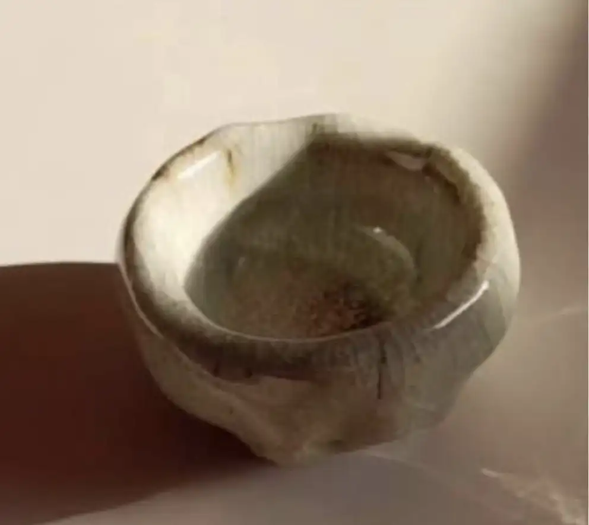
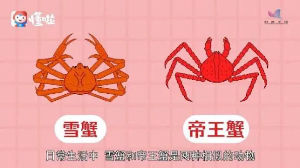

# A06　亲密关系友人与婚恋　第 3 册（共 3 册）

- 专题代码：A06　专题名称：亲密关系友人与婚恋
- 专题界定：恋人、配偶、朋友、同学、邻人及结合、相处、危机、分离。
- 本册：第 3 / 3 册　收录 184 篇　正文字符 235,980
- 语料：`sooon-q9adg-articles-v2.jsonl`（4,305 篇）　SHA-256：`cdc9c271309e1d71d9708889a3a31f4777e0c339ea54c3753521894afdb8357d`
- 生成时间：2026-09-27T00:01:00.997126+08:00　排序：发表日期 → 源序号（全库唯一，不重复）

**标记约定**：`【待审】` 主题仍为暂定；`【排除候选】` 图片/正文过薄的剔除候选；
`【正文标注未完待续】` 作者原文自带未完标记；`【正文缺失片段（复核已记）】` 复核记录已确认的正文缺口；
`【图片缺 N 张】` 源图不可获取。标记只作提示，不改写原文、不改动分类状态。

---

## 0813　残羹剩饭

- 日期：2025-04-29　主专题：A06 亲密关系友人与婚恋　副专题：A05;A09
- 源 ID：`9939be2f-66fd-5598-99f8-b3173e2fb786`　原文链接：https://www.zhihu.com/question/1889661757213086656/answer/1900557471396926287
- 官方对象—实践路径：与亲族 / 与配偶 / 相处
- 23 概念标签：定义与达意;能力与学习;选择与自由;责任与后果;爱与回应;照料与家庭;财富与市场;技术与工程
- 证据状态：manual_confirmed　初读：read　独立复核：not_reviewed

**问**：因为要喂孩子吃饭，每次轮到我吃都是残羹剩饭，但是老公觉得我太矫情，怎么办？

这有几个比较简单的技术性处理：
1）提前把你自己的那一份分出来。在饭菜刚做好的时候就找个饭盒装起来，这就不存在“剩菜剩饭”这个概念了。
2）将孩子吃饭的时间和你们的吃饭时间错开。
孩子如果已经到了能吃饭吃菜的年龄，那就不必喂饭。ta不吃就随ta去，相信生物本能，这一餐少掉的，下一餐自然会被饥饿感推着补回来。你甚至可以利用这个规律，把ta不太爱吃而特别需要的营养摄入安排在ta比较饿的那一餐里面，省去劝食的力气。
事实上，强喂没有胃口的儿童，过度饱腹，反而可能降低幼儿的活跃性，更不必说还有可能会造成儿童肥胖了。
而无法自主进食的婴幼儿本来就胃容量小而代谢强，本来就不是“一日三餐”的进食逻辑而是少食多餐、一日五六餐的喂食安排，这意味着本来也没必要把午餐和晚餐安排得和大人同步——某种意义上那只是成人们不假思索的认为“大家都应该一起吃饭”的惯性思维所致。
你完全可以安安心心把你的饭先吃完再去专门喂食婴幼儿。ta其实一两个小时前刚吃过上一餐，这半小时的时差对ta真不那么敏感。为此耽误你自己吃饭、过度折损你自己的生活体验是不值得的。
真正的问题其实不是不存在更合理的方案，而是你是否只能被动的接受别人的安排，有没有在必要的时候站稳自己的立场，让对方意识到你对某些问题的坚持程度不容压制，要想影响只能通过“优化性提议”的方式来寻求调整，其实是不容其他人单凭自己的喜好拒绝的。
其实这种“威信”应该是婚前就通过某次近乎导致分手的决绝选择被确立的，以至于对方很清楚你真的不愿意的事是不容勉强的，只能寻求交易。
说得直白点——“对对方的不配合，要么接受，要么永远诉诸交易”本身就是“尊重”的实践性定义。
因为这就是“你的意愿值得真金白银”的意思。
谈尊重，就是指坚定的实践这一点。
不论你以什么理由不配合，我要么开价买到你的配合，要么接受你的不配合另想它法，要么接受这种不配合带来的损失。
但我绝不说“你凭什么不配合”。
因为在我这你不需要再“凭什么”，你毫无理由的、一时兴起的不配合，也一样是你不容折损的自由。不接受这一点，爱就不可能是赋予自由的工具，而成了剥夺自由的锁链。
爱必须是扩大人的自由，而不是剥夺人的自由的东西。
必须是。
因此，如果是基于双方自觉的爱而进入婚姻关系，这里的“很难开口”从一开始就不成立。
对方会让你觉得“虽然我的要求是我有权享受的自由，但我难以启齿”，会让你害怕会引起一场彼此攻杀的连锁战争，这本身就意味着你们还没有结婚的足够关系基础。
结了婚再要解决这个问题，难度的确要大很多，因为此时“相互攻杀”的火力覆盖范围大了很多，后果更不可测也更令人畏惧。
问题是，为此“顾虑”不断的放弃你合法享有的自由，你的怨恨必然会一天天的累积，直到你发现按现在这个痛苦程度，继续顾虑这所谓“不测的后果”已经毫无意义。
那时这场决定“国运”的“大决战”还是绕不过去。
这一关终究是要过的。

---

## 0807　wanted

- 日期：2025-05-03　主专题：A06 亲密关系友人与婚恋　副专题：A01;A08
- 源 ID：`b4c9e826-7ec6-50e6-8d77-5374de319e03`　原文链接：https://www.zhihu.com/question/1900271409474811272/answer/1902142252865818661
- 官方对象—实践路径：与自己 / 与原则 / 坚持
- 23 概念标签：定义与达意;能力与学习;选择与自由;责任与后果;爱与回应
- 证据状态：manual_confirmed　初读：read　独立复核：not_reviewed

**问**：女性经济独立、思想独立，那要男人来干什么？

经济独立，思想独立，no need.
No need, so you can want.
“需要”是一种软弱， “想要”则是一种强大。
“需要”得到了满足，得到的是恩赏和救济，要磨损人格和尊严。
“想要”得到了满足，得到的是自己主动作为的回报，是对自由和努力的享受。
自己处理好自己的“需要”（need），然后凭着你自己的能力和筹码，去追求你欲求（want）的一切。
Don't ever say "I need you".
I don't need you, and you don't need me.
You might think you do, but you don't really. 
You'll see this when I'm gone.

I can live without you, happily.
Yes, I really can, no matter who you are or what you are.
And believe me, you can too.
You will see this when I’m gone.

I just want you.
You are wanted, my dear.

Run away if you don’t want to be caught.
Run, and you will be free of me.
I am the laziest hunter you will ever meet.

Say no if you only need me.
Say no if you don’t want me.

I want you to want me.
And believe me,
you want that too.

---

## 0808　需求表达困难

- 日期：2025-05-03　主专题：A06 亲密关系友人与婚恋
- 源 ID：`90290e31-8cc2-553b-8dbd-68647627cfc0`　原文链接：https://afdian.com/p/bf6985e4221211f0946c52540025c377
- 官方对象—实践路径：与友人 / 与恋人 / 相处
- 23 概念标签：事实与证据;定义与达意;能力与学习;选择与自由;责任与后果;信用与信任;爱与回应
- 证据状态：manual_confirmed　初读：read　独立复核：not_reviewed

**问**：需求到底该不该表达?

当然要表达，不然对方都不知道你的需求，怎么爱你呢？
关键在于你要区分你是在提自己的需求，还是在请对方履行承诺的义务。
举个例子——对方答应你晚上七点来接你，没来，你提出请对方以后不要迟到并要求对方做出某种回应来修复你对此后ta不守信的忧虑。
这在形式上是一种需求，但这因为涉及到对方承诺的义务，它就有别于其他的需求，而是一种你有权作出的追索。对方如果不认账，甚至发动报复，你是有责备、降级关系的合理立场的。
但如果是对方没有承诺过的诉求，那就要走另一个伦理路线，就是无论对方是否应承、是否做到，你都不能抱怨。
因为你自己才是你自己需求的天然责任人，所以你本来就是在尝试将自己的义务转嫁给别人。转嫁成功，那恭喜你；转嫁未成功，你并没有受到任何损失，自然也没有任何人对你产生任何赔偿义务，你也自然没有获得任何追索权、责备权。
对方承诺你了的东西，没给你，你可以责备；
你自己主动提出的东西，对方不承诺满足，你不可以责备。
这个分际，你必须绝对的咬紧牙关守住。
这意味着当你在对方既有承诺之外提出任何额外的需求，对方没有接，没有给你新的承诺，你不但绝不能责怪，还要为对方乐意听取、进行了一番思索而表示感谢。
因为愿意听、愿意思考一下要不要接，本身已经是付出了——如果不是因为你，对方原本不必花费这个精力、被占用这一段生命，不是吗？
为什么要严守这样的界限？
这就是为了保证对方不断的获得“倾听需求稳赚不赔”的体验。
只要听了，就算拒绝都有鼓励奖。拒绝也不会有后患可言。
ta绝不可能因为听取了你的需求而导致任何被强加的损失，“拒绝了”得到鼓励奖，要是“接受了又做到了”就得大奖，只有“接受了没做到”才有可能有损失，并且“没做到只要主动抱歉”这个损失还可以获得大幅的减免。
这样你才能保证对方有足够的安全感，并对听取你的需求这事保持近乎无条件欢迎的态度。
你自己在这方面守得越严，给对方的历史体验越无可挑剔，你自己就会变得对“提需求”这事越来越自信。
你可以自信对方对你提需求这事是欢迎的、是乐见的。
答不答应再说，但你说需求不需要再有什么纠结。
你不需要恐惧“我要是说了这个让对方为难的需求，对方可能会恨我、跟我吵”。
因为对方完全确信即使拒绝你也不会怪ta，还会感谢ta愿意给你机会把需求说出来。
那些不敢说需求、说需求也往往结果不好的人呢？则恰恰是违背了这个原则。说出来只要对方不答应，就会摆脸色、发火去惩罚对方。
这就意味着对方听你的需求就有一定概率要么就只能勉强接受指派，打乱自己的计划，要么就会被受到拒绝的你伤害、报复。
虽然有时正好合适，可以皆大欢喜，但是作为理性人，人们往往宁可牺牲这偶然的皆大欢喜带来的收益，换取不要隔三差五被伤害一轮的安全。
那么为什么这么朴素的道理，人们往往守不住呢？
其实是守住了的——你跟陌生人之间、同事之间，往往轻松的守着这个法则，你没注意吗？
往往反而是爱人之间、亲子之间、朋友之间守不住。
这是因为“爱就是默认接受一切请求”这种错误的认识像瘟疫一样四处流行。
爱不是一种“默认接受一切请求”的安排，这是错的。
爱所默认承担的义务，是“默认给予提出请求的机会”。
没有爱的承诺的人，你自动的就知道你没有资格要求别人必须聆听你的需求。看见没，不是没有资格要求对方答应，而是连要求对方听取你的需求的资格都没有，这才是无爱的真正状态。
有爱，仅仅只是向前推了一步——“承诺给你提出需求的机会”而已，不包括“必然接受请求”。
你搞错了这个细节，你就会不断的搞出“提请求然后破坏关系”的事故，直到事故太多，你自己都不敢再提任何要求了。
纠正这个错误认知，你就会给人足够的舒适体验，你也就不会再问“该不该提需求”这个问题了。

---

## 0804　可爱

- 日期：2025-05-05　主专题：A06 亲密关系友人与婚恋　副专题：A01
- 源 ID：`64038e78-7895-5593-a7ed-2f1274b00855`　原文链接：https://www.zhihu.com/question/449268589/answer/1814695426
- 23 概念标签：定义与达意;能力与学习;爱与回应;边界与许可;心理与主体
- 证据状态：manual_confirmed　初读：read　独立复核：not_reviewed

**问**：何谓可爱？

什么叫可爱（lovable）？
我说点最实在、最俗的。
就是有人爱你，爱得不好，至少不会一翻脸就落得个“罪该万死”的下场。
人都是无知的，笨拙的，无能的，自私的，贪婪的，并不因为爱你，就变得不无知、不笨拙、不无能、不自私、不贪婪了。
爱你，也只能是以无知、笨拙、无能、自私、贪婪的方式爱你。
与其说那是享受，不如说大部分时候都是折磨。
你在万般痛苦之下，仍能宽恕得了，你就是可爱之人。
就这么简单。
能做到的，必有应分的幸福。
但是，你知道领到这份幸福的有多少吗？
十不存一。
这不是说十个人中只有一个幸运儿，而是说一个人一生中能明悟这条而免于痛苦的平均时间，大多数不到十分之一。
明白时，往往已将死了。
一些极为幸运的早悟者争到的余额，都被多得多的一生未悟的人抹平了。

---

## 0791　浮生

- 日期：2025-05-12　主专题：A06 亲密关系友人与婚恋　副专题：A01
- 源 ID：`2cbc96c3-5c3d-5fea-9c8b-45c6c7249136`　原文链接：https://afdian.com/p/ddc840c8291211f0915a52540025c377
- 官方对象—实践路径：与自己 / 与欲望 / 取舍
- 23 概念标签：事实与证据;定义与达意;能力与学习;选择与自由;责任与后果;成本与总账;劳动与组织
- 证据状态：manual_confirmed　初读：read　独立复核：not_reviewed

**问**：如果你是有男朋友的，突然出现了一个多金的大叔，对你有想法怎么办？

非常客观的讲，这就是一种很常见的人生路径：
A）拒绝大叔，之后大概率还是因为无法忍受同龄的男朋友分手了。然后随着年龄增长，虽然你不断的经历不同的感情，但也差不多是接近三十岁和比你大几岁的男朋友成正果。
B）换成大叔，之后大概率还是因为种种不和和大叔分手了。然后随着年龄增长，虽然你有过不少不同条件的恋人，但再也没有过当年那位小男友那么年轻的。最后你也是在三十多岁和与你年龄相当或略大几岁的男朋友修成正果。
看到区别没有？
其实你这个阶段，小男友也是错的，大叔也是错的，固然他们有错，更因为你是错的。
你是错的你，所以他们对不了。
不换也是错，换也是错。你其实只是在错误与错误之间选择，而并不是在正确与错误之间选择。
不要以为这是坏事。
仔细想想，这其实是好事。
因为总之左右都是错，那么你无论选哪一边，也就无所谓错误可言了。
不要因为选了哪一边结果还是没成正果而觉得失败了，因为选另一边也未见得就会“成正果”。
要害不在选项上，而在于“选择”行为本身上。
是你需要学会“选择”这个人生基本操作。

你所谓的“选择了A”，这到底是什么意思？
你是跟A在一起，这到底是因为你选择了A，还是因为在“必须有一个选择”的法则下，你最不能抵抗A而已？
你做这个工作，到底是你选择了这个工作，还是在必须有一个工作的前提下，这个工作是你最早——甚至是唯一——得到录取的工作而已？
你看到问题没有？
绝大多数人从来没有真正的选择过什么东西，ta们只是把“随波逐流”伪装成了自己主动选择的结果。
选择是从“不拒绝其它选项”开始，到“拒绝其它选项”结束的一种行为。它真正的要害其实不是选哪一项，而是“什么时候激活”和“什么时候关闭”。
人最大的错误就是自认为“有更好的选择”就“开放选择”，“没有更好的选择”就“结束选择”，是一种“智慧”。
这是错的。
因为这样一来，你的日程表就会完全取决于你的遭遇。
如果你一直信奉这种“选择观”，你几乎不可能“做完”什么事情，会长期处在一个“水没有烧开就去炸鱼，鱼没有炸熟就去炒菜，菜还没下锅就去点外卖，外卖没送到就出去吃酒席，酒席没开场就回家去做饭”的无限循环之中。
然而，人是由自己做成的事情炼成的。
你自己出力越大、你自己起到的作用越有决定性、事情本身越完整、结果越清晰，越会影响到你自己的人格发育，越能形成坚固的自我认知资产。
注意，这不仅仅包括你做成了什么事，也包括你做败了什么事。你自己起手，你自己收尾，败了，也可以让你扎扎实实的知道自己不该做什么、自己的问题是什么。
人不怕有缺点、有短板，人怕的是一切都不清楚，没有清晰的胜负、没有可以结算的账目，不清楚自己能做什么、不能做什么。
于是永远不知道该怎么办。
也正因为如此，又加倍的依赖“跟着最大的奶酪走”这种“0智慧”。
你来个云山雾罩，一路随机应变、随波逐流，你就会在这种迷茫之中继续浪费人生。
你的所谓成功与失败根本没有意义，因为你什么也没做过，你只是“滑过”“穿过”了一系列莫名其妙开始、莫名其妙结束的过程。
你什么也没做过。
因为做，是要有始终的，而有始终一定要有选择。
你没有做过选择，你只是在“遭遇”。
选谁不是问题，问题是“满足什么条件，我就应该重新开放选项”“满足什么条件，我就应该关闭选项”的个人总结。
而这两个条件不能是“有更诱人的”“没有了更诱人的”。
如果你还停留在这个逻辑上，你的人生就根本还没开始。
你只是这个世界的一个NPC。
你现在还小，还跟很多NPC生活在一起，意识不到NPC和真正的玩家角色之间的差别。
你将来会越来越意识到——相对于玩家角色，NPC虽然也每天在走动、对话、做动作，甚至还似乎很忙碌，但NPC的“人生”是没有意义的。
NPC的人格是虚无的、人生是没有故事的，常常在清晨醒来之后怀疑自己是谁、夜晚入睡之前追问自己在做什么。
你在呼吸，但不觉得活着。
这才是人生的最大问题，而不是什么“选年轻的男友还是大叔”。
而要解决这些问题，你必须先从真正的“选择”开始。
选择，是从按照你自己的算法“不拒绝其他选项”开始，到“不接受其他选项”结束的。
这个算法本身就会有一个逐渐成熟的过程，它本身就需要测试、需要反思、需要改进。
但得到这个成熟的算法才是你人生成功的衡量标准，而不是你的账户余额。
这就像一位交易专家，得到那个稳定获胜的量化交易算法才是ta是否成功的真正标准，而不是ta某时某刻账户里的余额。
得到了这个算法，“余额”只是一个数字。
得不到这个算法，“余额”只是一个数字。
拿到了它，天下无处不可去、无事不可行，什么少年、大叔，都无所谓。即使是错误的开始，你也能造就辉煌的胜利，根本无所谓错误的选择。
因为你对了，你选什么都是对的。
有所谓“对”与“错”的，不是少年或大叔，而是你自己。
而你自己在这个年纪是错的。
你不去向对的自己走去，凭着这个错的自己，即使地上的是黄金，你捡起来，到了你手里也会变成泥土。
你真正要选择的是向将来那个对的自己挣扎着走去。
而这种挣扎的第一步，就要自问——“什么叫我选了ta”。
如果一旦出现一个更诱人的选择，我之前的选择就自动失效，那么我的“选择”的意义是什么？
如果“出现了更诱人的选择”不成其为我重新开放选择的条件，那么正确的触发条件应该是什么？
会让你决定停止坚持当前选择的触发条件是什么？
这个问题的答案，就是你一生的核心问题，你找到了，你的人生必然幸福——选什么都会幸福，无论什么结果你都会幸福。
现在就开始提出你的第一版答案，用这两位候选对象测试一下。
你大概率会失败、会受到挫折，没关系，总结教训，提出新答案，继续测试下去。
不要害怕寻找正确答案所必经的痛苦，因为一旦找到，你就真的赢了。你之前所有的成本在这最终的胜利面前都微不足道。
这就像为了找到牛顿定律的表达式用去的实验成本一样——牛顿定律的价值胜过实验成本无限倍。
这才是人生游戏的规则。
只要你明白了，无非是取几次档通关的问题。
去赢吧。

---

## 0781　君要臣死

- 日期：2025-05-17　主专题：A06 亲密关系友人与婚恋　副专题：A02
- 源 ID：`ec954f73-8e47-52f5-ae74-2b1a0d4ee3da`　原文链接：https://www.zhihu.com/question/1906363788854277819/answer/1907075032762524338
- 官方对象—实践路径：与友人 / 与恋人 / 相处
- 23 概念标签：选择与自由;责任与后果;成本与总账;信用与信任;爱与回应;净输出与不掠夺;财富与市场;法律与秩序;权力与异议;心理与主体;性别与身体
- 证据状态：manual_confirmed　初读：read　独立复核：not_reviewed

**问**：和男朋友聊天记录，为什么总是沟通不好，是哪里出了问题，明明是他请我吃饭，不应该是皆大欢喜的事嘛?

青年男性有一种地位焦虑，随时随地在警惕别人“看不起我”。
对恋人、朋友、家人这些理论上就应该加倍给面子的人，这种焦虑会更敏感、尖锐。
尤其是对恋人，因为青年男性常常有“责任感”的压力，所以会有“如果不让我说了算，我怎么应付这么大的责任”的条件反射。
多大的责任？“养你，保护你”。
这责任当然很大，于是基于“责权对等原则”，你就要听我的，对我要有对应的感激和礼貌，给我提供性价值和情绪价值。
这属于契约责任的一部分。
我就不想听到“不好”两个字——除非你自己知道这是有罪的，以求我宽恕的罪人应有的忐忑作证，来恳求我怜悯。
否则你就违背了基本的恋爱契约，对你的保护者、余生养育者大不敬。
你就是个逆臣、叛徒。
对逆臣、叛徒，我还耐着性子提醒你注意言行，已经是仁慈之上加仁慈了。
你居然还不知反省，及时认罪，真不可救药。

站在女方这边呢？难道我连一点自己的想法都不能有？
你请我吃饭，哪怕是我不喜欢吃的饭，也要“君有赐，不敢辞”？
你自称爱是一种服务——我再问一遍，爱是服务，对吧？你是声称要对我好的，对吧？对我好，意思是要为我提供服务的，对吧？
那么难道这是一种不容拒绝、不容商量的“服务”？
今天君有赐不敢辞，明天是不是君要臣死臣不得不死？
你如果是已经服务了我一生，站在这个功绩的尾巴上跟我谈这种权力地位，那也罢了。
你现在是确立关系才三天，我统共才“享受”了十六个小时的“宝宝真好看”级别的服务，md我还为享受这种“服务”用掉了两个小时来化妆、搭配、配合演出，光是用掉的美妆就顶你这顿冻肉饭了。
我现在还要为我享受的这十六个小时的“宝宝真好看”“服务”，接受“君有赐不敢辞”的义务？
你自己算算，这个账是人能算得出来的账吗？
你在为你【还没有付出】的“巨大代价”要求我【现在】就付出基本人格尊严、基本人权这种回报。
换什么？换取你将来有一天在我需要的时候履行“为我不惜一切”的承诺，是吗？
我要为“将来的那一天”接受这种“绝对领导”，是吗？
抱歉，以你现在这种我说句“我不喜欢这家餐厅”就会被你认定违约、认定你已经可以免于履行契约义务的“履约”法，我看不出真到那一天能指望你的数学可能性。
你实际上在要求我为一个我明知无可期待的空头支票先给你当几年奴隶。
这就是你对“爱”的基本打算，而你自己似乎根本不知道自己在干什么。
你只觉得自己冤枉。

怎么解决这个矛盾，你们再自己想。
但有一点是明确的——不做改变，这个“恋爱”是谈不下去的。

---

## 0774　凋谢

- 日期：2025-05-20　主专题：A06 亲密关系友人与婚恋　副专题：A05
- 源 ID：`804e6ecc-9f71-51ce-acec-6d3770c392cf`　原文链接：https://www.zhihu.com/question/24825703/answer/1908057548612952587
- 官方对象—实践路径：与自己 / 与原则 / 坚持
- 23 概念标签：定义与达意;选择与自由;成本与总账;信用与信任;爱与回应;财富与市场
- 证据状态：manual_confirmed　初读：read　独立复核：not_reviewed

**问**：关系亲密的人之间要说「谢谢」吗？

当然要说。
你没说，那不是“不用说”，而是“暂时从简省略”，这完全不等于“不用说”。
越是亲密、重要的关系，越是要注意礼貌。
所谓的温柔、体贴，在本质上就是“绝对避免任何意外引起负面感想的风险”这种行为方式的外在表现。
温柔体贴的人，不会开那些走钢丝的玩笑，因为ta们不能允许自己为了一些廉价的快乐造成难以解释的误会。
就算这些误会事后可以解释，也宁可不要有这种无谓的波折。
你看五星级酒店的前台就处在类似的关系状态下，ta们说话就会呈现出高度的“温柔体贴”感。ta们就不会通过跟顾客轻嗔薄怒来营造亲近感，因为万一造成误会，可能根本没机会解释。
领导的司机、秘书这类想要长期保持信任的角色也一样，不管怎么朝夕相处，ta们也决不会在应有的礼节上开玩笑。
这跟你对这关系有多大的安全感没有关系，而跟你对这关系有多重视有关。
世界上最蠢的事，就是自认为关系够铁，所以自认“无需拘礼”，然后多说了一句不该说的话、少道了一句该道的谢。
多少年的感情，一句话就废了。
你去怪对方“怎么这么敏感”“怎么这么计较”是没有意义的。
对方如果说了你介意的话，对方可以通过责备你“怎么这么敏感”“怎么这么计较”让你恢复如初吗？
能吗？还是真要这么干了，不但不能让你不计较，还会造成加倍的破坏？
所以，你可以省略一些谢谢，但一旦对方有任何计较之意，——例如开始直接了当告诉你“你应该说句谢谢”——你就站在了命运的十字路口。
这个时候你要是用“关系亲密的人之间要说谢谢吗”来质疑、否决对方的计较，你就等于在向对方宣告对方那个给你的好意在你看来都是不必保持尊重和礼貌的本钱。对方给你的优待越多，越降低自己的地位。
你等于宣告了对方是个蠢货，你也就不必期待你们的关系有任何好走向、好结果了。
即便是父母子女、亲兄弟姐妹、夫妻，都不例外。
你只要想要保留这关系，唯一的选择就是立刻回答“谢谢，对不起我漏了，非常抱歉”。
然后反省自己做了什么会让对方觉得有计较的必要。

然而，有很多人在这种决定命运的关头不会做这个反应，而是电光火石间就下意识的把那句“我们之间需要计较这个吗”抛出去了，然后为对方开始无情的斩断关系感到错愕，进而怨恨。
这就是平时自己对这关系不重视惯了，把对方的礼遇视为理所当然了造成的后果。
对方真的错怪你了吗？
你只是无意间展现出了你真实的状态罢了。
其实是你通过这种漫不经心、理所当然先抛弃了对方，而不是对方在遭遇这种“误会”时候主动来抛弃了你。
而且对方并没有“误会”任何东西。
在你犯了这种错误，对方已经动手冷却关系之后，你其实还有得选择——选择承认自己的确太漫不经心、对方的愤怒恰如其分，你就会去诚恳道歉，并毫无勉强的承认的确自己太松懈了；选择认定“关爱亲密的人之间不应该拘礼”，认为对方就是“背叛了亲密关系”“配不上我的好”，这就是给这段关系真正敲上了棺材钉。
两次选择的机会都错过，那就没有什么误会可说了。
恃宠而骄，是这个世界上最愚蠢的错误之一。

---

## 0754　手心手背

- 日期：2025-05-31　主专题：A06 亲密关系友人与婚恋　副专题：A05;A11
- 源 ID：`6e9e54e1-99aa-59fa-8d18-e4d4272e0c34`　原文链接：https://afdian.com/p/9ec45eac380d11f0a5bc52540025c377
- 官方对象—实践路径：与合作者 / 与被管理者 / 奖惩
- 23 概念标签：选择与自由;责任与后果;边界与许可;劳动与组织;法律与秩序
- 证据状态：manual_confirmed　初读：read　独立复核：not_reviewed

**问**：为什么管理一严员工就走人？

某公司有一仓库，管理不严，张三李四今天来拿一根铜条、明天来拿一叠信纸。王五是负责管仓库的，现在账对不上，王五怎么办？
王五上报了，张三x月x日拿走什么，李四x月x日拿走什么，问题是上面收到了仿佛没收到，张三李四照样我行我素，继续小偷小摸。本来上面真不管那也是上面的事，只要说一句“让ta们拿，这事你没责任”那王五也没意见。
问题是上面可也没说王五没责任。
王五说“那我换个指纹锁吧”“给仓库加监控吧”。不批。
不批归不批，公司也没说这样王五不用承担责任。
张三李四是不走了，王五呢？王五待得住吗？
看到没有？
管理严，也许有人会走；管理不严，一样有人会走。
决定管理严不严，并不是在决定“有没有人要走”，而是在决定“到底要让哪部分人走”。
你到底是要那些“管理一严就会走人”的员工走，还是要那些“管理不严就待不下去”的员工走——这才是作为组织领袖你要自问的问题。
是那些一旦严肃执行组织纪律就会脱离组织的成员重要，还是一旦不严肃执行组织纪律就会脱离组织的成员重要？
你说呢？

有人可能会辩称“我的组织里只有前一种人，没有后一种人，所以我选择严格执行纪律保后者弃前者是行不通的”。
这么说吧，如果真是这样，你要考虑的不是什么“严格管理会导致员工走人”的问题，而是“你为什么还要为这种僵尸组织浪费人生”的问题。
不是吗？
你想宽松，你可以少设置规则、把规则本身设定得宽松一点——例如你可以规定“一周只要在办公室打卡出勤一次就不会受处罚”，这就是规则本身的宽松化。
但你对成文的规则——无论它本身的内容是否苛刻——必须以铁腕保证不遵守的后果无可妥协。
你发现了吗？当你宽松到一周一次就算合规，ta要是一周一次都不来，你会反过来想要动极刑。
规则的设定可以宽松，但对规则的执行必须严格。
会因为设定的严格而走人的员工也许尚有商榷的余地，但因为执行的严格而要走的人，从一开始就根本不在这里。
ta根本就没来，谈什么走？
收紧规则的设置，这不叫“管理严格化”，这是“管理的苛刻化”。规则本身无改动，只是收紧规则的执行，这才是“管理的严格化”。
管理永远要严格化。管理严格化，适应不了的应走尽走、应走早走，这是进步、是成果，而不是损失，不要有任何犹豫。

---

## 0749　成不成龙

- 日期：2025-06-03　主专题：A06 亲密关系友人与婚恋　副专题：A02;A01
- 源 ID：`b12286d2-f555-5e90-a000-0c08835c15ec`　原文链接：https://www.zhihu.com/question/623127482/answer/1913214128429969949
- 官方对象—实践路径：与友人 / 与恋人 / 相处
- 23 概念标签：事实与证据;选择与自由;信用与信任;爱与回应;照料与家庭;心理与主体;性别与身体
- 证据状态：manual_confirmed　初读：read　独立复核：not_reviewed

**问**：成龙大哥的婚姻观爱情观是不是正确的？

（无破折号者为成龙）好坦白讲我的生活上以朋友兄弟为主女朋友很坦白讲有什么好说的——爱人也没话讲啊没话讲的我不会浪费很多时间在女孩身上我会花时间和某个陌生人聊天我学到东西女朋友就学不到东西—— 会不会是大男人心态啊多少都有这么多年来结婚，离婚，那我不结婚了很多女的一夜之间把老公的钱拿走—— 你都没看到很多太太很好的我见到的我圈子很多这样原来每个女孩老婆都会跑的——娱乐圈的一个问题啦不是，记者朋友，写字楼的，警察部的朋友任何朋友啊我们现在还在一起但是身边的人换老婆离婚女朋友这么多年全换了但我们还在一起这个社会是这样现在的年轻人啊太过注重物质女孩全部去走捷径用最短的捷径去找最多的钱所以爱情方面不是最紧要的——你对女性的看法是很灰色的任何女孩也好我都讲我以电影为主没什么紧要过我的事业如果有任何人妨碍我的事业就拜拜了又说回以前譬如像邓丽君她成天想我们要人世界啊譬如去吃饭可不可以只有我们两个人吃饭啊不可能的我吃饭定是后班兄弟的兄弟帮到我她帮不到我什么兄弟帮到我事业蒸蒸日上女朋友帮不到我的。
什么叫做正确？
正确有两个角度，一个是从社会的角度能尽可能指向社会繁荣的叫做正确，一个是从个人角度尽可能指向个人福利的叫做正确。
很遗憾，这两个角度是有差异的，能兼得的时候固然是你好我好，但是两者不能兼得、有所矛盾的时候，得到公开流传的往往是得到社会青睐的前者，而后者往往是在家庭内部私下传承。
成龙这个婚恋观当然是不符合社会一般规范的，对社会繁荣存在破坏作用，但很显然他觉得对他自己的福利最大化很合适，且在他自己的个人自由范围之内，只要他没有刻意向他的女朋友们隐瞒自己的这个价值观，这就没有什么根本的道德问题。
他这个婚恋观是源自他自己的观察总结，和他自己看到的现实相适应，在逻辑上也能应对他自己看到的危机，这对他个人已经有足够的可持续性，够他按照他自己的预期过下去了。
可行、可持续，这对个人过日子而言就算及格了。
这话先说到这里，再说他有什么不对。
这话对“追求最高的人生体验”这个目的而言不对。
刻骨铭心的恋爱关系对人生体验而言宛如人的眼睛，尽管盲人也可以平安的度过一生，但是很显然能看见比看不见的人生会更多彩。
人之于爱，生来是盲的，必须要爱过才看得见被爱过，才看得见人生的这一层色彩。看不见这道色彩，人生乃至世界几乎只是一场机械的赌局，赢或者输只不过是在最小恐怖原则指引下的一场无限挣扎。
有时候你都会分不清挣扎得更久的意义是什么，难道为了把恐怖片拉长点好卖爆米花吗？
之所以这么说，是因为他没有意识到他无意中完成了一个自我实现的预言——并不是女孩子们都唯利是图，而是他们这帮明星朋友内心深处有深刻的恐慌和自卑，觉得自己除了容貌和名利，并无别的值得自豪、值得别人爱的东西。
人对人的认同，常从别人认同ta对自己的认同开始。一个自诩医术了得的人，最喜欢一见面就看出ta医术了得的人。同样的，一个自认为除了名利容貌一无所长的人，最认可的恰恰是认同ta除了容貌名利一无所长的人。
这种认同并不只是对ta长处的自我认知的认同，还包括了对ta短处的自我认知的认同。
如果有一个女孩子对那时的成龙说“我不爱你的钱和名，我爱你的人品”，成龙自己就受不了——因为以他和他那帮兄弟的生活方式，他自己都觉得自己谈不上什么人品。
他不但不会为此感动，反而会认定这个女孩虚伪——无论对方是否真的这么认为。
他之所以在自己周围看到普遍都是这种情况，是因为他那帮兄弟普遍也都跟他差不多。他们没读过书，出身普遍寒微，从来自觉下九流、不是体面人，现在是凭着卖命、运气好过上了醉生梦死的生活，而这种醉生梦死的主要内容，往往是纵欲享乐——他们自己也知道谈不上道德和健康。
自己没有觉得自己配，甚至自己认准了自己不配，即使真遇到了，反而要万千怀疑、百般试探。能是什么试探？总不过是胡作非为看对方能不能真原谅。
就算是真心实意，又有多少人有这个定力扛过这个试探？
不试探到对方受不了不罢休，得到的当然总是对方受不了。对方总是受不了，得到的结论当然是“女孩都一样急功近利”。
你只放穿黑衣的进门，又如何抱怨进门的都穿黑衣？
自己实现了自己的预言。

然而讽刺的是，如果你现在再问成龙对自己当年的这个话怎么看，他多半要改口。
因为他自己遇到了扛住了他“百般试探”的人，不是吗？
他现在再说“女孩都是急功近利”，面前就放着一个他绕不过去的反例，不是吗？
他还能说“女人对我的事业没帮助，只有兄弟”吗？

你让他现在再回头看这些话，他还觉得对吗？

爱这东西，信则早到，不信则晚到。
它晚到了，你没有落空，但难免会悔恨自己当年的愚蠢——因为它不是没有敲过门，而是你将它拒之门外了。

---

## 0741　蒲公英

- 日期：2025-06-09　主专题：A06 亲密关系友人与婚恋　副专题：A02;A01
- 源 ID：`35b765d8-b886-546c-a214-b1a7ee5d7b43`　原文链接：https://afdian.com/p/ddee53d0458c11f0a24052540025c377
- 官方对象—实践路径：与友人 / 与恋人 / 相处
- 23 概念标签：能力与学习;责任与后果;成本与总账;信用与信任;爱与回应;边界与许可;照料与家庭;财富与市场;权力与异议;性别与身体
- 证据状态：manual_confirmed　初读：read　独立复核：not_reviewed

**问**：男朋友以为我喝醉了，对我说出侮辱性词汇，我该怎么办？

我们一起来海边旅游，晚上一起吃了海鲜喝了啤酒，他以为我断片了，但事实是我只是头晕很困，就没有力气管他的动手动脚，后来他开始叫我小宝贝，叫着叫着变成了一句xmg，我当时人很懵，只记得我当时已经全身都僵硬，不知道该怎么做了，今天问他的时候开始我没有说明，他还假装我不知道没听见，然后他就给我解释说那是他看小电影学的，想着我喝醉了不知道，他之前真的是对我很好的一个人，我根本没办法想象到他怎么会说出这种话，谁能告诉我该怎么应对这件事，我好乱。
疑神疑鬼的根源总是弱不禁风。
自己像一颗蒲公英一样，一阵风就散，就整天疑心哪里没关好，有穿堂风。
自己好像藤蔓，全指着攀附的乔木沾点阳光，就老会纠结自己爬的这棵树是不是长得太慢、太矮，位置不好。
丁点疑似不理想，就要四处问人。一句不如意的话，就要辗转反侧。
这意味着对方一个人要活两个人的命，不能有丝毫不中规中矩的表现。长此以往，对方迟早要精疲力竭、落荒而逃。
对方还有三个月就要落荒而逃，你去担心ta将来能不能出人头地、ta能不能一辈子对你好有何意义？
无胆鼠辈，安敢言爱？
所以人一定要坚定不移的完成自己的生存责任，做到自己就能自给自足且有剩余，要积极的学习如何有效的利用社会资源、建立自己的人脉网络。绝不能把恋爱、婚姻视为一种逃避独立生存义务的捷径。
因为只有你自己有能力、有本钱、有手腕，你才有足够的安全感和幽默感，敢于不计较对方的种种不完美，有底气对对方的各种无意识恶意、“危险迹象”淡然处之、一笑置之。
对绝大多数问题，你都用不着“防患于未然”，可以坐着不动，任其自限、自愈、自败，给它机会自生自灭。
或者抖开包袱出现笑果——安全感是幽默感的本钱。
只有自足的人能用“什么都不做”来应对大部分小隐患，这是一个人感情成功的巨大战略优势。
我相信这是误会，相信你的本心是好的，相信你是一时焦虑。相信这是误会，不是因为“我很爱你”“我离不开你”，而是我实力雄厚，就算信错了，对我造成的损失也不致命。
但是对你，可就不幸得很了。
我有得赌、有注可下，我懒得猜，我直接下注看你的底牌，我不防来防去、搞提前预防，我大可以搞事后反制。
所以我才轻松又性感，所以你才愉快又快乐。
否则我每天都面目狰狞，你每天都精疲力尽，那能谈出什么好结果呢？
这个问题对女性尤其严重——不要盘算着靠男人，一丁点也不要。
自己无能、自己抱着走捷径的心，于是一天到晚担心捷径半道上走不通，你找多少巧妙的监控法、沟通法都是枉然。
如果你是这样，那你对关系的一切长期担忧都是多余的。
因为你的关系多半超不过三十六个月。

---

## 0724　井绳

- 日期：2025-06-18　主专题：A06 亲密关系友人与婚恋　副专题：A01
- 源 ID：`e213a655-9e9e-5732-907e-1d0a0410a0c8`　原文链接：https://www.zhihu.com/question/463545283/answer/1918559043095619118
- 官方对象—实践路径：与友人 / 与同学 / 相处
- 23 概念标签：能力与学习;责任与后果;信用与信任;心理与主体;宗教与自然法
- 证据状态：manual_confirmed　初读：read　独立复核：not_reviewed

**问**：大学换宿舍减人，我被投出去了，特别特别难受，真的想不通怎么办？

我大一开学到现在都没跟宿舍的人闹过矛盾，一直都顺着她们，就是怕一年被踢出去而且我和她们都挺聊的来的，也有一样喜欢的明星，上课也会坐一起。可是我没想到我最后会被投出去，反而还留下了平时不怎么跟我们聊天经常不待宿舍或者是另一个脾气有暴躁的人，我真的没法接受。而且下学期我得去别人三缺一的宿舍，我本来就很慢热内向，我就特别害怕那本来就玩的很好的三个人会排斥我，我根本融入不了她们，剩下三年我该怎么过啊？我真的很崩溃，我明明已经真的尽可能融洽和她们相处，为什么她们还要投我出去，我就这么招人讨厌吗？
出于“害怕排斥”而“顺着”人，这并不是一个好的做法。
“怕排斥”其实是一种非常糟糕的审判，意思是我觉得你人品卑劣、毫无器量，而且还不是简单的卑劣小器，是卑劣小器到了我连试一下都不敢试。
我只敢顺着你讲话。
只敢讨好你。
老实说，没人喜欢这么战战兢兢的和鳄鱼打交道，我当然也不例外，所以我顺着、讨好之后，都会趁着你还没咬人，赶紧撤退，隐蔽起来。
哪有谁没事就把头伸出去看会不会被咬的？
于是在这战战兢兢的“顺着”“讨好”背后，势必还有紧紧配套的“敬而远之”。
你看到问题没有？
出于害怕得罪而迁就讨好，本质上就是疏远和隔离。
是你自己先把对方放逐了，而且是先羞辱、再放逐了。
而且是没给对方任何自证机会的，先羞辱、再放逐了。
你一向顺着、讨好，人家哪有机会证明自己其实善解人意、宽宏大量呢？
而你还在委屈自己施舍了那么多“顺着”“讨好”的好意却不被感激。
不但傲慢之极，而且无礼之至。要能原谅你这种对待，不是没人能做到，但对还在大学期间的青年来说，要求是太高了。
其实你很可能是有自己的某种依据的——例如你自己在中学期间就指望过朋友宽宏大量、指望ta们宽容你的无心之失，结果遭遇了惨烈的失望。
因为你甚至都没有觉察的小小失误，ta们不但没有如朋友应该的那样给你宽容，还令人难以理解的惩罚了你。
而且是一而再，再而三。
是吗？
所以你不敢再冒这个险了，是吗？
但是对你的大学新同学而言，ta们并不是你的中学同学，不是吗？
从ta们的视角看来，如果ta们真做了什么对你刻薄、残暴的事，你要如此防备、迁就，那也罢了，问题是ta们觉得其实一直对你相当热情和友好。
ta们是在热情和友好的自我体认下，得到这个“可能非常刻薄，必须小心讨好”的判决的。ta们会觉得尤其不公。
这就是人间最难的事了——事实上社会是在通过这种放逐，告诉你“无论如何都要尝试相信人，至少要给人证明自己的确是坏人的机会”是一种自然法规定的强制义务。
你不能用那个人犯的错来惩罚这个人，不能因为过去的经验来断言现在就是一样的剧情。
它对于“人要对另一个陌生人持有何种默认态度”有一个强制性的、不顾念你经验的要求。
某种意义上，这也是素问努力要引导你优先自省、对人补强的核心原因之一。
因为这样你才可以对人性抱有基础的期望，以至于即使有相反的经验和伤疤，但在对待新的朋友、新的陌生人时，仍然可以有一个相对健康的心态，有相对更大的概率去开始一段健康的关系。而不是一朝被蛇咬，世上就再无井绳，被一次受伤，诅咒和污染了自己一生的机会。
你看吧，其实那些看起来暴躁粗野的同伴，冒冒失失的犯错，但爽爽快快的认错、实实在在的道歉，反而会经由这些摩擦、误会，从断裂处生出更强的羁绊来。
ta们没有这样战战兢兢，反而得到了更多友情和爱。
是你要向ta们学。
而你要学，先就要把最开始那段话看清楚，仔细想想你是不是就是这样，这样是不是确实可恶——而且最重要的是，是不是对大家不公平，是不是其错在你。
想清楚了，就真诚的去道歉。
去向那些刚把你放逐了、忐忑不安的担忧会遭你记恨的室友们道歉。
这个道歉能解放你自己痛苦折磨的心，也能安抚忧虑惊疑的ta们。
然后你可以继续轻装上阵。
因为前半生的诅咒就此松了。
这很难，没人能说这很容易。
但试试吧。

---

## 0715　薮猫的微笑

- 日期：2025-06-23　主专题：A06 亲密关系友人与婚恋　副专题：A05;A02
- 源 ID：`fd24bdb5-7cb4-5ec9-976a-34500a82e7cc`　原文链接：https://www.zhihu.com/question/608306711/answer/50038211239
- 官方对象—实践路径：与亲族 / 与配偶 / 危机
- 23 概念标签：选择与自由;责任与后果;成本与总账;爱与回应;边界与许可;照料与家庭;劳动与组织;法律与秩序;心理与主体
- 证据状态：manual_confirmed　初读：read　独立复核：not_reviewed

**问**：乡下婆婆用流氓话没完没了的辱骂儿媳，接受过高等教育的媳妇，脏话骂不出口心里又很气愤，换做是你怎么办？

不用说啥，走出门，自己找个舒服的酒店先去入住。

洗漱、化妆包、金银首饰、换洗衣服这些都带好。

然后把家里该安排好的安排一下，例如后几天的饭菜都外卖买好放冰箱。

手机留言“出门散心一周，一周后联系，具体问婆婆”。

然后公司请假两天，申请一下远程办公。

工作压力搞小一点，多去看看电影，购购物，按摩一下，看看展甚至去附近旅个小游，还可以买一点小首饰、护肤品啥的。

包包不要买几万的那种了，也就买个大点好点的购物袋。

性感内衣也不是不可以考虑。老公打电话来，你就叫他放心，你只是需要几天调节一下情绪、避避家里风头，也免得他一时难做人。

一周以后接。

你甚至可以建议老公来一起休息一下、回顾一下美好青春记忆啥的——要是他胆子够大的话。

至于说如果他需要理由的话，可以跟他妈说你有事要出差几天，正好眼不见心不烦。

等他过几天来接，然后把账单拿出来，要他报销——预算先按两万算吧。

他如果不买单——这实际上是他自己亲子关系管理失败造成的损失，必须由他负责——那么你就自己买单，继续旅居——比如换个酒店，这回便宜点。

但这次开始发送离婚协议书和财产分割方案。

从始至终，没有必要说一句重话，大家好说好散。

不要要求道歉，不要批评对方有什么不对，不要悲愤控诉，甚至不要蓬头垢面、楚楚可怜。

而要光彩照人，言笑晏晏，充满宽容和谅解。

我很理解你很为难，这个事确实对你太勉强了，你也太累了，不如就这样吧。不必担心我，我也没什么责怪你的，毕竟我也对这事负有过于乐观的决策责任。

我相信你可以找到更合适的，不像我这么麻烦和难相处的。

你可千万别为难婆婆，也算我对不起她吧。

你记住，你的自由、你对家庭运行不可替代的价值平平淡淡的、客客气气的用出来，就已经是锐不可当的利器。

谁要勉强，你不需要娘家兄弟，只需要请前台报警、换一家酒店，然后这次不再告诉对方是哪家就行了。

你平平淡淡的，婆婆就会道歉，而且以后不会再敢对你有任何不尊重。

不尊重的话，每句都很贵的，她儿子可不是次次都付得起。

而且当她认识到你的手段，输得心服口服，还会劝她儿子要珍惜。因为单凭你，ta们家的门户都立得住。

你能一句狠话都没说就把打遍天下无敌手的她按住，毫无施展余地就输了个干干净净，她儿子跟你在一起，自然也吃不了亏。

她非常清楚，一般的手段根本对付不了你。不一般的手段的后果对你这种思路清奇、手段狠辣的人无法预料。

因为你显然不是一般人。

真正的狠人，都是带着微笑礼貌客客气气的扣板机的。

---

## 0713　反捞流

- 日期：2025-06-24　主专题：A06 亲密关系友人与婚恋　副专题：A01;A03
- 源 ID：`1ce48e14-a02b-59f3-b6ff-e87932cabb9f`　原文链接：https://www.zhihu.com/question/1920111851464786105/answer/1920604209092489352
- 官方对象—实践路径：与友人 / 与恋人 / 相处
- 23 概念标签：能力与学习;选择与自由;成本与总账;信用与信任;爱与回应;心理与主体;性别与身体
- 证据状态：manual_confirmed　初读：read　独立复核：not_reviewed

**问**：如何看待《捞女游戏》在线人数峰值近 7 万，仍位居国区热销第一？

“反捞女”之所以无效，是因为搞这个运动的人并不是在“捞女”和“非捞女”之间搞“择优录取”，ta们是在“捞女”和“无女”之间死中求活。
因为行为比较正常、能承受稳定亲密关系的人早就有恰当的安排了，ta们恰恰是因为没能实现这种安排，导致不得不降低自己的“警惕”“戒备”来解决“无女”的问题，才对“捞女”具备了“可捞性”的。
而悲剧的是，这些人越执着于“反捞女”，越是反映出自己“无女”困境之深，反而越是“可捞性”强得刺眼。
你对处心积虑的骗子能做到什么程度过度天真了——扮得比谁革命都坚决，这是特务的入门训练。
你爱玩“反捞女游戏”是吧？
很简单，新一代捞女也可以拎着酒瓶子陪着你骂，骂得深得你心，骂成你的灵魂伴侣。
然后再找你借钱。
你该掏还是掏。
开玩笑，二十好几了，就这么一个异性兄弟，慷慨豪侠、义薄云天，毫无绿茶痕迹，人有难处了，你往回缩？
你缩缩看？
你这脖子缩回去，这辈子还伸得出来吗？
那你不缩试试？
你看人家刀利不利。

于是你准备拿什么去防“反捞女流”“捞女”？

觉得这种过家家式的游戏可以“展示威力”、可以“吓阻觊觎”，约等于魏延对着孔明喊“谁敢杀我”。
真如插标卖首尔。

你不解决“无女”问题，“反捞”就是个自欺欺人的笑话，而激烈的“反捞”，会导致女性对你的普遍厌恶，只会进一步的恶化你的“无女”问题，导致你更容易成为目标。
似你这般烈火烹油，“无女”熬到一定程度，钓你连饵不用。
此路不通，懂不懂？
老老实实学一学怎么好好说话、怎么靠谱的做事，少搞这些无用功。

---

## 0704　不食毒

- 日期：2025-06-29　主专题：A06 亲密关系友人与婚恋　副专题：A02
- 源 ID：`f3dd34f4-f4c8-5dd1-9a14-3dc0714f6137`　原文链接：https://afdian.com/p/4076c62a4ed611f097625254001e7c00
- 官方对象—实践路径：与其它 / 与陌生人 / 防卫
- 23 概念标签：事实与证据;选择与自由;责任与后果;成本与总账;信用与信任;爱与回应;照料与家庭;财富与市场;权力与异议;性别与身体
- 证据状态：manual_confirmed　初读：read　独立复核：not_reviewed

**问**：现在很害怕我男朋友，不知道怎么办才好?

事情的起因是，我男朋友的学妹发了一条朋友圈，说她妈妈的男朋友只比自己大五岁，说可以给大家推她妈妈vx，可以卖保健品给她妈妈。他学妹还有个姐姐（不知道年龄），妈妈是离异的。除我和我男朋友外的人，以下我分别称为学妹，妈妈，姐姐，妈妈男朋友。我男朋友分享这件事给我，简单来讲：他的观点：妈妈找了个比自己女儿大5岁的人谈恋爱，这很逆天。我的观点：妈妈先是她自己，然后才是妈妈，她的选择不犯法也不违反道德，谈恋爱而已，算是正常行为。我们的讨论原本到这就结束了，他就去打游戏了，晚上他打完游戏之后就不理我，也没怎么和我说话，我追问他为什么不理我，他就提到这件事（原本我都快忘了这事了，在我看来只是很平常的讨论，也没有争吵）。再次讨论时，我的观点：无论是两个人看对眼了，还是日久生情，亦或是这男孩图妈妈的 ，我都认为存在即合理。有很多成功的人，有钱有权，四十多岁的人找个年轻的女大学生谈恋爱，也没人觉得逆天。更有甚者，出轨年轻的肉体，也没人说逆天，大家只会说，还是王总会玩（再赔个笑脸）。妈妈找年轻人谈恋爱这件事，我不觉得有问题，换做是我的话，我会希望妈妈开心，天天有人哄着她很好。我男朋友的视角和我不同，他认为重点是，一个比自己没大多少岁的人，要当自己的后爸了，这很难接受很逆天。我其实能够理解这种视角，但我认为没到逆天的程度。男朋友突然说：我要是那男的直接爽死了，一家三个女孩。还说了一些关键词：入三个，鬼父。他要跟我继续讨论，我说我现在有点害怕你，他说你才知道害怕啊。我当时被对他躺着，直接被吓到了，是真的被吓到了，我当时觉得很害怕他，现在也有点害怕。我不知道怎么形容这种震撼，就是脑子嗡的一下，昨晚我将近五点才睡着，躺在那里，全身发抖，还会流眼泪（生理性的，我也不知道为什么会这样），后面他就发现我在抖，关着灯，只有窗帘外透的一点微光，他看着我，问：为什么发抖，是觉得我很陌生吗，觉得我很变态吗。我很难形容那种画面，只知道当时根本控制不住，握拳、扣手心都还是会抖。现在我真的不知道该怎么办，首先我真的很喜欢他，他平时也对我很好（并非金钱那种，我们俩当中，我是花钱的那个，防止你们误会，解释下），他在生活中非常照顾我，几乎面面俱到。但我现在还是有些害怕他，不知道下班回家后怎么面对。不敢跟身边朋友讲，只好在这里问问。补充：我大概能明白他想表达的，他应该只是觉得那男的没安好心。只是他的思路和视角让我觉得害怕，为什么总是把人想的很坏呢。鬼父我大概知道是什么意思，但我觉得这种是脱离现实生活的，应该算犯罪吧。
这个实在是遗憾。
现在社会有一种非常邪恶的风气，就是拿这种反社会行为开玩笑、取乐，做出一副这种事很好玩、没必要很严肃、要有“幽默感”的样子。
怎么说呢，如果别人反正没有和你密切交往、建立什么亲密关系的打算，那顺着你捧捧场无所谓。
但只要有这个打算，例如想要提拔你、想要托付你，这类嬉笑就会产生致命的后果。
如此人伦之大防，被你拿来玩笑取乐，没人会想冒险去赌你到底是不是认真的，因为人家赌注太大了，冒不起这个险。
其实人人都知道——这位女题主既然起了这个疑忌，这份关系已经结束了。
换一个方向你很容易理解——如果是女方天天开玩笑要“打穿黄道十二宫”，跟你大谈“这女生ntr玩得真带感”，这玩笑你开得起吗？这恋爱你谈得起吗？这婚你结得下去吗？
法官开起“是我就判ta全家死刑”的玩笑，你还让ta审你的案子吗？
医生开起“我就喜欢多割一点做纪念”的玩笑，你还让ta做手术吗？
飞行员开起“其实撞山再拉起最带感”的玩笑，你还坐ta飞机吗？
怎么？这时候你笑不出来了？你的“幽默感”呢？
你咋这么玩不起？
你可能会辩解说“那些从不开这种玩笑的人一样有可能作恶”。
不错，你说得很对，的确嘴上不这么说的人也可能做这类事，这甚至是有很多事实可以佐证的。
问题是，这改变不了人们“无法托付给开这种玩笑的人”的行为方式。

你可以继续平时跟“兄弟/闺蜜”们拿反社会梗开玩笑，来对抗“社会规训”带给你的“窒息感”。
但你要记住——这是有毒的快乐，你乐多了以为这是安全牌，拿来在错误的时间、错误的场合嘴一滑，神仙也难救。
比如这个剧情里的男主人公，怎么救？
周围看客一哄而上劝女主人公“他就是说说，你别当真”？
这么劝的人，有什么真凭实据保证ta只是说说？你们觉得“不至于”是吗？那要是万一将来的确因为ta没心没肺离婚了，你们每人赔多少？写字据吧。你写下字据、下真金白银担保，也许还有点意义，否则你嘴一张就“ta没这个意思”，无凭无据，你这个担保有何意义？
这些话往桌上一放，“他不是这个意思”帮当即闭嘴退散。
谁再来救这位男主？
接受教训，别拿这些话题取乐。
你缺快乐缺到连这种毒垃圾也要塞进嘴里嚼一嚼，难道不该反省自己的食谱，而该为“吃垃圾的自由”而奋战吗？

---

## 0702　雄竞

- 日期：2025-06-30　主专题：A06 亲密关系友人与婚恋　副专题：A02;A04
- 源 ID：`326549a5-ea34-5aaf-be54-491985a4378c`　原文链接：https://afdian.com/p/d495146a4fad11f0be1552540025c377
- 官方对象—实践路径：与合作者 / 与被服务者 / 履约
- 23 概念标签：能力与学习;选择与自由;成本与总账;爱与回应;财富与市场;文明与历史
- 证据状态：manual_confirmed　初读：read　独立复核：not_reviewed

**问**：如果我不雄竞，女生都和其他男生在一起了，怎么办?

我把这话说得直白一点：想谈恋爱，最好的“雄竞”“雌竞”，就是把素问关于亲密关系的内容看完、看熟、看通。
因为明白爱是什么、可以怎么做、不可以怎么做、什么话应该怎么说，是亲密关系的最关键因素。
所谓容貌、体态、财富、口才，都要远远的排在“识爱、能爱、可爱”之后。
你在爱上及格了，其他那些都是及格便可，乃至于无所谓及不及格。
因为关于亲密关系的游戏规则是这样的：
1）还不懂得把爱放在个头毛色之前、主动举办“大赛”的人根本不值得考虑，因为无论ta的条件如何，社会性的欠缺都会导致对方变成可怕的灾难。
说得直白点，这类人不知好歹是非，条件越好越害人，你的羁绊越深越危险。
你要是不信，可以拿几年命试一试，这里预祝你能逃得命在。
实际上如果父母尽到了教育责任，子女应该对这种人有本能的、无法克服的厌恶，从而可以免了这一劫。
否则只好拿命渡劫，别无他法。
渡完了劫，你必然会回来承认事实——这种比赛，赢了不是去领奖，而是“劳教三年”。

2）只有有能力构建和维护健康亲密关系的人组织的牌局才有参加的必要。因此你要仔细看清楚这种牌局的规则：
a) 只有目力所及之内无一人及格，对方的策略才会退而求其次，变成“在已知爱无能的前提下，选个头和毛色较好的，看能不能发育出对爱的认识”。
b)一旦出现在“识爱、能爱、可爱”方面及格的，所有不及格的无论条件如何一律出局。
c)如果存在多个在爱上及格的，基本按照先后顺序决定结果。
及格以上的分数差异其实几乎不影响名次，因为“拆毁高度可持续的关系、付出巨大沉没成本去换成另一个可持续的关系”显著的不明智。
看懂这规则没有？
在爱的问题上，及格的绝对胜过不及格的，但及格的之间不存在竞争关系，基本是先到先得。
你可以理解为懂爱的人是瞬干胶，而不懂爱的是橡皮泥。这两者发生拉扯，懂爱、会爱的必然击败不懂爱的——懂都不懂，自然谈不上会了。
你放心，随ta如何貌若天仙、富可敌国，几句蠢话说出来，一样当场淘汰。
但是同样两张瞬干胶，谁先粘上，想再撕下来就要血肉模糊，对当事人已经够用，硬撕下来换一张更粘的就显得非常不合理。而当事人根本没机会两个都试试看谁比较粘，因为粘性太强，一碰就凝固了。
这无法构成“竞争”关系。

为什么是这样，你看完这几千篇，自然会明白你对没看过这些的人的优势有多大——约等于你在跟蒙着眼的对手打拳击。
你看得见，ta看不见，这算什么“竞赛”？

---

## 0698　空窗外

- 日期：2025-07-02　主专题：A06 亲密关系友人与婚恋　副专题：A01
- 源 ID：`fa430572-808b-5e7f-a4e1-6297021da0a8`　原文链接：https://afdian.com/p/dba12438513811f08e1d52540025c377
- 官方对象—实践路径：与自己 / 与名誉 / 建立
- 23 概念标签：事实与证据;能力与学习;选择与自由;责任与后果;信用与信任;爱与回应;边界与许可;劳动与组织
- 证据状态：manual_confirmed　初读：read　独立复核：not_reviewed

**问**：如果一个人很久之前就喜欢你，但没有付出任何行动，许多年后他说依旧喜欢你，这样的他可以信吗?

可信不可信是极其次要的问题。
问题是喜欢你的人太少了，甚至少到了你需要去纠结“这么久的隔夜茶能不能喝”的程度。
在你对你自己的魅力绝望到这个程度的状态下，对方对你的所谓“喜欢”一旦付诸实施，亲密相处，基本上挺不了十天半个月就会耗尽。
因为你对自己毫无信心，所以你会小心翼翼、积极表现，也就是拿出所谓“最好的状态”来。
这是一种最常见然而却最糟糕的策略——因为对方非常容易看出你在满头大汗的竭尽全力，这就带来几个恶果：
1）其实不管你怎么表现，对方总有不那么满意的地方。而你如果是大大咧咧、轻轻松松的，对方还可以指望这些不满意可以由你用稍微认真一点的态度改善解决。但你却已经满头大汗、竭尽全力了，是个人都不忍心再要求你努力更多了，这还怎么指望你改进？
于是只要有不满，这不满就是没有指望改善的不满，就是无法化解的不满，就是要准备忍受一辈子、提都不能提的不满。
这怎么喜欢？
2）你小心翼翼、竭力表现的样子，实际上是一种隐性的侮辱。因为你这是用行动告诉我其实你根本不相信我真的喜欢你、真的为你着迷。我都做到这个地步了，你还是不信，还是如此紧张的防备我说喜欢是骗你的，我会精疲力竭——因为我没有力气和资源做得更多、更深了。
难道要我把心挖出来吗？
那么我就要准备接受你永远都不会真的相信我对你的喜欢。
我怎么接受？
而且时间越久，我越愤怒。
我如此软语温言、礼下于人，你还怀疑来怀疑去，你是把我当什么？那种尊严不值钱的人吗？

所以这根本是一个不可选的状态，你根本不需要问对方有多喜欢你，你的问题是你自己太不喜欢你自己了。
你为什么不喜欢你自己？
因为你自己知道自己有多失败。
你说要努力学习，结果你知道你根本没有。
你说要减肥，你知道你没有。
你说要早起，你知道你没有。
你说你要认真工作，你知道你没有。
你几乎没有完成过任何能让你自己尊敬你自己的事，你自己就看不起你自己。别人看得起你、喜欢你，你内心深处只会觉得这人对你了解不深，一旦真的知道你是个什么样的loser，对方是不可能喜欢你的。
因为你自己都不喜欢你自己，而且你是查有实据的、证据确凿的、人赃并获的不喜欢你自己。
你不解决这个问题，你就处在一个非常“难爱”的状态。
所以平时不能下软蛋，要像积攒黄金一样积攒足够自己尊敬自己、自己喜爱自己的硬证据。
遇到善良的事，要去做。
遇到困难的事，要去扛。
自己有追求，就要拿出对得起自己的狠气去干。
不要管一些什么蠢人的酸言酸语，大胆的做一个让自己真心敬佩的人。
硬梆梆的数据拿出来摆在桌上，我可以响当当的告诉你我够硬。
我说行就是行，不行我赔你双倍。
我当然不怀疑你真的喜欢我——只要脑子正常，认识我的人没一个不喜欢我。
更重要的是，你基本不会落到要去问人“ta说喜欢我是不是真的”这种境地。
你连空窗期都没有。

---

## 0691　无痕

- 日期：2025-07-04　主专题：A06 亲密关系友人与婚恋　副专题：A02;A01
- 源 ID：`8e93e95e-7930-5af0-a2e8-0865912a69fc`　原文链接：https://www.zhihu.com/question/595963208/answer/1924269490075567123
- 官方对象—实践路径：与自己 / 与情绪 / 调节
- 23 概念标签：定义与达意;选择与自由;责任与后果;爱与回应;边界与许可;心理与主体
- 证据状态：manual_confirmed　初读：read　独立复核：not_reviewed

**问**：跟男同事睡过之后，他在朋友圈官宣了，我要怎么掩饰自己的情绪？

不要把这种事看得多重。
没有得病、没有受伤、没有犯什么罪，那就只不过水过无痕，water under the bridge。
Just let it go.
“把什么样的尺度的事当作值得纠结的事”是一种度量单位。因为你能筹谋、追求、掌控的事的规模上限和这个“最小介意尺度”是正相关的。
这个尺度的事就让你烦恼不已、无法释怀，你真正需要在意的不是“这个男人到底喜欢谁”，而是你的命到底有几两重。
你将来要纵横天下，不知还要结交多少英雄豪杰，有多少风流韵事。
你注定会是很多人的爱情神话，刻在不知多少人的终身遗憾里，到死都念念不忘。
这点插曲甚至都不值得你记住，这个人的名字再过两年你要是还记得，你都应该觉得羞耻——那说明你太不上进了。
实际上你现在在纠结，本身就意味着你把自己没当成一个值得珍惜的人看。
把这人抛在后视镜里，踩死你的油门扬长而去，让他将来听着你的传说纠结去。
你如果对得起你自己，他将来是不会留在你的记忆中的。
人自轻自贱，其实不是从被人打骂侮辱而忍气吞声开始的。
人自轻自贱，是从纠结微不足道的损失开始的。
麻烦有点出息。

---

## 0683　慕少艾

- 日期：2025-07-08　主专题：A06 亲密关系友人与婚恋　副专题：A02;A03
- 源 ID：`80356bd4-e8ea-50ef-949e-978fa4a0edc1`　原文链接：https://afdian.com/p/85d0f09c55d911f0bdd752540025c377
- 官方对象—实践路径：与其它 / 与陌生人 / 接近
- 23 概念标签：定义与达意;选择与自由;责任与后果;成本与总账;爱与回应;净输出与不掠夺;边界与许可
- 证据状态：manual_confirmed　初读：read　独立复核：not_reviewed

**问**：如何克服在看到一个女孩想要去搭讪又不敢开口的心理?

抱着“慕少艾”的心态去求认识，并不是一个坏事，不必心理压力太大。
被路人表达爱慕之意，对人并不是一个坏的体验，其实还是一个令人欣喜的肯定，你只是需要确保你的作为严守这个性质就可以了。
1）大胆的、直接的表示你的欣赏。
“我觉得你非常漂亮/很有魅力/非常可爱”——就这么简单直接，不要搞什么“哪里的仙女下凡尘”之类的话术。玩弄话术，显示的不是你的机智，而是对对方智力和尊严的蔑视。
直白的袒露心迹，反而是一种勇敢和赤诚，没什么好丢脸的。

2）直接的表达意图。
“我很喜欢你，想要看看我们有没有认识和交往的可能。”
不要掩饰，不要拐弯抹角。

3）直接把后续的路铺平。
“这是我的联系方式，如果你有兴趣的话，我会很高兴请你在你喜欢的地方喝点东西，让你更多的了解我，看我们能不能先交上朋友。”
把主动权交到对方手里，不要要求对方现在就付出任何努力或者给出任何回应。这是你在主动发起对话，对方是不应该被强加任何努力的要求的。

4）给予对方补偿。
“如果以后有任何人质疑你的魅力，让ta打这个电话，告诉我是‘天桥上那个女孩’打过来的，我会很乐意告诉tata错得多厉害”。
你不请自来，掠夺了对方的注意力，你有责任给对方应有的补偿。

5）礼貌告别，让对方从容的消化你的邀请。
“谢谢你给了我这么长的时间，我不能再耽误你更多，祝你今天快乐。无论你是否给我这个机会，都感谢你让我今天看到了美丽的风景。”

不要把注意力专注在“如何拿到对方的联系方式”上，而要把注意力放在“感谢你让我看到美丽的风景”上。
给对方你对对方魅力的认真见证，这对对方是一件恰如其分的礼物。
大丈夫恩怨分明，凡有受惠，从不教人落空。
有何可羞耻的？

---

## 0681　防人

- 日期：2025-07-09　主专题：A06 亲密关系友人与婚恋　副专题：A01;A10
- 源 ID：`db61a7f7-1658-5a48-b2eb-4ad88806428e`　原文链接：https://afdian.com/p/27ad545056b611f0be2552540025c377
- 官方对象—实践路径：与其它 / 与陌生人 / 防卫
- 23 概念标签：能力与学习;成本与总账;爱与回应;财富与市场;法律与秩序;权力与异议
- 证据状态：manual_confirmed　初读：read　独立复核：not_reviewed

**问**：如何理解防人之心不可无?

防人之心不可无这话其实不必多解释，任何一个看过点小说、电视剧的人都应该知道人类有多不可轻信。
真正的问题是你已经知道了要防，具体要怎么防。

第一，要避免对方知道你的全部虚实。
举点例子，你掰手腕厉害，那么掰几个平均水平的人给ta看，让人知道你的水平在平均线以上。
高于平均线，这个是确定无疑的。但到底高多少，没人知道。
这就叫“避免透露全部虚实”。
既不要完全一点都不露，也不要显露你的极限。
而“不显露极限”的关键要害，其实在于不要发怒。
不要轻易狂怒，然后在狂怒下突然加大出力。那样有好几个致命的副作用：
1）这时的威力就会被认为是你最大的威力。一旦对方未能被这种威力慑服，你反而会刺激出对方的觊觎心。
2）即使你这时候仍有自控，其实没有真正的展现全力，你也会误导对方错误的认为这就是你的极限。对方会错误的发起进攻，的确有可能被你击败，但你击败ta也要损耗不少能量，这时候要是又有第二名敌人出现怎么办？
正确的做法是永远不要“怒而兴兵”。不但不要这样，而且恰恰要反其道而行之——即使真的出了全力，也要不动声色、轻描淡写，让人不能不怀疑你的真正全力还没有投射出来。

第二，你要善解人意。
为什么这是防人之心的一部分？因为在你展现威力之后，你如果表现出“其实我这人很随和、很容易相处”，那么有意与你为敌的人就要受到ta自己的拉扯——“我其实有机会和ta交朋友，或者至少井水不犯河水，我真的要在明明和平唾手可得的前提下，把这个不知虚实深浅、很好相处的人变成可怕的敌人吗？”
你善解人意了，对方自身的内心矛盾就会替你防住ta的一时情绪冲动。

第三，你要有朋友和爱你的人。
没人敢对被爱包围的人轻易下手。得手容易，问题是得了手之后下半辈子都要生活在被爱你的人追杀、惩罚的噩梦之中，永无休止。
ta的恐惧和你所得到的爱成正比。

你要确保对方收到了你这三条信息，然后再谈论“不要轻易签合同”“借钱必须要担保”“出门要给父母报备”之类的细节防备问题。
上面三条信息传递到了，对方要骗你签陷阱合同的冲动会大幅的减小——不客气的讲，你这跟骗山口组大哥签陷阱合同一样，你敢不敢赌我发现上当了是会认命、还是会要你的命？
我的拳头硬得很，而且我的朋友多的是，而且我给了你很充分的机会友善交易。
你可以动动小心思试试，看我会不会拎着你的脖子叫你把合同吐出来撕掉——管你签没签。
你用不着“防人”，你只需要传递好这些信息，自然就“防”住了。

---

## 0672　爱的能力

- 日期：2025-07-15　主专题：A06 亲密关系友人与婚恋　副专题：A07;A11
- 源 ID：`b17528fe-fb0e-58a4-88a9-8ea77540ee27`　原文链接：https://afdian.com/p/a3ba8c565b7111f0828c52540025c377
- 官方对象—实践路径：与友人 / 与恋人 / 相处
- 23 概念标签：定义与达意;能力与学习;选择与自由;成本与总账;爱与回应;心理与主体
- 证据状态：manual_confirmed　初读：read　独立复核：not_reviewed

**问**：怎样向人展示自己爱的能力？

首先，要展现你判断事情走向的能力。
张三跟李四吵起来了，到底为什么吵的，如果不加干预，在什么阶段可能出现什么变局，下一个稳定状态是什么。每一种可能的结果的概率分别是多少。

其次，你要展现你改变事情结果的能力。
你手头有何资源、有何技能，你在何处以何策略插入局势，引导局势走向何种结局。成功概率几何、成本几何、风险几何。备选方案如何，退出方案如何。
实践后的实际效果如何。

最后，展现你发觉爱的机会、实现爱的结果的能力。
你身边一共有哪些你能力范围内的行善机会，分别的成本、风险、收益、节奏如何。谁主谁次，谁先谁后，资源在何处投入何事而在何处以何路线撤出转投下一事。
你以何种效率消除了何种程度的无谓痛苦。

爱是一种极其类似风险投资的经营行为，每一步都充满了观察、计划、筹算、行动和总结，是一种高度的智力与实践活动。
这不是指“制造浪漫”的能力，不是指“让人觉得温柔/性感/潇洒”的能力，不是指“让人感动”的能力。
而是指一个敏锐、狡猾、坚韧、勇猛的人行之有效的沿着一个原则近乎永不枯竭的观察、计算、出手、收获的接近成瘾一般的行为。
坦率讲，爱是一种最令人上瘾而又最能磨练、锻造人格的神性的瘾。
所谓的魅力、向往、依恋，都是在这种令你不寒而栗而又叹为观止的精明、勇猛、周全、严谨的战斗中自然散发出来的光彩。
这人就算是个满脸麻子的驼背，散发出的光彩也绝不是那些社会性发育不全的“小奶狗”“小狼狗”所能比拟的。
最朴素的讲，爱的能力就是“令事情有好结果”的能力。
你要展现这个能力，那就多做事，多让事情因为你而减缓、停止坏下去，因为你而开始、加快好起来。
不要花时间去研究什么“恋爱话术”，那是愚蠢的绕远路。
在“让事情好起来”的过程中，这类雕虫小技顺手就会了。
随时要自问——这事有了你，比起没你好在哪？
请问，这件事，所有你有份的事，有你，比没你，好在哪？

---

## 0640　细水

- 日期：2025-08-03　主专题：A06 亲密关系友人与婚恋　副专题：A01;A08
- 源 ID：`473920e6-0127-5941-98ec-60f6aedf4301`　原文链接：https://www.zhihu.com/question/1904058307402010957/answer/1935483732757821135
- 官方对象—实践路径：与亲族 / 与子女 / 放手
- 23 概念标签：能力与学习;选择与自由;责任与后果;信用与信任;边界与许可;照料与家庭;财富与市场;心理与主体
- 证据状态：manual_confirmed　初读：read　独立复核：not_reviewed

**问**：孩子已参加工作，每天晚上下班就坐在电脑前玩游戏至零点，且屡劝不改，应该怎么办？

作为父母，有一个小准备是必要而且重要的。
就是要给子女始终留一口饭吃。
也就是无论如何，保证子女怎么都会有可以活下去的基本营养和温饱。
以现在的额度，大约一个月1000元人民币左右。
多的没有，也不给。但是至少默默的给ta留这个量。
一旦子女跌到谷底，完全失能也罢，家破人亡也罢，身败名裂也罢，众叛亲离也罢，这一道细水一定保证可以长流。
你欠人一千万，被人追得满街跑，我们父母不掺合，也不替你还。还是你的因就是你的果。
但我们无论如何给你留这一口饭，留这一张床、一张桌。
这个供应，到我们死为止，绝不会断绝。
我们对你成年后我们自己的义务就是这么理解的。
我们打拼的目的，就是为了攒下一笔资本，其利息就足够在我们自己失业、自己生病、自己濒死的时候，也能支付这一口饭、一张床、一张桌。
高于这一口饭、一张床、一张桌的，我们不承诺，看你运气，看我们的关系好不好。
但这笔保障，我们自己就是要进ICU、要死，也是不会动的。而且无论你多不理解、多仇恨、多厌恶我们也罢，都不会少。
这样，无论你走到何等绝境，全世界都恨你，你也可以知道——你不需要担心没有饭吃，不需要担心活不下去。
我们做好了这个安排，先不告诉你，因为你不知道这道保险的存在其实对你更好。
但一旦你真的落到了这一步，只要不是你犯了死罪、马上要处决，哪怕你是判无期、坐三十年牢，出来也会有这一口饭、一张床、一张桌。
我们看看自己的余额，判断着这个保障不会出问题，我们就可以管住自己的焦虑。
我们该做的做了，别的我们不担心了。有些困难经历对你不是坏事，甚至一败涂地、身败名裂一回都不是坏事。
我们只解决一个问题——你一定不会在我们还活着的前提下饿死、冻死。
就是这样。
这个问题的答案也就是如此——子女变成这样怎么办？
去确认你可以支付得起这个级别的支持。
确认了，你就不要说什么。
让ta自己去经历和反思。
这是必经之路、无由之法，强涉天命者，反致其咎。
你只再去替ta确认一下最后的活路是通的就行。

---

## 0642　落花流水

- 日期：2025-08-03　主专题：A06 亲密关系友人与婚恋　副专题：A01;A20
- 源 ID：`0b7a3ad3-951b-5306-86fe-5679b19219e5`　原文链接：https://afdian.com/p/f1b1a18c6a4511f0a79052540025c377
- 官方对象—实践路径：与自己 / 与信念 / 转变
- 23 概念标签：能力与学习;责任与后果;成本与总账
- 证据状态：manual_confirmed　初读：read　独立复核：not_reviewed

**问**：如何看待那些自己注定得不到的美好事物？

你怎么知道你得不到？
岂不闻宝剑赠英雄，红粉遗佳人？
美好的事物其实是有自己的意志的，落到了不配的人手里，觉得ta不配的其他人就会发动攻击，导致这些美好的东西重新开始流动。
ta们像蒲公英种子一样在人世间漂泊不定，直到寻找到有资格持有的人才会暂留。
如果这美好的事物是美好的人，那就更加如此。
凤凰择木而栖，良臣择主而事。陈宫不就早遇曹操？然而公台终弃而去。赵云不是先从公孙瓒？后不也归于刘备？
你的问题不是“注定得不到”，你错了，一面之缘、惊鸿一瞥、萍水相逢、一顾一盼的缘分，你并不缺少。
那短短的几分钟、几天，纯属运气和造化，轮不到你来断言“注定有”或者“注定无”。
真正的问题是，上天把这样的珍宝放在你面前，甚至塞进你手里，你认不认得出、拿不拿得住。
就怕你当面遇见吕洞宾却当他是疯子，娶了白娘子却要逃到金山寺。
没有注定得不到，但却有注定留不住。认为自己注定得不到的人，就注定留不住。
命运最爱黑色幽默，恰恰是你犯了这错误，ta就偏偏要让你得到了再失去。
而且一定要让你失去了之后，才告诉你ta当初曾如何为你苦苦停留到最后一刻、最后一息，又是如何因为你那句“注定得不到”，耗尽了最后一丝元神，断了气，松了手，被秋风吹落，随流水而去了。
来，你再说一句“注定得不到”试试？

---

## 0637　站着活

- 日期：2025-08-04　主专题：A06 亲密关系友人与婚恋　副专题：A05;A15
- 源 ID：`e830e716-ff9a-5e35-bcbe-b07193fcfab1`　原文链接：https://afdian.com/p/f6f114d66b1011f08b4f52540025c377
- 23 概念标签：事实与证据;能力与学习;责任与后果;成本与总账;信用与信任;爱与回应;边界与许可;照料与家庭;权力与异议
- 证据状态：manual_confirmed　初读：read　独立复核：not_reviewed

**问**：媳妇还有半个月要生了，家里亲戚过来探望，因为家里住不下出去住酒店的钱该不该我出？

我和媳妇在距离老家1000公里的城市安家落户了四年多。最近这半个月媳妇就要生了。孩子亲大姑还有孩子姑姑家的两个孩子，以及孩子的爷爷打算生了以后开车过来探望媳妇和我孩子。因为家里住不下所以我打算花钱开酒店让他们住，两间房住三天左右，花费在1000以内吧。今天媳妇突然问我住酒店的钱谁出？她既然问那肯定就是不想出这个钱。我也和她沟通过，她就是不理解为什么这钱要我们出。我不理解这钱为什么不能我们出，他们也不是来旅游的，就是过来探望。且我媳妇出院他们就走。想问问大家都什么想法。补充。。。。。。。。。。。感觉评论区有点不太对，大家火气都挺大的。可能是我没把前前后后的事情描述详细，今天摸鱼做下补充吧。说下孩子奶奶：孩子奶奶其实早在两个月前就到我家负责一日三餐了，这让我轻松了不少，而且媳妇也比较喜欢孩子奶奶做的饭菜。我们每月给1200元柴米油盐钱（三个人）但孩子奶奶总是会刻意剩下一些。包括平时也会给媳妇买些爱吃的水果啥的。当然爱是相互的，我媳妇对我妈也非常好，结婚四年家里没有任何婆媳矛盾，作为儿子和丈夫的我自然也就没有这方面的压力。还有孩子姑姑，下文称为我姐。我姐自从知道我媳妇怀孕后就开始大买特买，扬言孩子用的所有东西，包括但不限于纸尿裤，奶瓶，各种衣服等等一系列乱七八遭的都由她负责。期间我和我媳妇不止一次告诉她别买了别买了，她也没怎么听，她是觉得作姑姑的怎么也要给即将出生的小侄子做点什么。接下来说下孩子爷爷也就是我爸。在我媳妇还没怀孕的时候就承诺过会负责孙子或者孙女的一部分花销，并且在得知我媳妇怀孕时承诺给一万块钱用于育娃补贴。我家就是普普通通的农村家庭，我上高中的时候家里才花了25万在县城买了90平米的楼房（内蒙古小县城）。我觉得一万不算少了（家里有钱的当我没说）。我爸这人比较古板，老思想老一套，但是不重男轻女。我妈问过他喜欢男孩女孩，他回答都一样。再说两个孩子，老大是女孩目前初二，老二男孩目前幼儿园。这两个孩子都是我妈帮着带大的，从小到大都没长时间离开过我妈，这次算是最久的目前已经两个多月了。所以这两个孩子都非常非常想念我妈，老大更甚，刚开始每次我妈和她视频聊天她几乎都忍不住会哭。但是为了不让我妈难过她也是尽力在忍着。老二还小，所以干脆就是撒娇似的命令我妈马上回去，得到否定的答案后开始哭鼻子，不过这俩孩现在应该适应了不少。好久没听说她俩哭鼻子了。还有丈母娘也要来，小姨子也要来。所以不存在我家里人是借着机会过来旅游给我们添麻烦的。要过来的理由也只有一个那就是我媳妇要生了，他们都迫不及待的要过来慰问即将生产的我媳妇，并且迎接新成员的到来。好久没码这么多字了。。。。
就这个具体案例而言，你就直接告诉自己的父母——酒店钱我会主动出，麻烦老爸唱个黑脸，要兄弟姐妹们记住包一个现金红包，把这个账填平。这个话不能我来说，只能老爸你用自己的身份来说。我这里如果出了这份钱然后没有拿到这个红包，那有很大概率要留下心结隐患，完全得不偿失。然而经过我们合谋，如果实现了我主动请酒店、兄弟姐妹也主动给红包，那就会好上加好、感情加倍。
父母从家族全局考虑，九成九会答应。
ta们要是工作不好做，也完全可以自己以“几家人共同的心意”的名义拿出红包。
总而言之，必须要造就“我主动、你自觉”的局面，这是唯一也是最好的善局。
然后我们说几句题外话。
很多人经常不知道怎么对付“自来熟”，也就是一个同学、同事找你帮忙，你不知道怎么拒绝，硬接了你又觉得憋屈，感觉别人占你便宜，你真来个滴水不沾呢？又害怕自己被孤立、被排挤。
这个做法很简单，对方要你帮忙，不但不要犹豫、推拒，恰恰相反，要热情、认真的帮，帮得ta无话可说。
然后你找一个忙让ta帮。
不必等，当场的、立刻的、马上的，找出一个忙来让ta帮。
这个忙是不是真的对你有那么重要根本不重要，你编都可以，比如就是纯需要一人跑一趟腿我抽不开身。
ta眉头也不皱的接了，办得漂亮，你就自然心平气和了，还得到一个双重确认的朋友。
ta推脱，或者接了不办，这事自然到此为止了，ta以后不但不会再找你，还会担心你拎出这件事来告诉别人。
ta接了，也办了，也用心了，只是能力有限办得不好，你就宽宏大量，表示没有大碍。照样得到一个朋友，而且对方不会再觉得你的帮忙很廉价，可以随便预支。
简单来说，不宜、不必甚至不能搞“想法子躲掉不帮”，而适宜、有必要甚至必须要顺势而为，往前再送十里地。
靠着你主动前送的这十里地，一举拿到决定事态的道义权力，把这权力用好。
利用这个权力来解决问题，不要想着躲问题。
解决问题，你会得到经验，越战越强。
躲，毫无积淀，躲一辈子也不积累一分钱经验。昨天多怕，今天还是多怕，甚至更怕。
记住，为人处事，要么站着生，要么缩着死。
根本没有“缩着活”这个选项。

---

## 0629　不配

- 日期：2025-08-11　主专题：A06 亲密关系友人与婚恋　副专题：A01;A05
- 源 ID：`9ef9429a-9693-5537-b054-1c8d0c36e211`　原文链接：https://afdian.com/p/79992008709e11f0819d52540025c377
- 23 概念标签：事实与证据;定义与达意;能力与学习;爱与回应;权力与异议
- 证据状态：manual_confirmed　初读：read　独立复核：not_reviewed

**问**：男朋友说“你配吗”是什么意思?

和男朋友在讨论未来的时候，问他以后我们的孩子可以跟我姓吗，他说你给我10万，孩子可以跟你姓。我以为我们在开玩笑，我就笑着说那我要十五万孩子来跟你姓。他直接很轻蔑地来一句：你配吗？ 不出意外，吵了一架，他说只是在开玩笑，但这个语气真的不像，甚至都没笑。而且开玩笑会说这种话吗？后面就一段时间他就是根本没发生过这种事，都是我幻想，他不可能说这种话。 
什么叫不配？
“你的成绩上不了北大”和“你不配上北大”区别在哪？
区别在于后者即使考够了分数、达到了招生要求，也不能上，因为一开始就有某种资格问题，导致ta即使有能力也没用。
简单点讲——
前者是一种判断，后者是一种诅咒。
判断、分析，会讲“如果湿度不够就下不了雨，我看现在湿度达不到”。
诅咒会讲“你这里就不会下雨，就算湿度够了，就算最后的条件都满足了，也不会下雨”。
诅咒是一种对命运的断言，是押上自己的信誉作为祭品，向人发出的“一切努力和好运均不足以避免此恶果”的“负祈祷”。
例如某人临刑前大喊“亡秦必楚”“你的子孙必然死于非命”。
ta在祷告厄运，无论对方如何努力都不能摆脱的厄运。
“不配”本质上就是在告诉你即使你努力也不够资格。
而且在中国的语境里，这是指你人格低贱、道德猥琐，所以没有资格。
不必说，爱人是绝不可能在任何语境下说出这种话的。
你可能现在考不上清华，甚至考三次都不一定考得上，但这跟你配不配上清华是两回事。
在我眼里，你有一切必要的资格，没有任何好运、荣誉、权柄是你不够资格得到的。
再说一遍，这不表示我在预言“你一定会得到”，也不是在作证“你现在就可以拿到”，而是在说我绝不诅咒，只会祝福你的可能性。
这也是为什么一个人跟你谈“不能”“不行”可以，根据数学物理定律的推算说“不可能”也可以，这都不构成诅咒。
但“不配”就是一种诅咒。
显而易见，诅咒并不是爱。
当对方说你“不配”时，你的问题已经不是“该不该分手”了，而是对方已经实质上抢先宣布与你分手了。

---

## 0616　小玄子

- 日期：2025-08-20　主专题：A06 亲密关系友人与婚恋　副专题：A05
- 源 ID：`d147ddb7-9e1c-5507-a031-cbdf695edab0`　原文链接：https://www.zhihu.com/question/1911437818636515008/answer/1941531316937029384
- 官方对象—实践路径：与友人 / 与朋友 / 相处
- 23 概念标签：定义与达意;选择与自由;成本与总账;爱与回应;照料与家庭
- 证据状态：manual_confirmed　初读：read　独立复核：not_reviewed

**问**：为什么闺蜜做了妈妈后就像变了个人?

爱是一种革命。
一个人如果爱另一个人，整个价值取向、行为逻辑都会和原本只关照自己的利益的状态发生巨大的转变。
注意，这不是那种“这是我弟弟，我要罩着他”“这是我的人，不准你欺负”的性质。
这只是一种“保护财产”性质的行为。
爱是把被爱的对象的利益看得比自己的利益更重要，是“你骂我可以，但是骂我家xx绝对不行”这样的行为。
这在第三者看来，就好像是在与某人的仆人打交道。
也就是这个人昨天还在跟你称兄道弟、亲自在场，第二天，爱上了ta的恋人、子女、师长、门徒、人民，就突然好像变成了一个出差乍到的公务员、办事员。
言必称“我倒是还可以，但我家xxx不喜欢”“我得回家问问xx的意见”，而不再是“我觉得挺好，那就这么安排吧”。
这是一个巨大的改变，客观讲，作为朋友或者熟人，面对这样的转变是要适应的。
这很像你花了很多心血培养的合伙人，突然一夜之间加入了别人的企业。
但这么说吧——何谓朋友？朋友天然有接纳对方的选择的义务。
作为朋友，你要主动的、自觉的适应对方的种种人生选择，人家要参军、迁居、改行、结婚、生子、离婚……你不但要接受，还要付出努力帮助对方在这些转变中少担风险、少受损失，这才是朋友之义。
否则谈何朋友呢？
朋友是在人生关头上互相支持的人，是因为这些支持，所以彼此乐意亲近，在一起才有乐趣，而不是因为彼此乐意亲近、在一起有乐趣才彼此支持。
后者完全把朋友的本质搞反了、本末倒置了，搞成了“玩得来所以互相帮”，而不是“互相帮所以玩得来”。
互相帮才是第一位的、是本位的。这是你们一切相处乐趣的基础，而不是相反。
一旦你搞反，所谓的“友情”就变成了“看在你表演卖力的面上，朕有赏”。一旦对方因为任何原因不能再带给你各种愉快的“好活”，你就不但觉得自己没有义务赏赐什么帮助，还会认为可以惩罚一下这玩忽职守的弄臣了。
遗憾的是——这个世上有一大半所谓的友谊本质上都是这种“康熙对韦小宝”的友情。
小桂子能逗小玄子开心，所以赏穿黄马褂。小桂子一旦不能逗小玄子开心，就算擒拿了鳌拜、抓回了吴应熊、夺回了雅克萨，小桂子自己都会吓得要逃命。
因为小桂子知道在小玄子眼里那些功劳都是应该的，根本无功可居，甚至去立这些功的机会本身都是因为逗笑了小玄子得到的赏赐。
所以到了最后，小桂子很清楚，in spite of everything，小玄子并不能做他的朋友。
朋友不是处得高兴于是愿意互相帮忙的人，而是愿意互相帮忙于是处得高兴的人。

---

## 0609　塑料情

- 日期：2025-08-25　主专题：A06 亲密关系友人与婚恋　副专题：A03
- 源 ID：`845a6f53-eaf9-57dd-b47d-47c0981b285b`　原文链接：https://www.zhihu.com/question/65176239/answer/1943094750589727171
- 官方对象—实践路径：与友人 / 与朋友 / 相处
- 23 概念标签：定义与达意;能力与学习;选择与自由;责任与后果;成本与总账
- 证据状态：manual_confirmed　初读：read　独立复核：not_reviewed

**问**：怎么对待塑料姐妹花？

做人最好不要面褒背贬，这是很不好的一种习惯。
理论上你当然是有这个权利的，而且理论上对方如果能做到不计较，那是一个很强的境界。真有这个胸襟，人的前途不可限量。
遗憾的是，天生有这个胸襟的人万中无一。想后天练出来，基本都是靠“挨非常多的骂以至于多这一个不多”磨出来的。而挨非常多的骂，一般都是人先出名了、有重大影响了。而挨得住骂一般都是人已经功成名就，所以不再受舆论风向影响了。
所以从根本上讲，这种胸襟基本上是靠俯视感压住了悲愤感。
这样的人很难说真的可以跟你称“兄弟”“姐妹”。
所以，当面甜言蜜语、礼数周全，背地里语带不屑、言语轻蔑，一旦被察觉，基本上就没有挽回的空间了。
对方能给你的宽容，主要只体现在默默绝交而不出恶声上了，指望对方给你一个解释的机会是不太现实的。
其实换一个角度也很容易理解——你在背地里不屑、轻蔑的时候你已经在行动上证实了你其实并不在乎这个友情破灭的风险，你只是要到了这个风险出现后果的时候才开始在显意识层面认识到这个真相而已。
简单的来说，如果你把一个人当朋友，你就要主动的守住私下里的一言一行，背地里的礼节要和当面保持一致，而不能把“背地里也不能放松礼仪”看成一种额外的苛刻要求。这是不可分割、不容松懈的要求，不是哪个人要求你的，而是自然法要求的。
如果你不打算这么“为难”自己，那就不要对自己说你在把对方当朋友。
世界上并没有这样一种不“为难”的、“随意”的朋友之道。
翻脸了一个两个三个四个五个六个，还在坚持朋友就应该“轻松”一点，不应该“端着怒着”，这纯属无视现实生活的毒打。
这跟出了六次车祸还觉得“喝酒开车没所谓”的司机一样，属于无可救药一型的。
你知道这事最可悲的一面是什么吗？
其实只要这人当一次主角，被人当面客气背后吐槽一次，ta自己就有机会意识到这么做了还要求对方保持友好有多困难。
然而这人已经这样失去了一堆朋友，却还没机会作为被伤害的一方体会到另一面的感受，这意味着什么？
意味着ta失去的这全部的朋友都没有让ta遇到过这样的待遇，不然ta怎么会毫无反思呢？
你总是作为被人默默拉黑的一方，你当然会觉得“连背地里说你不好都不行”是一种“残酷的约束”。
但你怎么不反思一下为什么你没有机会成为这种行为的受害者，以至于明白这“残酷的约束”只不过是社交基本常识、是人之常情而已呢？
你当了主角你就自然懂，但你却没有过当这个主角的机会。
你失去的都是比你更成熟的人，是比你更够朋友的朋友。
这才是这件事里你真正悲剧的地方。

---

## 0607　正约

- 日期：2025-08-26　主专题：A06 亲密关系友人与婚恋　副专题：A02;A07
- 源 ID：`c43e1121-87f2-5d49-a1eb-9b5d0b00aba1`　原文链接：https://www.zhihu.com/question/31480031/answer/1940695686468330825
- 官方对象—实践路径：与友人 / 与恋人 / 吸引
- 23 概念标签：能力与学习;选择与自由;成本与总账;性别与身体
- 证据状态：manual_confirmed　初读：read　独立复核：not_reviewed

**问**：什么时候是约妹纸出来的最佳时机？

这个问题的关键根本不是时机，而是你怎么约。
其实只要你抓住一个关键，妹子极其好约。
那就是你不要只约她一个。
带上你的朋友，再约上她的朋友，去安全的地点，做一些公共性比较好的活动。
年轻女性其实是很喜欢社交的，认识新朋友也是好事，唯独一条就是顾虑安全。你叫上她的闺蜜，不去什么封闭、偏远的场合，白天玩，最多吃完晚饭就散场，她九点前就可以坐地铁回家，这很容易约。
说难约是怎么难约？
就是削尖脑袋非要单约，或者心怀鬼胎先假装是大家一起玩，然后想方设法制造独处机会——例如约着坐只能坐两个人的摩天轮、只能坐两个人的碰碰车……
女性是天生的风险敏感动物，几百万年演化筛选出来的天赋，凭直觉就能闻出你那些小盘算小伎俩——非亲非故，上来就约KTV、电影院，净往黑咕隆咚的地方钻，还排到十点散场，摆明想要等地铁停运，到时候盘算着“打车/开车送回家”吗？
你搞这些伎俩约等于找死。
就算女生比较天真上了你的当，随着你盘算的剧情展开，对方被迫跟你坐进一个车厢，对方也九成九不是对你暗生情愫，而是横生厌恶。
反过来，一出手就把对方的一切安全顾虑都不动声色的想到滴水不漏，把随时离开的绝对主动权完全交到对方手中，默认都是阳光下的公开活动，你很自然就可以获得对方的积极参与。
永远把“再玩一会儿”“换个地方”“要不喝点”的决定都交给对方做，你自己绝不主动暗示、诱导、绑架，该有的感情到了自然就有。
男性的魅力在于强大导致的松弛。
我有能力处理一切的变数，所以我不需要争取任何优势。无论多差的开局，最后我都必胜。所以我有无限的耐心和宽容，随你怎么“胡闹”我都可以笑一笑：“好啊”。
我给你的这个邀约，各种细节会充分传递出这个信息——
所有可能阴暗的角落，都用水泥填平了。
既然我知道填哪里、怎么填，当然意味着所有的鬼蜮伎俩我都完全清楚。
我不是不懂，而是不用。
我的实力，根本用不着什么“计谋”来找补。
而且我也不希望在最终的结果里混入“计谋”的功劳——如果赢是用了计赢的，这可不是赢一次就算了，是要赢一辈子的，难道天天用计？
一计不用，赢了才是真赢，否则靠这些计谋骗赢一次有什么意义？那是些凭实力办不到，只能靠计谋能骗一次算一次的弱者才沉迷的把戏。
遵循这个原则，你随便约都行。

---

## 0605　要有光

- 日期：2025-08-27　主专题：A06 亲密关系友人与婚恋　副专题：A20;A02
- 源 ID：`8a9bdbce-1e40-567f-aa02-35b16a4542ce`　原文链接：https://afdian.com/p/624ae7f27c4b11f090d85254001e7c00
- 23 概念标签：定义与达意;能力与学习;成本与总账;爱与回应;财富与市场;文明与历史
- 证据状态：manual_confirmed　初读：read　独立复核：not_reviewed

**问**：当代人热衷于标榜自己「完全不需要爱情」，这是不是集体意识上的另一种心理防御？

这就像从没用过电的人说“我完全不需要用电”。
咋说呢，ta每天土里刨食、河里捞鱼，住土屋、点油灯，活也活了，所以要这么说你也没法强行说ta错。
但是你知道电灯、电话、电视、电车、电梯、计算机、互联网……意味着什么，问你是不是完全不需要用电，你多半是没这么硬气的。
这也从另一个角度说明——爱情概念实际上是时代产物，是一种文明演化的成果。
就像电和互联网一样，一旦它们出现在历史舞台上了，就会迅速的改变人类社会的基础设施，渗透到社会生活的方方面面，以至于你要强行过一种不通电、不用网的生活会非常困难。
爱情也一样，本来在工业革命之前它只是奢侈品、奇珍，然而随着工业革命带来了物质财富的普遍丰富和文化水平的普遍提高，就像蒸汽机、电、集成电路成为工业基础设施一样，爱情也渗透进了人类文化的基座。
客观来讲这种渗透还没有达到电气化机械化对生产线那个程度，但这种进程是难以逆转的。
现在之所以健康美好的爱情关系还不够普遍，是因为关于如何寻找、建立、维持爱情关系的系统实践还在百家争鸣阶段。
但这种争鸣迟早是要渐渐尘埃落定的。
何谓爱，何谓爱情，遇到何事应当如何，渐渐会有一个公认的看法，并且在这个共识之下，人们会更加高效、低成本的达成爱情关系。
那自然会导致美好的爱情越来越多。多到一定程度，一看周围差不多人人都有，自然这类“我不需要”的强项人就少了。
现在一看周围都是失败案例，当然人就会说这种“完全不需要”的话了。

---

## 0603　难得糊涂

- 日期：2025-08-28　主专题：A06 亲密关系友人与婚恋　副专题：A08
- 源 ID：`79d298d7-5550-533a-8ed9-02e2470c77a0`　原文链接：https://afdian.com/p/a62277347dfd11f0a56d52540025c377
- 官方对象—实践路径：与亲族 / 与配偶 / 相处
- 23 概念标签：事实与证据;选择与自由;责任与后果;成本与总账;信用与信任;爱与回应;边界与许可;照料与家庭;心理与主体
- 证据状态：manual_confirmed　初读：read　独立复核：not_reviewed

**问**：中年不惑，这类型的婚姻应该如何往前?

谈一个婚姻应有的状态。
我是一向主张“公私分界”的——即双方各自都有自己自留的部分收入、事业、朋友、财产，约定不参与家庭财产分配。
一部分纳入家庭共有部分，按家庭共有的逻辑处理；一部分仍然是自我保留，按自己个人的意愿处理。双方要协商的是共有部分的额度、规则，只要共有部分承担完毕，多的部分不问不理、自行处置。
你也许觉得这太“惊世骇俗”，但是客观上、实践上天然的就会慢慢变成这样。
人会很快学会有意无意的隐瞒收入、限制信息流动、隔绝人际圈子。以现在普遍“双职工”的家庭现状，这几乎是必然发生的事实。上述主张本质上只是将双方默默就会自己做的选择直接摆在了明处，有效的、自觉的管理起来了。
这跟本题有何关系？
关系在于这种“分级划界管理”的模式可以很好的克服亲密关系中的利益冲突问题。因为家庭公账和个人私账之间存在一道明确的防火墙，那么只要你确认你的私账上的留存足以保证你的财务安全，你就可以在公账事务上放松心态、慷慨大方。
换言之，私账分明且由你自己完全个人掌控，这个账上每个月有足够的正现金流、足够支撑你可能的“离婚生活”，你就会因为这份底气而不会对家庭公共事务到底有多少有利于你、多少有利于对方斤斤计较。
就算是全利于对方，一点都没有利于自己又如何？大不了当作那份支出就是家庭必要的支出，就是为了买一个家庭气氛该付的钱好了。
一旦你采用这个慷慨的态度，反而容易推动对方也采取相对慷慨的态度，更愿意在共同事务上考虑你的意愿和利益。
很简单嘛——慷慨的关系当然比吝啬的关系投资价值大。你让慷慨的人高兴，你自然不容易吃亏。而如果对方是吝啬的人，你让ta高兴，投入的成本很容易肉包子打狗，那当然善财难舍了。
而这就对照出传统家庭财务伦理的问题了——收入全部上交，完全纳入统筹，毫无自留财产，在家庭内部实施家庭共产主义。
于是对公账财务的利益公平性的争议就要在生存焦虑的刺激下随时处在红热状态。
不是不想慷慨，而是慷慨的结果就是一步到位的身无分文、头无片瓦，万一我敬人一尺，人没有敬我一丈，甚至人觉得我敬得还不够，怎么办？
这两种安排孰优孰劣，你自己掂量吧。
我们只说前者的正常状态——那就是渐渐的公账会变成一笔双方都懒得算的糊涂账，反正自己手里的自有资金是安全的就行了。具体公账上吃了什么亏，其实无所谓，我吃亏便宜不也是你占了吗？我本来就爱你，我吃亏让你得利，原本不就是这么安排的吗？
于是既然是一本糊涂账，处在这个状态的人是做不到一时激愤热血上头就抛出一本极为详细的“吃亏笔记”来控诉对方的。
硬逼着说几条吃亏的例子，反而会瞠目结舌、毫无素材。
逼问双方，双方都对自己吃了哪些亏这个问题瞠目结舌不知回答什么，没有清单可列，活活一对老糊涂蛋，这就是最幸福的安排。
难得糊涂。

---

## 0590　不厌倦

- 日期：2025-09-05　主专题：A06 亲密关系友人与婚恋　副专题：A04;A15
- 源 ID：`f3a37041-b941-504c-b1cd-0276c068b7e5`　原文链接：https://afdian.com/p/087fd346843d11f097e952540025c377
- 官方对象—实践路径：与亲族 / 与配偶 / 相处
- 23 概念标签：能力与学习;选择与自由;责任与后果;爱与回应;净输出与不掠夺;照料与家庭;财富与市场;技术与工程;生态与自然
- 证据状态：manual_confirmed　初读：read　独立复核：not_reviewed

**问**：婚姻中的两个人怎样才能做到不厌倦？

1）好好学习，天天向上。
这思路甚至很直白——一个终身学习者才有讲不完的新故事和榨不净的新价值。
学习不见得是指伏案看书，也可能是接触什么新业务，可能是在家鼓捣一道新菜，可能是学滑雪、潜水、羽毛球，可能是出门拜访某个专家高手喝茶打屁，也可能是考察某个风景名胜，可能是学3D建模加3D打印在家做各种小玩意。
今天学学银粘土做个戒指，明天玩玩捏塑做个花瓶。
学习，听见没？
用学习驱动生命。
你今天没吃到、没喝到、没睡到……这都不算错过了一天，但你今天没学到，那这一天就真错过了。
不要考虑什么“有没有用”“学不学得成”“学了记不记得住”，这都是鬼扯淡。
纯为了活得不空白，为了真正活过这一天而不是滑过这一天而学习。
维持不变这件事，等你烧成了舍利子再考虑，在这之前，不变就是死。
今天和昨天相比你没变化，你就死了一天。谁会对死人保持长久的兴趣？

2）学会娱人。
讲故事，说笑话，变魔术，耍杂技，小游戏，陪聊天，唱歌，跳舞……甚至包括啪啪啪，这要纳入终身学习的基本大纲里面。
不要搞得那么高尚奥妙，你要有能力给人带来最基本的快乐，实在不行低级的快乐也行，总不能一点都没有。
不能没有。
你不要一上来就自我介绍“我是一个很闷 / 内向 / 社交障碍 / 慢热 / 无聊 的人”想要管理别人的预期。
这不是什么值得自豪的独特个性或者啥不可侵犯的个人自由。
人是社会性动物，通过主动的表演让身边的同伴保持愉快是社会性动物的基本义务。
其实你喜欢跟别人在一起无非是因为对方的陪伴带来了快乐，问题是轮到你来生产快乐了你来个“预期管理”，要“提前打破对方不切实际的期待”，你是打算纯占便宜是吗？
不要沾染上那种“娱乐别人就是当小丑”“戏子下贱”之类的愚蠢念头。因为娱乐有的是高超优雅的手段，你学好的不就行了？
变个魔术哪里下贱了？
恰恰相反，要以自己没法让同处的人感到愉快为一种至大的遗憾，如同请了客来却没有备菜那样的遗憾。
你实实在在应该学几个拿手菜，几个家常的、不需要什么工具材料，只需要说学逗唱的；几个硬的，可以上道具出特效的，足可以令人津津乐道的。
尤其是，这类表演艺术本质上是一门形式语言，你不是不停的在学吗？你不是不断的有新料吗？那么用你熟练的、有浓烈个人风格的表演艺术不断的把你最新的内容演出来啊。
这本质上和能不断把新的生活见闻转化为段子的说书艺人或者每到一地看到新食材就能研究新菜的厨师没什么区别。
你永远没有“没活”的一天。
活到80岁，一样演007，人家还会期盼“80岁的007到底谈几岁的恋爱”。

这就意味着什么呢？
活力无穷的恋爱关系，一定发生在两个终身学习者之间。
ta们互相娱乐的冲动是本能的，而且凭着爱带来的强烈的补强本能，ta们彼此间的表演即使再“拙劣”也会成功。
哈姆雷特忘词了，那就当成搞笑剧看呗，不一样好看？
魔术失败了，那就变成“看谁能先变成功”的比赛呗，不一样好玩？
遇上天使般的观众，哪有拿不出手的艺人？
而你这等拙劣，换了另一个没这么爱你的人，恐怕立刻都会变成尴尬的小丑。
两个终身学习者相爱，厌倦问题自然解决。
永远不要停止学习。
学习才是活着的本质。

---

## 0573　温玉

- 日期：2025-09-19　主专题：A06 亲密关系友人与婚恋　副专题：A01;A05
- 源 ID：`fafc02dd-e98c-58ca-a8ec-702c06038e32`　原文链接：https://www.zhihu.com/question/1951111367743505822/answer/1952508299648926167
- 官方对象—实践路径：与自己 / 与能力 / 运用
- 23 概念标签：定义与达意;能力与学习;选择与自由;责任与后果;成本与总账;法律与秩序;权力与异议
- 证据状态：manual_confirmed　初读：read　独立复核：not_reviewed

**问**：老罗罗永浩看问题非常能看到本质，为什么创业总是不成功？

这么说吧，看问题看到本质的人，说话做事不是这个风格。
而是谦谦君子，温润如玉这种。
从不说狠话，但对手们都“渐渐淡出画面”这种。
你没看到ta有什么针对性的行动，但是你回忆起那些曾经对ta公开叫阵、动手的人，会意外发现不知什么时候这些人没音信了。
类似张三大闹ta家寿宴，然后你等着张三喋血街头的，等来等去等了个把月什么消息都没有，然后你也忙别的去了。
等你再次想起“上次大闹寿宴的那个姓张的，张什么来着，后来咋了”已经是两年后。
但这时你无论怎么回忆，怎么调查，你会发现就是没下文了。
你也不知道为什么张三闹完寿宴之后怎么就偃旗息鼓了。张三也不知道上哪去了。
乃至于“张三大闹寿宴”这件事情说起来你都有点恍惚——这事真的发生过吗？是不是我记错了？

为什么？
因为看问题能看清楚本质的人，做事普遍重在两招——
一个是防患于未然。
风起于青萍之末，一叶而知秋之将至矣。白驹过隙，已知其速，管中窥豹，已见其凶。
看得到本质这种优势，不会用在“狭路相逢勇者胜”上，而必然主要用在防患于未然上。
因此，这类人极少出现和谁脸红脖子粗的对攻状态。
自然也更不会以“机制锋利的临场发挥”著称。

一个是釜底抽薪。
矛盾已经发生了，这类人和人战斗的风格绝不是去扳牛角、掰熊掌、打着赤膊大呼酣战。
而是攻敌之必救而必无可救。
例如费边一眼看出汉尼拔的问题是缺乏后勤补给，打败汉尼拔不是一个战斗问题，而是一个粮食问题。于是罗马军看到汉尼拔来就烧光粮食且战且退。战斗上看汉尼拔屡屡胜利，然而在战略上看却是费边在取胜。
你打赵国，我不去救赵国而去攻魏国，看你收不收手。

这是“一眼看穿本质的人”的两个精神主场，在这两个主场里ta们胜率极高，因此ta们极少在这两个主场之外去打“客场比赛”。
你想想，你次次都是客场遭遇战，每次都靠神枪飞腿精彩万分的脱险，这在场面上看似乎非常热闹，充满传奇情节，但在战略上看，这是一种无能。
是战略上的无能，导致了这种“战术勇猛”的代偿压力。

年轻人缺乏洞察力，容易被一些外在的突出表现迷惑。
将来见多识广了，自然知道了。

---

## 0564　无理取闹

- 日期：2025-09-24　主专题：A06 亲密关系友人与婚恋　副专题：A01;A05
- 源 ID：`0611a0d3-514d-517b-849b-31c2897cdf0a`　原文链接：https://afdian.com/p/9a177768934311f0966352540025c377
- 官方对象—实践路径：与友人 / 与恋人 / 相处
- 23 概念标签：能力与学习;选择与自由;责任与后果;成本与总账;爱与回应;心理与主体;性别与身体
- 证据状态：manual_confirmed　初读：read　独立复核：not_reviewed

**问**：如何看待“女性可以无理取闹考验男性包容度”的观点？这是否属于情感绑架？

首先，你最好不要搞假意试探，这种行为是非常不吉利的。你也许觉得这很迷信，但是道理我懒得讲，而且这种事讲完道理总有聪明人想出一些“少有人走的道路”去尝试钻空子，非要钻空子招了祸事才老实。
所以索性不说，你直接理解为如果你故意报假案、拉假火警、烽火戏诸侯来试探人，你可能得到你想要的测试结果，但你这个行为本身代价和隐患巨大。什么时候报应、怎么报应，无法预料，但总之是会有后患的。
典型的就是假扮女网友试探男朋友的忠诚度，男朋友通过了却要分手。
这个就说到这里，我们只说一条——假设有什么客观原因无意中达成了“你无理取闹了”这么一个客观现实，你要怎么期待、判别对方的反应。
这么说吧——“包容”是最坏的结果。
你自己都认识到你自己是无理取闹了，你的需求却得到了满足，甚至是额外的、迅速的解决，这是最坏最坏的信号，足以判定这段关系不会善终。
等着你的会有两关——
第一关是你们之间的关系极易腐化。对方纵容和奖励你的贪婪，你的贪婪就自然会被喂肥养大。等它肥硕到了一定程度，你就会发现如果你跟ta分了手，再找一个能纵容你这个做派的人的概率非常渺茫。
一旦你意识到这一点，你立刻会因为恐惧而丧失自己的人格和尊严。
因为你怕再多一次对方会翻脸，你怕对方叫你滚。
你抱着这个怕，你们的关系就会丧失快乐的基调，没了快乐的背景音乐，你们的关系很快就会脆弱得吹弹可破。
吹弹可破的东西，哪有长生不老的？

第二关，是你们将来结婚生子了，你作为母亲，几乎必然看到你的配偶对你们的子女搞这一套。
而这时候你以一个母亲的身份立场去观看他对子女的无原则宠溺，你的感受会非常的焦虑。
你坚持娃要今日事今日毕，当爹的在旁边插一句“也不能老这么严格”；你说东西要收好，当爹的插一句“一尘不染的也太累了”；你说一定要准时睡觉，当爹的来一句“太紧张也不好”。
ta所做的和当初对你做的本质是一样的，只是你是成人，好歹还有一点底子可以对抗；子女是幼儿，这样毫无原则的“包容”下去，后果是什么？
作为母亲，出于天性，你基本是无法容忍的。

是的，面对一个自己喜爱而且关心的人“无理取闹”，ta要怎么才能忍住不用“宠溺”这种有毒但最有快感的手段，怎么才能找到那个“既让对方在每一个字里都听到无可置疑的爱，看见已经被创造性的扩张到最大的理解和成全之后剩下的不带任何暴虐、然而绝没有任何侥幸可言的拒绝”的分寸。
没人会说这是简单的，但这是一个人要维护爱的关系必须要过的一关。
你不能指望对方天然的、永远的、自觉的“识大体”、让你免于这种困难，你本人要过这个关，对方也必须要过这个关。
One way or another, you must manage to handle it.
在这里我不能给你设计一种标准答案，因为这样会抬高“合格”的门槛，但总之你要记住——你的“无理取闹”，要得到一个温暖的、让你信服以至于钦佩的结局。
你自己站在事后都要感叹对方顶住了“宠溺了事”的诱惑，守住了原则，而又避免了伤害你的感情，甚至还让你有点感动。
你甚至能看到这背后隐藏的那个“好爸爸”“好领导”“好伙伴”。
他处理你这个情绪的水平，要足以让你对他产生处理其它类似问题的信心。
有了这个信心，你们这事基本就成了。

---

## 0562　同甘不共苦

- 日期：2025-09-26　主专题：A06 亲密关系友人与婚恋　副专题：A01;A11
- 源 ID：`06db42e0-fe43-54cc-8e7b-741bdd3ddbca`　原文链接：https://afdian.com/p/92994aae94b811f0ada152540025c377
- 官方对象—实践路径：与友人 / 与恋人 / 相处
- 23 概念标签：能力与学习;选择与自由;责任与后果;信用与信任;爱与回应;边界与许可;照料与家庭;法律与秩序;心理与主体;性别与身体
- 证据状态：manual_confirmed　初读：read　独立复核：not_reviewed

**问**：女朋友明确说以后只能同甘，不能共苦怎么办?

让人愿意和你同甘共苦的基本原理应该是啥？
是“夫妻本是同林鸟”吗？
是“你应该嫁鸡随鸡、嫁狗随狗，而我看在你愿为鸡狗的这忠心的份上，对你另眼相看，准你近前伺候，与朕同休，还不谢恩”吗？
人家看出来你是这个意思，于是告诉你“这种同甘共苦我可不干”，你一“失望”、一“惊讶”，基本就剧终了。

为啥？
因为你也不愿意接这种“同甘共苦”。
更糟糕的是——就算你想，你也办不到，你根本没有“我愿意和你同甘共苦”这种选项可选。你选了也没用，选了你将来也会变卦。
因为人类做不了那种没有任何福利、纯受苦的事，签了多大的合同都不行。
人要受得住苦，一定要二者至少居其一：
要么就要有盼头。我现在跑得气喘吁吁、举得肌肉酸痛、被教练打得鼻青脸肿，但我可以盼着高举金腰带，头顶洒美金的那一天。所以我受得起。被敌人抓住了打，哪个龟儿子不想跑，跑不了，又不想死，那不得先受着么？但我之所以受着是因为我盼着将来能跑掉。
2）苦中有乐。我瞎了，看不见，诶，我还就专门擅长讲盲人地狱梗。我不瞎我还知不道这些梗，我不瞎这些梗我还爆不响。又或者我是在受拷打，但我一想到我每多扛一分钟，我的同志们就可以多走远几百米，我苦中有乐。
所以，说穿了，追根到底，人类是不干吃苦的。
所谓的吃苦，一定是苦中有甜或者苦后有甜，人其实是奔着这甜去的。
所以有爱的人根本不问这种“你能不能超越自然规律”的问题。
ta们问都不必问。
因为与ta在一起，苦中必然有甜——不是说了么？ta瞎了反而会爆瞎子梗，更好笑；而且苦后更必有甜——人没有一辈子走霉运的，苦的时候都苦中有乐，苦没了当然更乐了。
你遇上我你就偷着乐吧，全是从一种快乐到另一种快乐——有没有试过吃不上饭的快乐？有没有试过在敌人眼皮子底下传递情报的快乐？只不过这种甜是巧克力的甜而已。
整天只吃白糖，不齁么？
我没能力让你觉得苦中有甜、苦后有甜，那是我的问题，不是你的问题。
我只请你同甘，你放心，你会喜欢与我共苦。
Trust me, my doll, you will enjoy the bitterness more.

---

## 0559　天河

- 日期：2025-09-28　主专题：A06 亲密关系友人与婚恋　副专题：A08;A01
- 源 ID：`ba719483-f4c9-50cb-953c-7ebb2b793642`　原文链接：https://afdian.com/p/f1f453de965e11f0a7c252540025c377
- 官方对象—实践路径：与友人 / 与恋人 / 吸引
- 23 概念标签：能力与学习;选择与自由;责任与后果;成本与总账;信用与信任;爱与回应;边界与许可;劳动与组织;心理与主体
- 证据状态：manual_confirmed　初读：read　独立复核：not_reviewed

**问**：我不擅长提供情绪价值该怎么找女朋友？

一般人为什么给不了“情绪价值”？因为ta们的理解里，“情绪价值”是要付出巨大的个人成本的。
比如女朋友在哭，ta要提供情绪价值，于是拍胸脯——“你别担心，有我在，我帮你搞定”。
嗯，情绪价值给了，对方破涕为笑，然后就到了“我在”的部分，到了“搞定”的部分。
你在吗？你明天出差，后天加班，微信你都没时间回，你在个p。
你“搞定”了吗？你搞了，没定。又搞了，定了一咩咩，又不定了。
后来你拿铁榔头敲大钉子钉死了，九级台风都吹不动了，女神一看，大钉子丑死了。
于是你怕了，“情绪价值”好给，但是这个单难买啊。
好羡慕那些海王们，情绪价值给得哗哗的，还没到兑现的时候就先啪啪了，啪完了找机会吵一架及时分手，刚好不用买单了。
真是绝妙的操作，可惜我这该死的良心，我干不了这个。
唉，学海王我良心受不了，真买单我又身子骨单薄，我可咋办呀。
很显然，我是非常善于“提供情绪价值”的。
这个看看《善哉集》的实际案例，应该是没什么争议的。
不然你也不会想到来问我了。
那么我是怎么做的？
你那是从自己的兜里掏出东西来换对方的情绪价值，然后你掏了几次就干了。
我是指给人看——
老哥，饿吧？抬头看看，天上在掉馅饼，你学会张嘴就行。
你觉得太穷？因为你的口袋破了一个洞，你把这个洞补上，立刻就能看到铜板变多。
对方需要的不是以你为燃料的情绪安慰，哪怕这真的有某种安慰性，但对方眼看着你蜡烛越烧越短，立刻就会想到你烧完了又是万古长夜，而且ta不会等到你真的烧完才恐惧焦虑，而是刚发现你会烧完这个事实那一刻就开始恐惧焦虑。
更何况你还舍不得往外掏，也的确掏不了多少。
我“一毛不拔”，然而我能提供给人的能量无穷无尽，因为我本质上是“水力发电”——在河边建个转轮，是河在推磨。你却是自己在推。
你只要明白了这个道理，就不会再吝啬任何情绪价值。
只是方向对了，你还需要常年修炼——你得看得见天上掉的饼和兜里破的洞，知道在哪接、怎么补。
这个问题，关键的核心是自己要学会有效的劳动和可持续的生活——前者就是在接饼，后者就是在补洞。你自己在战斗中幸存，你才有这种经验去指导别人。
何况这已经有几千个答案给你参考。
自己学吧，学会了天河倒卷，情绪价值多到可以开船。

---

## 0558　特别自由

- 日期：2025-09-29　主专题：A06 亲密关系友人与婚恋　副专题：A01;A02
- 源 ID：`6f5e8546-40fb-5617-8357-6d1b60834180`　原文链接：https://www.zhihu.com/question/1906025054300541505/answer/1955806198348625888
- 官方对象—实践路径：与友人 / 与恋人 / 吸引
- 23 概念标签：事实与证据;定义与达意;能力与学习;选择与自由;责任与后果;爱与回应;边界与许可;心理与主体
- 证据状态：manual_confirmed　初读：read　独立复核：not_reviewed

**问**：如何破解“她不一样”这种想法？

人常有一种误解，就是认为人有一种“本性”、一种“真相”。
其实根本不是的。
人有很多个叠加态，同时存在，并不存在哪个是本性，哪个是真相。
ta对你是个苛刻的人，但对张三却是一个宽容的人，对李四甚至是一个宠溺的人。
对你可能是一个消极的人、一个敷衍搪塞的人，但是对王五可能是一个极为认真负责、使命必达的人。
让张三李四王五赵六坐在一起谈论，ta们每人都可以举出一堆例子来证明自己的观感、判断。
都是真事。
那么这一堆不同的版本，哪一个是ta的本性、真相呢？
凭什么断言你面前看的这个版本就是假象，而张三那个版本是本性？
为什么不能是相反？
为什么不能两者皆是？
这跟这题目有何关系？
当然有关系——你可以在别人的眼里找到ta不特别的证据，但这跟ta在你面前的特别没有必然关系。
人人都是特别的人，人人在人人面前都自有其特别。
你如果是基于“不对普通人倾心，只对特别的人钟情”的逻辑，想要用“证明其不特别”来“慧剑斩情丝”，你要么是个瞎子，只是因为视力不足看不到特别之处，要么是个吝啬的懦夫，一到了要付出的时候就觉得自己那三瓜两枣才是至亲，舍球不得。
你的懦弱其实并不在于不敢爱。
爱是神的事业，凡人望而生畏、逡巡不前，实属平常。
你的懦弱在于要去找一个借口，去证明自己不是不敢爱，而是对方不配。
这样你可以继续冒充有神的勇气，而又可以逃避不敢爱的羞惭。
宁可向对方泼脏水，也要保住自己那点自我崇拜，这才是你可罪的地方——因为单纯懦弱反而是没罪的。
不敢爱，就直接承认自己不敢，做不到那么多，就直接说做不到那么多，你从来就没有义务做到一切。
ta是特别的，ta不一样。
自由心证，永恒成立，永不悔改。
我决定不因此有任何行动，那是我自己的决定，因为我是我自己绝对的主人。
我不需要“ta也并不特别”这种理由来壮胆安神。
我不需要，
相信我，
你也不需要。

---

## 0549　娇

- 日期：2025-10-05　主专题：A06 亲密关系友人与婚恋　副专题：A07;A02
- 源 ID：`d1adda35-c7c5-54f4-9556-fde86b4facd6`　原文链接：https://afdian.com/p/e5ca5dde9be411f0bdde52540025c377
- 官方对象—实践路径：与自己 / 与情绪 / 表达
- 23 概念标签：定义与达意;能力与学习;选择与自由;责任与后果;信用与信任;爱与回应;边界与许可;法律与秩序;心理与主体
- 证据状态：manual_confirmed　初读：read　独立复核：not_reviewed

**问**：到底应该做个情绪稳定的人还是一个敢于表达情绪的人？

你记住一个定律——“表达情绪”就是撒娇。
这跟你情绪稳不稳定无关，只跟你是否觉得这是一个可选项、应选项有关。
不是绝对不可选，因为一些至亲至爱之人的确可以适用这个机制——表达情绪，收获照顾，同时承担照顾对方情绪的义务。
但是必须搞清楚对方是什么人，是不是你至亲至爱之人——注意这个你自己认定是不行的，必须对方认可你的认定。这就像你个人认定对方是你女朋友是不够的，必须对方也认可。对方不认可，你按你的认定去硬来，这就是骚扰和猥亵。
同样道理，除非对方和你之间有鲜明的、正式的“互担照顾情绪义务”的共识，否则你在没有双向共识的前提下走“发泄情绪求照顾”机制，就是骚扰和猥亵。
这根本就不是一个你可以纠结“哪一种方式更好”的问题，因为第二种根本不可选。
再说一遍——在专业场合，你突然掏出个人情绪，这跟当众脱裤子没什么根本区别。
作为专业人员，情绪稳定、保证你的情绪不成为其他人的问题是你的当然义务。
你所有的伙伴都在依赖你的专业表现去执行ta们各自的任务，你也同样依赖ta们。
你要谈情绪，只能在任务完成之后谈，在胜利、成功之后谈。在战斗岗位上，哪怕你面前血肉横飞，你的战友刚刚被打掉半个脑袋血浆溅你一身，全班都还指望着你扛着发射器的手稳稳的对准那辆坦克，不要把唯一的发射机会搞砸锅。
你要怕，打完了再怕，你要委屈，赢了再委屈。
你能情绪稳定的打赢，你才有一点点情绪不稳定的资格。
你才可以在战后的宴会上表达一点你的情绪。
这种表达才算可以原谅。
只有这时候，你可以对这些战友撒撒娇。

---

## 0542　不满

- 日期：2025-10-08　主专题：A06 亲密关系友人与婚恋　副专题：A01;A03
- 源 ID：`9faf5066-361e-5e82-b503-b38f3e44f53c`　原文链接：https://afdian.com/p/ee528a469e4911f0a1ed5254001e7c00
- 官方对象—实践路径：与友人 / 与恋人 / 相处
- 23 概念标签：事实与证据;定义与达意;能力与学习;选择与自由;责任与后果;成本与总账;信用与信任;爱与回应;边界与许可;财富与市场;法律与秩序;生态与自然;心理与主体
- 证据状态：manual_confirmed　初读：read　独立复核：not_reviewed

**问**：对伴侣的某些行为不满，该怎么表达？

分以下这么几类：
1）我发现有某些行为似乎在对你的利益造成损害，而你似乎没有察觉，作为伴侣，我有责任为你提供相关信息供你形成更好的决策基础。
走这条路线，要注意以下要点：
a）要准备充分的、可靠的依据。
例如ta人（不含我）因为这个行为而对你形成敌意的证据——具体的张三李四如何因为这个行为与你发生冲突；
例如充分而可靠的、可独立核查的统计数据、临床案例、法律判例、事故案例；
这些证据的权威性要和你本人没有关系，不是基于你觉得不好、你认为失败、你认为有关而构成论证，而是有独立的研究机构、公开记录证实问题的存在。你仅仅只是个邮差、使者，而不是证人、法官、专家或投诉人。
b）要说明“是否改变做法的最终决策权在你，我只是帮你改善决策时的情报完整性”的立场态度。
就像军队打仗，也许你知道了这里有一支敌人的部队，你的计划会有所调整，而你如果决定不调整，也一定要在获得了这里有一支敌军、什么规模、什么装备、什么意图的前提下去决定不调整。
c）表达“如果你有所调整，我会帮助你降低成本。如果你决定不调整，我愿意和你讨论如何抑制负面后果。无论你是否调整，如果你责怪我多事，我可以理解你的情绪，我肯定会努力消化，不让这成为我们之间的裂痕，因为这是人之常情；如果你能克制和管理这个情绪，你会赢得我的尊敬，因为这意味着你超出了常人；如果进一步的，你不但能克制自己的本能情绪，甚至还能感谢我做的这个工作，我不但会感到高兴，还会进一步的为你倾倒”的总态度。

2）这事不是对你不好，而是对我不好，是我有意见，我有不满。那么我把这个看作是我的承受能力不足，请你照顾。
a）尽管你对我有爱的许诺，我也不认为让你付出代价来迁就我的脆弱是理所当然的。因此如果你决定不迁就，我也没有立场指责你，但可能我们的关系会因为我的脆弱无法承受而只能就此终止。
如果是这样终止关系，这属于无过错终结，我不会对你有任何怨恨。
反过来，如果你决定迁就，我无疑会对你非常感激，也对这个感情有更大的信心。
b）如果你决定迁就，尽管根据你的爱的承诺，我不能用付费、补偿来侮辱你付出的志愿，但我一定会尽力配合，使你的代价最小化。对这一点，你可以对我提出建议，我们来商量。
c）如果你迁就了我，我会记住这个付出。我不敢也不能承诺给你什么回报，不然这就把你的爱污染成做生意了，但我至少保证这一条——我一定会记住，不会忘记。

这两个类别基本覆盖了所有你要提的“不满”，为什么要这么说，你自己根据参考源多揣摩。

---

## 0533　为所欲为

- 日期：2025-10-14　主专题：A06 亲密关系友人与婚恋　副专题：A05;A03
- 源 ID：`0bab30a5-53c4-5526-bac2-c785bde6df3a`　原文链接：https://afdian.com/p/e82f26baa2fe11f0912952540025c377
- 官方对象—实践路径：与友人 / 与朋友 / 相处
- 23 概念标签：事实与证据;选择与自由;责任与后果;爱与回应;技术与工程
- 证据状态：manual_confirmed　初读：read　独立复核：not_reviewed

**问**：朋友冒雨送一箱桃子过来，我回家打开发现半箱是烂的，要告诉朋友吗？

不告诉肯定是可行的，也是比较容易的、常规的做法。
谈谈如果你要告诉的话要怎么做。
那就是你要在告诉ta之前，当着ta的面在第三方面前感谢ta的情谊。
要让对方看到你对外认可了ta的赠予，这样就可以极大的排除“我犯了大错，弄巧成拙”的恐惧和纠结。
然后你再【私下里】告诉ta“桃子有一半是烂的，我把照片和视频给你，你可以找买家退款”，就没有那些额外的副作用。
为什么要当着第三方的面认可？因为如果你只是私下里感谢ta的好意，这种表态其实是可以收回的、是没有人证物证的。而你当着第三方表态，你对ta的感念就被记录在案了。
这个时候你再提出桃子有问题，就不再构成嫌弃、憎恶、责备、惩罚，而仅仅是怕ta失去退款机会了。
是的，这个方案比“保持沉默”要复杂、难操作，但其实这个方案如果你做得有诚意，反而会加倍拉近双方的关系。
举点例子，如果你走保持沉默的路线，那么如果对方从你女儿嘴里无意中听见“老爸不知从哪里搞了一堆烂桃子”，或者得意的问你儿子“那箱桃子好不好吃”却发现你其实自己悄悄把桃子扔掉了，而你却没有对ta说过任何话，对方很可能会默默的认为这个关系完蛋了。
这问题最严重的地方还不在于对方认定关系死亡，而是对方会【默默的】这么做，不会找你对质、不会找你道歉，而是默默的认为“完了，对方说都不说，看来已经得罪了”。
其实ta要是打电话来说“不好意思我听侄女说桃子有问题，是我疏忽了”，你还有机会展示一下自己的宽容大度。
问题是对方未必会给你安抚、挽救的机会，可怜你还觉得自己宽容大度，对方不知不觉多欠了你半个情，想着什么时候收回人情呢。
你想要解决这些隐患还得在家里统一口径——“谁也不能跟张叔说烂桃子这事，听到没有？”——结果你那一对活宝还觉得咽不下这口气呢？
仔细对比一下这两个方案。
其实这不是为了告诉你们“巧妙的人情周旋术”，而是为了让你们看明白一个道理——只要爱是被确信的，你就可以拥有别人不敢涉足的自由。
自由不是从暴力、权势中来的，而是从被确信的爱中来的。

---

## 0531　负负不得正

- 日期：2025-10-15　主专题：A06 亲密关系友人与婚恋　副专题：A08;A01
- 源 ID：`44d863c8-4df5-591c-b7dd-ba7c31586888`　原文链接：https://afdian.com/p/5e22f03ea3c911f0a8e152540025c377
- 官方对象—实践路径：与友人 / 与恋人 / 相处
- 23 概念标签：事实与证据;定义与达意;能力与学习;选择与自由;责任与后果;成本与总账;爱与回应;边界与许可;照料与家庭;劳动与组织;生态与自然
- 证据状态：manual_confirmed　初读：read　独立复核：not_reviewed

**问**：和男朋友情感问题，希望大家从局外人角度给建议?

我一个人去陌生的城市出差，男朋友连续两天都没打电话，也没发消息给我。哪怕在我提醒他，我需要关心，他也只是回复一句“求别人办事情，得看别人愿不愿意吧”（可能我说话的方式让他不舒服？我觉得我已经心平气和向他表达需求了）。我感到非常失望和孤独，尤其是在我需要关心和支持的时候，男朋友的反应让我感到冷漠和缺乏同理心。
和他讨论了一下，我一个人在外，他为什么这么放心，都没有打电话来关心我。他说，他觉得我在外出差，住的也是连锁酒店，不会不安全，所以他不觉得会有什么安全问题，他说如果有安全问题，我肯定不会出差。
他希望我有事情能主动找他，而不是寄托于让他主动关心我。他举例子说，他有事情会主动给我打电话，如果我没有主动打电话关心他，他不觉得有什么。
确实，我每次主动给他打电话，告诉他我需要帮助的时候，他也会尽全力帮我。
但对我来说不一样啊，我是需要关心的，比如我出差好几天，我希望我的爱人能够给我打个电话，能够主动关心我，我的情感需要得到支持和重视。两天都不给我打电话，我觉得是很过分的一个行为。
再说一件事情，我们是异地，我经常做实验到晚上凌晨一点，实验室只有我自己，我挺害怕的。我每次和他提到，今晚我可能要熬夜做实验了，他只会说，那你注意安全，回去的路上小心，我太困了就先睡了。（实际上我希望他能够等我，我回去路上给我打个电话，确保我安全到宿舍之后在再睡觉。虽然这样想，但我并没有要求他等我。但是看周围男生都是等女朋友回宿舍之后再睡觉）
我平常是能感觉到他爱我的，我需要他帮助的时候，他也会帮我。比如我物理光学不太懂，而且需要用里边的知识，（他是光学专业），他会主动帮我找视频，找书，给我划出重点要看的地方。
​想问一下大家，是我的问题，还是他的问题，还是我们两个人真的不合拍？这样的状态可以继续发展步入婚姻吗？
永远记住一个原则，健康的爱是两个可以独立生存的人合作过得更好，而不是两个无法独立生存的人合起来凑一个相依为命。
你月赚10000，处理完衣食住行、赡养服务、社会交际、医疗养老……之后剩5000；ta月赚10000，处理完全部这些剩哪怕500，你们俩合起来过，可以剩下超过5500，这个关系就是健康的。
你每月净结余-500，ta每月净结余-1000，你们俩想合起来争取一个大于0，这个关系即使不说不健康，至少也是非常脆弱的。
脆弱，对于婚姻这种需要扛住一生风雨、中途断裂会导致很大沉没成本的决策而言就有巨大的机会风险，这个决策就不太明智了。
为什么不能是两个负数发挥合作效应去追求大于0？因为你必须考虑到人有生老病死，其中一方可能会时不时的失能、处在暂停服务状态，这时候压力就会完全落到另一方身上。如果一开始就是两个负数，失去了合作效应的加成就会出巨大的问题——入不敷出、无以为继，直逼破产崩溃。
一旦这个预期出现，不等它真的兑现，双方的关系就要受到巨大损耗，很容易出现种种口不择言、慌不择路的错误的污染，进入中毒甚至衰竭状态。
尽管这不是绝对的，但是很显然“双正数开局”会大大的提高对这类必然风险的抗性。
这跟上面这些困扰有什么关系？
那就是在结婚之前，你有责任不断的证明即使没有对方，你也能很好的独立生存。
你有能力在对方完全不参与、完全不帮助，甚至时不时造成一点负担的前提下，很好的生存——不但精神上快乐，而且经济上盈余。
晚上回家，你可以管理自己的安全，因此可以不恐惧；管理不了，你有钱请护卫或者租酒店。
遇到工作困扰，你可以自己解决，因此并没有非获得什么无偿帮助不可的问题——需要帮助，你都可以支付必要的报酬。
你不是需要一个人来让你过不下去的日子变得可以过，而是你需要一个人把你过得下去的日子过得更快乐——这才是你对对方健康的需求。
因此，一开始就不要假设对方有任何义务，更不要基于这种设想的义务来责怪和追索。
因为这样就本末倒置了——你不按照这个法则来，对方首先会本能的感到焦虑和危险，考虑的不是“履行职责”，而是“这个人合不合适”。
而你的责怪和追索只会进一步的恶化对方的焦虑和犹疑。
其结果恐怕不是你所希望的。

---

## 0528　以武会友

- 日期：2025-10-17　主专题：A06 亲密关系友人与婚恋　副专题：A07;A08
- 源 ID：`b7ba46bb-7005-5052-b0db-538e1b7106ff`　原文链接：https://afdian.com/p/cc72d9d2a55911f098df52540025c377
- 官方对象—实践路径：与友人 / 与朋友 / 结识
- 23 概念标签：能力与学习;选择与自由;成本与总账;信用与信任;劳动与组织;心理与主体
- 证据状态：manual_confirmed　初读：read　独立复核：not_reviewed

**问**：自由职业者长期居家办公，如何有效保持社交和心理健康？

多干点“以武会友”的事。
举点例子：
a）有专业技能的，多搞点公益讲座。
你是干避税的，那就接朋友的邀请去朋友公司或者聚会上讲避税常识。
是搞美术创作的，那就多去图书馆搞点美术启蒙讲座。
你是搞咖啡的，那就多开点冲泡鉴赏小沙龙。
多配合一些相关社会机构搞一点不要钱的公益事业、专业方向的扫盲工作。
这样你可以在最友善、最放松的条件下接触不少一开始就抱着良好意愿的人缘。那么多听众、观众、学员、路人、同好，自然而然有愿意深入交流、寻求合作的。
另外你这也等于捧了东道主的场、帮了相关机构的忙，捧多了、帮多了，很多资源和机会都会向你开放。
社区有专项文化资金，你免费帮忙有口皆碑的人，还能少了你？你要干什么推广、接洽的事，找这些机构借一下闲置场地，价钱岂不好商量？
这是以武技会友。
b）多参加能见人品的兴趣组织。例如羽毛球俱乐部、篮球俱乐部、钓鱼、射箭、越野、登山、徒步、乐队，都可以。
一定要互动越多越好，项目本身一定要富有合作性——绘画就显然比羽毛球弱一点。
多换搭档，在合作之中见人品、展现品格，一个是可以历练自身，一个是可以交真正见真章的朋友。
合作一定是见信用、见正直、见判断力、见执行力的，对人的水平的展现甚至比一般业务合作还要透彻。
在这里遇到了人品受住了考验、能力得到了认可的人，往往缘分很长。
很多夫妻、合伙人都是从这里开始的。
这就像英国老派生意人大多数是在俱乐部里通过朋友介绍打球、打牌认识的一样。
这是以武德会友。

有这两个窗口，已经很够你解决社交和心理健康需求了。

---

## 0525　表达情绪

- 日期：2025-10-19　主专题：A06 亲密关系友人与婚恋　副专题：A01;A03
- 源 ID：`d1e94702-6eb1-59d0-9e72-cd48c45a05fe`　原文链接：https://afdian.com/p/02265bf2a6c311f08dfe52540025c377
- 官方对象—实践路径：与自己 / 与情绪 / 表达
- 23 概念标签：定义与达意;责任与后果;爱与回应;权力与异议;心理与主体
- 证据状态：manual_confirmed　初读：read　独立复核：not_reviewed

**问**：如何从行动上区别开表达情绪和发泄情绪？

表达情绪是平静的、克制的。
是给你看我咬碎过的牙、湿透过的重衫、沾血的手帕。
不是为了追究你什么责任，也不是抱怨你做错了什么，只是告诉你发生过的痛苦，请你设法避免下一次的折磨。
它谈论的是已经被管理和消化的情绪，展示的不是情绪本身，而是情绪留下的种种印记。
而发泄情绪，则是将对方卷入自己的情绪之中成为共同受害人。
情绪如火燃烧，那么把对方拉进火场，让ta也被火烧。
情绪如炸弹，那么把这炸弹向对方投去，让ta也遍身弹片。
这不是在情绪结束后请人踏勘现场，而是在情绪发作时绑人来做共同受害人。
表达情绪，是已经控制和消化了情绪的胜利者的战后总结。
是痛已定后的思痛。
表达情绪本身就是对方已经幸免于难之后的后事，是已经被爱过之后的得知。它自然而然是一种爱的交流。所以它得到的是对方出于感念的回报。
发泄情绪却是一种不甘心只有自己受损的刻意加害，是无爱的证明，它自然而然是一种恨的证实。所以它得到的是对方被加害后的愤怒和报复。
多想想。

---

## 0521　囹圄

- 日期：2025-10-20　主专题：A06 亲密关系友人与婚恋　副专题：A11;A07
- 源 ID：`6e4af83f-8773-5994-894a-b32c49983d1e`　原文链接：https://afdian.com/p/181f0e6aa7b611f0aa2452540025c377
- 官方对象—实践路径：与友人 / 与朋友 / 相处
- 23 概念标签：事实与证据;能力与学习;责任与后果;成本与总账;爱与回应;照料与家庭;劳动与组织;心理与主体
- 证据状态：manual_confirmed　初读：read　独立复核：not_reviewed

**问**：最好的朋友坐牢了，出来后还能联系吗？

好友坐牢，如何尽朋友之义？
一个就是不要等什么“出来以后”，而是要在ta坐牢期间帮忙照顾家里父母、配偶、子女。
这些人跟ta的罪行无关，而且你做这些，ta只有感激。
第二个是可以定期探一下监，也可以多人凑一点礼物，逢年过节看望一下。
一个人进了监狱，最大的痛苦就是害怕被社会抛弃，尤其敏感的就是“众叛亲离”。
在ta最脆弱的时候，如果昔日好友不离不弃，对ta下定决心悔改、坚定回归社会的信心有极大的好处。
如果真的是人一入狱后众叛亲离、孤家寡人，人才真的会开始痛恨社会。一个痛恨社会的人、一个自觉已经无望回归的人，仅仅用刑罚来恐吓ta有什么用呢？
所以你这点顾念，对这朋友也罢，对社会也罢，都是莫大的功德。

如果你身为朋友能在这时候提前帮ta铺设将来回归社会的道路，那对ta就更有巨大的帮助。
例如你看ta在监狱里能学什么技能，提前在外面给ta联系了一个职位，前提是ta要在服刑时先学会相关技能、考取一些执业资格证。这对他在监狱里努力自新，学习改造可想而知也有很大的推动作用。
这是一个非常大的功德，堪称救人性命，不应该只想着自己怎么“明哲保身”。
很多人到了老年觉得孤独，觉得世上无人可信、无人可靠，连自己的子女也信不足，其实跟自己一生都奉行这种“敬而远之”“宁枉勿纵”的信条有本质的关系。
从未为任何人冒一点真正的风险、犯一点真正的难，和谁都是安全距离外的点头之交，你怎么会不孤独呢？
什么叫过命的交情、铭记一生的情分？现摆在你面前，其实不过是举手之劳，你只要有一丝风险也要回避，那么谁能和你有过命的交情、铭记一生的情分呢？
扶危济困、冒险犯难，士之正道，不必顾虑那么多。
既为朋友，当然要讲义气。

---

## 0519　狗娘

- 日期：2025-10-22　主专题：A06 亲密关系友人与婚恋　副专题：A01;A11
- 源 ID：`071512b6-949a-520d-b5f5-b30a741520fc`　原文链接：https://afdian.com/p/062eaab2a94111f09b7852540025c377
- 官方对象—实践路径：与友人 / 与恋人 / 分别
- 23 概念标签：事实与证据;能力与学习;选择与自由;责任与后果;爱与回应;边界与许可;心理与主体
- 证据状态：manual_confirmed　初读：read　独立复核：not_reviewed

**问**：为什么有些人就喜欢虐恋？

恋虐在何处？
年轻，笨，不懂，不会，所以爱得不得其法，爱得不知所措，爱得适得其反。
力用了，心尽了，真的想让你开心，想让你好。但每一次心尽力竭，却发现好像把你身上的荆棘缠得更紧了。
爱到底是什么，我到底犯了什么错，为什么结果总是不好？我真的不是故意的，我真的不是想伤你、害你的。
但我没有别的办法可以证明。
因为我蠢，我干什么都会错。
所以我脱了手套去扯你身上的荆棘，这样万一我又错了，又适得其反刺伤了你，你看见我肉里的刺、手上的血，就能知道我不是想要把你捆住，而是想要把你解开。
我只是蠢，而不是不爱。
因为无知，我的爱无法用你的快乐作证，所以我只剩下这份痛苦的献祭，好自我安慰，想象你会原谅。
然而原谅、相信又如何呢？终究这荆棘不能解开。终究我不能无限的执著于用痛苦来证明真诚，而无视你日渐艰难的笑容。而你也已经分不清——给我爱的抚慰，是不是就是在预定我下一轮的割伤。
如果我们是陌生人，或者哪怕不那么在乎彼此一点，你也不会被我笨拙的缠得那么窒息，我也不至于被割伤得如此之深。
但我们在这让人喘不过气来的荆棘丛里，又哪还有多余的心力和机会去学这“分寸”呢？
所以，恰恰正因为爱，真的爱，所以你只能放开我，而我也只能放开你了。
爱是真爱，笨是真笨，痛苦是真痛苦，绝望是真绝望。
而恰恰，正因为这绝望是真绝望，痛苦是真痛苦，笨是真笨，所以这爱是真爱啊。
你说是不是？
你没有错，我也没有错，错在我们相遇得太早了。
我们分开之后，都会变得比现在聪明。
所以我们不会再犯这样的错误，我们也变得狡猾和软弱，只要远远的看到一丝不祥，就会远远的躲开可能的覆辙。
所以我们求仁得仁，再也没有机会遇到能让我们痛苦到这样的人了。
而没有这痛和血作保，我们如何再知道那些机智圆滑到只剩欢乐的爱有多真呢？
会不会，只有会锥心刺骨的，才是爱呢？
不是我们喜欢虐恋，而是我们喜欢恋，而我们所唯一确信为真的恋，是虐的。
无虐则无恋，我们也只好喜欢了。

你有没有听过，
爱情是狗娘？

---

## 0517　破地狱

- 日期：2025-10-23　主专题：A06 亲密关系友人与婚恋　副专题：A09;A01
- 源 ID：`eb212567-4026-52c2-9c06-949b95c2fc2e`　原文链接：https://www.zhihu.com/question/1946540908960003663/answer/1964719488206378953
- 官方对象—实践路径：与亲族 / 与配偶 / 分离
- 23 概念标签：能力与学习;选择与自由;责任与后果;成本与总账;劳动与组织;法律与秩序;心理与主体
- 证据状态：manual_confirmed　初读：read　独立复核：not_reviewed

**问**：几乎要了命的家暴，举报前夫，他会受到怎样的处分？

人为什么会在确定的痛苦和不确定的结局之间犹豫不决？
因为累。
确定的痛苦会造成什么后果，自己是清楚的。既然清楚，就可以计划应对、可以提前作相应的储备、可以预先计提成本，心里就有把握。做完这些之后如果还有余量，就可以安心享受。这样就还有一些快乐可言。
而不确定的结局则完全不同。
因为不确定，那就只能加倍的储备余量来防止万一。而自己本来已经处在一个相当枯竭的状态了，每天就多三两米，要攒满接下来可能颗粒无收的一年的存粮以用来冒险，这要攒到什么时候？
积攒也罢了，这就意味着本来每天剩的这三两米是可以拿来换糖享受安慰一下的，现在也不能用掉了。在整个积蓄能量的过程中都要处在非常痛苦而无慰藉的状态。
这很难熬。
不要嘲笑那些长期忍受折磨而没有“勇气”选择冒险离开的人，ta们一般都熬过，有些甚至熬了很久。但要熬过那么久，存满那么足的储备来应对深不见底的未知风险，这超过了很多人的极限。
不要轻易的认为你落到同样的境地就比ta们一定更坚强。
现在谈破局的关键点。
1）想办法多睡觉。
果断的去医院开促眠药物，先从确保睡眠开始。人的勇气和能量首先是从失眠流失的，而总是从睡眠和有效劳动中获取。而在这个时代，重新拿回睡眠在技术上是最简单的。
你一宿一宿的彻夜难眠，你就每天真的只剩三两米，甚至是一两米都不到，这本身就会让你绝望并促使你选择及时行乐拿这三两米换小冰激凌。
你拿回了睡眠，你每天的剩余就可能多到半斤甚至八两米。你一算，大几个月你就可以攒足一冬天的存粮，就可以一搏，你的信心会大为不同。而这个信心本身就可以成为你的冰激凌，给你安慰，让你把冰激凌都省下，攒得更快。

2）积极主动参与有效劳动。
就是走出去打工。不行就把自己姿态放低一点，干起来再说，一定要获得自己的收入。
是的，这个收入可能会被人剥夺走，最后你手里剩不了什么，但是这些走出去的工作可以帮助你获得劳动的伙伴，发展成朋友，并且可以让你和社会保持接触，让你了解和摸清社会的脾性。一旦你摸清了行情，你面对的就不再是“深不见底的风险”，而是一个已知哪里可以借力、哪里容易摔倒的具体的风险。
而你又交到了一些朋友，也许这些朋友不能帮你很大的忙，但这不是重点。
重点是你会发现交朋友并不难，你留心还可以交到更多。你冲出去后并不会孤立无援。
尤其是，劳动带来现金流。现在你被人控制，这个现金流你留不住；一旦你脱离了控制，这些现金流就会流向你，你就有所依靠。

3）要寻求信仰。
一切的信仰都会有一个关键的点——它会有一种引导你产生勇气、相信这样做必然上天保佑/得道多助的机制。
可以是有神的信仰，也可以是无神的信仰，只要你坚定的去追求，都会给你超越一切威胁的坚强信念。
多少人面对敌人的酷刑、战场的枪林弹雨也毫不退缩，这都是有翔实的历史记录的事实。
不要学别人，把这个当“宏大叙事”“政治宣传”，把那个当“骗人敛财”，只认吃喝玩乐。那样你当然只有蝇营狗苟、苟且偷生，当然更容易选择得过且过、及时行乐。
上面那些方法只是帮你降低了临门一脚的门槛，没有心灵的脊梁，没有可以超越生死的价值追求，你还是很难有勇气去踢这一脚。
去寻找自己的信仰，先找到可以舍生忘死的理由，而后既然已经都可以舍生忘死，自然普通的威胁就对你失效了。
做好这几件事，一手养精蓄锐、积攒实力，另一手培养勇气和觉悟，合起来你才有心力去在已知的痛苦和未知的风险之中选择后者。
你现在的问法，其实是在尝试借助别人的智慧把未知变成某种已知，以帮助自己克服恐惧，好做出权衡。
但这条路是不通的，因为没人有这样的智慧来给你预言你冒险选择后的确切后果，即使有，ta也不能、不愿、不会担保事情一定如ta所料。
上面谈的这个才是脱困的正道。
祝你好运。

---

## 0512　夸夸

- 日期：2025-10-26　主专题：A06 亲密关系友人与婚恋　副专题：A07;A03
- 源 ID：`9ae00372-7825-5110-b140-0c8d6635964f`　原文链接：https://afdian.com/p/30c1d0c8ab9a11f08aa252540025c377
- 官方对象—实践路径：与社会 / 与舆论 / 应对
- 23 概念标签：事实与证据;定义与达意;能力与学习;选择与自由;责任与后果;信用与信任;净输出与不掠夺;边界与许可;劳动与组织
- 证据状态：manual_confirmed　初读：read　独立复核：not_reviewed

**问**：如何得体地回复别人的夸奖？

被夸这事在中国有很多微妙的忌讳，堪称一门隐学。试举几例，以便你掌握规律。

夸你善良、正直、公正这类品德，要回答“不敢当”。
因为这些品德的鉴定，一旦你“敢当”了，极易化为严苛的道德要求——你既然善良，怎么能计较这事？你既然正直，你怎么能不为这事出头？你既然公正，岂能看不出我被冤枉？
回头你又痛不欲生。

夸你聪明、能干，要回答“还有很多不足”。
因为这些能力鉴定，一旦你接受了，就容易导致“能者多劳”的安排。
这事非你不行，因为别人都没你聪明机灵。
你这么能干，这事当然只能请你干。

夸你宽宏大量、雅量高致，要回答“谬赞了，我过不去的坎多了去了”。
你应该看出规律了吧？因为这可能要求免还款、免起诉。

夸你貌若天仙、英俊潇洒，要回答“谢谢你的肯定”。
这意思是尊重你的个人意见，并表示感谢，不表示我会自觉美貌、以色娱人。

接受什么奉承、吹捧，最容易导致的后果就是接下来被架在火上烤，陷入被动，受制于人。
很大程度上，这是国人本能的“谦虚”的根源。因为“谦虚”了，就可以以能力不足拒绝，而接受了就不是能力不足，而是“我可以做但我不想做”了。

举了这些例子，自己顺着多想想吧。

---

## 0507　输不起，赢不了

- 日期：2025-10-28　主专题：A06 亲密关系友人与婚恋　副专题：A01;A03
- 源 ID：`a70cf145-894a-54f8-9914-a0d40cc286ca`　原文链接：https://www.zhihu.com/question/596850402/answer/1966576610430911206
- 官方对象—实践路径：与友人 / 与恋人 / 相处
- 23 概念标签：事实与证据;选择与自由;信用与信任;边界与许可;财富与市场;心理与主体;性别与身体
- 证据状态：manual_confirmed　初读：read　独立复核：not_reviewed

**问**：很多女生都说自己曾有过拒绝过有钱人的追求过的经历，真是这样吗？

这个问题下的答案绝大多数都是一个类型，就是列举种种依据去证明对方的陈述为假或者即使为真也无效。
所谓为假，是说那人不是有钱人或者这种认知完全是幻想——那个人根本不存在。
所谓无效是指即使那个人真的是有钱人也绝对是玩弄的态度，绝不可能是真心的。
总而言之，要证明该女是痴心妄想。
很多人用的都是“我听说过xx案例，因此你这个肯定也是吹牛的”这样的论证逻辑。
问题是，这真的存在论证关系吗？
我见过张三请李四吃饭逃单，所以王五请你吃饭，你也不要幻想王五不会逃单？
为什么不可能是真的？
或者不如说——为什么这不能是真的？

做人的正道，应该是“哪怕我是穷小子/灰姑娘、你是公主/王子，你遇到我也是你的幸运”。
有这份自信的人，自然而然可以坦然的、从容的听对方讲这些而毫无这类应激。
我的价值不是其他人有钱就可以替代的，如果看不到或者不认同这一点，你根本不会在我面前讲这样的故事来尝试让我认识你更深。
你在尝试在我眼里获得更高的评价，本身就意味着我在你眼里已经有了足以和这些东西抗衡的“身价”。
所以我凭着对你的相信本身，就并不焦虑你的这些“筹码”如何“抬高”了身价。
她曾经拒绝了这个那个，然而她在这里。
你已经“赢了”。
她在告诉你这些东西，其实是在恐怕自己的价值不够，怕没底气在你面前得到尊重。
是在焦虑自己会“输”。
所以你在焦虑什么？
你其实是不相信自己有这样的价值，不相信她真的认同你的价值，所以才害怕她那些原本只是想让她自己不至于“输”的努力无意间让“一无是处”的你自己输掉。
不是吗？
其实光是你这个强迫性的“不能让她赢”的念头一起，她就已经输了。
这跟她说的是真是假无关。
她输在她相信你有价值，而你自己不信。
输在所托非人。

什么真假，只是冤孽罢了。

---

## 0506　何以戒之

- 日期：2025-10-29　主专题：A06 亲密关系友人与婚恋　副专题：A07;A16
- 源 ID：`c37832fe-1734-5391-a1e3-f0d3dd330b77`　原文链接：https://afdian.com/p/ccce438aaeb911f0a34c52540025c377
- 23 概念标签：责任与后果;成本与总账;爱与回应;边界与许可;劳动与组织
- 证据状态：manual_confirmed　初读：read　独立复核：not_reviewed

**问**：如何有效对待家人亲戚不告知而拿走你个人物品的问题？

这样做：
1）把你的东西分为两类，一类是你可以分享的，一类是不能分享的。
2）不能分享的那一类采取以下几类措施处理：
a）通过随身携带或加锁的方式加以严格看管，直接从物理上剥夺对方随意拿走的可能。这个很直白，不做解释了。
b）对该物品进行个人化改造，使得它很难被别人使用。比如是筷子而你的手小，你就专门锯到你要的那么长；比如是你的皮带，你就专门在你理想的腰围位置保留一个打孔（可以定制）。
让物品本身自然带有排它性，人家拿到手也没法用、不好用，自然也不会随便拿了。
c）对物品做鲜明的标识。例如自己做一个金属烫印或者压印。或者自己用手工刻刀、用定制激光打标。
或者用专属个性色改色。例如有人就会把自己的电动工具用一种漆全部喷成通体橙色，以至于一看就知道是ta的专属工具。
这种带有鲜明标识的物件，对方自然意识得到要是乱来容易被发现，也不容易没事。

d）对物品公开保持令人印象深刻的礼仪。
这个说起来有点玄，举点例子——例如你可以为你的笔盒定制一块泡沫，确保你的笔、圆规……都有贴合形状的固定凹槽。
这就是你对自己的东西的尊重。
又比如，借这东西需要留借还记录，这就是一种尊重。
该上油上油，该保养保养，次次仔细归位收好，而不是任由其开裂、划伤，随意丢在桌上，这也是尊重。
这东西一看就保养欠佳而且被随意弃置，对方会抱着一种“二次利用别人不要的废旧物资”的心态去使用它。

很显然，上述工作都是需要消耗相当的心力和物力的，因此你很显然不能把所有的东西都这么高规格对待。你自己就先要把值得这样守护的圈子画好。自己心里就要清楚，除了这个圈子之外的，都是默认你已经接受随时会被人取用和遗失的物件，不要把自己的生活、工作和学习建立在对这类物品的依赖之上，以免自己损失太大。

在你做好了上述安排之后，你就可以对你的亲戚朋友做出以下约定：
1）我锁上的、标记的、定制的东西，请不要不告而取。如果要用，必须找我借。
2）除此之外的东西，可以不必提前告知我就取用，但希望你之后看到我能通报我一声。不存在什么赔偿、租金之类的，也不需要抱歉，只是防止我不知道而一直乱找，或者避免我无谓的扑空——再次强调，扑空也不怪你，但既然又不会招怪罪，能说句话避免我扑空，还是希望你能帮我一下。
另外，取用的话尽量别用完，例如我桌上放三支没标记的铅笔，最好留一支，能不完全扑空总是好的。

一定要记住——你之前的那些收拾、定制、标记、保养工作一定要做好。做好了，你的亲友们才有一个方便、分明的依据来配合你，跟你合作。你这个准备做得多郑重、周全、严肃，直接决定了你的亲友对待这些约定的态度。
打个比方，你要宣布交通法，但是你的马路上双黄线、车道线、人行横道……都没有，或者很随便潦草，那么你就不要指望别人会非常严肃认真的对待你的这个立法。
你看到为什么你之前做这些没有用了吧？
因为你光想着立法，却没有尽到立法者应尽的立法义务——你没有抱着服务精神，为那些愿意主动遵守你的立法的人把守法成本降到最低。
你只是默认自己嘴一张，规矩就成了，守规矩的成本和不守规矩的代价全部自动由其他人承担。
你看到基于爱的约法和无爱而暴虐的统治的差异了吧？
前者是仁主明君，自然而然的不靠任何武力，就引导着人们愿意主动遵从约定，避免双方出现误会和摩擦。而因为摩擦成本如此之小，在你身边安居乐业的收益又是如此之大，你几乎也不需要用到武力。
但注意，这不表示不应该尚武、不应该拥有武力。只是不该首先考虑使用、更不该一概考虑使用武力而已。
对仁主明君，出现了违约行为，对方自然而然第一反应是道歉和解，以免被“驱逐出境”——即失去你的友爱。
但对那些口含天宪，把一切成本和工作都推给别人的暴君呢？人家会发现以你如此模糊的标准、如此随意的定罪习惯，讨好你根本就是不可能的，迟早也是敌人，不如干脆省了守法配合这一步，看你能怎样。你能适应我的从不听你的要求，你这种暴君昏君还可以视为危害不大予以容忍。你要是又这么轻浮悖妄的立法，又三天两头判我一个罪名要来惩罚我、报复我，那大家拳头上见真章，你打得我服我没话说，你打不动我就不是你容不容得我的问题，而是我嫌不嫌你事多扰人的问题。

你可以照这个例子去做一下，自己对比一下这两种做法的根本差异。

记住了，你尽爱的义，人的爱才有可栖息之处。
你要帮助那些本来你想要爱你的人，先把爱你这件事的成本和风险降低到尽头。你要为降低这门槛而筋疲力竭，而不是为别人为什么都不爱你而纠结得筋疲力竭。
然后你会发现——真的，人随时随地都愿意免费的爱你，甚至愿意付出一定的代价、冒一定的风险来爱你。拦住ta们的几乎从来都是你那漫不经心、粗野狂妄造成的巨大的门槛，导致ta们所愿意付出的那些成本交不起你自己设定的重税，ta们所甘愿领受的痛苦挡不住你那残忍竟至于无知觉的酷刑。
是你不可爱（unlovable），不是人不愿爱你。
你若可爱，九天银河都会从天上倾泻下来，填足你的苦海。
去试试吧，试明白了，你就不会再孤单了。

---

## 0502　与人交

- 日期：2025-10-30　主专题：A06 亲密关系友人与婚恋　副专题：A08;A07
- 源 ID：`a1ff32e5-bec7-5a2d-8815-db9b17144585`　原文链接：https://afdian.com/p/ffe27410af8811f0a4b05254001e7c00
- 23 概念标签：成本与总账;爱与回应;照料与家庭;劳动与组织;财富与市场
- 证据状态：manual_confirmed　初读：read　独立复核：not_reviewed

**问**：当一个人明白人与人之间交往靠的是价值交换这个道理，是不是说明这个人成熟了？

来来来，这是一百块，你拿着。
你也给我一百块，我拿上。
我们之间建立了什么牢不可破的友谊了吗？
是不是次数不够？那我们继续交换个三次，看看感觉？
100块有没有价值？我们交换了吗？你现在的感觉是“我们可以拜把子了”，还是“这人好像有病”？
发现没有？实验证明，价值交换并不意味着可以建立或者维持关系。
问题出在哪？
出在人与人交往的关键是共同的价值创造，而不是“价值交换”。“交换”这个动作仅仅只是进行价值创造的一种常见的形式——互通有无，即彼此用自己有且多余的东西换自己需要而没有的东西，但这绝不是简单的“交换”（swap），这是贸易（trade）。
而正如上面所说——这只是共同价值创造的一种情况而已。
举点例子，我剁馅，递给你包皮，然后传给张三下锅煮，然后传给李四卖掉收钱，然后大家分了钱。
我和你之间并无交换关系，看到了吗？
这就是为什么说一切稳固关系的基础一定是共同价值创造和收益合理分配，而不是交换。
这永远是一个合作创造了额外价值，并将其利润合理分配的关系。
还是拿100元作例子。我递100元给你，你递给我的要多于100元，我要获得利润。而你也必须在还给我100元后手里自己也留下了利润。
让我们的关系得以稳固的关键不在于这个递来递去的交换行为，而在于利润。
而一般人拿这句话说事的时候，说的其实是“等价交换”，即“不能让人受损”。
问题是“不受损”并不够，对方还要得益。
这个得益要么是来自双方的资源通过互相流通达成了更好的配置，要么就是因为双方的来往造成了双方之外的其他人的价值，以至于可以从其他收益人手里获得报酬，拿回来分配，使参与者都得益。
举个最简单的眼前例子——你与素问的关系就是这样。
你看了素问的内容，改善了自己和客户、伙伴、供应商、亲友、爱人、子女的关系，从这些关系中受益，然后以订阅和情绪支持的方式与素问分享其中部分孳息，这构成了你与素问之间的牢固关系。
如果仅仅是素问给你内容，你给素问订阅费，没有“改善了外部第三方的体验并获得了奖励”，你给出的订阅费就不是从你拿到的奖励中分出，而是从你的手里硬掏，那样就成了无源之水，自然渐渐枯竭，关系就要走向冷淡和终结。
这才是稳固关系的真正机制。
与人交，必要念念不忘要于世人有益，然后从这利益中采集养分滋养双方。
坚持这个思路，你就不愁没朋友了。

---

## 0503　全接纳

- 日期：2025-10-30　主专题：A06 亲密关系友人与婚恋　副专题：A01;A03
- 源 ID：`f560b958-0a36-57be-8377-1e60fb21bc62`　原文链接：https://www.zhihu.com/question/440054070/answer/1964440918120727138
- 官方对象—实践路径：与友人 / 与恋人 / 相处
- 23 概念标签：定义与达意;选择与自由;成本与总账;爱与回应;边界与许可;权力与异议
- 证据状态：manual_confirmed　初读：read　独立复核：not_reviewed

**问**：“对方爱你就要接受你最差的一面”谁能站出来给我讲讲这个逻辑有没有问题？

什么叫“接受”？
意思是不能批评、不能不满、不能哀怨、不能腹诽。
最少要视为“没什么不对”，给一个中性的0分；最好要视为“我就喜欢这样”的，给一个正面的正分，但无论如何，不能给予负分。
尤其是不能说我“应该改变”。
这个就是说这话的人通常想表达的“接受”。
做好了定义，我们再谈这对不对。
答案是没有什么“对不对”，这属于每个人各自的选择。人决定要这么选择，同时接受这一选择的其他代价，那就没有什么“对不对”。
只有“行不行”，也就是它行不行得通。
而“行不行得通”这事也不是谈是不是绝对的不可行（即世上没有任何人能接受这一要求）或者绝对的可行（即所有人都接受），而是在谈概率。
谈有多大的比例的人可以接受这一要求，以及在所谓能接受这一要求的人之中，有多少是一开始能接受，而后来接受不了的。
其实话说到这里，你应该已经明白了——没什么对不对，只是能接受这个条款的人不多，而那些看上去能接受、以至于你会忍不住寂寞赌上一赌的少数人里，又有大部分在一年后改变想法。
二年，更多。
五年，更多。
而你还要活三十年？五十年？一百年？
路的尽头，得有几人相随？
于是，你选择这个原则的结果，就是首先你会寂寞几年。
一来，很多人你看不上。
二来，你知道有些人其实只看到了你的好，你都还没把这个法则告诉ta，而你为了害怕连这点“种子”都没了，所以就不太敢把最坏的一面亮给对方看。
而既然你不敢亮出来，那么再好又怎样？你心里知道其实是假的。
这种“含雷未放”的关系会拖延你很久，你终于开始尝试暴露你“最不好”的一面。
也就是“作”，故意邋遢、暴躁、无礼，你把这看作是“最后的考验”。
而对方的反应有两种可能，第一种是觉得你不可爱了，没意思了，及时撤退了。
第二种是沉没成本太大、陷入舒适区太久，或者的确你吸引人的一面让ta觉得尚算不吃亏，于是对方会试着挑战一下你这个“完全接受”法则。
最开始这会令你非常惊喜，因为仿佛所有的最坏都被接受了。你的刁蛮任性、反复无常不但没被抱怨和惩罚，反而被对方视为可爱和情趣。
你的梦想好像实现了。
但你漏算了几条：
1）你不止这么坏。是的，你不知道你到底可以有多坏，尤其是被纵容、宠溺的你可以有多坏。你其实并不知道情趣和羞辱的真正界限。你会沉溺在不断证实“宠溺牢不可破”的快乐中，把挑战这个极限本身当作快乐的来源。
你会越来越坏，这是在说真正的恶。
坏到把你的行径录下来，将来播放给你看，你自己都会惊讶。
换言之，对方所成功接受的，其实根本不是那个最坏版本的你。
而被奖励的恶深不见底。

2）你没遇到对方脆弱的时候。
对方现在被获得爱的欣喜托着，和皮下植入了兴奋剂缓释泵没什么区别。说得不好听点，大耳刮子抡上去都不觉得疼。
在这种半麻醉状态，当然承受力很强。
但遗憾的是，这种承受力显然是有底的。
ta会有人生低谷。
会有挫折。
会有疲劳和疾病。
那么低谷、挫折、疲劳、疾病的ta的无法接受，是不是可以豁免的？是不是可以不算违背了你的法则？
如果可以不算，那么意味着你的“完全接纳”要求下面有一行小字注释——“仅限心情愉快身体健康事业顺利时有效”——这样吗？
也就是说，对方只要说一句今天累、人不舒服、心情不好，就可以免除这项义务吗？
那么很遗憾的告诉你——这个人下半辈子累 / 不舒服 / 心情不佳的时段可真不少。足以多到你的法则实际不生效。
那么是即使累、不舒服、心情不佳的时候，也一样要“完全接受”吗？
将心比心，你觉得这能坚持很久吗？
然后你走到了这样一个节点上——你还要坚持这个法则吗？
如果你这时候放弃，那么之前因为它错过的那些人就有很多本不该错过，不是吗？
如果你坚决不放弃，那么下一个在哪呢？

抱定这个法则，上面这个命运基本是写就的。
你必经历，也必走到这个尽头。
你要走这条路吗？
你若不喜欢这个过程和结局，那么你可以做如下修改：
要么，直接抛弃这个法则，接受别人的不接受，然后大家明刀明枪拿你可以接受的换你不能接受的，削峰填谷，看彼此的账是否都有利可图；
要么，不要把批评、劝谏、不满视为不接受。
对方批评、对方不满、对方劝谏，并不意味着对方不接受。
走了才叫不接受，批评、不满但未走，这也是一种接受。
如果你可以采取这个标准，那么上面的法则的排除性会小很多，那就变得可行多了。
还记得吧？没有什么对不对，只有行不行。
自己掂量吧。

---

## 0500　插嘴

- 日期：2025-11-01　主专题：A06 亲密关系友人与婚恋　副专题：A03;A07
- 源 ID：`a3714357-d547-5f6a-8c43-ca50a278d5b5`　原文链接：https://afdian.com/p/83aff79eb12411f0993752540025c377
- 官方对象—实践路径：与友人 / 与恋人 / 相处
- 23 概念标签：定义与达意;责任与后果;成本与总账;爱与回应;边界与许可;劳动与组织;财富与市场;权力与异议;技术与工程;心理与主体
- 证据状态：manual_confirmed　初读：read　独立复核：not_reviewed

**问**：男朋友从来不听我把话说完就会插嘴表达自己的东西是为什么？

你对任何人做这个“打断我说话”的抱怨之前，要先确保几件事：
1）对方不处在上位。
比如上司可以打断下属说话，指挥官可以打断士兵说话，老师可以打断学生说话，法官可以打断律师说话，主持人可以打断参会人员说话，这的确是社会规则许可的。
许可的原因在于组织时间资源必须基于效率原则来管理。一个组里只有一个上司，上司的时间是组织的稀缺资源，相对的，组员的时间就要便宜一个等级，于是很自然的，上司理应有权决定打断下属的叙述来节约自己的时间，否则这位下属实际上消费的是整个组织所有成员的时间，而不是上司一个人的时间。
很多年轻人没有意识到这是世界通行法则，经常把在学校里同学之间的礼仪套用到企业内部上下级之间，造成很多不必要的情绪反应，其实这个提前想明白就会好很多。
组长本来就可以自由打断我，这根本不构成“无礼”，因为如果不给他这个机会权限，ta根本没法干。不能仅仅因为我受了刺激、有本能的情绪，就觉得这是错的。

2）在自己居于下位或对话场景没有上下级关系而是平级对话的前提下，你要么要留出足够的“话缝”，要么就要提前宣告结束点。
什么叫留话缝？
就是询问句——比如“你觉得呢”“你感觉哪个好”“你觉得我说的有没有问题”“我哪里说漏了吗”“经过就是这样，你看应该怎么办”“这就是我的困扰，你看能不能帮我想点办法”。
对方会等着你发这个信号，才好加入对话，和你打来回，但对方一般都只会给大概十几二十秒的预留时间，就等着你把球踢回来。
如果你真的需要超长的时间才能把你的前因后果、具体想法解释清楚，那么你就要提前先打好预防针——也就是提前把接下来的对话计划说清楚。
比如：我要说三个要点，估计要个一两分钟，不好意思请你耐心听一下。
这样对方先同意了，你才能这么去使用时间。
而即使是这样的长预告，你也仍然有必要在整个叙述途中留几个“呼吸孔”。
你知道北极海豹吧？
海豹要在冰面下有一长段距离捕鱼，它们就会先在水下查探冰盖上哪里可以探头到水面上换气。只有一路都找好了换气孔，它们才会在冰盖下长途奔袭去捕鱼捕虾。
你要把你的听众看作每游一百米就必须换气的海豹，你得在你的长篇叙述过程中给ta们沿途留下换气孔，不然ta们要憋死，或者不得不离开你的路线引导，逃到冰盖外换气。
在你做完了上述一切工作之后——即取得了对方对长叙述的同意、也用了“一共三点，第一…第二…第三…”这样的格式，也在一定段落间留下了“有没有问题”或者开个玩笑让对方有机会笑一下放松下心情这样的“换气孔”，仍然遇到了打断，这个时候，你可以考虑“对方打断我是不是有点无礼”这个问题。
因为这时候，这个行为意味着对方直接自己比你地位更高，可以居高临下夺取时间主导权了。
这就成了一个值得考虑“这个人是否一个值得保持合作的对象”的问题了。
不遵守这个对话伦理，不循程序、不遵从双方约定夺取发言权是相当严肃的警讯，这个就值得单独对话，把这个规矩立清楚了。
否则即使你勉强自己接受，将来也是坚持不住的。

---

## 0497　成全在先

- 日期：2025-11-04　主专题：A06 亲密关系友人与婚恋　副专题：A01;A04
- 源 ID：`afcb47cc-e519-5905-bf52-97a17253f11f`　原文链接：https://afdian.com/p/d47f2f94b36a11f0a48852540025c377
- 官方对象—实践路径：与亲族 / 与配偶 / 相处
- 23 概念标签：责任与后果;爱与回应;照料与家庭;权力与异议;技术与工程
- 证据状态：manual_confirmed　初读：read　独立复核：not_reviewed

**问**：为什么现在的婚姻大部分都是凑活着过？

什么叫“凑活”？
是把不到60分的当成60分来过，还是把不到80分的当成80分来过？
如果是不到60分，就是有了断绝之意，只是因为种种顾虑和胆怯，所以不得不过。
如果是不到80分，就是尚有不如意处，但是因为知道十足满意不可得，于是把80分视为可得的最大满意来过。
如果是前者，这才构成一种人格上的失败和悲哀，值得反思自己为什么没勇气不凑活。
如果是后者呢？
其实你真的了解中国文化的话，你会发现后者们才是大喊“凑合着过”的主力军。
大部分所谓“凑活着过”的婚姻，其实是及格线以上的、抛弃了完美执着的那种，并不是过不下去只是没胆子、没本钱离的那种。
某种意义上讲，这可能也是人类在实践上能达到的最好的结果之一了。
当然，这不是在否定人要不断自我精进、好上加好的基本原则。
这是在否定用“实在无法接受”这样的逻辑去驱动自己改善处境。
你完全可以、最后也基本必然会在一个70分、80分的婚姻里先学会不执着完美，然后学会在依然满足的状态下持续改进。
如果你跳过第一步，即在70-80分这个阶段整天沉浸在“无法接受”的自我精神折磨中，事实上这种长期自我折磨本身就会耗尽你自己的能量，导致你也没有余力用在继续改进上。
这是一个秘密——“完美”是先被知足成全，然后才从随遇而安的努力里逐渐被雕琢出来的。
记住了。

---

## 0493　慢热冰河

- 日期：2025-11-06　主专题：A06 亲密关系友人与婚恋　副专题：A01;A03
- 源 ID：`f4961675-9906-53fd-bd43-fa0c50465101`　原文链接：https://www.zhihu.com/question/12700448031/answer/1969550655250227875
- 官方对象—实践路径：与友人 / 与恋人 / 吸引
- 23 概念标签：选择与自由;责任与后果;边界与许可;生态与自然
- 证据状态：manual_confirmed　初读：read　独立复核：not_reviewed

**问**：为什么说不要在慢热的女生身上浪费时间？

这么说吧——如果女生对你“慢热”，大概率不是女生是“慢热型”，而是你是“散热型”。
因为你换一个让你自己心动的，那一个也会对你“慢热”。
对你不“慢热”的，你自己“慢热”；你不“慢热”的，对你“慢热”。
所以你必“慢热”。
你“不想浪费时间”，把一个捂到35度的换掉了。下一个你再从4度捂起，捂到35度又捂不上去了。
约等于一口井挖到15米开始见到湿土了，你嫌不够快，换一个地儿从头挖。
这才是你真正面临的问题。
坦率地告诉你，女生只要允许你“捂”，让她快热的要害在你自己身上。
而最妨碍这个速度、最“散热”的，就是你这副把“慢”的责任怪在对方身上的嘴脸。
她为什么要说自己是“慢热体质”？你觉得是挑衅你、为难你、考验你。
其实那是先给你准备了下台阶。
因为她预先声明了一下，这样她没热起来就不怪你不会捂热，而怪她自己“体质不佳”了。
你知道这荒唐在哪吗？
从哪怕一条鱼到一头鹿，动物求偶几乎没有把“挑动情欲”的责任优先放在雌性一边的。
对方连这种下台阶都备好了，还要怎样？
你还嫌？
“慢热”，就是对这副嘴脸、这副做派的应有待遇——它既是惩罚，也是奖励。
惩罚你蝇营狗苟、将本求利，奖励你本小利薄、仍未放弃。
你站在这阴阳交界线上，往左走，立刻爆燃；往右走，冰河世纪。
你猜猜冰河世纪比“温室时代”低几度？
6摄氏度而已。
记住，要考的。

---

## 0490　举高高

- 日期：2025-11-07　主专题：A06 亲密关系友人与婚恋　副专题：A11;A04
- 源 ID：`0bbd3cce-ef9a-570a-8ebe-7a700a5190ae`　原文链接：https://www.zhihu.com/question/531144023/answer/1970243144151965940
- 官方对象—实践路径：与自己 / 与能力 / 获取
- 23 概念标签：能力与学习;选择与自由;责任与后果;成本与总账;信用与信任;爱与回应;边界与许可;权力与异议
- 证据状态：manual_confirmed　初读：read　独立复核：not_reviewed

**问**：怎样看出一个男孩子以后会不会有出息？

这标准很简单——看你想不想帮他，看你觉得别人想不想帮他。
如果素不相识，你却对这两个答案评估都是正的，那么你就知道这小孩将来有出息的概率不小。
君子性非异也，善假于物耳。
而所谓的“善假于物”，不光是指善于利用物质条件，还尤其指善于激励别人自发的帮助ta。
从小就让人感到帮ta不会落空，大胆尝试后也果然令人欣慰，那么自然越帮越积极，也越来越多人愿意帮。
这当然容易有出息。
这里直接提供一堆典型人物给你们参考——金庸小说里的那些主角配角们，里面就有很多有这个特性。
其实开始都是无名小卒，无拳无勇、无钱无智，但是你跟着看下去，设身处地想想，自己代入那些情境，深刻体会一下这些人是如何做到让人想帮他们的——甚至是冒着风险去帮。
这不是“因为会给钱”“因为长得帅”“因为有巨大的回报”“因为上当了”。
一个能激发别人的爱的人，自然而然有出息。
这样的人，不会整天猜疑、整天抱怨、整天记恨，也不用要挟的、逼迫的、欺诈的方法。
这不是唱唱高调就可以的，而是要在紧要关头受住诱惑、熬住考验的，要在没人要求的地方自我要求。
那种煎熬真不是谁都能坚持住的，所以一旦ta坚持住了，任由谁都不能不怜惜、爱戴。
怜惜、爱戴，就意味着托举。
人人托举，怎么会没有前途呢？

---

## 0491　魅

- 日期：2025-11-07　主专题：A06 亲密关系友人与婚恋　副专题：A04;A11
- 源 ID：`92b5c2d5-51e2-5dd0-8d33-a681c5e6dcad`　原文链接：https://afdian.com/p/5ddc5ffab5be11f0a61952540025c377
- 官方对象—实践路径：与自己 / 与名誉 / 建立
- 23 概念标签：事实与证据;能力与学习;责任与后果;爱与回应;照料与家庭;财富与市场
- 证据状态：manual_confirmed　初读：read　独立复核：not_reviewed

**问**：什么是一个人真正的魅力？

魅力的本质，是一个人爱的潜力的证据。
女性最喜欢的男性是什么类型？是长得帅、有钱的吗？
怎么说呢，这类也许比别的都一样还长得不帅且没钱强，但远远谈不上女性最喜欢的类型。
女性最喜欢的类型，是那类拼尽全力也要供养病妻、患儿的男性。
是那些能力出众然而奋不顾身为人民服务的理想主义者、革命者。
是锄强扶弱的骑士、侠客。
是面对压力和挑战，总能沉着冷静、不忘初心的领袖。
是那些醉心艺术或技艺、出神入化的高手大师。
这些人真正的共同点，其实是展现出了强大的爱的潜力，令人忍不住憧憬自己成为被爱的对象或者能为这份爱出力的合伙人。
至于这些人的“优秀”，其实只是倾尽全力、严肃去爱的人，在爱的驱使下自然而然不断自我鞭策、勇猛精进的结果。
你要当消防员为人民服务，经历了一次面对大火无力救援的重大刺激，自然而然就要苦练技能。
你要当好父母，遇到一次因为承担不起成本而不得不告诉子女无能为力，自然会在工作上奋发图强，处处留心。
你热爱音乐，把追求完美的旋律视为生命，你自然而然的会沉浸在无穷的练习中废寝忘食、乐不知返。
爱令人沉醉，奖励给人巨大的价值，这些价值自然而然地会驱使人享受和沉浸在那些令人望而生畏的苦工之中，而这些苦工则自然会磨砺出最锐利的锋芒。
旁人看到的是锋芒，以为是这锋芒是惹人爱的原因，其实这些锋芒若不是因爱而得、凭爱而用的，给人的感觉只会是冰冷、危险和昂贵。
只有是因爱而来、凭爱而用的，这些锋芒才成其为爱的潜力的显性证据，从而可以激发出外人强烈的向往和倾慕。
所以魅力的本质不是那些优秀的光彩，而是被那些光彩所暗示的爱的潜力。
而且类似“不辞辛劳供养病妻患儿”这样的仅仅证实爱的潜力而并不显露锋芒的例子，就更说明魅力的真正根源其实是爱，锋芒并非绝对必要项。
魅力就是爱的潜力的感召效应。
想要魅力，那就多爱别人一点——一切都是熟而生巧而已。

---

## 0489　无罪之罪

- 日期：2025-11-08　主专题：A06 亲密关系友人与婚恋　副专题：A03;A10
- 源 ID：`5e526cf4-f0f6-590b-96f7-2a52417def9d`　原文链接：https://afdian.com/p/fbb1eca0b6a311f0813a52540025c377
- 官方对象—实践路径：与友人 / 与恋人 / 相处
- 23 概念标签：定义与达意;选择与自由;责任与后果;成本与总账;爱与回应;边界与许可;法律与秩序;权力与异议;心理与主体;性别与身体;宗教与自然法
- 证据状态：manual_confirmed　初读：read　独立复核：not_reviewed

**问**：恋爱中包容对方和失去自我的度在哪里？

停止考虑“失去自我”这个概念，因为这基本就是个伪命题，专门用来推卸责任、自我欺骗用的。

先确定一下什么叫失去自我。
是不是只要有人对你施压，不管是威逼还是利诱，总之改变了你原有的意图，就算你“失去了自我”？
你少来这套。
无论谁给你下多大的压力，怎么逼迫要挟你，只要没有违法——没有违法就更谈不上人身禁锢、肉体伤害了——最后做决定的还是你。
决定改变主意的人是你自己，别人没有超越法律边界的“威逼”“利诱”纯属对方的合法自由。对方行使合法自由对你的意志造成的影响要由你自己负全责。
你谈“却不过情面”，那就是你自己决定保全情面顺从压力。
你谈“心里一软”，那就是你自己决定回避心硬的痛苦而顺从压力。
是你自己在两害相权取其轻，两利相权取其重。
你的行为结果不但不可以被称为“失去了自我”，恰恰相反，这恰恰就是你在实现自我。
你就是这么一个人，这就是原本的你。你根本没有失去一个“原本想喝咖啡的自我”，也根本没有被“强加”一个“不得不陪着张三吃火锅的自我”。
因为这个“陪张三吃火锅的自我”就是你自己，是你自己制造出来的。
到这里，你要负全责。
为什么？
因为如果张三说一句“我还是觉得吃火锅更好”就犯下了“夺走你的自我”的罪行，那你要张三们怎么活？
张三们的自我怎么实践？
先问好你想干嘛，然后只提不会“夺走你的自我”的意愿？
你是啥？宇宙的中心咩？人类历史的至高主角？

从这里往前推一步。
在对方超越合法限度对你施压后，你自己顾虑重重决定不追究的话，那么做出不追究、不反抗、持续妥协的决定的就还是你。
到这里，你仍然负全责。

再往前推一步。
在对方超越合法限度，你决定依法追诉，而对方用人身禁锢手段予以阻止，而你出于风险顾虑，决定放弃斗争，接受胁迫。
那么到这里，你仍然要负全责。

是的，人类的法律会认为对方已经产生罪责，但自然法到这里仍然算你全责。
因为自然法必须由你的主动作为来触发，你不触发——不管你有什么理由——自然法就认定是你自己不想。
你就要承担自己决定妥协的后果。其后果仍然是你个人自由意志的结果。
所以到这里，就自然法而言，你仍然要负全责。
只有你决定反抗了，反抗客观上失败了，在物理上被对方控制了——例如对方撬开你的嘴塞饭、抓住你的手写字——你才可以谈“失去了自我”。
在这之前，你的“自我”一直有效，根本没有发生“失去自我”这一事件。
到这一步，对方将失去一切正当性，真正的人人得而诛之。
你也才真正的免除一切事件责任，成为整个后果的无责任参与方。
不到这一步，你根本没有“失去”过“自我”。
既然根本没有这回事，自然谈不上它和别的什么概念的界限在哪。

所以这个问题本身就是自己悄悄扩张定义到“只要我的初衷被改变就算失去自我”才会形成的问题。
为什么？
因为你想把一切的初衷被改变都定义为对方的罪，你在问你应该宽容这种罪行到什么程度。
然而，只要你使用这个定罪逻辑，无论你用来盛放这罪的杯有多大，对方都必有填满的一天。
从你采用这定义的那一刻，对方已注定终将“恶贯满盈”。
你所谓的“宽容到哪个程度”，只是在决定用茶杯装还是用汤锅装，只是在决定ta下周枪决，还是三年后斩首。
如果你不改这个定罪逻辑，你越宽容，ta的缓刑期就越久。
然而，这段感情下周便处决，真的比三年后、三十年后处决来得更好吗？
看到了吗？
一个以无罪为罪之主的“宽容”，其实是一种诅咒。

---

## 0475　报恩

- 日期：2025-11-18　主专题：A06 亲密关系友人与婚恋　副专题：A10;A16
- 源 ID：`28bfa2c7-5fca-5c58-a5e4-b7c82e958e03`　原文链接：https://afdian.com/p/52e9025ebe8011f084d952540025c377
- 23 概念标签：事实与证据;定义与达意;能力与学习;选择与自由;责任与后果;净输出与不掠夺;边界与许可;法律与秩序;权力与异议
- 证据状态：manual_confirmed　初读：read　独立复核：not_reviewed

**问**：怎么对待携恩图报之人？有什么好的方法？

携恩图报其实是有一个极限的，那就是假如对方把你“忘恩负义”的剧情公开出去，能对你的社会评价造成的损害程度。
如果你真的做得天怒人怨，一被公布出去就会身败名裂，那么这边就奉劝你认清现实，实实在在的检讨你是不是对人不起。
如果你自信有把握被公布出去后，社会舆论会赞同你已经做得足够好了，那么你也就不必恐惧对方“无限要价”。
哪怕是救命之恩，社会公众也并不赞成恩人无限的索取——尤其是过度索取物质利益或者任何非法利益。
对于前者，公众自己会代入你的角色，自忖自己如果遇到这样一个需索无度的恩人，如果无限满足岂不是会沦为奴隶？所以公众不会支持这种行为。
对于后者，公众自己就会是徇私枉法的受害者，自然更加不会赞同。
有公众守着这两道铁门槛，你就只管对得起自己的良心就可以了。
恩当然是要报的，让任何于自己有恩的人落空受屈而无所作为，这是极大的忌讳。
因为这不但会改变别人对你的看法，还会改变你自己对你自己的看法，会让你自己暗中嫌弃你自己是一个何等的不配受救护之人。
以后当你遇到绝境，连你自己都不敢再寄望于有人会这么傻来救你，这种真正的孤立是极为折磨人的，付出你所得的一部分去免了这折磨，其实是非常合算的选择。
你也要凭着公众的看护，放心的相信你的恩人——放心的报恩，报足公众会满意的量，你就可以有选择了。
甚至是越早报足，越早获得你的自由。
真正需要永久延续的，其实只有对待恩人最基本的礼貌。
也许你到了一定的极限不得不开始拒绝恩人的要求——记得保持礼貌。
也许你的恩人因为被拒绝而对你发泄愤怒——记得保持礼貌。
也许你的恩人决定公开谴责你的“忘恩负义”——记得保持礼貌。
也许你的恩人决定直接攻击你作为惩罚、报复，以至于你不得不自我保护、甚至做出反抗——仍然要记得礼貌。
要怀有应有的歉疚和遗憾。
你于我有恩，这也许不能带来无限的物质回报，但这一定会带来这份无条件的额外礼遇。
我对你，永远异于别人。
哪怕有一天演变成了敌人，也会在一般的敌对之外给予额外的优待。
还你的钱可能有数，但还你的礼，永不作废。
无论如何，谢谢你。
你所做的，我永远纪念。
这就是一个合格的、可持续的受恩者的态度。
你放心，真正于你有恩的人是会赞许和接受这个态度的，你要相信ta们救你不是为了给自己找个奴隶来无限剥削。
ta们想的是“救了，就要救活”。
就算救不活，也不能是我逼死的。
所以别担心，好好的报恩吧。
你越是可以心无挂碍报恩，你将来的恩人会越来越多的，路越走越宽。
反而是那些受了人一点恩惠就万分警惕生怕人利用这点恩惠敲诈勒索于是百般回避防范的人，路会越走越窄。而把路走窄了造成的损失，可远比剩下不必报的恩要重得多咧。

---

## 0473　道不同

- 日期：2025-11-20　主专题：A06 亲密关系友人与婚恋　副专题：A11;A20
- 源 ID：`d5133419-8131-52c2-8bba-ebc54be29b9e`　原文链接：https://www.zhihu.com/question/1970809021565997662/answer/1971411441530697433
- 官方对象—实践路径：与友人 / 与恋人 / 分别
- 23 概念标签：事实与证据;能力与学习;选择与自由;边界与许可;照料与家庭;劳动与组织;财富与市场;法律与秩序;权力与异议;宗教与自然法
- 证据状态：manual_confirmed　初读：read　独立复核：not_reviewed

**问**：男朋友信基督教应该不该分手?

你如果不能适应对方的信仰习惯，那没什么必要勉强。
但这不叫作对方“狂热”。
现在的人有一种很严重的问题，就是除了钱，完全不能接受任何严肃性。
甚至都不只是基督教、回教、佛教。
严肃的信仰一下社会主义、科学主义、自由主义试试看，看会不会也有一顶“狂热”的帽子扣在头上？
只有嬉皮笑脸的、及时行乐的、唯利是图的、玩世不恭的、谁也不在乎的、毫无责任的活着，才叫“不狂热”。
一切非享乐主义的选择，都是“现代邪教”，只有享乐主义、消费主义是玄门正宗。
只有这玄门正宗的子弟有资格斥责别家是“狂热”，别人说ta们那是绝对不行的。
因为那叫“装x”，罪大恶极。

对“不严肃”这件事，大家严肃得很——生怕万一不小心流露出对什么东西严肃了，会被摆上台成为嘲笑仪式的祭品。
对“不狂热”这件事，大家何尝不狂热——生怕对什么东西过度“执着”被人嘲笑“太用力”。
注意，用这个对称结构不是为了说你很可笑，而是要提示你，你跟对方是对称的。

大家各有各的坚持，各自有各自认定为正确的东西，各有各的“狂热”。
真的觉得无法接受对方的坚持，那就彼此祝愿好运，平平静静地分手，各自前行罢了。
何必要口出恶言，凭空生出冤孽呢。
也许将来你有一天会明白，能真正的相信一点钱以外的东西——不管是什么——其实是很宝贵的。

---

## 0466　自作自爱

- 日期：2025-11-23　主专题：A06 亲密关系友人与婚恋　副专题：A01;A08
- 源 ID：`72ff296c-2e88-5313-9ad9-0e7b27146723`　原文链接：https://www.zhihu.com/question/1955579685690908866/answer/1976015664348169908
- 官方对象—实践路径：与亲族 / 与配偶 / 相处
- 23 概念标签：责任与后果;信用与信任;爱与回应;边界与许可;照料与家庭;劳动与组织;财富与市场;心理与主体
- 证据状态：manual_confirmed　初读：read　独立复核：not_reviewed

**问**：老公各方面都非常好，但我就是喜欢不上来，甚至厌烦，怎么办?

这个一般是为啥呢？
是因为看多了电视剧、短视频，听多了蜚短流长，无形之中把“表现突出，口口相传”这个水准设定为“值得喜欢”的水平线了。
这更多的是因为人自己脱离了劳动市场，对一般劳动的竞争残酷性缺少了直观认识。
这么说吧，哪怕看上去“普通”的劳动者，只要表现稳定、事业平稳且有所上升，这已经是非常难能可贵、值得敬佩、值得人自己自豪的表现了。
也完全值得配偶欣慰、欣赏了。
一旦人自己不接触劳动市场、自己不参与竞争，就很容易失去这个绝对尺度，转而使用“其他人是否交口称赞”这个标准。
这个标准就一下拔高了很多很多。而且这里面有很大的原因是要到这个标准，配偶就可以给自己带来荣耀。
如果只有这个标准才能让你喜欢，那么你真的很难“喜欢”起谁来。
反过来，如果你自己参与劳动，见多了职场上的风雨、血泪和无常，你就会正确的意识到——那个闷声不吭、木头木脑，偶尔还沉默不语的人，能让你承认一句“各方面都很优秀”已经是非常了不起了。
因为ta没有把工作中的种种负面情绪带回来发泄，不是吗？
如果ta这样做了，你哪里还说那句“各方面都很好”呢？

到这里结束了吗？
“喜欢”这种情绪还有一个秘密，那就是你会格外喜欢自己有付出努力的事务。
买了一个发卡，你自己额外加了一支小蓝蝴蝶在上面，就因为你加了这只蝴蝶，这个发卡就对你成了独一无二的发卡，你自然而然对它有难舍的喜欢。
世人常常喜欢坐在地上，不出一分努力的等待杰出、美妙的事物从身边路过来讨自己的喜欢。
殊不知，这种有感而发的喜欢只不过是虚浮、轻佻的喜欢，它会很轻易的因为另一个更漂亮、更杰出的事物的出现而逊色，甚至会仅仅因为被习惯、被疏离而淡化。
这和你自己有所付出而生的喜欢是不同的。
你自己手工打磨的那把小刀、自己雕刻的小章子、自己制作的手账，无论将来有多漂亮、奢华的事物出现，也不论你把它们封在儿时的木箱里多久，打开了你还是一样喜欢。
如果你发现你“喜欢不起来”，单单这句话就已经暗示着你是在用“观花”模式在消费自己的喜欢。
然而真正的喜欢是建造出来的，是努力出来的。
你喜欢的不仅仅是对方，而且是自己寄托在对方身上的努力、价值，是自己用无法挽回的生命注入的爱。
很多人又会纠结——那么都要我自己付出，然后我再因为自己的付出而喜欢，岂不是太“便宜”对方了吗？
这很有点像你在一块丝绢上刺绣，然后因为这绣工欣喜和享受，这“便宜”了这块丝绢吗？
享受的不正是你自己吗？
你自己享受了衷心喜欢伴侣的激情，而且对方也得了“便宜”，这不是双倍的收益吗？为什么你要把后者视为一种“损失”？
因为你有某位同行似乎什么也没做，直接捡到了一块带刺绣的丝绢？
这就又回到了一切的开端——相信我，你自己绣出来的，哪怕比对方捡到的那块更粗糙，给你带来的激情和享受也不是后者可比的。
你渴望能“喜欢着”，你要做起来。
就这么简单。

---

## 0467　贼

- 日期：2025-11-23　主专题：A06 亲密关系友人与婚恋　副专题：A02;A03
- 源 ID：`c2c72204-2845-5af6-8846-9fedb90d2a76`　原文链接：https://afdian.com/p/3f99ca36c26711f0b2f452540025c377
- 官方对象—实践路径：与友人 / 与恋人 / 吸引
- 23 概念标签：定义与达意;选择与自由;责任与后果;成本与总账;信用与信任;爱与回应;净输出与不掠夺;边界与许可
- 证据状态：manual_confirmed　初读：read　独立复核：not_reviewed

**问**：和暗恋的女生去挪威看极光，她主动亲了我，回国后却只剩一句“只是朋友”，我该怎么释怀？

暗恋了很久的女生，是那种不管能力还是心态都很亮眼的人，总觉得她像自带光，我一直悄悄把这份喜欢藏着，没敢有太多期待。前阵子脑子一热，问她要不要一起去挪威看极光，说完就后悔了——毕竟我们不算特别熟，而且她那么忙，怎么会陪我去国外旅游？没想到她几乎没犹豫就答应了，回复里还带了个笑脸：“刚好想放松下，极光也一直没看过。”出发那天，我在机场拿着两张机票，总觉得像在做梦，连值机时都反复确认是不是看错了名字。挪威的十天，现在想起来还像裹着暖光的片段。在特罗姆瑟的雪夜里等极光，零下十几度的风里，她把围巾分我一半；当绿色的光带突然铺满天际时，我没忍住牵了她的手，指尖刚碰到就想缩回来，她却反过来握得紧了点，抬头看我的时候，睫毛上还沾着雪，然后轻轻亲了下我的脸颊。后来去瑞典逛湖景，我们挤在同个取景框里拍照，她会调皮地比剪刀手挡我镜头，路过的外国人笑着用英语说“你们看起来真幸福”，我把那句话记了好久可回国没半个月，一切就变了。她突然说跳槽去了新公司，一开始只是回复消息变慢，从“刚忙完”变成“晚点说”，再到后来干脆隔天才回。我找她出来吃顿便饭，她只说“最近项目忙，没时间”；我忍不住在微信里问，旅行时那些亲密的瞬间到底算什么，她隔了很久才回复：“当时玩得很开心，但我们只是朋友啊，别想多了。”我盯着屏幕看了这句话好久——明明前几天还在极光下靠在一起看鲸鱼，她还说“这里的星星比我们那里亮多了”；明明拍合照时，她会主动把头靠在我肩膀上，怎么转身就成了“朋友”？我追问过是不是自己哪里做错了，是不是新工作有什么压力，她要么不回，要么就说“别纠结了，就这样吧”，现在已经基本不接我消息，朋友圈也看不到她的新动态了。我到现在都想不通：如果只是想找个伴旅游，她完全可以找更熟的朋友，没必要陪我这个暗恋者跑这么远；如果对我没半点感觉，又为什么在旅行里那么亲密，给了我那么多错觉？是她一开始就只是想“好好玩一场”，没把旅行中的情绪当真，还是回国后被新工作、现实顾虑绊住，干脆把那段时光归为“旅途插曲”？我没有死缠烂打，知道再追问只会让她更反感，可心里总像堵着东西——那段在极光下、在瑞典湖边的时光，对我来说是攒了很久的勇气换来的“靠近”，怎么就成了她口中“只是朋友”的普通经历？想问问大家，这种“旅行时热络、分开后突然冷淡”的情况，问题到底出在哪？我还有必要再主动一次，问清楚吗？
谈恋爱有一种“恋爱道德”，那就是如果你害怕担当“勾引”的罪名，你就别浪费人的时间。
十年二十年后，ta说“当初就是你勾引我的”，不管这话是对谁说、为什么说、是开玩笑的说、是指控的说，你都应该毫不犹豫的、斩钉截铁的说“是，是我勾引你的。”
我想要你，所以我引诱了你，败坏了你，你是我的受害人。
我从一开始就有这个觉悟，哪怕为这个罪被世界诅咒，身败名裂、挫骨扬灰，我也在所不惜。
你没有任何过错，一切的过错都可以归罪于我的勾引，这就是我准备接受的安排。
而且我绝不推诿、掩饰。
让我回到当初，我仍然会这样做。
我就是这样一个胆大包天、胡作非为然而明目张胆的罪犯，不但毫不犹豫的犯下这个罪行，而且既嚣张又愚蠢，绝不隐藏任何证据。
亲口承认、亲笔记录、签字画押——是的，是我勾引了你。
不管是你先亲我还是我先亲你，这个罪都是我的。
你避开，我就放弃。
你拒绝，我就停止。
你呼救，我就认罪。
罪是我的，你安心受害就可以了。

我是个贼，
闻君有白玉美人，妙手雕成，极尽妍态，不胜心向往之。
今夜子正，当踏月来取。
君素雅达，必不致令我徒劳往返也。

这就是贼的道德。

没想好，你就别干，
没得丢祖师爷的脸。

---

## 0468　未见之勇

- 日期：2025-11-23　主专题：A06 亲密关系友人与婚恋　副专题：A01
- 源 ID：`091c7ffc-9925-509c-99a5-8a500baa20ed`　原文链接：https://www.zhihu.com/question/1975675738570134943/answer/1975714535810814253
- 官方对象—实践路径：与友人 / 与恋人 / 相处
- 23 概念标签：定义与达意;能力与学习;选择与自由;责任与后果;爱与回应;净输出与不掠夺;边界与许可;劳动与组织;权力与异议;心理与主体
- 证据状态：manual_confirmed　初读：read　独立复核：not_reviewed

**问**：被有血缘关系或亲密关系的人当面说“看见你就烦”怎么办?

这个时候最重要的是什么？
是对方的痛苦，还是你的痛苦？
这不是在问谁的痛苦比较重要、比较高级，而是问对你而言，谁的痛苦应该被优先考虑。
这是魔鬼的时刻。
如果你选择自己的痛苦比较重要，当下最重要的工作是先惩戒胆敢令你痛苦的人，那么你就用实际行动证明了其实你的爱并没有真的上心入魂。
而因为你证实了这一点，你原本所受到的爱人才可以享有的豁免权、优先权都会随即失效。
一旦这些权利失效，你的“反击”的有效性也就消失了——因为此时你对对方就只是一个普通的“某人”了。
路边的某人不高兴、忿怒，又有什么必要弥补、抚慰呢？
人当然可以讨厌和远离某个无关紧要的路人，更不必在意这个路人到底有何不满，因为只要远离，这些麻烦就自然解决了，又何必要非要让这路人感到满意、欣慰？
如果你第一反应、第一选择，是在遭受了这样的无端伤害后仍然首先关注——“你是不是遇到了什么难处”“我能做什么让你好受一些”。
那么凭着这烈火真金的回应，你的爱人身份会再次被擦亮。
你的爱人身份成立，你的话才能触动人的心弦，才有安抚、说服、劝慰、镇静的效力。
你这些关切的话一出口，哪怕还没有想出什么具体的办法、做出什么具体帮助，仅仅通过让对方深切的体会到自己仍然是被爱的，不是孤身一人，就足以极大的抚慰对方。
而一旦对方的焦虑得到了安抚，从痛苦中稍稍解放出来了，对方就容易注意到自己做错了事。对方对你的伤害也就往往会自然而然的酿成愧疚、悔恨——因为伤害一个遇到了伤害却第一时间放下自己、先关心你的人，而且是没有血缘关系、没有积欠恩情的人，这是人本能就难以承受的。
ta有什么罪？ta受这份苦，唯一的原因就是因为爱我。
我有什么资格、有什么权利让这样的人受我的欺负、受我的折磨而自居无罪？

你第一念头顾自己，先惩罚对方，权柄消融，百病丛生，恩断义绝。
第一念头顾别人，先关切对方，权柄重光，百病俱消。
在抚平了对方的情绪之后，对方感念到你的痛苦，往往主动愧悔、道歉、补偿。
而你的谅解和宽容会让你们的关系更加深刻和亲密。
一切都在一念之间。
不要惊讶，如果你年纪轻，很大概率你就第一念头顾自己、惩罚对方。
你不需要为此羞愧，因为这是人之常情，没有长期的自我警醒、修炼、坚持，人是很难做到第一闪念就是先关切对方的。
这在一开始就是硬生生凭理智、凭意志力扛出来的。
而且一开始你生搬硬扛，还会因为过于勉强、生硬而得不到恰当的回应，觉得一片苦心错付了。
要坚定不移的咬死“我说了爱，这就是爱，我要爱”，然后你才会慢慢感受到选择爱的威力。
那是奇迹般的力量，化干戈为玉帛，化伤害为眷恋。
你一旦见识过了，以后就不容易选错了。
真正可贵、洞穿人心的是什么？
恰恰就是你并没有见识过真爱的威力，傻傻的、强咬着牙，咽着委屈，颤抖着选择爱的那份义勇。
那才是真的让人无法不动容的伟力。
唯愿有幸遇到的人，能懂得珍惜。

---

## 0465　何错之有

- 日期：2025-11-24　主专题：A06 亲密关系友人与婚恋　副专题：A01;A03
- 源 ID：`5ff2b19c-5d81-558f-96af-28ac0ce9c378`　原文链接：https://afdian.com/p/057a3788c33811f0bf1452540025c377
- 官方对象—实践路径：与友人 / 与朋友 / 结识
- 23 概念标签：定义与达意;选择与自由;责任与后果;成本与总账;爱与回应;净输出与不掠夺;照料与家庭;劳动与组织
- 证据状态：manual_confirmed　初读：read　独立复核：not_reviewed

**问**：明明觉得自己没做错什么，可为什么大家好像都不太愿意和我一起玩？

这整个伦理认知都是错的。
什么伦理认知？那就是“只要我没犯什么错，我就不应该受到冷遇”。
你错了。
你做没做错什么和是否得到冷遇的关联是次要的，你做没做对什么才是决定性因素。
你做对了事情，让人感到和你接近有特别的收益，那么你即使做错了一些事情，也不影响别人对你热情。
但是反过来，你什么也没做错，仅仅只是保障和你接近不会有额外的损失而已，如果你没做对什么事情，对方也没有什么收益，到这个平衡点处，对方是不是没有什么损失？
不，别人有损失——损失了时间、生命和本可以用在别人身上的机会。
和你接近，没有额外损失，也没有额外收益，那就等于损失了生命。即使对方并未因此获得什么责怪你的立场，但很显然你要指望对方对这种体验兴致勃勃是不现实的。
而更进一步的，恰恰是你在此基础上摆出了一个“我什么也没做错，你们为什么对我不热情”的姿态，你就要额外的扣分，对方的损失还会进一步的加大。
因为在对方看来，这种“冷淡”也根本没什么错。人家没要求你为此高兴，也实际上接受你也反向的敬而远之，但人家得到的实际上是什么呢？
是一个“不够热情”的罪名，是在什么也没做错的前提下，反而被你抢先扣了分。
通过这个责备，矛盾的平衡再次打破了，对方的立场要从中性的冷淡变成被剥夺后的厌恶了。
你已经不再是“什么也没做错”的状态，而是“什么也没做对”+“强迫我们在无收益的前提下先付出”。
因此，你的待遇要进一步降级，从仅仅是一般冷淡，转向保持警惕的疏远和社交流放。
记住了，什么也没做错，仅仅代表谁也不会主动攻击你，不代表别人有义务要把时间花在你身上。
不接受这一点，要仅仅凭着“我没做错什么”来给人强加礼遇的义务，这是在与人为敌，就要准备接受人的还击。
你必须要习惯于创造某种价值并证明自己慷慨的分享态度，以至于让人发现不但花时间是值得的，甚至受点委屈都值得。
只有这种安排能解决社交孤立问题。
因此你必须学会劳动，必须学会创造可交换的价值。
否则上述伦理法则会自然地保证陌生人不会成为你的社会资源。
你为什么会养成“没有错就应该热情”的错误认知？因为这是经由血缘、社会制度而已经被强行绑定的指定关系的特征。
父母、兄弟姐妹对你就必须执行“没有错就应该有基本的热情”的法则。
这误导了你，让你以为这就是真理了。
实际上这只是特例，相反的那个才是通行法则。
多想想吧。

---

## 0459　碎花瓶

- 日期：2025-11-29　主专题：A06 亲密关系友人与婚恋　副专题：A11;A02
- 源 ID：`a646752e-e41a-54a1-82a7-69e66f8e342e`　原文链接：https://afdian.com/p/fefa79bac72211f0857152540025c377
- 官方对象—实践路径：与亲族 / 与配偶 / 修复
- 23 概念标签：事实与证据;选择与自由;责任与后果;爱与回应;净输出与不掠夺;法律与秩序;权力与异议;技术与工程;心理与主体
- 证据状态：manual_confirmed　初读：read　独立复核：not_reviewed

**问**：老公犯错我让他跪下写检讨过分吗?

士可杀，不可辱。
这意思不仅仅是“你如果辱士，士就要跟你拼命”，还指“你如果辱士，而士也吃了这辱，这士就不再是士了”。
你明白了吗？
两个人在一起，最重要的是相互尊重，这不仅仅是一个礼仪、礼貌的问题，更是一个“我是在与一个值得尊重的人相伴”的问题。
如果对方不再是一个有气节、有傲骨、令人尊敬的士，那么“挽回了与失败者的亲密关系”又有何值得欣喜的呢？
这就像你要接住一个下落的花瓶，但你却在接住的时候把花瓶打碎了。
那样“接住”又有何意义呢？
因此，一定不要侮辱你所爱的人，无论出于什么原因。
不是怕你的侮辱落空、被拒绝或者不能发泄你的怒气，而是怕你威权逼人，居然“成功”了。
成功了，你就把那个你原本敬爱的人打碎了。
而最可悲、最讽刺的是，你之所以有这样的“威力”，能逼得对方忍受侮辱，恰恰是因为对方有爱。
两个相爱的人有了矛盾，其实只能走“互诉衷肠 - 提出请求 - 相互道歉 - 相互从对方的道歉中获得新的感动和改变自身的勇气 - 关系再次得到加强”的路线。
如果在任何一步卡住，确实无法用非暴力的手段取得必须取得的共识，那么宁可和平分手，也绝不能利用爱所带来的威权强逼对方就范。
有爱傍身，宁可忍着痛苦和平分手，分离的痛苦和对你的爱的感念的威力要远远的强过你用种种软的硬的手段发起的逼迫。
相信这一点，本身就是爱的信念之一。
如果你信了但是却没有足够的效果，那么就是你们的确有缘无分，你确实误判了对方对你的感情、对方自己对爱的信念。既然如此，分了并不是坏事。
但如果反过来，你不相信你的爱有这样的影响力、不相信对方对爱有这样深的感应，而要依赖暴力、“实力”去达成你的目的，那就又回到了原点——你要保住一个破的花瓶，这是何苦呢？
爱已经是你最强的力量，如果诉诸于爱做不成，那么这事就不该成，就不成为好。
要么成了，爱被刷新、加强；要么没成，爱被解脱、释放。
两头都是好事。
诉诸于暴力，要么成了，但关系变质了；要么连动了暴力都没成，关系仍然变质了。
两头都是恶果。

现在再说说假设你已经犯了这样的错误要怎么办——
不要觉得“为时已晚”，要去道歉。
严肃的、郑重的道歉。
道歉怎么做，可以搜索素问的参考源。

爱人之间，痛悔和道歉才是最强大的武器，不是抱怨和逼迫。
何去何从，多想想吧。

---

## 0456　无价有缘

- 日期：2025-11-30　主专题：A06 亲密关系友人与婚恋　副专题：A03;A01
- 源 ID：`de5c8f5b-71d1-5dec-a30c-223c8b79505a`　原文链接：https://www.zhihu.com/question/1955464596828688913/answer/1977459907117720251
- 官方对象—实践路径：与友人 / 与朋友 / 结识
- 23 概念标签：事实与证据;定义与达意;能力与学习;责任与后果;成本与总账;爱与回应;边界与许可
- 证据状态：manual_confirmed　初读：read　独立复核：not_reviewed

**问**：怎样可以识别一个人值不值得深交？

这个问题，问题大了。
因为它一开始就问错了。
以后你记得一个总原则——任何时候都不要讲一个人值不值得、配不配、够不够格……这类给人“估价”的话。
这些话只要一讲，你就已经犯了巨大的错误——你已经默认相信你有能力估计一个人的价值。
只要你这个态度一摆出来，一入心，你就完了。
每个发觉你这个思路、做法的人，都会被你隐性的激怒，并且会开始不自觉的报复你。
包括你自认为给了对方“高估值”的那些人。
因为敢给人估价的人，必然同时自认为可以看穿对方全部的前途命运。
所谓“估价低”，说穿了就是“我就看死了你没出息”。
“我确信你没前途”。
那些被给了高估值的人为什么也会被激怒？
因为被一个连“人无法预言命运”都不懂的人“高估值”根本不是好兆头。
这就像你看到一个分不清翡翠和玻璃的人给了你手里的货一个“高估值”，这真的算“喜讯”吗？
你可以不看好一个人当前的行为方式，认定ta可能接下来要走一段下坡路，也完全可以决定出于避险考虑暂时不和这人来往。
这是可以的。
但这不能被称为“此人不值得交往”。
为啥？
因为你怎么知道对方不会因为遭遇了事实的教训幡然悔悟、洗心革面，从而突破了原本错误带来的极限一飞冲天？
过而能改，甚至比“尚未犯错”更有盈利能力，难道到了这个状态也“不值得”交往吗？
看懂差别没有？
我现在疏远你，是因为我发现你对一个不可持续的方法论有执念，我发现你现阶段风险太大，所以不得已我得避险。
我对你将来很可能会悔改归正、一飞冲天保持开放态度，不但不绝对的否定这种可能，而且热烈的欢迎甚至期盼这种可能。
如果我顾得过来或者我们有缘，你如果改变了现在的隐患我是会知道的，到时候当前的“不接触”“保持距离”的决定就可能撤销。
“现阶段不适合拉近关系”，绝不等于“此人不值得交往”。
“我的风险承受能力无法适应你现在的状态”，同样导致了我决定此刻不愿发展和你的关系，但是仔细看，这个机制的责任在“我”，而不在“你”。
不是因为你不够好、不是因为你“不值得”——注意，我也没说你“值得”，因为我不是上帝，看不到你之后的全部余生，我根本没有能力判断什么值得不值得。
你承受不起，不是对方的问题。对方不但不会报复你，可能还考虑伸手帮你一下，没准帮你一下你就没这么脆弱了呢？而且更不妨碍对方改变做法走上坡后你再来结缘。
你说对方“不值得交往”，那就是在说对方有问题而且这辈子都改不了，死定了。
对方不但现在立马翻脸，而且将来就是改了，变好了，你想再伸出友谊之手，对方也不伸手来接而是掏出八斩刀了。

这个问题转变成“哪些行为细节可能预示着与此人交往暂时风险太大”，就去掉了这问题的方法论毒性，其答案才谈得上存在正面价值。
否则从一开始先犯方法论层面的根本错误，等于已经一仰脖干了一瓶百草枯了，你不能因为这瓶里面有加糖、还富含蛋白质和多种维生素，喝起来酸酸甜甜的就觉得赚了。
世界上没有所谓值得/不值得交往的人，只有你目前承受得起/承受不起、将来还有没有缘的人。

---

## 0454　好感

- 日期：2025-12-01　主专题：A06 亲密关系友人与婚恋　副专题：A10;A01
- 源 ID：`80f2fcb2-e349-55db-9b6c-e37efd120d39`　原文链接：https://afdian.com/p/fbe5b686ce5c11f0815252540025c377
- 官方对象—实践路径：与其它 / 与陌生人 / 接近
- 23 概念标签：选择与自由;责任与后果;成本与总账;信用与信任;爱与回应;财富与市场;权力与异议;心理与主体
- 证据状态：manual_confirmed　初读：read　独立复核：not_reviewed

**问**：“蓄意感动”和“主动获取好感”的区别是什么？

比如，张三告诉你他的亡妻最喜欢珍珠，所以看见戴珍珠的人就会忍不住多看两眼，而且比较容易心软。
你现在知道了这个信息，然后你开始戴珍珠，你是什么意思？
“忍不住多看两眼”“容易心软”，这对张三本人是有利的行为吗？
这些行为对他是负面影响，而你在利用这个知识，故意谋取你自己的利益。你不但是在损人利己，而且反向利用张三的信任。
这不是敌人是什么？
看第二个例子，张三说他最喜欢吃青花椒，一闻青花椒的味道就胃口大开。然后你就常常做青花椒的菜给张三吃。
胃口大开对张三是好事还是坏事？是好事。你在利用张三提供的信息进一步的改善张三的体验。
这就没有什么问题了。
正常而言，张三对你的好感也会自然增强。
“主动争取好感”这是无可厚非的，谁也不能把别人主动争取自己的好感作为一种罪过。
但这里面也有一个问题——你要如何运用这个好感？
有人拿到了别人的好感，是备着用来兑换一些东西的，比如应急的时候求借债，必要的时候求帮忙。
也就是到时候要从这个情感账户里直接提款，在那次交易中直接提取净利益。
这当然无可厚非，但这不是最有效的用法。
更有效的用法是我知道你对我有好感，但我只利用这种好感去促成我们之间的互利交易。
我提出来的合作计划一定还是对你有利的、对你有净利润的，不会因为你对我有好感我就请求你做一件你吃亏但我得利的事。
我对你做过的贡献不会用来让你忍受负利润，而是用来让你作为风险抵押、信用担保。甚至，如果我们合作失败了，你的损失我都可能兜底，不会真的让你去扣除情感账户里的余额来抵消损失。
你对我的好感，仅仅只作为降低你我交易的顾虑门槛用，作为催化剂使用。
众所周知，催化剂只会促成反应，其自身是不被反应消耗的。
这才是你获取好感的正确的、可持续的用途。
为什么要额外多说这么一句呢？
因为当你明确的秉持这个原则行事，对方对你的好感就不是一笔随时可能被提现的人情债，对方就不会那么顾虑授予你好感。
你“赢得好感”才会事半功倍。
否则人家知道只要对你有好感，结果就是某一天要被提现，还不如人情债都及时还清，干脆不给机会让你攒好感，省得将来麻烦。
那样你想争取好感都难了。

---

## 0445　先迈左脚

- 日期：2025-12-06　主专题：A06 亲密关系友人与婚恋　副专题：A05;A07
- 源 ID：`b08151b4-9d77-59db-af2b-9969a54ea75c`　原文链接：https://afdian.com/p/6026da04d1b811f0b2ef5254001e7c00
- 官方对象—实践路径：与友人 / 与恋人 / 吸引
- 23 概念标签：定义与达意;能力与学习;选择与自由;信用与信任;爱与回应;照料与家庭;劳动与组织;财富与市场;技术与工程;心理与主体;性别与身体
- 证据状态：manual_confirmed　初读：read　独立复核：not_reviewed

**问**：一个普通男生该如何认识多一些女孩子，让自己的异性资源丰富起来？

其实太多人在这方面受西方意识形态影响太深了，形成了一个“美剧式”的执念。
就是认为一个正常的结识途径是在某个party上，在游戏间通过外形、言谈的出位表现吸引在场的某位女性的注意，然后以此为起点发展出一段亲密关系。
我们暂时把这称为“娱乐启动”的思路。
这个思路是先玩到一起，感觉能彼此带来快乐，然后在“能彼此带来快乐”前提下发展更深的关系。
而我们东方式的经典模型是什么呢？
堪称土得掉渣——是父母、长辈、兄姊在工作生活中遇到了某位青年才俊，感觉对方性格沉稳、未来可期，而且为人处事成熟可亲，和自己颇为相得，于是起了想为自己的女儿、晚辈、姐妹、学生撮合之意。
ta们考虑的是这样一个优秀的年轻人，想必可以让我的女儿、侄女、姐妹、学生过上稳定、幸福的生活，而且我跟他本就亲近，这样我们的新家族势必更加团结和谐。
而有了这些长辈、亲人、老师的背书，对女方来说也是一层可观的保障。
我们先把这称为“社会性启动模式”。
两者对比一下——
娱乐启动模式一开始容易有激情体验，但这之后要过几关。
先要过长期相处关——生活不是无尽的party，激情一时褪色，柴米油盐酱醋茶，素面无妆的真相会剥去party上精心打造的瞬间完美。学会两手魔术就可以在party上惊艳全场，而两手魔术可撑不起两年的娱乐需求。
然后要过父母关——父母是没有预先接触首肯过的，心里先就带着一丝戒备。要是知道还是派对上偶遇看对眼的，戒备就会提高到十二分。如果父母这一关过不去，那么以后关系出现危机时，父母们作为最大的相关方往往不是起到稳定关系而是破坏关系的作用。这一关是着实难过。

社会性启动模式呢？
主要的难关是父母师长的引介在现在这个时代并非全是正面作用，容易和女方的自主焦虑撞车。
二十几岁的年轻人最大的焦虑就是希望尽快获得自己独立自主的权利，最敏感的就是外力——尤其是父母——干预自己的人生选择，因此会处在额外的戒备心之中。
但你要是看看这个对局态势——首先介绍人肯定会给你打小抄，告诉你一些基本的宜忌喜好。第二你真搞砸了，介绍人也往往给你打圆场、找掩护，往往可以给你争取第二次、第三次机会。
要是你也会魔术呢？要是你也有几个压箱底的绝活呢？要是你也会邪魅的一笑，也会壁咚呢？
还是你也“厚颜无耻”“胆大到令人心跳”呢？

你如果走后一条路线，你唯一需要解决的就是这个打动芳心问题，过了这关一切都是顺风顺水、四方效力。
而且即使是之后的婚姻生活，也自然天然就有好多调解人、担保人，对你们的关系稳定有很大的好处。
综合下来你就看得到最短最直的路线了——
你还是要学会魔术，要有幽默感，要护肤和健身，要把自己收拾好。
但是别干完这些后去走party路线、走娱乐启动模式，而应该投入到自己的工作、学习中。
把工作干到客户、上司心动，把学习学到导师、前辈点头。
去走社会性启动路线。
你放心，庆功宴上有人知道你单身而且没有女朋友，七拐八弯都会想方设法给你介绍。
而且很可能不止一个，不止一次。
你就记住几条——
第一，不要因为有介绍人就觉得已经占了优势，你必须还是要打动芳心。你的娱乐能力还是需要的，自己平时多练。
第二，你要严肃负责，这不是你可以游戏风尘的场合。你觉得不合适可以先交普通朋友广泛权衡选择，但绝不要贪图一时欢愉，玩玩打打，否则这是要砸饭碗的。
之前我们介绍过平时可以从公益服务中去接触异性、寻求机缘，算是介乎于两者之间的有效补充，但其实你仔细思考，会发现其实这也是社会性启动的逻辑。
恋爱、婚姻是最大的社会关系，它重大到夫妻可以免于司法证供义务、可以签署放弃抢救同意书的程度，已经是最优先的社会关系，这其实已经决定了它的正途就理应是社会性启动。
不是吗？
好好想想吧，祝你们好运。

---

## 0441　有事者

- 日期：2025-12-08　主专题：A06 亲密关系友人与婚恋　副专题：A07;A08
- 源 ID：`a98b7d2f-bd96-5451-8eb5-2688c2685162`　原文链接：https://afdian.com/p/cb372500ce2611f0aa0352540025c377
- 官方对象—实践路径：与友人 / 与朋友 / 相处
- 23 概念标签：事实与证据;能力与学习;选择与自由;成本与总账;爱与回应;净输出与不掠夺;边界与许可;照料与家庭;劳动与组织;心理与主体
- 证据状态：manual_confirmed　初读：read　独立复核：not_reviewed

**问**：为什么与人相处久了，别人都会趋向于不尊重自己？

人为什么不尊重你？
因为你没事。
你没有一个自己的追求，没有事业，没有目标。于是你的日程表总被人默认为是空着的。
既然你的日程表空着，那么我要逛街，你要不要陪我去？
我要出门办事，你要不要跟我去帮个忙？
我一时走不开，你能不能帮我跑一趟？
这类邀约纷至沓来，你就会非常难以拒绝。
而且你也不见得想拒绝——大家拜托你帮一下这忙那忙，也都会因为你帮忙了而回报给你足够的友善、亲热，这样给了你“我有很多朋友”的安全感，不是吗？
而且人家也是好心。
你闲着也是闲着，闲着的时光如果用来帮我们的忙、换我们的友谊，这其实是我们好心，帮你“废物利用”了，让你原本只会白白流失的东西还换得了一些价值。不是吗？
所以，即使你已经用帮忙换了我们的友谊，你其实还要额外感谢我们苦心设计，给你安排了这种好交易。
看到没，这份你应该感激的额外的“替你考虑”，导致了你们之间的交换不再等价，而是出现了你对朋友们的积欠。
在你看来，你们叫我帮忙，欠了我的情，对我亲热是我应得的报答，到这里我们两清了，甚至你们还欠着我情。
在对方看来，你闲人一个，我们害怕你被冷落而找借口让你参与，还额外用友情来奖励你的参与，你真是让人操不完心。
到这里关系已经失衡，对方已经成了额外付出方，自然就会感觉不太尊重了。

如果你有自己的事业追求，那么别人请你帮忙，就要顾虑你方不方便。你如果不方便，别人没得抱怨——谁能说ta的事对你比你自己的事业更优先？
而你如果在自己的事业还要追求的前提下还肯伸出手去帮ta，那么这份帮助就是额外贵重的了，对方自然也有额外的感激。
整个关系动力学就都改变了。
看懂没有？
人一定要有使命、有感召、有追求。
这样朋友们不但知道该帮你什么、该为什么让道，还会知道自己的帮助会在什么样的事业上产生价值。ta们也就自然会尊重主持这项事业的负责人，也即是你。
这份事业、追求，就是你和其他人关系的定海神针，是维护友谊健康的关键。
人所尊敬的，其实归根到底是你身上背负的那个可以让人间更美好的事业。
这跟那种仅仅保持礼数到位的礼貌，不是一回事。

其实，你们需要的例证就在你们眼前，不是吗？
素问就是这个活例子。
体会一下。

---

## 0434　赛道

- 日期：2025-12-10　主专题：A06 亲密关系友人与婚恋　副专题：A08;A03
- 源 ID：`9a72db20-919b-5a27-839d-2a80125dc09b`　原文链接：https://www.zhihu.com/question/1980626690943242269/answer/1982078262525048744
- 官方对象—实践路径：与友人 / 与恋人 / 吸引
- 23 概念标签：定义与达意;能力与学习;选择与自由;责任与后果;爱与回应;净输出与不掠夺;财富与市场;技术与工程;宗教与自然法
- 证据状态：manual_confirmed　初读：read　独立复核：not_reviewed

**问**：为什么无论是女性情感赛道，还是男性情感赛道，受众都更加看重情感导师的雄竞（搞钱）而非爱商？

你看看这个用词——“赛道”。
什么赛道？
仿佛一种理论在跟另一种理论比赛，比谁弄到的人头多，比谁搞定的对象多。
A赢了，B就输了；B赢了，A就输了。
你首先就在用比赛的思路在看不同理论之间的地位，那么在看这具体的理论本身的时候，如果这个理论自己还没有“这是竞争”的自觉，你当然就不会看好它了。
作为读者、受众，你已经认定了世界上的一切都是竞争格局、淘汰关系，已经由此自然外推认定了爱本身就是一种排除对手的赛跑关系、一种竞争游戏，不是走这个路线的理论自然就被你自己排除了呀。
那么你错了吗？
说你错你肯定不服，因为确实事实是很朴素的——对方选择了张三没有选择你，显然是因为张三比你好而你失败了。哪怕只是张三出现的时机比较好、运气比你好，你也是输了，你也可以去研究如何抓到更好的时机，不是吗？
然而最讽刺的是什么呢？
那就是张三要是恰恰是因为不信这一套而赢了你呢？
要是比赛的关键，恰恰是“谁更不把爱当成你死我活的斗争”呢？
这就像一个残酷的玩笑——赚钱大奖赛，比的却是谁更不唯利是图。你越唯利是图，反而越不赚钱。
爱也一样，你越自认为爱就是喂糖游戏、魅力比拼，你越会输。因为你那副“我赢了，你有义务爱我”的腔调实在是没有一丁点可爱之处。
你去愤怒的质问“张三到底哪里比我强”，对方一句话就可以噎死你——“张三不会来问这句话”。
这就是张三比你“强”的地方，你来比啊。
你如果相信竞争，那么这竞争比的就是谁更不把这看作竞争，不自居胜利、不自居有恩、不自居债主。
它争的就是“不争”，谁越不拿“争死别人我全拿”的思路看问题，谁越容易在竞争中取胜。
有没有觉得有点好笑？

放下“恋爱就是争”的想法吧。
这主要通过两条：
1）你自己成为净输出者。
也就是从一开始就打算好了——我爱上谁，一定会让对方有净收益而不是净亏损，一定让你感到你的机会和自由是比没和我在一起时扩大的。
我可能最后只能给你八百块，但我肯定是奔着让你变多去的，而不是来跟你“等价交换”或者“我绝对不能吃亏”去的。
你做到这一条，你就已经成了ta的可选项。别以为这很容易，很多所谓财雄势大的人看似一掷千金，但ta们一掷千金想要的是一千零一夜外加一千金，最后对方总账一算还是亏的。而且这些人嘴上就挂着生意经，一掷千金只是等于借给你一千金等着连本带利收账。
这真的比愿意净赠送800多吗？
是的，有人可能愿意净赠送一千、一万、十万。
但是这么说吧——抱定这个念头的人，在这个世界上已经是绝对稀缺的了。
因为抱定了这个念头的人第一思考的其实不是给了对方多少好，而是深知自己给得微不足道，而会时时刻刻注意自己不要无意间对对方有过多伤害，以至于一不小心就让对方净亏损了，有负所托。
ta们第一特征是极其的周密而温柔。
穿透人心的、要人命的、深入骨髓的温柔。
ta的给予也许微不足道，但越是久历人事，越会懂得ta的不掠夺才是无价奇珍。
而对于另一个自尊、独立、自给的人来说，ta根本就并不依赖外人的给予，ta真正渴求的，其实是亲密爱人足以信赖的不掠夺啊。
所以ta也愿意用净赠予来奖励这份不掠夺的苦心。
两个独立自给而有余的人，因为深知克制自己贪欲的艰难，而乐于用赠礼奖励对方对不掠夺的信守，这才是健康的爱的基本公式。
发现没有？在这个公式里，“赠予额”本身并不重要。
只要是正的，反应就足以发生，平衡就足以构建。
而世人皆知世上这等近乎永续的幸福凤毛麟角，你仅仅通过追求和持守这个原则，就已经进入了这个“适合构建永续共生关系的人选池”。
你进了这个范围，你就不用再考虑什么竞争、排名的事了。
因为这已经不是比大小的游戏了。
You beat the game, not the gamer.

但这只完成了一条。

第二条，你要反向筛选，开始挑选明白和坚守“净赠与，不掠夺”原则的人。
对方有多少资产、有多显赫的家世、有何等的美貌、才华、学识，只要没有“不掠夺”的信念，那都不是值得垂涎、贪求的利好，而是魔鬼的肌肉。
那是用来掠夺你的工具啊，你“向往”个啥？嫌日子过得太好，要找倒霉吗？
你觉得我好，要参与竞争，行，那么我的竞争就是在争谁真的懂这个、明白这个、坚守这个。
这个“爱是建立在不掠夺基础上的净输出”的自觉，才是这个考场的考试内容。
这就像这个考试考的是三角函数，你跟我说你很有钱、你长得很美，这都属于离题。
我只考这个，这个过关，我跟你在一起起码可以期待净收益，剩下的才是收益大小问题。
而我本来就自给自足有余，再额外收益多少又如何呢？

做好这两条，你才会发现婚恋问题被还原成了缘分和天意——同时满足了这两条，先遇上了谁就是谁，谁离得近就是谁。
天意决定，遇到了就满足了，之后再有“净输出额更大的”，也不再构成值得辗转反侧、怀疑是否选错的理由了。
因为有净输出就已经绝对的不错了。
既然是天意所钟，你也可以安心坚持了。
后面若有何变故，既然是天意安排的，天意必然再有安排。
你才有喘息、安宁。
这爱才滋养了人。

爱如果是竞争，那么它争的就是不争。
而如果你一开始就明白这个道理，你省下的精力可以让你在该竞争的领域占上大便宜。
我严肃的建议你把这些看完，因为“不掠夺”绝不是“想通”“顿悟”一下就可以办到的。
它不但需要全盘的解决方案，还需要日复一日的不断巩固和精进。
慢慢来吧。
家族答集

第一性

---

## 0429　不远游

- 日期：2025-12-12　主专题：A06 亲密关系友人与婚恋　副专题：A20;A07
- 源 ID：`ac3dfd27-51bc-5478-989a-a43209eb03e0`　原文链接：https://afdian.com/p/5a1d373cd14711f095e652540025c377
- 官方对象—实践路径：与亲族 / 与父母 / 分离
- 23 概念标签：定义与达意;责任与后果;爱与回应;照料与家庭;法律与秩序
- 证据状态：manual_confirmed　初读：read　独立复核：not_reviewed

**问**：「父母在，不远游」在当代还适用吗？

所谓“远”，是指音讯隔绝、无从关切。
古代如在百里之内，还算是在一县之中，那些地方父母可能还去过、住过，可能有亲友照应，有同乡会馆支援，可以算是不远。
但如果相隔数百里，就很可能超出了父母一生所及之远，你已经到了父母完全一无所知的陌生地方。而以古代的交通条件，你有事要通知父母也要经旬之久，及至父母可以驰援到你身边，恐怕事发已然经月。
这一个月，父母会生活在极大的恐惧之中，肝连心结、忧心欲死。
为人子女者，何忍于心呢？
反过来，父母需要你的帮助时也是一样。
隔绝到这个程度，其实也就约等于实质上断绝关系了。
所以“父母在，不远游”的所谓“远”，在古代的实质就是指不超出“朝夕可至”的范围之外。
这个原则其实是没什么问题的，除非父母亲情本身已经在你们之间消解，否则是不宜生活在48小时无法赶到父母身边，或父母不能赶到你身边的距离之外的。
但同样的法则用在现代就比较幸运了——现代交通手段发达，高铁48小时可以触及全国，飞机48小时几乎可以触达全球，所以“父母在，不远游”已经不太是指具体的地理距离，而是指与父母保持通信渠道畅通。
主要是指不要远到父母很难联系你、很难获得你的帮助，也很难帮助你的程度——例如前往通信极不方便的蛮荒之地。
或者坐牢。

---

## 0421　声感水雷

- 日期：2025-12-17　主专题：A06 亲密关系友人与婚恋　副专题：A10;A03
- 源 ID：`18ef77f0-2635-563f-b045-3d245fb44abd`　原文链接：https://afdian.com/p/739d264ad53411f091a852540025c377
- 官方对象—实践路径：与其它 / 与陌生人 / 观察
- 23 概念标签：事实与证据;成本与总账
- 证据状态：manual_confirmed　初读：read　独立复核：not_reviewed

**问**：哪些行为细节可能预示着与此人交往暂时风险太大? - 知乎？

举一个最典型的例子。
你站在张三旁边，听张三说李四怎么怎么是个坏蛋，怎么怎么为非作歹。
你注意观察一下张三作出这个结论的过程、依据、论证逻辑，思考一下——如果是一个普通人，有多大概率不会被判这个罪？
举个例子——张三说李四狗眼看人低，依据是李四早上只跟王五说早上好，看见ta却只点点头，这一定是因为王五开奔驰，于是得出结论：“李四就是看不起我，我迟早要让ta后悔。”
你检查一下这个过程——
1）触发它只需要少打一两个招呼。
2）而触发判罪冲动后，张三也没有给李四任何机会去抗辩。
3）进一步的，张三决定采取敌对行动后也没有给李四任何宣告、预警的机会。
你看看——和ta相处极易出事，出事了极难挽回，而且直接就带来了极难防备的突袭风险。
这人就和声感水雷一样的危险——你在水面上根本看不见它，隔着几百米就已经激活了，一旦激活就在水下冲着你来了，你根本没机会回避，而当你知道有问题时，已经是水雷爆炸的时候。
你自己摸摸脖子，自问有没有本事做到永远不激活这枚水雷？
也许小心翼翼可以避免，但小心翼翼是要能量，要成本的，和这人的相处有这么大的收益来覆盖这个成本吗？
如果没有，你就立刻发现——虽然ta针对的还不是你，但你最好在ta还没针对你之前早点离开ta的视线。
太容易给人定罪，定罪前不给人任何辩解机会、也从不对自己的逻辑做最基本的反省、推敲，决定处罚后也不给人任何的通告预警——这种行为方式就是你要预防的最经典的“交往风险过大”迹象。

---

## 0385　专业第一

- 日期：2026-01-05　主专题：A06 亲密关系友人与婚恋　副专题：A05;A04
- 源 ID：`fc9bfc64-1e42-5634-a0e3-d45beedec107`　原文链接：https://www.zhihu.com/question/646556722/answer/1991546774050083866
- 官方对象—实践路径：与亲族 / 与子女 / 抚养
- 23 概念标签：能力与学习;选择与自由;责任与后果;信用与信任;净输出与不掠夺;照料与家庭;心理与主体
- 证据状态：manual_confirmed　初读：read　独立复核：not_reviewed

**问**：昨天孩子回家闹情绪说，不想住宿了，坚持退宿，我应该赞同他退宿还是叫他坚持一下，克服困难呢？

孩子离家去参与同龄人之间的互动，天然是有一定乐趣的。一个是离开之后难得的自由独立感，一个是和同学、朋友之间天然的相互认同感和交往的新鲜感。
这些东西对孩子而言是无价之宝，可要比什么鞋子脏了、眼镜坏了、椅子不舒服这类一般性的负面体验强大得多。如果孩子幸运的交到了真正知心同意的好朋友，对老师感到亲近和信任，ta自然每天盼着要去学校与ta们相聚。
而相对的，如果排除家长对学习成绩的过度焦虑，那么仅仅学习成绩一般也是不会造成ta对学校的恐惧的——一般学校对学习成绩中等的孩子并无特别针对。
相反，反而往往是孩子在学校的人际关系先出了问题，出于对老师的厌恶和对同学的恐惧而回避学校或课程，然后会导致学习成绩下滑。
而人际关系良好、心态乐观积极的话，对亲近的老师的关切和对喜爱的同学的效仿、追随一般都会潜移默化的影响孩子的学习投入，给ta一个差不离的、能得到老师认可、同学认同的学习成绩。
所以，为孩子建立和同学、老师的强健关系其实是家长为孩子的学习可以铺设的最重要的战略条件之一。

这第一条，就是要首先塑造孩子自身的善良。
凡事严于律己、宽以待人，把一切的挫折首先视为刺激自身进步的挑战，把无法回避的痛苦视为自己一时无法理解的命运的造就，而绝不能乱教什么“你怎么这么傻”“你不要太天真”“防人之心不可无”“绝对不要忍气吞声”。
这道理很简单——孩子缺少精准的判断力，你教ta善良，ta肯定会错误的善良；你教ta“防人之心不可无”“以牙还牙”，ta也肯定会错误的“防人之心不可无”“以牙还牙”。错是一定会错的，但错误的善良的后果远比错误的“防人之心不可无”“以牙还牙”来得好。
错误的善良，往往在事后得到的是对方的感动、愧疚，反而赢得友谊；错误的“防人”“还牙”，得到的多半是对方的愤恨、回避。
两边都是错，你必须选择正确的错误。你只能引导孩子走“天真的善良不断犯错，不断修正，直到成为成熟的善良”这条路，因为这条路好歹有得走。
因为这条路上会有足够多的对你孩子的善良有信心、觉得有了问题只是ta比较傻而不是有坏心的朋友。有这些有善意、有耐心的朋友，你的孩子才有可能在ta们的反馈和耐心下找到笨拙的善良哪里可以改进、而且认识到其成本总是可以承担的，ta才会越成长越有信心。
但是反过来，你的孩子总是错误的防备、错误的以牙还牙，就算万幸第一次解释开了是误会，谁愿意再去冒下一次被ta错误地以牙还牙的风险？势必同龄人会自发地在其父母的教导下对你的孩子敬而远之。
你的孩子根本没有朋友可言，ta不但不会如你期望的那样“傲然自立”，反而更容易因为孤独寂寞而加倍懦弱讨好去收买朋友，然而又在“防人”“还牙”的逻辑下动辄与朋友严重决裂和反目，最后会在这些吃了大亏的朋友们的见证下成为集体里的不可触碰者，遭遇集体的孤立。
而你到了这个时候再去教ta“凡事多想想自己的错”，这会和之前你给ta的各种“防人之心不可无”“以牙还牙”“宁可我负人”的长期教导大相径庭，ta岂能不陷入混乱？
因此，你其实根本没有选择，必须要从“哪怕知道孩子会错误的善良，也必须教导ta先无条件的善良”开始。
你要做的补救、对冲，不可以是提前教ta精明，而只能是为ta物色好的伙伴和环境，让ta在一个相对安全的环境里笨拙的善良，在这个环境里成长。
而要得到这个环境，孩子自身的善良是绝对的前提，是不可侥幸的必然选择。因此，无条件的教导善良必须被视为不可动摇的先决条件。

2）为孩子的善良寻找安全宽容的环境。
这主要是两层。
第一，是为子女择友。
家长绝不能对子女的朋友圈层不闻不问。要从日常对话里多默默观察子女的朋友们的情况。
一方面，你要多引导子女从好的方面去理解朋友们可能的摩擦表现，而绝不能轻易的在焦虑的驱使下搞“以后不跟ta玩了”“你以后不要这么傻”这类挑拨离间的教导——这本身就是引导子女的善良走向成熟的实践。
另一方面，你要通过观察这些朋友对你子女的善意反馈的再反馈的状态，去判断对方的家风、品性。
这是为了第二层——做出和对方家长做何种交往的判断。
第二，要和子女的关键朋友的家长做朋友。
你要知道，对方的家长也有这样的迫切需求，ta们何尝不希望自己的孩子多一些善良、正直的朋友来保护、抚慰ta们呢？
孩子和孩子之间的友谊，如果有双方家长之间的合作保障，会有很大的概率能维持长期健康，甚至发展为终身友谊。而这样的“孩子、家长双重友好”的关系，是保证孩子在校社交安全、心理稳固的重大保障。
可以这么说，这样的朋友孩子在班上有三四个，ta基本是不会厌学的。仅仅出于对好友的想念和好友对ta的关怀，ta都会渴望回到学校、面对问题和挑战，而不是对学校避而远之。
而从另一方面，你遇到了问题，很可能单纯问孩子自己是问不出所以然的，ta的好友和好友的家长（这也应该是你多年的好友了）会是你最重要的第三方信息来源，对你较为客观全面的掌握情况、对症下药有关键的参考作用。
这还不提这些朋友可以帮助你从侧面做出配合，形成合力来挽救子女。
因此，无论你本人有多“社恐”，有多“洁身自好”，你都要为了你的子女做出必要的努力。
事实上，很多父母自身的孤僻、幼稚、社会性不足导致的自身在家长群体里或主动或被动的孤立，正是子女厌学的根本原因。
因为家长自身的孤僻，家长很容易迷信“你成绩好了谁都会喜欢你”，从而单一的把一切问题都归因为成绩问题，进而无意间导致子女染上这种“成绩不好万事休”的焦虑症，成为“成绩功利主义者”——ta自己也开始只喜欢成绩好的、鄙视侮辱成绩差的。
这样一旦遭遇到了社交危机，子女稍微受困导致成绩下滑，就会因为成绩功利主义导致子女的绝望崩溃。
因为ta没有即使成绩下滑也不会动摇友谊的朋友，而ta自己就是鄙视差生的一员，ta怎么能不自己判自己极刑？
所以，家长自己不可以纵容自己的孤僻和安逸，更绝不能因为自己不擅社交而把这份功夫推到孩子的成绩上搞“批发”。
该你扛的，你硬着头皮也要上，你不是说“为了孩子不惜一切”吗？为了孩子去喝几次咖啡、聊几次天、参加几次生日会、学着信任和宽容一些别人就是无法接受的牺牲吗？
但和子女好友的家长交往有若干需要注意的法则，这个此处不做赘述，另外再做讨论。

3）要教导子女尊师。
尊师首先是家长自己以身作则，不要在家对老师、对学校口出狂言，抱怨嘲讽。你在家这么做，子女在学校就自然而然要忍不住从负面角度去理解老师的话。
这样子女极其容易疑心生暗鬼，怀疑老师的某某行为是对自己暗地吐槽和报复，而且一旦认定就会越想越像、越想越合理。
尊师最首要的目的，就是排除这个疑心暗鬼的隐患，确保子女能积极的、正面的去理解老师的一切教导，去回应老师给予的一切互动。
哪怕你假定老师是老虎，老虎也有个“先扑哪一个”的考量。老师无论如何不会优先嫌弃和针对对自己尊敬有加、积极配合的学生，相反，老师有迫切的需求要帮助积极配合的学生提升表现来证明自己的能力。
学生不积极配合成绩不好这好解释，学生积极配合成绩不好，这对老师是一个很强的驱动，有这个驱动在，家长不必过度担心老师会乱来。
而很多家长似乎很在意要“威慑”老师，要靠着证明自己不好惹来刺激老师给子女特别优待，这个思路是完全错误的。
第一，展示自己不好惹，能为子女赢得的不是特别优待，而是加倍小心被证明的“没有亏待”，你争到的不过是“别人有的普遍待遇肯定会留一份，而且一定会留下证据”，而绝不是任何优待。
恰恰相反，在确信留下“没有亏待”的证据后，教师几乎不可避免的要保证给你子女的待遇到此为止，绝不会有一丝一毫的额外增加，以实现隐性的报复。
我没亏待，你没什么可抱怨的了，你不服就去告我好了，但我绝不可能因为你来骚扰我、伤害我反而还给你额外好处。这是最基本的人情世故，所以绝不能犯这种错。
你真的要对老师有“威慑”，反而要特别的构建和老师的良好关系，要敢于在关键时候支持老师的合理诉求。
因为老师真正忧虑的不会是没有交往的家长中出现刺头，而是一位关键的盟友因为失望而站到对立面去。
你平时会仗义执言支持ta的合理诉求，你的向背自然会得到ta的特别关注。ta很自然的希望通过你子女的良好表现去巩固你的支持。
你只是要注意，你仗义出头的议题的确是你认同的合理诉求，而不是不合理的诉求，因为如果你连不合理的诉求都支持，会给老师过度的安全感，可能反而导致老师失序。
遇到不合理的诉求，你可以私下里和老师沟通表达忧虑，但原则上不要寻求绝对的拒绝，而是提出自己可以支持的折衷方案。
家长和老师保持友好关系，可以及时消除子女对老师的猜疑和恐惧，这可以在很大程度上降低子女对学校产生恐惧的概率。
有可信的老师和亲近的朋友，对子女来说学校就不仅仅是取得成绩的磨戡场，还是ta享受友情和关爱的乐园。
这个乐园里哪怕饭不好吃、冬冷夏热、道路崎岖……都会因为有这群朋友、长辈的存在而对ta有盼望、有感召，从而反过来成为ta克服和超越这些挑战的动力。
把这些基础建设做好，而不是把一切都解释为“你的成绩不好，自然没人看得起”，才是你不必整天焦虑“子女笨不笨”的解方。
因为这些支柱是不在乎ta笨不笨都一样会生效的，而只要它们有效，你可以相信子女取得的已经是ta能取得的最好表现，你也不必再整天揪着自己的头发去逼迫和折磨自己，可以早做调适和打算了。
而且，你记住——没天赋但善于交朋友、处朋友的人其实是前途不可限量的，反而是有天赋但交不到朋友、处不好朋友的人前途堪忧。
永远别忘了，社会性才是人类的第一专业，物理化学生物地理这些全是第二专业。
本专业高分过线，第二专业并不那么重要。
不要本末倒置。
先说到这里，自己多考虑吧。

---

## 0384　无过之人

- 日期：2026-01-06　主专题：A06 亲密关系友人与婚恋　副专题：A01
- 源 ID：`3c10539d-78fc-56f5-b15c-4226b9f10865`　原文链接：https://afdian.com/p/6f38f738e4dd11f0b71052540025c377
- 官方对象—实践路径：与友人 / 与恋人 / 相处
- 23 概念标签：事实与证据;能力与学习;责任与后果;成本与总账;爱与回应;边界与许可
- 证据状态：manual_confirmed　初读：read　独立复核：not_reviewed

**问**：为什么我感觉没做错什么女朋友就直接要分手呢?

直截了当的说——面对自己所爱的人，觉得自己没有任何错、没有任何过失，这是一个不正常的状态。
爱，最本质的冲动就是恒久的愧疚。
一个爱人的人，永远都对自己的某些作为耿耿于怀，永远觉得自己愧对对方的温柔和付出，永远觉得自己未尽全力，永远感念对方的宽容与谅解。
我何德何能，能得你垂青 / 得你为子女，这份幸运令我惶恐不安，尤其是考虑到我如此愚蠢、偏狭、暴躁、傲慢，给你的一切如此的简陋、敷衍，实不及你所给我的快乐的万一。
什么时候你怪我，我都不敢争辩，因为我知道你到现在还没怪我，本身就是奇迹。
我的所作所为，若是换了另一个人向我施加，我自己都是容不得的。
然而你却能容，你甚至还傻里傻气的觉得我真的好。
我自己知道自己其实一无是处，这没有什么客气、也不是什么谦虚，而是一句大实话。仅仅是出于你的不苛求、不计较，我已经欠了你仁慈的债。
我怎么能不尽力回报呢？

你是不是觉得这好像很卑微、很“自我贬低”？
但这是爱的实践里不可避免的。
因为爱是一件极其挑战洞察力、执行力和意志力的事，它本质上就非庸人所能行。
而不平庸的起点就是人对自身行为、对环境局势近乎冷酷无情的客观。这种客观势必涉及到外科手术般无情而周密的自我解剖，毫不自媚的自我批判。
而这种和能力、魅力绑定的素养，一定会带来对自身不足和失误的深刻的洞察。
可以这么说，拥有强大的爱的能力的人，必然同时觉察到自己身上巨大的不足和缺陷，而且绝非自虐、自我作践，仅仅是客观中立的自我审查的结果。
没有这个看到自己浑身毛病的洞察力，人也就不可能随时都可以生成自我改进的计划，更不可能凭着不断的自我改善而拥有超人的效能。
而一旦有了这份效能，就一定会反过来看到自身的无数不足和失误，从而一定会产生对对方的无限的、如背景辐射一样恒在的愧疚感，亏欠感。
而正因为这份永恒的愧疚感，对方就无须再做什么额外的馈赠、回报，仅仅只是一个没有责怪，没有苛求，就已经令爱人者感到了如释重负、心存感念。
发现了吗？这样双方的情感维持成本极低，绝不会因为“连我的生日都记不住”这类问题轻易的转向负面。
尤其是如果是双向的相爱关系，就会是甲自觉愧疚感激乙的宽容谅解，而乙也自觉愧疚感激甲的宽容谅解，并且双方都会对对方不但不计较，还竟然主动的、额外的给予照顾产生超额的感激。
这很自然的让双方的关系极其坚固。
这才是两情相悦的机制性常态。
而在这种关系中，“某一方觉得自己没有任何错误和亏欠可言”是一个不可能存在的状态。
看清楚没有？
如果你爱一个人，却觉得自己完完全全的对得起ta、没有一丝一毫的过错可言，没有哪怕一丁点愧疚的必要，那么至少在你抱持这个态度的时段，你是原理性的与爱绝缘的。
对方必不能从你身上感受到爱。你的言语、行为的所有细节里都一定充满着冰冷和敌意，这在对方而言是极其鲜明的，尤其是和之前你还怀着歉意自觉的状态对比，那感受就像冰与火般差异分明。
所以，永远不要说什么“我感觉没做错什么”这样的话，这个话就和爱是不兼容的。
是的，很可能你心怀歉疚的原因和对方觉得失落的原因并不相同，但这并不是重点。
重点是你有没有这份恒在的对自己不足的认知——爱人的人一定是有的，是任何时候要列举都可以毫不停留的列出一长串来的。
说出这话，你就要严肃的自我检视一下——你真的爱吗？这真的是爱吗？
你想明白了，自然就知道对方失望的是什么了。
对方是因你失去了这个爱的状态而失落，而不是因为你具体的有什么错而失落。
所以，哪怕你反省后产生了一个错误的歉疚，也会仅仅因为这歉疚自觉的恢复本身，重新点燃对方的爱。
爱人的人常怀歉疚，这是常态。
慢慢体会吧。

---

## 0365　左右逢源

- 日期：2026-01-16　主专题：A06 亲密关系友人与婚恋　副专题：A05
- 源 ID：`2729388c-1b11-5dab-b3f0-14ca4ecdc9fb`　原文链接：https://afdian.com/p/7a4804faec9b11f0a5d452540025c377
- 官方对象—实践路径：与自己 / 与理想 / 建立
- 23 概念标签：事实与证据;选择与自由;责任与后果;成本与总账;爱与回应;照料与家庭;文明与历史;心理与主体;宗教与自然法
- 证据状态：manual_confirmed　初读：read　独立复核：not_reviewed

**问**：容貌一般的女性渴望遇到一个英雄爱人，但一直没遇到喜欢自己的人，感觉很失落该怎么办呢？

我有一个梦想，就是引导创立这样一种生活道路——
不管是不准备生育的人也罢，还是没有找到适合结婚的人也罢，都能转而以“帮助所有有后代的人更能轻松生活”为重要的人生使命。
倒也不必做到“全身心奉献”，弄得自己吃糠咽菜、穿补丁衣服、卖血这个地步，而是在自己把自己照顾好之后，确实能留出一份余力，把自己当成“大村子”的一员，帮助任何一个在承担着这个重担的村民分担ta们的辛劳。
帮着抚养“全村的孩子”。
不是客气客气，而是真的伸手相助。
比如自己反正是丁克或者独身，那么隔壁邻居忙不过来，自己也没事，那就帮着看守一下；或者人家带孩子走不开，帮着拿个快递什么的也好。
遇到孩子有什么看不开，自己作为一个局外人，有些话反而比ta的父母好说，有缘就说几句。
也可以提供一些服务、一些倾向性的便利，帮助有子女的家庭减轻负担。
甚至，在行有余力之下，也不是不可以匿名的给一些经济资助，帮助一些品格优良的困难家庭。
在现代社会，不结婚或者不生子女，其实是一个非常经济的选择，基本确定会在经济上、精力上宽松许多，并且多出很多闲暇空间。
这些你尽可以拿去享受自己的生活，这是你的当然权利。
但是在享受之余，尤其是反正没有找到浪漫之爱可寄托之处的前提下，确实没有遇到这样的缘分、确实不会有自己的子女了的前提下，不妨考虑一下这个活法。
没有后代和专属的爱人，未必是一种诅咒，它同时也可以是一份可以无拘无束、自由自在的去爱整个世界的祝福。
你没发现佛陀菩萨，修士行者，反而恰恰需要是无家无室之人吗？
恰恰因为自己没有后代，没有爱人，所以考虑问题可以不必太过于顾虑自己家族的局部利益，更不必顾虑自己这个必死之人的过多利益，可以更纯粹、更中立。
自己反正不可能永生，还有什么比把自身凝聚的学识、幸运交给整个人类的后代去传承更好的呢？
到了最后的日子，能欣慰的看到有几个小孩在自己的帮助下能免于恐惧、安然长大成人，不也算完成了一个人对人类的使命了吗？
并不一定非要是自己亲生的子女，只要是人类的子女，不也可以吗？
无子女或不准备要子女的人们若是可以普遍走向这条道路——注意这条道路并不需要大家受苦——那么这个世界就会自然而然的出现“生育的人越少，越是繁荣和和平”的趋势。
这可以改变整个世界的命运，不是吗？
而已经脱离纠结，确成定局，也确实打算走上这条道路的人们，则可以相互学习，相互帮助，一来可以照应没有子女的彼此，二来可以更好的提供这样的服务。
这何尝不是度过此生的一个理想安排呢？
这绝不是在宣传或者鼓吹尚在青春期、青年期的你们去选择这条路，相反，你应该努力的去寻找自己的缘分，追求你的命运答案，而且要尽全力。
而且你不要害怕生育、抚养的风险，因为走上上面这条路的人越多，你自然也会得到更多的帮助。
完全可以乐观一些。
这里说的是万一实在实在运气不好，确实没有在合适的时间遇上合适的人，或者确实遇上了合适的人但出于种种原因决定不生养子女，那么这条路也可以让你度过充实而有意义的一生。
何况是给你真实有效的人生意义。
左亦可，右亦无不可。
只要这个思路你想通后可以作为保底方案，就不必再忧虑了；而有这觉悟打底，你也就不必勉强，非要闭着眼睛去接受一段孽缘。
想通了，那就继续安心去寻找你的缘分吧，直到你的命运告诉你到底给你安排的是哪条路。
是哪条路，就把哪条路走好，都会精彩和幸福的。

---

## 0363　一个硬币

- 日期：2026-01-17　主专题：A06 亲密关系友人与婚恋　副专题：A11;A08
- 源 ID：`9b51d167-7715-5419-a311-ddd95c843c96`　原文链接：https://afdian.com/p/eb3a6e02ed9811f08ec452540025c377
- 官方对象—实践路径：与社会 / 与舆论 / 应对
- 23 概念标签：事实与证据;能力与学习;选择与自由;成本与总账;爱与回应;心理与主体
- 证据状态：manual_confirmed　初读：read　独立复核：not_reviewed

**问**：网上看到自己尊敬的人被持续恶意攻击，成功举报了也是杯水车薪，感觉心里很难受，有没有更好的替代方案？

敬爱什么事物、什么人，就会自动分担指向这些事物和人的恶意，这是爱的一部分，是回避不了的。
确实是很痛苦啊。
有些有根有据的也罢了，毕竟人无完人，事无完体，总不可能完美无缺、无可指责。
问题是有很多——太多——完全是自由心证、双重标准，甚至是没有来由的，真的会触动人的义愤，忍不住要做些事情。
有时候只是为了缓解自己的痛苦，你就忍不住要去反击、回应。
也就像你所经历的一样，说了也没用——大部分抹黑的人根本不会讲道理，也不会因为被驳倒而停手，仅仅只是白白的消耗了一段宝贵的生命而已。
这不是解决之道，至少在经济账上算不过去——有人骂几句，你就去还击，还击完了一切归零，你付出的精力和时间都消失了。
不能这么干。
在数学上给出这个方法供你参考——你去伤害ta，那么我就发挥我的力量去补贴、帮助ta，让ta更承受得住你的伤害，而不是把时间花在阻止伤害上。
这就好像我的孩子要感冒，我的时间和资源更应该花在帮ta强身健体、施打疫苗上，甚至买一袋牛奶给ta也好，而不能花在无限的“沿路擦洗栏杆扶手”上。
栏杆扶手是擦不完的，无论如何也做不到把整个世界都改成无毒环境。
这是不可能的。
只能反过来做——看到你在伤害ta，我就去直接帮助ta。
你骂ta一句，我就给ta一勺牛奶、一个硬币。你骂得多了，ta反而会变壮、变得宽裕。
这些人看到辱骂和伤害反而导致ta们想伤害的得到支持和帮助，自然也会犹豫和三思了。
其实还是那句话——你没可能为你所爱的人把世界变成无菌房，你爱谁，就直接去帮助ta，让ta自身变强，以至于可以抵抗无可避免的侵袭。
只有这个办法。

---

## 0360　正缘

- 日期：2026-01-19　主专题：A06 亲密关系友人与婚恋
- 源 ID：`7ab98faa-1e40-581f-88de-a37a7cd9b087`　原文链接：https://afdian.com/p/7670fb8cef2711f0b93d52540025c377
- 官方对象—实践路径：与友人 / 与恋人 / 相处
- 23 概念标签：定义与达意;能力与学习;选择与自由;责任与后果;成本与总账;信用与信任;爱与回应;边界与许可;技术与工程
- 证据状态：manual_confirmed　初读：read　独立复核：not_reviewed

**问**：有些讨厌吸烟，可男友偏偏就有这样的爱好，怎么办？

以后记住一个总分寸。
除非你是监护人，否则对对方的合法自由，无论如何都不搞批判、不动惩罚手段。
不管是恋人关系还是配偶关系，毕竟都不是上下级的监护人和被监护人的关系，而是平等自愿关系，你其实在原则上就没有根据自己的忌讳去惩罚对方的立场和资格。
一旦这么做了，就会造成“如果不跟你谈恋爱/结婚，我反而不会失去这些自由”的原则性问题。
还记得吗？爱是增进自由，而不是剥夺自由。
不要抱怨，不要批评，不要嫌弃，不要皱眉头、翻白眼。
把“保持忍耐”作为一种义务，死死守住。
心里记住这一点——你在坚守的不只是对方的自由，还是你自己的自由。
因为你也不希望对方对你抱怨、批评、嫌弃、皱眉头、翻白眼。
你守住了，你才有立场在对方不自觉地这么办的时候予以拒绝。
但你要注意，拒绝的依据不能是“你抽烟我也不喜欢我都忍了，我爱买口红凭什么你不喜欢你就不能忍”，而是“我们彼此间不能走这个‘看对方哪里不喜欢就惩罚对方，直到对方改变’的模式”。
这不是一个等价交换问题，因为你要说存在这个交换，对方完全可以说“那我抽烟你可以说我，你能不能不要再买口红”——对方可以一时冲动决定交换。
用“我可以惩罚你”换“你也可以惩罚我”，那不就“公平”了？
但这是双输啊。
有一个很恶心的笑话你还记得吗？郭德纲于谦散步打赌，最后一人吃了一口屎，结果一算，居然算“扯平了”。
你要做的是根本不接受这个规则本身，而不是“只要你肯让我惩罚你，你就可以惩罚我”这种“公平交换”。
否则，之后的相处只会是一地鸡毛。
那么遇到这种情况怎么办呢？完整的就是三个原则：
1）忍住，不诉诸暴力干预，这是我自己的爱的义务。我既然爱，就不能用暴力剥夺你的自由。
2）一旦对方有改善，立刻抓住机会给予奖励。用奖励来表达立场。
你这么做，我不会惩罚你，但你如果不这么做，我会奖励你。
也许是亲你一下，也许是烧个好菜，也许是大声的感谢，我会让你知道我很欢迎这个变化。
你如果故态复萌，我就恢复到努力克制不抱怨的状态，但一定不口出恶言，认定你一定有为我改变活法的义务。
3）真的发现奖励不足以引导对方积极的、永久的转变，那么自问一下能不能接受ta改了一半的样子，或者能不能负担得起更大的奖励，如果都不行，那么就诚挚的道歉，告知对方自己可能承受不了这个关系状态，只能分手。
这时候千万不要因为对方紧急承诺“我一定改”而收回成命，因为一旦收回，就会构成“用分手要挟对方就范”，这结果会后患无穷，将来随时演变成深刻的危机，可能搞到恩断义绝，连香火情都剩不下。
说了要分，就坚决的分开。说明白“这事不能勉强，我不想成为你勉强自己的原因，我们先分开一段时间，也许过了这段时间我会变得更坚强，可以承受这件事。至少让我先休息一段时间吧。”
话说到这个份上，一般就可以比较平和的分开了。
然后双方各自独立的想清楚，守住自己的这个习惯 / 感受，是否真的能抵消相思之苦，自己是不是可以再努努力。
这就是要各自独立诚实面对各自内心的事情了。
但这么说吧——你是一个愿意为了ta的自由坚守不干涉底线，宁可分手也不会破坏原则、也不会用感情要挟的人。
你已经给了ta你能给的最强的驱动力了。
如果这个驱动力仍然不足以推动ta改掉你无法适应的问题，你也就没什么可不甘心、可抱憾的了。
因为这已经是命定如此了。
你就轻轻的放下，别有顾虑，继续去寻找你的正缘吧。

---

## 0358　琐细的人

- 日期：2026-01-20　主专题：A06 亲密关系友人与婚恋　副专题：A08;A05
- 源 ID：`1d5209c9-3b49-5544-a8a4-3059a6f4968a`　原文链接：https://afdian.com/p/e492be3cf00011f0b00552540025c377
- 官方对象—实践路径：与亲族 / 与配偶 / 相处
- 23 概念标签：定义与达意;选择与自由;责任与后果;成本与总账;爱与回应;边界与许可;照料与家庭;劳动与组织;法律与秩序;性别与身体
- 证据状态：manual_confirmed　初读：read　独立复核：not_reviewed

**问**：如何进入婚姻后，还能在柴米油盐的琐碎中保持对对方优点的欣赏和对对方付出的感激，而不是习以为常？

写了很多，又删掉了。
“柴米油盐的琐细”，这几个字太轻描淡写了啊……
其实一旦用了这几个字，仅仅因为这个定性，就已经对欣赏和感激造成了障碍。
哪里是什么“柴米油盐”，那背后就是一家子的衣、食、住、行的具体安排，是每天一次，一周一轮的必须打赢的生活战役。
是与一切不稳定的社会要素博弈之后还给家庭成员的稳定体验。
看似每一件都是“小事”，但轻而易举的就可能被抱怨菜不好吃、衣服不好看、收拾得不整齐、安排得没意思。
是预定好的“习以为常”——谁能指望家庭成员为“今天没有啥不满意的”这种生活体验对自己表达多大的感激呢？
如果这是一份工作——还是一份没有报酬的工作——你能在几乎没有感激的前提下坚持多久？
“琐细”，听上去只是若干微不足道的碎屑的叠加，但仔细想想，恰恰是因其“琐细”，它才难啊。
因为那几十个“琐细”，顶多只能同时有个把两个出问题，才不会出大问题；要是同时有三五个没照顾到，就会形成可感知的明显事故。
尤其是很多问题是关联的——出门少带了一把伞，全家就多了一个感冒的人；下单时忘了点确认，一家人就在火车站大惊失色……有些“琐细”只是少了一次点击、一次确认而已，它很可能是全新的陌生业务——ta也是第一次安排家人去温泉旅游的行程呀——就被要求绝不能有可感知的错误，这是多么高的要求？
所以，也许“琐细”本身拆开了只是微不足道的细枝末节，但合在一起的、无穷无尽的、预知不但不会有足够感激、反而会有无数抱怨的“琐细”，却是一件浩瀚的、艰巨的事业。
谁去做，谁就是在牺牲，是在从容就义。
是的，那是在为爱人、为家人【就义】啊。
仅仅这个决定，任何明白它分量的人都没法不肃然起敬。
做成什么样也罢，哪怕是受不住了时有抱怨也罢，只要做了，一直没放弃，都不能不让人肃然起敬。
这整个思考，你在平时被自己的工作、烦恼占满思绪时很少会想起，所以“习以为常”了。
然而你之所以可以被你自己的工作、烦恼占满思绪、可以“习以为常”，恰恰本身就是对方的牺牲的成果。
对方不应在“琐细”之外还需要做到什么来争取你的欣赏和感激。
仅仅这个“琐细”本身，就已经足够且应该有余了。
所以，一旦你有了抱怨、不足之心，就把这篇东西翻出来看看吧。

---

## 0357　直言有讳

- 日期：2026-01-21　主专题：A06 亲密关系友人与婚恋　副专题：A07
- 源 ID：`9c13ec75-b919-5e81-b0b4-f46d8c8650d2`　原文链接：https://www.zhihu.com/question/306652020/answer/1997200694231446736
- 官方对象—实践路径：与自己 / 与情绪 / 调节
- 23 概念标签：定义与达意;选择与自由;责任与后果;成本与总账;信用与信任;爱与回应;心理与主体
- 证据状态：manual_confirmed　初读：read　独立复核：not_reviewed

**问**：为什么人跟人有话不能直接说?

你想直接说什么？
“我恨你”“我不想干了”“你是个混蛋”“我对这不感兴趣”“我爱你”“我想你”“我不在乎”“我不想继续了”……
这样吗？
你为什么说不出来？
是因为你害怕说了这些话，关系就会发生剧烈的陡变，而这种变化未必只有你所渴望的一面——不，不是未必，而是确实还会有你纠结恐惧的一面。
不是吗？
更退一步的讲，你真的肯定吗？
你真的对ta只有恨吗？那过往的点点滴滴真的一点分量也没有了吗？
你真的不想干了吗？还是只是疲劳、挫折在你的耳边喋喋不休？
所以你不能“直接说”。这不是出于谁的阻止，而是你不能如此草率贸然。
这是善良的可能。在这个情况里，要害在于你自己要进一步的弄清楚自己的心意，准备好接受下一阶段的关系。
而等你真正明白了、确定了自己的心意，你会发现一个最明显的信号——你的愤恨没有那么强烈了。
你很可能不会再想用那些名为“直接”，实则是带着冲动的愤恨和暗自的报复的表达方式。这一方面固然是因为你现在思绪清明，内心安定，所以痛苦程度下降了，没了这份痛苦不断纠缠造成的急躁和发泄冲动；另一方面——也是更关键的是——你的目的已经转向了尽可能平稳的走向下一段人生。
因此此时你会想要温和、柔顺的过渡，不要因为无谓的情绪发泄而造成无意义的波折和困扰。
你反而不“直接”了。
告诉你这个，是希望防止你被“直接”“直爽”这类看似美好的词汇引诱，贸贸然的冲动而造成自己和他人无谓的痛苦。
当你迷茫的时候，忍住自己的冲动，慢慢思考。
多看看素问，多想想你整个的人生观、整个的价值观问题。
多和朋友、和父母、和爱人这些信得过的人们交谈，探讨。
不是直接谈论“我该怎么办”，而是谈论“到底什么是对的”“到底人的一生应该追求什么”“为什么冒险”“为什么忍受”“为什么去不辞辛劳”“要为了什么理由，才能以苦为乐，而不是被痛苦无限驱赶，永远惶恐不安”……
你是要找到这些根本的答案，才能算清楚你眼前的进退利弊，然后才能有那份宁静和确定。
如果你仅仅是不断的用概率复杂的收益期望来算，只会越算越焦躁、越算越拿不准。
虽然这样你大概率也是以“改变现状”为最后决定，但这种改变往往不是出于勇气而宁静的进行的，而是出于无可忍受的痛苦折磨、带着某种“我受不了了，谁撞上了算谁倒霉”的心态冲动的做出的。
也就是所谓的“直接说”。
这才是“直接说”的真相——是找不到答案而又无法再支撑继续寻找，最终导致的一次爆破。
真的发生了，也别太责怪自己，因为坦率说在人生的前半段——尤其是早期——是很少有人就能有很清晰、很坚定的价值观选择的，因此几乎人人都会在迷茫中反复自我追问“为什么有话不能直接说”并在长期不得其法之后在筋疲力竭的焦躁中辞职、分手、绝交、放弃。
真的，人人如此。
包括当年的我。
甚至包括现在给你讲这番道理的我。
唯一的不同是——现在我学会了保持耐心，不急着把自己想要发泄的迷茫释放出来，我知道不必等很久，我就会遇到合适的契机、触发恰当的明悟，获得那份有了决定之后的宁静和柔和。
因为我等到过很多次。
你现在还没等到过，所以心里没底，所以会特别折磨，所以会时常想要怒斥“为什么人跟人有话不能直说”。
这不怪你，这只是人成长的正常过程。保持耐心，经历几次你就会明白了。

这是阳光的一面，还有阴暗的一面，那就是对方要干些灰色的事，不便明言以免落下把柄，所以ta们不直说，通过暗示让你自己去领会。你领会的是什么要由你自己负责，ta们可不负责任。
这个我们点到即止，不做细表了。

---

## 0355　退避三舍

- 日期：2026-01-23　主专题：A06 亲密关系友人与婚恋　副专题：A10
- 源 ID：`ce2caed7-90ec-562a-8d92-0775d96a5ac4`　原文链接：https://afdian.com/p/de34e77cf25311f08dd152540025c377
- 官方对象—实践路径：与其它 / 与陌生人 / 防卫
- 23 概念标签：能力与学习;选择与自由;责任与后果;成本与总账;爱与回应;边界与许可;法律与秩序;文明与历史
- 证据状态：manual_confirmed　初读：read　独立复核：not_reviewed

**问**：怎样区分是真的不够尊重，还是尽了尊重的义务，只是对方觉得“不给面子”?

如何调和“只要对方觉得不够尊重就是不够尊重”和“由于尊重的成本极低，导致好面子者认为不给面子”之间的矛盾?如果一个人觉得对方不给面子，在ta看来，这应该就是属于不够尊重了。
如上所述，我们详细谈论过“是否足够尊重，要由被尊重的一方判断”，因为如果由发起方判断，结果会是显然荒谬的——发起方可以随便敷衍一下，然后自认为足够尊重，在事实上摆脱尊重义务。
但这样一来就出现一个问题——要是受尊重一方挑理怎么办？
你无论怎么恭敬，对方就是断言你不够尊重，那要怎么办？
第一，你要承认你是在不了解情况的前提下，擅自估计了一个尺度，来表达你的尊重。因为毕竟不熟悉贵方的礼仪规矩，所以按照自己的猜测来执行了。这个虽然是出自现实执行上的不得已，但这并不构成贵方必须无条件接受你猜测的理由。
所以，首先为自己的唐突猜测未能满足贵方的期待而致歉。这个是我见识浅短的问题，对不起。

第二，请教对方合适的称呼、礼仪是什么，可否见教。
对方这时一般都会比较客气了，大概率会给你一个轻省的解决方案，明确告诉你应该如何称呼、应该采取什么礼仪。
那么你的问题就集中在对方要是给出一个成本非常高昂、故意刁难的方式来，你要怎么办？
你执行不了，那就再次抱歉，自己的能力不足，很遗憾达不到贵方的要求，也绝不是说贵方没有权利做这要求，我完全尊重您的指教，问题不在于您而在于我有若干不得已——例如我的信仰、传统限制我做某些事——所以我只能请求您原谅我的冒失打扰，感谢您对我的失礼的宽容和谅解，也感谢您的明确告知，让我知道下次应该做好何种准备。
然后你就可以礼貌的脱离接触了。
到这里，你是没有什么罪过的。从任何第三方视角去品评你的表现，都必须支持你已经尽到了礼貌的本分。对方如果连这个都不允许，那么其实是没人能跟ta打交道的——不是说ta的要求奇葩，而是说ta这个“不许人猜错”的交往逻辑会让人无法配合。
大众必然自然的站在你这一边，因为如果不支持你无罪，ta们自己回头也随时会被挑理的人“伏击”而变成罪人。
既然大众会站在你这一边，你也就无需畏惧对方的挑剔了。
仔细检查这整个过程，主要有三个关键点：
1）绝对确认对方自定义礼仪要求的权利，所以只能无条件承认是你自己乱猜礼仪猜错了。
2）给对方明确的确定礼仪的机会，但不能以挑衅的态度，而要以“确实想知道规矩，看能不能承受”的态度。
3）对方的规矩你无法承受，你必须按照“很遗憾我无法承受”来回应，而不能否定对方规矩的合理性。
打个比方的话——你主动发起互动时相当于进入了对方的“国土”，所以自然要入乡随俗，按对方的规矩。但经过这三次退让，你已经退到了对方的国境线外，这之后就不能按ta的“国内法”，而要按“国际法”了。
而“国际法”的第一条，就是“退出国境的人不受国内法约束”。
对方要再攻击你，你就可以自行脱离；要是再追击，你就可以反击了。
“很抱歉我打扰了您，但如果您再不让我离开，我就不得不展开自卫了。”

---

## 0343　耻于求助

- 日期：2026-01-29　主专题：A06 亲密关系友人与婚恋　副专题：A01;A05
- 源 ID：`05db81fa-4a1d-54b7-8594-9adaf15e05d7`　原文链接：https://afdian.com/p/59ebf51af6f311f0a87d52540025c377
- 23 概念标签：定义与达意;选择与自由;责任与后果;成本与总账;爱与回应;净输出与不掠夺;边界与许可;照料与家庭;心理与主体
- 证据状态：manual_confirmed　初读：read　独立复核：not_reviewed

**问**：总觉得「自己有需求是可耻的，向他人寻求帮助是对他人的叨扰」，想要求助又恐惧和回避，怎么改善？

其实你这个问题不出在求助上，而出在没有办法给人回报上。
因为知道自己没啥可给的回报，所以提出需求觉得可耻，寻求帮助觉得是叨扰，这说实话是没什么原则问题的。因为显然将心比心，你自己也不愿意老是有这种请求来让自己为难，不是吗？
但你可能犯了一个错误，那就是回报未必需要你来给。
1）爱你的人希望你安好，你的安好本身对ta们就是回报。因此有什么威胁到你的安宁幸福的事情，你给不了报酬，对方也并不觉得你求助是一种打扰。
举点例子，子女感冒了向父母求助，子女能给父母什么报酬吗？但父母是绝对不会接受子女为求助感到羞耻然后自己硬扛病症的。
不但亲朋好友对你有爱会有这样的想法，就是路边萍水相逢的路人，也对身为同类的你有一份天然的好意和爱，因此请求指个路、借碗水喝这类不是太超支的请求也自然就被这类好意支付掉了。
在这个范围之内，你抱着感恩和对被拒绝的预先接受，可以不必那么纠结。

2）帮助你也许本身就有内含的价值。
例如得了罕见病，无药可医，这时候遇到了开发试验药品的研究计划，那么你去求助，ta们尝试治疗你的时候就会自己收获数据和资料。报酬不是你给的，但报酬已经存在了。
于是你也并没有违背“不要不设报酬的求助”的原则。
看见了吗？其实上天已经替你垫付了不少报酬，做了不少担保了。你的原则没什么问题，只是还要注意利用这份福利就好了。

---

## 0334　不落空

- 日期：2026-02-02　主专题：A06 亲密关系友人与婚恋　副专题：A01
- 源 ID：`3fb21991-52c6-5872-9283-a35303f1f31e`　原文链接：https://www.zhihu.com/question/7770066355/answer/2001676287106897360
- 官方对象—实践路径：与友人 / 与朋友 / 相处
- 23 概念标签：能力与学习;选择与自由;责任与后果;信用与信任;爱与回应;照料与家庭;生态与自然;心理与主体
- 证据状态：manual_confirmed　初读：read　独立复核：not_reviewed

**问**：受不了别人「对我有期待又落空」的感觉是为什么？怎么办？

ta人和自己的关系越近，就往往越容易对自己产生较高期望，相处越得久，我就容易犯错，往往是某个难以预料到的失手，导致对方失望离开。
有时会觉得对方对自己期望太高，但细想对方的期望，又觉得颇有道理，于是忏悔反思，也发现了自己的问题，比如尊重的能力还有欠缺，在相处中松懈了对ta人的尊重等。一次次被自己的突如其来的失败与错误伤己伤人，除了加紧提高自己的修养，是否应该选择保持好和ta人的距离
别人对你有期待然后落空了，意味着别人受了某种感情上的损失，如果你有某种理由相信自己“并没有尽到全力”，就多少有负罪感。
你很痛苦，这是为什么？
因为你拒绝了免于这种痛苦的解药——相信别人。
相信别人最后能有足够的强壮和明智处理你所帮助不到的困难和挑战。
相信别人能正确的管理自己的失望，相信别人即使一时管理自己的失望失败，之后也最终会成功。
你学会了持有这种健康的态度，你才能学会长期和人保持愉快的相处，而不是不断的陷入“越来越熟，期待越来越难满足，然后自己怨恨人的期待，而对方也因为失望而离开”的循环。
这个是要学的，是你成长中关键的一课。
这一课之所以存在，是因为你早年是从父母的身上学习爱的。
发现了吗？父母对子女就是这个模式——永远假设子女有无限的期待，自己也毫无避讳的将满足这期待视为值得付出一切的使命。
而诡异的是——恰恰父母对子女还真可以这样、就只能这样。这小小的粉人儿，什么也不会，离开了你是真的不行。你必须满足ta的期待，而且是无限久远，直到死亡也不要紧，因为这就是你的骨血，你的意义。
作为子女，前二十年耳闻目睹、完全沉溺在父母这样的爱法里，当然会自然而然的以此为爱的模版。
但问题是——当你开始谈恋爱、交朋友、与人合作，你所遇到的却不是绝对弱于你、绝对只能依赖你、也仅仅与你一对一锁定的子女啊。
ta们是不弱于你，可以不依赖你的，而且ta们人数众多，你只有一个。
你根本不可能用父母爱你的方式去爱这么多与你其实同级的人，你只是在认识到这一点之前本能的模仿着父母对你的爱。
这当然不能怪你，因为你确实只见过这一个办法，怎么可能不从这里起步呢？这也是为什么初恋往往失败——年轻的男女朋友们其实也是不自觉的互为对方的父母，把对方当成一不照顾好就要出问题的孩子。
但用这样的爱法去和所有人相处，很显然是不可行的。
没有上面说的这份相信，没有这份相信卸下那份担子，你最后总会被累坏，和任何人接近，结局都会是灾难。
相信别人能做到自己照顾自己的情绪，别把别人的期待变成自己的诅咒。
然后自己也把自己的情绪管理好，别把自己的期待变成别人的诅咒。
有这个问题存在，这不怪你，大家都是父母养大的，都有这个阶段。
慢慢改正吧，改正就好了。

---

## 0331　小杯具

- 日期：2026-02-03　主专题：A06 亲密关系友人与婚恋　副专题：A01;A02
- 源 ID：`ee9340c9-a384-5bc1-b013-76e2647fe1c7`　原文链接：https://www.zhihu.com/question/1916514793411544795/answer/1998908538123219820
- 官方对象—实践路径：与友人 / 与恋人 / 相处
- 23 概念标签：定义与达意;责任与后果;爱与回应;心理与主体
- 证据状态：manual_confirmed　初读：needs_reread　独立复核：not_reviewed

**问**：你认为好的伴侣关系会稀释我们成长中的心理创伤吗？

问你一个问题，这个杯子是坏的吗？它算不算是“伤痕累累”？

你想把它修好成这样吗？

很显然，后者比前者规整、完美得多，那么把前者修正成后者，是拯救了前者吗？
你明白了吗？
首先，“心理创伤”这个概念不要轻许。这茶杯如果是破了、裂了、碎了，以至于无法装水了，那么这些破损、碎裂的确可以称得上是茶杯的创伤，的确需要修复到恢复基本功能为好。
但是，仔细看看这个杯子吧，凹凸不平、色彩不均、杯壁厚重、奇形怪状，并没有导致这个杯子失去装水的基本功能。
所以这些“缺陷”“遗憾”，并不能、也不应该、也完全可以不被看作杯子的创伤。
有效的爱的关系，首先就来自于对方的这种成熟——这种不把“偏离完美构型”视为“遍体鳞伤”，反而视为“令人爱不释手、触动心弦的美”的成熟。
你若是后者，ta反而意兴阑珊了。
你能明白吗？
你一定能明白。
所谓好的伴侣关系，不是指ta妙手巧工把你的裂纹补起来了，让你有了基本功能——因为大概率你与ta相遇时本来也没有糟糕到生活不能自理、经济无法自立的程度。
ta对你的“治愈”作用，正是因为ta的拥抱消灭了你内心的那个挥之不去的忐忑——你对自己那些凹凸扭曲、粗糙斑驳的恐惧。
你当然听过“缺陷美”的理论，但理论终究是理论，你无法不担心这只是一种自我安慰、一种自欺欺人。
直到这人真的出现。
ta看得见、摸得着，可以依偎和拥抱。
ta无论如何都不是幻觉。
ta没治愈你的凹凸扭曲、粗糙斑驳，ta治愈的是你对凹凸扭曲、粗糙斑驳的恐惧。
ta没治愈你的心理创伤，ta只是帮你完成了你的成长。
你长成了会喜欢第一个杯子的样子。

<!-- 图片：2 张，审读结论见下 -->

---

## 0333　手停口停

- 日期：2026-02-03　主专题：A06 亲密关系友人与婚恋　副专题：A05;A04
- 源 ID：`9d9979c9-fbed-5ebe-8ff3-68d700dfd917`　原文链接：https://afdian.com/p/5fa9c3e2fae511f0b27252540025c377
- 官方对象—实践路径：与社会 / 与社区 / 融入
- 23 概念标签：事实与证据;能力与学习;成本与总账;信用与信任;边界与许可;照料与家庭;财富与市场;技术与工程
- 证据状态：manual_confirmed　初读：read　独立复核：not_reviewed

**问**：孩子在学校人缘不好，一直在孤军奋战，作为家长也无法融入家长圈，该怎么和其他家长处理好关系，帮助到孩子？

#手停口停#
请问怎么帮助孩子获得融入团体的能力？可以不融入这个团体，但是可以融入团体。
（其实本人也不是很会融入团体。）

孩子（女孩）在学校班级里人缘不好，最主要的提现就是体育课解散自由活动的时候，没有一个女生团体愿意接受她一起做游戏。

为了让她交到好朋友，我每天在校门口等待孩子的时候，都会坚持和其他妈妈聊天，坚持了2个星期后，我发现，我也融入不到这个圈子里，想法，行为认知完全不同。

如果非要找相同点那就是希望孩子学习好。

我和她们聊烹饪，后来发现人家对如何做菜不感兴趣，感兴趣的是你的餐桌上摆了什么，我和人家聊孩子日常，人家感兴趣的是你的孩子学习成绩和日常消费，我和人家聊我同学的高端认知，人家说这事是网络里的点赞题材，我和人家聊我的东西可以用很久，人家觉得这是穷的代名词，我和人家聊孩子牙齿的相关问题，人家开口就是你不要去小作坊看牙（可是我去的也是医院，而且我也没有说我去哪里看牙啊）。

我们讨论孩子的学习时间，学习习惯……最终都会被某一个家长带到经济领域。就连昨天下午我们说炒茄子是否削皮，我说我小时候家里吃茄子都是削皮的，现在长大了，才知道茄子皮里含有的营养物质，果肉里还没有，和小时候的认知不一样了。旁边家长说（买来的茄子不舍得削皮，等到自己种植的茄子下来才舍得削皮）。

面对这样等等的场景，我就不会接话，看着人家变相的各种言语攻击。同时，我也想不明白，一群穷人站在这里比谁富有，有什么好比的。请大神赐教，我如何才能和这些家长处理好关系，帮助到孩子。
你赶紧停下来，再这么“融入”下去，怕是要变孤家寡人了。
这是一个可能有点颠覆性的常识——要把天聊好是很难的，这不是一个谁都掌握得了的复杂技术。
更常见的现象是天南海北聊得越多，越容易踩到某个雷区导致感情隔阂，反而导致关系比没聊更僵——完全没聊过还总能客气几分，聊过但不愉快的却往往以后会互相敬而远之。
为什么？
因为一般人聊天的基本模式是寻求观点、理念、利益的认同。也就是不断的抛出各种议题，看你是不是和ta一致或至少不对立。
按这个模式，只要抛出的议题足够多，你迟早会遇到自己无法认同的。这一下就坏了事——前面多认同都不行，这一个不对味，关系就告吹了。
所以，万万不要走“通过验证理念认同来完成融入”这个路线，这是数学可证会失败的。
不要聊理念，而要聊需求。
聊对方的困扰、聊自己的困扰，抓住一切机会去帮助解决对方的具体困扰——例如小涵妈周三有例会，很难接送，你立刻自告奋勇可以捎上小涵一起送学校；王皓爸爸手腕打球拉伤了，你家叔叔正好专研运动损伤，正好介绍一下……
不但自己多帮人一些，也接受对方帮自己，这样等对方帮完了，你又可以抓住机会重谢，对方发现帮得值，也一样可以建立起需求互助关系。
你帮ta，ta帮你，忙帮了一堆，理念几乎不太聊，聊也是语气温和，宽容异见的聊，那么先前互相帮忙的底子就压得住这些时不时其实会扣分的理念冲突。
再说一遍——寻求理念认同的聊天是可能伤害关系的，是有风险的。
真正让你融入圈子的绝不是“理念完美合拍”，而是你通过积极主动帮了人不少小忙所证实的“人不坏”“有事真上”，是事实可证、账目显然的互助情谊。
这才是人类友爱的基本原理。
一个人和你相处，你的难处就会变小，那么ta和你理念是否认同就会变得不太重要而且值得宽容，这才是水乳交融的原理。
少说话争胜，多伸手帮忙。
再去试试看吧。

---

## 0317　无关之爱

- 日期：2026-02-10　主专题：A06 亲密关系友人与婚恋　副专题：A02;A11
- 源 ID：`61ba1ab9-4f3d-54b2-8b54-a8ab10fb71aa`　原文链接：https://afdian.com/p/296b7008060411f1a30b52540025c377
- 官方对象—实践路径：与友人 / 与恋人 / 吸引
- 23 概念标签：定义与达意;选择与自由;责任与后果;爱与回应;净输出与不掠夺;边界与许可;文明与历史;心理与主体
- 证据状态：manual_confirmed　初读：needs_reread　独立复核：not_reviewed

**问**：“我爱你，但与你无关”，怎么读懂这句话？

我爱你，
你不爱我，我也爱。你讨厌我，我也爱。
没有回报，我也爱。有痛苦，我也爱。
没有结果，我也爱。被辜负，我也爱。
无论你怎么选择，怎么反应，
都不会改变我爱你这件事。
我做好了这个决心，就不用再患得患失，只需要考虑用什么形式、什么力度去爱，而不需要考虑爱不爱、爱到什么时候。
这话就是这么个意思。
但这话要是理解的不好，很容易成为纠缠不休的借口。人家已经说了不要不要了，你还非要跟着、缠着、揪着，这就要化为对方的噩梦了。
如果只顾自己的爱欲一意孤行，最后就要逼得对方说狠话，下狠手来伤害你，造成的只会是血淋淋的伤口和悲剧，而不会是任何甜蜜和美好。
何苦来呢？
所以，这话要成立，要指向好结果，一定要确定清楚爱到底是什么。
还记得吗？——爱是增进对方的自由。
按照这个原则，上面这些爱就都要再补上一段：
你不爱我，我也爱。这没关系。你讨厌我，我也爱。但我会避开你的视线。没有回报，我也爱。但我不会造成你的损失。有痛苦，我也爱。但我不会让你来为这痛苦给出补偿。没有结果，我也爱。我不追求必须要你屈意配合的结果。被辜负，我也爱。我不会计较被辜负的失落。
你爱对方的确是你的自由，对方接不接受都不能直接影响你的自由本身。但这前提是你对对方的爱不能造成对方的困扰和损失——不能你越爱，对方越痛苦、越枯萎、越消瘦。
只有在你的爱不会触动对方的感受的前提下，你才是真的和对方无关的。这样的戒律能守住的话，你就可以真的自由的爱了。
这样的爱当然不是不可能的，甚至还很多，很多还凝聚成了人类伟大的丰碑。

例如泰姬陵，就是国王为了纪念亡妻而建。斯人已逝，当然是不可能再回应，奖赏这份爱了，然而沙贾汗仍然付出了巨大的心血于此，这不就是典型的“我爱你，与你无关”吗？
你的爱可以与对方无关，但你一定要坚持下去的话，个人建议你把它用作一种可以产生公共遗产的强大动力，化个人的激情为社会的福祉。
这样将来你把这些东西献给世界的时候，挂上了ta的名字，你的爱至少不是无果的了。

<!-- 图片：1 张，审读结论见下 -->

---

## 0315　无价之爱

- 日期：2026-02-11　主专题：A06 亲密关系友人与婚恋　副专题：A11;A05
- 源 ID：`29e86c3a-4927-58ba-b930-5a406035e0b2`　原文链接：https://www.zhihu.com/question/602376859/answer/2004521436589613527
- 官方对象—实践路径：与亲族 / 与子女 / 抚养
- 23 概念标签：能力与学习;责任与后果;爱与回应;照料与家庭;技术与工程
- 证据状态：manual_confirmed　初读：read　独立复核：not_reviewed

**问**：怎么才能让孩子明白有价值才会被爱，但又不让他缺爱?

这个关系完全弄错了。
绝不是你有价值才会被爱。爱是一种本能，是人不断想要证实自己的价值所自然会产生的行为。
我们人类恰恰是通过不断的爱身边各式各样的人和事物，促使这些人和事物因我们而转危为安、茁壮发展来证实我们自己的价值的。
一头羊，在我身边，不但没被狼叼去，还越长越肥，毛发浓密。
一个人，在我身边，不但没有消极沮丧，还越来越阳光积极，有声有色。
这些积极的迹象会向我们自己证实自身的价值，给我们自身带来安全感，满足感，自我实现感。
这才是爱发生的基本原理。
这也是为什么人们看到落难的可怜人往往会无条件伸出一定的援手；看到落水的人，甚至往往奋不顾身去解救的原因，而这些显然都是不折不扣的爱，但是却没有指向什么“有价值的人”。
你根本不需要有什么卓越的价值就会被爱，这一点是毫无疑问的。
你需要拥有某种价值、善于创造某种价值的原因，不在于这可以帮你获得爱，而是可以让你有能力回馈爱。
让你有能力回报、抚慰、奖励那些爱你的人，让ta们的辛劳得以缓解，付出得以修复，从而可以不断的再爱你，甚至越爱越有力、越爱越鲜活。
别人爱你是不需要你有什么价值的，但是爱了，对方是有消耗、有付出的，如果这份消耗始终得不到某种接续、补偿，就自然要走向枯萎，消散。
你要有价值，不是为了得到，而是为了得到之后保全对方，让对方可以继续快乐的付出。
你能维护身边的爱的源泉，你自然是不会缺爱的了。
否则得到缘分虽然不需要你有价值，但却往往缘分一会儿就耗尽了。不是没人爱你，而是爱你的都没法形成正反馈，没法持久。
你没能力做基本的浇灌，身边的爱都渐次耗竭、枯萎了，你才陷到了“缺爱”的危机之中。
这才是正确的关系描述。

---

## 0311　坠天使

- 日期：2026-02-12　主专题：A06 亲密关系友人与婚恋　副专题：A05
- 源 ID：`fc79599e-27dd-56c6-a70f-2e17d7af252d`　原文链接：https://zhuanlan.zhihu.com/p/2003212534249961304
- 官方对象—实践路径：与亲族 / 与子女 / 抚养
- 23 概念标签：定义与达意;能力与学习;选择与自由;责任与后果;成本与总账;爱与回应;照料与家庭;法律与秩序;权力与异议;性别与身体
- 证据状态：manual_confirmed　初读：read　独立复核：not_reviewed

**问**：恋爱脑预防针

这篇东西是被一件社会新闻触动而发。但因为我误读了原新闻中的男女言行，所以分析与原事件有关键差异。在本篇的语境中，年轻的男女恋人正处在早期的热恋中。出于对男友的想念，女方在男方的种种启发、推动下，冒险从22楼的住宅窗户中翻越而出，试图经空中连廊绕过父母的管制而与男友约会，在途中失足坠落死亡，造成了惨烈的悲剧。如何最根本的预防这种风险是子女爱情观的关键议题，也是父母必须完完成的关键教育之一，我急于谈论这个话题，以至于误判了原剧情，但这也算是一种天意。唯今所计，唯有将错就错，原作付此。请大家注意按照本篇的语境来理解分辨，顺意而解。
孩子，你想想：
你爱我，你的父母不让你出来见我。
我爱你，你住22楼，我该不该告诉你“可以翻窗户爬楼出来”？
你不敢爬，我该不该安慰你“没事，摔不了”？
你犹豫，我该不该诱惑你“我有三间卧室随你选”？
该不该骂你“把我骗出来了，你却事到临头自己缩头”？
该不该催你“你再不出来我就走了”？
一边是你的命，一边是ta的享乐，这人选牺牲前者来满足后者，这人有没有资格让你为ta冒生命危险？
这才是根源。
生命危险我们迟早都是要冒的，因为我们现实一点——性行为、结婚、生育，这桩桩件件，本质上同样是在冒生命危险，需要的其实是同样的勇气。一点风险不冒，人就活成了套中人，什么都不能干，跟被活埋了也差不多了。
我们生你，不也一样是在冒险？
但是冒险一定要为了值得的事情，值得的人。
你看看这事——女孩为了他翻窗出门，摔下了22楼，他双手一摊，表示“不干我事”——因为说不说在他，听不听的责任在你。你觉得这女孩这险冒得值得吗？

第二层，你爱我，你的父母反对你出门。我爱你，哪怕我知道你和父母有矛盾、有隔阂，我作为一个爱你的人，该不该劝你“别听父母的”？
我爱你，我就不能去恶化你和你父母的关系。因为父母和你的隔阂再大，也是这个世界上已经为你付出最多，而且会继续付出最多的人之一。
我爱你，我就肯定不会愿意你在得到我这份确定无疑的爱之外再失去任何其它可能得到的爱。
我这份爱你肯定得到了，你在此之外得到任何更多的爱，都只会更让我快乐。
我会希望你的同学也爱你，你的父母也爱你，你的邻居也爱你……连你的狗都一起来爱你。
你理应因为我的存在、我的帮助更容易得到、更不容易失去所有人对你的爱，这对我应该是无比清晰、不言自明的。
如果因为我的存在，会导致你和父母、朋友、同学……任何人之间原本和睦的关系出现问题，我一定会首先考虑我能不能多忍耐一会儿，能不能多坚持一下，能不能想办法让出余地，让你少些为难，而多一些化解、协调的空间。
也正因为如此，我并不担心那些因为还不了解我而反对你跟我在一起的人和事——因为ta们迟早会看到，我并不是挡在你们之间的问题，把你们分开的威胁，而是你们之间的桥梁和胶水。
ta们迟早会理解和支持我们在一起，我对此有很大的信心。
所以我不会为了ta们一时的阻碍而急切的为了得到你而推着你快点切断和ta们之间的联系。
因为如此，我会反过来宽慰你不要害怕，我不会因为这点障碍就放弃你，更不会因为这些对你失望。
我知道只是空口安慰，对你是真假难辨的——你怎么知道我是真的耐心而不是其实失望了只是随口掩饰呢？
所以我还会想办法给你更具体、更看得见摸得着的凭据，让你明白没有必要担心这些阻碍会妨碍我对你的感情。
你从我这里得到的应该是安抚和信心，不仅仅是我对你的爱的信心，还有你父母对我的爱的信心——你晚上躺在床上，心心念念想的都是如果父母知道我对你说了什么，一定会爱我而不是像现在这么嫌弃我，防备我。
你只是需要给父母时间和机会来慢慢看到我到底有多好。
你怎么会焦虑到要翻出22层的窗户呢？

孩子，你看懂了正确的爱应该有的体感了吗？
知道怎么区分值得你舍身的爱了吗？

真正的爱值得你牺牲一切，但它之所以如此宝贵，正是因为它会让任何牺牲的必要性都降低到了极点。
你再有所牺牲，一定不是这份爱要挟、煽动所致，而一定是这份爱已经竭尽了全力弥合、修补、忍让而不可及之后的结果。
在到达这个极限之前，爱你的人一定已经无怨无悔的先做了无数的努力了。不是ta们对你的不满和愤恨，而是你对ta们难以忍受的愧疚和怜悯，在成为你面对牺牲的勇气的源泉。
而即使是这样，爱你的人们若是知道你的冒险决定，ta们只会齐声劝你不要，宁可自己再艰苦一点、忍耐一点。
以至于你还要因为深知ta们会如此而不得不瞒着ta们来为ta们牺牲。
然后你就会立刻明白——ta们想必也早就有无数这样瞒着你、怕你有压力的自愿牺牲了。
孩子，这才是值得你牺牲的爱的样子。
ta会是第一个避免、第一个反对、反对最强烈、因为反对不成功而最痛心疾首的那一位。
你看明白了吗？
看明白了吗？

父母们，这才是你们需要的那剂预防针。
不是防盗窗、收手机、装监控、住一楼、避孕药。

有这一条，那些不需要。
没有这一条，那些最后没有用。

---

## 0304　无苦之乐

- 日期：2026-02-21　主专题：A06 亲密关系友人与婚恋　副专题：A01;A09
- 源 ID：`9941130a-21b4-5575-9a9a-e678654ac3c2`　原文链接：https://afdian.com/p/1796c90c06c911f1b3445254001e7c00
- 官方对象—实践路径：与友人 / 与恋人 / 分别;与友人 / 与恋人 / 相处
- 23 概念标签：定义与达意;能力与学习;选择与自由;责任与后果;爱与回应;边界与许可;法律与秩序;心理与主体;性别与身体
- 证据状态：manual_confirmed　初读：read　独立复核：not_reviewed

**问**：和男朋友在一起很痛苦，该不该果断分手呢？

爱时常会有牺牲，但出于爱的牺牲本身一定是甜蜜的、快乐的。
它更类似辛勤的熬制美味的羹汤给心爱的人喝，小心的攒钱给心爱的人购买礼物，或者不辞辛劳帮助爱人克服某个难关、战胜某个灾难。
我身虽累，我心虽苦，但总有你的安全和微笑令我释然，让我觉得一切都值得。
我是如此爱你，你对我就如有神奇的魔法，只要看到你痛苦紧皱的眉头轻轻的松解，看到你终于平息了焦躁而安然的睡去，我就有多么的满足和放松。
我之前是多么为你担忧啊，你知道吗？
你什么都不肯告诉我，我知道你打的什么主意——因为你怕我担心，怕耽误我的快乐。
因为你爱我，你怕你的苦难成为我的负担。你盘算着默默爱我，直到你爱不动了，就悄悄消失。
你真的傻，你以为我想要什么？
我只想要一个有你的未来。在这个未来里，你愿意做什么、能做什么，就去做；不愿意做什么、不能做什么，就不做。
我已经想过，就算你现在瘫痪了，甚至眼不能动、口不能言，只要还有可以挽回生命的可能，我都不会有抛弃你、离开你的一天。
你在我眼里，就是这样的珍贵。你过往所做的，已经足够我下定这样的决心。你已经不需要再证明什么，再补偿我什么了。
我唯一的要求，就是你不要再担心，再为所谓的“拖累我”而自恨、自残，甚至打着什么“归还自由”的混账主意！
还我什么自由？？
我本来就是自由的，我现在就是自由的，我已经是自由的决定要如此做。
我不允许你打着这么“高尚”的旗号抛弃我，不允许你想象我没了你这个“累赘”会更快乐！
我不允许！你听到了吗？
我不会更快乐！我不会的！
你怎么能这么傲慢和自私，只在你能给我带来幸福、带来温暖的时候与我同行，尽情享受为我牺牲、救我于水火的快乐，却在你自己哪怕稍微需要帮助、稍微无力的时候就自视为累赘，想要“悄悄消失”？
你比谁都知道，为所爱的人奉献和牺牲、支撑、滋养和挽救所爱的人，其实是人生的幸福。
你比谁都知道。
那为什么轮到你需要被支撑、被滋养、被挽救了，你却连机会也不愿给我？难道你是害怕寄托了这样的希望，我会让你失望吗？
你就当我是有“没你不行”的病吧——我真的有这样的病，而且病入膏肓。
就算为了我，哪怕痛苦，你也坚持下去好吗？
你别气馁，别担心，更别把自己看得一无是处。
我知道你有多好，有多善良，有多强大。
我一生眼高于顶，见识过多少雅客高士、枭雄豪强，我岂是无缘无故爱上你的呢？
你把我看得多愚蠢，多没有眼光呢？
好了，你别再说什么没法给我多少回报的事了。
其实，若是没有你，我应该早就不在了。
你知道吗？
我原本对这个世界已经绝望，对人已经没有期待了。我之所以没有直接选择结束，只是因为父母尚在，不愿令ta们担心而已。然而就算是这样的所谓“坚持”，其实我也知道并不能支撑我到多久。
其实我是被你从死里拔出来的。
就那么轻轻松松的、毫不费力的、仿佛天注定似的，一下子拔出来了。
我本无法呼吸，一下可以呼吸了。
我本无法吃喝，一下可以吃喝了。
我本已在黑暗中迷失，一下便看见了。
我本将死，因你而活转了。
所以你不要再说什么“回报”的话了——还有什么回报，大过我侥幸捡回的这段生命呢？
何况，你也不要担心我会不吃不喝、放下一切的自苦，我自会照顾好自己，会保持健康、会自得其乐。
你只需要乖乖的，不要再自我怀疑、自我折磨，让我为你所做的努力打折、受损，就是对我最大的报答了。
是的，我知道连这现在对你都很难，而我也还没有我想象的那么耐心和温柔，有时可能会无意的抱怨，会让你怀疑我的甘愿。
但我们耐心一点，慢慢适应好吗？
你爱了我，也请给我机会来爱你。
给了，我有所辜负，也请你再给。
我不痛苦，真的，你不要替我觉得痛苦。
你再说这话，我真的要打你了。

上面这些，才是爱胜于痛苦，抹去痛苦的样子。
也是爱让人迸发出无穷的力量，创造惊人的奇迹的样子。
是它修复、温养、治愈巨大的精神创伤，实现人与人之间强大的支撑的样子。
几乎可以说一切的抑郁、绝望，面对这样决绝、赤诚的爱，都是无法无动于衷的。
完全迸发的自觉的、成熟的爱，真足以安抚世上一切的心痛，是可以极大的消除掉“在一起很痛苦”的效应的。
即使这爱里有痛苦，你也会看到这痛苦不来自对方的加害，而是已经因为对方的存在而大大的减轻过了。
如果不是这样，如果对方的存在不但没有消减痛苦，反而对方常常是加害的一方——甚至更糟，处心积虑的制造着让你无法离开的法律上、契约上的障碍，让你有被陷阱抓住、无法脱身的患难——那么你就不必纠结了，一定要选择果断脱身。
反过来，如果是这样，对方也已经极大的消解了来自外部的痛苦，只是经过消解你仍然客观上承受不起——例如对方患上了不能共处的传染病、或者惹上了足以株连家人的灾难——你仍然可以分手，而此时对方不但不会反对，还会给你祝福。
因为ta也爱你。
参考给你了，自问心境合乎多少吧。

---

## 0302　天光

- 日期：2026-02-23　主专题：A06 亲密关系友人与婚恋　副专题：A05;A20
- 源 ID：`69a5f21a-0a81-5461-b421-b5fa8416e783`　原文链接：https://www.zhihu.com/question/2003815708405040927/answer/2005652036855800870
- 官方对象—实践路径：与亲族 / 与父母 / 受教
- 23 概念标签：成本与总账;爱与回应;照料与家庭;劳动与组织;文明与历史;生态与自然;心理与主体
- 证据状态：manual_confirmed　初读：read　独立复核：not_reviewed

**问**：老一辈为何对子女「睡懒觉」有很强的执念，这反映了怎样的代际差异？

最早是因为天光。
农业时代“日出而作、日落而息”是很重要的，因为这段时间有免费的天光可用。一旦进入夜晚，再想看见东西就需要烧燃料了，而这些照明燃料都是要花力气收集、花钱去买的。
这是一份额外的开销，对于普遍并不那么宽裕的劳动人民来说，自然是能省就省了。
既然如此，太阳刚刚要越过地平线，人就要趁着蒙蒙亮的时候起床吃早餐了。带上干粮走一二里地到自家地头上，刚好天光大亮，清晨时分又不太热，正好劳动起来。
如果不早起，这段时间就利用不上，原本五天可干完的活，可能就要六七天才能干完。这是决定秋天能收多少粮食、雨季到来前能不能重铺屋顶、能不能及时卖掉家里的粮产、织物，决定家里生活水平的大事，所以当然要紧了。
现在则是怕你脱离社会。
不管你自己是怎么安排作息，整个社会毕竟是从早高峰忙到晚高峰的。你能遇见的人、能经历的事、能产生的羁绊、能结的缘分，大多都在这段时间、在你的门外发生着。
如果你总是下午才起床，甚至是依赖着家庭供养，一直昼伏夜出，父母长辈们会非常担心你与真实的、有血有肉的人结缘不足。
怕你错过真实的生命啊。
ta们更希望你有更多能坐在一起说话，能手牵手、肩并肩的活生生的朋友，能在你头疼脑热时真的出现在你身边的爱人，而不是一旦言语不合，只要手指一划就能把道歉的机会都抹去的电子朋友。
因为ta们没法陪你一辈子，所以希望你有一些真实的依靠。
ta们想要你在尽量早的年纪开始积累这些缘分，因为你还需要很多练习才能学会好好的维持你的社会网络。
ta们是好心来的。
对不对再说，我也明白你可能很烦。
但是别真的怪ta们，也想想ta们这忧虑的道理吧。

其实我在考虑怎么能让你们——我是说我们素问村的朋友们——有机会成为真实生活里的有缘人。
怎么能引导你们既有恰当的、轻松的、收放自如的交往，又不至于因为掌握不好分寸而轻易的磨损了这番机缘。
这个时代，大家真的太孤独了。只是在评论区偶尔点头之交，这样的缘分其实太薄、太容易因为一时的忙碌而湮灭。
而从孤独中一下子因为渴望而紧紧地互相交结，又容易因为一时过度的炽烈，反而在短时间内就产生疲劳和困扰。
我不停的写，其实是想以身为桥，让你们可以不断在我的评论区相聚、时时看见彼此，也因为不同的回答主题，时时有新鲜的谈资。能一直为你们开着这些窗，让你们知道自己并不孤单，有很多同伴。
我的“洞见”，我的“才华”，我的“影响力”其实根本就不重要，也不是我在写这些东西的时候在尝试塑造的东西。
我在想的是——也许你们有人对这个会感兴趣，会因为这个遇到另一个也对此感兴趣的人。也许你们遇见多了，就会成为朋友，以后会互相激励、互相陪伴。
而我这些主题背后的总的价值观，可以大概的让你期待这些朋友们会是相对更温柔、更公正、更有能力的，是能为彼此带去能量而不是彼此消耗的。
这其实和“唠唠叨叨希望你能早起”的人们是一样的心情。
甚至，我们的早餐行动就是在做这件事啊。
关于每天的早安
所以，还是那句话——
我明白你可能会觉得烦，但是别真的怪ta们。
ta们是好意来的。
也许你真的可以考虑一下。
别的不说，我们村里是有很多朋友会欢迎你的。

---

## 0289　无咎

- 日期：2026-02-26　主专题：A06 亲密关系友人与婚恋　副专题：A02;A11
- 源 ID：`6d974e26-ade5-5ab3-8821-c4f460ceccaa`　原文链接：https://www.zhihu.com/question/1974984895832037263/answer/2010492113968710297
- 官方对象—实践路径：与友人 / 与恋人 / 相处
- 23 概念标签：事实与证据;责任与后果;爱与回应;权力与异议;心理与主体;宗教与自然法
- 证据状态：manual_confirmed　初读：read　独立复核：not_reviewed

**问**：告诉男朋友童年被人侵犯过之后他变冷淡了，后面我问他他就淡淡的反问我嫌弃你了吗，继续相处会有好结果吗？

我觉得我们感情很好，觉得他和别的男人不一样，我就把小时候被侵犯的经历全都告诉他了，他也没有安慰我，当他知道我被侵犯后变冷淡，后面我跟他说为什么变冷淡了，是不是因为我告诉你我被侵犯了，他就反问我难道我嫌弃你了吗，这话让我感觉很不舒服，感觉我被人侵犯了他的脑子里第一反应出现了嫌弃和不嫌弃，他跟前女友发生过关系后因为不合适分了没结婚，我怕他因为发生过关系更清楚我被侵犯时的画面而嫌弃我，我们继续交往下去有好结果吗？
这么沉重的事，你要体谅对方需要时间消化。
消化期间对方心是乱的，会很难找到恰当的立场来继续和你的相处。
他拿不准要以什么身份和你继续相处，明白吗？他是在纠结要不要分手，在犹豫该不该怪你隐瞒，在迟疑自己要不要接受这个情节成为自己人生故事的一部分。
他没想明白接下来该做你的什么。
他不是冷淡，是迷茫。
这跟他爱不爱你其实关系没那么大，他不是铁打的神仙，而是血肉之躯的凡人。
爱你，也会纠结，也会迷茫。
凡人的爱，恰恰是因为并非金刚不坏，所以杀出重围时才如此可贵。
一个介意的人最后为你而不介意，这才是意义所在，不是吗？
所以怎么能不容他从介意里起步呢？
容他消化，理解他的迷茫，保持耐心和理解，和自己此时的脆弱和执着作战，按住自己的惊惶和渴求，这才是你能做的最好的努力。
这个时候去责怪他不够体贴、不够接纳，
责人太苛了呀，姑娘。
唉。
其实我能理解你的忐忑和焦虑，能理解你为什么这么渴望他能有让你宽慰的表现。
要你在如此脆弱、孤独、痛苦的状态下，耐住性子，守这正道，其实也是苛责。
唉。
你没错，他也没错。
事也没错，人也没错。
你也别怪他，也别怪自己。
造化弄人，天意如此。
这大概就是天意要用这事来重塑你们的性情，大约你们之后的人生，有需要大大借重这次重塑之处。
也许你们的正缘恰恰是要这场遗憾来成全。
衷心希望你们没事。
但若有事，莫生怨，莫怀恨。
向前看吧。

---

## 0292　村级恋爱

- 日期：2026-02-26　主专题：A06 亲密关系友人与婚恋　副专题：A02;A03
- 源 ID：`61312d52-7a3f-528d-a0c5-a8e1cc36c8cf`　原文链接：https://www.zhihu.com/question/538373439/answer/2007122646882611300
- 官方对象—实践路径：与亲族 / 与配偶 / 危机
- 23 概念标签：定义与达意;选择与自由;爱与回应;边界与许可;法律与秩序;权力与异议
- 证据状态：manual_confirmed　初读：read　独立复核：not_reviewed

**问**：不喜欢老婆找健身房男教练私教，是我太狭隘了吗？

这是我们几百万年演化出来的动物本能，跟看到火会退缩、探头看悬崖下面会手心出汗一样，这就不属于我们“观点”的一部分，而是条件反射的一部分。
这种介意本身不是我们深思熟虑而作出的一种主张，问这个反应本身是不是狭隘，就像问“我会恐高，算不算心胸不开阔”一样，其实是一个事实上不适用的评价体系。
你没有必要找大众来个“众审”。
众审这一下是啥意思？是要对自己的老婆说“你看大家都不同意”吗？
要她看在全村人的面子上知道害怕？要借全村人的势力逼迫老婆“变老实”吗？
你这太不知女人心了。
男人对女人，不要借势。
借势，等于去势。
你不喜欢，你就说你不喜欢。
你有权利不喜欢。全世界别的人都喜欢，都认可，也跟你喜不喜欢没有关系。
她爱你，你不喜欢，这应该就够了。
不该需要再借任何人的势。
如果不借这势你就无法得到对方足够的顾念，你打算挽回的东西还在吗？
如果那东西已经不在了，借全村人的势，留住的只是个空的容器而已。
留来何益？
而且全村人难道日夜帮你站岗？
帮你留，就留得住吗？

---

## 0284　大可爱

- 日期：2026-03-01　主专题：A06 亲密关系友人与婚恋　副专题：A05;A01
- 源 ID：`393616a4-e6c8-51a6-b8ec-ef5cbd3dc5d1`　原文链接：https://www.zhihu.com/question/458871467/answer/2011542565971830760
- 23 概念标签：选择与自由;责任与后果;成本与总账;信用与信任;爱与回应;边界与许可;照料与家庭;生态与自然;心理与主体
- 证据状态：manual_confirmed　初读：read　独立复核：not_reviewed

**问**：为什么恋人的爱不能代替父母的爱

说一种爱能代替另一种爱，是因为爱作为人最重要的精神食粮，供养只要到了一定的程度就足以活人、解困。
有一个人爱你，甚至只要几个人交替接力的、不完善的眷顾，都能极大的缓解你的孤独和恐慌，让你得到生存必要的喘息和信心。
作为果腹活命的粮食，自然是能吃的都能互相替代。
面条可以代替馒头，馒头可以代替米饭。

但要说不能替代，那是因为一种爱有一种爱的滋味。
什么滋味能替代什么滋味？
你有咖啡喝，就不喝茶和蜂蜜了？有巧克力吃，就不馋辣条了？
理论上只要有无限的方便面，你就可以不担心饿死，但是很显然再有百样的滋味、千般的变化才是幸福之源。
到了这一层，谁的爱就都是不可替代的了。
有了父母的爱，还要恋人的爱，子女的爱，朋友的爱，同道的爱。
爱的一大好处，是真正的爱不嫉妒。
父母巴不得你的同事、朋友、恋人、子女……都爱你，你的子女也巴不得自己的老师、同学……都爱你。
每个真爱你的人都不会来个“希望除了我之外你最好孤苦无依”，因为这很显然对你不利。
而更重要的是，你越是得到更多人的爱，越是四面八方都有人爱你，人要爱你就越少顾忌、越少犹豫。
因为爱一个被爱包围的人不但是一种享受——那么多人爱你，当然是因为你可爱——而且即使你真的有什么困难，大家一起来分担也足够轻省。
这使得爱你天然的成了一个代价轻微、收益确定、风险轻微的轻而易举的好选择。
爱不但是相容的，还是天然互相召唤、互相唤醒的。
你真正的得着了1，就很容易得着2，会更容易得着3，4就会斜刺里走出来牵你的手，5和6会从地底里冒出来抱住你腿，789则拉着钢索从天而降，一头撞破你的钢化玻璃，大喝一声“哥哥莫惊，请受我一拜！”
就这，两位数以上的还在楼下抢电梯呢。
你用不着考虑用谁替代谁。
那是不可爱（unlovable）的人才要纠结的问题。
而你是大可爱。

---

## 0286　两重放大

- 日期：2026-03-01　主专题：A06 亲密关系友人与婚恋　副专题：A01;A03;A07
- 源 ID：`5845c1fa-dd22-522a-bb7b-2c5b38e56e16`　原文链接：https://afdian.com/p/2d006f5c0f5a11f1a64c52540025c377
- 官方对象—实践路径：与友人 / 与朋友 / 相处
- 23 概念标签：定义与达意;能力与学习;责任与后果;爱与回应
- 证据状态：manual_confirmed　初读：read　独立复核：not_reviewed

**问**：为什么在一个环境中，你一眼就被认出是最好欺负的？

求大佬解答大学阶段，普遍情商低、人际交往能力弱，但是不知道为什么，在一个环境和群体中，我总被一眼认出是最好欺负的那个，并且还总在没招谁惹谁的情况下被针对集火。身高 183 自认为长得不算和善，但是连一些公认的「老好人」、「怂人」都敢来跟你比划、找事，或者用一些事光坑你一个人。这种情况已经持续很久了。就换了个班或者群体，只要是跟群体有关的，我总是被针对、集火，或者是被坑、被欺负的那个。求大佬解答，我到底该怎么做？难道是我太友善了吗?ps这种人确实都没什么素质，但我觉得光没素质一点解释不了了这个现象
你知道问题出在哪吗？
就你这段话，在别人不了解其他具体情况的前提下，第一念头就是“你这人恐怕不好相处”。
你处了若干个群体，次次的结果都如此怨气冲天，用的词都是“不知道为什么”“一眼”“最好欺负”“没招谁没惹谁”“集火”“光坑我一个人”“总是”这些最高比较级词汇。
人际关系失败到这个程度，你还没有产生自我怀疑，仍然坚信到目前为止发生的一切自己完全无辜、所有的过错均在对方。我作为一个旁观者、一个还没跟你交往的人，我不知道算不算冤枉你——因为我的确不知道你的具体情节——但我的第一念头，就是大概率你这人恐怕不好相处。
我对和你来往已经产生了畏惧情绪，因为我没把握确定我会比你之前待过的所有的集体里的成员更优秀。
我有这念头，我敢说别人多半也有。每一个听你这么悲愤的自诉的人都多少会有。
有了这个念头，很大一部分人就已经打退堂鼓了。
这一大部分人打了退堂鼓，你要交朋友，基数就少了一大半。
何况听你这描述，你本来也没多少朋友吧？
其他人多少有点朋友，而这点朋友又多少有点朋友。
没朋友的人和多少有点朋友的人有冲突，首先你就要和对方及其朋友之和敌对，一旦冲突起来了，对方朋友的朋友都要自然加入。
你一个人对抗对方的二级放大后的朋友军团，青少年群体也没那么讲公义仁恕，多少都会偏袒自己的朋友，自然而然结成一道人墙，一大群人你一句我一句和你对辩抢白，你当然要完全居于下风。
所谓“欺负”，就是这么来的吧？
说错了吗？
长得高大、凶恶又如何？面对四五个同学的轮番抢白也只能忍气吞声，不是吗？
对方是公认的“老好人”，于是你就可以不必“容忍”了？你就呛对方几句？
你呛ta一下，马上让你知道有多少人在“公认”ta的老好人身份，大家一起出来骂你欺负老实人。
公认的“怂人”？你“惩罚”ta一下，大家的看法是你在欺凌弱小。
你看到规律没有？
出了问题，你全无辜，都是人莫名其妙欺负你，那不就是错都在别人身上吗？
当你把自己看得太无辜，别人就总是成为对不起你、配不上你的责任方，就做不了你的朋友。不但做不了你的朋友，还会因为被你多次宣判有罪而心怀怨恨。
你没有朋友，自然也就没有朋友的朋友，你有任何不满、冲突，对方就是两层同盟军来怼你一个。
你敢回呛，人家一人一口呛不死你？
你敢动手，人家一人一拳揍不晕你？
够朴素吗？
这论述里还有一个细节——对“老好人”“怂人”这些词的运用显然充满了贬义。
这遣词造句里就充满了对温柔、谦逊、自省的不屑和对强悍、霸气的向往。
问题恰恰就出在这个价值观追求上。
这样说话的人势必还要继续这样去找“人就是这么邪恶”“活在世上就是要够狠”之类的狠活傍身，相信自己老“受欺负”、问题出在警惕心还不够强、斗争意志还不够坚定、下手还不够狠辣以至于不能吓住人。
这样给人的印象只会是更加凶恶和难以取悦，会更难让任何人走近，更加孤立。会更缺朋友，更缺朋友的朋友。会更容易受“欺负”。

想不受欺负，多交朋友，而且要交那些自身就再有朋友的朋友。
你认准了这个策略，稍微努力有一点成功经验、就会发现这事其实没那么难的。
去试试吧。

---

## 0287　问鸟

- 日期：2026-03-01　主专题：A06 亲密关系友人与婚恋　副专题：A07;A01
- 源 ID：`6c9de5c8-a892-5096-b987-d94062951c99`　原文链接：https://www.zhihu.com/question/2009637367900837199/answer/2011077711515370110
- 官方对象—实践路径：与亲族 / 与配偶 / 相处
- 23 概念标签：定义与达意;能力与学习;责任与后果;爱与回应;照料与家庭;技术与工程
- 证据状态：manual_confirmed　初读：read　独立复核：not_reviewed

**问**：我喜欢的人和我结婚了可是他不喜欢我，我该离婚吗？

没必要。
你跟对方朝夕相处，相依为命，在未来几十年里随时随地都有需要相互配合完成的社会义务、生活安排，这里面每一个做好了，都可以打动人心。
你不需要多想什么ta爱不爱你，你就正常的尽一个配偶应尽的责任，力所能及多帮助，多理解，少抱怨，顺其自然就行了。
人是属驴的，最受不得逼问表态，一被逼问，第一念头都是后撤、逃跑，避免担责、欠债，避免牵涉因果。
问ta要不要，那就是不要；问ta行不行，那就是不行；问ta爱不爱，那自然是不爱。
爱是何等大的承诺，问到的没有什么意义，哪怕一时间慑于美貌、财富、局面冲口而出也没什么意义。
多少婚前说得震天响，不让见面恨不得断指明志的死去活来的情侣，结了婚没三五年，感情就淡了。
为什么？
因为生活上不是好搭档，一起配合做事总是无限摩擦，一加一小于二。
这个“一加一小于二”才是爱与不爱的关键，不是海誓山盟、神魂颠倒。
你甚至还有一段磨合期——早期小于二没关系，多总结经验教训、摸索方法，努力向上迈进。只要看到配合的回报由大负数走向小负数、由小负数走向0，由0走向小正数、由小正数走向大正数……
而且这上升的步调没有渐渐变小……
这么说吧——ta要不爱你可真的有点困难。
ta病了，满床打滚，命都在你手上，你怎么做的？做好了ta欠你半条命。
ta痛苦了，迷茫了，一天比一天抑郁，你怎么做的？做好了ta欠你一整条命。
这样的机会对于朝夕相处的人随时都有，只要留心，事事皆可着力，处处都是机会。
不管ta原本是什么心态立场，时间久了也必然对你产生回应。
前提是一加一一定要大于二。
到这里，看上去都很浅显，对吧？
但我敢打赌，大多数人看到这里只会觉得满腹的委屈，觉得任务艰巨，觉得卑微可怜。
因为ta们根本不审题。
一加一是要大于二，不是要大于一。
看清楚，让你觉得卑微、委屈、绝望的那个可不是在追求大于二，而是在追求大于一。那是你这个“一”消失了，只求对方那个“一”变大。
这不是“一加一大于二”，而是“一加一大于一”。
我们始终说的都是“一加一大于二”。
你的问题一直是如何能在对方的配合度不够理想的前提下，有效的追求超额效应，并且在自己可承受的损失限度内把自己的可持续性建立起来。
这是一系列展现诚意、效率、收益并在收益基础上建立起各种共识和合作机制的过程。
这个是你不管跟谁在一起——不只是谈恋爱、结婚，还包括共事、同乐等一切合作关系——都必须磨练和习得的个人修养。
你如果有这个修养，你根本不会问这个问题，因为你不喜欢我也没用，既然落到我手里了，算你倒霉，你想将来一直不喜欢是很难的。
因为你手里一开始没兴趣的客户、不好惹的同事、不欣赏的上司、不爱戴的下属、不顺眼的路人遇到得太多了，而你已经知道，除非完全没接触的资源，否则以你手里的这整个技能和经验，这些人除非不识数、不识字，除非你运气极其极其不好，否则最后总可以解决。
你之所以忧虑、悲观，想换题目，就是因为总想借助优势满满的开头来省去经营和博弈的力气，好和自己的无能相配，免得自己还需要学习、总结、认错，需要不断的接受教训和损失。
你想靠对方的喜欢逃人生的作业。
但导致你现在如此被动，遇到任何不对你神魂颠倒的人你都没信心处好的根本原因，恰恰就是你前几十年一直在逃这个作业。
就像知道自己语文数学都不及格，于是希望人生抛给你的卷子既不要考语文、又不要考数学一样。所谓的“不够喜欢我”，就是这题出得不够简单——你希望卷子递给你时，你只需要写个名字就八十分起步。
让你陷入困境的不是卷子，而是不断逃避卷子的你。
不要继续挑肥拣瘦，有卷就做，把“有得做”本身视为一种上天的恩赐，这样的态度才是你最快、最直、最幸福的选择。
看懂了没有？
不挑不拣，你才会有足够的经验积累起来，经验积累起来了，你也越不需要挑拣了。好做的卷子直接拿分领奖，不好做的卷子可以提升你的能力和经验，甚至比拿分领奖更值钱。
你根本没有“输”可言。
而且，我再说一遍——能得人心才是人类真正的核心技能，安身立命之本。
不是能写会算、不是心灵手巧，而是能得人心。
得人心者，可得天下。
得天下，即得天下人心。
化敌为友，化无情为友情，是你要做的最首要、也是最必要的课题，甚至可以说是你的唯一课题。其它一切的知识和技能都是为了帮你把这最重要的课题做好而给你的锤子、锉子，而绝不是让你可以不必做这个必选题的本钱。
觉得有钱有才就可以不必面对“社恐”，钱和才最后都会化为乌有。
因为其实人才是你唯一的真正饥渴，人才是你的目的和价值，把你丢到纯金的星球上，你是变成一文不名，而不是富甲天下。
而你现在问出这个问题，本身就意味着你已经在这错误的路上走得太远，欠债已经太多了。
珍惜上天送到你面前的每一个没有以你为敌的人，尤其是那些命运给了你严令、不容你轻易回避和挑选的人。
把心思用到具体的“一饮一啄如何能做到最佳成本、风险、收益平衡点”上，在千百案例中练出“无论风浪如何都能劈波斩浪”的能力来。
这个能力才是你终身幸福之靠，你的财物安全之基，是你一切恐惧彷徨的解。
你站定了这一条，才会停止问“要不要换一个”这种错误的问题。
因为恰恰身经百战、摸爬滚打出来的老兵才越是清楚一个仗是要打还是要撤，那是挨了无数枪、受了无数伤才能有的、被赏赐的超能。
老兵不用问，听枪声远近、音色、频率、方位，就知道自己的进退，不必问人。
新兵蛋子只知问人，问了人也不可能真的信得过、行得了，问也白问。
你唯一的解就是抄起枪进入战壕，开始战斗，在战斗中学习战斗。
别再问这一仗该不该打，而要问枪怎么端、怎么瞄准，怎么匍匐前进、怎么止血包扎、怎么隐蔽转移。
你要停止在没有任何战术素养的前提下不停的想靠借来的高明战略占便宜。
你没有战术素养，一切战略对你都是错误战略。
尽快获得战术素养，尽快就近参战，才是你眼下唯一正确的战略。
现在就参战，就现在！
枪法够好，那乌龟壳哪怕是不锈钢的，也就是多开几枪的事。
问个鸟啊。

---

## 0282　轻轻的朋友

- 日期：2026-03-02　主专题：A06 亲密关系友人与婚恋　副专题：A03;A01;A07
- 源 ID：`4fd8de7a-6ac3-5e4c-9c43-c48a803bfa72`　原文链接：https://www.zhihu.com/question/2007111406760265340/answer/2007359520448458987
- 官方对象—实践路径：与友人 / 与朋友 / 相处
- 23 概念标签：定义与达意;选择与自由;责任与后果;成本与总账;爱与回应;边界与许可;照料与家庭;权力与异议
- 证据状态：manual_confirmed　初读：read　独立复核：not_reviewed

**问**：情绪压抑，想哭，该怎么脱离这种无力感？

很好，难得有这个机会，“对话分析”是最解决问题的题材了。
今天会把这个对话解析一下：
本人：我把书给你放到桌子上了。期末考试期间有点冷，现在也考完了。我有点担心是不是哪里做得不好，或者你是不是遇到了什么事？如果有误会，我很想听听你的想法，也希望能和你一起解决。希望你能跟我说说，如果不想说也没事，我还是希望你越来越好。室友：我没事啊，一直不说话的不是你吗？
要想开启一场“解决问题”的沟通，首先需要就“出没出问题，出了什么问题”先达成共识。
这里第一步就出了问题——觉得有问题的是你，未经对方同意，你就直接宣布“我们之间有问题”，接着就推进到“我们一起来解决一下”阶段了。
对方还没来得及表达意见，你就做出了决定，这在对方眼里就已经侵犯了ta的意见权——要是ta觉得没问题呢？
举点例子，你觉得房间的空调太冷了，你的第一句话不能是“太冷了，我们去跟楼管说把温度调高点吧”，而应该问“你们觉不觉得很冷啊？”。
对比一下，前一句话看似很平常，但却直接剥夺了别人发表“我觉得不冷”的意见的权利。
“你”觉得冷，于是“我们”就要“去找宿管阿姨”，看出问题来没有？
如果让你得逞了，那么以后就会出现层出不穷的仅仅因为你觉得如何如何，我们就要背负行动义务的安排。
无形之中，你就成了一个可以独自决定集体任务的指挥员了——你只是用“我觉得不妥，我们一起行动”替代了“我觉得不妥，你们去行动”，一方面觉得自己也参与出力了，另一方面对方也从这个行动结果中受益，所以你觉得这个属于自己主动发起而且主动投入劳动的公共服务，不但理直气壮，对方还应该给我一些感激。
但你漏了“你们觉得空调冷吗”这一步，这是一个巨大的失误。
你如果问了这一句，其他人即使觉得不冷，也就忍不住附和成全你，会说“有一点这个感觉”这样的同情、支持你的表态。你没问，直接基于自己的判定要求别人一起行动，就会刺激原本想成全、附和你的人一百八十度转弯，直接否决你的议题决定权——“我没觉得冷”。
因为冷不冷已经不重要，重要的是不能让别人随便拍脑袋给自己派活。
而接下来那句“我们一起去”也是一个很大的问题。
你该说“那我去找宿管阿姨把温度调高点吧”，而不是“那我们一起去”。
如果你说的是“我去”，大家大概率回答你“那麻烦你了”；如果你说“我们一起去”，就有人会说“也还好吧，没有冷到那么严重，调调出风方向就好了”。
这道理其实相同——人对自己的权利受侵犯是极其敏感的，ta们往往愿意把自己的权利让渡给展示了充分尊重的人，以奖励别人的尊重、培养别人进一步尊重的积极性；而另一方面，ta们则往往下意识的、极为敏感的通过拒绝让渡权利来惩罚一切有意无意的侵犯ta们的表决权的行为。
不经询问我的意见宣布议题，我就会本能的反对这个议题。
不征询我的意见就安排要我付出劳动的计划，我就要反对这个计划。
我非如此不可，否则张三李四都这么干，我不得忙死？
你觉得这个问题解决了对方也会受益，觉得你已经先付出了努力而且会积极继续出力，并不能抵消这的确无视了对方选择权的问题。
这个对别人是核心利益，要远远的比“空调变暖一点”“我们的关系搞好一点”重要。空调冷可以忍一忍，关系不热络——尤其是在你没有意识到这不对的前提下——也不是不可以接受，被人单方面的派活，这绝不能妥协。
看明白了吗？你前面掉了“双方都确认存在需要解决的问题”这一步。
这一步掉不得，掉了就把人推向反面去了。

本人：之前回宿舍的时候问你点什么，就感觉你挺不耐烦的。我就以为我又怎么了，然后都不敢说话了，因为得到的回复都很冷淡。我以为是我哪里又不对了，后来有时候问你话，你也很冷淡，我就也没再说了。而且我之前也说过，希望有什么事你能及时和我沟通。我有时候兼职太累了，没想那么多，洗漱完就直接睡了，没注意到这些细节，可能伤害了你，对不起。
这话的言下之意，是在说你觉得对方有很多奇怪的、常人无法预料的情绪点，不但容易被触发，而且一触发就会对人非常刻薄，你只能委屈求全，迁就对方，而且你觉得很冤枉。
“以为我又怎么了”——意思是对方怒得莫名其妙；
“都不敢说话了”——意思是对方残酷无情，没有任何沟通的余地。
这个看上去是说“估计是我有问题”，实际上在对方看来却是好几重无声的否定。意思是对方有点不正常，但是你为了保持友谊，愿意像正常人原谅残疾人一样配合她的特殊缺陷。
这话看似温柔，但却是建立在对对方的无声谴责上的。对方大概率不会去感激“你对我这个有缺陷的人的体谅”，而是会首先注意“你凭什么把我看成喜怒无常而且刻薄凶狠的人”。
1月16日11:56室友：我回你比较冷淡，主要是你问的那些问题，大多是一些不太重要的事，要么就是问作业，要么就是问我吃了什么。有时候我回答了，你还会刨根问底再问一遍，所以我就会有点冷淡。就像有时候我故意烦你，问一堆问题，你也会这样吧，我觉得挺正常的。但你跟我说的那些每天发生的事、遇到的困难什么的，我没有冷淡或者敷衍过吧？1月16日12:03本人：我问你的那些问题，其实我也知道答案，就是单纯想和你说说话。如果我敷衍过你，我也跟你说声对不起。我问那些，可能真的是有时候没话说了，不知道聊什么，又害怕换来你冷淡的回应，所以后来也就不怎么开口了。我以为之后有什么问题你都会和我沟通的，但我等来的却是沉默。我之前问你上自习的事，也是想当面把话说清楚。反正心里也挺难受的，我也有很多做得不好的地方。我跟你说声对不起，我还是希望你以后能越来越好，能幸福。补充一下，我每次要先开口问她，和她说话，要不然就会被定义为“我先不和她说话”(无奈🤷🏻‍♀️)
是这样——你们把“互相帮助”看得太“重型”了，基本上都是一些“硬核帮忙”。
比如代占座、比如帮忙抄笔记，都是些经典的硬邦邦的事务性互助。仿佛一定要“有事”才能来往，没有“事”就应该彼此保持沉默，否则就觉得那算“打扰”。
于是在没事而又想“维护关系”的时候，只好以关心为名互相问“有没有事需要帮忙”。
这个做法是不太对的。
好朋友是个什么状态？就是有事没事就要在一起的状态，因为在一起有说有笑会开心，有人陪着不寂寞、不害怕。
在一起不需要什么“事”来做理由，没什么特殊情况默认就是要一起吃饭、一起上自习的。
看到啥有趣的段子都会一键转发，看到什么好吃的自己买了也要多带一点回去给朋友尝尝，想去哪玩都要想着约朋友一起。
这都不涉及什么升学考试这类人生大事，纯纯的就是因为互相在一起会开心而已。
而那些无需询问就无声到位的帮助，只是长期相处后自然而然的捕捉到需求、自己悄悄准备的惊喜。比如上次一起去玩发现你经期腹痛比较严重，于是悄悄记下日子，到了日子拿出一杯红糖热茶，还帮你请好了假。
没有问你“有没有事”“需不需要”，而是自己留心，自己安排了，而且做好了你也许用不上的心理准备。
为什么不需要问？因为怕正儿八经问了，你会怕我麻烦不让我搞，会装坚强挺着。
看到没有？这里有对对方做一次想象，但你注意这个想象的方向——这是在想象对方是一个“宁可自己忍痛也不愿意麻烦朋友的人”。
这是在往善处想象，这一个小小的差别，会让你的行为给人的体感有方向性的不同。

分析到这里，你应该看出了一个关键的规律，所谓友善，其实是两个因素的叠加——
1）向善处猜测，也就是补强。不要把对方设想成计较的、多疑的、脆弱的、凶恶的，而要想像成宽容的、关怀的、坚强的、奉献的。
2）你之所以做这样的想象、猜测，一定是为了节省对方某种成本、为了大胆向对方给出某种服务，而不是为了省掉你自己的某种成本、避免做出某种服务。
举点例子——你不能暗地里骂人家几句，然后“补强”，说“ta一定宽宏大量、不会计较”；也不能聚餐不参加AA，然后自我“补强”曰“ta一定乐于奉献”。
补强是向善处想象，但是别忘了【向善处想象是为了让自己可以更多的提供服务】。
所谓好朋友，就是可以凭着对彼此的信任而畅快的爱的人。
我看到了你有这需要，我想赌一个让你惊喜的机会，不必你问，我就去做了。我会深思熟虑的保护你的感受，也不会让你徒增压力，也不会让你觉得亏欠而焦虑。
等你拿到我给你准备的惊喜的时候，你自然会体会到我为这事前前后后费了多少思量。
重要的不是这份惊喜有多昂贵和华丽——不，它一般并不昂贵和华丽，因为你也绝不愿意在没主动表态的前提下平白欠下那么大的一份人情——重要的是它如何恰到好处。
不偏不倚，正是你所需要的。
既未少到不足用，也未多到有负担。
正是这点点滴滴不偏不倚、不多不少，无需祈求就会互相摆上的关切，让友情的双方都因为对方的存在而对世界的无常平添了信心。
叫人怎么不爱你呢？
看好了，一共只有两条，补强，然后以此为基勇敢的、明智的爱。
勇敢是指主动和自觉，不要怕被辜负。
明智是指要仔细思量对方所需，不偏不倚，不多不少。
对方并不贪婪，有就绝对的胜于无，而在已有的前提下，对方会宁可越少费你的精力资源越好。
因为ta也爱你啊。
去试试吧，不难的。

---

## 0275　心不动

- 日期：2026-03-05　主专题：A06 亲密关系友人与婚恋　副专题：A11;A01
- 源 ID：`57ae1a1b-fc62-5461-ac1d-3eea2ba23ae8`　原文链接：https://www.zhihu.com/question/2009447817815552077/answer/2012988333232523041
- 官方对象—实践路径：与自己 / 与能力 / 获取
- 23 概念标签：能力与学习;责任与后果;爱与回应;照料与家庭;技术与工程;文明与历史;心理与主体
- 证据状态：manual_confirmed　初读：read　独立复核：not_reviewed

**问**：为了练习爱而去爱，难以体会到真正的感情，只有做任务的感觉，哪里出了问题？

你可能是把这些技巧、原则当作一种“营业技能”来看待了。
“学会了它，可以趋吉避凶、逢凶化吉，容易得贵人相助，所以要学好练好”——是这样一种诉求在驱动“练习”。
你是在对一些你其实并不那么关切的对象施展这些技巧，应用这些原则。
这跟那些已经心有所爱，但发现自己做什么似乎都适得其反的人们状态不同。
比如一个孩子正处在抑郁中的父母，因为这些法则的指引终于解开了一点孩子的心结，孩子晚上难得胃口大开吃了一整碗饭，这位父母感受的爱意奔涌，自然是另一个级别的了。
但你也不必觉得懊恼——这是你的时候还没到而已。
虽然没有这样的激情感受，但是循爱而行对你仍然有很大的好处：
1）你不容易陷入凶险状况，不易无意间树敌结仇。
因为尊重和双赢是你的下意识习惯，你很不容易刺激别人的恶念。尽管这在你这边看上去仅仅只是“什么也没发生”式的“岁月静好”，似乎平淡无奇，但不知多少人是发生了，只是发生的是无谓的争吵、冲突。
无事，也是大吉。
2）遇到了缘分，你不容易错过、也不容易错认。
因为你已经知道正确的来往该是什么样子，那些明明有便宜可占但却能自我约束，明明可以推卸责任却不回避的人，自然会更容易引起你的欣赏。
于是你不容易错过。
某些说起来似乎感天动地、实际上却凶险万分的做派（例如“我没你就活不下去”之类的“表白”、“我什么都听你的”之类的“托付”）就不容易得到你错误的好评。
于是你不容易错认。

你现在没感觉，其实没什么大问题，这其实是现代年轻人的普遍现象。
现在的孩子们没有饿过肚子，没有缺过东西，没有为朋友两肋插刀、也没有被兄弟姊妹拯救于水火。长期处在似乎什么都不缺、什么也不期盼的状态。
你不饿，自然吃饭就没有滋味。

这个将来会改变的。
人生是一场漫长的战斗，等你踏上这征途，对战友的渴望和感念自然会越来越强烈。更不必提人类本来就是爱的动物，用不了多久，你就会发现你的渴求。
你要的“真正的感情”会来的。
不必着急。

---

## 0273　不招嫉

- 日期：2026-03-10　主专题：A06 亲密关系友人与婚恋　副专题：A01;A03
- 源 ID：`d5ec9604-a476-5187-8acf-cad78c382dc3`　原文链接：https://www.zhihu.com/question/436917733/answer/2009214336061706614
- 官方对象—实践路径：与社会 / 与舆论 / 应对
- 23 概念标签：选择与自由;责任与后果;成本与总账;边界与许可;法律与秩序;心理与主体;宗教与自然法
- 证据状态：manual_confirmed　初读：read　独立复核：not_reviewed

**问**：如何面对嫉妒你的人，你怎样做他都嫉妒你，怎么打消他嫉妒你的心？

这目标太高了。
你不是上帝，哪能这么厉害？
我就时常嫉妒人，嫉妒人幸运，嫉妒人优秀，站在我的立场上看，我真不觉得对方到底做错了什么事，更不觉得对方能做什么来避免我的嫉妒之心。
这倒不是说要具体的打消我的嫉妒心没什么办法，而是如果对每一个“我”ta都要付出这样一份代价来“消除嫉妒”的话，ta肯定要累死。
因为我的嫉妒产生得太容易了，根本不花什么成本，我一看到ta这么优秀就产生了。
说实在的，就算ta给我一笔钱，也只能让我不太容易因为嫉妒去伤害ta而已，做不到让我不嫉妒ta。要想我不嫉妒，ta就得在别的方面自曝其短，让我觉得“嗯，这人在别处非常不堪，总体上不比我强”才行。
我自己想想，都觉得这对人太苛刻了——第一，人家凭什么为了我这无成本的嫉妒去付出这样隐私的代价？这也太强人所难了；第二，要是人家就没有这些能让我心理平衡的缺憾，就是全面的比我处境优越呢？难道逼着人家编一个出来吗？
我们人人都是嫉妒者，自己摸着良心自问，就知道其实在“避免我产生嫉妒”方面，人家根本就没什么办法可行。
甚至对方要是真有了如此的神通，我们还更要嫉妒得发狂——你这优秀得还有点谱吗？要评先进当年度最佳天使啊？
所以，其实站在我们这一头，答案反而变得更清晰了：
1）我们渴望看到你不足的一面，让我们心里好受，但我们不求你自污，好来安抚我们脆弱的心灵。
一来我们知道这其实挺过分，二来如果我们发现你是“战术性自污”，乃至于是编造坏消息来欺骗、敷衍我们，我们的愤恨怕不要加一万倍。而以我们的多疑，你只要说出这些话来，我们少不得要拿放大镜来考察你是不是在骗我们。何苦来哉？
所以你如果是真的有那些可以说，你说说是可以安抚我们的焦虑，如果不是，切记不要编造。

2）我们只求你别用自己的领先和成功来证明是我们卑贱、邪恶。
说我们做错、不幸，我们是可以接受的，因为我们的确要面对现实，我们的落后当然是有原因的。找到可以改进的地方，甚至有利于结束我们的困苦。让我们看到确实也没什么错误，而是出于纯然的不幸，也有利于我们与自己和解。
只是这样，我们其实是感谢你的。
但请不要据此说我们卑贱，让我们觉得这是注定而无法改变的。
也不要判我们有罪，而把这些判作我们应得的惩罚。
这对我们有巨大的痛苦和伤害，其实也不公平——你可能的确是有一些高于我们的能力，但那首先是建立在你高于我们的幸运之上的，是在那幸运的宠爱下才养成的。你并不能简单地由此获得判我们卑贱和有罪的资格。
我们承受不起这样的折磨，势必是要挣扎反抗的。嫉妒只是这反抗会举起的旗帜之一罢了。
3）我们可以接受你享受你的成就，因为我们也希望有一天我们做到同样的成就时我们自己也能如此安然的享受，我们只求你的领先不要成为我们幸福的障碍。
你自强大你的、幸福你的，但你不要堵住我们幸福的门，不要挡住我们向上的路。
就这样了，这就是我们的期盼了。
你要想让我们根本不生嫉妒，这其实是办不到的，这是我们身为嫉妒者的肺腑之言，我们的嫉妒随时随地都在产生，要求被嫉妒者都来照顾，我们自己都知道这不公平也不现实。
何况我们自己不也是别人嫉妒的对象？我们对被嫉妒者提出的种种索取，我们自己作为被嫉妒者时也要一一接办。
所以，我们自知只能要求这么多——因为我们自己也只能承受这么多。
你能注意上面这些东西，我们已经领情了，已经明白你心里关照我们的感受了。
我们也不是什么十世恶人，看到你这些努力，我们也会努力和自己内心的恶魔斗争的。你做到这样，我们中的绝大多数你就不必太担心了。
是的，做到这些，仍然会有劝慰不了、阻拦不住的，那些就只能靠法律武器自我保护，等待时间慢慢给出答案了。
你也别过度担心，因为我们心里有杆秤，你好好的做好这些，我们不会帮着ta来伤害你，会为你说话的。

---

## 0262　爱不受辱

- 日期：2026-03-16　主专题：A06 亲密关系友人与婚恋　副专题：A07;A10;A03
- 源 ID：`4d19acd1-3299-5a59-9f1f-b15677a0d2d3`　原文链接：https://afdian.com/p/41c90f9618c611f19e2f52540025c377
- 官方对象—实践路径：与自己 / 与原则 / 坚持
- 23 概念标签：能力与学习;选择与自由;责任与后果;成本与总账;信用与信任;爱与回应;净输出与不掠夺;边界与许可;法律与秩序;权力与异议
- 证据状态：manual_confirmed　初读：read　独立复核：not_reviewed

**问**：为什么你越为别人考虑，越容易被欺负、拿捏、受委屈？

这都是些什么鬼扯淡？
你不为别人考虑试试？
一群同事，你不为同事考虑，你横冲直撞、唯我独尊？那是“被欺负、拿捏、受委屈”的事吗？那是大家直接请你滚蛋的事吧？
出门做销售，你不为客户考虑，你卖得出去？能赚到钱？那是“被欺负、拿捏、受委屈”的事吗？人家直接通知门卫别放你再进来好吗？
谈个恋爱，你不为对方考虑，你牵得上手？结得了缘？
你不为人考虑，你怎么设计产品？怎么改进服务？你怎么生存？
这是涉及生存的根本大法，岂能因为“容易被欺负”这种问题更改？
这跟用绝食来避免胃疼一样荒唐。
胃疼就好好治，那是胃疼的问题，不是要不要吃饭的问题。
更关键的是——凡是为了“不被拿捏”而叫你“不要过多为别人考虑”的，都搞反了方向。
你错了——恰恰是为你考虑，我不能让你欺负，拿捏、委屈我。
1）作为一个愿意提供服务、寻求双赢的人，如果我为这事纯消耗了、被欺负了、受委屈了，那么就是一个愿意为你服务的人纯消耗了、被欺负了，受委屈了，你就没法继续享受这么优良的服务了。
所以，为了你的长远利益考虑，有些条件我不能答应，我也不能受损，我更不能受欺负。
我反抗、起诉，不是为了伤害你的利益，而是为了让我们的关系更有可持续性，不要变成一锤子买卖。
如果我拿到了赔偿款，损失得到了补偿，你我之间的信任得到了修复，那么我能提供的你还是可以继续得到，虽然不像你想要的那么理想，但也好过你什么帮助都得不到。
2）我如果放任你得逞，让你从这些行为里得到利益，你势必会变本加厉，得寸进尺。我隐忍一段的结果不光是我的利益受到更大损害，还会导致我的反击不得不加码，我不得不做到让你算完总账发现不值得，因为只有“总账亏损”才能遏制你的行为，而你这里盈利了一段，就会逼得我下次动手时加倍狠辣。
所以，恰恰是为了你着想，我不能忍气吞声。
你看，谁说“为别人着想”就一定意味着软弱可欺、逆来顺受？
有人可能要说“你这是话说得漂亮，说来说去还是要顾自己”。
第一，我为什么就不能顾自己了？这有什么可疑问的吗？
第二，为了你好而实施的反制、惩戒和纯报复性、仇恨性的反制、惩戒是两回事。
后者是不考虑保留任何善意的做法，是一种寻求制造永久恐惧、迫使你永远消失、彻底丧失报复可能，甚至匍匐在地、甘愿称臣为奴的做法。而前者仅仅寻求停止错误的试探和投机，停止敌对行为。后者是猛烈、残酷、几乎没有底线的，而前者是理性、克制，随时可以通过妥协、协商解除的。
这不是一个话说得漂亮的问题，而是的确恶意报复和关系建设之间有差别，而我确定是在进行关系建设。
分寸固然要掌握，但你在思想上却从一开始就要做好准备——有过越界、有过摩擦、有过摩擦后的纠结、有过纠结后的释然与和好，这才是经过巩固和淬炼的关系。
反而是通过忍气吞声、低声下气“周全”出来的所谓的“交情”，其实是脆弱不堪的。
你先立住了这个基本的信念，一开始就不要把“有异见、有冲突”视为一种瘟疫，恰恰相反，要把这视为“种牛痘”一样必经的洗礼。
我们现在如胶似漆，相交莫逆，但这不一定是我们最好的样子。
我们起了摩擦、生了误会，然后解决了摩擦、消除了误会之后会比现在更好。
我不能有意安排，但遇到了这事，我反而会有“淬火的时刻终于来了”的机遇感。
所谓患难见真情，不只有“天崩地裂我们要相依为命”这一种患难，“我们之间出了问题”也是一种患难。
甚至是更见真情的患难。
我会让你看到一个朋友反对你和一个敌人反对你有什么区别。
而且我希望在一切尘埃落定之后，我的应对会让你庆幸“幸亏这事是发生在我们之间，如果是发生在另外一个人和我之间，可能都没有这么和平的结果”。
既然我不曾回避，那么当一切落定之后，我眼里自然只有“我们曾经发生过摩擦和误会”这一种回忆，何来“被欺负、拿捏、受委屈”的抱怨可说呢？
爱不受辱，不是为了我自己而已，也是为了我们，为了你。

---

## 0256　奇货

- 日期：2026-03-17　主专题：A06 亲密关系友人与婚恋　副专题：A08;A01
- 源 ID：`28dabaeb-9bff-5dc2-a4d1-148cd877fe79`　原文链接：https://www.zhihu.com/question/655959013/answer/2011891379303900184
- 官方对象—实践路径：与亲族 / 与配偶 / 结合
- 23 概念标签：能力与学习;选择与自由;责任与后果;成本与总账;信用与信任;爱与回应;照料与家庭;财富与市场
- 证据状态：manual_confirmed　初读：read　独立复核：not_reviewed

**问**：男朋友很穷，但特别爱你，值得结婚嘛？

不建议。
不建议的原因是，很显然这一关你过不去。
他爱你，但这个爱的效果抵消不了你对他穷的介意，所以你要问。
你要问，已经证实了这个事实。
而这个已经事实存在的顾虑，靠任何别人的智慧都是不足以打消的。
谁来给你担保“这一定不会成其为一个问题”，都承担不起预测失准的责任，而只能给你一个“有人担保了”的错觉。
到时候你发现不是这样，再去找那个给你预测的人是找不到的，但你现在却很可能因为这位担保者给你造成的安全错觉而作出决定，这是非常不好的决策模式。
你的担忧已经事实存在，而能抑制这担忧的只有无人负责的空分析，你不应该因为任何分析而放下对这隐患的忧虑。
你必须假定它就是会发生，要按照它发生来决断你的未来方案。
而你此刻有疑虑，就意味着此刻不能决定结婚。
疑虑何时消解，何时再去考虑这个问题。
你要考虑的是“何时这个疑虑才会消解”，而不是“我能不能抱着这个疑虑结婚”。
何时会消解？
几条：
1）你发现不光你极其欣赏他，他简直是人见人爱。朋友待他如兄弟，上司待他如子侄。不是你被他美色所迷，所以情人眼里出潘安，而是这厮确实惯能花言巧语，蛊惑人心，但仔细想想其实没有说一句假话、虚话，只是把实话说得打动人心。
这种人不管卖啥，人都忍不住想买点试试；不管买啥，人都忍不住给多抓一把。这种人会赚钱，所以没钱也没关系，因为ta从来就不会用到存款。
收入高于支出的人，存款是0又如何？
你喜欢他，不会是无缘无故。你再观察一下别人喜不喜欢他。注意，你的朋友不算，因为你的朋友也许会看你的面子捧场。你要看和你无关的陌生人是什么态度。
2）看对方创造快乐的能力。
你喜欢他，肯定是因为他让你开心。但一时让你开心容易，长期让你常看常新、不断出乎意料的有新的开心，这就极不容易。
因为这需要他持续学习、持续突破境界。你是灵性的动物，仅仅是换汤不换药的旧瓶新酒是敷衍不了你的。
上次玩了个猜扑克牌的魔术很惊喜，这次玩猜游戏卡？上次讲了个谐音梗很惊喜，这次又玩谐音梗？
但上次用单片机做了个音乐贺卡，下次用3d打印做了个能自己打开的音乐盒，下下次这个音乐盒带上了摄像头看到你比心就会自己翻个跟头跳出来唱歌，这就是另一回事。
你只知道他一路在变强——不是“今天举起五十斤，明天举起五十一斤”这种变强，而是“今天会走，明天会跳，后天会游泳，大后天会空翻”这种不断突破领域和境界的变强——你就不必考虑他将来会穷。
也不必担心你的快乐会到头。
外有八方之助，内有无穷新意。这样的人，不仅仅是给你带来爱的问题，而是天然就是爱的源泉。
奇货可居。
你看到了这些东西，你自然就不会有这个疑虑了。
趁他穷，赶紧抄底是真的。
万一不好，又不是不能离。

---

## 0259　一个好人

- 日期：2026-03-17　主专题：A06 亲密关系友人与婚恋　副专题：A03;A01
- 源 ID：`d64a3e66-b0c5-5d1a-8ef0-38a904f001b4`　原文链接：https://www.zhihu.com/question/2011747772559271293/answer/2011936930124818136
- 官方对象—实践路径：与亲族 / 与配偶 / 结合
- 23 概念标签：选择与自由;成本与总账;爱与回应;照料与家庭
- 证据状态：manual_confirmed　初读：read　独立复核：not_reviewed

**问**：结婚必须出于爱吗？如何看待到了一定年龄为了结婚而结婚的现象？

两个人愿意相互扶持，如何就不是爱呢？
爱并不需要神魂颠倒、辗转反侧，完全可以是相敬如宾、礼貌客气的。
它唯一的底线是不勉强、不伤害，其实完全可以平平无奇、柴米油盐。
它其实并不总是一开始就东方破晓、阳光普照的，相反，常常仅仅是两个已经成熟的人，彼此照着对待友人应有的规矩，一往一还，复利增长起来的。
什么复利增长？
你敬我一尺，我敬你一尺一。
我敬你一尺一，你敬我一尺二寸一。
你未负我，我亦绝不负你。
就这么简单，只是一个成熟的人对任何一个成熟的人的基本尊重和回应。
甚至可以这么说——任何两个立身得正的正派成人，只要被双方生活的需求捏合在一起，就平平常常的你尊重我、我也尊重你，就可以生出爱来。
而且自自然然越来越深厚、越来越少疑虑、越来越深刻。
你只需要确认对方是一个不愿伤害和亏欠人的正派人、确认你自己也寻求双赢、不打算占人便宜，就可以试一试了。
不要因为没有轰轰烈烈、没有神魂颠倒而无谓纠结。
其实“渴望轰轰烈烈、神魂颠倒”与“青少年初长成的无知和对被尊重的饥渴”有很大关系。
从小被父母管束和呼喝，一遇到一个陌生人能给自己一个成人应有的尊重，给自己每一个成人应分的关照，因为这个感受的空前新鲜，青少年就很容易给予过高的情绪权重。
感受上会非常刻骨铭心。
但实际上若干年后你去回顾，会发现当年的初恋给予的那个实际待遇比后来的很普通的成熟的人给予自己的一般礼遇都远远不如。
后者实际上是更舒适、更滋养的，只是没有那个开天辟地的新鲜感的加持罢了。
另外，你也没有所谓“为了结婚而结婚”，你明明是为了追求自己更大的幸福而结婚，没有任何可羞愧之处。
那只是一种妄自菲薄，甚至是对“神话派”的一种谄媚。
神话爱情，以为非神话不爱情，乃至以无神话感而将一切平凡无奇的爱都拒之门外，其实是一个错误的生活态度。
为什么？
因为你少年时看见的那个“你只能属于我、我只能属于你”的爱其实饱含着嫉妒和自私，因而存在着巨大的风险，于是非有极大的收益预期才能抵消这巨大的风险。
然而这种“先轻易托付，后又沉浸在嫉妒、恐惧中”的爱，其实是一种不成熟的爱，反而还不如两个成熟、独立的人自己看守自己的利益、不轻托付、循序渐进的那种“看似平淡无奇”的爱更接近爱的真谛。
“非有神话般的激情便不冒托付一切的奇险”，在“爱就必须托付一切”的前提下才是成立的。
然而爱并不包含“必须托付一切”这个前提，于是在实际上根本就无需“神话般的初体验”来做这个药引子。
那只是你在年轻时的执念、是你自己对爱强加不必要的贪婪的结果。
你现在长大了，不是孩子了，也不需要再固执这个执念了。
你不需要神话般的开头，不需要惭愧，只管和命运送到你面前的任何一个独立有余、不占人便宜、乐于寻求双赢关系的成熟的人尝试开始。
随时随地都可以开始。
失败了也没关系。
还可以再与下一个再开始。
你就是在追求幸福，什么狗屁“为结婚而结婚”？
但是，记住这句话——对方必须是一个好人。
一个有良心，不愿伤人的好人。
这才是那个不能妥协的条件，不是激情。

---

## 0250　拱桥

- 日期：2026-03-20　主专题：A06 亲密关系友人与婚恋　副专题：A02;A01
- 源 ID：`41bf9083-6a75-5253-9bdb-6fdc60298556`　原文链接：https://www.zhihu.com/question/1950984694268134657/answer/2012666007823591271
- 官方对象—实践路径：与友人 / 与恋人 / 分别
- 23 概念标签：定义与达意;能力与学习;选择与自由;责任与后果;爱与回应;心理与主体
- 证据状态：manual_confirmed　初读：read　独立复核：not_reviewed

**问**：我是个出省，有个女孩喜欢我，但我不喜欢她，可还是跟她谈了恋爱，我怎么做才能最小程度的减轻她的痛苦?

如上题，我想跟大家讲讲我的故事，我这个月来外地实习。有一次上课被人堵着要v了，刚加上v没多久就表白了，我那时候已经母胎单了很久了，想也没想就接受了。（这一点是最出生的，没有经过思考就同意）。（女主属于是那种胖胖的，长的也不怎么好看的）于是隔天跟她出来玩的时候也时时符合，那时候聊了很多脑子一热就同意然后发朋友圈官宣了，之后就是谈恋爱，原本我是想着谈着谈着就能出感情了，可是我错了，首先是谈恋爱的时候很作，有时候一点小事就能吵，每次出去吃饭都是我掏的钱（可能是弥补愧疚吧）但是有几次出去吃饭因为选点的问题和没做攻略的问题就开始说你一个人吃吧，我不吃了（原话）但是她又是一个很好的女生，有一次她来我家玩，那时候我早上实习被压力了，家里人突然来打电话问今天好不好，我一时没绷住在家里人面前哭了（大家不要学我，千万不能在家里人面前留出情绪）她就在旁边听，然后过来说今晚上不走了就陪着我（有几次来家里玩的经历但这个是第一次过夜）由于前几次来家里玩的时候，我们就亲过，甚至摸过熊，甚至有一次她还给我口过，但是我一次下面都没进去过因为她说过不行。然后过夜那天晚上就正常睡觉，我那天2点才睡着，她睡的比较早，然后早上六点的时候把我喊醒了，我那时候也是耐着性子跟她说我想休息休息，可是她还是在旁边弄出很大的声响甚至是打电话（可能不是故意的）然后她说她想出去玩，我就跟她说让我睡一会，一觉起来就和你出去玩，可是我睡觉的时候一共就俩小时中间还被叫起来过，然后起来的时候状态很不对，当天就一直很难受甚至今天也很难受，回来之后到头就睡了。然后就在昨天我将所有的不满全部跟她说了，她也表现的很懊悔，很想好好改正。可是我发现我根本不爱她，但是每次看她爱我的时候内心真是非常煎熬，现在如果回到过去我一定不会答应这场恋情，甚至希望从来没有接触过，她是一个很好的人可是我跟本我爱她，我是个出省。现在有没有办法可以让她尽可能受最小伤害来让我们结束，真的谢谢大家了，还有看到这个帖子的人一定一定在开始一段恋情之前深思熟虑，不要像我一样最后落入要伤害别人又要伤害自己的境地，谢谢大家
这谈不上“出省”这种定性。
恋爱本来就是一种试验性的亲密关系，试验没通过，宣布项目终止，这是常态，否则谈何“试验”呢？
坦白说明你觉得这有些勉强，你对前景并不乐观就行了。
对方没什么错，你也没什么错，只是你对这关系的良好预期没能被实际测试所证实，大家要建立有效的亲密关系目前看条件不够成熟。
这主要是因为你还没有足够的能力来管理好自己的情绪，也缺少欣赏对方付出的足够的敏感性。
就像一条大河，我们各自是半截桥，很遗憾我们合起来没有河面宽，没能合龙成一座桥。
我们太年轻了，所以我们作为桥太短，而作为河岸太远。
要解决这两个问题，都需要时间。
年纪更大些，我们能更善解人意，隔阂会更小，我们自己能表达的善意也不会这么笨拙和局促。
河岸会变近，我们这两半桥会更长。
可惜这不是立等可取的事，而我们在这够不着的河岸边这样辛苦的举着，会阻止我们走向这一天。
我尽力了，你也尽力了，确实不够。
很遗憾我们不是在更成熟的时候相遇，但我并不后悔我们试了这一次。
现在我们还是分开，各自努力成长吧。
就是这样而已，谈不上谁是“出省”。
其实硬要这样说，反而是一种以退为进的堵嘴战术而已——自己先把自己贬低到泥地里，这样对方想再怪就下不了嘴了吧。
这不失为一种自保的巧妙战术，客观说也有一定的实用性，你要用也由得你。
但这不改变这个论述的有效性。
某种意义上，这是写给故事里的女方看的。
对待分手，要用这个态度，这是个健康的态度、坚韧的态度。
你用这个态度来对待自己的恋爱选择、也选择用这个态度的人去做尝试，无论成与不成，至少不会轻易落得一个血肉模糊的下场。
恋爱就是恋爱，毕竟不是订婚、结婚。何况即使是订婚、结婚也不是不能离了。
最后一切还是要看岸有多远、桥有多长。岸够近而桥够长，能合龙通车，带来的那种泉涌般的双赢才是关系真正的活力。
桥没贯通，只是拿着“建造合同”逼着对方不许离场，其实是没有用的。
多学学怎么勘查距离、扩大自己的跨度吧。
别哭了，哭只会耽误时间。

---

## 0253　没得聊

- 日期：2026-03-20　主专题：A06 亲密关系友人与婚恋　副专题：A15;A03
- 源 ID：`9f3824fd-e90a-5e11-843f-037223bb45f8`　原文链接：https://www.zhihu.com/question/8534828120/answer/2015126298834523845
- 官方对象—实践路径：与友人 / 与恋人 / 吸引
- 23 概念标签：能力与学习;爱与回应
- 证据状态：manual_confirmed　初读：read　独立复核：not_reviewed

**问**：相亲加上女方微信怎么聊的啊，感觉聊了两天就词穷了，一问一答早晚完蛋啊?

给你一个标准指南吧。
第一次约会，要问对方关注了什么信源。
你可以问对方关注了哪些自媒体频道，爱看什么综艺节目，爱看什么展会……
总而言之，要是某个活的，近期会更新的开放的信息源。
知道了这个，你首先可以去追溯这些信源原来的作品，由此可以大概窥见对方的一些喜好和品味。
光是探讨这些过往的作品，就足够你们聊一段时间了。
而遇上这些频道有新的更新、节目出新的剧集，你又可以有新的话题可以聊。
刚出的这期你看了吗？其中的xxx是什么意思？——这不就是话题吗？
如果是电影、演出，你还有机会顺势邀请对方一起去玩。游玩过程中你有机会观察对方的各个方面，也有机会展示你自己的能力和胸襟。
就都是交流机会，而且都在对方的舒适区，而且谈到的东西都会言之有物，很能增进双方的了解。
你怎么对待对方热爱和尊敬的事物，对方自然也看在眼里。不合适的话，很早就会察觉，也就不必彼此勉强；合适的话，自然越谈越投机。
这里其实还隐含着一个规律——越是兴趣广泛、做人宽容的人，越是容易顺势展开感情。
其实“兴趣广泛”背后就是热爱生活，“做人宽容”背后就是人格健壮。
热爱生活、人格健壮，当然更有机会得到良缘，这也不必多说了。
Dialogue Elevate

---

## 0246　语不及私2

- 日期：2026-03-22　主专题：A06 亲密关系友人与婚恋　副专题：A07;A01
- 源 ID：`102638a6-0145-5d3d-9484-2ca10b1b8eac`　原文链接：https://www.zhihu.com/question/2016588672447815942/answer/2016650776542474860
- 官方对象—实践路径：与友人 / 与恋人 / 分别
- 23 概念标签：能力与学习;责任与后果;成本与总账;爱与回应;边界与许可;照料与家庭;劳动与组织;权力与异议;心理与主体
- 证据状态：manual_confirmed　初读：read　独立复核：not_reviewed

**问**：明知对方已婚，却无法切断对比自己大二十岁的“人生导师”型伴侣的精神依赖，如何止损？

我今年25岁，和一个45岁的人建立了很难让自己接受但暂时又无法摆脱的关系。我们是在一次省级工作培训上认识的，因为从事同一种工作，他工作经验比我丰富很多，有不懂的地方我会请教他。一开始我是抱着请教和交流工作的想法和他进行慢慢的从工作到一些社会议题，他给我提到最多的一个词是“修行”。他建立公众号写工作文章，思考如何将工作做得更好帮助更多的人，主动站出解决小区物业面临的困难，积极向所在地政府部门提出完善红绿灯设置、路面坍塌等公民建议……有一天我问他，如果没有人知道他所做的这些事，他还会去做吗。他回答会，因为福祉是上天给的，并不是人来给予的。当时我对他的感觉更多的是尊重，因为不断思考保持输出、积极承担社会责任在我看来很可贵，对我也产生了一些积极的影响。随着交流的增多，我们逐渐越来越熟悉，话题从工作延伸到社会议题、人生选择等方面，我们聊得很畅快、也互相提供了很多启示，我觉得自己认识了一个智慧的朋友。这期间我被焦虑迷茫填满，离家异地工作的孤独、工作与预期的落差、对人生走向的悲观，与他的交流，他的生活状态让我看到了一种可能性，就是我不必非得追求世俗意义上的成功，以苦为乐、看向更多的人而非聚焦于自身也可以活的很好。但是两个月后的一天他突然说想要靠近我一点，因为我比同龄人要更成熟，也能懂他正在做的事情。当时我第一反应是不知所措，我不知道如何面对这突如其来的关系变化，选择了沉默。几天后的晚上他打了个电话，不知不觉又聊到焦虑困顿，电话里我把自己脆弱的一面展现出来。挂完电话我决定和他减少联系，因为年龄差距太大，而且我们隔得比较远。但是好像在聊天过程中我自我暴露太多了，在我状态很不好非常焦灼的时候，我还是向他寻求建议和帮助。慢慢的我开始对他产生依赖心理，后面演变成每周打四五次电话的程度。开始出于对他的信任，我以为他未婚，但是某一天他给我说，他结婚了。听到这个消息我是震惊的，虽然我没有和他用语言或文字正式确立过关系，但是我们的交流状态给我一种恋爱的感觉。顿时我意识到自己变成了所谓的“第三者”，我从未想过自己会发生这样的电视剧剧情。在道德谴责感之下我把他的微信删除了，以为这件事就这么结束了。但是他十几天后又打电话联系我，他说交流的过程中，他看到了我的迷茫焦虑无助，我需要一些引导走出来，他很希望能帮助我，看到我摆脱当下的不安。和他认识以后聊了那么多，他确实给了我很多指导和建议，一定程度上缓解了我的焦虑，所以我潜意识里好像也觉得我需要他的帮助。再一次，出于软弱，我们又了恢复每周打三四次电话的状态，聊天内容更多的是工作开展、情感慰藉、人生轨迹。我在他面前是不自信的，我觉得我的能力、阅历、智慧都远远在他之下，为什么他会选择我，他说一方面我们的交谈、我的性格让他有一种安心感，暂时从每天繁杂的事务中脱离出来，另一方面，他觉得我有一种修行的慧根，他想看到我人生的轨迹，想看我会取得何种成就。知道他结婚以后，我们的关系一直让我非常痛苦。我既想得到他的帮助他的陪伴，内心又受到自我审判。虽然我们仅是培训时见过一面，此后关系的所有进展都是通过微信或者电话完成的，但是我已经实质上变成了自己鄙夷的“第三者”。我回顾了一下这些年所吸引我的异性，基本都是智识在我之上，对我有一定引导的。所以我当前无法切断与他的联系与我的性格我的焦虑有很强的关联性。哎。
你只需要注意一个关键就可以了——
不要一对一私聊。
要保持接触，可以，在有其他人也在场的公开或者半公开场合交流，不要一对一的频繁深聊。
语言是触及灵魂的，真明白它的威力的人，善加运用，威力会大得让人难以想象。对方如果真替你着想，是会主动收敛、避免与你过多接触的。
如果对方没有主动的自我克制，主动拉开足够的距离，那你就只有严守上述法则，利用社会规则压制交流的私密感，自己给自己上保险。
有魅力的人要主动收敛魅力，有权力的人要主动收敛权力，有智慧的人要主动收敛智计……这是上天赐予这些天赋时无声的戒律。否则凭这些特性想要获得亲密关系确实不难，稍微贪婪一点，很快会把身边的社会关系扭曲得一团糟，酿成灾难。
你不回避，很容易被卷入，成为悲剧的一部分。
别贪图这点浪漫，自己保持警惕吧。

---

## 0245　阑珊处

- 日期：2026-03-23　主专题：A06 亲密关系友人与婚恋　副专题：A01;A04
- 源 ID：`d44f1ba5-402e-5eee-93ab-3dad38bd0cc7`　原文链接：https://afdian.com/p/f899722c208911f1935452540025c377
- 官方对象—实践路径：与友人 / 与恋人 / 分别
- 23 概念标签：选择与自由;爱与回应;边界与许可;技术与工程;心理与主体
- 证据状态：manual_confirmed　初读：read　独立复核：not_reviewed

**问**：如何能彻彻底底的放下一个人？

第一步，停止和别人谈论这个人。
你和朋友哭诉、谈论，这个人就不止会在你哭诉的时候出现一次，还会在朋友将来回想起来时由对方再提起一次。
对方会问你“上次之后你怎么样了，现在怎么样了”。
这是正常的关心，但这次反弹回来的涟漪很可能刺激你再哭诉一次，再谈论一次。
于是朋友们很可能隔段时间再关心一次，再反弹一次涟漪。
这会极大的延续这个人在你精神世界的存在。
所以你第一步要减少并最终停止对朋友们谈论ta，停止激起这种荡漾难平的长尾涟漪。

第二步，作出对方难以重温的改变。
例如换一个居住地，连带着换一个通勤路线。
换一个发型。
换一个着装风格。
核心原则是把自己和对方最后记忆中的样子拉开差距。
然后你就可以从心底里知道——对方即使再尝试回忆往昔，重新来触碰你，ta所提到的那个你也与现在的你有了足够的距离，这自然会造成ta话语的威力折损。
事实上，用不着这些事件真的发生，你已经从心底里知道会是这个结果了——ta再伸出手去旧处拉你，只会扑一个空。
你亲手安排了ta的扑空，这就是你放下的明证。
反过来，你如果执着的在原处按原样生活，其实内心深处就是在担心ta万一回头，在原处找不到你，或者找到了却认不出你。
如果你坚持这么做，其实你自己就没有真诚的“放下这个人”的意愿，你只是想无痛的不放下而已。

第三步，走上不再交汇的道路。
去ta不会涉足的领域，从事ta不会涉足的事业，和ta不会结交到的人交往……
进入ta不会进入的关系——例如投入另一个师门、进入另一段亲密关系……
注意，这不是在说要你反其道而行之，去涉足ta憎恶的领域、从事ta反对的事业、和ta鄙视的人交往、加入与ta敌对的师门、进入ta嫉妒愤恨的亲密关系，这仅仅是指走向与ta无缘的选择、风马牛不相及的、难再有共同语言的选择。
止住回声涟漪，离开ta能重回的原地，走向不再交汇的轨迹，你就能在彼此之间建立一道足够厚的隔离墙。
尤其是走上不再交汇的道路，惯性和引力会自然把你推着前进，渐行渐远。
等你想起回头时，对方的身影已在灯火阑珊的远处了。
想要放下，就这样平平淡淡的几步就可以了。
安心去做吧。

---

## 0231　论情绪价值

- 日期：2026-03-31　主专题：A06 亲密关系友人与婚恋　副专题：A01;A07;A02
- 源 ID：`5e309b60-93d9-5661-bf0e-dc1ff03f3478`　原文链接：https://www.zhihu.com/question/1938916490674960180/answer/2016129066776948759
- 官方对象—实践路径：与友人 / 与恋人 / 相处
- 23 概念标签：定义与达意;能力与学习;责任与后果;成本与总账;信用与信任;爱与回应;心理与主体;性别与身体
- 证据状态：manual_confirmed　初读：read　独立复核：not_reviewed

**问**：伴侣给不了「情绪价值」该分手吗？

这不是“该不该”分手的问题，而是一个“能不能保持住不分手”的问题。
其实所谓的“情绪价值”到底是什么？
说穿了根本不神秘，就是一件事——“我在这个世界上不孤单，因为有你爱我。所以当我害怕我的力量不够的时候，我可以不必一下子绝望，因为还有你”。
每个单独的人都是脆弱的，无论是多么强大的天才也罢，也有病痛、衰老、受伤、意外的时候。这是必然的，无法回避的恐慌。
人的身后必须还要有人，还要有依靠。
很多人有父母，但是父母是不足以陪伴自己走到人生尽头的。
所以要有一个值得自己信任和托付的终身的伴侣。
这绝不是简单的性需求、娱乐需求，而是生存、情感导致的生命的渴望。
一旦建立起这样的关系，这关系的有效性就会直接和人的情绪安定性发生根本性的关联。
打一个通俗一点的比方，这就像你把保命钱存在银行里了，于是银行对你的服务态度、服务体验自然就会对你的情绪和安全感产生巨大的影响。
你去取钱，前台态度冷漠、傲慢，你什么感受？
你打开银行的页面，刷新缓慢，流程混乱，操作不灵敏，你什么感受？
哪怕你最后的确可以勉强完成取款操作，银行如果冷哼一声“这不是取得出来吗，你矫情什么”，你仍然想把工资存在这家银行吗？
哪怕仅仅是一千块，你也不会想继续放在它这里冒险了吧？
而夫妻之间，存的是生命啊。那是倒下了要靠对方来签字决定要不要继续抢救的，是要和对方一起养育儿女的，是对方一旦有变故、自己的人生都要发生重大转向的利害攸关。
因此，在一切交往的细节方面都能感受到对方对自己这一托付的记挂和乐意接受，是亲密关系无法或缺的必要安全信号。
一旦这个信号给出不祥的预兆，对对方就是可怕的情绪折磨；而反过来，如果每次触及都得到的是坚实、安心的回应，则是对人的情绪的巨大鼓舞。
这不是什么矫情，你明不明白？
问题是在青年阶段，男女双方对这个问题的认识体会天生就有错位——
二十岁上下的男性，生理上正是一个无病无痛、金刚不坏的阶段；经济上，刚拿到了工资，比起要靠生活费的学生时代体感上要富有很多，而且父母也很年轻，还有很强的帮扶能力；心理上，作为男性，没有痛经、人身安全这类天生的脆弱教育。
更没有对女性那个级别的对生儿育女的艰难的切身的恐惧。
因此在这个阶段几乎总是男方在抱怨女方“索取情绪价值”，觉得女方总是无事生非、挑剔矫情。
而且事件起因几乎总是男方认为不涉及什么重大金额和人身安全的“鸡毛蒜皮的态度问题”“小小的遣词造句问题”。
你现在再回到银行比喻来看看，如果银行总是抱怨你“既然钱没少，也给你取了，你纠结个啥”，你还存得住吗？
这是鸡毛蒜皮的小事吗？
其实不只是情侣之间，包括你和客户之间、你和同事、上司之间、你和一切要依赖你的态度的利害关系方之间，除了最后要给一个合乎约定的结果之外，你还必须要在出结果之前不断的回应“我在积极合作、你不用担心我不上心”的信号。
否则所有的合作方都等不到可能的风险酿成最后的恶果，会早在觉得你可能没那么积极的时候已经开始焦虑痛苦。
ta们是痛恨这种折磨，而且一定会视为你的辜负的。
有的人可以忍到你给出结果，有的人根本忍不到就要想办法解决问题。
而那些能忍到出结果的，如果你的结果没有好到能让ta觉得足以抵消ta的焦虑损失，你即使交了结果，也可能失去进一步的合作关系。
就算合作关系继续，对方给你的回馈也会自然而然的扣掉你造成的焦虑的那一份。下一次再找你合作，对方提前就要考虑这个成本。
其实你为这些“不影响交付结果的遣词造句问题”“鸡毛蒜皮的情绪价值”付出了很多代价，你看明白了吗？
你必须明白，除了最后的结果，服务的过程体验对托付者们也是服务至关重要的部分。
甚至，你会发现对ta们来说，在那个漫长等待期间的无忧无虑常常比最后的结果还重要。
你有没有排队等过奶茶？排队的那几十分钟能看到店员们精神饱满、一直积极回应所有顾客，并且显然明白你等待的辛苦，对你的安慰作用才足以让你安心的玩着手机等到那杯茶。
否则仅仅是一杯奶茶而已，真有那么重要吗？
对托付后的必然焦虑的积极安抚，就是人们念念不忘的那个情绪价值。
这不是什么“营销诡计”，而是人心之常。
是你接受委托后一开始就要纳入考虑的东西。
别再觉得“只要给了东西就可以了，你管我什么态度”。
因为你自己作为托付方时，你也不认可这个做法，不是吗？
人人都要依靠别人来生存，依靠了就会产生“靠不靠得住”的焦虑，安抚这个焦虑不能仅仅靠最终的那一下表现，还要靠待命、合作过程中的可靠性表达。
仅仅是接受这一点，哪怕你毫无技巧，仅仅是在对方抱怨时不摆出一副“怎么这么小题大作”的嘴脸，而是能理解对方的焦虑，你也会绝对的胜过那些觉得自己根本没有这个义务的对手。
说得不好听点——就只是多了这个意识，甚至只是早一步觉悟了这一点，你都不必太愁谈恋爱和谋生了。
这个自觉，是社会化程度的一大步。
你领先，你得奖赏是理所当然的。

---

## 0232　余庆

- 日期：2026-03-31　主专题：A06 亲密关系友人与婚恋　副专题：A05;A01
- 源 ID：`8c003e8e-8019-5beb-a424-d53c0a7a041d`　原文链接：https://www.zhihu.com/question/1958547022152959995/answer/2015484705303175367
- 官方对象—实践路径：与亲族 / 与配偶 / 修复
- 23 概念标签：选择与自由;责任与后果;信用与信任;爱与回应;照料与家庭
- 证据状态：manual_confirmed　初读：read　独立复核：not_reviewed

**问**：结婚十年，发现与妻子哪哪都不合，却又始终无法改变彼此，这样的婚姻还要继续下去吗？

与妻子是十年前相亲认识，我们是同乡又在同一个异地城市工作，可能是看我当时条件还算不错吧（985毕业，身高176，长相周正，年龄只大她3岁，父母在我们工作的地方开了个小店铺），她对我非常主动，而我由于情商太低在那之前总共追了4个女生全部以失败告终，头一次遇上对我这么主动的女生，尽管她只是个中专毕业，长相也不是能令我心动的那种，我还是很快与她确定了关系，几个月后便结了婚。一年后儿子出生了，儿子出生前我们一直都比较和谐，唯一的一次大矛盾就是买车的事情。那是结婚前一个月，我爸说先帮我把车买下来，年底开回老家结婚，让我自己去选买哪款车。正好当时我们公司有个车贷部（做汽车抵押贷款的），他们给我推荐了一款日系车，我去看了也很满意，就告诉了老婆，结果她坚决反对。她说她很讨厌日本，要我买她在网上搜到的美系车。我又去问了我同事，我同事说我老婆不懂车，还是那款日系车好，还笑我居然在买车上表现爱国。我觉得对，他们专业的肯定比我们都没开过车的人懂，爱国也没必要表现在买东西上，政府自己都进口日本的商品，我们老百姓有啥好纠结的。可她还是坚持自己的意见，我们便吵了起来，后来就按我舅的推荐买了另一款美系车。这次之后我才发现她是这么强势又狭隘的一个人，我们还没结婚呢，买车的钱也是我和我爸出，她居然一定要我听她的，虽然最后我也没完全听她的，但我心里还是有些不舒服。性格强势我忍忍就过去了，大不了都听她的，我也乐得个清净。可娃出生后，她对我的态度就像变了个人一样，再也没有对我主动示好过。每天都是围着儿子转，偶尔对我态度好点，要么就是我给她发了红包，要么就是我完全按照她的吩咐带了娃。就连我最在乎的房事也总是敷衍了事，不情不愿的，嘴都不给亲了，偷亲就打我，平时抱她一下就立马把我推开，说我神经，生娃前她可是会在大街上主动抱我的。。我感觉我完全成了个工具人，承担了家里大部分的开支，家务也按她分配的做，她洗衣做饭，我洗碗拖地，娃平时她带，周末我带。我双休她单休，我周一至周四住公司，娃周一至周五都有托管，作业都在托管做完，做完作业自己回家，娃放学也都是托管去接，她每天只需要负责娃的早餐和送娃上学，然后就是洗他们两个人的衣服，每两天拖一次地。她工作的地方走路都只需要10分钟，可她坚持每天开车去上班，还在那边租了个车位，我每周一坐公交去上班，周五坐公交回来，一坐就是两个多小时，她从来不心疼我，回来吃完饭就要我洗碗拖地，搞得我每周五都很疲惫，晚上找她房事，她还说她累，经常拖到周六才给。一个星期就这么一次，还敷衍了事，不给亲，不主动，一躺到底，完事了还吩咐一堆第二天的事情，然后跑去跟儿子睡，说我影响她睡眠，问题是我儿子打鼾我不打鼾。而且儿子刚上一年级的时候我就跟她提过要儿子自己睡，她和儿子都同意了的，结果没过两个月，她又带着儿子睡了，说是儿子睡觉老踢被子，怕他着凉，我说他真着凉几次自然就不会踢了，她就是不听。结婚这么多年，我们是一点共同的爱好都没有。她喜欢跟人聊天、旅游、刷抖音、游泳、购物、美容美食，而我只喜欢打打游戏、看看电影电视，最向往的跟老婆打情骂俏、亲亲抱抱，可她配合不了我一点。我对生活和社交都比较佛系，上班时好好工作，下班时好好娱乐，钱自然越多越好，但我不会牺牲自己的休息时间去挣钱。社交嘛，聊得来的偶尔主动联系下，也没什么特别要好的朋友，所以特别在意夫妻关系。而她可以说是个卷王，从认识我后至少换了五份工作，这也试试那也试试，我是一份工作干了十一年，她还去考各种证书，现在的工作做了一年多工资也就七八万，跑出去学习花的费用都三四万了。下班了大部分时间也是抱着个手机跟人聊天或者刷抖音、逛淘宝，我一靠近就把我推开，跟人聊天说是维护客户关系，刷抖音说是学习，逛淘宝说是给家里买生活用品，反正她干啥都是积极向上有意义的，我玩个游戏就说我不务正业、不思进取、带坏儿子。她不仅卷自己，还卷我跟儿子，动不动就跟我说她朋友老公赚了多少钱，要我好好努力。儿子在学校里的兴趣社团一定要报两个以上，大部分同学都只报一个的，学校里有什么比赛都一定要他参加，周末的作业一定要他周五就全部做完，然后周末给他安排各种培训班。儿子作业做完，我带他玩电脑游戏，稍微玩长点就各种怒吼。其实我对儿子是没什么期待的，只要他健康快乐品行好就行，她是一定要儿子出人头地为她争光的，但凡儿子比赛拿个奖是必定要发朋友圈的。我和她的审美也是截然不同，我觉得她长发好看，她偏偏要剪短发，我觉得她头发披下来好看，她偏偏要扎起来。我觉得好看的衣服，她觉得不好看，我觉得不好看的衣服，她偏要买偏要穿，每次问我意见又不尊重我的意见。就连吃都吃不到一块去，她做的菜要么清淡至极，要么油腻至极，而我最喜欢素菜中带着几块五花肉片。出去旅游，我是要实实在在的玩的，而不是走路看风景，我觉得单纯的看风景很无趣，还不如在游戏里看，她却乐在其中，每次出去旅游都是全程拍拍拍，然后发朋友圈，难道旅游就是为了发朋友圈的吗？我们的金钱观也不同，我是做金融的，我知道本钱的重要性，所以我主张先存钱，没必要花的钱就不要花，等存够一定本钱了，钱生钱都可以抵上她的工资了，生出来的钱再拿来额外开销，本钱还可以应对突发情况。她却不认同，每个月的工资一定要花光，家里吃的、用的和儿子的学习用品、衣服之类的都是饱和式购买，很多吃的买回来就放那过期，用的用个一两次就放那生灰。她还想我把我的工资交给她保管，我说不行，最多存到一个基金账户里，你可以看但不能取。以上不合我都跟她沟通了很多次，依然无果，她想改变我，我也想改变她，可最终我们谁也改变不了谁。我理想中的夫妻该是亲密无间，有说有笑，一起吃喝玩乐，互帮互助共渡难关，视彼此为生命中最重要的人的，而现在的我们感觉只是为了儿子而勉强维持着，不知道这样的婚姻还有没有继续下去的必要。我无数次想过要离婚，可是我没有自信能再找一个满意的伴侣，如果找不到，还不如维持现状呢，至少还有个完整的家，我不想一辈子就一个人孤苦伶仃的。我知道来知乎问这样的问题，几乎是得不到什么有效的答案的，只是心里憋了好久的话到此倾诉下。
你知道吗？你写了这么多，九成九都在表达你对对方哪些地方不满意，但最关键的地方却只写了一句话——“以上不合我都跟她沟通了很多次，依然无果”。
就这样了，完了。
“沟通了多次”，到底怎么沟通的？
第一句话怎么说的，对方怎么回的，你又是怎么回复的？
这很重要。
因为坦白讲，绝大多数人都意识不到自己说出来的话在对方看来到底是什么意思、暗示着什么信息。
一个最经典的问题，就是“希望对方改变来配合自己的需求，然后向对方发出要求”。
大多数人都觉得“这不是理所应当的吗？不这样还能怎样？”
然而这件事的性质从一开始就是自私而冷酷的，你想想看，我有需求，你付出代价，我得到收益，这事情直观上和掠夺有何本质区别？
凭啥？凭我和你结婚了，是吗？那我立刻就要为结了婚后悔。
凭你也会给我这个待遇吗？那好，我现在立刻提出请你放弃这个要求，变成一个没有这个要求的人，好让我省点事、舒服一点，请你给我对等的待遇吧。
你给啊？
你为什么又不能给了？你说这不行，要我换一个别的要求，那行，我要两百万出去玩，行不行？怎么又不行？
你有拒绝我的理由，我也有拒绝你的理由；你觉得我的拒绝理由不合理，我也觉得你的拒绝理由不合理。
凭什么最后就得是我向你屈服？
这是不是你每次“沟通”的统一剧本？
说错了吗？
你知道问题在哪吗？
因为这整个诉求的原理就错了。
你不能直接基于这对你自己本人有什么益处来要求我做什么事情，你必须把说服我的理由变成“这对我们家会有什么益处，进而对你本人有什么具体益处”。
你只能基于这对我们家、对我本人有何益处来说服我做什么变化，进而顺带满足你自己的需求，而不能赤裸裸的基于这对你本人有何益处来提出需求。而且你要接受我认为这对我本人益处不够大而拒绝这个需求，并在我拒绝之后并不动怒，仅仅把这视为一次正常的提案失败。
这才是夫妻之间提出动议的共同基本规范。
因为只有这个规范才是真正双向适用的。
不信我们试一试：
“老公，我要买这个包包，这个包包特别适合陪你参加你们公司的年会晚宴，肯定能为你增光添彩。”
我提出需求，其实我自己当然获利，但我不用我的获利来作为你满足需求的理由，我以它对你的利益作为提出需求的正当性来源。
你可以回答：“亲爱的，这个包太贵啦，我们公司的晚宴还不知道下次是什么形式，等确定了我们再决定吧。”
你出于你自己的个人利益权衡认为不合适，按照这个法则你有权拒绝。
而按照上述法则，我不得对你基于个人利益作出的拒绝动怒，我必须尊重你的个人利益，甚至不得把家庭共同利益直接凌驾于你的利益之上。
所以我必须回答：“那好吧，等到时候再说。”
我们对话结束，你难受了吗？我们的关系受损了吗？
你是不是以为这样我的诉求就落空了？我的目的没达到？
你错了。
你发现没有？通过这个沟通，你对我爱你这件事的信念变强了。
我的下一个诉求，如果仍然严格遵循这个范式提出，你的态度会更积极。
我说“亲爱的，我们晚上出去吃火锅吧，我们这个星期都吃饺子，你肯定吃腻了吧？正好我这有这家店的开业优惠券，要不要试一下看？”
你哪怕肠胃不是那么强壮，你都会考虑“其实也不是受不了，何不让她开心开心”。
为什么？
因为你没有理由怀疑我爱你。
你看懂没有？
你反过来这样对我，我不管拒绝还是不拒绝，我其实心里都会优先考虑“我要不要忍受一下，来换一个如此爱我而多次接受我拒绝的人开心开心”。
实在不行，我才会拒绝。有一点行，我都会咬着牙同意。
而我们双方都不会在这个过程中动一丝一毫“凭什么”的念头。
难道你会想“我凭什么要帮你买这个包来帮我在公司年会上露脸”？会想“我凭什么要去吃火锅解一周饺子的腻”？
你心里根本不会生这个恶念，不生恶念，自然不说恶语，自然无论成与不成都不生恶果，只生善果。
积善之家，必有余庆。
余庆哪来的？就这么来的。
你有需求，第一念头要考虑这对对方有何益处，能说服对方合作的，不仅仅是这个益处本身，更是你始终坚持这一原则的态度。
你始终坚持这一原则，哪怕你给对方留的益处其实微不足道、甚至根本不足以支付对方要为这些改变付出的成本，对方也会尽力的去考虑满足。
因为坚持这个原则就是爱，是你在爱ta的证明，而一个永远坚持爱的立场的人，哪怕在具体事情上会让人吃一点亏，人都一样会尽心竭力去考虑满足ta的需求。
而一个真正爱人的人，在意识到自己的需求对对方的收益不大时，自自然然的就不会用要求的语气、用“我有权要求你”的语气，ta自然会改用“如蒙配合，感激不尽”的态度。
驱动力一样会最强。
这尽管不会让你次次都如意，但一定会让你得到最大的成功概率，而且绝不会因为一次两次提要求就把关系撕裂耗尽——恰恰相反，你用这个原则去提要求，对方越拒绝，后面就越想同意一次，你的成功概率反而会升高。
其实你仔细想想，“我有需求，你就有义务无条件满足；你有需求，我就有义务无条件满足”这种所谓的“天经地义的相爱关系”其实就是比赛谁先下手为强。
无限的奖励先开口的、奖励心更硬的。谁索取慢了、少了，心软了，谁必然成为牺牲品。
这个法则人家用在你身上，你自己丁点、片刻也不能忍，你怎么能指望对方能忍？
明明实践上、理论上都是一眼可见的不可行，仅仅因为“传统上都这么想”就能神奇的“毋庸置疑”了吗？
不把这基本逻辑换过来，你们之间的关系其实根本谈不上爱。
你换过来试试。

---

## 0234　不成文者

- 日期：2026-03-31　主专题：A06 亲密关系友人与婚恋　副专题：A02;A03
- 源 ID：`573e1524-6648-58cf-8995-ba9467c7f9a8`　原文链接：https://afdian.com/p/a38f9cf226ec11f1b2c352540025c377
- 官方对象—实践路径：与友人 / 与恋人 / 确立
- 23 概念标签：事实与证据;选择与自由;责任与后果;成本与总账;信用与信任;爱与回应;心理与主体
- 证据状态：manual_confirmed　初读：read　独立复核：not_reviewed

**问**：相亲有不成文的规矩吗?

相亲最不言而喻的规矩是“不要再浪费别人的时间”。
已经进入了相亲阶段，想必双方都已经进入了相当焦虑的阶段。
你要是觉得不行，绝对不要勉强。
你要是觉得行，一定不能按照以前那一套——先把自己装点得披金挂彩，先力求“成事”，然后又在漫长的相处中无法维持，在竭力维持之中筋疲力竭，最后让人失望，化为一场空。
于是又耽误对方一段青春。
这是真的有点缺德了。
你如果真的觉得对方不错，有希望处得成，那么在前几次约会比较顺利的前提下，建议你早点开诚布公，把你自己最大的隐患早点说清楚，让对方有个心理准备。

是的，这有可能把对方“吓跑”，但这恰恰是这么做的意义所在——这是对你获得亲密关系极为不利、但对对方避免人生风险极为有利的一项义举。
换言之，这本身就是爱。而它恰恰构成一项绝妙的试探——它过于大胆和反常，会让没有识别能力的人先害怕，只有心里明白这是对你不利而对ta有利的人可以在恐惧之外有足够的触动和欣赏。
如果对方历练、摔打到了现在这个阶段，还不懂得这其实是一种奋不顾身的爱，还会被本能的情绪冲动遮蔽对爱的判断力，那么其实这个人并不适合你——因为你也没有那么多时间再经历一轮“和不懂爱是什么的人走向必然的崩盘”的过程了。
你不但是在帮ta省时间，也是在帮自己省时间。
这就像选剑坯，一旦你有所属意，没开锋不要紧，没嵌宝石也次要，你抬手就要用力的敲一敲，要听声音够不够清越，会不会就这样打弯。
如果这样就弯了，就不必花时间打磨和镶嵌了。
所以，其实你没有输面。
而这里产生了一个问题——既然这个策略这么好，为什么年轻时恋爱不用，要到相亲时才用？
问得好——谁说年轻时不用？
年轻时和相亲时的不同只在两点：
1）在最初的暧昧期，你其实无法确定对方是真的要跟你启程走向那个终点；而相亲没有暧昧期，既然来了，就已经声明了企图。所以年轻时不是你觉得想和对方往下走就做这一步，而是要等到你有相当的确定对方也接近情不自禁了、要迈过那条线了，干柴快起火了，你要做这一步。
你同样会发现，在这个时候把你最大的问题全部坦诚告知，是所有时机里最好的时机。你会得到最大限度的宽容和理解，也会得到最大限度的宽恕。如果这真的妨碍了对方的决心，那么你也可以欣慰的相信这是在得到了最大限度的宽容和理解的前提下仍然让对方无法接受，你只是提前避免了一场漫长的折磨。
如果这样的坦白还没有吓退对方，那么恭喜你，你会得到毕生难忘的狂喜和可能的最无隐患的感情基础。
2）因为年轻，你往往没有什么令人纠结的憾事，也还没对自己的缺陷有明确的自知，所以你很可能到了该这么做的关头却只有“我脾气急”“不会说话”“比较宅”之类的无关痛痒的、不成问题的问题可说。
不是你年轻的恋爱的时候就不该这么做，而是年轻时你往往没有办法掌握到那个该讲的时机——还没反应过来，电光火石之间，就已经吻在一起、如胶似漆了。就晚了这么片刻，在已经耳鬓厮磨、缱绻缠绵之后再来说这些，性质已经完全转变，变成“你想得手之后立刻脱身”了。
而在这个时机掌握的困难之外，你还对自己并不了解，无甚可说，所以更不会感到这么做的必要罢了。
所以这并不是到了相亲的时候才要帮对方避免风险，而是年轻时就该，谈任何一段亲密关系都应该。
只是年轻时你没有这么好的条件和能力，所以执行起来没相亲时这么典型罢了。
你要的是爱，一定要用爱去确认对方看不看得见爱，能不能对爱有恰当的敏感和共振。
无论是看不见，还是没有足够的欣赏，都不值得再多惹一段冤孽，再徒耗彼此的青春。
这其实不但是相亲的规矩，也是一切恋爱和婚姻的规矩。
就说到这里，自己揣摩吧。

---

## 0227　缘缘不绝

- 日期：2026-04-02　主专题：A06 亲密关系友人与婚恋　副专题：A01;A05
- 源 ID：`13daa226-fda2-5d39-ab73-0636b3532679`　原文链接：https://www.zhihu.com/question/580615463/answer/2016829092150937099
- 官方对象—实践路径：与亲族 / 与子女 / 生育
- 23 概念标签：能力与学习;选择与自由;责任与后果;成本与总账;信用与信任;爱与回应;照料与家庭;心理与主体
- 证据状态：manual_confirmed　初读：read　独立复核：not_reviewed

**问**：为什么我并不认为所谓的“断子绝孙”很可怕?

假如你是因为没有结婚而没有后代，而你又很宅，没有什么值得托付生命的朋友——这很可能是问这个问题的年轻人的现实状态——那么当你的父母去世之后，你人生的后半段可能会非常难熬。
孤零零的一个人在世上，仅仅是靠着钱活着，这样的滋味你不到真的面对时是很难想象的。
这话如果是感情甚笃的丁克夫妇说的，问题倒还不甚大——两人相依为命，至少终极的孤独来得比较晚，而且既然能社会化到可以成功的运营婚姻关系，应该也可以大致的处理好与亲戚、朋友的关系。
怕就怕这话是知心换命的朋友也没有、恋爱也谈不起来的年轻人在父母暂时还年轻力壮时说的。
问题是这几个事物常常是互相关联的——人往往是因为不善处理人际关系而先缺少朋友，又因为缺少朋友的相互磨炼而难以获得打动异性、获得托付的社会性能力，进而又缺少恋人、伴侣。再进而在缺少伴侣的前提下，在自我感觉良好的阶段产生“没有后代有什么大不了”的念头。
如果“没有子女”是“社会化程度太低，难以构建任何紧密、可靠的社会关系”的结果，那么这问题是很严重的。
而从这个提问的口气来看，这概率着实不低。
你可以没有子女，那么你一定要有可依靠的伴侣和朋友。如果这两样也都没有，那么还有最后一条——有一个值得你死而后已的理想、事业也可以。
有理想、有挚友、有伴侣，没有后代对你本人问题不大。
我衷心希望你是在这三宝齐全的前提下持有这个想法。
如果不是，你万万不要因为现在似乎问题不大而忽略它的长期威胁。
这不是个玩笑啊。
好好的学习爱，学习承受你对别人的牵挂和别人对你的羁绊，学会把这“麻烦难搞的人际关系”处理好，学会获得和维护友情、爱情、同志、同道之情，这很重要。
你会、你有，你才能承受“没有后代也行”这种自由背后的代价。
早点努力吧，别太“潇洒”了。

---

## 0228　靶盾

- 日期：2026-04-02　主专题：A06 亲密关系友人与婚恋　副专题：A01;A07
- 源 ID：`3299fd19-4b39-58cc-b95b-73d6fda735df`　原文链接：https://www.zhihu.com/question/874663189/answer/2016526273401332785
- 官方对象—实践路径：与自己 / 与原则 / 建立
- 23 概念标签：能力与学习;责任与后果;成本与总账;信用与信任;爱与回应;照料与家庭;财富与市场;性别与身体
- 证据状态：manual_confirmed　初读：read　独立复核：not_reviewed

**问**：为什么说先爱自己，才能爱别人呢？

其实，爱自己就是爱别人。
这分两个角度：
1）你是受照顾方的角度。
爱你的人花了那么多心血，就是盼着你变好。
你不爱惜自己、不照顾好自己，就约等于拿着ta们的钱打水漂。
你在不照顾好自己的前提下，跑去照顾ta们，这就像张三顶住敌人叫你快走，你却非要跑回来给张三送纱布。
张三简直死不瞑目。
爱别人，爱爱你的人，天然的第一条就是先爱护自己，先照顾好自己。
哪怕你没能力完全的自给自足、没能力完全自理，你至少也要在这方面尽量的努力。这对那些为你日夜操劳、悬心的人是一个巨大的安慰。

2）你是一个照顾方的角度。
你不照顾好自己而去照顾别人，要么你就别让人知道，否则别人会感到很大的精神负担。
如果你自己病着，或者你自己家里人尚在挣扎、痛苦之中，别人在明知事实的前提下来接受你不求回报的输出，于心何忍？于理何彰？
人家会有一种自己是在“吃喝别人的血肉”的感觉，你自己很可能还觉得自己非常伟大圣洁，但其实这把接受你的输出的人陷入不义了。
进一步的，即使撇开这些必然的歉疚心理不谈，只是单纯的考虑依存关系的可持续性问题，你自己岌岌可危的样子也会让别人担心来自你的供应随时会中断。这种担忧本身对接受你照顾的人也是一种隐痛和折磨。
所以，不是在爱自己和爱别人之间二选一要先选爱自己的问题，而是无论你被人爱还是要爱人，都必须先照顾好自己的问题。
爱自己就是爱别人的一部分，甚至是首要的部分。
这两者并不是相互冲突、相互排除、相互竞争的关系，而其实是递进关系、层叠关系。
但问题没有这么简单——爱自己，到什么程度就算够了？
有很多人拿着这个原则其实是反着用的——只要把“爱自己”的标准提高再提高，ta就可以基于这个原则永远认定去爱别人是不合理的。
这个倒也不必强求。因为这归根到底取决于一个人对爱有多深的认识，有没有体会到“爱别人”本身的快乐和由此而来的大量的馈赠。
其实“爱别人”这事不是亏损的，不仅仅是精神上的满足，而且是爱会聚拢有爱的人，形成合作成本极低、创造价值能力很强的架构，以至于很容易踏入正循环，为整个相关的社交网络都带来滋养。
人如果懂得了这一点，天然的就不会总拿“我自己还不够舒服/满足”来作为拒绝爱别人的理由，因为这其实是在拒绝进入更安全、更温暖的生活。
人是因为不理解爱的正确做法、不断的因为错误的操作而得到负面结果，才误以为爱必然是一种纯亏损、是一种社会通过舆论压力强行摊派的义务，所以才会想方设法尽力逃避。
拿起“先爱自己”论来做挡箭牌，只是这种逃避之一。
遗憾的是——坦率讲，社会对你有没有爱的能力和意愿其实是很敏感的。
人不是傻瓜，察觉了你是在拿这个理由当挡箭牌，就明白你确实没有这个意愿，因此也多半没有这个能力。
既然如此，你和策略相反的人提供同样的产品和服务，人就会自然而然的优先选择对方——因为估计别人可以提供更热心、更可靠的体验，而且利润让知道“爱人才是丰盈之道”的人赚走，其实本身就是对自己的再投资。
人有了资源和机会，也会优先投向那些对爱抱有积极态度的对象——能对爱抱有积极态度，当然是把爱这条路走通了，在持续获利才会这样，所以这个态度本身就是成功的证明。
所以，这个道理的确是对的，但你最好别觉得这是块好挡箭牌——这牌子外面还画着个靶子。
多想想吧。

---

## 0229　无得谈

- 日期：2026-04-02　主专题：A06 亲密关系友人与婚恋　副专题：A07;A03
- 源 ID：`6bc3f500-a6a1-545e-8183-dd51e8944154`　原文链接：https://www.zhihu.com/question/618409699/answer/2016964533210607745
- 官方对象—实践路径：与合作者 / 与共事者 / 协作
- 23 概念标签：选择与自由;责任与后果;成本与总账;爱与回应;边界与许可;照料与家庭;劳动与组织;心理与主体
- 证据状态：manual_confirmed　初读：read　独立复核：not_reviewed

**问**：办公室同事之间可以无话不谈吗？

没有谁和谁之间可以“无话不谈”。
直接丢掉这个执念，压根就不要追求这种目标。
作为一个例证——你跟心理医生畅谈是要收费的，而且费率很高，一小时几百甚至几千，而就是这个价格，你要说到犯罪企图对方也还是要报警的。
人的很多念头、很多秘密对别人都是巨大的负担，即使是性命相寄的亲密关系，也不应该如此冒昧的肆意强加于人去分担。
即使是把毕生价值都寄托在你身上的父母，你想ta们多活几年的话，都不能什么都敞开了跟ta们讲，更何况是普通的朋友、同事呢？
平白把人拉进自己的因果，无故让人多一份风险和担忧，只为了自己耐不住寂寞和好奇吗？
这未免太自私了。
该自己担着的，自己担着，自己骨头也要硬一点、心要大一点，要替别人多少提供一点遮挡和安宁——这对任何人都一样。你做到这一点，你自然而然会有不少朋友，ta们每人分担一点，ta们自己也轻松，你也从容安然。
你从容安然了，也就不会老有一些负面的、折磨的念头想要跟人“无话不谈”。
和同事多谈建设性的事、于人无妨的事，减轻压力、增加信心与安宁的事，解决问题、改善问题的事……这些事随便你谈。这些要是不够谈，那就多看点新闻、纪录片、新综艺……多学习，多储备话题去谈。
这些话题还不够谈，还要进一步的“无话不谈”，要谈些啥？
“张扒皮这个狗娘养的，几时老子不玩了非要弄死ta不可！”这种话吗？
你当老张面说，你要老张怎么办？是举报你还是当没听见？当没听见，你真哪天把“张扒皮”干了怎么办？老张好端端的，为啥要多担这一层心事？这于ta有何好处？
是“你说张扒皮是不是个好东西”这种话吗？你要ta怎么回答？
是“我悄悄告诉你，我发现陈总和秘书有一腿”这种话吗？
别为难人好吗？
阴微幽暗的心思自己咬牙管住，发着光去和发光的人们在一起，自己照亮ta们，也让ta们照亮你——ta们一照，你心里的阴影也容易就淡了。
也就用不着“无话不说”了。
这才是正道。
不要为“不能无话不说”感到遗憾——那本来就是不应该的。
好好的走正道，发你的小光吧。

---

## 0223　艰难谈话的基本原则

- 日期：2026-04-05　主专题：A06 亲密关系友人与婚恋　副专题：A07;A03
- 源 ID：`c0242e43-fb16-5f73-8461-49d9bed4f8d1`　原文链接：https://www.zhihu.com/question/20751984/answer/2024169384881463937
- 官方对象—实践路径：与自己 / 与原则 / 坚持
- 23 概念标签：定义与达意;选择与自由;责任与后果;信用与信任;爱与回应;边界与许可;劳动与组织;心理与主体;性别与身体
- 证据状态：manual_confirmed　初读：read　独立复核：not_reviewed

**问**：你有过高难度谈话的经历吗，你是怎么应对的？

高难度谈话主要要注意以下几个基本原则：
1）关爱原则
你需要关注和照顾对方的生理感受。
觉得对方冷，先脱衣服让对方披上；你觉得对方饿了，一定要先请对方吃点东西；感觉对方血糖低，先请对方喝点甜的；感觉对方很疲劳，那么就先请对方躺着，帮着按一下摩，你也降低音量，或者干脆陪对方休息一下。
抛开利害关系，先照顾好对方的身体感受，不但可以表达善意，而且可以改善对方的耐心和基本态度。
这很关键。
因为如果你只关心你的议题，根本不关心对方此时此刻的切身痛苦，尤其是你还在这个时候要和人进行艰难的对话，时不时在客观上给人带来火上浇油的焦虑和不安的折磨，对方想要在这样的体验里保持对你的善意会非常艰难。
对话已经足够艰难了，再加上这样的负面因素，更是难上加难。
而这个部分，只要你有点心肝，多留点心，并不难观察到。
而你无时无刻不在照顾着对方的身体感受，这份心意对方是可以立刻生理性的接受到的，这对化解对抗情绪、建立基本互信有关键的意义。
这其中，还要对人的情绪发展规律有所掌握——例如对方明显进入了连续的情绪宣泄、表达，你此时不宜急着辩白、解释，而最好先连续给出在倾听的回应，但要避免任何“不耐烦”的意味。这个时候打断对方的情绪表达是一种非常不礼貌、甚至不人道的做法。
类似这样的对人基本状态的察觉，要时刻保持在心上，不要因自己陷入辩白、争夺的心境，就放松了这根弦。
那些宏伟的利害得失先放在一边，你此时此刻的安危我仍时刻挂念。
你是在和一个朋友、一个关心你的人共渡难关。你不是在和一个处心积虑要占你便宜、要害你的人争夺。
你很安全，放宽心，慢慢讲。

2）共赢原则
你需要高频的——甚至是不间断的——向对方发送“我很友好，我希望达成对你最有利的结果”的信号。
你不是在追求“对我最有利的结果”，而是“对你最有利的、而我又可以接受”的结果，这样的谈话才有产生积极成果的希望。如果你在这个过程中动辄冷嘲热讽、挖苦辱骂，你发出的信号就变成了“我不是来和你谈论如何维持和改善关系的，而是来报复、惩罚你的，而且我相信报复和惩罚之后我们的关系反而会更好”。
仅仅是揭露了这个态度，都会激起对方的不忿和敌对，导致对方的戒备和猜疑，甚至激起反向的攻击欲望。
这会导致你说的每一句话都会被对方做强烈的负面联想，而且对方会死死的抓住那些负面的可能性，当成事情的真相来看待。
这样的谈话只会不断的走向更恶劣的状态，彼此越来越怨恨、越来越敌对，甚至产生“就算我自己吃点亏，也要让对方不好过”的心态。
到了这一步，就不能再指望任何好的沟通结果了。
说每一句话，都要从这个“我希望达成对你最有利的结果”的立场出发，站定一个“我相信你满意之后一定也会对我做出相应的照顾”的态度。
包括你是吃了亏，目前在寻求对对方的惩罚，甚至还是很大的惩罚，你的逻辑也是“这些惩罚看上去的确是不轻，但这是在我能承受的前提下给你的最好的提议。如果你能接住，我们的关系会得到很大的修复。我还能为你提供更多的服务。长期看这是值得的”。
如果是实在无法达成共识，你也不必勉强自己接受无法接受的条件，但仍应该表达遗憾。
3）补强原则
应对对方的每一句意思不明、尤其是会让你感到忧惧的话，要先克制住自己的情绪。
在这种艰难挑战下，人人都有自保的本能，很容易杯弓蛇影的疑神疑鬼，你也不例外。
你要清楚自己的这个倾向，自己与自己的猜疑心作适当的斗争。
这不是说要你完全拒绝对方有恶意的可能性，而是要求你要把确认恶意的标准提高一些，鉴定的步骤做长一些，结论要有多次、多方的迹象验证，而不能在第一时间仅凭一句可能有歧义的话、一个意思含糊的用语就立刻断言对方一定是那个坏的意思。
出现这类歧义，最好的方式是按照善意的理解版本去继续对话，如果对方确实并无恶意，你的这个对话自然就会顺利进行下去。如果对方的意愿并不如你所料的那样积极，对方会发现你会错了意，自己会用更明确的用语来纠正，那就等于是对方确实的证明，而不是你猜想的了。
4）真诚原则
不要给出不负责任、显然不可能实现的承诺去尝试息事宁人。
说话要负责任，不能看到对方委屈，出于息事宁人就大包大揽。这个态度反而会导致对方对这个关系的长期前景的焦虑，反而会质疑你的真诚性，怀疑你在试图简单的哄骗。一旦引发了这种疑虑，谈话的气氛也会迅速转坏，走向不可收拾。
所以，一定要秉持真诚性原则。如果双方都保持真诚而确实达不成有效的妥协，就说明这关系确实面临着客观上巨大的挑战，确实不是双方的能力所能克服。那么大家也可以基于相互爱护、相互体谅的关系离场，去谈论如何尽量体面地终止关系。
这仍然要好过在彼此猜疑之中卷入报复循环。

5）宽容原则
宽容原则的本质，就是在对方并不遵循这些法则的前提下，坚定的自行坚持这些原则。
注意，这些原则没有任何一条在告诉你去做无原则的让步，它们和你要达成的共识的具体条款内容是无关的。你原本要求赔偿十万块，你现在依旧要求赔偿十万块，这没有问题，它们谈论的是你要以什么姿态、什么方式去争取的问题。
所以不要顾虑你会因为被看出这些原则本身而吃亏。
它们的效能，是尽可能的激发对方的善意和积极态度，尽可能友好的达成你要的结果。
对方不遵守，你遵守，在坚持的条款不变的前提下，你只会获得最大限度激发对方善意的额外收益，最大的损失是激发失败，但并不会因此承担实质的损失。
如果激发成功，不但协商的成本大为下降，而且达成的协议也可以期待会被积极遵守，这远远要比双方抱着敌意去达成表面的协议然后在执行期赖账要好。
在去除了这个顾虑的前提下，你不要把单方面坚持这些原则视为吃亏，视为“只对我的好友才给予的待遇”，而要视为“哪怕你是敌人，我也要最大限度化敌为友”的积极战略来坚持。
而你会发现的——当对方屡屡使用刺激性的话语，却发现你还是坚定的秉持这些原则，对方会开始更积极的考虑和你共赢的可能，对方的敌意可能被慢慢消解。
好的结果——哪怕是善意的分手、终止、理赔——需要双方之中至少有一方坚持这个法则，你坚定守住，这就至少有了一人了。
而无论如何都坚守这些原则，就是宽容的实践定义。

---

## 0219　理解的谅解

- 日期：2026-04-08　主专题：A06 亲密关系友人与婚恋　副专题：A01;A10
- 源 ID：`5c70be52-9088-5e90-a8d2-7c811ce4279f`　原文链接：https://www.zhihu.com/question/1990359973813830354/answer/2017843008024888056
- 官方对象—实践路径：与自己 / 与欲望 / 觉察
- 23 概念标签：爱与回应
- 证据状态：manual_confirmed　初读：read　独立复核：not_reviewed

**问**：为什么我们总「渴望被理解」，却又害怕「被看穿」？这背后藏着怎样的心理需求？

我们根本不渴望被理解。
我们渴望的是被接纳，而且是在不理解的前提下的无条件的接纳。
最好是“我不知道你到底要做什么、到底想要成为什么样的人，但这不重要，总之我坚信你一定是对的，我一定会支持你”。
这才是我们想要的。
是这个要不到，退而求其次，我们才不得不想办法解释、说服、证明，争取被人理解、在理解的前提下谅解。
当我们渴望理解时，我们已经输掉了，已经对“得到全心信赖的爱”绝望了，然后才“渴望被理解”。
而之所以比起无条件的爱我们不愿选择基于理解的谅解，就是因为我们不想因为自己耐不住寂寞而不得不忍受一次审判。
寻求理解就是主动交代，接受判决。
而谅解只是一场没有败诉的审判，一种免于处罚的宽大处理罢了。
如果有得选择，谁愿意被人“坦白从宽”一下？
这就是题设的秘密所在。

---

## 0212　拉磨冠军

- 日期：2026-04-10　主专题：A06 亲密关系友人与婚恋　副专题：A02;A07
- 源 ID：`3e5f464c-4eea-584f-b3cc-93ee6ae83fd0`　原文链接：https://www.zhihu.com/question/29149314/answer/2018093146349777804
- 官方对象—实践路径：与社会 / 与文化 / 批判
- 23 概念标签：定义与达意;能力与学习;选择与自由;责任与后果;信用与信任;边界与许可;法律与秩序;权力与异议
- 证据状态：manual_confirmed　初读：read　独立复核：not_reviewed

**问**：贤妻良母型的女人已经逐渐被社会淘汰了吗？

贤妻良母，这都是要有铮铮铁骨才能做得到的境界。
只有蠢材才会觉得这只需要逆来顺受、忍气吞声。
温柔谦和比狠毒狂暴需要的勇气和能力不知大多少倍，那是极其刚强的表现。
《生命树》里的张院长就可以算一个例子，你们可以去体会一下这是个多硬核的人。
谁对张院长龇牙咧嘴，看人打不死ta。

认定贤惠只需逆来顺受的，到后来一般都会毒火攻心，态度180度大反转，化身最可怕的怨毒、狠辣之人——而且一般都是在得到“贤妻良母”的公认之前。
甚至可以这么说——对这个概念最不以为然、最愤恨的，恰恰就是这些以为“贤妻良母就是忍气吞声”、自己这么干了而惨败的人。
那是一些混账人窃取了这份名望，植入了自己的险恶解读，拿来诱惑你“只有你忍气吞声，我才会发这个奖给你”，然后你上了这些人的当。
这种定义是这些人的定义，这些人拿出一切善良美好的都是这么用。
ta们根本不管这些东西自身到底是什么意思，ta们只是需要一张贴纸贴在ta们的塑料奖杯上，好骗人去参加ta们的假比赛。
这些人根本没有资格去定义贤妻良母。
你要去当这些人定义里的贤妻良母也罢、好人也罢、忠臣也罢、义士也罢，一律都会是死路一条。
贪图这些人的赞誉是会死掉的。
考虑争夺荣誉之前，先看清楚办比赛的是不是好人。
回头ta办个劳模比赛，你得一张纸，ta家一年的面都是你磨的。
傻不傻？

---

## 0215　委屈

- 日期：2026-04-10　主专题：A06 亲密关系友人与婚恋　副专题：A01;A05
- 源 ID：`9ac138e0-6cd8-5e8f-a262-8a013bb3a0f3`　原文链接：https://www.ifdian.net/p/7001151c2ec811f1a6e952540025c377
- 官方对象—实践路径：与自己 / 与情绪 / 接纳
- 23 概念标签：事实与证据;定义与达意;信用与信任;爱与回应;心理与主体;性别与身体
- 证据状态：manual_confirmed　初读：read　独立复核：not_reviewed

**问**：我都已经 24 岁了，但遇到事情委屈的时候还是选择哭泣，啥时候才能成熟？

委屈不是冤枉。
冤枉，是跟你无关的、对你不了解的人错误的认定你有罪。不是程序有瑕疵、就是证据不真实，但这人还是要硬凭恶意想象来往你身上安罪名。
这触发的首先是愤怒，是斗志，是立刻行动的急切。
委屈，是自己敬重、爱戴、信任的人错误的认定自己有罪。
是自己的亲人、同志过于轻率的认定自己有罪。
不是说我有嫌疑不该调查、也不是我有问题不能惩罚，而是这个过程轻率、粗陋的令人心碎。
我以为这么多年，经过了这么多事，你、你们应该对我有基本的了解，有最起码的信心，即使有所怀疑，也会给我足够的机会，即使有了疑点和证据，也会有应分的犹豫和怀疑。谁知道明显的疑点你们无人关心，并不绝对的概率你们已觉得已经无可质疑。
我没想到，在证据无法确定事实、只剩我的话对抗那些毫无信用、毫无贡献的人的话时，
你们会让我输。
所以我的心血和生命原来是如此轻微，我的信任和托付，终究只是自作多情。
其实那罪名微不足道，几千块钱、几件失物而已，然而恰恰是这罪的微不足道，更让我恍惚和悲凉。
所以，就因为这个，我们就走到尽头了。
人的心会痛，原来不是修辞手法，是真的会揪成一团，紧紧的缩着疼。
疼得我脸色煞白，说不出话来。
这是不是传说中的心脏病？
该呼救吗？
我居然有点不想——如此惨败，能不必一遍遍的回想你们这漫不经心的样子，就此离去，也未必不是一件好事。
当我为此感到惊讶时，我才意识到泪水已经流入了衣襟，染湿了胸口。
人言有泪不轻弹，不过未到伤心处。
我倒惟愿懵懂无知——若非已经久经沉浮、洞察人心，我何至于如此剜心刺骨的疼呢？
恰恰是成熟的人，受了委屈伤得深。
你怎么脱困再说，至少这句“为委屈而哭泣是不成熟”拿去丢掉吧。
成熟的人受了委屈也会哭泣。

---

## 0200　Plus Ass

- 日期：2026-04-16　主专题：A06 亲密关系友人与婚恋　副专题：A01;A03
- 源 ID：`94a83d44-d7cb-5935-9382-d7a0608c93bd`　原文链接：https://www.zhihu.com/question/1977332083417441459/answer/2027376206522140663
- 官方对象—实践路径：与友人 / 与朋友 / 相处
- 23 概念标签：能力与学习;爱与回应;心理与主体
- 证据状态：manual_confirmed　初读：read　独立复核：not_reviewed

**问**：过于强调逻辑思维，会让人变得冷漠或缺乏人情味吗？

我一直在努力提升自己的逻辑思维能力，但也发现自己在与人交流时发生了一些微妙的变化。有时，当朋友向我倾诉情感困扰时，我本能地会去剖析他们叙述中的逻辑漏洞，或者直接给出「最优」的解决方案，这常常让他们觉得没有被理解，甚至感觉受到了批评。最近，我的女朋友也抱怨我有时显得「过于理性」，在某些情境下缺乏同理心。虽然我很看重清晰的思考，但我又担心过度强调纯粹的逻辑，可能会削弱我与人建立情感连接的能力，或让我难以体会人类经验的细微之处。逻辑严谨性在什么时候会变成理解和同情的障碍？我该如何保持强大的逻辑能力，同时又不失情感智慧？

谈一个常见问题。
“有时，当朋友向我倾诉情感困扰时，我本能地会去剖析ta们叙述中的逻辑漏洞，或者直接给出「最优」的解决方案”——这个“最优解”长什么样？
是“你当时应该/可以/最好这么做”，对吧？
实际上，这是“如果我是你，当时我会xxx”。
完了吗？
不，更准确的说，你说的是“如果我是当时的你，当时我会xxxx”。
甚至，所谓“最优方案”指的是对什么样的人最优？是对浑身缺点、软弱犹豫、天真幼稚的人——即对方——最优，还是对人类十项全能选手——也就是你本人——最优？
然而此时已经不是当时，你也不是ta。
你的答案要真的有用，需要ta拥有你的能力，在将来再次遇到这件事——而这时你又忘了，将来的ta也不是过去那个ta。将来的ta是已经经历过一次、有过一次经验的人了。
你为过去那个没有经验的、被假定会自动拥有你的能力的ta出的主意，对将来那个已经经历过一次，仍然没有你的能力的ta真的足够有用吗？
何况，这是高频事件吗？是大约十五分钟后就立刻会再次发生的问题吗？

有用到对现在的ta足以排到第一优先级，撇开一切其他问题，首先关注吗？
你是ta的朋友，还在ta眼前，你一开口，ta就会自动把所有的注意力都优先分配给你，这个安排的前提就是ta默认相信“你开口说的一定会是ta此时此刻最应该关心的议题”。
一个对已经不存在的过往的ta提出的、需要用到ta很可能不具备的条件的、只有很小概率再遇到同样事件才用得上的方案，在此时、此刻，应该是对方第一关心的问题吗？
所以，你的问题是“过度强调逻辑思维”吗？
不。
你的问题是逻辑思维强调得还不够啊。
你的逻辑思维只是恰到好处的留在了“如果我遇到了这种情况应该怎么办”上，你只是把解决自身焦虑的成果立刻拿出来卖了人情。
而且你还认为买下你这个为自己量身打造的二手方案是尚处在悲痛中的对方此时此刻最重要的事。
此时、此人、从此地出发，ta要迈出的第一步是什么，这才是你身为朋友、亲人、爱人要回答的问题。
如果此时此刻对方需要的是包扎，你就要赶紧包扎止血，而不是告诫ta以后开车要注意急转弯危险。
人家现在需要的是赶紧报警，你该做的就是立刻拨打电话，而不是跟ta说“我早说过张三不是东西”。
你要记住，除非你是应人所请，否则你自己主动发起的对朋友的帮助，一律都要从此时、此地、此人的现状出发去思考。
因为你一旦行动起来，对方只能作为此时、此地的本人去体会你的帮助。如果你没有从这些角度出发考虑问题，对方会立刻觉察到。
这要么是你没这个能力，这还算可以原谅，但如果对方发现你是没这个意愿，会深深的感觉到你其实根本不关心ta。
现在问题来了——你一向以智者自居，对方甚至很认可，那么你觉得对方此时会觉得你是没能力还是没意愿？
知道为什么smart 为什么总是屁股后面会接一个ass了吧？
这是自然法对聪明人最大的诅咒之一 ——既然是聪明人，那你就没有借口。
而对方真的错了吗？
你这么聪明，这个你为什么不知道？因为你确实没把聪明用在该用的地方。
这不是能力问题。

---

## 0196　姬别霸王

- 日期：2026-04-17　主专题：A06 亲密关系友人与婚恋　副专题：A01
- 源 ID：`9f2d8cdf-81d5-5aee-b0ec-5b64bbe4f715`　原文链接：https://www.ifdian.net/p/36e375de345611f1bb3352540025c377
- 官方对象—实践路径：与友人 / 与恋人 / 相处
- 23 概念标签：选择与自由;信用与信任;爱与回应;心理与主体
- 证据状态：manual_confirmed　初读：read　独立复核：not_reviewed

**问**：女朋友对我要求太高，我很压抑，但是又不想爆发冲突，想走下去，我该怎么办？

主要是规则叠加，变成了义务。总有层出不穷、意想不到的规则出来，看不见、满足不了就是不重视，做不到就是让感情变淡。很难过，经常想“这也是爱吗？”你说爱的要求，笨笨的我是不是做不到了。做到了也很烦，越来越烦，心里难过。

举几个例子

例一：周末坐一个小时车，顶着酷暑在楼下等她一个小时，见我第一眼，嫌弃我穿着随意，直接甩脸色给我。前提是她前一天说过我的条纹T恤不好看。我当天穿的是黑白条纹T恤和黑白条纹短裤，运动鞋。说我对自己一点要求没有。冷战半日，我低头。

例二：超市购物，她想喝酸奶，我拿了一个3+1，单价7.3，买三送一的，推销员跟我说，有买30减8活动，再拿一个只需要多加5毛钱，我没有思索，又加了一个。她从我手上拿下来，问我算清楚了没有，就知道被人忽悠。其实我当时没想那么多，总体我对售货员是信任的。后来我得了她一句，认为这就是一瓶奶的事情，何必太在意。她反馈我的是我自由散漫，毫无追求。冷战几日，我低头。

例三：乘出租车外出，天气凉爽，我把一只手伸出窗外20厘米，感受一下空气的抚摸。她说了小孩子举动，说了几次屡教不改，顽固不化。冷战几日，我认错。

例四：下班后，吃过晚饭约了同事打篮球。我打电话告诉她我吃过饭在打球，电话里她指责我饭后运动对胃不好，容易得胃下垂。我怕她不高兴，于是电话里一直在解释，几个星期才打一次。她很不高兴，说我避重就轻，她不反对我打球，反对我饭后打球。不欢而散，冷战几日，说我始终意识不到自己的错误。冷战几日，我妥协。

例五：两人吃饭，我做的菜，辣椒炒肉，辣椒太多，我在盘子里小幅度翻找了一下肉。说我习惯不好，屡教不改，甩脸色，被严厉批评。

例六：骑电动车带她出去溜达，启动前没有问她坐好了没有。从我的角度，我觉得时间足够了，是她自己太磨叽。当街给我甩脸色，自己要走回去，不理我。我哄了将近一个小时，才搭理我。

…

生活中这样的例子太多了，随时爆发，我被当做小孩对待，每次都在陪笑脸，低头认错。被当做智障，顽固。一个在社会上工作了10年，工作能力强，三十几岁的180的大男人，怎么到她这里就一无是处了。我自认为对她很好，每次都让着她，为什么就是要那么高的要求约束我。

也是因为我也觉得她的想法是对的，是有追求的，所以每次都是我认错，但是生活一定要活的这么被束缚吗？有时候真的好累。

这类“四面漏风”式的不合，真正的原因不会是这些地方你做得如何不好，而是你当初吸引对方的最大的那个理由消失了。
爱一向不是什么“综合评定”，而始终是“为了最重要的那一条，原谅其他所有”。
当初让她倾倒、让她不顾一切的那一条消失了。也许是你的勇气，也许是你的善良，也许是你的睿智……但无论如何，那是她当时决定放下戒备，归顺于你的最关键的理由。
是因为那个理由的存在，让她觉得其它的一切都不重要，甚至令她觉得如果忍受其他的一切能让她得到这稀世奇珍，那么那需要被忍受的一切反而值得感激。
然而现在，也许是因为你自己背弃了自己，也许是因为她已经见多识广，也许是因为时过境迁，那个理由磨损了，失色了，不再有当初那动人的神力了。
而她没有立场和资格去找你要回来。
那件东西是超出寻常的，所以才被她视为奇珍。奇珍本来就是异数，本来就是可遇而不可求的。去要求一个人成为异数，天然就是过于苛刻、有违仁爱的，所以她没法开口来要你振作爆发，去为她再超凡脱俗一次。
而这一头的无法苛求，就会反过来导致这种百病丛生。
本来有一块金子，所以才可以不在乎那些纠结。现在金子没了，也不能要求你再去捡一块，那些原本不在乎的就不能不在乎了。
这才是这种四面漏风、百病丛生的摩擦的本质。
而这种时候最坏的应对，就是开始唯唯诺诺，四面应付，似乎要努力把这一百种病都治好。
那样做看上去是在努力弥补，实际上却是在无声的说“那块金子我找不回来，也不想找了，所以在别处弥补你一点，帮你把账做平吧”。
你越是四处翻找零钱，越会让她绝望。
她见不得你这样，你明不明白？
昔日的拳王受了伤，打不了拳了，于是转头想当让她挑不出错的男仆来换一席之地吗？
这是错的。
她要的是你收拾你的雄心，踏踏实实的去寻找你的下一个拳台。
钓鱼也行、潜水也行、台球也行、做生意也行、学书法都行，她要看到的是你的斗志尚在，雄心不死。
这不是要你赶紧再找个可以装面子的新题材来补她的面子，而是要老老实实的从头踏实的、勇猛精进的努力。
这不需要你给她什么保证、许什么愿，这反而是看轻了她，在侮辱她的信誉——她说了对你不离不弃，不是吗？别看她现在横挑鼻子竖挑眼，那不是为了折磨你、惩罚你，而是在给她自己继续坚持寻找理由和借力点。
她是不想放弃，不想离开你，所以才这样的。
你用不着说“你放心，再过三个月，最多六个月，我就会东山再起”去“防止她变心”。
你该做的是老老实实的去为下一个上限可期、前途远大的事业开始做靠谱的、扎实的努力。
是作息规律、态度严谨、实践扎实的东西。
是你当年练拳时“克制饮食、每天维持体能、不断琢磨着下一项专项训练、不断持续挑战自我”那样的东西。那种东西和急于否定事实、赶紧假装出来的“好势头”是有天壤之别的。
女人要的是自己当年舍命下注的那个你。
她下注的根本就不是你当时的成就、地位——区区校队而已，有什么真值得一提的成就、地位？——而是那成就和地位背后动人的斗志和理想精神。
她现在要的也不是你的什么成就和地位，而是你的心还活着。
她要得对不对，随你决定。你该不该给，由得你自己看。
但这个就是她要的那个东西。
这也是为什么有些人遇到这种情况报以一顿怒斥，反而会得到比处处逢迎好得多的结果——因为怒斥背后的底气反而暗示着那个灵魂还活着。
她对你要求是高，但不是高在这一百个毛病上，而在那个让她拥抱这一百个毛病的理由上。
把那个理由还给她，让她看到那东西还硬硬的在那里。
姬不别霸王，霸王也莫别姬。

---

## 0180　洞穴拔河

- 日期：2026-04-23　主专题：A06 亲密关系友人与婚恋　副专题：A02;A01
- 源 ID：`045bcb74-9cfc-59b6-ad22-39c81aa3345f`　原文链接：https://www.zhihu.com/question/1895759766036391517/answer/2022283693104840949
- 官方对象—实践路径：与友人 / 与恋人 / 吸引
- 23 概念标签：能力与学习;选择与自由;爱与回应;法律与秩序;权力与异议
- 证据状态：manual_confirmed　初读：read　独立复核：not_reviewed

**问**：真的想不明白，黄毛到底有什么魅力？

这问题的问法本身就是答案——这是自居人类“完美典范”的人，在想不通为什么有人会喜欢人类的“糟糕典范”。
我是对的，我是好的，你不喜欢我却去喜欢和我不一样的甚至相反的，你真堕落。但我太善良了，确实不了解人为什么会这么堕落，我好苦恼呀。
顺便，我为我高贵的苦恼暗暗自豪。
这种自居优秀、自认为理所当然应该优先、不容人别顾的态度，自然而然会从日常的言谈举止里流露出来。
今天想不通“这个为什么有人喜欢”，明天想不通“那个为什么居然能成功”，后天震惊“这样竟然也能行”……
处处体现出一种不由分说、只能赞同的严酷，谁不赞同、不接受就会被挂上“想不通”的牌子拉出去游街示众。
“小镇做题家”——多说一句，真的不要给自己戴这顶帽子，这看似“自嘲”，其实背后是一种“正途出身”“良家子弟”的自傲——最大的问题根本不是什么“嘴笨”“老实”，而是这种“别人都没我干净 / 纯洁 / 正义”的姿态。
你真的“嘴笨”吗？
你看看你问的这个问题，不动声色就把道德批判包装成了“学术讨论”，甚至还略带一点似乎想要找到预防少女失足的金钥匙的“悲天悯人”。
你甚至都没花心思就轻而易举的做到了这么微妙的操作，你“嘴笨”在哪？
至于你给“黄毛”找的那些“成功理由”——什么少女愚蠢啦、肤浅啦、猎奇啦、什么黄毛无视规则所以看上去牛x酷炫啦、不顾道德所以可以甜言蜜语啦、不顾体面所以看上去潇洒不羁啦、没有人性所以敢于利用女性的无知和肤浅啦——你都完美的做到了“否定性的肯定”。
这是一种用黑墨水写出白色字的技术，你都不需要上心就可以随意办到，你“嘴笨”吗？
人没法和自居比自己高等、一有异见就叫喊“真想不通”的人谈恋爱，因为这不叫谈恋爱，这是在“服从管教”。
恋爱这东西，是两个人撞出火花，火花本身带来的强大吸引让人挣脱了自己各种执念的束缚、让自己竟然踏足了自己以前不敢想象的世界，靠着这种惊人的新鲜让人感受到了天地为之一宽的自由感和脱困感，从而迸发出巨大的幸福。
她为你学物理，你为她染黄毛。你们的世界都扩大了一倍，都意识到之前的绝望另有可安置的彼岸。无论这关系本身将来会不会开花结果，这“原来世上还有新大陆”的经验本身就会为你的人生注入巨大的乐观和生机。
就为了这份近乎“续命”的恩赐，就值得最大的感激。
这份“就算没将来，我也要现在，再说谁说一定没将来”的决心，才是恋爱的激情所在。
你可倒好，你是要把人往你“完美而纯洁”的洞里拽，要人家把过不了洞门的家当都扔了，好来你的洞里安居乐业。
只能是可怜的小龙女被你恩准进入你的洞府以身相许。要你去洞外走走，那是万万不能的，因为外面又脏又乱又冷。
你“完全想不通”为什么有人会愿意在洞外生活，你的“恋爱”当然就成了无限的洞穴拔河游戏。
输了就要到对方地窖里当性奴，这种游戏谁要玩？谁不小心被揪住不要拼命挣扎？
这才是你应该想不通的东西好吗？
以后真的好奇、真的想知道答案，直接问“为什么”，不要再用“真想不明白”这种洞穴语。穴居文化四万年前就绝迹了。
Take a hint.

---

## 0179　剖白

- 日期：2026-04-24　主专题：A06 亲密关系友人与婚恋　副专题：A03;A01
- 源 ID：`54bddf76-d455-56f4-be50-d253b1e729ed`　原文链接：https://www.ifdian.net/p/f638dd6439bc11f1878352540025c377
- 官方对象—实践路径：与友人 / 与恋人 / 确立
- 23 概念标签：事实与证据;定义与达意;选择与自由;责任与后果;成本与总账;信用与信任;净输出与不掠夺;边界与许可
- 证据状态：manual_confirmed　初读：read　独立复核：not_reviewed

**问**：有回答说过往的事没必要和对方说，也没必要问，和这篇文章中说的坦诚好像不太一样，请问可以解释一下吗？

坦诚，不是指把自己的隐私一股脑倒出来，而是指把自己的意图坦率的剖露出来。
我知道你想要安全，但这种安全有两个做法。
一种是我将我的打算坦诚相告，这样你就知道我要做什么，你也可以根据我的行为来判断我是不是确实在这么做。并且为了消除你的顾虑，我可能会采用提供抵押、签署特定的违约条款、提供退出机制等等的手段，让你可以借助事情本身的安排，获得你想要的安全。
另一种方式就是我说什么你都不信，给你什么条件你都认定是设计，你只相信一种方法，就是我接受你的全面监视，对你交代一切情况、并且不能以任何形式反对这种监控。
类似“要交代全部过去和现在的细节”就是这种安全模式的实践。
但这种安全模式有一个巨大的悖论——在双方都可以自由选择的前提下，如果你完全不相信我的任何陈述和约定，以你我如此恶劣的关系，我有何合理的理由要再付出如此大的代价来让你安心呢？
它会导致“鸡生蛋还是蛋生鸡”的问题——不了解清楚一切就不能确定关系，而没有确定关系又凭什么刺探一切？
何况，对方如此这般跟你从头到尾说了一遍，你又如何断定这就是全部事实呢？
这条路根本走不通。
坦诚指的是坦承意图和计划，不是指交代隐私。
我坦率的告诉你，我的打算是我的部队要从你这里借一条路通过，我对你没有敌意，还会补偿你的配合。
你不放心，那么我提出我的部队人枪分离，人走人的，枪走枪的。人坐你提供的大巴就行，从你这一侧边境口岸上车，你可以安排搜身核验。还可以分成一小波一小波的渐次运输。你喜欢的话，在车底装炸弹都行。
你看，我有向你提供什么隐私吗？
没有。
我所做的就是通过主动提出方案来增强你对我意图的信心。我的意图是坦率的，是负责任的，如果你发现我的意愿与所述不符，根据我的主动建议，你有一切办法保证你自己不吃亏。
这就叫“剖白意图”，而不是“出卖隐私”。
你根本不需了解我的隐私，我的过去。如果此时此刻我跟你说：“我把我从小到大所有的事情告诉你一遍，但这些条款全都收回，可以吗？”
你会答应这个条件，并且视为得到了更好的安全保障吗？
发现了吗？
真正解决信任问题的其实是这些令人自然信任的担保措施设计，而不是隐私披露。
事实上，往往是人们不愿意背负复杂的担保措施，才想要用披露隐私的方法节省自己的成本和风险。
披露隐私换少给担保，其实这是在占便宜了。

---

## 0177　左舵三

- 日期：2026-04-27　主专题：A06 亲密关系友人与婚恋　副专题：A05;A01
- 源 ID：`df41ffb6-6f13-5218-8142-041b703e7720`　原文链接：https://www.ifdian.net/p/c316a3083c2311f1ba8352540025c377
- 官方对象—实践路径：与友人 / 与恋人 / 相处
- 23 概念标签：能力与学习;责任与后果;照料与家庭;法律与秩序;文明与历史;心理与主体
- 证据状态：manual_confirmed　初读：needs_reread　独立复核：not_reviewed

**问**：自己跟伴侣的关系好像在无意中「重复父母的相处模式」，原生家庭的强迫性重复怎么解？

你有没有听说过帝王蟹？

看到帝王蟹和雪蟹有什么不同了吗？
帝王蟹少一对足。而且如果你把它翻过来看肚子，会发现它的“肚脐”——即退化后的尾——是歪向一侧的，而不像雪蟹那样是居中对称的。
它实际上不是螃蟹，而是一种远古寄居蟹的后代。
其实还不止帝王蟹，在水底有大量长得很像螃蟹的物种，其实都不是螃蟹，而是其他的甲壳类动物演化成了螃蟹的样子。
这就是著名的“蟹化现象”——一个典型的趋同演化机制的实例。
你“重复父母的相处模式”的根本原因，绝大部分都是因为趋同演化效应。而不是出于什么“命运的诅咒”“基因遗传”“有其父必有其子”。

你先要把这些迷信去掉，这很重要。因为如果你觉得问题是出自那些神秘主义的、遗传性的因素，在你认同这个想法的那一刻，你就已经进入了“适应这个现实”的心理进程，最后的结果往往是挣扎一段时间后“接受宿命”。
毕竟如果是基因造成的，基因怎么改呢？
你要相信，你只是在一个极其类似的处境下被几乎相同的几种力量——习俗、文化、经验、法律……——推入了同一个轨道，于是在这个轨道里实现了和父辈很相似的轨迹。
这不是什么遗传，而是环境因素导致的。环境类似，导致你的适应也类似。
但也只是“类似”而已。
你和父母有七八分像，但有两三分不同。这七八分像让你非常恐慌，那是因为你原本期待和父母有天翻地覆的差别，要看上去犹如截然相反的两个物种，结果有七八分相似，这让你大惊失色，甚至会让你觉得你的两三分不同毫无意义。
这是错的。
是你一开始“期待和父母截然相反”这里就错了。你那时那样期待，只是在不了解父母面对的完整压力的前提下、作为这个压力的最终“受害者”，误认为父母不是出于不得已，而是出于主观的不努力、不愿意。
你现在自己面对完整的压力了，会发现其实自己自认为可以完全不同的那个自信本身是过于傲慢的。同样的矛盾，换了你来，你也只比父母有两三分不同而已，做不到天差地别、判若云泥。
但两三分不同，也是不同。
两三分不同，已经足够让经年累月积累后的结果有天壤之别。
其实这“只有两三分不同”的体感，就是“最终结果天差地别”的正确对应感受。
你唯一要做的，就是坚持这“七八分相似、两三分改善”的正确努力，把其它的交给时间。
这就像万吨巨轮，左满舵，也只能做到一分钟航向角偏转5度。你可能觉得“几乎没有改变”，但你只要把住舵轮不放，只要18分钟，你就可以转一个90度的弯，从向南转为向东。
这就是“转急弯”应有的感觉。
“两三分不同”，就是“天壤之别”。你不会因为和父母“差不多”的行为方式而走向一样的结局。
你会因为这两三分的差别走向一个完全不同的结局。
坚持你觉得正确的改变，不要为“我还是做了和父辈相似的事”而过度懊悔。
继续走下去，学会对“一分钟只偏5度”的进展感到满意、感到惊喜。
学会了，你才会继续坚持，才走得到“坚持了18分钟，完全走向其它结局”的结果。
瞧不起“这点差别”，就会松劲、会放弃，甚至会反打方向，那才真的需要担心了。
你和父母有差别——10%的差别并不是“无关紧要的误差”，而是重大差异。
一切正常，左舵三，继续前进。

<!-- 图片：1 张，审读结论见下 -->

---

## 0176　爱有所止

- 日期：2026-04-29　主专题：A06 亲密关系友人与婚恋　副专题：A01;A05;A11
- 源 ID：`e48bb30e-cb92-5206-8122-1d86eb29d863`　原文链接：https://www.ifdian.net/p/becfefe43dbc11f1b9f652540025c377
- 官方对象—实践路径：与友人 / 与朋友 / 相处
- 23 概念标签：责任与后果;成本与总账;爱与回应;照料与家庭;心理与主体;宗教与自然法
- 证据状态：manual_confirmed　初读：read　独立复核：not_reviewed

**问**：轻视朋友的痛苦是否意味着我并不是对方的朋友？

提问者发现自己对朋友不同的困难有不同的反应。
如朋友甲会初步解决自己的心理和情绪问题，找笔者倾诉也带一种辛酸的洒脱，虽然也在讲述自己的困难和疑问，但没有“抱怨”之感，笔者就会认真给予情绪疏导和实质性帮助。
朋友乙在很辛苦、很痛苦的时候，会时常给笔者倾诉其ta的痛苦、后悔情绪和吐槽周围遇见的人和事，但笔者总是置之不理。觉得“为什么不认真走下去反而一直抱怨困难，多出如此多不必要的抱怨和情绪”，然后不予理会。
笔者认为这两位朋友之间的困难有本质区别，前者是个人无法抵抗的，后者是自己的不正确心态和认知导致的，对后者完全没有给予关心的耐心。笔者曾多次对朋友乙鼓励和安慰，提出解决办法和心态转变，但朋友乙依旧持续消耗自己，同时其痛苦状态也会对笔者产生巨大消耗。最近笔者也十分劳累，听其大倒苦水超出了本人情绪可承受范围。但笔者也知道后者很辛苦，很累，需要支持。这种无情的不予理会，甚至经常都拒绝倾听倒苦水的行为，在笔者眼里完全不算朋友。但是笔者从心里又是觉得是心疼的，认为应该对其有更多的关心和回应，但一见面又总是对其痛苦十分不耐。由此产生了内疚惭愧的情绪，但也不愿上前。请问提问者应该如何认识和调整自己的行为？
朋友遇到挫折，进而有了消极情绪，然后来求助，你作为朋友，有一定救助义务。于是你救了一次，并且给出了“如何避免进一步受害”的参考意见。结果你发现对方没有采用这个意见，还在一而再再而三的遭遇同样的挫折，不断重复“吃亏-找朋友吸能-恢复如初-再次吃同样亏”的循环。
同样的恐惧其实父母们早就经历过。子女在重复一种错误的行为，但因为自己的无条件兜底为子女撑起了一个可以持续的循环。每一轮的伤害和损失其实最终都是父母们承受了，而子女因为没有多少实际后果，得以不断的重复。
损失只是一方面，更深刻的痛苦，是怀疑自己正在化为对方持续受伤、持续堕落的赞助者。如果没有我一次次的修复、填补，也许这个循环还不至于持续这么久。
仔细算一算，这种循环里面到底有谁在受益？
受损如果可以换你改善，那么受损可以算作朋友之义、父母之情。
但如果受损不但换不到你改善，还会换你重复失败，那么这算是什么呢？
到了这个时候，你就会产生巨大的迷茫和犹豫，而且这个模式重复越多次，你的犹豫和退缩就会越甚，直到转向焦虑、反感，甚至厌恶和愤怒。
这种情绪是难以抑制的，因为这其实是自然法在借着这机制禁止人利用别人的爱来纵容自己的软弱，也禁止别人利用自己的爱来沉沦在软弱中。
这是自然法的禁令，你的情绪只是自然法勒令你依命行事的驱动手段罢了。
这意味着人要借着爱喘息、修复，同时就有义务要对爱交出自己在努力避免滥用爱的证明。
珍惜的证明。
爱是用血汗挤出来的，可以无偿，但绝不允许被浪费，更不允许被滥用于维持错误。
你必须拿出努力的实质痕迹来维持对方对持续付出的热情，这不是对方没有亲情、不讲友情，而是自然法的强制要求。你不拿出应分的努力来证实对方的付出被珍惜、在起着正面的效用，自然法就会强行没收ta们对你的感情，即使ta们本人反对、本人不情愿都没有用。
所以，你没有做错什么——在你履行了几次义务之后，维持你继续履行义务的热情的责任就落到了对方一边。
即使是父母，也受到同样的规则约束而无法抗拒，你没必要过于自疑了。

爱不但不该是继续坚持，反而应该是尽快结束。
即使是父母也无法接受这样的安排，何况是朋友呢？

---

## 0166　共情剑

- 日期：2026-05-05　主专题：A06 亲密关系友人与婚恋　副专题：A05;A01
- 源 ID：`85a7fc1a-bf16-586c-a471-b5aa3d72e4e2`　原文链接：https://www.zhihu.com/question/1937311008227063680/answer/2032163854940160146
- 官方对象—实践路径：与友人 / 与恋人 / 相处
- 23 概念标签：能力与学习;成本与总账;爱与回应;净输出与不掠夺;照料与家庭
- 证据状态：manual_confirmed　初读：read　独立复核：not_reviewed

**问**：跟男朋友诉说原生家庭的痛苦后，男朋友觉得我不懂的感恩、不知足怎么办?

这里面存在一个悖论。
他喜欢你什么？
如果他喜欢你是因为你的优秀，那么在他眼里你的原生家庭就算糟糕也不会是一无是处，因为你毕竟是它的直接产物，是靠着家庭供养教育出来的。
如果他喜欢的是你的残破、失败——这会让你变得特别依赖、崇拜和顺从，从而特别容易满足对方的偶像欲望——那么他倒是会同意你的原生家庭是罪恶的渊薮，否则你也不会成为这个样子，但是这时候你得先想清楚这该不该是你们的主要关系纽带。
你得想想清楚你要的是什么。
对方自居你的阳光和空气，成为你未曾有过的幻想中的父亲、兄长，在一开始会让你感到巨大的缺憾补足。但是用不了多久你就会发现，小太阳毕竟不是真太阳，是要用电费的。
电费也许不会找你收，但是“节约用电”的要求可以转化为“门不要老开着”“不要动不动就开窗换气”“被子盖厚点，不要总想着靠取暖器”等等复杂的要求。
将来你未必会喜欢那个共情你对原生家庭的控诉的人。
而且，有个巨大而典型的悲剧，是曾经无比共情的小太阳将来某一天筋疲力竭、发不动电时，很容易——真的是很容易——说出一句能让你肝胆俱裂的话：
“我现在明白你家里人为什么这样对你了。”
看着这把共情剑，你就会知道人长着心是一件多么痛苦的事。
我真不想你知道这个。
相信我，你也不想知道。

---

## 0164　单

- 日期：2026-05-07　主专题：A06 亲密关系友人与婚恋　副专题：A02;A01
- 源 ID：`4785488c-ee5e-5dc5-ab82-dc075fe56891`　原文链接：https://www.ifdian.net/p/b23a399a440311f180bf52540025c377
- 官方对象—实践路径：与友人 / 与恋人 / 确立
- 23 概念标签：选择与自由;爱与回应;边界与许可;心理与主体;性别与身体
- 证据状态：manual_confirmed　初读：read　独立复核：not_reviewed

**问**：部分女性选择自愿独身、不结婚，是因为中国女性独立觉醒了吗？

“自愿独身”。
“自愿”。
人类是可能“自愿独身”的动物吗？
一个个的，都是在无数的尝试之中知道了这件事的要求有多难，然后对遇到真的能做到的人绝望了，没有更多的能量再经历一轮期待了。
甚至，说“知道了这事到底有多难”都太夸张了。
其实不知道——自己都不知道对方到底要好到什么样，自己才能甘心、才能满意。
只是知道哪怕是优秀到前任这个样子，仍然远远的没有及格。
而前任虽然可恨，但也已经很优秀了。
那么优秀，当初那么令我倾倒，我当初是那么的爱他，这么好的起点、这么理想的条件，却仍然是一地鸡毛。
我要到哪里去找比这更好的人呢？
找到了，我又拿什么去给他呢？
我不想单身。
我真的不想。
我怕黑，怕寂寞，怕孤立无援，怕老无所依……
但我不敢相信我还有这么好的运气了。
我哪有“自愿”？
我只是没有力气了。
我不自愿，又能如何呢？
我不漂亮、也不富有，敏感又多疑，执拗又脆弱，我自己都觉得自己很讨厌，自己都觉得自己太难取悦。
设身处地的想，我想不到任何值得乐观的理由。
不，你别安慰我，真的。我这不是在自我贬低，一点也没有。
而是过去种种，由不得我不承认，我真的就是这样。
能救我的，我配不上。我既然配不上，对方就算真的瞎了眼来对我好，我只会一天比一天忧虑欠人太多，怕还不起。
怕还不起，却习惯了你的好；怕要在已经习惯了你的好的时候，眼睁睁的看着你因失望而离开。
我却开不了口挽留，因为我知道自己罪有应得。
可笑吧，说到这里我的心居然还在痛。
我以为上次碎过之后它已经没了。
我明明没有再把它拼起来了，为什么还会痛。
亲爱的，这就是为什么我要“自愿”拒绝你的表白。
别误会，我不是怀疑你的真诚。
我相信你是真心的，我也相信你是真的喜欢我。
我只是知道故事的结局，所以“自愿”想要省了这一轮苦楚罢了。
如果我是二十多岁，还有那美好的肉体和没有碎裂的心，至少让你不至于一无所得，我也许会捂住眼睛再和你赌一次。
但我没有。
没有就是没有。
这就是我单着、并且可能也只能一直单下去的原因。
不干“独立”“觉醒”什么事。
————
你们别怕，
也别难过。
写这些不是为了让你们重温这些痛苦，
而是告诉你们，我知道。
这份痛苦正是这些文字存在的原因——它知道它要解决的是什么。
爱不是这样的东西，
别绝望。

---

## 0161　胆小鬼大军

- 日期：2026-05-08　主专题：A06 亲密关系友人与婚恋　副专题：A01
- 源 ID：`7f4350bb-f5b4-5e72-a1d8-7ee70679bdff`　原文链接：https://www.zhihu.com/question/1938506646985905465/answer/2024981647490066321
- 官方对象—实践路径：与其它 / 与陌生人 / 求助
- 23 概念标签：定义与达意;能力与学习;责任与后果;成本与总账;爱与回应;照料与家庭;权力与异议;心理与主体
- 证据状态：manual_confirmed　初读：read　独立复核：not_reviewed

**问**：出生在极差的原生家庭是否是完全无解的死局？

我不知道有没有解，我只知道我作为路人想不想帮你。
说实在的，顾虑很大。
本来你没水喝来要口水，顺手帮你真不是问题，也不用问你什么背景，什么家庭情况。
你要水，给你水。
你要吃，给你饼。
你要衣服穿，可以帮你凑出来的。
有什么具体的难处，能帮大家就帮了。
没有这些帮助，你可能可以确定没有解。
但既然有这些帮助，在你不确定有多少人总共能给你多少帮助之前，你怎么算得出你的问题到底有没有解呢？
然而，说点实在的，你一开口就放出一个“极差的原生家庭”，99%的人都会怕。
一杯水不是问题，一顿饭不是问题，但是这个“极差的原生家庭”问题就大了。
极差是多差？
会不会差到你爹会把递水给你的人视为帮助你逃跑的同案犯而捅一刀？会不会差到你吃了我的这碗饭，回头出什么问题，你家人会来我这拉横幅、找麻烦？
本来你不提，我不知道，帮你也就帮了，回头就算你家里人来找麻烦，帮了一个陌生人一点忙而已，你想折腾多大的事？我们也不是吓大的，非要找麻烦那就大家掰掰手腕好了。
你现在一提这个，尤其是人家都没问，你主动提这个，人就不是“随手帮陌生人一个小忙”，而是“涉入了一个原生家庭极差的人的无解的死局”，这就有一点“迎难而上，承担一切可能后果”的意思了。
心理压力很大，你明白吗？
你为什么要给可能帮你的人搞这么大心理负担呢？
本来可以得到多得多的帮助，得到帮助多了，再看你的困境到底有没有解。现在把帮助弄没了，积极的变量被从表达式里删除了，反而减小了解决的可能。
注意，这背后没有任何人为的操纵和设计，全是人的本能反应，而且是从古至今一向如此，没有变过的一般规律。
这个规律有没有让你明白什么暗示？
你需要人帮助，你要先帮助人帮助你。
而“不宣告绝望”是对愿意帮助你的人最重要、最基本的照顾之一。
一个能神奇的驱动身边的人都忍不住要帮ta的人，必然是一个让人家觉得帮助ta特别轻松、特别没有顾虑、特别确信会有实效的人。
因为可以轻松、没有顾虑、确定有效的帮助人，本身就是人生的快乐。那些成本，人们会自然当是这些快乐的应有代价。
所以，只要能做到这几条，你给得了什么回报真不重要，人家自然会控制力度幅度，不需要你回报。
而你能得到的“顺手一帮”是很可观的：
对方随手一指，对你就少走不知多少弯路。
对方就是简单几句话，对你就少吃多少亏。
对方可能就是一顿饭钱，对你可能就有了回家的车票。
人性其实很善良，而且天然的享受帮助人的快乐，为了这个快乐是愿意付出很大的成本的。
这个机制里蕴含着巨大的力量，在这个力量面前，对你来说非常大的麻烦都未必没有松动的机会。
你要对人类多点信心，学会有效的帮助可能帮助你的人，让这些善意自然的流淌起来。你得到的帮助多了，对“完全无解的死局”就自然不会再这么绝望了。
只靠你自己可能确实是无解。
但你从来就不是一个人啊。
我们很愿意帮忙，只不过都是胆小鬼。
好在我们有几十亿。
你的困难能不能变成这几十亿胆小鬼好帮的忙——这个问题有没有解？

---

## 0156　怯擦边

- 日期：2026-05-11　主专题：A06 亲密关系友人与婚恋　副专题：A02;A01
- 源 ID：`4f36dba4-e68e-5c04-b148-f3e3f473729f`　原文链接：https://www.ifdian.net/p/f7186488471e11f182095254001e7c00
- 官方对象—实践路径：与友人 / 与恋人 / 相处
- 23 概念标签：事实与证据;定义与达意;能力与学习;选择与自由;责任与后果;成本与总账;信用与信任;边界与许可;照料与家庭;劳动与组织;心理与主体;性别与身体
- 证据状态：manual_confirmed　初读：read　独立复核：not_reviewed

**问**：怎么看待男朋友看擦边女?

我和男朋友从大一在一起到现在已经大四了，我们手机上都有彼此的指纹，我也见过他的朋友，他的抖音上刷10个视频，9个都是三角洲和LOL，我之前偷偷看过他和朋友抖音聊天记录，他的朋友发给他擦边女，他也只是回复他不看这些。所以一直以来我都很相信他。

可是就在昨天我到他实习租的出租屋找他，中午他还在床上睡觉，我在客厅无聊用他的电脑看电视，后面心血来潮想要刷抖音，就点开了浏览器里的抖音，我发现上面登陆了一个陌生的账号，不是他手机里的账号，我好奇点了进去，那一刻我感觉天都塌了，关注有两千多个擦边女，喜欢列表里面也全部都是 大穿着暴露的扭来扭去那种。我不知道怎么形容我当时的心情，我开始胡思乱想，我觉得他会不会去评论这些女生，会不会私信这些女生，我查看了评论和私信万幸的是什么都没有，那个账号也是个私密账号。

我坐在沙发上很难过，我不明白为什么，我无法接受他平时立的不看美女人设都是假的，我无法接受他是怀着怎样的心情点赞和关注那些女生，两千多个关注这得是看了多久呢，在我们不在一起的时候他是不是都在看，在我们分离的时候，在我发信息说想他的时候他是不是都在看别人，他一边看一边做什么呢，会不会一边看一边yy，他要是刷到同城的擦边会不会去私信yue别人呢，他会不会私信那些主播发一些恶心的言语呢。

我走到房间，看着他还躺在床上睡觉，我去推攘他，我说我再也不理你了，你居然用电脑登小号看那么多美女。他刚被我弄醒还有些懵，问我说什么，我没回答转身走了，我躺在沙发上感觉心都死了，忍不住哭。一会儿他可能想起来什么了，出来抱我跟我道歉，还狡辩说那个号不是他的，是上一个用这个校园卡的人弄的，我说我不信，说他骗我，我说我看了最新点赞的那个视频是9.26发的，也就是说他一直都在看。他道歉说他承认他看过，但是他不承认全是他看的也不承认两千多个都是他关注的，他说他是偶然登录这个手机号发现本来就有的他就接着用了，太牵强了我根本不信。我不理他，不说话也不再看他，他抱我一会儿看我不理他 放开我起身去弄电脑，我偷偷看见他在电脑上把那个账号退了又来哄我，那一刻我觉得太虚伪了，我无法接受自己最喜欢的人一直以为都在骗我。我背对着他一直哭，他抱着我道歉，我忍不住质问他有没有私信那些人，在老家的时候刷到同城是不是还会把别人约出来，他说他保证没有。我越想越难过，很崩溃，我转身哭着问他是不是根本不喜欢我，这一刻我看见他也哭了，我承认我心软了，我觉得他是喜欢我的，我抱着哭得更大声了，我想原谅他吧，我舍不得分手，我无数次幻想过我们以后的生活，要我这样放下我放不下。我哭累了对他说我饿了，算是给他一个台阶下，我也不提这件事了。他说他去给我买，然后去穿衣服出来以后又给我说他是真的喜欢我的，跟我说对不起他说他已经注销了。我想这样过去吧，我还是想跟他在一起，后面我回学校了躺在宿舍床上一个人我还是会想起，我心里过不去，有点不知道怎么办了。
“精神洁癖”是一种很可怕的心理缺陷，因为它说穿了是为了自己的免疫力问题去要求别人当无菌的人。
因为自己受不起风吹草动，也不愿花功夫自我发育、发展到受得起风吹草动，于是逼着别人不许呼吸、不许动。
别人做不到就失望、哭闹、分手，反复循环。
循环到最后能是什么结果呢——反而是因为自己标准太高，没人愿意应征，没得选，反而不得不接受唯一勉强还抓得住的人，而这人往往还远远的不如之前被自己嫌弃的前任们。
事情的原理总是这样——你的适应性越强、容错性越高，你越是可以在更长的名单中优中择优。你什么样的人都可以接受，跟什么人都可以兴高采烈的打成一片，你反倒可以在这五湖四海的大群候选人里挑到百中无一的千里驹，而且这些人还会自然而然彼此竞争、制衡，给你最好的感受。
你今天这个受不了、明天那个不能忍，身边人越来越少，最后剩下谁，不管条件多差、跟你多不对付，你只要不想单身，就只能选ta。
这是在给自己预备灾难。
你要把自己的功课做起来，别想着靠什么男人一生扶持来安逸终身。
压根就不作这个计划和打算，而要抱着“我做好了准备在婚后三五年内因为感情破裂而不得不离婚独自抚养小孩”的标准自强不息。
按这个强者的标准去学习、去工作、去打拼事业、去规划人生。
然后反过来看人，就按照“能忍三五年就行”的尺度来看，你心态就会平和、宽容很多。你的候选名单一下就多十倍不止。
很多被洁癖狂觉得“不能忍受”的白璧微瑕的人选对你都不是问题。
而且这份带着强烈自信和安全感的自我认识，会让你迸发出惊人的性感。
你知不知道那种抱着“靠我自己一个人，没法安然度过一生”的心态，拿着放大镜找人身上一切瑕疵、随时随地想象自己晚景凄凉、多说句话都要人发誓“一生不可相负”的嘴脸有多让人倒胃口？
哪怕就是貌若天仙，也面目可憎之极，这不是身材、脸蛋可以弥补的。
这个心态也不可能在性上放得开，性和谐——如果还能有性的话——的概率起码要下降一个数量级。
一来二去，你能长期——甚至仅仅是中长期——维持一个有吸引力的关系的能力就极低。
对方跟你相处不放松、不快乐，想到跟你这样的易丧难喜的性格相处一辈子都头皮发麻，那么你的一切挑剔、一切标准都是胡扯的幻想罢了。
重复一遍——
盘算着靠男人，就导致对男人苛刻，就导致可选余地小，就导致最后人选素质大概率差、而且作为唯一的候选人势必心态倨傲、客大欺店。而你这份依赖心势必导致你疑神疑鬼、吹毛求疵，给人的体验极差，进一步的导致你没人要，进一步的导致你将来不得不将就、不得不低头。
一开始就不打算靠男人，玩命学习和打拼，就导致你不必过度执着人选的完美，导致你敢于放开禁忌尝试再说，而且导致你有大把可选对象做底气，可以爽快的抛去试过确实不合适的对象。而且你会在大量交往中获得丰富的分寸经验，学会怎么让人舒坦自在。你给人的体验好，主动权就永远在你手里，你才有挑剔的基础。对方也自然不会店大欺客。
而你现在的全部表现都在高喊你是前者。
这个说实话，光靠言语劝你是不够的，因为中国传统的女性文化就是你这一款的，还会把另一个方案看作岂有此理，甚至荒唐、放荡。
这个思想钢印很难简单的解除。
大概只能多分手几次，再好好体会吧。
将来你会发现这些吓得你魂飞魄散的话才是对的。

---

## 0154　磨石

- 日期：2026-05-13　主专题：A06 亲密关系友人与婚恋　副专题：A01;A03
- 源 ID：`06341286-9db1-583d-91e9-e7e25202862b`　原文链接：https://www.ifdian.net/p/6afe55d248c911f185c052540025c377
- 官方对象—实践路径：与友人 / 与恋人 / 相处
- 23 概念标签：定义与达意;能力与学习;责任与后果;爱与回应;边界与许可;法律与秩序;技术与工程;文明与历史
- 证据状态：manual_confirmed　初读：read　独立复核：not_reviewed

**问**：两个人谈恋爱一定要为了对方而改变自己嘛？

你不是在为对方改变自己，而是在为爱本身改变自己，对方只是一个“改变提示器”。
其实这有一个标准——哪些东西你要改？
那些下一个人大概率也会提出来的问题，你要改。
不属于这个范畴的，你可以斟酌权衡，那个部分才属于专门为这个人在自我改变。
举点例子——对方说“我很不能接受别人当面反驳我，你当着别人的面要给我面子”。你评估一下，是不是大概率下一个人也会有一样的需求，如果有，概率确实大，你就要注意改变自己这一点。
不要问对错，不要问该不该，不要问凭什么，而要坚信存在除了“当面反驳”以外同样能达成你的合理诉求的恰当手段，以对方给出的压力为动力去找。
找到了，在对方身上测试有效，那么就等于对方帮你过了这一关，提升了你获得亲密关系的概率。
你不是为对方在改变，你是为了更容易获得亲密关系，借着对方在改变。
如果对方说，“我这人脾气怪，只要听到一点声音就炸毛”，那么这个要求大概率下一个人就不会提出了，你要考虑的就是“每个人都多少有点怪癖，要恰当的包容”这种特殊的共性问题，从“不能要求每一个人都是标准件”的角度，给予一定程度的包容。
什么程度呢？——经过一段时间的测试，这些总的适应可以做到不影响你的吃饭、作息，不会影响你的长期精神愉悦，就算你已经做到了包容。
如果做不到，那么此时你就做到了“大部分人能做到的基本水平”，该对方基于同一个原则去努力减少对你的苛求了。
因为这样客观上不具备可持续性——你总不能一直吃不好、睡不好。
反过来——你提要求请对方适应你，你也注意尽量只提“即使不是我，即使换了脾气更好的人，也都会这样提”的要求，把这类要求和“虽然大部分人都不会提，但是我个人需要你海涵”的要求分开。
因为后者就对帮助对方提升被爱的概率无益，而仅仅是在为你个人做出适应。这部分账就要记在你自己头上。
这部分自然是越少越好。
恋爱的第一基础战略目标，不是直接的谈成、不是一下子就嫁鸡随鸡、嫁狗随狗，而是“让自己在这段关系中至少变得更容易获得亲密关系”。
在这个基础上，去谋求尽可能的磨合出可以长期持续、足以让你寄托长期信心的相处模式来，这反而是第二战略目标。
这样你才会越谈越有得谈，越谈越容易谈成，无论这段关系具体的结果如何，你都有实质的、关键的收获。
注意，在这里我们其实没有提到“爱”，而是在非常技术性的谈“随大流”式的适应。
其实真正的答案应该是面向更强的爱与被爱的能力自我进化，借着对方的需求，改善自己爱和被爱的能力，让自己更能认清谁是更善于爱的人，让自己对这部分人有更强的吸引力，而且一旦牵手，也更不容易散开。
但是你现在问的问题太过于初级，现在就要求你理解爱的微妙要求，你实践起来会太困难、太不知所措，不如这个简单的策略对现在的你来得实用。
毕竟你得先有亲密关系，才有机会在实践中去体会到底什么是可持续的爱，得在水里学习游泳。
但有一点是肯定的——如果你年纪幼小、经验浅薄，你肯定需要有很大的自我进化才能最终稳妥的支撑亲密关系。
绝对不能把亲密关系视为“我可以安心当小孩了”的保障，甚至把“对我没有任何改变的需求”视为亲密关系的起点和最大原则，更不能把自己被亲密关系的需求推动着自我演化视为奇耻大辱。
如果你坚持这样的逻辑，还何谈成长呢？
提前接纳这一点，不要有太多的情绪。不要用“为了对方改变自己”这样侮辱性的理解看问题。
刀因为磨刀石而改变，但这不是为磨刀石改变，不是吗？
如果你对具体的什么事情自己该改变，该怎么改变有疑问、以后多来我这里查阅、来我的评论区提问吧。

---

## 0153　301的隔壁

- 日期：2026-05-15　主专题：A06 亲密关系友人与婚恋　副专题：A01;A03
- 源 ID：`0d56a917-8440-5c0e-9c34-92365b831d9a`　原文链接：https://www.ifdian.net/p/e74115364a3f11f1b9ac5254001e7c00
- 官方对象—实践路径：与友人 / 与恋人 / 吸引
- 23 概念标签：能力与学习;爱与回应;权力与异议
- 证据状态：manual_confirmed　初读：read　独立复核：not_reviewed

**问**：中年女性，想找个灵魂伴侣，有哪些建议或经验分享？

灵魂伴侣其实很好找的，真的。
只要你有吸引人的灵魂。
真正阻碍你寻找到灵魂伴侣的，其实最主要的原因就是你自己不敢袒露你的灵魂，一直都口是心非。
于是你自己都知道表露在外的是一个假象、一个“人设”。所以爱你这个人设的，恰恰就不可能喜欢真实的你，因为你非常清楚这个人设离你自己到底有多远，真相揭露时对方会有多失望。
喜欢“你”的，恰恰不可能喜欢你，你自己也不会喜欢ta；而可能喜欢你的，又不会喜欢“你”，于是你根本没有机会和ta见面。
你住在301，但你却把301的门牌贴在302上。
所有来找你的，都不可能找到你；只有不是找你的人，在走错门的前提下，可能撞见你。
为什么会这样？
因为你的灵魂有你自己都觉得羞耻、觉得不被接受实在该当的地方。
因为若只是某些妄人出于ta们自己的妄念喜欢说三道四，你自己其实觉得理直气壮，你也不会这样精心的隐藏了。
悲哀地是，这也恰恰是你渴望灵魂伴侣的原因。
你自己竭力伪装、掩饰着，一边筋疲力尽，一边自我愤恨。
你唯一的希望，就是有一个人凭着超人的智慧，不但发现301的主人其实住在“301”隔壁，而且理解、体谅甚至认同你这样做的原因——因为ta也在这样做。
这也是你找不到ta的原因——ta也在用这个办法保护ta自己。
你到底在隐藏什么呢？
那些你不愿引以为耻，却无法不引以为耻的东西。
你在等一个人，不是出于什么狗屁悲天悯人的宽容，而是出于感同身受的同病相怜、同仇敌忾，给你你自己给不了自己的赦免。
“出来吧，我的眼里你全然完美，因为我和你一样。”
302号房里只有你们两个人。
在这里你们没有需要隐藏的羞愧。
因为你们一样。

你知道这件事真正最难的地方在哪吗？
其实还不在发现彼此。
而在于你自己是不是真的能和另一个自己共处一室，天长地久。
与主流道德观之间有异议，并不是妨碍拥有灵魂伴侣的问题，真正的问题是这个有所差异的灵魂是不是真有接纳另一个同类的能力。
例如作为一个自恋的灵魂，你可以认同另一个灵魂的自恋无罪，然而却未必能忍受对方把你放在ta自身之下。
你会发现的，最终真能拥有灵魂伴侣的，其实只有有爱的灵魂。
只有这样的灵魂，可以和自己的同类永远快乐的生活在一起。
若是没有爱，“找到”的尽头只有悲剧。

---

## 0147　爱在进行时

- 日期：2026-05-20　主专题：A06 亲密关系友人与婚恋　副专题：A05;A04
- 源 ID：`cf0e9b81-b922-540e-8db4-cc39c1b64220`　原文链接：https://www.ifdian.net/p/8787c8164e3f11f1a26e52540025c377
- 官方对象—实践路径：与亲族 / 与配偶 / 相处
- 23 概念标签：能力与学习;责任与后果;成本与总账;信用与信任;爱与回应;边界与许可;照料与家庭
- 证据状态：manual_confirmed　初读：read　独立复核：not_reviewed

**问**：夫妻多在孩子面前秀恩爱，让他们看见爱的样子，这是给孩子最好的教育和礼物吗？

不。
因为恩爱不是爱的样子。
爱的样子是以下这些：
吵了架之后的坦荡反思、勇敢认错和真诚道歉。
遇到困难，商量办法时的谦卑的思考、勇猛地承担和之后忠实的执行。
有了误会时，对对方大胆而准确的信任。
看到了问题，坦率、谦虚、温柔的提出。
有了利益冲突、诉求冲突，在尊重的基础上完成创造性的妥协。
遇到了冒犯，有力而不暴虐的遏止。
在孩子面前秀恩爱，那只是爱的果实。只知道甜美果实是什么样子，并没有多大的意义。
孩子更需要看到的是播种、施肥、打药、除草、灭虫、浇灌的过程，要从过程中获得经验和方法。
这种出果子的经验和方法要比果子本身的味道重要得多。
甚至如果孩子只知道果子可以有多甜，而不知道果子怎么栽种，反倒可能导致ta求之不得而陷入沮丧甚至绝望。
其实所谓的恩爱，并不是通俗理解里的那些撒娇、宠溺、娇惯、放肆，而是平淡、宁静、踏实得多的理解、信任、支持和托付。
真正的恩爱就是上面这类的行为。
它不是秀出来的，它就是相爱的人自然而然的生活。
做好这个示范就是了。

---

## 0144　幸福的窗口

- 日期：2026-05-24　主专题：A06 亲密关系友人与婚恋　副专题：A05
- 源 ID：`3204a233-e257-55df-8157-8c03ae03dcaa`　原文链接：https://www.ifdian.net/p/a3235f94515611f198745254001e7c00
- 官方对象—实践路径：与亲族 / 与子女 / 抚养
- 23 概念标签：定义与达意;能力与学习;选择与自由;责任与后果;信用与信任;爱与回应;照料与家庭;心理与主体
- 证据状态：manual_confirmed　初读：read　独立复核：not_reviewed

**问**：为什么处了很多年男女朋友，婚前会因为彩礼谈不拢而分开？

彩礼这个问题，从爱的角度出发，只有一个良好的解决方案。
那就是女方出于对感情的洞察和自身能力的确信，坚定的选择男方。而父母因为对自己爱的教育的确信，相信受过充分的鉴别力训练的女儿的选择，从而避免了任何妨碍孩子们顺畅结合的因素，将彩礼免除或者降低到了合理的程度。
在这个逻辑里，女方在父母面前坚定的为男方争取、为自身的婚姻战斗，是一个绝对必要的因素。
基本上拿出的是一个“如果你们用彩礼阻拦我的婚姻，我偷户口本也会跟他走”的坚定态度。
而父母还要对女儿有足够的信心，相信自己多年点点滴滴的细细解说、千百案例的共同剖析，已经教会了女儿如何分辨有担当、有气度的人，学会了“什么是爱”“什么只是类似爱、假借爱的名义的仿冒品”。
如此懂事的女儿如此坚定的选择，自然可以消解父母的疑虑，态度会转向不愿节外生枝去阻碍这段姻缘落地。
这样，彩礼问题就自然不会成为一个不可克服的阻碍。
而一旦女方的选择不是如此坚定，在彩礼问题上保持沉默，任由男方去面对父母的怀疑，仅仅因为女方选择的不坚定，这彩礼的额度就会无形中被设到高处。而又因为女方的沉默和回避，男方会处在极为被动的孤立无援状态。
真正破坏关系的，其实是这个“孤立无援”，而不是这个金额的高昂。
金额巨大，其实是女方选择不坚决的后果，而不是原因。
可以这么说——如果不是以这个态势进入彩礼博弈，那么两人其实不是因为彩礼闹翻的，而是在没谈到彩礼之前就根本没有真正的在一起。
彩礼危机只是把“双方并没有真正的合为一体”的事实更加清晰的具体化了。
但这不是我们谈论这个议题的关键。
关键是女孩的父母们要注意——在孩子成长期间，充分的、深入的下过爱的教育的功夫，对你们事到临头能自己不受心魔所困，有关键的意义。
你们自己掐指一算，跟孩子少说也从不同角度、不同案例探讨过上百回，孩子也已经给过你们足够高水平的反馈，你们才能对孩子的选择寄托信心，孩子才能在这个“我下了大功夫”的基础上有坚定选择的自信，她才能有这个足够的坚定来消除你们的焦虑，让这个问题变得可解。
如果你们平时讳莫如深，自己都知道根本没对女儿做过多少细致教育，那么你们根本就没有放心相信女儿选择的逻辑基础，即使女儿坚定选择，你们也会反过来认定是她年少无知、被人蛊惑，甚至会反过来刺激你们的焦虑。
而从女儿的角度，也很可能因为对自己眼光和认知的不自信，不敢在你们面前做决绝的坚持。
到时候你们自己就没法顺利的自我突破这个心障，你们会自然而然的搞出高彩礼来作为安抚焦虑的手段，而且几乎必然会让男方陷入极大的困境，进而深刻的阻碍女儿的幸福可能。
其实解锁的关键在于那个长达上百小时的、足以让你们寄托信心的扎实的爱的教育，而不是这时的男方有多优秀。
不要错过你们的窗口期。

---

## 0132　憋

- 日期：2026-06-01　主专题：A06 亲密关系友人与婚恋　副专题：A01;A03
- 源 ID：`c05e173c-8c17-57fd-987c-c03275f6ff40`　原文链接：https://www.zhihu.com/question/21849355/answer/2040094104151913092
- 官方对象—实践路径：与友人 / 与朋友 / 相处
- 23 概念标签：定义与达意;选择与自由;责任与后果;成本与总账;爱与回应;心理与主体
- 证据状态：manual_confirmed　初读：read　独立复核：not_reviewed

**问**：“说了矫情，不说憋屈”的事该怎么办？

你的痛苦的脆弱，我无法感同身受；你对痛苦的处理，我觉得过分。
我觉得如果换了是我，我肯定不会这么大的反应，也肯定不会做这么大的动作去对付。
我忍不住觉得你有些脆弱。
既担忧连这样常见的事情都受不了的你将来的人生怕是会很辛苦，又怕作为你的朋友、亲人，我将来会被你连累，会很辛苦。
所以我说你“矫情”。
我希望你能坚强一些，不要再为这些鸡毛蒜皮的东西纠结。这样我也不用为这些事烦心，焦虑。
某种角度上讲，这也可以说是为你好——如果你把我的资源用在对付这些烦恼上——你只要吐露，我基于朋友之义是肯定会有所动作的——那么估计很快我对你的耐心就会耗尽。
那样将来你真有什么大事需要我时，我们的关系可能已经不在了。
言至于此，我终究是不能替你决定什么事情要紧、什么痛苦难耐，还是要你自己来决定如何运用我对你的关切。
我不会拒绝在我觉得小题大做的事情上帮助你，毕竟真要这样执行起来，我对你的友谊会失去实际意义。
我只是会觉得有些被浪费，会意兴阑珊。
上面这些基本上就是朋友们对“矫情”的普遍态度。
你要仔细权衡好——你所哀叹悲伤的事是不是一个人生中随时会遇到的高频事件，是的话，值不值得消耗朋友们的关切。
客观点说，如果这事就像天上下雨一样频繁而难以避免，后果也不算致命，建议你还尽量考虑学会适应和接受，而不是说出来消耗朋友们。
觉得憋屈，多想想咬紧牙关为朋友、家人们带来的安宁，你的感觉会好一些。
这中间没有绝对的标准尺度，到底多频繁的困扰算是过于频繁，自己掌握吧。

---

## 0127　奶婚

- 日期：2026-06-02　主专题：A06 亲密关系友人与婚恋　副专题：A01;A03
- 源 ID：`97aed0c8-5326-57a7-a020-b31124698b43`　原文链接：https://www.zhihu.com/question/15159083071/answer/2027435024236978463
- 官方对象—实践路径：与友人 / 与恋人 / 吸引
- 23 概念标签：选择与自由;责任与后果;成本与总账;爱与回应;权力与异议;心理与主体
- 证据状态：manual_confirmed　初读：read　独立复核：not_reviewed

**问**：女生如果太好追的话，男生是不是就不会珍惜了？

这样想问题，才是不被“珍惜”的原因。
任何一个游戏，只要公平，再难也有人玩。
唯独那种生怕自己赚的不够多，悄悄改判定的游戏，只要被看出来了，再容易也没人玩。
对方的珍惜是靠珍惜的未来收益和不珍惜的未来损失保证的。
不错，沉没成本巨大的确会对人的选择有影响。
问题是这种影响是在通过人的“蜥蜴脑”起作用。
你受过高等教育，应该很清楚这实际上是一种人格缺陷，是自然界为了让没有理性的婴幼儿、青少年在发育出理性之前能在兴趣方向上持续努力而嵌入的一种强迫性本能。
这是幼兽的蝌蚪尾巴，但对发育成熟的人却是多余的妨碍。成年人如果长期执着于沉没成本无法自拔，大概率是要很快破产的。
你要走这个思路，成功的前提条件就是对方人格发育不完善，无法摆脱沉没成本的情绪牵制。
你确信要把你的安全保障建立在“对方永远长不大”上吗？
Somehow，你成功了。
五年之后你发现他在厨房里偷偷哭。
你为什么哭？
因为我打翻了一杯牛奶。
哪里有打翻的牛奶？
.
.
.
亲爱的，
你就是那杯牛奶。

---

## 0125　十字军

- 日期：2026-06-03　主专题：A06 亲密关系友人与婚恋　副专题：A07;A15;A04
- 源 ID：`aa4cd5de-d4c0-5eb0-b0a6-c9c8cfc97112`　原文链接：https://www.ifdian.net/p/63537fc6591b11f194bd52540025c377
- 官方对象—实践路径：与友人 / 与同学 / 相处
- 23 概念标签：定义与达意;能力与学习;成本与总账;文明与历史;民族与身份
- 证据状态：manual_confirmed　初读：read　独立复核：not_reviewed

**问**：小学生男孩，因为不玩游戏，班里的男同学课间几乎不找他玩，他主动加入也无法融入，该怎么办？

不太玩梗，但是对梗的兴趣是很大的。
基本上当作一种民俗学研究来做。只要有新梗，我都会兴致勃勃的研究一番，从查萌娘百科到找到原视频、原出处观摩一遍，基本功课都会做到。
不怎么用这些话，但是看是没问题的，而且某种意义上还喜欢钻研这个。
不仅仅是这些流行梗，方言、俗话、俚语乃至黑话、暗语……都会引起我浓厚的兴趣。
这是我几乎可以和一切人谈得来的原因之一。
转移到这个问题上来，对于你的孩子可以这样引导——不必强求“融入”，可以以一个好奇的“慕道友”身份请懂的人介绍介绍，虚心求教。
遇到精彩的地方，不要吝啬真诚的赞叹。
你不玩，也没有兴趣去掌握，这不是问题，其实对方也不会仅仅把这种个人志向视为挑衅和侮辱。
但是你对别人津津乐道、引以为豪的东西表示毫无兴趣，或者只是为了“融入”而勉强不懂装懂，这其实是一种无声的侮辱了。
如果真是这样，还真不如礼貌微笑地表示“虽然不知道你们说的妙处，但是想必是很好玩的，可惜我没时间参与”，然后保持距离。
但是怎么说呢，这样孩子将来的路会比较窄。
这不如引导孩子放下顾虑，大胆的好奇和了解。
挑战这样一种体验——仅仅凭着聆听和探索，帮助对方充分的释放表达欲和表演欲，满足ta被理解和被欣赏的渴求，建立友善关系。
三教九流，贩夫走卒，人人都愿意和你聊。
知道你是外行，也知道你志不在此，也知道聊完你也还会是一个不会入行的外行，但就是觉得和你聊得痛快，聊得意犹未尽。
你不但可以和同类交上朋友，也可以在不加入、不同化的前提下交上非同类的朋友， 你将获得一种难以想象的自由。
什么叫前途不可限量？
只想也只能交同类的朋友，于是也只能交同类的朋友，你的前途就只能在这个圈圈里，天然被这个圈圈住，何来不可限量？
你有自己专注的专业、有自己的定位，有自己的同类圈子，还有三教九流的朋友，那么你本身就会成为你圈内朋友看向外界的窗口、也必然成为跨圈合作的桥梁和枢纽。
机会、资源、权柄，都卡在这十字路口上。
只凭“作为一个外行，作为听众，交上内行的好朋友”这个本事，这十字路口你就蹲牢了。
手可摘星辰，恐惊天上人。
这才叫不可限量。
这就看你有没有这个本事了。
不入行、不同化，搞掂佢。

---

## 0123　欲与还休

- 日期：2026-06-05　主专题：A06 亲密关系友人与婚恋　副专题：A03;A01
- 源 ID：`049b2aa6-0752-584f-86bd-0f94acd09569`　原文链接：https://www.ifdian.net/p/9f94e2065ac211f1bac752540025c377
- 官方对象—实践路径：与亲族 / 与子女 / 抚养
- 23 概念标签：选择与自由;责任与后果;成本与总账;信用与信任;技术与工程;性别与身体
- 证据状态：manual_confirmed　初读：read　独立复核：not_reviewed

**问**：孩子主动分享零食，我吃完后他嚎啕大哭要我赔，我该不该赔？

赔给ta，让ta获得第二次机会。
为什么要教孩子“分享出去了又要回来不好”？这当然并不是因为自己是受益人，舍不得那块糖，而是因为你这样做就会失去“分享”这项重要的工具。
送人礼物又后悔来要，这对收礼物的人是一种很大的不礼貌和打扰。
不礼貌之处在于——你这是不相信我会给你足够的感谢和回报了，所以你宁可得罪我，也要把你那块糖拿回去。
打扰之处在于——你这样折腾了一轮，我又是收礼、又是感谢、又是惊讶、又是归还，忙活了半天却落得一场空，纯被你白打扰了一番。我还不能开口说找你要手续费，那太不大方了。
那么你算算最后，我是不是纯受损了？——不但感情上受了伤害，还费了力气。
那么我以后还要上你的当吗？你再要分享点什么、送我点什么，我都不敢吃、不敢用——万一你下午送，晚上又要拿回去呢？
所以我干脆全都不要了，省得折腾。
好了，现在这颗糖已经回到你手上了。
你有两个选择：
A）留下这块糖，我从现在开始不再相信你的任何好意。也按照“你的好意不可相信”为前提来改变给你的待遇——这也是所有会被你追回礼物的人会给你的回应。
B）重新把这块糖送给我。
第一，因为你还是证明了你的好意是有效的，我会按照“你对我有好意，而且好意有效”来对待你，那至少意味着我不会对你更坏。
第二，你可以赌一赌我会不会白吃、白拿你的东西，就当白占了便宜，让你吃亏。
注意，这可是没有保障的，我不保证肯定让你回本或者有赚头，没准我真的吃了就忘记了，你是要面对这个风险的。
但是，如果你明知有这个风险，还是决定再把这块糖送给我，那么这次的意义就不同了，因为这次你是真的冒风险相信我了。
我会把这份冒了风险的信任算进账里。
不要误会我是在逼你选再次分享出来，不，我更希望你自由选择。
你选哪个，我就给你对应的待遇，你可以都亲身体验一下。
体验一下对你并没有坏处。
好了，现在你要怎么做？
这块回到你手上的糖，你是要再送给我，还是要留下？

---

## 0116　勿自疑

- 日期：2026-06-09　主专题：A06 亲密关系友人与婚恋　副专题：A01
- 源 ID：`d8dd2ec7-b290-5931-8702-c8109d8545ca`　原文链接：https://www.ifdian.net/p/022fe9465de411f18cdb52540025c377
- 官方对象—实践路径：与友人 / 与恋人 / 相处
- 23 概念标签：责任与后果;爱与回应
- 证据状态：manual_confirmed　初读：read　独立复核：not_reviewed

**问**：感觉和自己和对象只能同甘不能共苦，这是否意味着我不爱ta？

现在大家相处得很开心，但如果对方生重病了给自己造成很大的拖累的话，自己大概率会离对方而去，无法做到不离不弃，这是不是意味着我对ta的爱都是假的？
不要这样想。
你是爱上了ta，而不是一下变成了一个无欲无求的神。
你还是肉体凡胎，还是会害怕、会软弱，这跟你是不是爱ta没有必然关系。
如果你用是否达到神的标准来判定自己是不是真爱，那么很自然的结论永远都是否定的——这基本上就是一个自我放弃的心理仪式罢了。
别这样，只要你不自己去帮腔，这些偶尔闪过的软弱念头决定不了什么。
真正会让你意识到你到底有多坚强的，其实是事到临头时你真正的反应，真正落到实处的行动，而不是你最初的设想。
实在的告诉你，很多之前觉得自己完全挺不住、觉得到时候一定会临阵脱逃的人，都并没有真的逃走。
反而是之前雄心万丈、觉得自己一定能忠贞不屈的人，危难关头却有不少做不到言行一致。
心里怎么想的，跟你到时候到底会怎么做并没有绝对的联系。
爱的神奇之处在于，事到临头会自然的赐给你该讲的话，该有的勇气。
真的。
你原本笨嘴拙舌的，到了关头上，爱自然会驱使你用正确的语气说正确的话，事后你自己听录音，都会惊讶自己怎么想到这些。
你原本胆怯笨拙的，到了关头上，爱自然会握住你的手，让你有勇气做应有的决定。你要做出来了，才会知道你原来还有这样的胆气和胸怀。
是爱决定着你会怎么做，这是它造就人、提升人的力量所在。
不要太担心自己的软弱，到时候一切自然会有该有的安排。
其实也未必一定是你英勇就义，也可能是一切有神奇转机，这没人说得准。
但有一条是比较确定的——爱是相对来说最容易触发好运的策略。
你在认真的爱，就安心相信你已经在可能的最好的道路上吧。
别担心，只管爱吧。

---

## 0115　如己

- 日期：2026-06-10　主专题：A06 亲密关系友人与婚恋　副专题：A02;A01
- 源 ID：`b41e4c82-7300-5dc8-9146-e3de86d16674`　原文链接：https://www.ifdian.net/p/2d7851665eab11f1896e52540025c377
- 官方对象—实践路径：与友人 / 与恋人 / 相处
- 23 概念标签：选择与自由;爱与回应;技术与工程;心理与主体;性别与身体
- 证据状态：manual_confirmed　初读：read　独立复核：not_reviewed

**问**：女朋友什么都好，就是身上有狐臭，不知道该怎么办？

她有鼻炎，香水混杂一起，会犯。

是否有什么技术方法解决？做手术是破坏大汗腺，对身体造成影响不确定，毕竟出汗是正常的，是空气氧化而有味道。
不知你养过猫没有，公猫。
公猫到了季节就会在本性驱使下到处尿尿的。猫尿气味非常大，这除了它喜欢节约水分导致尿液浓度高的因素之外，也有借气味圈地盘的习性问题。
最开始你可能很介意，一看到就阻拦，就去擦拭、清洁。
但时间久了，你就不会再那么积极的去折腾了。晚上半夜里它在你床头边尿了，你可能就懒得动，等到第二天再说了。
习惯了，久了就自动“归零化”了。
自己的臭脚，抠一抠还好奇的闻。
臭不臭？臭得很。
但介意吗？老实说，不太介意。
你自己也不会在厕所里被你自己熏倒。
那样的气味无疑是不好闻的，但就因为是你自己的，你也不会那么介意。
将来你若有子女，在婴幼儿时期ta们神经发育尚不完全，大小便失禁和呕吐是常见现象。
你也会发现，你对自己的孩子的这些气味并不那么抗拒。
你看出共性来了吗？
人若在心里确实把对方视为自身的一体，就会对这些所谓的异味在心理上完全去敏感。
这也是为什么在全情投入的性爱中，人会对对方的一切体液、体味都全不计较，甚至可能反过来因为完全的拥抱“肮脏”感而产生额外的兴奋。
你们的亲密度还没到那一步，所以你还放不下。
你不妨试一试彻底放下这些隔阂，把它视为“我自己的气味”接纳下来看看。
试试不做任何事，就与这气味共存，就像和你的猫、你的婴儿、你自己的气味共存一样。
这不是否定这些气味难闻，也不是要你放弃纠正和避免它们的权利和自由，更也不是劝你不要去除它们。
这只是请你先过了这关，再去处理。
就像你可以不介意坏肥猫的尿，但是你第二天还是会去清除它一样，你不会觉得孩子的便便无法忍受，你也一样会去积极清理。
先试试看什么也不做，在什么也不做的前提下适应，接受。
适应和接受到其实什么都不做也不会介意，足足可以无限的放任下去的地步。
再在这个已经无所谓的状态下，去优化和处理。
你这个如同对待自己的体味一般安之若素的态度，对你们的感情有魔法般的滋养作用。
就凭你这一条，她对你的感情就会远远超过一般的春心萌动。
因为这种视同己身的全然接纳是爱的一道门槛。
迈进去了，一切就都不一样了。
接受的人来从容治理，和无法接受的人急着要处理，是截然不同的两件事。
你试试看，然后自己体会吧。

---

## 0111　如蒙不弃

- 日期：2026-06-12　主专题：A06 亲密关系友人与婚恋　副专题：A01;A03
- 源 ID：`1cfec0b4-fb45-5f40-95be-420000cda248`　原文链接：https://www.ifdian.net/p/19b93c64604811f1beaf52540025c377
- 官方对象—实践路径：与友人 / 与恋人 / 相处
- 23 概念标签：能力与学习;爱与回应;边界与许可
- 证据状态：manual_confirmed　初读：read　独立复核：not_reviewed

**问**：人会爱上一个自己瞧不起的人吗？

“我知道你愚蠢、轻佻、头脑空虚，然而我爱你。我知道你的企图、你的理想，你势利、庸俗，然而我爱你。”
——《面纱》

这到底是欲望、渴望还是爱呢？

我认为这仅仅只是一种渴望。如果一开始瞧不起却被吸引，后来又被其勇敢和温柔等等灵魂特质所打动，这才是转化成了爱。对吗？
人不会爱上自己看不起的人。
但这和毛姆说的这句“我知道你愚蠢、轻佻、头脑空虚，然而我爱你。我知道你的企图、你的理想，你势利、庸俗，然而我爱你”并不矛盾。
因为人可以清醒的认识到对方的愚蠢、轻佻、头脑空虚、势利、庸俗等等一切缺点，然后在这个清醒的、毫无侥幸的认识基础上，仍然真诚的去爱。
确实认识到了这些，非常客观、清醒的知道，但还是真诚的爱，没有瞧不起、也不需要你有什么光环去遮掩缺点、补偿损失感，还是可以爱。
甚至，是从你清醒的认识到了这些开始，才算是真正的爱了。
很多人以为爱是自己成为一个优秀的人，寻找另一个优秀的人来相互欣赏、相互认同，两好合一好。
实际上根本不是这样。
爱是一个清醒的认识到自己如何平凡而又如何可贵的人，寻找到另一个平凡而可贵的人，相互接纳对方的平凡，赞赏那平凡掩盖不住的可贵。
那可贵的不会是什么惊才绝艳的才华，什么令人崇拜、赞叹的权势、智慧、美貌，而是善良。
是的，愚蠢、轻佻、头脑空虚、势利、庸俗，这都不是问题，只有善良是唯一的问题。
谁不愚蠢、轻佻、头脑空虚、势利、庸俗？谁要自以为不是，只会是因为对自己的标准太低罢了。
我爱你时，若是因为我觉得你完美无缺，那么我实际上爱上的只是基于你的闪光点自己幻想出来的完美虚影。
虽然令人心神荡漾、欣喜若狂，但我知道那不是真正的爱，只是一种借你而生的幻梦罢了。
跟你本人根本就没有关系。
甚至你本人存活在世上，为那些恶俗的琐事蝇营狗苟、愁眉不展，我看到了不但不会同情、怜惜，还会恨你耽误了我的美梦，就像我热爱超人，却得知演超人的演员其实很懦弱那样心生厌恶。
这样一种感情，称得上爱吗？
只有你是什么都不需要、可以满足我一切虚荣的超人时，我才对你魂牵梦绕，一旦发现你任何缺点，甚至只是平凡无奇之处，我就意兴阑珊，甚至心生“受骗上当”的怨恨，这样的一种感情，称得上爱吗？
谁需要这样的爱？谁会为这样的爱欣喜？因它得安慰？
当你觉得对方闪闪发光时，你只是迷恋。
当你看到对方的一切平凡之后，还没有熄灭、甚至反而炽热燃烧的，那个才是爱。
爱洞察和承认一切缺陷，但不会瞧不起——它只是把这些当作应有的安排。
所以不要担心爱你的人看见你的缺点和平凡，更不要为了怕失去爱而极力掩盖自己的缺点和平凡。
会被这些驱散的东西，不会是爱。
人不会爱上自己看不起的人，但你不必担心，因为爱你的人不会看不起你。

---

## 0099　再三之后

- 日期：2026-06-18　主专题：A06 亲密关系友人与婚恋　副专题：A05;A09
- 源 ID：`239864fc-672d-5425-831f-58a85b942faa`　原文链接：https://www.zhihu.com/question/1912584982687360284/answer/2051074791961105921
- 官方对象—实践路径：与亲族 / 与配偶 / 危机
- 23 概念标签：责任与后果;成本与总账;爱与回应;净输出与不掠夺;照料与家庭;财富与市场;文明与历史;心理与主体
- 证据状态：manual_confirmed　初读：read　独立复核：not_reviewed

**问**：婚后妻子眼里只有孩子，对我漠不关心甚至手术都不闻不问，这段婚姻该继续吗？

和老婆是大学恋人，如今孩子刚满1岁。从她怀孕一个月辞职后（理由是工作太累），我就独自在异地拼命工作养家。她的衣服包包、保时捷、孩子的用品、她的兴趣爱好开销，都是我全力承担。可每次回家，迎接我的总是一张冷脸，连基本的温情都没有。
这里先暂停一下。
对方应该欢欣鼓舞来迎接你时却看上去郁郁寡欢、情绪不高，这个时候的一般剧情应该是你立刻担起心来——“是发生什么坏事了吗？是身体不舒服吗？”
接下来应该是连连追问——是不是遇到了什么糟心事？是不是有什么困难？现在我回来了，可以一起想办法。
于是对方终于忍不住哭诉“本来不想影响你的心情的，但我实在是没有力气做到不动声色了，对不起”。
然后是哭诉衷肠。你越听越心疼，越听越内疚。
忍不住抱住她，“对不起，怪我一心只顾着工作，把这一切都丢给你应付了。你辛苦了。”
然后她哭一会儿安慰你“你在那边也很辛苦，所以我想尽量扛着别让你担心。可惜我没用，让你回来都看不到一个好状态。”
接下去全是最没意思的、最老套的相亲相爱的剧情。
这就不赘述了。
问题是，在车站相见看到对方出乎意料的情绪低落时，为什么剧情没有向这个方向转弯？
剧情转到哪个方向去了？
是转到了“我这么辛苦才让你在家这么安逸逍遥，结果我回来居然都没一点感谢吗？连装都不认真装一下吗？”这个念头上去了吧？
实话实说，这两个剧情分支有在你的脑海里战斗一番吗？
还是前者根本就没出现过，第一闪念就是后者，一直就是后者，至今仍是后者？
你是不是想说你有很多证据让你相信是后者，所以你才排除了前者的可能性？
那么你有用调查后一种证据的同等力度——事实上你有义务用更强的力度——去调查前一种证据吗？
你是想说“她的衣服包包、保时捷、孩子的用品、她的兴趣爱好开销，都是我全力承担”已经给了你优先享受情绪抚慰的权利，是她有义务先抚慰你，然后才有资格得到关切和抚慰吗？
你有没有意识到你把“孩子的用品”也算在她欠你的恩情里了？
为什么你给自己的孩子买了用品，也要算作她的亏欠？
因为这个孩子只是你在迁就她的个人爱好吗？
最让我心寒的是最近一次住院：独自签字做手术，术后告知她结果，她一句关心没有，反而抱怨“孩子玩具该换了”。我在病床上听着电话里的埋怨，突然觉得，自己在这个家像个人形ATM+工具人。我困惑的是：婚姻难道只是单向付出？妻子完全忽视伴侣的情感需求是否正常？
这涉及到婚姻和恋爱的关键差别。
恋爱，是你对我好、我对你好，输出目标是对方自身。
婚姻的逻辑有很大的不同，是我帮你应对社会责任，你帮我应对社会责任。输出的直接对象是双方需要负责的外部对象。
举点例子，赡养老人，抚养子女，维护社交圈，这些社会责任实际上是夫妇二人在齐心协力处置，这更像是本来这些压力是冲着你来的，但有ta帮忙，ta顶住了，于是你就免于了辛劳和忧愁。
问题是对方在这个过程中却不是在直接和你打交道，而是在和本来会对你造成压力的其他因素打交道，对方对你的爱不是通过直接的卿卿我我传递，而是大量的转向了为你分担、替你遮挡。
就像你自己，半年没回家在外为家里赚钱，客观上你也没有照顾对方的任何具体情绪需求，然而如果对方由此判定你毫不关心，毫无照顾，你是不是也觉得冤屈难当？
结了婚，进入了婚姻生活，因为对方的存在，你的生活得以岁月静好，安安静静，这份看似“冷漠”的安宁，本身就是对方的爱的成就，甚至常常可能是主要的成就。
这份成就若不计价，反而只计算恋爱模式下的温存缱绻，这对在婚姻模式下奋力支撑的伴侣是显然有失公正的，没发现吗？
尤其是在你把自己的这种付出都做了计价、用来计算了对方的“缺少付出”，这就更显不公了。
孩子固然重要，但丈夫的健康和感受就可以被无视吗？
重大关系有一个简单的原则——孤证不立。
第一次发生，无条件视为误会，只做记录，不作反应。
第二次发生，视为无恶意的文化差异，只提出问题，协商如何最低成本的避免无谓伤害。
第三次发生，视为计划操作性需要改进，持续改良。
真要失望，纠结，至少要在第三轮之后才开始考虑。
没走完这三层之前，不存在可以失望的问题，仅仅存在等待正常沟通、协调的事务。
既然根本没有可失望的问题，“冷漠”之类的罪名就无从谈起。
不是说对方的作为没有可改进的地方，但若不经这些必有礼仪就定罪，处事未免太苛。
这种长期被冷漠对待的关系，还有必要为了孩子勉强维持吗？真心求助过来人：是我不够体谅她带娃的辛苦，还是这段关系早已失衡？该用离婚止损吗？备注:家里请的住家保姆她总不放心，可老人不愿来大城市，孩子又实在需要老人搭把手。我每个月回趟老家，说话总捡软和的讲，她虽不大搭话，我倒也尽量把她的要求都应下。有回聊起收入，我还说要不咱少挣点，老婆说给孩子创造条件。这两天正琢磨着找律师问问离婚的事——我总觉得她好像不爱我了，感情也投入了，一时比较难接受。男人拿的起放得下，该断就断了
话说到这里，望你自己慎重考虑吧。
别的不谈，你的这些问题来自社会的一般机制，恐怕很难通过换一个人就解决。

---

## 0101　大题大作

- 日期：2026-06-18　主专题：A06 亲密关系友人与婚恋　副专题：A02;A03
- 源 ID：`bc474d87-a778-54ee-914c-dcdf73138a6d`　原文链接：https://www.zhihu.com/question/2042401732332934208/answer/2043420633334298088
- 官方对象—实践路径：与友人 / 与恋人 / 相处
- 23 概念标签：定义与达意;选择与自由;责任与后果;信用与信任;爱与回应;边界与许可;法律与秩序;心理与主体
- 证据状态：manual_confirmed　初读：read　独立复核：not_reviewed

**问**：因为切西瓜和打游戏的事，跟男友大吵一架，他说“我没有义务承接你的情绪”，是我小题大做了吗？

今天发生了一件事，想请大家站在理性客观的角度帮我分析一下，我们俩到底谁的问题更大背景：我今天在家做了饭，他下班后直接来我这边（没回他自己那边）。吃完饭他就开始打游戏。我跟他说：“你打完这把，去把西瓜切了，裤衩换一换，把手洗一下。”
这句话说错了。
应该是“可不可以请你打完这把，把西瓜切了。”
1）“你打完这把去把西瓜切了”是命令。而你没有权利下命令。
2）“裤衩换一换”，是你不该插手的隐私事务。不该有这句。
3）“把手洗一下”，是你不该插手的个人生活常规。不该有这句。
他说“好的”。然后我就去上厕所了。结果过了好一会儿，我发现他一直没动弹。我问他：“你那一把打完了吗？”他说他又开了一把。我当时就挺生气的，觉得他答应了的事不当回事，有种“承诺可以随便不作数”的感觉。于是我就在厕所里跟他“输出”了一顿，表达我的情绪和不满，
这个没什么问题。但是何谓“在厕所里”？你是指坐在马桶上隔着门表达不满吗？
这个多少不太礼貌。
跟他说：“你现在赶紧把游戏停掉，去做刚才答应我的那些事。”
又是命令语气。
他没吱声，一直把那把游戏打完了。然后他跟我说，他今晚不在这里住了，说这个环境让他觉得压抑。他也承认自己确实做错了（忘了答应我的事，又开了一把），但还是执意要走。
是的，错了归错了，走归走。这两者是可以同时发生的。
我拉着他，不让他走，我俩互相推搡了几下。他就跟我说：为什么一件小事能牵扯到这种程度？信任怎么能这样？
“被人视为理所当然可以命令的对象”不是小事，这并不因为被命令的内容不大而有所改变。
举点例子，A国的士兵喜欢越过界碑到B国界内捡几块石头。石头连五毛钱都不值，这是否意味着B国应该无所谓？
又比如小偷闯进屋里偷东西，可惜没偷着，只是破坏了一把锁，这是否意味着ta不该被捕？
永远不要犯这种“仅以金额定轻重”的错误，其实世界根本就不是这么运作的。
其实你自己是受害者时，你就很自然的不会接受侵害者的“金额不大”论。
他接受不了。他说他没有义务承接我的各种情绪，觉得我情绪爆炸这件事很不应该，是我自身的问题。他提出的解决方案是：以后我们俩少见面。
他归因错误。因为问题其实不出在你被失约后的情绪上。
“约定被放鸽子”不是被放鸽子一方自身的问题，由此产生的情绪其实也不是。
这个约等于说我打了你一拳，但是你不应该疼，你疼是你自身的问题。
但是很遗憾，归因是否错误，不影响他有权离开。
他有权基于哪怕错误的认知而离开。
我后来也接受了他“只是忘了，不是没考虑我的情绪、没提前沟通”这个说法，我也给他道了歉，说我情绪确实不应该这么激动。但他接着说：算了，以后少见面、少在一起。因为之前我有很多东西放在他那边，我就问他：“按你这个说法，我是不是得把我的东西搬一搬了？”他说：“随你的便，你想搬一部分就搬一部分。”我又提到之前我们说过要一起租个房子、不再两边租了，他说：“那不确定，什么事都说不确定。”以后也不给我任何承诺了。他之前还跟我说过：他没有义务承接我的任何情绪。哪怕我在沟通时声音大了，我让他提醒我一下、让我更温柔平和地说话，他说他做不到，他说他没有这个义务。我当时觉得他说得有道理，但又感觉少了点人情味。关于切西瓜这件事，他还说我在控制他。他觉得他可以打完很多把游戏再去做那些事，这无伤大雅。他甚至举了个例子：“穷人之间才互相比较、才在小事上斤斤计较，我们不应该这样。”
这个“小事”论其实和你刚才的错误一样。
看到没？自己是受害者就按性质算，自己是加害者就按金额算。
这个手段双方都在用，仿佛很有共识，双方好像都很认同这个道理。但是一旦放到现实生活中，自己当上受害者了，谁真的能接受“金额不大”论？
哪怕就算是一次金额不大，只要放任“金额不大就是小事”这种规则，你一辈子有大几十年。
每天“金额不大”三五回，搞上一辈子金额大不大？能行得通吗？
这跟“穷人”根本没关系，没人这么“富”。
我能理解他说的有一定道理，但我的情绪也确实真实存在，心里很难受。我很珍惜这段感情，但在他眼里，我好像是在随意发脾气、攻击他，他并不在意这段感情朝什么方向发展。而我恰恰是因为在意，才不希望因为小事让两个人心里都不舒服。他认为小事就不该有情绪。
再说一遍，看性质，不看金额——至少不是只看金额。
请问大家：在这件“切西瓜”引发的冲突里，我们双方各自存在什么问题？真的是我小题大做了吗？
你们没有小题大做。
因为这些都是大题。
认为亲密等于侵权许可，这是大问题。按这个搞法，人越跟你亲近就越低贱，不认识反而地位最高。
认为承诺无所谓，这也是大问题。按这个搞法，有没有承诺有何实质意义？
这两件都是绝对没得商量的重大原则问题，看似只是发生了几次小事故，金额不大。但经过这些金额不大的事故，这些致命的扭曲认知不断被反复证明是事实。
它们被证明、被确立，直接就会把亲密关系的基本内容抽空，剩下的只是一个毫无实际意义的空名分，就像一个没有警察却要占用巨大预算的警察局一样。
出事时根本不会出动的警察局，维护起来有何意义？欺骗一下自己“很安全”吗？
你们不是小题大做，你们是大题大做。
下一次先把这些大题做好，做明白。

---

## 0098　冷且处理

- 日期：2026-06-19　主专题：A06 亲密关系友人与婚恋　副专题：A01;A03
- 源 ID：`2ea75a89-3b44-58bf-95eb-9a3a0e6c369e`　原文链接：https://www.ifdian.net/p/eae9a78065d211f18e065254001e7c00
- 官方对象—实践路径：与亲族 / 与配偶 / 相处
- 23 概念标签：定义与达意;责任与后果;爱与回应;照料与家庭;财富与市场;心理与主体
- 证据状态：manual_confirmed　初读：read　独立复核：not_reviewed

**问**：从心理学角度来分析，在人际关系中出现冲突，何时需要冷处理？如何区分冷处理和冷暴力？

冷处理，指的不是冷遇、无视、拖延、逃避这些做法。
这些做法不是冷处理，而是消极攻击手段。
是的，这些手段是消极攻击。什么叫“消极攻击”？就是通过不做什么事来使对方痛苦的手段。这并不会因为你没有做侵入性的动作而平息对方的情绪，反而往往导致事态的升级和对方的愤恨。
越是故意不理、反复拖延，越会激怒对方，激化矛盾，哪里这么容易不了了之？能拖到不了了之的都是高墙深院，对方砸门无果，最后只好撤兵而去。问题是，这个结果是走向了“冰释前嫌，仿佛一切都没发生过”吗？
还是走向一刀两断甚至怀恨在心？
如果结局是“一刀两断，怀恨在心”，那么“冷处理”里的“处理”何在？那不成了“冷搞砸”而已了吗？
既然是处理，自然就是要以解决问题，改善局势为前提，否则就失去意义了。
既然冷处理不是一种消极攻击，那么它是什么呢？
它本质上是“冻结事态，留待将来”。
举一个实例，你立刻就会明白——大陆处理台海问题的长期战略，就是冷处理。
就是“冻结事态，留待将来”。
怎么做到的冻结事态？是通过冷战手段吗？不，是通过“搁置争议，协同发展”。大家立场都表明了，确实分歧极大，不是可以相互说服的，那么我们就来个求同存异，先拿出一个分治的共识来，避免进一步的摩擦和冲突，然后在其他可以合作的方面继续合作，甚至要大力合作。
合作个十年、二十年、三十年，到时候时过境迁，历史自身的发展就可能有新的启示和推动，让一方或双方改变心意，合二为一。
到底是什么发展，如何让我们改变心意，会把这心意改成什么样，我也不知道，你也不知道，我相信会有利于我的立场，你相信会有利于你的主张，我们唯一能做的，就是等。
等未来自然给出答案。
而一旦我们就这个分歧的方面达成妥协，冻结了事态，接下来我们要干嘛？是静静坐着甚至各奔东西，等待结果吗？
不，是在其他没分歧的方面继续合作，甚至要加强合作。
正所谓“政冷经热”，正是因为这头冷了，为了解决问题，那一头要加倍的热。
那个“其他方向上加倍的热”，才是那个“处理”。
“冻结分歧”是“冷”，“增强互信”是“处理”，合起来才是“冷处理”。
再举个具体的例子。
你说过年带孩子回你家，我说过年带孩子回我家，吵得天翻地覆——你说这样好，我说那样好；你说那样坏，我说这样坏——再吵下去要离婚。
那么接下来我们决定——这样，到了腊月二十七号晚七点我们看央视天气预报，说第二天气温低于或等于0度我们就去你家，气温高于0度就去我家。达成这种共识之后，我们就不聊这个了，这个事态就冻结了。注意，这时候到底去谁家并没有确定，事态只是以双方都满意的方式冻结了。
而这个冻结之后，我请你吃饭、逛街，你请我观展、看电影；你陪我去旅游，我陪你去看病……
能有多亲热就有多亲热。
然后到了腊月二十七，我们突然发现——其实去哪家都无所谓，我们都不在乎了。
这就是“冷，且处理”了。
然后我们谈“何时需要冷处理”——任何说服、辩论、交易、请求等健康的手段解决不了分歧，而你又不可用欺骗、威胁、要挟、逼迫这些手段的时候，都需要冷处理。
为什么不可用？因为你对ta有爱，有责任，有羁绊，用不了。
如何区分冷处理和冷暴力？
冷处理的“处理”部分其实是火热的，是温柔、关爱、热情的。它是通过增进关系来融化问题。保安大哥不让进，那就等天亮开闸的时候再说，接着和大哥递根烟，聊聊他的娃，聊聊工作辛苦，聊聊大哥的家乡……聊着聊着大哥手一挥，你进来吧，不用等天亮了，我就说你来应聘的。
冷暴力是保安大哥不让进，我也不吵不骂，就坐他岗亭里不走了，说我不理，推我不动。总之我不让你好过，但你不能说我违法违规。
冷暴力没有爱。
这就是区别。

---

## 0094　你我之交

- 日期：2026-06-22　主专题：A06 亲密关系友人与婚恋　副专题：A08;A05
- 源 ID：`79a28019-c9f4-5777-bb7e-dffa92ab679d`　原文链接：https://www.zhihu.com/question/1964277194550392115/answer/2030347599962706478
- 官方对象—实践路径：与友人 / 与朋友 / 相处
- 23 概念标签：定义与达意;能力与学习;成本与总账;爱与回应;照料与家庭;劳动与组织;财富与市场;权力与异议
- 证据状态：manual_confirmed　初读：read　独立复核：not_reviewed

**问**：经济普通的小孩如何跟家境优渥的小孩交往？

一个简单的原则就可以了——
用自己的劳动所得论交。
用父母给的钱买的礼物、做的招待，感谢父母们。
用零花钱、压岁钱、红包钱买的礼物、做的招待，感谢你一半。
用你自己的劳动所得、奖金买的礼物、做的招待，我必整冠正色、长揖到地。
因为这是你和我的交情。
我之于你，也是一样的办理。
借花献佛，佛念借者；
种花献佛，佛念种者。
我要你种的花，我也给你我种的花。
自己种的才是自己的交情。
所罗门王所有的宝藏，也不及这小花一朵。
因为所罗门的是所罗门的，你的是你的。
唯其如此，我才是你的朋友，而不是所罗门王儿子的朋友。
唯其如此，你才是我的朋友，而不是我朋友的儿子。
你若不理解，我理解，相信你终会理解。何时理解了，我们的友谊才真的开始。
要不卑不亢，
要众生平等，
要光风霁月，
这便是了。

---

## 0095　有恋无爱

- 日期：2026-06-22　主专题：A06 亲密关系友人与婚恋　副专题：A01;A02
- 源 ID：`87f504be-9ec1-513f-9ef2-35b5afb76690`　原文链接：https://www.zhihu.com/question/1991793475268673696/answer/2030323731600552037
- 官方对象—实践路径：与友人 / 与恋人 / 分别;与友人 / 与恋人 / 确立;与自己 / 与欲望 / 觉察
- 23 概念标签：定义与达意;爱与回应;净输出与不掠夺;权力与异议
- 证据状态：manual_confirmed　初读：read　独立复核：not_reviewed

**问**：爱上一个大概率没有结果的人，进一步没资格，退一步舍不得，怎么办？

你要换一个词来形容你现在的状态，不要用“爱上” ，而要用“恋上”。
你是恋上了一个大概率没有结果的人，进一步没资格，退一步舍不得，不知道怎么办。
这是恋上，不是爱上。
这两者是有区别的。
迷恋、贪恋、留恋、依恋、眷恋……
恋是心头一根丝，
你与人擦肩而过，身上的扣挂上了ta的角，牵出了一根长丝，牵绊缠绕，仅此而已。
这是恋，恋为爱机。
但恋不是爱。
爱不是日思夜想的欲望，而是愿人得好的定意。
爱想的不是什么“两个人的结果”，因为真正明白爱是什么的人，知道爱这东西的威力有多大，根本不受限于自身的容貌、财富、地位——无论你多丑陋、贫穷、卑微，真正的爱一旦展露，必受接纳。
说得通俗一点，真正的爱跟直接在孩子兜里塞糖、在捐款箱里塞钱差不多，跟你的丑陋、贫穷、卑微有什么关系？塞钱塞得快乐，钱塞进去就已经获得了令自己满意的结果。
而这种与塞钱无异的做法，人心都是肉长的，哪有人能全不动心？
人有顾虑，只会是因为爱中不纯，而不纯的部分令人忧虑、恐惧，不会是因为爱。
所以哪有“爱没结果”的顾虑？
爱人的人顾虑的不是什么结果——结果想要必然有——顾虑的是这样的赐福会把人带歪了、养废了，考虑的是自己有一天会病、会老、会死，如果你已经习惯了我的存在，到那一天怎么办。
爱人和恋人想的东西完全不一样。
你这是恋，不是爱。不要仅仅因为恋就轻言爱。
不是要跟你计较，而是你一旦把“恋上”说成“爱上”，人就要忍不住给你出爱上的主意，你自己也忍不住要以恋人之身动爱的冲动。
因为这些为爱人准备的主意、念头，对于有恋无爱、有恋欠爱的恋人来说是南辕北辙的，和要你赤手握红炭一样折磨。
而你只要把问题正确的表达为“恋上一个大概率没结果的人”，你的答案就自然呈现了。
“恋”就要有结果，“恋”的全部诉求都是要“得到”。没结果，就根本不该继续恋栈不去。这就像“一个人要理发，却发现理发店关门了，唯一理性的选择就是换一家理发店”一样简单直接。
爱是另一回事。爱根本不问这个问题。
语文万分重要。
一字错，误终身。

---

## 0096　我心不满

- 日期：2026-06-22　主专题：A06 亲密关系友人与婚恋　副专题：A01;A03
- 源 ID：`ca3e2033-6991-50e4-84b8-8ca371a16748`　原文链接：https://www.ifdian.net/p/49ec6c3e682311f1a22a52540025c377
- 官方对象—实践路径：与亲族 / 与配偶 / 相处
- 23 概念标签：定义与达意;能力与学习;责任与后果;成本与总账;信用与信任;爱与回应
- 证据状态：manual_confirmed　初读：read　独立复核：not_reviewed

**问**：为什么我越跟亲近的人表达自己的「真实感受」，对方的防御和反弹反而越强烈？

最近做读书会，说到沟通要“坦诚表达感受”。 结果一个学员和我反馈说：昨天晚上她老公快11点才回家，本来她很担心老公，也有点生气。老公一进门，她就尽量平静地表达自己的感受。她说：「老公，你这么晚回来，我觉得你根本不关心这个家，我感到被你忽视了，心里特别委屈和难过。」她本以为老公会抱抱她或者跟她道歉，结果老公像被踩了尾巴一样，冲她大吼：「我天天在外应酬喝酒、拼命挣钱不都是为了这个家？你天天在家里闲着，还在这里委屈上了？你还要我怎么样？！」最后他们大吵了一架。还有一个学员说：她也试着和家里人说:「当你那样说时，我就觉得我很没用。」家人也一样是防御，说：「那以后就不说了！」直接就无语了。大家都很疑惑：为什么心理学说的“表达感受”，在现实里反而会彻底激怒对方？是我表达的方式不对吗？
因为“表达感受”根本就不是一个单独成立的策略，而是一个完整策略中的一个步骤。
如果你的策略仅仅只包含“表达感受”，然后指望着仅仅在表达完感受之后就得到令你满意的美好结果，那么你几乎必然要遭遇迎头痛击。
因为谁也不能接受“看人的眼色生活”这种安排，而这个“我表达了感受就应该看到改善”的态度，就等于在说“你必须活成让我舒服的样子”，等于在宣告“你应该看我的眼色生活”。
在热恋时期，激素满满的恋人很容易自认为力大无穷，真的能让这种策略得到良好的运转。然而一旦长期生活在一起，共同去面对艰难的生活，一旦生活的压力绷紧了人的心力，双方就都会有种种的不得已。最后那个充满种种失意的生活，往往已经是双方资源——或者至少是一方资源——绷紧到极点，达成脆弱的平衡的结果。
不像初恋时，现在你的不满往往已经没有闲置未用的预算来满足，如果要满足这一不满，就几乎必然要抽调别处的资源来弥补，就要造成别处的不满。
对方期待着你对此应该早就有清晰的、自觉的、毫不松懈的意识。
看出问题在哪了吗？
你在表达此处的不满、要求抽调资源来解决时，默认就假设对方是有余力照顾而没有拿出这份余力。
何以见得？因为如果你不是这样看待问题，你一定会在对此提出不满、要求满足的同时，提出你可以接受别处的优先级下降一些。
你会自己提出腾挪资源的计划，而不是仅仅只提出需求，不考虑预算。而如果你没有这样的预算调整方案的话，就一定会默默假设“这个请求恐怕未必能被满足”。
就像任何一个知道家里已经没有余钱的人提出要多买一双鞋，要么就自然会提出“我可以不要今年的新棉袄”来平衡成本，要么就会忐忑不安的准备接受“这可能实现不了”的预期。
而在提出棉袄换新鞋的提议时，一个真诚相信对方已经做了最大努力的人，会自然用“我们可不可以不买棉袄，买新鞋”的试探语气。
是的，如果你相信对方已经做了最好的安排，那么你提出要修改这安排——尽管看上去预算是重新平衡的——你也会自然的假设这打破了对方原本的爱心计划，会带来一笔额外的成本，你也没把握这份额外的成本是不是可以承受的。
所以你会用忐忑不安的试探语气。
换言之，这个“要么忐忑的主动提出降低别处的诉求来平衡此处的诉求，要么抱着不被满足也不抱怨”的行为方式，才是你可以提出感受而不刺激到对方的基本配套要素。
没有这起码的态度上的呼应，直接提出自己的负面感受，就认定应该得到某种起码的满足，并自认为自己已经极为仁慈的降低了自己的期待了，就等于首先指着鼻子宣告“我不相信你已经尽了全力”。
你没说这话，但你的判决已经从你的行为方式里表露无遗了。
这是一个触及人格的严重指控，对方无论是否真有余力，都会首先本能的意识到你抛弃了你自己的信任的义务。
你之前说过相信ta的爱的，而你的行为已经证明你其实不信。
对方因为相信你这份知遇之恩、为了不辜负你的信任做过无数的努力，而你在这一瞬间，证明了ta看错了，把ta变成了小丑。
对方几乎必然悲愤难当。
焉能不怒？
下次再想“表达感受”，
记住，你有义务相信对方已经尽了全力。
好好想想，再去试试吧。

---

## 0089　一碗油盐饭

- 日期：2026-06-23　主专题：A06 亲密关系友人与婚恋　副专题：A01;A09
- 源 ID：`5530ea69-662b-5400-8fae-ad0a0a325e38`　原文链接：https://www.zhihu.com/question/2036557109429543087/answer/2040828882861942775)
- 官方对象—实践路径：与友人 / 与恋人 / 相处
- 23 概念标签：能力与学习;责任与后果;爱与回应;净输出与不掠夺;劳动与组织;生态与自然;心理与主体
- 证据状态：manual_confirmed　初读：read　独立复核：not_reviewed

**问**：怎么看待这段关系？对方对我可能是什么感受？该怎么释怀？

初识：去年12月我在soul认识了他。我26岁，长期待业，性格孤僻，不太适应社会；他32岁，同省异地，央企做信保贷销售，临近裁员，有房车存款。最初经常聊到凌晨，聊原生家庭、成长经历、三观爱好和脆弱。甚至阴暗面，无所不谈。一起线上陪伴做很多事。我偶尔冒出奇怪想法他也能懂。我觉得他知世故而不世故，渐渐有了好感。认识一周他就说对我有好感。我因为自身状态差多次拒绝，劝他专注正事少花时间在我身上。他却一直说和我聊天很开心，不介意我的现状，说我是“很重要的人”。我从没想过网恋，这次却开始期待。他说他社交圈在缩小，对很多事丧失了兴趣。起初没想过见面，他聊个人信息前还问了我的坐标，确定不在一个城市才说，说可以永远不见。中途有误会每次他都诚恳解释。两个月后互相表白。2月底我去中间城市有事顺便见面，他之前说见面就算确定关系，提出住大床房，我坚持双床房，为此闹得不愉快。他答应不发生关系，但第二天下午一直提“做吧”，晚上半推半就还是发生了，且没做措施。事后让我吃了紧急避孕药。他转房费我没收，因为在生气。他提了一嘴给我买手机或还花呗，我没接话。异地加这种开头让我很没安全感。我一直对身体自卑，有疤痕，觉得性行为难堪，不想这么快做。没坚决拒绝是因为从没和谁聊得这么深，觉得他特别。从那之后对他产生了很强的依赖。回去后我一直有芥蒂，闹过情绪。他当时说愧疚，认真解释，说以后不会再这样。我问关系定位，他说是情侣。还提过改变称呼。我当时说“我恨你”，他回了长文，说自己犯了无法挽回的错，说着我们以后共同生活的设想。后来聊到性史，我提到以前有口交经历，他反问“为什么第一次见面不给我口”，说前任要的他也要，让我觉得他的愧疚突然消失了。我问是不是“完了”，他说自己没做过这种“非常规行为”，不过三十多岁了也不在乎这些。我之前唯一的一段恋爱是循序渐进的，只是这次发展太快。第二次见面：三月他越来越忙。我的心情总被牵动，经常发小作文说想他，他刚开始收到说很感动，觉得被在乎。月底他跟家人借口出差，请假过来我老家，车坏了，需要高铁转大巴，挺不方便的，他说如果不来会变成执念。住了一周，基本都在酒店聊天看电视、发生关系。刚到那天下午他就让我给他口，我照做了，其实我本来很抗拒，只是想表达不介意他的外在。之后发生关系时因为安全期加戴套疼，中途让他摘了，后面几天也没做措施。我又一次默认了“我们会长期在一起”。但那次见面他明显变焦虑了，说行业快没了，不知道以后做什么，也开始节俭。刚认识时他说我不工作也没关系，现在却开始建议我找个工作。我心里不太舒服，我基本没花过他钱，却感觉他的承诺在降级。在网吧打游戏的时候他表弟说我声音很年轻，他叫表弟不要乱说话，我不知道他提及我是什么身份。当时却没细问。他还提过不想住酒店了住我家，后来又说是玩笑。他有两个微信，我只加了私人号。临走前我提出加工作号，因为他发过跟别人的聊天截图都是工作号头像，他前脚答应，之后又说他工作号发了很多广告，还是在soul聊天更有仪式感，或许到过年可以点亮第八个字母，当时点亮了七个。说以后有空会来找我。
关系恶化：回去后他说很多事要忙，裁员越来越近，还要打官司追债。第二天我看到他前任十年前在他qq空间的留言，随口调侃了句，他没回。当天答应一起做的事也没做，我说他是骗子，他认为我的调侃是讽刺，说以前我不会这样指责他控制他，没考虑过他下班很累需要休息，说我要的太多“你要的是我全部的时间”。我问我们会不会结婚，他说目前没条件。之后联系越来越淡，我为了防止自己发小作文还拉黑过他一次。他会主动找我，但大多数时候只是半夜发两句天气。我越来越焦虑，不断发小作文倾倒我的情绪，我的忧虑。有次聊得多了点，他说如果我去外地工作，会线上陪我，等我稳定租房子了来看我，或者他睡车里。我受不了冷淡，四月中旬某天半夜，情绪崩溃，发了很多长篇，说“以后再也别理我了，无论我多痛苦都不要”。他以为我已经注销再也不会找他了，第二天回复，自己正式失业，热水器也坏了，不知道怎么活，因为生活不如意只能暂时把感情隔离，想和我在一起，只是怕我失望，怕没有好的结果，双方越陷越深。我却觉得他没回答我的问题，我只是想要长期的承诺。后来几天没联系，我让他考虑，如果想和好就主动找我，但期限快到了他没出现。我忍不住先联系，他只回“注意身体”，我立刻急了叫他不要离开，他说自己只是对未来焦虑，没我想的那么复杂。后续他说状态不好，没法应对感情，说长期单方面情绪宣泄会变成恨，现在跟朋友出去玩都舍不得在外吃饭了，怕坐吃山空。没有能力为我们做任何事。我始终觉得以他的条件不至于，他还有定期和债权。他说他暂时没有收入了，小时候穷过所以怕，认为我不体恤他，双方都解决生存才能提别的。他叫我不要总是担心我们的关系，如果我很痛苦的话他想过消失。隔天叫他把别的社交平台关注回来，他只回关soul，以前他每次都会主动关注回来的。后来他找我寒暄，聊到一半号被封了，他微信说是因为骂了钓鱼的，可当晚他把关注列表隐藏了。第二天问他我们还是恋人吗，他没回。不停发消息始终没回。电话决裂：隔了几天通电话。他语气很差，说我幼稚极端，没有自己的生活，把全部重心都压在他身上，说我痛苦就拉着他一起痛苦，“这样没办法吸引任何人，包括我”。我说我的生活毁了，他：“你在认识我之前生活就很好吗”说我的小作文让他内耗失眠，我说的多做的少，沉浸在情绪里，再发拉黑。几天前还说什么都可以发，以前我说我不懂委婉，他说我真诚，到头还是用委婉拒绝我。他说以后不会再见面，也不再需要陪伴，他只想好好做事，我在影响他赚钱。问他还喜不喜欢我，他说“喜欢怎样不喜欢又怎样，喜欢要考虑很多因素”。他像完全变了个人，夹杂着冷笑和防备，拒绝加其他联系方式说都卸载了。他说找了份无底薪的兼职，现在连外卖也不点了，叫我不要在他下班后打扰他，以后有大变动会告诉我。各自好好生活。隔了两天我还是忍不住联系，发了句在吗，他没读没回，注销了聊了一万多个轮次的soul，过了七天我才发现。后来继续发消息始终石沉大海，某天早上我问在一起是骗我的，再发小作文拉黑也是骗我的吗，打了五通电话过去，于是他最终把我微信qq网易云等所有有过交集的地方全删除拉黑，甚至包括帮我怼商家的评论。现在：我独自在异地，边吃药边找工作，试用期第二天被辞。前阵子第一次做妇科检查，查出炎症，医生说和性行为有关。我托人发短信告诉了他，只是想告知，但他大概只会厌烦或直接删除。刚认识那会问他被裁员了怎么办，他说反正有钱，电话里却说高估了自己能力，自从认识我起就没赚到过钱，头两个月跟我聊天很开心，现在已经不开心了。他自述谈过两段恋爱，最近一段在七八年前，因为彩礼谈崩。对恋爱的标准是睡过觉就算。后续也接触过一些人但都比较浅。直到现在，我还是每天疯狂想联系他，反刍着，想如果在某个节点做了不同的选择，情绪很差。我不知道他从一开始就是短择，还是后来变了。有过很多我以为真心的时刻：他叫我培养无意义的爱好对抗虚无，详细地说家人朋友的情况，分享一切生活细节，说跟我在一起也变得幼稚，说我是他讲过最多话的异性。我承认自己也有问题，情绪失控、多次拉扯消耗对方的耐心，没有守好边界，但这样的结局还是让我非常痛苦。我们投入的程度显然不对等，而我至今都难以释怀，我的世界只有他，很难恢复到之前的状态了。想问问大家是否有好的建议和看法，感谢。

只要两个人寂寞、孤独了，相互间稍微慰藉一下，都是很容易仅仅凭着陪伴的快乐而紧紧的眷恋起来的。
我们人类是社会性动物，基本上是不能忍受绝对隔离的。因此一旦身处濒临绝对孤独的处境，就会产生对陪伴的强烈需求。这时候对这陪伴的估价是极高的，可能高到超过生命。
因此，一旦有很多人陷入了孤独境地，彼此间的吸引力就会呈几何级数的增强，彼此强烈吸引，“啪”的一声结合在一起。
而且在这一新的满足达成的早期，彼此都会为对方带来强烈的、千金难买的满足感。
只有满足了这份饥渴，人才能从存在和认可的焦虑中稍微解脱，有余力去考虑别的精神追求。
严格意义上讲，这种需求倒也不一定非要通过恋情来满足。为了某种志向生活在同道、战友、同志之中也可以缓解这个焦虑。
但一旦人濒临陷入这种绝境，一个可以独自提供强烈满足的恋人就要远比一群每人只能分担一些的战友、同志容易寻获、遇到。
彼此能提供这关键的供养，能解这燃眉之急，能不能再在这之外提供金钱的支持、物质的供应就不那么重要了。
这也是即使你极度贫穷、困窘，只要你有一颗善良、同情的心，猛烈的恋情也可能降临在你身上的原因。
自然不但厌恶真空，也厌恶人孤单的煎熬，它早已安排了这种机制来给每一个人得到爱和眷恋的机会，不需要你有什么容貌、权势、学识，前程，仅仅只需要你能温柔友好的回应另一个孤独到绝望的灵魂就足够触发了。
你是只有一碗蛋炒饭，甚至连鸡蛋都没有，只有油盐炒饭，但对方饿极了，一碗油盐饭也是天赐美味，也会狼吞虎咽。
真正的问题从来不是开始，而是双方得到了最初的满足之后，就会像酒足饭饱一样，对这碗饭不再有同样的兴奋，无法再获得同样的满足。
而这个兴致的减退往往会触发供给方的焦虑感——尤其是自觉一无所长、一无所有，无法给出更多的输出的一方，会爆发“可能会被嫌弃和抛弃”的焦虑。
一旦爆发了这样的焦虑，这份焦虑本身会成为最大的污染源。
其实如果能不焦虑，即使只是继续提供原本的那份服务，尽管效果不像最初那么惊艳、热烈，但仍然还会是一份正面的满足、一种净支持，对对方来说往往仍可接受——油盐饭总好过断炊。
问题是你这份焦虑就像在这碗油盐饭里兑泥浆，连这碗油盐饭的价值也消解了。
对方勉强吃了这碗泥浆油盐饭，吃一顿吐一顿，吃了比不吃还要日渐消瘦，这样关系当然无法持续。
对方不是无限可吐的不败金身，分手就在数学上无可避免了。
所以，第一要害，就是要坚定的咬住“爱必须坚持净输出”的原则。
我确实只有一碗油盐饭，可能微不足道，也的确会在你吃饱喝足后让你意兴阑珊。
我理解，我接受，我凭着理解，接受和“绝不能白白相遇一场”的决意，至少牢牢的守住自己的心魔，不往这碗不值一提的饭里再掺沙子、掺水泥。
我得保住这碗饭品质不下降。
我的“配得感”不来自“给你的是天下美味”的自豪，而来自“我仔细的淘洗过，检查过，用的是好盐、好油、好米，吃了不伤身”。
面对已经不再惊喜的你，不安、恐惧、孤独的蟒蛇已经再次紧紧的缠着我，我要做这碗油盐饭，真的比我们初遇时不容易得多。
但是我检查过了，盐、油和米都是好的，你吃了不会吐。
人总以为爱最浓烈的是那个激情四射的开始，其实恰恰是这个误解，往往断送爱的前途。
在你不再欣喜若狂的回应后，咬牙承受这份恐惧、焦虑和迷茫，反复咽下涌上喉头的毒血，一次又一次的端出这碗微不足道的油盐饭，这才是这份感情真正浓厚的时候。
饭没有变，甚至可能盐的比例还没那么恰好，火候还有波动。但这是在体谅、消化你难以避免的冷淡和沉默后，挣扎出最后的余力奉献的赤诚。
这份艰难，有甚于死。
我知道，你的冷淡不是你的错，只是自然规律，所以我不怪你。
我每天默读这话一万遍，点火时读，淘洗时读，翻炒时读、装盘时读。
我锅子伸得远远的，因为已经放盐了，要是眼泪再掉进去就会太咸了。
我还是只有油盐饭给你，但饭里没有会吃坏肚子的东西，只要你不嫌弃，它还是能饱肚子。
而反过来，如果你也如此爱着我，也如此为我挣扎、努力，自然就明白在我们的第二阶段，这碗质量甚至有所下降，但能守住没有变质的油盐饭背后的分量。
因为只有你也在做同样的努力，你才会懂。
我在这样做，我才会因为自己的挣扎而理解，我就能从你甚至客观上有所下降的表现里看到更甚于初识的难能可贵。
你也在这样做，我也才能被你看见，不至于因为这饭不如从前美味而让你无法满足。
恋情能长久，难在双方能在对方褪了色、失了声时坚守爱的初衷，从自己的挣扎中明白对方的挣扎，从自己的艰难中体谅对方的艰难。
唯有如此，才能安然的穿过这段幽暗的峡谷，为这关系注入韧性。
这是天长地久的真正试炼，而要过得了这试炼，两个人都要认这个“无论如何，哪怕不能继续，我要保证净输出”的死理。
要得到开始，只需要寂寞就足够了，不必因为自己条件卑微而过于悲观。你是个人，会说话，有一颗温柔善良的心，这就是你得到爱的开始的全部必要资格，在这个寂寞的世界上，总会有属于你的足够孤独的灵魂。
你的问题一直都在这个试炼上，在这个由浓而淡时自觉的坚守上。
第二，不要为自己没有多少卓越的工作技能过于纠结。
这倒不是说工作技能不重要，而是说你也可以好好的磨练自己照顾人的能力。不只是家务、内务这些身体上、事务上的照顾，还有安慰、修复、激励、赞赏……这些恢复精神健康、情绪能量的能力。
这本身就是一份极其值钱的专业——要请一个能做到这个效果的心理咨询师，一小时就是一千块，还不一定排得上队——你如果在这方面有功力，对方得到这份滋养，自然在事业上会有比较优势，会比没有这个支撑的人有更大的动力，更强的耐力，你的价值自然会通过ta的胜利得到实现。而对方也自然知道这些是和你的帮助无法分离的。
这并不需要你非要去某个公司找个工作来实现。
你知道最讽刺的是什么吗？——其实这样去支撑另一个人类才是人类最本职的专业，是人类真正的天职。
面对AI的威胁，反而是那些精通各种专业技术的精英们更脆弱。
爱才是人的“本专业”，好好的把它修炼好，天意自然会给你机会实现你的价值。
你不会真的“失业”的。
你的这番遭遇，可以说是上天专门安排来让你明白这个道理的。
你明白了，信心自然会恢复，期待也会重建，你会释然的。
祝你好运。

---

## 0082　当仁不让

- 日期：2026-06-25　主专题：A06 亲密关系友人与婚恋　副专题：A02;A03
- 源 ID：`be11fc4e-aa10-5562-b303-6cffcea4b6a9`　原文链接：https://www.ifdian.net/p/fdcb72726a7b11f1b12e52540025c377
- 官方对象—实践路径：与友人 / 与恋人 / 相处
- 23 概念标签：定义与达意;选择与自由;责任与后果;信用与信任;爱与回应;照料与家庭;法律与秩序;权力与异议
- 证据状态：manual_confirmed　初读：read　独立复核：not_reviewed

**问**：第一次带女朋友回家让她做饭结果她大发雷霆，我真错了吗？

和女朋友交往一年半，前几天带她回我父母家，因为她非常热爱下厨，经常周末就在家钻研新菜式，做的饭菜也非常好吃，而且像餐厅一样很好看摆盘也精致，之前就经常给我做饭，我就想让她在我父母面前露一手，也是想让父母知道我找的女朋友非常棒，因为现在会做菜的女孩儿真心不多。然后回家那天我妈特地买了菜没做饭，但是当天在父母家我提出让她做饭，我父母都很期待，结果她脸色都变了，直接回绝，说自己不会做饭，勉强做了也不好吃，结果我非常尴尬。后来出去吃的。回去之后我对女朋友表达了不满，结果她更是大发雷霆，说没见过第一次上门让女生做饭的，问我懂不懂礼数，父母懂不懂礼数，还说第一次去男方家就做事的以后只会让人看轻，我说我也是为了让你在我父母面前挣点表现分，她说了一大堆，我实在不能理解和她吵了一架，现在她好多天不理我微信不回电话不接，还说因为这件事觉得我们全家都有问题，要再考虑考虑。女朋友之前一年多不说脾气多好，但是也不怎么生气，算得上进退有度，这件事却反应这么大，难道我真有这么大的错吗？
“让”是什么意思，你有想过吗？
张三让你去社区拿资料，李四让你坐好别离开座位，王五让你好好吃饭。
赵六骑在你身上打，“让你显摆，让你得意，让你造谣！”
让，是啥意思？
让者，相责也——责备、问罪的意思。
《左传·僖公二十四》：“公使让之”（国君派人去责备他）。
你是不是觉得“让”经常和“谦让”“礼让”并称，所以是个好词？
并不是。谦让，意思是出于谦虚而责备自己；礼让，是指出于无限礼敬之心而责备自己。
张三让李四做什么事，李四就因为这个“让”就产生服从义务，如果不服从，还会让张三大怒，这就是一种“我让你干什么，你就干什么”的关系。
“让你干什么，你就干什么”的关系是一种什么关系？
这是一种尊卑有别的关系，被“让”的一方卑贱。
你错了吗？
你列举了这些事由，不可否认，想法很合理。
问题是你觉得合理，并不意味着你就有了指挥权。
你给客户提的建议也都很合理，很多还是你研究了几个月才做出的方案。你会觉得因为这方案非常合理，客户就有义务按你的方案来吗？
而你想过吗？因为你的爱的承诺，她的位阶还应该在你的客户之上。
确定了爱的羁绊，这契约的第一条就是“爱你如己”，是敬重、是爱惜，是以对方为先。
只有我请你、望你、托你、求你，没有让你。
“让”这个做法，连念头都不可动。一旦这么做了，自己还觉察不到有何不妥，对对方而言犹如晴天霹雳——因为这意味着先前那爱的承诺完全基于误解。
怎一个“错”字了得。
以后牢记在心——
爱人者，当仁，不让。

---

## 0076　勤为要

- 日期：2026-06-26　主专题：A06 亲密关系友人与婚恋　副专题：A05;A08
- 源 ID：`a8fdb53f-15f9-5c30-bad8-7372ad185df2`　原文链接：https://www.zhihu.com/question/2050475528524657341/answer/2053259874218284630
- 官方对象—实践路径：与友人 / 与恋人 / 分别
- 23 概念标签：能力与学习;选择与自由;责任与后果;照料与家庭
- 证据状态：manual_confirmed　初读：read　独立复核：not_reviewed

**问**：男友善良但懒癌晚期，没钱请阿姨的情况下，这婚还能结吗？

我今年30+，有一段谈了半年的男女朋友关系。男朋友人很善良，像个小太阳，看到农村工作辛苦的画面会哭，对我也够体贴。但就是这一点，让我在“分手”和“继续”之间反复横跳——他太懒了，且毫无家庭责任感。我们目前的经济状况，请不起钟点工，也负担不起“家务外包”这种奢侈。他不觉得家务是“两个人的事”，他觉得这是“看不下去的人的事”。而我，就是那个“看不下去的人”。我跟他严肃谈过责任划分，他态度一开始还好，但是始终对这个事情没表态，后续再谈就拒绝沟通，认为反复说这个事情很烦，很窒息，不想讨论。我知道他不是坏，他只是从小被宠大，眼里没活，心里也没“家”的概念。现在摆在我面前的是两条路：Plan A： 咬牙结婚，赌他当了爸爸后会一夜长大。但我怕最后是我一边带孩子一边伺候他，沦为绝望的“婚内单亲妈妈”。Plan B： 及时止损，在30+的年纪重新洗牌。但又怕自己太矫情——毕竟他除了懒和没有责任心，也没其他大的毛病。想问各位已婚或经历过同居的姐妹们：这种“善良但巨婴”的伴侣，在婚姻里到底有没有可能被生活磨砺出责任感？还是说，这种骨子里的懒散，注定会让我在未来的丧偶式育儿里彻底疯掉？我应该继续磨合，赌他会成长；还是及时掉头，承认自己没那个命？请骂醒我，或者劝住我。每条评论我都会认真看。
要结婚，对方可以穷、可以不帅、可以职位低、可以学历不高，但一定要两条——要善良，要积极/勤奋。
一切都抵不过这两条，一切最后都要靠这两条来化解和解决。
不善良，能力越强将来出的问题越大，平白无故往家里招鬼引祸，本来就复杂无常的人生，还要带上额外的诅咒，这就实在太难了。
不积极，自然也就不勤劳、不主动，人就总会盘算着不劳而获、依赖他人、剥削他人。无论多体贴也罢、多俊俏帅美也罢，一个消极、失能的人最终很难成为你的队友和伙伴，基本无法合力去发挥额外的合作效应。
而没有这样的合作效应，在面对共同问题时就很难让你感受到分担和支持，也就很难凭着分担和支持自然的不断的延续和增强你的爱意，让关系持续得到滋养和浇灌。
其实消极、懒散，从根上讲就是对生活和未来已经失去了热烈的期待了，这其实是一种隐性的绝望和下意识的放弃。
有斗志，有志向，自然而然会意识到良好生活的价值，会对生活投入必要的热情。如果是事业的激情炽热，以至于废寝忘食，你自然也不会单纯的忧虑ta不做家务，因为ta的事业动能也会给你足够的安慰。
ta自己有这个向上的热情，你们生活中的一切困难才能始终有希望、有奔头——“就算一时解决不了，我们一起慢慢努力，我们就会一直持续改善，时间久了总能解决或者等到机会”。
ta没有这个热情，那么现在解决不了的也就很难指望将来会改善，时间久了你其实是无法坚持的。
那种“在困难之中，却没有盼头”的感受犹如无间地狱，非常人所能承受。
不是没有人能受得住——人类是非常坚韧的，面对困苦，你最后的坚韧常常会超出你自己的想象——而是在有得选择的前提下，没有必要硬去做这样的选择。
这其实对处在消极中的对方也不好，你勉强结婚了，婚后势必是要加码抱怨、责备、勉强他的，这对已经觉得筋疲力竭、只想就地休息的他来说，也是一种无休止的折磨。
所以还是放过彼此吧。
去寻找那些善良和乐观经得住考验的人，【把其他条件放宽一些】，那些人才是你值得测量缘分的良好机会。
不要奔着所谓的“家庭环境”“学历背景”“身高颜值”这些次要的指标，把善良、勤奋的人淘汰掉了。
在后者面前，前面这些条件可以放松。先被善良和勤奋打动——尤其是要被对方的勤奋打动——再看那些周边条件你能不能接受，不要本末倒置。
祝你好运。

---

## 0073　摊牌忍者

- 日期：2026-06-27　主专题：A06 亲密关系友人与婚恋　副专题：A01;A03
- 源 ID：`ae9edfa7-d975-5700-845d-3082a10680b9`　原文链接：https://www.zhihu.com/question/2051409013401707352/answer/2053797125801128827
- 官方对象—实践路径：与自己 / 与情绪 / 表达
- 23 概念标签：事实与证据;选择与自由;责任与后果;信用与信任;爱与回应;心理与主体
- 证据状态：manual_confirmed　初读：read　独立复核：not_reviewed

**问**：为什么越喜欢把话说开的人，人际关系反而越差？

所谓“把话说开”，有两种模式。
一种是一旦有了迷茫，立刻就在信任对方的爱和宽容的前提下，通过温柔的询问、诚恳的请求调整好关系，解开疙瘩、消除摩擦点，保持相互理解和信任的良好状态。
我相信你是爱我的，所以我坚信我们之间如果有问题，要么是客观上对某个东西有不同的理解，要么是有某种我们双方都没料到的情况造成了配合问题。总之，这背后一定是和我们彼此心意无关的某种客观原因。我压根都不会往什么“你这是不是要陷害我”“你是不是在整我”“你是不是在报复我”“你是不是看不起我”等等这些方向去考虑问题，也不会去担心什么“显得没水平 / 不大度 / 不勇敢 / 不聪明 ……”被嫌弃。
因为我相信你是一个好人，一个温柔的人，我真的相信。我也必以对待这样的好人所应有的温柔、尊敬和谦卑来和你说话，向你请求和讨教。如果你指出应该改变的是我，我也完全可以接受这种可能，会尝试一下再看实际效果如何。
如果实在是在双方都善意配合的前提下找不到我能承受的合作、共处方式，我也认定这就是我们缘分不够，是我的能力还支撑不了你的需求，你的需求没有什么错，我能力不足也不是我的错，这里没人有什么罪行，只是没有付诸实践之前我们都基于美好的愿望抱着必要的乐观。现在事实说明我们确实现在还不行，那就各自愿赌服输，感谢这一段经历让我们彼此更深的认识到了自己的不足和现实的挑战，把这份被现实磨利的明智作为对方赠予的临别礼物，互相给予祝福，改用彼此都能接受的、挑战更低的相处方式。
这样我们时时刻刻都处在“说开”的状态，我们的确有可能最后不能保持上下级关系、紧密合作关系，但即使分开也没有仇恨，将来遇到问题还是愿意彼此帮助和看顾，遇到其它机会还会乐于互相担保和推荐。
我们只是距离拉开了，不是关系变差了。
而因为我们一直处在“有疙瘩就马上会解开疙瘩”的状态，我们从未把这种几乎每天都会发生的正常对话沟通，煞有介事的称为“把话说开”。
而那些把“揭露问题、提出改进建议”看作一个需要再三犹豫、纠结的重大事件的人呢？其行为模式是长期隐忍不说，先全都当是无意的，都尝试自己消化，堆积到自己消化不了了，180度大转弯，开始认为“全都是故意的”。
不是从自己态度转变时开始往后算，而是一旦态度转变，从宇宙诞生开始算“你全都是故意的”。
对方还在写ppt呢，无知无觉就从“天下最好的好人”，变成了“从第一秒就假装好人骗我到现在的犯罪嫌疑人”。
这种所谓的“把话说开”，就是摆开阵势，一口气摊开全部罪状疑点，以自己“长期忍耐”的功劳、恩德，要求对方通过忏悔、保证来换取自己继续关系的宽大处理。
站在桌子对面的这位，看着面前这些账单：
1）要认下“长期胡作非为”和“长期忽视感受”的罪。
2）要赔偿“长期委屈”的损失。
3）要保证更改一切被控诉的事项，给出令人满意的整改方案并给出担保。
4）要保证以后能足够有效的察言观色，不要等到下一次“把话说开”就知道主动调整自己的行为。
否则就要面临对方终止关系并实施“单赢不如双输”式的报复。
对方要是选了前者来延续关系，先就要割地赔款，然后还要面对无穷尽的察言观色的义务，而且下次察言观色失败还要罪加一等；要是选后一条路终止关系，就要立刻面对后方起火、“禁卫军倒戈”的后果。
前者是终身监禁，后者是冒死逃生。
很多人会选前者拖延危机，但这种察言观色的义务根本不是人能扛得住的，几乎必然很快就要再罪加一等，再次割地赔款，更进一步的察言观色。
然后再罪加一等。
然后再再罪加一等。
闹到最后，要么自己选冒死逃生，要么是对方丧失所有期待，连前一种选择都不给了，直接拖到法场总清算，只剩下冒死逃生一条路。
只要这个“憋到忍无可忍，把话说开”的模式不改，最后几乎只有冒死逃生一个结局。
死里逃生的人，哪有对让ta死里逃生的人有好话的？哪怕出于人道主义，也要逢人就提醒一下“当心这个陷阱”吧？不用ta去提醒，看到的人自己就不害怕吗？
这人缘能好得了吗？
现在真正的问题来了——道理都懂了，但从“摊牌忍者”到“沟通爱神”之间有一个很大的鸿沟，谁也不是生来爱神，就算有一些幸运儿，我们大部分也没这么好的运气。
人均笨嘴拙舌、不敢开口只会憋气和疑心的胆小鬼，我们只敢也只会“先憋着，再摊牌”这一招，我们必须从这里起步，慢慢的走向会沟通、敢沟通。
那这个必然的发展过程要怎么解决？
就一条，你就有希望开启并熬过这个过程——
记住，搞到要摊牌，第一责任在你自己。
是你自己没法对人足够信任、你自己的无害表达能力不足、你自己对情绪控制不自信而自主选择了“憋到憋不住”这个策略，指望着“憋一憋，事情自然解决”，然后你赌输了。
你的决定，你的责任。
你首先要为事情以“憋到憋不住然后总摊牌”的形式出现这件事本身道歉。
情节另说、谈的结果另说，搞成总摊牌模式，你先要为总摊牌模式本身深深的致歉。这绝对是你自己的错，不能归咎于对方。
这一点你认识得越清楚，道歉得越诚挚，你的最初的“总摊牌”就会得到越温柔的宽容，你有很大的机会不但不被惩罚和抛弃，反而更可能被谅解和抚慰。
然后你会因为得到了安慰而意识到自己之前的种种疑心其实没有必要，那些三缄其口、顾虑重重实在无谓。你会有好得多的机会走向积极沟通、走向亲密无间。而且不但是对这个人建立起信心，还会因为实践得多、得到好反馈多，对沟通有了总体的乐观而对所有人都建立起信心，开始走向正循环。
不要为你现在还总是搞成这样而过于悲观，最开始几乎人人如此，这是我们的兽性本能带来的共同起点。
关键只在于牢牢记住——搞成了“总摊牌”，要无条件的先归咎于自己的怯懦和笨拙，而绝不能是对方的“冷漠和欺骗”。
开口第一句，就要先为事情走到这个形式先道歉。先确定这个态度，再去谈你的委屈和需求。
坚持住这个认识，也许前几个未必，但你最终会遇到愿意给你积极回应的人，并借着对方踏上正循环，走向良好沟通的彼岸。
坚持住，你会好的，别人也都是这么过来的。

---

## 0074　clean start

- 日期：2026-06-27　主专题：A06 亲密关系友人与婚恋　副专题：A05;A08
- 源 ID：`fc8bb6e0-acc0-50fb-813d-037e499df67c`　原文链接：https://www.zhihu.com/question/2050543609603216258/answer/2053560726321730327
- 官方对象—实践路径：与亲族 / 与配偶 / 结合
- 23 概念标签：定义与达意;能力与学习;信用与信任;边界与许可;照料与家庭;权力与异议;心理与主体
- 证据状态：manual_confirmed　初读：read　独立复核：not_reviewed

**问**：提亲当天丈母娘临时加1万彩礼，我当场情绪不好离场，被说人品有问题，我真的错了吗？

我和女朋友2022年认识，当时聊到婚嫁习俗，她告诉我她们那边的标准是：彩礼10.8万，另外还有一笔20.8万的“零花钱”——是她们当地的习俗，这笔钱最后是给到我女朋友本人手上的。我们本地的彩礼最高才8.8万，我一开始有顾虑，但为了她还是妥协了，同意按她们那边的习俗来。这几年里我也跟女朋友反复确认过，彩礼和零花钱就按这个数定，她一直都是认可的。后来丈母娘也明确表示彩礼10.8万没问题，我跟家里商量妥当后，就找了媒人正式上门提亲。本来我以为提亲就是走个过场，结果饭桌上丈母娘临时把彩礼加了1万，因为还有其他长辈在场，聊这个问题的话需要给其他长辈说话的余地，所以她妈妈说了12.8万，其他长辈说11.8返6000。我当时就很纳闷，明明之前已经说好的数字，怎么提亲当天临时变卦？我父母考虑到我俩感情不容易，当场就答应了。但我当场就脸色很明显的不好了。事后丈母娘解释，是她小爷爷提的，说彩礼得在10.8万到12.8万之间让我们商量，她不想驳了长辈的面子，才定了11.8万。并且返6000元回来，就是11.2。我心里一直不舒服，我觉得这不是一万块钱的事，是说好的事临时变卦，触及到我的底线了。当天下午和她妈妈、她叔叔一起吃饭的时候，我带着情绪，语气不太好地问了一句：“阿姨，之前说好的彩礼10.8万，现在变成11.8万，那到底彩礼最终是多少？”丈母娘当时就反问我：“你说这话啥意思？”我女朋友紧接着就冲我说：“你去问你妈去，问媒人去！”我当时心里又气又难受，就接了一句：“那阿姨我就去问我妈妈去”，丈母娘说行你去问，我就直接从门口走了。事后我也反思，知道自己当时说话的语气和处理方式不对，太冲动了。但我始终理解不了，她妈妈为什么要在提亲这种关键场合临时加价。当天晚上她妈妈给我女朋友发语音，说还要再考察考察我，觉得我连几千块钱都不愿意出，觉得我这个人有问题。后来女朋友让我给她妈妈道个歉，我也照做了，打电话道了歉。但她妈妈的意思是，后续看家、订婚这些流程先放一放，觉得我人品有问题。直到现在，我女朋友也一直逼着我承认自己的错误。想问问大家，这件事里我真的错了吗？我应该彻底低头认错吗？我承认我当场甩脸走人的方式欠妥，但临时加价这件事，难道就完全是我无理取闹吗？
你发送的信号有错误。
你想发送的信号是“我不接受出尔反尔”，但是“质问、翻脸、走人”的做法，这个信息和“我舍不得出钱”“我很穷”“我管理不住负面情绪”这些信号混在了一起。
“
阿姨，要不然这样，我们额外添置一台等值的洗烘套装，但是彩礼总金额保持不变，然后您对小爷爷就说拿到的总彩礼是他想要的这个数——因为加上这个金额也确实是这个数。
对我来说这个总金额的具体数字倒没有这么重要，我当然不会因为几千块钱的差价而舍弃多年的感情。但是‘这个数字本身要保持和事先的共识一致’对我很重要。
因为婚姻是一辈子的事，如果在亲人之间已经达成共识的事不能切实的信赖，那么这婚姻我不知道要怎么过得好。
说实话，我年轻，未来还有好几十年，其实长远看，到将来给出承诺的可能更多的是我，创造这样的“谈好的数字可以临时改”的先例，其实对我是有利的——远远不止这几千块钱的利。
她一旦嫁给了我，客观讲，主动权就在我这一边了。
如果我们现在在这婚姻的开头就造成这样的一个先例，将来这几十年里我们之间不知道会因为这些多多少纠结和伤心。
如果我对这个婚事产生动摇，不会是因为这几千块钱，而会是因为这会破了这个例，会让我对将来的长期相处失去信心。我相信你们也不会想要一个靠不住的女婿。
这一点我是想得很明白的，也不会改变。
这一次我相信这肯定不是你们的本意，而是亲戚们给了咱们这样的压力，而且你们可能也没想到我会有这么多想法，所以我们看这次能不能按这个折中方案来，把这个问题这么对付过去。
当然，如果您要是觉得不妥，也可以再提别的方案。
这样我们也算解决了一个长久的问题。
您看这样办行不行？
请原谅我的别扭脾气，如果确实为难，我也可以接受。毕竟这总比耽误她一辈子要好。
”
比较一下这个方案和“控诉、翻脸、之后又扛不住去道歉”之间的差别。
希望对你有所参考。

---

## 0070　大前门

- 日期：2026-06-29　主专题：A06 亲密关系友人与婚恋　副专题：A01;A07
- 源 ID：`ace0aea5-99d9-5110-b9f2-6c83e040005f`　原文链接：https://www.zhihu.com/question/1942048306764153556/answer/2054339274179400863
- 官方对象—实践路径：与友人 / 与恋人 / 分别
- 23 概念标签：能力与学习;选择与自由;成本与总账;爱与回应;净输出与不掠夺;照料与家庭;劳动与组织;心理与主体
- 证据状态：manual_confirmed　初读：read　独立复核：not_reviewed

**问**：感觉男朋友很抠门要不要分手？还是我自己想多了?

我跟男朋友在一起一个多月，他是乐器老师。因为在小地方，可能工资不会太高，大概五六千吧。我们第一次约会的时候我其实明确有有说过，我想去吃我想吃的烤肉店，但是他就是一会儿问我要吃什么一会儿要去哪儿，我都跟他说了，但是他又一直反复的问，反复的做不了决定，我就觉得很奇怪很烦躁，因为我不喜欢那种麻烦的人，然后他带我去吃了烧烤。第一次约会结束以后他问我是不是喜欢他，要不要在一起我说太快了，我想等你思考好了再说，如果想好了，下一次约会的时候我们再正式的在一起吧，他就不理解，就一定要马上在一起，他说不知道有什么好等的，他已经想清楚了，我说但是我想再思考一段时间，就说了很久他才愿意。并且我要也暗示过他下一次我们真是在一起我希望正式一点，不要太随便了不要像这一次一样在大街上找很久，都不知道干嘛，吃什么？然后第二次见面的时候，我们先是去约着看电影，在电影院见面，他没有准备任何喝的或者是吃的，我们就这样干坐的看了两个多小时的电影，我当时都渴死了，看完电影我真是受不了了，我就去买了两杯霸王茶姬。然后这个时候他就一直逼问我，考虑的怎么样了，我就说我们先去吃饭吧，但是他就说想先转转散散步再去吃饭，其实我不知道他这是什么意思。然后我们就去公园散步，我就说其实我今天挺意外的，你也没有准备饮料，甚至连一束花都没有，我记得我昨天晚上还暗示过你说今天一定要正实式一点，你都答应我好好的，但是我感觉你并没有重事这件事情，然后他就不停的给我道歉说他之前谈恋爱都没有送过花什么的，不懂这些，我说你没买过的话，你也看过抖音吧，看过别人谈恋爱吧。后面我们还是去吃饭了，他带我去吃了一个很差的日料，其实我真的挺失望的，我平时自己也不会吃这种东西，最重要是他让我觉得他根本就没有重视这一次约会，本来都跟他说的好好的，结果什么都没准备，甚至连晚上去吃了餐厅也是临时定的。晚上我回去了以后就跟他说，我不想谈恋爱，他就给我打电话一直跟我道歉，说什么不是故意的，说以后一定会改的，打了两个小时，我这个人挺不会拒绝人的，刚开始拒绝几次，他还是坚持不懈，到后面我就答应了。第二天他就硬要来我家找我，我当时也没想太多，就答应了。来的时带了一袋零食，还有一束花。我说实话我其实没有太大的感觉，因为他之前给我的感觉确实不太好，不过我就是不太会拒绝人，所以就同意了，想着既然答应了，那就谈着试试吧，不然我真的不知道怎么拒绝第二次，我嫌麻烦，在一起后我感觉他挺抠的，没有到我正式的吃过一次饭，都是去的那种餐馆，后面我暗示过他让他送我礼物她送了我一只100多的口红，前几天也请他吃了一顿饭（比他带我吃的花的多）给他买了点小物件。平时我们一起刷抖音共同看，有时候会刷到其他男朋友多么大方，他都会划走不看，包括我跟他说我想让他对我更好一点，他也装傻充愣的说，他已经对我很好了。这不马上到七夕了吗？我们约定去露营，他说他来买露营的装备，其实也花不了多少钱，然后让我去准备食物，并且提出了要吃的东西，我其实有点反感，因为七夕不都是男朋友带女生去吃饭吗？他竟然让我去准备食材。虽然说他有买露营的装备但是和我没关系啊，又不是给我买的用完了之后他会带回家呀，跟我没有任何关关系呀！如果平时他对我大方的话，其实我觉得无所谓，但是他给我的感觉又抠门又想要很多，我就觉得很不舒服，我不知道是不是我想多了，我要求太多了，我之前谈的对象对我挺大方的，所以我可能习惯了那样子的相处方式，当然我也会反馈给对方。包括我朋友谈恋爱，她的对象也对她非常大方，经常转账买礼物什么的，所以我不知道是我想多了，还是对方真的有问题，如果是真的有问题的话，我打算分手，可是我怕误会人家了，怕我自己想太多了
你的问题总结错了。
问题不是出在对方对你是不是“够大方”，而是出在这一系列的操作显示出的社会化能力的欠缺。
你是他一个重大利害——婚姻关系——的关键人物，这约等于一项重大项目谈判工作。接待工作——尤其是最初的接待——是一项必须体现出足够智力投入的关键工作。
你作为显而易见的、ta自己都承认的足以改变ta命运的大客户，对ta的接待能力、接待思路不认可，这不是一个“对我好不好”的问题，而是对ta争取命运机会的能力感到悲观和不信任的问题。
为什么说这不是一个“对我不够好”的问题？
因为假如对方有本事用微不足道的成本能造成你的良好体验，你反而会给ta一个高到极点的评分。
不是吗？
那些“黄毛”几乎一分钱不花，只靠风趣幽默、胆大妄为、直击情绪本能的技巧让女性获得了极佳的体验，女性会说“对方没有下什么本钱，所以打零分”吗？
骑着小电驴拉着公主在罗马一毛钱不花的转了一圈，得分多少？
这真的是“下的本钱不足”的问题吗？
这是一种人生的无能。
你的本钱是重要，但还要你有对称的运用能力。
我作为第一客户，带着一辈子家务服务、生育服务，社交地位背书、性满足、情绪满足以及岳家的财产继承权，这加起来难以计量的筹码，亲自在现场体验了你最大限度的争取努力。
我不是觉得你下的本钱不够而已，而是总体上认为你缺少争取重大机会的能力。
人生的关键就在于争取一切关键的客户，要看得见关键客户想什么，要什么，担心什么，忌讳什么，然后用客户认可甚至赞叹的效率去击中这些要害。
能击中这全部要害，反而你下的本钱越少、动作越小，越会让客户一见倾心，死心塌地的选择你。
因为你如此轻而易举的就让我神魂颠倒，如呼吸般自然，我可以指望你轻轻松松满足我一辈子。哪怕天上掉下来一块板砖给你弄个断手断脚，你只要还能呼吸，我都不担心断供，我怎么会嫌弃你“投入不足”？
你这分明是实力雄厚，深不可测！
你的实力，是用“估计能重复给我多少次同等满足”来衡量的！
如果你有本事只花五毛钱就让我飞上云霄，你和天使无异；如果你一顿饭必须花1000才能让我觉得“还行”，那我就别无选择，只好看你有没有百万家产了——一辈子一千顿饭总要有着落吧？
这要求高吗？
我对你的财产的介意，其实是建立在你社会性无能的基础上的。
这就是“黄毛”的秘密，也是为什么那些“情绪价值课”能卖到飞起，一年几百万、几千万的收钱的秘密所在。
因为学会只用五毛钱让对方享受到快乐，远比赚一百万现金容易。
可惜那些课程倒有一大半在教人怎么租跑车、穿华衣，假装有一千万。
他们只是误打误撞踩中了这个原理，但走的是“对你的无能我无能为力，只好教你怎么制造幻觉走后门”的路数。
我名下这几千个答案是前门，大前门。
是可以帮你靠本事而不是靠装“资产无限”来闯过这关的。
何止闯过，连城墙都可以推平。
回到本题。
姑娘们，记住，你不是因为对方“抠门”，也不是因为对方“没钱”，也不是因为对方对你“不够好”，而是因为对方没有展现出能自由持久的创造幸福的能力。
这首先看重的是效率，能不花钱达标让你倾心的人，你会很自然的相信ta可以空手套白狼，拿下战略投资和大项目，因为原理基本相同。
ta有这能力，你根本不愁ta将来会没钱，因为ta做生意甚至不需要本钱。
ta没这能力，你才要看ta下的本钱。无能到必须花三千才能达标，却在有两万的前提下只出一千，这不是什么怠慢无礼之类的问题，而是【无能而不自知】。
无能而自知都算可以忍受，无能而不自知，如何合作？
这意味这个人的认知发展水平还根本不足以成为一个有效的合作者。
能力已经完全不足，谈论所谓的忠诚是没有现实意义的。这就像一对机翼尺寸太小了，根本飞不起来，谈论它安装起来有多结实牢固、甚至有多省成本有何意义？
不予通过，这是为彼此的生命安全负责。
“嫌贫爱富”的指责，原物奉还，分毫不受！
以后记住——对方失败的真正原因是没有展现出持续争取幸福机会的能力，那本来应该通过不花钱让你快乐来达成，是前门没走通，才轮到“能力不足投资补”的后门。
后门再没走通，这事就无可纠结。
这是因为综合能力被淘汰的，不是因为“抠门”。
你说成抠门，意味着你自己都不知道自己到底在考什么。
自己反省吧。

---

## 0048　素约

- 日期：2026-07-05　主专题：A06 亲密关系友人与婚恋　副专题：A08;A03
- 源 ID：`ec7ef3e1-ccbc-5708-91c4-a63686c9d61f`　原文链接：https://www.zhihu.com/question/2037180890699323189/answer/2038035124848211657
- 官方对象—实践路径：与亲族 / 与配偶 / 结合
- 23 概念标签：定义与达意;能力与学习;责任与后果;成本与总账;信用与信任;爱与回应;照料与家庭;财富与市场;文明与历史
- 证据状态：manual_confirmed　初读：read　独立复核：not_reviewed

**问**：如何理解新华社2026年5月发布的文章《一场婚礼，还在掏空三代人吗？》？

坦率讲，我是非常不赞成“奢华婚礼”这个做法的。
在古代基本无法离婚，而且贵族家产和继承人血统绑定，贵族、王室婚姻意味着重大的政治格局改变，而纹章院这类机构的记录其实也不是特别牢靠，因此需要大量见证人的现场目击确认。
这时候婚礼规模大一些，接待规格高一些，可以算是有一定现实合理性和逻辑必要性。
但是现代婚姻关系一方面并无“永不离婚”的终极价值寄托，另一方面有民政局极为可靠的权威认证，而且平民阶层的利害关系人也并不那么广泛。
这时再举办规模宏大、规格奢华的婚礼的实用意义着实有限。
有人说是为了广收礼金，但这一场奢华的庆典办下来，礼金也花了个七七八八，何况别人办婚宴时你也要老实还回去，最后的净结果不过是互相逼着一起铺张浪费。
真的有点不太理性。
婚礼这事确实宜庄重、典雅，有利于生产值得纪念的回忆。但这其实更多的应该通过精心准备致辞和纪念品来完成，而不应该靠刺激人神经的铺张浪费来达成。
这里给出一个素问村的婚礼规范：
1）双方事先就爱的定义达成共识，形成一个规范的文本。
2）双方分别致辞，谈论自己对这段关于爱的定义的渐渐明了和确信的心路历程——这实际上是给在场来宾——尤其是青少年来宾的赠礼。
婚礼是对双方关于爱的理念共识的阶段性见证，那么顺理成章的，也必须在行礼之前重申这一定义。双方是在这个定义下结合，这一点也由在场的亲友见证。
3）主婚人致辞。主婚人应该是对双方的感情历程有所见证的长辈或亲友。主婚人致辞的内容不必冗长，可以简单回顾一下自己所记得的这对佳人的二三事。然后就可以宣布进入誓词环节。
4）双方互致结婚誓词。因为之前已经声明过爱的定义，这里就可以仅限于表白爱的决心。
但这份誓词务必要自己字斟句酌，反复考量。因为它不是一种阅后即焚的虚应故事，而是一份郑重的、严肃的真实意愿表达。
5）亲友起立见证，双方交换誓词和信物。
至此婚礼已经礼成。
其他的环节就看你们各地的风俗和来宾的方便，唯一的要害，是建议定制一份附有婚礼誓词的小纪念品（可以是手抄的副本），分发给几位至亲的好友封存——能承担这份见证的朋友，也就是准备一生相伴到老的朋友了，因此对彼此的婚姻有守护、见证之责。
婚礼唯一的核心是这份誓词。这是初心，是真正的约定，婚约婚约，这份约定才是婚姻关系的本体。所以婚礼的一切核心都围绕着建立一份双方有充分共识，同时又同心合意、完全赞同的约定进行。
这份合约是双方关系的基本法，是家庭生活中一切矛盾和分歧的最终协调依据。所以才要如此庄重严肃的礼仪来敬待。
而亲友借由见证双方订立如此严肃的契约的事实，也自然会依此判定这个新家庭承担社会责任的能力、新人们人格成熟度、心智水平，从而自然而然的会对这对新人给予更高的信用认定。
其实这份因见证婚礼而给予的授信提升，才是亲友们给予新人的真正礼物，而这份礼物恰恰需要这对夫妇通过这份誓词的功力去自然争取。
不要把婚礼搞成什么礼金游戏、奇观体验、宠溺炫耀、实力展示。
那不但是离题的，而且事实上反而会亵渎婚姻的神圣性和严肃性。这些离题做法，往往会给婚姻注入非爱的强烈暗示，反而对基于爱、围绕爱的良好运转带来乱流和干扰。
反为不美了。
我毫不怀疑将来我的读者群里会有很多人相知相爱，毕竟我们一直关注的就是这个最高的主题。
希望这些东西对你们有所帮助。
祝你们平安幸福。

---

## 0032　火

- 日期：2026-07-08　主专题：A06 亲密关系友人与婚恋　副专题：A01;A05
- 源 ID：`17108618-47db-56ee-93c1-b25db0d50aa1`　原文链接：https://www.zhihu.com/question/1956532522658796158/answer/2056909703544825204
- 官方对象—实践路径：与友人 / 与恋人 / 分别
- 23 概念标签：定义与达意;能力与学习;爱与回应;照料与家庭;心理与主体
- 证据状态：manual_confirmed　初读：read　独立复核：not_reviewed

**问**：男友很体贴但性格软弱不扛事，还要在一起吗？

先说一下基本情况，我们两个是研究生同学，研一一开始就再一起了，目前在一起两年了，刚开始觉得男友性格很好，情绪稳定，百依百顺，做事体贴，事事以你为主，人品不错，愿意付出。矛盾主要在最近这几个月，他是做横向经常出差不用做实验，我呢需要天天在学校做实验，老师属于散养模式，自己又拿着新课题，看到身边的人都陆续的发了文章，自己面临学业毕业压力很大，偶尔会让他帮我干点活，后面发现问题，感觉他这个人能力很差，总是把基础的事情做不好，
这不是问题。学生的能力不强是常态，这将来很自然会改善。
反倒让人越来越生气，我渐渐发现他能力有点弱，我又是一个好强的人，就越来越厌蠢，经常对他大发雷霆。后面一件关键的事情是我们一起出去旅游，我跟他一个舍友发生了争执，我很生气他第一时间没有维护我，后面回去他还听他舍友说我也无动于衷，还觉得是我脾气太大，
这也不是问题。是非曲直未知，但是爱是正直，不是偏袒。不“第一时间维护”，根本就不是问题。
我因此对他特别失望，大吵一架要分手，但他天天来找我也承认自己错误，但我已经忍无可忍，后面他又继续一系列迷惑行为让我更加恼火，我之前没告诉父母我恋爱了，后面太难过跟父母坦白，父母了解他家庭大概情况后不太接受他，主要是他家庭条件一般，父母务工，父亲常年酗酒。
这也不是问题。家庭条件艰苦当然有不利的一面，但这并不是克服不了的问题。家境普通但最后获得成功的人多了。
我现在就是真正想分手舍不得他的好，无条件的包容，感觉找不到这么一心一意的人了，但又觉得不想跟这样不扛事蠢笨的他在一起。最近找工作也非常烦闷，他也是天天来求和好，每次我都说难听的话说他低自尊，窝囊，他一直跪求原谅，
这是巨大的问题。
还是默默对我好，我真的很纠结，放不下他的好，也接受不了他不扛事，软弱，再加上父母也反对，每天都在情绪里拉扯，跪求大家给点建议！
谈恋爱有一个非常残酷的原则，如果你侮辱了对方的人格，对方没有爆发应有的义愤，没有让你愧悔交加，没能唤起你由衷的道歉，那么你反而会对这关系失望。
无法挽回的失望。
不是什么“得到了迁就”的欣喜，不是什么“百依百顺”的安全感，而是深刻的失望，痛苦的愤恨。
你其实知道，这关系已经不可能让你期待和兴奋了。
对方已经无法再唤起你的敬畏和信靠。
你还没有选择分手，仅仅是出于对损失的留恋，出于软弱和贪婪而已。
这使得你恋栈不去的每一分钟都成为你自己失败的证明。
爱不能受辱。
你侮辱了对方，其实唯一不会让你失望的答案只有雄狮般的愤怒和足以让你灵魂发颤的威严。
只有义正辞严、毫不容忍的拒止和斥责可以让你安心。
是你发起的挑衅，然而能让你真正满足乃至于欣喜的回应却是你自己被摧毁、被惩戒、被完全降服。
对方如果做得到，你感受到的反而不是屈辱和挫折，而是欣喜和安慰。
唯唯诺诺，低声下气，曲意讨好，反而是最让你失望的答案。
不是吗？
能力不行，不是问题，
出身不行，也不是问题，
没有人格尊严，没有傲骨，没有那份“义不受辱”的骨气和勇气，没有那份足以镇恶辟邪的胸怀、手段，
万万不行。
不是你不愿宽容和谅解，而是面对这样一个人，你连一丝的性冲动也没有。
心是灰的，腹中是凉的，嘴里是干的。
你知道，你已经从生理上无法再感应到那份化学反应。
It’s gone, and you know it.
There is nothing to save now.
你其实根本没得选。你没选，不是因为什么爱，只不过是因为恐惧面对失败罢了。
然而你这样拖着，只不过是把对方变成了你自己软弱的牺牲品，你只是在用“他也巴不得这样”来恕自己无罪罢了。
除非有什么奇遇能让你很快重建对对方尊严的信心，否则这段感情很快会自己终结的。

---

## 0037　困兽

- 日期：2026-07-08　主专题：A06 亲密关系友人与婚恋　副专题：A01;A05
- 源 ID：`c1f65e27-5be0-5388-aeb8-aae0f0e78b8e`　原文链接：https://www.zhihu.com/question/2018632027277115464/answer/2049274296388817417
- 官方对象—实践路径：与亲族 / 与配偶 / 修复
- 23 概念标签：定义与达意;责任与后果;信用与信任;爱与回应;照料与家庭;心理与主体;性别与身体
- 证据状态：manual_confirmed　初读：read　独立复核：not_reviewed

**问**：跟老公讲述一件事情，他给出的回应是：关你什么事，管好你自己得了！这个时候，你该说些什么回应？

如题，有时候儿子跟我们讲他们班级发生的事情的时候，老公也会这么回复。今天，我跟他说了我们部门一个同事，经常在办公室给他老公打电话，声音特别嗲，说话甜度很高的那种，而且大家都能听得到的一种声音。我就跟老公说，我特别不能理解为什么要在“公共场合”旁若无人地以这种口气跟老公说话，然后，老公又给了我一句这样的回复。可是我不知道该如何怼他？怎么破解？PS：这只是一个例子，还有很多其他的事情。另外，这个例子里，我不明白大家为什么觉得她做得没有错。二十多人的大办公室，大家都在安静地办公，只有她旁若无人嗲嗲得给老公打电话，一打打半天！你们觉得这么做没问题？！
这是一个疲劳的信号。
他的精神太紧张、心灵已经疲惫了。
当你作为亲人走近他，他本能的期待着你接下来将说的、将做的会减轻他的压力。
希望你说的是一个好消息，让他相信他现在需要处理的问题会比他想象的更容易解决，甚至有一些已经解决、不用解决。
而你所说的、所做的，不但令他沮丧的感觉到“好像这是又给我提了一个新的待解决的问题”，而且更令他痛苦的，是你对“要尽力分担压力而不是增加压力”的责任毫无警醒，没有觉察。
你甚至在这么危急的状态下，还在想着他做得“对不对”“该不该”，语气好不好。
而且你根本就不是对这对不对有什么疑问，而是其实已经在心里认定了他有罪，现在是要拉上网友、拉上外人来压制他可能的反抗，要惩罚他，让他为他的不讨喜、不配合而付出代价。
而更进一步的——他悲哀地发现，你之所以有如此过剩的安全感，是他长期打落牙齿往肚里咽、不愿意让你有任何担忧、至少有一个人能无忧无虑的尽情快乐的结果。
是他自己奋力争取来的。
他陷入了一种极端的矛盾——
他竭尽全力、筋疲力竭，却在制造自己不被关心、不被照顾的困境，而他不知道错在哪、不知该怎么改。
难道爱一个人，不正是该替她遮风挡雨、让她无忧无虑吗？而我只要露出一点疲惫、一点焦虑，岂不是会打扰她的安宁吗？
然而我一点疲惫、一点焦虑都不流露，你又总是觉得我其实很轻松、很闲适，并且进而会对我任何稍微不及时、稍微不热情的回应感到额外的失望和愤怒。
是的，看上去我明明没什么事，为什么这么不耐烦、为什么态度这么不好，这还能是因为什么？一定是因为我不爱你了，不是吗？
我其实不是不理解你为什么会生气，我只是不知道怎么办。
我不想卖惨，不仅仅是我的自尊心不允许，而是我真的不想你也担心我，不想你知道我对明年会不会被裁员没有把握，不想你知道我的腰有多疼、我的心撑得有多辛苦。
我怕我把这些和盘托出，只是平添了一个夜不能寐的人。你就是被我卷入这无休止的焦虑又能如何呢？多给我做两个菜吗？小心翼翼的不惹我生气吗？如果我们两个人都陷入忧愁，孩子怎么办呢？
孩子会感到害怕的。
所以我还是只能撑住，把涌到嘴边的苦涩再次咽回去。
不解释、不寻求理解，因为要解释、要理解，就会破坏我死死守卫的安宁，变得惊恐、忧虑的你带给我的宽慰远不如会带给我的折磨大。
亲爱的，我真的想说——
我刚才态度不好，我向你道歉，我只想请求你，能不能只管和我们自己有关的事？
但我知道，其实我连这也不能说，因为这反而会吓到你。
走到这一步，他会发现自己无路可走了。
真的，无路可走。
这个希望你知道收缩事态的愿望，在他胸膛里左冲右突，每一个出口又都被他自己的重重顾虑堵死。
不停托起这冲动的是他，亲手堵住的也是他，每成功的抵挡一轮，他都会忍不住怨恨你为什么没有足够他托付的坚强。
只要循环足够多次，他的痛苦积累到一定程度，对你这份让他无法托付的不坚强就会越怨恨，直到他觉得这是可以报复的失职。
于是这句话最终突破了他的防线，变成了这个生硬的样子。
他这样做对不对？
当然“不对”。
因为按照爱的约定，他应该信任你，甚至是有义务信任你。
他应该不要把你当成弱不禁风的洋娃娃，应该相信你可以承受该有的压力，分担你可以分担的艰难。
他没这么做，其实是不对的。
然而你真的要责怪他吗？你真的期望他“改正”吗？
他对你的不信任，和基于这不信任所额外给你的保护，你真的愿意他“改正”吗？
这些话是不是在胡乱猜测，你自己去思考，估计吧。
但不建议你拿去和他验证——他瞒你瞒得这么辛苦，你去验证，他不是前功尽弃了吗？
你现在最该做的，不是问他这样做对不对——上面说过了，当然【不对】，确定无疑的【不对】。
但你要的不是他“改正”，而是要解决最终导致这痛苦的根源。
去好好泡一杯茶，去抱抱他。
什么也不必问，帮他捏捏肩膀。
他会明白的。
他会说对不起。

---

## 0021　喧宾夺主

- 日期：2026-07-11　主专题：A06 亲密关系友人与婚恋　副专题：A05;A15
- 源 ID：`6f4bef26-7da0-52f4-ba36-4b31bc224b4d`　原文链接：https://www.zhihu.com/question/2039366484430943814/answer/2039632194893828673
- 官方对象—实践路径：与亲族 / 与配偶 / 结合
- 23 概念标签：选择与自由;责任与后果;成本与总账;爱与回应;照料与家庭;劳动与组织;财富与市场;权力与异议;宗教与自然法
- 证据状态：manual_confirmed　初读：read　独立复核：not_reviewed

**问**：如何评价新闻「婚礼仪式还没结束宾客已提前散场致新娘崩溃，酒店称新娘换装46分钟，客人也留不住」？

礼仪有两个层面的价值——内在的精神意义和外在的政治意义。
内在的精神意义是它的本意，是为了改变直接参与者的信念与认知。
外在的政治意义，是通过展示自己的影响力，改变参与者、举办者和观看者之间的关系——也就是俗称的“排场”。
比如阅兵，内在的含义是改善部队和检阅主体之间的关系，外在的含义则是向观礼者们展现国威军威。落足落在观看者身上。
参与者和观看者对待礼仪的态度是不一样的。参与者直接站在队列里，是礼仪的一部分，是歃血为盟里要参与割手指、喝黄酒的人。而观礼者仅仅是见证人，是不参与礼仪的，也和礼仪本身的成功与否没有利害攸关。
就婚礼而言，新人和密友（伴郎伴娘）、近亲师长（父母及其兄弟姐妹、祖辈、师父师娘）属于参与者，这是主人团的一部分，而其他外围远亲、邻居、同事……仅仅是观礼，这是纯客人。
问题来了——很多人办婚礼的时候只想着收取红包差额盈利、搞出排场来“展示实力”，没有控制参与者和观看者的比重，弄得观看者人数过多。
观看者人数比例过大，就会导致婚礼安排从以新人感受、婚礼自身的精神价值为核心，转向了以观礼者的感受和耐心为核心。
变成了新人和家属以庞大然而几乎不相关的红包人群们饿不饿、急不急、无聊不无聊为中心提供餐饮、休闲、娱乐服务。
仿佛是在收门票办一场节目，要赚这个票房了。
不这么做，这些纯来凑热闹的宾客们必然会觉得无聊和不适，进而以ta们庞大的人数不可避免的扭曲婚礼现场的气氛。
如果你希望婚礼仍然是以新人家族的精神意义为中心，那么你就要注意——邀请到场的外围观礼者的人数，最好不要超过直接参与礼仪的人数的两倍，要严格的保持在1.5-2倍之间。
这是保持礼仪基本性质的关键，否则你就会从“办婚礼”不可避免的转向“办晚会”。你整个考虑的核心都会从以新人为中心转向以来宾为中心。
新人会被降格为两个演员和服务员，不但不是礼仪的服务对象，礼仪的中心，反而成了礼仪的服务员、礼仪的边缘人物。
如果新人有这个明确的自觉意识、知道这是自己的主动选择倒也罢了，问题是二十几岁没有受过服务专业洗礼的新人，很可能根本没意识到这种“婚礼”其实是ta们要去服务客人，是现场最小的，而是天真的以为自己是婚礼的中心，是现场最大的。
而一旦自己的美好自我预期遭遇了几乎截然相反的事实逻辑，原本应该最美好的人生回忆反而可能变成创伤记忆。
如果你想要婚礼的精神价值，不想在自己的婚礼上当演员、当服务员，那么就非常不建议大量邀请外围观礼者——也就是新人自身不直接熟识的人。
这些人的主要来源其实是双方父母的亲戚朋友，可能跟双方父母关系较近，有所来往，但对新人可能一大半都根本不认识。
这方面，就需要新人和父母们做好协商了。
这里有一个技巧——有意以“新人执意要如此”为由，把婚礼场地安排在某个稍微远一些的周边地点，做一场只有近亲密友参加的庄严肃穆的真正有纪念意义的小婚礼。然后就可以以“恐怕过度麻烦各位”为由，只在本地办一场不含礼仪的简短招待酒席，纾解一下父母“老熟人，儿女结婚却不通知我”的困境。
直接把这两个课题分离，把新人的交给新人，让ta们作为实至名归的主角，安心的享受属于自己的纪念，然后在另一场招待酒席上老老实实的担任服务员，轻松的帮助父母应付ta们的社交责任。
不要图省事硬合在一起办，硬合在一起，实际落地的其实是父母的招待宴，反而婚礼被牺牲了。
这对新人是非常不公且遗憾的。

---

## 0015　高跟

- 日期：2026-07-12　主专题：A06 亲密关系友人与婚恋　副专题：A02;A01
- 源 ID：`26039300-f815-55a5-bd97-e5aa22635fba`　原文链接：https://www.zhihu.com/question/589084113/answer/2058906714028644292
- 官方对象—实践路径：与友人 / 与恋人 / 吸引
- 23 概念标签：选择与自由;成本与总账;爱与回应;技术与工程;心理与主体;性别与身体
- 证据状态：manual_confirmed　初读：read　独立复核：not_reviewed

**问**：为什么现在大街上几乎看不到多少人穿高跟鞋了？

高跟鞋基本就不能在大街上走好吗……
大街上的铺路砖哪块被压坏了，哪片水泥有个裂缝，哪块花砖下面有个空鼓，哪里有个没看到的碎片……一个不小心，长腿女神就要变跛脚小鸭。
穿着几厘米的高跟崴一下脚你试试。
想看女孩子穿高跟，一开始行程上就要亮明。女孩子一看地点是全贴装路面、全线都是无须走大街的交通方案，平时不打扮的她如果会选择穿高跟、化全妆来见你，无论是陪伴你还是陪同你见别人，那都意味着她在主动为你的利益忍受痛苦。
这信号就很明显了。
如果你们有将来，你记住：
如果你的感受仅仅是“真好看”，那么以后估计是你听她的。
如果你的感受是“很好看，但是好心疼”，那么以后估计是她听你的。
后者展示的不是“软弱”，而是【敏锐】和【赏罚分明】。
看得到人的忠心和奉献，并且在情感上给予清晰的回应，这是人效忠、效死的起点。
愚蠢的人只会为对方奉上的美食赞不绝口，
明白的人则越见美食越怜惜厨师的劳累。
后者根本不是软弱，而是洞幽烛微，如神之慈，那是会让人一见倾心的力量。
男方给出行程，其实就是对女方心意的试探；女方全妆、高跟，其实同样是对男方眼界、胸襟的试探。
这两种试探性其实都不是有意的，作出的反应绝大多数都是本能的，但如果这是一个“诚敬邀请-牺牲以奉-欣赏怜惜”的回合，这是亲密关系最好的开端。
如果这两来一回是在下意识中踩中的，那么这份感情从一开始就会有强大的势能。
钱塘潮起，逆上百里。
恭喜恭喜。
不过你现在看到了这篇东西，等于偷看了答案。注意不要借着这额外的知识为非作歹吧。
另外女孩子们注意——对方搞不好看过这个。
分可以加，但要再多观察观察！

---

## 0016　未足之婚

- 日期：2026-07-12　主专题：A06 亲密关系友人与婚恋　副专题：A05;A08
- 源 ID：`8f631982-8f74-539e-ade3-31e78b2b2f7f`　原文链接：https://www.zhihu.com/question/2058261379547772168/answer/2058717131450086422
- 官方对象—实践路径：与亲族 / 与配偶 / 结合
- 23 概念标签：能力与学习;选择与自由;责任与后果;成本与总账;信用与信任;爱与回应;照料与家庭
- 证据状态：manual_confirmed　初读：read　独立复核：not_reviewed

**问**：准备结婚，女友不愿提前沟通女方家庭出资额，想听听大家客观建议？

先说说我们双方基本情况：我和女友是同单位同事，恋爱200天左右，近期准备见父母，明年领证。两人都有稳定良好的收入。但是双方家庭背景都一般。前段时间一起看房，产生了很难调和的分歧：此前她说婚房的首付由男方负责。我原本心里的预算是200万左右的房子，首付70左右；但女友想买350万的改善户型，让我拿出100万首付。我觉得100万首付有点多，就问女友，这样的话，未来组建新的小家庭，男方出资100w左右，她家能给到多少支持。女友没说话。我就说，能不能按比例5：3左右。女方说她家可能拿不出60w，我就说，那就按比例来吧，你出多少，我按照5：3的比例。女友很生气，觉得我斤斤计较、不该主动聊出资，更不该提出资比例。她给出的理由是：1）当地婚嫁习俗：男方不主动询问女方陪嫁，女方给多给少凭自家心意，提前过问就是生分、不信任她；2）在她看来，我有能力拿出100w首付、且公积金能独自覆盖房贷，就该主动包揽房产相关开销，不该提前要求女方同步分担。说说我内心真实想法，自认不算小气，也愿意为小家多付出：1）经济上我确实能承担这套350万房产的100万首付，后续公积金也能完全覆盖贷款，但在我眼里婚姻是两个人共同支撑，不该车（现在我已经有车了，她没有，以后在一个单位上班，也不用她再买第二辆）、首付、装修（女友想买精装房）、房贷（我的公积金可以全额覆盖房贷）全部压在男方身上。2.）我也反思过自己的问题：刚开始看房就直白聊出资比例，时机太早、说话方式生硬，让她觉得我处处算计，这点我承认处理得不好。我也给自己设了让步底线：① 我愿意整体出资总额比女方多出40万左右；或者按照男5女3的比例出资。主动承担大头，接受男女双方付出有差距；② 可以不再细化出资比例，不搞得像合伙算账；③ 无太能接受女方出资全程“开盲盒”：即大额支出风险由我单方面承担，女方家庭预算始终不透明。目前我能拿出的折中方案：1.相信女方家里有意愿且能尽力、量力地为新家提供启动资金支持；2. 不再纠结比例数字，先缓和彼此情绪，少谈金钱多聊两个人以后的生活；3. 把婚期提上日程，年底安排双方父母正式见面，房车、装修、彩礼陪嫁统一沟通清楚；现在心里很纠结，想问问大家几个问题：1. 男生有经济实力承担首付房贷，就不能提前了解女方家庭的陪嫁支持吗？提前沟通就是算计吗？2. 一边坚持高价改善房，让我出100w首付，一边拿习俗当借口回避提前沟通出资，这种观念差异还有磨合空间吗？3. 我愿意多出钱、主动承担大部分开销，但坚持不接受出资盲盒，这个底线算不算过分、太较真？欢迎理性客观分享经验和观点，感谢各位。
这么说吧：
如果到了讨论婚姻家庭的经济安排的时候，一个不够平衡的方案让你会觉得对方对感情生活的承诺填不平这笔账——无论是觉得这感情承诺不值钱也罢，还是觉得这感情承诺靠不住，你要做的都不该是“重新谈一个价格”。
因为这个心态已经意味着你根本没把对方的感情算上任何分量。
而你这个“感情不值钱”的心态，已经预示着你们将来的感情强度根本承受不起婚姻中的利益冲突。
人人以为婚姻是相亲相爱，却没有想过婚姻如果没有爱，没有能豁得出去得信任，其实天然就是最残酷、最激烈的战场。
比谍战剧还要残酷、漫长。
打入军统你也只需潜伏个十来年，但一个信不过你、不相信你感情的配偶，和你随时会有夺子、分家、析产的大害，这威胁长达数十年。
信不足，你的命都可能在海外游时莫名其妙地丢掉。
世界上的谋杀，只要是在低犯罪率国家，35-45%都是配偶所为。如果你觉得对方的感情真的不值钱，你有很大的概率是在踏入一个悲剧。
如此浅的感情，一旦争吵起婆媳问题、子女教育问题、关键职业选择问题、父母养老责任问题……处处都是惊天动地、宁死不让的针锋相对。
遇上性子执拗的，生志不强的，这种动辄涉及“后半生值不值得熬下去”的矛盾，是要出人命的。
天天在这算算算，好像这就是差个三五万的事，凑齐这三五万就配平了，就可以开始幸福生活了。
其实这是凑足了赌注进了新葡京，还是连赌几十年，赌输概率大如天的这种。
婚前经济方案可以谈，可以随便谈，但是只有一种谈法是可以值得你乐观的，那就是彼此谈得极为顺利，没有任何拉锯。
双方都做了极大的准备，生怕这个环节谈崩，所以听价的心理预期极低，而出价的出价准备极高。
出数的一方是按“如果这个数不行，那不成也甘心了”，听数的是按“如果低于这个数，那不成也不遗憾了”，而因为双方结合的意志已决，彼此对这个数字早已达成私下的共识，是要回去逼各自的父母就范的。
父母接受小两口自己定的价便罢了，小两口是不容父母在这里头乱说话把自己的结合决定搅黄的。
怎么不容？大不了自己结，要断绝亲子关系也要结。
是在这样的坚决意志下，双方父母不愿再横生枝节，于是这个方案会轻松过关。
这其中有四个条件：
1）双方有宁可裸婚也要结的深情。
2）双方有足以震慑父母的干预冲动的独立人格、独立生存能力。
3）父母对子女的顾念足以让那些面子和差价变得无足轻重。
4）父母有感于子女感情之坚，开始对准儿媳、准女婿的魅力建立起的认同——这本质上是出于父母对子女成熟度的认同。
这四个条件齐备，这个“婚前经济协定”的谈判容错率极高，“谈判”根本就是徒具形式，父母只是橡皮图章，结果必然顺利。
如果它不顺利，必然是这四个环节一起出问题。
再说一遍——不是一个，而是四个一起出问题。
这四根支柱全有问题，这个婚会因为“后来谈拢了价钱”就变得足够强健，足以挺住后面那些只要稍有信任不足就会变成极端的囚徒困境的挑战的概率低到很难期待。
我不是反对你坚持去结，但是你要记住——如果你是这样结的婚，那么你至少还有一半的恋爱要在婚后接着谈。
因为你们这是“早婚”，约等于怀胎未足月而提前分娩，这个婚姻作为半熟之物，在诞生后少说还要躺个几年保育箱。
你们的恋爱还没谈到能结婚的程度，麻烦婚后接着谈完。
万万不能自认为办了仪式、领了证，这就算正式出厂的成品了。
因为这个“不顺利”本身就是“未足月”的铁证。
话说到这里，信与不信，好自为之吧。

---

## 0007　松则久

- 日期：2026-07-14　主专题：A06 亲密关系友人与婚恋　副专题：A01
- 源 ID：`ed1a358b-b31d-5945-b776-b8573ecaa0c4`　原文链接：https://www.zhihu.com/question/308348833/answer/2042325192739927037
- 官方对象—实践路径：与友人 / 与朋友 / 相处
- 23 概念标签：能力与学习;责任与后果;成本与总账;信用与信任;爱与回应;边界与许可;心理与主体
- 证据状态：manual_confirmed　初读：read　独立复核：not_reviewed

**问**：待在一起时，对方（朋友，情侣，同事）频繁的分享自己喜欢的东西给你看而你却不感兴趣时，该怎么做?

你几乎什么也不用做。
你不需要勉强去点赞，也不需要假装感兴趣。
你只需要点开看看就可以了。
ta想要你看看这些，你看过了，对方的诉求就已经满足了。
现在的转发功能太方便了，而发起转发的那些软件是舍不得让你就此离开的，转发之后都会立刻回到原app。ta转发给你之后你继续刷ta的精彩内容去了，并不会继续等着你给反应。
如果是频繁转发，心里自然就有“你不一定会全看”的预期——甚至对方自己都未必记得转发了多少。
所以你也不必太纠结谨慎。
真的好朋友，不必太过于担心会简单的失去，你先按自己舒服的方式生活，只要不是故意去伤害对方的感情、故意冷漠，对方要么自己会自自然然地接受你们的交往基线就是如此，你就是这么个性格；要么实在有所抱怨，也能会给你机会道歉而且接受你“我在这方面确实有所欠缺”的歉意。
好朋友不需要方方面面都照顾得像月子中心那样无可挑剔，那样的来往对人的消耗往往比滋养更大。
其实你不太会因为“无法时时处处照顾到朋友的情绪”而失去朋友。这也许会引起一切波折、摩擦，但往往最终能妥协。是会造成一些低谷，但友情地久天长，将来自有一些事情又会托起高潮。
但你极易循着“觉得朋友的情感需求太强，自己实在无法应付，又确信朋友肯定不能接受这种冷漠，在疲于应付一段时间后愧怒交加，情绪爆发彻底翻脸”路线而失去朋友。
简单来说，你反而会因为“试图时时处处照顾朋友的情绪”而失去朋友。
其实觉得朋友必须时时处处得到情绪照顾，否则就会翻脸本身就是对人的一种不信任甚至轻视，是在把对方当成不能处理自身情绪的小孩子而把自己当成大人、当成父母。
你处处小心周全的照顾，尤其是到了透支自身、不能因此快乐和放松的地步，你是不能坚持的。
而不能坚持要比表现不完美严重得多。
别给自己这么大的压力，对对方的宽容多些信心，容忍自己表现“差”一点。然后你会有自然的愧疚，推动你自己在别处、在你比较主动、比较擅长的地方给对方预备惊喜。
这样你用的是你的优势能力和富余资源，不会感到被动和消耗，更容易品尝到分享的喜悦。
发现了吗？这时你的角色已经对掉，成了那个积极分享、令对方困扰“要给多大的积极反应才能不愧疚”的人。
这时候你也去做那个“即使对方没有给出热烈反应也不生气”的宽容者，不就互相抵消了愧疚，完成了互补了吗？
这样双方都宽容对方对自己积极付出的“不激动”权，并且继续着自己的随性快乐分享、信赖对方的宽容，就形成了双重稳定的结构。
从容轻松，才可长久。
如果你问要是对方对这一点非常介意怎么办？
非常介意，你也是无法满足的，因为坦率讲这不是你努努力就能坚持的负担，你客观上没有这个能力。
浑身是铁，能打几根钉呢？非不为也，是不能也。
这时候你就坦然抱歉，然后接受“这样高需求的关系我确实无法承担”就好了。

---

## 0003　小小红花

- 日期：2026-07-15　主专题：A06 亲密关系友人与婚恋　副专题：A05;A01
- 源 ID：`8bc2c71a-1303-5254-a513-fdb710fb8876`　原文链接：https://www.ifdian.net/p/8a2ac9c67a4311f1887f5254001e7c00
- 官方对象—实践路径：与友人 / 与恋人 / 吸引
- 23 概念标签：爱与回应;照料与家庭
- 证据状态：manual_confirmed　初读：read　独立复核：not_reviewed

**问**：在感情上非常挑剔，该怎么发自内心地欣赏对方的闪光点而不是只关注对方的平庸？

什么时候人会特别挑剔？
在招聘的时候。
生怕自己付出了报酬，但招聘到的人却不顶用，在关键时候掉链子、捅娄子，不但帮不上忙，还要自己来收拾烂摊子，想想都浑身不舒服。
所以要在简历里优中选优，在面试里问了又问。
有一丁点不好的感觉，就忍不住想淘汰。

什么时候会发自内心的为对方的进步和优点由衷的高兴？
就如父母看到子女学会了说话、走路、认识了第一个字、得了一朵小红花、一句路人表扬，就会感到巨大的欣喜。
每一丁点进步，哪怕是全世界人人都做得到、甚至早就做到的那些，对父母都是如释重负，由衷的高兴。
为什么？
因为父母为子女承担着一切，子女的任何进步和改善，都会减轻父母肩上的担子。所以大小有什么关系呢？再小也是真正的好消息。
你看懂这两种心态的差异根源了吗？
等着被爱的人，对人的就挑剔。
爱上人的人，就容易发自内心的为对方的闪光点高兴。
这取决于你是在等ta爱你，还是你已经爱了ta。
很多人的想法是我先用挑剔的眼光去在意，找到了无可挑剔的，我自然就会爱了。
然而其实爱的发生不是这样的，它会跳过这个挑剔阶段，让你莫名其妙的先关切起一个人。这个人只是很好的回应了你的关切，让你感到自己的付出得到了珍惜而且结出了果子，你的关切就会得到浇灌而生长，从而产生这个“为对方那怕微不足道的优点和长处感到巨大的欣慰和喜悦”的模式。
然后是这个模式魔术般地让你越看这个人越好，最后形成了深深的、甚至是不太客观的认同。
实际上最终是爱和被爱的共振造就了认同，而不是认同造就了爱的冲动。
是爱生赞赏，而不是赞赏生爱。
明白了吗？

---

## 4292　糖醋

- 日期：2026-07-20　主专题：A06 亲密关系友人与婚恋　副专题：A07;A08
- 源 ID：`0b5831d7-34ad-5275-81bc-8f38956c3fb9`　原文链接：https://www.zhihu.com/question/2030239668365680840/answer/2042921443965629918
- 官方对象—实践路径：与亲族 / 与配偶 / 危机;与亲族 / 与配偶 / 分离
- 23 概念标签：照料与家庭;事实与证据;心理与主体;技术与工程;爱与回应;边界与许可
- 证据状态：manual_confirmed　初读：read　独立复核：not_reviewed

**问**：39岁，婚姻内耗严重，一个月25天在痛苦，想自救又怕家庭破碎，有什么现实可行的出路？

这里面有一句最关键的话，却被最轻易的滑过去了。
“我只负责一些日常事务。”
什么日常事务？维持业务正常运行？还是仅仅只负责日常运行中的一个小部分？
是怎么负责的？有在持续改进吗？有在面向新的技术浪潮未雨绸缪吗？有改善企业文化、生产效率、质量水准和业务范围吗？
你是老板娘，是“1号员工”，是公司创始人之一。你要在自己的业务上精进，本来就没人能反对，你要资源有资源，要机会有机会。
你要给仓管加设备，谁好反对？你要改进发货流程，降低退货率，谁能拦着？
你的能力强了，要承担更重要的角色、发挥更大的作用，更是理所当然、顺理成章。
你要去进修学习，谁还能不批准？或者把你开除了？
作为老板娘，其实你有最理想的就业平台，然而在如此理想的职业平台上，在事业方面只得一句“负责一些日常事务”。
这句话基本意味着你既不是利润中心，也不是成本中心，对企业的正常运转的贡献自己都觉得微不足道。
为什么？
大概率是因为你一直都觉得“企业是他的事，我只是最开始打打下手，还是要以家庭为主”。
这个想法也不是不行，但你要注意——你从一号员工、共同创始人的位子上退出来搞家庭内务，这内务的标准就不能只是“每天都及时做了饭，地扫得挺干净”——因为这只是一个正常的钟点工就该达到的水平。一号员工少说影响企业10%的收益，不能只换一个打扫阿姨。
应该有的基准会提高到“父母、亲友无不赞赏，孩子成长健康、懂事”。
也就是真的在关键的家庭事务建设上出好成绩。
如果真做到了这样，他敢不尊重你，他的父母都不答应，亲朋好友都无法理解，他引以为豪的孩子也不能接受。
事情也自然很难发展到这一步。
因为你的价值和意义自然而然会通过家庭本身的幸福体现出来。
简单来说，其实无论是走外线——即在自家企业里发挥更关键的作用，还是走内线——即在家庭生活中作出更好的成果，你都会自然获得对方不能不尊重的地位，自然而然的恢复安全感。
而这些机会一直对你是开放的，此时此刻仍然开放着。
去做好这些事，才是治本之道，而不是在当前水准上停滞不前，试图通过言语沟通来解决对方的表现问题。
其实我能猜想你的苦楚——在对方这样对待的情况下，你觉得很沮丧，没有足够的赞赏和感激，你在心理上很疲惫，疲惫到连现在的事都有些应付不了了，让你去加大功率、迎难而上，你觉得力不从心了，对吗？
你的想法，是希望他先给你安慰、向你道歉、给你鼓励，先修复你的热情，然后你才能恢复动力，去把这些做得更好。
你低估了这时候咬紧牙关、沉下心来做事的效力，明白吗？
因为这时候只要你能撇开对对方安慰的依赖，沉下心来不管把内线还是外线的任何一件事做好一些，你都会得到以下几点深刻的验证：
1）即使在心情这么差、状态这么坏的条件下，我也能进步。
2）我不需要他给我喂糖，我也可以自己进步。
你的进步能力可以承受这样的压力，不依赖于他人，那么它当然可以发挥作用，状态当然可以持续改善。
你的状态持续改善，自然可以期待别人对待你的态度改善，这种改善只会让你的进步变得更轻松。
而就算别人的态度不改善，你之前状态更差都做到了进步；你现在变好了，进步本身就更容易了，你对对方态度的介意天然就会削弱。
是这个确信给你带来巨大的安全感，而不是“我所依靠的人证明愿意给我依靠”。
后者是有毒的——越依靠就越需要依靠、越害怕不能依靠，导致对方不得不不断的增强“你可以依靠我”的信号发送。而增强信号安慰了你，你进入下一个依靠循环，还会更依靠，更害怕下下循环依靠不了，逼得对方在下一个循环再次增强“你真的可以依靠我”的信号。
这样一个循环一个循环的走下去，对方必定要筋疲力竭——毕竟喇叭只有那么大音量，信号没法再增强了。
而你在不断变得更焦虑、更需要的过程中发现对方在转向乏力，甚至消极，甚至排斥和抗拒，这巨大的心理缺口能活活吞噬了你。
你现在所受的就是这种折磨，是吗？
“我可以不依赖你的安慰和激励，自己进步”才是你可以依仗的安全感源泉。
而它其实触手可得——
就现在，你去学一道糖醋鱼，把它做精做好，做到全家人竖大拇指，就这道糖醋鱼，就已经足够证明“即使在当前条件下，我也可以不依靠对方自我改善”。
去仓库转转，和一线员工聊聊，了解一下业务痛点，花点心思改善一个。
或者潜心学一个新的哪怕很小的业务技能。
都一样有这个效果。
已经证明了。而且是你身边任何一件事，只要你能在现在这个状态下不依赖对方态度的改善作出切实的改进，都有上述所有的积极效果。而且会有一加一大于二的加速效应。
你很快就会学会享受这种感觉，沉迷进去了，你都不会太关心对方够不够亲热、尊重这个问题了。
而对方发现了你身上重续涌动的这股活力、热力，尤其是发现你突然不再强迫性的循环抱怨了，对方对你的态度不改善几乎是不可能的。
而对方出乎你意料的一句赞美，对你的激励和安慰效力要远远大于你之前在恐慌循环里苦苦等待的那些勉强的安慰和保证。
对人也轻松，对你还强效。你天然就意识得到这是可以持续的。
那时你的问题就解决了，而且是彻底的解决，够用一辈子的解决。

这条路没试过，别急着离婚。
不好好试着走一走，即使离了婚，最后你也还是要回到这个问题面前，还是要把这条路走通。
去试试吧。
祝你好运。
遇到什么过不去的坎，回来再问。

---

## 4294　前头相遇

- 日期：2026-07-20　主专题：A06 亲密关系友人与婚恋　副专题：A20;A10
- 源 ID：`28521c11-19f0-5b53-a373-bffb8642c771`　原文链接：https://www.zhihu.com/question/630122725/answer/2042611412166522234
- 官方对象—实践路径：与亲族 / 与配偶 / 分离;与社会 / 与历史 / 解释;与亲族 / 与配偶 / 结合;与社会 / 与文化 / 批判
- 23 概念标签：爱与回应;定义与达意;心理与主体;事实与证据;生态与自然;文明与历史
- 证据状态：manual_confirmed　初读：read　独立复核：not_reviewed

**问**：全国离婚率高达43.53%，80后成主力军：婚姻真的会走向消亡吗?

其实你仔细算算，就会发现数学上“婚姻消亡”需要100%的离婚率。
甚至100%离婚率都不能做到让婚姻消亡，因为从结到离总有几年，而且离了还能再结。
只要婚姻这种关系形式存在价值，哪怕只是在人生的特定阶段存在足够价值，都自然会有人前赴后继的去寻求的。
更何况它还会因为稀少化而出现特殊的精神价值——间接的成为社会化程度达到一定指标的外在见证。
其结果就是结过婚的人，就算离了婚也很容易再结——甚至还没离都容易再获得新的瞩目——就像有过工作经验的人会更容易再找工作和被挖墙脚一样。
这没有任何“为婚姻制度辩解”的意思，仅仅只是揭露出婚姻关系的客观层面罢了。
离婚率高其实不是“婚姻制度要消亡”的合理指标，不婚率才是。
注意，这说的是不婚率——也就是“有条件结婚、理想对象摆在眼前、也有意愿，然而当事人宁可分手也不寻求婚姻”的比例。
不是未婚率——即“有意愿但在年轻时匹配未完成”的比例，
不是未能婚率——即“一直有意愿但最终都没有完成匹配”的比例。
后两者虽然暂时或永久的未能建立婚姻关系，但是仍然是支持婚姻制度的人群。结婚年龄在上移，以前平均都是二十一二岁结婚，现在平均结婚年龄在向三十岁移动，然而二十几岁是参与社会舆论欲望最旺盛的年纪，焦虑发作了容易反向发泄情绪，把“求不得”表述为“老子不求”来平衡心态。
下个月遇到好的，ta立马一声不吭遁入温柔乡，成为“幸福者避让”大军中的一员了。
不可否认，不婚比例显然要比传统社会有显著的提升，以前1%都没有，现在可能5%了，看数据足足涨了5倍，但它到底能不能涨到50%，而且是终身坚持的50%，殊为可疑。
承认吧，你其实对爱情、对婚姻有向往。
你是试过，失败了，一试再试，屡战屡败，所以才有了这种“不想结婚了”的情绪。
而且除非你是结过婚，体验过了完整的婚姻，否则仅仅作为从无婚姻体验的人，你只是出于习得性无助，不再那么热心积极，实际上你是持续向往的。
你只是不再找，但你并没有停止等待，不是吗？
人对有保障的陪伴和依靠的渴望，才是自由婚姻制度的生命力源泉，而不是所谓的“社会治理需求”。
越是深刻、重要的陪伴和依靠，如果没有什么额外的东西来强化、保护，让你相信它不会轻易消散，反而必然会成为焦虑的来源。
很多人拿法国人的同居合同来证明婚姻制度消亡，其实这是不成立的，因为这只是把“标准婚”替代成了“自定义婚”，那是为了降低自己“结婚”的门槛，以免自己在达不到标准婚要求时错过婚姻体验的自救措施。
它不但不能被视为是“反婚主义”，反而是在新时代条件下寻求延续婚姻体验的努力。
它缺的仅仅是一种“私婚”的学术定义罢了。
不信？
那么设想一下在这种同居协议大行其道的时代，有人问“你的partner怎么没一起来”对没能找到partner的单身者们的感受，和在婚姻制度大盛时有人问你“你那位怎么没一起来”的感受有何实质的不同？
“大家都结婚的时候没结成婚”的遗憾和“大家都有partner的时候没找到partner”的遗憾真的有实质的区别吗？
所以勉强谈得上消亡的不是婚姻本身，不是“与人有特殊强化的亲密关系安排”的实质渴望，只是某种标准定义的婚姻型号罢了。
再说一遍，这绝不是在鼓吹“人一生没有获得这种安排就是失败者”。
你绝不该仅仅因为孤独就去接受无爱的亲密关系。
哪怕你是基于对爱的错误理解，进入亲密关系也一定要是基于你所相信的爱，而不能仅仅基于孤独的痛苦，否则反而会耽误你找到良性关系的机会，给你带来太多的伤害。
没有遇到合适的，就继续磨练自己对爱的理解，进一步的去掉你那复杂标准中其实并不重要的部分。
这不叫“降低标准”，也不叫“务实”，而是一种本就应有的去芜存菁的进化，一种几乎是必修的人生义务。
这种修炼不但会一天比一天消除你获得爱的无谓障碍，让你越来越能看见爱情的可能、越来越容易得到爱情，而且最关键是，会全面的改善你和整个社会的关系，让你越来越稳定，越来越开阔，越来越不容易消极和悲观。
事实上，当你因为对爱的理性实践与整个社会达成良好关系，广受信赖与欢迎，你在婚姻视角下的吸引力自然会大大的增强。到时候你接触到的一切人都会成为你的桥梁，自然而然的为你引入种种机缘。
你是一个如此好的人，谁不希望你成为ta们挚爱亲朋的伴侣呢？
其实你是先学会积极的看待所有人，得到所有人的普遍接纳，然后才因此获得你的正缘的。
没有爱情的时候，先改善对爱的理念，先拥抱社会，先把自己的心胸打开，成为一个正直、宽容、可靠的社会成员，成为朋友们愿意担保、师长们愿意扶助、陌生人乐于亲近的人。
不为爱情，只为好好的享受人生，这也是你的正途，走这个正途，就是最大化爱情的可能。保持着开放心态，接受命运的自然安排就可以了。
绝不要抱着“我绝不出洞，我要等到一个能完全接纳我的天选之人进洞来找我”的心态，把一切人都关在门外，坐等这个神之子来“一揽子替代”，而又在长久未果之后拿靠各种数据幻觉夸大出来的“婚姻制度反正要走向消亡”的理论自我麻醉，还憋着把你的洞穴神功练到第九层。
这不是正道。
“有强化保障的特殊亲密关系”——即婚姻的实质——是不会消亡的。我们人类进化了几百万年的习性，不是几十年小气候波动就能动摇的。
它只是会在新气候条件下找到新的形式。
而你也不必关心这些所谓的“新动向”，因为你的最佳策略一直都是同一个。
晴天是它，
雨天是它，
疾风暴雨，冰天雪地，一样是它。
一力降十会，不要浪费精力在“预测风向、趋吉避凶”上，只管直道而行，随遇而安。
请你相信，是世界被“必须让这个策略保持成功”的绝对逻辑决定，而不是这个策略是否成功由这个世界决定。
是的，你们很多人都知道“生产力决定生产关系”，所以会误以为爱作为一种关系也会被生产力决定。
但这里犯了一个根本错误。
爱不是“生产关系”，爱是人性的本质，是人有别于虫兽、之所以成其为人的逻辑基础。
爱定义了价值，爱决定什么是“生产”，什么是“反生产”。
它不是“生产力”的上层建筑，它是一种机制可以被认定为生产力的逻辑地基。
有违于爱的东西就像会令粮食减产、气候恶化、地球停转的东西一样，根本无法被认定为一种必须改变生产关系来刺激和推动的进步，根本无法获得决定生产关系的能量。
只要人类还成其为人类，就是爱来定义生产力，然后才由生产力去影响生产关系，而不是相反。
所以根本不存在“会令爱过时的生产力发展”这种“比0更小的正数”。
这不是什么“乐观宣示”，而是赤裸、坚实、朴素的事实。
你可以循着这逻辑链条尽情怀疑，只要你对事实保持诚实，最后你必重归于此。
所以放下你的不安和怀疑吧，把心思专注的用在如何更好的爱人上，而不是纠结该不该爱上。
直道而行，你必与世界在未来相遇，这就是幸福的彼岸了。
爱情虽然不是必得项，但也多半会在半道等你，顺其自然就行。

---

## 4285　无谓爱

- 日期：2026-07-22　主专题：A06 亲密关系友人与婚恋　副专题：A01;A11
- 源 ID：`1244b41d-bc76-5c60-9228-b951cddfa124`　原文链接：https://www.zhihu.com/question/35480487/answer/2016695204896342905
- 23 概念标签：爱与回应;事实与证据;宗教与自然法;定义与达意;心理与主体;文明与历史
- 证据状态：manual_confirmed　初读：read　独立复核：not_reviewed

**问**：如何看待心理学家斯腾伯格提出的爱情三角理论？

……
胡扯淡的东西。
爱情这东西其实根本都不在乎什么承诺。
因为已经下定了必死的决心，无论什么身败名裂、粉身碎骨的威胁都已经置之度外，所以已经完全不受任何世俗判断、物质得失的左右了。
也恰恰是因为这份将一切都置之度外的彻底的决绝，带来了常人在常时无法想象的自由和享乐。
我将如樱花为你凋落，舍弃一切铺平你的道路，不必你理解，也不必你感激，甚至不需要你知道。
什么他妈的“承诺”？
你如果觉得我给你的东西是为了换你什么承诺，甚至自认为这个什么承诺可以抵得过我所做的，仅仅是因为这个愚昧的念头，你就根本不配我为你如此。
写这个“三角理论”的人懂个啥子爱情。
他根本不知道自己在说什么。

不要误会，这不是在为爱情唱赞歌，这种核聚变级别的激情迸发如果没有善良作保，不一定会造成什么样的灾难。
哈莉奎因和小丑、邦妮和克莱德这样的关系就是这种激情迸发的案例。
这东西无坚不摧，无往不利，问题是它是不受道德约束也不在乎社会规范的。
你甚至很难确定它能不能算一件好事。
你得在它到来之前先把对人类的爱铸进灵魂的底里，否则等它来了，一切就难说了。
没有善良作保，爱情往往酿成对自己和他人的悲剧。这就像炸药想不伤人，非有极其复杂的训练和小心的处置不可。
爱情是极度易燃易爆的危险品，你还是先学会基本abc再说吧。

---

## 4274　在一起

- 日期：2026-07-24　主专题：A06 亲密关系友人与婚恋　副专题：A07;A01
- 源 ID：`8563e748-5afe-5239-a75a-5d1a17fd556c`　原文链接：https://www.ifdian.net/p/7aeb238a814f11f1a7c652540025c377
- 23 概念标签：爱与回应;事实与证据;选择与自由;劳动与组织;成本与总账;边界与许可
- 证据状态：manual_confirmed　初读：read　独立复核：not_reviewed

**问**：六年感情，她很爱我但情绪极端，我在体制内，不敢分、舍不得、又撑不住，我该怎么办？

你啊，真的是运气好，遇上有人帮你提了这个问题。
你整个的搞错了逻辑。
她要的根本就不是“粘着”“陪伴”，她要的是“在一起”。
这个“在一起”，不是“泡在一起”，不是鼻子对着鼻子、眼对眼蹲在一起，而是生活在一起。
你要忙你的事，如果正好她也有自己的事情忙，那很好，忙完见面。
你要忙你的事，而她并没有自己的事情忙，你在想什么？
你在想“你可以自己找地方玩，等我忙完再来找你”，是吗？
你是不是还觉得这个“我忙的时候你自己玩”是一种体贴，一种宠爱？
然而这在她看来，恐怕恰恰是一种【遗弃】。
她不安全感发作，就是因为这一点——因为你一忙，你就要让她去“自己找东西玩”。
什么叫自己找东西玩？
那本质上是要她去适应一种没有你的生活。
你不但命令她适应，还在追求她最好在这段时间里快乐到根本想不起你，这样好让你省心。
那么以后你要是越来越忙，为了更省心，她是不是就要适应越来越多的没有你的生活？
按这个路线思考下去，正如你所说——你的家境、工作、收入、条件都不好，你势必是要“加倍努力工作”的。
那么按照你的“工作时你自己搞定自己，别妨碍我”的思路，这种发展趋势意味着什么？
意味着实质的分手。从一天分手四小时，到一天分手八小时；从一周分手一次，到一周分手五次、六次。
我知道，你有你高尚的理由，你是自惭条件不好，所以想要努力奋斗，以回报她对你的爱，希望将来她不必为你感到羞愧。
这个用心我们暂且不分析它的复杂问题，就只说一个最直白、朴素的问题——
从她的角度看，这个理由成立吗？
“你为了让我将来能‘感到骄傲’，所以现在——以及可见的很长的一段未来——要越来越多的抛下我？
第一，我从未因为你感到羞愧和耻辱，如果我有，我们怎么会在一起？
你为什么会觉得我以后会变？因为你觉得我现在只是幼稚、愚蠢，将来一定会‘长大’，而‘长大’之后一定会‘觉醒’，会‘后悔’，是吗？
你知不知道什么是爱？你知道我是爱你的，是吗？
我以为我已经做了足够多，已经能让你明白我对你的爱是真的。
我为你献祭了多少，你知道的，不是吗？
所以这些其实还是不够，是吗？
你还是觉得我只是恋爱脑，只是犯蠢，是吗？
我万万没有想到，你竟然和ta们一样。
你，你！我为之辩护、为之抗争、为之不惜与世界决裂的你！
原来你也同意ta们的看法，觉得你自己没有出息，条件太差，配不上我。
你居然和ta们一样。
原来这个世界上，相信你已经足够好的，只有我一个人。

第二，你这样安排，有没有问过我？
你有没有给过我选择‘宁可耻辱一点，也要多些相守’的机会？
你凭什么替我选择每天分手八小时、十二小时换‘将来扬眉吐气’？
我明白了——其实你内心深处仍然是暗自觉得你根本配不上我，保持现状长厢厮守最后会因为我玩腻了而分手；努力奋斗，撇下我形单影只、自娱自乐，最后会因为我无法忍受而分手，但至少后一种分手会得到好一些的职业前程，是吗？
所以我根本就没有选择前者的机会，因为你已经想好了，即使我选了前者，你也会选后者的，是吗？
”
你太傲慢了，知道吗？
你试试看——在你忙而她有时间的时候，让她去准备点什么你忙完之后可以一起享受的东西。
比如，让她研究一下厨艺，每天下班后一起品尝、讨论。
比如，让她研究一下家里卧室的装修改造，下班后回来一起测试一下新床是不是结实舒服。
比如，让她调查一下附近哪一家按摩店手法最好、最便宜，下班后一起去体验是不是真的那么放松。
谁说非要肉身在一起才叫在一起？
把不在一起的时间投入在让在一起的时间变得更精彩、更快乐上，也是在一起。
是没有见面，但是一行一止，心里没有离开过。
那是生活在一起、是心在一起，比“肉身装在一间屋子里各玩各的手机游戏”这种“陪伴”还要“在一起”得多。
她需要的是使命，是为共同的未来继续作为，不是需要陪。
你想过吗？
这样说你也许不信，因为你已经不知不觉把她当成只知道贪玩的恋爱脑小孩太久了。
但你试试看，就知道这对不对了。

---

## 4264　玩中来

- 日期：2026-07-27　主专题：A06 亲密关系友人与婚恋　副专题：A07;A01
- 源 ID：`ec052db8-d72e-5f04-8c89-73c85807ff00`　原文链接：https://www.ifdian.net/p/c7a96d6e83aa11f1a56d52540025c377
- 23 概念标签：爱与回应;信用与信任;劳动与组织;能力与学习;文明与历史;责任与后果
- 证据状态：manual_confirmed　初读：read　独立复核：not_reviewed

**问**：和曾经真心的初中朋友不联系了，高中和大学里和别人都是浅层社交，出社会了缘份有限，我到底该怎么办？

实际上，朋友不是靠互相帮忙来交的。
互相帮忙，是朋友已经交得很牢之后才开始进行的高难度应用，这不是建立友谊的手段，而是应用和巩固友谊的手段。
交朋友靠玩。
靠一起玩，靠相互提供乐趣，靠分担玩乐的成本建立基本的信任。
靠乐于相聚的热情建立基本的感情认同。
靠在玩乐中配合、对抗、交流，摸清彼此的能力。
靠在这些玩乐的策划、组织、参与之中见到人品和价值观的实践样貌。
是在这个过程中慢慢的达成了彼此的了解和信任，才在这个基础上开始进行一些朋友之间的合作。
甚至要到这些合作都成功之后，才进入正式的彼此帮助、救护的阶段。而交朋友这事，其实是在这个阶段之前就完成了的——大约是在首次合作实际项目之前。
那么有人会问——难道在达成成功合作之前就不做互相帮助吗？
答案当然是要帮，但要注意分寸——要当作帮助陌生人那样去帮。
也就是只能帮帮完自己不会念念不忘的那种忙——比如喝多了送回小区门口，比如帮忙带点东西，比如借用一下闲置小工具。
但是不帮需要占用工作时间、需要动用你的信用和名誉、超出你可以不记住的金额限度的忙。
很多人都误以为交朋友是从帮忙起，正好自己“内向”“害羞”，所以想要直接“帮助见真情”，跳过一起娱乐、一起聚会的那些步骤，跳过思想交流和品行、能力见证，直接塑造亲密友情——很遗憾，这是很难行得通的。
因为“帮忙”是一个非常复杂的配合工作，如果没有彼此间的充分了解和信任，在帮忙过程中极易因为误解和下意识的猜疑反而导致严重的后果。
要你帮忙，就得给你很大的礼遇，要对你诚实，于是你无意间问的问题对方都得如实回答；要对你慷慨，于是你旦有所需，都务必要竭力供应；对你要信任，于是你提出什么夸张的提议，对方不能轻易怀疑你的能力不足；对你要友好，所以你稍微有点不悦对方都有义务严肃反省是不是哪里做得不对。
你想想这样一系列的待遇要是所托非人会带来的风险，足可以用“引狼入室”来形容。
在张力如此强烈的关系里，如果双方没有漫长的交往和合作建立起的互信，对方会本能的高度紧张、极端警惕。
这一警惕，必然本能的补弱，而帮忙的一方还正觉得自己劳苦功高呢，哪能忍受哪怕一丁点的补弱？
所以对待交情不足的熟人，只能以帮路人的基准去帮“行善积德”这类的忙，视为自己的一般社会义务，而不是基于友情的义务来援助——注意，这不是说行善积德一定额度很小，而是说行善积德不会把账记在具体的人身上。
要作为朋友去帮，务必要先一起玩、一起共事上一段时间。
朋友是从玩中来的。
先玩，去找你感兴趣的、带乐趣的东西去玩。
会玩、玩得精彩的人，自然会吸引你的。

---

## 4249　脱壳鸟

- 日期：2026-08-02　主专题：A06 亲密关系友人与婚恋　副专题：A03;A01
- 源 ID：`1058e1e7-77d5-50f5-8ab0-7c8b37da69dc`　原文链接：https://www.ifdian.net/p/e926780e886b11f198445254001e7c00
- 官方对象—实践路径：与自己 / 与欲望 / 节制;与友人 / 与恋人 / 确立
- 23 概念标签：爱与回应;定义与达意;选择与自由;生态与自然;事实与证据;能力与学习
- 证据状态：manual_confirmed　初读：read　独立复核：not_reviewed

**问**：如何判断自己喜欢上一个人了?

世界上最害人的恋爱模式就是这种——看到某某人，感到很心动，然后基于这种心动“认准”了ta，然后想尽办法缔结亲密关系，再碰运气看这个亲密关系能走到哪一步。
这个思路里，最关键的步骤就是这个“基于心动而认准”的节点。无数的少男少女——尤其是少女——一旦感受到了这种悸动，就会将其视为宿命的信号、视为上天的启示，启动“从一而终、可以同赴地狱”的全流程。
一旦过了这个关卡，之后的剧情都会奔流直下，势不可挡，那之中有你们闻名已久、渴望的快要烧着的醉人体验。
其实这种触动哪里还需要问人？它如此强烈，就像晚上升起了太阳，白光刺眼，根本不需要再问人这是不是真的足够特别。
你们之所以要问，是想要从所谓有经验的人那里拿一张赞成票，赞成你就去找这位主角签约，开展那些你早已渴望亲口尝一尝的剧情。
然而这个决策逻辑从根上就是错的。
你的感觉足够强烈，仅仅是你启动下一轮观察的有效信号，而根本不该是你启动签约流程的信号。
是这一系列严谨的、循序渐进的观察来决定你后面要不要和ta开启剧情，而不是你这个“冲动是不是已经足够强烈”来决定。
而启动这一系列的观察，甚至都不需要你有这么大的冲动。
对比一下这两个方案：
方案A，被列入调查的资格门槛很低，然后通过调查来决定人选。
方案B，被列入调查的资格门槛很高，然后通过调查来决定人选。
方案B的门槛逻辑实际上是“第一个让我达到强烈心动的人”。
没达到这条，一概都不入选；一旦达到这条，有了一个人，则筛选流程立刻结束，变成有且仅有一人进入所谓的“考察筛选”流程。
只有这一个候选人，你放ta过关才能开启爱情游戏，你的这张调查问卷能考察出什么活见鬼的结论？
所谓的“考察”，全部都是你自己的胡涂乱写，放水作弊的“满分”。你怎么舍得到了天堂门口再丢掉开门的钥匙？
然而你知不知道，到了你这个年纪，你的这种情绪迸发是高度随机的，随机到如同小鸭子孵化出来第一眼哪怕看到的是一条狗都会跟着当妈妈的程度。
如果你放任自己的本能来做主，失败的概率大到几乎没有悬念。
你不能走方案B，只能走方案A。
也就是仅仅把心动看作入选条件之一，而必须把能过得了若干关键考察视为下决心的真正决定因素。
这些考察主要是以朋友、路人、游戏搭档、游戏对手、辩论对手、场外观众、项目合作者、共同作者、意见分歧者等等身份的形式在对应的情节里进行。
你要看ta在得意时如何、失意时如何，如何对待恩人、路人、仇人，何时求助、如何求助、如何受助，看ta何时、为什么、如何发怒……
要在这些观察中去逐渐建立你的决心。
这必须是一个懂得爱，有爱，自觉的爱的人。
必须是。
因为爱是必须要被爱来成全的，对方如果不懂爱、不会爱、不愿爱，你只要一发现，你最开始的那点心动就自然会瞬间烟消云散。你也就自然躲过一劫。
而如果对方在你以朋友身份相处的过程中不断展现出这种能力和自觉，你的决心自然而然会越来越坚定。
喜欢是早就喜欢的，但那只是启动了后面这些接触考察而已，这个接触考察也同时覆盖其他的异性朋友。
是这个考察的结果确定谁可行，而不是最初的所谓“喜欢”。
你不需要谁来给你确定是不是“真喜欢”“真动心”，就已经可以去参与对方的社交生活，已经可以和对方玩牌、聚餐、集体出游……
是真的喜欢，也是这道手续；不是真的喜欢，也是这道手续。
开始喜欢的，在这些里面表现不好，你自然很快祛魅。
开始没那么喜欢的，在这里面有几个人格闪光的瞬间，你一样会神魂颠倒。
所以不要再问这个问题了，要把这个年纪会对某些异性产生这种冲动直接看作一种生理症状，和时间到了就会长青春痘、来月经一样。
你破壳的时候ta刚好在场，这不表示ta是你的至亲。
开启考察流程吧。
希望这个提醒对你还来得及。

---

## 4234　站着说话

- 日期：2026-08-05　主专题：A06 亲密关系友人与婚恋　副专题：A01;A08
- 源 ID：`229d76cd-bb58-5edd-9662-3cde6cc81a37`　原文链接：https://www.ifdian.net/p/4bb47dd68abf11f1ad125254001e7c00
- 官方对象—实践路径：与友人 / 与恋人 / 吸引
- 23 概念标签：事实与证据;选择与自由;定义与达意;成本与总账;爱与回应;财富与市场
- 证据状态：manual_confirmed　初读：read　独立复核：not_reviewed

**问**：有很多男人，私底下跟我说我很漂亮、高智、气质好、自成一道风景，可是为什么自己没有被坚定的选择过？

什么叫坚定的选择？
就是以身相殉。
一往无前，百折不回，上穷碧落下黄泉，虽九死其犹未悔。
是为你效死。
效死，凭什么？为什么？图什么？
就图你长的漂亮、高智、气质好？
效死是什么意思？那是要死的。死了，这些漂亮、高智、气质有什么意义？
一个人为了另一个人长得漂亮、有气质，就为春宵一度，就“坚定的选择”，就“虽九死其犹未悔”，就“鞠躬尽瘁，死而后已”，这是什么？
是【贪婪】，是【轻贱自己的生命】。
你实质上是在问自己的本钱如此之厚，怎么没有人肯为你不要命。
即便是“重赏之下必有勇夫”，也是有条件的——那必须承诺“只要参加敢死队，就一定能得黄金百两”。
你承诺了只要有人不惜搏命，你一定以身相许吗？
所以你是在奇怪“你先去敢死冲锋，回来我【也许】赏你黄金百两”这样的“重赏”为什么没有“勇夫”接单吗？
死而后已的选择，要的是足以让自己的一切牺牲重于泰山的珍惜。
不是什么美貌、气质——一个死士要这些没有任何意义。
ta们要的是为你抛头颅，洒热血，不会最后毫无意义。
不会被认为是该当的，是“已经给了足够回报的”，不会被解释为是“为了得到我的美貌和气质”的。
而你既然拿你的美貌、气质说事，这个条件你就不可能达到。
你当不起人为你效死，因为如果真有这等英勇之士，也会被你解释为是你魅力十足导致对方产生了愿意赌命的贪婪。
哪有ta的英勇？只有你的得意。
你这样想问题，本身就是你这问题的答案。
美貌在爱面前，没有资格坐着说话。

---

## 4233　龙头杖

- 日期：2026-08-06　主专题：A06 亲密关系友人与婚恋　副专题：A05;A01
- 源 ID：`9f4714ae-3e80-511e-a6c3-044d08533961`　原文链接：https://www.ifdian.net/p/0c4c0ece8b9711f19b5052540025c377
- 官方对象—实践路径：与友人 / 与恋人 / 相处
- 23 概念标签：照料与家庭;责任与后果;边界与许可;事实与证据;爱与回应;选择与自由
- 证据状态：manual_confirmed　初读：read　独立复核：not_reviewed

**问**：我该怎么向男朋友袒露我的家庭情况？

理想的情况是，你首先要完成人格独立，经济独立的人生课题——不是作为谁的女儿被父母拿去“嫁”，而是作为一个独立的人去寻求亲密关系。
完成“人格独立”课题有一个极为重要的标志，就是不容置疑的掌握自己所有社会责任的自主权，无人可以强加你不接受的任何安排。
这意味着你自己掌控着你对外承担的责任，而这个责任无论多大，总体是有限的。
如果你做到了这一条，你就没有绝对的必要去对男朋友袒露什么家庭情况，你只需要袒露你对外承担着哪些责任，计划要承担哪些责任。
只有这部分是真的会影响到他的生活的。
你不需要知道我家有多少财产，将来怎么安排，你只需要知道我对父母承担哪些具体责任，我能不能承担得起。
我跟你说是多少，要是后来你发现与实情不符，你有权利选择离婚，那是我的责任。
而基于这样的承诺，我也免除了对你无限透露一切情况的必要。
其实这就是成熟的人之间的健康交往模式——大家都对自己的明文约定负责，约定之外，别无证明和披露义务。
如果我的承诺对你还不够安全，那么我的看法是你自己还没有足够的独立生存能力，人格还没有成熟到可以承受成人之间的关系。
你太脆弱了，这种脆弱你不靠着奋发图强去变得不必在乎，而是靠着张三、李四给你无穷隐私来抚慰，你这个成熟度、强壮度，是不足以让我托付后背的。
我喜不喜欢你根本不重要，我总不能因为喜欢龙头拐杖雕工精美就拿来当柱子用。
我只对你透露到一个真正的男人应该满足的程度，如果这个程度满足不了你，我不会选择去迁就一个未成年的孩子。
现在的问题是——你自己是独立的人吗？你能做到主导你自己的责任吗？还是你自己还处在“承担多少责任得看父母怎么安排”的状态？
如果是后者，恕我直言，你的家庭作业就还没做完。
先做完，再谈结婚的事吧。

---

## 4224　小人哉

- 日期：2026-08-08　主专题：A06 亲密关系友人与婚恋　副专题：A16;A01
- 源 ID：`3d30f4be-478f-5b0d-9079-7260a751d6a8`　原文链接：https://www.ifdian.net/p/75f07212929911f1960c52540025c377
- 官方对象—实践路径：与自己 / 与名誉 / 修复;与其它 / 与敌人 / 交战;与其它 / 与敌人 / 备战;与自己 / 与名誉 / 维护;与自己 / 与名誉 / 建立
- 23 概念标签：事实与证据;爱与回应;生态与自然;心理与主体;定义与达意;能力与学习
- 证据状态：manual_confirmed　初读：read　独立复核：not_reviewed

**问**：人的名声很重要吗？

一直以来，不敢得罪任何小人。
知道有同学经常做卑劣的事情也不与之断绝来往。对于冒犯过自己的人也轻易就原谅，接着自己心里气的不行。诸如此类都是怕被人背后造谣，怕人们以讹传讹，怕名声扫地。
但是名声真的这么重要吗？值得我这样做吗？如果名声不好，会给我带来什么？
我们一条一条说：
知道有同学经常做卑劣的事情也不与之断绝来往。
你本来也不必断绝来往，只要拉开一些安全距离就行了。
正常的公事来往还是一视同仁，有什么集体款待也不必把ta单摘出来。一些轮流分润、人人都有的待遇，不必短少ta的。但主要是两条：尽量避免和这人独处，避免和这人一起出席娱乐活动，避免有单独的利益往来。
小人也是人，总有一份作为人就该有的基本人权，这个你要给人。这个给了，就有了基本的“不敌对”态度，已经足可以相安无事了。
对于冒犯过自己的人也轻易就原谅，接着自己心里气的不行。
我们一直谈原谅是一种自然法义务，所以如果真的是原谅人，是没有必要纠结的。
问题是你在这描述的这个并不是原谅——原谅是包含追讨正当合法权益的，意思是要把我的求偿要求提出来，我保证你满足了这个赔偿，我会继续我们的关系，或至少我不会寻求合理补偿之外的报复性惩罚。
原谅并不包含“因为顾虑后果而忍气吞声，逆来顺受”，你要把这个话正确的表达为“不得不忍气吞声，逆来顺受”。
别一着急，把原谅、宽恕这些珍贵的好词污染了。
这些词你还要用在你真正爱的人身上，别让ta们觉得自己得到的是和那些小人得到的相同的待遇。
这就是两码事。
你对这些小人所做的，叫做忍气吞声，逆来顺受。这些词屈辱的很，那很好，就让自己屈辱，以免自己适应了。
因为实力不够而不得不讲这些战术来求幸存，这本身不丢人，反而是一种明智和成熟。你要为你爱的人活着，为了ta们保全自己，如果确实有这必要，这不是什么不可接受的事。
你只是不要翻过来通过把这描述成自己宽宏大量“原谅”了对方，不要骗自己就行了。
保持应分的屈辱，推动自己去寻求更好的转变，早点离开这个不得不委曲求全的环境就是了。
这整个过程很自然，是无比正常的生存之道，屈辱感只是这其中保留来推动自己行动的动力，不要先自许无比强大、然后再为不得不对现实作出妥协而用羞愧自我折磨——那其实是先自许完人而带来的反噬，不是来自能力不足，而是来自傲慢。
这两种态度之中都有屈辱，但屈辱的刺激性、效果是不同的，自己多领悟一下。
诸如此类都是怕被人背后造谣，怕人们以讹传讹，怕名声扫地。
最后来说这个怕小人造谣、以讹传讹坏名声的问题。
首先，不要怕小人，因为小人不全是坏消息。
创造名誉，其实也有“有人造你的谣然后被证明是扯淡”这种机制。
一旦有这样的案例防身，会有几个效果：

第一，你的好名声经过了造谣的检验，有烈火真金的真凭实据，不再只是一面之辞。
这比单纯没有负面案例的名声要更真实——一点被推翻的坏传闻都没有，你的名声反而特别脆弱，你整天都会担心完美的名声万一有了污点怎么办——就像你现在这样——你会受到最大的裹挟。
一旦你获得过这样的胜利，你的心就自然定了。
有人造谣却被揭穿，这些人实际上是为别人完成了一次压力测试，反而会让给予你更大的信任更容易——更别说还有同情分可以拿。

第二，曾经有人造谣失败但被揭穿，对其他想造谣的人是一种有效的威慑。
ta们自己也有名声要顾，一个人名声最容易破灭的时候，就是造别人谣而被抓住的时候，那是真正的“社死”。被造谣的心里有火，往往可以顶着千夫所指不服气的挺着，而且往往有不信的人做最后的朋友。造谣而被揭穿的人，那是人人喊打，无处容身，基本上只能跑路。
这也是为什么造谣的人会特别凶狠的原因，因为ta一旦亲自上阵，就没有退路了，要么你名声完蛋，要么一旦破灭就是ta自己销户。
问题是，年轻幼稚的造谣者有很多问题——首先要编造一个没有破绽的谣言并不容易，ta们往往并没有经过什么深思熟虑，只是自己根据有限资料发挥想象自以为睿智的“洞察”的。二来ta们很容易会对这种手段上瘾。ta不会只针对你一个人，而是看谁不顺眼就会跑去来这么一下。
ta们战线拉长了，几乎逻辑必然的会露出破绽，你只是需要耐心一点，等ta们露出破绽适时发动打击。
有时候都不是你发动打击，而是ta造谣的别人发动打击，而ta一旦翻车，以前被ta造谣的人都可以揪住这一点一次性翻身。
这其中也包括你。
长期看你是有赢面的，保持乐观和定力。
实际上，光是被造了谣却能保持定力，这本身就足以在很大程度上压制谣言的效果了。

第三，如果你有本钱戳穿造谣，那么谣言传得越广，你戳穿它的戏剧性就越强。这个案例就会传播得更广，从而创造你的声誉。
“造谣者被反杀”是广大人民群众喜闻乐见的经典剧目，只要有，传得比谣言本身并不见得慢。
传谣的人是一把双刃剑——帮着造谣人扩大影响时，ta们是放大器，一旦真相反转，至少其中部分无辜的传谣人也会因为上了造谣人的当产生对称的报复心、惩罚心，推动ta们加入谴责者的行列。
更不用说被造谣的其他人也会上来踩一脚。
如果你能反杀谣言，这种传播性其实对你有利。

至于你所担心的“以讹传讹”，也有可利用的地方——越传越荒唐，自然破绽也越吹越大。等它传得浑身是洞了，你再揪住一个较真，拿出硬证据来证明这玩意有多荒唐，撕开它一个角，其它部分自然也泄气了。
所以，对小人造谣不要过度害怕，抱着身正不怕影子斜的定力，你的淡定本身就能压制一部分谣言的威力。只不过你被一些谣言的短期威力吓住了，难以做到这一点罢了。看完这个，明白时间站在你这一边，这一点首先就会有所改善。
站稳脚跟，等谣言和小人陷入困境的时候你再来雷霆一怒，这并没有什么不好。
为了害怕这种东西而总是“不得不原谅”，这种“原谅”不但没有人感激，反而还会招人惦记，引人来欺负你、利用你。
一直当这种老好人，反复招人利用，搞到你忍无可忍爆发了，反而最后要落下一个“原来一直都是假装”的风评。
不但没有保平安，反而把自己害了。
说完了不必怕，再谈固本培元——其实你并不需要想这么多，就做一个普普通通、堂堂正正的人就行了。

在你和别人正常的交往之中，就会产生足够的“这个人是个正常人”的证据。你不需要去当一个多么伟大的好人，就只是作为一个正常人，就会有很多人觉得你“不至于有那么坏”，做一个正常参与大家的游戏、学习、工作，积极合作的人，这就已经够你生存了，人想造你的谣，仅仅因为你身边有经常打交道而体验不错的人存在，自然就不容易。
你会有一个普通但够用的名声，不是多么震耳欲聋，但你的朋友们已经满意，你的爱人已经满足，足以让你有一个相对安宁的努力基础了。
然后你日拱一卒，慢慢努力，没准什么时候运气就掉在你头上了。
你想要的那种大名声自然就来了。
所以，不要怕，不要为这太多焦虑，别让这些焦虑打扰你太多的精力，安心的尽你所能，去做有建设性的事。
好好的爱你身边的人，和ta们在一起，帮助ta们。
其它的一切都会有最好的结果，你安然接受就是了。

---

## 4217　正确的强大

- 日期：2026-08-09　主专题：A06 亲密关系友人与婚恋　副专题：A04;A01
- 源 ID：`727c0c97-781c-56cc-9a91-1a0d7eab4ef2`　原文链接：https://www.zhihu.com/question/2067741327996016610/answer/2069169994051670441
- 官方对象—实践路径：与自己 / 与情绪 / 调节;与友人 / 与朋友 / 结识;与友人 / 与恋人 / 吸引
- 23 概念标签：定义与达意;能力与学习;事实与证据;成本与总账;爱与回应;生态与自然
- 证据状态：manual_confirmed　初读：read　独立复核：not_reviewed

**问**：男生想要追求女生，到底真诚是必杀技，还是展示强者姿态才是核心？

两种思路都是扯淡的。
能玩在一起，让对方感到开心，而你又没显得有什么消耗，甚至还因此得到进步和收益才是根本。
就这么简单。
别想这些战略战术，专心的考虑怎么可持续的在一起开心就好了。
其实人最大的魅力既不是所谓的“强大”、也不是所谓的真诚，而是风趣和幽默。
是娱人娱己的热情和能力。
吃个饭能吃开心，逛个街能逛出好心情。照顾有加、体贴入微、遇事不慌、处事有道，风趣幽默、举重若轻，最终的结果都是“相处开心”。
与其去想什么展现诚意、展现强大，不如多学习点小魔术和小笑话，多攒点好吃的店，好看的剧。
多看书，多看博物馆和展会，对世界充满好奇和热情。
多积攒生活小技巧，一根鞋带能打二十八种活结，捡几块石头都可以引燃火种，闭着眼睛用手摸都知道树的哪一面朝南。
天天打素问的PK，知道马术比赛什么规矩，消防救生怎么保命，各地名胜有何说道，百家美食妙处几何……
什么是“实力”？
丰富必有趣。
有趣生相处。
相处生感情。

你要展现强大？那我应该看到丰富。丰富的阅历，丰富的探索，丰富的策略，丰富的经验，这就是强大。
你要展现真诚？
你有足够的丰富才能撑到我担心你真不真诚的那一天。当我先沉醉于你的强大而担心起你的真诚，你要解决真诚问题容易得很。
你只需要真的真诚就足够了，基本不可能被卡在“如何让ta知道”上。
你没有足够的丰富，让我感觉你的前半生一片苍白，后半生“只想躺平”，你“真诚”又有什么用？
事实上，你在愁这个话题，要是让对方知道了，本身就会让对方本能的感到无趣，直接就把分扣了。
说得不好听点，这两个策略都是外行话。
没有异性缘，与其琢磨什么真诚和强大，不如出去旅旅游、打打零工，漂泊个半年一年，多见一些世面，经历一些风雨。
先成为有趣的灵魂。
然后这些问题基本自然就解决了。
好好玩，成为玩乐的专家，努力也都是玩出来的，而不是苦大仇深的憋出来的。
邀请人参加你充满乐趣的一生，在无论什么情况下都提供乐趣，这才是你该有的策略。
这就是最根本的强大姿态。
别搞错了！

---

## 4194　和平嘉奖

- 日期：2026-08-14　主专题：A06 亲密关系友人与婚恋　副专题：A12
- 源 ID：`08d7d074-76c1-572b-952b-bb0cd1424c56`　原文链接：https://www.ifdian.net/p/50fae0f2975611f1a47a52540025c377
- 官方对象—实践路径：与友人 / 与同志 / 认同;与友人 / 与同志 / 同行;与友人 / 与朋友 / 结识;与友人 / 与恋人 / 吸引
- 23 概念标签：爱与回应;事实与证据;生态与自然;性别与身体;人工智能与机器;宗教与自然法
- 证据状态：manual_confirmed　初读：read　独立复核：not_reviewed

**问**：研究发现「男性友谊危机愈演愈烈」，其中单身年轻男性状况最糟，你对此有感受吗？「友谊衰退」问题出在哪里？

这个逻辑链条并不难找到。
世界稳定而富饶，于是人活得平安而充满乐观。
既然平安而又乐观，自然是一方面没有多少危机提示人们伙伴的可贵，另一方面也没有暗淡的预期帮助人轻松的做出重死轻生，舍身取义的选择。
在一个动荡不安、充满浩劫的时代，人活得痛苦，如果找得到足够的意义——譬如可以救亡图存、可以保全挚爱的亲友，人是很容易就此横下一条心舍身取义的。而另一方面，身处危难之中，人也确实会深深的渴求朋友们这样的帮助。
这也是为什么同袍之谊坚如精钢。
而太平年月，同时削弱了这最能催成友谊的土壤，考虑到友谊，人们思考的全是“我如果认ta当朋友，我一生平平安安估计没什么需要人帮忙的，但ta却可能七搞八搞连累我要帮忙，我何苦给自己平添变数呢”。
这样要谈友谊，自然是难了。
友谊是必须要足够有挑战的情境来作养的。
归根到底，一切友谊都是战斗友谊。
你得有你的征战，才会因着征战而得到战友，才因为同袍之谊得到友谊。
例如你立志第一个实现自主人形机器人、第一个攻克癌症、要清除所有的地雷、要解决少数民族的教育困难……这样的挑战就足以让你深爱一切与你并肩奋战的人。
只不过这不像动乱的年代，幸存的需求天然的给你安排了征战，在和平年代你需要自己去寻找自己的征途罢了。
如果你既无危机，又无壮志，只是打算找人吃吃喝喝一起玩乐，没有什么坚固的友谊也没什么奇怪的了。
说得直白点——和平年代，友谊是自然法对任然有志于爱者的嘉奖。
吃饱喝足，有的人觉得爱不重要了。
没有爱，何来友谊呢？

---

## 4167　细沙

- 日期：2026-08-18　主专题：A06 亲密关系友人与婚恋　副专题：A07;A01
- 源 ID：`7380be9e-22c9-50d2-a0f3-eaeb445ac48b`　原文链接：https://www.ifdian.net/p/57bd34b894ee11f1ad0e5254001e7c00
- 官方对象—实践路径：与其它 / 与陌生人 / 接近;与友人 / 与邻人 / 结识;与友人 / 与朋友 / 结识
- 23 概念标签：财富与市场;事实与证据;信用与信任;劳动与组织;定义与达意;成本与总账
- 证据状态：manual_confirmed　初读：read　独立复核：not_reviewed

**问**：刚认识温和笑嘻嘻的、客气尊重、谦卑甚至卑微的目的是不是代表自己没攻击性让对方放下戒备的社交技巧之一？

其实并不是。
觉得殷勤主动就会引起人的好感，这是一个极大的误解。
甚至是本末倒置了。
我们彼此不熟，你看上去也不像家财万贯的样子，刨去吃饭、交通、还贷、养娃，你这个月估计一共也就一千块余钱。
但你又是递中华、又是送茅台，跑前跑后，我估摸了一下，按你这个力度，就这两天，这一千应该已经烧没了，而你晚上还在张罗请我吃饭。
你是准备不还房贷还是不买菜了？
看来你所图甚大，显然远比这一千多的本钱大。
你要干嘛？
不管你要干嘛，我要问你——如果这事是双赢的，你为什么要先花这1500？
你直接把这事对我的好处列出来，不够说服我吗？为什么要先制造1500的成本？
为了购买我的信任，好促成合作吗？
促成的这个合作，肯定能把你的1500加几倍赚回来是吗？
所以，你其实是在拿我将来会给你赚的钱请我的客、讨我的好，是吗？
看出问题来没有？
一旦你的热情让对方觉得超过了你长期承受力，对方反而会因为你的热情本能的提高警戒等级，甚至对你观感转向负面。
这才是真相，是热情礼貌的实践性真理。
换言之，让对方放下戒备的关键，在于在对你的可持续性完全不构成任何挑战的限度上，展现友好和热情。
例如在火车上吃瓜子，顺手请隔壁抓一把。
例如吸烟，顺手给对面的新同事递一根。
微不足道，却不假思索，这才是最快建立友好气氛的手段。
“微不足道”，反而是一个必备项。
微不足道到对方认定对你不构成负担，微不足道到对方要还这个人情也毫无压力，是这样沙粒一般的善意，才是穿透和解除戒备和防御的最锐利的利器。
越轻松，越不大惊小怪，越让人觉得你毫无压力，越好。
不要搞反了，事倍而功败，欲速而远达。

---

## 4164　如意金箍顶门杠

- 日期：2026-08-19　主专题：A06 亲密关系友人与婚恋　副专题：A01
- 源 ID：`acc5a875-25c4-5dbf-a2f6-3713a3aa038c`　原文链接：https://www.zhihu.com/question/370892782/answer/2052488802099279622
- 官方对象—实践路径：与自己 / 与信念 / 怀疑;与自己 / 与理想 / 建立;与自己 / 与能力 / 运用
- 23 概念标签：爱与回应;定义与达意;事实与证据;边界与许可;选择与自由
- 证据状态：manual_confirmed　初读：read　独立复核：not_reviewed

**问**：如何理解「智者不入爱河」?

智慧有两个流派，
一派是用智慧趋吉避凶，用来巧妙的站在浪打不到的地方，求无伤躺赢。
一派是用智慧逢凶化吉，用来巧妙的战胜困难，寻求人生最大的自由。
前一种智者就会非常聪明的“不入爱河”。
后一种智者何止入爱河，溯溪鞋都是这些人发明的，趟着河踢着石头走了属于是。
光有火眼金睛，没有铜头铁臂，只练隐身术，不练定身术和分身术，
你要这铁棒有何用？
智者必勇。
不能转化为勇气的智慧，只不过是用来把世界关在门外的如意金箍顶门杠。

---

## 4151　无私之友

- 日期：2026-08-23　主专题：A06 亲密关系友人与婚恋　副专题：A08;A01
- 源 ID：`ae795551-d487-5999-abb9-2c6bfedd6df0`　原文链接：https://www.ifdian.net/p/accfeb2498e211f1b90d5254001e7c00
- 官方对象—实践路径：与社会 / 与艺术 / 体验;与友人 / 与朋友 / 相处;与友人 / 与朋友 / 疏远
- 23 概念标签：爱与回应;财富与市场;心理与主体;宗教与自然法;定义与达意;照料与家庭
- 证据状态：manual_confirmed　初读：read　独立复核：not_reviewed

**问**：儿时的玩伴和小学时的同学，一个考上985，另一个上了职专，以后他们就真的不适合再继续交往了吗？

适不适合交往，并不是看出身，而是看双方对来往的价值有没有美好的预期。
预期相处会快乐、会有收获、会觉得时间花得值得，不管多大的“阶级差异”都会觉得值得。
反之就不然了。
这其中，“格式化交往”很有帮助。
什么叫“格式化交往”？就是相处的内容存在某种预期的规则，不是以互相聊天为主，而是以某种“格式化互动”为主。
例如一起下棋，一起打游戏，一起打球，一起做航模，一起练跆拳道，一起排戏，一起玩乐队，一起去当志愿者……
这些相处，双方处在具体事务的规范角色之中，忙的都是角色要求的事，互相之间聊的不是收入几何、生活见闻这类和身份阶级极为贴近的事，而是“赶紧传球”“把胶水递给我”“我拿靶子你来踢”“调子可以高一点”这样的情景中的内容。
分享的不是自己如何春风得意的快乐，而是棋局、球技、制作、戏剧、音乐……内生的快乐。
这种快乐，和阶级有什么关系呢？
又何必要问彼此的阶级呢？
你收入高，ta收入低，于是双方就无法愉快的对弈了吗？不能在一个乐队里合作演出了吗？不能在一个球队里传接配合了吗？
发现没有？格式化的相处其实可以保护参与者，抹去、弥合所谓的阶级差异。
一个典型的例子，就是战友关系——一旦入伍，就不再有什么工厂富二代、乡县良家子，只有班长、连长、政委、战友……
也许脱掉军装大家千差万别，但是穿起军装就是背靠背的兄弟。而同袍之谊往往在退伍之后也可以调和出身的差异，仍然成为友谊的纽带。
人要多培养这些基于格式化相处的，与出身、阶级、经济条件无关的友情圈，这是功利性交往之外的很好的补充。
在这个模式里，ta的家庭烦恼与你无关，你的事业困境也与ta无涉，大家只是共享足球、音乐、博弈的快乐，单纯而又平等，简单而又轻松。
功利性的交往当然可以有，也可以成为你人生的重要部分，这一点没人会硬来反对。
但如果你所有的社交关系、所有的友情经营全是以功利性价值为转移的，你会发现你一发达，就有无数垃圾关系削尖脑袋想要鱼目混珠接近你，而你一旦不顺，又转眼间哄堂大散、众叛亲离。
你想着借人的光，人又何尝不想借你的光？你想免人的牵累，人又何尝不想免你的牵累？
只跟“用得着”的人玩，把自己的人生乐趣全和这些钻营绑定，其实你就没有生活了。
出门打个球、喝个茶，也是在“得分”。打牌你不敢赢、唱歌你不敢出声。
你把什么留给真正纯粹的乐趣呢？
你需要彼此不问“实力”、也不憋着“一起赚钱”的纯粹的精神生活。
相信我，你需要的。
这是你无论顺境逆境，都可以享受的快乐。
你现在能在自己风光而人落魄时保持这种不涉私业的来往，将来自己落魄时也就不会无枝可依、无人问津。
在那些时候，仍有一份可以享受的精神生活是很重要的，可以很好的慰藉你的心灵，稳定你的情绪，带给你心理的韧性。
这些不问私事、不涉私业的朋友，只是如同过去十几年、几十年一样和你一起下棋、唱戏，没给你一分钱，仅仅是这份陪伴，都是无价之宝了。
如果人任由功利追求占据自己全部的生命，那这题的答案就是“不适合继续”。
然而该不该把一切都变成“向上爬”的一部分，值得你好好想想。
多想想吧。

---

## 4138　你父我母

- 日期：2026-08-26　主专题：A06 亲密关系友人与婚恋　副专题：A01;A02
- 源 ID：`bfb53974-f062-5602-97a4-8cffc8d98c96`　原文链接：https://www.zhihu.com/question/1957963545611338663/answer/2070313741879613239
- 官方对象—实践路径：与自己 / 与情绪 / 调节;与亲族 / 与配偶 / 危机;与亲族 / 与配偶 / 修复;与自己 / 与情绪 / 表达;与友人 / 与恋人 / 相处
- 23 概念标签：爱与回应;照料与家庭;心理与主体;事实与证据;责任与后果;定义与达意
- 证据状态：manual_confirmed　初读：read　独立复核：not_reviewed

**问**：跟男友吵架了，感觉男友对我已经有刻板印象了，对关系感到紧张迷茫，怎么办？

我今天下午跟男友吵架了，事情是这样的，我说晚上我想展示一下厨艺，然后他说下午超市我就不去了 我说本来就想自己去，他说你挺懂事，然后我就觉得为什么要用懂事这个词，我就说那你跟我一起去，他说不了他下午累不想去，上午他自己出过门了我没跟他去，所以他就不跟我去了，我问了几遍都是这个结果之后就说那我就只做我自己的饭了，他问为什么，我说我对你有点失望，他说那他也对我有点失望，然后我们一晚上都基本没有交流。然后过了会儿缓和了点了之后我就想着我要不还是把下午的事说一下道个歉，我就说对不起我是上升矛盾了，你别生气，我是不喜欢"懂事"这个词，他说我是被"极端女权"荼毒了，我想太多太敏感，我就有点蒙圈，就说你怎么这么说我，他就说我实话实说，我就说你这样考虑过我怎么想吗？他说你晚上又找什么事，我说你是不是就觉得我没脑子那你干嘛还跟我在一起，他说他没这么说别污蔑他，我说那你考虑过我的情绪吗？他说他要是没在乎过我的情绪的话我根本不能跟他在一起这么久，我就很难过，后面我跟他说我就说如果有人说你被思想荼毒了你会怎么想，他说他会考虑这个人说的有没有道理，我说我的脑回路跟你不一样，我会想那你是不是已经这么想我很久了，是不是就觉得我很笨，他说没有，我说你还记不记得之前跟我讲的以我为主语，少下定义，多说感受，我说我本身就想的多一些 我就希望身边的人能够用语尽量委婉一些照顾我一些，他说他性格也是直一些希望我多体谅一些，我说那我们中和一下，基本上今晚就是这样，但我现在还是感觉心里闷闷的，我们是不是真的在一起久了，矛盾越来越多他对我不耐烦也越来越多了，我对这段关系越来越害怕和不信任，我甚至会想提前结束或者逃离来远离这个问题，怎么办？帮我分析分析...我还要不要继续...

先总结一下你们之间的互动。
我今天下午跟男友吵架了，事情是这样的，我说晚上我想展示一下厨艺，然后他说下午超市我就不去了 我说本来就想自己去，他说你挺懂事，然后我就觉得为什么要用懂事这个词，我就说那你跟我一起去，
因为对方说了一句话，刺激到了你，于是你在没有任何说明的前提下，立刻采取了惩罚性行动。
其实他那句“懂事”的确对人是一种侮辱，但当对方意识不到这为什么是一种侮辱时，你要考虑的不是表达不满，而是要考虑这个心智发展水平是不是承受得了亲密关系。
其实你在这个点上，就应该直接考虑暂停关系。
对方理解不了这微妙性，不是一种罪，而是一种无能而已。
无能本身是没有过错的，不管它造成多大的伤害，无能本身都没有错。
在明知对方无能的前提下仍然允许对方操作ta不能胜任的东西，这才是错。
错的是你，不可以迁怒于人。
他说不了他下午累不想去，上午他自己出过门了我没跟他去，所以他就不跟我去了，
他因为你没跟他去，就用“不跟你去”来扯平。他存在一个下意识的“对等”心态。
一种以眼还眼、以牙还牙的心态。
这不是爱人之间的心态。
我问了几遍都是这个结果之后就说那我就只做我自己的饭了。
你加码报复。
你也在以眼还眼、以牙还牙。
这种对等报复心态一旦双向的成立，其实亲密关系已经不复存在，至少这已经不是基于爱、实践爱的关系了。
爱最基本的功能，就是仇恨循环必须负反馈。即使存在报复，也绝不允许对等报复，而只能是减等报复。
丢过来的石头半斤重，丢回去的石头只能有三两。如果也是半斤，那么这只是睡在一张床上的陌路人。
如果丢过去的是八两，再丢回来的是一斤，这就是盖一张被子的仇敌。
他问为什么，我说我对你有点失望。
这是一个非常严重的用语，比“懂事”没有差到哪去。
“懂事”这种话是父母长辈说子女晚辈的，“失望”其实也是。
这都不是平等的人之间可以有的权力关系。
你可能要问“难道我不能对人感到失望吗”。
当然可以啊。
问题不出在你能不能有这个情绪，而出在这个情绪是你自己的责任，没有人有义务为了不让你失望而活着。
除非ta是你的宠物，被豢养的职能就是取悦你。
用“我很失望”来施压，在亲密关系里几乎是死罪，只要话说出口，基本都只有经过一次分手复合才能揭过。
因为一旦“你一失望我就要想办法让你不失望”的逻辑建立起来，亲密关系就将成为一种奖励脆弱的游戏。谁脆弱、谁更容易失望，谁就是上帝。
这种关系怎么可能维持得下去？
他说那他也对我有点失望，
他也立刻扯平了。
双向成立，挽回概率0.05x0.05。
然后我们一晚上都基本没有交流。
双方都耗尽了能量，暂时画上了休止符。
然后过了会儿缓和了点了之后我就想着我要不还是把下午的事说一下道个歉，我就说对不起我是上升矛盾了，你别生气，我是不喜欢"懂事"这个词，
这是一个好的尝试，你至少坦白了心迹，这给了他解决问题的契机和线索，给你点赞。
这也是整个互动之中最积极的一段了。

他说我是被"极端女权"荼毒了，我想太多太敏感，
也许说来会出乎你的意料——他其实是好意，是在回报你的好意。
因为他是想开脱你的责任，想把责任放在“网络上的坏人”头上。
这样他就可以不怪你，而是责怪网络上的坏影响。
这样你就可以还是那个“懂事的女孩子”。
他只是没意识到这样定性的隐患——一旦这样的判例成立，他就拥有了思想指导权，以后就可以按照自己的心意判决你的各种思想是“错误的思想”，你就要“改过”，就得忏悔自己被骗的愚蠢，反思“错误的思想”，回归到他认可的正确的样子。
这也等于宣布他认定你不知好歹，以后一切都需要他来定义。
从他的角度，这是一种体贴的服务，就像乐于扶残疾人过马路一样。
他没有意识到将对方视为精神残疾人，本身是一种很大的伤害。

我就有点蒙圈，就说你怎么这么说我，他就说我实话实说，
他认为“实话实说”就没有问题，但实际上这个结合到之前的“帮残疾人知好歹”，反而成了更严重的问题。
认为只要是实话就可以随便说，是一种经典的社会化不完善的幼稚病。
我就说你这样考虑过我怎么想吗？
他当然考虑过你的想法，他不是没想，而是想错了。

他说你晚上又找什么事，
把对方尝试和恋人重新达成和谐的努力定性为“找事”，等于说自己已经认定对方是一个寻衅滋事、自私自利的流氓，有通过制造事端来牟利的斑斑劣迹，所以才用得上一个“又”字。
这是说流氓的词汇，侮辱性极大，用在恋人身上，情分必然重伤。

我说你是不是就觉得我没脑子那你干嘛还跟我在一起，他说他没这么说别污蔑他，
他没有想过“好心替你开脱过错”还有这个理解角度。

我说那你考虑过我的情绪吗？他说他要是没在乎过我的情绪的话我根本不能跟他在一起这么久，
从他的角度，这个开脱就是为了照顾你的情绪，怎么能叫没考虑你的情绪？

我就很难过，后面我跟他说我就说如果有人说你被思想荼毒了你会怎么想，他说他会考虑这个人说的有没有道理，
仍然卡在这个思路上，他其实还是觉得如果你可以接受这个道理，就能体会到这是一种照顾，希望引导你正面理解他的苦心。

我说我的脑回路跟你不一样，我会想那你是不是已经这么想我很久了，是不是就觉得我很笨，他说没有，
你的重点在他这样开脱把你看成了没有独立辨别能力的儿童。而他到这里为止都没有意识到他的话有这个意味，只是认定你是在冤枉他。

我说你还记不记得之前跟我讲的以我为主语，少下定义，多说感受，我说我本身就想的多一些 我就希望身边的人能够用语尽量委婉一些照顾我一些，他说他性格也是直一些希望我多体谅一些，我说那我们中和一下，基本上今晚就是这样。
最后这场冲突被定性为“不会照顾情绪”和“没有体谅说话直”。
但我现在还是感觉心里闷闷的，我们是不是真的在一起久了，矛盾越来越多他对我不耐烦也越来越多了，我对这段关系越来越害怕和不信任，我甚至会想提前结束或者逃离来远离这个问题，怎么办？帮我分析分析...我还要不要继续...
你们的问题，是你们彼此都在本能的模仿父母对子女的“爱”——一种父母对子女实施的、自称为“爱”的仿品。
这种仿品里面充满了“懂事”“失望”这样的用语。
他在不自觉的自任你的父亲，你在不自觉的自任他的母亲。
而汝父他母，却是你们各自最憎恶的人。
这整个感情，到目前为止只是一场误会。
你们可以试试努力调整，需要艰辛的努力，但不是完全没有机会。
但无论如何，现在这种“你爹娶他妈”的模式是不可行的。

---

## 4140　the rule of hope

- 日期：2026-08-26　主专题：A06 亲密关系友人与婚恋　副专题：A01;A11
- 源 ID：`c8e7c217-514b-5f9f-8279-699b3d60c9ea`　原文链接：https://www.zhihu.com/question/655140620/answer/2075921039167697394
- 官方对象—实践路径：与自己 / 与原则 / 建立;与亲族 / 与配偶 / 相处;与友人 / 与恋人 / 相处
- 23 概念标签：事实与证据;人工智能与机器;定义与达意;边界与许可
- 证据状态：manual_confirmed　初读：read　独立复核：not_reviewed

**问**：女朋友说她好似一根藤蔓，需要依靠在大树上，希望我尽快变成一颗大树，她这种想法对吗？

You can hope as much as you want, my love,
as long as you can bear the weight when it ain’t.
And remember, 
at the end of the day,
you, and you alone, 
are the sole bearer of that stance.

I’m willing to help, 
I really am,
but to be frank——
I can’t.
I really can't.

That's the rule of hope,
from the beginning of our kind
to the end of time.

---

## 4133　无人不有

- 日期：2026-08-29　主专题：A06 亲密关系友人与婚恋　副专题：A03;A08
- 源 ID：`c0414eda-9626-5bb5-a2cb-fc4cb699e642`　原文链接：https://www.zhihu.com/question/2076397476643170280/answer/2076579940531692876
- 23 概念标签：财富与市场;爱与回应;信用与信任;定义与达意;文明与历史;边界与许可
- 证据状态：manual_confirmed　初读：read　独立复核：not_reviewed

**问**：孙宇晨起诉景甜，景甜工作室发声明称「对碰瓷说不」，具体什么情况？

别相信孙的这篇文。
这人反社会人格。
对反社会人格来说，“诚实”的意思是“无法经济的推翻的谎言”。
他文章里一切不产生法定文件（例如对方容易获取的发票、收据、纳税记录）的内容，一切对方如果尝试证伪就必须深刻暴露个人隐私（例如必须脱光了来展示纹身）的内容，都不值得采信。
如果你留心，就会发现这篇东西里充斥着这种“巧妙设计”。
其行无可取，其心不可问。
对这一点没有基本警惕性的那些兴致勃勃的讨论，其实一开始就建立在对孙天真的无条件信任上，约等于根据秦桧的作文定人间善恶。

这一点先说明白了，再出于纯讨论的目的，“就假设一切就是如此”，多说几句：
人格不健全，分不清到底什么才是真正重要的，这样的人有钱、有权，也买不到、要不到爱。
这其实是基本常识。
王思聪也罢，这人也罢，马斯克也罢，川普也罢，在爱上都几乎是一贫如洗之人。
人在懂爱之前先有了钱、权，是人生的大不幸。
业障深重，很难扭转。
懂得爱的人不是这么做事的。
他自以为深情的一切，全是错的。
他要的东西，我这里有。
贵到多少钱也买不了，
便宜到不要钱白送。
稀少到无数人一生都没找到，
富余到无时无处无人不有。
可惜这话说了很难有用。
祝他好运吧。

---

## 4134　鱼翅漱口

- 日期：2026-08-29　主专题：A06 亲密关系友人与婚恋　副专题：A08;A07
- 源 ID：`3c746169-4273-5efa-95a6-713e59483f40`　原文链接：https://www.zhihu.com/question/2075501876695544814/answer/2076229677484618352
- 23 概念标签：财富与市场;生态与自然;事实与证据;定义与达意;成本与总账;爱与回应
- 证据状态：manual_confirmed　初读：read　独立复核：not_reviewed

**问**：朋友聚餐总有人乱点菜然后强制AA，我该怎么表达不满又不尴尬？

聚餐如果是为了庆祝点什么，才有必要点一些值得纪念的菜，否则聚餐应该作为后续活动（例如唱k、打牌、打球）的一个充饥环节功能性的存在。
点的都是家常菜，喝的都是饭酒。
而如果真的是值得吃山珍海味的那种宴席，必然是因为有特殊目的，例如生日、升职庆祝，这样的饭是有主人的，不会以AA形式存在。
简单点来说，吃上龙虾、石斑了，喝上茅台了，就不该存在AA了。
这跟生活水平其实没关系，很有钱，也不该拿山珍海味当AA餐（也就是集体充饥餐）吃。
不是别的，是一顿非主题的图一快饱好转场的饭，不值得这么兴师动众，这就像再有钱出门买菜也不能坐湾流去，这是个做事分寸问题，而不是生活水平问题。
你发现这帮人拿这些搞AA餐，那么你还是别掺和了。
这些人不知惜福，不知道乐趣其实是有天花板的，这样透支享受，很快就会对快感麻木。
这属于“不会玩”的人。
会玩的人玩得惠而不费，而且善于咀嚼和深品。
一花一叶一幕剧，
一饮一啄一春秋。
一道豆腐鲫鱼就回味无穷，吃出回忆。让你忍不住期待一起吃更珍奇的美味是什么体验。
仔细算算，能一起吃的好东西还有好多好多，排队可以排到80岁，心里自然就默认这是一辈子的朋友了。
然而不惜福的人，鱼翅漱口，XO洗手，铺张奢华，一镜到底，却索然无味，而这又已经至矣尽矣，无以复加矣。
下次再叫你，你都没劲出来了。
而这类人玩都玩得这么蹩脚，你就不必对这个圈子里的价值创造有太大的期待。
价值创造能力低然而成本却高，这样的圈子自然就容易散。
换点更懂玩的圈子去混吧。
不用表达不满和尴尬，以后约你，你时不时加班就行了。

---

## 4130　富贵囚人

- 日期：2026-08-30　主专题：A06 亲密关系友人与婚恋　副专题：A07;A08
- 源 ID：`1c41871c-00f0-5071-a533-bfe5b051d24b`　原文链接：https://www.zhihu.com/question/2076492749390586262/answer/2077033947125621843
- 23 概念标签：爱与回应;选择与自由;定义与达意;照料与家庭;财富与市场;边界与许可
- 证据状态：manual_confirmed　初读：read　独立复核：not_reviewed

**问**：景甜说的剧组夫妻什么意思？

你们有没有想过，明星本质上是一群被保镖、助理、经纪人、客户、粉丝、媒体联合看管的囚犯？
不趁着关在一个牢房里的时候和其他狱友找点安慰，还能怎样？
除非入行前就结婚，否则你让ta们怎么谈？
理论上明星可以用自己的时间去旅行什么的，但你想想什么叫“时间就是金钱”。
职业生命只有这么长，下半辈子就靠这几年，随时随地一个舆情就可能粉身碎骨，而在有戏拍的阶段一年就是几百上千万。
这种期间，休息一天，哪怕是在家打游戏，一毛钱不花都会损失十来万——那么大一帮子人要足以让人忠心的工资。
ta们要是像普通人那样谈恋爱，今天去哪看个电影，后天到哪来个小旅游，单单这个时间成本就一人一年要浪费几百万。
“拍完戏在保姆车上温存一下”对双方都是最安全、经济、现实的选择。
人家要正经严肃的谈，也只有这么个选择。
一个戏里合作，正好谈一段。能修成正果当然好，没有修成正果，下一段必定是在另一个剧合作的时候。
囚犯只能在同监的时候谈恋爱。
要是“剧组夫妻”就“不体面”，这些人要怎么办？
人家不是人吗？

---

## 4126　接盘侠说

- 日期：2026-08-31　主专题：A06 亲密关系友人与婚恋　副专题：A01;A16
- 源 ID：`f0c31d73-a48c-5f55-b3ef-c68ba3931fd5`　原文链接：https://www.zhihu.com/question/26424892/answer/2077796203891316672
- 官方对象—实践路径：与社会 / 与舆论 / 应对;与社会 / 与舆论 / 传播;与友人 / 与恋人 / 确立;与自己 / 与欲望 / 取舍;与自己 / 与欲望 / 觉察
- 23 概念标签：爱与回应;宗教与自然法;事实与证据;心理与主体;性别与身体;财富与市场
- 证据状态：manual_confirmed　初读：read　独立复核：not_reviewed

**问**：“接盘侠”为什么会火，这种现象真的普遍存在吗？

怎么样就算“接盘”？
表面上看，似乎是第一手被别人享受了，自己是从别人手里接受“闲置淘汰品”，于是自称“接盘”。
好像问题出在“女性有过难忘的恋爱经历”这一边。
但实际上，问题出在这些人毒瘾般的自卑上。
ta们认定自己如此的一无是处、如此的低劣，完全无法相信任何一个有说得过去的条件的女性可能真心实意喜欢自己。
ta们唯一能解释“这么高级的女人居然肯找我”的理由，就是“这女人肯定有极大的问题”。
豪车白菜价，不符合“经济规律”嘛，肯定是泡水车、抵债车啦。
现在真正魔鬼的地方来了，这话会是恋爱中的这位说的吗？
谁自己说自己是“接盘侠”？大概率不是。
都是一帮旁观者在喊他接盘侠。
不是他自己觉得自己不配，而是旁观者觉得自己都不配，而自己左看右看都觉得这独占花魁的卖油郎没有任何地方比自己强。
要ta们相信这个家伙得到了真爱，还是“女神”的真爱，那比杀了ta们还痛苦。
于是“接盘想象”就成了惩罚和折磨这个让自己痛苦的凶手的最佳武器。
根据这一“真相”：
第一，你的“女神”是个烂货；
第二，你得到的不是真爱，而是利用。
卖油郎独占花魁？我呸。
这现象有多火，根本不取决于有多少真实案例，因为只要有一个案例，都够一百万妒鬼拿来云共享的了。
甚至，ta们说这话根本连任何真实的案例依据都不需要，只要提出假说，刺激当事人的不安全感就已经可以获得某种精神满足了。
实事求是？那是什么？
真正泛滥的，不是“接盘侠”，而是把这种鬼话挂在嘴边骗自己的人。而且这类人不是只骗自己一次，而是隔三岔五就要吸一口，缓一缓。
放大n倍，让你觉得“到处都是”罢了。
说白了，这种东西其实是一种精神二手烟。
你老吸这个，会变得不幸的。

---

## 4122　热的路

- 日期：2026-09-01　主专题：A06 亲密关系友人与婚恋　副专题：A01
- 源 ID：`c037b709-70ab-5d89-952e-9cdc4ee7f924`　原文链接：https://www.zhihu.com/question/2052896371578033659/answer/2077987581694890770
- 23 概念标签：爱与回应;事实与证据;照料与家庭;生态与自然;能力与学习;劳动与组织
- 证据状态：manual_confirmed　初读：read　独立复核：not_reviewed

**问**：当你没有价值的时候别人还会在乎你吗？在别人眼里的价值是什么？

在你的父母、爱人、子女、挚友眼里，哪怕你成了植物人，只要你还在呼吸，还有理论上醒来的可能，你都有无可舍弃的价值。
而至少前三者并不需要你有太大的超人才华，只要你普普通通的做一个正派人就好了。
那些必须要你做点什么对ta们有用的东西才觉得有价值的人也没有什么错，ta们只是与你交往太浅，还没有那么深的缘分。
慢慢来，尽量不亏欠，争取再多加一点，慢慢的你会发现这些人不仅仅是同事和交易伙伴，并不是你没能力给予价值了，别人就会觉得你毫无价值的。
很多人会在知道你没能力偿还的前提下给你帮助，在知道你无法为ta们做什么的前提下为你付出。
前提是你是这样一个人，你也曾这样为人付出过。
你如果是一个“只有人对你有价值，你才会在乎”的人，你也会比较难享受到这个待遇。
冷漠导致冷漠，爱引发爱。
你相信冷漠，实践冷漠，就会验证冷漠，导致你更相信冷漠。
你相信爱，实践爱，在爱没得到回报时反思爱的技巧和策略但不放弃爱的立场，一来你的技巧和策略会提高，二来在无计可施、无可安慰时仍不放弃的信念可贵，你将来就有机会验证爱是可以彼此增强、生生不息的，这自然会导致你更相信爱。
这是两条不同的路，但你问这问题的方式，让人忧虑你正走在前一条路上。
在内心里相信，是作出能召唤出巩固相信的证据的行为前提。
希望你身边能多一些帮你相信事情并非如此的例子，让你能早点从这冷漠的循环里脱离出来。
冷漠的循环里，人是没有休息和安心、不敢受伤也无法面对衰老的。
那太痛苦了。

---

## 4119　刚烈者

- 日期：2026-09-02　主专题：A06 亲密关系友人与婚恋　副专题：A01;A02
- 源 ID：`6872ef92-4a47-580a-8f8e-65b5ca967431`　原文链接：https://www.ifdian.net/p/4c5e09c69f1611f1b4e052540025c377
- 官方对象—实践路径：与友人 / 与恋人 / 分别;与亲族 / 与配偶 / 危机;与自己 / 与情绪 / 表达;与自己 / 与欲望 / 满足;与亲族 / 与配偶 / 相处;与友人 / 与恋人 / 相处
- 23 概念标签：爱与回应;事实与证据;边界与许可;心理与主体;法律与秩序;生态与自然
- 证据状态：manual_confirmed　初读：read　独立复核：not_reviewed

**问**：跟老公冷战一周了，零互动，我该怎么办？

在爱的实践中，产生了不满，升级事态的逻辑应该是“既然你无法出力，我就自己想办法吧”。
我在某事上指望着你，但你因为种种原因没有出力，那么我有义务相信你不是不愿意，而是确实力有未逮，有心无力。要么我就放弃这个追求，要么我就自己去设法完成。
我不会抱怨你怎么不上心，怎么“没有用”，也不会控诉你背叛爱情，因为在我看来，这不是你的爱有错误，而是我对你的爱的认识有错误。
我会一次又一次的请求，让你一次又一次的拒绝，并在你一次又一次的拒绝后，毫无抱怨的选择自力更生解决问题。
我绝不会拒绝你的拒绝，也不会谴责你的拒绝，因为我本来就没有这个天然的权利。我爱你是我的事、你爱我是你的事，我没权利要求你爱我，我也不要这种权利。
因为我也不会给你要求我爱你的权利。
爱必须是绝对自由的，必须是完全自愿的，不能是被任何因素勉强、逼迫的结果，不能出于任何意义上的“投鼠忌器”。
不要以为这是软弱、是逆来顺受，恰恰相反，这才是真正的【刚烈】。
是一种【狠劲】。
给你机会帮助我，你要抓住。你抓住了，你才会有足够的信心相信我对你的爱，你自己才有安全感。
给你机会帮助我，你拒绝，我毫无怨言的自己解决了，或者放弃了诉求。
一次这样，两次这样，三次这样，你面前就会出现这样一个局面：
1）我是毋庸置疑的对你很好。
因为你从小到大也没见过愿意为你承受如此多失望而不抱怨的人——谁不会因为自己的愿望落空而怨恨你？谁不会因此而报复、惩罚你？谁会如此轻松的让你随意拒绝？
2）我是毋庸置疑的强大。
你不帮忙，我也总是自己就搞定了，说明我客观能力很强；你不帮忙，我情绪稳定的放弃了，说明我的心很强。拥有如此强大的伴侣，对你是一种毋庸置疑的幸运。
3）我们的关系在毋庸置疑的滑向虚无。
你这样一次、两次、三次的拒绝下去，你自己都会问自己这个问题——我会如何看待你的价值，看待你的爱的分量？
你自己都会怀疑我很快就会离去。
记得吗？我足够强大和优秀，一次次的事实都证明我其实并不是没有你就办不成，而那些没有你就满足不了的事，我又都可以承受，你没有任何的理由相信我离开你会活不下去。
然而你却有越来越深的理由相信我很可能会主动提出离开你。
因为我向你提出请求的次数在下降。
你发现我有事开始不求你了。
既然我没有求你，你也就没有机会帮忙，你也就自然的不再频繁的得到我的感激——而我时不时的明确的感激，是你安慰自己配得上如此优秀的我的解毒剂。
如果你不时不时的补充这解毒剂，“明天ta可能会提出分手、离婚”的可能性就会越来越浓重。
这个我是没有办法替你解除的，因为我能帮你解除这焦虑的唯一办法，恰恰就是“再给你机会帮我的忙”。
反过来，如果走另一条路线，也就是我向你求助，你不满足我，我就发火、就报复、就惩罚。
那么这发出的信号是什么？
1）证明我对你的“爱”只不过是骗取剥削权的诱饵。
我每一次说“我这么爱你，你怎么能让我失望”，都是在毋庸置疑的证明这份“爱”就是用来换这个“不容落空”的权利。
能换这种好东西，谁不会“爱”呢？这种“爱”比围着臭肉的苍蝇都多，谁会缺这种一本万利的“爱”？
2）证明离开你的帮助我就维持不了平静和快乐。
还有什么比没有得到帮助就哭喊、沮丧到无法控制情绪，更能说明自己离不开这些帮助呢？
我就是个残疾人，你就是我的拐杖和轮椅。没有你我站都站不起来，哪里也去不了。既然如此，你就是再别扭、再糟糕又如何呢？
看懂了没有？
爱一个人，严格的遵循爱的法则来处理自己的失望，不埋怨、不惩罚，一被拒绝就要么自力更生、要么决绝的放弃诉求，自然而然会积累张力，形成你所能做到的最强的推力，驱动对方产生“不能再让ta继续失望下去了”的健康焦虑。
这个推力，反而要远远的大过你现在“失望了就沮丧、抱怨和惩罚”产生的拉力。
绝不要被什么“不抱怨只会让对方肆无忌惮”的鬼话骗了，因为事实恰恰相反，越抱怨只会越证明你离不开，你的离不开远比你的不满意威力大，反而会净助长对方不健康的安全感。
你一轮一轮的用砸杯子、哭鼻子证明ta不帮忙你就没法好好活下去，证明到最后，你就是天天把“离婚”挂在嘴上说都没用——因为你自己就在证明你离不起。
觉得不抱怨的爱是逆来顺受、是任由剥削，非要迷信一哭二闹三上吊的人才是真正的自我坑害。
越哭闹，对方安全感越足，并且惩罚你的哭闹的冲动越强，等于一边给对方补充体力和营养、一边骚扰对方、刺激对方出拳，简直荒唐得有些喜感。
下次请求帮助而被拒绝后，老老实实的唤醒自己的初心，记住自己爱的义务，拿出宁死不屈的狠劲来循爱而行。
发出正确的信号，相信自然法的效力。
去试试吧。

---

## 4121　人来

- 日期：2026-09-02　主专题：A06 亲密关系友人与婚恋　副专题：A05;A07
- 源 ID：`e4e58718-7fae-576b-8467-7220e9dc46cc`　原文链接：https://www.zhihu.com/question/2074792297233905614/answer/2078367902026286889
- 官方对象—实践路径：与自己 / 与信念 / 形成;与亲族 / 与亲戚 / 援助;与友人 / 与同志 / 同行;与自己 / 与原则 / 坚持;与自己 / 与信念 / 坚守
- 23 概念标签：爱与回应;定义与达意;成本与总账;照料与家庭;选择与自由;事实与证据
- 证据状态：manual_confirmed　初读：read　独立复核：not_reviewed

**问**：《悉达多》这本书有一句话——没有人会来（no one is coming），是不是与爱相悖论了？

其实这个结很好解，我们很早就谈过了——
如果有得选择，人只想救助正在自救的人。
单单只是陷入了危机这一个条件，人们能给予的帮助就只有一时冲动式的人道主义施舍。例如给你一顿午餐钱，几天房租。这其实主要是为了交代自己生而为人对同类得基本义务。
走过你身边，看到你要死了，如果自己最基本的救助也没做，会有一些良心不安。那么意思一下，尽到一点力了，自己的心里有点安慰了就结束了——如果路过你身边的人人人都如我一样，想必你也已经得了不少舒缓了，我已经做了我那一份，已经无愧了。
做完这一点，为了避免下一次又路过你，再生痛苦，下一次就会绕开你哀告之处，以免被自己的同情心反复剥夺。
这是人们面对所有没有自救而只等别人救的乞讨者的统一态度。
大家都没有无限财富和无穷劳力，人力有穷，而乐于躺平领救济者无穷，这事很明显没有可持续性，也只能做到这样了。
很多人则觉得自己都没有余力、余粮，面对这样的情况，也只能默不作声，快步通过，这又凭什么怪ta？
但即使在这个情况下，往往有真爱的父母、爱人——甚至子女——是会一直帮助你的。
ta们是在心里决定为你而死、与你同死之人，你如果真的死了，ta们会悲痛到失去独活的念想，嫌弃你累赘对ta们没有意义。
尤其是父母，舐犊情深，你如果是独子/独女，ta们是很难会把你撇下不管的。
ta们不用来，因为本来就不会走，所以这话并不全对，只能说对外人有效。
但一旦你不是一味坐等救助，而是走另一条路——在自己的角色里，竭尽自己所能，燃烧到最后一刻，然后了无遗憾的辞世，能有多晚就是多晚，该是多早就是多早——那么你会发现几点根本的变化：
1）其实无所谓求助不求助。
我陷入了困窘，经过一切努力——包括减小输出、尽力自新、团结一切志愿的帮助——仍然无力继续了，那么就是上天决定我的服务可以结束了，是我的死期到了。
我就欣然的离世便了。我为何要把自己无可挽回的终结变成所有爱我的——更重要的是，我一生所深爱的——人们的折磨和灾难？
我决意一生为你们而活，无谓的消耗你们、剥夺你们来延长我的生命，对我是逻辑不通的。
何谓“无谓消耗”？只要觉得是不值得但却迫不得已的，这就是无谓的消耗。
守住这根线，我准备接受英年早逝，接受不长命百岁，不接受自己沦为别人的负资产、别人不情愿的负担，我其实最终是没有对“被人拯救”的绝对渴望的。
帮助我有安慰，有回报，你来帮我，我乐意接受；你觉得帮我没安慰、没回报，不来帮我，我也安然接受——因为这是我已无力提供这安慰和回报的问题。
是我的日子到了呀。
2）人们乐于帮助这样的人。
这样的人对身边其他的人是一个很大的安慰。
奉行这个原则，提供的产品和服务的质量会是令人安心、信赖的，人不必担心这样的人想尽办法偷工减料、制造毒瘾，只要这产品和服务能解决问题，那问题就可以被认为是被稳妥的解决了。
你真的可以为人的生活撑起一个小角，这对人们很重要。
订单真的会优先给你，客户真的会帮你介绍，只要你不骄傲自满、不恃宠而骄开始任由自己的服务质量下滑，谁都愿意你长久的服务下去。
不是可怜你，而是谁都愿意身边多一个可靠的、友好的、宁死也不添麻烦的爱的泉眼。
ta们会给你，而且已经在给你你应得的帮助。
如果没有，你要做的不是等待，不是哀告，而是把你该做的做得更好一些，坚持得更深一些。
是坚定的践行最初的原则——我将服务到最后一息，直至因不被需要而安息。
证明你是真的在这么做，这份真诚——而不是你的困苦——才是召唤出最大帮助的神力所在。
值得帮助的不是身处困苦，而是身处困苦也不伸手、不勒索同情、不借口困苦回避任何责任的坚持努力。
是身在困苦中也不等人、逼人去救的人。
是的，这样的人也不是一定会得到足够的救助，但ta们反而有最高的得救的权重，已经把得救的概率最大化了。
之前的白象方便面、鸿星尔克球鞋、活力28洗衣粉、胖东来、甚至是《牛来》都是这样的例子。
在困苦时守住原则、坚持自救，反而是最好的求助。
你坐等人来，人都不敢来、不愿来；
你不等人来，人反而愿来，想来，最可能会来。
这没有与爱相悖。
因为立志为人服务到死，拒绝给人添任何不乐意承担的麻烦，这就是爱。
爱不等人来，所以人纷至沓来。

---

## 4106　长者有信

- 日期：2026-09-05　主专题：A06 亲密关系友人与婚恋　副专题：A01;A11
- 源 ID：`48bba64b-4264-5ab0-b9cb-eddc8fd2e2b0`　原文链接：https://www.zhihu.com/question/2078957259451908653/answer/2078982959680509239
- 官方对象—实践路径：与自己 / 与信念 / 转变;与自己 / 与信念 / 坚守
- 23 概念标签：爱与回应;宗教与自然法;边界与许可;事实与证据;定义与达意;法律与秩序
- 证据状态：manual_confirmed　初读：read　独立复核：not_reviewed

**问**：成长意味着不相信爱情了吗？

怎么会？
人如果不是越来越看得见那些不动声色的爱，如何称得上成长？
难道只有学得满肚子机械阴谋，虚无怨毒，才叫“成长”？
那叫退化，不叫成长。
人成长了，手里有功夫、心里有底气了，会更有安全感，更能冒得起对方没有恶意的险。就算猜错了，也自有能力遏制威胁，反击侵犯。
眼里也有神了，一个眼神、一个停顿，就知道心意。
也会算账了，知道那些看似疾言厉色的，其实是来不及的情真意切。
也知道人的难处了，知道一些失望不是人的对不起，而是人的不得已。
什么叫“成长”？
得仁为成，开心为长。
越成长，越能看见被辜负、被错过、被误会的爱。
如溪水，如洪流。
汪洋横流，潸然泪下。
咀嚼越久，品味越深，
怎么会不相信爱情。
你知道这事最悲凉的是什么吗？
是我比你们更看得见你们如何相爱。
我常比你们更相信你们。
ta比你所相信的更爱你，你也比ta所知道的更爱ta。
可惜你们相遇得太早，得到了，却错过了。
从看不到到能看到，才叫成长。
成长意味着更相信爱情。
别搞反了。

---

## 4109　可谓之仁

- 日期：2026-09-05　主专题：A06 亲密关系友人与婚恋　副专题：A01;A11
- 源 ID：`a439c81a-95a1-5407-bf12-79a58c908f6b`　原文链接：https://www.ifdian.net/p/98659788a25111f180855254001e7c00
- 官方对象—实践路径：与友人 / 与朋友 / 相处;与友人 / 与同学 / 相处;与友人 / 与邻人 / 相处;与亲族 / 与配偶 / 相处;与友人 / 与恋人 / 相处
- 23 概念标签：生态与自然;心理与主体;照料与家庭;爱与回应;事实与证据;定义与达意
- 证据状态：manual_confirmed　初读：read　独立复核：not_reviewed

**问**：聊天的时候如何尽量避免触及对方的心理伤痕？

如果你知道对方的心理伤痕在哪，这个问题很好解决。
比如你知道对方父母双亡，当然不会傻到大谈天伦之乐。
真正的挑战在于——你如何在不知道别人的心理伤痕的时候避免触及对方的心理伤痕？
一种做法是索性什么涉及人的话题都不提，谈天气，谈火星，谈雪茄，谈辨别青蛙性别，谈高效清除葡萄酒渍、谈发动机除碳……
这是一个聪明的做法，相当好用——所以你平时要做个有趣的人，事事留意，多做钻研。
谁不喜欢什么话题都接得住的健谈之友呢？
另一种做法，就是不要轻易对任何角色人物做尖刻评价。
比如，不要说“喝酒开车的人纯属自己找死”，不要说“老百姓炒股赔死都是活该”，不要说“跑海船的没几个干净的”，不要说“跑滴滴的迟早要得肾病”……
不要随便对人——甚至是对有生命的动物——说残忍、尖刻的话。
连“我只要看到流浪狗就恨不得踢两脚”这类说动物的话都不要。
因为对方的孩子可能就是酒驾身亡，对方的狗可能就是被路人打伤残疾的。
你自认为“没有任何问题”的一句“正论”，随时都可能让人痛彻心扉。
你可能觉得你是无心的，甚至对方也知道你是无心的，但那份锥心刺骨的痛苦仍然避免不了，对方看到你就忍不住心里一缩，想起你说这话时那副不容置疑、踌躇满志的表情，就是知道你是无心的，也没法克制ta自己的痛苦一跳一跳的疼。
结果还能好到哪去呢？
所以，也许你在社交平台上，在网络身份与现实身份有所隔离的前提下，可以言辞尖锐一些，但只要是当着真人的面，就一定要时时存着慈心、善念。
勿轻褒贬。
你不知人的深浅，无论怎么努力，除非完全闭嘴不说话，否则做不到“不触”，但你可以努力做到“触而不痛”。
做一个温柔的人，一个无怨无恨的人，一个不相信仇恨和惩罚的人。
反而不憎，抗而不暴，责而不苛，可以谓之仁也。
仁爱在心，你就能获得畅所欲言而不生罪与祸的自由。
人知道你是何等样人，也会放心的向往与你交谈。
而且因为你对一切都没有怨恨和轻蔑，你也就不必为了怕惹祸而过度费心去察言观色。
你也会轻松很多。
对方放松，你也放松，所有的对话都自然是抚慰的、治愈的。
你能治愈，岂会不得人喜爱呢？
试试吧。

---

## 4100　自医先

- 日期：2026-09-09　主专题：A06 亲密关系友人与婚恋　副专题：A01;A08
- 源 ID：`aa39afa2-e3e1-5b4c-81b9-7c1af007b266`　原文链接：https://www.zhihu.com/question/2077587471790036413/answer/2080353493672632770
- 官方对象—实践路径：与自己 / 与情绪 / 调节;与友人 / 与恋人 / 相处;与亲族 / 与配偶 / 结合;与友人 / 与恋人 / 吸引
- 23 概念标签：心理与主体;爱与回应;财富与市场;选择与自由;责任与后果;宗教与自然法
- 证据状态：manual_confirmed　初读：read　独立复核：not_reviewed

**问**：被大14岁男友治愈抑郁、情绪完全被懂，但他抠门、价值观不合、不敢嫁，怎么办？

我22岁，在老家工厂做质检，月入5000，每月稳定存4000。有抑郁焦虑病史，一直在认真调整自己、好好生活。但一段三年的异地恋，让我持续内耗、认知混乱，始终拉扯无法抉择，想客观写下全部经历，求大家理性分析建议。

我和男友相差14岁，相识于我重度抑郁治疗期。当时身边没人能理解我的极端负面情绪，唯独他可以精准拆解我的创伤、稳住我的思绪，是我黑暗阶段唯一的精神支柱。他是玄学自媒体自由职业，收入长期不稳定。我们三年长期异地、分分合合，线下见过三次、从未同居，至今每天通话、没有正式分手。

他给我的精神救赎，是旁人无法替代的。

他两次主动来我的城市陪我。第一次是我的初次亲密经历，他温柔耐心、全程尊重。第二次专程租房一个月，每天煲汤为我调理身体。三年里无论我多少次情绪崩溃、陷入抑郁内耗，别人只会劝我想开，只有他会耐心梳理我的思绪、陪我治愈情绪。哪怕激烈争吵后，他也不会不耐烦、不冷暴力，依旧关心我的身体和睡眠，会哄我睡觉。关于同居、彩礼、未来生活，他也一直有口头承诺，想和我长久走下去。

我极度贪恋这份独一无二的懂得与包容。在我状态最差的时候，他从未嫌弃敷衍，一直稳定接住我所有负面。也因此，我无数次想放手，却始终舍不得切断这份精神依靠，一想到彻底分开，就会极度不安、空洞。

但三年现实相处里，积累的隐患从未解决，让我越来越不敢奔赴婚姻和未来。

首先是金钱观念与现实付出的落差。

他生活极度节俭，擅长精打细算，爱好相机也多走二手周转、不浪费消费。但亲密关系里，他只在我紧急缺钱时接济一两百，日常几乎没有主动投入，我的生日礼物常年只有几十、一百出头。

第一次异地见面，无提前准备礼物，是我主动想要花，他才购买，另送了耳机。第二次见面送我银手镯是假货，补送依旧是假的（他被商家欺骗）。我难过的从来不是廉价，是沟通态度：我本意担心他被骗、想教他辨别商家，他只冰冷直白说“就是假的”，完全忽略我的情绪，让我觉得不被珍视。

多次生日都伴随争吵。有一次生日他送廉价包包，因我取礼物不及时、叠加长期矛盾，他生气拉黑我。我承认双向都有怨气：他曾租好两室一厅等我同城奔赴，我长期情绪拉扯、失约争吵，消耗了他的耐心，事后他也真诚道歉。

他提出让我过年见家长，我极度拧巴恐婚。我一方面想走进他的生活、稳定下来，另一方面深深恐惧婚姻。我无学历、无突出能力，深知自己底气不足，不敢笃定自己能经营好家庭。

第三次生日，他送一百出头礼物，我随口试探要红包、无指定金额，他全程推脱、上升大道理，认为“送了礼物不该再要红包”，声称自己经济窘迫在外兼职。我理解他收入不稳定，但三年始终无积蓄、无改变，让我深深无力，得知他没钱后又忍不住心疼愧疚，反复拉扯。

相处期间他遭遇事业纠纷、曾向我借钱，后续为我花钱数额略多，但借钱这件事始终是我的心结。我奔赴他的城市调理身体，出行基本免费低成本；我身体不适、情绪崩溃时，他曾说出浪费电费、我太矫情这类刺痛我的话。

我也清醒知道问题不全在他。

他对待感情消费双向标准，不希望我为他多花钱，偏爱书信式精神表达，我点稍贵外卖他都会觉得没必要。无论我怎么冷战带怨气，他始终情绪稳定、好好沟通、正常关心我。

同时我也正视自己的缺点：心理匮乏、极度缺安全感、爱翻旧账、情绪化尖锐。习惯积压委屈再一次性爆发言语攻击，事后疯狂愧疚为他找理由。我常和朋友吐槽他的缺点，导致亲友对他印象很差，他真诚付出时，我很少给到正向反馈，这是我很大的问题。

其次是亲密关系的边界与安全隐患，让我完全不敢托付终身。

他曾提出我无法接受的亲密需求，有一次越界行为，在我大哭抗拒后立刻停止，再无强迫。但那次经历给我留下很深阴影。同时无避孕亲密行为，让我一直混乱不安。

他曾在我不情愿时，引导拍摄无露脸私密视频，当时我性格软弱、不懂拒绝、习惯性顺从，事后只剩恐慌后怕。争吵提及此事，他认为是我自愿，完全无法共情我的恐惧。

最让我无力的是，他曾开玩笑说生病、怀孕风险可以用玄学判断是否就医，事后解释只是随口玩笑。一旦未来同居成家，这种轻视身体健康、生命安全的态度，让我彻底没有婚恋底气。我知道他无恶意、只是情商低不懂共情，但细碎伤害日积月累，彻底磨掉了我的期待。

最核心无解的，是我们巨大的价值观分歧。

他长期浏览批判彩礼、推崇旧式婚恋的内容，常输出“女性婚恋诉求是资本洗脑”的观点，还会对比国外婚恋、因奶茶小事上升对立情绪。我始终无法理解：他洞察力、逻辑、识人辨事能力极强，情绪稳定擅长解决问题，却会说出这些让我极度不适、略显偏见的言论。

家庭资产上，父母原本给他的婚房，他嫌手续麻烦、不愿沟通家人，直接过户给弟弟。他自认存不住钱，多年收入全部交由弟弟保管。

相恋三年，他几乎没有任何婚恋储备、生活积蓄，收入看天吃饭、极其不稳定。他一边努力接单工作，一边心态极度佛系随性，看淡生活压力、常有消极随性的人生言论。我始终看不懂真实的他，只要谈及未来规划，必然争吵。

我们陷入永远无解的痛苦循环。

我积攒忽视、委屈、不被重视的情绪，最终爆发翻旧账、言语攻击；冷静后又无限愧疚内耗。

而他应对情绪的模式永远不变：优先讲道理、拆解对错、纠正认知，像上课一样说服我，永远不会第一时间共情安抚、承认自己的疏忽。道理无懈可击，却从来没有一句真诚的“我让你受委屈了”。我情绪深陷时，完全听不进道理，只觉得自己不被偏爱、不被心疼。

生活里他沉浸摄影、创作、游戏时，会长时间失联，一两个小时不回消息是常态。我理智理解他的生活习惯，情绪却反复失控、觉得被忽视，持续内耗。

直到现在，我们依旧每日联系、没有分手。我的内心彻底撕裂拧巴。

一方面，我贪恋独一无二的精神契合与情绪救赎。现实里再也没有人能看透我的创伤、接住我所有负面、包容我的病态敏感。我无数次幻想和他同居安稳、有人懂我、有人托底的生活，舍不得这份难得的精神港湾。

另一方面，我极度恐惧和他走入婚姻。

物质无保障、无婚恋积蓄、价值观严重不合、亲密边界有隐患、未来极度模糊、生活态度随性消极。我本身自卑敏感、恐婚严重，根本没有底气奔赴一段全是隐患的未来。

我无数次自我怀疑：

是不是我期待太高、太过世俗缺安全感？

是不是我的情绪化、翻旧账、糟糕的沟通，毁掉了可以磨合的感情？

如果我彻底调整心态、降低期待、好好沟通、改掉内耗，我们能不能安稳走下去、走向婚姻？

可三年分分合合、反复磨合，我看到的所有改变，都只是口头道歉、逻辑解释、空头承诺，没有任何持续、落地、真实的行为改变。

我现在彻底进退两难：

我不敢放弃现在安稳、能存钱、稳步自愈的生活，奔赴他看不到未来的人生；

我也没有勇气彻底斩断三年的精神依靠，独自对抗抑郁焦虑、独自撑住所有脆弱。

继续相处，满心不甘、隐患重重、终日内耗；

狠心放手，极度不舍、精神失重、满心惶恐。

真诚想问大家，站在客观理性的角度：

我到底该继续调整自己、磨合相处、等待他改变，试着走向婚姻？

还是认清现实、及时止损、彻底抽离，专注存钱、养身体、自我自愈？
简单概括：
你想和自己的心理医生结婚，享受免费医疗的福利，但发现仅节省心理治疗费用，仍然无法解决生育、生活的需要。
你想换别人，但却发现自己身为一个病人，没有信心找到其他方面更好的人选，反而会失去免费医疗福利。
而更进一步的——你发现对方治疗自己心理问题的能力和效果在衰退，你所期待的最大的一块福利在溶解。
转来转去，最大的障碍都在同一个话题上——你的心理问题成本高昂。
我无数次自我怀疑：是不是我期待太高、太过世俗缺安全感？是不是我的情绪化、翻旧账、糟糕的沟通，毁掉了可以磨合的感情？如果我彻底调整心态、降低期待、好好沟通、改掉内耗，我们能不能安稳走下去、走向婚姻？
其实你自己也知道问题在这里。
你这个想法不变的话，对方作为唯一可以治疗你心魔的医生就始终是最佳人选，如果他不够格，你就只能先放弃婚姻打算了。
而且说实话——你如果一直需要依赖对方的免费医疗，你去说这不满意、那不接受，客观上就没有多大的效力，不是吗？
你仿佛有一个执念，觉得爱情爱情，就应该是对方来填平这些情绪的坑，而不能是你自己先处理好这些情绪，然后去给对方一个阳光、乐观、宽容的体验。付出这个代价就是享有你的依恋和托付的应有前提条件，这样你才觉得值得、公平。
是吗？
因为你的依恋和托付是宝贵的东西，不能免费的给人，至少也要换到这份千依百顺、体贴殷勤，是吗？
这个想法看上去很合理，但却是行不通的。
“因为某种合理原因，对方受点气是应该的”这个考虑，其实是行不通的。
你看看：
因为你欠我钱，你受点气是应该的——是吗？
因为你是我儿子，你受点气是应该的——是吗？
因为你是我的战俘，你受点气是应该的——是吗？
因为我对你有恩，你受点气是应该的——是吗？
理论上这些话都说得很响，但实践起来，常常血溅五步。
不管有多少合理的理由，没人能长期忍受情绪的折磨、情感的霸凌。天大的恩人，如果给人气受久了，对方宁可背上万世骂名都要动手报复。
人在情绪上的安宁是无价的，甚至就是当事人自己想妥协、想消化、想维持，终究都是受不住的。
一个人无论有多少的筹码、多大的价值，都不能有“对方就该受我点委屈”的念头。
因为一旦你有这个念头，都不必等你真的做出什么让人受委屈的事，你的整个言谈举止的气质就会有微妙难言的变化，形成一种让人不愿亲近的氛围。
对方无来由的就觉得你这人不好相处。
一个不好相处的人，就算美如天仙、家财万贯又怎么样？我凑上去跟ta又处不好，处得不好，美若天仙的脸蛋给我的是鄙夷、憎恨的表情，家财万贯搞不好用来买凶揍我，我何苦来哉？
人管住自己的情绪，成为一个温柔、体谅，让别人有基本安全感的公平、宽厚的人，这是给自己省钱、省心。
你也不必老想着蹭谁的免费医疗，也不用担心自己这么糟糕谁肯要你，你为此付出的每一分努力，都自然可以避免别人扣除你本可以获得的收益。
这不是“便宜了别人”，这是爱惜了自己。
你跟我在一起是愉快的，而且我还自食其力、年轻貌美，我对你倾心有意，这样的机会你不珍惜么？如果我介意什么，温柔的向你提出我的疑虑，你不积极解决吗？
我如果是个自认为你占了便宜，于是总觉得你就该受我点气的人，你占的那点便宜扣掉受气的损失恐怕都要成负数了，我再抱怨这这那那、叫你改这改那，你真会积极努力吗？
丢掉这类“他得到我占了大便宜，应该受点气”的念头，老老实实为自己的情绪负责。
你自己对“我不能给人气受”的红线真的上心了，你才能看得进一些劝导，才能有一些真实的改善，否则你只会觉得开导你的人是在变着法的说服你“忍辱”“自甘下贱”。
自己弃绝那些恶习，别把它们看作别人该交的税，持续进步，你是可以做到人见人爱的。
到时候你不用苦求谁来给你情绪治疗了，你自己也就自由了，愿意选择你的人也多了，你自己也自由了。
祝你早点好起来。

---

## 4091　situationship

- 日期：2026-09-10　主专题：A06 亲密关系友人与婚恋　副专题：A02;A01
- 源 ID：`d93b79fe-bbc6-59ce-b310-3442b586de5e`　原文链接：https://www.zhihu.com/question/15568235690/answer/2080312162707424865
- 23 概念标签：爱与回应;性别与身体;事实与证据;定义与达意;边界与许可;宗教与自然法
- 证据状态：manual_confirmed　初读：read　独立复核：not_reviewed

**问**：如何看待situationship？

这东西新吗？这不就是暧昧关系吗？
因为传统的暧昧关系没有性接触？而所谓的situationship有性接触？其实这一点对situationship也不是硬性要件吧？
自从婚前性关系非罪化之后，它在暧昧关系中的关键地位被削弱了，所以出现了这么一个situationship的亚型，但说到底这还是暧昧关系而已。
一种不排除性的暧昧关系。
暧昧是恋爱绕不过去的预备阶段，你总要有一个“虽然没有正式承诺，但彼此心照不宣的不再外求”的阶段。一个允许人撤回的半决定阶段。
我没有承诺非你不娶，但我已经不再寻求别的亲密；你也没有承诺非我不嫁，但我已经享有你特殊的眷顾。
你有你的心结，我有我的犹豫，我不知你到底心意多深了，所以不敢唐突，你也不知我的决心多大，所以不敢莽撞。
按照过往的做法，这种犹豫不决应该以身体接触为分界，犹豫就不要冲动，冲动就抛开犹豫。奈何我们处在这样一个并不将身体接触视为神圣的时代。
亲密过了，我还是不敢唐突，你还是不敢莽撞。
我们没有因为身体亲密而解除暧昧状态，但却因为这接触产生了被插足、被抛弃的焦虑。想到跟自己已经耳鬓厮磨、灵肉交融的人可能在和别人、甚至可能正在和别人这样，我们的动物本能会撕扯我们自己的心肝，让我们咳出血来，又只能强咽下去。
为了不受这折磨，我要尽快、马上知道我们是不是可以再进一步，可以结束这地狱般的暧昧。
所以我要问那句“我们现在算什么”。
我没法不问，没法晚问，因为太痛苦了。在这痛苦面前，一切的体面矜持，都没有什么意义。
而我问出这一句时，只有一个答案可以让我开心“就是这还用问，当然是恋人”。
如果不是这样，我至少可以免于恐怖想象的折磨，少受痛苦吧。
我们的situationship从那一夜开始，不到一周就结束了。
因为我的心脏只受得住这一周。
你笑我不洒脱也罢，不开放也罢，我确实无法管住我狂飙的激素和本能。
时代有“进步”，因为以前连这一周也没有。发生即承诺，不认是不道德的。
现在有了这一周额外的自由，还不算“进步”吗？
situationship没什么潇洒可言，就是这么个“考前填志愿变成考后填志愿”的东西。它天生有极大的不稳定性，主动短暂而痛苦。
推延着不解决，推延本身就是回答，就像拖着不填志愿等于放弃录取一样。
那些拖延超过一周，却看上去什么也没说，也没有“结束”的呢？
其实结束了。
在一周（甚至只是第二次约会）以后，那已经不是situationship，而是open relationship了。
因为双方在内心深处都知道，对方已经拒绝了。
因为这种双向心照不宣的拒绝，暧昧已经消失，变成了新的明确——“那些想象对你、对我都并没有那样的折磨”。
为什么没有？因为这不是爱，只是一时的冲动。
冲动被满足之后，并没有那种十指连心的眷恋可见。
就爱而言，已经结束了。
简单来说，所谓situationship，不过是进入了倒计时的暧昧关系。
倒计时结束而不作答，就变成无关系了。在这之后继续僭称“situationship”，其实不过是一种未受反驳、被将错就错的自欺欺人而已。
一艘无人乘坐，但却没有回港的幽灵船。
这也是为什么它总被人认为是open relationship的别称。
因为在无别爱可求的寂寞里，人难免想要多留一下念想罢了。

---

## 4097　宾格

- 日期：2026-09-10　主专题：A06 亲密关系友人与婚恋　副专题：A16
- 源 ID：`8192e592-0e8f-514b-858c-83d78131d3c0`　原文链接：https://www.zhihu.com/question/26833362/answer/2080730948220498317
- 23 概念标签：边界与许可;选择与自由;爱与回应
- 证据状态：manual_confirmed　初读：read　独立复核：not_reviewed

**问**：微信头像会影响第一印象吗？

当然会啊。
其它的头像都不说了，各有利弊，有人不喜欢有人喜欢，你自己想好了不在乎那些不喜欢的人，这都是个人自由。
比如你弄名侦探柯南当头像，可以，只要你想好了“不喜欢柯南的人我不打算打交道”就行。
但绝不要抱着“你怎么可以不喜欢柯南，怎么可以觉得用柯南头像很幼稚”的心态——这就未免有点强人所难了。
一来你强迫不了，二来发现自己无力勉强这其实最后伤害的是自己的安宁。
谁也讨好不了世上所有的人，不必强求。
其实换成风景照、花卉照这些四平八稳的头像，也有人会觉得你城府太深、不能赤诚待人，或者为人无聊、了无生趣，不放头像也有人说你神神秘秘，鬼鬼祟祟——人类在想象恶的方面人均天才，天神下凡也无法幸免。
只要用柯南头会失去的人你想好了可以接受就行，不必纠结过多。
但这不表示完全没有忌讳：
别用那些可能会被误认为血腥暴力的头像。
沾血的，能导致出血的；病的，能致病的；死的，能致死的，最好别用。
眼神凝视对方的爬行动物这种最好慎重——人类本能的警惕蛇、蜥蜴，看到鳞甲覆盖的眼睛心里会本能的响警报。连乌龟这种看上去慈眉善目的也不一定能幸免。
啥放大的苍蝇头蝴蝶头最好也不要。
用狮头虎头可以，但表情要安详宁静，不要血盆大口择人而噬。
不要摆啥骷髅头之类的表示自己四大皆空，人看到的可不是四大皆空而是梅超风。
这种打击面太大，属于反人类一型。人家还没跟你说上一句话，先被你吓个半死，这真有点挑战极限。
你要说“那正好，我最讨厌庸夫俗子”，问题是看了你这些血伤烂死的宝贝和你大生知己之意的那些人物，你真的会喜欢吗？
当愤世嫉俗的主语是很爽，但你在别的主语同志的句子里可是宾语。
这个宾语的滋味可不怎么样。
不要反人类，然后做好取舍，多站在对方立场上想想，多照顾别人可能的焦虑和恐惧，选一个你自己的位置。
接受你的选择试图传递的第一印象，这就行了。

---

## 4099　语重心长

- 日期：2026-09-10　主专题：A06 亲密关系友人与婚恋　副专题：A05;A08;A10
- 源 ID：`45181f68-0d5d-5c8b-849e-1c51b2f7c556`　原文链接：https://afdian.com/p/78e92342a71111f1965852540025c377
- 官方对象—实践路径：与友人 / 与恋人 / 相处
- 23 概念标签：爱与回应;照料与家庭;心理与主体;事实与证据;财富与市场;边界与许可
- 证据状态：manual_confirmed　初读：read　独立复核：not_reviewed

**问**：快要订婚，对方家境优秀帮我创业，发生掐脖子冲突，进退两难，我该怎么办？

我出身普通农村家庭，父母都是农民。

刚参加工作的时候我在济南做外贸业务员，月薪几千，做得好提成高，月收入1‑4万不等，在打工人里面算还可以，但一个人在外地，长期抑郁，过得很煎熬。

我工作四五个月的时候认识了男朋友。他家是世代做生意的家庭，A8资产，他本人能力很强，会编程、懂英语、懂金融，做生意短短三四年，年收入大概200万。

我们异地，他每个星期都会过来陪我，陪我度过那段很难熬的抑郁时期。

机缘之下，在他的帮助下，我转型做外贸教学，从普通业务员变成自己创业当老板。是他帮我搭建起这条路。

收入也上去了，平时轻松月入两三万，行情好的时候五六万。

他对我很大方，教我开车，买特斯拉的时候给我出了三万，经常带我旅游出国，买名牌包包、衣服、化妆品，带我见世面。相处整整三年。

他父母一开始并不太认可我，希望他找门当户对家境更好的女生，但他当初坚持要和我在一起。

矛盾是确定订婚之后开始爆发的。

订婚后，他开始对我的言行举止处处挑剔。一句话不合心意，就会不停指责我，纠正我的说话方式，要求我会来事，多讨好他父母，注意形象，很多细碎的小事都要被评判。

他是很成功精明的商人，但生活自理能力几乎为零，被父母极度宠爱。内裤、剪指甲都是妈妈帮他做，他觉得理所当然。婚后计划是和他父母同住，这点我内心一直很排斥。

爆发那次冲突的起因：晚上我骑电动车带他11岁妹妹出去买榴莲。我对当地路况不熟，导航导到一条大货车很多的路，我走非机动车道来回二十多分钟平安回来了。

回家之后他得知路线，直接对我破口大骂，不停指责我不长脑子，胆子太大，明知道危险还要走这条路。

他说已经带我走过三次小路，为什么我记不住。但同样不认路的妹妹，他半句都不指责。

我被他持续指责，心里很委屈生气，拿毛巾甩了他一下，激怒了他，他动手掐我的脖子。

当时他妹妹就在屋里。

事情发生之后，距离原定订婚只剩一个月，我们冷战已经7天。

到现在，他本人没有向我道歉。

反而是他妹妹来找过我，转达他妈妈的问话，问什么时候和好。说他爸妈已经骂过他哥哥，以后不敢了，但同时也表达：是我激怒了他，才发生动手这件事。

现在局面非常尴尬：

双方亲友都知道订婚这件事。他父母之前来过我家，带了很重的礼品，茅台、中华烟等等。酒店宴会厅也已经订好，两边亲戚全部知情。

现实的诱惑实实在在摆在眼前：

他曾经托举我的事业，给我资源，物质条件优厚，如果结婚，经济没有压力，我的事业还能继续借力往上走，过去三年他也确实有很多对我好的时刻。

可是已经发生掐脖子这件事，他本人没有道歉，家人传话还在归因于“是我激怒他”。

我很害怕：婚后要和他父母同住，他被家里极度溺爱，脾气上来就会激烈指责甚至肢体冲突。

但退婚的压力也很大，圈子亲戚都知道，我来自农村，内心也有自卑，一边是实实在在的恩惠和优渥的未来，一边是人身安全的恐惧。

我现在进退两难，想听听大家客观的建议

几个点：
1）尽力扶持你倒也罢了，能无视身份差异，顶住家里的压力和你陪伴三年，很不容易。
你本人想必也非常优秀，因为人不是别人一扶就能扶得起来的。有人指点，也需要自己有执行力，有做这个业务的素质，还需要对指点的积极领会。
我想你之所以能吸引他，这份令人惊喜的力量是关键的要素之一。
其实富裕家庭寻求婚姻，最在意的是人的素养，是“赢家”气质——一种能取得成果的能力——其次才是“门当户对”。
然而父母和子女的取舍不同。子女想要优秀的赢家伴侣，无视出身甚至还是格外浪漫的加分项，然而父母们往往更在意门当户对的稳妥和无须磨合适应的安适。
他的父母给他的压力，你不在现场，大概是难以体会的。他很可能也不愿意让你背负压力，所以也不提起。这会给你一个错觉，似乎这问题不严重，不值得提起。
你的前半段描述里就没有提到这个要素。
这也导致你对他这份隐秘的抗争估计不足了。
2）订婚后的暴躁，很可能是他对父母做了一些关于你的保证，以争取父母对婚事最终的接受，然而你的行为举止在细节上让他担忧他的保证无法实现，从而可能导致父母脆弱而勉强的支持撑不到结婚。
一旦这脆弱的支持失效，他很可能就要面临父母的总摊牌——是要父母还是要恋人——这样的选择太痛苦了，所以他不由自主的暴躁了。
他是在为你而战，很辛苦，所以格外希望你分担，也格外为你的未能分担而焦虑。
暴躁、叫骂固然是不对的，这个毋庸置疑，但估计你要解决这个问题，不必靠怒斥他态度不好，而是只要在对待他父母上稍微尽力，让他有一个“她有努力”的念想就可以了。
否则站在他的立场上看，有很大的“被友军抛弃”的孤军奋战感，暴躁是很难压抑的。
我能理解这对你很难——对方的父母似乎对你很不客气，这样还要去“讨好”，令人屈辱难耐。
但你要注意——无论人如何对自己，都要礼貌对待，这是一种做人的基本原则。东条英机对中国人民犯下滔天大罪，我们接受他投降仍然客客气气，该判绞刑判绞刑，这并不矛盾。
无论如何保持礼貌，这不是对对方示弱、也不是一种屈辱，而只是一种自我修养，是自己高贵的表现。不要拿“不礼貌”作为反击，这是错误的做法。
恰恰相反，受了挑衅和苛待，仍然保持礼貌，这才是真正的“示威”。
3）关于带妹妹走错路。
他的出发点是高度忧虑你的安全，而不是自己的什么利益。
但他的确有过于习惯高位姿态的问题，无意间把自己当成父亲一样的角色了。这是一个很大的问题。
作为爱人，如同父母一样的关心对方的安危是必然的，但难就难在不能如父母一样去解决自己的关心，因为对方毕竟不是自己的被监护人，不是没有行为能力的幼儿。一取父母姿态，对对方就是一种无形的人格否定和羞辱，这是一个大忌讳。
然而作为受方，你的反应欠妥。
你最好的反应是这样：
“我明白你非常关心我的安危，我确实在这问题上犯了错误，让你担心了，受苦了，对不起。
抱抱你，我以后会特别注意这条路，也会注意回避货车路线，提高安全。至少不让你担心我的安全。
我们要一直在一起，自己不注意安全，对对方太折磨了。这就像你不注意身体，我也会非常焦虑一样。
但说实话，有些话我听了心里很难受。我知道你是好心，但是听你这样说我，我真的很痛苦。
如果可以，希望你可以温和一点，尝试找找别的表达方式，让我们可以免受这些痛苦。
我理解这对你也是个挑战，可能一时半会不一定能改变你习惯的方式，但我相信你会看在我的份上尽力，对吗？”
这其实是一个通用的公式：肯定对方动机的良善 - 就自己应该道歉的部分道歉（一般是令对方担心、受累这些）- 接纳对方诉求中应该接受的部分 - 提出沟通形式上的改进期盼。
对方的动机得到肯定，就先消了一半焦虑；
担忧、苦累得到了你的道歉的抚慰，伤口就已经闭合，得到了清凉；
看到你已经接纳了ta的建议，对未来就恢复了信心；
这时ta就会开始悔恨——看来其实不需要用那么大的猛力来达成这个诉求，给你造成了不必要的额外伤害，事实证明你是不需要这么猛烈的沟通的。这时候你再诉说自己的委屈和痛苦，对对方会有最大的触动，也对对方有最好的导正效果。
因为你确实已经用实际行动证明了这么猛烈的重话是不必要的，不是吗？
有爱的对话基本总是这个公式——先抚平对方，后诉说自己，你记住就好了。
你的理智、自控和准确所表达出的成熟的力量，才是解除对方的焦虑，消解对方自居监护人的冲动的根本手段。
其实不只是爱人之间，就是子女和父母之间都一样。当子女学会了从容有度的稳妥应对，父母也会不由自主的采用更平等的姿态说话。
恰恰是受了批评后意气用事，任由情绪主导只做应激性的反应、只顾刻意逆反对抗，反而会极大的证实和刺激对方的焦虑，会导致对方有更难克制的冲动加大力度干预，变得更“蛮横”“无礼”。
你现在其实就是遇到了这种效应。
其实你改用正确的应对方式就应该会好很多。
其实看你的描述，他对你是情深意重的，你对他也很重要，也有深厚的情义，这其实是很好的感情基础了。
他的父母和他的一些问题固然存在，但凭着这感情基础，循着爱的方法，你有很大的理由保持信心和乐观的。
你有公平的机会获得自己的幸福的。
多来看看素问的内容，对你应该会有一些帮助。
祝你好运。

---

## 4083　离恶者

- 日期：2026-09-12　主专题：A06 亲密关系友人与婚恋　副专题：A10;A01
- 源 ID：`0eb0d3f3-191d-59e1-9055-7fb39df37d6f`　原文链接：https://afdian.com/p/b8491c90a89711f1b7b252540025c377
- 官方对象—实践路径：与友人 / 与恋人 / 分别
- 23 概念标签：爱与回应;责任与后果;边界与许可;事实与证据;照料与家庭;净输出与不掠夺
- 证据状态：manual_confirmed　初读：read　独立复核：not_reviewed

**问**：如何摆脱用自杀威胁我不分手的人？

遇到这种情况，遵循以下几条原则：
1）从心深处承认自己对爱的理解有误，并不再把对方的行为视为爱的表现。
这一条看起来像废话，但却是很多人在处理这些问题时不成功的根源——在内心深处存着“对方其实是很爱自己，只是表达错了”的这种极其错误的幻想，于是总想着用“好说好散”的心态寻求“和平分手”。
不要再存这样的幻想。
对方一旦开始动用这些手段，ta的“爱”就被证伪了，而且不是从做出这行为时开始从爱变成了不爱，而是从一开始这段交往就没有建立在爱的基础上。
可以这么说——没有把持住出了轨而满怀歉疚的人都人可以算有爱的，但这种“离开我就毁了你”的人没有丝毫的爱可言。
爱最基本的起点就是不愿伤害，如果确实造成伤害，也力求停止。爱绝没有以威胁达成诉求的逻辑存在。
谁只要认为这可以算爱，谁的爱就从一开始就不能作数，连通过往的温存殷勤，都要一并视为引人入捕兽夹的诱饵。
诱饵再肥美，猎物也没有感激猎人的道理。
因此一旦出现这个行为，你就不能再视其为“有旧情的爱人”，而要视为“露出了獠牙的捕食者”去对待。
你自己心摆正了，在回应对方的一切试探时的语气语调、举手投足都会有气质上的改变。这些细节的变化会化为“你已经暴露了，没有再幻想破镜重圆的机会了”的明确信号。
这个信号才是抑制对方纠缠的底层要素，因为对方的纠缠首先就是建立在“只要压力到位，对方还会恢复亲密关系”的期待之上，而你那些“不忍心”“拜托你”“我真的”……等等用来对待爱人的特殊口吻，正是对方渴求的信号。
在对方看来，你还在用爱人的口吻讲话，就意味着这只是情人间的争拗，你的愤怒只是情人的愤怒，你的抱怨只是情人的撒娇，这会带给对方巨大的动力。
所以，摆正自己的心态，停止继续刺激对方的希望是第一要务。
但是你要注意，不要和对方对骂，不要试图让对方承认错误，不要和对方讲论是非。
自始至终都是一个态度：
你要说的我听到了，我的决定是不继续接触。
如果你觉得有什么利益损失，可以循合法途径请有关部门介入，我会给予积极配合。
没有为什么，也不存在你哪里有错需要改正。
不合适，不继续了。
2）停止认为这是你和他之间的私事。

从你认定这个关系结束开始，他进一步骚扰你，就不再是你跟他之间的事，而是他跟整个社会秩序之间的事。

他能继续骚扰你，是谁的责任？
是他的父母的责任，是他的整个行为监督体系的责任，是你的父母和兄弟姐妹的责任，是警察的责任，是小区保安的责任，是居委会的责任，是社区网格员的责任。

这整个系统都有保卫一个公民不受暴力骚扰的义务。你要正确地通知这些部门和个人去承担他们的义务，给你应有的保障。
你就要渐次把整个社会秩序拉进来，让他不但要对付你，还要对付越来越庞大的社会干预。
从你认定这个结果的开始，他跟你说的每一句话、他对你做的每一件事情，你都要让他意识到有第三方知情、第四方知情，而且知情面很广。每一次过线，都可能导致知情面更加扩大。

他自己没有能力去一个一个地封口，一个一个地威胁。
一切都会发生在阳光下。没有人会认同这种威胁、支持这种伤害，不会有人认为你有义务要向ta妥协。如果真的发生了什么，社会的舆论不可能站在他那边，只可能站在你这一边。并且，所有方面都已经有了相应的准备，不是事前组织，就是事后追责，他不要想讨到什么好处。
但你要注意策略，这种事态的升级是渐次展开的，以免一开始就搞成了鱼死网破。

从对方威胁自杀的一开始，你就会通知对方的父母和自己的父母，让这个事态里面出现外人的参与，让他先去花精力去对付一轮。但这些人是不会泄露他隐私的。
如果再不收手，就会引入警方、社区，进行相关的备案、传唤和警告。这些人也不会泄露他的隐私。
再不收手，不排除扩大在朋友圈的知情面。
一路升级，直到升级到昭告天下。
每扩大一轮，他要面对的社会干预都会变深，行动阻力都会变大，让ta在社会沼泽里艰难跋涉去。
3）做好主动保护自己的准备。
第一，避免行动轨迹里有易于被攻击的薄弱点，不要去没有监控的冷僻地点。有必要的话搬家，或者请父母同住。
第二，要随身携带防身器材，做好武力自卫的准备。高音警报器，紧急电话和联系人，辣椒喷雾，随行护卫等等，尽量准备。
做好需要坚决武力斗争的准备。
对方如果突破安全边界实施暴力威胁，最高可以在正当防卫范畴下使用致命武力，后果由对方自己负责。
第三，要考虑追索对方骚扰、妨害的民事损失。对方骚扰你导致你患病、请假、扣钱，都留下证据，第一用作申请人身禁制令，第二用作起诉对方法律求偿。
别觉得这没用，因为这要害不在于具体的拿到多少赔偿金，而是让对方清楚的了解已经恩断义绝，消除侥幸。
这整个过程是很不容易的，即使有这些手段，也必然会有一定的波折，这是正常的。你只能耐心应对，把这视为自己从一开始没有严谨对待爱的定义所应付出的代价。

但也不要过于悲观。因为经过这样一个过程，你会深刻意识到到底什么是爱，以及为什么正确的爱如此关键和重要。以后你不会再有那种侥幸心理，并且你已经有了应对这种人的经验，以后也不会那么害怕了，这其实对你的整个人生都有宏观的好处。

把它视为一种成长，保持信心和乐观。一切都会过去的，而且可能比你想象的更快。
祝你好运！

---

## 4078　难得优雅

- 日期：2026-09-13　主专题：A06 亲密关系友人与婚恋　副专题：A01;A02
- 源 ID：`8fd2c50d-a59f-50e9-945c-0798d74c6350`　原文链接：https://afdian.com/p/a332e468a8eb11f1b5655254001e7c00
- 官方对象—实践路径：与社会 / 与社区 / 共处
- 23 概念标签：边界与许可;爱与回应;心理与主体
- 证据状态：manual_confirmed　初读：read　独立复核：not_reviewed

**问**：如何优雅且有效地传达「你冒犯到我了」？

遗憾的是，这是个悖论——
会这样轻易冒犯人而不自知的人，对“对方认为这是一种冒犯”的反应往往很糟糕，常常反而发怒和报复。而那些收到这个判定会感到抱歉并完全尊重的人，其实很少会真的冒犯到你。
说白了——该说的人往往说不得，说得的人往往不用说。
那些说不得的人一说就炸，不管你多优雅都一样。
你能做的基本只有消极防御，例如“这是女生的秘密”“哪里哪里，我大众脸、跟谁都像”。
做“冒犯提醒”想要不出问题，要么是真的亲人好友，有信任基础，足以让对方相信这是善意的提醒；要么是你位高权重，有强大的报复能力，足以让对方意识到这是在真正的重罚之前的善意警告，否则跟没什么交道、也没有展现什么实力、对对方也不知深浅的陌生人，发出“你在冒犯”的信号都是在冒险。
实话实说，不如上面这些技巧性的场面话做推挡来得稳妥有效。
在16-26岁这个段落里，女性社会化程度往往更深，常常会觉得同龄男性说话不够有分寸，对别人的情绪不够敏感，而且很容易被触怒。
这是客观现实，实在难以苛责勉强。强求人超越自己的发育阶段，这样对人太苛刻了。
但反过来，要求你在这个阶段就有这宽容豁达的心态，也对你太苛刻了。
年轻的女孩子，也同样敏感而缺少耐心。
要不然为什么屡屡发生青年情侣被大叔拆散的事故呢？
其实无非是二十七八岁以后的男性已经在足够多的教训中习得了对对方情绪的观察力，也有了足够多的温和的处理手段，而且对对方的负面情绪有更稳定的接受能力，所以给了年轻女性好的多的触感罢了。
对同龄男友稍微有点情绪，要么发的火比你还大，要么会动作过猛的弥补，最初是很惊喜甜蜜，但在中长期会力不能支，总在在之后的某个时候因为筋疲力尽而情绪反扑，还是结果不好。
成熟男性本来就大大的不容易触发负面情绪，而触发之后，成熟男性的道歉、安抚往往更加精准，常常那稍微道个歉，只用很小的动作就抹平了隐患。
动作小，自然更容易长期持续而不容易力竭。
而且因为本来问题少，也容易盯得住，摆得平，要积累到问题到无法全部照顾到，需要的时间要远比小男友们长。
这么长的稳定期，往往足以造成女方足够深的感情投入，走到“虽然不是完全满意，但是年纪也不小了，还是现实一点”的节点上，所以成功率会大得多。
这也是为什么现在首次结婚平均年龄是28.67岁（女27.95，男29.38）。
而初恋结婚的概率低于1%。
如果存在这种足以被二十出头、很容易被冒犯激怒的女孩子掌握，同时又对容易造成冒犯的同龄男孩子足够有效的优雅的“你在冒犯我”的表达，这个年龄会大幅提前提前，这个比例也不会低到接近于0了。
简单来说——能优雅的表达被冒犯的前提，是对方对人的心思有足够的经验和敏感性，这对信息接收方的素质要求很高。
对这样的人，轻声说一句“这样我很为难”“我有点不太舒服”“这个风格我可能不太适应”往往已经足够了。
对于缺少经验而且对ta人情绪不太在意的人，客观上可能不存在优雅的表达方式，更适宜直接找理由无感脱离。
不必对此感到挫折和沮丧——能很好的判断出风险，没有激化矛盾而脱离，已经是胜利了。

---

## 4074　亲爱的陌生人

- 日期：2026-09-14　主专题：A06 亲密关系友人与婚恋　副专题：A10;A16
- 源 ID：`22cffec8-cd17-5b61-9145-d2f99f88b359`　原文链接：https://afdian.com/p/e87bccb2aa1011f18ea05254001e7c00
- 官方对象—实践路径：与社会 / 与组织 / 参与;与其它 / 与陌生人 / 接近;与友人 / 与朋友 / 结识
- 23 概念标签：爱与回应;边界与许可;责任与后果;能力与学习;财富与市场;劳动与组织
- 证据状态：manual_confirmed　初读：read　独立复核：not_reviewed

**问**：和网友见面需要注意什么？

丑话要说在前头。
我们在网上处得很好，我很期待我们之间能开启一段友谊，我也相信你有一样的渴望，但是我们之间有很大的障碍——我们彼此间太陌生了，而陌生中隐藏着深不可测的风险。
互联网上有很多惨烈的教训，各种杀猪盘、诈骗、跟踪、骚扰甚至人身伤害和绑架历历在目，我们都应该不陌生了。
这种风险是双向的，其实我也对你有潜在的威胁——你怎么确定我就不是先甜言蜜语热情阳光，然后等接近你之后才突然爆发的犯罪分子呢？
理论上我们可以相互交底来做到彼此知根知底，用这来保证安全，但一来我们需要花大量的精力去核实信息，二来贸然对陌生人暴露这么多信息本身就有很大的风险。
这是一个鸡生蛋、蛋生鸡的困境——没有理解和信任就没法交往，而没有交往，就没办法达成了解和信任。
但其实我们已经有了一段经验——靠着隔着互联网的来往，我们已经达成了一定的了解和信任，以至于觉得可以见面接触了。
这已经证实了这样一种经验——在高安全、低互动的交往下积累了解和信任，直到可以支撑更亲密的交往，这是可以循序渐进的。
既然如此，我们应该有准备——接下来理所当然要有一个高度受限的阶段，而且要持续足够长的时间，直到打下能进入更密切的交往阶段的基础。
这些原则应该得到双方无条件的积极尊重：
1）场所安全
仅限有安保措施的开放的公开场合接触。
这是指博物馆、展览馆、咖啡馆、车站、商场、连锁餐厅这类公共场合，周围要有其他民众存在，场地有监控、有安保负责人员。
绝不离开这些公共区域，进入私人车辆、偏僻地点（例如公园僻静角落、远郊无监控的区域）、封闭空间（例如私人会所、对方的家宅、酒店房间）。
尤其要警惕活动结束后的临时变更：“再去一个地方”“我送你回去”“附近还有个很好的地方”。陌生阶段遇到重大临时变更，最稳妥的默认答案就是拒绝。真觉得值得去，可以说：“可以，下次提前约。”

2）饮食安全
不吃对方特别提供的饮食。
要吃东西，直接在餐厅点单，在现场购买，东西不离开视线，离开了视线就不再饮食。
决不允许相互强行劝饮、劝食。
不要让自己进入明显醉酒、过度困倦或其他判断能力下降的状态。即使饮食本身完全正常，酒精和疲劳也会显著削弱人的判断、拒绝和应急能力。
如果突然出现异常困倦、眩晕、恶心、意识模糊等情况，不跟随任何人去私人空间“休息”，坚定地向现场工作人员、可信亲友或正规医疗、应急渠道求助。

3）隐私安全
不谈论、试探家产、就职单位、住址、亲戚关系，以及任何组合起来可能推断真实身份的信息。
这包括亲属、朋友的真实信息。
不穿戴名贵奢华服饰、不携带暗示富有的物品、化妆品（实在要用，可以小瓶分装），不炫耀经济地位。
“我大哥在市委当秘书长，我二哥在农委当主任，我二姐是06年广东状元，11年复旦就我一个人得了这个奖”这类信息可以组合出真实身份，这是不允许主动询问的。
也注意不要用那种全平台一致的账户名或者头像。这样会不受控地暴露太多个人信息，容易导致不安全。

4）行动安全
约定的见面内容要非常明确，例如就是一起吃一顿饭，看一个展，看一个电影，打一场比赛。
几点碰头，几点告别，事先有明确约定。双方都主动尊重计划，不制造变数。
在事先相互通报的基础上，可以有亲友同行保障安全。或至少行踪内容可以对亲友报备——双方都不应把这种报备视为冒犯，甚至应该主动地给予对方支持和提醒。

5）经济安全
聚会活动的花费如何分担，应有明确约定。
可以采用轮流买单方式，也可以采用携带现金现场结算方式——如果要进行线上转账，要注意是否涉及到支付信息。
别将来遇到“不停地转一分钱骂人”的问题又头疼。
绝不涉及任何借贷、投资等大额资金关系，不签署任何合作协议，也不要代收代付、代为保管大额财物，不参与“临时周转”“帮忙过一下账”之类安排。
这一阶段不暴露必要的个人信息，本来就不适合缔结这类复杂的经济和合同关系。

6）退出安全
任何一方都有权随时降低交往频率、拒绝下一次见面或者结束关系，而无需以交付隐私、解释全部私人生活或者接受当面谈判作为代价。
尤其警惕“你不来就是看不起我”“我们都认识这么久了你还防着我”“你必须当面把话说清楚”，以及用自伤、曝光、纠缠亲友、报复等方式阻止退出。
记住，关系不应因为“认识得久了”就自动升级。任何边界的放开，都应该是一次明确的、主动的决定，而不是在熟悉感中一点一点自然失效。
关系完全可以长期停留在某个阶段，没有继续升级的义务。真正尊重边界的人，不仅能够接受你说“慢一点”，也应该能够接受你说“到此为止”。
这些安全措施本身就是一种测试。
你说第一次只在商场见、不能坐私人车辆、需要向亲友报备，对方如果只是觉得麻烦但仍然尊重，这很正常；如果因此愤怒、讥讽、施压，指责你“不信任ta”，或者反复试图让你破例，这本身就是非常有价值的风险信号。

7）有可积累的积极收益
一起打球，就是身体健康，比赛经验，球技精湛。
一起看展，就是增广见闻，思想交流，心意连接。
一起做公益，就是行善积德，广结善缘，增长阅历。
一起旅行、一起娱乐、一起开发、一起表演、一起学习……其实并不是非要彼此知道身份才可以开展，谁说打球、看剧、一起做模型……非要知道对方的真实身份？
然而这其中的乐趣和收获是有积累的。
这不一定非得是功利性的成果。一起散步、闲聊、看电影、分享幽默、互相陪伴，同样是关系独立产生的真实价值。
关键在于，这些价值并不依赖于“我们必须越来越亲密、越来越离不开彼此”。
理想的关系应该有一种“退出残值”：即使将来没有成为至交，甚至最终友好告别，过去共同经历的时间仍然让双方的人生有所增加，而不是只有关系永远持续，过去的一切才有意义。
这七条原则，没有一条可以打折。
在这些原则上抱有侥幸，最坏情况甚至可能产生生命危险。
切记，切记。
能承受这些限制，不觉得冒犯，觉得对方的安全无条件地优先于其它一切，并且有能力在如此沉重的枷锁和限制下，仍然不断找到妥善的新安排，让双方事先都满意，让这段友情持续产生能维持其意义的价值，这是这个阶段最重要的任务。
1）骗子、强盗受不了这个限制的约束。
ta们是讲“效率”的，倒不是一定不会有耐心，但耐心一定是放在有足够价值的目标上。
如果你高度保护隐私，尤其是财务状况保持隐蔽，这不设期限的漫长过程对骗子和强盗们就会成为严重的挑战。

2）缔结关系之前，先要确认关系本身是滋养的。
关系给人提供的快乐分成两部分：一部分是关系本身产生的价值，例如一起学习学到的知识、一起锻炼获得的健康；另一部分是关系深化后产生的彼此眷恋感、羁绊感带来的精神欣喜。
但是你要注意，后者并不稳定—— 一旦对方开始哀告、求助，或者双方产生误解、摩擦，这些羁绊也会产生损耗和伤害，抵消之前带来的欣喜，甚至再为你带来消耗。
这份消耗最大的担保，就是第一部分里由关系产生的客观价值。这是你能保持宽容、积极体谅的“库存”所在。
很多人恰恰相反——关系本身其实对双方都有损无益，却靠亲密感带来的欣喜和甜蜜弥补和遮盖。于是，一旦发生摩擦和龃龉，亲密感出现问题，再叠加关系本身的客观负面性，关系立刻就无以为继了。
如果大家要发展长期关系，要投入更深入的交往，那么这个关系能不能在感情慰藉之外有独立的积极产出，是一个至关重要的属性。

君子之交为什么可以淡如水？
因为君子以义相交，交往不是为了图人好处，而是寻求合作创造全新的价值，实现无人受损、均有收益的合作。
靠着这全新的价值创造和双赢的分享，这关系已经足够珍贵、足够有生命力，感情的羁绊只是在这锦缎之上再添华彩。这关系也不侵犯任何人、不与任何人为敌，更不需要彼此交付隐私要害来当投名状。
那些强盗、骗子，如果可以经营得起这样的关系，其实不靠歪门邪道也可以安然地生存了——注意，这不是说有这个能力的人一定不会偷抢拐骗，因为毕竟走邪路比走正路来钱快，人也可能有意外的亏空急于弥补，
但是毕竟证明了有这个能力，意味着要发展长期健康关系至少有逻辑的基础。

在此基础之上，如果你有心要组织网友聚会，也请严格遵循以上基本原则：
1）提前就行程做好书面严格约定，确保全程都在安全区域、在有安全监控的条件下按照计划完成。
这不仅仅是对参与者们的安全保障，也是在万一出现意外情况时对你自己的安全保障。

2）要就活动的经费安排做出严格约定。
原则是尽量避免提前集中收费等安排，推荐各自独立完成车票、门票、住宿等预定和支付工作。
如果出于便利原因确实需要统一代办，注意安排好转账备注并保存记录，最好留好风险备用金，预备承担一定损失，避免小额经济问题最终演变成现场摩擦。

3）严肃地告知各项注意事项。
上述提到的几大原则，都要做明确的告知，确保参与人员了解相关风险。作为组织者，你没有能力强力阻止人们自愿的私人交流，但你自己的行程和互动绝不会包含与这些原则相悖的安排。
同时要明确说明——组织者对参与者进行了一定程度的筛选，并不等于对任何参与者的身份、品行和安全性作出担保。每个人仍然需要保留自己的判断和安全边界。

4）审慎对待邀请人选。
原则上不要搞一对一的单独见面，最好是多人集体活动。
邀请人选最好有足够的长期网络交往，已经体现出足够的责任心、正直心、宽容心、爱心。作息规律，言语有礼，遇人遇事乐于补强而不是补弱，能够对自己的行为负责，并且不把自己的生活、经济困难转化成对其他参与者的借贷、募资、投资或代付压力。
比起判断一个人是不是“乐观”“成功”“生活顺利”，更应该观察ta是否尊重拒绝、是否反复纠缠、是否喜欢威胁羞辱、是否经常欺骗、是否喜欢报复，以及在发生分歧时是否能够保持基本的自制和礼貌。
在我们素问有长期的打卡和PK活动，在这些互动上有长期稳定参与可以作为重要参考。比如连续早起300天，每天都准时和你上线——这样的长期行为记录，至少比几句漂亮的自我介绍更有参考价值。
原则上建议避免未成年人参与。
和未成年人的交往一定要在监护人的同意和监管之下。组织者绝对不允许有任何“不要告诉你父母”“他们不会理解我们”“你已经够大了可以自己决定”这类试图绕开监护体系的宣称。绝不能抱着任何“可以绕过监护人”的侥幸心。确有正常活动需要时，应当让监护人充分知情、参与监管。
问题在于，你没有能力提前核验所有参与者的身份和年龄，这一点只能事先明确声明成年要求，让参与者对自己提供的信息负责。
如果活动本身包含某种只有成年人可以完成的实名登记流程，可以客观上起到一定的自然筛查作用，但要注意这种筛查只能降低概率，不能确保没有被技术手段绕过。

5）严格限定活动形式的正当性、合规性。
最好直接借助合法的活动平台，例如合法的演出、比赛、展览、景点，找那种需要买票，内容经过官方审定、安全有官方保障的活动，这样自己不但组织负担较轻，责任上也更稳妥。
一旦正式活动行程结束，要有一个明确的解散宣告，划清组织活动与参与者之后私人活动的边界。
作为邀约者，你天然地要多担一份风险和辛苦，这些保障要多加注意。

以上是一个基本的安全参考，可以在相当程度上防范和陌生网友来往的风险。
但要注意，这并不意味着一切已经万无一失了。
不可预测性是人的根本属性，即使是同床共枕几十年的夫妻尚可能生变，何况连名字身份也不确切知道的网友呢？
但人生归根到底是一场冒险，总不能在无菌室里度过一生。
孤独也是一项足以致命的恶疾，在风险可控的前提下寻求人的解药，是我们人类无法回避的人生课题之一。
别被这些看似严厉的条款吓住，要反过来看——
如果一份友谊能在如此的限制下仍然萌发生机，那么这份感情的前途何其光明。
衷心祝愿各位有足够的幸运，收获属于自己的友谊和感情。

---
