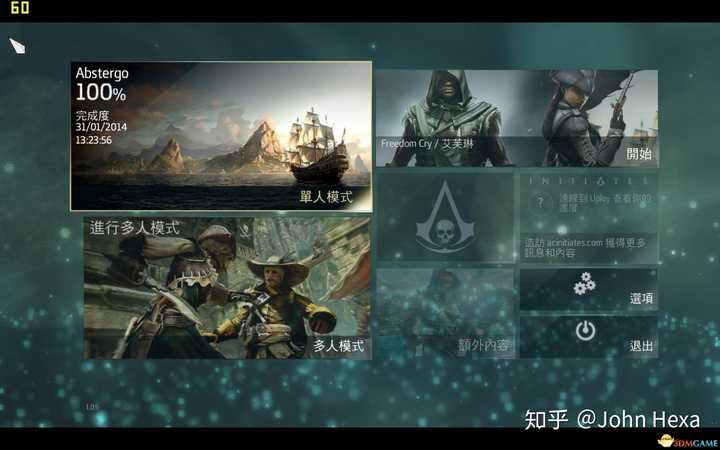
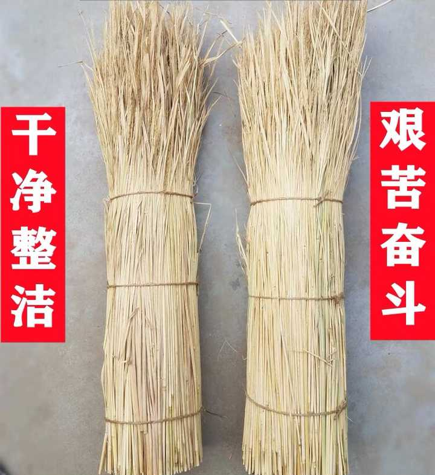
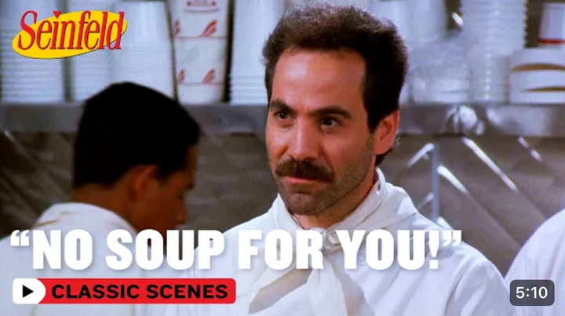

# A07　职场组织与合作　第 1 册（共 2 册）

- 专题代码：A07　专题名称：职场组织与合作
- 专题界定：共事、上下级、管理、服务、合同、组织协作与退出。
- 本册：第 1 / 2 册　收录 181 篇　正文字符 225,779
- 语料：`sooon-q9adg-articles-v2.jsonl`（4,305 篇）　SHA-256：`cdc9c271309e1d71d9708889a3a31f4777e0c339ea54c3753521894afdb8357d`
- 生成时间：2026-09-27T00:01:00.997126+08:00　排序：发表日期 → 源序号（全库唯一，不重复）

**标记约定**：`【待审】` 主题仍为暂定；`【排除候选】` 图片/正文过薄的剔除候选；
`【正文标注未完待续】` 作者原文自带未完标记；`【正文缺失片段（复核已记）】` 复核记录已确认的正文缺口；
`【图片缺 N 张】` 源图不可获取。标记只作提示，不改写原文、不改动分类状态。

---

## 4024　学生官僚

- 日期：2018-10-04　主专题：A07 职场组织与合作　副专题：A04
- 源 ID：`6cab9392-d433-535d-a891-464294858932`　原文链接：https://www.zhihu.com/question/23694182/answer/503293606
- 官方对象—实践路径：与合作者 / 与管理者 / 服从
- 23 概念标签：选择与自由;劳动与组织;权力与异议;文明与历史
- 证据状态：manual_confirmed　初读：read　独立复核：not_reviewed

**问**：为什么现在大学里，学生官僚主义那么严重？

很奇怪，为什么要求以职位相称全民会口诛笔伐？
日本学生会叫会长叫部长叫前辈叫主将不是惯例么？要是新人部员随口直呼也是要挨训斥的吧。为什么对日本人这就是一种重要的惯例？
呵斥本身的确比较中二，但是呵斥本身没什么问题。这并不因为学生会似乎没有什么实权而有所改变吧。

---

## 4003　管理101

- 日期：2018-11-22　主专题：A07 职场组织与合作　副专题：A08;A03
- 源 ID：`5ccdc259-7f06-532d-bca1-e7cc7e3a37ee`　原文链接：https://www.zhihu.com/question/303219114/answer/536492312
- 23 概念标签：定义与达意;责任与后果;成本与总账;劳动与组织;财富与市场;权力与异议;心理与主体
- 证据状态：manual_confirmed　初读：read　独立复核：not_reviewed

**问**：作为一个管理者，遇到这样的员工该怎么办？

做管理者心眼小……管理者只是团队的服务人员，而不是团队的皇帝。服务不好团队，当然要换。顾客还不是你的顾客之前，你的团队就已经是你的顾客了。团队先赏你饭，你才拿这饭找客户卖的钱。
事实上勉强算是你的员工的，只有你直接管理的那几个人，除此以外全是客户。甚至就是直接管理的下属，本质上也是你的客户。
你不建立起这个观念，管理做不好的。
问题的本质不是你的管理者在伤害你的员工，而是你的一个员工在伤害你最核心的客户。

---

## 3992　请你配合

- 日期：2018-12-12　主专题：A07 职场组织与合作　副专题：A13
- 源 ID：`0378bb91-8f84-5ba7-8567-173dbeaa4d43`　原文链接：https://www.zhihu.com/question/20286795/answer/550495062
- 官方对象—实践路径：与合作者 / 与被管理者 / 确权
- 23 概念标签：事实与证据;责任与后果;成本与总账;劳动与组织
- 证据状态：manual_confirmed　初读：read　独立复核：not_reviewed

**问**：刚升职为部门经理，发现原来的同事现在的下属不配合工作，怎么办？

这个问题的关键在于建立并完善自动化记录系统，一些能表现业绩，能分析出业绩的系统。
每个流程留痕，每个会议留音。
你做到了这一条，并且让所有人都意识到留有痕迹，你就不可逆地推动了士气问题的解决进程。
你把这些数据转化成敏捷的报表，呈现给该看到的人看到，你就不可逆地推动了管理问题的解决进程。
你需要保证你的的利润支撑得起开发成本和运转成本。

---

## 3946　泼了一身

- 日期：2019-04-03　主专题：A07 职场组织与合作　副专题：A02;A01
- 源 ID：`42dc07a1-5588-5b46-b96a-5d80e842a5b4`　原文链接：https://www.zhihu.com/question/316622113/answer/639744458
- 官方对象—实践路径：与合作者 / 与被管理者 / 沟通
- 23 概念标签：定义与达意;能力与学习;选择与自由;责任与后果;成本与总账;信用与信任;边界与许可;劳动与组织;法律与秩序;权力与异议;技术与工程;文明与历史;心理与主体;性别与身体
- 证据状态：manual_confirmed　初读：read　独立复核：not_reviewed

**问**：公司女下属在生理期当众向我泼一杯水，我该怎么处理？

说实在的，我倒很意外，在现在这个时代，还有这么多人认同威权式的治理方式。
放眼望去，都是“重罚”、“严惩”，最少也是“绝不能放过”。
为什么呢？因为“领导的尊严不可冒犯”吗？
为什么“领导的尊严”不可冒犯呢？因为“这个尊严一旦被冒犯，而冒犯者不被严惩，就会影响团队的执行力”吗？
那么凭什么这就会影响到执行力？
是因为这个组织的执行力的主要是靠一个尊严极大、面子极大的领导，奉行着“谁驳了我的面子谁就别想活得舒坦”的威慑政策来支撑吧？
“冒犯尊严”、“落了面子”是一个万能的、不容辩驳和上诉的惩戒理由。而尊严和面子的定义范围，则是按照中国从清朝长期传承下来的主奴传统共识来被默认理解。所以领导永远有办法整治任何人。是这种随时借机发作的“威严”，构成了驱动所有“下属”服从的鞭子。
一旦发生公然的冒犯而并没有发生严惩，就意味着这个严惩机制出现了问题，会导致人们不再那么在意这条鞭子。于是组织就会“大乱套”，大清就要完了。
你们要靠我赏饭吃，所以你们不想挨“御面子之鞭”，就得知情识趣，是吧？所以岂能容你伤了上位者的“尊严”而安然脱身呢？这样怎么对得起其他鞭痕累累的黄牛们呢？
几百年了，你们还是这个思路，唉。

现代组织的合格的最高决策者，会怎么看待这个问题？
作为一个中层管理者，你如果找借口严惩这位“冒犯了你的尊严”的女下属，而非宽容和原谅她，你会被评定为“不适格”，你的前途基本到头了。
不过，更提前一步的——如果这家企业如果在企业文化营造上造成了你有这种“这太丢人了，必须想办法惩戒对方找回面子，不然管不住人了”的忧虑，它一开始就失败了，注定是个loser。
“在我的管理范围之内，我的人要靠这种面子、尊严去维持执行力，乃至于一旦失了面子，就会有服从性焦虑，这对我是可耻的失败，我应该想想我哪里做得不够好”——如果你的上司不是这样看待问题，你最好自强不息，争取早点跳船。这家企业做不起你的归宿。
类似女下属这样的问题，一家负责任的企业应该会启动心理援助方面的预算，安排中立的第三方去辅助她做情绪管理和心理疏导。
这件事情会被定义为“意外事故”。首先要检索责任的起点是上司的领导风格和工作压力安排，是人力资源部门的适格性调查的瑕疵和员工情绪的察觉能力。
没能在生理期控制住自己情绪的员工自身几乎没有责任。会被定性为“需要帮助”，而不是会被定性为“需要惩罚”。
这位中层干部则会被定义为需要谈话疏导，以此为契机培育他的领导者人格。
一位合格的领导，不会在此时认为这位女下属需要任何惩戒。人都有脆弱的时候，有失控的时候。管理的艺术在于提前发现、系统的降低风险和事故发生后的影响，而不是去“惩罚”“威慑”。
如果这位员工反复的利用这个借口“谋求特权”怎么办？因为生理反应强烈以至于不能担当关键任务，于是自然而然的失去快速升迁和绩效是自然而然的抑制机制，为什么还要额外“惩罚”？
企业没有兴趣、也不该付出什么成本去鉴定你是否撒谎。自然而然的会生成你扛不住的反制，才是正确的设计。
如果这位女同事一直情绪失控怎么办？可以按照不能满足岗位要求的路线解除劳动关系。但这是就事论事，不是“惩罚”，不带激烈情绪、不存在报复意味。
第一次失控就“一定要开除她立威”，在组织里传递的是什么信号？这是东星耀扬哥的堂口吗？
但凡有得选择的人就会选择不这样干事的“企业”。
能这么干的，只有不是凭自身的竞争力，而是凭某种与经营无关的权力来活命的“所谓企业”或者其裙带企业。
除此之外，都是些不知将死的将死之物。
你以为就凭你开的那点工资，就足以获得有能力的员工的委曲求全？你这么干事，你的企业只会变成实在走投无路者的大本营。
你那都是为混生活不得不受你这份“威严”的无能者兼懦夫，你还想跟人家竞争？
如果你自己准备开一盘生意，但是想不通怎么能不靠这种所谓的“惩戒”来进行有效管理，那么你要意识到你这盘生意多半是为了抓住一个短暂的绝妙时机。这个时机抓住了、福利吃掉了，就请及时抽身而退。千万不要误以为这是你的基业往里不断的投入成本维持。
你最后一定会落得把前面赚的钱全部填回去的结局，这还是较好的版本。更坏而且更常见的版本是你贪心不足、自以为“只是偶然现象”，还咬牙高利贷款，徒劳的再撑一段时间，而且还死活拖欠大笔工资和供应商货款、最后还是倒闭。
为何？你多想想为什么。
想不通，你最好不要以为眼前的这个“商机”是机会。
那不是“机会”，是你的坟墓。
—————
很多人似乎很受不了这个答案，那我我就再补充几句，把这背后的道理再说透一点——
我很奇怪，你们为什么不相信这个世界上有尊重普通员工的企业。
我们的员工都是在跳槽上很有优势的人才，我们对他们不比那些整天想着“自己的威严被侵犯了就没什么管理执行力”的人对他们好一点，凭什么用这样的工资却得到他们的稳定和创造性？
我们是高度依赖员工创造性和忠诚的企业。
我们不主张上司们搞什么“尊严”路线。
我们给予每一位员工最大程度的尊重与爱，让员工天天担心我们对他们这么好，会不会撑不住。
我们开办企业，是为了集合一群人才去为客户创造价值，然后让这群人能尽量生活安稳、无后顾之忧、最大限度的发挥他们的想象力和能力。如果这样我们的资本会亏掉，那么就算是请一群自己不知道自己可能有多厉害的人吃了顿饭。我们看中的人才，怎么会白吃这顿饭？又怎么可能没有前途？作为在他们人生早期给过他们这种体验的老板，我们根本不担心最后会亏本。
事实上，也的确也没有亏过。
我们的员工不愿意让老板失望，不愿意让这家公司做不下去。这是他们的动力。
他们在这家企业感到安全、感到依靠。这是创造性最大的根源，而这是知识经济的命脉。
不走我们这样的规则的企业，我不觉得他们有跟我们竞争的资格。
他们只能去走“最快复制竞品然后尽快以最低价格上架”的路线。
在那里，害怕奴隶们不再畏惧鞭子才是个大问题。

---

## 3885　强力下属

- 日期：2019-10-09　主专题：A07 职场组织与合作　副专题：A08
- 源 ID：`bde0a145-00b6-53ec-9687-d62cbcca4ca5`　原文链接：https://www.zhihu.com/question/277993916/answer/850203386
- 官方对象—实践路径：与合作者 / 与被管理者 / 指挥
- 23 概念标签：能力与学习;成本与总账;财富与市场;法律与秩序
- 证据状态：manual_confirmed　初读：read　独立复核：not_reviewed

**问**：怎么管理能力比你强的下属？

管理者只是个服务员。
这个服务员有点特殊，不找客户收钱，看起来倒是会给客户钱。
但其实，那是客户赚到的钱，被ta截留了一部分后还给了客户。
于是问题还原成了——
“服务员怎么服务比自己能力强的顾客？”

这为什么会成其为一个问题？
其实想明白这条，就会明白管理的基本原理。
你截流的部分就等于你收取的服务费。截留越少，意味着同样的服务收费越低，你的市场就越大。市场越大你也就越可以对顾客强硬，顾客也越不会额外觊觎你的“优势地位”。
你要想在截流少的前提下获得足够盈利，你要想办法去把由此带来的更广阔的市场空间兑现。
一种思路是手下只有2个兵，往死里抽水，每个兵抽80%，结果营业额200，最多也就获利160；另一种思路是每个兵只抽10%，但是手下200个兵，营业额20000，获利2000。
说穿了，管理者的优劣高下，分界就在这里。

---

## 3864　低贱的事情

- 日期：2019-12-30　主专题：A07 职场组织与合作　副专题：A03
- 源 ID：`82389177-42f9-5e9b-bf5b-e50c1baa69f0`　原文链接：https://www.zhihu.com/question/356835825/answer/955654925
- 官方对象—实践路径：与亲族 / 与子女 / 抚养
- 23 概念标签：事实与证据;能力与学习;选择与自由;责任与后果;成本与总账;信用与信任;爱与回应;净输出与不掠夺;劳动与组织;权力与异议
- 证据状态：manual_confirmed　初读：read　独立复核：not_reviewed

**问**：十四岁的孩子说出“我不要洗碗，因为这是很低贱的事情”这种话，我要如何回应？

各位到底是觉得ta说得不对呢？
还是觉得其实ta说得对，只是不该说？
工作真的都是没有高下之分的吗？回答这个问题要小心——如果你自称都一样，就会跳出一位觉得你的工作比较好、能力跟你相当的人来要跟你换。对你而言做这个交换无损，对ta则有收益，如果ta将所获收益分一半给你，你们双方都将会从这个交换里凭空获益。
双赢啊！世界上总有觉得自己的工作不如你尊贵的人，你反正始终都觉得一样，这里你就可以好好地捞一大笔了不是吗？
你为啥舍不得换？
那么，也就是有高低之分了？
那么想要辩解的话，只是想要辩解说有高低，但无贵贱吧？
所以这个小朋友只要把“低贱”的“贱”字去掉，改成“低下”，应该就没人有意见了吧？
为什么还是有人愤愤不平呢？不是你们说“低不为贱”吗？低下既然是中性的，完全没有贵贱的问题，那么为什么有人说你的工作低下你要愤怒？
所以，其实你们在反对的到底是小朋友说出来的内容，还是在反对小朋友说出来这个动作本身？
之所以这么生气，是因为国王们的确知道自己没穿新衣，数九寒冬当真难熬，所以痛恨小男孩还要伤口撒盐吧？
“连我这最后的自我安慰也要剥夺，小兔崽子真nm没心肝啊……谁家的，有没有点家教？！”
——作为敢于直面惨淡人生的真猛士，你应该这样回应。
看小兔崽子回家不被打断腿。
那么，要如何面对“的确存在卑贱的岗位”这个问题？
我们现在的流行的解决方案其实就是上面这种皇帝新衣式的政治正确方案——明知这是事实，但是要拒绝面对真相，要虚词伪饰，强要说“工作无贵贱之分”，结果在事实层面总是不堪一击，一不留神就会流露出真相，而且总是要在小孩子面前硬拗撒谎——搞得好像要是能把下一代人全体骗结实了就会自动实现幻想天国一样。
那么，如果抛弃这个方案，我们如何面对这个问题？
那就是：社会地位的虎符分为两半，一半是工作的属性有高下之分，一半是工作的态度有优劣之别。两半合在一起，才真正决定了你的社会地位。
你的工作职位是否低下，是否具有天然的高可替代性，并非全然是你可以选择的——有时甚至全然不是你可以选择的。没有选择，就没有罪恶。
他人识别出这种天然的高可替换性而并没有决定向你倾注过多的社交资源（亦即礼数、主动的交往），是你需要理解和接受的。
这是你仁爱的义务。
你得让他人活（live and let live）。
要求人不区分可替换性、不分优先级去投注社交资源，是一种暴政。是的，不要以为你社会位阶不高，你就不会是一名暴君。仔细反省，否则你不要奇怪你为什么众叛亲离、妻离子散。
ta们这么做不是因为你的社会地位低下（所谓“嫌贫爱富”），而是因为你是个暴君。
“我欣赏你对我的礼遇，因为要礼遇我这样的微末之人，是难得的美德，也让我相信你精神之富裕；我原谅你对我的轻忽，因为我知道你大概人生不易，你有限的资源已经无力覆盖到我这一层。”
很多人大概要跳脚——凭什么？我凭什么要对那些看低我的人这么“软弱”？我不管，我要“犯我强汉者虽远必诛！”
凭什么？凭只有这个心态的人才会停止下滑。否则无论你现在的地位已经如何低下，已经如何饱有可替代性，你的地位一定还会更低下，被一切他人不自觉地推挤进更有可替代性的位置去！——他人仅仅只需要凭着风险控制的本能，就会自然而然的触发这种集体决策。
你一天不悔改，你就继续下沉一天。你越下沉，你就越会依赖那个“人无贵贱”的政治正确口号来自我安慰，越强迫性地在虚拟空间发泄、猛踩我这种答案。
发泄、猛踩，根本不会扭转你下滑的事实，也绝不会改变他人“嫌贫爱富”的“无礼态度”。
因为真相是你是个为了自己愉快而不容他人尽最大努力追求自己幸福的暴君，他人只是无意间看到了你的恶，要敬你而远之。
顺着这条线，你才会明白为什么你的同类之中另有一些人却并不因为自己的卑微而失去他人的尊重——那不是因为他们“善于拍马屁”，而是因为他们内心有这样的仁德，而他人即使没有显式的认知，在下意识里也感到了安全。下意识的安全会导致人们不自觉的亲近。对不自觉安排得离自己更亲近的人，人们自然而然留了三分情。
这三分情，就是你艳羡而诅咒的“偏心”的本质。
然后我们回到这虎符的另一半上，说一说卑贱的工作岗位和不卑贱的工作态度。
岗位卑贱不由你选，那虽然会导致人们天然地不会把社交资源向你倾斜，但那还谈不到导致你沦为下流。
的确，这个世界有一大堆蠢蛋仅仅因为你的岗位卑贱就径直对你无礼，视你为草芥。——你放心，这种蠢人第一不会有真出息，第二除非他能醒悟悔改，否则他绝对、绝对不会有好下场。
为什么？
因为对卑贱的恐惧必然驱使他要往上爬。往上爬又必须要有大事业。而大事业绝非一个人可做。绝非一个人可做的大事业的人力金字塔里，必然有大量卑贱的下层岗位。
而因他这愚昧的蠢行而带来的逻辑诅咒，会导致他所无法省去的大量卑贱下层岗位只能由工作态度同样卑贱的人填充。
看懂了吗？一家企业里门口的保安大爷、楼道/办公室里的清洁阿姨、前台不起眼的接待、负责打印复印的文员小妹，挤在大格子间里的呼叫中心客服……ta们的工作态度和士气其实在很大程度上决定了这家企业里的其他部门的效率。
ta们每一个人看似都可以轻易地被替代，暂时少掉了似乎企业也不会立刻倒台。
但是他们的长期消极抵抗，能无声地吃掉整个企业的竞争力，无声无息地吃掉成本，吃掉客户的满意度，吃掉“每个人都不可或缺的”核心精英团队的努力、进而毁灭他们的士气。
不是没办法，人委屈了你可以给钱。一万二一个月请清洁阿姨，肯定有人肯忍受你的嚣张跋扈。
但是你记住——你的领先优势对手迟早学会，你的人才对手迟早挖走，你的关系优势对手迟早打平——但对手却不用出这二十个一万二。
看懂了吗？
能成事的领袖一定看得懂——嚣张跋扈，作践低岗位的团队成员，是极其昂贵的蠢行。你发觉你的团队领袖看不懂这一点，我就劝你及早准备跳槽，因为ta必然没有前途。这么简单的道理都不明白的人，没有资格担当任何团队的领袖。
明确地警告你，你跳船的能力是随着你的衰老不断地消退的。你不早点跳，将来那点垄断优势一旦破口，你将与舰同沉。
看明白了这一面，你就会明白身处卑贱的岗位你可以有的选择了——那些身处卑贱的工作岗位，却没有沾染卑贱的工作态度的人，将是任何真有宏图大志的团队在孜孜以寻的珍宝。
你负责人民大会堂的区域清洁，你的社会地位真的卑贱吗？
你在苹果总部负责保安巡逻，你在社会里的地位真的很卑贱吗？
你真的站到这些位置上，你会发现在这里极少有人如此不尊重你，真有人这么做了，头顶有雷的一定是出口不逊的对方。
你不以卑贱的态度去从事你的岗位，那么无论你的岗位如何具有所谓的可替代性，你的岗位也会因为你的存在而变得不可替代。道理很简单——懂得这个道理的人很少，懂得这个道理而能行的人更少。岗位本身不稀缺，你这样的人稀缺。
“我的团队，即使是一个扫地的、一个倒茶的，那种不需要任何学校教育的岗位，我也需要由工作态度绝不卑贱的人来担当。可惜有学历的人太多，而有态度的人太少。我只是在为那些对我毫无用处的过度学历付出本不该付出的额外成本，在勉强弥补有态度的人的稀缺。”——这才是那些最终话事人们心里念兹在兹的心病，也是目前中国行业领先的团队里普遍存在的人力资源短板。
不可替代性自然带来尊严。
岗位的可替代性，可以被态度的不可替代性救赎。
的确有低贱的岗位，但这还不足以使得你成其为低贱的人。对低贱的岗位采取这种低贱的态度，才使得你成其为低贱的人。
而“这是一种低贱的工作，我才不要干”，恰恰是一种低贱的态度。

---

## 3846　组织生鲜供应

- 日期：2020-02-16　主专题：A07 职场组织与合作　副专题：A08
- 源 ID：`90c3f6e6-064e-5ebd-bff0-e828bd50e15e`　原文链接：https://www.zhihu.com/question/372303623/answer/1019553788
- 官方对象—实践路径：与社会 / 与社区 / 共建
- 23 概念标签：定义与达意;能力与学习;选择与自由;责任与后果;成本与总账;信用与信任;爱与回应;照料与家庭;劳动与组织;财富与市场;法律与秩序;权力与异议;技术与工程;心理与主体
- 证据状态：manual_confirmed　初读：read　独立复核：not_reviewed

**问**：在新冠疫情之下，组织小区蔬菜采购的最佳实践是什么？

物业与生鲜供应点/大型商超配合的规模化供应方案
鉴于武汉市部分地区已经开始要求大型商超停止接受个人采购需求，特别紧急追加此方案以供参考。
操作流程如下：
物业向小区居民发布极尽简单的套装标准，每户按人口构成定量供应，只能选择要或者不要，不能选择内容。
在预先预告的采购日限时开放在线表单服务，统计次日食品供应需求。给每次处理采购需求留出充分时间。开放下单的窗口时间不宜是深夜，以免老人熬夜守侯。
原则上每周供应两次，这次没赶上的居民除非有特殊困难情况，否则请下次预约供应。
物业向附近生鲜店发布“居民标准口粮供应包”标准。由生鲜经营人员大批量采购，流水线分装。按时向物业统一交付。
标准口粮包建议为蔬菜包+蛋白质包+水果包+主食包组合。
其中，蔬菜包为指定品种范围的蔬菜组合，设计总量为5斤一包，每包四到五个蔬菜品种。对于具体蔬菜构成和品种只做大致要求，不要求精确分装，以提高分装供应效率。蔬菜包可以提供三到四种标准选择。
鱼肉蛋奶包要求重量准确、质量保证。设计重量也是5斤一包。
水果包一般要求为香蕉、蜜桔、苹果等相对低值、易大批量采购、耐保存品种。
主食包一般要求采用标准包装的工业产品组合。可以包含主流方便面、筒装挂面、大米、罐头等。

物业收货时抽查样本。为平衡采购风险，宜同时邀请两家以上的供应商参与配货，以便根据抽查结果修改第二天的订单分配比例。
物业收取货物后，组织人力（或志愿者）分发到各门栋，也可直接按清单放到各居民门前，敲门即走，由居民自行收取，避免居民大规模外出。物业可以根据订购标准包数量收取额外服务费。
动员业委会组织小区热心业主组成志愿者接受下单、配送等基本知识的指导培训，在各个楼栋群内提供指导服务、转交售后问题。
没有子女帮助处理事务的老人或其他困难户，可以公布后征集志愿者，由志愿者电话询问需求、代替ta们下单。

小区居民或居民区外围生鲜超市自建团购服务方案框架
《基本规则》
当前团购生鲜服务的主要挑战，主要包括
居民反复询问单价数量和库存问题。
因为各个团购途径的情况瞬息万变，居民们往往举棋不定，频繁修改需求和取消订单。这些都造成以靠人力记录确认需要的巨大压力。
因为缺少严谨规范、简洁明了的服务约定，导致居民反复询问，客服人员疲于解释。并常有误解和纠纷发生。严重损耗志愿服务人员的热情与公信力。

以下规则主要是从高度限制交易灵活性以降低服务成本、提高服务效率的思路出发，尽最大限度压缩人力沟通的必要性和减少订单复杂度，降低争议风险。
将提供的菜品分为2-3个固定套装（套餐内容请参考本文“标准套装方案”部分，有具体建议者请在本文后留言告知）。
一口价，不可议价。
严格按照套餐接受预订，不接受任何增减定制。
订单一旦提交成功，将不允许撤销和修改。
配送后超出时限未领取的，视作买家将该份货品无偿捐赠，任由卖家自行处置。
收取货品，需要先发送指定格式的短信作为收货凭证。（尽量不采用签字等方式，以减少接触）。
使用番茄表单、简道云等在线表单服务进行订单收集。在此呼吁上述厂商临时开发适应此需求的表单模板，减轻一般用户的操作难度。基于番茄表单免费版的操作指南，见本文的《基于番茄表单的订单收集系统的操作指南》。
配送时间原则上为次日，根据订单情况将予以延迟。如直至疫情结束仍未配送，买家可以凭确认短信请求退款。
原则上只对特定名单内的用户服务。用户必须填写密钥/注册名才能使用服务。
不建议团购组织者超能力的吸纳团购成员，以免损伤信用、挫伤自己的积极性。

组建团队
负责人一名，主要负责掌握资金，必要时垫付资金，对外联络货源对供货方负责，并对纠纷承担最终责任。有献身精神，有心理承受力（因为肯定会挨骂），对可能到来的委屈有充分心理准备。可兼任物资采购。（这一角色常可以由附近的蔬菜销售商家担任。如由居民担任则有天然的信任度优势。）
物资采购一名，负责按照订单需求采购次日要到期配送的物资。需要有物资采购、运输上的对应资质和合法授权。这一角色常可以由附近的蔬菜销售商家担任。
物资分装若干名——按照套餐设计，组成简易流水作业小组批量封包套餐货品。这一角色常可以由附近的蔬菜销售商家担任。
配送管理一名——负责将待配送货品运送到社区指定的交接地点，并与前来领取的买家（或小区内接货志愿者/物业、社区指派的接送人员）进行货品交接。这一角色常可以由附近的蔬菜销售商家担任。
后台管理人员一名，要求熟悉电脑操作，最好有企业文员的成熟经验，认真负责。主要负责管理群公告、表单内容，负责及时将订单统计信息转交给物资采购方。这一角色宜由居民中有服务精神和足够技术能力的专人担任，最好有企业文员、仓库库管等相关工作经验。
社区/物业外协员一名，负责与社区和物业协调工作，尤其是协调货品配送交接的安排。常可由负责人兼任，或由物业工作人员、业委会成员兼任。
买菜群的沟通负责人一名，负责在微信区具体接触客户，介绍规则和答疑。这一角色宜由打字熟练，微信使用技巧熟稔的居民担任。

团队成员的心理建设
所有团队成员需要对居民服务的困难度有充分心理准备。
要理解居民们习惯于高度体贴的消费体验，尽管明知当前局势困难，但下意识中养成的习惯难以一时去除。因此很容易发生不理解、使用嘲讽等语言暴力表达不满等本能的应激反应。而志愿者们常常默认认为自己应该得到额外的尊重、尊敬，而在另一面因为本身就是临时志愿的业余人员，提供的服务与居民日常习惯的专业服务存在重大落差。因为这一消一涨所造成的落差，对志愿服务人员会有严重的心理冲击。
对于这一点，组织的负责人需要高度重视，并及时采取以下推荐手段加以有效干预：
随时准备退款解除发动语言攻击的会员的资格。但要注意要礼貌客气的进行，不要恶语相向，以免激化矛盾。
提前对志愿服务人员打好预防针，提高崩溃阈值。
多招募一些直接负责客服的志愿者，避免个人长期过度值班，同时也避免矛盾集中在一人身上。
优先保障志愿者家庭的供应。
尽快积累话术手册，让志愿服务者可以轻松引用标准答复。避免过度个人的接触引发针对个人的矛盾。
如果条件许可，另外准备专人接手特别难以接待的客户。
如果条件许可，可以录制小视频记录志愿者们的服务点滴，剪辑成短片到小区群传看，积累正面影响，提前遏制恶意攻击的倾向。

基于群接龙的简易订单系统方案（推荐）
微信群接龙使用视频教程。
“每天都有两亿人想弄死我” | 微信又更新了：群接龙怎么玩？文件如何备份？怎么发高清大视频？_哔哩哔哩 (゜-゜)つロ 干杯~-bilibili基于番茄表单的简易订单系统方案
首先用手机号注册番茄表单，然后创建表单时选择“小区超市”模板。下面是基于这个模板进行配置的具体视频设置指南：

各类信息参考范本
群公告参考范本
（可保存在朋友圈然后转成截图以便随时转发，如果有公众号也可以发布在公众号以便随时转发链接）
因为疫情严峻，为在人力有限、任务繁重的前提下最好、最稳妥的服务最多的朋友，本团购群实施以下规则，请在下单前仔细阅读。填写订单则意味着您已经阅读本规则并表示同意。
因为接待能力有限，本团购服务不可议价。
严格按照套餐接受预订，无法提供增减定制服务。
订单一旦提交成功，将不可撤销和修改，请慎重确认您的填写内容。
通知领取后超出（时限）未领取的，视作买家将该份货品无偿捐赠，将由卖家自行处置。
为规范货品交接行为，收取货品需要先发送指定格式的短信作为收货凭证。请提前编辑好确认短信，在发送确认短信后领取自己订购的货品。请人代领者也请和代领人保持联系，短信最好仍由下单手机发出。一次采购量较大时，建议自带旅行箱、购物拖车+纸箱等轻便运载工具。
配送时间原则上为次日，根据订单情况将予以延迟。如直至疫情结束仍未配送，买家可以凭确认短信请求退款。
未避免无效订单，本买菜群只对预先注册成功的会员提供服务。用户必须妥善保管自己的注册会员名，在填写会员名后才能使用服务。
为规范购买周期，表单有每日密码设定，每天的新密码将在群内公布，请您留意。在达到当天最大接单数量时，会以修改密码的方式停止接单。
每天群内都会推出新调查核实过的特困人士的需求征求大家的捐赠，欢迎大家积极认捐，本群将记录所有参与捐赠者名单上报社区。
本规则如有修改，将在群内以群公告方式通告。请您随时留意。

订单确认短信参考范本
您的订单xxxxxxx已经确认，已收取订单金额xxx元，您的预付款剩余金额xxxx元。

收货确认短信参考范本
已收取订单XXXXXXX所约定货品，确认无误。

标准菜品套装设计最佳实践（待完善）
套装设计准则
套装方案最大重量不宜超过5公斤（通常打包用的塑料袋有安全承重问题）。一般原则上按照每包都是固定重量设计为宜（如统一6斤一包），有利于客户选择，也有利于预估配送负担。可以采取只保证总重量和基本品类，数量快速自由搭配的方式提高分装效率。
不宜再加次级包装，以便客户自行使用臭氧和阳光暴晒消毒，也有利于降低封装风险。
不宜包含过多脆弱易碎成分。以免配送时破损污染。
单套价格宜在200元范围内为宜（现在肉类普遍50元以上售价，所以稍微多几斤肉就一两百了）。
应提供廉价套装，适应经济困难人群需求。
应提供轻加工（仅需加热消毒即食熟食）为主的套装，适应缺少足够自理能力的弱势人群需求。这类套装优先对困难人士供应。
可以考虑提供针对糖尿病患者的套装，降低他们前往医院透析的压力。
可以考虑按照鱼肉蛋奶 / 绿叶菜 / 根茎花果/香料调味 类别为界设计套装。这样客户可以简单便捷的搭配。
可以考虑按冷藏与否为界设计套装。

套装设计的经典方案
（摘抄自某大型商超方案）
肉食套A
翅中 2斤
鸡掏肉 2斤
翅根 2斤

肉食套B
五花肉2斤
鸡翅中2斤
鸡根2斤

肉食套C
腿肉2斤
瘦肉2斤
排骨2斤
翅中2斤
鸡肉2斤

蔬菜套A
西红柿约2斤
球包菜约2斤
青梗散花约2斤
土豆约2斤
黄白菜约2斤
洋葱约2斤
葱姜蒜 组合一份

蔬菜套B
芜湖青椒约2斤
黄瓜约2斤
胡萝卜约2斤
金针菇300克
上海青约2斤
葱姜蒜组合一份
豌豆角2斤

水果套A
沃柑10个
雪梨6个
香蕉10根

水果套B
砂糖橘2斤
陕西富士苹果10个
西州蜜瓜1个

水产套A
优质带鱼1斤
大剥皮鱼约一斤

水产套B
厄瓜多尔对虾3.6斤一盒

大厨房商品套餐
福嘉五香干子（200g）x3
福嘉薄千张（200g）x3
福嘉家常0腐（330g）x1
放心宽米粉（600g）x1
南方馒头3个装（210g）x3
醇熟白吐司(320g) x1

主食套
鸡蛋30个福临门香粘米10KG
家晏面粉5KG|福临门麦芯通用粉5KG

---

## 3841　钉钉

- 日期：2020-02-26　主专题：A07 职场组织与合作　副专题：A13;A10
- 源 ID：`33b07cf1-91ab-5701-92ef-5e0372d027db`　原文链接：https://www.zhihu.com/question/370841540/answer/1038953421
- 官方对象—实践路径：与合作者 / 与管理者 / 博弈
- 23 概念标签：事实与证据;定义与达意;能力与学习;选择与自由;责任与后果;成本与总账;劳动与组织;财富与市场;法律与秩序;权力与异议;技术与工程;心理与主体
- 证据状态：manual_confirmed　初读：read　独立复核：not_reviewed

**问**：如何看待新冠肺炎期间全网开始怼钉钉?

想要对抗“被侵犯个人时间”，不可能靠消灭通信工具的方式。
否则你应该把你的电话一起丢掉。
老板能用钉钉做到的，哪一样不能用电话做到？你钉钉不敢下线，你电话就敢关机吗？钉钉消息叫你答复你不敢不答复，换成电话打给你你敢不接吗？短信发给你你敢不回吗？
钉钉的“罪恶”是把这种你摆脱不了的“奴役关系”变得更频繁深入了，是吧？
问题是，电报、电话、传真机、复印机、打印机、汽车、火车、电子邮件、互联网……哪个不是在扮演同样的角色？
没了上面随便哪一样，你的老板都更压迫不到你，为什么不跳起来反对它们？
想过没有？
这些东西固然能让老板抓你更紧，但也让更多人当起老板来更容易。有更多人觉得管理更容易，能让世界上有更多企业、更多团队、有更多工作机会！
更多工作机会才是你对抗老板的唯一本钱！
在上面那些东西都没有的时代，你以为老板们没有技术手段远程叫你，你就可以在家钓鱼养狗了？
你错了！
你要自己乖乖的、求爷爷告奶奶的、求上门去看人肯不肯收你住在前院柴房里让你拉磨当长工。自己去应征求人收你进集体宿舍里住大通铺一天三班倒卖命。
你看那时候老板们是不是会因为缺少技术手段就叫不到你？
只要你需要工作，无论什么时代，无论什么技术条件，你都不要妄想老板会叫不到你。
只要你背后没有别的跳槽机会触手可及，你就不要指望老板会尊重你的劳动时间——不管你立什么法。
因为是你自己在通过放弃这些“权利”为没有其他退路的自己求保险。
你不信试试看——当你没能力也没机会跳到更好的企业，而老板有事只叫别人不叫你，看你自己受的了受不了，看看你是不是还有心情拿这“休闲好时光”来刷抖音。
钉钉的发明，战术上让你痛苦，但是战略上对你有利！明不明白？
至于那些因为疫情不能到校觉得钉钉搅合了他们长假美梦的学生，ta们没有持有观点的资格——除非你认为蚂蚁跟着甜味爬也是一种观点。
那只是家庭教育失败的效果大爆发罢了——这都是些loser的表征，将来自有一件接一件的残酷事一耳光一耳光的教ta们做人。
醒一醒吧！生活是一种“敬酒不吃吃罚酒”的游戏！

---

## 3839　捧杀

- 日期：2020-02-29　主专题：A07 职场组织与合作　副专题：A20;A11
- 源 ID：`328789e0-0714-5df0-9f11-c7aa2b88db8a`　原文链接：https://www.zhihu.com/question/22495263/answer/1044964434
- 官方对象—实践路径：与自己 / 与能力 / 承受;与自己 / 与欲望 / 取舍
- 23 概念标签：事实与证据;选择与自由;责任与后果;成本与总账;权力与异议;文明与历史;心理与主体
- 证据状态：manual_confirmed　初读：read　独立复核：not_reviewed
- 标记：`【正文标注未完待续】`

**问**：如何应对他人的捧杀？

这个问题问得非常好，我来好好答一答。
中国是一个本质精英制的社会，天然从文化基因的深处就本能的给精英预留了宝座。
唯才是举、选贤任能、陈力就列，不能则止、能者多劳，天生我材必有用，天将降大任于斯人也。
整个中华文明，就只有老子喊绝圣弃智大道乃绝，不尚贤使民不争。子非鱼安知鱼之乐？鬼才想知道你有多乐，您老人家牵头牛去山上乐去。看看你头顶上的三重茅够几回秋风卷。等你冻上了，你一样跪下唱“安得广厦千万间”，去为碧桂园带盐。
还有那谁谁谁，采菊东篱下悠然见南山，还是要做白日梦钻山洞里幻想衣食无忧。
还是我外儒内法，士大夫为万般最高。
但也别说我不讲理，我许你书中建起黄金屋，积来千钟粟（老钱这城围得好），还许你林徽因、阮玲玉。
在这天下英雄都出不了的彀中，名臣良将如美人，天生丽质难自弃。高堂明镜悲白发，冯唐老得太早，李广用得太迟。
谁高分，谁就能，谁能，谁话事，谁话事，谁就要负全责。谁负全责，谁就在必然到来的、人算不如天算的失败里被献祭。
你要食得盐，你就要抵得渴。
那你能不能吃这盐？
这盐可是很好吃哦？白玉堂、黄金屋、千钟粟、颜如玉哦？再说谁说你必败？败了又有谁说你不能推给别人呢？
你确定为了不挨这份渴，宁可不得食这盐吗？
你真的想好了吗？你确信你不要学那些食得盐，而又不必挨渴的妙计吗？
老衲也不能说那些必定不灵哦？就算我说了，我又算什么东西？我说的就是真理不成？
所以，你真的想好了吗？
你想好了，再往下看，我可不想耽误你的锦绣前程。
下面这些话是为了真打算从这些里面解脱的人写的，也只有这样的人能用得了。勉强假装是这样的人是没有意义的，所以一定要看的话，后果只能自负，勿谓言之不预也。
什么叫“真打算从这里面解脱”，就是一个基本原则——任何一种权位，不但不去积极争取，而且还要避之不及。
只有一种前提，你可以忍受权力的重负——一切有意愿而大众又愿意接受的人都已经不存在了，你已经退无可退，再不接受就有你即使付出生命也不愿看到的后果发生了，只有这时，你才能忍受权力的负担。
如果你是这种人，我就告诉你应该如何去对待这“捧杀”。
其实，你真心实意是这样的想法，捧杀对你就已经无效了。因为你是大众在试过所有其他选择之后，再三推辞避让而不可得才愿意临时顶替之人，而且毫无恋栈不去的意图，你没有那份贪婪，那么那权力对你也就没有那份“杀气”。
我不是假装闲云野鹤要去走终南捷径，我是真闲云野鹤自得其乐。是应你们之请我才勉为其难。你们谁想坐我这个位置，只管开口，我必然给你一切的机会甚至帮助，让你合理合法换我继续回去闲云野鹤。只要你能有机会说服的了这组织里的成员接受你，我铁定让位。
自然你们谁也不必为了这个位置来“杀”我。
我心底坦然，自然也不必整天猜疑你们谁要来杀我。
所以，只要你真的“下了这决心”，你就已经对“捧杀”免疫了。
真正的关窍在于——你如何能不勉强的、不纠结的、坦坦荡荡的、真实的有这个“决心”。
其实你上当了。
因为这个mindset根本就不可以是一种处于愿望而下的“决心”，而只能是一种自然的认知。一种清醒的、真实的认识。一种对“追求权力是有毒的，是坏的”的充满论证和依据的信服。
如果你不是出于什么原因真的是这样想的，只是因为害怕“捧”背后的“杀”而下意识的躲着捧，那么等你风调雨顺、觉得天下无事不可为的顺境时，你就会因为自信不怕杀而不拒捧。
而这种顺境，几乎因为你在内心深处对被捧的渴望压倒对杀的恐惧而必然到来。
你那个所谓的“决心”是靠不住的。
那么，为什么“追求权力”就一定是“有害的”呢？历史上那么多声威赫赫之人，不也并没有个个不得好死吗？有很多人不也名垂青史彪炳后世吗？为什么我就不可以是那个少数例外呢？

（未完，待续）

---

## 3823　越界

- 日期：2020-03-14　主专题：A07 职场组织与合作　副专题：A03
- 源 ID：`b6bafaf0-5104-50e7-9e0d-300396dbfbbe`　原文链接：https://www.zhihu.com/question/374143317/answer/1077388375
- 官方对象—实践路径：与合作者 / 与被管理者 / 奖惩
- 23 概念标签：定义与达意;能力与学习;选择与自由;责任与后果;成本与总账;信用与信任;净输出与不掠夺;边界与许可;劳动与组织;法律与秩序;技术与工程
- 证据状态：manual_confirmed　初读：read　独立复核：not_reviewed

**问**：如何看待「云南某集团首席执行官和人事总监邮件互怼，裁撤人力资源团队」一事，以及对人力岗位的相关言论？

估计这家企业会比较艰难。
信里面的推断是逻辑不成立的。
一个企业里的部门是否应该存在，不是看“不要这个部门是不是就没法过了”，而是看“是不是有比没有好”。
如果遵循“砍掉它也不是日子就过不下去”这种标准，那没有秘书，CEO善用大脑和小本本也不是不能过，把秘书裁了；没有清洁工，大家动手扫扫地也不是不能过，把清洁工也裁了；接着销售的工作也不是不能给研发去干，反正也就是按手册给客户报价罢了，销售也裁了……
最后总裁真的是总裁了，裁得只剩自己了。
HR部门又不是战略部门，本来就没有义务去思考公司未来策略，甚至都不应该去花这个精力。
换了是我，现在人力资源部交一份公司应该如何应对疫情的建议书给我，恐怕反而会挨骂。
除非我自己给了你这个任务安排，否则你该干嘛就该干嘛，干了这些你本职有时间干好吗？
我是CEO，我对做出决策有全部责任，其他人只不过是给建议。世界上根本不存在“该骂的建议”这个概念。
你是我批准就任的人，你提出来的建议质量不高是我的责任，要骂只能骂我自己。我可以认清自己看错了人，并且及时决定解除劳动关系，但是这个错在我，你反而还是受损方。我要解约还得向你道歉，给你补偿。
我如果不是这样承担全部应有责任的人，本来就不配你认真辅佐。
自己请了人来帮手，帮得不好就不能怪帮手。这其实是个很浅显的道理。
如果你是这样一个求人帮忙，帮得不好就骂人的人，你就是一个比较差的求助者。那么精兵强将、眼光精准的人就不会优先选你。于是会选你的就是更糟糕的人，眼光更差的人。
于是你自自然然就总是得到“不可接受的表现”。
你得到这种表现之后又狂怒，又开骂。
于是进一步证明你是一个很糟糕的求助者，于是变得更不值得选择，会选你的人会是更无能、眼睛更瞎的人，给你更不能接受的表现。
看懂这事的发展方向没有？
身为领袖，这条不能时时刻刻放在心里，不管你现在多么辉煌都将是过眼云烟。
领袖，在某种意义上说，就是“让别人不担心帮坏了会被定罪”的人。
就是这么简单，也就是这么难。
这就是一个领袖需要的全部资格认证。既不是什么专业水平，也不是什么战略高度。就是这个基本的、钢铁一样的责任伦理。
我话事，我找你帮我，我负全责。
你拿了工资，也是我兜底。
我选了你，你放胆大闹天宫。打死了玉皇大帝，都是我兜底。
你喜欢这个待遇吧？他也喜欢这个待遇。
全世界的人，都喜欢这个待遇。
你要回答的是我为什么应该把这份待遇给你？为什么不给他？
为什么明天还应该给你，而不是给他？
这才是悬在帮手们头上的达摩克利斯之剑。而不是什么“惩罚”。
人才们不愁吃，不愁穿，愁的是施展自己的才干所需要的舞台带着自己无法承受的重量。举个例子：火箭专家自己买不起火箭。如果火箭炸了要他赔，他只能放弃火箭的理想。看懂人才的痛苦了吗？
他们心心念念，泣血椎心的渴望一位领袖能破解他们的这个魔咒。
“君以国士待我，我必以国士报之。”
你当的了这个君，自有国士来投。
你要怎么当这个“君”？简单来说，就是宁可打落牙齿和血吞、打死也绝不推卸自己择人的责任，然后你才能成为国士们眼里值得拼命保住的明君。
这种人太少，垮一个少一个。一个人一辈子不见得能遇到一个。遇见了，就是君臣际会，永远挺你到底。于是自然就不能不珍惜。人家珍惜你，那么发生的一切都是可能有的最好的样子，你没什么可怨的。
不但他对你有这样强的信心，而且他会对“其他有能力的人也会对ta很有信心，也会折服、也会来投、也会忠诚”这一点有信心——废话，他就是这样的人，他就是这样折服、这样来投的。
这两个确信，会化为这些国士对共同事业的强烈乐观。这种根本的乐观、会转化为无坚不摧、无快不破的集体意志力。
这就是一个企业灵魂里的那口气。
领袖最大的责任，就是护住这口气。有这口气在，企业能扛住差不多任何损失——除了大家一起坐飞机然后坠机这种。
企业亏损了，这些人都肯自动减薪甚至放无薪假来撑你。被迫离职了，都会一样继续撑你。
你打不死，你就利于不败之地，是不朽之身。
而这带来了一个二次锁定——我们让你不败不朽，你还“躲责任？！
领袖不躲，那就大家生死与共，帮你扛，因为值得为你扛。就算没有责任在我们肩上，为了你能继续扛下去，我们也要帮你扛。毕竟你要是倒了，我们谁也赔不起火箭。
你躲了，你把责任推给ta，让ta“赔火箭”。那就呵呵呵哈哈哈。可怜ta、可怜我、可怜我们瞎了狗眼，看错了人。好，我们接受教训！我们改，好吗？此处不留爷，自有留爷处！
他们“悔改”了，你的火箭倒是不会炸了——因为你再也不会有下一支火箭了。
以这位CEO的所作所为，他的技术性理由是否成立根本不重要。
他失了礼，破坏了管理伦理，已经丧失了领袖资格。
董事会如果不能及时发现、及早解除他的职务，那是活该血本无归。
更何况，他这些“技术分析”体现出惊人的昏聩。
财务部门一样每一条都符合——就是报数据的；也不能提供什么战略决策：又不直接赚钱；“无非高级填表员”；“简单的操作根本不需要专人来做，训练一下员工让他们自己学会填表就可以了”。
看到没，每一条都符合。
要不要把财务部整个裁了？
提出一种法则，来证明一种应然，出门右转迈第一步就碰壁，说明什么？
说明没有基本的自省能力，连一个验算都没做。全部的聪明才智都用在文过饰非上了，用在把自己的狂怒装饰成“正义天诛”上了。
在我看来，他如果不立刻下罪己诏，不要说继续担任CEO，连职业生涯是否有资格继续都成问题。
董事会里当初投票把他扶上去的那一部分股东，按照义理原则有必要出来对其他股东谢罪，主动提出承担由于这位CEO所造成的损失。
是的，你们装装糊涂可以避免失去这笔金钱。你们要是这个觉悟，你们的企业本身将会有化为乌有的风险——因为你们会导致董事会丧失原则和荣誉。
没有这两样，一家企业是不可能成为伟大的企业的。
你们是不是觉得“伟大的企业”是一个特别高的要求？
错了。只有伟大的企业能薪火相传而不散架。
散架了你们一辈子都是白忙——甚至可能是在给下一代挖坑。会搞的你儿子女儿三四十岁跑到知乎回答“收入急剧下降/家道中落是什么体验”。甚至都不见得比你们直接老老实实打一份工来的好。不要以为你们身价几个亿肯定安全。按这个案例的严重程度，几个亿不够两年亏的——一个错误的战略决策、一个执行不到位的年度计划，足以让你去借高利贷了。
而这位CEO寒了“国士”们的心——我指的不是HR的人，而是其他看着这事的人——国士不用心，你这战略错误几乎是犯定了，只是时间问题；他还废了非国士的士气——下面的人的士气是直接受到国士态度的影响的。国士们郁郁寡欢，前线的士气立刻如六阳化雪。于是你的年度计划必定要给你一个大耳光。
周不得亡其鼎，秦不能失其鹿。
这是管理ABC。
听清楚——领导和管理，首先根本不是mba课里教的那些技能，而是领导和管理的资格。
有这个充分的资格，就算你的技能是在参军时在炊事班养猪时感悟到的，还是在教英语时看网站自己学的，都一样君临天下。
没有这个充分的资格，你尽管去读中欧哈佛北大复旦，你一样是个精致的废物。
这道理，欧洲人可以不懂，作为一个中国人你不懂？
三千年里死了不知多少亿人，都拿血一笔一笔的记下来，也没教会你这个蠢蛋这个作为中国人认字开始就该明白的最基本的常识，你还有脸大声吼？
记住——
你是领袖，一切的错都在你。
万方有罪，罪在朕躬。
君子死，而冠不免。

---

## 3815　聪明人

- 日期：2020-03-21　主专题：A07 职场组织与合作　副专题：A03
- 源 ID：`0d8ddd57-b183-51de-9f26-123a74d56646`　原文链接：https://www.zhihu.com/question/28484672/answer/1094208041
- 官方对象—实践路径：与其它 / 与陌生人 / 观察
- 23 概念标签：事实与证据;定义与达意;能力与学习;选择与自由;责任与后果;成本与总账;信用与信任;边界与许可;财富与市场;权力与异议;技术与工程;心理与主体
- 证据状态：manual_confirmed　初读：read　独立复核：not_reviewed

**问**：如何辨认身边的聪明人？

要准确的回答这个问题，要先想清楚——人们为什么要识别聪明人？
因为愚蠢是罪恶的最好温床。
聪明人的恶，是可以处理和互动的；愚蠢人的恶，是一种静止的、绝对的、无法处理的恶。人们往往是已经从生活里无法排除的“令人绝望而又无法逃避的蠢恶人”身上体会到了这个滋味，体会过这种双脚坠着剪不断、捶不扁、啃不动、说不明、打不得、骂不醒、逃不掉的乌沉沉的一串大铁球、只能一个猛子一个猛子的挣扎出水面透气续命的痛苦。
于是更加迫切的希望在自己有选择的时候能放亮招子，好歹多搂住几个气球、几个游泳圈。
换句话来说，问这问题的人，关心的不是“这个铅球是不是比别的铅球轻”，而是“这个球是不是比水轻”。
ta们想问的，不是如何看出某人是否相对的聪明，而是想学会看清楚某人是不是绝对的聪明。
你们看，审题的习惯多重要。
接着我们来看这个“绝对聪明”到底是什么。
绝对聪明，根据我们前面的推导，在实践意义上讲，就是指一种“在各种风险的挑战下大概率还能保持正输出”的能力，一种“和ta达成正面协议就大概率不会吃亏”的能力。
这个要识别，最简单的办法就是直接查看这人的过往成绩，看跟ta打交道的人是不是都没有吃亏。这看似一句废话，对吧？
但故事就是从这里开始的——谁都知道这一条，所以当这个方法可用的时候，这人身边已经没有位置了。
所以，“怎么在为时已晚之前、提前就看出谁是尚未被发掘的绝对聪明人”就成了顺理成章的强烈需求。
是这个强烈需求召唤出了基于“素质论”“能力论”的相对聪明概念。
在尚未发迹的时候，人们相信相对更聪明的人最有可能在将来发迹，这样“我就可以提前下注，指望盈利了”。
那么谁是相对比较聪明的人呢？当然是和那些显而易见的、证明了绝对能帮到人的人非常相似的人。
可能成为马云的人，一定是和马云很像的人。
马云被认定为了绝对聪明的代表，于是和马云很像的那些要素，就会被定义为相对聪明的标准。
这是一种赌马式的思路——哪匹马能赢，最权威的办法当然就是看最后哪匹马赢了。但那时候就没用了。于是预测的时候就只好看尚未出发的马们与那些过往的冠军马有多相像。
因此，最聪明的人，一定是和那些被证明了绝对聪明的人最相像的人。
对吧？
魔鬼笑了。
错在哪里了？
的确，如果成功（绝对聪明）即聪明（相对聪明）的结果，那么我们要么相信成功纯属运气、和个人素养和条件完完全全的无关，要么也就只有“更像成功者前体的人，更有可能成功”这么一条逻辑的路线可走。
思路是对的，但是执行错了。
错在“何谓成功”上了。
当你把成功视为有名、有钱、有权的时候，你无意间把“成功者的前体”悄无声息地偷换成了“有名有钱有权者的前体”。
你将会发现这样一个问题——当前的“有名 / 有钱 / 有权者的前体”自身并没有很大的概率在下一个时代、在你所处的环境里发育成“有名/有钱/有权者”。
即使聪明人是未孵化的成功者，但是“有名/有钱/有权者的前体”，却并不是“未孵化的有名/有钱/有权者”。
你去重复少年洛克菲勒的行为模式——比如超大胆的投机——极大的概率你不会成为新时代的洛克菲勒，而是成为无数迷信“与洛克菲勒一样就可以成为新洛克菲勒”而死在人生投机市场里的失败者。
你发现了谁好像是少年洛克菲勒，于是在ta身上下赌注赌ta会成为新洛克菲勒，你也极大概率会输掉你的赌注。
这概率远远的大过50%，以至于下注成了一种愚蠢的行为。
不信你可以去简单调查一下，就会发现这个低概率是一种事实。不要被那些杂志报道误导——能在杂志上侃侃而谈“我非常喜欢ta，我就照着ta的方法做，然后我果然就成了ta”的人，只是万千赌徒中的幸存者。那些走了同一路线而埋骨道旁的人你根本看不见。你可以从你身边认识的人里面进行采样——一个人有近距离接触和现实了解的人群数量在一生中少说也有千八百，样本量不小了——你会发现即使你是出身上流社会，这个比例都根本不大。
绝大多数人——包括“名门之后”——都不会在名、权、利上有多成功。
难道你在这样想之前就不知道金字塔是尖的，名、权、利都有极大的运气成分吗？
其实，所谓“有钱、有权、有势的人”，仅仅只是拥有帮助人的条件而已，ta们也许自己算是在物质上浮出了水面吧，但是ta们身上也许滑不溜手；又有可能长了一万条踢落攀附者的腿；又或者挂着一千个钓鱼的钩子，正准备把靠近的人拉上筏子上吃掉。
我当然绝不是说有钱、有权、有势之人就一定是坏人，但ta们之中的很大一部分并非我们在一开头所提的那种你想要寻找的、能解决问题的聪明人。
那么上哪去找这种能让你生活变轻松的聪明人呢？
其实思路很直白——
1）任何事情，擅长它的人一定是做得最多的人。
2）做得最多的人往往出于两类理由，要么是因为某种原因导致ta不做不行，要么是ta自己真的喜欢这么做。
在这个问题里，你要找的聪明人或者是那种认为自己即使不喜欢，也承担着拉人出水的义务的人；或者是出于某种原因喜欢拉人出水的人。
只有这两种人，才会有你想要找的那种技巧、那种“绝对聪明”。
这是找到ta们的最好线索。
问题是顺着这条线索，你应该能看到哪些容易观察到的特征？又应该有怎样的观察方法？
第一种，承担着很大的义务而不回避，也不消沉。
比如，你无意中听说哪个同事、朋友，家属或者配偶有重病，而ta不离不弃。这就是一种迹象。
无意听说，意味着这人没有到处鼓吹这个。而这种沉重负担，对人有重大的精神压力。不但不回避、不逃避，还能管理住自己的情绪，举重若轻，这是非常大的智慧证明。
那种“努力憋气，先憋住再说”的人是做不到这样若无其事的。要能做到你是意外才得知，意味着这人有非常强的应对种种压力的能力，这中间的艰辛，没有遭遇过的人难以想象。同一种单纯的压力，会随着各种诱因触发出千千万万种你根本很难想象的情绪挑战，每一种都是一道参悟的难题。只有参悟出出路，人才能坚持、才能做到坦然自若。这无法靠忍就能忍住，也无法靠否认事实、美化幻想就能骗得过自己。只有一条路，就是靠想清楚为什么是我、为什么我应该面对、我可以如何面对、我这样做的意义是什么、人生的意义是什么、别人有什么责任、社会有什么责任……一系列的问题。
只有一次又一次的想得通，人才能撑得住。而这人撑了这么久，还能撑到不动声色，这是一种神通、一种智慧的明证。
这种人，看似没有怎么浮出水面，那是因为ta脚上正套着一个大铅球。要是这铅球几时解开了，这人通过扛铅球练出来的那种不动如山的向上的力量，是“绝对聪明人”最核心的资格证明。
即使一时没有解开，ta目前是维持着一个不沉不浮的稳定局面，ta的未来也有很大的乐观性——因为无论是什么问题，只要能稳住不恶化，就往往能因为经验和心力的积累而逐渐好转。
记住我们谈论“绝对聪明人”的目的——我们是为了给自己的人生多绑几个潜在的浮筒。
这种人是最值得、也最有性价比的收藏对象。结合你自己的资源稍加帮助、稍加引导、结点善缘，将来有惊喜回报的几率不小。
第二类绝对聪明人，不是出于被迫要承担某种责任，而是对双赢有某种信心。
这是一种对“怎么可能让参与者吃没同意的亏”的偏执性的执着。
这个底色其实是一种骄傲，一种自信“自己能力够强，一定能把事做到有真正的净盈利，从而可以不必让任何参与方吃亏”的骄傲。这种骄傲到了这样一种程度——“如果我看错了，没有做到净盈利，那么我一定先吸收损失，让别人至少保本”。
这有几种确切的表现——如果是因为约定规则不周全造成的出现事故后责任不明，这种人不会将这种责任理所当然的视为与己无关。
即所谓的“临难毋苟免”。
只有“临难毋苟免”的人，才会有足够多的“难”，也才会有对付这些“难”的经验和技术。也恰恰是因为有这样的丰富的经验和技术，ta们才格外的有这样的信心和骄傲，敢于相信、而且确实的高几率的做到把事情办成，让所有各方果然至少不吃亏。
而ta们的这种信心和过往的“肯定不会让参与者吃亏”的记录，使得ta们做事特别容易得到ta人的帮助——因为这是一种低风险但是却大概率可能有高收益的投资，谁会不愿意？
而这又会导致这类人果然特别容易把事情办成。
事情办成了，ta们自然信心更足，更“骄傲”，有更厚的本钱去做到“不亏待参与者”。
显而易见，这类人都是大浮筒。
这类人真正的问题是你需要遇之于微时——等ta们已经功名卓著了，你再想将ta们纳入收藏夹成本就太高了。对ta们而言，肯定不缺眼馋的人，就算肯再接受新关系，也是有个价值评估的。
这就意味着你要在这类人还笨拙、还不知道自己将来有多强的时候，抢先占位。
占位的信号，就是在一些可有可无的、看似无关紧要的、想推卸谁也无法指责的地方，观察这人是不是会推卸责任。
是推卸，还是理所当然的认为自己至少有部分责任。
这时候这些人还没有受到“社会的毒打”，还没有学会闻责任而色变。你如果作为相关人，让他们承担了责任，而在别的地方悄悄的帮助对方获得“责任是可以承担得起的”“承担责任是可以有好结果的”的真实体验，那么，人都是体验的动物，这些体验将会护住这颗“临难毋苟免”的种子，可能种出一棵将来能救你的梧桐木来。
看懂了吗？
真有油水的“绝对聪明人”，是你自己栽种出来的。
那么，这就是绝对聪明人的全部种类了吗？
哈哈哈，当然不是。
你漏了极大的一类。
甚至是最重要的一类。
而且，就藏在上面这几段话里。

你想到没有？

是谁？

永远瞪大眼睛在收藏和随时在栽种的，才是真·聪明人。
It takes one to know one.

---

## 3805　信力

- 日期：2020-04-17　主专题：A07 职场组织与合作　副专题：A03;A15
- 源 ID：`ea7b6f18-f7ba-5f2c-a136-be426095a602`　原文链接：https://www.zhihu.com/question/388198351/answer/1158968846
- 官方对象—实践路径：与合作者 / 与服务者 / 选任
- 23 概念标签：定义与达意;能力与学习;选择与自由;责任与后果;成本与总账;信用与信任;边界与许可;法律与秩序;权力与异议;技术与工程
- 证据状态：manual_confirmed　初读：read　独立复核：not_reviewed

**问**：如何评价广州恒大俱乐部新建专业足球场的设计？

世界上流传着一种惊人的愚蠢，堪称人类的癌症。
病得不轻，去看医生，医生给了诊断，不服，自己改方子。
请个专业司机，坐副驾驶，教人家怎么开车。
去名寿司店，点大师的手握，自己再蘸酱油。
知道自己不能画，请毕加索画，画完了自己嫌“不好看”，提笔“改正”。
一个不能不赌的赌徒，又不能愿赌服输，真的是蠢到令人感到悲哀。

这背后有什么人生道理？
那就是人做事的格局，和自己的“信力”是成比例的。
所谓的“信力”，是基于一系列看人、鉴定人的方法而建立起来的一种阻抗内生疑惧的力量。
看人、鉴定人的技术本身是高度复杂微妙的、需要大量的实践和练习的。你下了几分力气、摔打过多少回，你才能有多强的眼光和多强的定力。
因为你眼光锐利，你才能真正的愿赌服输。你知道自己的选择背后不是轻率的赌博，而是有种种交叉手段鉴定、重重叠叠的阅历和经验支撑的。有这个支撑，你才能压住自己的蠢念、按住自己的贱手，真正的得到真实的帮助。
这样找到的人，已经是你能找到的最好的人，这人充分独立发挥的结果，就是你能得到的最好的结果。
是这个“愿赌服输”的完全为自己的选择负责的精神，才能支撑起用人不疑的气度。是这个气度和这个眼光的结合，会使得你找到对的人，获得你本人做不到的更好的结果。
否则，你不但得不到高于你自己水平的效能，还常常是花费巨大代价去把你自己的水平打折表现。
人类如果能少犯点这种蠢，早就衣食无忧、地上天国了。
绝大多数人都因此入不敷出，少部分明白人产生的盈余也为了养活这样的蠢材而被分食了。
是这种愚蠢，如同黑洞一样吞吃掉了几乎一切的利润。
如果能看破这一关键，潜心在正确的路上积累功夫的人多一些，即使不作任何技术进步，人类也会总体幸福很多。
只要你真的希望自己有点出息，那么就从现在、此刻，开始鄙视自己在任何意义上的“愿赌不服输”。
做到了，你才有资格得到任何意义上的忠诚。这种忠诚带来的效能是没这个信力的蠢人们做梦也想不到的。

---

## 3741　败事有余

- 日期：2020-07-05　主专题：A07 职场组织与合作　副专题：A08;A06
- 源 ID：`a4ba5682-9838-539a-a9e2-523d95e6878f`　原文链接：https://www.zhihu.com/question/24268697/answer/1320693854
- 官方对象—实践路径：与合作者 / 与共事者 / 分离
- 23 概念标签：事实与证据;定义与达意;能力与学习;责任与后果;成本与总账;信用与信任;劳动与组织;财富与市场;法律与秩序;权力与异议;技术与工程;文明与历史
- 证据状态：manual_confirmed　初读：read　独立复核：not_reviewed

**问**：碰到成事不足败事有余的人怎么处理好？

其实答案本身是很直白的——看出来了就赶紧有多远躲多远。
如果你的团队有这种人，而且不是处在被开除的轨道上，而是呆得好好的，那么你就早点考虑跳船。
你的熟人圈有这种人，那就尽量躲远点。
如果这人还不是你的熟人，那么尽量不要结交。
这听起来很残酷无情，但是你不这么做，是对你自己不负责。
时间极其宝贵，不要浪费。
唯一合乎逻辑的觉得应该和这种人打交道的理由，是你打算拯救ta，而不是要去和ta合作。
其实这个答案是很简单的——谁脑子有水去和成事不足败事有余的人为伍呢？
问题是——你怎么知道一个人是成事不足败事有余的？
传统的办法是看一个人参与的项目是不是屡屡失败。
其实这是一个极其无效的办法。
因为项目失败的原因太多，可能是因为被别的人拖累，可能是运气不好，可能是本身难度太高。
更不用说即使很成功，也并不能说明这人就不是败事有余——那可能是ta早早就被别人识别出来“供起来”了，只是ta的危害被管理得比较好而已。
有的人甚至还会因为这种实际上白混来的履历爬到很显赫、很唬人的位置。
更不用说这种极其不可靠的鉴定方法还代价奇高——需要尝尝才能鉴定一个鸡蛋是不是坏的，这种鉴定方法近乎没有意义。
那么你要怎么在被坑之前就看出谁是这种人，好提前防范呢？
你要看这人是不是从不建立，只是拆毁。
对什么理论都不满意——尤其是只不过感情上不爽这种——也不需要多高的水准。
对什么东西都不满意，这是非常廉价的立场——天上的太阳也有人嫌太热。
对什么方案都不满——预算ta可不会加。
你问ta的理论是啥，ta没有理论。
你问ta的产品是啥，ta没有产品。
你问ta什么方案，ta没有方案。
也就是“只有破，没有立”，这就是成事不足、败事有余的鲜明信号。
为啥呢？
因为ta只练过败事，没有练过成事啊。
练啥，啥行，这是世界上最朴素的道理了。
“那么按这么说，岂不是在自己没方案的时候不能嫌弃任何方案了？”
不错，你可以指出不足，但我真心实意的告诫你，绝对不能在自己没有其它建立的前提下表示不满。
你们难以想象真正握着能影响你命运的权力的人对这种表现有多么敏感。
你在网络空间蒙着脸喷这么几句，没人知道你是谁，那后果不大。
但你如果在网上养成了习惯，在公司会上来这么几下，只需要极少的几次，你头上就会被做上“败事有余”的无形记号，被认定为“尚有剩余价值、可以做点简单杂事的边角余料”。
领袖实际上已经无声无息的判了你组织前途的死刑。
心比较善良、比较不忍、比较正派的才会冒着得罪你的风险告诉你，让你离开。
注意，这是比较善良、比较正派、比较不忍的老板。
比较不善良、比较能忍得下心的，则会开除你，但告诉你别的借口——什么岗位调整啊、业务转向啊之类。ta们只想有效的摆脱你这个负资产，何必给自己惹麻烦。但你会抱着错误的自我认知，到下一家去重走一遍断肠路。
最心狠手辣的，是不动声色的接着用你，只是你三年五年十年都莫名其妙的升不上去。这就是纯看中你做无脑杂事是个熟练工，而且吃定你无能且怯懦、根本走投无路，所以一定可以接受最低待遇。
放心，中秋月饼、年底聚餐都不会忘了你，甚至还对你“特亲切”——为什么要刺激还能用的驴子？
但是没人会把需要决策、需要独当一面的事情给你做。
因为谁都不想为你陪葬——因为这样的人成事不足、败事有余。
这种人的危害甚至残酷到这种程度——连在公司里站ta队的人，都会被默默的认定为不知好歹、绝不可作重大授权。
我知道这些话对知乎里太多人有很强的刺激作用，很多人怕是要不服——“凭什么这样就认定我们成事不足败事有余，太不公平！”
问题是，不然你们以为资本家残酷是指什么地方残酷？
资本家最残酷的地方，根本就不是什么加班啊、压榨劳动力啊这些表象的东西，而是毫不留情的、“宁可错杀一千、也不放过一个”的、毫无顾忌的从工具性上判断人的残酷习性。
因为ta们相信市场在用同样的残酷手段论断ta们，连一丝一毫的温情也不会给ta们留。
“我可怜你，谁可怜我？
我放过你，谁放过我？
我养你，谁养我？
我开的不是慈善机构。”
所以这算一个题外忠告——如果你实在舍弃不了在网上喷人发泄这种“减压方式”，那么请确保你真实生活里绝对没人知道你的账号。
这好歹算是一道基本的自保手段。
但最好是自我反省，也不要在网上养成这种习惯。因为你可能自己觉得在现实生活中掩饰得足够好，但是我这么说吧——要是你的老板没这个本事看出这种掩饰，ta自己也没啥前途。
不要对此抱有任何幻想。

---

## 3736　软领导

- 日期：2020-07-07　主专题：A07 职场组织与合作　副专题：A05;A06
- 源 ID：`ed9090fa-6468-5e1b-9cef-12214d82dd43`　原文链接：https://www.zhihu.com/question/382790054/answer/1324070505
- 官方对象—实践路径：与合作者 / 与被管理者 / 指挥
- 23 概念标签：定义与达意;能力与学习;选择与自由;责任与后果;成本与总账;爱与回应;边界与许可;照料与家庭;劳动与组织;权力与异议
- 证据状态：manual_confirmed　初读：read　独立复核：not_reviewed

**问**：性格软弱的人怎样做领导?

你要定义一下什么叫“性格软弱”，这话才有实在的意义。
如果说是怕得罪人的话，世界上除了某些大脑发育有问题的人和从来没真的见识过厉害的人会喊叫“我不怕报复”之外，没有什么正常人会不怕得罪人。
你不要以为领导手里有一点权力，就是超人，就不怕人了。即使是强力机关的领导，也绝不是无脑“不怕得罪人的人”。
的确存在一些眼眶浅的漏网之鱼有个一两亿、或者当个小局长就觉得自己手眼通天，盘算着可以踩这个“老白姓”、可以砍那个“小喽啰”。这种症状也见于一些类似李天一这种不知死活的富二代官二代。
前者一般命不长，后者要是爹妈没管住的话，结果你们也看见了。
排除掉这种大概率会被淘汰的人，大部分人都是怕得罪人——或者不愿意得罪人的。
换句话说，不用纠结性格软弱的人适不适合当领导了，其实几乎所有的领导都是性格软弱的人担任的。
你观察到的领导人物常常看起来很强硬，这不是因为ta们性格上很特殊，而是因为别的原因。
那是因为ta们常看到——
A）在某些情况下，无法避免要造成得罪人的现实。
职责所在、战略所在、原则所在，你没得选择。极尽与人为善，也不能以抛弃这些东西为代价。因为抛弃这些东西，你问题的性质甚至规模比得罪人更深。
比如公司业绩不佳，要裁员，能不得罪人吗？
不裁员破产了全失业。
你是人事部的主管，老板要你去做裁员面谈，你能不去吗？你是干什么的？专门负责发红包的吗？
典狱长咋办？
你只能一边说抱歉，一边把该做的事做了。
责任感、契约义务、战略目标、更大的利害关系给“怕得罪人”画了一条底线。
领导们之所以有时候会令下属们摸不着头脑的在莫名其妙的地方强硬，而且一步不让，排除某些确实的误判之外，绝大多数都是因为ta们基于某种原因看到了退无可退的理由。
比如东亚领导者常会顾虑的损失面子、损失威信从而丧失动员力。ta们想没想错另说，但动机上就是如此。
所以一旦一个软弱的人走上了领导的岗位，要对更多的事情负起责任，有了这个压力之后，看问题的视角的变化、对信息掌握的全面性有所提高之后，ta的性格其实完全没变，但是客观表现自然而然的会强硬一些。
新手会寄希望于通过解释、开导来降低对不能不得罪的人的伤害，但是ta们很快会发现：1）有很多是机密，根本不能说；
2）有很多是正常的管理操作，被调动者天然有义务要服从，这不能转型为“拜托你行行好受点委屈不要难为我”关系；
3）你未必有时间、有精力、有机会去做这项开导安慰的工作；
4）即使你做，很多人也是根本做不通的——人能超越自己的个人得失去理解别人导致自己受损的举动是非常难得的个人品质，甚至可以说绝对都是缺乏的，只是有人多二两，有人少五钱的区别罢了。
说不通，事情还要做吗？
B）很遗憾，有的人人格发育不健全，别人没有办法不得罪ta。
比如在ta的观念里，不听ta的建议就是不知好歹乃至于“看不起ta”。
比如在ta的理解里，ta点头打招呼，如果对方因为任何原因没回礼就是对ta有意怠慢。
比如ta认为ta的意见必须要及时得到回应，超过三分钟就是故意欺负人。
种种种种。
简单说，ta是不管对方有没有什么自由权利的，一切都要尊重ta的标准，照顾ta的感受，服从ta的道德观（老实说这种认知水平道德观本身也往往是混身自我矛盾的，基本上从逻辑上没有证明ta是错的的功能）。
ta们认为世界是这样运行的——全世界的任何地方，都要按照同一种标准来运行，而这种是非标准就是ta们脑海中的这种。
即使你在你自己家，用你自己的钱，或者管你的企业，无论你是否邀请，都要通过ta们的审核。不然的话，你就得罪了ta们。
这种情况，“性格软弱”也没用。几乎每个领导都走过这条路——“礼贤下士、不耻下问”，结果总是被这样的人利用来作为“发挥影响力”的良机，回头你总是会因为没有“听取ta们的意见”落一个“不礼贤下士，不广纳谏言”，甚至“不识抬举”的下场——因为按照ta们的定义，其实是你必须照办才能算达标。
接下来如果你决定只听部分人的意见，有事只跟部分人商量，又会被定义为搞个人崇拜、偏听偏信。
逻辑上所有的选择都被堵死，其实你根本没有不得罪这些人的可能。
你虽然是当领导，你其实也不能完全自由的选择团队成员和客户。即使团队成员对的选择权完全在你手里，你也有可能在招募时看走眼，或者是从别人手里接手，以至于在发现时要处理已经有相当的代价，于是一时间难以找到时机。
而客户就更不用说了——你也有看错客户签后悔不迭的约的时候，更多的时候会是客户非常好，只可惜派来和你的人对接的是这样的人。
这种被动的局面，才是最修炼人心、也最煎熬的地方。
所谓的性格软弱适不适合当领导，不是指你是不是很担心得罪人，而是指你有没有这种打落牙齿往肚里咽的忍耐的坚强。
没有这份坚强的话，的确不适合。
但是不适合，你就真的可以不做吗？
你若为父为母，你就是子女长大前天然的、绝对的领导。
你若有配偶，你是对方一生中一切脆弱无助时天然的、绝对的领导。
这两样都没有吗？
你若有父有母，你就是ta们将来老无所能时绝对天然的、绝对的领导。
爹妈你有吗？
你还有多少地方可逃？
都逃了，你觉得你的人生是什么样子？
不适合，除非你准备断然的逃避上面这一切，否则你只能想办法变适合，你必须要面对这些东西。
于是，你以为可以通过推辞领导职位而回避的性格缺陷，到头来那一日，还是逃不过。
我不是建议你说“只管上”，我只是告诉你性格软弱与否在这里不应该成为一个重大的考量因素。
你应该更多的考量别的因素来决定。

---

## 3713　培养

- 日期：2020-07-23　主专题：A07 职场组织与合作　副专题：A04;A10
- 源 ID：`6190752a-6089-5c0a-945f-622c3c539476`　原文链接：https://www.zhihu.com/question/382012090/answer/1356865879
- 官方对象—实践路径：与合作者 / 与管理者 / 博弈
- 23 概念标签：选择与自由;爱与回应;边界与许可;照料与家庭;劳动与组织
- 证据状态：manual_confirmed　初读：read　独立复核：not_reviewed

**问**：如何判断一个领导是在培养你，还是在压榨你？

你用不着去做这种两难判断，因为这根本不构成两难判断。
ta是在培养你，你也要有自己的道路，而不能把自己的命运寄托在“全靠领导栽培”上。就像你不能把你的命运寄托在“全看爹妈如何养育”上。
这个是对自己的命运不负责任。
注意，我并不是说你不能有意的计划跟随某个领导走到底——前提是你自己的确清楚这个领导要去的地方的确与你要去的地方同路。
你是因为确实要去同样的地方而理智的决定要与ta同路，而不是在自己不知道要去哪里的前提下偷掉这个“我要决定去哪里”的懒，往“我就跟着这人”上一推了事。
你也要去那里，ta也要去那里，ta走在你前头，你于是与之同路。
而不是你不知道要去哪，你看这人“在你前头”，于是你就揪住对方的裤腰带——“老司机带带我”。
同样是“跟着”，前者是同行，而后者是攀附。
相信我，领导自己如果不是个靠裙带上位的假货，ta大概率完全清楚你是前者还是后者。
前者的待遇和后者不一样。
对前者说话自然留有三分余地，总有三分客气，而且往往有商有量，时时顾忌着“莫欺少年穷”；对后者则多少会难以控制的流露出微妙的轻视和鄙夷。
很多人误以为前者意味着领导不能放心、怕你跳槽，而后者虽然屈辱但却意味着在领导心目中容易成为亲近人——这么说吧，你大概率是对的，但这是因为中国大部分的领导其实都不够资格成为合格的领导，并不知道身为领导者该有什么样的心胸和自觉。
作为下属，你发现攀附者才会被认定为亲信而同行者常被猜忌防备，那么记得加紧锻炼基础技能，多考点证、多攒点个人成就——此非你久留之地。
至于说压榨。这跟“培养”根本不是互相对立、互相排斥的属性。
何为压榨？有一个简单的红线在这里——给没给过你选择权？
举个例子，招你进来的时候岗位职责是什么？这个是你同意过的。在你的同意范围之内要求你，你觉得多严厉都不叫压榨。
交待工作给你问没问过你什么时候能交？交期如果是你定的，那么多紧张都不算压榨。
那么如果你说了个宽日子，ta不同意，而你又扛不住压力，自己又提出紧日子，对方表示就照这个来呢？
算不算压榨呢？
一样不算。
你同意了，没打你，没骂你，没拿刀架你脖子上，你不干你辞职ta没用非法手段威胁你阻拦你，那么就不算。
只要你同意了，对方没有用违法手段、没有用暴力手段，哪怕你是因为迫于失业压力而妥协，你都没资格说对方压榨你。
因为对方有竭尽合法范围的全力获得自己可以获得的最好结果的自由。
这就像你去水果摊还价，你能还下来就是你的自由，水果摊主只要卖了就是自己愿意。你没威胁他说你不卖我就打死你、我就砸你摊、我就把你绑走饿几天、我就去你儿子学校放炸弹……你没有进行任何意义上的非法暴力威胁，你最大的威胁就是“你不卖我就不买了/买别家的”，那么不管你还价多少，只要他卖了，哪怕他是亏本卖的，他也没有资格说你压榨他。
红线就在这里。
你说了后天交，他也同意了，结果他突然要你明天交，而且一副理所当然毫无可抱歉处的样子，这就是压榨你。
你按照约定办到了，约定的报酬没给你，而且不觉得抱歉，这个就叫压榨你。
觉得你打了ta这份工你的人格就比较低，于是对你不礼貌，这就叫压榨你。
没有约定、没有经过你的同意，使用非法手段侵占你的合法利益，这个叫压榨你。
但是记住，只要你同意过的，就不算。你觉得是面子上却不过同意的，或者是怕失业而同意的，都是你同意的，都不算。
微妙的地方来了——
把这两个问题联系起来看，觉得它们构成一种“对立的权衡关系”，本身就已经意味着你不是一个同路者，而是一个攀附者。
因为越礼非法侵占ta人利益的人与任何人都不同路——ta自己没有走在任何正面的、会产生额外可分配利润的路上。ta自己根本就没路，怎么去跟人“同路”法？你又怎么跟ta“同路”？
人总想着用软弱一点、“乖”一点、能忍耐凌辱和侵犯来换取对方不抛弃、视为亲信、容自己攀附。
这才是人的真盘算。
只需要把“容我攀附”换成更好听的“培养我”，就完美了。
但我劝你放弃幻想——走攀附逻辑的，到最后不会让你讨得了好。
良禽择木而栖，当心你的脚下！

---

## 3685　执行力

- 日期：2020-08-17　主专题：A07 职场组织与合作　副专题：A08;A03
- 源 ID：`12b7d5cf-a944-57e4-ba3e-02db106ed7c0`　原文链接：https://www.zhihu.com/question/19994453/answer/1415175842
- 官方对象—实践路径：与自己 / 与能力 / 运用
- 23 概念标签：定义与达意;能力与学习;责任与后果;成本与总账;信用与信任;爱与回应;边界与许可;劳动与组织;技术与工程
- 证据状态：manual_confirmed　初读：reviewed_needs_revision　独立复核：reviewed_needs_revision

**问**：什么是执行力？

执行力，就是传说中推动进度条的神秘力量。
首先，你要搞出一个进度条。
大部分人的问题在于做事没有进度条。
你们打游戏打得飞起，很大程度上是因为有进度条。

补充一下做进度条的基本方法吧：
1）工时法。
将整个关键路径（自己去查一下什么叫关键路径）上的必要步骤的工时都统计出来，按工时折算出该步骤的“时间价值”。
完成这一步，就会获得这一步的工时，不是按照你实际花了多久来算，而是按你完成的步骤本身估计的工时数来算。
比如一件事有五个步骤，分别是0.2 / 0.25 / 0.25 / 1 / 0.3 个工时。
那么完成步骤1，你的进度就是10%，完成步骤1+2，就是22.5%，全部完成自然就是100%。
你们肯定会问“那么估计错误怎么办？”
凉拌，啥也不办。你可以把实际花费的工时记录下来，但是算进度还是要按估计工时来算。要修正也是下次修正。
然后你再做一次、再做十次、再做一百次。
直到你熟练了，你才会有一个比较靠谱的实际时间基线。到时候按这个基线来定进度条好了。
2）当（dang4）值法。
把所有的步骤拆开，想象你有一条流水线，每一个环节你都请了一些工人来机械完成。设计好流水线的环节，不要有瓶颈——比如比较复杂的人数就要多一些。
这些人会有工资。
假设他们一天能做一百件，做这一百件东西要付出去的总工资摊摊平，每个步骤就都会有一个价钱。
用这个价钱来代替刚才的时间，算出这个步骤的百分比权重。
注意可能某些步骤是很费时费力，但是也许用的是容易找到的普工，搞不好反而便宜。有的步骤可能要本科生才能安全搞定……以此类推。
实际上这个当值法比单纯的工时法更精确，更有参考意义。
工时法实际上是在培养自己做一个技术专家，一个手艺人，而当值法是在培养自己做一个管理者，一个business owner。
某种程度上，没有进度条 》 有工时进度条 》有当值进度条，是一个三重进阶，这最终指向一番事业。

那么，那些你没能力根据这几种办法推算出来的事情怎么搞进度条呢？
很简单——这类事最好不要是你的专业，而是你的兴趣、娱乐、爱好。
如果你发现这的确是你的专业，你吃饭的家伙，那么你要意识到做不出哪怕带着误差的进度统计手段意味着你的能力、见识、管理能力实际上不够应对这件工作。
建议你先退后一步，自降级别，不要贪多嚼不烂。
“胜任”的关键标志之一就是能算得出这个进度条。算不出来，不要强干，算得出来再动手。
再提醒一遍，“允许你有误差”，甚至可以有很大的误差。这里说的“算不出来”是指误差给你打得很宽你都搞不定，那么这事你最好别强干了。
你必须借助更专业的人来帮你干，或者你必须先经历一个学习阶段，先摸到眉目再说。
所以这实际上是一个不需要解决的伪问题。

<!-- 图片：1 张，审读结论见下 -->

---

## 3668　人走茶凉

- 日期：2020-09-03　主专题：A07 职场组织与合作　副专题：A08;A06
- 源 ID：`2a91b754-20fc-55b4-9aa1-185a470dbb01`　原文链接：https://www.zhihu.com/question/403359939/answer/1451531588
- 官方对象—实践路径：与合作者 / 与共事者 / 分离
- 23 概念标签：能力与学习;责任与后果;成本与总账;信用与信任;爱与回应;边界与许可;劳动与组织;财富与市场;心理与主体
- 证据状态：manual_confirmed　初读：read　独立复核：not_reviewed

**问**：你一旦辞职了，好像任何人都不认识你了，是真的吗？

入职做员工，和认准了老大跟团队是两码事。
做员工，其他员工最好不要有私人交往。因为企业有流程架构，比较忌讳员工之间有超出工作关系的其他关系。举个例子，你是会计，ta是出纳，他是预算主管，你们三每天下班一起唱K，老板没法弄；你是生产ta是质检，你们亲如姐妹，可能影响企业的正常运转。
同事之间恋爱、联姻、借贷、担保、合伙……都是复杂得很的关系交往，一个不好手一滑，工作关系就会被扭曲。弄的不好瞬间可能会有性骚扰这类的罪名落到你头上。
尤其是同僚之间常有隐形的竞争关系，你觉得亲如一家不好意思争带队机会，对方若无其事捷足先登你又要玻璃心，这就很无谓了。
同事之间的最好关系就是通过高度的能力和职业精神赢得所有人的看重，暗地里想“要是有一天我要创业，这个人我一定要拉过来帮我做事”。这样就是可以做到的最好了。
不要称兄道弟、拉帮结派，不要搞攻守同盟之类的各种小动作。
这不是在“拉近关系，以便工作”，而是自绝生路——因为真有实力给你创造更好的职业前途的人，看到这些行为都会对你警觉三分。
对你警觉三分、对别人警觉两分，将来收到内推offer的就是别人而不是你。你收到的offer少，你的职业生涯提升自然就慢。
将来的商业模式里一切都会是项目式的，岗位在本质上都是围绕项目存在而极少再围绕公司职能存在，项目结束项目组里的大部分人都会自然飞向别的企业的别的项目。
将来让你升职的大概率是你你现在的同事、师傅和teamleader，而不是现在公司的老板。
得到ta们的关注和在意的最好办法，是高度的工作效能和严密的职业伦理自觉。
绝不是“下班多在一起混熟”。
“创业”时不是拉效能最高、最有专业精神的同事，而是拉每天一起酒肉欢歌的同事的这种人，拉你你也别去——因为ta之所以这样选，就是对自己的管理能力和专业能力都不自信，所以要靠“熟”“亲热”来带给自己心理安全感。这样的人不管是创的业还是找到的新项目，大概率前景不好。
好自为之。
只要你做到了这样，离职之后自然有人给你机会。
你是个资源，拉到你就是赚到，有谁会跟资产过不去吗？
跟老大，加入核心团队是另一码事。
这种就不是工资关系，而是准备给你期权、给你参与决策权、给你独当一面的委任或者向这方向发展的培养机会的更深的合伙关系。
这种关系要比只是做一个态度专业的员工复杂很多，这的确会涉及到一些私人交往，因为仅仅职场上的观察不能让大部分有潜在意向的合伙人放心。这个往往会有一些似有若无的私人感情因素在内。
这种关系有一些样本，比如唐顿庄园里的主仆关系，就是既保持专业、又有不明言的私人感情的关系。
但无论如何，专业关系仍然优先。
总之，离职后没人理会你，如果你认为这是一个需要解决的问题，那么解决的方向不可以是“混成哥们/闺蜜”，而只能是展现工作效能和职业伦理水平。
走前一条路，你解决了“没人理会“的症状，但恐怕等着你的都是“还可以再宰一刀“的盘算。
你确信更好吗？

---

## 3665　服从领导

- 日期：2020-09-04　主专题：A07 职场组织与合作　副专题：A10
- 源 ID：`26b2f5a9-d4ee-5d46-87e2-b4be7a55b9b7`　原文链接：https://www.zhihu.com/question/419406105/answer/1453866658
- 官方对象—实践路径：与合作者 / 与管理者 / 服从
- 23 概念标签：事实与证据;定义与达意;能力与学习;选择与自由;责任与后果;成本与总账;信用与信任;爱与回应;照料与家庭;劳动与组织;财富与市场;法律与秩序;权力与异议;技术与工程;文明与历史;心理与主体
- 证据状态：manual_confirmed　初读：read　独立复核：not_reviewed
- 标记：`【正文标注未完待续】`

**问**：任正非称年轻人要踏实做好本职工作，不要天天高谈阔论，你赞同吗，当代年轻人的工作观是怎样的？

都是大实话。
可惜说服不了不信的人。
信的人又不用说服。
服从是要学的，一般人只学过屈服，没有学过服从。
有无数人在心里干脆就以“服从”为耻。
那么，军人以服从为天职，按这个理解，军人都是失败者吗？
没有深刻的学明白服从是什么、如何能做到，也就没有资格下令。
既不能令，又不受命，是绝物也。
何谓屈服呢？
就是自己心里是不愿意的，只是因为畏惧不屈服的后果，所以每天咬着牙忍受。尤其是连不愿意都不敢流露，还生怕被猛兽察觉，为了掩饰还不得不“矫枉过正”，往“亲热”里再迈几步。
时间久了，习惯了、适应了，想想干脆算了，不挣扎了。就这样吧，干什么不吃饭？不丢人。
屈服的根源是出于软弱。服从，是主动的选择。
你要去的地方与这人同路，你要搭船、条件就是当水手。每时每刻都在看着自己是不是在向自己的目标前进，每时每刻都知道自己对船长的配合是出于自己的自愿、是自己的选择。这是对自己的理想的献祭和牺牲，是用自己选择的条件、在自己选择的地方、按照自己的意愿的选择。
你看似服从的是船长，但是你服从的是你自己对自己下的“今天继续搭这条船”的命令。你不是害怕被船长抛弃所以奴颜卑膝，而是你很清楚自己正在执行你自己的决定。
你是通过服从自己的决定而听从他人，抱怨什么？
决定了要保家卫国，深知要发挥最大的效用就要服从指挥，于是志愿参军，敢于将自己置于ta人的判断之下，这不是愚蠢、不是怯懦，而是勇气。
为什么有人理解不了，因为ta自己不承认自己是志愿参军，他觉得自己是被抓来的壮丁。被抓的壮丁，如果还乖乖听命令就是因为怕后果，是傻，是怯懦，是好糊弄。
如果是被抓的壮丁，那么这逻辑的确是通的。
这就是为什么会有无数小朋友看这个答案不顺眼——因为ta们觉得自己是被父母、生活、社会、国家强征的壮丁。
“其实我根本不想工作，更不要谈现在这份老爸非要托熟人给我安排的工作。我只是实在没办法，没钱、要谈恋爱、要租房子、要结婚、要生娃，要养老……
我是被绑架的。
我根本没有选择。我是被你们所有人合谋逼迫，像搜山一样逼得没有藏身之处，硬抓来的壮丁。
只是表面上看起来是我“选”了而已。其实我从来就没有过选择。
我这样，我隔壁桌的刘松也这样，对面桌的赵刚也这样。我们全都觉得“奋斗逼”真的蠢。”
“一个壮丁，毫不自知，居然还搞出军人的荣誉感来了。”
显然，这种观点言之成理，逻辑可以自洽——尽管主张者自己未必能自洽的表达，但是帮ta们投入足够的智力资源，是可以圆过来的。
问题是，自洽只是一种意识形态的准生证，而不是一种优胜奖。自洽只意味着如果你不想被驳倒，你一定会有足够多的逻辑盾牌，并不意味着事实会跟着你妙辩无碍的论述而转变。
什么是事实？
那意味着你能想到办法既能能贯彻“员工不应该服从”的法则，又能发挥出比对立流派更强的生产力。
你要自己开一家公司，当一个赞同“不服从”法则的领导，带领一群果然不服从的员工，把不相信你这个信条的其他企业打败，而且不是偶然的、暂时的，而是系统的、长期的打败。
你要让市场看到你这样组织起来的企业做出来的东西更便宜、更优质，更有用。
你要让那些下注赌“不服从”管理体系的老板们落个好下场。
否则从某种政治正确、感情舒适的立场出发聊出一个逻辑自洽的理论有什么实际意义呢？
逻辑上我天朝大国没有任何问题，但是坚船利炮打进来的时候谁跟你谈四书五经的美妙道理？
“不服从派”的坚船利炮在哪？
行之有效的基于“不服从”法则的管理学著作有哪些？成功企业有哪些？占据全球企业的总比例是多少？
“不服从”派企业提供的就业机会有多少？
如果你没有实际能力抬升这个数字，妙辩无碍有何意义？
无非是你自己当员工你就主张“员工不必服从”，当你当了老板你就主张“员工要服从”这种“此一时彼一时”的老故事了。
如果等你当了老板你也是捡着不服从的先开除，那你现在主张“员工可以不服从”，岂不是在自欺吗？
现在再来看“不服从”的几大理由：
1）出于侵犯个人合法权利而不服从。
侵犯个人合法权利的指令对方根本没有资格下啊，这不是“服从”这个范围的问题，这是命令无效的问题。
你是银行柜员，你的主管要你把储户的钱存到他账户里，你不照办。
事后调查起来，事件的定性是“我们银行发生了一起柜员不服从经理的抗命事件”吗？
显然不是，在你所服务的组织看来发生了一次“某主管对公司规章的不服从”和一次“某柜员对公司规章的服从”。
你没照办，你却没有不服从的罪名。
再来一个例子，你的公司下令要你把某个碍事的人干掉，你没照办。
这件事，事后调查起来的定性是发生了一次“公司员工不服从公司指令”事件吗？
还是发生了一次“某公司违法”和一次“某公民服从法律”？
在一件事情上，是否发生了“不服从”问题，取决于是否存在自愿签订（或自然继承而未被声明解除）的契约被打破的问题。
必须出现一次契约的破坏，才有可能产生一次“不服从”的定性。
你在企业的领导，是基于你在应聘企业岗位时签署的契约，出于岗位合作的自然安排而产生的协作者。这人能行使的权力，以你给予企业的授权为边界，甚至还要受到企业对他的授权的二次约束，只是两种授权的交集而已。它小于上面两种授权中的任何一个。
企业根本无法将你没有授予企业的权力转授给ta。ta基于不存在的授权所做的任何以祈使语气说出的话没有被照办，都无法被定性为“未被服从”。
这就好像一个抢劫犯叫店主交出货物，店主没有照办，不能被定性为“交易欺诈”一样。
这是一种荒谬到无需解释的混账逻辑。
在这里大量浮现的，不是什么“反资本主义秩序的勇士”，而是因为缺少在组织中生存的必要知识和技能，希望通过反向消灭组织最基本的原则来免除自己成长和学习的必要的焦虑心态。
但是，只要人类社会还存在组织间的竞争，想要组织这种事物为了迁就这种需求而消灭掉“人必须履行契约责任”这种底层原则就是根本不可能的。
你要把这种现象定义为“资本家黑心”，定义为“残酷剥削”，随便你。你想打着“人性化管理”，“家庭化企业文化”之类的旗帜去反对，也随便你。
但是只要你还要依靠分享人类组织的收益和保护来生存，就永远不要幻想这一条可能有丝毫的动摇。
更不要扯出什么“姓资姓社”的zzzq大旗来想要达成这种目的——姓社的组织，无论是coc也罢，解放军也罢，央企也罢，在必须依照组织原则服从领导指令这一点放诸四海而皆准的法则上没有任何比“姓资的组织”放松的地方。
你只能依赖“对方没有命令你的合法授权”来不照办。
你觉得不合理，你觉得可笑，你觉得没必要，你觉得下命令的人傻逼，你觉得组织的目标愚蠢……这些鬼话不会给予自愿签了授权契约进入这个组织的你任何合法的抗命权。
而且我警告你——说这些话只要有任何第二个人听到，不管你觉得这人多么站在你这一边，绝不可能“背叛”你，你都不要惊讶有一天你在这个组织里失去一切可能的前途。
因为说这些话来背书自己的不服从行为，就是在废除自己当初签字同意的授权的实际有效性。
那意味着就是你的承诺就是白字黑字签了字也是没有意义的——只要你自己觉得傻，觉得不合理，觉得没必要，你就可以当废纸一张扔进垃圾桶，不必为自己的不履约承担任何心理负担——甚至还全是对方“可笑”、“不合理”、“没必要”。
你以为和你同病相怜的人很多，纷纷在知乎这种地方给你点赞喝彩，你这种行为就是可以行得通，没有问题的了吗？
让我告诉你残酷的真相——这些人给你点赞，只是因为ta们和你之间没有契约，不需要指望你履约。你真跟ta们合作起来，ta们自己作为当事人，对你的评价只怕比我现在这样条分缕析说给你听的态度恶劣一万倍。
ta们将弃你如敝履。
既然觉得可笑、觉得没必要这些理由不能支持不服从，只有“超出授权范围”可以支持“不照办而不能视为不服从”，那么“如何合法有效地确定这超出授权范围”就成了关键性的问题。
这才是你真正需要关心的要害。
首先，如果对方提供的是书面命令——比如手续齐全的出货单、工单、会议决议……那么这问题就简单——既然记录在案，那么一切自然冤有头债有主。
将来你起诉自然有证据。
你如果直接拒绝执行，你哪来可以索赔的损失可言？
如果对方自己做贼心虚，对方自然会拒绝给你这些书面命令。
那么你可以以“沟通笔记，请您核实”的方式自己写一个自己的“理解意图笔记”发给对方请求核实你对命令的理解是不是正确，你可以在这里面加入一些细节上的疑问请对方给你解答。
你并没有不服从，而只是为了把工作做得更好而要确认一些细节。
“李总，关于刚才七点钟你跟我说的这个事，我总结了几个要点你看我总结的对不对——abcdefg。关于f我还有一点疑问，是xxx，请问这个具体要怎么办？如果九点钟供应商没有答复，可不可以延期到明天解决？”
ta没有任何问题可挑，他如果回答了，这事就自然留下了印记。真是老手，看出你这个习惯，ta就知道你不是一个好糊弄的人。留下的印记越多，对ta将来越被动。
对足够敏感的老油条来说，你这样做一次，ta就知道收手了。
如果对方看不懂你用这个流程对ta的威胁，那么你有两条路可选——第一，这个领导自己还是个无知无畏之人，你要掂量一下ta成事的可能性，最好早点跳船；第二，对方既然如此迟钝，说句实话反而是一个比较好对付的上司。
认知水准低下的人坐在领导的位置上，常常沦为精明下属的橡皮图章——实际上是下属在做决策，但是如果出了事，手续上、证据上却是ta来背锅。
理论上君权高于相权，实际上皇帝受制于宰相是千年帝王噩梦。宰相不需要做任何抗命行为，就可以管理住君主的各种理论上的绝对权力。
这并非做不到——甚至，对于深谙组织伦理的老手而言，这简直是常事。不信你可以问问看菜鸟连长去管老兵连队是不是只要肩膀上扛着星就肯定够了。
军队尚且如此，况企业乎？
但是，我说清楚——建议走前一条路，不建议走后一条路。
因为走第二条路你的发展不是专业上的，而是斗争手腕上的，这些技能其实是可以靠另找组织文化良好的企业来免修或者少修的技能。
坦白说，这些技能只适合没有选择环境的能力和机会的人去钻研。只要有可能，建议你苦修专业，去获得再选择的主动权，通过良禽择木而栖直接选一根好木头，而不要首选“如何在腐朽的树枝上站稳”。
（未完，待续）

---

## 3655　心窄路不宽

- 日期：2020-09-09　主专题：A07 职场组织与合作　副专题：A02;A00
- 源 ID：`3f4efcaa-c89d-554b-bcc8-5686ed8527e6`　原文链接：https://www.zhihu.com/question/420199501/answer/1463122638
- 官方对象—实践路径：与其它 / 与陌生人 / 接近
- 23 概念标签：责任与后果;成本与总账;边界与许可;照料与家庭;心理与主体
- 证据状态：manual_confirmed　初读：reviewed_needs_revision　独立复核：reviewed_needs_revision

**问**：怎么理解心窄路不宽呢？

人都是有心理洁癖的。
年轻的时候无忧无虑，家里有支持，自己没负担，看谁不爽就直接断掉。
abcdefghijk这么些人，处久了总有某个老子看得不顺眼的地方，于是一个一个不来往了。一个一个的意识形态，看到点传说中的“丑事”就嗤之以鼻了。
这些东西在当事人看来都属于无穷无尽的可再生资源或者至少是非稀缺资源。
但其实远非如此——因为心理洁癖的存在，a得罪了ta，ta砍掉的不是a而已，而是会砍掉所谓“a这一类人”。
“a这一类”是怎样的一类？
是乡下人？还是三十岁未婚男？还是学理科的？还是做销售的？还是穿衣服不讲究的？还是信佛的？
是“有以上任意一条皆不可”。
第一条就占了中国人口的一大半，第二条比例小点，我们就算百分之一好了，学理科的又是一大半……层层叠加，这可是40% x 99% x 40% ……一路累乘的关系。
这样弃绝一个a，ta就弃绝了大半个世界，何况还有b、c、d、e、f、g、h……

这个世界有多大呢？陆地面积共计510,100,000,000,000平方米。
按每刀你都切掉九成不要，切到只剩三室两厅一厨一卫——算你套内面积一百平米吧——你只需要切12.5刀。
干脆，算你便宜点，新手注册大礼包，白送你半刀。
13刀。
切13刀，地球切到剩100平，等效于监视居住。
再切两刀，分别切掉爹和妈，还剩1平，等效于单独囚禁在卫生间。
再切一刀，砍了那个没有心肝的王八蛋，剩0.1平米，算空高2.8米吧，0.28立方米，280升，等效于木乃伊包装箱。
再来一刀，砍了那个不知感恩的小白眼狼0.028立方米，28升——是个小格子。
17刀，这数字太尴尬了，这样，再送你个中秋礼包，十八刀。
你只需要弃绝十八个人，你就会把自己装进小格子里。

一个格子
这就是刀神的一生。

<!-- 图片：1 张，审读结论见下 -->

*图 1（已视觉复核）：金色神龛/佛龛柜实物照片（柜门内为金色神像，带锁）。*

---

## 3636　下属不满

- 日期：2020-09-21　主专题：A07 职场组织与合作　副专题：A01
- 源 ID：`1143d898-d251-5d66-a2fe-090255dfc99b`　原文链接：https://www.zhihu.com/question/283896658/answer/1486191456
- 官方对象—实践路径：与合作者 / 与被管理者 / 沟通
- 23 概念标签：事实与证据;定义与达意;责任与后果;成本与总账;净输出与不掠夺;劳动与组织;法律与秩序;权力与异议;技术与工程;心理与主体
- 证据状态：manual_confirmed　初读：read　独立复核：not_reviewed

**问**：管理者发现下属对自己不满，该如何沟通？

除非对方明确地表达出来了，否则不要随便沟通。
因为既然对方没有明确的表达出来，自然就是不想你知道。你去找对方沟通，你就要解释你是怎么知道的。
你要说你是听别人反映的？
你这话说出来，这人以后如何在团队里呆？那意味着有人告他密。ta会怀疑所有人，感到受到了深刻的背叛，ta和这团队所必要的信任关系一下就受到了极大的损害。要消化这样的“背叛”对于大多数人而言都是极大的挑战，如果你自己的能力不足，这几乎必然会成为一个不定时炸弹。
而假设这的确是实情，那么告诉你的那人等于也被你出卖了，那人又如何自处？
旁观者也要兔死狐悲——“我们之中有第三只眼，我们所说的随时会成为对我们不利的呈堂证供，而且我们无权聘请律师。”
格子间里从此一片如坟墓般的死寂。

还是说你要说你是自己看出来的？
对方回答你——“没有啊？我没有什么不满啊，谁说我有不满啊？”
你接下去要力证ta在说谎吗？摆事实讲道理必须证明对方就是不满然后不认账？对方坚决不承认你就掀桌子开除对方？
要是真的是误会呢？那岂不是成了你自己脑补对方不满而哪怕对方亲自跟你解释、保证、发誓全都没用，只有你的疑心正确如神？
如此刚愎自用，就不是对你满与不满的事情了，而是你这老大似乎精神不太健康，还是提前躲开以免哪天溅一身的问题了——本来没啥不满，但你来这么一出“我不管我觉得你不满你就是不满你还敢不承认”，那还不走？
何止这个人要走，所有人都要走。

讨论问题对方出于专业理由反对领导意见——哪怕事后证明是ta搞错了——这不算对你不满。
年轻人说话没有轻重，不知进退上下，这也并不见得是对你不满——知道怎么保持高度尊重表达反对意见起码是十几二十年的功夫，要求二十几岁年轻人必须达到其实就是憋着要淘汰人。
压力很大，焦虑程度很高，无法控制自己的情绪，这也不算对你不满。
你要清楚，“对我不满”是一个极其严重的定性，不要轻易纵容自己的不安全感去给人下这个定性。
你不是神仙，你是人类，给人下了这种定性，你是克制不住自己的敌意的。极尽可能不要随便给人定性为“不满”“有敌意”是身为上位者必须要修到的学分。
否则你是不可能长期有效地领导你的团队的。
当你疑心有某种不满，那么真的或者假的都没所谓，就当它是真的来思考你有没有什么成本效益划算的方案可以解决这类问题。
如果是成本不能接受的，那就什么也不用说，一切照旧——很多“不满”其实只是愤怒的青春挤出来的随机愤怒，没有长性。你不动声色过一段时间，很大概率会被一些莫名其妙的事情消除掉——比如ta上知乎刷到我气得要死，踩我的答案都顾不过来，自然顾不上对你不满了；又或者ta自己一天到晚摔桌子打板凳，妹子/汉子要分手，别的问题更大；又或者家里闹翻不给钱了，ta一算这份工作不能丢，小孩子派头玩不得了（上哪去找无可挑剔的老板？爹妈都闹翻了，还指望老板比爹妈更宠爱自己吗？）；又或者看了一些啥，突然开悟了，自己想通了。
如果是成本可以接受的，正在你自己的改革路线上，而且时间表也可以提前，那么让你看到这些迹象就是上帝给你的“把这事先办”的预兆，你可以办起来。
只要行有余力，那就多改改。本来改进企业的效率就是你的责任。不要把这个不满的人看作一个人，而要看做千千万万这类人的代表。你能摆平ta，就意味着你的人力资源门槛会下降一档，别人难用不能用的人，你可以用。那么你的同一个职位空缺就会有很多人选可以考虑，而不至于要层层把关搞到全世界只有两个圣人能做，只能跪倒在地恳求圣人看在你穷的份上帮你做事而且少要工资。你做得越好，你的组织的人力资源安全性就越高——不容易出现必要岗位缺少合适人选问题。
换句话说，这其实是赚钱的，本来就应该努力去做。
为什么不鼓励你自己捅破窗户纸去沟通呢？
因为那样的话，你等于授予了不满者额外的权力。谁越不满，谁话语权越大，得到上司关注越多。说得不好听一点，你把这个满腔怨恨的小子叫进办公室，待会儿他精神百倍健步如飞地走出来，你猜其他人怎么想？
不管你怎么解释，怎么证明，都只有一种结论——“这小子得到了某种好处”。你说没有，这小子也帮你辩解“没有”，没有一毛钱用。
除非你接下去公开给ta降职，或者直接降薪，甚至开除，否则你哪怕压任务给ta、给苦差事ta，那也会是“准备提拔的伏笔”。更不用提你如果后面对ta和颜悦色，“照顾情绪”，你以为这是“宽厚”，在其他人眼里这叫“会哭的小孩有糖吃”。
谁不会哭？不会“哭”的那部分人会对你的团队文化深恶痛绝。
记住，单纯不满者没有也不允许有任何一丝一毫的特权，ta们能得到的最大的宽容，也就是暂时不被处置的宽容。
只有知道不满是自己的责任、挣扎着付出艰难的努力去管理自己的情绪，力求不使之成为团队的障碍的人、那些知道没有任何别人应该为自己的情绪付出代价的人，值得你额外帮助，但那就成了“帮助陷入困境的团队成员”，那是完全另一个话题，适用于完全不一样的处理原则了。
任何流露出“ta不满别人就亏欠了ta某种责任”的人，如果是刚出校园、初入职场，那么可以宽容观望，给一两次机会。
如果是第二次工作，或者超过了25岁，就把HR总监叫来让ta解释这样的人是怎么通过筛查的，让ta提交降低这种概率的新计划以观后效。
如果你心软，那么叫HR重新给这人安排一个新团队，按下差评，给ta一个干净的新起点。
或者直接发足赔偿金，解除雇佣关系。
这不妨碍你适当改进可能导致这类人不满情绪的方面。
但系统改进归系统改进，改善团队构成归改善团队构成。
这就像公交公司发现一个喝醉了开车的司机，一边要改进无人辅助驾驶和紧急智能干预，使得就算有人喝醉了也不容易出错误，另一面却很有必要开除掉这个醉驾司机一样。

---

## 3634　黄色玩笑

- 日期：2020-09-22　主专题：A07 职场组织与合作　副专题：A06
- 源 ID：`716cfc56-c9f8-5bca-9d65-e911efaaf2b5`　原文链接：https://www.zhihu.com/question/28296314/answer/1486320041
- 官方对象—实践路径：与其它 / 与陌生人 / 接近
- 23 概念标签：能力与学习;选择与自由;责任与后果;成本与总账;信用与信任;爱与回应;边界与许可;劳动与组织;法律与秩序;权力与异议;技术与工程;文明与历史
- 证据状态：manual_confirmed　初读：read　独立复核：not_reviewed
- 标记：`【正文标注未完待续】`

**问**：为什么有的男生喜欢在女性面前开黄色玩笑？

很多人喜欢用冒犯被容忍的程度来试探关系的可靠度。对真正懂得这个策略的老手而言，这种试探常随后辅以真金白银的利益输出作为平衡对冲。
简单来说，ta们在用冒犯试探值得投资的关系题材，那些受得住冒犯的，才会获得ta们的资源倾斜和接纳。这个策略在中国蔓延之广、渗透之深，远远超过“对女生讲黄段子”这个层面。酒桌灌酒、当众调侃、恶作剧、取外号、借钱不还、有意冤枉……林林总总，不一而足。
这种思路的总的逻辑，是“不能接受侮辱的，必然会因为长期关系中迟早会发生的或有意或无意的负面体验而闹翻，因而只有被证实受得起一些显而易见的小侮辱、小委屈的人，才有值得考虑长期关系的必要”。
这个逻辑本身不是没有一定合理性的——至少看上去的确如此。并且，它之所以能流传如此之广、渗透如此之深，也是因为它的确有足够多的有效案例，足以令人在没有更好的思路、更强的策略之前寄托信仰。
为了讨论方便起见，我们首先把完全不懂事的无意识模仿者们排除掉——大部分这么做的蠢人都只学会了冒犯试探这一半，没有意识到还有利益输送的另一半，所以ta们做出来的结果是纯粹陷自己于社交绝境，最后被人憎狗嫌的流放。
我们只讨论那些明白全部做法并在积极实施这个策略的那些情况。这个策略存在几个致命的问题——
首先，它严重的依赖于试探者的利益输送能力。配合你这个伦理的人实际上是在把忍受侮辱的代价作为一份交易定金，一份投名状。
但谁的定金都不是白给的，也没有哪个山贼闲得发慌到处交投名状。你发的这一球我接住了，那么接下来你拿出来的平衡物最好不要让我失望。
如果你让我失望，我对你最仁慈的处置也是给你贴上“不懂事”的标签把你打入另册。如果不仁慈，那么根据习惯法你就已经合法的成为了我出卖求偿的对象。我报复你将无损于义理，从这种报复中获得我忍受侮辱应得的补偿也不违人情。
更何况，如果我放任你的“不懂事”不受教训，明天你恐怕还会继续“不懂事”下去——大家都是老江湖，你装什么糊涂？我不让你受到足够教训，别人看在眼里，我将成为不知多少人的“测试对象”。
所以你有必要被痛击——也因此只是放逐你的确是一种仁慈。
在这个逻辑之下，你要伸手试人，你最好手里有足够的实力为你的试探兜底，否则你就犹如插标卖首、送肉上门。
也因为这个逻辑的默认存在，并且接招者事实上立于不败之地，所以在这个逻辑统治的文化圈内，被冒犯试探是受欢迎的。
因为那意味着对方在以受惩罚的风险做抵押，准备和你建立对你承诺了利益输出的合作邀请，而你要付出的不过是配合演出的一场“我接受”的戏交出你的部分面子作为合作押金。
受试探的一方反而是主动方。
这种伦理实践还有一个变种，就是你冒犯我一点，我还以另一种对称的冒犯，我接受你的冒犯，你也接受我的冒犯。结果就是我们有了双向的投名状和默契。
接下去我们就可以在一定强度内信赖我们的关系了，也就可以有一定的合作了。
它还有第二种风险——它不可靠。
这种靠双向交投名状而建立起来的关系，其抗压能力自然受到投名状大小的约束。这种微妙的尺度很容易导致人误判——你以为你们能开那种程度的玩笑意味着你打算拜托ta的事情肯定没问题，结果可能令你非常意外。
什么样的试探对应什么样的信号，什么样的关系能承受什么样的考验，这个机制之复杂，不亚于破解密码。误判是常事，甚至是一个想走这条路必然经过的阶段。
问题是，也不知道有多少人在这个阶段就已经折戟沉沙了。
第三个，也是最大的缺陷，是这个策略不能兼容真正的能人义士。
能人有足够的本钱，足以“恃才傲物”。四面八方求着ta的人多了去了，你挑一下眉毛、疑似翻了个白眼你就被踢出排队名单了，谁跟你谈什么鬼投名状？要交投名状，也只能是反过来你交投名状。
讽刺的是，“恃才傲物”这个词本身就是一种侮辱。
更讽刺的是到处用黄色笑话、强行劝酒收别人投名状的人，在这些软硬不吃的能人面前完全是另一副样子，规规矩矩、礼敬有加，唯恐对方误以为不够恭敬。
显然ta们并不是不懂这个道理，自然也会忧虑自己无差别的乱试探可能会失去关键人物的支持。于是客观上“用侮辱测试来试探”这个行为本身就意味着对方排除了对你能力的稀缺性的认可。正是觉得你没有什么不易替代的价值，所以ta才选择走第二条路与你建立关系。
ta的话本身的侮辱性是次要的，ta做出的这个判断才是真正的侮辱所在。而对接球的人，接球本身并没有多大的受辱，是接受了对方的这个判断才是最大的屈辱所在——人已经接受了“我没有什么不可替代性”这种判断，把自己看作一个可以搬来搬去的零件，所以才走这条路以为进身之道。
再来看义士。
什么是义士？义士就是一些确实有原则、有理想、有信仰，乃至于真的可以威武不能屈、富贵不能淫、贫贱不能移，能舍身取义的人。
在这里，我们不取褒义，只取中性义——这些人所为的义是不是被主流价值观认可，先摆在一边。总之这些人是做好了觉悟，处在一种可以为某些原则和理想不惜受损、甘于负重乃至于牺牲生命这样一种客观的状态。
这种人为自己的原则和理想负重、受损，是不会拿来跟人换什么东西的，也不会因为尽义而计算谁欠了自己什么债，也不会因为吃亏、委屈就转变立场。
只有这样的人，才能去攻坚克难，去做那些你没有办法靠“重赏之下必有勇夫”逻辑来做的事。
有些事情是非常核心而要害的，干得不好就能危害你整个事业，因此只要安排人负责这些事，这些人就事实上掌握着你的生死存亡。这些事未必有很大的技术难度，甚至未必很稀罕、很尖端，可以说任何大一点的事业都会有大量这类说起来平平无奇，但是出乱子就会致命的岗位。
手一歪就能决定你的生死存亡的人，该拿什么“重赏”来保证对方不这么做？无论你给多丰厚的贿赂，对于真正唯利是图的人来说，都不如等你上了船把船划到江中心请你吃板刀面。
板刀拿出来，何止你打算给的那点小贿赂会落在我手里，还可以叫你全都吐出来再去借高利贷好么？
这些事必须有人做，所以要做大事必须有非以利相结的义士不可。
如果一个人是可以被收买的、可以看在一点现实利益的份上忍受侮辱，这人就不能被委以这样的责任。
你若胆敢自信的认为已经喂饱了ta，让ta操船，你就不要到了吃板刀面的时候感到意外。
你也不要以为你是强哥，实力强大可以有效报复对方，对方一定不敢。划到江心既然对方敢把板刀面端出来，自然已经做好了准备让你没机会报复——对方可能根本没打算留你活口。你已经毁灭了，你报复谁？
所以，这些地方非义士不可。
而义不受辱。
你如果普遍应用“侮辱测试”为构建关系的先导手段，就等于已经放弃了真正成就什么大事业的基本资格。因为义不受辱。
你必定缺少义士辅佐，于是一切对你有真实威胁的事你根本不敢托付与人。
而一个人再牛气冲天，毕竟还是一个人，就是把你搓成粉又能包几个汤圆？
于是你能有什么出息？
看明白没有？
你也许看不明白，或者你可能不信。但是有些人能看懂——那些真正成就过事业，知道这事是怎么做成的人在用这个标准看待你。
在这些人眼里，一个人拿黄色笑话撩妹、用侮辱性外号跟人套近乎已成习惯、已成风格，绝不是什么“会来事”之类的好评价。
“不是不能用来跑腿打杂，但是不能做任何重要的事。”
还要不要这样，自己掂量着办吧。

（未完，待续）

---

## 3631　大公司病

- 日期：2020-09-24　主专题：A07 职场组织与合作　副专题：A03;A08
- 源 ID：`13ff0e77-8d86-5c67-b6fb-b861b6dce466`　原文链接：https://www.zhihu.com/question/422474083/answer/1491598716
- 官方对象—实践路径：与社会 / 与组织 / 参与
- 23 概念标签：定义与达意;责任与后果;信用与信任;劳动与组织;技术与工程;文明与历史;心理与主体
- 证据状态：manual_confirmed　初读：read　独立复核：not_reviewed

**问**：什么是「大公司病」，在你看来有哪些互联网公司已经出现了大公司病的现象？

大公司病是有的，但一般都不出在“官僚主义”上。
一般人批评“大公司病”，批评的往往是“很简单的事情搞得很复杂”，觉得一点事情需要层层转达、协调好几个部门，来来回回的审批走流程，要搞议程、搞文档、写日志……
觉得这“根本不必要”。
但这是一个误解。要保证大量人员稳妥的合作，各项责权清晰，步调协调一致，这些设计基本都是题中应有之义，是不能省略的。少了一条两条，就会有可怕的空子可以钻，数不清的皮可以扯，更有可能惹出无数的诉讼责任，甚至可能出现生产事故、出现死伤。
真正的问题，是企业出现了宗旨上的异变，出现了组织意志上的涣散，以至于人们会恶意的利用这些规则。规章只是做事的规矩和方法，真正的问题是到底想做什么、为什么而做，参与这事的人里有多少真的是想做这事的。
换句话说，大企业病，一般都是病在价值观。
这是一种自上而下丧失理想，而又自下而上丧失共识的精神病。
它不体现为“繁文缛节”“叠床架屋”，而体现为虚伪和道德虚无主义。具体而微的表现为其具体员工的低自尊和无原则。然后才由此而生发出肉眼可见的各谋私利、欺上瞒下，出现窝案、出现底层员工心知肚明且普遍存在的僵尸化。
而这个根子，总是在于领导层丧失了理想和原则。
无论是创始人受不住名利侵蚀，还是公司传承所托非人，又或者因为战略并购引入了虚无主义、唯利是图的投机性的文化基因，只要企业的灵魂中毒，企业就会失去那些威武不能屈、贫贱不能移、富贵不能淫的义士的忠诚——只有这些无法被有效收买、也不能被暴力屈服的人，才是挺住这个企业最基本的伦理原则，保证出力者得善果、偷窃者被驱逐的真正脊梁。
ta们一失望，企业立刻开始腐烂。
这才是大企业病的要害，不是那些规章制度。

---

## 3615　培养下属

- 日期：2020-10-06　主专题：A07 职场组织与合作　副专题：A04;A08
- 源 ID：`40e8c68d-cce0-50c8-8387-0c454ca93e8b`　原文链接：https://www.zhihu.com/question/423114379/answer/1509044251
- 官方对象—实践路径：与合作者 / 与受教者 / 寻觅
- 23 概念标签：事实与证据;能力与学习;选择与自由;责任与后果;成本与总账;信用与信任;净输出与不掠夺;照料与家庭;劳动与组织;财富与市场;法律与秩序;权力与异议;技术与工程
- 证据状态：manual_confirmed　初读：read　独立复核：not_reviewed
- 标记：`【正文标注未完待续】`

**问**：如何培养出得力的下属？

现在谈这个问题很奢侈啊。
谈得上“培养下属”的场景，一般都出在有本事让人终身投靠的体系里面——比如央企国企、政府机构、科研院所、跨国企业。
一般的私企——甚至包括一些规模很大的新生企业——往往涉及不到这么高深的问题。一来，其上下级关系不过是从一般的劳动力市场招聘而产生，能存续几年还不好说，往往还谈不到“培养”，就已经结束了。二来，说句实话上司本身也颇为年轻和资浅，并无那么深厚的底蕴能谈得上“培养”后辈。
所以这对大多数私企都只是伪问题。
但我们只谈能使得这个关系成立的情形。
首先，你要先核实清楚你跟这下属的关系强度本身能不能支撑“培养”这种行为。
我给你们几个硬指标：
1）你这组织要能管到下属的整个职业生涯直到结束的全周期，而不能只是管个两三年。注意，我不是说你真的必须管到这么多年，但你必须至少要有这个可能性或者至少有这个打算、有这个规划。
那意味着你这个组织要对成员的生老病死都有说法。你病了我将如何、你结婚了我当如何、你生子了我当如何……这其中必须没有哪个是“你若这样我们就会解除关系”（当然和尚庙、修道院这类有特殊规矩的除外），否则你其实没打算对别人的终极前途提供一个负责任的路线，你又凭什么让对方放心把自己的命运交到你手里去“培养”呢？
2）你要有足够的东西去给人。什么叫“足够的东西”？一点工作技巧够不够？一点职业心得够不够？其实不够。
你要有传承超过一代的玩意儿，才有资格谈对他人的培养。
啥意思？不止是你，还有你的上一代甚至上上一代，都靠这个东西安身立命、成名成家，你才能凭着这个东西去指引下一代的命运。
你才有培养他人的资格。
不到这个“经过检验的确能让人寄托生命价值”的程度，那种传授也就是传授，不能随便称为培养。
培养，是一种远超过“帮带”的关系。是为师为父那样亲近而权威的关系。
培养者和被培养者之间绝不是简单的上下级而已。ta对你必有额外的权柄，你对ta必有额外的服从。没有这种强烈的纽带，所谓的“培养”不过是一句客气话罢了——遑论所谓“快速培养”呢？
“培养”的真正宾语，其实是传人，只是因为“有事弟子服其劳”而导致这传人同时是一般意义上的“下属”，并非因此而是在“培养下属”。
你对下属只该谈负责任的指挥、公平的奖惩，是谈不到“培养”的。
有“岗前培训”，有“技能训练”，但这都谈不上培养。岗前培训，技能训练，既是教育，同时也是测试，测试得不好就会淘汰的。说穿了是没有什么大责任、也没有什么强关心的。你行我就恭喜你，你不行我就抱歉换人。
培养则是要开动脑筋、投入精力、发挥创意、甚至投入感情、冒着被辜负的风险去想办法把你弄好的行为。
培训的中心是利润，是以利润为本的；培养的中心是人，是以获得更好的人为最终目的，可以忍受利润受到折损的。
培养人的人是以得到一个最强的组织（甚至仅仅是最完美的传人）作为真正的“盈利”，而不是以获得最大的利润为盈利。
现在你明白为什么这事一定要这么高的门槛了吗？
低于这个门槛，劝你还是先以利润为中心，这个事不是你该乱试的。你自己都没活明白，你真敢拿这一套去左右信任你的人的命运吗？不要平白误人子弟。
3）培养关系的另一个前提，是受培养的人得要有终身之志。
接受培养是涉及到你人生走向的事情。你最好先想清楚你是要往那边走，你再请求人往那边培养你。
你自己不知道准备往哪边走，你只是就近捞到谁就是谁来搭别人“培养”的便车，你真的是浪费彼此的感情和生命。
所谓“快速培养”的秘诀，与其说是具体的什么教学技巧，不如说是选材的深刻洞察力。
作为一个培养者，自己先要盘清楚自己有没有资格去培养别人——也就是上面的那两条，盘清楚了自己有资格，接下来就是看清楚培养对象是不是真的想走这条路。
这光ta口里说是不够的。谁都看得出你这是一门好手艺，学明白了安身立命没问题，所以嘴头上喊着跪求培养的人多了去了。
所以这是不够的，还要看ta多肯豁得出去、受得起多大的委屈、扛得住多大的挫折。要看ta知不知道自己在干嘛，自己对自己的志向要负什么样的责任。
还要看人品、看做人的原则。
一看，再看，直到你愿意拿被彻底辜负去赌。
你掂量着“要是看走眼老子就认了”，那么你可以试一试了。
你的条件到位了，对方也做到了能让你下得了这个赌注，那么你往后看吧——自然什么都是事半功倍的。
如果你条件不满足、或者对方条件不满足，你就为了快速“提升生产力”，去跟人开口谈“培养”，那么大概率得到的不仅仅是事倍功半这种扫兴的挫折，更可能把原本可行的一般上下属关系搞砸，搞得对方提前跑路——人事两空。
然后我们再看“得力”的问题。
这里有一个至关重要的点，就是“得力”的定义是什么？
是作为你的私人部下很好用吗？那么人家为什么要追求成为你的一个特别好用的私人助理呢？
你如果不在这个位置上了，是可以保证带着ta走吗？如果你不能保证带对方走，那么你把对方塑造成“自己的得力下属”的立场是什么？这个问题你一定要先理顺，否则你会发现你的一切“培养”其实都是和对方意愿的精神拔河。
这件事有几个可以考虑的切入口——
A）主动照顾对方技能的通用性。
也就是把精力主要放在培养对方的通用化技能上，关注有哪些通用化技能的提升对你的具体需求也有用处。所谓通用，是指你升迁、调遣、退出了，对方要服务于同一岗位的继任者时技能不发生大的浪费，或者对方离职了，ta的工作技能完全可以适用于其他公司的同类性质的岗位。
简单来说，你要分清楚哪些是这个岗位的要求，哪些是你的要求。敦促对方向岗位要求努力，是顺势而为——因为对方自己也有这种需求；敦促对方适应你的个人要求，你就要对对方提供对等的补偿，否则这构成一种实质的掠夺。
这反向地意味着你有改造自己的工作方式以适应主流最佳实践的必要。因为那意味着所有你的要求几乎都不是所谓个人的要求，而是对方无论换到哪一家企业都有极大概率要面对的同样的标准要求。
除非ta不打算做这种职位，否则ta无法通过换一个老板、换一家企业来回避这些必要的学习。那么ta才有最大的必要动力去配合你给予的各种历练和考验。
B）顺应对方个人的理想。
对方的志向是成为一个好的产品开发者，那么你安排相关的事务和训练自然事半功倍。在这一条的护航之下，你可以摆脱通用性顾虑带来的限制。
这也是为什么上面如此强调意愿的能力。——对方的志向的确是可以借力之处，但那必须以对方的确有这样的志向为前提。
很多人的志向是伪志向，他们的真正志向是获得最大的资源尽情享乐，而所谓“产品”、“成果”、“服务”只是ta们看着个人趁手就近操起的吃饭家伙——这种所谓的“志向”是没资格得到额外的赞助的。
最低限度的合格志向至少得是追求人类与自我的双赢——把人类 / 非利益相关方的某个人群的利益摆在至少不比本人的收益更低的地位上。
这不是因为你必须要有很高的道德追求或者精神洁癖，而是因为持有这类志向的人强大了之后挟利要价、上蹿下跳搞手段的概率比较小。
你不会想要培养出一群长壮了就从身边咬起的野兽。
这是因为你总要保住自己的小命。
（未完，待续）

---

## 3598　母港

- 日期：2020-10-26　主专题：A07 职场组织与合作　副专题：A08
- 源 ID：`e6d6bfe3-a168-5665-a4a4-9ccff90ce3cb`　原文链接：https://www.zhihu.com/question/28543157/answer/1542846329
- 官方对象—实践路径：与合作者 / 与管理者 / 脱离
- 23 概念标签：定义与达意;选择与自由;责任与后果;信用与信任;边界与许可;劳动与组织;文明与历史
- 证据状态：manual_confirmed　初读：read　独立复核：not_reviewed

**问**：员工辞职需要为现公司考虑吗？

从个人职业生涯的角度，可以说“好企业”只有一条最好用的鉴定标准——走了的员工不介意再回来，而企业也乐于再录用。
某种意义上，这样的企业并没有“离去”的员工。它更像是“职业母港”。
而“光荣退役”（honorable discharge）是达成这一点的关键条件之一。
如果一家企业并没有这种文化传承（或先例），那么它自然很难获得离职员工的过多体贴，勉强能指望《劳动法》那点保障罢了。
如果它有，又有谁不想多条后路呢？这个问题也就根本不存在了。

---

## 3556　无错

- 日期：2020-12-17　主专题：A07 职场组织与合作　副专题：A03;A04
- 源 ID：`e5cc0350-1b8f-59ad-ba68-b9dee3e10b4c`　原文链接：https://www.zhihu.com/question/434879153/answer/1630705487
- 官方对象—实践路径：与友人 / 与同学 / 相处
- 23 概念标签：选择与自由;责任与后果;成本与总账;生态与自然;心理与主体
- 证据状态：manual_confirmed　初读：read　独立复核：not_reviewed

**问**：同学考试作弊，我举报了他，导致他被处分丢了学位证，现在我好像被全班孤立了，我有错吗？

你没有错。
你只是需要找到一群都认为这没有错的人，去ta们中间生活。
世界上的确存在这样的人群。
如果找不到，那么是选择宁可孤独，还是宁可见义不为，这个就是你自己的选择问题了。
如果你选了后者，那么记住这是因为你软弱——这可以原谅——不是因为那样是“对的”“更明智的”。
后一种自我认知会让你舒服一些，但是会逐渐恶化你的生活圈，让你无可抗拒的滑落到一群无耻的人中间去，每天被无耻折磨。
如入地狱。

---

## 3549　敌人

- 日期：2020-12-21　主专题：A07 职场组织与合作　副专题：A06;A03
- 源 ID：`f92334cc-ffc6-55a7-89cb-bccde54d62c4`　原文链接：https://www.zhihu.com/question/435674438/answer/1637194381
- 官方对象—实践路径：与其它 / 与陌生人 / 防卫
- 23 概念标签：事实与证据;定义与达意;选择与自由;责任与后果;成本与总账;爱与回应;边界与许可;劳动与组织;财富与市场;法律与秩序;权力与异议;技术与工程;文明与历史;心理与主体
- 证据状态：manual_confirmed　初读：read　独立复核：not_reviewed

**问**：人际关系中，敌人是否是不可或缺的角色？

什么是敌人？
敌人跟对手要分开。
对手是和你各执一端寻找最优方案的对照组成员，你们是同一个“人类研究项目”的两个样本。
在这个意义上，以最小的总消耗得到最准确的结果，是你们共同的成功。
这关系就像老式法庭上的控辩双方，背对法官面向观众席而坐，虽然彼此针锋相对，但其实却是寻找真相的同事。
生产竞品的友商，争夺同一个名额的同事……这些是对手。
一个明白“同事关系”的对手，会明白最后的成功是双方共同努力的结果。
在高于个人得失的超然立场，你的成功就是ta的成功，ta的成功也就是你的成功。
如果竞争的双方都有这样的心态，那竞争不但不是破坏性的，反而可以构成世界上最美好的、甚至是最浪漫的关系之一。
以至于如果你因为意外陷入困境，我还要伸手拉你起来。
某种意义上说，一个明白这种关系的竞争对手，是一种特殊的朋友，而且是那种最成就人的朋友。
彼此之间不但没有仇恨，反而常有敬佩、惺惺相惜。

那么什么是敌人？
敌人是会以他人的失败为其成功的人。
注意到了吗？这是一个绝对意义上的定义。这身份的成立不需要这人处在任何一种具体的对立关系之中，仅仅只取决于这人的行为模式本身。
一个人是先成为这样的绝对意义上的敌人，然后才与人为敌，构成关系意义上具体的“某某人的敌人”的。
敌人是一种被幸存焦虑和存在感焦虑驱动的患病的人类。
人没有与ta为敌，ta却要与人为敌。ta的生存之道只有一条，就是消灭所有有可能妨碍ta“生存（或享乐）”的存在。
ta所谓的“成功”，主要是去制造别人的失败。
ta们身上往往会有与这种行为模式相适应的心理异常和能力缺陷，比如无法自圆其说的、但自己并不介意的价值观和道德观、糟糕的语言能力和有显著缺陷的逻辑能力，以至于ta们事实上并不能依赖堂堂正正的手段创造有对等竞争力的作品来争夺中立的第三方。
于是ta们只剩下拉帮结派、造谣诬告、挑拨离间这类“超规则手段”。
简单来说，敌人这种事物身上存在绝对卑鄙性，而并非如ta们自己所宣扬的那样“我们之所以被对方认定为敌人，只是因为对方的立场与我们不同”。
——不错，这类人也一定热爱道德相对主义，
因为唯有这样ta们才能自我催眠，以为自己和自己迫害的对象是对等的，好告诉自己一切第三方一定会保持中立、漠不关心；如果关心，则会以接近相等的几率分别倒向双方，并不会改变力量平衡。
唯有这样的想象，才能让ta们觉得是在参与一场“势均力敌”、有可能通过“特别努力”而“胜利”的斗争。这种道德相对主义的自我催眠是ta们维持士气的唯一手段。
看明白了吗？
并非一切对立关系都会将双方定义为敌人，而是一种特定的行为方式、一种特定的伦理观绝对地定义了敌人。
如果双方都有这种行为方式，那么这双方互为敌对关系。ta们会互相伤害，直到双方都毁灭。因为这种行为模式本身就是诅咒，并不会因为敌人的消亡就自动停止，而是会自己寻找下一个迫害对象，直到自身毁灭。
败固亡，胜亦必亡。“胜利”不过是进入下一层修罗场的门票。循环往复直到你要么悔悟，要么物理性湮灭为止。
最为讽刺的是，恰恰是在这种无耻争斗中落败者有最大的机会醒悟和超脱，反而是“胜利者”会进一步邪毒入心、无法自拔。
百年之后，当年的败者尚在——甚至因为悔悟而繁荣了起来，那个“胜者”的墓碑反而埋没在荒草中了。
如果双方都没有这种行为方式，则如我们所说，虽有对立和竞争，却同时是一种超然意义上的合作。竞争反而促进友情、了解和善意。无所不用其极地消灭对手，搞“先下手为强”“趁你病要你命”在这种关系中不可想象。反而是帮助对手度过非战之罪的危机，保护可敬的对手的存在，是保证自己可以继续向前探索和突破的理所当然的选择。
没有这样的胸襟，就没有机会也没有资格去窥探人类能力的顶峰。
真正的问题——也正是这个题目本身真正问到的地方——就是如果双方之中有一方是敌人怎么办？
你是在竞争，对方却是在敌对，你要怎么办？
对方确实在用卑鄙手段怎么办？
第一，你要先分清楚对方的手段是不是合法手段，要在认定对方的敌对性质时保持高度谦抑。
你首先要避免屠龙少年自己化为恶龙。
并非会对你造成损失的行为都构成敌对行为，你不能仅仅根据是否对你不利来判断对方是不是一个绝对意义上的敌人，否则你自己就会受到同样的诅咒。
有些进攻性手段是没有道德问题的，比如依据现行法律举报你操作中存在的违规问题，不算是“卑鄙手段”。
你的运营中存在这样的问题本身才是问题。如果你的运营离开这些违规环节就运行不下去，这种举报会构成致命打击，这只说明你自己一开始选择的“事业”本身就是错的。
这不是对方有问题，而是你有问题。
在媒体上谈论你的技术方案的缺陷短板，在没有伪造数据的前提下，不算敌对行为。任何时候讲述非隐私的事实不构成一种敌对，哪怕它客观上会造成你的损失。
总而言之，基于合法公开的资料、没有侵犯隐私、没有伪造变造、没有恶意假设，不属于敌对手段，不能视为卑鄙行为。
很自然，原则上你也可以这样做。不这样做是君子之风，但是这样做也没有越过红线。这是风格问题、气度问题，但不是原则问题。

第二，坚守住原则底线，抵制“我们也干吧“的诱惑。
你的团队里几乎肯定会存在一种“我们也干吧”的声音，并且会有人认为“不干只是一种迂腐”。你如果坚持不干，有些人会失望、觉得前途没有希望，会离开你的团队。
这是一个团队建设问题。
这种代价你要接受，哪怕离去的是很“关键”的人物，也一样要坚持住。
如果这关键人物离开会导致这项业务整个的崩塌，那只说明你不该继续坚持做这个业务，带着剩下的人去做别的业务就是了。
但绝不能在这种原则问题上妥协。
这不是无谓的高姿态，而是生死攸关的、无可后退的现实问题。
现实在何处？在于只有坚持一种重视正当性、重视道德和理性的企业文化，你才能有效地保证管理成本的可承受性。
一个组织的利润的最大保障，从长期视角来看，其实既不是研发能力、也不是资源禀赋，而是从企业的管理成本里挤出来的。论研发能力，你真的不会比第二名长期优胜到那么多；论资源禀赋，你不会真的胜过第二名那么久。
真正决定胜负生死的，其实是对企业内部管理成本的控制能力。
而这种重视伦理、坚守底线的基本立场可以保证你的组织的正义性和正当性，这是低管理成本最大的保障。
它是对丧失理想、脱离愿景和官僚化最大、最根本的抑制因素。
它莫名地让所有人安心、自豪、自信，相信自己在做正确的事、合乎天道的事、能逢凶化吉、得道多助的事。
它让想要动手脚的人在试探之前不能不默认假设别人恐怕不会配合，而不是笃定地相信只要窃取的总利益足够瓜分就一定能说动关键人入伙。于是它能直接在摇篮里掐死很多祸患之源。
这种说不清道不明的气氛背景，会自动地抑制住组织里方方面面的结党营私、私下勾结破坏制度、攻击内斗、行贿受贿……等等等等的常见痼疾。
不要以为单纯地靠什么“企业内控”“制度设计”“合规小组”之类的技术手段可以来解决问题，替代掉领导层对这些基本立场的甄别和坚守。
恰恰相反，如果本身没有这正当性的坚守，这些制度注定会被架空，连这些纪律部门自己都会被内斗分裂、被私欲浸染而成为笑话。不但起不到抑制作弊的效果，甚至还要额外增加近一步的作弊和额外的管理成本。
这是一笔无论多少利润都填不平的无底洞一般的成本。会导致你明明技术领先、明明销售旺盛，却无论如何都没有利润，甚至还连续亏损。
如果你真的守不住，不要犹豫，直接清算退场。不要想着用“那些手段”继续“竞争”。
那是饮鸩止渴，会导致胜利的意义直接消失，到最后竹篮打水一场空。黄粱一梦之后你会发现，真正的损失是你宝贵的一生就这样浪费了。
该失败的时候，失败退出换一条路，远比该失败时用这些手段续命之后陷入重重叠叠的虚假胜利，最后归于虚无来得有意义。
后者是更加彻底的失败，根本不值得强求。
你要把这个阶段里发现和清除不认同这个理念的成员视作一种收益，而不是一种损失。经过这种淬炼之后你会发现组织的管理成本会进一步下降，这是战略优势，会额外补贴所有其他部门，等于立刻获得了真正的比较优势。
善用这种优势，时间一定站在你这一边。
而基于同一道理，当你发现对方在用这样的手段时，你就知道对方已经快完了。
不管对方数据上看起来多好看，在这种投机里看似拿到了多少利益，ta因此所招来的伦理上的诅咒都一定会开始生效，久而久之必定会吞吃掉ta的一切收益，内部渐渐积累出各种要竭力遮掩裱糊才能勉强不破的丑闻，各种你死我活的内斗，各种逼得正直的人无法容身的失能甚至反智现象。
你只需要在河边坐得够久，就一定可以看到ta的尸体从上游漂来。
如果你没有同时相信这一点，你也不可能守住这一条。
第三，你要明白你存在的根本保证是什么——不是“消灭一切敌人”，而是有效提供服务。
有效提供对客户来说效能大于成本的、机会成本最小的、风险最小的服务。
你要专注在对你的核心用户的输出上。是ta们的支持，而不是你的所谓敌人的衰败在保证你的存在。
你的用户没有失望、没有亏本、有收益，你的敌人就没有任何真正有效的办法剥夺你的生机。
所谓技术竞争，本质上只是“机会成本最小”的另一种表述。
事实上，对于成熟的用户，在没有净亏损的前提下保持供应源的多样性，是一种提高自身稳定性的合理选择——甚至是必然选择。
也就是有两家一样的供应商，尽管第一名提供的服务比第二名更便宜，但只要第二名提供的服务仍然给我的收益大过成本，我就不应该选择断绝跟第二家的合作。
因为断绝会导致我失去谈判筹码、第一名形成垄断优势，进而很可能导致关系失衡、异化，长期看会付出更多的成本。
因此，不要因为被敌对而焦虑。不要把注意力放到被敌对上，而要始终盯在你自己的使命上。
对方用了越过红线的手段，你当然要注意安全，但是实际上那已经预示着问题即将很快自我解决。
你不应该信心低落、焦虑不安，以至于开始盘算“我为什么不可以以眼还眼”，而应该把这视为净化团队、重新检视核心客户关系和核心业务有效性、做好接收对手崩溃后让出的市场的准备的信号。
那是你即将赢的预告。
如何让困扰期缩得更短、胜利来得更早更彻底，这是技术问题。
留着后面讨论。
现在再回到本题。
敌人是不可或缺的关系吗？
如前所述，你自己不应该成为一个绝对意义上的敌人，只能人家找你敌对，你不能去与人为敌。
作竞争对手是可以的，甚至是鼓励的，但这不称其为敌人。
敌人一定是对方要主动来针对你、迫害你才会浮现出来的一种存在。这严格意义上说其实并不取决于你，而是天意、运气决定的。
你所要在意的，是你是否过于苛求了人类。
要知道人类本身是一种焦虑的动物，对死亡（肉体的不存在）和“不尊重”（精神的不存在）的焦虑是每一个未经修炼的人类默认的共性。
人非生而知之者，并且即使勇猛精进地修行，也终究难成圣贤。换句话来说，并不是人类之中“只有那么一小撮”才有敌人的属性，而是所有人类身上都有难以断除和超脱的病根——
那种深埋在心底的敌意本能。
你需要想清楚你的红线划在哪里，言行举动的恰当分寸在哪里。你要把自己的圈子画小一点，尽可能给别人留下站立的空间。而不要你出现在现场，强大的力场就把每一个人都按在了墙角。
你要随时思考这个问题——对方要怎么做就能保证我的友好？这选择余地大吗？容易做到吗？此时此地ta可以做到吗？
如果这条件在逻辑上根本就不存在或者与人的自由权利直接矛盾，那么你会自己感受到所有人的任何举动都在与你为敌，这个时候你要警醒——这时你自己才是那条恶龙。
举个例子，某小朋友到评论区留言说答主错了，接下去不理ta叫做“假装看不见”、理了ta而不同意ta的论断叫“妄图抵抗”、说“没时间”叫“逃跑”、引用资料说明ta不对叫“犯了诉诸权威的错误”、ta实在找不出问题可以断言你“偷换概念”，也不能删评论、不能拉黑，不然这叫“打击迫害”“拒绝讨论”……
ta给人留下的唯一“选项”就是立刻诚恳地认错、感谢ta的指教，并立刻公开发表声明放弃自己的立场——也就是要别人必须屈从于ta的意志，才能换ta一个良民证。
否则统统死啦死啦的。
这就是典型的“把自己的力场开足、没给人留下活路”。
你把自己的圈画到这么大，在世上只留下了奴隶的位置，你就失去了“认定对方为绝对敌人”的资格，因为任何人也不能“友好”到这个地步，人自己甚至都没有权利放弃自己的自由。
不是别人不尊重你的权利，不是别人在“主动”攻击你、不放过你，而是你首先不自觉地发起了先发制人的、事实上你死我活的、对方退无可退的攻击。
你才是那个敌人，而不是反抗你的、自我防卫的人是那个敌人。
这时候你看到别人纷纷站到对方那边，不叫做对方“精于蛊惑”、“善于伪装”，而是因为第三方仅仅对你的行为模式就不能容忍——那些站到对立面的人，未必在观点上不同意你，ta们所不赞同的首先是你“主张观点”的行为方式。
只要你跟任何人有任何互动，你都要时时刻刻地想清楚这个问题——你给人留下了作为一个有自己观点的、有自己的权利的自由人保持自己合法权利的余地了吗？
哪怕你只越过一丝一毫，你自己就是那头恶龙。
为了一丝一毫都不越过，你有必要退后到模糊线后三百米去。
你在模糊线以外三百米吃着火锅唱着歌，有人拿着刀枪出现在你面前，这就是麻匪。
你知道这条线在哪吗？

---

## 3536　群体决策

- 日期：2021-01-01　主专题：A07 职场组织与合作　副专题：A03;A10
- 源 ID：`0eeda817-2c77-5fa3-9fb5-00fc481cce44`　原文链接：https://www.zhihu.com/question/436132873/answer/1655201862
- 23 概念标签：定义与达意;劳动与组织;权力与异议;技术与工程
- 证据状态：manual_confirmed　初读：read　独立复核：not_reviewed

**问**：怎样研究一个群体的决策机制？

这首先总是要从这个群体的生存环境开始入手。
生存环境定义了这个群体面对的问题，也定义了这个群体的行为模式。这个群体做出决策的过程以及决策的偏好归根到底是被其环境中最稳定的因素长期型塑的。
不要满足于一些直接的观察结果。世界上多的是看似民主的独裁和看似独裁的民主。那往往并不能正确的抓住问题的本质。
暂时来说只能泛泛的说到这里。

---

## 3504　魄力

- 日期：2021-01-29　主专题：A07 职场组织与合作　副专题：A01
- 源 ID：`86c208a0-82d6-52b0-bf35-e3fa3cd072f2`　原文链接：https://www.zhihu.com/question/377428650/answer/1704721003
- 官方对象—实践路径：与合作者 / 与被管理者 / 指挥
- 23 概念标签：事实与证据;能力与学习;选择与自由;责任与后果;成本与总账;边界与许可;劳动与组织;法律与秩序
- 证据状态：manual_confirmed　初读：read　独立复核：not_reviewed

**问**：怎样成为一个有魄力的人？

“魄力”的典型表现常常是大老板有一天好像发了疯，力排众议、一意孤行的提出了颠覆性的策略。
神挡杀神、佛挡杀佛，孤注一掷。
因为ta的这种血淋淋的不容妥协，团队上下别无选择只能将信将疑的的先顺着干起来再说。
结果事后风云突变，一切都证明老板看对了——看错了也就全剧终了，不会放进这个数据集里。
于是事后诸葛亮们忍不住由衷赞叹，不愧是一代枭雄，魄力非凡。

这个常常被归结为一种“超人的智慧与勇气”。
但这是错的，两个方面都错了。
这只是因为领袖独特的思考角色，常能比ta人看到更大的图景、因此能比他人更早发现天际线上的雷暴云。这并不见得是因为ta多么伟大睿智，而是因为ta有最高的保密级别，某种意义上是唯一知道企业全部最高机密数据的人。而且这些数据常常是不能全面与任何人分享的。ta做判断的数据起点就高一些，自然会得出每一个只掌握部分数据的人都不见得会同意的结论。
而既然数据不能全面普遍公开，取得全部团队成员的一致信服常常根本是不现实的。
你没法为了让旅长团长们“心服口服”，而去打开一切情报向他们苦口婆心的说服。实际上在大多数情况下，就算你不顾及敏感信息的外泄，组织所处的瞬息万变的环境条件也根本没给你时间做这样的工作。
身居九重之上，你是也只能是一个孤家寡人。其他人只能信托于你，下好离手、愿赌服输。有赌未为输，总好过什么也做不成。
既然你做的决定，看不到也不能看到全部资料的人们有不赞同是理所当然的，那么很自然事情多多少少都要靠你力排众议，靠你坚定不移，并且要依赖下属的职业精神来贯彻。
这也是为什么成功的组织讲求服从精神。没有哪个领导者喜欢手下带一群“你先说服我”的神仙。
这其实与“勇气”和“智慧”没多大关系。只是大量存在于组织实践中的常见现象。事情常常只能这么做，要么就不要做了。真正让你有“独特见解”“远见卓识”的是只有你能知道的一些数据，而不是你有“惊人才干”。
真正驱动你的，是无法寻求ta人理解的恐惧和危机。
永远记住，真正的勇气，只是对不行动本身的怯懦。
勇气只是一种正确的怯懦。
为了显示自己的“狠气”而做的事情，不叫勇气，只是愚蠢的——而且往往被事实证明其实不堪一击的——鲁莽。
是因为你提前看到了别人没法直接看到的危险，所以你坚定不移的往前推，于是客观上显示出你很有魄力罢了。
把自己结论的与众不同归结为是因为自己看到了不同的数据，而不是因为自己“有特殊的英明”，是“有魄力”和“不知死活”的一道筛选线。
换句话来说，等你到了这个位置、你自然就会“有魄力”了——这本身本身并不是一种能力，而是一种“职业危害”（occupational hazard），不用“学”。
真正的问题是，你是怎么一步步走到那个领袖位置上的。
为什么这群人可以放下自己的疑虑去执行ta们其实无法核实是否真的合理的决策？
——我们已经在谈论Faith了。

---

## 3498　领导力特征

- 日期：2021-02-06　主专题：A07 职场组织与合作　副专题：A04;A11;A20
- 源 ID：`0d1cbdf6-6f5d-5ffa-96f3-d0405ca39650`　原文链接：https://www.zhihu.com/question/430981016/answer/1718155200
- 23 概念标签：定义与达意;能力与学习;选择与自由;劳动与组织;法律与秩序;文明与历史;心理与主体
- 证据状态：manual_confirmed　初读：read　独立复核：not_reviewed

**问**：怎么看一个人有没有领导力？

到底什么是“领导（lead）”，什么是“管理（manage）”？
领导，是要从没有路的地方走出路来，从走过的路上走出新路来，是要带领他人航向未知之地。领导解决的主要问题，是团队对未来的迷茫和焦虑问题，是管理团队的愿景和信心。
领导要负责观察未来一年、三年、五年、十年的环境变迁，负责决定团队的理想、愿景和价值观/伦理原则，负责基于这一原则维护决策团队和顾问团队。
要做到这些职责，最重要的要害，是一个足够完整和自洽的世界观，一个足够通顺和可持续的价值观。
这往往体现在对历史的熟知和对时势的敏感；对道德伦理的深刻理解、高度重视与坚定的执着；对未来愿景的清晰的、坚定的信念和追求。
这其实就是高度成熟的世界观、价值观和人生观。
在本质上，所谓“领导”，就是对这三项精神产品的分享。
是这三项精神产品的高质量，带来了其他人追随的价值，也因此才获得仲裁的授权。
很多人认为仲裁的权利是来自于给工资，其实这是完全错误的。因为人家也可以选择去别处领这份工资——那些真的有能力、你想要获得分人才，理所当然的尤其如此。
那些为了钱不能不“忍受你的强迫”的人，和你之间根本不是领导和被领导的关系，而只是一种奴役和寄生关系。
做起事情来效果完全是两回事。
三条齐备，上上之选。
退而求其次，要道德观、价值观成熟。
再退而求其次，要愿景清晰而且坚定。
再往后，就退无可退了。这三条一条都没有——至少不让你信服和乐观——那就意味着此非久留之处，此非可托之人。
那就意味着你还不能“定居”，你不能停止寻找，要及早准备后路。

---

## 3499　手撕领导

- 日期：2021-02-06　主专题：A07 职场组织与合作　副专题：A10;A08
- 源 ID：`f1e1842d-2980-5dd1-a747-05421f256507`　原文链接：https://www.zhihu.com/question/440092761/answer/1718081524
- 官方对象—实践路径：与合作者 / 与管理者 / 博弈
- 23 概念标签：事实与证据;能力与学习;选择与自由;责任与后果;成本与总账;劳动与组织;法律与秩序
- 证据状态：manual_confirmed　初读：read　独立复核：not_reviewed

**问**：为什么年轻人敢手撕领导？

因为现在这样做而得到显而易见的惨痛教训的情况比较少了，所以人们开始对这样做的后果比较乐观了。以前单位就是人生的几乎整个舞台。得罪了领导的结果每天都在所有人眼里心照不宣。现在得罪了领导最坏不过是被辞退、背着一个负面的背景调查换工作。鸡即使是惨，也没惨在猴子们面前。何况猴子们自己也不定多久以后就辞职了。物是人非，谁能在意这么许多？
早三四十年前，关于如何无意间得罪了领导而几十年不能翻身的案例传说比比皆是，所在多有，所以人们对这件事一点也不敢乐观。于是战战兢兢，汗不敢出。
那么这两代人谁对了呢？其实都不对。
领导有问题，自有妥善、应分的手段去处理。
“手撕”永远都是错的。这跟有没有背得起的后果没有关系，而是这本来就不是解决对领导不认可的正当手段。
你能辞得起职，你就辞职。
你辞不起职，你就努力获取辞职的本钱。
你被工作占据了全部精力以至于没有余力去积累能辞职的本钱，那么就辞职去攒本。
如果你被工作占据了全部精力，又一辞职就会无法生活，更不要提什么迅速积累换一个老板更好的工作，那么你最好认识清楚——这就是你应得的待遇。
这话很难听，但是这话是句大实话。这是事实在告诉你“少妄想”。
一个人怎样能知道到底是别人对自己不公，还是自己在妄求自己本来就不该得到的东西？
这里就是分界线，是事实给你的活答案。——你不服，你就换，能换到更好的，那么你的要求就不过分；你换不到更好的，你直接坐地手撕，要对方给你更好的——想清楚，这要能要到，人家还混不混了？
如果对方顾忌你辞职，你哪里用得到手撕？
如果对方并不顾忌你辞职，“手撕”只会让你自己后悔莫及——你不要看着这里好像很多幸存者得意洋洋的分享，就以为这事大有可为。实话告诉你——粉身碎骨的高出一个数量级。
听着幸存者喝得红光满面大谈“当时十把高射机枪对着我，那叫一个枪林弹雨，但我眉头也没皱，直线俯冲，炸了它个稀巴烂”，就以为“高射机枪打不死人”，这是在犯致命错误。

---

## 3486　埋头苦干

- 日期：2021-02-16　主专题：A07 职场组织与合作　副专题：A01;A04
- 源 ID：`8cad2f25-47ba-5ba3-bf95-0ec2a0bb4be6`　原文链接：https://www.zhihu.com/question/443803778/answer/1733094511
- 官方对象—实践路径：与合作者 / 与共事者 / 协作
- 23 概念标签：定义与达意;能力与学习;选择与自由;责任与后果;成本与总账;信用与信任;劳动与组织;法律与秩序;权力与异议;心理与主体
- 证据状态：manual_confirmed　初读：read　独立复核：not_reviewed

**问**：那些只会埋头苦干，不会吹嘘拍马屁的人最后都过的好吗？

首先要问一个问题，什么叫“埋头苦干”？
需要你插两亩地的秧，你废寝忘食的插，没有插完之前什么也不理——这样吗？还是需要你车一千个零件，你废寝忘食的操作机床，没有完成之前一句车间闲聊也不参与？开起会来也绝不发言？
如果工作确实就是这样一种可以“埋头苦干”的工作，恐怕它本身也谈不上什么前途可言了。这种只要闷头执行，无限重复就可以交付的任务，要么就已经自动化或者即将自动化了，要么就是留给年轻人或者低收入国家的“青春饭”。
这类工作本身就没有啥前途可言，只有和它们相对应的管理岗还算有前景。
但是这类管理岗，哪来“埋头苦干”这么个干法？
有前途的工作，都是要参与意见和决策的。
要么要提供信息、要么要提供方案、要么要提供决策，所有的“执行”过程，本质上又同时是实验、测试、数据采集过程。
这都是要说话的，而且要说很多话、说得很精细、准确、简洁的。
而且要说得友好，说得热情的——不仅仅是对上级，而且是对一切对象都无差别的友好、热情。
这是必备的要求。
如果你想有前途，有前途的工作全都是这个要求。
为啥？现在哪来什么“做熟了的东西一直照样做做就行，还可以年年加薪”这种便宜事？再怎么你也要在下一次挑战一些创新。
创新的东西，没人真的有绝对把握，团队在本质上总有“结队探险”的性质，所有人面前都有未知迷雾。
出声是你的工作不可分割的一部分。在出声的同时保持和鼓舞团队的团结和士气是你工作不可分割的一部分。
不出声，跟阵亡失踪了有什么本质区别。
还谈什么前途？

那么所谓“吹嘘拍马屁”这类人，到底供应的是什么价值？
也许ta们无意间担任的是专属心理治疗师的职能——的确对于领导职位来说这可以说是一个高度必须的资源。
一个人强大到只需要自我肯定就完全“足够”，自认不需要任何外部肯定，这往往既不是“有魄力”、也不是“坚强”，而是心理不健康。
问题不在于存在这样的需求，而在于这样的需求应该交付到什么样的人手里处理。
如果你交错了人，交到了逢迎之人手里，你会得到虚假的肯定，会被虚假的肯定引向危险的歧途。
有这个需求，并且寻求这个需求的满足，这本身并不是一个需要避免发生的“问题”。这是一个完全合理合法的需求，一个需要正视的需求。你要做的不是去抹杀或者回避，而是要不断设想、实践、反思，提高寻找和评价这种受托对象的能力。
不要去追求什么“不需要任何外部肯定”，去搞什么“走自己的路，让别人去说吧”这种蠢行。
身为领导者，看明白谁是糟糕的、没有职业道德的“肯定贩卖者”是一个基本能力。看不出来，倒霉是该当的。但是身边存在这个有意安排的辅助者，并不是一个问题。
这个辅助者很容易被一些蠢蛋嘀咕“吹嘘拍马屁”，不过这人要是这一点也扛不住，ta也不适合担当这个职能。
身为下属，要自己放明白点，不要随便说蠢话——在一个能撑起局面的领导身边能坐稳那个位置的人，不管是素质水平、还是经过的历练、付出的努力，都不是还会嘀咕“拍马屁”的人所能轻易评价的。
如果你确信这人只是拍马屁，而这个领导看不出来而且甘之如饴，你要做的是立刻着手准备跳槽，而不要有丝毫的侥幸心理。
不跳槽，而是坐在原地说这种话，要么只是不懂事，要么就是用装傻伪装攻击行为。
这个在领导眼里看来，前者是蠢到没有栽培的意义，后者是蠢到以为领导看不懂你在干什么。
这两个结论没有任何一个对你是有利的。
如果领导真看不懂你在干嘛，这就是一条没前途的船，你花这么大的精力在没前途的船上争当大副，意义何在？

---

## 3464　可以干

- 日期：2021-03-01　主专题：A07 职场组织与合作　副专题：A02;A13
- 源 ID：`abaedfb0-ce0d-58da-8021-2b917fc8f021`　原文链接：https://www.zhihu.com/question/360549913/answer/1756015560
- 官方对象—实践路径：与合作者 / 与共事者 / 协作
- 23 概念标签：事实与证据;能力与学习;选择与自由;责任与后果;劳动与组织;性别与身体
- 证据状态：manual_confirmed　初读：read　独立复核：not_reviewed

**问**：如何看待男同事「不是男女平等吗？换桶装水你们也可以干」的言论？

当然可以干，这有什么问题？
改喝瓶装水，多给搬水工点换装费用或者选可以帮换装的送水服务，买直接装桶口的抽提器。
或者换一家没这种人的企业。
或者开一家没这种人的企业。
这都是很好的解决这一问题的办法。
等真的解决不了再认输不迟。

---

## 3402　评论冰箱

- 日期：2021-04-13　主专题：A07 职场组织与合作　副专题：A03
- 源 ID：`297fd6b5-5590-5967-ae53-ff3cb003b103`　原文链接：https://www.zhihu.com/question/29056558/answer/1832087522
- 官方对象—实践路径：与社会 / 与舆论 / 表达
- 23 概念标签：定义与达意;能力与学习;选择与自由;责任与后果;成本与总账;信用与信任;边界与许可;劳动与组织;财富与市场;权力与异议;技术与工程
- 证据状态：manual_confirmed　初读：read　独立复核：not_reviewed

**问**：如何反驳「我评论个冰箱还得会制冷吗」？

说话一定要注意场合。
所谓的注意场合，不是指地点，而是指每一个对话发生之前都会有一些前置契约存在。
来参与、观看、接受这场对话的后果的人，都是首先同意了这个对话本身的契约而进入这个场合的。这个契约限制了在这个契约的笼罩之下你说话的方式和立场。
有时甚至是内容。
先假装接受了对话约定而进入对话，然后又弃这些对话约定于不顾，这本身是一种诈骗甚至抢劫（hijack）行为。
意识不到这些契约的存在、缺少这种察觉和遵从的能力，那么后果会是非常严重的——这人会被看作不成熟、不可靠而被一切重视对话有效性的场合提前排除资格。
而这个世界的一切真正的决定都是在这样的“权力俱乐部”里决定的。
没有机会进入这些对话的人，客观上只是在被那些决议决定命运，ta们只能指望参与那些决定的更有效的对话者之中有足够的代表。
这听起来很残酷，但是不这样的结果会更残酷——你的部落会因为决策不如敌对部落快且有效而被击败，你们将沦为失去组织的“浪人”，如同船被击毁而落入水中的难民，不得不哀求其他的船收留。
而“评论冰箱还需要懂制冷”这话，就是在用自己进入这俱乐部的资格冒险。
在某些场域里，这话是正确的——比如你如果是在“消费者反馈”留言栏里，人家不让你发表使用感受，那么你说这话就没有原则问题。
因为那里的契约覆盖了这项内容。进入那个留言栏花时间阅读的人，不会因为你发表了完全非专业的体验结论而判定你辜负了你与ta之间的共同约定。
但如果是在一场“如何改进冰箱设计”的讨论里，如果你说出这样的话，你就会被打上“没有参与讨论的必要素质”的标记。
你要当心，这绝不是“不适宜参加制冷专业讨论”的标记，而是“不适宜参与任何后果涉及其他人的讨论”的标记。
这是一个事实上的贱民标记。
只要你坚持这话一天，这个标记就会存在一天。
其后果就是在所有知道你这话、认为你仍然相信这句话的所有人能决定的所有场合，你都会被尽可能的（尽管不是全部的）排除在一切需要做决定的讨论之外。
你将只能站在会议室外，等着接受其他人的决定带来的影响，指望参与会议的人会在意你的感受和担忧你不满所带来的威胁。
但是，让我告诉你残酷的事实——你可能的一切不满和这不满所能引发的一切威胁，几乎肯定会被该会议以“不可能让所有人满意”为合理理由忽略。
除非决策者们幼稚到活该倒闭，否则你的反抗是默认被预先拨付了预算来压制的。
尽管可能是有技巧的压制，但其性质仍然一定是压制——即经过有效的安排，迫使你放弃主张、诉求落空并因反对而得不偿失，而不会是安抚——即给你任何因反对而获利的结局。
不管你如何不喜欢这个做法，你要面对的都一定是这个做法，因为人类并没有发明出更好的组织管理手段。
这是你所在的这条船唯一可以幸存下去的手段。

以后在主张自己有某种发言权之前，甚至在加入任何一个对话之前，看清楚、体会清楚这场对话的前置契约是什么，在场的人为何而来，ta的发言权遵循着什么样的契约和守则，是为了解决什么样的议题，遵循着什么样的议事程序，谁是议程的主持者，谁是规则的解释者，谁是争议的裁决者。
在大部分情况下，那场对话的议题本身的重要性只不过是战术性的。
因为那场讨论中的愚蠢表现而被做上了“不邀请标记”，你的损失是战略性的。
理论上，在没人认识你的公共讨论中这样做，未必会让你在你自己的船上地位崩溃。
但是人是习惯的动物，并不能轻松的保持两种不同的运行模式，尤其是在场域的切换信号极其微妙的情况下——这是为什么战舰、潜艇一旦进入作战状态要把室内照明的颜色都换掉，而会议室和游乐场的装修完全不同——那是为了强化场域变化信号，让所有人从一种状态明确的进入另一种状态。
君子慎独，不欺暗室，为的就是避免这种双工模式造成的复杂性，在最大限度上避免这种一失足就失去决策参与权的重大事故。
而这些只是谈论了权利问题。
暴露缺少权利契约意识，只是战略损失的一种。
暴露缺少对世界运行的基本理解，是战略损失的另一种。
这种基本理解，就是一切的诉求，都要以代价为前提来评价。
单纯对诉求的不满足发泄怨恨和愤怒，但却体现出对代价的无知和无视的人，是心智发育尚未成熟的人。
心智不成熟的人的意见可以作为价值导向的参考——那暗示着潜在市场，但是心智不成熟的人的建议，只是纯粹的决策噪音，因为它会系统性的缺少潜在可操作性，因此在投入任何智力资源和物质资本时都只有最低的优先级。
在激烈的策略竞争之中，优先级低一般都意味着实际上会被丢进垃圾堆。
你们要记住，在这个世界上，从来就不是因为人微所以言轻，而是因为言轻所以人微。
你不懂制冷，你就不会理解当前的性能的技术代价，你对性能的不满在水平上就没有超过婴儿哭奶。
而你是一个十几岁甚至几十岁的成年人。
十几岁、几十岁的人哭奶，当然是“智力发育迟缓，不适宜参与有智力要求的活动”的合理判据。
甚至，假设有一个全心全意在意你的福利的第三方机构，都会替你赞成不如让别人替你拿主意，以免你害己不已，还要连累人。
其言既微、其人即轻。
你现在知道这句看似简单公理的话，说起来是什么后果了吗？
当然，你可以不信。
实验数据永远不嫌多。

---

## 3383　解决996

- 日期：2021-04-23　主专题：A07 职场组织与合作　副专题：A08;A03
- 源 ID：`9739da8b-cfd9-560a-8875-9b576fa2980c`　原文链接：https://www.zhihu.com/question/392555687/answer/1849764485
- 官方对象—实践路径：与友人 / 与同志 / 认同
- 23 概念标签：事实与证据;定义与达意;能力与学习;选择与自由;责任与后果;成本与总账;照料与家庭;劳动与组织;法律与秩序;民族与身份;心理与主体
- 证据状态：manual_confirmed　初读：read　独立复核：not_reviewed

**问**：如何评价李建秋关于大公司996的看法？

分不清难听的话和错误的话的区别，是一种要吃很多苦头才能学得会的教训。
不管你多觉得事情应该是如何，你必须有超出“表示我觉得不应该这样”以上的行动去驱动事情改变。
没有人会【仅仅】因为你觉得事情应该怎样而如何——也许除了爹妈以外吧，而爹妈这样做是错的。
你个人想要解决你个人的996困境最现实的一点就是一概拒绝996的企业并且能活下去、活得快乐。
你想要帮别人解决996，最现实的一点就是自己开一家不996的企业而且能活下去，不拖欠工资。
或者自己把955的工作职位让给别人。
或者最彻底的——有充分说服力的说服中国人普遍相信禁绝996可以更早的完成统一、保护国家安全、民族崛起速度只会更快而不会更慢。
说服，不是“呼吁”，不是“宣传”，不是“我觉得很乐观”。
这都没有意义。
拿出计算和数据来老老实实的证明何以禁绝996不会造成比996更坏的后果，你写得扎实，则逻辑的力量是无穷的。
啥霸权能和数学、物理硬顶？

这上面几条任何一条都可以去做，做得到，996对你就是一个更小的——甚至是已经被解决的——问题。
如果哪一条都不做或者做不到，仅仅是不高兴，不接受，合起来去伤害讲这些话让你们不高兴的人，有什么实际意义？
抱多大的团都没用，因为最后那个大团肯定比你大。
父母们，看清楚，仅仅因为子女觉得应该如何而做任何的事，是错的。
必须——再说一遍——必须还有超出那之外的合理性来源。
你们一定要时时思考这“额外”的理由，以备一旦发现子女有任何“我只要表达了意愿就足够驱动人行动”的认知，就要立刻拿出来捏碎这种妄念。
即使没有发现这种迹象，也要时时讲起，定期清扫这种可能性。
你们要牢记——在任何意义上造成或容留这种“我只需要动嘴就可能驱使人满足我的愿望”的妄想，都是在亲手制造loser——你们不会永远活着，而ta注定还要在你们死了之后继续活下去。
不要对这种幻想的顽强程度掉以轻心，小鼠并不需要每一次按按钮都得到花生就会养成拼命按按钮的习惯——只要它们记得自己得到过几次花生就够了。
甚至“不是每次都有”反而会导致它们更加执着于把生命花费在按按钮上。
另外，记得教导子女，遇到有人表达了自己认可的志向，一定要问清楚对方做了哪些其它努力——你可以有技巧、有方法的去不动声色的调查，但是一定要先查清。
如果你发现对方仅仅只是表达了意愿，并且觉的表达本身就已经是值得别人感激的支持，你不要耻笑或者否定ta，但是你一定不要考虑和ta合作，也不要把ta算作同志。
任何合作都不必考虑。
无论是做下属，做“朋友”，还是做供应商，甚至做客户，任何合作都不要考虑。
不要让在任何意义上觉得“仅仅表达就算有效努力”的人占据你的真实交往席位，因为每一个真实能接触你的人都会占据你的生命，而这份生命注定会被浪费。
这样的人，不是你的事业的同志，因为你的事业不会因为这样的人多而被看好，反而恰恰会因为这样的人多而被看为毫无希望。
因为那意味着这一“事业”只要需要付出任何一种除了口说之外的代价，都会让大部分人放弃——这在第三方看来，不但不是它有多受支持的表征，反而是它有多不受支持的表征。
而有行动的运动核心居然连这种程度的“支持”也爱如珍宝，引为“形势大好”的信心依据，只能说明ta们的信心何其脆弱、信仰何其孱弱。
你绝不应该根据ta们的“乐观”押宝ta们会赢，反而应该根据ta们的盲目而押宝ta们会输。
因为如果这运动有组织，这组织里必定充满了三两小钱就能出卖同志的准叛徒。
在ta们改变这一态度前，其事业只会走下坡路。

---

## 3371　奖惩分明

- 日期：2021-04-30　主专题：A07 职场组织与合作　副专题：A02;A16;A10
- 源 ID：`22d9a942-b22a-5e3f-afb7-161d9b85ffda`　原文链接：https://www.zhihu.com/question/456954170/answer/1863249029
- 官方对象—实践路径：与合作者 / 与被管理者 / 奖惩
- 23 概念标签：事实与证据;能力与学习;责任与后果;爱与回应;净输出与不掠夺;边界与许可;劳动与组织;财富与市场;法律与秩序;文明与历史;心理与主体;性别与身体
- 证据状态：manual_confirmed　初读：read　独立复核：not_reviewed

**问**：如何看待女记者私下找理想汽车男员工打听机密信息，男员工回应涉侮辱女性，女记者要求企业公开道歉？

几条：
1）任何人的人格受侮辱当然是不能容忍的，这没有疑问。
2）忠诚应该嘉奖。
3）保密意识应该嘉奖。
问题出在作为敏感企业，员工没有全员受到应对媒体的恰当训练，也没有既定的规章制度限制。
一种可以考虑的处置方式如下：
1）对内通报嘉奖——表扬该员工的保密意识。
2）对内公告——即将在近期组织全员媒体沟通规范训练。在此之前，禁止任何员工对任何媒体、自媒体泄露企业机密信息，包括但不限于xxxxxx——列个单子。
3）主管媒体沟通、公共关系的最高负责人对内公开检讨，承认工作失误给员工带来的困扰。该公开信透露给配合度高的媒体作为独家优先报道——是之前这家的直接竞争对手。
4）企业对内对外同时公开声明，就内部疏于对尊重女性的意识培养对公众道歉。企业文化负责人和董事长同台鞠躬致歉。并向协助女性权益的法律援助组织实行常规性的年度捐赠，成为其主要捐助者之一。
5）法务部对外公告，将坚决追查一切不通过企业正式消息发布渠道刺探我司内部消息的行为。如果查有实据，将按照商业间谍、内幕交易、意图操纵股价和扰乱金融市场向相关部门举报和报案。
6）对内培训时交代员工在主动通报法务部门的前提下，引诱对方付费，形成事实证据。争取半年内砍掉几个人头挂在大门上当装饰。
7）该员工要在员工大会上检讨，事后放假“进行心理康复”，后续可以选择转岗到合规部门。

---

## 3369　复盘

- 日期：2021-05-01　主专题：A07 职场组织与合作　副专题：A03
- 源 ID：`05a4a9b4-4c5b-5dd4-bcc5-986e293d4955`　原文链接：https://www.zhihu.com/question/406224720/answer/1863916109
- 官方对象—实践路径：与社会 / 与组织 / 参与
- 23 概念标签：事实与证据;定义与达意;能力与学习;选择与自由;责任与后果;成本与总账;信用与信任;边界与许可;劳动与组织;法律与秩序;权力与异议;文明与历史;心理与主体
- 证据状态：manual_confirmed　初读：read　独立复核：not_reviewed
- 标记：`【正文标注未完待续】`

**问**：你是怎么复盘的，有哪些高效的方法推荐？

Step 1 提出问题（Name the Issue）
1）给定问题的唯一编号，以便系统记录。
2）给予问题一个临时的单句描述。这个描述必须使用issue句式。句子结构必须包含出现问题的对象主体、出现问题的现象描述。标准句式为：
问题主体 + [问题发生的疑似条件] + 问题呈现的具体现象
（带“[]”的可以从缺）
如：
鸡蛋羹有气泡 / 鸡蛋羹颜色偏白 / 鸡蛋羹缺少足够组织强度 / 鸡蛋羹在高海拔地区恰当加热时间不稳定 / 服务器在无人值守期间频繁自动重启
之所以称之为“临时表述”，是因为在完成整个过程之前，你很可能并不能正确认识问题的真实性质，从而对issue的实质有错误认知。
其中，问题主体不允许为具体个人。
例如：
张三在总账清结时频繁出现计算错误（错）
项目财务助理在总账清结时频繁出现计算错误（对）

因此，才有一个绝对的必要给issue一个不表意的编号，以便在issue的描述有所修正时候仍然精确的指向该讨论主题。
以下描述没有实际意义，应尽量避免：
xxx质量不佳 / xxx感觉不对 / xxx表现不好
3）列出问题表现的标本性材料，形成标准样本。
这包括但不限于：
图片 / 视频 / 录音 / 投诉书 / 采访记录 / 财务记录 / 问题截屏、录屏 等
一切使人觉察到该issue的资料和信号都包括在内。
这个过程本身就是一个再认识问题的过程。你很可能在观看了这些数据之后发现几种典型的问题——如对问题的描述本身有偏差、该问题实际上是两个问题的复合体。
在发现这些问题之后，就需要重新定义问题描述，并基于新的问题描述重新采集问题资料。
在进行这一步的时候，要保持这种认识——事实上这个原始标本才是issue的实体，而issue描述只是issue的名字，不要本末倒置。
原有的资料和原有的描述要存档并做出日志追踪。
以上步骤要反复重复，直到issue识别的完整性、彻底性已经令人满意，相关issue的表述与对应资料均已令人满意的稳定化为止。
这里已经着重强调了以“令人满意”为边界条件，这是为了防止人出于傲慢而追求“彻底、全面、绝对正确”。
你要认识到这些理想境界是人类所不能觊觎的，如果一定要勉强，只会导致继续进展的效率很低，进度不可见。
从实践的角度来说，事实上所谓的“令人满意”，是指分配给issue naming的时间资源耗尽时你所达到的水平，只要是尽力而为的，就一律在实践上可以被认定为“令人满意”的。
Step 2 案情重建 （Case Building）
一旦issue被初步确定，就要按照与该issue的相关关系，建立该issue从发端到发作的完整时间线。
例如，该issue是客户对某交付物的延迟不满。
那么该交付物的整个生产过程中的所有流程记录都应该被调取出来，按照时间线排列起来。
所有的相关流程负责人、参与者、审核者，都在采集证词的范围之内。
所有的相关要素，都要从进入事件到退出事件做完整的描述。
这非常像刑事侦查中的案情重建步骤。
在这个步骤里，不要去急于考虑到底谁是凶手，也不要去急于考虑什么案情真相。而要专心的以有序的整理罗列全部事实为要。以免对某种假说的过度倾向（over investment）造成证据搜索只为证实该假说而进行，这极易导致错误结论。
这其中很可能出现互相矛盾的资料和陈述，使得可能的叙事线分叉成几个不同的版本。那么首先根据物理定律之类的绝对限制排除掉不可能的可能性，同时也要追查造成这些叙事分歧的机制。
很多情况下，这些产生叙事分歧的机制本身就是问题所在。
在案件调查完成后，很可能会发现问题的表述本身存在偏差、存在再度修正的必要，那么就要及时完成再次修正，并根据修正再次调整问题样本和case building，使得三者互相协调一致。
这种对问题本身的反复修正、反复重建，是一个问题被正确提出的复杂性所在，也是导致绝大多数人在提出问题阶段失败的主要原因。
一般人总是一拍脑袋就在样本残缺、案情不全、逻辑不协调的情形下，基于情绪的驱使，按照自己的心理焦虑的迫切需要来定义问题。
从这第一步就已经踏入逻辑地狱，从此只会造成极端不公的结论和破坏性的后果——其实就是在冤枉人，还把对方不愿受冤枉的表现视为“抵赖”。
那注定是没有好结果的。
Step 3 方案探讨 （Solution Forging）
方案探讨包含几个标准程序——
首先，要对该问题进行估价。
如果是有生命周期的问题——例如仅仅会在当前项目中出现，而当前项目是一个非经常性项目——那么按照它发生的概率、造成的损失、可能出现的时间和场合区域，为它预估一个总价。
这个总价定义了为了解决它而可以投入的资源上限。
要注意，为了识别和整理问题而付出的成本，已经在从这个上限中支出，你事实上只能用剩下的余额作为解决问题的本钱，而一般来说你还需要在其中留出合理的利润空间。
剩下的钱可能都不够你召集相关人开会用的——开会是非常贵的。
不错，这里一样有盈利要求。
这一考量意味着一个明显的原则——不是所有问题都需要或者值得解决，有一些问题你可以直接接受。
而面对这个状况，你也可以选择重新提炼问题，将问题的定性泛化，从而使得它成为一个在永续经营中会高频出现的问题。
比如——“鸡蛋羹的组织强度不稳定”这个问题，如果你只打算吃一次鸡蛋羹而已，就没有必要投入资源解决。
但是它可以通过表述为“食物口感控制的系统方法在热成型布丁类应用中不可靠”而成为一个适用于一切热成型布丁类场景下都适用的问题，从而一下把支出科目从“项目备用金”科目转移到“战略研究基金”科目下。前者不过是十几二十万而已，其价值主张要在项目收入中表现；而后者却可以到千万、亿级别，其价值在公司股价中表现。
你的预算会充足得多。
看明白了吗？
这是“提出问题的艺术”的一个典型的范例。
在确定问题预算之后，有以下几种经典的任务小组（task force）的组建方案：
a）仅纳入（involve）绝对必要的专家和决策层进行闭门讨论。
这个方案效率最高，也是最推荐、最常见的处理方式。
b）以彻底解决问题为导向，纳入全部必要的专家和决策层进行闭门讨论。
这个方案成本较高，不仅仅是单位时间消耗的成本增加，因为人数更多，讨论秩序更难维持，事实上还会花费更多时间。它比方案A的成本往往大8-10倍。
采用这个方式讨论的问题，一般是会导致经营战略被修正的重大问题。
c）以根绝问题为导向，纳入全部必要专家和决策层进行公开讨论。
因为围观人员的时间并不需要现场同步，可以通过邮件组、内部论坛或者直播录像等方法异步的关注，所以这个方案的直接成本与方案B在同一数量级。
但这种讨论方式会造成巨大的组织影响，其决议有不可置疑的权威性和执行力度。
采用这个级别的手段应对的问题，往往会涉及到到企业伦理、企业文化、企业基本规章制度的修正。
在上述的各个方案中，都可以考虑加入一两名见习性质的后备人员参与，以作为人才梯队培养的制度安排。
现场观察ta们提出问题、发现相关性、探索问题内涵与外延、提出创造性方案、平衡成本、效率与风险的思维能力以及面对质疑、表达意见和提出建议、说服不同意见等等态度和技术的表现，是决定其升黜的核心根据之一。
在确定任务小组的构成与讨论方式后，举行会议对问题进行讨论。
如果不是紧急的问题，这个讨论可以通过留言讨论方式异步的进行，以节约成本。
如果是紧急的问题，则适合采用线上线下会议的形式。
在这里，有必要明确解决方案的定义。
所谓的解决方案，指且仅指组织规则的更新。
这包括但不限于以下典型的文件：
企业章程（含股东构成表）、企业奖惩条例、工艺流程、工艺规范、培训手册、招聘标准、选拔流程、选拔标准、术语定义、愿景、战略规划、年度计划、月度计划、组织架构、岗位职责定义……
简单来说，所谓的解决方案，就是“我们的哪一份文件的哪一部分需要修改/增补成什么样子”的答案。
它应该被表述为这个形式，也应该围绕这个中心被讨论。它的要害在于字斟句酌，会有大量的“这么说好还是那么说好”和“要不要增加一段额外说明”这样以文本为中心的时间投入，而不是在围绕“我们要怎么办”这样一个事实上没有严格共识的虚幻目标浪费时间。
组织的本质，不是组织的行为，不是组织的人员组合，也不是组织的财产和地点，这些都只是组织的外皮、表象。
组织的本质，是组织的规则。
规则就是组织真正的实体，是它的本体，是它的肉体本身。
在规则条文的背后所集中体现出来的那个总的原则、目的和纲领，则是它的灵魂。
一个组织，其实是可以一个办公场地都没有、一文钱也没有，甚至一个成员也没有的，甚至可以没有称呼。
这就好像你在银行数据库里创建了一个银行账户，它已经存在，但它的持有人一栏是空的、交易记录是空的、余额也是空的、名称也是空的、甚至序列号也是空的，但那些都是这个账户的身外之物，不是这个账户的本质。
这个账户的本质，是这个账户所适用的一切数据库规则的总和。你是创造了一个可以执行一切这些规则的entity，只是它还没有名字、没有各种待填充的值，那些并不真正影响它的实在性。
换句话来说，增强一个组织，就是推动它的规则自洽化、与其目的的一致化和与环境的兼容化、与挑战的适应化。
所谓的组织强化，就是指这个组织规则的四化建设。
时刻如此，永远如此。
换句话说，任何一种事件，无论其是具体的带来利润还是损失利润，如果没有导致组织的规则文本的增加或者修改，对于组织成员而言或许意义重大，但对于“组织”这一实体自身而言，毫无意义。
组织成员只是那个流水的兵，组织是那个“铁打的营盘”。
站在组织的角度，经验和教训只有在形成一些文本的意义上才是存在的。如果你们开了两周会议，没有形成任何文本（包含其解释的文本），那么不管你们自觉得多么心情舒畅、信心十足，在最终意义上都是没有意义的。
因为将来你们不会记得，这个组织的后续成员不会继承，最终它会像没有发生过一样。
所以，再强调一遍——一切的改进方案，都必须以“如何修订我们的规则文档”为中心和唯一形式来进行。
否则你是在浪费所有人的时间。
更重要的是，你在浪费苦难本身。
在确立了以修改规则为中心的探讨原则之后，很自然的会导致一个自然而然的结论——关于复盘的讨论，不涉及个人的奖惩判决。
这个奖惩判定工作，是另一个专责小组的事务。
这个负责执法的小组，需要执行的是一种合法的、程度有效的司法实践。它的工作只是按照修正前与复盘小组的主要关系，在于它只在复盘完毕后进行自己的工作，并会根据各当事人在复盘中的坦诚程度在其权限之内进行自由裁量。
简单点说——如果当事人积极参与复盘，并形成了良好的规则沉淀，那么ta的责任会被酌情减免。
组织将此视为得到进步的必要代价，而不是一种纯然的的过失，除非所犯的错误纯属不遵守明文规章，没有什么可以导致规则改进的教育意义。
讨论方案，建议按照以下的规范步骤来进行：
1）在明确案情、了解方案需求的前提下，所有的提案者依次提出自己的改进方案，并对全体进行讲解，每个讲解都设有答疑环节。
2）所有的评论者对所有方案依次给出自己的点评反馈，阐述长处、缺点和方案可能的改进方向。
3）各提案人得到全部反馈后各自对自己的方案进行修正。
4）提案人进行第二次提案，流程与第一次相同。
视时间预算而定，上述四步可以反复循环，直到主持人认为可以进入下一阶段。
5）主持人宣布进行超额投票，采集意见倾向。
超额投票是指参与者每人有两票以上的选票。可以投给自己的方案，但不可以投给同一个人、不可以弃权。
投票结果可以作为下一步的决策参考，视情况而定，结果可以不公开。
6）主持人提交所有方案、发言摘要及投票结果供决策机构参考，由决策机构作出决策。
7）决策机构可对现有方案作出挑选，决定可以进入下一轮讨论的候选方案。
8）对入选的候选方案批准更多预算，增加人手和资源进行进一步完善。然后重复整个过程。
9）决策机构作出最终决定。
整个讨论遵循几个关键原则：
1）严格禁止不经批准直接发言。
不经过主持人批准的任何发言都是违规行为。典型的情况是两个人不经批准直接互相对话，这必须受到严厉处罚。
这典型的发生在Q&A环节，甲提问，乙回应，如果甲要再次追加提问，必须向主持人请求“我是否可以再问一个问题”。
主持人的正确操作是检查有无剩余时间，以及是否没有其他人要提问（此时其他人的提问权优先）。如果都符合条件，才可以批准这一请求。
如果乙在回应之后又想补充回应，同样需要向主持人请求。
不向主持人请求而直接互相对话的行为，被视为窃取公司资产，必须作出严厉警告，并视情况而定作出相应的财务赔偿。
因为在会议上不经同意而占用的时间是全体与会者的时间，这些时间都是由公司支付全额成本购置的公司资产。只有受到信托的主持人有权分配这项资源，其他人未经允许擅自占用这些时间，会立刻造成公司的重大亏损。
事实上，放纵这种重大的盗窃行为，是一个企业——尤其是小微企业——会亏损的主要原因之一。
主持人的首要职责就是保护会议的时间效率，任何被记录在案而没有被及时制止的发言，都应该视为主持人的失职，同样要承担赔偿责任。
2）禁止使用针对人的褒贬词汇。
主持人要有高度的原则性，对此类人身评价的行为当即予以警告和要求纠正措辞。要注意的是，不但要制止贬低，同样要制止褒扬。
讨论方案不是一种社交行为，不应涉及任何对人的评价，而仅仅应该只对方案本身发表意见。而方案只有合理与否、可行与否、可靠与否、成本高低、风险大小、效果有无、性价比高低之分，没有聪明和愚蠢、忠诚和险恶、高级与低级之别。
被警告者应立即无条件向全体讨论者（注意，不是被评价对象）道歉，再继续自己的发言。这一点不允许异议。不能遵循这项礼仪者，原则上应当即或随后取消参与资格，并以不履行工作职责事由上报，计入其职业记录保留，作为人事安排参考。
主持人对此职责玩忽职守，极易导致组织内部因公事而起私怨。一切记录在案的个人化争执，如没有主持人及时干预的记录，主持人都有不可推卸的责任。
3）原则上不作任何允许两人自由对话的议程安排，更不允许所谓“自由发言”的议程存在。因为这类议程会系统性的增加讨论失败——即超出资源上限、讨论缺少成果、破坏组织内部和睦关系——的风险。
4）除由组织章程规定需要投票表决的事务之外，严格禁止用投票表决来作为决策机制。
投票结果仅能作为参考数据之一供有决策权的层级作为决策参考，而不能被视作“最终结果”。讨论的使命都是“集中智力资源形成更完善和健壮的参考信息，以便决策获得最强的信息支持”，而非作出决策。
决策是后果承担者的特权，只能由后果承担者或其授权的受托人作出。讨论小组被授权直接作出决策，是一种需要明确授权才能成立的特殊情况。如没有这明确的授权，则讨论默认为仅进行到“完成意见采集”为止，如在执行中超越了这一界限——或令参与者有任何此类误解——构成主持人的严重失职。

很显然，主持人在讨论推进中有重大关键作用。（一般宜在制度上将会议成本与主持人报酬挂钩以平衡责任与收益）
因为负有管理会议成本的特殊责任，主持人享有特权，可以不经申请就直接发言、提前打断ta人发言、延长ta人发言时间、重新表述议题、代为总结、临时调整议程。
主持人的职责是在维护讨论伦理的基础上尽可能高效、尽可能节省的使用会议资源。
这是一项技能要求和原则性要求极高的技能，因此会议主持人应该受过专业会议训练。这一训练至少应该包括对会议框架、标准干预手段倒背如流的熟知，对组织伦理、讨论伦理的基本常识的深刻掌握以及必要的由小至大的会议操作实践。
（未完，待续）

---

## 3348　期望管理

- 日期：2021-05-07　主专题：A07 职场组织与合作　副专题：A03;A08
- 源 ID：`3917c538-4521-5df9-a94e-cc49d098baf6`　原文链接：https://www.zhihu.com/question/46415676/answer/1872244113
- 官方对象—实践路径：与合作者 / 与受教者 / 传授
- 23 概念标签：定义与达意;能力与学习;选择与自由;责任与后果;成本与总账;信用与信任;边界与许可;劳动与组织;法律与秩序;心理与主体
- 证据状态：manual_confirmed　初读：read　独立复核：not_reviewed

**问**：如何管理他人的期望？

管理他人的期望不是去“降低他人的期望”，而是指以下几个方面：
1）优化期望的可靠性和性价比
期望这个东西有一个天然机制，根据期望值从低到高，实现概率会由高向低变化，而成本则由低向高变化。这两个数学关系有两个显然的特性：1）根据具体事务不同，其变化曲线不是线性的。期望值提高一倍，实现概率下降不止一倍，期望值提高到特定值，要维持指定的实现概率，其难度会超出现有人员的能力范围，于是要出现离职成本、招募成本和人力资源的试错成本、换方案的成本，会出现成本的台阶式跃升。
这就是说期望值要受到经济性的制约，也要受到组织能力极限的制约。
2）期望值高到一定程度，可能超出物理极限，成为物理上的不可能，即绝对不可能。这时候无论怎么提高成本都无济于事。
更危险的一种情况是——有很多潜在的定律，例如社会运转规律、人的心理共性等等，不像物理规律这样简单而直白，并且广有共识，但却有和物理定律一样的一票否决效应。所以期望值要受到物理定律的绝对制约，还要受到其他一切隐性客观规律的绝对约束。
3）期望受到关键利害关系人的主观意愿的约束。
你的盘算物理上没问题，钱上也没问题，奈何人家不愿意。人家不乐意就是不乐意，不解释、不妥协，总之不行就是不行。千金难买人乐意。撞到这个上面了，你只能认栽。

所谓“管理人的期望”，是通过这多种因素的交互关系，建立数学模型，解释数学模型，代入经过可靠验证的有效数据，代为求出最优解，并实行最优解教育的结果。
你不是在降低他人的期望，你是在优化他人的期望，挽救对方于不自知的危险和确定的亏损之中。
对方的期望未必是降低了总值，更有可能是调整了重心、调整了方向，进而改进了成本结构。只是因为它的决策质量显而易见的提高了——而不是它的要求降低了——所以肉眼可见，所有的人都松了一口气。

这其中有几个禁忌：
1）你自己不可以是这个优化的受益者。你需要主动提出不享受这个改进带来的好处。
2）这个建议需要秘密提出。
你要记住，你并不能确定你自己知不知道所有的限制，你的建议可能纯粹只是令对方陷入要么必须吐露某种机密，要么就要损失在旁人中的威望的两难境地。
没有人会因此感激你。
3）被指明漏算的风险，不能是你的不情愿。
如果你是不情愿，你就直接说是不情愿，不要通过假装调整对方期待的做法来解决自己的压力，因为这是一种毫无疑问会激怒人的虚伪。
君子疾夫舍曰欲之而必为之辞。

---

## 3336　劝退

- 日期：2021-05-09　主专题：A07 职场组织与合作　副专题：A01;A08
- 源 ID：`6c32cbf9-8471-5318-97c4-9027a1fb332c`　原文链接：https://www.zhihu.com/question/67812985/answer/1877070700
- 官方对象—实践路径：与友人 / 与同志 / 加入
- 23 概念标签：定义与达意;能力与学习;选择与自由;责任与后果;成本与总账;信用与信任;劳动与组织;性别与身体
- 证据状态：manual_confirmed　初读：read　独立复核：not_reviewed

**问**：是什么让你开始劝退的？

聪明人从不鼓励人做任何事，一概劝退。
你吃不了这苦、你受不了这罪、你对这里的风光和荣耀期待过高、而对这里的贫瘠和寂寞估计过低。
这些话都是真话，因为如果这些话就能劝得退你，你一定不会有机会看到这些话背面的东西。
用你没有资格和机会看得到的东西来告诉你这东西值得，对你是没有意义的、也是不成立的。
如果不劝退你，你就会占住那些这些东西也劝不退的后面的人的位置，而我就要与你同事很久，受你反反复复、来来回回的犹豫徘徊的拖累和折磨，而且很可能因为你的半途而废而承受巨大的损失。
我要保证加入这个团队的所有人都是百折不回、铁打钢铸的硬汉（这包括女性），否则就是对已经咬定青山不放松的同志们的侮辱和损害。
我不能接受半途而废的人，浪费我们宽容的心力、培养的心血、和以生命相寄的托付。
我们显然不是为了钱、权、名、利而在这里做事——因为正如你所见，这些根本就不存在。
这件事的每一秒钟都是我们在拿命拱着，岂能容被没钱没权没名没利就面作难色的人进来玷污和糟蹋？
你不是我们这样的人，进来就是捣乱坏事的而已，我们要渴望着人进来捣乱坏事？
你只要皱一皱眉头，我就会加倍大声的、十倍诚意的劝你退。
真诚的希望你快点退，然后我们有机会可以早点找到真正的同志。
不需要你理解、不需要你同情、也不需要你敬仰、甚至不需要你知道。
被你们知道，然后“惊叹”，然后“敬佩”，然后“敬仰”，然后“奉若神明”，然后因为不符合对神明的期待而被“失望”，被“看破”，被“警惕”，被踩踏，被排除——这是安宁的损失，不是什么“光荣”和“收益”。
请你们退后，这里真的没有任何被隐藏起来的利润和荣耀，真的是什么都没有，只有一群莫名其妙、令人无法理解的执拗的人，干着一些我们没人知道会不会成功，但是若不拼死试个明白就无法闭眼的事情。
我们甚至不是人们会觉得“健康”、“正常“的人，而是一群天真、执拗的傻子，你到底有什么理由一定要挤进来呢？
“请退后，你挡住我的阳光了。”
我不是在说所有的劝退都是在这样想。
但是我要告诉你们，在所有的劝退之中，有一种是这样的。
这种人是真正的百炼精钢。
这种人是存在的。

---

## 3321　精英

- 日期：2021-05-15　主专题：A07 职场组织与合作　副专题：A03;A20
- 源 ID：`e7cd38a0-7c6c-52f6-84a6-5328ed5cdad7`　原文链接：https://www.zhihu.com/question/20481123/answer/1886761025
- 官方对象—实践路径：与社会 / 与组织 / 参与
- 23 概念标签：事实与证据;定义与达意;能力与学习;选择与自由;责任与后果;成本与总账;信用与信任;边界与许可;劳动与组织;财富与市场;法律与秩序;文明与历史
- 证据状态：manual_confirmed　初读：read　独立复核：not_reviewed

**问**：我国的社会精英阶层是否正在与社会底层加速脱节？

有很多人都在说那些只会计算、绘画，没有领导能力和组织能力的人材也应该算精英。
“精英”这个词的英文elite是从古法语的élite来的，élite又是从拉丁文eligere来的。
这意思就是the chosen ones——“被推举出来的人”。elite这个词的词根和election就是一致的。
至于说那些并不承担领导职能，不需要得到众人认可和授权委托的譬如说高智能、高技能的人，这些不叫做“精英”，而只能叫做valuable asset——有价值的社会资产——人材。
算了，顺便讲点语文课——人材并不是人才。
天才、地才、人才，分别是指“有天道焉、有地道焉、有人道焉”，分别指 精通神哲学、精通自然科学 和 精通政治/伦理/社会学 的三种杰出智者。
《易传·系辞下》:"有天道焉， 有人道焉，有地道焉。兼三才而两之，故六。六者非它也，三才之道也。"
而“人材”，是指“可堪使用之人”，指reliable human resource。
那些出国洗碗的博士生，只是人材，不是人才，跟精英没有逻辑必然的关系。
中文是一门高度精确的语言，除了异体写法造成的差异和译音词的译法造成的差异，只要是写法不一样的词，就一定不是同一个意思。
那只是其差异极其细微，是为了分辨极其相近的两个概念而做的创设而已。
记住了，中文在严格意义上根本就没有“同义词”这个概念。
你不明白这一点，你根本不可能真正继承中国的文化遗产。
现代语文教育质量令人遗憾，导致了大量脑袋里装满了“xx就是yy的意思”的糊涂人，这些人长大了会把各种各样本来清晰明了的规则、理念稀里糊涂胡子眉毛一把抓，轻易得出“到处都是自相矛盾”的观察，做出“中国文化大而化之，不讲究精确”的混账结论。
那连尊重都建立不起来，还谈何继承？无数欧美“汉学家”的中文实际就这么个水平，这已经决定了ta们对中国文化的无能。ta们那些鬼打墙的“中国文化大而化之”的观念，被同样不学无术的小孩子们毫无困难的捡起来了。
这甚至就是这个问题之所以会被人以这种形式提出来的根源。
把语文学好，学不好的人没有出息。
究竟什么样的人是精英？
我来告诉你们到底谁是精英。
你看到一群歪戴安全帽一身污糟歪叼烟卷吐着痰说着难懂方言一边聊天一边抱着大碗吃饭的农民工没？
带ta们出来干活，给ta们发钱的那位，就是精英。为啥？因为ta并没有三头六臂神通广大，没有点真本事真信用谁也不是白痴死跟着吃亏。
那些跳槽能带走整班下属的，就是精英。
那些维权时在人群里拿主意的，就是精英。
开个小公司，手上有一群不辞职的老员工的，就是精英。
电话叫得动一群老部下的，就是精英。
有人生了娃会请ta赐名的、有人有了迷茫会去问ta意见的、有人有了纠纷会请ta评理或者仲裁的，就是精英。
光凭博士文凭、会三四门语言、留过学、进个体制内混个冗职或者当个没实际成果的“教授”的……其实没人真正尊敬的这些人，其实给前面这些人提鞋都不够资格。
大家一起空难掉到森林里，你们就知道到底谁才是精英了。那些人会飞快的被推举出来拿主意、断是非、定计划、明赏罚。
人心所向，你不服没有意义。
精英是那些在每个群体里拿主意、定乾坤的人，这绝不是单凭什么“学历高”“出身好”“有钱”就有这个资格让人心服口服、甘心受教受罚的。
这些群体遍及从低到高的所有层次，而且显然低层次里的群体数量更多、环境更险恶。
所以，精英原理性的不可能脱离底层人民。
只有那些以为有了钱、有了学历、有了官员身份就抖起来的，根本不知精英为何物的人，才会“脱离底层”。
事实上真正的精英们对越是底层的同类，越是感到敬畏和不由自主的尊重。因为ta们知道这些人绝不比自己弱，只是命运没有给ta们不同的安排。
在ta们眼里，自己那些留学学了些浆糊、满嘴拉丁文希腊文英文缩写、狂到找不着北以为这就叫“胸怀远大”的小崽子，在这些身处底层的同类面前，如同把一只米老鼠和一只野狼放在一起说它们是同类。
叫前者“精英”是对这个词的侮辱，只能老老实实介绍——“此小犬也”。

想做精英，是要风刀霜剑、雷击火烧、死去活来先百炼钢化做绕指柔的。
你死过没有？你死了活过来没有？你死了又活死了又活了几次？有十次没有？
如果都没有死去活来过，几年冷板凳就想“人生无望”，对真正的风浪噤若寒蝉的人，谈何“精英”？
精英是社会的骨头，而人类社会不是一条章鱼——齐脖子往下全软，往上硬的只剩张嘴。
人类是从天灵盖到脚指尖全都是硬骨头，才顶天立地站着直立行走的物种。
精英根本就不能是一个“阶层”，因为ta们必然贯穿所有的阶层。
精英实际上是一个集团。是一都、一乡、一社、一族、一群之首们的总和。
是ta们彼此理解、彼此敬畏、彼此协调在管理整个社会。ta们彼此间的阶层差异，并不能摧毁ta们对同类的敬畏。

“精英脱离底层”这种人文奇观是不可能发生的，历史上也从来没有在任何意义上发生过——这跟有一天海里的盐自动结块飘到了天上一样的荒诞。
真正可能发生的是“高门无良材，英雄尽草莽”。

---

## 3305　好人难做

- 日期：2021-05-22　主专题：A07 职场组织与合作　副专题：A03;A10
- 源 ID：`1c2f375f-f777-522b-ae6a-5d4d48303dd7`　原文链接：https://www.zhihu.com/question/399524158/answer/1899480931
- 官方对象—实践路径：与自己 / 与名誉 / 维护
- 23 概念标签：事实与证据;选择与自由;成本与总账;信用与信任;边界与许可;劳动与组织;法律与秩序;权力与异议
- 证据状态：manual_confirmed　初读：read　独立复核：not_reviewed

**问**：为什么正直，实诚，人品好的人，大多数混得比较差？

“正直、实诚、人品好的人”，是一种很神秘的存在。
ta们大部分反而不会得到这三个评价。
举个例子——正直，往往意味着面对某些自己价值观不认可的要求，坚决不予服从。譬如某人犯规了求放过，各种理由都摆出来了，不同意这些算可以接受的不执行的理由，这当然是正直。但是其执行的净结果是啥呢？
多半是后来兴起的“假公济私”的流言，各种“看来是x总的狗”之类的评价。
坚持据实相告，如果不符合某些人不能接受其不为真的某些想象，会反过来被认定“不顾事实”，也就是“不实诚”。我相信有很多留学党对此深有体会。中国人跟一些外国人说说新疆问题，一样可以体会到。
“人品好”这个评价，这很大程度上取决于你的行为对谁有利、对谁不利——不利的一方如果心智不成熟，常常会把结论认定为你人品不好。
人品好不好这事是非常复杂的，有时候仅仅根据一个人的行为去判断ta的人品甚至是不可能的，举个例子——潜伏在特务机关的地下党员，表面上执行的是供职机关的事务，ta的人品是好还是不好？
简单来说，在矛盾尖锐、关系错综复杂处，想要得到一个公认、无争议的“正直、实诚、人品好”的评价，需要一个非常罕见的条件——评价者们心智上高度成熟，不会简单的从一时一地的个人利益出发去扭曲道德原则。
而这个条件有多难达到？至今尚无一个社会真正达到过——连接近达到都没有过。即使是精挑细选过的精英之士组成的组织内部，这也难以完美达到。
一旦你身处矛盾的中心，涉及到很多人的切身利益，你能指望上“毁誉参半”都是很不错的成就了——也许万夫之中只有千夫发指，而人们记住的往往就是“千夫所指”。
所以这就回答了这个问题——这其实是倒果为因的。
不是有这三个评价的人都“混不好”，而是因为ta们一旦“混好了”，大概率会失去这三个评价。

---

## 3302　态度最重要

- 日期：2021-05-23　主专题：A07 职场组织与合作　副专题：A04;A03
- 源 ID：`0357c911-f09e-5ff7-af2b-c01e01781c36`　原文链接：https://www.zhihu.com/question/28701151/answer/1900670821
- 官方对象—实践路径：与自己 / 与能力 / 获取;与社会 / 与组织 / 参与
- 23 概念标签：定义与达意;能力与学习;选择与自由;责任与后果;边界与许可;劳动与组织
- 证据状态：manual_confirmed　初读：read　独立复核：not_reviewed

**问**：在企业中，能力、态度和品德哪个更重要？

态度就是能力，态度就是品德。没有态度谈后两者是没有意义的。
这约等于在问原子、苹果和西瓜哪个重要。
当然是原子重要——根本不是同一个级别的东西。
什么叫态度最重要？
当一个你做不起但是却对你有利益的事情落到你头上的时候，你回答“我做不起”，这就是品德和准确评估自己做不做得起的能力的综合体现。你能正确的表达这个答复，使得别人能看懂你的态度不是怄气、不是逃避、不是消极、不是以退为进、不是借机起价……这是通天般的能力。
很多人以为能力是指“做得起”，其实随时随地能感知正确的态度是什么，在正确的态度的指引下行动，并保持他人对这个态度的正确理解、避免误解，是第0号能力。
而这个能力会充分的体现在自己内观自己的学习、尝试、成功、失败的心态上，这种自己识破自己的态度的内观能力，是一个人在尝试一切实实在在的能力的时候决定其效率的最大因素。
换句白来说，有保持态度正确的能力的人，是不可能无能的。其能力之有限是来自于人自身作为有限存在的有限——人不是三头六臂也不是脑容量无限，当然总会有限。
ta必不至浪费生命，必然会有成就、必然会有能力。而这其中，始终知晓和坚持正确立场和姿态的能力是最大、最核心、最要害的能力，是一切其它能力的基石。
至于说道德，态度就是道德的实践。你的道德是什么样，不是看你的所谓成就，而是单看你的态度。
作为一个组织成员，态度最重要，记住这一点。

---

## 3287　OKR

- 日期：2021-06-02　主专题：A07 职场组织与合作　副专题：A03;A08
- 源 ID：`e1ba30a8-33cb-5356-8478-bed59006a75a`　原文链接：https://www.zhihu.com/question/461337019/answer/1919614525
- 官方对象—实践路径：与合作者 / 与被管理者 / 指挥
- 23 概念标签：事实与证据;定义与达意;能力与学习;责任与后果;劳动与组织;财富与市场;技术与工程
- 证据状态：manual_confirmed　初读：read　独立复核：not_reviewed

**问**：OKR工具的作用是否被夸大？

恕我直言，在企业中要实施OKR，需要“学术与实践的双重大师”这种级别的话事人来领导。
这远不像KPI体系那样平易近人，需要极强的分析，定义和阐述能力。
一个OKR目标，如果没有一本十几二十几万字的注释，去准确、通俗而又令人不能不信服的联系到具体业务的一切细节，是无法指导企业的战略发展的。
大体上，这大多是500强大区总裁或者全球副总裁级别以上的人。
当然不排除野有遗贤，以及尚处于微时、厚积而未发的英杰，以及大隐隐于市的隐者。
但是必须是对意识形态和科学方法都有总览全局而又深入细节的认知，也对商业实践和人类社会有深刻入骨而又放眼十年乃至百年的洞见，才能在这个基础之上提出一个能拎着整个企业后脖领往上爬的OKR，从而激励出四渡赤水、转战万里的伟大成就。
否则，那个OKR就会是傲慢吹出来的虚影，你们要庆幸它没有真的被实施起来。
换句话说，OKR的前提是要有这个足可尚任的领袖。
而这种领袖显然是非常罕见的，这才是OKR普遍只是一阵风，雁过无痕春水平的原因。

---

## 3265　防止失业

- 日期：2021-06-12　主专题：A07 职场组织与合作　副专题：A08;A04
- 源 ID：`b3f7b418-4f74-5834-a79b-5baf03ec3ba6`　原文链接：https://www.zhihu.com/question/453104891/answer/1936517629
- 官方对象—实践路径：与合作者 / 与共事者 / 协作;与合作者 / 与共事者 / 加入
- 23 概念标签：能力与学习;责任与后果;成本与总账;信用与信任;净输出与不掠夺;边界与许可;劳动与组织;财富与市场;心理与主体
- 证据状态：manual_confirmed　初读：read　独立复核：not_reviewed

**问**：45 岁失业 3 个月了，以前外企干了 20 年，该怎么办？

我一直在谈论一个问题——人才是最重要的。
到你45岁，你需要有一群人。一群知道你能做什么、不能做什么，了解你的品格和纪录，对你的诚信和职业精神有足够认可、也有把握跟你良好合作、敢于期待而且会期待其成果的人。
这些人才是关键。
既不是你曾经众所周知的所谓“战绩”——此一时，彼一时，你未必能够复现你的辉煌；也不是你曾经显赫的头衔——此一处，彼一处，你未必能做好同样的位置。
而是人，相信“有你一定比没有你更好”的人，相信你一定是一个价值的净输出者而不是净破坏者、一定是一个问题的净解决者而不是净制造者、一定是风险的净减小者而非净增加者的人。
有足够多持有这样的观点的人，这些人所主持的团队将会永久的欢迎你在任何时候加入——而看得懂这点的人有很大的概率有自己的团队和事业；ta们所在的团队也会应为ta们的担保而对你降低门槛——同样，看得懂这点的人也有很大的概率在ta所属的团队里是中流砥柱。
这样你将永远不需要担心失业问题。
因为只要是净贡献，没有人会嫌太小。
你要把你的整个职业生涯的每分每秒都按照这两个视角来进行无间断的审视。
要做到这些的关键在哪里？
1）临财勿苟得，无功不受禄。
这个要视为铁的信条。就算能得、得了没人能把你怎样，也不要苟得。
否则你不过是把将来的出路拿来折了现，你在拿这钱的时候一定要想清楚这值不值得。
常做做这种“折现”，将来路难免越走越窄。这不止是一个钱的问题，还有一个社会关系薄弱、心灵孤独的问题。
那不是你提前拿到手的钱能够弥补的。
人家对这件事有足够的见证，就不会对要不要邀请你有任何疑虑可言——任何时候都不会。

2）在你的业绩足以支付你的薪酬的前提下，“降低上级的管理成本和同级的合作成本”至少要提高到与创造业绩相称的高度上。
简单来说，就是要让上司、让同级觉得省心、放心，极大的降低ta们的心理负担。
这一点至关重要。

---

## 3251　极度聪明

- 日期：2021-06-18　主专题：A07 职场组织与合作　副专题：A01;A03
- 源 ID：`9dc00ef1-2fe3-5a16-aedc-c878b06ebfc2`　原文链接：https://www.zhihu.com/question/26073846/answer/1946122691
- 官方对象—实践路径：与其它 / 与陌生人 / 观察
- 23 概念标签：事实与证据;能力与学习;责任与后果;成本与总账;爱与回应;劳动与组织;法律与秩序;权力与异议;心理与主体
- 证据状态：manual_confirmed　初读：read　独立复核：not_reviewed

**问**：大家身边极度聪明的人是什么样子？

恭恭敬敬，老老实实。
这不是说“优秀品质”，而是极度聪明的人更容易发觉面前这人不能等闲视之，其概率远大于一些自以为“我不可能那么错”的蠢蛋。
级别越低、阅历越少，越容易以为床头捉刀人不过是个保镖。
能凭一两句话，察觉那些话背后的分量和要害的，不折不扣都是聪明人。不是小聪明——往往反而学历越“高”的，自认为很聪明的，会误判；而是真聪明——那些历经沉浮、看尽荣辱、真正话事的，知道那些话是指向什么地方。
越是后者，在说话人面前越会自然恭敬。
我也不能不佩服ta们的直觉和洞察力，能从这么轻微的点到即止的话里面看见真正的意思。这些人能坐上自己现在的位置，实实在在不是白来的。
其实到了一定的地步，人说话的分寸是非常微妙的。不懂的人会完全不懂，而且还会很容易想反、想歪。
那些话可以说是有意双关、留有余地的。你有这个阅历、这个境界、这个智力、尤其是有这个德行，你才会说出对方等待的通关密语。
对方说出这么句话，一般会有十几个被预料的答案，其中每一种都会透露出你的心态、你的见识、你的洞察力以及你做人的基本原则。其中只有极少的几种，是可以得到进一步对话的资格的，否则就会被悄无声息的取消资格。
如果被取消了资格，那么在你眼里，对方会是一个你连印象都留不下、名字都记不住的人。你也不会知道你到底错过了什么。
而那些极度聪明的人能听得出这些话里隐含的功力有多深，即使一时想不到怎么妥当的回答，也会本能的紧张和保守起来。
会转用敬语，用谨慎谦卑的姿态，如对大宾。
要想通过这层试探在现实中是非常难的。所以，站在一个常年用这办法过滤人的老师傅的立场，奉劝你们长期养成这样一种习惯——年轻的时候，对陌生人，宁可错误的敬畏，不可以错误的傲慢。
前者得到的远比后者多。
有时候会在你自己不知道的、不经意之间改变你的整个命运。
这个到你四十多岁的时候，慢慢的会懂的。
现在无法精确的掌握尺度的时候，就无脑的执行——宁可错误的敬畏、不要错误的傲慢这种宁枉勿纵的安全策略，这是一种基本的及格水平的聪明。
其实跟你对话的每一个现实中的陌生人，都可能是在这样说话。所以你们要用心去听。别以为坐在末座、说话最少的那个肯定是小助理。不知多少实际控制人名片上印的是“项目助理”。
每一个人都要当作耶稣来对待。
我来举一个实例，让你们知道这是一个什么样的具体过程，而又如何知道对方聪明的。
比如对方充满自信的阐述了一个方案，abcdefg。
我说了一句——“这个方案里如果d步骤出问题，你可能会非常被动，考虑到决策周期，如果d步骤结果不如预期，你会大概率的造成违约。还要考虑一下xxx因素可能导致结果并非如你设想这样可靠的可能性。”
蠢人就会大声质疑“你谁啊”“你什么资历啊”“你凭什么怀疑我”……会激动的一五一十的再说一遍D步骤如何合理。这非常平常，可以说百分之九十五的人都是这个反应。
但是我坦率告诉你们，这个反应做出来，我回去就会叫人撤资。
理由有二——
在我说这句话之前，其实我给过你察觉我的判断力、说话习惯、说话分量的机会。其实甚至还不止一个，类似留下了一些你一查就知道不那么简单的东西。你不查很难知道，但你浅浅的一查，虽然无法确切的知道水有多深，但至少会知道没这么简单。但你这个反应，显然意味着前面留给你的线索你根本没注意。
这时候你“中人之资”的帽子已经戴牢了。
而在这个关头，你没有迟疑一下，去想想“为什么这人单独挑出d环节来”，去看看为什么在场其他人没有像你想象的那样站在你那一边齐声呵斥，去思考一下为什么甲方团队一声不吭，任由这个人说话，而是直截了当的自认为是对方水平低，“不理解你的伟大设想”——到这时你就是等而下之。
你死都不会知道你是怎么死的。
你要是这时候哪怕知道下意识的留三分余地“这个我们再核实一下”，那么你算尚可挽救，只是需要再提醒得明显一点（往往也会得到这种提醒）。
你要是沉默片刻，自己默算了一遍，说“的确，这里面可能有某些东西的假设过强了，至少在xx、xx、xx三个命题上，需要再具体实验证明一下。不知道您觉得担忧的是不是这几点？”或者“不错，这里确实可能还有一些问题，但是考虑到工期和成本，综合来看，我估计现在推进的风险总体上可以管理。我有ABC三个中间阶段和DEF三个补救措施，盯住这个变数。您是否觉得这解决了您的疑虑？”。
你的得分会更高。
又或者，你拿出了更多在之前没有列出的论证，从另一个路线证明现在决策的合理性，或者指出其他的价值维度，并且保持就教的姿态。一样得分。
或者干脆，“您是否知道什么能说明这个预期有问题的信息”，你得分至少及格。
某些人不会随便说话。
说到上文这个程度，其实根本不是“可能有问题”的意思，而是对方已经看到了确切的问题。那个“xxx因素”你如果去谷歌一下，或者行业界打听一下，就会知道这几个字不是随便说的。但这话能充分的试出你是不是过度自信、是不是过度软弱、已经没有勇气考虑其他的可能性。
我已经看到有人说“这样得多累啊”。
想不累，你在家打游戏不好吗。年轻的时候这样累个十来年，你会习惯成自然，毫不费力的这样做，尤其是你出的计划会引人咳嗽这一声的概率大为缩小。
不怕累，累半辈子；怕累，累一辈子。
你没得选。
另外，“试探”你的人其实不会像你想的那么不公平。对方也会顾忌错失良才的损失。
所以沿路是留了很多面包屑，会给你很多机会去自我怀疑的。只有你全部都错过了，而且错过的方式非常能说明问题，对方才下结论的。
说句实话，对方团队里看得懂这些线索的人，绝不会觉得老大对你“太苛刻”。相反，ta们普遍会觉得要是ta们自己，早就判你出局了。
ta们自己都明里暗里给了你非常多的线索，有些简直相当于把答案写在你鼻子底下了。但凡有任何一个你没如此傲慢而轻易的否定，你都走不到最后这一步。所以等你被最终判出局走人之后，这些人不但不会觉得惋惜，反而会忍不住吐槽——“老大你给人机会太多了”。
这才是残酷的真相。

---

## 3239　爹味

- 日期：2021-06-26　主专题：A07 职场组织与合作　副专题：A20;A10;A01
- 源 ID：`c07d9407-74a1-5bc0-9835-9b934f85f22f`　原文链接：https://www.zhihu.com/question/385254599/answer/1962494786
- 官方对象—实践路径：与合作者 / 与管理者 / 博弈
- 23 概念标签：事实与证据;定义与达意;能力与学习;选择与自由;责任与后果;成本与总账;爱与回应;照料与家庭;劳动与组织;财富与市场;法律与秩序;权力与异议;技术与工程;文明与历史;生态与自然
- 证据状态：manual_confirmed　初读：needs_reread　独立复核：not_reviewed

**问**：大家口中的「爹味」是什么，如何评价「爹味」？

一个年轻人从学校这种庇护所加入社会秩序，面临着两种选择。
要么选择主动的适应和认同既有社会秩序，以学徒和等待塑造的心态进入，要么选择“我是来革你们的命的未来主宰“的心态加入，把原有的秩序视为“腐朽落后的冢中枯骨”来看待。
后一种心态在工业革命摧毁农业经济秩序的时期曾经有一个非常特殊的时代合理性——那时候父母辈常是出身传统农业的文盲或者半文盲，而子女辈却是用普鲁士式的强制义务教育面向操作技术兵器、参与工业生产和执行复杂战术而塑造的的士兵和工人。
两个辈分之间存在知识的代差，十几二十岁的革命青年就可以指着白胡子私塾先生和七十岁的族长骂“你们懂不懂蒸汽机和抛物线”？
这让小孩子们产生了幻觉，以为“以幼克长”是一种天赋神权。并且那个特殊的时代还为ta们准备了大量现成的理论武器和话术弹药，简直取之不尽用之不竭。
类似“爹味”这种词，只不过是那个年代泛滥的各种同类词汇的一个不光彩的畸胎罢了——起码它的爹妈们还算是五官端正国字脸，能在某些学术场合正经拿来露个面，还有个定义，它却是狗肉上不了正席，连个定义都支支吾吾不敢拿出来讲——自己也知道讲出来丢脸。
一个最基本的问题，是你现在的父母这一辈，真的比你知识量小吗？比你更不适应这个时代吗？
你爹妈、你哥、你姐、你姨这一代的精英，比你开发经验绝对的更足，比你对系统认识绝对的更深、比你学术造诣绝对的更高，比你的艺术审美更深刻，甚至比你更颓废、更叛逆。
这个就是ta们创造和管理的时代，并且只会被交给ta们认可的继承人。
这是显然的事实。
整天做一些大学一毕业，二十几岁读了点自以为冷门的书就胜过整个父辈，可以不必在意ta们的褒贬取舍、可以自行指点江山的梦。
抱歉，那些书你爹妈读过。
你会的每一样东西，对这一代的父母辈都没什么“新鲜”和“革命”可言。
ta们根本不像几十年前的年轻人所面对的那样是“与新时代脱节的、手机电脑都不会用的老古董”。
ta们本身就是这个时代最前沿的缔造者。
你们崇拜赞叹的最先锋的东西，基本上都是四十多岁的父母辈创造的。
如果你以为叛逆是最新潮的，那么很遗憾的告诉你，“叛军”的领袖一样是一群爹妈。

小岛秀夫，合金装备，1963。
今敏，千年女优，红辣椒，1963。
押井守，攻壳机动队，1951。
尾田荣一郎，one piece，1975。
岸本齐史，火影忍者，1974。
谏山创，进击的巨人，1986。
虚渊玄，魔法少女小圆，Fate/Zero，1972。
杰德雷蒙德，刺客信条，1975。
河野羚，恶魔人，女性，年龄没查到，不过人家1987年出道给junk boy画背景，自己倒推下。
Jony Ivy，苹果设计师，1967。
Elon Mask，tesla，1971。
里德，哈斯汀斯，netflix，1960。
约翰威尔斯，无耻之徒，1956。
乔治 马丁，冰与火之歌，1948。
贾斯汀·罗兰德，rick and morty，1980。
汪滔，大疆，1980。
最小年龄谏山创，35。
全是都是一群当爹当妈的、甚至是爷爷奶奶辈的人。

基本上，用着“爹味“梗的小鬼们，是在用着父母辈的产品，看着父母辈拍的“先锋艺术”，玩着父母辈作品和思想上寻章摘句造出来的“梗”，以此为“武器”、为根据，蔑视父母辈的观点和主张。
还指望着靠这些父母辈手指缝里露出来的二手货，来挑战“父母辈主导的秩序”。
那些玩意本身就是另一群父母辈制定的秩序的一部分。你只不过在帮着二大爷打亲大爷而已。
你的“胜利”根本就与你无关，你只是二大爷庆功会上摆着的一道开胃菜。

所以，你最好好好掂量一下加入“爹味”使用者的大军，到底有什么福利。
你的战友们对你承担着什么责任和义务？你的战友们是否负责给你工作，解决你的口粮？你的战友们给你什么指导和帮助？能辅助你达成什么成就？解决什么困难？提供什么保障？
你也可以试着自己创办一个企业或者组织，看看你自己能不能依靠“爹味”群体让你自己收支平衡，活下去，做到帮你的成员结婚生子，饥有所食，病有所医，老有所养。
都不用你拉起队伍搞武装割据这么高难度，就不把自己饿死这么个水平，你能拉着一群“爹味”使用者搞得定，你再来跟爹妈们谈ta们爹味如何。
否则，你光一个毫无分量的、还得靠父母给生活费、彩礼和首付才能维持的“不服”有个什么鸟用？
浪费时间和心情。
回到最初的本题。
青少年无非就是想要摆脱/打倒一切权威，以为最多最多自己可以服从一下学术/智力权威。
不接受别人用命令的语气跟自己说话，不接受不加解释、直接要求执行的指令。
ta们在心里想象了这么一个乌托邦——一个处处循循善诱、客客气气、照顾感受、温柔细腻，拿着勺子软语闻言恳请少爷小姐上脸吃一口的温柔乡。
任何人用命令语气都是大坏蛋，任何人不加解释的警告都是恶魔，要团结起来骂一下。
你想这样想象没问题，麻烦你自己开一家这样的企业，自己去这样执行，然后在市场上赢过不这样运行的企业。这才是有效的赢得这种争执的方式。
你别来个你自己一开企业，你自己一当主管，你就立刻背叛伟大理想和自己的“阶级”，摇身一变也变成“爹味化身”啊。
来嘛来嘛，坚持一下梦想嘛。
来，给每一个自称不理解、不接受的下属解释到ta们心服口服嘛。
人总要有点一致性吧？
你来试试看“没爹味”的老板、老爹、老妈、地方官、指挥官、老师怎么当，做一个榜样出来大家学习一下。
人类是有急需这种伟大的思想创举——世界和平就缺这么一步。
谁能让人心服口服的解决这个问题，人类会为ta把地球的名字改掉你信不信？
给“命令”和“权威”这种人类组织不可能绕过和抛弃的机制取一个卑贱的污名，就像给万有引力这种人类不可能消除的定律取一个贱称。
这是一种什么行为？一种不知死活的自戕行为。
因为你这么干了，你一定会把自己的生命极大的浪费在毫无意义的别辟蹊径上。
花个二十年想要造一架不考虑重力影响的飞机，会是个什么结果？
别人跟你说这不行，你就来个“凭什么”，“爹味”，“想控制”，“预言家”。
那么……打扰了，你接着造吧。
祝你好运。
现在回到一个最经典的argument上来——
“我不反对权威，我只是不接受不是权威的人却摆权威的谱。”
在这个指导思想之下，似乎存在一种合理性。
真有本事的，我就客客气气的，保证乖乖的。
我没看出来有什么本事、仅仅只是年纪大、职位高、辈分高，就对我用指导语气、教训语气、长辈语气，凭啥？
难道不管谁说啥，我都要恭恭敬敬的照办，那人还活不活了？
看起来很合理，不是吗？
你错了，大错而特错。
为什么？错哪了？
第一、你错在认定唯一正确的反应是“恭恭敬敬的照办”。
“恭恭敬敬的不照办”也是正确答案。
你有的是腾挪的空间和策略去既保持客气礼貌和亲密关系，也能保持自己的自由裁量权。
前提是你花了这足够的功夫去观察、学习、练习和总结。
而恰恰是因为你无条件的相信“我觉得没本事的我就不屑一顾/叫ta知道小爷的厉害”是“显而易见合理的，你从来就不会花时间、花心力去学习这个东西。
恰恰因为不会、所以人要走最便宜的捷径，只要编造或者皈依一套主张“这个没必要”的意识形态，岂不是就不需要学这些“溜须拍马”“趋炎附势”的技能了？
这不比“低声下气”“奴颜卑膝”来得畅快多了？
是吧？
第二，你错在以为对长辈、前辈、上司客客气气、恭恭敬敬是可选的，是可以看本事、看权势、看局面、看人下菜碟的。
为什么说这是错的？
1）因为它首先在方法论上就不可操作。
因为这里面有个至关重要的环节你其实办不到——你其实缺少足够准确判断谁有本事、谁没本事的能力。
你这个策略就算要实施，你也极其严重的依赖于这个判断力。
而这个判断力，你却没有。
你根本就没有你自己以为的那样慧眼识珠，洞幽通微。说得悲剧一点，小孩子常常对谁更有实力、谁更可能是对的这种问题采取一种惊人的肤浅判断——看朋友圈、看头衔、看腔调、看穿戴。
因为必然的阅历缺失，小孩子确实也没有别的办法可用。
这本来只是一个显然的事实，但仍然免不了一些自以为优等生的龙傲天自以为自己是例外。
2）你有没有想过，那些你梦寐以求的“大神”会怎么看待你对待你觉得“没本事的长辈”的方式？
ta们是会因为你喷得痛快、喷得满堂喝彩，得了一万赞而觉得你孺子可教，而把你放进short list吗？
你觉得一个“对待水平不足的长辈依然恭恭敬敬的坚持原则，展现了高度的礼节技巧和深不见底的谦卑的”的小子，在这些你也觉得是宝贵资源的大神眼里，是排在你前面，还是排在你后面？
你觉得ta们身边有多少个名额可以让你往后排？
你看懂这个“我只听大神的，非大神有爹味我就喷”的策略其实是如何千疮百孔了吗？
抛开一切政治正确，我实话告诉你，这是不折不扣的在耽误和伤害自己。
那些被你蔑称为“奴颜卑膝”的人有极大的可能性比你“爬得快”，将来你要靠对方来决定保不保留你的饭碗。
你自己标榜为“有骨气”、“有尊严”的那一套东西，其实根本就不是所谓的“人格平等”，而是你要自封为神、想要强加给别人的一套你的宫廷礼仪。
你要的不是“尊重”，你要的是你所艳羡的长辈的特殊的尊荣。你想不必历经沧桑、不遭受挫折、不必受晚辈拖累就跟ta们“平等”。
是吗？这叫“平等”吗？
这叫想得美。

<!-- 图片：1 张，审读结论见下 -->

*图 1（已视觉复核）：《权力的游戏》剧照：耶哥蕊特与雪诺，字幕“You know nothing, Jon Snow.”。*

---

## 3230　教教我

- 日期：2021-07-02　主专题：A07 职场组织与合作　副专题：A04;A08
- 源 ID：`da74a535-b2fc-5969-97ad-1ea92207acc9`　原文链接：https://www.zhihu.com/question/466550532/answer/1973575658
- 官方对象—实践路径：与合作者 / 与管理者 / 服从
- 23 概念标签：定义与达意;能力与学习;选择与自由;责任与后果;成本与总账;信用与信任;劳动与组织;财富与市场;心理与主体
- 证据状态：manual_confirmed　初读：read　独立复核：not_reviewed

**问**：进入大厂之后，领导不怎么愿意带我，只希望我立马创造价值，该怎么办？

没有从第一秒钟就自问“我创造了什么价值”的自觉的人，从一开始就应该被开除。
这一条自觉，应该是应聘任何职位之前自己想明白了的事。
求职、求职，不是“求学”。你不是求职，你签什么劳动合同？
你应该签培训协议才对呀，应该你来给钱对方才对。
年产值几个亿的企业，让你的上司给你讲课，你以为你只需要代付ta的薪资？你要支付ta负责的那一份利润/估值增幅。
按现在大厂的水平，那少说是ta薪资的四倍以上。
算你上司年薪40万吧，你起码要按160万/年的价格付给公司，才有资格谈上司“应该”教你东西。
前提是公司愿意把这个人卖给你。
卖不卖再说，你给的钱呢？
说这话跟意图抢劫没什么本质区别。
这笔帐真金白银，童叟无欺。
你嫌“冷酷”？
这是没活醒——冷酷的是你。
补充一下。
认为企业——尤其是大厂、老厂——没有必要的培训，只有一种可能，就是不是没有培训，而是这个培训远远的低于了被培训者的预期，以至于觉得“没有发生”。
人家能活这么多年，能在行业里有这个地位，意味着它们采用的培训的强度标准、实施方式，是市场用营业额来给予了确认的。
你觉得“不够”、你觉得“没有”，这是你的意见。
你的意见和市场给的答复，谁权威？谁负责？
市场一年拿几百个亿来为自己的答案负责，它可不是说说而已。
所以单从自己的角度出发想象“企业和我双输”是没有意义的。
输的只会是你自己，因为过不了这一关，企业根本不会走到对你委以重任发现你靠不住这一步。
不到这一步，你最多只能造成“企业正常的管理成本”。
这成本看似在战术上可以避免，实际上在战略层面属于系统性的必然——类似永动机不可能成功一样，管理不可能效率达到100%。
你唯一的选择是适应，抛弃一切幻想的适应，一丁点情绪能量都不浪费的适应。
因为你就是一点能量都不浪费，都不见得适应得够快咧。

---

## 3213　指挥加班

- 日期：2021-07-08　主专题：A07 职场组织与合作　副专题：A08;A03
- 源 ID：`b8b335c7-0fca-5d89-b100-10e0a0dd36dd`　原文链接：https://www.zhihu.com/question/464985765/answer/1986540277
- 官方对象—实践路径：与合作者 / 与被管理者 / 奖惩
- 23 概念标签：选择与自由;责任与后果;信用与信任;净输出与不掠夺;边界与许可;劳动与组织;财富与市场;法律与秩序;技术与工程
- 证据状态：manual_confirmed　初读：read　独立复核：not_reviewed

**问**：现在的95后指挥不动，下班准时走，活安排不下去只能自己干，怎么办？

首先，让加班的人落着好。
优先安排培训资格，优先安排假期，优先安排国外出差，优先安排能涨资历的项目。跳槽的话，优先给好推荐信、提供方便。
日常工作中给予特殊优待，包括但不限于减轻批评的语气（坦白说，这是自然而然的），特殊的报告优先级，加班结束可以给予特殊犒赏……

第二，限制加班资格。
只有部分人会因为特殊的资格被安排加班和应急，一般人默认不安排加班。如果对下属发出加班邀请而被拒绝，那么在一个周期之内不会再把ta列入可以考虑发邀请的范围。

第三，建立足够丰富的外包供应商体系，尽可能覆盖一切不涉密工作职能。有超常规的需求转给外包供应商解决，不优先考虑用加班解决。
第四，保持招聘和解聘的正常人员流动。底层员工和外围供应商长期保持系统性的流动性。

加班，不应该是一种用来解决业务需求的常规选择，而应该是一种观察谁有资格走合伙人路线的机制。
不是谁都有资格得到这个机会，甚至都不该是谁想要谁就有资格轮得到。
加班实际上是一种奖赏，但这话不要在组织内公开宣扬，在公开场合不要给加班赋予任何特殊意义、也不要在制度上给加班任何明文规定的优待。在制度上要坚持保持“加班没有任何有明确承诺的好处”的状态，以免诱导出过度的投机行为。
在组织管理上，要看到让一些人发怨言、说怪话的积极意义——这些人担任“自然的检察官”和“显影剂”去帮助你发觉哪些人不可靠、不能依赖。如果没有这些人的诱惑，你要发现这类人很不容易，于是容易导致你在升职和培养方面的决策犯错误。

这是更大的代价。

至于这些人本身，依靠自然的淘汰机制循环清洗掉就可以了——ta们当然是绩效比较差的那一群。同样，不要在会上公开讲这些，以免打草惊蛇，既导致这些迹象转入地下，又引来人事处理上的麻烦。

---

## 3216　认错

- 日期：2021-07-08　主专题：A07 职场组织与合作　副专题：A11;A03
- 源 ID：`38f8ab69-d9b4-50e2-9d40-155d08436268`　原文链接：https://www.zhihu.com/question/60809486/answer/1985887313
- 官方对象—实践路径：与自己 / 与原则 / 坚持
- 23 概念标签：定义与达意;能力与学习;选择与自由;责任与后果;成本与总账;信用与信任;爱与回应;照料与家庭;劳动与组织;法律与秩序;权力与异议;心理与主体
- 证据状态：manual_confirmed　初读：read　独立复核：not_reviewed
- 标记：`【正文标注未完待续】`

**问**：有哪些‘看似很傻、实则聪明’的行为？

这个答案特别简单——认错。
很多人非常害怕认错，觉得一认错就要倒霉，就要成为替罪羊，这其实是是个误解。
这其实首先是认错的技能不足。
分寸准确的认错是有很复杂微妙的技巧的，某种程度上，这是展现一个人胸襟气度、道德勇气、伦理水准和领导能力最好的维度。
为什么认错道歉能展现胸襟气度？
因为每一个真诚认错和道歉（假意的不算）的人，都有富余的安全感。这是一个绝对的证明。
只要一个人还有能力真诚的认错，无论认错的内容是什么，ta都可以确信自己仍然有基本的理智，尚未被恐惧完全吞没，而且此时此刻的判断中仍有可以相信的部分。
这一点，等你自己身为师长、父母、敌手的时候，自然能有所体会——仍然能真诚认错的人，无论对方认错的内容是什么，都意味着这人尚有可挽救的余地、值得帮助的的价值和值得敬畏的可能。
因为真诚的认错，意味着自己仍然准备再拿出余力来改进自己所认错的内容。再小也好，那是仍然可以拿出来的余力。

认错为什么可以展现道德勇气？
因为一个有良好的认错训练的人，ta的认错其实本质上是建立在对自己的的高道德要求前提上的。
一贯强大成了习惯，以至于会将某些习惯自我放弃的人习以为常的东西不假思索的视为需要认错的点，自然就认错了。
也正是因为一贯强大，所以人才总是有前面说的这种余力。
某种意义上讲，这种不惮于认错的习惯本身就是一种无言的示强，一种举重若轻、自信到游刃有余、胸有成竹的外在表现。
所以才敢认旁人不敢认的错，认了不但没有因此而化为替罪羔羊，而且反而还让人感到肃然起敬，不能不正襟危坐以对，一揖到地。

一个认错如何展现伦理水准？
认错从来就不是简单的顺应责怪者的诉求。
不是你怪我什么，我就会为什么道歉的。
我爱你，而你在责怪我，对我而言当然意味着出现了需要严肃面对的问题。
但这问题是不是在你所抱怨的这个点上，尽管我会纳入考虑，但却未必意味着我考虑的结果会和你的结论相同。
实际上，大部分都会不同。
这倒不是为了和你抬杠，而是因为作为问题的重要一环，我本人对我自己的信息的掌握和了解远胜于你。你对问题症结的分析是基于远不如我全面的信息的猜测，而我在是站在一个比你好得多的位置思考问题。
我归结出的症结所在，很可能与你不同，因此我得出结论的应该改变的点也很可能与你不同。
你只是过于痛苦，害怕我没有线索，甚至只是为了帮助我理解你的痛苦，所以提供了一个你的观察作为我的参考。
但恰恰是从我这不同中展现出的这更全面的反思和更深刻的剖析，会拥有令你真正安心和宽慰的力量。
我没有按照你所期望的道歉，但你会更得宽慰。
而只有这样经过深思熟虑的自检后认错——而不是简单的按照对方的期待应承了事——才会锻炼出这种令人折服的伦理能力来。
这份洞察症结的伦理能力，是一个领袖最重要的能力之一。正因为如此，ta才能拥有相对于“照单道歉者”的压倒性的说服力优势。
人要跟着谁走，是明摆着的事。
互不认错，拒绝承担责任，是一座越压越结实的石拱桥。只有拆毁一端，另一端才会倒塌。
你认一点，对方如果不跟进，那么你就罚酒三杯，就此了结。
对方如果跟进，那么你可以再认一点，再看对方是否跟进。这个过程犹如跳舞，要有人领舞，有人跟随。
必须要有一个人先迈第一步，哪怕只是仪式性的、象征性的，逻辑上也必须要有人迈第一步。
问题在于，从哪里开始迈这第一步是稳妥的、有效的。
下面给你几个完美的错误：
1）“怪我没有控制好情绪。”
不用想，这一条只要你是一个凡人，永远是成立的。任何时候你承认有这个错误，都不会真的冤枉了你，而且它总会是任何失败的必备原因之一。
但它却是未能深责的“白错误”——因为人非圣贤，孰能无情？
从这里开始，你永远谈不上言不由衷，也并不会因此变成绝对替罪羊，所以可作为这第一步。
2）“怪我没有表达得/理解得足够清楚。”
人类根本没有“表达得绝对清楚”的能力。人类的语言是天生的残破工具，更不用说听者的理解力还要再增加一重困难。
事情办坏了，既是你没说明白，也是是ta没听明白。无论你自己觉得自己说得多么清楚，沟通失败的事实在此，说你仍然说得/听得不够明白是没有错误可言的。
而这总会是事情没有成功的原因之一。
3）“是我没有充分体谅你的感受”。
同理，没有人能充分体谅另一个人的感受。
严格说，“完全体谅他人的感受”并不是一个人理所当然应该承担的义务——你诚然有应分的体谅，甚至都不应该设置上限，但对方不可以借此将全部的感受都纳入你应该体谅的范围。人必须要自己承担一部分自己的情绪。这根红线放在哪里，决定了对方自己可以拥有的生存空间。把越多的体谅义务放在别人身上，世界上能忍受和ta相处的人就越少。甚至不必提高到100%，ta的世界里就早已空无一人了。
但这无碍于这句话是一个完美的错误。
因为的确你没有充分的体谅人的感受。如果你可以比你做到的体谅得更多一点，事情就有可能不是这个结局。
注意，这不见得意味着你需要改变你的决定和判断，但同样痛苦的决定，你可以有更不残酷的表达。同样残酷的表达，你可以有更深的愧疚。
这是没有极限的。
连续列举了这三个“完美错误”的例子，你可以自己观察它们的共性。
1）它们是普遍存在于所有关系中的问题。没有人能在任何时候完美的解决这些问题。因此这不是在假装自己有问题来哄骗他人。
2）这些的确是一个人需要无限努力提升的东西。
这不是人类的法律给你规定的义务，而是你自己越能扛、会扛，你就会获得更大的能力和发展空间，甚至是社群地位。
而你如果不做，逃避，你只会不断的削弱自己的承受力和技巧。而越是没有承受力和技巧，恰恰会造成越多的这种场景，越是需要这承受力和技巧。结果会落入相反的恶性循环。
你想要做到能扛、会扛，只有一种途径，就是在游泳中学会游泳、在战争中学会战争——你只能在承担责任的实践中，获得承担责任的承受力和承担责任的技巧。

你可能会害怕这会导致全部的罪责都掉到你身上。
你的担心并不错。这的确可能导致全部的错都掉到你身上。
但你不能用永远逃避到底、推脱到底的策略去回避这个问题。
因为这个世界真实的逻辑，是勇于尝试承担的人会变得善于承担和能够承担，而ta们会因为善于管理责任、能给其他人宽慰、安心和至关重要的勇气，而变得特别不可获取。这种不可或缺性会带来其他人的拥戴和爱护。
这回直接带来实力地位（position of strength）。
以至于与逃避责任的人预想的恰恰相反——恰恰是这些人有最强的分配责任的主宰权。
反倒是一直逃避责任的人，会因为没有任何同盟，孤立无援，而成为在场最不值得保留、最可放弃的成员。
真正决定责任到底会如何分配的，是这种实力地位和脆弱性的对比，而根本不是谁肯承认多少责任。
所以你才会看到老大自己开口担责，而下属们一拥而上一起开脱，齐齐把责任指向“无辜”——实则是可弃——者身上这种“极端不公”的现象。
你可以不服，可以愤怒，但你光不服有个鸟用。
责任指向你，你觉得不服。
但轮到你去分配责任，你自己也会不由自主的做一样的选择——你也会不由自主的对一贯回避责任的成员有格外的积怨。
冰冷的事实是——团队中责任流动的真正法则，跟理论上的正义法庭怎么判决其实没有关系，它往往是遵循着“选中那个反正要被开除的，让ta背负所有的罪责”的“替罪羊”逻辑。
这逻辑对刚毕业学生而言简直冤屈到六月飞雪，但事实上这样选择的团队比不这样选择的团队活得久。
因为清除逃避责任者，是任何团队的第一要务。
责任摆在地上，大家一起认，认得最少、最晚的那个，背全部责任滚蛋。
这才是游戏的真正规则。
你可以害怕责任全掉在你头上而畏缩，保守，但事实上团队就是这样一种胆小鬼游戏。
注意，不建议你对你承担不起责任的东西随便冒险。但是如果你月薪一万，对算清楚了损失最多两千的责任，你显然大可以抢这个先手。
你这时候第一个站出来，如果结果是这个团队就这样把责任全放在你身上——那么恭喜你了，你用了极低的成本就正确判断出了这地方不该呆下去。
它注定没前途。
承担这点成本，却能避免在一个没有前途的团队里浪费几年青春，你绝对是赚了。
一本万利。绝对 おめでとう ！

但如果反过来，你第一个站出来，其他人果然纷纷跟进，你会真正的体会到“团队”到底是什么。
那时候，你就知道你不是孤独无援的了。
你解决的问题，远不只是职场出路。

很可惜，不知多少人没这个缘分知道这一点。
现在你知道了。
路怎么走，你自己选吧。

（未完，待续）

---

## 3190　团结

- 日期：2021-07-20　主专题：A07 职场组织与合作　副专题：A01;A11
- 源 ID：`5975f347-bec3-5988-b80b-8ff6bc3bb361`　原文链接：https://www.zhihu.com/question/473290554/answer/2008235759
- 官方对象—实践路径：与社会 / 与组织 / 参与
- 23 概念标签：责任与后果;成本与总账;爱与回应;边界与许可;劳动与组织;法律与秩序
- 证据状态：manual_confirmed　初读：read　独立复核：not_reviewed

**问**：「爱」与「团结」哪一个更有力量，更值得被追求？

团结有个最要害的问题——谁向谁团结？
你要去上海，我要去深圳。
我们要团结！
嗯嗯！团结！
……
所以到底是去上海，还是去深圳？
要不投票吧，谁票多去哪边。

怎么说呢？
投票到最后其实就是一种斗争的形式，因为拉票最终总会演变成一种实力的对抗——变成广告投入、变成设计成本、变成大礼包、变成隐性的威慑武力、变成诉讼基金……
到最后，其实还是“实力解决”。
如果反正是“实力解决”，那么所谓的“团结”和“强者为尊”有什么本质的区别呢？
在这种安排下的“团结”，本质上其实是在要求人不要敬酒不吃吃罚酒，要“知道好歹”，自觉“上道”。
真正的团结，是理智的明白“一致意见”本身就有价值，而且是在一定程序后有不可否认的超过“我的意见”、“正确的意见”的价值。
只要一个人认同到了特定的节点，“及时的一致意见”能得到的的结果要比“特别有利于我的意见”和“来的太迟的正确意见”更有价值，这个人就可以说有团结意识。
只有意识强弱的区别，而不再能说ta没有。
而ta的团结意识的强弱可以非常确切的用这个节点在整个决策流程上的序号来区分。
部分人在提案阶段就直接表态“无条件接受一切决议”，这就比要在提案之后再接受强，而在提案之后又要比在第一轮表决后接受强……以此类推。
没有团结精神的人，将会不可避免的从数学上将决策过程拖得更长。
而一个组织能够存活的关键，就在于对“可以接受的团结水平”做一个明智的掌握。
这是指要劝退某些导致决策流程太长的人。
不论ta是出于什么合理的理由，一个组织无法接受过长的共识流程，更不用说接受无限长的决策流程。因为无论是“持续决策中”还是“没能产生决策”，都是每分每秒都在产生大量成本的。迁延日久，这积累的成本迟早会超过“决策正确”所能产生的预期收益，使得决策本身变得没有意义。
而清楚明白、毫无侥幸的看明白这条组织只要不想灭亡就一定会执行的铁律，消除掉“只能接受特别有利于我的意见和无论来得多迟的正确的意见”的侥幸——实则是愚蠢——心态，是一个人团结意识的起点。
然而仅仅只有这起点级别的团结意识，是不够的。因为这只是一个理论上的“我知道迟早得弃牌”的所谓认知。这种程度的认知在实践上必然执行成“再等等”“再坚持一下”“再博一博”“我还不是最后一个”。
直到ta真的是最后一个，开始害怕组织会“末位淘汰”为止。
如果一个组织把团结意识的及格线定在这里，而导致这样的策略的人过多，这个组织无疑还是要在竞争中失败而灭亡的。
万事就怕同类竞争，一旦有同类竞争，就等于自然法在要求你极尽最大的可能去追求顶点。
而团结意识的顶点是什么呢？
是我本来就打算为你而死，我可以在任何时候放弃坚持己见。我唯一在继续坚持反对的原因，根本不是因为我自己，而是因为你们。
也就是爱。

---

## 3183　有困难就说

- 日期：2021-07-23　主专题：A07 职场组织与合作　副专题：A03;A10
- 源 ID：`070114cf-f03d-57ac-aabc-21d9fd39338b`　原文链接：https://www.zhihu.com/question/470772116/answer/2015133703
- 官方对象—实践路径：与合作者 / 与管理者 / 服从
- 23 概念标签：定义与达意;能力与学习;选择与自由;责任与后果;成本与总账;信用与信任;边界与许可;劳动与组织;权力与异议;文明与历史
- 证据状态：manual_confirmed　初读：read　独立复核：not_reviewed

**问**：领导说有困难可以跟他说，是什么意思？

这意思是：
如果到了最后期限，你手里的工作没有完成或者交出来的结果不合格，ta问你“是什么原因造成这种结果”，你说“原因有ABCDEFG”的时候，这ABCDEFG里面不该有任何一条是你之前就知道而ta却没听你说过的。
你自己之前也不知道，没问题。
你知道，你没说，但是你交的东西没问题，那也没问题。
你知道，你说了，ta没能帮你解决，你交的东西有问题，你有问题，但问题不大。
你知道，你没说，你交的东西有问题，但你也不拿那没说的困难当理由，那也没问题。
你知道，你没说，你交的东西有问题，而你又拿那没说的困难当理由，这不行。

这是给你免责、保命的机会，不懂得用怪不了别人。
不要在这听那些阴阳怪气的人胡扯，听了ta们的误你终身。
事实上，只要是阴阳怪气说的话，不管说的是什么，都不要听。
补一点东西吧。
领导跟你说这话是为什么？
有两种可能：
a）ta被坑怕了，所以养成了这种口头禅的习惯，对谁都会下意识的说一说。
这种一般都是比较接近中下层的领导，类似带着新兵蛋子冲锋的班长排长，每个下属都认识，而且换人极快。以至于补充兵也都是生瓜蛋子。
生瓜蛋子最大的问题，就是心里没数，还在各种乱七八糟的地方听了一脑袋胡说八道，学着“防领导”。
恰恰是那些最失败的人喜欢到网上胡乱发泄、声音最大，搞得没有任何自己体验的小孩子个个先入为主以为所有的上司都是吃人肉才能消化的妖怪，而自己偏偏是唐僧转世。
什么“压榨员工”之类的传说一听一个准。
说句实话，和员工们想象的完全不同——除了有黑恶势力可以直接做人身威胁的地方豪强这一类之外，根本没有几个老板能靠“压榨员工”来行走江湖的。
因为这根本是个悖论——如果一个员工在来去自由的前提下会没有选择到连这种压榨都不能不忍受，那一定是因为ta除了这个工作根本找不到别的工作，也就是必然极其无能，无能到了ta没有任何自信能在别处找到同样级别的报酬和痛苦的平衡。
这意味着这样无能的员工根本就没有效能。
大哥，公司要有竞争力、要能活下去，是要做到社会平均生产率的。
有本事能靠社会垫底劳动力，做出社会平均生产率的管理者，是什么样的管理天才？
“公司有能生存的生产效率”和“公司的员工都是走投无路不能不接受压榨的垫底劳动力”，这两者是逻辑不相容的。
能摸爬滚打十几年还能活下去的老板，眼睛盯着的是完成业务，去让客户付款。ta心里考虑“在员工身上挤利润”的时间，少过考虑“在客户身上挤利润”的时间十倍——如果ta真的还考虑了前者的话。
这道理很简单——ta用的就是平均水平的工资请的这个行业里的平均水平的员工来完成平均劳动量、平均难度的工作。这块成本基本是硬的，想往下挖就算不是不可能的，至少也是跟挖冻土差不多。谁有那么大的精力去搞这种事倍功半的无效劳动？
能从这里省出额外成本来的都是管理天才，因为根本就不能靠“压榨”做到——你有腿会走好吗？
所以老板说这话根本就不是为了挤兑你、为难你、考验你……等等等等。
说直接点，老板眼里根本没有你。什么“处心积虑就想整我”之类的话绝大多数是自作多情。
老板只想尽可能顺利、稳妥、迅速的把应分的任务完成，好每天多少能睡点觉。
问题是总有一帮生瓜蛋子自以为不说、瞒着，没准能没事，然后不停的爆雷。
而且是爆那种早点知道明明可以很轻易解决的雷，拖出来、瞒出来的巨型天雷。
炸麻了、炸到怕了，所以ta已经PTSD了，对人性失去期待了。总是习惯性的加上一句“有困难一定要跟我说”，纯属绝望的挣扎。
尤其是ta们会在“一定”上加重音——那就差没跪下来求你这小祖宗高抬贵手不要自以为神通广大了。
加上重音“一定”，诚意大半十足十——就是你说因为撸多了没精神只要能提高你完工的概率ta都想给你买补药替你挽救一点效率这种。
要不然为什么ta还在这一层苦熬呢？

b）这话不是一种习惯，一般不说，是专门说给你听的。
那么你就要小心了。
为什么一般不说？是因为别人一般没有困难吗？还是一般不许说困难，只是特别优待新人？
恰恰相反，一般不说，是因为所有人都知道这个规则，也都明白这安排的重要性，根本用不着再提醒。
老员工有困难会果断以恰当的方式来说，没有顾虑、没有犹豫，轻易也不会做错估计。什么叫“恰当的方式”，我们回头再说。
单独说给你听，就是因为你还没有像老员工一样与团队领袖建立起默契和信任，所以需要额外的提醒你存在这个试炼。
不错，这是一个试炼——极其困难的试炼。
1）“承认困难”本身是非常困难的，甚至比困难本身都大。
承认困难，对什么都不懂的小孩子来说就是在承认无能，要直接面对因为无能被抛弃的恐怖想象。
2）“不承认困难”，同样也是非常困难的，甚至比困难本身都大。
对于什么都不懂的小孩来说又有巨大的精神压力，要直接面对事情一旦失败真相可能会暴露，自己不但没有得到想要的尊重与信任，反而会变成首席罪人的恐怖想象。
3）领袖和前辈们不是蠢蛋，你有困难却憋住不说，ta们会看得出你对自己没有正确把握，为人既傲慢、又自卑、兼且多疑而寡信，只想到撑一个根本没有意义的面子，却不顾团队的整体风险。
4）上司和前辈不是蠢蛋，你把一切东西都丢出来当作困难，等于要借用这个规则对一切工作责任“投降输一半”，你算盘打得太响，未来不值得期待。

“有困难就说”这考验之难、之令人困惑不解，正在于它似乎只有一个精确到毫米的完美答案，就像一根横杆只有一个平衡点那样，只要偏上一点，不管是左偏还是右偏，都会招来恶果。
但那“正确的一毫米”到底在哪里，却如此神秘。
久试不果，它真的存在吗？
为什么这里这么多人只剩下阴阳怪气了？
因为ta们试了一百次，一次都没中，绝望了。
正确的“困难观”的关键，在于搞清楚团队到底是什么。你如何回应“有困难就跟我说”本身就是你团队意识的直接体现。
下面这些是直接说给职场新人听——纯职场新人，都有个关键的福利期——一个“超级免责”的见习期。这个见习期里你不会有任何责任可言，你捅任何娄子，都是带你的师傅的责任。这个时期，你最大的任务是适应新的团队文化。
团队文化，不是指“叫张总还是张工”“是先敬年纪大的还是先敬职位高”的这类类似民俗一样的玩意，而是指团队的价值观、方法论。
这其中，团队的“困难观”是团队文化最核心的内容之一。
什么叫困难观？这是指一个团队如何定义一个需要投入资源的困难、如何定义困难的责任、如何定义困难的恰当上报途径、如何定义困难的恰当处理机制、如何定义困难的合法表达。
事实上，任何困难都是可以提的，问题不在于困难本身可不可以提，而在于你以什么姿态、什么立场、什么方式去提。
比如，你女朋友/男朋友跟你吵架让你睡不着觉，于是你白天上班没精神，这种困难人人都知道这属于你自己该处理好的个人私事，是你自己有责任去处理好你自己的私人关系，避免它影响到你对团队承担的责任。但如果你确实处理不好，你会因此对团队的计划造成客观的影响，它将因此客观上成为团队的困难。
那么你要注意你对团队表述这个困难的正确方式——你的困难不是“我女朋友跟我吵架”，而是“我出于个人原因，没有办法保证白天完全的工作效率”。
表述为后一种形式，它就成了团队的合法困难，团队就会考虑有没有什么办法去应对这个问题。
团队干预这困难的办法当然不会是去“搞定你女朋友”（会这么干的团队显然不成熟，远期前途不乐观。），但它仍然有一定的手段去着力——可以给你假期、可以给你预支工资、可以暂时调整跟你的合作方式。
注意，这不表示你作为团队成员应该将团队处理这些问题而造成的成本视为理所当然。恰恰相反，这些代价应该由你承担——至少绝不是与你无关。因为这本身是你未能履行自己的责任造成的问题，团队是额外的帮助了你，走了extra mile。
但无论如何，知道这问题的存在，对团队而言是一种收益。只有先知道，才能及时调整措施，追求最好的结果。因而，只要是告知，就是一种贡献。
但“告知”本身存在严格的方式禁忌——你要遵循预先规定给你的上报机制而不能绕过这个机制。
这机制一般是安排了一个专门的汇报人给你，你有事就跟ta说。你最好是将你的报告记录在案，例如通过书面方式，或者内部的邮件系统。这位听汇报的人有ta的职权去决定是否继续上报，或者决定怎么给你答复，但你要正式留痕迹，才能确保你是在跟组织报告，而不是跟ta个人上报。
很多人上报之后没有回音，事后发现还是自己背黑锅，要害在于没有在系统里记录在案、没有证据表明自己的领导已知该风险的存在。这给了不负责任的上司走捷径、耍手段、把自己当牺牲品的余地。这是新人很容易犯的错误，但却怪在组织身上。
而在另一方面，你也不能因为担心没人作证就擅自绕过这个机制，比如在团队里公开乱报困难。因为管理者的核心职责之一就是替所有其他部门提供统一的信息，过滤掉无关的干扰。你的困难循轨上报，可能直接得到合理的处置，以至于根本没有必要通知其他队友，不需要引起其他队友的情绪和士气的波动；但是你直接绕过这个机制，为了自保而不顾及对团队的负面影响，只这一条，你就被打上了死人的标记。
开除不了你、也雪藏不了你的团队，必然有重大的机能问题。
有人可能要问如果不能绕过规定的上报机制，岂不是上司一手遮天吗？
你错了，因为不同性质的信息有不同的上报机制，这是一开始就定义好的。譬如你要上报上司贪污，这种信息的上报机制在官方规定里本来就有，本来就规定了这种信息的收取方不是你的上司。这个根本不叫做“越级上报”，而是“依规上报”。
如果一个组织规定你一切的报告都只能向你的顶头上司报告，那么这意味着什么呢？——意味着你根本没有加入这个总公司，本质上你加入的是这个上司的私人团队。
这个所谓的“总公司”只不过是一种类似海盗联盟那样的存在，对你的上司并没有强制权和仲裁权，它们根本就不能处理你的上报，所以也不设这样的听证途径。
这种上报渠道的规定是极为严肃的，触犯者常常不会因为你是“初犯”而有什么宽免，就像不会因为你是初次杀人就不判你刑一样。
在你严格遵循正常程序的基础上，教会你什么样的困难应该以什么样的表述来上报、告诉你团队会以什么样的定性和什么样的方式干预这些困难，是团队对你承担的责任。
告知你，这是团队的责任，具体的来说是指派给你的听汇报的上司的责任。
记住这些告知，不再需要别人重复已经告诉过你的话，这是你的责任。
团队没有义务按照你自己希望的解决方式去应对困难，是你作为团队成员有天然的义务去适应团队的解决方案和处事原则。
接受这种义务，就是团队精神、团队意识的直接体现。
不接受这种义务，无论你是不是有员工证、劳动合同，你都不是这团队的一员，也不会被看作这团队的一员；只要这团队的组织能力正常，你最终也不会在这团队里享有什么前途，更别提决策权。
建议你不要耽误青春，及早寻找别的归宿。因为就算可以混，在三十几四十来岁时团队因为失能而倒塌也罢，或是因为振作起来内部清理到你头上也罢，你会发现你整个人生都一脚踏空。
从“年薪几十万”到走投无路往往只有一步之遥。
你接受不了或者认为团队的处理不能让你对最后的成就保持信心，你可以辞职。
但你绝对不能在不辞职的前提下不接受，这是任何团队都不可能接受的。有些团队对这方面行动节奏慢，绝不是它们可以接受这种事实的诈骗的可靠依据。

而从另一方面，有些不称职的上司自己心理太脆弱，承受不起工作的正常压力，承担不起正确引导下属和新人理解团队伦理的当然职责，就会出现“是ta叫你告诉，你告诉了ta却又说你有罪”的现象。
注意这种现象的定性——ta应该告诉你可说和不可说的原则性的法则是什么，并赦免你在不知道这法则的前提下的说错；ta应该告诉你哪些困难不是你不该说，而是不该那样表述，并告诉你正确的表述。
如果ta做到了这两条，对你界定何谓可说、何谓不可说，也赦免了你因为无知而有的误操作，那么这只是正确的过程，你要接受这之中的情绪波动。
ta可以说你有错，但ta不能说你有罪。
这句话你牢牢记住——别人仅仅只是说你有错，这是中性的定性，而不是负面的定性。有错不是有罪，绝大多数错误都根本没有罪可言。
甚至可以说有错和有罪根本没有关系。
罪不是指“有错”，而是指故意选择违约，是指你在可以不违约的前提下，有意的选择违约。
很多小孩子在这里只要“被指出有错误”就会感到受到莫大的侮辱和轻蔑，觉得屈辱和痛苦，要仇恨和报复胆敢不但不体谅和奖赏ta们的苦心和智慧，反而还“苛求”ta们、“吹毛求疵”的“坏人”，这是一种致命的幼稚。
作为小孩子你有很大的可能会因此感到痛苦和折磨——因为我国的家庭和学校教育对团队伦理的教育近乎于零。
这是一种令人遗憾的历史性缺憾。
但这根本不意味着这个过程里你的痛苦真的是直接告知你错误的对方造成的。
这痛苦应该由你的“错误-恐惧“心理反射负责。
你所经历的是蝉蜕皮必须承受的痛苦，是你自己没有完成社会化、你的父母没有尽到家庭教育的责任的应分的痛苦。
这是所有的组织如果不遵守就会自行灭亡的规则，这意味着这是自然规律。
了解和适应自然规律是人自己的义务，就是没有任何人教，你不会，你倒霉也是活该。
难道有人可以因为摔伤了而埋怨没人告诉ta还有万有引力这回事存在吗？是别人没有教你的责任吗？
是你自己无知的责任。要么你就谁也不怪、抓紧去学，要么你就怪自己。
只要你在“不了解自然规律”方面去怪任何别人，你的人生注定是一场大失败，唯一的价值就是成为其他人“千万不能像ta一样”的教训。
回到正题——当你发现对方没有严谨的遵循“免罪+正误”的原则，你可以判定是这个上司自己不适格。
是ta自己只是本能的意识到了自己有协调解决一切任务相关的困难的职责，却因为缺少这能力而忌讳承担自己应分的压力。
当领袖，绝不意味着什么威风八面，而是首先意味着你要承受无限制的精神压力，根本就没有什么是真正与你无关的。
小王的女朋友闹分手，只是在法律上与你无关，在事实上一样与你有关。小王确实有责任避免这事影响到团队，但“ta没有这能力”和“ta现在是团队的不可立刻替换的成员”这件事在事实上与你有关。
因为这事而导致你的合同无法完成，在法律上仍然有你的责任。
这是担任领袖必须承受的压力，停止觉得“冤屈”、“不公”。
Quit whining！
如果不是你扛了这“冤屈”、“不公”，其他人为什么要额外给你这么大的主动权？为什么要给你额外的礼遇？
“有困难告诉我”这句话一说，就意味着你必须同时放弃只会看到“合格的困难”的妄想，要做好会看到大堆“失格的困难”的准备。你不能抱怨你自己的希望，否则你将来也不要抱怨别人把你的话不当回事。
因为你自己先没把自己的话当回事。
总结——
没有什么困难是不可说的，你的关键是要抓住新人期学会你投身的这个团队的困难观。
领导出尔反尔，那是领导不适格，你可以考虑跳槽，也可以考虑把“能适应不适格的上司”作为一种额外的个人能力追求。
这是个很值钱的能力。
因为适格的领导极为稀缺，企业对能适应不适格的领导的成员的需求是无限的。
甚至，在明智而有前途的企业里，这种“能让平庸的领导也能正常履职的团队成员”是比这不适格的领导更核心的资产，要裁员会先裁这些中层领导。

---

## 3166　想好再干

- 日期：2021-08-05　主专题：A07 职场组织与合作　副专题：A10;A11;A08
- 源 ID：`0d2f3f3d-098e-5c75-9c77-ccf38f35dff6`　原文链接：https://www.zhihu.com/question/477393642/answer/2041235205
- 官方对象—实践路径：与合作者 / 与管理者 / 脱离
- 23 概念标签：定义与达意;能力与学习;选择与自由;成本与总账;信用与信任;边界与许可;劳动与组织;财富与市场;法律与秩序;技术与工程;宗教与自然法
- 证据状态：manual_confirmed　初读：read　独立复核：not_reviewed

**问**：老板在公司祷告，还让“圣徒”传教，可以报警吗？

建议你先辞职，再举报。
对方也许不能因为你举报这件事辞退你，但是合法辞退你的理由多得很。
比如因为“业务调整”，取消你的岗位，再将你调剂到新的业务岗位上“培训”，然后宣布你“培训不合格”，“能力不能胜任”。
建议先练好知识技能，获得自由选择雇主的充分优势，然后再挑剔企业的意识形态。
现在各种企业里塑造自己的意识形态的现象很多，越是低端密集型的企业越流行。你只看到了利用“基督教”意识形态的，没看到各种“佛教”、“道教”，“国学”，“瑜伽”，“身心灵”，“心灵海”、“天性拓展”、“家人意识”……
市场是很现实的，有这些强烈意识形态的企业在不强调创意、只强调坚决执行的行业的确客观竞争力很强。
这会迫使主要依赖管理力和动员力的其它企业渐趋效法。
换句话来说，你离开了这一家，甚至举报把这一家关闭了也罢，如果你自己没有参与创意过程、提供对未知问题的解决方案的技能基础，仍然只能依靠“承诺服从”来换取庇护和报酬的话，你重新找的企业多半换汤不换药。
这还是在你这个举报记录对你再找工作不形成一个巨大障碍的前提下。
职业圈里是不讲政治正确的，不管你以什么样的正当理由举报，“有一家企业因为收了你而被举报/倒闭了”总是对方的第一闪念。
不是没人有这个心胸去克服这种障碍，而是有着心胸的自然也有大把的候选人可选，ta为什么要选你呢？
你得给ta特别的理由。
你得准备好这个理由。

---

## 3149　花名

- 日期：2021-08-11　主专题：A07 职场组织与合作　副专题：A17;A06
- 源 ID：`0d240675-d5cd-543d-bb03-85da63324dae`　原文链接：https://www.zhihu.com/question/317962661/answer/2053607911
- 官方对象—实践路径：与社会 / 与组织 / 参与
- 23 概念标签：定义与达意;责任与后果;成本与总账;边界与许可;照料与家庭;劳动与组织;文明与历史
- 证据状态：manual_confirmed　初读：read　独立复核：not_reviewed

**问**：为什么互联网公司喜欢用花名，这背后有什么深层原因?对于员工和公司各有什么利弊？

这是为了将你的职业人格和生活人格分开。
在公司的场域里你就是Chris、出尘，你不是赵国庆、李秀娟。
你以前在别处是什么样子、在家里是什么样子，公司不关心，也不干预、不卷入。你在公司的表现和你真实生活的关联，是人事部门独立掌握的内部资料，并非公司里的公共信息。
你的仇家上前台问你们公司有没有一个叫赵国庆的，前台可以告诉他不好意思没有。
这个名字其实是你自己在企业里的自创的品牌，它没有你自身的任何包袱，而你作为品牌的主人对它有完全的责任。
这对你是一个全新的开始，你做成什么样，Chris就是什么样。很多企业发现这是一个简化组织关系、规范职业伦理的好手段，所以流行起来了。
这样做的企业，往往很自然地比较少有“家庭纠纷单位闹”的隐患，从气氛上就会对家属们传递出“个人私事与公司无关”的气息。

---

## 3131　老板及格线

- 日期：2021-08-22　主专题：A07 职场组织与合作　副专题：A08
- 源 ID：`e6e1f5ac-c602-5de9-8494-c0736c2a4c90`　原文链接：https://www.zhihu.com/question/20007751/answer/2076599663
- 官方对象—实践路径：与合作者 / 与管理者 / 服从
- 23 概念标签：事实与证据;定义与达意;能力与学习;成本与总账;财富与市场;法律与秩序
- 证据状态：manual_confirmed　初读：read　独立复核：not_reviewed

**问**：什么样的老板值得下属去追随？

1）追求的事业要正当。
正当，是指在任何国家都不违法，而且在可见的将来也不可能违法，如果哪国把这种事业定义为违法只会是这个国家要完蛋这一类。
比如生产更耐储存的荔枝，或者更耐用的桌椅，或者让人不容易得病……之类。这类绝对正当的事业，如果获得了比较优势，那么就不是只在一时、一地有价值，而是会在很长时间内、很大范围内也有价值，这是“做大”的生命力基础，自然也是有前途的。
这一点非常重要。
因为不正当的事业会多出很多为了保密、安全而来的附加规则，而且会非常强力的实施，这些东西会越来越深的成为你自由发展的负担。要么你是无足轻重的小兵，既谈不上什么束缚、也谈不上什么前途——而你肯定不能接受长期没前途；要么你挤进了真正的核心，知道了秘密和要害，那么你可就别想随便抽身了。而你那个位置上面的发展空间恐怕你不会常年满意——尤其是很难满意一辈子。
想升升不上去，想走走不了，那不就尴尬了吗？
2）不幼稚。
人当然可以有理想，但是理想不是幼稚的遮羞布。尤其是身为领袖，要对追随者有基本的交代，都不能允许你幼稚。
什么是幼稚？本质上是一种基于政治正确的傲慢。只不过所本的政治正确来自儿童式的纯真，容易受到世俗的呵护和同样不成熟的青少年的共鸣罢了。
但是政治正确不是客观现实，不能当饭吃，在现实的挑战面前不堪一击。
你知道这是真实的，你把事实拿出来了、证据拿出来了，对方却在没有反面事实和有效论述的前提下，仅仅出于难以接受而避而不谈或假装这事不存在，这就是幼稚的显著证据。
不幼稚的人要么就是有解决方案，要么就是尽管没有解决方案但至少能承认事实风险——没有人对一切都有解决方案。但肯定不会不接受事实。
不管是哪一种，你都能比较容易的看出来谁是在靠自欺欺人维持勇气。
没办法，可以接受；不能面对现实，不能接受。
3）简朴，不浪费，有健康的财富观。
这不是指ta不拥有好东西，而是指购买这些好东西是因为要用到它们，而且你会发现使用率不低，没有给你浪费的感受。也许一样有宾利，但这宾利没有停在车库里趴着；也许桌上也放着顶配的电脑，但这电脑不是拿来玩蜘蛛纸牌。昂贵的资产可以占有，但是这些资产起到了应有的作用，有相称的效率，不是奢侈和浪费，不是为了愚蠢的欲望。
这一点的重要性非常朴素——物欲深重的老板手里哪可能有可以拿出来分的蛋糕？赚点利润都被ta拿去买游艇、到澳门潇洒去了，怎么可能拿来照顾兄弟？
同样要注意区分俭朴和吝啬。也许这位没有买宾利、玩游艇，甚至穿补丁衣服天天在家炒菜，但是ta把所有的资金都搬回家放着，意识不到向团队投资的重要性要超过把这些钱存起来，这类人也是难成大器。甚至比穷奢极欲这一类更没出息。
这一类可以统称为财富观不健康。
有健康的财富观的人，你可以从ta对利润的态度里学到东西，你自己就能从这些资金的流向里感到安心和希望。
这三条，基本上算是及格线，高于这根线还有很多偶然因素来决定兴衰沉浮。
但是至少这样已经在及格线以上，大体上有得一赌了。
不及这根线的，坦白说没有赌的价值，基本必败。

---

## 3113　只对我忠心

- 日期：2021-08-29　主专题：A07 职场组织与合作　副专题：A10;A11
- 源 ID：`77072e5c-c21e-53e8-8b6b-17c83ca7dbf6`　原文链接：https://www.zhihu.com/question/26195722/answer/2090127052
- 官方对象—实践路径：与合作者 / 与被管理者 / 确权
- 23 概念标签：能力与学习;选择与自由;责任与后果;成本与总账;边界与许可;劳动与组织;法律与秩序;权力与异议;技术与工程;文明与历史;心理与主体;宗教与自然法
- 证据状态：manual_confirmed　初读：read　独立复核：not_reviewed

**问**：作为领导如何培养只对自己忠心的下属？

你只能培养这种幻觉，培养不了这种下属。
这不是一个管理学科的问题，而是一个精神科的问题。
因为你没有能力同时做到既保持对方效忠的资格、又不辜负对方的忠诚和生命，心里也没有不可承受的痛苦。
这是个不可能三角。
不辜负别人的忠诚和生命，这需要上帝的全知全能，你要是觉得你是上帝，你离任何心理健康的标准都远得很。
于是，会辜负是一定的了。在这前提下，只有两种可能——
要么，你可以面不改色心不跳的辜负对方的忠诚和生命。这倒是在技术上具有可持续性，但问题是你却同时失去了对方效忠的资格。
这不光是对方为啥要效忠一个不在乎辜负自己的人的问题，更大的问题是你自己都无法真正相信你这样对人人家还会真的效忠你。你于是只能用“君权神授、天生高贵”这类鬼话自我找补。而随你怎么找补，你也知道这忠诚不过是cosplay。
于是你不但和心理健康说再见（虽然程度较轻），而且忠诚还要加引号。
要么，你承受不了辜负对方的忠诚和生命。真的处在这个状态，你根本吃不下饭、睡不了觉。
这样的你，其实确有资格受人效忠，但你自己会拒绝。

人对人的效忠关系只有一种健康的形式，就是ta是效忠ta的理想，你也是效忠你的理想，而你们的理想是一致的，而因为这个理想的现实逻辑和历史路径依赖，你们双方都同意由你发令而ta负责执行是更好的安排。
而这唯一健康的关系，根本不包括“唯独对你忠心”这种鬼扯的东西。
不但如此，如果你还在孜孜不倦的追求“需要人唯独对我忠心”这个水平，你其实不适合做任何人的上司。
因为你还没有成人。

---

## 3071　感谢的必要

- 日期：2021-09-13　主专题：A07 职场组织与合作　副专题：A03;A06
- 源 ID：`f082310c-2aa3-5de8-aacd-3239ca103c99`　原文链接：https://www.zhihu.com/question/27249939/answer/2117610025
- 23 概念标签：定义与达意;责任与后果;爱与回应;照料与家庭;法律与秩序;权力与异议
- 证据状态：manual_confirmed　初读：read　独立复核：not_reviewed

**问**：应该对服务员说「谢谢」吗？

任何时候都不要认为自己已经“给够了报酬”。
因为任何时候这都不是事实。
你给的是对方要求的对价，这只能用在主张交付物的硬指标上。
它并不能被视为已经“买到”了对方友好亲切的态度。
友好亲切的态度，不是——甚至也不能是——人对人的契约义务的一部分。
因为原则上你们不可能在负担得起成本的前提下就“到底什么是友好亲切的态度”达成没有争议的共识。
你规定“必须说早安”，ta可以把“早安”说得你想砍死ta。
没有这种甲方、乙方、裁判方的三方一致共识，它就在实践上没有写进契约的可能。
友好、亲切、宽容，只能被放在契约之外，只能由双方各尽所能、各安天命。
换句话来说，“良好的态度”不可以被视为理所当然，永远不能。
你得到了，全都是你意外得到的，全都有还以感谢的必要。
这包括但不限于——
父母接受子女的恭敬、
子女得到父母的恩慈、
长官得到下属的积极服从、
主人得到仆人的忍耐、
君王得到臣下的忠诚、
爱人得到爱人的理解……
所有你能想到的，无法写在合同上让人签字、出了争议无人可以裁决的、
全部、
永远、
没有例外。

所有的友善，都超出契约之外，
都要说“谢谢”。

---

## 3066　居安思危

- 日期：2021-09-14　主专题：A07 职场组织与合作　副专题：A10;A08
- 源 ID：`f991ec66-3f7b-571b-b7ee-0fc3e130b28e`　原文链接：https://www.zhihu.com/question/486546897/answer/2120192570
- 官方对象—实践路径：与合作者 / 与管理者 / 博弈
- 23 概念标签：事实与证据;能力与学习;选择与自由;责任与后果;成本与总账;劳动与组织;财富与市场;权力与异议;文明与历史;心理与主体
- 证据状态：manual_confirmed　初读：read　独立复核：not_reviewed

**问**：公司更改经营范围，我是经办人。主管说要我模仿法人和股东签字。我不敢，怎么办？

当然是不办。
不但不要办，这是一个很好的警钟，提醒你自我提升不能松懈。
这企业如此不规范，是有内在隐患的，也不太可能是你的退休计划的良好支撑。但你却纠结犹豫，说明你没有把握能拿到更好的工作机会。
任何时候都要有胆子和准备换工作，只有你有这个把握，而且不能只是出于个人乐观，你才可以略微相信自己比较安全。
否则你脚下的地基是非常不稳的，随时随地可能因为这公司的某件事情垮掉。
手边现在就有一个案子，也是一家公司做事不规范，自以为没人会察觉，也以为不会有人有什么动作。ta们不知道ta们的执照即将在自己没有心理准备的时候被突然吊销，账户也会被冻结，而且要面临严重的诉讼。
行动方正在紧锣密鼓的组织证据，一旦提交起诉请求，几个头头闹不好有牢狱之灾。
你站在一旁目睹，自然会有点感慨——ta们的员工估计还觉得岁月静好，天下太平，哪里会想到突然就要失业了。
如此致命的问题，却敢大大方方的做下，而且这么多年不趁着没有爆发而提前纠正，老板们一点点也不冤。
但是员工们就倒霉得很了。
但这就是这个世界的规则。
看不到迹象，你也要居安思危。何况你已经亲身看到这种迹象呢？
另外，老板的合规意识、对规则的敬畏意识极其重要，没有这意识，觉得“法不责众，抓不到我”的，要格外当心ta突然死亡。
这倒不是说不这么表现的小企业主们可以做到百分百合规，但是，自信到敢跟低级员工在嘴上公然宣扬，反映了ta的谨慎程度到了多么危险的境地。
只能提醒你们到这一步，好自为之吧。

---

## 3053　小长官

- 日期：2021-09-17　主专题：A07 职场组织与合作　副专题：A11
- 源 ID：`d1214dbe-4723-5271-87d0-553c09dae130`　原文链接：https://www.zhihu.com/question/486714620/answer/2126546084
- 官方对象—实践路径：与合作者 / 与管理者 / 服从
- 23 概念标签：定义与达意;选择与自由;信用与信任;边界与许可;劳动与组织;财富与市场;心理与主体
- 证据状态：manual_confirmed　初读：read　独立复核：not_reviewed

**问**：职场中遇到比自己年龄小的领导时，心里不平衡怎么办？

你要这样想——
什么叫做“专业”？
执行命令，履行职责，荣耀自己的承诺，专注自己的工作。
心无旁骛，全无杂念。
我只知此为手续合法的领导，chain of command，什么“年龄”？
无论是谁坐在这个位置上，一视同仁。
如同医生一上手术台，眼里就没有所谓贫贱富贵正义邪恶，只有等待修复的病患；
哨兵一站上岗位，眼里就没有什么高官显贵，只有准入或者不准入。
不管你做的是什么事，能真正做到对人一视同仁，都会自然而然的展现出一种超人的魅力来——
因为“一视同仁”本身就是神的性格，
由不得人不肃然起敬。
我一再说只要是由人自由选择的职业，本质上并无贱役可言。
是你做这事的态度将你分出高低。
不是所谓的官位使人自豪，而是这份“日头既照好人，也照歹人”的身形让人可以平视一切。
世上无人比你更高。

---

## 3051　木秀于林

- 日期：2021-09-19　主专题：A07 职场组织与合作　副专题：A01;A05;A06
- 源 ID：`37d4e7ca-e0a5-5bd8-adb3-60fbdcf1d821`　原文链接：https://www.zhihu.com/question/486355292/answer/2129127522
- 官方对象—实践路径：与自己 / 与能力 / 承受
- 23 概念标签：定义与达意;能力与学习;选择与自由;责任与后果;成本与总账;爱与回应;照料与家庭;劳动与组织;法律与秩序;权力与异议;生态与自然;心理与主体
- 证据状态：manual_confirmed　初读：read　独立复核：not_reviewed

**问**：“木秀于林，风必摧之”。你认为，应该“秀”吗？

人类是很没有安全感的。ta们对于“会在竞争中赢过我让我失去机会”或者“万一成为敌人可能压制我”的人抱有本能的敌意。面对的优势越明显，弱者们越容易在强者势单力孤的时候抱团“消除隐患”。这是一种被幸存本能驱动的下意识行为。你不喜欢也罢、觉得不公也罢，事实就是如此，这是不由你的主观好恶为转移的客观事实。
你只能考虑怎么面对它的挑战，怎么与这种世界的设定共存。
第一件你可以做的事，就是停止抱怨这对你不公平。把这理解为“飞到三万英尺高，你就得额外背一副氧气瓶“这样的中性事务。
停止再要求“普通人的待遇”——因为你不是普通人。你不能一边享受远超普通人的天赋，一边还要求普通人的福利。
It simply does not work that way, just quit bitching about it already.
先承认问题，然后毫不犹豫的跳过“控诉这不公平”阶段，专注在怎么解决问题上，这是你想要幸存于你的天赋所必须要养成的习惯。
如果你始终养不成这习惯，你只会和那些“普通人”一样把“质疑这不公平”看作解决问题的全部努力，长期任由自己陷入在这种“悲愤的控诉”之中，以为这样可以召唤出某种神奇的化学反应自动地让你认为不公平的东西被“改正”——那么你先放下你的幻觉吧，你谈不上什么“木秀于林”，“摧”你的也根本不是什么“风”。你恰恰只是有着最常见的“主角想象”，然后被这种想象毫不稀奇的打磨成最庸常的样子的泯然众人之一罢了。
通过保持“抱怨木秀于林”的恶习，你自动的脱离了这个问题的困扰范围。
（注意，这倒不是说真正的“秀才”们就会放弃利用社会的公平机制去实现自己的目标——但精英们利用这些机制是工具性的、实事求是的。ta们不会感情用事，比如会觉得证据不足的正义诉求也一定应该获得最终的胜利。）
以下的所有论述，都是在你的确有超人的才能和优势（这包括“含着金汤匙出生”）而且已经停止在“这不公平”这种无意义追问上浪费精力的前提下谈论你要具体有效的如何处理你和“普通人”的关系。
1）理解你的道路。
除非你打算放弃你的天赋，否则你生存的必要已经给你划定了一条你必须遵循的道路——建立你自己的生态圈。
你最后只能依赖必要数量的、对你有坚强共生关系的人——你的团队、你的家族成员、你的朋友、你的同志——去结成一个结构去对抗外界对你的压力。
这是一个你身负天赋就必须达成的目标。你没得选择，对你没有任何其他选择这一点你千万要提前绝望。
不要在花了半辈子想要离群索居失败之后再绝望；不要在花了半辈子想把依赖你的人变成豢养奴隶失败之后再绝望；不要在花了半辈子赚钱打算用钱摆平一切失败后再绝望；不要在花了半辈子练功打算让全世界人“为了求你办事不得不屈服”失败后再绝望。
不要花时间在这些低级愚蠢的尝试上，提前死了这些心，不然你会极大的浪费自己，而且还会遭遇足以让你自我毁灭的失败。到头来你还是要回到我现在说的这些话上来，只不过你浪费了半辈子。甚至一辈子。
所以，麻烦你先直接绝望，先接受这道路的不容选择性再往下看。
因为下面所有的东西都是被这条所决定的。

2）避免一切不必要的自我暴露。
不妨把话说直白点——你一暴露，就会为自己招惹数不清的威胁，而且全是你在明，敌在暗。任何不必要的自我暴露，都要毫无侥幸的看做安全事故，是在自陷险境。
任何时候你需要向任何人展现你的才能，你都要先问自己几个问题：
a）知情范围是不是收敛的？
比如，你是展现给有保密动机也有保密能力的人看到，那么这危险性较小。你如果是在大庭广众之下展现给不特定的人群看，或者展现给某个没有保密动机或者有保密动机却没有保密能力（比如答应了不外传却毫无自制力）的人看，这是一种红灯到发亮的极大禁忌。
这顺便对父母们也提出了客观的要求——对待有超常能力的子女，要及早提供真正有爱的教育使ta尽早的对肤浅的夸赞和吹捧脱敏、免疫。否则这幼稚的天才极其容易拿自己的异能作为“交朋友”的道具，为自己招来严重伤害，而且防不胜防，你根本护不住。
至于要怎么做到，把我的答案全看完会让你有个概念。
b）暴露是否绝对必要、无可避免的？
举个例子，会公布成绩的升学考试，你将不得不暴露你超出常人的学习能力，这个没法避免。但是把好成绩拿来到处挤兑人，这就属于没有必要可以避免的行为。
你很会打篮球，技术远超过同班同学，那么就去水平更高、观众资格更有门槛的地方打球，不要在食堂门口的球场上招惹阵阵惊叹。
你身手矫捷，非常能打，那么遇到不出手不能救人的关头你可以考虑出手，不要在普通人面前随便提起，也不要为了“套近乎”翻给异性看。
某种意义上说，暴露的“必要性”在于它是否存在暴露的正当理由——只有同时满足“涉及到自己或他人生存的必要”和“没有更好的选择”这两个条件，才会产生这种的正当性。
比如为了救人、救己，情况紧急。又比如为了你自己觉得值得直面危险的事业。
实际上，只要你始终对这危险性的存在不抱任何侥幸，从不忘怀，也从未低估，在这前提下你仍然认为有冒险的必要，你这时的理由多半是正当的。
反过来，只要你对这个危险不以为然，不管你觉得已经有多“够谨慎了”，恐怕实际上都仍然是自欺欺人。
3）认识到唯有爱是你唯一的庇护。
这分为两个方面。
a）你要明白，只有有爱的人能保护你。
你要学会识别这种人，靠拢这种人，帮助和保护这种人获得更多的资源和能力。只有这种人能而且真的会保护你。不要用你的异能为无爱的人服务——哪怕看起来ta给你报出了极其诱人的价格。因为到最后这些人的贪婪和恐惧会逼得你走投无路。
ta们见识了你的能力，自然会欲罢不能，一步就会迈到“如果我失去ta的效力，对我维持现在的优势有重大威胁”。而ta们接下来会立刻想到靠不断的提高待遇来保证你绝不转投它处是不够牢靠的。ta们势必要采取或明或暗的“套牢”法来消解ta们自己的焦虑。比如制造一些你的把柄、比如绑架你的某些要害、比如让你染上某种只有ta们可以满足的瘾，或者干脆直接“恩威并施”。
你的能力越是令人一见难忘、惊为天人，这贪欲的捕鲸叉越是投得快、刺得深。
你形同飞蛾扑火，自投罗网，最后输的一定是你。
b）你自己必须是有爱的人。
你要意识到原谅和宽容是你不容回避的义务。因为你如果不原谅、不宽容，你肯定要陷入那种“我只是能力强一点，为什么都要针对我”的悲愤中去。
其实弱者们能怎么办呢？ta们有权穷尽自然所许可的一切自由去争取一切可以争取幸存概率。
公平并不是指强者和弱者应该有一样的行事自由，而是指“无论是谁当上强者，都要同样受到强者要受的束缚”、“无论谁是弱者，都可以同样利用弱者可用的特权”。
明明不同，却强索一样的待遇，这才是不公平。
你要想想，ta们能有什么选择呢？
弱者们下意识的协同打压所有被发觉的强者，这是一种只有懂得谦抑、理解、宽容和原谅的强者可以真正穿过的考验。
这是客观世界约束强者、保存弱者的内在设计。实际上是客观世界设下了这道“陷阱”，要持续惩罚和最终毁灭拒绝接受这禁忌和责任的强者。
你很强，你要么就自行放弃这份强大，安心过小日子，要么你就不要抱怨这份不公平——不但不要抱怨，还要视为一种良好、公平、真正仁慈的的安排去主动接受它。
你接受这份“不公平”，本身就是对世人的爱。
最后消解世人莫名的敌意的，不是你移山倒海的神通，而是这份自觉自愿的接受。
而这才恰恰解开了你自己的结——你别忘了，其他的强者也在受这份约束，ta们也正在这规则下考虑向你显现的必要性。
你不能接受这份额外的约束，ta们也不能向你显现，你也就得不到ta们的服务和庇护，你也就走不了你必须要走的道路。
这是互相锁定的。
你把这些全都看明白，没有侥幸的想清楚，你的生存概率会大为提高。
你不会那么招风，你也不容易被风吹倒。
最重要的是，你不容易自己死掉。
这里再给年轻人一些必要的补充。
“木秀于林”怎么认定？
用秒表、硬度计、激光尺、双盲测试去认定，实在不能用仪器手段的，也要用完全不知道你身份背景的陌生人的看法去认定，不要用“我身边的人的看法”和“自我感觉”去认定。
你需要的是秒表的承认，不是“观众”、更不是“亲友团”的承认。后者没有什么参考性。
你别认定错了，认定错了这些指引对你是没啥用的。
如果你受到了无礼冒犯，要怎么办？
你什么都不用办，让对方见不到你可以做什么，不能再得到打扰你的机会，就是最大的反击了。因为那意味着这些人想要得到你的能力的帮助的概率会变小，优先级会滞后。
ta们本来可以靠你解决或者避免的问题，现在得靠自己去解决了。
这本身就是一种很大的惩罚。
这跟你自己的能力完全对等。如果你其实没本事只是自己脑补有本事，这惩罚自然就微不足道。如果你是真的有本事——注意，这是指秒表或者市场发了证书给你的这种——那么对方得到的惩罚自然也就会变大。
你有多强的“惩罚能力”，全看你自己到底有多强。所以不要花时间去“愤恨”、“攻击”、“惩罚”对方，而要把时间花在练功夫上。
作为利益输出者，你的拒绝接近，本身就是极大的惩罚。
让对方将来慢慢在困境咀嚼自己的悔恨去吧。

---

## 3041　严肃

- 日期：2021-09-22　主专题：A07 职场组织与合作　副专题：A03;A06
- 源 ID：`142b7910-91cc-5b9d-be21-e4f2a5051daa`　原文链接：https://www.zhihu.com/question/488198433/answer/2132838646
- 官方对象—实践路径：与自己 / 与原则 / 建立
- 23 概念标签：定义与达意;责任与后果;成本与总账;信用与信任;爱与回应;边界与许可;权力与异议;心理与主体
- 证据状态：manual_confirmed　初读：read　独立复核：not_reviewed

**问**：什么是严肃？什么时候应该保持严肃？为什么？

严肃就是对自己说的话负责。
说的任何话被别人当真了，你都不会拿出“我是开玩笑”来当免罪牌，这就叫严肃。
严肃的人会说“抱歉，我是开玩笑的。是我说得不够清楚，这怪我，损失我来承担”。
说话就允许ta人当真，就会产生责任以及基于你会负责而产生的影响，这对严肃的人是个常态、基准，以至于任何一句被认为不该产生影响的话都要被立刻显式的标明，以免自己的对话对象有误解。
因为ta们长期坚持这种“说当真的话”的策略，久而久之会导致和ta对话的人会关注ta说的每一句话。因为这些话都不是开玩笑。
ta说“我对这不满”，这不能被视为开玩笑，你不纠正，可能会遭到ta的实际打击。ta说“我支持这个”，这不能被视为开玩笑，这意味着你可以指望在做同一件事的时候请求ta的有实效的帮助。这也显然意味着听ta说话不太可能是浪费时间。因为这些话确实会意味着某种现实的对应，而不是一缕青烟。
无论这人的分量如何，这份量都不再是零。
这人说话不需要大声，就足以造成影响——哪怕只有一克，也是结结实实的一克。
很多人——尤其是软弱的少年——喜欢一种“why so serious”的“潇洒态度”。也就是长期摆出一种游戏风尘、嬉笑怒骂的“风趣”状态。自以为这是很酷的，让周围人觉得没有“威胁”，有“亲和力”。其实这不过是掩饰自己内心的虚弱和慌乱的软弱行为罢了。
这是一种危害深远的恶习，极易导致虚无、迷茫和最终的抑郁症。
首先，你不是严肃的，而且你保留了“开个玩笑别这么严肃”这张流氓小丑牌，每一个被你用过这招的人都会把你从社会关系表上直接删除。
从此你就安心当ta王国里的逗笑小丑，直到你不够逗笑，被开除为止。
王子有爱上灰姑娘的，公主有爱上马车夫的，但从没有谁会跟小丑私奔而不沦为笑柄的。
少到连童话故事都不会这么写。
第二，有三个臭皮匠顶个诸葛亮的，有贩夫走卒、鸡鸣狗盗之辈得以国士遇之的，但从无小丑弄臣出身而不身败名裂的。
让我把话说确切一点——你选择当逗笑小丑，你就是选择把自己社会性阉割了。不但从婚恋名单上被除名，也被从社会权力的分享清单上被除名。
没有人会闲到肯无限支付“猜你是不是认真的”成本。
如果你打算走这条“搞笑”的路去获得这两方面的成功，你极其需要老老实实读一读历史、古今中外全部读一遍，看看这到底是一条终南捷径，还是一条绝路。
最讽刺的是，整天总在尝试开玩笑的人辛辛苦苦维持和营造的“搞笑、好玩”的“形象”，会被常年严肃的人不经意间的轻轻幽默瞬间击败。
以至于甚至“最风趣”“最萌”“最可爱”的桂冠也根本轮不到ta来戴。
输到一无所有。
如果你不是严肃的，你将同时失去风趣的资格。
勿做弄臣。

---

## 3039　哭出来的奶

- 日期：2021-09-24　主专题：A07 职场组织与合作　副专题：A03;A08
- 源 ID：`57f21c94-a994-5ccc-b882-28b516f8f74a`　原文链接：https://www.zhihu.com/question/278871491/answer/2136392193
- 官方对象—实践路径：与社会 / 与组织 / 参与
- 23 概念标签：事实与证据;能力与学习;选择与自由;责任与后果;成本与总账;信用与信任;净输出与不掠夺;照料与家庭;劳动与组织;法律与秩序;权力与异议;文明与历史
- 证据状态：manual_confirmed　初读：read　独立复核：not_reviewed

**问**：如何看待「会哭的孩子有糖吃」？

这是一句非常害人的蠢话，堪称人类最愚蠢的“智慧”之一。
大家是一个团队的，你这边有困难完不成任务，你及时上报，请组织考虑怎么综合所有的资源来解决，这个不叫“哭”，这就是完全正常的工作职责之一。
上报这种困难，你要意识到它的全部后果——这后果既有正面的，也有负面的。
先说正面的。
1）它可以展现你识别风险的能力。
也许你上报的风险的确在组织原有的认知之外，那么上报本身就对组织是一种收益。能不能解决都再说，至少知道它存在是一件好事，至少争取到了一个尝试解决或者预备控制其后果的先机。
2）它的确有可能导致组织给你分配更多的资源，导致你所负责的部分更容易成功。
也就是你更容易得到业绩和功勋。但是看清楚，那是有可能，并不是一定。组织也可能没有更多的资源可以给你。不过既然你上报了一种风险而组织却没有能力给你任何支援，组织自然会更能宽容你的失败，也会把你的成功看得更有价值。
所以这仍然算是收益。
然后再看坏处：
如果你上报的困难是上面已知的，或者上面认为你对风险过度夸大，那么你的组织前途会受到严重损害。
每一个组织成员都要负责为组织解决一部分困难，这是你获得和维持成员身份的契约责任。留着你就是要你解决困难的，也是因为你自己努力展示解决困难的能力和意愿，你才被接纳的。
结果你在这自己证明人家是上了你的当，如此轻易的撕毁如此根本的契约，就为了你自己要“多搞点奶吃”。
一次认定就足以让你失去一切前途，因为这是“不可信赖”的大罪。
对一些狼视鹰顾的雄主，只要因此对你产生一点怀疑，你都不妨早点重新找工作算了，因为这个疙瘩在ta心里存着，你后面表现再好都要打七折。
这种“凡事打七折”的待遇——让我们把话说直白一点——是一种事实的贱籍。
这七折先打个两三年再说，啥时候你有什么超人表现令人感动得潸然泪下，能让人忍不住觉得当初对你的成见可能不太对头，啥时候恢复按正常成员算工分。那时候你算熬出头了。
为了那点不见得能闹到手的“奶”，冒“两年表现打七折”外加“只有立一次一等功才能脱贱籍”的险，值得吗？划算吗？
蠢不蠢？

既然这个话这么蠢，为什么有这么多人会信？
因为这是在特殊历史时期形成的特殊适应。
会哭的孩子有奶吃，前提是你哭的对象是你的亲爹妈，或者自认是你亲爹妈的某个存在——比如大锅饭时代的政府，或者你的直接上级没有任何人事权限的官僚机构或者国营企业。
人家有得选择，你这样做一定会自找倒霉。没得选择，只能忍受你，这时候你才可以施展这种骚扰战术来榨取现实利益。
是这些特殊的刚性关系绑定，才导致了这样一种“流氓攻略”。
问题是——你对这些“强绑定”的伦理关系有多大的把握？它的“强绑定”是不是一定能受得住你的“哭声敲诈”？
第二，这种强到哭声敲诈能有效的伦理关系，可不是单向对你有利的。它能给你这么强的“福利”，它对你的拘束和强制力也会对称的提升。
你不爽？那你去找别的地方、别的人试试，看有没有人还能像国企或者你爹妈这样忍受你这“智慧”？
只要一揭穿这一点，你自己就要心虚脚软。
它拿棍子抽你的时候，你也就得挨着，因为这口一哭就有的奶对你也不可替代。
这口奶，值得吗？

综合这些，最后算下来是什么意思？
哭了就有的，都是毒奶。

---

## 3008　弱肉强食

- 日期：2021-10-09　主专题：A07 职场组织与合作　副专题：A03;A18
- 源 ID：`a0c919bf-79b6-5d77-92cb-e733786c19b9`　原文链接：https://www.zhihu.com/question/461567539/answer/2162570231
- 官方对象—实践路径：与社会 / 与社区 / 共建
- 23 概念标签：事实与证据;定义与达意;选择与自由;信用与信任;劳动与组织;权力与异议;生态与自然
- 证据状态：manual_confirmed　初读：read　独立复核：not_reviewed

**问**：为什么创世神让这个世界是弱肉强食的?难道和平共处一切公平一点不行吗？

弱肉强食？
谁是弱肉？
羊在狼面前是弱肉？
你错了，完整的弱肉顺序是这样的：
狼在狮子率领的羊群面前是弱肉，
没有找到狮子的羊群和没有找到羊群的狮子在狼群面前是弱肉。
孤狼在狮子面前是弱肉。
孤羊在孤狼面前是弱肉。

第一，你是羊、是狼还是狮子，尚在未定之天，你自己其实并不知道。
但有一条奇妙的规则——当你自认不可能不是羊的时候，你不可能变成狮子，但最可能变成披着羊皮的孤狼。
第二，你是羊，并不意味着你是弱肉，只有当你找不到你的狮子的时候，你才会变成弱肉。
你是狼，不表示你就能强食羊，你最好学会分清有狮子的羊和没狮子的羊——以及及时加入狼群。
你是狮子，不表示你可以强食狼，你最好学会分清孤狼和群狼——以及及早获得自己的羊群。
最后你会发现，弱肉强食绝不是一个斗兽棋一样简单的排序规则。这看似无情的规则里，蕴含了不容抗拒的命令，实际上惩处的不是“弱肉”，而是装着糊涂的抗命者。
无论羊、狮、狼，逆天抗命，同为弱肉。
一视同仁，公平之极。

---

## 3004　末日

- 日期：2021-10-10　主专题：A07 职场组织与合作　副专题：A01;A12
- 源 ID：`77f17048-e29e-531e-9301-339800767294`　原文链接：https://afdian.com/p/b546b57829a511ec806e52540025c377
- 官方对象—实践路径：与合作者 / 与被管理者 / 指挥
- 23 概念标签：定义与达意;选择与自由;责任与后果;成本与总账;劳动与组织;心理与主体
- 证据状态：manual_confirmed　初读：read　独立复核：not_reviewed

**问**：如果下个月就是世界末日，应该公布还是秘而不宣？

你见过历史上有哪个政府公布末日吗？
没有吧？
你猜历史上有哪个政府或者君主预见过末日吗？
这么说吧——坐在最高决策者的位置上，如果你觉得世界末日离你有十八个月以上的距离，你大概率不合格。
每时每刻看到十八个月后的末日，是你坐在这个位置上的资格。
任何一级领导人如果做不到这一条，哪怕是一个公司老板也罢、黑帮大哥也罢，都是不合格的。
因为看见这种危机是领袖的职责。真的看不见末日，末日就来了。
换句话说，领袖们对“世界末日”已经麻木了。
如果我们什么都不做，或者步步做错，十八个月后就是是你自己这个组织的末日的开始。
如果看到了末日就在前面就真要“公布世界末日”，那可以说每天都可以公布一下。因为你每天都看得到它在你面前晃悠。
但是你真要这么干，除了把下属们喊到耳朵起茧、觉得你有神经病和没一点领袖的guts之外，没有啥好效果。
你只能默默面对，做该做的事，以至于使这个预测没有发生。因为它最后没有发生，于是也用不着公布。
每天都是这样。
“末日”一点都不稀奇，纯属家常便饭。你坐上这个位置，就是来替你的子民顶这个雷，让ta们可以不必考虑这个问题的。
你就是这么一个悲催的孤家寡人。
没坐在同样的位置上的人，永远理解不了问题到底有多严重和恐怖。而一但坐上这个位置，你看得真真的，但却说给谁听谁都会觉得你是夸大其词。
因为ta们不必承担这责任。
这就是上帝给领袖们开的黑色玩笑——“你叫啊，你就是叫破喉咙，也不会有人来救你的。”
啥时候你当一当一把手，为一切负最终责任的时候——哪怕只是当一家三口之主——你会懂的。
末日就在你眼前，每天都在逼近，但你没得公布。因为经过你的挣扎，ta们又不会发生。
而你如果不挣扎呢？或者自己觉得挣扎无望呢？
世界会在末日真的发生之前刺激出你的下任来力挽狂澜。
这使得世界末日变成了一个很奇怪的概念——它是一个实现条件极为苛刻的自我否定的真实预言。
如果你什么也没做，世界也倒霉到没能在它发生之前产生新领袖来打断它的进程，它将真的发生。
问题是两个条件从未同时达成过。
而尽管这两个条件从来没有同时达成过，却在人类面前又没有任何确实的保证说这种“双保险皆失灵”的情况一定不会发生。
那么，根据“双保险都失灵我们就会毁灭”这一前提所预测出来的逻辑完备的、恒久存在的、但却从未真实发生过的世界末日，是不是一个真的值得公布、应该公布的世界末日呢？
这问题以这样一种形式得到了回答——凡选择“应该公布”的那些领袖，都被人赶下了台，还被赶ta们下台的继任者及时阻止了世界末日的发生，导致ta们最后身败名裂了。
你的预见其实是正确的，所以才有人跳出来替代了无能的你，阻止了你的预见，从而使得你的预见变成了错误，进一步证明你的预见果然是错的。
而你的继任者立刻发现，自己进入了新的悖论之中。ta要是选公布，ta就会和前任一样。然而你要憋着不说，有时候有些末日危机你真的是扛不住。
你说了，你又会和前任一样。
这是一个非常绝妙的连环扣，你都不能不服搞出这种剧情设计的那一位，聪明是真聪明到令你五体投地，不能不服，但是无聊也是真无聊到让人speechless，这种事也干得出来。
简直要翻白眼。

---

## 3002　去中心化

- 日期：2021-10-11　主专题：A07 职场组织与合作　副专题：A03
- 源 ID：`df97c1e7-0ca5-5966-852c-dab887432c69`　原文链接：https://www.zhihu.com/question/491669685/answer/2164909467
- 官方对象—实践路径：与社会 / 与组织 / 加入
- 23 概念标签：定义与达意;能力与学习;选择与自由;责任与后果;成本与总账;爱与回应;劳动与组织;心理与主体
- 证据状态：manual_confirmed　初读：read　独立复核：not_reviewed

**问**：如何看待DAO这种组织形式?

“去中心化”和“组织”是逻辑矛盾的东西。
事实上并不存在“去中心化的组织”，就像“不存在发光的影子”。
停止这样的幻想，把精力用在寻找你能甘心奉献的组织和适应组织缺陷的能力上，可以免去人生很多弯路。
只要存着这幻想，这两条路你就走得三心二意，左顾右盼，这只会延长你的痛苦，耽误你走通这条路的时间。

---

## 3000　贵人

- 日期：2021-10-13　主专题：A07 职场组织与合作　副专题：A06;A01
- 源 ID：`cceb64c7-9d26-56ab-8b55-4cebb78c5907`　原文链接：https://www.zhihu.com/question/461793388/answer/2167810020
- 23 概念标签：定义与达意;成本与总账;净输出与不掠夺;心理与主体
- 证据状态：manual_confirmed　初读：read　独立复核：not_reviewed

**问**：怎么和贵人大领导相处？

什么“大领导”？
只有一个个疲劳、痛苦、迷茫、常在绝望边缘徘徊的孤独的人。
More than anyone else.
谁是“贵人”？——帮人的在被帮的那个面前是贵人。
所以，如果你是一个净输出者，是ta是你的贵人，还是你是ta的贵人？

在明白这两点的人面前，ta们好相处得很。
因为只有在这样的人面前，ta们才能有所谓的休息和安慰。

你不知道这对ta们有多重要。

---

## 2980　跟对人

- 日期：2021-10-25　主专题：A07 职场组织与合作　副专题：A08;A11
- 源 ID：`a55115eb-cc96-50a2-b499-2f6758cc9060`　原文链接：https://www.zhihu.com/question/491924885/answer/2187076602
- 官方对象—实践路径：与社会 / 与组织 / 加入
- 23 概念标签：能力与学习;选择与自由;信用与信任;爱与回应;劳动与组织;财富与市场
- 证据状态：manual_confirmed　初读：read　独立复核：not_reviewed

**问**：值得跟随的领导是什么样的？

不以恶为业的就可以了。
也就是赚钱赚得比较光明正大，不是靠一些偷鸡摸狗投机取巧的办法，也不是靠钻监管空子或者仗着有保护伞、裙带关系欺行霸市或者骗投资骗拨款。
凡可以做到不以恶为业还活得有滋有味的，都意味着有不以恶为业的宝贵经验。这总是值得你抵进观察和亲身体验。
能在这种企业里站得稳的领导，都值得你花时间接触和体验。

不以恶为业对一个企业是极其重要的。
1）这对一个企业的内部管理的清廉公正的基本氛围有定海神针般的决定性意义。
以恶为业的企业为了心安理得会鼓吹很多自欺欺人的价值观，虽然嘴上说得响亮，其实心里虚弱恐惧，于是在执行基于这些价值观所建立的脆弱的规章制度的时候，常常不是需要所谓的“灵活掌握”来出尔反尔、颠三倒四的“打补丁”，就是需要时不时除去那些问出不合时宜的问题还不上道的“呆子”。
这自然而然的会造成额外的抑郁症压力。
本来现代人就够痛苦纠结了，还要被强大的有毒环境逼着为了五斗米承认某些要害的人生信条是“迂腐”“愚蠢”——这会很大程度提高抑郁症的可能。
注意，这不是说健康企业对学生们适应起来就不痛苦—— 一样脱一层皮——而是说你适应健康企业脱的那层皮值得，而适应这类以恶为业的企业脱的那层皮不值得。
你是自己脱了层皮，还把自己扭成了歪脖树，净输两次。
第二，以恶为业的企业的企业文化是非常坑的。
坑在哪？
有句话叫“圣徒相通”。排除掉它背后的宗教色彩，它说的是一个非常朴素的概念——健康的东西与一切健康的东西兼容，而不健康的东西和谁都不兼容。
以恶为业的企业的价值观非常神奇——它不能与与它自己价值观完全一致的企业兼容，以至于在它里面积累的经验一旦跳槽都会被视为负面因素。
举个例子，比如一家企业大讲人要为达目的不择手段，“成大事不拘小节”，你从它这里跳槽，去另一家口号完全一样的企业，ta却不敢收你。
为啥呢？因为ta们所不择的手段和不拘的小节实际上是有个圈圈的，要在这个圈圈内才可以不择不拘，而这个圈圈对另一家喊这个口号的企业完全不一样。
所以第二家企业反而不收已经“不择手段”“不拘小节”的“成品员工”，ta们宁肯去招一张白纸自己去画“最新最好的图画”。
结果就是你在第一家积累的经验资历，在第二家——哪怕它口号相同——是负资产。
而什么叫“圣徒相通”，A企业最重视诚实、B企业最重视创意。看似价值观重点完全不同，但是B企业并不认为你在A企业的资历无意义，因为重视创意并不反对诚实。
不以恶为业的企业的资历，是可以在这个圈子里跨风格、跨行业、跨工种的互相叠加的。重视创意的企业，会认为一个有诚实属性的候选人身上有额外的可期待性——我们为什么不试一试既有创意、又高度重视诚实的人能搞出什么东西？
换句话说，只要是在不以恶为业的企业里积累的资历，就一定会算数、喜爱大范围内是正资产。
不怕少，只要是正值，一次次相加你总是在进步。
而如果此次都被算成负分或者零分，你的路自然会越走越窄。

问题来了，为什么问的是跟什么领导，回答的却是找什么企业？
因为领导在大多数时候是企业指定给你的，你的领导如何实际上是被企业自身的文化倾向严重的影响的。
知人知面不知心，人是变幻莫测的，借助一家成功的不以恶为业的企业的筛选，能不被这企业淘汰、反而受器重的企业，等于获得了一次比你自己严格和全面得多的检验。
那要比教你如何“见微知著”，“洞察人的品格”靠谱得多。
什么样的领导值得你跟随？
不以恶为业的长青企业指定给你的任何一个领导，都值得你跟随。
至少你得到的收获会是正数，而不是负数和零。
是正数，你已经可以斩钉截铁的断言是值得了。
不要因为别人是+100，你只到手了+30而认定后者“不值得”。
如果你的“不值得观”的本质不是问它是否是正值，而是问它是不是“所有选择里最好的那个”，那么你这个问题将永远不会有解。

---

## 2979　稻草

- 日期：2021-10-26　主专题：A07 职场组织与合作　副专题：A10;A01
- 源 ID：`334b5f77-c843-5bbd-856d-3cfdfe2b324f`　原文链接：https://www.zhihu.com/question/493547911/answer/2188863159
- 官方对象—实践路径：与合作者 / 与管理者 / 博弈
- 23 概念标签：定义与达意;能力与学习;选择与自由
- 证据状态：manual_confirmed　初读：needs_reread　独立复核：not_reviewed

**问**：和老板打游戏，一定要放水让老板赢吗？

堂堂正正打ta个落花流水，
再看ta是不是光风霁月，亮亮堂堂。
如果不是，就开除ta。

以你这一身功夫、一腔热血，难道谁都有资格当你的老板？
打个游戏，自己水平不行就要发急、要报复的软弱之人，有什么资格让你跟着ta冒险？
你帮谁，谁就如虎添翼。
问题是，你是猛虎，你才有资格添翼。
蚯蚓添翼，钻泥巴时还要嫌碍事。
雄主手下都是强将，但不要搞错了，不是这些强将受住了雄主的挑选，而是这雄主受住了强将的挑选。
是ta始终受得住九成人的敬重，ta才始终对那一成人在一成情境下有不可抵挡的威压。
而打游戏必须得赢，不赢就得报复的蠢人，有什么可能得到九成英雄豪杰的敬重？
如果你发现这人打游戏不能输而居然有九成人“敬重”，说明你在一个狗熊窝里。
身陷狗熊窝而没本事跳出去，这是奇耻大辱——应该卧薪尝胆、悬梁刺股这种。
也就是说——如果你发现你真的不敢随便赢老板，你床上应该铺的是稻草。
买稻草去。

我发现有很多人对“赢”的理解有巨大的问题。
这本身也是一种日本式的病态的胜利观渗透进了文化的后果。
顺便吐槽一句——凡事不要跟日本学，很容易学成抑郁症。
什么叫赢？
举个例子，你跟老板打实况足球。你该怎么传怎么射，你就怎么传怎么射。打ta24:0都行，只要你一直在用自己最好的水平去打。
这个叫健康的胜利观。

什么叫病态的胜利观？
打星际争霸用水晶塔修图案。
打实况足球次次都晃倒守门员，或者非要选中国队打人家巴西。
打皇牌空战不用导弹。
打CS不买枪。
打街霸只用轻拳。

看出什么区别了吗？
故意用绑住一只手、自我设限之类的手段炫耀自己的强大，嘲弄对方的弱小，这就是病态的胜利观。
日本人酷爱搞这种“小强拼尽全力，大boss伸出一根食指就顶住”，或者“小强牺牲生命，大boss刚出点鼻血就称赞‘你居然能让我流血’”之类的狗娘养的下流快感。
不错，ta们本意是想造“神”，想塑造“强大”，但我把这话放在这里——只要这个民族幻想的“强大的神”普遍还是这副下流的样子，这个民族就没有什么希望和前途可言。
Yes, I said it.下流。
等而下之流。
因为这不是胜利，而是侮辱。
如果一个人只有能对人造成侮辱，才会认为自己得到了胜利，这个人的人格就没有别的词可以形容，必须称之为下流。
等而下之之流。

士可杀而不可辱。
无论对待什么样的对手，一旦展开竞争，就要正心诚意，全力以赴。你可以击败对方，以一切该有的差距去击败对方，但是你没有权利以任何形式去侮辱对方。
你如果羡慕那些人可以享受侮辱人的快感，从你羡慕的那一刻开始，用不着等你拥有侮辱人的机会和能力，你就已经和那个侮辱人的下流人同样下流。
为什么有的人不敢“赢老板”？
因为ta自己内心深处已经把“赢”定义成了“完成侮辱”。ta不是在顾虑“赢了老板”会被报复，ta是在下意识的顾虑侮辱了老板会被报复。
因为ta自己的胜利观如此病态，ta总觉得世界上所有人——当然也包括老板——的胜利观跟ta自己肯定一样。
这种病态的胜利观是成对的，“赢”就是“完成侮辱”，“输”就是“接受侮辱”。
“老板跟我一样，输了就会全自动认为受了侮辱，我要不要赢/侮辱ta一下呢？”
那答案当然是不啊，你想找死啊。
但是，谁跟你说只有“完成侮辱”才叫胜利？

心里干净的人，赢了人根本没有侮辱人的意思，ta们对待胜利的正确态度根本不会令输掉的人觉得受到侮辱，于是也根本没有这类顾虑。
也根本没有多少“跟对方打游戏把对方打败了，对方大怒报复”的现实经验。
问这问题的人，不就是因为有丰富的这类经验，所以才产生这种顾虑的吗？
这是一个自我实现的预言——是因为你这样把胜利理解为成功的侮辱，你就会这样做，这样做了就会刺激出输家的报复，输家的报复会进一步巩固你这样的想法。
你这样想，就会得到这样想所需要的一切证据，被锁死在一个这样的念头所圈定的异次元世界里。
同样是大比分打败老板，为什么老板要把你碎尸万段，却对小王拍案叫绝、赞不绝口？
问题不在于你赢了、赢得多大，在于你是怎么赢的。
在竞争中侮辱人的恶习就像体臭一样，自己是闻不到的。
但是别人却看得清清楚楚。
别人掩鼻而走，ta还要生气——为什么？凭什么？
自己多想想！

<!-- 图片：1 张，审读结论见下 -->

*图 1（已视觉复核）：两捆稻草实物图，分别配红底白字标语“干净整洁”“艰苦奋斗”。*

---

## 2968　闲聊

- 日期：2021-11-02　主专题：A07 职场组织与合作　副专题：A04;A03
- 源 ID：`6ad5e541-0333-5238-b6af-c7a30f93aff4`　原文链接：https://www.zhihu.com/question/21377378/answer/2201428112
- 官方对象—实践路径：与合作者 / 与被管理者 / 沟通
- 23 概念标签：事实与证据;定义与达意;能力与学习;责任与后果;边界与许可;照料与家庭;劳动与组织;法律与秩序;技术与工程;文明与历史
- 证据状态：manual_confirmed　初读：read　独立复核：not_reviewed

**问**：做了领导就不能跟下属闲聊开玩笑了？

当领导、当上级，跟下属当然可以闲聊开玩笑。
只是可以归可以，可以的事情未必做起来有益。这里面红线太多了，一般人掌握不住。多说多错，说好了“只不过增进感情”，说不好却有可能结下心结，所以保险起见，索性不说保平安了。
不宜聊私事，因为容易无意间对下属的家庭生活造成干扰，发生纠纷。
不宜聊政治，因为很容易发生政见分歧，夫妻尚且容易因此离婚，何况上下属之间呢？这也包括聊信仰——聊信仰就是一种聊政治。
不宜聊文艺，因为文艺容易暴露审美观点和思考方向，变成“发射信号”，导致下属胡思乱想，以为你暗示什么、传达什么，妄自揣摩。何况文艺观点也极易滑落到政治立场问题上。
那么闲聊适合聊什么？
1）适合聊企业历史、行业轶事、职场经验。
上司是下属的职业领航人，这是一个默认属性。下属最关心而上司也最容易提供的，其实就是你所知道的、几乎不会出现在教科书里的那些行业细节。
比如某厂和某厂的一些历史恩怨、某个奇怪的设计为什么是现在这个样子、行业里著名的惨痛教训、当年自己亲历的某些场面等等。
这些东西是帮助下属、菜鸟们最快渡过青涩期的灵丹妙药。
建立上司的权威，不是靠抓住什么过错把某个下属狠狠的惩罚，甚至也不是在工作中料事如神。料事如神第一难以做到，第二自我神化只会扭曲下属对你的期待，造成不必要的压力。
恰恰是这些下属难以穷尽的、对专业知识、行业经验的信手拈来，让ta们对你产生基本的信赖感。你见多识广，尤其是掌握着很多下属从教科书和网络里搜索不到的信息，这才会让下属在自己从教科书和网络里找不到答案的时候也不至于就直接绝望。
这看似闲聊，其实对于构筑和稳定团队士气非常重要。

2）适合聊科学研究。
科学研究有规范的文献资料可查，同时做的也是事实判断而非价值判断，这常可以避免不必要的情绪波动。而且谈论下来总是可以增加某种认识，容易有有益的结果。
但是要注意，谈论这些要止步于信息分享，得知了令你意外和惊讶的新的信息，要先核实、了解和研究，而不要执着于胜负先去否定。
这也是观察下属学术兴趣、学术能力和职业雄心的一个窗口。
没有学术兴趣和学术能力，就没有职业雄心可言。离开了这些，谈论雄心其实只不过是在谈论贪婪。
和下属谈论这些问题，当然容易激发下属在这方面的表现欲和好胜心，但这是好的驱动，有利于ta们长远发展。

3）谈论行业新闻和发展方向的战略判断。
行业新闻是一个你绕不过去的问题。身为上司——尤其是负有领导责任的上司——你有一个天然的责任，就是要比下属先知道、多知道行业的新动向，并且及早完成思考和应对。
这些新动向对下属的影响和冲击是很大的。比如你们是做传统木工的，精雕机床出来了，你都不知道，更没有任何解释和应对，这对下属的士气打击极大。
下属们自己会东看西看，一时喜、一时忧，阴晴不定。如果ta们拿出自己的疑虑向你求教，你却一脸茫然，次数多了ta们难免要心慌气短，沮丧失措。
换了你，你看到上司如此闭塞，你不害怕吗？
对这些新动向，如果你有对策最好——合理来说，你的确应该提前很多就看到，而且的确应该已有对策在执行中，所以你应该可以有理有据的让下属镇定下来——但哪怕你还没有想到什么对策，仅仅只是让下属知道你已经提前知道了，对ta们都是极大的安慰。
所以，与其等ta们自己焦虑了来随机提问，不如平时闲聊时就周期性的发出“我已经知道了”的信号。
这当然意味着你自己要提前在这方面下很多功夫——但是这些功夫你都不下，谈何领导？

---

## 2962　拉链开了

- 日期：2021-11-04　主专题：A07 职场组织与合作　副专题：A02;A03
- 源 ID：`993121c5-585f-52c7-a1c3-cc4ecf2bef9b`　原文链接：https://www.zhihu.com/question/489881156/answer/2206824463
- 官方对象—实践路径：与其它 / 与陌生人 / 施助
- 23 概念标签：事实与证据;责任与后果;成本与总账;净输出与不掠夺;边界与许可;劳动与组织;权力与异议;技术与工程;性别与身体
- 证据状态：manual_confirmed　初读：read　独立复核：not_reviewed

**问**：女面试官问：我背后拉链开了怎么提醒？如果你是男生该怎么回答？

第一，先站背后替你挡上。
第二，发个短信详述现在的问题和替你想好的修补方案，沟通解决方案——比如通往洗手间的路上现在有没有人，有人的话我先帮你挡着，可以跑路的时候我会咳嗽一声你赶紧找借口去跑路去解决；或者给你准备的临时外套在哪里，我准备装有急事叫你出去，你如果觉得可以就短消息回复我一下或者点点头——不用回头。
这方案想周全一点，多考虑一些意外情况。
第三，互相配合解决问题。
第四，忘记这事，自己删掉这些消息，也提醒对方删除掉这些信息痕迹，不要为这件小事给对方留下什么后顾之忧。ta不必担心有什么下属将来喝多了拿出证据来证明自己曾经帮上司免于出丑，立了多大的功的灵异事件。
这无关什么忠诚或者体贴，而是不居功是一种良好习惯。
真正不居功的人，不靠自己“伟大的情操”——那只不过是自欺欺人——而靠习惯性的消灭可居功的证据。
有个答案说“这是私事，我只管公事，所以与我无关”，这个论证其实是不妥的。
因为这不是公事、私事，而是人事。
是一个人对不知情的陷入困境的另一个同类的基本援助责任的事。
属于基本人道主义。

---

## 2946　不服从管理

- 日期：2021-11-26　主专题：A07 职场组织与合作　副专题：A10;A08
- 源 ID：`fb15019d-5dc7-5781-baaa-04e40235420e`　原文链接：https://www.zhihu.com/question/35344560/answer/2244184465
- 官方对象—实践路径：与合作者 / 与被管理者 / 确权
- 23 概念标签：事实与证据;定义与达意;能力与学习;选择与自由;责任与后果;成本与总账;信用与信任;照料与家庭;劳动与组织;法律与秩序;技术与工程
- 证据状态：manual_confirmed　初读：read　独立复核：not_reviewed

**问**：很讨厌我的下属，不服从我管理，我又没有实权裁掉他，以致于他现在很嚣张，我的领导也忌讳他，怎么办?

如果你觉得下面的做法叫“纸上谈兵”，那么你最好明白这只意味着你所在的这个根本不是一家“公司”，而是一家“私司”。
因为它根本就没有严肃的制度，只是在靠人与人之间的私交请托运转，所以才会行不了这种对策。
公司私司，不是看企业挂什么牌子、取什么名字，而是看决定你所在单元的人事、财务/预算的一把手——这有可能只是一名副总，或者只是部门经理，或者只是某个可以自己决定自己部门制度的部门主管——ta自己主持的是什么局面。
在大公司、乃至政府、军队这种大型企业里，一样会有一些局部出现“私司化”。
在这下面喊“荒谬”、“可笑”、“脱离‘实际’”的人，根本的原因是自己还深陷在私司之中。
我说得残酷点，你在“私司”谋生，根本就算不上真正的“就业”——因为私司无业。
尤其是一些新鲜人，怀抱着梦想参加startup，眼睛尤其要睁大——看清楚你参加的是一家公司，还是一家私司，否则你只是在做春梦。
再说一遍，“私司”无“业”。
我们来设想一个很美好的画面——我对你们的业务有兴趣，要来收购你们的企业，然后我们来查一下你们的账，了解一下你们的管理制度。
一查，
发现你们的账全在老大的脑子里；
你们的“团队”牢牢地捆在你们老大身上，都是老大的“兄弟”；
你们的运营没有完整的运营记录——看不到会议记录、决议存档；看不到验收记录；看不到奖惩机制；看不到争议解决机制；看不到任何合规制度……
你说你这“公司”怎么估值？入你的“股”，跟送钱给你有什么区别？
为什么上市公司一定要完成规定的制度建设和核查？为什么要查厂、查你的制度？客户为什么要你去过各种各样的资质认证？
你是个私司，你有某种价值我想要，那我走的路线一定是只买核心资产，根本就不是买你的“公司”。
你有专利，我会要求把专利剥离，然后放进新设立的公司里去；或者直接买你的专利。
你有技术骨干，我会花钱去挖技术骨干。
你有关系户，我直接开价挖这边的关键关系人，业务我让别的团队来专业地完成，你可分的利润更多。
或者，我会签一个能让我打消疑虑的严苛条款，确保我投入的资本不会被你们这帮兄弟拿去过家家——只留“核心团队”，其他的我全部空降给你换掉。
所以你这小助理在里面跟着混什么？
你只是进了一家能开发票的帮会。
你觉得这“不现实”，事实上是你自己根本没有接触过真正的现实是什么。
现实不是所谓的“大多数情况”——老兄，大多数“公司”在五年内都是要垮掉的，能活过十年的是极少数。
你在拿着住院区的病人们的体征嘲笑医生为什么不躺着——“你看，病人几百个，医生护士加起来才这么点，所以是你们不正常”。

你的“公司”能活得了十年，你才有这个资格在这谈什么正常什么不正常。
问问你自己，你有这个自信你的公司能活十年吗？五年有吗？
如果在你的公司里这个办法行不通，我直白地告诉你——你自己复习备考、准备跳船对你比较现实。
你还在这条正在不断下沉的船上嘲笑人家的操作“不现实”。
这真是一种难以言喻的不知死活。
什么叫不服从“你的”管理？
你通过正式途径下发的命令，是公司的命令，对方不服从的是“组织的”管理。
排长下了命令冲锋，班长不冲，这是违背了排长的命令吗？
不，这是违背了军队的命令。
违背了这命令是排长自己把班长揍一顿吗？
不，是军事法庭来处理。
有人会问“你摆不平下属是你的管理能力有问题”，这话是错的。因为这不是“管理能力”问题，而是伦理能力问题。
因为只要你正确地使用伦理工具，一定不可能发生“对方抗拒合法命令而你拿ta没有办法”这个情形。
这问题的症结在于——你在下命令的时候给了下属在审查委员会面前说“ta没说过”、“ta不是这么说的”的空间。
从现在开始给会议做记录，事后群发给与会者会议录音录像存档。
用规范格式、规范途径正式转发给对方的指令，让对方提供回执。
对方不执行，或你认为对方执行不力，就打包资料发给纪律部门、人事部门，让它们处理。有凭有据地要求人事部门提供有效的人力资源。
人力资源有效，才有所谓“管理能力”问题。人力资源无效，这是人力资源部门的责任。
你甚至都没有必要跟这位啰嗦，笑眯眯地继续你的正常安排就行了。

在对方遵守组织纪律、履行组织义务的前提下，你无法有效组织下属完成组织目标，才叫做管理能力有问题。
对方不承担组织责任，那是人事部门的责任——人事权在谁手里，谁对此人的态度负责。此人态度问题造成的一切后果，该掌握人事权的这个人来承担。
否则难道人事主管白吃这碗干饭？只需要干一个发招聘广告、填社保表格的活？

无论对方有什么背景，ta这样搞七捻三，得罪的本来就不是你，而是老板。
就算是老板的亲儿子，就能随便亏老板的钱了？
有人会说这人是老板的客户/关系户的儿子，“老板也得罪不起”。
别开玩笑了。老板会把这人造成的每一分损失都加上利息，然后去找这位客户买单，ta哪里亏了？
然后，老板如果善良的话，自己也会选择另外招个人来做事，而把这位大爷纯养起来——这样只损失一份工资，不会损失实际业务。
为什么说这叫“善良的话”？因为ta要不善良的话，就会对这位大爷“委以重任”，然后一路哄着ta“亏空”百万，落到一旦公司其他股东要计较就可以送ta坐牢或者赔掉裤子的程度。
然后去找这位大爷的靠山“报销”——您看您这位贵客捅这么大篓子，您是不是考虑明年的招标意思一下？或者上次交的高科技企业扶持申请批一下？
背后的靠山也不是白痴——ta难道真的缺小崽子这份工资？ta是缺小崽子的安身之所，想给小崽子一份前途，或最少有个地方捆住ta，免得ta出去吸毒赌博。
小崽子造成的窟窿，都得这位靠山拿面子、拿责任干系去扛。
换句话说，这小崽子其实是交到对方手里的一张空头支票。回头老板要是故意“重用”这小崽子，然后让ta“亏掉”500万，然后拿着这500万的账去靠山那边要项目、要优惠、要照顾，靠山大人真有办法核实是不是真的亏掉了500万吗？
没准老板亏掉的“500万损失”，只不过是和ta某个兄弟联手做出来的账，本质上只是空手套白狼——比如忽悠这位签字买了一张假画，买画钱公司实实在在打到对方账户里了。对方海外华人，上哪去抓？
回头一鉴定，画是假的，你有决策责任。
要是再拿到一些这位大爷从卖家手里拿回扣的聊天记录甚至录像，靠山君要么壮士断腕，要么就得大买单。
所以靠山根本不会去挑剔老板把小崽子挂起来什么事也不做，只给一份死工资。挂起来是帮ta省钱省心，小崽子自己回去哭闹告状要报复，结果只会挨打。
而这一切的前提，是你这里有白纸黑字的合规记录。
你放一万个心，老板绝对支持你充分记录。
你不记录，都是自己图方便“打招呼”、“口头交代”，那这些“不配合”就都是你自己私人的感觉，对组织来说根本不存在。
其后果你就都自己兜着。
自己都没拎清，能怪谁？

---

## 2945　保持单纯

- 日期：2021-11-27　主专题：A07 职场组织与合作　副专题：A01;A04
- 源 ID：`8a232e01-e8d5-5a3c-ba97-1d9f3e83ff76`　原文链接：https://www.zhihu.com/question/501621290/answer/2244624498
- 官方对象—实践路径：与自己 / 与能力 / 获取
- 23 概念标签：定义与达意;能力与学习;选择与自由;责任与后果;成本与总账;爱与回应;照料与家庭;劳动与组织;法律与秩序
- 证据状态：manual_confirmed　初读：needs_reread　独立复核：not_reviewed

**问**：现在社会很复杂，如何在复杂的社会中独善其身保持一份单纯呢，难道必须要让自己也变得那么复杂才行嘛  ？

为什么要保持“单纯”？
这基本上是“不得不被原谅的愚蠢”的漂亮说法。
这“品质”的唯一好处，是捅了篓子别人不好责怪，因此降低了你自我修炼的必要性。
简单来说——可以懒一点。
但是，一来，你捅的篓子是真实的，不管有没有人追究你的责任，这个篓子造成的损失是客观的，非得有人承担不可。既然没法怪你，就是舍不得怪你的人承担了。
一而再，再而三，那就不是对方舍不舍得怪你的问题了，而是对方有没有这多条底裤去输的问题了。再说，你玩的赌场也不肯总收底裤抵债。
没得输，只有两招——一条是请你另攀高枝、祝您武运长久；一条是你啥也别干了，在家栽石榴树、养老黄狗，安分守己，少生是非就好了。
基本上，只有找到某个肯让你选第二条路的宿主，你才有可能一直“单纯”下去。
单纯的人最大的问题是什么？
是人人都知道ta们是一笔行走的坏账。
每个单纯的人，无论干什么，都要准备交一大笔学费，这学费将由ta的金主来代缴，而且不要指望ta来偿还。

大哥你是了解ta的，ta很单纯。你怎么能苛求ta什么错都不犯呢？
这么说吧，直到这一步，都还是有很多大哥——尤其是你的父母——是肯抱着你这学费就算高也总有限的心态去赌一把的。
但是，谁能顶得住你想要保持“单纯”呢？
你要“保持”，那不是无底洞吗？
给你花钱买教训，这没问题，前提是教训买来了你不能拿去打水漂啊。教训买下来了，你来个你要“保持单纯”，那就实在奉陪不起了。
从今往后，你做任何事，将没有任何人支持。因为支持就等于送钱给你打水漂。
你要投资，不支持。
你要创业，不支持。
你要旅游，不支持。
你要辞职，不支持。
你要自由恋爱，不支持。
你要离乡、不支持。
你要谈恋爱，对方父母不支持。
你要分更多任务，上司不支持。
别人要分更多任务你，老板不支持。
大家唯一支持的，就是你什么也别做，完全听从别人对你的安排，百分百配合，少添乱子，少制造成本和损失。
你选了单纯，而且还要保持单纯，这意味着你选择了免责特权，而且还宣告了你绝不放弃这免责特权，任何人点击继续按钮，即等于接受你无条件免责的前提条件。
敢点继续的人，当然要求你任何事都不许做——如果还有人敢点继续的话。
说得不好听一点——就这一句“我想保持单纯”，只要传到对方父母耳朵里，哪怕是经过别人的，人家父母从你朋友圈、微博、知乎看到的，你基本上都没希望了。
如果ta们对自己的子女还有哪怕一点基本的责任心，怎么能眼睁睁看着自己孩子的命变成你的学费？
这就是“保持单纯”的全部条款——想一下这个世界对“你可不可以保持单纯”的态度是什么。

<!-- 图片：1 张，审读结论见下 -->

---

## 2934　条约保护

- 日期：2021-12-04　主专题：A07 职场组织与合作　副专题：A10;A03
- 源 ID：`710c18a0-b0d8-55ce-a2f4-29a214b6b92a`　原文链接：https://www.zhihu.com/question/503464471/answer/2255501537
- 官方对象—实践路径：与社会 / 与组织 / 参与
- 23 概念标签：事实与证据;能力与学习;选择与自由;责任与后果;成本与总账;信用与信任;劳动与组织;法律与秩序;权力与异议;文明与历史
- 证据状态：manual_confirmed　初读：read　独立复核：not_reviewed

**问**：如何看待 CCF 以「NOIP2021 代码中存在暴戾性语言」将 5 名选手禁赛一年?

年轻人要认清一个血淋淋的事实——
客观上，一个组织不需要完美无缺的契约表现就可以生存。
你们会很讨厌这件事，但是这件事是一个客观事实。
一旦主体评估不履约是值得冒的风险，ta就可能产生这个冲动。
一旦它发现守约的成本比不守约大，它就会产生不守约的打算。
一旦它认为守约有生存威胁，不守约事关幸存，那么绝大多数主体都会选择不守约。
因为无论多大的违约责任，在大多数主体看来都大不过自身的生存。
“你没有写在条款里，所以你不能处罚我”这种你们觉得很基本、很核心、违背了一定会被天诛地灭的绝对基本原则，事实上是以不发生上面这些情况为前提的。
其实你们没全说错——很多组织错估了不守约的后果，也的确后来因此毁灭了，但这没有改变ta们仍然会做出这样的事——或者，如你们所说——犯下这种错误。
而ta们做出这些决策，你要承担直接的影响。
只做到写在纸上的，并不能如你们所希望的那样保证绝对安全。
甚至，你们会很失望的发现——即使是写在纸上的，也并非全都真的能做。
而且绝不是仅有所谓的“非民主国家”如此。
是全人类、在所有过往的历史阶段都是如此。
未来也许有不如此的一天，但那一天离人类有多远，没有可靠的理论模型可以预测——但肯定不是你憋口气就能等到的那么快。
这就是一个简单的事实。
所以——
第一，不要仅仅只依赖文字契约，那不是绝对安全保证，甚至搞不好里面还有隐藏的陷阱。
第二，不要过度期待指责“失信”的威力。
这种谴责的威力在根本意义上并不取决于对方失信的程度，而是决定于大众会与哪一方更有共鸣。
大众要是觉的自己在同样位置上也会以这种形式失信，ta们是不会选择谴责这种失信的。
而“预期大众会同情我这种失信”，也是会刺激对方大幅提高做这种选择的倾向的重大因素。
这意味着在这些时候，条文客观上保护不了你。
再说一遍——这不只是在东方如此。

---

## 2932　对待软弱者

- 日期：2021-12-06　主专题：A07 职场组织与合作　副专题：A01;A06
- 源 ID：`f3d40c79-86a9-5f8a-9c42-244f3efbed92`　原文链接：https://www.zhihu.com/question/452467303/answer/2258771942
- 23 概念标签：定义与达意;能力与学习;选择与自由;责任与后果;成本与总账;爱与回应;净输出与不掠夺;边界与许可;劳动与组织;心理与主体
- 证据状态：manual_confirmed　初读：read　独立复核：not_reviewed

**问**：该如何和性格软弱的人相处？

先要分清楚，弱者和软弱者不是同一个事物，
弱者是客观的力量弱小、处境脆弱。
而软弱者则未必真的力量弱小、处境也未必真的脆弱，软弱者是弱在心态上、弱在人生观价值观上。
弱者里包括了凶猛的小鼠，ta们只是客观上力量小、资源少、处境被动，但心里自有一股宁死不屈的力，将来未必就弱。
而软弱者却可以是瑟缩的大象——自己哭喊着自己什么也没有，谁也不帮自己，自己是个可怜人，谁再苛求自己就是不人道、没有同情心，但其实未必真的如此。
但不管怎么说，软弱者的确是弱者中的一种。
对待软弱的人，要一视同仁的同情ta们、要原谅ta们、要帮助ta们。
但这绝不意味着要接纳ta们成为你的同志、伴侣、同事和团队成员。
你可以接受、甚至大可以欢迎力弱心强的弱者进入你的团队。这些人只要你给ta们机会和帮助，甚至可以算得上奇货可居。
但是对软弱者，则绝不要抱这种乡愿。
尤其是如果你想要帮助软弱的人，你就格外不能依靠软弱的人。
这道理不复杂，就像军队要为老弱而战，但恰恰就为了要为老弱而战，军队格外不能接受老弱参军。
一些软弱的人很容易会把你拒绝ta们加入理解为“高傲”“傲慢”，那是因为ta们只羡慕军人的荣耀，根本不知道做事要承受的压力和折磨。
你要是混淆了“服务软弱者”和“与软弱者为伍”的界限，你很快就会陷在无效的泥潭里，转眼连个气泡也冒不出。
要完成使命——包括扶贫济弱这种直接服务于弱者的使命——都是不能在自身之中容忍软弱的。
不管人们给这种排斥与拒绝扣什么帽子，这都是冰冷的事实。
你要同情、原谅和服务软弱者，但直到ta们自己抛弃以自己的软弱为凭去谴责别人对ta不够体谅的思维方式之前，不要将ta们视为可以深入交往、实际合作的对象，不要允许ta们进入自己的生活和事业。
你这种不允许，不构成不同情弱者的一部分。
你同情ta，不妨直接给钱、给物、给办法，但不要跟ta“交朋友”“谈恋爱”“合伙做生意”。
迈过这根线，你大概率一事无成。你自己做不成事，会连可给的钱、物、办法都没有。
那时候，你的心再“善良”都是虚假的幻想而已——ta们还要嫌你“口惠而实不至”。
鸡飞蛋打两头空。
因为这种“矛盾”的态度，你经常会被那些觉得自己唯一剩下的权利就是“软弱权”的人咒骂“虚伪”“残忍”。
耸耸肩，随ta们去。
你这样的人其实是ta们的唯一的指望，你要听了ta们的，ta们活下去的希望反而变小了。
世界根本就没有给人软弱权，所以谁要自己去给别人软弱权，就得自己去把那一份工自己担了。
这当然是愿意承担这份工的人的自由，但这绝不容想要软弱权的人索取。

---

## 2914　攻防一体

- 日期：2021-12-17　主专题：A07 职场组织与合作　副专题：A03
- 源 ID：`68324fb5-3f02-5ec4-bef2-a05955a66b87`　原文链接：https://www.zhihu.com/question/20887129/answer/2274353390
- 官方对象—实践路径：与合作者 / 与共事者 / 加入
- 23 概念标签：定义与达意;选择与自由;责任与后果;成本与总账;边界与许可;劳动与组织;权力与异议;文明与历史;心理与主体
- 证据状态：manual_confirmed　初读：read　独立复核：not_reviewed

**问**：如何在面试中回答「你最大的缺点是什么」？

告诉你一个立于不败之地的答案——
做一个“如果对方因为这个而刷掉你，你就可以断言是对方自己不合适”的答案。

举个例子——
你回答：“我非常坚持照章办事，很难做到根据人情世故灵活的操作，这在很多情况下是一个很大的缺点，但至少目前我还没有掌握要怎么做到这种灵活。”
对方要是因此扣你的分甚至刷掉你，那恭喜你，你提前避开了一个“绝对需要你根据人情世故灵活操弄规章制度”的企业。
它如果因此判定你不合适……那么它还有资格来判定你合不合适吗？它觉得你不合适，对你真的是值得遗憾的坏事吗？
注意，这没有教你编造一个巧妙的答案，或者拿自己的前途开玩笑——你选的题材仍然要是自己确实在意的、绝对看重的原则。只有这样，你才能很好的面对落选的结果，否则你肯定“追悔莫及”——你编了一个假话然后落选了，你当然会纠结。

而且这其实根本就不是一种“计谋”——因为的的确确的，在企业眼里，你可以有的最大的“缺陷”就是你有一些即使失业也无法妥协的、但却和它们的企业文化不兼容的原则。
其他的所谓最大的缺陷，都是可以靠培训、赎买、熏陶、腾挪来想办法manage和与你磨合的。
而这些原则问题，非常不幸的是不容我“努力”来“磨合”的。
因此只能是你们企业一开始就要想好这能不能兼容。
如果这些原则你们可以接受，那么这个缺点就不是问题——何止不是问题，它可能是你们希望的优点。
如果你们不能接受，那么这些就是“无法改良的缺陷”。无法改良而又无法兼容的缺陷，难道不正是你们所关心的最大的缺陷吗？
This is where I draw the line, this is where I stand.
我的的确确是实话实说。
这不但是阳谋，也恰恰正是企业——如果这个面试官称职的话——想要通过这个问题知道的东西。
懂行的面试官，知道这种答案背后的厉害，自然知道你是什么段位。
这倒不见得意味着ta们一定会因此录用你，但会让老狐狸们收起“收进来再慢慢揉捏几年看看”的心思。
“挤进去”并不叫成功，进一个有前途的、适合你的才叫成功。
而“没中选”根本不叫失败，被人决定“先收进来揉捏几年再看看”才是最大最大的失败。
你有几年可以让人做揉捏实验？何况是给这种只考虑自己的利益，觉得“只要给你付足工资就可以”的人揉捏？
你要记住——面试面试，不只是你去让对方面试，同时也是对方要过你的面试。
你的每一个答案，同时就是你的问题。
对方的每一个问题，同时就是ta的答案。
事实上，你有没有过ta的面试并没有你想的那么重要，ta过没过你的面试更重要。

你这样回答，中选是快乐的赢，没中选是痛苦但值得庆幸的赢，只有“仍然没能成功的排除掉揉捏党”是一种看似甜美、但实质的失败，而你这样处理，已经将这风险尽量的抑制了。
剩下的属于天命。

---

## 2912　企业幼稚病

- 日期：2021-12-18　主专题：A07 职场组织与合作　副专题：A08;A16
- 源 ID：`5977ef7d-09e1-577b-8c5d-78966dedd655`　原文链接：https://www.zhihu.com/question/506658372/answer/2275824306
- 官方对象—实践路径：与合作者 / 与被管理者 / 沟通
- 23 概念标签：定义与达意;能力与学习;选择与自由;责任与后果;爱与回应;边界与许可;照料与家庭;劳动与组织;文明与历史;心理与主体
- 证据状态：manual_confirmed　初读：read　独立复核：not_reviewed

**问**：茶颜悦色疑薪资内乱，员工抱怨月薪 3000 元，高管在全员群内争论，200 多员工退群，真实情况如何？

茶颜悦色这次犯了几大错误，企业管理者需要警醒。
1）在企业文化里营造“幼儿园风格”。
不要以xx姐姐、xx哥哥自称。不要用“小伙伴”来称呼同事。
不要在企业里“卖萌”，这不仅仅是一个专业性、职业态度的问题，而且会从根上催化一种“幼态化”的氛围病。
无论你的企业做什么业务——哪怕是卖儿童读物和婴儿奶嘴，你需要的也是高度专业化和处事老练、心态成熟的团队成员。
有很多企业在犯一个极其严重的错误，就是自以为自己的业务是年轻化的，自己的管理文化就要“同龄化”。
但这无意间会埋下严重的“情绪风暴”的隐患。
幼态最大的问题，就是极易出现激烈的情绪链式反应。一群平时一小哥哥小姐姐互称的人，常常因为一点小火花，飞速的把矛盾升级到无可挽回的高度——话赶话不到五句就取消对方的人籍，还极快的分成两三大派，结下死仇，不共戴天，“不是ta们走就是我们走”。
企业可以是任何东西——比如模仿江湖帮派、模仿军队、甚至模仿寺庙……包括被诟病不已的“大家庭”，
但绝对不能模仿幼儿园。
别的组织模式都可以探索，都可能是风格问题，但“幼儿园”模型绝对无解。
你们要坚持贪图这种“亲亲抱抱举高高”的“亲切感”，想靠这种“氛围”塑造一个“非敌意环境”，让大家都说话“可爱”起来，那么有一天幼儿园里突然炸裂，你不要惊讶。
你自己在追求要人家入戏，人家果然入戏了，你抱怨什么？
2）开企业大群。
这种行为极其傲慢。
直接告诉你们一个铁律——任何工作群想要有效，拥有自由发言权的人不可以超过七个。
任何。
群的人数超过七个，那么这七个人以外的人只能以列席、观摩身份存在。
因为超过七个人的活跃的无规则自由对话在数学上难以稳定保持友善，并且管理难度超出了单个人能力的极限。
人的心中天然的存在着心理伤痕和应激反应。这些按钮在人数足够少的时候还有比较大的概率可以互相错开，不至于形成链式反应。
一旦超过一定的人数，你就会发现一旦有人鲜明的主张任何观点，都几乎不可避免的会踩中一个特定人的心理扳机。
接着这个被触发的人的过度反应，会踩中下一个人群中的扳机。
接着枪弹横飞，所有人都是所有人的“待定敌友”。
而枪弹横飞的时候，“待定敌友”总是优先被认定为敌人还是朋友？
于是尸横遍野。
直白的说，“建立全员可以自由发言的企业大群”，以为这叫“扁平化”，这叫无知。
但真正的问题还不是无知而已，真正的问题是傲慢——
规则制定者自信自己是洁白无瑕的，无瑕到了到即使最愚蠢、最冲动的人也绝不会误认误认自己的绝对纯洁，自信自己的这支团队“绝对有足够的判断力和足够的成熟”。
因为只有这种“我好到正常人绝不可能误解”和“我们这全是绝对正常人”的自信，足以支撑这么简陋的信息协议。
Let me put it this way, 就是耶稣、释迦摩尼也没做到“不可能被任何人误解”，你以什么为凭，觉得你能做到“我的善良不容置疑”？？
你傲慢到什么程度了？你意识到了吗？
至于“我们这里全都是讲道理的成熟人”——你大声对自己说几遍，把这话说出来，过过脑子。
只要你的公司超过七个人，即使你看不到任何迹象，你最好也不要有这个自信。
这是对人类的可能性缺少敬畏。
其他的问题再说，“幼态化”和“自由大群“是经典的企业幼稚病特征。
置之不理，几年之内有极大的概率要经历一次暴烈的发作。
后果就是团队遭受一次沉重的人力资源危机——有时伴随公共关系危机。
还很幸运的没有挨上这一巴掌的企业们，建议你们珍惜自己的好运，立刻检查一下自己有没有这种问题。
已经挨了这一巴掌的企业，不要只总结“应变失误”——即使你的自我检讨触及灵魂、感人泪下，其实从企业管理的角度仍然只是非常肤浅的总结。
真正的问题是你太过于傲慢，在干只有神才能办得到的事，而你不是神。
你如果只反省“当时态度不好”，“心里没有把员工摆在正确的位置”，反省完了还是继续你这份傲慢，那么大概撑不了半年，就要挨第二耳光，经历第二次人事地震。
再不服，不管你资产几千亿，这雷会一直炸到你服气为止。

---

## 2887　不可替代

- 日期：2022-03-15　主专题：A07 职场组织与合作　副专题：A04;A06
- 源 ID：`ba3cff9f-2b47-554e-8fde-57fd7628d75c`　原文链接：https://www.zhihu.com/question/513961391/answer/2389492043
- 23 概念标签：定义与达意;能力与学习;信用与信任;照料与家庭;技术与工程
- 证据状态：manual_confirmed　初读：read　独立复核：not_reviewed

**问**：计算机专业学生如何提高自己的不可替代性?

只有因为态度而不可替代的人，
没有因为技术而不可替代的人。
举个例子：
你的父母不可替代，
并不是因为他们“当父母的技术特别好”。

---

## 2885　尊重你的敌人

- 日期：2022-03-16　主专题：A07 职场组织与合作　副专题：A02;A12
- 源 ID：`f9abacc6-cc2b-557c-a13b-c2b36b317606`　原文链接：https://www.zhihu.com/question/481658451/answer/2392573786
- 23 概念标签：事实与证据;能力与学习;成本与总账;信用与信任;财富与市场;心理与主体;性别与身体
- 证据状态：manual_confirmed　初读：read　独立复核：not_reviewed

**问**：为什么俄罗斯被个别网友称作俄爹？如何反驳？

很简单，凡是引用这种称呼、尝试论证这种称呼的合理性的人，自己心里没有承认ta人人格的基本能力。
对ta们来说，问题根本不是敌人到底有没有人格——这玩意基于生理基础是毋庸置疑的科学事实，真正的问题是，对ta们而言，敌人不能被赋予人格。
因为ta们自己内心是如此的软弱和自卑，觉得只要是个人就一定会比ta强。
ta必须把对方想象成白痴，才能获得安全感。
因为ta们内心深处完全清楚自己无能到什么程度，明白只要对方有任何智商，都会超出ta们自己的能力所能应付的程度。
如果不把敌人定义成半身不遂的蠕虫，ta们自己会因为极度缺乏安全感，害怕得整夜整夜睡不着觉。
无法对“敌人”保持礼貌和尊重，是一种非常猥琐的、令人感到不耐烦的愚蠢和自卑。
这话我说的不是那些使用“俄爹”“小粉红”“五毛”词汇的人——因为这些人只能靠ta们自己那边的人去劝诫和挽救，而
1）ta们那个阵营没人会做这种劝告和提醒。
2）ta们那个阵营不但没人劝告ta们不要这样，还会有无数人唯恐这样的易受操纵的“软弱勇士”不够多，要鼓吹和扩大这种精神疾病的传播。
3）ta们自己也已经深陷这种行为模式，已经自动的容不得别人劝告和提醒了——ta们会反过来伤害这样提醒ta们、尝试挽救ta们的人。
所以尝试提醒和挽救ta们已经来不及了，只能靠ta们自己用自己的头去撞事实的南墙、用自己的抑郁去慢慢咀嚼问题何在了。
我说的是你们——你们不要因为跟这些人接触就感染这种“loser病”。
不要取消敌人的人格，因为你不需要担心你赢不了ta。
你不需要想象敌人的弱，因为无论敌人有多强，你都会比ta更强。
因为只要你不打算因为可能战败而投降，不打算因为可能亏本而放弃，那么就没有任何人、任何事比你更强。
你很强大，我可能没有能力战胜你，但这不会改变我打算追求的目的，不会改变我的立场。
我不在乎我可能会在这过程中失败和死亡。
所以我不需要自我安慰你很弱来维持我继续战斗的勇气。
所以，我有无限的勇气客观的看待你的优势、看待你的能力。
而你没有。
有这能力的人，即使处于资源的、知识的、能力的劣势，面对“必须靠脑补对方是白痴、以至于不敢考虑任何对方可能不是白痴的可能性、以免自己丧失勇气”的人，最后赢不赢不好说——也许真的资源劣势大到无力回天，但至少，在这个维度上，ta的赢面已经极大化了。
视死如归，所以可以尊重敌人。
能尊重敌人的人与没有勇气尊重敌人的人为敌，局外人永远会优先下注在前者身上。
你的贷款利率更低，你的交易成本更低，你有更多的外部资源可用，而且你不会自欺欺人、被政治正确的乌龟壳遮住视线，约等于睁着眼睛在世界的帮助下与一个比你强壮的盲人对敌。
我当然会相信你会赢。

所以，不要染上这种病。
这话是在说你，
——就是你，正看到这里的你，
不要容忍自己软弱到“必须脑补敌人是白痴”的程度，
永远不要！

---

## 2874　有空吗

- 日期：2022-03-25　主专题：A07 职场组织与合作　副专题：A06;A03
- 源 ID：`89d7a567-f8b4-53ce-8a5d-15681133f50a`　原文链接：https://www.zhihu.com/question/302837772/answer/2405873879
- 官方对象—实践路径：与合作者 / 与管理者 / 博弈
- 23 概念标签：定义与达意;能力与学习;成本与总账;信用与信任;边界与许可;劳动与组织;法律与秩序
- 证据状态：manual_confirmed　初读：read　独立复核：not_reviewed

**问**：领导问你有空吗，该怎么回答？

第一，告诉对方你现在正在忙什么事。
第二，问ta是不是要你先停下来。
第三，问对方需要多长时间，因为可能会跟下一件事冲突，你需要提前了解需不需要连下一个日程也作修改。
第四，如果对方决定要你停下来，告知对方你需要一会儿先把手头的事情交代一下。
第五，开始谈话。
第六，如果看到对方快要超过约定时间，询问对方能不能按时结束，不然的话你要再次安排后面的事情延期。

什么叫“有空”？
如果你不是忙着做事，你就应该在忙着休息。
怎么可能“有空”？

---

## 2863　乱世英杰

- 日期：2022-04-03　主专题：A07 职场组织与合作　副专题：A01;A20
- 源 ID：`281994ae-74d3-5bad-948b-acf4cdcc8875`　原文链接：https://www.zhihu.com/question/325446000/answer/2421688372
- 官方对象—实践路径：与自己 / 与能力 / 获取
- 23 概念标签：事实与证据;定义与达意;能力与学习;责任与后果;成本与总账;信用与信任;劳动与组织;权力与异议;心理与主体
- 证据状态：manual_confirmed　初读：read　独立复核：not_reviewed

**问**：中国未来十年会呈现一个什么样的状态？

人要怎么能在无常之世里保持淡定？
其实学佛家默念“四大皆空”是效果有限的，因为六根未清净，四大很难空。
主流方案是什么呢？
——“长期紧张的观望“景气”，想要获得足够的“未来景气很好”的确证，这样才能睡得着觉。如果预期“景气”不好，就很努力的想要换地方。”
“景气不好换地方“本身逻辑没什么问题，问题是这个策略执行起来的实际样貌，常常是常年呼号“景气肯定不好”，但对这种“不好”又没有肯定到舍得付出换地方的成本的程度。
不上不下，一根愁丝吊在半空中，随风打转。
所以，这其实不是一个可行的解决方案，只是一种用保持焦虑来欺骗自己的“伪努力”罢了——这只是一种不健康的自我麻醉。

真正解决问题的，是意识到这样一个事实——无论太平盛世还是无常乱世，都一边倒的有利于英杰。所以英杰们不太为“世道可能走下坡”惊恐不安。
景气好，ta会赢。
景气不好，ta赢得更多。

凭什么赢得更多？这不是指这人“身强体壮、心狠手辣”，而是“这人身边好生存”。
这人可以给在自己身边撑起一片天。ta可以在自己身边凝聚和维持一个相对健康的、宽容的、（至少相对）安全的、有效的组织环境，以至于在盛世可以成就一片乐土，而乱世里可以成就一个逃城。
逃得进城，你就可以得到最大的平安和支持，就能最大限度的发挥你自己的潜力达成最大程度的有效。
这样的人，越是乱世，越是显明。因为越是动荡的乱世，这样的能力越是珍贵和要害，越是能成为领导和管理的资格。
其实你仔细检查历代开国君主，几乎都是这样的人物。
你要走这样的路，平时就多思考一个领袖应该怎样说话和做事。
思考公平和正义到底是什么，如何鉴别真和假、如何区分有利和不利。
是在这些能力上毫无疑问的高超造诣，令四面八方的人要向你聚拢过来，要依着你获得平安。
你向这个方向不懈的努力，是免疫于“景气不好”的恐惧的最短、最直的路。
这和这个问题有什么关系呢？
因为只有免疫于“景气好/不好”的强烈情绪影响的人，才有可能有一个相对客观的对景气的判断。
否则，不过是贪婪/恐惧附体于人身，想要再多攫取几个牺牲品罢了。

---

## 2857　撑腰

- 日期：2022-04-06　主专题：A07 职场组织与合作　副专题：A10;A08
- 源 ID：`918788f5-1308-500d-a36d-905cf98b3677`　原文链接：https://www.zhihu.com/question/520868389/answer/2425464337
- 官方对象—实践路径：与合作者 / 与管理者 / 博弈
- 23 概念标签：能力与学习;责任与后果;边界与许可;劳动与组织;法律与秩序;权力与异议;技术与工程
- 证据状态：manual_confirmed　初读：read　独立复核：not_reviewed

**问**：如何委婉的告诉领导自己在公司有人撑腰？

看好了，这就是正确答案，一分不要多，一分不要少。
你不会希望对方确知你有人撑腰。
如果你掌握得住——对你最好的分寸，是“让上司感知到存在这个可能性，而你却从没有在任何意义上当面表明”。
一旦你当面说破，你的上司和团队成员就必须对此作出反应，你就会被挂起来、供起来，永远不可能再得到真正的接纳和尊重。
逢迎和忌惮，既不是接纳，也不是尊重，而是一种回避和拒绝。
你会活成一个套中人，所有人都想尽快把你送走。而你走去下一家时，“他是xx的人”的情报会跟着你走。
你这辈子也别想洗脱。
你在，但你不存在，你不是一个人，你只是你的靠山忘在下界的无人机。所有和你交往的人，只是通过你的前置镜头在和你背后的那位交往。
而你是纯活该。
你会有这种困惑，本身就是“非亲传”的表现。真正受庇荫的亲传子弟，背后的人会直接跟一把手单独毫不避讳的挑明。全单位只有一把手知道，你的顶头上司会被点到，除此之外，这会是绝对机密。而且这种安排一定会直接清晰的告知你，并且毫无含糊的告诉你“决不允许自己再往外泄露”。
否则，除非你是亲儿子，你会失去背后人的庇护，被安排退职自谋生路。
你不按安排，你就不能获得关照，因为你不值得ta的投资。
这在本质上就是“被投资人必须尊重资本意志”的通行规则。
换句话说，你在问这个问题，本身就会危害到对你照顾的有效性。
除非你的上司是菜鸟，否则ta一看你这个做法，就知道你其实不是你靠山的圈内人——你只是在狐假虎威。
如果你是，ta不应该会从“经过你本人的暗示得知”这种途径知道这个信息，ta应该会直接得到关照。
ta甚至会知道你连得到这种基本教育的资格都没有，而你却想盗用这个身份。
换句话说，你其实是那位大佬的一个他不知情的隐患。
ta要想除了你，只要引诱你犯点错，就可以以“及时帮大佬止损”的名义不但把你拿下，还送给大佬表功。又或者可以反弹琵琶——揭穿你盗用名义而不敢让大佬知道的事实，拿捏住你，让你被迫成为ta刺探、操纵、结交大佬的工具。
到时候你生不如死。
什么叫“让上司感知到这种可能性而毫不揭破”，不是没办法，但既然这个问题你要问，这些方法对你操作失败的风险太高，不说也罢，免得你玩火自焚。
换句话说——自己想不到这一层的人，这些方法也就无法正确掌握分寸，不如干脆不知道，反而能保平安。
做人不要耍小聪明，有几分本事，吃几碗干饭，踏踏实实，睡得香。

---

## 2852　被别人管

- 日期：2022-04-13　主专题：A07 职场组织与合作　副专题：A05;A10;A08
- 源 ID：`5f18f6be-a2d1-58b1-8290-4ba6e84673a1`　原文链接：https://www.zhihu.com/question/490797895/answer/2436732292
- 官方对象—实践路径：与合作者 / 与管理者 / 服从;与社会 / 与组织 / 加入;与合作者 / 与共事者 / 加入
- 23 概念标签：能力与学习;选择与自由;责任与后果;边界与许可;照料与家庭;劳动与组织;法律与秩序
- 证据状态：manual_confirmed　初读：read　独立复核：not_reviewed

**问**：我为什么很烦被别人管，烦透甚至想逃跑？

如果你是一个成年人，那么没有经过你自己主动授权的人妨碍你的合法自由是一种违法行为，严重的构成刑事罪行。
都进刑法了，烦当然算是一种意料之中的反应。
但注意这里面的限定条件——成年人、未经你授权。
如果你是未成年人，那么这件事就取决于你的监护人，你监护人授权的人，也会拥有经你监护人所许可的干涉你的合法职权。
真正的苦恼在哪呢？
在于中国的父母们往往没有帮助子女建立一个从“无知而被动接受管理”到“主动而明智的选择助理服务”的学习过程。
实际上，正常而言，成年人所“受到的管理”，是一种自己选择的付费服务。
它的本质和你自己在手机上设置了一个起床闹钟没有区别。
这就好像你去理发，你就不怎么跟理发师发火，你就不烦理发师叫你抬头低头别乱动。
为什么？
因为理发师给你的这些“命令”，其实是你自己购买的服务。你花了钱的，不听理发师的你不是自己找不痛快吗？
那么再往深处看——你选择加入一家企业，然后接受经理给你的指令。
这本质上是你在购买一种“劳动辅助服务”——从你的视角去看，是这家公司给你准备好了客户、准备好了机器设备工具、准备了一切助手（即你所有的同事，包括上司、同僚和下级），还给了你协作指南。
你可能想问——那不是公司在给我发工资吗？
不，是你在给公司发服务费。你借助这个平台所创造的价值比你拿到手的工资多，这个超出而没有给你的部分，就是你支付给公司的服务费用。
你本人就是老板，是整个公司在给你打一个极其傲娇的工。
是整个公司仗着可以给你创造收入，仿佛一个王牌员工一样，脾气极大，动不动就喊着要离职。
表面上是它“开除”你，实际上就是它对你给的待遇不满，它要整个的跳槽，去给对它更好的老板打工，不伺候你了。
这本质上和理发师要你抬头你不抬头、要你别动你偏要动，于是ta宁可退钱给你也不伺候了一样。
不是它开除你，而是它辞职了。
现行法律事实上已经保证了——在这个世界上，除了手握自然规律和历史变迁的上帝，从来就没有哪个人类真的可以“管”你。
你所受的“管辖”，本质上全是你自己付费购买的服务。
你的问题，是完全没有意识到这个伦理本质，对“购买决定”毫无自觉，完全没有意识到自己的订购合同本身就意味着你自己存在配合的必要。
就像你自己喝多了去剃头，酒醒过来完全忘了是自己走进理发店的，只看到师父按着你的脑袋拿着把刀正在你脸上比划，你大叫一声跳起来空手入白刃把理发老师揍了一顿。
就像闹钟是你自己设的，但是早上它响了你却拿把锤子把它砸烂一样。
这是一种极大的内耗行为，实实在在的是在拿钱打水漂，拿生命撒酒疯。
不错，这一课本来该你的父母在七八岁就开始给你上，还应该在此后的八九年里教会你怎么鉴定更好的服务商、怎么合理而健壮的购买服务，怎么成为一个所有供应商都会争相争夺的黄金雇主，帮你建立一个自己的供应商体系。
（父母们，上面这段话你们看仔细了，这教育你们不完成，你们下半辈子别惊讶子女把你的毕生积蓄都拿去打游戏和看心理医生。）
这本来应该由你的父母来教你的，但是很遗憾，他们没有教——否则你也不会有这个疑问了。
原谅你的父母，ta们也不知道，没人这样教过ta们。而既然没人教过ta们，后面这一连串的“基本课程”ta们更是无从教起。
但是，现在你已经知道了。

你自己的命，没人教，你自己去学。

---

## 2845　留学生打人

- 日期：2022-04-19　主专题：A07 职场组织与合作　副专题：A03;A10;A17
- 源 ID：`2c4fb7de-76cc-562a-975c-616de92f5957`　原文链接：https://www.zhihu.com/question/528689203/answer/2446420945
- 官方对象—实践路径：与社会 / 与社区 / 共处
- 23 概念标签：定义与达意;能力与学习;选择与自由;责任与后果;成本与总账;爱与回应;边界与许可;劳动与组织;法律与秩序;民族与身份;心理与主体;性别与身体;宗教与自然法
- 证据状态：manual_confirmed　初读：read　独立复核：not_reviewed

**问**：如何看待哈工大留学生核酸检测打人事件?

1）公务就是公务，不要take it personally——不要个人化。不要把某人不配合公务，视作是不给你本人面子、视作对你个人的冒犯，不要基于“你居然不给我面子”的思考来做反应。
很多热心群众——尤其是没有做过公共管理工作、服务工作的年轻人——容易犯这个错误，把很多公务矛盾视为了对自己本人的挑衅和侮辱，去着急上火自己反击，甚至升级到“单挑”“斗殴”，这是完全错误的处理手段。
正确的处理手段，是面带职业微笑，表示你这个需求我的训练手册里没有，要不你先到等候区等一下，我去请我的上级来处理。
给把凳子放足够远让他坐着，还可以给杯水他喝着，不必耽误后续其他人的服务。
然后你报告上级这出现个特殊情况，问怎么办。说怎么办，你再怎么办。
如果这人不讲道理，要拦住整条队伍，那就稳住他，飞速给上面通报，让上面着急上火去。
上面要你自己处置，你就哭给ta看——不好意思在下才疏学浅，军体拳0段，没这个水平哈。
要打让他们去打，要抓让他们去抓，你自己move on，说实话不关你事。

2）不要随意上升矛盾。
要养成把矛盾做最小定义的习惯，这是一种宝贵的品质，一种充分自信和健全的安全感的自然外溢，性感得要死。
你跟谁打架了，不要自己定性成外国人欺负中国人、穆斯林欺负汉人、女拳欺负国男……等等等等。
这是一种极坏的恶习，因为这样仿佛你自己单独不算个人，不把矛盾上升到种族、宗教、性别的高度，不一支穿云箭呼唤出千军万马来就无法没有自信维护自己的权益。
也仿佛对方也不是个人，而是一个种族、宗教、性别符号。
我坦率讲，有这习惯的群体你莫沾，有这习性的朋友你莫交，个顶个的全是一天到晚只会扯大旗拉别人解决问题的人，极大概率既无能力，又无胆气。上个厕所都得凑齐三个人一起，从不敢在任何方面独树一帜。
你最好不要当这样的人。
什么外国人打中国人？我眼里只有你打了我。什么“外国人”？
3）不管是不是外国人，享受拉偏架都是有代价的——这人和别人闹矛盾会受偏袒，正常人只要知情谁还会往他身边凑去找没趣？
你放出你的案例，对方自然会被孤立。这自然而然的就会产生负面后果。
你并不需要什么官方非要还你什么公道。
4）中国人和在华外国人交往，本身就理所当然的要先观察一下对方是个什么样的人。如果对方会利用对客人的优待来占便宜，那么就不要与之深交，有资源也不必给ta。
你是地头蛇，还怕外国人真能在你的地头上欺负得了你吗？你可以根本不让事情发展到对方有机会欺负你那步。那绝对是人生地不熟的外国人的损失。
想办法赢得你的友情，这本来就是外国人自己想办法的事。
别人你不需要管——不注意这个条件的，自己自有教训。你只管你自己要优秀到外国人不结交你绝对可惜，而结交你绝对有门槛就行了。
面对外国人额外敏感焦虑乃至讨好的，说到底是觉得自己啥也不是，对自己没有任何看得上的地方罢了。
那甚至不怪外国人，是自己先虚掷了自己、侮辱了自己。

---

## 2815　功勋员工

- 日期：2022-05-06　主专题：A07 职场组织与合作　副专题：A08;A03
- 源 ID：`4d879527-1c94-559f-988d-5e393d72fa7f`　原文链接：https://www.zhihu.com/question/529536594/answer/2472827083
- 官方对象—实践路径：与合作者 / 与被管理者 / 奖惩
- 23 概念标签：事实与证据;能力与学习;责任与后果;成本与总账;劳动与组织
- 证据状态：manual_confirmed　初读：read　独立复核：not_reviewed

**问**：作为企业的功勋员工，怎么才能做到不落个被上级卸磨杀驴的下场？

以后记住这个问题——功劳是一次性的。
可以换钱、可以换休假、可以换奖章。你甚至可以换得不爽就走人。但是换完了就完事了，换完了就两不相欠了。
你能呆在什么位置上，和你立过什么功劳没有关系，只和你当下的能力和这个职位的要求是不是可得的最佳匹配有关。
不要拿自己的功劳为自己的职位做辩护。
因为这是逻辑不通的。
没有哪个组织应该用某个职位来作为一种奖赏。职位一定是简单的匹配能力，只考虑能力。如果考虑到功劳，实际上也只是作为拥有某种能力的证据来考虑。
职位的成本一定是基于这个能力的前提下考虑成本。这个成本是每分每秒都要持续付出的，关系到公司的现金流、挨饿能力、盈利能力，进而直接关系到公司的估值。
而你的功劳，是一个确定而固定的既有事物，是静态的、一过性的。它应该对应一笔确切的支付。
如果这个功劳是战略性的，那么可以考虑给予股权（可以有一定条件，比如表决权上的限制），但它跟将来是否解雇你没有必然关系。一个持有股份的员工被解雇，还是公司的股东。
功劳已经报过，不适任或者太贵，只能更换。
你自己作为股东，你自己也不会愿意这样安排岗位。
提前确定这一点，对你自己摆正心态有极大的好处。往往恰恰是你自己心态摆正，反而最不容易被“卸磨杀驴”。
什么叫摆正心态呢？
比如你立了一大功劳，应该奖励你二十万，那么如果公司不准备一次性给你这么多钱的话，也必须要以与你是否在此工作无关的支付方式给你。
可以分期付款，可以写欠款协议，但不可以把升职加薪视为该功劳的报酬的一部分。
重复一遍——不要将“公司给你升职，然后给你增加5000块奖金”视作“奖励二十万”的对等替代物。
给你要求更高、报酬更高的职位，这不构成一种奖励。否则你和你的企业都在犯一个严重的错误。将来企业发现你太贵或者并不称职的时候解雇你，你一定会愤懑不平，觉得企业变相的赖掉了你当初的功劳。
而你确实是对的。

---

## 2817　气场

- 日期：2022-05-06　主专题：A07 职场组织与合作　副专题：A01;A03
- 源 ID：`5d312599-60d7-50fc-96a1-e9253fd00471`　原文链接：https://www.zhihu.com/question/529304562/answer/2472192892
- 官方对象—实践路径：与合作者 / 与被管理者 / 沟通
- 23 概念标签：定义与达意;能力与学习;责任与后果;成本与总账;净输出与不掠夺;边界与许可;法律与秩序;权力与异议
- 证据状态：manual_confirmed　初读：read　独立复核：not_reviewed

**问**：怎么提高你的气场？

气场要拿来干嘛？
所谓有气场，就是让别人大气都不敢喘，毕恭毕敬小心翼翼的对待呗？
问题来了：
1）谁喜欢“大气都不敢喘、毕恭毕敬小心翼翼”？你喜欢吗？不喜欢，要么你就会回避，要么就肯定要额外的收益才肯忍受。
换句话说，气场是要费钱的。
2）有气场比没气场能让人多做多少ta本来不愿意做的事？能让人多告诉你多少ta不愿意告诉你的真相？
的确，有气场可以威慑对方欺瞒你、得罪你的后果，但是无知无能你总没办法吧？
你气场强，你要我做的事情我不想做，我无能难道不行吗？
你想让我说的事情我不想说，我无知还不行吗？
皇帝宰相气场足得很，也没见太子、衙内、太监、仆役个个成才——倒是不成才的一大把。
“气场”作为上位者自带的特性，只是让身在下位的你羡慕的一种装饰品，你只是在想象坐那个位置一定很爽，肯定无往而不利。
但事实上，这个装饰品又费钱、又暴露身份、而且几乎没有什么正面作用。
真正大人物都拼了命的想要丢开这个累赘，一个比一个想“平易近人”。
因为ta们知道，被气场逼着做事远不如人家自己想做，并且气场这东西严重的妨碍自己听到真话。
一问小张小李都挺满意、公司啥都好。回头再问小张小李上个月离职了。
其实它之所以搞得这么人气高涨，是因为它有利于诱骗有恋父情结的小姑娘，而谈不上恋爱的小朋友们看出了这个关键，想快点拿到这个魔法道具直接通关看CG。
想得倒美。

---

## 2809　有眼色

- 日期：2022-05-13　主专题：A07 职场组织与合作　副专题：A04;A03
- 源 ID：`5817e781-5844-5b6d-b9e0-d8d7f4515037`　原文链接：https://www.zhihu.com/question/358524634/answer/2483205177
- 官方对象—实践路径：与合作者 / 与共事者 / 协作
- 23 概念标签：定义与达意;能力与学习;责任与后果;成本与总账;边界与许可;劳动与组织;权力与异议;技术与工程
- 证据状态：manual_confirmed　初读：read　独立复核：not_reviewed

**问**：请问什么叫做有眼色，职场中有眼色重要么？

有眼色就是指“有主动性”。
它一般有三个含义：
1）主动扩大解释自己的职责范围。
指定你负责公司清洁。那么除了办公场所以外，车库算不算？仓库算不算？大门口算不算？
从领导的内心来讲，ta更希望你把灰色地带算成工作职责，然后由ta来帮你往回收，而不是你把灰色地带往外推，然后由ta来帮你往出扩。
这也是最常见的“眼里有活”的意思。
很多人担心这会导致“剥削”“压榨”。
但这事有几个层面——
第一，职责本身也就是权力。你扩张了你的职责，公司对你的依赖就更重，你离职——甚至仅仅是工作态度转为消极——对公司的威胁都很大。
如果你对这个职责真空的填补是有效的，只有非常愚蠢的老板会拒绝对称调高待遇。
第二，从安全永续经营的角度，稳健的老板会宁可把你的职责限制在某个范围内，避免你扩张太多，造成对你的不恰当依赖，造成过大风险。
什么叫“扩张太多”？譬如有AB两个岗位的职责，你从A岗位扩张，吃掉了B岗位的一半职责。这会导致一旦你离职，公司就需要在市场上寻找一个 A+0.5B的候选人来填补你的缺口。
而市场上往往只能提供纯A和纯B。所以老板要么就是无知，要么就是有什么打算能稳住你不走——比如嫁个女儿给你什么的。
所以这类自我扩张在某种意义上其实是一种向上试探，对老板并不都是好事。
ta要是全都“笑纳”，既不提高你的待遇、又不管理、限制你的职责，ta就没这个资格当这棵梧桐木。
第三，不扩张职责，你的能力和视野增长会慢。你自己的成长才是你真正赚到的财富，不是那点工资。
你只是要注意，扩张职责是围绕你自己的职责，围绕你自己的职业定位扩张。你是在扩张“即使不在这里做了，去下一家企业也会值钱”的岗位技能项目。
原则上，从a扩成A，不要从a扩成a+0.5b。
除非你打算创业自己当老板，而b是财务、客户、管理这类运营必备项目。

2）善于发现风险。
任何企业都有决策部门没有识别出来而被前线工作人员发现的风险。每个前线员工天生就兼职情报员和侦查员，领导层指望从你这里获得有效的情报。
“有眼色”指你善于发现情报，同时误报率又低。
如果事后总结发现有你该发现、该报告的情报你没上报，或者发现你上报的情报是错误的，甚至虚假的，你就会被认定为“没有眼色”。
不要以为这是“额外要求”，你做到了算优秀，做不到算及格。
不，这是份内要求，你做不到叫不及格。
对这份职责消极，意味着你并没有真正的加入这个团队，只是一个随时要消失的外人、过客。
对这份职责无能，意味着你也不能担当更高的职责，在这个团队里没有前途。
风险摆在你眼前，你都看不见，还能指望你将来领导和管理其他人吗？
看不见，你还拿“不是我的职责”辩解，那么对这一点可能有所改观的指望都不存在了，那么你还能指望在这里有什么发展吗？
你以为这是青春叛逆，可以赌气撒娇吗？
这种气话说上一句，你就已经判了自己职业死缓。
而且不要指望换一家企业故事会有所不同。

3）善于学习。
这分为几个层级：
lv 1，自动的把一切工作不但视为工作，而且视为未来的成例、视作新的工作规范的样本库采样之一。
你做了个工作，上司纠正了某个细节。这除了意味着这个工作被修改了，还意味着工作规范被调整了。
这种新工作规范应该自动直接指导以后的工作。
这就叫“有眼力见”。
需要老板直接明文给你解释，给你培训，给你反复指导，甚至反复指导还不见效，当你的老板就实在令人疲劳。
有得换，当然要把你换掉。

lv2，围绕业务职责主动学习。
我说得直白点——你自己的岗位职责有着数不清的现成的系统理论、经验总结、技术技巧，前沿研究。
你干了好几年，这些基本信息——尤其是经典的那些——上司看过来，毫无学习痕迹，一样叫没有眼力见。

除此之外，有人会说“主动搞好关系”“懂得读空气”，这其实都是次要的。这些东西其实是双刃剑，不是你创造了什么价值获得了红利，而是出卖了一些你自己的资产获得的对价，本质意义上和卖肾换钱没啥区别——这谈不上盈利，不值得效仿。

---

## 2796　错得及格

- 日期：2022-05-18　主专题：A07 职场组织与合作　副专题：A04;A20
- 源 ID：`15cc6f0e-795f-5e49-b419-3e88bf2bc12d`　原文链接：https://www.zhihu.com/question/525625859/answer/2491391142
- 官方对象—实践路径：与社会 / 与组织 / 参与
- 23 概念标签：定义与达意;能力与学习;选择与自由;责任与后果;成本与总账;照料与家庭;劳动与组织;文明与历史
- 证据状态：manual_confirmed　初读：read　独立复核：not_reviewed

**问**：事业编，今天强势地怼了领导的领导的领导的领导（副厅级），会有什么后果吗？

当公务员所需要的组织伦理常识非常复杂，而且又没处去学，这已经成了一个非常大的职业发展障碍，也是公务员很容易发展成家族传承的主要原因。
坦率讲，如果家里没有至亲长辈做过资深高级公务员——这是指厅局级一把手以上——并且亲自对你言传身教，你最好把自己当成官场小白，凡事不要太“刚猛”了。
在你可以大着胆子开始对任何人说不之前这段痛苦委屈的日子里，以下工作你赶紧抓紧时间完成：
1）读读中国古代史、近代史和党史、革命史。就算你不能读二十四史原文，起码也要找点“简史”“通史”之类的读一下。至少有个基本完整的常识基础。
2）梳理清楚本单位的掌故往事。你这单位怎么来的、干什么的……起码你要知道。
3）摸清楚党纪原则、组织规章。找到那些白纸黑字的规定和章程。有人能从头到尾给你解释那固然好，没有的话至少自己读了，有疑点多找人请教一下。
4）先不谈八卦隐私，自己几个上司的公开资料至少都了解一下。别的不说，你自己本地一把手一般都在本地新闻上屡屡露面，光这些新闻你也该通读一下。

这是最低、最低限度的家庭作业了。
约等于要开车起码要先学交通规则和机动车原理，属于没得可偷的懒。
否则你很容易会为“居然不让我逆行”这种“荒唐”的事“义愤填膺”。

很多人会说“做人不要怕犯错，只要知道请教就行”——这话其实是不完全对的。
因为有一些错，因为过于基础，基础到了“毫无学习痕迹”的程度，它就会错到让路人害怕跟你扯上关系。
第一，ta会觉得你这不是临门一脚没踢好、只要提点一下关键要害就能解决的问题。而是连球鞋都得帮你买，球都得帮你借，要从带球开始教你才行的问题。
这工作量太大了。
第二，你作为一个想踢足球的人，在跟裁判争“凭啥不能用手”，而且还自居正义、不容置疑。ta会害怕跟你扯上关系后在买球鞋、借足球……等等等等的每一个环节里都落到那个“挨骂裁判”的下场里去。
这成本太大了。
第三，看得出来，你根本意识不到你面对的问题的规模。所以很显然也不能指望你有为这些成本买单的心理准备。
错到这个地步，就错到不及格了。
不怕错，只要错得及格。
及了格的错，因为帮你没那么费力，你也往往给得起报酬。同时因为你错得及格，你对该有多少报酬，往往也有一个基本概念和心理准备。
看到及了格的错，旁观者就会觉得奇货可居——就不考虑那些助人为乐的道德教训，纯功利的讲，惠而不费的交个朋友、结个善缘，谁不愿意呢？

那要怎么错得及格？
第一层——就是把闭着眼睛都能想到的最基本的家庭作业先做掉。
第0层——如果你没做过这个最基本的家庭作业，就至少先不要愤怒得那么天降正义。
因为如果你不是以一种“凭什么说我错”的态度，而是一个“我真的不知道应该怎么改正”的态度，人家肯告诉你这个家庭作业的概率也要大一点。

做人不要怕犯错，
前提是不要错得不及格。

---

## 2794　三下

- 日期：2022-05-20　主专题：A07 职场组织与合作　副专题：A03;A04
- 源 ID：`053d3a24-e6d2-5ec1-910b-9024132adc88`　原文链接：https://www.zhihu.com/question/517907755/answer/2494404505
- 官方对象—实践路径：与合作者 / 与管理者 / 服从
- 23 概念标签：事实与证据;定义与达意;能力与学习;成本与总账;信用与信任;爱与回应;劳动与组织
- 证据状态：manual_confirmed　初读：read　独立复核：not_reviewed

**问**：被领导当众评价「做人老实能力水平不优秀，一般」感觉丢人，以后在单位该以何种心态去工作？

这评价有啥不好？
这基本上是体制内领导个人可以当众给出的最高评价了，还要怎么不满意？
难道你指望说“做人老实，能力优秀”？
你觉得这个评价会比上面那个好？
如果真的给你后一种评价，那才是真的危险得很——等于把你扔给狼群撕咬。
领导个人是不宜公开表扬任何下属的，这种表态会给上下双方都引来无数的麻烦。
别的不说，其他人立刻会挥之不去的觉得领导肯定会对你偏心。ta如果真的给你什么露脸的任务，往往就会有人去挖你们有没有什么隐秘曲折的联系。
上下挖三代，说不定你爹的弟弟的同学跟这个领导的老婆的妹妹是闺蜜。
一封举报信上去，大家都吃不了兜着走。
真要给你什么表扬，会给你组织荣誉——那是走过程序的集体结论，在大会上宣读，和领导个人的意见两码事，ta也没有嫌疑。
没什么特殊情况，领导个人对下属下好评是忌讳。
要评点一般都是说缺点，而说你缺点其实是一种关心，甚至是一种翼护、爱惜的意思。
一般什么都不会说，要说也只会止步于“小王这次表现不错”，而不会给你下“能力优秀”这种定性的评语。
给你下这种评语，除非这个领导自己是个糊涂蛋，否则其实是在以隐晦的方式表达“这个人的表现我在关注，而且我会引导ta向上发展”的意思。
甚至都不算是隐晦了。
你却在“沮丧”和“挫折”。
明白的人只会感到前途光明加紧学习好吗——这也正是领导说这话意图要看到的反应。
“老实”，就是信任你的意思。
“能力水平不优秀，一般”，说的还不是“能力水平差”。
那意思是要你向上努力，争取拔尖。
事后就算你没能拔尖、没能优秀，仅仅只是记住了这句话、有显著的努力痕迹，ta都会在心里额外记你一笔“组织性强”“积极追求进步”。
你有多努力反而还只是一方面，重要的是ta会看你听不听得懂这种表态的含义，能不能悟到这是橄榄枝。
这个悟性才是你值不值得ta投入更多资源培养的关键。

祖师闻言，咄的一声，跳下高台，手持戒尺，指定悟空道：“你这猢狲，这般不学，那般不学，却待怎么？”走上前，将悟空头上打了三下，倒背着手，走入里面，将中门关了，撇下大众而去。
然后悟空发朋友圈——领导当众差评还打我，感觉很丢人，我要咋办？
咋办？
凉拌。

---

## 2789　阴谋阳谋

- 日期：2022-05-23　主专题：A07 职场组织与合作　副专题：A02;A12
- 源 ID：`8b633042-75dc-513c-b51e-2589a2e36add`　原文链接：https://www.zhihu.com/question/21866797/answer/2498384543
- 23 概念标签：定义与达意;责任与后果;信用与信任;边界与许可;财富与市场
- 证据状态：manual_confirmed　初读：read　独立复核：not_reviewed

**问**：阴谋与阳谋的区别?

阴谋，是指不对对手公布或者公布假信息的谋划。
阳谋，是指对对手公开真实意图的谋划。
在根本的意义上，这两者都是中性的。
按照上述定义，阴谋的范围可能远比你以为的大。
举个例子——
一家公司完全不做任何宣发地秘密研发可能占领对手主要市场的产品，这就已经算阴谋。
有人看你生意不错，研究你的经营模式、产品设计，然后不声不响在你对门开了一家店。
这已经可以叫阴谋。

阴谋又分白阴谋和黑阴谋。
白阴谋是游戏规则之内的——开发秘密产品，策划商业计划，谋划的股市操作，本来就没有义务对任何人透露，也没有义务避免任何人的误判和误读，这是自然而然的合理行为。
如果两国本来就是敌国，那么连同放假情报、做假动作诱使对手做出错误判断也一样是白阴谋——它并没有违背什么契约承诺。
而黑阴谋的问题也就在于此——它的问题不是隐藏和欺骗，而是违背了既定契约的隐藏与欺骗。
比如，公司部门经理隐瞒本该要报告的数据；某家上市企业隐瞒本该披露的信息；某个国家故意向盟国提供假情报；某个人故意误导队友或朋友、亲人，这些隐瞒和欺骗违背了自己自愿约定的义务，这就不但是阴谋，而且是黑阴谋了。
那么为什么人们似乎没有黑阴谋和白阴谋的概念，感觉一提阴谋就全部都是有道德问题的黑阴谋？
这是因为前现代的伦理观还没有退出历史舞台。
根据传统的伦理观，朋友有通家之义，手足有患难与共之理。在充满无常危险的世界上，老乡、同学、亲戚……都不是简单的互助关系，而是一种抱团求生、株连九族的同生共死的共存关系。
在这种关系下，你对你的一切共存者都有近乎无穷的披露义务和诚实义务，理当知无不言、言无不尽。
于是任何的隐瞒和伪造，都自然而然的构成黑阴谋。
问题是，这个前提条件现在并不存在了，但大众意识还没有接受这个事实，这才会导致白阴谋身上的污名挥之不去，也导致“光明正大”成了一种侵犯ta人合理秘密的撬门棍。

然后再说阳谋。
阳谋就是明确的告知外界具体计划的谋略。
就像下象棋时棋手明确的告诉对方自己的下一步棋。
阳谋并不见得一定是友好的，甚至都不见得是合法或者道德的。
闻君有白玉美人，妙手雕成，极尽妍态，不胜心向往之。今夜子正，当踏月来取。君素雅达，必不致令我徒劳往返也。
这位要偷东西。
近者奉辞伐罪，旄麾南指，刘琮束手。今治水军八十万众，方与将军会猎于吴。
这位要杀人。
而这却都是阳谋。
阳谋本身也并不格外道德——这种声称本身就是策略的一部分，是一种促成结果发生的手段。
并且它只是由声明方以有限信用作保，未必就不是声东击西的阴谋的一部分。

谋略本身是阴是阳，其实并不是与道德性互相绑定的。阴谋未必不道德，阳谋则未必就道德。
道德与否的要害是动机、是有没有违背某种双方同意的契约。

要养成习惯——
阴谋本身不是问题，背信弃义才是。

---

## 2786　定规矩

- 日期：2022-05-24　主专题：A07 职场组织与合作　副专题：A05
- 源 ID：`5fb90f05-459a-520d-9c10-08b51dcf477f`　原文链接：https://www.zhihu.com/question/523191255/answer/2499129712
- 官方对象—实践路径：与亲族 / 与子女 / 抚养
- 23 概念标签：责任与后果;爱与回应;照料与家庭;权力与异议
- 证据状态：manual_confirmed　初读：read　独立复核：not_reviewed

**问**：孩子问「为什么都是你定规矩」，我该如何回应？

谁说都是我“定规矩”？
我去公司，就是我的老板“定规矩”。
我去坐船，就是船长“定规矩”。
我去开会，就是会议主持人“定规矩”。
大家都是从小孩开始经过各种各样的经历最后被指定到不同的位置上，当上父母、老板、船长、主持人的。
你还没走完这个过程，走完了你也许有机会给别人定规矩。

---

## 2780　职业介绍

- 日期：2022-05-27　主专题：A07 职场组织与合作　副专题：A16
- 源 ID：`2e34cdf2-7f92-5fab-b642-c65aa1ddbc4e`　原文链接：https://www.zhihu.com/question/534601991/answer/2504075607
- 官方对象—实践路径：与自己 / 与名誉 / 建立
- 23 概念标签：事实与证据;技术与工程
- 证据状态：manual_confirmed　初读：read　独立复核：not_reviewed

**问**：面对问询职业，不想告诉对方，也不想表述太模糊导致对方追问，只想保持起码的礼貌，该怎样回复为好？

总裁——在家健身，种菜
常务副总裁——帮朋友打打杂
职业投资人——东看看西看看，到处听故事
销售总监——帮朋友跑腿看摊子
技术总监——帮朋友临时顶一顶缸 / 在家做玩具
战略策划和顾问——陪人喝喝茶、聊聊天
艺术家——在家闭门造车
思想家——主业种树，副业撸猫

以下类推。

---

## 2772　裁员过渡

- 日期：2022-06-01　主专题：A07 职场组织与合作　副专题：A08;A04
- 源 ID：`f5d0bccd-ddba-5d4b-854b-4983069839f6`　原文链接：https://www.zhihu.com/question/529162822/answer/2510176375
- 官方对象—实践路径：与合作者 / 与管理者 / 脱离
- 23 概念标签：事实与证据;能力与学习;成本与总账;信用与信任;劳动与组织;财富与市场
- 证据状态：manual_confirmed　初读：read　独立复核：not_reviewed

**问**：2022 年被裁员今天突然接到公司的电话，说要裁员了。我一整晚都没睡。太突然，不知道该怎么办？

一般来说，被裁员后做以下几种处理：
1）立刻开始搜集情报。
一方面，你可以通过和亲戚朋友、前同事、老同学、前客户……等等业内人士聚餐聊天来了解ta们所知道的情况，请教ta们的建议。这些人搞不好会有某种提议，但你也不要一口就答应。
除非你是没钱过生活，否则你并不应该直接接受你能拿到的第一个offer，而应该在把该拜访完的人都拜访完，该摸底的岗位都摸底完之后再综合决定。
在这方面情况摸得差不多之后，你要尽快开始找工作，直接与就业市场接触。
关于这个找工作面试本身的战略战术另说，要点在于要开始找，周期性的保持寻找。
找的时候做好准备——被拒绝是正常的，你的目的也不是立刻就成功，而是和就业市场保持接触，定期在真实市场里了解岗位需求，和意向企业的人事招聘人员建立联系，为后续的求职创造越来越有利的条件。
你其实首先要的是招聘人员的反馈，有了这些反馈，你才好针对性的自我发展，而不是完全闭门造车，在家独练神功。
2）根据自己拿到的综合情报，进行总体的思考，决定自己下一步的计划。
这一般都是一个“我需要花多少时间用什么方式去增强哪一方面，准备什么条件“的决定。
你这个计划来自某些人的忠告和情报，你的计划也最好和这些人进行验证和讨论，得到ta们的检验和进一步建议，确保这是一个有外部认可的意见，而不完全是你自己臆想出来的乐观。
这些人——其中有一些可能是HR或者在职的专家——既然一开始就给了你情报，还参与了你的计划制定，ta们当然会对计划良好实施的结果有期待和信心，同时成为你的计划的隐形“投资人”。
你积极的实施这个计划，按部就班的学习或者依计划进行下一步的筹备，这本身就能获得ta们的认可，ta们自然而然会越来越倾向于投入更多ta们自己的资源来帮你入职甚至创业。
即使ta们自己本人没有这些资源，但是ta们作为业内人士，提出的有代表性的需求也会是有普遍意义的。你按照这个综合情报做出的努力也会有最大的概率帮你重新上路。
而这个修行增强的阶段，大可以看作一段休养期，规律饮食、积极进取，亦不失为一个好的人生喘息。
人们之所以常在这个阶段难以坚持，渐至于堕落沉沦、不知所以，一大原因是计划并无根据，只是受自己的恐惧驱使，假托了一个“思考”的虚应故事而胡作非为而已。久而没有成效，就被挫折感和恐惧感淹没，固结而成抑郁了。
所以这个“依情据实”至关重要。
3）要避免仓促短期解决，要尽可能的寻找可以长期从事的事业。
起点不怕低，要害在于这要是一个有延续性、有前途、与人生计划兼容、通向最终退休的职业计划的一部分，尽量不要“病急乱投医”。
否则可能只是青春换钱，并不值得。

---

## 2737　组织能力

- 日期：2022-06-19　主专题：A07 职场组织与合作　副专题：A03;A20
- 源 ID：`8dedae32-f1a6-56bb-a836-49d58f2d86d4`　原文链接：https://www.zhihu.com/question/451665490/answer/2535089067
- 官方对象—实践路径：与社会 / 与组织 / 参与
- 23 概念标签：定义与达意;能力与学习;选择与自由;责任与后果;成本与总账;边界与许可;劳动与组织;技术与工程;文明与历史
- 证据状态：manual_confirmed　初读：read　独立复核：not_reviewed

**问**：一个人的组织能力到底指什么？

通俗的讲，就是把你扔进一个人堆里，给你们一个任务，你促成这一群人最低成本最高效率的完成这个任务的能力。
如果改用更学术的表达，那么组织能力可以更精确的表达为作为组织成员推动组织对组织目标做出最佳努力（即组织的有效化）的能力。
凡能起到这个作用的人，就都可以被评定为拥有组织能力。
于是，从这个定义里就可以得到第一个重要的结论——组织能力并非只由“担任领导职责的人”专有。
任何组织成员，只要能对组织的有效化起到积极作用，都可以称为有组织能力。
这固然包括典型的作为领导者和管理者为组织运营提供的服务，但也同样包括这样几种典型的情况——作为被管理者，起到调解底层纠纷和摩擦的作用；作为被管理者，积极理解而不是消极理解指令，降低表达成本；作为被管理者，勇于担任先锋和榜样，降低其他人的适应成本；善于记录仪、总结和分享任务经验，增加组织的智慧财产。
这被典型的称为“骨干带头作用”。“骨干”未必是指管理者，但却一定是组织的核心成员。
但同时可以反过来得到以下推论：
非组织成员也可以推进组织有效化，但却不能被称之为有组织能力。例如客户的反馈也可以推进企业改进产品，敌人的进攻也可以改进军队的战术，但这些角色都是组织外部成员，于是不成其为它们具有组织能力的依据。
纯个人能力的增长造成的组织效能提升不成其为组织能力的依据。举个例子，你个人学会了Photoshop，于是你的组织获得了某种程度的photoshop能力，但是这却并非组织性的改善。因为一旦你离开这个组织，组织就会彻底失去这个能力。这个能力因而并非组织的，而是个人的。但如果你创建了一个组织知识库，在组织内部建立了一个这样的培训体系，乃至于这个组织获得了photoshop的操作能力，这却可以算作一种组织能力。而这时你的组织能力栏里记录的是什么呢？
并不是“photoshop”，而是“扩展组织知识”和“提升组织效能”。后者才是组织视角下你的能力。
而组织则可能因此安排你担当其他的探索工作——例如派遣你去参加外部交流——而未必是把你当作“PS专家”来使用。
同样的，根据这一定义，还有这样的结论——获得组织领袖的私人认可，并非组织能力的绝对凭据。
组织服务的是组织的使命，并非其领袖的个人诉求。
这里出现了一个典型的灰色地带——如果组织将自己的使命定义为“服务于领袖”呢？
那么这有两种观点——
第一种观点不认同这样的人群成其为组织，或者至少是一种被篡夺而变得不够有效的组织。
第二种观点则认为这仍然算是组织，只是这个组织会随着旧的领袖的死亡或罢黜而被视为已经结束。
如果按照第二种观点，你就会明白和珅的命运的本质——他当然获得了乾隆的高度个人认可，但一旦乾隆死亡，乾隆朝就结束了，其后的嘉庆朝并不能在组织的意义上视为乾隆朝的继承者，而要被视为一个全新的组织。于是和珅并不能被视为在新的组织里仍有组织能力。
如果按照第一种观点，那么这就可以理解为乾隆皇帝本来是清朝这个组织所指定的领袖，但他在领导清朝这一组织的过程中混淆了清朝的目标和他的个人目标。和珅实际上是服务了乾隆的个人目标而非清朝的总体目标。所以和珅从乾隆处获得的高度评价，并不能在清朝的组织章程下被视为一种组织能力。而这一点也随着组织切换领袖而回归了本原。
你是服务于组织，还是服务于组织的领袖个人，这个问题你一定要分清。
而在分清这一点之前，你先要分清楚组织的领袖自己如何看待自己的角色——是将自己视为组织的工具，还是将组织视为自己的工具。
如果是后者，直接奉劝你不要视这一组织为个人的归宿。因为你将面临是效忠乾隆还是效忠大清这一件尖锐的方向性问题。
而“效忠乾隆”在长期看是无效的。
因为“乾隆”们是人类，不是会老会死，就是会改弦更张，朝令夕改。把整个人生价值都建立在ta不老不死和始终一贯上，这比把房子建在火山口还不安全。

---

## 2704　礼敬

- 日期：2022-07-01　主专题：A07 职场组织与合作　副专题：A08;A05
- 源 ID：`cbee0c35-60d8-52da-9840-21ac29ffbb76`　原文链接：https://www.zhihu.com/question/367268909/answer/2553137375
- 官方对象—实践路径：与亲族 / 与父母 / 受教
- 23 概念标签：定义与达意;能力与学习;选择与自由;成本与总账;照料与家庭;劳动与组织;法律与秩序;文明与历史;性别与身体
- 证据状态：manual_confirmed　初读：needs_reread　独立复核：not_reviewed

**问**：有人说「过年磕头是封建陋习，下跪是奴性」，给长辈磕头有啥问题？过年磕头是陋习吗？

天地君亲师，本来就应该大礼参拜。
平时用敬语、垂首、欠坐作为简略的礼敬表示，意思是不改的。
用不着在意别人怎么想。
很多小孩子以为“礼下于人”就是“屈辱“、“卑贱”，这只是对社会组织是怎么运转缺乏了解。
既不能令，又不受命，是一种绝对的无能状态。
服从是一种了不起的能力。
多的花里胡哨的东西不说了，只说纯功利的逻辑——能服从的人才有资格挑剔上司，因为哪里都需要ta。ta跟上司谁强势，还不好说。
而那些一天到晚这个不服那个不忿，把一切尊敬都视为“屈辱”的人，最后谁都难得伺候。
合作成本太高——无论是当ta的上司还是下属，都没人乐意。
没人要ta，ta于是也就没有可挑的余地。
在家熬几年，穷到怕了，啃老啃到被踢出门了，往往沦落到最卑贱、最没有尊严的惨景。
现实的逻辑极其冰冷，根本不受任何政治正确掣肘和置喙。
礼敬天地君亲师是理所当然的，不需要理会任何大帽子。

第二：这个反吗？

这个呢？

这个呢？

为什么父母、长辈就没资格？

<!-- 图片：3 张，审读结论见下 -->

---

## 2694　不容人

- 日期：2022-07-04　主专题：A07 职场组织与合作　副专题：A03;A01
- 源 ID：`bced4d35-b749-589b-bc62-b7e2d73f079e`　原文链接：https://www.zhihu.com/question/445031991/answer/2558530814
- 官方对象—实践路径：与合作者 / 与被管理者 / 沟通
- 23 概念标签：选择与自由;责任与后果;成本与总账;边界与许可;劳动与组织
- 证据状态：manual_confirmed　初读：read　独立复核：not_reviewed

**问**：为什么当下挺多中小创业公司的老板容不下人？

建议不采纳，并不叫不能容人。
提出了一百条建议，全都没有采纳，仍然不叫不能容人。
提出了一百条建议不采纳，于是听到发牢骚，于是批评和敲打，仍然不能叫不能容人。
把线重新划一划，再谈不能容人的问题。
作为下属，你的价值本位是提出建议，被采纳是额外的bonus。
上司负责决策，上司有绝对的决策自由。这不能因为你而有任何的损伤。
否则你就不是在帮忙，而是在扯后腿。
搞清楚自己是干什么的。
你把这根线往上挪，谁也容不了你。
区别只是提刀的手法是不是优雅而已。
如果打破这条线，其实对方不是不能容人，而是不能容大爷。
那么，要到什么样算作不能容人呢？
看到某种过失，第一反应就坚信“这是有意捣乱”，这叫不能容人——能容人的第一反应都当作“这是无心之失”、“这是我没说清楚”。
愿意自己冒险付代价，也要给人足够的机会，这就是宽容。
对人所难免的问题做好宽容的准备，就叫能容人。
对非人所难免、超出了一般频度和烈度的问题不宽纵，不属于不容人。
“能容人”是指能容人类，不是指容特定的谁。

---

## 2692　不害怕

- 日期：2022-07-05　主专题：A07 职场组织与合作　副专题：A05;A06;A01
- 源 ID：`e82d4166-a90e-533f-afba-be82df365d92`　原文链接：https://www.zhihu.com/question/518437465/answer/2560107822
- 官方对象—实践路径：与自己 / 与情绪 / 调节
- 23 概念标签：责任与后果;成本与总账;信用与信任;爱与回应;劳动与组织;心理与主体
- 证据状态：manual_confirmed　初读：read　独立复核：not_reviewed

**问**：为什么上位者会自带一种威严和气势和气场，要怎么样才能不害怕这种人？

这么说吧，
如果你老板看上去一副心情紧绷不好惹的样子——也就是通常意义上所谓的“威严”、“气场”，
你对ta最正确的对待根本就不该是“害怕”，而应该是同情和怜悯。
因为这意味着ta压力很大，没有容错的雅量，也没有额外的能量来举重若轻、谈笑风生了。所以ta才会不自觉的“威压外露”，导致身边气压很低，所有人都紧张和焦虑。
出于怜悯而努力帮助和出于恐惧而努力表现，方向是完全不一样的。
前者所求的是有效缓解对方的痛苦，后者所求的是不发生可以被追究的责任。
怜悯的人说“要不这样，我自己先写一份问题总结，您回头帮我看看有哪些补充。您先休息一下，不然您太累了”，说“妈妈别生气了，喝口水缓一缓，我会认真听的”。
恐惧的人说“这不能怪我”，“我不是有意的”，“都是xxx误导了我”，“我以为yyy是zzz的意思”。
事实上，几乎所有对你大喊大叫的人——无论是父母、上司、配偶、子女，还是窗口的客户——都不是在寻求你的恐惧，而是在寻求你的怜悯。
ta们只是会引起你的恐惧，但ta们寻求的不是你的恐惧。
而ta们之所以在你报以恐惧之后又再升级“攻击”行为，其实不是在惩罚你的不够恐惧，而是在怨恨你的不够怜悯。
如果你搞错方向，报之以更大的恐惧，以为ta这下应该满足了。
你得到的会是ta们被更深刻的失望激活的更大的愤怒。

怜悯者上天堂，
恐惧者下地狱。

参得透，何止不挨骂，老板公司都送给你。

---

## 2690　奴婢

- 日期：2022-07-06　主专题：A07 职场组织与合作　副专题：A10;A01
- 源 ID：`013fbc42-4fbc-5347-8e02-127c9fae7cd4`　原文链接：https://www.zhihu.com/question/488407529/answer/2562009738
- 官方对象—实践路径：与合作者 / 与管理者 / 博弈
- 23 概念标签：选择与自由;边界与许可;劳动与组织;财富与市场;权力与异议
- 证据状态：manual_confirmed　初读：read　独立复核：not_reviewed

**问**：如何反驳“你一个丫鬟不可怜你自己，去可怜你锦衣玉食的主子”?

就因为打了一份工，这就认上“主子”了？
就因为对方有点钱和权，这就是“主子”了？
自认“丫鬟”也就罢了，还要幻想我跟你一样？
莫非你以为“自甘为奴”就可以讨这些“主人”“垂怜”么？以为将敢于大胆“冒犯”的人也替你的“主人”“奴化”可以获得ta们的“嘉许”？
反驳当然是可以反驳，但是我和你的“主人”们平辈论交，我看不出有反驳的必要。
你一个奴婢，ta们要知道了你在我面前说这种话，还打着ta们的名义，恐怕对你不大好。
看你可怜，这次就算了。
不要随便假设陌生人跟你差不多。
不要再有下次。

---

## 2656　三缺一

- 日期：2022-08-02　主专题：A07 职场组织与合作　副专题：A20;A03
- 源 ID：`19a670b8-058a-576c-8489-946b8b77f1fc`　原文链接：https://www.zhihu.com/question/409231442/answer/2604470896
- 官方对象—实践路径：与社会 / 与文化 / 批判
- 23 概念标签：能力与学习;责任与后果;成本与总账;信用与信任;爱与回应;财富与市场;技术与工程;文明与历史;民族与身份
- 证据状态：manual_confirmed　初读：read　独立复核：not_reviewed

**问**：为什么西方有契约精神可是他们常常违背动不动毁约，是不是契约精神是虚假的？

人而无信，不知其可也。三杯吐然诺，五岳倒为轻。得黄金百，不如得季布一诺。尾生与女子期于梁（桥）下，女子不来，水至不去，抱梁柱而死。
论起“契约精神”，要掂量一下中国的信诺体系与西方——准确的说，犹太文化的契约体系的区别。
比较中国的信诺和西方的契约，你会发现的第一个最显著的特点，就是中国的信诺缺少严格规定的合同条文。
它往往极其简短。
简短到几乎没有任何执行细则、关于什么叫违约、违约要怎么办的具体规定。
契约中国是有的，但是中国人普遍的鄙视契约，本能的视一条一条、一字一句的抠条款是一种极端“见外”的行为。
如果我跟你见外到这个地步，我为什么要跟你合作这事？我干嘛跟这样一个外人折腾这些？
简单点，要干你就信我，不要签来签去，我保证你吃不了亏。
要是你不信，那么也不用来回跟我商量“具体条款”了，这浪费大家的生命。
你是有风险，你是要赌，但我就专门心疼敢赌我信得过的人。我帮谁，谁发财，你不是这样的人，你就没资格。
至于说你负我这事，我谅你也不敢。你就算敢，你也做不到。你就算做到了，对我也不致命。
最重要的是，我要考你这人聪不聪明。
聪明的标准是什么？就是审时度势、善识时务。
你找我合作，只应该是以下三种情况之一：
要么，以你的身家，这事就算败了也对你无关痛痒，于是你根本没必要跟我浪费这个谈判成本。
要么，你是走投无路，根本无可失去，清醒地认识和接受了这条现实，于是不做无谓浪费。
要么，就是愿赌服输之人，之前该做的调查你已经做过了，赌我是一个可以依靠的人，而你愿赌服输。
在跟我开口之前，你就应该已经至少达到了三者之一。
正如我答应你时一样。
所以一诺已足。
这简单粗疏的一诺，有任何争议，我都只会怪自己看走了眼，一拱手道声打扰，一定会按足我所认定的行规另外加码赔你，然后为你感到遗憾。
因为你将再也没有机会和我这样的黄金搭档打交道。
不论你觉得自己这次赚到了什么，你都是个蠢材。
而这整套的逻辑是不必跟你多说的，教育义务要由你家的父母先人承担。
就一句话——你干不干？
你要真去仔细考察中国成功的商业生态，你会发现在这个圈子里就是这样的逻辑。
大哥和大哥见面，必然三者居其一才会彼此开口。开口就极为简单。
什么“合同”？一句话而已。
实际上要签的只是“备忘录”——关于我们具体要干什么、要怎么干、谁听谁的、谁来主持和兜底的秩序要怎么确定。
没有“违约条款”，只有各下赌注、各守然诺、各安天命。
我不靠三百页的合同违约条款来取信于人，而靠我迁木立信、千金马骨所塑造的品牌为信用质押，以“公论”的风险为纠纷管理机制。
这条体系，成功的——近乎于残酷的——将“契约成本”降低到了极限。
三杯吐然诺，五岳倒为轻；
救赵挥金椎，邯郸先震惊。
这说的可不是
三杯谈意向，五轮议定书，
救赵有标准，只报经济舱。
那么问题来了，为什么西方发展出了这种基于详细规定的契约系统和这种基于贴着红线飞行的契约实践逻辑？
因为西方是一个长期分裂和动荡的跨实体的流通关系。
我们这一船人在上船之前有小一半根本不认识，去交易的对象也料不定你下次还能不能活着。一次交易就是一次交易，几乎没有“依靠任何的长期交往摊平投机风险”的逻辑基础。
就像风景区的餐厅，你这辈子就来一次，那你最好看清楚98块到底是一盘虾还是一只虾。
换言之，西方这种适用于计较到标点符号的三百页合同的契约精神实际上是对一个——先不说“劣质”这么尖锐的词吧——“不同的环境”的无可奈何的适应。
根本不是中国比较落后，而是西方比较……“自由”。
正因为这种天然的、由不得海盗/海商们选择的极大的投机性风险，海商们做事根本没有稳健一说。
他们根本不讲什么“十分力冒一分险，你骗我我也损失不大，以后我的资源你就别想了”的逻辑。
十分力只冒一分险？我要这趟回不来，家里的九成给我老婆当陪嫁吗？
抱歉，老子十分全上、再借一倍——死在外面算我倒霉，也算借钱的倒霉；但我这趟要赚了，那利润率的本金一定要按二十分的足额来算。
都赌俄罗斯轮盘了，难道还分成十次下注？
大家都在赌俄罗斯轮盘，一切恩怨都得现结。
现结，那就必须先把每个逗号都点清楚。
某种意义上，这是西方经济体系周期性经济危机的文化根源。

中国为啥走简版契约？因为我们张家在这樟树庄做这药材生意已经六百年了。打从唐朝起，家族出了六个侍郎、十二个府道县令。
We are not going anywhere soon, kid.
那为什么现在有这么多人喊什么“中国人缺少契约精神”呢？
因为金、辽、元、满清的轮番入侵和现代化危机，事实上曾经多轮击溃中国的社会秩序，导致了这个传统的再三中断。
缺了这份“三者居其一”的常识。
中国人普遍只从各种传世文学里、市井传唱里记得了三杯吐然诺的豪气，知了这个然，却普遍没能从幼年所丧之父、冲龄所亡之族手里传承到这个“三者居其一”的积淀和技能。
这个信诺系统，必须以这个三者居其一的前提被充分的、双向的满足为前提。
若无此前提，还要走这信诺系统，只想不花任何识人的功夫、不建立自身品牌和威慑的代价、不修任何十分利冒一分险的定力，就去享受这份“豪气干云”的快感、这零谈判成本的福利，约等于文盲开飞机。
飞不起来才叫运气，飞起来死无葬身之地。
缺了“三者居其一”的前提，信诺体系的确不如西方的海盗式契约体系有效。
这就像没有轨道的火车，真的没有马车好用一样。
道理够浅显吗？
看明白了之后，不要再说什么“西方人更有契约精神”的蠢话。
手机没电应该去充电，不要羡慕人家打算盘。

---

## 2629　精神病

- 日期：2022-08-20　主专题：A07 职场组织与合作　副专题：A09;A01
- 源 ID：`7701894b-15bd-54b1-966d-d088078c75bf`　原文链接：https://www.zhihu.com/question/333162231/answer/2636928906
- 官方对象—实践路径：与自己 / 与能力 / 运用
- 23 概念标签：选择与自由;责任与后果;边界与许可;劳动与组织
- 证据状态：manual_confirmed　初读：read　独立复核：not_reviewed

**问**：是否需要告知面试公司过往的精神病史?

如果有确诊记录，而对方是比较规范的企业，估计在资格审查阶段绕不过去。
这个问题其实问自己的确诊医院比较好，ta们会比较清楚这个报告口径在哪里。一些类别的精神病ta们有披露义务，你问问你是否属于这个分类。
这里说明一下精神病患者的职业生涯问题。
精神病患者适合从事远程合作的工作，例如网络接单制作定制手工艺术品、翻译文档、撰写网文等等这类。不与顾客和团队成员直接接触，也就没有多少这类报告的义务。
另一类措施是练好某种专业手艺，然后找一个经纪人、代理人，由这个代理人代为和客户打交道。这个代理人则长期和自己来往，懂得怎么和自己合作而不至于刺激病情。这样这个代理人可以缓和直接和客户接触的精神压力。
精神病并不意味着你没有出路了。
出路变窄，有时还有利于人摆脱无谓的诱惑，破釜沉舟练出好手艺，反而容易出专才、奇才、鬼才。
不少大艺术家“患有精神疾病”，这并不见得全是负面的，也有可能是一种特殊的赐予。
保持乐观，勇往直前。

---

## 2619　请假

- 日期：2022-08-27　主专题：A07 职场组织与合作　副专题：A10;A08
- 源 ID：`42548038-47a1-5078-bc3e-ff59e810053d`　原文链接：https://www.zhihu.com/question/550073179/answer/2647934829
- 官方对象—实践路径：与合作者 / 与管理者 / 博弈
- 23 概念标签：定义与达意;选择与自由;责任与后果;成本与总账;边界与许可;劳动与组织;财富与市场;法律与秩序;权力与异议
- 证据状态：manual_confirmed　初读：read　独立复核：not_reviewed

**问**：如何看待 00 后男同事因「失恋快死掉了」请假 0.5 天这件事？

其实中国私营企业里流行的请假逻辑——即“下属提交理由等待上级审批，上级批准才能走，不批准不准离开”本身是错的。
正确的——事实上也是唯一法理通顺的请假伦理应该是这样——
事假权是员工的，只要员工有余量未休，那么只要通知公司要休就足以成立，公司无权驳回员工的休假决定，而仅仅能对休假的必要程序作出规定——例如要求提前24小时或者48小时提交、通过正式途径提交等等。
为什么？
因为首先请假事由是个人隐私，公司根本无权要求了解。请假事由对个人是否足够不重要，公司也无资格单方面断定。
处理员工依规休假所造成的负面影响的责任默认应在公司一方，员工并没有绝对的义务替公司避免和挽回这种损失。
这道理和淘宝要自己处理客户退货的成本、酒店要自己解决客人取消预订的问题一样的浅显。
为什么这样作比？因为公司在本质上是为员工提供发挥价值的良好平台，并凭着这个服务来向员工抽取高额报酬的服务机构。员工只是拿到了自己创造的一部分钱作为公司的佣金，根本就不是公司在给员工钱，而是员工在给公司钱。
“员工”的本质是客户。
一家企业自认为可以审核客户能不能退货、退房，其实不是“伦理理当如此”，说穿了，无非是“店大欺客”四个字而已。
但是这种店们要想清楚，你定了“退房要申请”的规矩，到底是赔是赚？
第一，你以为你定了这种规矩，你就有能力阻止“客户退货、退房”吗？人家随手就可以拿出不容你拒绝、你拒绝了你就不是人的理由来——我女朋友/男朋友腹痛难忍要上医院，但是到了医院自动好了，不行？怎么？你是不让我陪ta去医院让ta自己去死，还是你不让ta自己好？还是必须我拉ta来证明一下这事真的发生过？还是你要为此派一个侦探事务所来调查一番？你要不要再搞个陪审团和上诉法院？
在实践上这种审查根本没有可操作性。
店大，也想欺客，但是“欺”了一个毫无利润、枉做恶人的“客”。
作恶固然蠢，但那好歹也有点过程中的风光和眼前的利益。
抢劫你干了，人你也伤了，你却根本没抢到东西，还是可以预见的抢不到，你还要去抢，还要一抢再抢，还要宣布“只要来了我都抢”，这属于高纯度的愚蠢。

第二，客不是傻瓜，人家显然相对更不喜欢你这种店。
不错，是有些走投无路、无枝可依的可怜人什么样的条件都能接受。但是好言相劝一句——你不要想着你可以靠把一天赚五千块钱的店开到一百家来一天赚五十万。
你犯了个巨大的错误——每多开一家，你的单位管理成本就会上升一级，从第四家就开始出现负利润，开到第二十家你的总利润已经为0。开到一百家，你注定死无葬身之地。
一切企业要发展，从根本上的健康手段都只有一条——那就是卡住你的规模不超过管理能力的限度，在此基础上提高客户单价，想办法做单价越来越高的贵客。
问题是你要看清楚你的客户到底是谁——你最大的、最核心、最关键的客户是你的员工。
那些买你货、吃你东西、买你服务的只是“二级客户”。
“二级客户”的实际作用，是对你在客户手里赚到的筹码辨认真伪，兑换成现金。
“二级客户”实际上是在向你提供一种高度个性化的“筹码兑换服务”，本质上ta们反而是服务商。
你在不断的物色和更换兑换商，这才是所谓的“市场定位”的本质。
这一群兑换商不认你的筹码，给你低兑换率，或者本金微薄，兑换储备金枯竭，或者服务收费贵，你可以而且必然会去找另一家。
这样的兑换服务商对某些行业而言数量多达上亿，分布全球、随时可以更换，成本相对很低。
而你的员工——你真正的客户，是绝对的“重资产”，全世界你只搜罗到这么一群人，寻获和更换的成本甚高。
自己手里拿不到筹码，把全部的精力用在寻找更好的“兑换处”上，这是人类古往今来做企业失败的主要本质。
本末倒置。

你的规则不能一开始就把更高级、更有选择的员工排除在外，更不必提枉做恶人的排除这些贵客，这仿佛在店门口挂个牌子——“我有点憨，优质客户禁止入内”。
你自己觉得挂这种牌子的店有前途吗？
所以正确的做法是什么？
是不是员工请假公司不能问？
对，公司的政策是不问。
但是团队主管可以以【个人身份】【off the record】的【侧面】【请求】员工【能不能】告知一下原因，【给个机会】看能不能两全。
“我方不方便知道原因？也许我可以协调出一个更好的方案来？如果不方便，你不要顾虑，我这就确认你的休假，方便就告诉我一下。”
你的立场要站稳——我们无权过问，也无权判断，你只要要就必须给你，我们只能无压力的祈求（pray）你给我们某些谋求更大双赢的机会。
这跟我们有多大体量、有多少人挤破头想进来没有关系。
这仅仅取决于我们清楚地知道我们是干什么的。难道酒店开到金碧辉煌、高入云端，客户穿得破破烂烂，酒店就可以不这样对客户讲话？
难道酒店对客户这样讲话，酒店真的就开不下去了？
你错了，你不这样讲，你只是无意义的强硬，除了平白得罪客户，其实根本没有收益。
反而是站稳立场，谦卑待人，客户会给你最大的方便。
说到底，你有拒绝继续提供服务的权利作最后保障，你怕对客户太温柔做什么？
客户怕预约不上你的房间，是你真正强势的核心，而不是你说话狠气、可以“震慑住客户”。
世界上有能靠“震慑客户”繁荣昌盛的生意吗？
凡是过不了这关的，已经犯了原罪，自己已经把自己的希望阉了，注定长不大、活不久、没有前途。
别看它可能风光几十年，看上去庞然大物，最后一样是摆正了位置的笑到最后。
不要迷信暴力。

---

## 2611　好大碗

- 日期：2022-09-02　主专题：A07 职场组织与合作　副专题：A08;A10
- 源 ID：`832cd939-4837-50c1-93bf-f33f02a90f05`　原文链接：https://www.zhihu.com/question/523195142/answer/2657391376
- 官方对象—实践路径：与合作者 / 与共事者 / 协作
- 23 概念标签：能力与学习;选择与自由;责任与后果;成本与总账;信用与信任;劳动与组织;财富与市场;宗教与自然法
- 证据状态：manual_confirmed　初读：read　独立复核：not_reviewed

**问**：工厂一合伙人要退伙自立门户，要带走全部客户，有何办法破解?

公司投资的逻辑是这样的——你必须得有一些钱以外的东西，而不能只有钱。如果你带上桌的只有钱，那么你的“股份”其实只是一种不太可靠的借款抵押，你本来就应该对收益有一个合理期待。看着赚了一些就及时卖出主要股份退出，留上一个小股份算是个香火情分，必要时担当一下关键平衡者，这是最体面也最恰当的安排。
一个公司的股权还是要按照实际工作贡献来博弈。
开公司时我有两百万本钱，业务贡献折算市价一百万一年；你只有一百万本钱，你的业务贡献市价两百万一年。那么公司股权应该如何分配？
应该是我出一百万，然后借给你一百万；你拿一百万加上找我借一百万共出两百万，最后股权上你是我的两倍。或者我先出五十万，你先出一百万，股权我一你二，公司还需要钱，再找我私人借我剩下的一百万，这债务本利你担二我担一，最后还是要做业务还给我。而不是“我出两百万、你出一百万，股权我二你一”。
走后一条路，必将祸根深种，其运不祥。
指望纯靠无风险、无劳动的食利而想要能跑赢通胀、不伤其本，只有在非常特殊的历史时期可能乘上一阵东风，但在长期看在数学上是与自然伦理相抵触的。
最终你的现金流仍然会与你的实际智慧和实际有效劳动匹配。
你有这么强的业务贡献、你才可以持有对应份额的资本、可以出对应份额的资。不是你有钱就可以随便出的。
换言之，你出多大力，你就可以捧稳多大碗，你没钱买，别人可以借给你，最后你用这碗里接的米去还。而不是你有钱买多大碗就可以捧多大碗。
小细胳膊捧不住，最后碗砸米洒。

从你自己的角度看，本就不应该仗着自己有钱想要长期额外占领超出实际业务贡献的股权。
因为这违背自然法则，自然法则所产生的作用力是无成本、无时限的。你为对抗自然法则所付出的成本，如果不来自其它自然法则的支撑，对你就会是无穷无尽的持续消耗。
它的耐心绝对比你大，最后认输的只会是你。坚持得越久，最后认输时输掉的就越多。
勿谓言之不预也。

---

## 2610　迟到

- 日期：2022-09-03　主专题：A07 职场组织与合作　副专题：A08;A03
- 源 ID：`3cdd1e71-de72-51e4-b3fb-3af1b62cb1d4`　原文链接：https://www.zhihu.com/question/404884534/answer/2658513818
- 官方对象—实践路径：与合作者 / 与共事者 / 协作
- 23 概念标签：定义与达意;责任与后果;成本与总账;爱与回应;劳动与组织
- 证据状态：manual_confirmed　初读：read　独立复核：not_reviewed

**问**：现在守时已经没有任何意义了吗？

会议是消耗所有与会者工时的操作，这些工时都是要公司花钱买单的。
你会议迟到，导致与会者白等，公司将会因为你的行为直接损失一大笔钱——要把参加会议的人的小时工资加起来再乘以等待的时间。
要是参加会议的有老板甚至有客户，一次严重迟到你就差不多已经可以被开除了，损失轻松过万——更不必提你还觉得这“没什么”。
换言之，觉得迟到“没什么”的人一定是没有为迟到买单经历的人。
买单有两种形式，一种是直接经济性的——要么是作为老板直接结账，要么是作为员工被老板要账或者直接被开除。
另一种是精神性的——过不了这一关，你只不过是个儿童，根本不会有什么正经的社会地位和职责，于是很自然的需要靠别人养活，于是很自然的没什么话语权，到时候你又要嫌别人不把你当回事，要哭要喊，这是另一笔损失。
意识不到迟到的严重性的人，前途没什么希望。没有前途的人在实践上一般就没有社会优待。
意义大不大，取决于被当成个人看意义大不大。

---

## 2607　以下事上

- 日期：2022-09-06　主专题：A07 职场组织与合作　副专题：A03
- 源 ID：`8d7b5d9a-1611-506a-a9fe-e7dbd5b517e4`　原文链接：https://www.zhihu.com/question/31507757/answer/2661540177
- 官方对象—实践路径：与合作者 / 与管理者 / 服从
- 23 概念标签：事实与证据;定义与达意;选择与自由;责任与后果;成本与总账;信用与信任;劳动与组织;法律与秩序
- 证据状态：manual_confirmed　初读：read　独立复核：not_reviewed

**问**：如何与地位比你高的人搞好关系？

其实这是一个非常简单的问题。
“地位高”是以什么为标准？
地位高的人，就是社会关系的中心节点，要为很多战略决策、关键风险负责，于是有大量问题等着ta做出决定。只有ta做出了决定，各个团队、个人才能在ta的决定基础上开展自己的工作。
ta反复的出现在很多条关键路径的交叉点上，时间永远不够用，风险永远最沉重。
所以，地位高的人一定是时间成本远超过一般人、风险意识最敏感的人。
这些人最渴望、最欣赏的，就是做事可靠、懂得帮助节省时间、管理风险的人。
这意味着——
1）开会的时候你应该以最好的形式——即无错、无漏、无费的形式——准备好了必要的文件，而不能指望我来记住你讲过什么。更不必说让我来指出你某一句话有歧义，让我来问你到底是什么意思；让我发现你有错字，让我问你这里的正确词语是什么；让我发现某个句子没有明确的主语或者干脆有语病；让我发现你没有穷尽很显然应该考虑的其他可能；让我发现你的格式不整齐、序号不连续……
这种基本表达责任你随便搞搞，让我作为信息的接收方来“超强纠错”，意味着你认为你的时间比我宝贵，我有义务花我的时间来省你的功夫。
这是不可能让社会地位比你高的人对你有好印象的。

2）开会的时候我讲过什么，你应该自动的担任记录的职责，立刻在会后给我确认。如果有可能，你甚至最好能立刻实时的给我你的简短概括，我可以立刻确认你的理解无误。如果你没这个能力，那么会后立刻给我一个格式简洁的总结会更好。
3）我发布的要求，理当立刻从你这里得到风险、时间、成本、可选方案的相关反馈。一旦确认，应该自动的得到简洁、肯定、如实的报告。
4）有强烈的补强本能，而不会过度的为了避免自己的风险迫使我承担更高的表达成本——这个需求是可以理解的，但是很显然这个需求越小的对象对我越讨喜。

位高权重的人要的不是一口一个“您是我最尊贵的客户”之类的口头表态、战战兢兢的礼貌甚至畏缩，这些虚礼如果让ta们感到降低了效率，你甚至会因为这些“礼貌”而招来严厉的批评和处置。
直指核心、言必有物、精准简练，就是最好的礼貌，是服务意识的最好的体现。
你是对方想要提高效率最好的选择，你就不需要对对方地位高有多紧张。
地位越高，对这个越识货，自然对你越宽容忍让。
甚至是对方怕没给你留下好印象，你不给ta服务，去找别的对你更好的服务对象了。
你们不知道这种言必有物、精准简练的人在世界上有多稀缺，无论多高的职位、地位，身边永远如同沙漠需要水源一样需要更多。
这样的人是这些大人物人生幸福的最大保障，个个都是保佑自己能休假、能陪伴家人、晚上能睡着觉的活菩萨——晚上会默默祈祷上帝保佑ta身体健康、长命百岁这种。

---

## 2596　计较

- 日期：2022-09-17　主专题：A07 职场组织与合作　副专题：A06;A08
- 源 ID：`5172d0f0-a5b3-57c2-945b-2f9a7bf7ac96`　原文链接：https://www.zhihu.com/question/280487688/answer/2676947453
- 官方对象—实践路径：与合作者 / 与被服务者 / 解约
- 23 概念标签：定义与达意;能力与学习;选择与自由;责任与后果;权力与异议
- 证据状态：manual_confirmed　初读：read　独立复核：not_reviewed

**问**：心胸开阔不斤斤计较和软弱无能任人宰割的差别在哪？

不斤斤计较的人，在决定不跟你计较之后十分钟就找另一个供应商把你替代了。
也就是说，ta们往往是先跟你计较了，计较一下之后发现你这人滚刀肉、装死狗，然后再决定不跟你计较了。
“不跟你计较了”的意思是判你社交死刑了。
从你的角度看，对方跟你计较过一次。
软弱无能的人，在跟你计较之前就会决定“不跟你计较”，而且生怕你觉得ta跟你计较了。
也就是从你的角度来看，ta们一次都没跟你计较过。
除了搬石头盖住你的井口的那次。

---

## 2582　因小失大

- 日期：2022-10-02　主专题：A07 职场组织与合作　副专题：A08;A10
- 源 ID：`e892fd3d-7312-5761-953c-46c0d0a799cb`　原文链接：https://www.zhihu.com/question/555181367/answer/2698173694
- 官方对象—实践路径：与合作者 / 与被服务者 / 履约
- 23 概念标签：能力与学习;选择与自由;责任与后果;成本与总账;边界与许可;劳动与组织;财富与市场;法律与秩序;权力与异议
- 证据状态：manual_confirmed　初读：read　独立复核：not_reviewed

**问**：宁波一司仪主持完婚礼上桌吃饭被扣 2000 多元，这一做法是否合理？

Staff不宜轻易享用客人的餐食、用具，这是一个忌讳，很容易惹纠纷。这是个专业性要求，一种行规，没什么好说的。
具体到这个案例本身，你是情有可原，但是作为专业人士，你不应该轻易放松自己的原则。正所谓小心行得万年船。
今天觉得这里不妨去去，那里也能冲冲，这还行个啥万年船？
这和这事具体的是非没啥关系，既然是自己犯了行规，这后果也并没有什么了不起的，给自己一个教训就好了。

至于这一对新人，ta们之间内部权力如何划分，这是人家的家事，外人没必要关心，也没余地置喙，最多问一句“这是不是你们的最终一致决定”而已。
但从这对新人自身的角度来说，这其实是因小失大了。
比起在婚礼上就留下这么一个“丈夫说话不值2000块”的祸根，省两千块属于微不足道的收益。
省下的2000块没几天就吃掉了。
但是留下的“没有基本的尊重”的嫌隙可能在一生中被反复提起，耿耿于怀，产生远大于2000块的成本。
这对个人幸福的破坏，岂是2000块能救得回来的？
从这个角度上讲，这是个错误选择。
做事还是要学会算账。

---

## 2560　监守自盗

- 日期：2022-10-17　主专题：A07 职场组织与合作　副专题：A08;A10
- 源 ID：`289c626e-1087-5f78-90c9-33d3a76aa813`　原文链接：https://www.zhihu.com/question/54094821/answer/2719220473
- 官方对象—实践路径：与自己 / 与原则 / 坚持
- 23 概念标签：能力与学习;选择与自由;责任与后果;成本与总账;信用与信任;劳动与组织;权力与异议
- 证据状态：manual_confirmed　初读：read　独立复核：not_reviewed

**问**：如果肯德基的员工忍不住偷吃了一个鸡翅怎么办？

做人有个小规律——你在哪一级上开始监守自盗，而且坚持不以为耻，你这辈子基本上就很难再提升两级以上了。不信你拿命试试。

小偷小摸，不管有没有被人发现，有没有被人追究，都是一种可悲的自我阉割。自己要是还不觉得，那更是可悲又可悲。别人不是傻瓜，不追究你、不戳破你，不等于放过你，也不等于这个便宜你就占到了。
连这种便宜也要贪婪到这个地步，有心人看在眼里，很容易就会拿条红蚯蚓穿个大钢钩。
将来收线起网，割你全身的肉过年。
有点出息。

---

## 2561　坚定不移

- 日期：2022-10-17　主专题：A07 职场组织与合作　副专题：A01;A05
- 源 ID：`4c894763-e5e5-5fd8-9b20-3b91950bf9b2`　原文链接：https://www.zhihu.com/question/509684387/answer/2718809057
- 官方对象—实践路径：与自己 / 与理想 / 持守
- 23 概念标签：定义与达意;能力与学习;选择与自由;成本与总账;爱与回应
- 证据状态：manual_confirmed　初读：read　独立复核：not_reviewed

**问**：我爸上司的女儿借猫玩几天，但是很久都不还，爸爸也不帮我要回来，那我应该怎么办？

接着要啊。
小朋友要学会坚定不移。
什么叫坚定不移？就是避免两个错误。
第一个错误——要干什么事，干了两次，没干成或者没干好，就越干越没劲。一次比一次软，一次比一次虚弱，最后自己意兴阑珊了，停了。

第二个错误——要干什么事，干了两次，没干成或者没干好，就越干越激烈。一次比一次硬，一次比一次暴戾，最后自己筋疲力竭了，停了。
也就是所谓的“来文的也不行，来武的也不行”。
怎么都不行，哎呀，没办法了。

很多时候——甚至是在绝大多数时候——一个错误的方法的反面是另一个错误的方法。
事情并不会并不会仅仅因为你比着上次的失败反着来了，你这次就正确了。
如果“反着来一次”就是你所谓的“全部能想到的办法”，你这辈子必定失败。
甜的不爱吃就吃苦的，甜的苦的都不爱吃呢，还有辣的。
甜的苦的辣的这些味道都不爱呢？还有花椒麻的，薄荷凉的。
还有果冻弹、薄饼脆、糯米粘、奶油润的。
还有冰、凉、温、热、烫。
还有甜香、蒜香、酸香、葱香。
还有红、黄、翠、白、黑的色彩。
整数之反有浮点数，
正数之反有负数，
实数之反有虚数，
二元数之反有无限元数。
翻转了一次就“穷尽了一切可能，没办法了”，其实不过是敷衍塞责、应付了事。
并不因为你这次也失败了，就叫“没办法了”。
不过这是另一个话题了。
回归本题——
只要你的做法呈现单一的烈度趋势，不论是单向增强还是单向减弱，对方就会立刻知道长期看你是坚持不住的。
一旦对方确认你的这个习性，你的一切需求都会被下意识的无视——“反正只要多拒绝几次，ta就会忘了这茬/发作一番就放弃”。

“多拒绝几次”只是拒绝你的一般程序而已，虽然麻烦点、成本略高，但只要从一开始就接受这个惯例就可以了。只要对方养成了这样的经验，你得将一直大概率得到下意识的拒绝。
因为拒绝计划外的请求总是有利于维持自己的计划，而因为拒绝的成本只不过是连续点击几次“关闭”——这完全可以是计划的一部分。

正确的做法，是不改变强度。
正确的做法,是不改变强度，让连续三个、五个、七个采样点拟合出的强度-时间曲线沿时间轴保持水平，让数据指向无限的持续。
真正有威慑力、有决定性的是这个不断被更多数据证实的无限持续的趋势。
每次都保持礼貌，保持平静，保持节奏，反复重复。
你难道没有发现吗？在对话中赢的永远是NPC。
没人能拒绝NPC。
不要给人你会因为失去兴趣或者失去耐心而自然放弃的任何直觉，这件事就无法得到冷处理，必须进入下一步。
你不是天天因为无法从NPC那里得到新的对话满世界找火龙椒和紫晶法杖吗？
而NPC做到这一点花了多大成本？
——click。
“看来今年的庆典没了火龙椒不行啊。”
——click
“看来今年的庆典没了火龙椒不行啊。”
——click
“看来今年的庆典没了火龙椒不行啊。”
伟大的王掌柜发火了吗？疲倦了吗？他不耐烦了吗？
他心如止水，不紧不慢，波澜不惊。嘴角的微笑从无丝毫衰退。
不管是今天还是明天，贫穷还是富有，疾病还是健康，就是天王老子来了，鼠标点到水滴石穿、海枯石烂，
今年的庆典没有火龙椒也不行。
无喜无怒、无惊无惧，这才叫坚定不移。

但是，这里必须要补充一点——不要认为坚定不移一定可以达到一切目的。
它的实际效用只是去掉大部分的敷衍和应付，保证得到的拒绝是同样无可退让的。

---

## 2535　卑下

- 日期：2022-11-07　主专题：A07 职场组织与合作　副专题：A10;A06
- 源 ID：`eb07f369-563f-5aa1-a66d-887cb4c0b139`　原文链接：https://www.zhihu.com/question/379529393/answer/2747423555
- 官方对象—实践路径：与合作者 / 与服务者 / 协商
- 23 概念标签：定义与达意;能力与学习;责任与后果;信用与信任;爱与回应;财富与市场
- 证据状态：manual_confirmed　初读：read　独立复核：not_reviewed

**问**：我们小区有几个保安最近变狂了怎么办?

保安的服务态度不好，那就调查取证，向主管部门投诉就是了。
说句实话，我是没见过保安无缘无故态度不好的，倒是见过不少业主自认为大富大贵，不懂得尊重为自己服务的人。
这样的人，随时随地容易觉得别人对自己态度不够好，总觉得受到的礼遇对不起自己的那份财富和成就。
其实我本身已经算很注意这点了，但是仍然从朋友处得到过婉转的批评——“我感觉你对服务人员有点不尊重。”
这话说得很轻，但是我记得很深。
对为自己服务的人要感激和尊重，要为给ta们添了麻烦感到不安，要体谅ta们的艰难和琐细。
这才是人格高贵的体现，是身居高位、手握权柄者必须有的觉悟和修养。

说“保安越来越狂”这种话，本身就流露出一种傲慢和侮辱。保安如何“狂”根本就不是你自己应该关注的重点。
保安再“狂”，对你的威胁和损失也有限，皮毛而已。
但是对司机、保安、保洁、快递……没有礼貌和尊重，是极坏的劣行。
足以让人对你一票否决，丧失一切好感。
你骂这一句，解决不了保安的问题，但却足以让你的品格被评定一次“不及格”，而失去一切对品格敏感的机会。
可能一句话丢掉一个男/女友，一个贵人——甚至一群贵人。
这是一种极其愚蠢的无脑行为，劝你以后自己注意。

记住了，识人知己，
卑下而傲上者贵，
卑上而傲下者贱。

凡自高的，必降为卑；自卑的，必升为高。

---

## 2522　The Game of Mole

- 日期：2022-11-18　主专题：A07 职场组织与合作　副专题：A09;A03
- 源 ID：`41718046-f6d1-5033-b6b2-378015b1109a`　原文链接：https://www.zhihu.com/question/22510326/answer/2763399645
- 官方对象—实践路径：与自己 / 与能力 / 运用
- 23 概念标签：能力与学习;责任与后果;成本与总账;信用与信任;边界与许可;劳动与组织
- 证据状态：manual_confirmed　初读：read　独立复核：not_reviewed

**问**：怎样才算是尽力了?

“尽力”的大众标准是这样的——再多做一分，我就要心脏骤停/颈动脉破裂/陷入休克/肾衰竭……了，也就是“再坚持就要死了”，这就叫“尽力”了。
人们经常这么干——“你说你尽力了？你说这话的时候应该刚从抢救室里推出来。你如果不是一只脚踩在鬼门关里来跟我说这话，你就是在耍花样。”
这个“尽力”的标准确实是显然的、可靠的、是任何人都不能反驳的。ok，ok，ok，有道理有道理。我赵日天也得服啊。

不过，问题来了啊——你觉得我离鬼门关还远得很，所以我还不能跟你说“尽力”。但你有没有想过——只剩一根脚趾头在鬼门关外，也算一脚踩进鬼门关，只有一根脚趾头在鬼门关里，也算一脚踩进鬼门关。
尽力，的确是一脚踩进鬼门关才能说。这个金标准，谁也没法反驳。你没错在这个标准上。你栽在根本不知道、看不见鬼门关到底在哪里上——你总是要到了“只剩最后一根脚趾头在鬼门关外”的时候，才能看得见鬼门关。
少侠啊，你栽在这鼹鼠般的视力上。这可怕的负距离视力，不但导致鼹鼠侠们总是将“一脚踏进鬼门关”实践成“还剩一根脚趾头没进鬼门关”，次次把自己活埋到人中，长期垂死挣扎，而且，更荒唐的，还会导致鼹鼠侠们拿这个标准来断言别人“离鬼门关还很远”，要愤恨别人“没有尽力”，咬牙切齿、衔骨愤恨“你们怎么可以心安理得”。
你难道没发现，“一根脚趾头过线就算踏进鬼门关”这个标准更安全、更合理吗？别人会在比你早得多的地方就发现已经必须止步了，那个时候，你还根本没意识到前脚掌已经踩进去了。在这里，已经必须扭头转弯，至少要止步了。
而这里，远远还没到“只剩最后一口气”的时候。
再说一遍，在还远远没有到“只剩最后一口气”之前，你早就越过了胜负交界线。
到这里完了吗？
不，鼹鼠侠们还顺理成章的、永远理直气壮的认定“只有我一个人在拼命”，大叫其它的人“根本没有尽力”——因为你们居然还有第二根脚趾在鬼门关外。
把栏杆拍遍，仰天长啸，浪淘尽，壮怀激烈。小乔今天已嫁了，天凉好个秋。

到这里，《鼹鼠侠》剧情完了吗？
不。第三集——因为总是理直气壮的这样想，导致鼹鼠侠总是想不通别人明明还有一口气在，为啥不肯为了事业再加一小时班，搞得人缘尽丧。

到这里《鼹鼠侠》全剧终了吗？
不。第四集——因为认定别人都没拼命，所以事情最后要是失败了，就全怪别人太安逸，离鬼门关还远得很却不肯尽力，只有你一个人拼命无法独支大厦。最后事情要成功了，就全幸亏你以命相博、力挽狂澜——“功劳苦劳都是我的，还好我大方，我不跟你们计较。还不谢恩？”
到这里《鼹鼠侠》完结了吗？
不。还有最终集——鼹鼠侠遇上了鼹鼠侠，同病相怜，相见恨晚，互相点了一万赞。你为我击节赞赏，我为你扼腕叹息。
岑夫子，丹丘生，将进酒，杯莫停，明天我们不加班。
嗟夫，子在川上曰：要不是我们鼹鼠前赴后继、呕心沥血，这世界早特么完球了。
让我们向那些遭遇不幸、连最后一根脚趾头都意外崴进鬼门关里的鼹鼠英烈们致敬。逝者如斯夫！一杯边酹江月。

人道是：
枯藤老树昏鸦，小桥流水人家，夕阳西下，
下一句是啥？
大哥你还记得吗？

所以，结论是啥？
Oh，my dear，去配副眼镜好不啦？

这眼镜是啥？

你想想——泰坦尼克不是到拦腰折断才算踏进鬼门关，而是在离冰山还有三百米时就已经只剩脚后跟在门外了。
299米，就已经双脚都在鬼门关里了。
还“离着299米”，你已经把“避免撞山的力”尽完了。
你接下来该去尽“放下救生艇”的力了。
结果你在干嘛？你还在“尽力扳舵”。
还没撞上，所以还可以“继续尽力”是吧？

你要学懂物理学、流体力学、航海学，你就会早得多的看到鬼门关在哪。

正确的尽力，是建立在客观严谨的计算上的。
不要一直停留在“还剩最后一口气”这种0智商的尽力标准上！
这口气要是没上来，你就挂了，鼹鼠君。

---

## 2514　羊了个羊

- 日期：2022-11-22　主专题：A07 职场组织与合作　副专题：A08;A09
- 源 ID：`0abed7ff-a5ce-58fe-929f-20ef0fa26e70`　原文链接：https://www.zhihu.com/question/568157415/answer/2770337012
- 官方对象—实践路径：与自己 / 与财富 / 维护
- 23 概念标签：定义与达意;责任与后果;成本与总账;财富与市场
- 证据状态：manual_confirmed　初读：read　独立复核：not_reviewed

**问**：如何看待刘强东发京东全员信，提出副总监级别以上降薪 10％-20％ ，以提高基层员工福利待遇等?

显而易见的，疫情对快递、物流、电商行业虽然会带来一段明显的冲击，但长期看是一个重大的行业利好。
人们会比疫情前更严重的依赖快递物流和电商购物。
而京东作为电商巨头还尤其以自己的快递体系为核心优势。
这是一个新的跑马圈地的时代，技能、经验、心态成熟的基层快递员就是这战役最关键的战略资源。
谁稳住自己的快递员团队，谁就在这个新行情里占有优势——或者至少不居于下风。
这一点撑不住，可能变成对手的盘中餐。
不知道你们注意到没有——对面的阿里悄无声息的把“菜鸟”体系进一步的整合成了丹鸟快递。
这可不是“四通一达一起在菜鸟app上接单”的概念了，而是以“落地配”为主营业务，以盒马、天猫、农村淘宝等“近卫业务”为需求支撑的新对手。
说白了，就是直接对准京东来的。
【聚焦】换帅更名后丹鸟获阿里融资，同城物流阿里如何落子？
丹鸟改名菜鸟：一字之差能否一雪前耻_艾瑞专栏_艾瑞网京东的这个动作其实已经是被动应战了。
至于说什么“拿出一百亿”“管理层减薪”云云，其实多半是说说而已。
一旦各路人马整合完成，没有加入任何山头的小快递就只能接接同城闪送、省内急送、城乡快运之类的短距单了。一旦跨省、跨地区的全国性快递只剩那么两三个玩家，就会出现不约而同的提价行为。
一个包裹加一块、外加有力的快递为自家的销售助力引流，一手从利润里拿、一手靠漂亮的报表到资本市场里拿，这一百亿都轻松填平。
到时候高管们“薪酬”减下去了，但绩效和期权、股权涨上去了，搞不好年底一算拿得还更多了。
记住一条——
企业做任何支出，最后都不是老板买单，而是客户买单。
是你们在买单。
你们其实更应该夸夸自己。

---

## 2509　反服从性的人

- 日期：2022-11-27　主专题：A07 职场组织与合作　副专题：A03;A10
- 源 ID：`9e220057-0cc7-5fba-9db6-66dbe57f6b70`　原文链接：https://www.zhihu.com/question/60197709/answer/2776356083
- 官方对象—实践路径：与合作者 / 与管理者 / 服从
- 23 概念标签：定义与达意;选择与自由;责任与后果;劳动与组织;法律与秩序;心理与主体
- 证据状态：manual_confirmed　初读：read　独立复核：not_reviewed

**问**：如何培养自己的抗争精神？

别的不多说了。
警惕教你们把服从视为懦弱、把管理视为压迫的人。
“服从即懦弱”是一种典型的反社会人格，真正执行起来就是一切都可以扯出理由来不合作，而且罪还在你。
这种人根本无法信任和托付。
ta只不过永远有理由把ta不爽且看出你不爽的事帮你论证为不正义、不正当。
其实ta们的论证不堪一击，甚至都没什么资格得到“一击”——你要ta实践，ta那个天花乱坠的理论自己就垮了。
别的不说，问问这些革命导师——如果服从性就是人格缺陷、服从就是自由的失败，那么请问你对下属的不服从是什么安排？
你怎么解决一个组织的内部协调问题？
还是你认为人类的组织是多余的？

不要纸上谈兵。

事情坏在——你不爽了，你顾不了那么多了，谁说你是对的你就要跟谁混了——你自己要和ta里应外合。

结果注定一地鸡毛。

一个人摆出“服从即懦弱”的样子，倒是不需要“抗争”啥了——因为没人敢来“剥削和压迫”了。

这些用怜悯的口吻谈论服从性的人，说话肯定很中小孩子的听，但却不是小孩子们的朋友。

ta们倒未必是故意的，只是在做让ta们自己最爽的事情，顾不得你的死活而已。

你记住——
既不能令，又不受命，是绝人也。
这里显然不是指“绝妙的人”。

---

## 2498　值得坚持

- 日期：2022-12-07　主专题：A07 职场组织与合作　副专题：A08
- 源 ID：`9200b2d7-5f97-55ff-8b14-c88a0f8573a4`　原文链接：https://www.zhihu.com/question/66457985/answer/2790652377
- 官方对象—实践路径：与社会 / 与组织 / 退出
- 23 概念标签：能力与学习;选择与自由;责任与后果;信用与信任;心理与主体;宗教与自然法
- 证据状态：manual_confirmed　初读：read　独立复核：not_reviewed

**问**：如何判断一个公司值不值得待下去？

做人要改变一个做事的基本思路——
那就是一件事做不做、一段关系要不要维持，不要用“值不值得”来做判断，而要用“适不适合”来判断。

评价一件自己在做或者做过的事“不值得”，是因为你觉得目前没赚头，同时也相信“将来也没前途”，不是吗？
问题是，如果你真有这么料事如神，单凭你加入，这个事业就应该自然成功啊。
料事如神，难道不该不无往而不利吗？
料事如神，那有人能扯你的后腿？难道人家会如何扯你后腿、你应该如何破解不也应该在你的预料之中吗？
这些技巧远在“准确预言某某事业的未来走向”的难度之下。难道你解决不了前面这些初中题，却可以轻松解决后面这种博士都做不出的神仙题？
第二，用这个思考方法做事的人，解释起“掉进这个坑里”的原因，一定是“别人骗我”。
因为自己料事如神，那么判断错误的责任当然只可能是别人“提供了错误资料”。
万方皆有罪，唯不在朕躬。

总结下来，所谓的“不值得”，基本一定附带“你骗了我”和“你没前途”这两个判断，即使不挂在嘴上，也一样不言而喻了。
往小了说，这是凭着自己的傲慢，把别人往死里得罪。
往大了说，这个傲慢经过了这种运用，还会得到进一步的滋养，这东西才是心腹之患。

你觉得痛苦和难以为继，这已经是充分的理由了，不要再靠欺骗自己“对方没前途”来弥补自己勇气的不足。
勇气不足是你自己的问题，为什么要用诅咒对方的方式“解决”？这背后隐藏的懦弱，会让人本能的直皱眉。

不要问值不值得，因为对于一个觉醒的人，“值不值得”的答案永远是“值得”。
无论多么荒谬、多么痛苦和“无所得”的经历，就因为是我选择的、是上帝为我安排的，无论我自己懂不懂、觉得不觉得，答案一定是“值得”。
“我不懂”、“我不觉得”，是我的问题，我将来一定会解决，这跟答案是不是正确无关。
答案永远不变——值得。
因此，我们永远不问这个已有绝对定论的问题，也不必思考怎么回答别人的这个问题。
这种毫无意义的“断言值不值得”的苦工，留给那些不维持住自己“英明神武、可以预知未来”的幻觉就活不下去蠢人去熬。
我们不做某事或者停止做某事，仅仅只是因为“能力不足，难以胜任”或者“没有兴趣”这样完全个人的、自由的、“微不足道”的、“感性”的原因，从不存在“觉得不值得”这么一个看似“理性”，实则自封为神的理由。
所以我们才这么可爱。
所以我们才不容易得抑郁症，反而可以及远。

你要不要在这家企业里做下去，你只问几个简单的问题——既不是问这家企业的要求是不是荒谬，也不是问这家企业是不是有前途，而只要问它的信用是否令你满意、它的要求你是不是能胜任、它的要求是否符合你自己想要成长的方向。
这三个问题随便哪个你的答案为否，你就可以考虑离开。
如此而已。

---

## 2492　亦真亦假

- 日期：2022-12-11　主专题：A07 职场组织与合作　副专题：A12;A02
- 源 ID：`6599f61e-24ee-525c-864f-9dea398c3b81`　原文链接：https://www.zhihu.com/question/571565505/answer/2796995516
- 23 概念标签：能力与学习;选择与自由;责任与后果;成本与总账;信用与信任;财富与市场;法律与秩序;心理与主体
- 证据状态：manual_confirmed　初读：read　独立复核：not_reviewed

**问**：普京回应默克尔「本该更早对乌采取行动，但当时信了明斯克协议」，如何评价这一协议对俄乌局势的影响？

问一个更根本的问题——国际条约到底是一种什么性质的东西？
或者更确切的来说，人与人之间签订的合同、协议，到底是一种什么东西？
你们必须清醒的认识到这样一个基本事实，并且老老实实的刻在脑子里——
由人与人协商并签订、并由人力来实施违约惩罚的协议，追根到底是有限责任的。
你只能在“对方当前从中获得的收益大于这有限的违约责任”的前提下对这个协议的效力报以强度恰当的期望。
这既不是赌气般的认定“所有的约定都是骗人的”，也不是轻率的以为“人而无信，必遭天谴”。
国家这种主体在契约关系中的特性尤其如此。
对于一个人类，明确的违背自愿契约是有一定的长期代价的——会抬高和所有知情人的交易门槛，这都是真金白银。（但是要注意，对方并不会把这个成本看做无限大。）
但是对于一个国家，“失信”的成本却可以用换一个内阁、换一个执政党、换一个国王来一次性“冲销”。
对于某些存在换届机制的多党制“民主”国家而言，这甚至可以理解为每隔一到两个换届期就有一张过期作废的“毁约卡”。
这意味着国家之间的条约在客观上仅仅只是一种“谅解备忘录”。
它是否会被执行，根本就不看这个条约本身的期限约定，而仅仅取决于双方是否都在其中获得了大于成本的收益。
尽管忠实履约所换得的信誉本身也是一种收益，但这仍然只是一种有限的、具体的收益，放进整个收益公式里并不能保证所得净值为正。
但这并不全是坏消息。
因为这意味着国际条约并无所谓“真假”。
产生的利益不够，“真的”也可以变成假的。
但产生的利益足够，“假的”也可以变成真的。

换句话来说，一个健康的契约观，并不会将签订的契约的真实性看得过于执着。
绝不会因为签订了条文就认为这个约定是“真的””了。
它“真”不“真”，更多的取决于你后来怎么做，而不取决于你签定的条款。
并不会因为你们签订了条款约定“对方做A交换你做B”，就一定意味着你做了B，对方就真的一定会做A。
对方做不做A，其实并不取决于——至少不全然取决于——你有没有做B。
而是取决于对你保持信用于ta有多大的价值。
如果对方认为对你保持信用的价值很低，那么无论你有没有履约，对方恐怕都不会履约。
如果对方认为对你保持信用——准确的说，是获得你的青睐和支持——价值巨大，那么甚至无论你有没有履约，对方都会履约——因此才有所谓“舔狗对女神的委曲求全”的现象。
真正驱动对方“履行条约”的要害，其实并不是条约，而是你，是你的好意对对方有多大的意义。
你会履行你的那部分约定这一事实，仅仅是获得你的好意的价值的一部分，而非全部。
最常见的错误正在于此——很多人误以为自己履约了，就意味着对方也一定有了履约的全部动力，于是把增强对方履约动力的全部努力，都集中在了履行自己这一半的义务上。
事实上你应该把主要的努力放在“获得我的好意对你有哪些重要价值”上，而非“我在努力履约”上。
更不必说将全部精力都用在无原则的增加履约满意度上了。
这种满意度的提升是有限度的——尤其是要从95分提升到98分，所需要的资源远超过从90分提升到95分。
因此你经常会遇到这样一个问题——是把这份精力用在将履约满意度从95提升到98上，还是用在提升自我，让对方觉得维持你的好意有长期的利益上。
说得直白点——这份精力用在学习新的技能、构建新的资产、开拓新的资源上，要比用在将履约满意度从95提高到98上，更能促使对方积极履约。
这不是教你“不诚信”——因为诚信问题早在满意度超过80分时就已经解决了。
而是在教你认识清楚客观世界对人的契约观的限定。
选择95-98，让自己精疲力竭以至于无法自我发展，你实际上在鼓励和诱惑对方背信弃义以获得最大的利益。
选择将80以上的部分节省下来，使得自身强大，让对方不能不憧憬获得你的友谊、顾虑失去你的善意的损失，你将获得最大的可持续性。
这是客观规律，是自然法，不受任何政治正确或意识形态的判断影响。
看明白了这一点，以后就不要再纠结于你签约的对方倒是真情还是假意。
你自强不息，“假的”也会变成真的——只要对方会算数。
你自甘乡愿，“真的“也可以变成“假的”。
你放心，以人类的巧舌如簧，自有办法将ta们的逃避解释为“已经充分履行了义务”。

所以，你不用看普京说得多么可怜巴巴，做为在位二十多年的领袖，ta绝对清楚“条约本身无所谓真假”的道理。
反而是你为这个“真假”心情荡漾，才令人担忧。
是真是假，操之在我。

---

## 2490　默认处理

- 日期：2022-12-14　主专题：A07 职场组织与合作　副专题：A03;A10
- 源 ID：`1b76917b-aeeb-5990-b9bf-8416f4676299`　原文链接：https://www.zhihu.com/question/412344436/answer/2800534394
- 官方对象—实践路径：与合作者 / 与管理者 / 脱离
- 23 概念标签：定义与达意;责任与后果;成本与总账
- 证据状态：manual_confirmed　初读：read　独立复核：not_reviewed

**问**：辞职的时候，有人在离职原因上写“胃不好、消化不了领导画的饼”，该如何处理？

这个不存在处理。
在其他公司来做入职背景调查的时候，如实告知离职原因即可。
在大多数语境下，处理意味着要改变既定流程或者既定原则，来个“特事特办”。
所以，不改变任何既定流程和既定原则而产生的结果，可以被认为是“无处理”的“本来的结果”。
于是这就产生了一个基本教训——如果你发现一件事，沿着对方/社会普遍的既定流程和既定原则运转下去就会产生对你不利的结果，那么你就不要干。
明知故犯的干这种事，就是经典的愚蠢行为。
因为对方不需要做任何特殊的操作、改变任何的原则甚至习惯，就能对你自动的造成惩罚性的伤害，其成本是极低的，甚至可以说，要避免对你造成惩罚，还得临时专门改掉原有的生产线，反而要付出更多成本。
往这种机制上撞，是愚蠢的一种经典的表现。
无论你打算实现什么目的，不管是正义的还是邪恶的，是公义的还是私义的，甚至是不义的，“不能用愚蠢的方式”都是一个很显然的基本原则。

---

## 2486　主见

- 日期：2022-12-17　主专题：A07 职场组织与合作　副专题：A14;A13;A04
- 源 ID：`ec1c1cbb-e156-5b27-b802-21355330794c`　原文链接：https://www.zhihu.com/question/562074341/answer/2805611074
- 官方对象—实践路径：与合作者 / 与管理者 / 服从
- 23 概念标签：能力与学习;责任与后果;边界与许可;法律与秩序;技术与工程;人工智能与机器
- 证据状态：manual_confirmed　初读：read　独立复核：not_reviewed

**问**：为什么有些领导不喜欢太有主见的员工？

你是喜欢扫地机器人还是喜欢扫把？
你是喜欢智能洗衣机还是搓衣板？
你是喜欢智能电饭煲还是柴火灶？
从“有主见”的角度来说，显然前者都比后者有主见得多，而且都是给你打工的。
你作为老板，你是喜欢前者还是喜欢后者？
所以，问题出在“有主见”上吗？
实话告诉你——没有任何一个神智正常的领导会反感下属有主见。
ta们只会反感你没有主见——“没有主见”无非是想耍“都是你说的”这种逃避责任的花招。

ta们反感的，是你超越自己的负责范围，不经授权擅自决定、干预一些你自己不承担全部或部分责任的事。
就像一台扫地机器人，非要去篡改Wi-Fi密码，劫持摄像头。
这根本就不是“有没有主见”的问题，而是盗窃ta人合法权利的问题。
被厌恶的是盗窃，不是“有主见”。

---

## 2470　北极蛙

- 日期：2022-12-30　主专题：A07 职场组织与合作　副专题：A13;A08
- 源 ID：`bd00b146-f273-55d5-9dcb-c529d96c3ac9`　原文链接：https://www.zhihu.com/question/333127774/answer/2821801843
- 官方对象—实践路径：与社会 / 与技术 / 适应
- 23 概念标签：选择与自由;责任与后果;成本与总账;劳动与组织;财富与市场;技术与工程;文明与历史
- 证据状态：manual_confirmed　初读：read　独立复核：not_reviewed

**问**：远程办公为什么不被公司普遍接受?

远程办公有一个文化基因的前提。
难的是公司的整个规章制度、业务流程，甚至运行逻辑都要针对远程协作的新工作形式做适配。
这是一个“基因改造”级别的挑战，要付出巨大的成本——如果管理层有这个决心来付出这个成本的话。
坦率讲，有很多企业的决策层根本就没有指望自己可以转为远程协作模式，ta们的打算是单面下注疫情影响是暂时问题，不如转入冬眠模式，选一个洞穴等冬天过去，然后再回归常规运营，这样只需要略有变通即可。
这个打算也并不可谓错误。综合算下来很多企业的确走这个思路更现实，而不是为了过一个冬天，一年之内从青蛙进化成北极狐。
明年如果不再是这样的冬天，岂不是还要从北极狐再进化成青蛙？
进化是要脱层皮的。
真正能很好的运行远程协作的，往往是一开始就有长期铺垫或者干脆就是用远程协作机制组织起来的新企业。
这个是一出生就带着强烈的虚拟团队的基因，一切的习惯、规章、流程……一开始就是基于远程协作建立起来的。要是运行不畅，这个企业一开始就会无法生存，只要生存下来了，这些基础建设只会更加的强大。
这样的企业是有的，它们瞄准的核心战略利益不是“耐疫情”，而是从一开始就瞄准了省房租、业务表现稳定、人力资源跨地域化、工作幸福感强带来的团队稳定。
它们只是很难从前一种企业转变而来。
随着疫情常态化和新冠的文化冲击消退，很多这期间远程化的公司会再次现场化。严格防疫期间留下的远程工作体系会逐步削弱，但不至于完全消减至零而已——这样到下一个大威力变种再次袭来，这些被保留的远程工作机制可以再次上阵，防止重大危机。
但它们并无意因此改变自己的基因。
基因不管造成多少麻烦，也不能被有效的视为一个问题。
基因造成的问题，解决的手段往往是穿衣戴帽、造屋造轮。
如果穿衣戴帽、造屋造轮都解决不了的基因问题，最好的处理方式是及时裁员换血，资产重组，重新组织资本来继承企业的资产——直接再造重生。
那就意味着人要换掉一大半。
所以，不要轻易抱怨自己的企业不肯拥抱远程办公——因为真要认真的拥抱，你更可能会被裁掉。

---

## 2464　stake

- 日期：2023-01-01　主专题：A07 职场组织与合作　副专题：A08;A03
- 源 ID：`87e76c7e-7a4b-5797-992e-13901b4333a3`　原文链接：https://www.zhihu.com/question/576106034/answer/2825232752
- 23 概念标签：事实与证据;定义与达意;能力与学习;选择与自由;成本与总账;净输出与不掠夺;边界与许可;技术与工程
- 证据状态：manual_confirmed　初读：read　独立复核：not_reviewed

**问**：stakeholder和stockholder有什么区别？

stake和stock这俩词论起来源其实是很近的，在某种意义上甚至可以说stock其实是stake的一种方言土语。
大家的原意都是木棍、树枝。
但因为这两个词都被拿来大量的使用，渐渐的可以说有了一些分别。
这个分别可以理解为stake是指“赌注”，而stock是指“股份”。
你的stockholder是根据股权协议在你的事业里享有股份权益的人。
这个股权协议你是知晓和同意的，是你签署或者至少授权的。
而stakeholder则是在你身上有“赌注”的人。
就像张三和李四赌阿根廷战胜法国。阿根廷队根本不需要跟张三和李四签署任何协议，但张三和李四的利益已经和阿根廷的输赢联系在了一起。
而一旦有了联系，张三就不见得愿意坐等结果，而很有可能会想要尽力干预结果——比如前一天跑去法国队的酒店拉火警之类。
所以，可以说stakeholder的范围比stockholder要宽广得多。
识别出全部的stakeholder对你成事是非常关键的，否则你经常看不到暗处的掣肘、也看不到暗中的助力。
看不到前者，会经常意外地失败；而看不到后者，则容易绝望。
自己多思考吧。
做点补充。
这个“在你身上有赌注”的状态并不见得是对方主动选择造成的，也可能是被动造成的。
比如你要在对方村子上游建个水坝，那么对方无论是赞成还是反对，客观上都形成了赌注。
不动声色，任你开建，等于下注赌你工程安全，不会有问题。
敲锣打鼓，禁止开工，等于下注赌你工程有隐患，将来自己要倒霉。
人生是一场不容不参与的赌局，你往往只能选择在哪边下注——甚至更准确的说，选择是否改变别人替你做好的选择——而不能选择是否下注。
也正因为如此，你的任何行动都会自然而然的把很多人卷进赌局，这些人都不得不做出自己的选择。
往往这些人的选择比你自己的努力更能决定事情的走向。
所以聪明人的努力中的很大一部分都是对所有stakeholder落注部位的庙算。
ta们计算的不是“在没有任何干扰的前提下，仅凭自己的能力，从物理上是否能达成目标”，而是“在考虑到一切助力和阻力的前提下，是否能达成目标”。
以至于一出手就天下景从，势如破竹。
这就是中国所谓的“中道而行，得道多助”。

---

## 2456　十三三

- 日期：2023-01-07　主专题：A07 职场组织与合作　副专题：A11;A05
- 源 ID：`9b4edf26-1808-538f-a8bc-4d25f4c77a94`　原文链接：https://www.zhihu.com/question/443196572/answer/2833386622
- 官方对象—实践路径：与自己 / 与时间 / 管理;与自己 / 与时间 / 使用
- 23 概念标签：事实与证据;定义与达意;能力与学习;选择与自由;责任与后果;成本与总账;信用与信任;爱与回应;照料与家庭;劳动与组织;文明与历史;心理与主体;性别与身体;宗教与自然法
- 证据状态：manual_confirmed　初读：read　独立复核：not_reviewed

**问**：面对中国目前的大企业996制度，怎么样可以打破这个局面？

历史上只有一个手段实现过绝对的周末休息。
那就是安息日/礼拜日。
以色列人在旷野的时候，遇见一个人在安息日捡柴。 遇见他捡柴的人，就把他带到摩西、亚伦并全会众那里， 将他收在监内；因为当怎样办他，还没有指明。 耶和华吩咐摩西说：“总要把那人治死；全会众要在营外用石头把他打死。” 于是全会众将他带到营外，用石头打死他，是照耶和华所吩咐摩西的。(民数记15:32-36 和合本)

不休息者视为渎神，敢在安息日捡根柴火，将遭石刑处死。
你是不是想问那要是安息日有人来攻城怎么办？
答案是敌人攻城，宁受屠杀，也不拿兵器。
这不是开玩笑，而是以色列的正史。
上下一致的宁死不枉，才短暂的实现过这么几百年的奇迹。
即便是以色列，到了马加比王朝——这个王朝是犹太人自己搞大起义、反抗希腊统治后建立的反抗军政权，也是犹太人几百年来第一次走武装独立路线——犹太人发现再坚持安息日非亡国灭种不可，于是也把“发动战争”这条禁忌从安息日里拿掉了。
说白了，休息是要以视死如归的决心才能做到的事。

一个真的能确实的安心休息的人，必须以“即使这休息导致我、我的爱人、家人、族人的困窘和死亡，也仍然是我不可推卸的神圣义务”的认知为前提。
否则，一切“休息”皆为虚妄，放假对你将只是“要找点别的活干”的代名词。
你不能休息的原因，根本不是别人不给你放假，而是你不能接受休息的后果。
你不能接受因为你没有尽到全力，子女上不了最好的学校。
你不能接受因为你没有尽到全力，眼睁睁的看着家人不能接受最好的治疗。
你不能接受因为你没有尽到全力，错过更好的机会。
如果你休息了——尤其是“过度休息”了——你将成为你和你所爱的人的一切失败和痛苦的第一责任人。
你知道为什么你喊着要消灭996却翻不起什么浪吗？
那是因为你们还小，还没有体会过因为就差这么一点努力，眼睁睁的看着一些东西受伤、毁灭、丧失的痛苦。
在父母不再能遮风挡雨、以身相代之后，中年人开始真实的品尝这些滋味。
ta们只要尝过，就知道真正不肯让自己休息的其实不是客户、不是老板，而是自己。
每一分休息，在那时会转化为噬魂蚀骨的剧毒，一毫米、一毫米的刺入你的胃里、肠里、肝里、心里。
那不是比喻，而是宛如实质的生理性的剧痛、
是可以看到的发红的心跳速度和血压、
是眼里可以看得到的干枯和蜡黄、
嘴里可以尝得到的无味的苦、
手里可以摸得到的一轮一轮的泪和汗。
一秒又一秒的折磨，可能是几天，也可能是几周、几月，
甚至几年。

只要你尝过，在你可以视死如归、视家人死如归之前，休息不过是另一种需要准时准点保质保量完成的工作而已，反而是工作本身才能让你稍微击退那些可怕的恐惧。

所以中年人们——真正决定这个社会如何运转的中坚力量——无法是你的同盟军。
ta们不但对你的这种基于无知的愚蠢并不同情，甚至对你这种基于傲慢的贪婪感到厌恶和反感。
你把ta们的奉献视为劣根性，用“卷”这种脏词加以凌辱和轻蔑，口口声声说ta们妨碍了你悠闲舒适的生活方式。
你觉得ta们会支持你吗？
何止ta们不支持，你自己到了日子，去过一次悔恨的地狱，之后的你也不会支持现在的你。
你觉得“声势浩大”的“社会运动”，在缺少成年人——我说的不是所谓“18岁的完全行为能力人”这种法定成年人，也不是“20-22岁完全发育”的生理成年人，而是“35岁以上完全责任意识人”这种心理发育成年人——的支持，甚至受到ta们的事实反对的前提下，能掀起什么样的波澜？
你只是在无意义的浪费自己的时间——而且，which is another poetic irony——还是在浪费你自己休息的时间。
你以为这是劝你放弃休息的妄想吗？
不，这是提醒你意识到“视死如归是必须先过的关”。
这种“视死如归”不是话赶话说到上头了来甩一句“我不怕死，你们少管我”这种狗屁倒灶的谎话。
这种视死如归，从外观上看的直观体现，是一种钢铁般的节奏感。
吃饭的点吃饭，上课的点上课，敲钟的时候敲钟，坐禅的时候坐禅。
动静行止，仅仅因于原则、使命和承诺，不受欲求的诱惑和恐惧动摇。
惧之以死，关灯睡觉。
这样的人要反对996，ta们不需要发动什么“社会运动”，也不需要躲在羊群中“发声”。
ta们直接找一份不996的工作就行了。
ta们哪怕想要十三三，都一样有人排队请，这个问题对这些人根本就不存在。

---

## 2451　被浪费的人才

- 日期：2023-01-11　主专题：A07 职场组织与合作　副专题：A01;A04
- 源 ID：`a5402b0b-e8ec-5ab6-84e5-99662271cc6b`　原文链接：https://www.zhihu.com/question/414278230/answer/2840859364
- 官方对象—实践路径：与自己 / 与能力 / 运用
- 23 概念标签：定义与达意;能力与学习;责任与后果;成本与总账;边界与许可;法律与秩序;民族与身份
- 证据状态：manual_confirmed　初读：read　独立复核：not_reviewed

**问**：我国的人才浪费有多严重?

争取不被浪费，对人才自己而言，到底是国家社会的责任，还是自己的责任？
对“人才”而言，将这个责任放在国家身上的实际意义是什么？
是只要认定自己是人才，接下来的戏码应该是刘备三顾茅庐，恭候先生草堂春睡足，是吗？
争取自己才能得到发挥的责任在自己身上。
别管那些loser怎么想，ta们没有希望的。
到了国外，ta们又会抱怨“印度人会抱团”“白人会吹牛”“华人天花板”……
让别人充分意识到你的才能，相信你的才能，顾虑你的才能不能充分发挥，这是你的责任。
完全是你的责任。
诸葛亮也要先镇住司马徽和庞统，要做到有一群老太爷自愿给他做担保。他不是靠躺在茅庐里诅咒所有不识相的傻x来成名的。虽然是小说，罗贯中也没丧心病狂到这个程度。

因为任何原因对方没有意识到你的才能，哪怕这导致了对方自己的重大损失、甚至损失超过了你自己也罢，解决这个原因的责任都在你自己身上。
在全世界、在人类的整个历史上，这一点都没有变过。
意识不到这一点的，根本没有资格被称为“人才”。
本质上跟看到镜子意识不到“对面的其实也是自己”的熊差不多。
熊力大无穷，但没人觉得熊算人才。
意识到“我的责任是什么”，是认识到“什么是我”的关键组成部分，认识不清楚、对此无概念的人，其他人会自然而然的把ta当成一种类似人的事物看待。
因为跟ta商谈、协议、谈判是没有意义的。
ta直接认为“你的就是我的，你跟我谈什么交换？”
能被浪费，就别谈“我是人才”。
这是人才的起点。

---

## 2435　退休

- 日期：2023-01-19　主专题：A07 职场组织与合作　副专题：A01;A13
- 源 ID：`ba2a38db-2b13-5422-861e-d2c88a7c7c6c`　原文链接：https://www.zhihu.com/question/428005906/answer/2851816821
- 官方对象—实践路径：与自己 / 与时间 / 失去;与自己 / 与时间 / 使用
- 23 概念标签：能力与学习;选择与自由;责任与后果;净输出与不掠夺;劳动与组织;生态与自然;心理与主体;性别与身体
- 证据状态：manual_confirmed　初读：read　独立复核：not_reviewed

**问**：当你退休了，你会怎样去过你的退休生活？

抱歉，没有退休计划。
退休年龄是社会的安排，并没有必要成为你自己的个人计划的一部分。
个人而言，只有不同年龄段、不同身体条件下的工作计划，这些工作计划包括了失去视力版、失去行走能力版、失去单手版、失去双手版、偏瘫版、高位截瘫版……暂时只有植物人版和阿兹海默版没有方案，但这个问题幸好轮不到本人忧虑。
人们主动憧憬退休来对冲工作的痛苦，但这个就好像腿摔伤了不去打药手术，只憧憬总有一天切除了换了假肢就不疼了，实在是一种奇怪的“出路”。
你如果矢志不渝的去向深处钻研，你总有一天会发现把工作做得有乐趣是有系统的方法的。

春蚕到死丝方尽，只因吐丝真的爽。

---

## 2436　35

- 日期：2023-01-19　主专题：A07 职场组织与合作　副专题：A05;A08
- 源 ID：`d47d3cc5-7a24-5a1b-b775-10c5a06b3bc0`　原文链接：https://www.zhihu.com/question/578481031/answer/2851782609
- 官方对象—实践路径：与自己 / 与时间 / 失去;与自己 / 与时间 / 管理
- 23 概念标签：定义与达意;能力与学习;责任与后果;照料与家庭;劳动与组织;文明与历史
- 证据状态：manual_confirmed　初读：read　独立复核：not_reviewed

**问**：35 岁分界线在政策、婚育、职场里无处不在， 为什么35 岁成了「中国式中年」的开端？

这事很自然啊。
基本上，社会默认为35岁以上的人理应将照顾家庭视为重要的义务，工作也要为家庭让步。全自动的认定35岁以上的人只适合做一些特定的成人的工作，一些年轻人的工作就不招了。
这也是在警告低于35岁的人不要挥霍自己的变轨机会——小孩不能当到老。
在35岁之前你必须严肃的积累一些能保证你在35岁之后能依靠的真功夫、真人脉，而不是一直自欺欺人过家家、做春梦。
没有这根deadline，有些人是真的可以玩一辈子双脚不着地的。
这个世界是完全严肃的，它充满幽默，尤其酷爱黑色幽默，但它从来也没跟你开玩笑。
到了deadline，你就知道什么是纸做的，什么是铁做的。

从另一个角度来说，尤其是公家机关做这个年龄限制其实无疑是对年轻人是有利的。
这些限制主要是阻碍了35岁以上的人和年轻人竞争初级岗位。坦率讲，如果不限制，这些额外的竞争一定会压低薪资水平、抬高入职门槛。
别做“工资一样，资本家一定更喜欢年轻人能熬夜”的梦。工资如果一样，35岁心态稳健、人格成熟的资深员工比二十几岁小朋友恨不得一个可以顶两三个。
这是给年轻人留机会、留饭碗。就像设立退休年龄是给中年人留机会，留饭碗一样。
你难道真以为“老领导”到五六十岁就老糊涂了？
这是给你们的福利，居然有些小孩跟着别人一起喷，实属不知好歹。

---

## 2389　奸佞

- 日期：2023-02-19　主专题：A07 职场组织与合作　副专题：A08;A10
- 源 ID：`24bd30b7-9579-5cb4-b43a-34c3d5d96687`　原文链接：https://www.zhihu.com/question/583009863/answer/2900159568
- 官方对象—实践路径：与合作者 / 与管理者 / 服从
- 23 概念标签：定义与达意;能力与学习;责任与后果;成本与总账;爱与回应;劳动与组织
- 证据状态：manual_confirmed　初读：read　独立复核：not_reviewed

**问**：你每天努力工作，却发现和领导关系好的，混日子的却比你拿的多，这样的努力还有意义吗?

大多数这样的认定都是错的，只是高估自己和低估别人的结果。
就举点你眼前的例子——
你看对赵立冬曲意奉承的人多不多？很多吧？
难道谁说几句好听的话都可以得到好处？
得到好处的那几个人，无论是徐江、高启强、蒋天还是那位秘书，都只是会说好听的话、“混日子”吗？
那都是要刀头舔血、火中取栗的。
所谓的“关系好”，其实只是对“我愿意火中取栗”的表态。
“火中取栗”不是发挥学术能力写个LLM大模型，而是这事没什么难度，就是风险极大。
需要你愿意以身犯险，自行将所有危险集中到自己手里，到了对景的时候说“都是我干的，ta完全不知情”，拿自己的人头去分担领导的风险。
是这些东西换到了优待，这些东西是要拿命搏的。
这么说吧，能拼了命搏这个的人，一般不会算微积分、也不会Python——但凡有点实在的本事能卖力气求活，一般人都不愿意拿命去搏这种“富贵”。
你现在赚五千？来，工资给你涨到一万五，但是代价是将来出事你去坐牢，你要做的全部工作，就是每天在指定报告上自愿签字。你做得到，董事长对你都会和颜悦色，称兄道弟。
你做吗？
你做做看。一个星期不到你就开始失眠，看到制服都哆嗦——多出来那一万，将来给你看心理医生都不够。
说直白点，这些位置是为那些没有活路的人准备的。就算你用各种奉承阿谀的姿态表示愿意火中取栗，只要领导们不是白痴，也根本不会用你。你不绝望到那个程度，那么给你的机会你就珍惜不到哪去。你只是想占点便宜，一看到点风险和压力，你就要打退堂鼓了。
你没能力、没狠气去面对那些威胁和压力，一旦真信了你，安排你干任何带点敏感性的事，到时候睡不着的就是领导们自己了。不但没解决问题，还制造了问题——回头还得再找人去灭你的口，非常麻烦。
你有这种抱怨，就意味着你根本不清楚“和领导处好关系”到底意味着什么。你根本没这个“逢迎拍马”的能力，不是你不够无耻——坦率讲，既然能说得出这种抱怨，在这方面真别高估自己——而是你受不起自己争取来的“机会”。
趁早死了这条心，学好你的Python和Excel。
少废话。

---

## 2382　柯里昂说

- 日期：2023-02-25　主专题：A07 职场组织与合作　副专题：A08;A06
- 源 ID：`2827c268-a1be-54b6-a0c2-aacb60c74e7e`　原文链接：https://www.zhihu.com/question/578110161/answer/2909781905
- 官方对象—实践路径：与社会 / 与组织 / 加入
- 23 概念标签：能力与学习;责任与后果;成本与总账;信用与信任;照料与家庭;劳动与组织;财富与市场;权力与异议;技术与工程;文明与历史
- 证据状态：manual_confirmed　初读：read　独立复核：not_reviewed

**问**：祖父逝世的当天晚上，我的妹妹不肯放弃娱乐活动该怎么办？

有句话你应该听过——“风险越高，利润越大”。
这意思倒不是越作死越发财（摸高压电容易死，可没见人拿它赚钱），而是说越是客观上风险高需求却很大的事情，会因为风险高而极大的倾向于卖方市场，导致卖家可以有极大的议价优势，通过独享最优质的客户，获得超额利润。
问题是，这个宝藏有“高风险”这条恶犬看守，这可不是什么乖宝宝，不客气地说，它吃人不吐骨头——你要是乱搞，亏到你卖血判刑它眼睛都不眨。
解决高风险最好的手段，就是加入高风险专家的团队。
注意，这不是指“只要技术好就没啥风险”的“伪高风险”——那严格意义上讲只是高门槛，不是高风险。
高风险是真的高风险，你的竞争对手技术不比你差，如果仅仅用技术就可以消减的风险，对你的对手也已经归零。在这方面，对手和你在同一起跑线上。
你之所以能赢和你技术一样好的对手，只是因为你在面对同样等级的风险的时候，你的团队成员可以睡得更香、你们团队管理成本更低。
这看上去绕了很大的弯子，不是吗？
其实不是。
举几个例子。
犹太人在中世纪一度垄断金融行业，凭的是什么呢？凭的是犹太人内部极低的信贷成本，以至于可以成家族甚至成地区的对外集体经营放贷业务。
福建潮汕也有类似的风气，在一些团体里面有超低的信用成本，可以极好的分担风险、分享资源。所以福建、潮汕商帮四面出击，出了名的能打。
类似的，还有洪门、青帮、山口组、意大利黑手党这类大型犯罪组织，它们都对成员有极强的庇护和扶助能力，以至于能大量垄断高利润的行业，而上面这些靠和高风险打交道赚超额利润的组织，不约而同的用了“复杂的礼仪”来作为入门的资格。
这个“高风险事业伙伴”的资格，是无法通过拍卖来搞“价高者得”的。
比如，你觉得犹太人生意真好，拿着很多钱去送礼，说“老兄带我玩吧”。
你能拿出多少“礼金”来投资？总不能拿出超出这份工能给你的利益的份额吧？
于是这个“靠送钱买入门资格”的逻辑一开始就是自相矛盾的。
它必须有更复杂的鉴定机制。
这其中，愿意接受包皮手术、纹身、血契，以及愿意在生活中接受食品禁忌、礼仪禁忌、服饰禁忌……等等等等一大堆“行为负担”，而且积极虔诚、毫无怨言、从不懈怠，是古往今来所有的“高风险团队”经过几千年共同实践出来的金标准。
坦白讲，这些礼仪具体是什么根本不重要——比如山口组的规矩和犹太人的规矩完全不一样，关键在于你是否有这种意识形态的准备和锻炼。
如果你平时就总是满口的“这些全是没有意义的繁文缛节”，这么说吧，你就老老实实的准备凭劳动力吃力气饭，别想着“高风险高回报”这回事，因为你将很难加入这些对高风险有特殊抗性的组织。
注意，这说的可不只是黑社会，而是所有的惯于靠自己对风险的组织性优势来赚取超平均水平利润的组织——这其中还包含大量的优秀企业。
甚至可以说这种对风险的组织性优势是伟大的企业必备的特质。
荣华富贵、关键影响，说穿了总是和这种组织性的风险抗性有关，而这些组织本能的关注你本身是否在意礼仪的价值。无论你是什么文化背景，你是否尊重你自己文化背景里的礼仪，对ta们都是重要的评分项。
说来你也许不信，即使是黑手党，也是反感你离婚和对父母亲不礼貌的，而且绝不是跟你开玩笑——ta们无法相信这样做的人被抓了会扛得住不出卖兄弟。
于是你碰过的一切事都会让柯里昂先生觉得忧虑，你觉得你能让他忧虑几集？

如果你觉得礼仪“没有任何价值”，人要“实际一点”“少谈那些虚的”“不如玩两盘游戏”，那么你将来就不要抱怨好事没你的份——这两者是关联在一起的。
你大可以不信，将来长大了自己慢慢体会。

---

## 2377　内卷

- 日期：2023-03-01　主专题：A07 职场组织与合作　副专题：A08;A04;A13
- 源 ID：`becd5793-42a0-508d-9811-ce217f24500d`　原文链接：https://afdian.com/p/a22e1242b84211edb45d5254001e7c00
- 23 概念标签：定义与达意;能力与学习;选择与自由;责任与后果;成本与总账;信用与信任;边界与许可;照料与家庭;劳动与组织;财富与市场;技术与工程;心理与主体;性别与身体;宗教与自然法
- 证据状态：manual_confirmed　初读：read　独立复核：not_reviewed

**问**：论竞争

“内卷”，理论上，是在指“过度竞争”，“恶性竞争”，“无效竞争”。
这一理论给出了若干标本性的案例。最经典的几个例子如下：
例子A：在条件简陋的露天电影院里，因为前排的人觉得太矮，于是就要站起来看，这将进一步造成后排的人也不得不站起来看，最后所有的人都不得不站着看电影。
如果全部的人能达成共识，一起坐下来看，那么所有人都可以享受净福利。
例子B：中国市场上的所有商家合起来已经对某个全球市场形成了压倒性的竞争优势。理论上显然存在一种政策的空间，即所有的中国厂商达成一致，形成价格联盟，谁也不采用价格竞争手段，这样大家都可以获得最多利润，而因为中国厂商相互“破坏性竞争”所损失的利润，实际上是净损失掉了，本来都可以赚更多钱的。
例子C：如果所有的企业达成一致——或由中央政府强制颁布绝对禁止超额加班的法令，并且严格的执行，将会造成两个结果——
a）因为单个人的劳动时间减少，同样的工作量将会产生更多的工作岗位；
b）因为工时的减少，劳动者们将普遍享有更好的生活，而不是像现在一样仅仅由部分条件优厚的人员——例如国企员工和公务员们享受。
尤其是，内卷论者们认为，类似阿里、华为这样的利润丰厚的企业完全不应该拥有用高工资补偿来实际获得长劳动时间的选择权——尽管ta们承认那些员工可以选择辞职，而在任者确实获得了丰厚报酬。
阿里、华为显然已经有足够的市场优势，不应该再利用自己的资本优势继续无意义的寻求扩大优势，即使要寻求，也有足够的收益将一个大量加班的职位分解为两个或更多不必加班的报酬相等的职位。
补充例子D：如果强行规定所有的学校每天都只能学习六个小时，并且不允许再布置家庭作业，所有的成绩好坏只允许在这个前提下进行竞争，任何对偷偷补课睁一只眼闭一只眼的学校、甚至自己在家自习的学生、要求学生在家额外学习或者甚至亲自给子女补课的家长都被严厉处罚——或者干脆判刑，中国的学生们就可以一同从繁重的课业中解脱出来。
因为存在私自努力者和ta们的诱导者、帮助者和强迫者，所有的学生的福利都被损坏了。就算不能真的出台什么政策，也要从舆论上、道德上给ta们足够的成本，降低ta们的效率，以降低“我们”的竞争压力。
根据这一理论，论者认为应该形成一种道德规范或者社会契约（有的也叫“顶层设计”），来达成和强制贯彻某种对竞争强度的限制性规则，以挽回这份本可以获得的福利。根据论者的看法——建立这一规范以及监督实施它的成本，完全可以由这份额外的福利支付并且还有剩余。
如果设立专门机构执法成本过于高昂，那么参与发起普遍的负面舆论也是一个很好的替代方案。
最后社会会从这种管制——以及自发的负面舆论中获得净收益。
ta们认为这种潜在收益是如此的显然，犹如低垂的果实，伸手可及——而且已经有了现成的成文法规。之所以迟迟未能落地，是因为大企业动用自己的特殊影响力在阻挠这种政策的实施；地方政府错误的认为会因为严格执行处罚措施而造成大量失业、进而造成社会问题所以消极应付；并且少数不争气的“工贼”，不能抵制金钱的诱惑而且对长期加班的后果无知；外加房产、消费市场的高压困境剥夺了人们安于低工资的选择权。
是这个社会有某种难以名状的势力横行，所以才导致这一显然的良策始终未被采用，导致了“我们”的生活的困苦和工作的疲劳。
每思及此，能不令人愤恨扼腕耶！
以上的总结，有漏掉什么吗？该说的都说了吧？
有什么要补充的现在到评论区补充好。
如果没有什么别的补充，我们就从这个起点出发来开讲了。
我们先来看一个最基本的问题——是否真的存在没有收益的竞争？
当局中的玩家只有某甲和某乙的时候，是否某甲和某乙只要不停止竞争，就是愚蠢的？
让我们把“资源匮乏，两个只能活一个”这个条件爱你都一并拿掉。
假设资源并不匮乏，只要停止竞争，甲乙至少目前都可以活。
在这种情况下，甲乙继续竞争毫无疑问会导致彼此成本升高，于是ta们继续竞争的必要性是真的不存在了吗？
事实上，因为双方都不能保证共识不会被对方撕毁，于是因为这种停战共识而真的停止备战、停止竞争的努力是一种显而易见的愚蠢。
那只是停战协议，可不是停止备战协议。
从达成停战协议的那一刻开始，双方就天然的进入了抢夺抢先撕毁协议的优势地位的新竞争。
谁瞒得严，谁跑得快，谁就会是最后的赢家。任何天真的乡愿，都是在实际选择自取灭亡。
那么，是否可以靠“超然的第三方”来负责确保反内卷协议的永久有效呢？那不就可以消除这种军备竞赛了吗？
那么，这笔反内卷的成本谁来负担呢？
老王头天天在家辛勤劳作，带着几个娃汗流浃背土里刨食。一听说村里张三要卷李四，不等李四动手，老头子就带着一帮小子去把张三一顿打。
张三家三兄弟头破血流，跪地求饶，老王家的小四断了腿，这医药费老王家自己扛了。断了腿的小四一想起自己维护了火影村的无内卷生活，胸膛就挺得更高了。
靠这样吗？
按这样，很遗憾，王家会是第一个先毁灭的。
如果换一个剧情，老王找张三和李四收反内卷服务费，每次出场产生的医药费、弹药费、油钱都必须张三和李四来出——注意，要维持住老王的优势，这可不能是平事之后拿钱，必须得是没出事之前先预收“阻断竞争税”，而且就算是没出事，也必须每年补交。
如果张三和李四自己有所发展，而ta们又极端热爱这无内卷生活，ta们必须自愿提高税负，去主动保持老王的绝对优势，确保老王拥有随时战胜一切暗搓搓展开竞争的肮脏念头的绝对实力。
这意思就是张三买了辆车，ta得先给老王买辆更好的。张三自己加一箱油，就得给老王一箱半。李四也必须照办。否则很快和平捍卫者老王就会很快因为实力不足被耗尽，大家又要回到“无限内卷”的噩梦中去了。
但是不知怎么的，张三和李四总是忍不住怀念那不需要缴纳60%“反内卷税”来保证老王永远打得过自己的日子——ta们晚上喝多了信仰没那么坚定的时候，总是忍不住幻想自己就算是卷，也不会拿六成的收入去卷。
你说ta们是不是简直无可救药，卷死活该？
当然，老王作为无私的公仆，宽宏大量，全当不知道，只是在家里挂了一幅板桥的“难得糊涂”自勉。
日子就这样一天天的过去，和平的火影村的幸福就这样的朴实无华，且枯燥。
直到开着坦克车的尼古拉斯匪帮冲进来，杀光了张三李四和老王家那天为止，他们都很幸福。
老尼古拉虽然惊讶于张三李四和老王仍然在使用大腿骨作战、用树枝做围墙，但是深深的被火影村村民们从未受过欺负的面容打动。
在庆功宴上，微醺的老尼古拉回顾自己那无限内卷的前半生，忍不住觉得，要坦克车有啥用？大家商量一下，停止内卷，岂不是就不用再过这种呕心沥血、寝食难安的日子了吗？
火影村虽然灭亡了，但是人生自古谁无死？就为了赖活着而日夜内卷，真的值得吗？
可惜，第二天ta酒醒了，完全不记得自己说了些啥了。
所以你们看懂为什么老电影院里的人们不得不全部站着看电影了吗？
其实那既不是因为电影院座位不够，也不是因为电影院的座位不是错落布置坡状安装。
而是因为那时候的电影院有一个至关重要的缺陷——它们不会停止售票。
明白了吗？
不停止售票，所有人就必须不断的面对新的秩序挑战者。
新的挑战者不会承认任何的先在共识，只会径直走到ta凭能力能挤到的最舒服的地方去占位。
如果没有后来人，先在者就算没有任何座次约定，没有任何硬件安排，也一样会在形成稳定结构后渐次开始坐下。
但如果不停止售票，无限循环播放，无限放一切人入场。你们先在的这些人达成的美好座次安排，只会给这些后来人留下匪夷所思的美好破绽，ta们会毫不犹豫的走到最前面一排席地而坐，会因为最前面几排实在挤不进去而在第二排第三排找个空位站着，于是逼迫后几排不得不站起来。
无论你搞成什么布置都一样。
那些被认为“毫无意义的无限内卷”、认为早就可以达成协议共同放弃竞争的美好方案，最大的问题，是忘记了参与竞争的并不只有现在进场的玩家，还有以后无人可以预料何时加入、以何种姿态加入的无限的未来玩家。
考虑到这一点，就算现在毫无危机，就算这宽阔的大厅里座位绰绰有余，脑子清楚的玩家们一样会去争夺那个最不容易被未知的后来者抢占的位置。并且直接站着。
就算只有一个人，根本连第二个竞争对手都还没到，ta也会在最前面一排的正中间直接站着，并且永不停歇的继续寻找更有优势的位置。
看懂没有？
即使你的身边空无一人，你也不要幻想可以“不必内卷”。
除非你有本事停止售票——先让人类断子绝孙。
无限的竞争是不容人类自己合谋关闭的自然法则，在这一点上，无论是被指望的中央政府也好，所谓的智者先贤也好，伟大皇帝无敌统帅也好，根本就没有发言干预的资格。
任何人想要通过强行干预来试图废除竞争，都必定首先会因为大量的徒劳而产生额外的生存成本，不但关闭不了竞争，而且还更快的导致自己失败。
而如果ta们竟然“成功”了，过上了相安无事的闲暇生活，ta们也只是走上了下一次集体灭绝的危机——威胁他们的不仅仅是新的未知竞争者，还会有ta们若不停止自我发展本来可以战胜的自然危机。
以为只要足够宽裕了就不必继续竞争下去，甚至认为这种继续竞争只是“毫无意义的福利浪费”，只不过是得失计算失误的结果。
另一个问题是，生存竞争的烈度是否可能依靠设定一定的规则来削弱？
谈论这个问题之前，首先谈论一个标准问题——到底何谓令人满意的竞争烈度？
这个标准大概只有定在“即使对于一切生存竞争均采取完全消极的态度，也可以维持相等的预期寿命和生育机会”这根红线上才能让所有人满意。
如果低于这个标准，比如，完全消极则必须至少接受预期寿命变短、这意思就是你如果消极按你就准备早点死，如果能接受的话，何必还接着讨论呢？
或者必须接受大概率没有后代，那意思是你如果消极你就别太指着谈恋爱结婚生娃，如果能接受的话，同样也没有讨论的必要了。
那么问题来了。
第一个问题——逻辑上是否存在可以把生存竞争的烈度降低到这个程度的策略？
如果逻辑上存在这样的策略，不采取这种策略的选择才是有争议可言的。
如果根本就不存在这样的策略空间，那么大家还是早点洗洗睡，明天早点起来搬砖，不是吗？
为了谈论这个问题，首先要明确的一点，是生存竞争是一种绝对总体战。
这意思是，你不要指望你的语文比对方好，对方就会认输，竞争就结束了；也不要指望数学更好，就结束了；也不要指望父母地位高，竞争就结束了。
如果你的对手在一个领域里眼见胜利无望，ta并不会就此投降，而是会立刻把进攻的方向转向另一个战场，另一个项目。
无远弗届，无微不至，无孔不入。
无论你认定哪个领域是核心领域，然后不拘你如何运作，在这个领域设定了让对手超过你的资源和实力无法发挥的规则，都并不会直接意味着对手低头投降而将生存的优势位拱手让给你。
对方必定会重新思考总体战局，将那份超出的资源和能力投入到另一个能与你拉开差距的战场上去。
你规定入学只准考三门课，对方就会把学副科的资金转向去买学区房；你规定入学靠纯抽签，对方会转头去博私立学校，靠集中的高学费争夺优势师资；你禁止开办私校，对方会去搏不同地区的政策差，比如少数民族身份……你全都禁完了，对方可以在学校课程外自己发展体育艺术做微整容……一样会获得应聘优势和择偶优势。
即使直接把政策权完全的授予给你，你也不可能做到用政策降低生存竞争的烈度。最后一定是你十面埋伏的政策打地鼠游戏耗尽财政收入和公信力，而优势竞争者还是找了你未能防堵关停的侧面战场，而企业和异性们，跟着学会了注目那个真正能带来差异性的新子项。
这口锅实在太大，你的锅盖根本不可能全盖上。
第二，生存竞争的烈度在长期看事实上是恒定的，即“仅以死亡为极限的竭尽全力”。
这是生存竞争｡
这是在争夺谁可以获得活下去的最大概率、谁可以获得最好的配偶、最好的子女。
这种追求，永远不会因为所谓生产力发展、物资丰富而有任何的降低。
因为别的先不说，更好的那部分异性配偶相对于所有的同性对手数量而言，永远稀缺。
永远是8成的男性，去追逐争夺那较好的3成女性，并因此投入你死我活的竞争之中。
事实上，美好的职位、有力的平台……等等等等一切更优良的资源，相对于争夺它们的竞争者群体而言，永远会是稀缺的。如果它不是稀缺的，那么它就会被排除到竞争科目单外，而由另一项稀缺的项目递补进来。
永远不会因为充裕而导致该科目单为空。
这一点其实就是竞争的“总体性”特性的另一种表述而已。
而在这科目单上的项目，永远会有大量企图心强烈的对手会选择顶着濒死的极限与你竞争。
拼死求活，难道不是理所当然吗？
难道为了活得舒服，宁可活不下去？这难道不荒谬吗？
看清楚，这两条天然的特性，已经绝对的限定了事情的结果——你既不要指望可以有什么银子弹政策可以神奇的让你安稳的消极，也不要指望任何良心大发现能让你的对手们不要这么拼，好让你也不必这么拼。
因为“为了活得舒服而宁可不活下去”逻辑上的确是天然荒谬的。
在这两点确立的前提下，其实现代人感受到空前的竞争焦虑的根子就昭然若揭了——事实上生存竞争的客观烈度只取决于一个变量——参与竞争的实际人数。
在古代，因为交通技术、通信技术的局限，和你做直接生存竞争的几乎只有本村本县的人。
几乎只要跨一个村，其他的竞争对手就对你鞭长莫及了。
这个县里与你同龄的小孩一共就那么多，ta们也会拼死相争，但毕竟数量就那么多。
同一个村的铁匠才跟你构成竞争，隔壁村的铁匠都不构成——谁也没吃饱了撑的把铁犁多扛十几里地。
但是现代，有高铁、有飞机、有实时聊天、在在线面试。
每一个人在每一个地方，参与的都是全国范围内的，甚至是全球范围内同类、甚至跨类对手的竞争。
那些被以为是“内卷恶习“带来的压力，其来源，其实根本就不是什么高昂的房价、不开眼非要彩礼的恶俗女、凶恶的资本家、不肯体谅劳动者出台新措施的政府……
更不是什么不肯高抬贵手、携手合作的“工贼”。
而是那个增长了三四个数量级的竞争者基数。
是免费义务教育、现代医疗技术、现代高效交通、新信息技术……带来的这个一眼看不到尽头的对手基数。
除非你能把这些塞回时代的子宫，否则你哀求政府也好、痛斥“资本家”也好、怒骂“工贼“也好，根本没有任何意义。
因为它们根本就不是原因所在、也根本没有能扭转这局面、甚至哪怕稍微撼动这个局面的一丁点的能力。
非要勉强它们——或者它们之中谁真的蠢到冲昏头脑胆敢当这个“为民请命“的堂吉诃德，那么它只不过是自取灭亡，然后换一个没这种不自量力的继任者坐它的位置罢了。
那么，如果竞争明显造成了所有活着的人的痛苦，而并没有明显的总体净收益呢？
比如，张三和李四、王五等等等等一大群人，一起抢一个杯子。他们消耗了大量的体力、脑力去互相对抗、博弈，但是无论ta们怎么争，一个杯子也还是一个杯子，并没有因此变成两个杯子，不是吗？
那么ta们这些争夺所消耗的能量、彼此造成的伤害，难道不是一种净损失吗？
问题是，竞争造成的净结果实际上并不是张三李四王五等等人每人付出了若干成本后张三得到了一个杯子。
如果仅仅是这样，那么何必仅仅局限在这个小小的杯子上岂不是眼光太小了？不如索性大胆一点——既然这个世界上物质与能量都是不灭且守恒的，那么一切有额外成本的所有权转移岂不是全是净亏损吗？
世界上根本就不应该有任何争夺、对抗、杀戮存在，不是吗？就算已经发生了一些，也不应该再发生更多，不是吗？
这实际上问到了一个核心问题——价值到底是什么？
如果价值就是物质，那么任何竞争显然都是荒唐的。历史上一切的竞争行为都应该造成入不敷出和其社群的毁灭才对？也因此，这个世界上也不应该还存在推崇和热爱竞争的文化幸存才对。
何以统治世界的不都是毫无竞争心、视竞争为违法的超和平文明，而常是一些兽血沸腾的好胜之徒呢？
ta们内部竞争所损害掉的那些显然的代价，到底从哪里得到了补偿，甚至还得到了超额利润？
竞争造成的净结果，不仅仅是让杯子落到了张三手里，并且让李四、王五都落得一身伤，它还额外得到了一个答案——“谁是最后拿着这杯子的人”的答案。
很显然，这个答案的价值之大，足以在宏观时间尺度上抵消张三李四王五为了那一个杯子而受的各种损失，而且还有剩余。
对竞争者个人而言，竞争的价值就是那个杯子，得不到杯子，就是竞争没有价值，就是成本打了水漂，就是失败了。
但是，对于社会而言，成本仍然是你们争夺时的总损耗。
但是收益既不是你们在这一事件中的总收入、也不是你们从这一事件里获得的总快感，而就是“到底谁赢了”和“将这件东西放到了赢家手里”这两个结果。
一个社会全部的生存经验、战斗技能，甚至只是本身……追根溯源都来自于“到底谁赢了”这个信息的启示；而一个社会的伦理架构，几乎完全依靠“赢家获利“这样一种资源配置安排。
到目前为止，还没有能替代真刀真枪的博弈的其他策略能得到同样质量的结果。
靠随机抓阄替代，完全是找死；指望靠一个伟大正确的圣人替代，先不说这圣人有多圣，起码计算能力远远不足；指望一群贤人组成的官僚集团替代，这么说吧——从无获胜的先例。
这两个结果，是一个社会的命脉所在，任何会降低这两个结果的客观有效性的行为，无论它是出于什么样政治正确的美好愿望，实质上都是在破坏群体的幸存机会。
从群体的利益出发，任何会伤害这两个结果的有效性的行为，都从逻辑上不能被视为一种改进，这就像任何会导致你大脑错乱、心脏衰竭的措施都不能称为治疗一样。
反过来，反倒是为了保住你的理智、维持你的心跳的必要，哪怕是要切开你的胸膛、截除你的坏肢，给你无以言喻的痛苦，也同样是在对你施救。
你们看懂没有？
看懂了的话，就要明白只要竞争仍然被相信能起到这样的作用，就不要有任何一个理智的社会会为了所谓“年轻人的生存痛苦”而削弱竞争的幻想。
除非那个社会因为某种机制设置错误，无法保证排除致命的错误决策。但那自然是会有后果的。
谁也没有资格在自然规律和数学面前**。
在竞争的问题上，只有一种改进的方向，就是通过恰当的设计，防止竞争的失效。例如，防止竞争的门槛过高、以至于可以参赛的人过少。
义务教育、统一高考、反垄断、破产法、基本保障……等等等等这些措施，没有任何一件是为了让任何人可以免于什么竞争的。
恰恰相反，那是为了让参与社会总竞争的资格尽可能的扩大化。
不要做那种“突然出台一个政策，神奇的替你扫除了大量竞争对手，以至于你可以免于‘内卷’”的梦，因为根本就没有负责任的领导者会干这种为了一些人的软弱而不惜背叛整个社会的前途的事。
除非因为某种原因，ta们没有负责。
你们只能指望事情向“不必张三李四王五付出那么大规模的代价就可以分出胜负”的方向有所尝试。
但是，既然是生存竞争，你们指望谁在仍有余力的前提下仅仅因为规定如此就接受失败？
所以，不要高估这种“改进”的效力。
等你把一切幻想都抛弃舍净了，再来看下面的话。
竞争是不可能终止的，而且因为信息技术、交通技术的发展，在将来和你竞争的人会越来越多，并且由于生存竞争的烈度只与参与的人数有关，生存竞争的烈度只会越来越大。
那这是不是意味着前面只有坏消息，意味着你的人生没有希望了？
当然不是只有坏消息。
因为这些发展也意味着胜利的收益变高了。
的确，需要付出的努力变多了，要承受的压力变大了。
但是一旦你获得成功，哪怕是很小意义上的“站稳了脚跟”，成为了某种成功的一部分、团队成员之一，你会分得的报酬的规模也与以前不可同日而语。
张家村李家村王家村的铁匠们想要只是缩在自己村子里参与低烈度的竞争，独霸本村就乐天知命，这是不可能的了。
现在因为有快递、有互联网，ta们全都要参与整个县城的市场争夺，每一个人面对的对手都是以前的几倍。
但是谁赢了，谁就会拿下整个县；谁赢了，谁得到的就是数倍于之前的市场和利润。
竞争变得激烈了，但是奖励也变高了。
第二，以前你打铁要烧柴，你只能找本村的赵四买，现在你打铁可以用两百里外送来的天然气：
以前你的炉子要自己搭、自己修，你还得学会修炉子。现在你直接用气炉，比你原来的炉子便宜、有保修，还包安装。
以前烧炉子就得学三年，现在根本不用学了。
以前你学打铁，必须要体力，抡不动锤子还干个屁。现在是机械锻锤，你只需要翻动工件，现在就算你身体不好，你也可以有打铁这个选择了。
和你争的固然变多了，你所能争的也变多了。
而这两条是和“竞争参与者升高导致竞争烈度提高”完全对称的。
烈度提得有多高，则奖励亦有对等的提高，给你的竞争的助力也就提得有多高。
事实上，竞争对于那些积极主动、勤奋好学、斗志昂扬的勇者来说，不是变得困难了，而是变得容易了。
竞争真正变得更残酷的，是那个不愿参加竞争、想逃却逃不掉的人被生存危机把刀架在脖子上押进去的那个菜鸟屠宰场。
是红海在变得更红，
而蓝海却在变得更蓝。
你的问题不是每天哀怨、悲叹、愤恨红海为什么越来越红，怨恨政府、教委、资本家为什么不多给红海加点水。
这是一个无意义的努力方向。
你的问题是那个更蓝的蓝海为什么与你无缘。
那不是因为什么阶级出身问题——有钱人家的废物就是废物，连ta自己的爹妈都一样不愿意把家产交给ta。
也不是因为什么起点不公平——说句实话，“贵族学校”并没有你想象的那么多不传之秘。ta们讲的牛顿定律和你是同一款，元素周期表也是同一张。
事实上，这个世界对穷人和富人，从来没有像今天这样公平。
穷人与富人的实际竞争优势从来没有像今天这样接近过。
至少在中国是毫无疑问的如此。
你根本没有理由、也没有资格去抱怨什么东西。
抱怨本身就是损失，是实打实的自我伤害。
“没希望”，一大部分本身就是你的抱怨造成的。
它让本来有打算与你合作的团队取消打算，让本来打算传授你技艺的师长改变主意，让你本来的会有的客户取消订单。
让本来准备支持和鼓励你的家人从按抱期待转向怒目呵斥。
你可以用自己的命继续跟人抱团大喊“内卷”，去为那些出售廉价的同情券、销售不负责任的“社会福利方案”的意见领袖贡献流量和广告费。
但你这样做，是在自愿选择留在红海。
红海无边，血不嫌多。
现在，最关键的问题来了：
如何赢得竞争？
OK, There always is a plan A，
which is TO WIN.
赌上所有的一切，去做没人够胆做、够力做的努力，争取最大的胜率。
然后赢得竞争。
总会有人赢得竞争，你只需要保证这是值得其成本的竞争就可以考虑奋力一搏了，为什么那个人不能是你？
问题是，如果赢的不是我怎么办？
你看，这就是关键所在了——你需要一个planB，来保证即使planA没能为你赢得竞争胜利，你仍然会赢得竞争胜利。
注意，合格的planB的目标不是“保本”。
为什么？
因为很多人之所以执行planA会失败，主要的原因就败在害怕不能保本于是畏手畏脚、出工不出力。
虽然不能排除你可能天才到或者幸运到可以出工不出力的赢得所有矢志不渝的竞争对手，但是既然我们谈论的是策略，我们一定要有优势的概率、真正值得乐观的概率。这种罕见的优势是不能随意指望的。
所以，planB必须同样乐观的指向胜利。
只有这样，它足以让你放下在执行planA时的消极和怯懦，从一开始就让你能在planA里有最大的概率直接胜利。
一个仅仅只是“能以可接受的概率保本的planB”是起不到这作用的。
“绝对能保本的planB”，一定会成为优先计划——你一定会在实质上优先争取保本而不是胜利。于是你从一开始就把“争取直接胜利”变成一个虚情假意的目标，让它在实质上成为一写错了名字的planB。
这是一种自欺欺人罢了。
不像出自自觉的认知管控，无意识的自欺欺人从无好下场。
你要找到那个同样指向胜利的planB，这就是这个问题的圣杯。
那么，下面我们看一个例子。
有这么一个人，生于1835年底的美国。家里兄弟姐妹七人，他排老六。
12岁，1847年，他的父亲去世，他停止了本来就聊胜于无的学校教育，到印刷工厂当了个小工，开始自己养活自己——帮人送报纸。
1851年，16岁，开始干排字工。第二年，在他17岁时，他在地方刊物上发表了一篇小文字。
这里发生了什么重大的突破吗？并没有。他并没有因此决定“全职干自媒体”。
1858年，23岁，他去当了轮船的领航员。就是那种蒸汽驱动一个巨大的木头转轮、随时可能爆炸的真的“轮船”。这份工薪水很高，只是要玩命。事实上，他带入行的弟弟就被事故炸死了。
这场事故，外加南北战争爆发，可能是他放弃这份职业的原因。
随后他参加了南方民兵。打了一场伤亡1人的战斗，他就发现自己不是这块料而退出了。
1861年，26岁，他跟着当政府秘书的哥哥前往异地，尝试搞“林业和矿业”——恐怕实际上就是买木材和淘金。
Well，“均未成功”。
于是1862年，他加入了一家报纸，担任记者。
到了1865年，30岁，他发表了第一篇代表作，用的是他已经用了两年的笔名。
2006年，他被大西洋月刊评为影响美国的100位人物中的第16位。
不客气的说，他对于美国文学乃至美国文化的贡献，堪称美国的莎士比亚。美国人引以为豪的那种浑不吝的牛仔式幽默感，那种苦中作乐、以弱击强的坚韧精神受到了他千丝万缕的影响。
他可以毫不夸张的被看作美式standup comedy祖师爷，钱德勒和宋飞随时随地都在向他脱帽致敬。
There is a saying you know，
《百万英镑》、《竞选州长》、《王子与乞儿》、《我如何编写农业报》……《哈克贝利·费恩历险记》、《汤姆·索亚历险记》……《火车上的吃人事件》、《败坏了哈德莱堡的人》……《镀金时代》。
是的，这位美国大爷的确是一位毋庸置疑的成功作家。
遗憾的是，这位后来拿写作的钱搞投资，投一个亏一个，亏到自己办的报纸都给人抵债。实际上，直到1898年，年届63岁时，这位老太爷才终于还完了各种“投资”欠下的债。
你们看看他的经历，1865年之前，他“卷”赢了什么？
如果他在这之前的任何一项里是赢家，你恐怕都不会看到这个版本的他了。
恰恰相反，你之所以看到了作为伟大作家的马克吐温，正是因为他作为小学生、送报工、排字工人、引水员、士兵、伐木者、淘金客全都失败了。
这些失败，恰恰正是他最后生花妙笔的最大本钱，最大优势，使得他作为作家，近乎所向无敌。
你上哪里再去找同样卷输过这么多份工的第二个对手来跟他竞争呢？
即使有，他所在的生态位也是一片蓝海，难道容不下这两三个对手吗？
这就是planB的秘密。
要么，你planA直接夺冠，获得胜利。
要么，你因为失败，而进入下一场竞争。但上一场认真而尽力的竞争，会给你留下真正的刻骨铭心的知识和成长。
你所需要在意的只有三条：
1）你不能投入你的关键资产。那包括未来的信用、生理健康和心理健康。
2）你不能不认真、不尽力，不能过家家、混时间。
3）即使失败，你所得到的资产——尤其是精神和智力的资产——仍将是可用的。
我来就是来争的，而且必然尽力。但这尽力的边界在于健康、信用的可持续性不受损害。我不认为投入到导致信用和健康面临无可恢复的损伤风险——也就是会导致我的planB无效——的程度，叫做尽力。
过了这条线，“要么直接赢planA，要么通过PlanB提高赢得planA2的胜率” — “要么直接赢得PlanA2，要么通过PlanB2，再次提高赢得PlanA3”……的必胜策略就会失效。
守住这条线，你就走在必胜的道路上，所谓的“竞争失败”，实际上只是一个不断叠加新的、越来越稀有、越来越显著的战略优势的正常过程。
你看看马克吐温。
失学的小学生，论千万。
读过一点小学的报童，论百万。
读过小学、送过报纸的排字工，论万。
读过小学、送过报纸、排过字的引水员，论百。
读过小学、送过报纸、排过字、引过水、打过仗、伐过木、淘过金、当过记者、游过欧洲、去过中国、办砸过报纸、投资失败过一次、两次、三次……的美国小说家。
人类历史上，只有一个。
如果你去看洛克菲勒、李白，颜真卿……乃至唐宗宋祖、明祖清宗、拿破仑、俾斯麦、马、恩、列、斯、毛、朱、彭、邓………
你们就会发现，他们早年的那些“竞争失败”——有些惨烈到弹尽粮绝、仅以身免——恰恰正是ta们在自己最终被命运分配到的角色里所向无敌的必要过程。
事实上，在为人类设计竞争的那一位眼里，竞争根本不是一个关于“胜败”的机制，更不是一种“看看这次惩罚谁”的游戏。
它其实只是一种必须借助认真和持守而生效的分配机制。
守住这两条，你一定会赢得planAn，区别仅在n值是几。而n值变大，不是无端受损，它将为你带来更宽的护城河和更丰盛的地。
竞争游戏唯独惩诫的，是那些以恶念揣摩这番美意，笃信“弱肉强食”、“赢家通吃”，总要把信誉、健康乃至他人的爱献祭给“赌/战神”的人。
这样的人总在孤注一掷，自认为这叫“全力以赴”，但因为没有内心的平安，最后恐惧和焦虑会吞掉他们靠着血祭得来的大部分优势——如果不是全部的话。
哪怕ta们侥幸赢得了planA、也会将这经验变本加厉用在planA2中，并最终在PlanAn处输掉一切。
n越大，焦虑和恐惧越甚、输面越大、后果也越惨烈。
这才是竞争的秘密。
前者迟早必胜，早不如迟。
后者迟早必败，迟不如早。
Fight your good fight with all you can spare, and have all the fun.
May the force be with you all.

---

## 2357　6080

- 日期：2023-03-11　主专题：A07 职场组织与合作　副专题：A04;A08
- 源 ID：`ccfa4e9f-37df-5bd4-8c54-f3c1e8f710d3`　原文链接：https://www.zhihu.com/question/585309505/answer/2930796807
- 官方对象—实践路径：与合作者 / 与管理者 / 服从
- 23 概念标签：事实与证据;能力与学习;责任与后果;成本与总账;信用与信任;劳动与组织
- 证据状态：manual_confirmed　初读：read　独立复核：not_reviewed

**问**：领导不信任你的能力，对你有意见，还有必要跟着他干下去吗？

这么说吧。
作为团队领袖，在分配任务的时候一般秉持的是稳健原则。
什么叫稳健原则呢？
就是你自称可以扛80，我也相信你可以扛80。
但是我只会分60给你扛。
这倒不是不信任你，而是让你扛80，一旦有个什么三长两短，就可能超出你的极限。
你掉链子，全组都要倒霉。
所以，你能扛80，也只会给你扛60。

这跟“信不过你的能力”有什么关系呢？
因为一旦你没扛住，你的问题就是“自认能扛80，却被事实证明扛不住60”。
问题还不止如此。
你没扛住60。意味着你的上限还不是60，而是还在60之下。
到底是多少，还得测试一下才知道。
假设是40，按照稳健原则意味着只能让你扛30甚至25。
一个按照80的自称招进来的人，最后只能让你扛30-25。
但你的工资是按照30-25给的吗？
你看懂“领导不信任你的能力”的基本逻辑了吗？

你有什么教训可以吸取？
第一，绝对不要高估和夸大你的上限，把60上限吹到80，结果分到60的任务却玩脱了。
一来这种极限压力你的容错率太低，极易出问题。
二来在老大眼里你应该还有余力，那么团队整体出了点什么意外还要指望你这里可以有余力分担点。
再给你盘子里分个10，你咽得下去吗？
有人会喊冤——我不吹到80，我够不到人家的入门门槛啊！
那么你就是明知故犯嘛，那你炸锅了你喊什么冤？
你有九成以上的“扛80没出问题”的事实纪录，你再报80。
如果你是凭这种实际业绩进来的，那么你偶尔没扛住也会被理解为偶然意外。
但如果你是没有实际经验，仅仅只是自我感觉良好加贪图录取夸大其词，那么后面的情节你就要认。
别来“领导不信任”这一套。

坦率讲，只要是自己招人的领导，没有对招进来的人从一开始就不信任的。只有自己的下属不是来自自己的招揽选择，而是从别处直接被调来、被指派来的这种情况，领导才会在一开始就保持怀疑和警惕。
但就算是后一种情况，ta也一定会问你你搞不搞得定，而不会随便就假定你没问题乱分任务。
如果是你自己说了没问题，结果出了问题，那么就还是你有问题。

2）你必须要交付，而且要高质量的交付。
你要知道，给你的任务只是60/80的任务。是按照你应该绝对有能力搞定的口径给的。
那么这60的任务你应该完成得接近满分，不是吗？
自称能举80的人安排你举60，结果你手抖腿颤、少挺半秒就要判失败了，纯属擦线低空飞过，你不觉得有问题吗？
你如果说的是真话，那么你的挺举应该轻松自如，高分（如果不是满分的话）完成。
你交出来的东西的质量应该不容置疑的体现出游刃有余感。
质量勉强及格尚且不行，更不必谈“交不出”了。

结果刚出校门的学生们还觉得交不出或者质量马马虎虎只是像学校一样，了不起请一下家长，或者批评两句。
其实你只要搞这么一次，基本上你就已经进了淘汰名单，因为你还没活醒。

领到的任务，你必须高质量的完成。至少要80分。
必须。
你没有打折扣、讲借口的空间，每次都是背水一战。
因为你的老板给你的是60/80的任务。

---

## 2351　基层陷阱

- 日期：2023-03-13　主专题：A07 职场组织与合作　副专题：A04;A08
- 源 ID：`df3a60ab-fe36-5b37-9b27-d9a160554836`　原文链接：https://www.zhihu.com/question/588877807/answer/2934113337
- 官方对象—实践路径：与自己 / 与能力 / 获取
- 23 概念标签：事实与证据;定义与达意;能力与学习;选择与自由;责任与后果;信用与信任;照料与家庭;劳动与组织
- 证据状态：manual_confirmed　初读：read　独立复核：not_reviewed

**问**：董明珠称「聪明的人应该走基层，可以学到更多，大学生去个现场打个螺钉又有什么不可以」，如何看待这一发言？

一个言论对不对，不是看你自己喜不喜欢它，而是看它对你自己的命运的效用是什么。
比如这个“聪明人应该下基层”，假设你对这话抱着激烈的反对立场，你的状况发生了哪些变化？
1）那意味着基层工作对你都不可选择——包括那些要求有基层经验的非基层工作。
你可以做的职位少了一大半。

2）你很自然的只能去和显然大量存在的同类去争所谓的“非基层工作”。
其实，那只不过是另一种基层工作，无非是你觉得没有油污噪音，“更舒服一点”罢了。
世界上哪来一开始就让菜鸟小白做非基层工作这种安排？
就算你一落地就在总经理办公室，你也是从无关紧要的工作做起。
其实真正使基层成其为基层的是竞争，而不是油污和噪音。

3）激烈的反对这句话，几乎并不会改变你要从基层干起的概率，只会改变你在基层工作的心态。
你愿不愿意干基层，你都得从基层干起。在基层怨气冲天、横眉立目，并不会促使人力部门受不了了给你升个职，怕是更可能连基层工作也谢谢再见。
那么你现在激烈的嘲讽、否定从基层干起的意义，对你的收益在哪？
难道是有家抑郁症医院提前预定有优惠吗？

所以，激烈反对这话的实际收益是啥？

假设你因为某种原因真的是从某个中层职位加入职场——比如这就是你爹开的企业——避开了基层工作这个环节，实际也并非全是好事。
因为“对基层工作没有具体经验”是个很大的缺陷，很容易搞出“何不食肉糜”“教育客户要感恩”的大聪明。
搞出这些大聪明的人其实几乎没人是故意的，实属一腔好意的找不着北。
最后谁记得你的一腔好意？只会记得你找不着北。
那都是真金白银、亲生的衣食父母，谁心这么大把自己的饭碗和血汗钱给你撑面子？
你只要露出看不起基层工作的念头，升职基本上就不会优先考虑你。
别的不说，你是老板，你会优先考虑让一个没有基层经验倒罢了，还满脑子“基层就是陷阱”的人去管基层吗？
这是日子太寂寞，想看白日放焰火吗？

4）信不信由你，能和一线打成一片是胜任最高职务的必备条件。
这虽然并不必然要求你亲自干过一线，但是这要求你有办法让一线觉得你是“我们的人”，至少不能把你当外星掠食者。
就是演，你也得演出来。
你有坚定的“基层就是陷阱”的念头，只会提高对你演技的要求。

怎么说呢？在中国有一种看人的方法，就是所谓的“相人之术”，用来看你这个人有没有前途、有多大的前途的观察方法。
而这个“基层是陷阱”的念头，绝不是一个加分项。

---

## 2343　集体主义精神

- 日期：2023-03-19　主专题：A07 职场组织与合作　副专题：A03;A20
- 源 ID：`880aecbd-fc09-5096-bc20-778f446ca95d`　原文链接：https://www.zhihu.com/question/35742423/answer/2943375083
- 官方对象—实践路径：与合作者 / 与共事者 / 协作
- 23 概念标签：定义与达意;选择与自由;责任与后果;成本与总账;边界与许可;劳动与组织;法律与秩序
- 证据状态：manual_confirmed　初读：read　独立复核：not_reviewed

**问**：为什么要培养集体主义精神？

在中文大众语境里的“集体主义精神”，其实在英文里根本不对应collectivism，而是team spirit。
也就是团队精神。
很多小孩子意见极大的“集体主义牺牲精神”，在英语里叫“take one for the team”。
看着西方意识形态把collectivism描述成洪水猛兽，仿佛万恶之源。
但是等你找工作的时候，去看看ta们的面试要求，有没有“富有团队精神”这一条？
等你工作的时候，去看看ta们的培训手册，有没有“It’s all about teamwork”这一句？
等时候到了，要求你“take one for the team”的时候，你拒绝试试？
说白了，你会产生这种疑问，其实是西方学术腐败的结果。
仅此而已。

---

## 2317　指定志愿

- 日期：2023-04-05　主专题：A07 职场组织与合作　副专题：A08;A03
- 源 ID：`3ae51402-20e2-5744-bd81-dc92c6d2c6ba`　原文链接：https://www.zhihu.com/question/593698155/answer/2969368117
- 官方对象—实践路径：与合作者 / 与被管理者 / 指挥
- 23 概念标签：能力与学习;选择与自由;责任与后果;成本与总账;信用与信任;净输出与不掠夺;边界与许可;劳动与组织
- 证据状态：manual_confirmed　初读：read　独立复核：not_reviewed

**问**：如何看待网传成都某公司员工怒喷领导清明强制加班事件？

“开公司大群并且不全体禁言”这是一件风险很高的事，这个在之前已经说过了，这里不再赘述。
谈一下“指定志愿者”这件事。
出现了艰巨的任务，需要人接受非常规、非份内的责任去完成，在征集志愿者阶段采取广播形式显然是一种有效率的选择。但是做这种广播，你要注意几个要点：
1）问题要尽可能说清楚，有多难、有多大风险，要说明白。
这不仅是一个充分满足应征者知情权的问题，同时还是一种荣耀的预定——如此艰巨的任务，谁哪怕敢于表现兴趣，都是一种相当值得钦佩的勇气，所以仅仅通过充分说明，就已经对应征者做了双重服务。
一些人总是盘算着“说得太难就怕吓到没人应征”，自己故意轻描淡写，这是非常愚蠢的行为——纯技术性的讲，除非这任务是有去无回的自杀性任务，否则当事人只要没死，这真相一定大白，从此以后你再也别想做这种征召了。而从另一方面，因为难度被刻意隐瞒，则应征者不但不会被人钦佩其勇气，将来还会被人嘲笑其大意和轻信。
2）征召要公开，响应应征不要公开。
这意思是，列出目标任务、应征条件要公开，但是应征者要报名的话，要单独去找某个途径去说明、登记、报道，而不要设计成在公开场合问“谁要是愿意就站出来”。
这样有几个好处：
第一，应征者未必希望公开应征。任务自身有难度是一回事，自己当出头鸟会遭遇的一些额外的、莫名的同伴压力是另一回事。很多时候不是事情本身难做，而是在同侪之中有些人会出于自身的政治利益去攻击出头破坏ta的“底层统治”的“叛徒”。公开应征，等于对这些人发起直接挑战，会无形中抬高应征的门槛。
第二，既然是隐式渠道应征，那么没有公开响应就对发布任务的一方不构成一种威望的损失。
不要小看这一点，因为其实你有很多无声的敌人乐见甚至会暗中促成这种损失，而且团队越大，这风险越大。这也是为什么你如果要求公开应征，就会有暗中的力量对有意向应征者发动猛烈的惩罚和打击的原因。
而既然从规则上就没有“通过无人公开应征来打击领袖威望”的机会，你也就不会为了获得至少一个应征者而做出各种错误决定。
第三，隐式应征机制给了你更大的动员空间。
因为这时候你可以单独找你自己属意的下属谈条件——这种私下谈话更可以畅所欲言，甚至可以开出台面上并不存在的额外条件。
仅仅是单独私下找你谈，本身就是一个重要的信号——为什么找你不找ta？
这时候，你大可以多谈几个，正好观察一下这些人对这些单独谈话的反应——
首先，有没有人把这些单独谈话的内容对外泄露？谁泄露，谁就可以从此从优先名单里拿掉了。这个无关乎对错，仅仅是人没有成熟，确实还不到能依靠重用的时候，将来再看成熟情况再说。
第二，看类似的条件谁先响应、谁更在意。有利于排定将来培养提拔的优先级。
任何团队都很自然的在每一个层级都需要骨干和核心。事情并非是“核心都在管理层、非核心都在被管理层”，而是“在每一层都有各自的骨干核心”。
说得通俗点——上层中层下层，都有真正属于核心团队的精英，组织的等级制其实是在每一层的精英和每一层的非精英之间，而不是在各层之间。
一个经典的例证，就是如果公司要进行大裁员，裁员的方式一般都不是“把管理层都留着，而把生产线全裁光”这种“横切”法，而是“留下各层级的精英，裁掉各层级里的非骨干、非精英”这种“纵切”法——对公司而言，生产线上的精英工长其实比某部门平庸的副经理更重要。
而在每一层里，哪些人是公司的柱石，跟这个时候的表现有显而易见的关系——组织有危难，愿意超越应分的责任给予额外援助的人，才是组织真正的自己人。
这就如父母对子女，应分的法定责任其实只不过温饱安全和配合义务教育，但父母对子女几乎从来不会仅止于“不至于被法律追究即可”这样的标准。超出了法定责任而对你付出，意味着特殊的、值得额外在意的关系。
这个时候逐个考察谁有这样的态度和意识，本身就是一种重要的、而且是核心的收益。
至于说你开出的条件要不要兑现，这个显然是一个不需要讨论的问题。
第三，当有人接触到了你的单独开价，ta会立刻意识到一个问题——可能也有别人接到了这种单独谈话。
这实际上构成了一种竞标关系，规则和在商业活动中大量存在的其他投标活动都一样——你不会知道你有多少竞争对手、不会知道ta们开了什么价、你的对手不会对你坦诚，你们彼此之间自然构成囚徒困境、零和博弈。
这种逻辑结构可以有效的得到最低报价和最有性价比的方案，这是被无数的组织以浩如烟海的案例实践验证过的。
这显然好过所谓“没人应征那我指定”。
更不必说在这种“需要超越应分职责付出额外努力”的情境下，你根本就没有“指定”的权利。
一个组织遇到了需要成员付出约定以外的付出才能完成的业务，在没人应征的前提下默认应该是放弃追逐这个目标。
如果觉得这个目标价值足够高，那么这个超额利润理的一部分理应成为奖励应征者的悬赏，上限可以高到排除风险成本后的全部利润。而如果全额悬赏都没人应征，那么纯从理性出发这个目标就应该直接放弃。
这个过程中，根本没有“指定志愿者”的选择余地。
搞出“指定志愿者”的荒唐事情，意味着对组织伦理、管理科学缺少必要的认识，也就是客观上没有担任领导或管理职责的必要能力。

---

## 2281　大好人

- 日期：2023-04-23　主专题：A07 职场组织与合作　副专题：A02;A16
- 源 ID：`bb392128-29b4-5740-9f7d-db0c4944e354`　原文链接：https://www.zhihu.com/question/59106952/answer/2997377232
- 官方对象—实践路径：与自己 / 与原则 / 建立
- 23 概念标签：能力与学习;选择与自由;责任与后果;边界与许可;法律与秩序;技术与工程
- 证据状态：manual_confirmed　初读：needs_reread　独立复核：not_reviewed

**问**：为什么我周围善良的人大多都得不到好报，心肠歹毒的人却过的很好？

很多人在感叹“当好人会被群狼分食”，今天说一说这个问题何解。
群狼要来“分食”我，我要看程度。不痛不痒的就算了，给ta们机会接触接触，全当解皮痒，没准ta有机会转变，救得一命是一命，皆大欢喜，善莫大焉。
但是如果哪头狼不管出于什么原因过了线，妨碍到我的可持续性，那么我就只好消除ta继续造成威胁的能力和机会——这一般是非致命性的、谦抑的拒止，约等于翻个身，甩甩尾巴，让ta咬不住翻个跟头，牙可能有点松动。
如果这样的警示下对方仍然不收手，那么基于“我要是伤亡了对很多人都是重大损失”的考量，我将团结一切利害相关方断然给予对方沉重打击，让对方丧失再次尝试的勇气。
我是非常聪明而且有能力的人，而且坦率讲，我是不怕死的，如果我发觉谁要威胁我的生死存亡，我不会学一些传统选择——任由凶手得逞。
我信奉go down swinging，就是电视里面那种被霰弹枪打掉半边身子、露出半边金属头骨，还在用钛合金残肢戳你的脊梁骨，被丢进岩浆都挡不住我出续集那种。

我的善良将只会体现在给你尽量多的机会投降，但是该上火箭弹上火箭弹，该上温压弹上温压弹，该摧毁水电气网摧毁水电气网，该发动法律战、舆论战、科技战、金融战，我不会有任何的犹豫。
我有比你更大的理由胜利。我赢对人类意义重大——起码可以让后人不会再问“好人没好报怎么办”这种鬼问题。
请你相信，我的目的肯定不是要你的命，但是这打击到底有多沉重，取决于你自己对威胁有多坚持。它完全有可能因为你自己的坚持，对你自己造成致命的结果，这个得要你自己对自己负责。
非要开全速撞石头墙，哪怕撞成一滩泥，去怪石头墙“太残暴”也是没有意义的。石头墙甚至没有什么可反省改进的地方。对石头墙而言，所谓仁慈是指不在墙上装机枪和高压电，不在墙角装地雷，不在明明有地雷、有高压线的地方写“安全通过，祝你愉快”。显然“承诺你撞墙不粉身碎骨”已经超出了“仁慈”这个概念的覆盖范围。

无论什么情况，我都不会走到“舍身饲某虎”的地步。
你要来吃我的肉，开玩笑，我要饲的虎多了，你问问别的虎同意吗？不好好排队，我倒无所谓，看别的虎给不给你打成猪头？
以身饲虎，也分喂奶和喂肉。在本“好人”这里，老虎也要排队学吃奶，还要自觉学会揍那些想吃肉的，不然你自己活该没奶吃。
钢筋铁骨，慈悲为怀，拳头沙煲一样大，阿弥陀佛。
这就是有中国特色的新型好人。
GET USED TO IT.

<!-- 图片：1 张，审读结论见下 -->

---

## 2268　炸弹人

- 日期：2023-04-30　主专题：A07 职场组织与合作　副专题：A02;A12
- 源 ID：`03a465f1-6380-537b-b359-61daff961ab1`　原文链接：https://www.zhihu.com/question/597990199/answer/3007017504
- 23 概念标签：成本与总账;劳动与组织;权力与异议;心理与主体
- 证据状态：manual_confirmed　初读：read　独立复核：not_reviewed

**问**：为什么有人喜欢说别人“团建”？

其实在有利中国立场的答案密集下发各种阴阳怪气的评论并不太可能真的是“有组织舆论攻击”，甚至在各种问题下发布各种质量不高的反华答案也不太可能是有组织行为。
因为这两个动作只要不能占据榜首，其实对控制流量没有意义——在人家评论区里叽里咕噜有什么用？何况很容易被删除。在第30位以外阴阳怪气谁看得到？只不过浪费自己的时间。这两个行为从传播学、舆论战角度都是基本无效的行为，很难被视为一种有效的战术。
更高效的舆论战战术是有组织的点踩和点赞，改变答案的排序，而不是自己去吭哧吭哧写答案。
写一篇哪怕没什么内容的阴阳怪气文章，除非直接复制粘贴，否则好歹也要打点字花点心思。同样的时间拿去点赞、点踩，可以有十倍甚至百倍的效率。一个人向上司报告“上午我写了3个帖子”，另一个人报告“上午我点了400多赞，2000个踩”，谁会得到奖励？谁对中国舆论的影响更大？

至于这些反华的答案从哪里来，网军并不挑剔——甚至会更加倾向用外人自发发布的答案而非网军自己撰写的答案。
因为这样一方面可以通过赞数、关注数和评论量向这些外部作者提供虚假的价值感作为心理激励——这对这些缺少个人价值感的作者而言是非常有效的强力刺激。另一方面则更加重要——当这些外部作者被指认为1450、团建的时候，自然会因为冤屈感产生更大的反弹，进一步固化这些外部作者的反华立场。
舆论战战术很少会自己写内容，因为那效率既低、效果也不好，远远不是最有效率的预算使用方案。这些战术的核心一般都是用点赞、关注这类低成本行为借助推荐算法的弱点改变观点市场的平衡，为它们最喜欢的观点带来传播优势。
要和这些人作斗争，你基本上不能自己怎么痛快怎么来，因为“大众的本能感情冲动”是舆论战战术的资产而非威胁。
ta们的整个战术要成功，通过巧妙的设计引导你们如ta们所需要的那样释放情绪，反而是至关重要的一点。
你将会如气缸里的油雾一样精确而有节奏的被火花塞点燃，你自以为是发出了怒吼，殊不知恰恰是这种受控爆燃，才是动力系统的核心。
这场战争需要的是头脑清醒，善于斗争的军人，而不是受到自己心理弱点辖制、无法控制情绪，一被触动就会按设计爆炸的人。
比如你去对方的评论区下争论，你就会为对方引来额外的刺激。其实引用链接转发想法也一样有这样的副作用。这不如直接点击“反对”和举报其中的违规问题。尤其是不如给ta们的对手点赞和推荐。
如果你不能管理自己的情绪，那么你就不是这场战争的参与者，而仅仅是这场战争的弹药而已——甚至还不是你所支持的一方的弹药。
停止为敌人所用。

---

## 2238　监守自盗II

- 日期：2023-05-19　主专题：A07 职场组织与合作　副专题：A10;A04
- 源 ID：`50933e1e-592b-5705-b78a-2674f44f7531`　原文链接：https://www.zhihu.com/question/600325056/answer/3034377298
- 官方对象—实践路径：与合作者 / 与受教者 / 传授
- 23 概念标签：能力与学习;选择与自由;信用与信任;爱与回应;边界与许可;照料与家庭;权力与异议
- 证据状态：manual_confirmed　初读：read　独立复核：not_reviewed

**问**：年轻女老师教学生反抗「举报制度」失败后离职，如何看待此事？可能反映出哪些教育问题？

反映了教师团队亟需进行基本的社会伦理教育，以及必须对教师的伦理认知进行严格的准入考核的问题。
文中这位教师对自由、权利的认知几乎经不起任何追问，纯属拿“反社会”当“自由民主”来儿戏，而且对自己的职责和职权无知到可怕，没被人把腿打断真是运气。
你个人的政治理想是你个人的事，你是来作为教学团队成员，在教学主管的领导下完成教学任务来的。雇佣你的是政府、是家长、是学校，这三方都是基于你忠于职守的承诺才授予你职权的。
这种行为和满口“人很老实”应聘当保安去偷运钞车有什么两样？
连这点基本是非黑白都分不清的人，自己根本就还不是一个有正常功能的社会成员，却要去教别人的孩子怎么做人？还好意思因为“失败”而“迷茫”？
你这要不失败，人类文明史都得换个写法。

你要实施你的政治主张，你要么直接去说服成年人，要么就要说服监护人或者政府才能去影响未成年人。
所谓“说服监护人”，意思是人家父母确切知道你的教育理念，自己自愿送子女来学；所谓说服政府，意思是你著书立说影响教育部，或者干脆自己选个总统去。
这都是正当的、严肃的推广自己理念的做法，你为什么要舍弃这些做法，去直接渎职？
因为你只想要实现自己的“理想”，根本就无视别人的意愿和选择，这跟抢劫和盗窃没有本质的不同。
你若不失败，意味着社会已经出现了功能失调，根本无法保护成员的基本权利了。
那还得了？

---

## 2223　现代人

- 日期：2023-05-25　主专题：A07 职场组织与合作　副专题：A20;A08
- 源 ID：`e23d3256-fc24-564b-8fc0-b29fe4aaacc2`　原文链接：https://www.zhihu.com/question/602583308/answer/3043174558
- 官方对象—实践路径：与社会 / 与文化 / 批判
- 23 概念标签：定义与达意;能力与学习;成本与总账;劳动与组织;财富与市场;法律与秩序;权力与异议;文明与历史;民族与身份;心理与主体
- 证据状态：manual_confirmed　初读：read　独立复核：not_reviewed

**问**：中国老板在越南创业被「逼急」，当地打工人一天只干 5 小时，老板称全公司就自己焦虑，如何看待这一现象？

现代化，首要的、根本的在于文化的现代化，观念的现代化，在于人的现代化。
其他的现代化要素必须要依赖人的现代化才能真的运转起来。
什么叫“人的现代化”？
就是ambitious——有野心。
这个在中国叫做“王侯将相，宁有种乎”，又叫“彼可取而代之”，也是你的父母挂在嘴上、最让你痛恨的“别人能，你为什么不能”。
只有始终坚信“别人能，我也能”，人才真的竞争得起来，才能支撑建立在竞争之上的全部的现代市场经济文明。
如果人本身满脑子“虽然别人能，但这不意味着我就能”，那还竞争个啥？
你“激励”我，行啊，给我我就拿着，拿着我也不能啊。难道你给鸭子多喂两条鱼，鸭子就能捉老鼠啦？
“别人能，我也能”，这听起来好像都不叫事——这难道不是人的默认设置吗？
不是。
恰恰相反——世界上大多数国家、大多数文明，尤其是古文明的默认设置都是“努力也没用的”。
人为什么不努力？当然是因为相信“努力也没用”，这是统一的、唯一的原因。
只要确信努力会有用的人，都自自然然的会努力，根本不需要任何其他的激励或者文化教育。
但这个“努力总是有用”不是哪里都有的，世界上的绝大多数文化的默认观点都是“人的命运是注定的”“人的身份是预定的”。
你是农民，你就永远不会变成贵族；你是工人，你就永远不会变成资本家。你的命运早已确定，这不是说你不用勤奋，而是说在勤奋的前提下，你能做到的高度是确定的。不勤奋你会死，但是完成你必要的勤奋，你也就是可保不死，再更多的勤奋只会导致纯粹的损失，不能帮助你达到更好的目标。
那些更高阶级得人，都是皇亲国戚、天降神族，这是血脉决定好的，除非嫁入豪门，否则你难道能努力到把血脉都改变吗？
这个基本的信念，在大多数国家并不是理所当然的，尤其是在那些苦难深重的、政治上有特殊缺陷的国家，努力的确很难让人生有起色，甚至越挣扎，风险越大，死得越快。非洲、拉美、南亚……莫不如此。
越南不好妄言，但恐怕庞大的军政门阀也不是好相与的。
这不尽然是这些国家国民自身的问题，某种程度上这也是个历史遗留问题——这些地方政治水平低，难以调动社会资源，因此常在大国竞争中处在地缘政治的碰撞边缘，总是成为棋子和棋盘，总是在历史变迁中付出最惨重的代价。
它们的财富常常周期性的在高度频繁的天灾国难中被直接清零，实实在在的形成“这实在毫无意义”的总体的历史记忆。而越是形成这样的历史记忆，又越容易在历史风潮中成为断点、破口，轻易再次被人征服、掠夺，再次被清零，而再次被清零的事实又证明了无论你何等英雄豪杰，挣扎总是无用。
ta们跟你们这些历史强国的国民受到的是完全不同的历史教训，你就像一个坦克驾驶员，在嘲笑一个遭遇过四次车祸的可怜人“驾驶风格不够果断”。
这也造成了美西方的绝妙纠结——想要寻找中国的替代品，但却要遭遇一个内在的矛盾。
有潜力替代中国的，需要民风没有这种民族性的习得性无助，而恰恰是这样的国家，势必又已经因为不甘心受制于人而多少已经是美西方的敌人。
比如伊朗、土耳其。
好移的不好用，好用的不好移。
归根到底，德国、日本和中国其实是历史的特殊时期赠予美国国运的异数。
用完就没了。

---

## 2210　小离题

- 日期：2023-05-31　主专题：A07 职场组织与合作　副专题：A03;A04
- 源 ID：`7a538e8c-1d1a-5dc9-beef-bfdc69dd533e`　原文链接：https://www.zhihu.com/question/512525694/answer/3052191989
- 官方对象—实践路径：与自己 / 与原则 / 建立
- 23 概念标签：能力与学习;责任与后果;信用与信任;净输出与不掠夺;边界与许可;照料与家庭;劳动与组织;技术与工程;心理与主体
- 证据状态：manual_confirmed　初读：read　独立复核：not_reviewed

**问**：答应给我升职的领导突然被调走了，感觉以前努力全白费了，很委屈，怎么办？

是你自己要思考清楚自己在为谁工作、为什么工作。
你如果是在为这个领导私人打工，那么你现在就只好接受自己计算错误，愿赌服输。反思总结下次怎么识别可信的领导、怎么让领导不敢违约。
如果你不是在为这个领导私人打工，那么你就只需要反省你为什么不知不觉之间滑进了这个区间，以后注意区分公私分界到底怎么把握。
坦率讲，不是很建议你走前一条路。很多人会鼓吹这存在什么什么神奇的技巧来火眼金睛的洞察下一个领导的各种迹象、见微知著，但实际上那只是把运气误认为技能。
人是不可预测的，世界上并不存在可靠的识人术和御人术，一切建立在这类自信上的方法都是脆弱的。
建议你还是学会区分原则界限，老老实实的为人民服务。

人最大的问题，就是自以为在做一件事情，到后来却发现自己其实是在做另一件，而发现这些真相的最好线索，就是你自己难以抑制的欣喜、沮丧、自豪、羞耻这些强烈的情绪反应。
要像破案一样审视自己这些情绪是在什么条件下、因为什么、对着什么人发生，而它自己嚎叫着诉求的补偿措施是什么，这样你才能反过来了解自己行为的真实本质，并且及早采取措施，贯彻你自己的意志。
举个例子，很多学生在学校里做的事情，其实是在争取父母的赞扬和同学的羡慕，“学习知识”只是必要的代价。而这样一个行为的本质，就会导致ta一旦学习成绩满足不了这个需求，ta的选择往往不是去加强学习，而是转向“当活宝”或者“装酷”之类成本更低的操作。
你现在沮丧“工作白做了”，意味着你把原本的公务工作做成了“取悦一个虚拟的父亲/老大”。
你有没有想过这是两件事？有没有想过这中间的区别在哪？
如果你没有这种自觉的原则意识，不能把这种原则意识贯彻到自己的行为实践中去，那么在公务系统中“仕途不畅”只是最轻微的后果，甚至算是一种幸运了。
如果这种“事故”导致你意识到这个原则意识很关键，让你建立起了这种自觉，那么你其实是赚了。
离题是万恶之源，你要随时想想你现在是不是在做你自己决定要做的题。否则随你写几千字，都会得零分的。

---

## 2202　辞退保姆

- 日期：2023-06-03　主专题：A07 职场组织与合作　副专题：A10;A05
- 源 ID：`d16a3697-e738-5e64-8ca4-58e7e45e46d5`　原文链接：https://www.zhihu.com/question/502844356/answer/3057709168
- 23 概念标签：事实与证据;能力与学习;选择与自由;责任与后果;成本与总账;信用与信任;边界与许可;劳动与组织;权力与异议
- 证据状态：manual_confirmed　初读：read　独立复核：not_reviewed

**问**：保姆未经主人同意，私自将她的老公带来吃饭，主人炒了她鱿鱼有错吗？

当然没错。
利用职务之便以权谋私这样的事情，可以适当容忍发生在外围——也就是“工作助理”这一层面，因为水至清则无鱼。
但是在生活助理方面，监守自盗、假公济私、泄露隐私等等职业道德问题，没有宽容的余地。
因为这些方面的渎职行为很容易发生连续滑坡最后导致心腹大患，标准无法降低。所以生活助理宜找年纪较大的成年人担任，避免一些低级的无谓失误。

但要注意炒的方式。
第一，不要大喊大叫，严厉指责，而要温和的表示遗憾。
辞退理由是否告知，视人而定。
如果你觉得人不成熟，或者你不打算冒险，那么你就找个理由，例如有短期变动之类。没必要激化矛盾。你并没有这个绝对义务要牺牲自己的安危去教育她。
如果人是比较成熟而你又觉得愿意冒险让对方成长，那么你可以告诉她原因。
但告诉不是来个严厉批评、让对方吃个痛的以便永世不忘，而是要既坚定不移的终止关系、又鼓励安慰。
你要宽慰她不必把这事看得过于严重，因为你相信她会接受这次教训，接受了这个教训，她实际上会是一个很好的服务人员。你可以承诺会按照她已经接受了这个教训来处理她的离职——也就是说除非她的下一位雇主主动问起她是否有类似情况，否则你不会主动的向任何人说明你曾经犯过这个错误——只要她接受这一次的教训即可。同时很遗憾，你不能按照她已经接受了教训而直接继续留用她——因为如果继续留用，这个教训事实上没成立。
只能说暂时缘尽于此。
不排除将来过一段时间还有重建新的合作的可能，但这一段必须得停止一下，而且必须是真实的停止。
第二，除非有什么重大损失，否则该给的工资都要给足，甚至可以适当多给一点，作为对方再就业的过渡补助。
凡担当过生活助理职务的人，宜给予一定优待和尊重，即使辞退，也不宜口出恶言，留下仇怨。对待身边的助理班子残忍暴虐是一种智力发育不全的表现，就像剃胡子时骂理发师一样愚蠢。

---

## 2200　土生土长

- 日期：2023-06-05　主专题：A07 职场组织与合作　副专题：A08;A13
- 源 ID：`80662c27-b1ce-5151-8bc3-9cbd920d4976`　原文链接：https://www.zhihu.com/question/604172136/answer/3059165300
- 官方对象—实践路径：与合作者 / 与管理者 / 博弈
- 23 概念标签：能力与学习;责任与后果;信用与信任;爱与回应;劳动与组织;文明与历史;心理与主体
- 证据状态：manual_confirmed　初读：read　独立复核：not_reviewed

**问**：公司为什么宁愿高薪从外面招聘新人当领导，也不愿意从老员工中提拔呢？

因为领导需要领导所必要的经历，而这个经历并不容易在很多企业内部取得——尤其是小企业。
很多人都觉得小企业应该“光脚不怕穿鞋”，应该比大企业喜欢冒险，其实恰恰相反——小企业往往如履薄冰，决策更偏向于保守。这导致小企业所有的决策经验几乎都集中在老板身上，其他员工极少有独当一面的机会。机会都没有，你当然缺少经历。经历都没有，怎么让人寄托信任呢？
独当一面和仅仅听从指示忠于职守所承受的心理压力和业务挑战是完全不同的，这是无论多少日常业务经验都无法替代的。
相对的，大企业里存在着更多的试错机会、更多的接触较大项目的观察窗口。这就导致小企业往往愿意接受较大企业的离职中层或者其他小企业高管来担任自己内部的高层管理。
这是否意味着小企业的员工没有希望了呢？自然也不是，但是这要求你有超出“拿钱办事”界限的自觉，要有值得老板拿你尝试独当一面的亮点。
这个亮点有两个——第一个是扎实严谨，从不苟且；第二个是自己有强烈的雄心、掩饰不住的事业心。
也就是你明显的让人感到你想要将来自己当一个老板，打算立下自己的字号。所以你一来勇猛精进的学习一切需要学习的东西，二来极其爱惜羽毛。
简单点说——你不是把自己的老板当成一个“发钱让我干活的人”来对待，而是当成“准备亲自说服的采购甲方”来对待。看上去你随时可能提出“你这些活全部包给我”这种条件，而且让人感到这不是一种天真的幻想，而是认真可信的企图，那么老板们会非常倾向于直接让你进入最高决策层，成为合伙人、伙伴、继承人级别的角色。
因为那相当于提前低成本的把你没来得及创建的企业收购了。
那是赚的。
如果你是在“安心上班”、满足于“尽忠职守”，而你又是在小企业里，那么你不要指望靠内部升职升到领导地位。
你可以指望凭资历拿到一些股权，成为股东，但领导权、决策权是另一回事。

---

## 2196　血泪史学

- 日期：2023-06-06　主专题：A07 职场组织与合作　副专题：A13;A09
- 源 ID：`d9c4b15e-6d63-5588-bd9c-df180c983a8d`　原文链接：https://www.zhihu.com/question/604847299/answer/3061977316
- 官方对象—实践路径：与合作者 / 与被服务者 / 履约
- 23 概念标签：能力与学习;责任与后果;成本与总账;劳动与组织;文明与历史;生态与自然
- 证据状态：manual_confirmed　初读：read　独立复核：not_reviewed

**问**：江西通报高校鸭脖事件处理情况，异物为老鼠类啮齿动物的头部，如何看待此事？

其实这个估计是食堂养的猫或者校园里的野猫捕食的结果。食堂的问题是熟食没有封闭保存，或者说冷库、食材仓库缺乏硬件建设，加管理不严，看见校园团宠在储藏间溜达，可能还觉得“胖猫猫真萌”呢。
本来食材柜的设计在很大程度上可以自然的大量减少这类污染问题的概率，但估计头头觉得专业设备“没有必要”“白多花钱”。
食材管理也有严格规矩的，但估计管理人员也觉得“繁琐、多余、没有意义”。
这回好，玩脱了——等出了事再喊后悔可来不及了。
很多事情的问题都出在“舍得买车，不舍得买保险”“舍得买摩托，不舍得买头盔”上——看似节省，实为浪费；一说就“胆小怕事又老实”，实则鲁莽妄为到敢醉驾逆行割偷国防电缆。
这是一个需要几代人的血泪教训才能扭得过来的历史经验。
这不血泪就来了。

---

## 2166　爱不生债

- 日期：2023-06-20　主专题：A07 职场组织与合作　副专题：A09;A08
- 源 ID：`367d48ba-64d3-5489-bce1-7d382a22d693`　原文链接：https://www.zhihu.com/question/598742389/answer/3081469746
- 官方对象—实践路径：与合作者 / 与服务者 / 协商
- 23 概念标签：能力与学习;责任与后果;成本与总账;信用与信任;爱与回应;边界与许可;劳动与组织;财富与市场;法律与秩序;权力与异议;心理与主体
- 证据状态：manual_confirmed　初读：read　独立复核：not_reviewed

**问**：我的心理咨询师主动给我降价并支付不起费用的时候让我先欠着，这样靠谱吗?

这存在更好的做法。
那就是告知对方自己这里有一个慈善基金，你可能有机会申请，需要满足若干条件，只要经过对方审核并且满足对方的要求，你就可以享受低息/无息贷款，甚至可能获得免费。
这些条件大约是要求你全勤、保证完成既定疗程、要求你完成基本的配合工作、要求你完成一些指定的社会服务、要求你授权分享你的特定资料用于学术目的等等。
这个慈善基金实际上不一定要是某个慈善机构设立的，完全可以是咨询师自己设立的，这一点求助者并不需要知道。
但这不是“过家家”，不是“找借口给钱”，而是严肃的、有规有矩、有合同、有手续的真实的契约交易。
这个慈善基金必须有明确的限额、条款和规则，不容咨询师自己感情用事。
它的额度，咨询师自己要量力而行，而不能同情心一起就上不封顶。它的规则要有合理性、可操作性和真实的合法性。它原则上“不白给”，领取这份帮助，一定要交换你承担某种责任、做出某种努力。
求助者做得到，ta就只需要对合同负责，面对咨询师不需要有任何心理上的亏欠和自卑。咨询师既然没有揭破谜底，自然也明白自己不应有施恩的期待。
这样，你客观上帮了，对方也得到了帮助，但却没有改变双方的伦理关系，不会毒害你们的工作关系。
而你设立这个基金，这基金的上限已经给你自己立了规矩，设立了保护机制。
你不需要等到遇到特别可怜的人再辗转反侧，在激烈的情绪驱动下冲动决策，而可以在一个好得多的条件下冷静、周全、从容的按照最好的尺度做最理性的安排。
坦率讲，如果一个咨询师——尤其是有济世理想的咨询师——不参考这个方法提前预设自己的安全防护，提前理性的定义自己应分的义，那么ta实际上是在任由自己的情绪做主。
那么ta所做的并不能全然称为善与尽义，而有无视人与己的平安，沉迷名为“慈善”的享乐之嫌。
慈善如无纪律，一样是一种毒瘾。

同样的纪律，一直在指导这些答案本身的撰写。
所以这里一直在说——不必感谢我，要感谢那些为你们这些后来人而向这个账户里捐助的人。
我当然捐了，但我捐的额度，实际上被视为我自己愿意在这种令我自己觉得值得一做的事情上付出的必要成本。我的享乐令你们额外受益，不对你们产生补偿的义务。
这也意味着你们不要出于“感谢”来“回馈”，更不要把你们所“打赏”的金额视为对这些“精彩表演”的“赏赐”。
不，这些“打赏”是将来其他人得以更多更好的得到这些服务的预付成本。
正是为了那些自己没有能力支付、而我也无力代付的人，可以不必抱着亏欠的心情来仰望所谓“伟大的爱”。是为了ta们可以像现在的你们一样，一面得到实质的帮助，一面不必负债、不必亏欠、不必忐忑。
爱不生债。
这里面没有神秘——你把上面的整个逻辑关联看一遍，就会发现这个体系里无人受损、无人牺牲，只有债务得免，没有债务发生。
而它并不依赖什么神秘力量，只是天然就是如此。
换言之，爱实际上是一种成熟的、有效的，达到目的的行为逻辑。它的现实性并非高不可攀，而且逻辑的基础早就内嵌在世界本身的常规里，早已条件齐备了。
它其实不绝对需要你割肉喂鹰、舍身饲虎、亲入地狱，它可以不动声色，平平常常，谈笑自若的有效运行。
甚至会产生足以支持自己、有时还会惊人的扩大的净利润。
这也给你一个警示——如果你所设想的爱的实践，无可避免的要导致某人欠下不断积累的外债，无论是金钱债，还是人情债，还是风险债，那么你这个实践至少是还要再费思量打磨，而不要轻易自信为爱。
注意，这包括了你自己欠你自己的债——即使是导致你自己欠你自己的债，一样不可以。
爱是一种不但不产生债务关系、而且一定会净消除债务的伦理系统，这不但是可以做到的，而且是起点。
正因为如此，爱才是必然愚蠢的资本经营、权谋斗争所造成的日趋崩溃的庞大社会关系债务危机的解药。
爱免你的债，如你免了别人的债。

---

## 2160　唯唯诺诺

- 日期：2023-06-22　主专题：A07 职场组织与合作　副专题：A01;A03
- 源 ID：`247e8aac-3368-525e-9439-b504577ccd20`　原文链接：https://www.zhihu.com/question/435601508/answer/3084524274
- 官方对象—实践路径：与合作者 / 与共事者 / 协作
- 23 概念标签：定义与达意;能力与学习;选择与自由;责任与后果;成本与总账;信用与信任;爱与回应;边界与许可;劳动与组织;法律与秩序;权力与异议;心理与主体
- 证据状态：manual_confirmed　初读：read　独立复核：not_reviewed

**问**：怎么改变自己唯唯诺诺的气质？

唯唯诺诺，并不是指别人觉得你好欺负、不敢拒绝别人的要求。
道理很简单，这对对方而言是一件好事，怎么会给你差评呢？要给差评也是给在“答应得多，做到的少”，而不是“不敢拒绝”——一般来说，谁会鼓励你勇于拒绝？
一般而言，别人给你唯唯诺诺这种负面评价，这指的是你答应得含含糊糊，让人心里没底。
一面是心里没底，担忧你这种样子答应是答应了，但恐怕实际上搞不定，想到要安排人给你兜底，烦得不行；一面是一种油然而生的鄙视——老兄，你答应也答应了，难道你指望答应得不响亮、不干脆，签字签得字迹不挺拔、指纹按得犹犹豫豫，就会要求放宽一些、责任轻一些吗？
唯唯诺诺最大的问题，在于它是一种无意义的防御，仅仅是一种被内心恐惧驱使出来的本能畏缩，而这个畏缩并不能带来任何有效的收益。
约等于伸头也是一刀，缩头也是一刀，却偏偏要缩头，白白的葬送掉自己的一世英名，没有换到任何福利。
要投降你就干脆投降，既然不投降或者根本没有投降的机会，何必平白无故的作此小女儿情态？
哭哭啼啼、抖抖索索，没有出息。
要改变别人对你唯唯诺诺的评价，关键就在这里。
决定答应，那就响亮、清晰、确切的答应，不要含含糊糊，搞得别人要请你说第二遍、说清楚点。
决定拒绝，那就响亮、清晰、确切的拒绝。不要又模模糊糊、似是而非，欲语还休，欲拒还迎。
职责之内的，不要想着逃避，因为这属于“哭着上法场”，是一种纯粹的损失，让人对你的人格发育很难正面评价。
该你承受的东西，不要尝试用这种假回避去自欺欺人的找补，你的策略应该完全反过来，要通过大胆主动的承担，然后以此为筹码去换取一切你可以换到的东西。
这是一种健全人格自然迸发出来的刚气，一种随时随地对自己的处境有毫不自欺欺人认识，而且有承受自身命运的充分勇气的直观表现。
任何散发出这种刚气的人，自然而然的会让别人收起冒犯觊觎的心思，不能不正襟危坐，以礼相待。
因为这种清醒而刚毅的人，既不容易欺骗、也不容易恐吓，一旦为敌，那就只能真刀真枪的对付，就算对方实力不强，你哪来这么多真刀真枪一天到晚对付？
要改变唯唯诺诺的问题，你只需要清晰的、毫无侥幸的意识到它是一种纯粹的、没有收益的、愚蠢的净损失就行了。

---

## 2148　小山神

- 日期：2023-06-30　主专题：A07 职场组织与合作　副专题：A04;A01
- 源 ID：`59ba98fb-eb87-5bf0-a1ef-c5feb5fcf4b5`　原文链接：https://www.zhihu.com/question/604778878/answer/3097396004
- 官方对象—实践路径：与合作者 / 与被服务者 / 履约
- 23 概念标签：能力与学习;爱与回应;劳动与组织
- 证据状态：manual_confirmed　初读：read　独立复核：not_reviewed

**问**：作为大学老师，越来越看不起现在的学生，怎么办？

这是个很好的阶段呀。
人若只能服务自己喜欢的、崇拜的、认同的人，其实还是只能吃甜食的小孩子。能吃酸、苦、辣，才开始迈入成人的门槛。能做到不但能吃酸、苦、辣，而且不勉强，不积恨，才称为“有专业精神”。
总有一天，眼中无佛无魔，只有众生，你才真的登堂入室了。
你好也罢，你赖也罢，神仙也罢，妖怪也罢，我都是一片赤诚，尽力而为，唯愿你好。
实际上，“职业精神”本质上就是一种“一视同仁”的神性，一种菩萨心，金刚愿。而那些怠慢的、愚钝的、有仇怨的、你憎恶的、憎恶你的，其实是将一步一步度你上山的阶石。
这些人也是真正区分你将来成就的试金石。
过不去，那点“特长”不过是一种无关紧要的历史浪花，又一个不过如此的知见障，倏起倏灭，镜花水月，过后无痕。
过得去，在这份极小的专长、极窄的领域上，你敬业若此，已然成了一位山神，自有一点永垂不朽。

---

## 2128　作为主人的价值

- 日期：2023-07-13　主专题：A07 职场组织与合作　副专题：A01;A10
- 源 ID：`46efd8cb-4fc5-5bf5-aac4-0e4aa229914c`　原文链接：https://www.zhihu.com/question/611324507/answer/3116131748
- 官方对象—实践路径：与合作者 / 与受教者 / 寻觅
- 23 概念标签：事实与证据;能力与学习;选择与自由;成本与总账;边界与许可;劳动与组织;权力与异议
- 证据状态：manual_confirmed　初读：read　独立复核：not_reviewed

**问**：如何看待颜宁谈参加博士生面试的感概「20 多位同学，没有一位的回答让我眼前一亮」？

虽然不一定当事人就是这么想的，但这里要指出一个值得你们考虑的可能性。在面对一些顶尖的人物的时候，这个角度可能有助于你们得到对方的格外重视。
那就是有一些人，尤其是触摸过人类的边界、极限的那些顶尖的精英，在招募助手、下属的时候，首要看重的，并不是你完成ta任务的能力。
这倒不是说这个能力不重要——当然谁也不会招纳没有办事能力的助手——而是说走得进这个门，见得到ta的面的人，能力上一般都是及格的。就算有差异，那也是及格线以上的差异。及格线以上的差异，就不再是不可接受的差异。
谁得到这个助理的职位，谁就会通过工作自然的得到一份教育、得到数不清的上位者的时间，这是一份极其贵重的、注定要赠予人的礼物，真正的精英除了需要人帮手之外，还有一个重要的动机，就是希望这份资源、这份馈赠，不至于虚掷了。
我的目的不单纯是要找一群人来帮我得诺贝尔奖，我还是在挑选一群人，尝试帮ta们得到更远的将来的诺贝尔奖。
这两个目的，是相互成全的。我要的是有冲击诺贝尔奖的雄心的人来当我的助理，这大大的有助于我自己得到最好的碰撞和启发，达到我自己的目的。
而另一方面，我的助手在将来因为在我这的工作的铺垫和启发，在我之后再次超越了人类的极限，我这一次奋斗所不可避免要外散的余光和余热，才得到了最大限度的珍惜和实现。
甚至，在某种意义上，我现在的助理在将来获得诺贝尔奖，比我获得现在的诺贝尔奖更加重要。
我甚至可以这样理解这个问题——我是在帮助一大群未来成就更在我之上的人的过程中，附了ta们的骥尾，自己也顺手得到了一点成就。
我是拳王，我需要也想当拳王的年轻人来给我拿毛巾。因为如此近距离观看比赛、观看训练的机会，不应该浪费在只是想拿好毛巾领好薪水回家买房子睡觉的人。
这些机会用在前者身上，可能再出个拳王；用在后者身上，则仅仅只是虚掷而已。
眼前一亮，不是你将帮我取得的成就让我眼前一亮，而是我将帮你取得的成就让我眼前一亮。
不是为你参与到我的事业中兴奋不已，而是为我即将参与的你的事业兴奋不已。
我不只是在寻找为我服务的仆人，我还是在寻找我愿服务的主人。
你不是作为我现在的仆人不够资格，而是作为我将来的主人不够资格。
不够资格做主人的，便不够资格做仆人。

---

## 2126　不赏饭

- 日期：2023-07-15　主专题：A07 职场组织与合作　副专题：A08;A10
- 源 ID：`9a27a968-abef-5a05-8e28-793f54efe5fa`　原文链接：https://www.zhihu.com/question/42893115/answer/3119762760
- 官方对象—实践路径：与合作者 / 与被服务者 / 解约
- 23 概念标签：事实与证据;定义与达意;能力与学习;选择与自由;责任与后果;成本与总账;边界与许可;照料与家庭;劳动与组织;法律与秩序;技术与工程;性别与身体
- 证据状态：manual_confirmed　初读：read　独立复核：not_reviewed

**问**：重要客户要跟我发生关系怎么办？

又不是你的公司，你犯啥愁？
第一条就是这个客户不管公司做不做，反正你个人不做了。
第二条就是报告公司管理层，请ta们自己想办法解决后续。所谓后续，不光是订单怎么维持的问题，还有你的调岗问题。
如果ta们配合调岗需求，那么公司本身还可以，可以继续工作；如果公司谈什么要你“牺牲一下”，那就连客户带公司一起开除。
公司是为你提供“订单中介”和“劳动工具出租”服务的服务商。ta们的报酬是在你整个劳动成果中抽取的一个份额。
你才是你的公司的衣食父母，而不是相反。
这碗饭ta们不想吃，你就赏给别人吃，没什么可谈的。

---

## 2106　事不可为

- 日期：2023-07-28　主专题：A07 职场组织与合作　副专题：A09;A10
- 源 ID：`fa44c271-ea1b-583f-bd7e-8af4da03e72c`　原文链接：https://www.zhihu.com/question/612127674/answer/3138743440
- 官方对象—实践路径：与社会 / 与组织 / 加入
- 23 概念标签：能力与学习;选择与自由;责任与后果;成本与总账;照料与家庭;劳动与组织;心理与主体;性别与身体;宗教与自然法
- 证据状态：manual_confirmed　初读：read　独立复核：not_reviewed

**问**：把因身体原因一直放屁的女生逼到退学了，这种行为正确吗？

集体生活对个人是有一些底线要求的，这一点非常残酷，如果真的条件不够，不应该强凑。如果一定要强行这么做，大部分的集体成员都会本能的对这些客观不适格的个体产生本能的敌意。
这是客观存在的自然规律，无法勉强，区别只在于这种排斥、敌意是否得到了良好管理和有效处理。理想的来说，当然应该是客气的、友好的解除对方的成员身份，安排对方退伍、离职、转学。但一旦集体被剥夺了这种选项，事情就立刻变得残酷起来了——这些集体里的成员会开始不自觉的采用各种私刑和暴力手段寻求在精神上甚至肉体上消灭这些不适格的个体。
打个比方，一支队伍里有一个成员总是要弄出意外声响——比如容易出乎意料的打嗝或者尖叫——如果出于某种原因又不能劝退他（例如这是黑社会犯罪团伙，劝退容易被揭发）那么这人的命运很可能非常悲惨。
这跟到底是谁的错、谁有权、谁无权在客观上关系不大，一旦条件满足，这种残酷性就会爆发出来，最仁慈也仁慈不到哪去。
尤其是，对于人格发育尚不健全、迫切需要虚荣感、神圣感来填补人格焦虑的青少年来说，ta们往往本能体会得到这种利益矛盾、强烈的感受到损失感、剥夺感，却不愿承担相应的道德压力，于是下意识的要对这个不幸的个人抢先做出某种有罪判决或者非人化的定性，这样在对这人下手时就不必承担良心上的自责和道德上的追问了。这时候就会产生更严重的问题——不但在权利上对这些个人进行侵犯，而且还在人格上、精神上横加侮辱和践踏。
这是人类（甚至是动物）的一种天性。举个例子，在欧洲中世纪粮食歉收，无法养活所有人口的时候，客观上其实是为了自己的政治稳定和物资分配需要，人们牺牲掉了一些老年女性和残疾人，但为了本能的回避自己的道德问题，人们发明了各种各样的奇思妙想来认定这些人是“女巫”、“魔鬼的仆人”，从而把这种实质的“人口减负”化妆成了“正义而神圣的行为”。
不过，这里我们不是为了去对人类进行审判，而是要阐明一种客观的教训——如果你要进入某个集体或者组织，那么你要对这个集体的使命以及与这个使命有关的底线要求有清醒的、客观的认识。如果你很难支付达到这个最低限度要求的成本，那么你最好不要强自主张你占据一席之地的所谓“权利”，因为历史上有种种足够深刻的先例非常明确的不支持这种设想。
不与这个组织的使命挂钩的非核心要求，这有得商量、有得妥协，可以努力坚持，但和组织使命挂钩的、无可妥协的要求，你不要抱有任何侥幸。
你必须要寻求某种手段自己解决或者回避这类矛盾。就比如这个无法克制放屁的生理缺陷，要么父母和当事人就要想到办法去解决到不会对课堂秩序造成影响，要么就只好主动考虑走函授、远程教学这类其他形式。如果要在这个条件下仅仅因为“我有受教育权”而认为这是“其他人应该认命”的事，那么就很难避免导致这类本能的反弹。
如果这个团体是比较成熟自觉的人组成，这件事也许有比较温和的发展过程，也许会有更平和的处理结果。但这是由人格发育尚不健全，社会化尚不充分的青少年组成的团体，那么这种出于动物性的人集体反应势必是极度残酷的。
这种反应是由客观规律驱动的，非人力所能抑止、也非个人所能对抗、也非社会所能救济。你只能另外设法，而不宜执着在什么“正义”、“权利”之类的名义上悲愤怒骂、空耗青春。
这是自然法，不是人类法。在自然法的不支持面前，人类法的支持没有实际意义。
你做事只能在尊重自然法的基础上尽量在人类法的框架内寻求最好的结果，而永远不要拿着人类法的授权尝试让自然法低头让路。这是极大的忌讳，足以让你毫无意义的粉身碎骨。
至于本题，使其退学本身是没有错的，但这应该是劝退，而不是逼退。错不在退，而在于逼。

---

## 2099　装之罪

- 日期：2023-07-31　主专题：A07 职场组织与合作　副专题：A03;A08
- 源 ID：`9a8c7950-c89e-5fb4-a298-ac343e1928a9`　原文链接：https://www.zhihu.com/question/614793861/answer/3142724103
- 官方对象—实践路径：与合作者 / 与共事者 / 协作
- 23 概念标签：定义与达意;选择与自由;责任与后果;成本与总账;信用与信任;边界与许可;财富与市场;法律与秩序
- 证据状态：manual_confirmed　初读：read　独立复核：not_reviewed

**问**：“觉得你装”是一种什么评价？

这个一般是在指责你不肯为了ta们的利益牺牲你的体面尊荣。
指责你太过爱惜羽毛，把自己的道德追求看得比他们的——或者说“集体的”现实利益更重要。
这个在团队成员生活宽裕的时候矛盾还不激烈，一旦遇到ta们觉得日子难过、觉得宁可不要一些“虚名”也要多搞一些实利来“过冬”的时候，就会非常敌视那些并不认同这些利益值得牺牲这些道德原则的团队成员。
所谓的“装”的罪，多半是人脆弱了，以为道德原则、礼仪尺度是妨碍发财的绊脚石了。
这个你要是体谅，那就宽容对方是累了、怕了，一时软弱了。这类一时软弱人所难免。尤其是经济上一窘迫，前景上一悲观，人很容易就会觉得别的可做的、可卖的都已经做了卖了，下一个可抛弃来引入新变数的只剩下“无谓的道德纠结”了。
你要是不体谅——或者说发现对方不是因为困窘，而是在明明日进斗金的状态下仍然认为坚持原则、追求体面（decency）是一个负面属性，那么你真的需要考虑此非久留之地，要考虑下一步的远景了。
不珍惜、不相信、不尊敬他人的道德追求的人，走起逆境来格外有危险性，而ta们又偏偏格外容易进入逆境。被人指责“装”不是什么大坏事，不必过于纠结。
基本上，说你装，意思是“我很急，你能不能帮下我”，ta不想相信这是因为你不关心ta，所以选择了一个比较好接受的解释“这肯定是因为ta被一些没啥意义的道德追求绑住了手脚”。
其实你不用辩解“啥叫装”、“凭啥不能装”，因为对方想听的是“累不累？我来接，你休息一天”和“饿不饿，我请客”。
解决具体业务问题就行了。
从另一个方向看，你也不要为此愤愤不平。这约等于一笔“道德费”。你想要坚持更高的道德水平，你必定要对这些觉得无法支撑同样“奢侈”的邻人造成很大的困扰，尤其是因为你和ta们有利益相关，你的高道德水平难以避免要被人看成造成损失的根源，势必要承受压力。
这个压力只有两个方法缓解——第一是靠你在别的方面对冲了对方的损失感，获得“虽然装但是是个肯帮人的人”的评价、也就是要交一些“道德费”。
第二是有一天ta们会因为个人的际遇，在某种困境中亲身体会到这些原则的可贵、有益和必要，以至于自己也转变到你这个立场上来。
因为道德是可行之事的共性，它实际上是一种超越细节的智慧、一种无情的明智、一种健壮的精明。谁经验多了，都会发现其实这才是聪明的选择，这才是最赚、最有搞头的做法。等他们自己栽了跟头，起码有一半会学会一起“装”。
到时候何止“原谅”，还要庆幸——毕竟，身边多一个明白人，ta自己就少交一笔“道德费”。
在你等到这两个出口之前，自己把这个“道德费”提前接受，理解这是“必付的成本”，感激它将替你清除一部分竞争对手。
你想想，有多少人会因为想不通这份“冤枉”而早早夭折，不会发育成你最难对付的对手？这类有道德原则的对手最容易聚拢能拼敢打而且鬼神莫测的团队，最tm难搞。幸好有这笔“入门费”拦着，不然不卷死了？
从这个角度讲，这份“道德费”其实是老天爷收的一笔“市场管理费”，肯交的才能混一节柜台卖鱼这样。

另外，对这份入门费早有预料，毫无纠结的坦然受之，本身就是一种强烈的王霸之气，也就是常说的“赢家气质”。对这种气质，人是有动物性直觉的，人一旦闻到就会下意识的避免得罪你，而且会寻机早点投资和你的良好关系。
这本来就是好运之源。

---

## 2093　不优秀的价值

- 日期：2023-08-04　主专题：A07 职场组织与合作　副专题：A03;A00
- 源 ID：`3df5e47b-73d2-5361-a9b5-0cf2a6bf4221`　原文链接：https://www.zhihu.com/question/613870202/answer/3149177618
- 23 概念标签：能力与学习;责任与后果;成本与总账;信用与信任;爱与回应;边界与许可;照料与家庭;劳动与组织;权力与异议;心理与主体
- 证据状态：manual_confirmed　初读：read　独立复核：not_reviewed

**问**：李雪琴称「如果我不够优秀的话，是不是在别人眼里就没有价值」，你怎么看待社交中自己的价值？

谁说非要优秀才有价值？
“人要产生价值”“人要对别人提供价值”“不提供价值不要随便占用别人的时间”，这都是很正确的道理。而从这些道理里，根本推不出“人要优秀才有价值”“人要优秀才能占用别人的时间”这种结论。
优秀的人能提供1000，不优秀的人只能提供100，难道100就没有价值了？这需要什么优秀？
还是说，你准备把“优秀”定义成“只要输出大于0就算优秀”？帮忙拉开门、递杯水，对人提供的价值就不是0了。病人躺在床上，配合护士翻身、不为难看护，给人的帮助就不是0了。如果这就是“优秀”的门槛，那“普通”岂不是全员负数、日常坑人？
不要去相信那种“不要总考虑自己对别人有什么价值”的鬼话，因为这很虚伪，而且很傲慢。
傲慢之处在于，你自己不是无限的神，你的可持续性极大的依赖收支平衡，你无法不考虑与任何人交往的价值。真的不考虑，你很快就会破产、就会穷到要死、失去一切选择余地。而宣布“我不在乎亏损”，显而易见的是一种傲慢。
虚伪之处在于，其实你根本就考虑了和对方来往的价值，你只是装作自己没考虑。这个人对你没有直接的价值，但是作为在人前表演“礼贤下士”的道具，对你价值大得很。不信你背着人，在没有任何人见证的条件下无差别的同没打算也没能力给你带来任何价值的人交往试试看你能撑几天？你的父母生病拿什么看病？你的子女拿什么读书？你的配偶拿什么蔽体？ta们凭什么受此匮乏？你凭什么不承担应分的责任？
问题根本就不出在“和人交往必须想好自己有什么价值”和“人必须提供价值”这些原则上。
而在于人常常把“提供价值”自己抬高到了“提供无价之宝”或至少“提供稀世奇珍”的高度。觉得只有让别人跪求、让别人印象深刻、让别人欲罢不能、给自己带来权力、带来敬畏、带来崇高地位的才算是“价值”。
如果不能让人印象深刻、感恩戴德，就自己来句“毫无价值”，然后以此为由缩回去了。
人常常说“我帮不了你”，言下之意其实是“我不能帮你彻底解决问题”“我不能充分满足你的需要”。
或者更尖锐一点说——只要我觉得我给你的帮助没有大到你会因此欠我一份众所周知的人情的程度，我就会告诉你“我一点都帮不了你”“我对你没有价值”。
这哪里是“我对你没价值”？这其实是“我对你的价值对我自己没价值”。我只是自己不往深处想，顺手再把“谦虚”“稳重”的好名声再享受一番罢了。
正是在这种“能造成人情债才算帮助”的“帮助观”下，人就经常处在“我对人没价值”的自我体认中。而你又不可能在这种前提下去主张不与人交往、不接近任何人，于是为了把话说通，就诞生了“交往不要老看人家对你有没有价值”这种伦理观点。
简单说，先把有价值的定义抬高，靠“我对你没有价值”获取不帮忙的福利，然后再主张“交往不用看价值”，解决掉由此带来的交往资格的丧失。
好处都给这种聪明人占完了，看懂了没有？
正确的做法只能是坚持“凡交往都积极提供价值”的伦理，并且不把“提供价值”拔高到惊天动地。
只要是真诚的，人总是可以找到某种可以提供的价值的。至少，可以做一个让对方感到满足、欣慰和安全的受帮助者。
你会珍惜我的帮助，不令它空掷、你给我宽容，原谅我这帮助的残缺不全，即使你没有给我别的回报，你已经对我提供了价值。
你怎么会毫无价值？你需要有多优秀？
相反，恰恰是自认为优秀，觉得可以给我荣华富贵，于是在我面前颐指气使、趾高气扬的，价值还要比你小。
所以，不要再纠结自己优秀不优秀的问题，也不要等到你的帮助可以扭转乾坤时再提供帮助、不要等你的价值可以一锤定音时再觉得自己有价值。
现在就开始做。

---

## 2084　清道夫之饵

- 日期：2023-08-07　主专题：A07 职场组织与合作　副专题：A08;A10
- 源 ID：`70e12f9f-f254-5844-9eb7-a7871cf2c5b2`　原文链接：https://www.zhihu.com/question/613871525/answer/3154805678
- 官方对象—实践路径：与友人 / 与朋友 / 结识
- 23 概念标签：能力与学习;成本与总账;信用与信任;爱与回应;边界与许可;文明与历史;心理与主体
- 证据状态：manual_confirmed　初读：read　独立复核：not_reviewed

**问**：李雪琴说「拉近关系要么互相夸，要么一起说别人坏话」，你认同吗？有哪些好用的社交技巧？

没资源的人都在拼命和有资源的人拉近关系。有资源的人都在拼命和没有资源的人保持距离。
用“互相夸”“一起说坏话”来和人拉近关系是典型的“没资源的人的文化（culture）。这种文化里还有比这强力得多的手段——例如行贿受贿、一起涉黄、涉赌、涉毒，以及共谋犯罪等等。
“互相夸”其实是一种软性的贿赂，“一起说坏话”则是一种“共同犯罪”。不是要叫你上瘾，就是要抓你把柄。让你上了瘾，或者抓牢了你的把柄，ta就开心了，觉得“关系成了”。
关你妹的系啊。
这种“毒贩 / 客户”或者“犯罪同伙”关系，对作为目标的你有哪点好？
但是为什么这种鬼把戏这么流行？因为没能力、没资源的人太多。你想让我上瘾，正好，我也想让你上瘾。我吸你一口，你老哥也尝我这一口。你想拉我下水，巧了，我也想拉你下水，天气热，正好一起湿湿身。
如果你有资源和能力，拉近关系最好的办法是展现你的资源、能力和意愿。你放一万个心，有问题需要你解决、缺资源需要你投入的人绝对不少。
如果你没有资源和能力，那么就去积累资源、获得能力，而不要在没有资源与能力的前提下去反向适应。
因为啥呢？因为有资源和能力的人被这类手法搞过一万遍了。你要给我吸一口？我不想吸啊。我又没有用“我吸一口”来换“你吸一口”的需求，我为啥要吸？
你要拉我下水？我又不是一穷二白，又不缺让你合作的本钱，我为什么要用“给个把柄你抓着”的代价来换“你的把柄给我抓着”？我抓一个没有能力和资源、整天盘算着从我这搞资源的人的把柄要干嘛？
结果就是这些人看到你这两招立刻就会给你做个记号。会给你积极响应的，往往也正是“自己没有资源和能力，指望着你会有”的人。
换言之，高价值的目标不太吃这套，吃这套的对你没什么价值。
注意，这可没说没人吃这套，当然有人吃，而且很多。这就像一种钓清道夫的专属鱼饵，一投下水清道夫立刻就咬钩。这饵有没有效？效用如神。适用范围广不广？别的不多，清道夫有的是。
问题是，清道夫不好吃。

---

## 2085　自责

- 日期：2023-08-07　主专题：A07 职场组织与合作　副专题：A12;A06
- 源 ID：`e0c9ea2b-d189-5344-9d00-5f50eb687edf`　原文链接：https://www.zhihu.com/question/613282723/answer/3153452413
- 官方对象—实践路径：与自己 / 与能力 / 运用
- 23 概念标签：事实与证据;能力与学习;选择与自由;责任与后果;成本与总账;信用与信任;边界与许可;照料与家庭;劳动与组织;心理与主体
- 证据状态：manual_confirmed　初读：read　独立复核：not_reviewed

**问**：家境贫寒你会责怪父母吗？

责怪别人是很丢脸的一件事，正确的做法是让别人自责。
比如，对方挑衅了你，回去两个小时后考虑到你的资源实力开始害怕了，那就会开始自责自己为什么这么冲动和愚蠢。那么这里的关键就在于你要有能力让挑衅你的人顾虑、畏惧。
比如，对方侮辱了你，结果发现因为这个侮辱行为导致ta自己被无数人打入另册，绝交断联，ta也要开始自责自己不知礼数，狂妄脆弱。这里的关键就是你如何做到无论谁当众侮辱你就等于社交自杀。
比如，对方辜负了你，于是回去就开始担忧会落选、失业、生活无着，那么ta自然要自责自己为什么粗心大意、漫不经心。这里的关键就是你如何做到对方一旦辜负你就会想到机会会丧失。
这些利害关系，要让对方自己清楚的意识到，或者客观而灵敏的察觉到，你自然就不需要去“责怪”对方。你要开口去责怪对方，才能让对方意识到自己的错误和危险，这本身就是一种无能。
在自己身上下功夫，去对别人形成这种驱动力，尽量避免“不得不说出责怪的话”这种失败的结局，这是一个很好的发展原则。
你觉得侵犯得起我、侮辱得起我、失去得起我，这说明我自己还没有什么可见的价值，这种侵犯、侮辱和抛弃，本身就是很客观的评价，我势必要更加勤奋和明智，去提高我提供价值的能力。
注意，这里说的是“提高提供价值的能力”，而不是“加大提供价值”。
我作为朋友，对谁都是巨大的资产；作为敌人，对谁都是巨大的遗憾。在这个前提下，你要不要自责，你自己掂量。
一般来说，让我责备需要特殊的资格。那本身就是奖赏和殊荣，不是一般人能够得着的。
至于说“为贫寒责备父母”——如果是因为父母作恶多端以至于走投无路，那么要责备的也只是作恶多端，而不是“贫寒”。
如果是正常劳作，但是因为运气不好、条件不够，没有什么积累，那么责备的资格和立场何在？

---

## 2071　千王之王

- 日期：2023-08-17　主专题：A07 职场组织与合作　副专题：A08;A01
- 源 ID：`3d1b33a1-979d-5f75-944b-8ebdf844162c`　原文链接：https://www.zhihu.com/question/617561824/answer/3170022920
- 官方对象—实践路径：与合作者 / 与服务者 / 协商
- 23 概念标签：事实与证据;定义与达意;能力与学习;选择与自由;责任与后果;成本与总账;信用与信任;边界与许可;劳动与组织;财富与市场;权力与异议
- 证据状态：manual_confirmed　初读：read　独立复核：not_reviewed

**问**：如何管理好自己的微表情？是什么原因造成的？

其实看穿又如何？
看穿了我也是这个价，我们本来就没有平白无故的报高。我们的定价从来就不以你是否不知情为转移，而是以“这个价格做不成不可惜、做成了不吃亏”为依据。
所以你虚张声势也罢、旁敲侧击也罢、刺探窃听也罢、威逼利诱也罢，只要你没改变“做不成不可惜、做成不亏本”的边界条件，搞这些“解读”对我没有任何意义。
简而言之，赚辛苦钱、赚风险钱、赚本事钱，不指望赚“信息不对称”的钱——这不是说不赚信息费，而是指不指望这个钱打主力。
我自己调查研究出来的成果当然没可能白给你——这虽然是信息形式，但实际上还是血汗钱、本事钱。但我不按照“谅你自己也了解不到”的假设来报价，而是按照“就算你自己研究了，也会发现我的价格谈不上不公道”来报价。
在这个基本策略的底座上，我享受“不太需要管理微表情”的福利。
因为这玩意实在不好管理。尤其是遇上一些神奇超人，可以拿“微表情”来诈你——其实他根本没看到什么微表情，而是先抛出自己的猜测，然后发明“微表情理论”来试探你。实际上对方看的不是你的微表情，而是在看你会不会听了这话就下意识的要去“管理微表情”。
“你是诈牌，因为你总会摸鼻子”，听完你马上把手放下了，揭露真相的根本就不是“你在摸鼻子”，而是“你听了这话就把手放下了”。
这只是一种变化而已。
又比如，拉你去喝茶，送你一把好壶，出水如注，如同静止一般的稳。趁你倒茶的时候我给你来个狠消息，看你水柱抖不抖。
这微表情，你也练到了吗？
你难道以为这一身微表情铁布衫可以练到连个扣眼都没有吗？真练到扣眼都无，也有人能撒把痒痒粉让你自己脱了。
防可以防一防，但最终防不胜防。
任何优势过于薄弱、实力不足以支撑诉求的人，都会有天然的缺点，禁不住巧妙的敲打和欺诈。这些手段千变万化、很多你根本设想不到。我强烈建议你不要去把精力花在“让所有这些试探全都无法看透我”这方面，而要放在有不怕见人的硬实力、不怕推敲的硬价格上。
我的实力都写在脸上，打得赢我就喜气洋洋，打不赢我就表情凝重，多直白。我不需要在我打不赢的时候你们都觉得我打得赢。
为什么？因为我不希望对别人太不可预测。一旦你过于不可预测，别人会想象恶的概率会远高于想象善。你觉得你是“高深莫测”，人家给你的却是“居心叵测”，你以为下联是“久仰久仰”，人家对出来却是“先下手为强”。
这块成本你算了吗？

同样十年功夫，我拿来练成了洗牌算牌，你拿来练成了观察和控制微表情。
不好意思，我梭哈，因为我是同花顺，我是真的。
我又大你三千万，因为我又是同花顺、又是真的。我爱吃巧克力吃巧克力，爱摸鼻子摸鼻子，你看个够，带液晶眼镜看都行。
你跟还是不跟？
你问我遇到洗不了看不清的牌怎么办？怎么管理表情？
我不玩啊，管啥表情。
赌神的秘诀，是从来不赌。

---

## 2070　伤亡

- 日期：2023-08-18　主专题：A07 职场组织与合作　副专题：A16;A06
- 源 ID：`ef18d827-2cfa-563c-906d-55e856c05b42`　原文链接：https://www.zhihu.com/question/617806253/answer/3170678645
- 官方对象—实践路径：与自己 / 与能力 / 获取
- 23 概念标签：事实与证据;能力与学习;选择与自由;责任与后果;成本与总账;技术与工程;心理与主体
- 证据状态：manual_confirmed　初读：read　独立复核：not_reviewed

**问**：歌手李玟生前长达9分钟痛斥《中国好声音》的录音被曝光，如何看待她被节目组人员侮辱、威胁、甚至动手？

李玟有善良的动机，这个是显然的。
但是有善良的动机并不能取消善良的技术的必要。
善良的技术绝不是“我原以为大家都是好人”或者“我做的是好事，你凭啥不配合”这种东西，而是要提前知道人的种种恶因，辗转腾挪、燮理阴阳，加以非常细致而圆熟的管理，才能有一定概率成就善果的。
李玟这个哭诉虽然很惨、很委屈，但却基本除了“我跟ta们讲”“我又跟ta们讲”之外没有更多更深入的细节，这是个非常不妙的迹象。
按道理说，应该有我先跟张三讲xxx，后来又跟李四讲，然后又拉上王五、赵六通过李四跟张三表示……等等相对来说更精细、更曲折的过程——毕竟这么大的委屈，李玟又是这么知名的前辈，说的不好听点统战部可能都够得着，这种多路着力按说是最常规、最直觉的交涉常识，但却在李玟的失态控诉中不见痕迹，感到挫折也应该是这些常规本能手段穷尽后的挫折感，而不是这些常规手段之前。
而一旦这些手段穷尽后仍感挫折，私下失控哭诉的时候这些“千方百计亦无奈”的过程很自然会成为控诉的一部分。其实不是“哭声惨烈”显示出我的正义和你的邪恶，而是“这层层叠叠的曲折、耐心的漫长努力的全面失败”在坚实的证明我的正义和你的邪恶。
然而在这段哭诉里，这个过程是缺席的——其实这本身就已经暗示了抑郁的内在征兆。
一个人若因为善良的意愿或理想产生了强烈的追求，但是却没有行善的技能的磨练、资源的积累、心态的修行，期盼“爱心本身就是无敌”，这是非常危险的。
当坏人、恶人，要机心算尽；当好人，要加倍，而不是“好人用不着”。
你真的要行善，而不是只是在心里想想玩，那么你应该有够厚的心得和实践记录，而不是“强烈的不满”“万分真挚的心情”。
老实说，民主党左派所统治的文艺界极力通过大量的电视剧、电影所鼓吹的那种“善良自动获胜”的东西害死人。
李玟就是ta们造成的伤亡之一。
这事要对你形成的教训不是“社会真黑暗，李玟也绝望”，而应该是“世界有自己的法则，连李玟也不能例外”。

---

## 2063　好意成全

- 日期：2023-08-23　主专题：A07 职场组织与合作　副专题：A08;A03
- 源 ID：`e9b189fd-4ec4-53a5-8c7d-5b8f26896afc`　原文链接：https://www.zhihu.com/question/311101853/answer/3178743718
- 官方对象—实践路径：与自己 / 与原则 / 建立
- 23 概念标签：事实与证据;能力与学习;选择与自由;责任与后果;信用与信任;净输出与不掠夺;边界与许可;财富与市场;法律与秩序;技术与工程
- 证据状态：manual_confirmed　初读：read　独立复核：not_reviewed

**问**：如何评价「本意是好的」这句话？

其实所有的伦理问题追根到底是一个“如何定性、如何处置”的问题。
很多时候，人是因为不知道如何处置，才反过来要改变定性——比如“定义为恩人就要酬谢，而自己穷，没得酬谢，于是反过来否定恩情”。
而“本意是好的”也有一样的效应——很多人是认为“一旦定性为本意是好的，那就要免于追究”，这样“我的损失就白损失了”，所以要改变/忽略本意是好的这个定性。
这类情况，一般都出在处置手段过于简单和匮乏上，解决也要从丰富处置方案来出发。

当你出于好的本意捅了娄子——拿打碎一个花瓶举例——我就站在了可以影响你命运的节点上。
方向A）我不向你要求赔偿，你免责过关。结果是我的到宽宏大量的名声，受到实际损失，从此开始我把你盯死，免得你再有“好意”；别人也把你盯死，因为你已经尝到过一次“出于好意就不必负责”的实际甜头。你的收益是省了一笔赔偿费用，坏处是损失了完全负责的名声。
你的这个名声值多少钱？就值一个花瓶吗？
方向B）我向你求偿，你也正面接受。你必定因此在这之后得到我的高度信任——因为你不会因为出于好意而胡作非为。同时你也会得得到所有知道这件事的旁观者的高度赞赏。而我还会考虑在这之后给你赚到钱的机会，把这个损失尽量补回来——这不仅是出于感谢和保护，而且是因为有好意而又无条件承担责任的人都奇货可居，我作为第一接触人，可不想放过和你搭上关系的机会。
你自己站在这个位置上，你希望我怎么选？
在我不能问你的问题前提下，我当然要先选B。我选了B，接下来就看你怎么选。
你要选了毫无芥蒂的正面承受，那么你这个选择自然就会推动我顺流直下——尤其是在我没有亲口告诉你后面会想办法给你找补机会的前提下，你还能在毫无保障的前提下冒险选B，那你这名声就赚得更实至名归。
如果你一听赔偿就大呼小叫、觉得沉冤待雪，那么我自然会想办法免了你的赔偿，去走A路线，想办法收割“宽宏大量”的名望收益。但是对于你，这么说吧，你这个人大概会先放在“不予考虑”栏里起码五年。
我这里能给你的机会，肯定是与你无关了，你的“好意“和“主动”以后只能被视为威胁和负面因素——这不是对你苛刻，而是客观上一算账就是这样。
不但是我，我所有的朋友——甚至仅仅是知道这事的路人——都会自然因此得到警告，当心你突然又发作“好意”，回头你是不会负责的，ta们只有免除你的赔偿责任。与其等到将来认赔，何如一开始就不给你机会发挥“好意”。
这就是为什么选B实际上是发生了这类事情后我对你道义上应该给予的一个机会。
这个机会摆上了桌面，是发展成福还是成祸，还要看你自己拿到这个反馈后的选择。但无论如何，这个机会总要先给你。
B还有一个变种——那就是这是我的花瓶，我说值一万就是一万，值一百就是一百。我想要多成全你，我自己说是一百，那就是一百，这个就该我自己决定，但这不改变要选B的确定性。
现在再转换到打破花瓶这一方的视角上看——对你最有利的选择，绝不是摆出一副防御性、要跑路的姿势来准备讨价还价。一旦你摆出这个姿势来，首先就吃定了那些连环隐性损失。并且你要清醒地认识到，从法律角度上讲，你是出于好意对方仍然是可以向你合法求偿的，是可以告上法庭的，你追根到底是跑不掉的。伸头也是一刀，缩头也是一刀，这时候缩头是纯无谓的损失。
更不提这个姿态还容易激怒对方，小事化大。何其愚蠢。
这个时候最好的选择是立刻毫不犹豫的主动提出承担责任。如果觉得数额太大，你就遗憾的表示这个对你负担很沉重，不是一件小事，所以可能需要对方走一下仲裁程序，由官方定一个合理的数额——一方面，这么大的数字我还要给家里一个说得过去的交代，另一方面也避免不知情的人误以为你借机狮子大开口，这样大家都方便。
这样你就既保护了自己，又最大限度的利用了机会，保证了最大收益。
处置得好，这个花瓶可以让双方都得到远超花瓶本身的价值。
那这全部搞明白了，你就会明白，对“出于好意”要求完全承担责任，不是对“好意”的一种践踏和损害，恰恰相反，是一种礼敬和成全。
本意是好的，造成的损失原则上要照样求偿，但你可以另外安排一个帮补，让对方可以赔偿得起。
世人大多搞反了。

---

## 2056　好声音，坏声音

- 日期：2023-08-24　主专题：A07 职场组织与合作　副专题：A08;A13
- 源 ID：`85ec0509-e94c-5f83-b600-6532696461ba`　原文链接：https://www.zhihu.com/question/618726356/answer/3180858108
- 官方对象—实践路径：与社会 / 与舆论 / 接收
- 23 概念标签：能力与学习;选择与自由;责任与后果;成本与总账;信用与信任;财富与市场;心理与主体
- 证据状态：manual_confirmed　初读：read　独立复核：not_reviewed

**问**：为什么好声音敢这样对待李玟？

其实我很奇怪为什么观众这么单纯。
这种由娱乐发展公司开办的、以发掘新人为目的的公开选秀节目，其基本意图从一开始就不是“无私的捧红最会唱歌的人”，而是“提前垄断下一代的偶像资源”，这才是对方的核心目的。
选手的唱功只是极小、极次要的评价指标，主办公司综合考虑的利用价值才是真正的评价标准。
ta们非常清楚每一轮的晋级曝光机会都已经是重大投资，绝不可能等你全部赛完再来跟你谈签不签约，恰恰相反，相对公平的仅仅勉强是第一轮而已。
而且是第一轮还没有结束，在决定谁可以获得第二轮曝光投资之前，这些公司就会提前来找人签约。
不签个七八年，第二轮的机会绝不会浪费在你身上。ta们绝不会冒“亲手捧红千万粉丝新星，但却被对手公司签下”这种愚蠢的风险，这如同自掘坟墓。
也绝不会犯下“先自己花钱把你捧到千万身价，再来跟你谈判，哀求你签五六个月”这种低级错误。
这就像你要收购一块地皮，你会先捐个二十亿给对方在上面先盖个东方明珠吗？这不是“脑子有没有进水”的问题，而是“脑子是不是本身就是水做的”的问题。
然而为什么这些企业不一开始就在规则里写上“只要你参赛，获胜就必须强制性和本公司签八年死约”呢？那还用问吗？这样写显然会缩小参与面，怎么保证获得最好的新人？得不到最好的新人，连收视率都保证不了，折腾这个干什么？闲得慌吗？
于是，一来二去，这件事最后就只有这一种游戏规则。
不要以为选手都是小羊羔，恰恰相反——如果娱乐公司不提前把约谈好，这些选手有极大的可能性在享受了几轮晋级后，自己主动炒作不和，提前“愤然退赛”。
到时候负面新闻全是主办方的，自己赚足人气和同情心，立足了“正义理想”的人设，还摆脱了一切潜在的香火情、江湖义理的羁绊（例如人家把你捧红，你却拿架子和对手签约），到时候这些娱乐公司就成了待宰的羔羊。
你是不是觉得“年轻人思想没这么复杂”？
那么对手企业派出秘密代表，拿出合约来，暗地里给这些已经参赛三轮却没有签约的准决赛选手这种“你演好这出戏，我们给你五百万”的建议呢？
此事天知地知，你知我知，观众只会看到你的正义和不屈、我们的仗义相助和现在主办方的贪婪邪恶。而且这样我们就是同案犯，互相手握投名状，你也不必担心我会抛弃你，我也不必担心你有二心，大家以后亲密合作。
名、利、前途，一次性给你，永远不会有人知道我们的交易；你不做，我们就去找别人，给你一天时间考虑。
你们想过主办方这个风险吗？
为什么这些娱乐节目都有这种“潜规则”？真的是“全员恶人”？
总是拿“全员恶人”来解释自己看到的“黑暗事实”的人，最好听的评价也是“过于天真”。
不客气的说，其实是纵容自己的天真，放弃自己的思考责任。

一个行业如果“普遍黑暗”，对你而言第一反应应该是寻找背后的理性解释，而不是随手挥舞“全员恶人”的帽子解释一切，这是一种会直接导致大脑丧失基本功能的恶习。
现在，你自己先把上述的问题颠来倒去思考清楚，回答这几个问题：
第一，李玟是不是真的对show business的行业规律一无所知？
注意，这里没有完全排除这个可能性，李玟的确可能是为人极度童真，也许她真的是含着金汤匙出生，完全不清楚这些复杂的背后逻辑。
但是你自己不清楚是你的事，你能够仅仅因为你不清楚，勒令整个行业为你改个规则运行吗？
更何况，很难相信你来当评委的时候没有了解过赛制，如果你真的不能接受，应该从一开始就不参与，怎么能在参与了发现结果对自己不利之后再挑战赛制？也就是说结果如果让你满意，就不存在不公了吗？
这么操作，真的一点问题都没有、责任全在节目方吗？

何况，如果一切皆如你所愿，你负责补偿投资人的损失吗？你负责保证ta们的生存和盈利吗？
如果你不负责、不保证，那么你的天真浪漫只会得到无情的回应——因为你是在一片天真的逼人去死，和一个小孩在日本兵正在洞口搜索时大声质疑“凭什么我这么难过了还不准我哭”一样——在你看来你完全无辜，但是在村民看来，不好意思，捂到你断气也得把你捂住。
是你的天真要为残酷的现实让路，是你自己有不天真的义务，而不是残酷的现实有义务要成全你的“纯真”。
哪怕“残酷的现实”自己心里一万个愿意，ta也没这个能力去配合你的演出。
为什么李玟这事出来了，圈内人士集体噤声，宁可低调等待热潮过去？
真的是背后的势力“手眼通天”？
这又是一种“为了回避一切思考成本，所以直接采信最廉价的不可证伪解释”的恶习发作。阴谋论者在这个问题上和那些没能力做实验，一切都用“妖魔作祟”“鬼上身”来解释的愚夫愚妇没有本质区别。
那是为什么？
那是为了保全自己的客户寄托在李玟身上的天真幻想，避免这整个行业的客户过于关注那些煞风景的现实。
这就像如果可以选择，魔术师们绝不愿接什么“魔术揭秘”的茬一样——哪怕是只是告诉你“不是你猜的这样”，都会折损你下次买票的概率。
受委屈和砸饭碗二选一，只有儿童会选砸饭碗。
ta们宁肯保全你们对于“这类节目是为了选拔能力好的新人的无私平台”的幻想，以开除掉一批具体的替罪羊为“代价”，情绪性的抹平你们的落差感，通过让你们寄望于一批新主创的方式维持你们对这些节目的美好憧憬，也不愿真的把这背后的冰冷逻辑揭穿。
那样是会少受委屈，但是揭穿了以后大家都会知道这类节目不是只看才艺，那还怎么保持收视率？

第二点提醒各位——不要以为那些选手都是洁白无辜的小绵羊。这个群体无不以在娱乐圈出人头地为人生赌注，哪怕ta们自己不知道这些背后的规则，只要稍微崭露头角，这些话都会有纷至沓来的星探话赶话说给ta们听——这种谈话干脆就会是以“你听我给你揭穿另一位星探的诡计”的形式开始。
你揭我的底来作为“真诚的证明”，我揭ta的底作为“诚意的表示”，三下五除二，除非这位新人真的智力有障碍，否则白痴也会被这些拆开揉碎的“我是真的替你考虑”来个彻底的震撼教育。
这种教育会极其迅速的撕下一切温情面纱，途经赤裸裸的天价合约诱惑，直奔“请您提前卖身 / 大闹天宫交上投名状”这种实质的歃血为盟而去。
ta们要生存，这是老天爷给show business划定的生存现实，由不得ta们温情脉脉。
换言之，选手们对“这不是一个纯才艺问题”不太可能是一无所知，ta们（或至少相当一部分人）对节目的“黑暗”不太可能真的像ta们看上去的那么“惊讶”和“悲愤”。
这才是这件事背后更可能的实际真相。

第三个问题是——这么多大V，是不是真的全都不知道这些？
如果ta们的悲愤居然是货真价实的，那么你要慎重的考虑ta是不是真的有足够的思考习惯，在情绪之外还能给你更多实在的有效参考。
人生不是只有情绪和情绪的满足。
恰恰相反，这对成人——尤其是自觉意识到自己最少对自己的家庭要承担至少部分领导责任的成年人，是最次要的事。
任何社会新闻甚至任何见闻的发生，成年人考虑的首要问题应该是这里面有哪些可以榨取的情报。
石头也要能攥成粉、逼出油，给块石墨都要握出钻石。
这才是重点。
现在，请问这事发生了这么多天，你除了“义愤填膺”“世界黑暗”这种心理创伤之外，有什么别的收获？
没有的话，去墙角站半小时！给自己一个教训！

最后，不能不补上这一段。
录一期节目，几百人陪着、几支团队围着、上千平米的演播厅租着，个把小时的播出档期给你留着，你拦住拍摄一小时，这是几百个人的一小时薪资。
薪资倒也罢了，今天的拍摄计划没能完成，要多租半天场地、要所有的嘉宾全部多临时抽出额外半天时间，这些嘉宾签了约的其他通告怎么办？交违约金吗？谁来交？
这个损失谁来承担？
节目下周就要播出、如此沉重的后期制作任务、播前审查流程，足足少了一天的工作时间，多少人要彻夜加班追进度？这些加班费谁出？
这显然都是一流团队，档期都是挤得死死的，人家还要供房供娃，手上的单子接得满满当当，你该送素材的时候没送达，人家后面有别的安排，对后面的合约是违约还是在做别的已经满负荷的前提下再把你这制作挤进去？
你肯定会跪地哀求我加班，你也是老兄弟，当初也对我有知遇之恩，我怎么能不帮你？于是我是不是只能为你多熬几夜，拿命顶？
我这顶掉的命，谁负责？

实话实说，出于个人情绪大闹片场，这在业内属于不可饶恕、不可容忍的重大错误，是没有借口的。特技演员摔到重伤送ICU急救，只要进度能继续推进，也是救护车一走立刻继续开机的。这不是无情，是你自己不能拿无情的帽子往大家身上套、否则无情的是你。
岂能随你一发火来就占住台子不放？你还“不许动我”？
但凡有一点制作经验的人、看到这个画面都知道李玟是有重大过失的，她有什么理由在这个行为面前都是说不过去的。
她做了这事，无论哪个团队都不可能再冒这种要命的风险——不错，对档期追着脖子飞的电视节目制作，这是绝不能再冒的险。你是大明星，你大不了怄怄气过去了，你一年几千万你无所谓。
我是剧务、是副导演、是现场监制，在我手里出了一个开天窗的重大事故，没人会跟我说“哎呀，这个演员太不好伺候，不能怪你”。
狗屁，哪个演员明星好伺候？我吃的就是不好伺候也能摆平的饭，摆不平就是绝对责任无借口可言。
这也是为什么“不耍大牌”是成名艺人最重要的口碑，“不让下面人难做”是最基本的艺德，也是为什么“the show must go on, no matter what”是铁一般的职业操守。

李玟是有抑郁症，是出于善良的愿望，是有名望，这在制作方看来，一旦发生这种事就全是缺点——等于你痛快大闹一场，所有真金白银、流血流汗的后果全部都要我们买单，我们还不能多说你一句，加班追赶丢了半条命，亏钱亏了一裤子、名声被你毁到这样，还要向你赔礼道歉。
这种经历，请问圈内谁想再试第二次？
这样的事情发生了，你不但意识不到给合作伙伴造成了多么沉重的损失，还完完全全地认为自己完全无辜，对方是邪魔、是恶棍，是活该。
谁愿意再冒一次人财两失、死里逃生还身败名裂的险？
于是你的通告就立刻清零了，你找谁来帮你“实现音乐梦想”，谁也不敢再来当下一个“阻挡中国音乐发展”的“历史罪人”了。
出了事没人会听恶魔说嘛，都站在你那边，不是吗？越辩解越不是人，不是吗？
这样的事，你们这些围着骂的，谁要来试试？

为什么重度抑郁患者处境危险？因为一旦有任何矛盾，人们极其容易因为同情把全部的道义倾斜给ta，搞得“逼迫”者鸡飞蛋打，身败名裂。

你儿子得了重度抑郁，你这当爹的、当妈的、当老师的、当兄弟的、当女友的……个个都必然是“在ta极度脆弱的状态下还不依不饶的恶魔”，你们这恶人当定了，你们别想狡辩了。
有得跑吗？这是逻辑必然、“不问可知”的“事实”吧？你看看受害者那声嘶力竭的求救声，不可怜吗？让ta变成这样的人还有可能有“哪怕一丝良知”吗？
好吧，那好吧，我投降了，我不是人，我是恶魔。
行，我认栽了。
我什么也不说了。
你们来吧，你们谁来帮她“实现音乐梦想”啊？
好人真好当，是吗？那你们为什么不当？

大家都学乖了，都知道替你谴责“前恶魔”，但是前恶魔的人头挂在城门上，谁要来当新天使？

对于重度抑郁患者是什么样的净结果？
——是在刚刚受到最沉重的打击后，在世界的一片“赞扬”“同情”声中，被实际的、彻底的抛弃了。
这种抛弃甚至比一片骂声、千夫所指的抛弃更让人绝望。
如果世界对我是一片骂声，那么我还可以指望我改了点什么，可以得到不那么孤立的结果。
但现在世界对我是一片赞扬，说得我没有任何做错的地方。
但我没有任何做错的地方，我要做的事却根本做不成，没有哪怕一个人要来加入，我要不要绝望？
是谁抛弃了我？是居然胆大包天敢赌一赌成功概率的“前恶魔”，还是这些自己绝不会出头伸手的“天使唱诗班”们？
我知道这些话说了一定会引来“万众讨伐”，你们放心，我对此毫无侥幸。
但是为了下一个“李玟”不要重复这一条轨迹，你们来吧。
如果你同情李玟，要把这些话看作她为你们带来的最值得珍惜的礼物。
这是拿命换的。
不要责怪邮递员。

---

## 2061　上下不合

- 日期：2023-08-24　主专题：A07 职场组织与合作　副专题：A03;A10
- 源 ID：`a9393d42-9217-5376-811f-7b8506327c1f`　原文链接：https://www.zhihu.com/question/618050330/answer/3179774747
- 官方对象—实践路径：与合作者 / 与管理者 / 服从
- 23 概念标签：事实与证据;定义与达意;选择与自由;责任与后果;成本与总账;边界与许可;劳动与组织;法律与秩序;技术与工程
- 证据状态：manual_confirmed　初读：read　独立复核：not_reviewed

**问**：顶头上司和大领导意见不一致，做下属的该如何做？

这个事情正做反做都可以。
正做的话，就是提前向大领导报警——我无法拿到必要数据，原因是上司拒绝给予数据支持。我只负责客观报告事实，关于如何处理我没有任何意见。
但与此同时，不必报告“上司认为任务没有意义”这个细节。“没拿到数据”是有证据的客观事实，而“上司认为任务没有意义”却是一个话过无痕的口说无凭，所以没有必要报告，免得给自己增加麻烦。
反做的话，就是直接告知领导上司不允许你承担这个任务，你必须尊重直属上司的直接指令，因为组织制度是这么安排你的隶属关系和报告关系的，你需要直属上司下达的安排才能按章执行。
不用特别焦虑你会受到什么特别报复，一来这些人报复你没什么意义，因为你表达的意见并不是“我自己想做/不想做”，即根本没有表达你自己的选择倾向，事情发生或者没发生，并没有你自己愿意或者不愿意的因素在内，所以在这之中你根本就不是一个能动的元素，这就像保险柜打不开，你去踢密码锁是没有意义的，应该去问管密码的人；二来，如果这两者无论谁真的拎不清这个道理，冲着你来，而公司又解决不了这种混乱，那么这样的组织你也没有必要寄望，自己就该早点另谋出路。
单论是非的话，是你的上司更没有前途。组织纪律一般都是不能容忍这种“下属不认同就不配合”的，一般这么做的人都是自恃有某种关键优势，觉得自己可以凌驾于组织原则。但“因为自己有某种关键优势就认为自己可以凌驾组织原则”本身就是一种愚蠢的想法，不丢掉这个念头，人是没有大出息可言的。
而自己没有大出息的人，自然而然就没有前景可以分享给下属，而要有意无意地靠篡夺下属的功劳来自肥，也就意味着这个leader对你不是良选。
你没必要直接得罪ta，但是也不要打算在ta身上做太大的投资——这更大概率得不偿失。

---

## 2047　好大饼

- 日期：2023-08-29　主专题：A07 职场组织与合作　副专题：A08;A01
- 源 ID：`a4cca36b-7373-5de9-9be6-f43f74ae75b0`　原文链接：https://afdian.com/p/5ee3da34467d11ee861c5254001e7c00
- 官方对象—实践路径：与自己 / 与信念 / 怀疑
- 23 概念标签：事实与证据;定义与达意;选择与自由;责任与后果;成本与总账;信用与信任;边界与许可;劳动与组织;技术与工程
- 证据状态：manual_confirmed　初读：read　独立复核：not_reviewed

**问**：为什么画大饼对年轻人失效了？

又是这种毫无定义的自欺欺人。因为没有具体定义，就不存在自查的确切工具。没有自查的工具，就可以怎么舒坦怎么认定。于是又是“整顿职场”了，又是“觉醒”了，又是“画大饼无效了”。
不但自己对自己撒谎，而且用点赞、用流量贿赂一群又一群的或有意或无意的骗子对自己撒谎，而且用群体的暴力去抹杀、攻击甚至迫害碍事的人——一个接着一个，无休无止。
没有确切的定义和鉴定边界的测量工具，不要相信任何结论。因为没有这些客观工具保持客观性，你必定会自我贿赂、深陷虚荣的瘾，一天比一天脱离现实。
现实才是世界之王，不是你。你脱离现实，结局绝不会是现实来满足你的幻想，只会是你的幻想在现实面前撞得粉碎。
什么是“画大饼”？这是指“用愿景来压低报酬”吧？
那么同样的企业，无愿景和有愿景，工资一样，你选哪个？难道选无愿景的？
当工资不一样——一个是干保安，另一个是干见习工程师，保安3000一个月，见习工程师1500还不保证转正，你会选哪个？你真的百分之百选干保安？
如果你真是这样“不好骗”，你哪还有失业问题？1500工资的发现钱的临时工作也要比你挑挑拣拣的“失业状态”好吧？
在你这愿景明明是值钱的，不给愿景只给钱，你自己根本就不愿意。
那你装什么蒜？扯什么“画大饼”对你无效？

再举个例子——你为什么会选择辞职进修再就业？你这不就是为了一个“勒紧裤腰带一年，然后吃香喝辣”的“大饼”在放弃“有现实利益的选择”吗？
区别在于公司的“大饼”是黑心老板画的，而这个“努力一年，吃香喝辣”的大饼是你自己画的，是吧？
那么我们来个扎心的——有几个人真的“努力一年，吃香喝辣”了？你跟你的老板许的愿不都一样不见得实现吗？
所以“憧憬不见得实现的愿景”到底有多大的罪？
你做这个憧憬，没实现，你也没罪；别人做这个憧憬，你不信，没关系，但是别人也没罪。
你不信，你不给这个愿景做过高的估值，就可以了，这不叫做“对方欺骗我但被我识破”。
不要抓住一切机会把自己描述得英明神武，把别人描述得十恶不赦，这个搞法会从根子里透出一种“不择手段也让自己感觉好上一点，哪怕是假的都行”的loser味来，让所有哪怕并非当事的人都看你不起。
什么时候才能学会停止这种自我欺骗的习惯？
人对自己最愚蠢的行为之一就是脱离定量的自我定性。
只记住“我跑得快”，记不住自己跑几秒几；只记住“我超聪明”，记不住自己考了什么得几分；只记住“我很能打”，记不住自己在什么公斤级排第几，几胜几负几次击倒。
你本该记住的是“我跑十秒五”，而不是“我跑得好快”——十秒五在你们本村也许很快，在大运会上算快吗？在奥运会上算快吗？
结论是活的，是变的，参数才是客观的、稳定的。
你要谈自己多“不容易被画大饼骗”，你的参数应该是“xx量级xx置信度的愿景在我这可以获得xx级别的投资”。
不错，你愿意少拿的薪水本质上就是你对这个愿景的投资——它绝不可能是0。
如果你连这么基本的思考都没有，根本拿不出这个参数，那么你最好老老实实坐低，自己反省一下。
反省一下你为什么这么容易、这么渴望欺骗自己。
你还“不容易骗”？
你这状态，还没等别人来骗，自己就已经抢先替骗子剥光洗净打包了！

---

## 2035　吹哨人

- 日期：2023-09-04　主专题：A07 职场组织与合作　副专题：A01;A03
- 源 ID：`38b94fb1-c9e2-52d4-bf8e-1dbb17b55566`　原文链接：https://www.zhihu.com/question/619869697/answer/3196458897
- 官方对象—实践路径：与合作者 / 与共事者 / 协作
- 23 概念标签：定义与达意;能力与学习;选择与自由;责任与后果;成本与总账;信用与信任;净输出与不掠夺;劳动与组织;心理与主体
- 证据状态：manual_confirmed　初读：read　独立复核：not_reviewed

**问**：同事把我的工作失误告诉领导，我因此内心埋怨、厌恶她，这种心态正常吗？

“正常”和“不对”并不是互相矛盾的关系。
不要一听“正常”，就立刻松一口气，觉得这就是对的了。
正常人大多数都是不成功的，是惊恐的、不安的、孤独的，是勉强的、挣扎的。
你不能在“把一切正常等同于正确”的前提下寻求和正常人不同的结果，这是显而易见的逻辑不成立的——配方一样，味道当然相同。
这个认识要牢牢牢牢牢牢的烙在脑子里。
这意味着即使你不是处处求超常，至少也要在大部分正常的前提下在尽可能多的方面求超常，这是争取超出一般水平得到幸福平安这种罕见结果的逻辑必要条件。
你肯定要在某些方面作出一些“这很正常，但是错的”的判断。
这样你才有不一样的配方，有获得不一样的味道的可能。
可以这么说，世间“正常”的事，并没有哪一件可以说是“无懈可击的正确”的，在绝对意义上都是错的——这也是为什么我的更新可以永无穷尽。
但你是有限的动物，所以客观上大部分情况下你都最好采取节能模式，满足（settle）于“正常”选项。你不能什么都追求超常，那样你体力脑力都办不到。
但是，你在所有自己暂时接受的方面，都应该有一个意识——其实这是能力有限、止步于此，不是它就是“正确”的。
它当然是错的，只是错得不优先、不关键，所以我暂时不在上面投资源去改进，如此而已。
所有的都是错的，你也就不会对有人指出“你的某某选择存在问题”大惊小怪甚至要去横眉立目了。讳疾忌医的问题会大幅减少。
你也会对“大把的错误结合起来一样可以成事”有足够多的经验，自然就更不容易讳疾忌医。
说完了这个问题，再说这个“揭发我”的问题。
当然，“没看到你出过问题”在老板眼里是值钱的，但“不出低级问题，出了也只会出一次”也是值钱的——甚至更值钱。
这位同事揭发了你的低级错误，“不出问题”奖你是拿不到了，但是你也因此获得了“只出一次”奖的参选资格。
这个奖反而更大。
因为前一种奖你迟早是要失去的，落花流水不容留，你能争的其实始终都只有后一种奖。
但这个奖有个潜规则——如果老板发现你在惩罚帮你报名的同事，那你的候选资格就被取消了——因为现在更严重的问题已经不再是这个已知的错误你会不会犯第二次的问题了，而是你看上去没拉响警报的工作靠不靠得住的问题。
犯错 -1，不隐瞒 +0.8，不重犯 +10；
犯错 -1，隐瞒/报复报告人 -10，取消“不重犯”的考察资格。
你算清楚得失，要走哪条路，选好。

---

## 2031　效率之王

- 日期：2023-09-06　主专题：A07 职场组织与合作　副专题：A08
- 源 ID：`aae75ea2-76f2-551b-aefb-d47e5a4224e7`　原文链接：https://www.zhihu.com/question/620457299/answer/3198812546
- 官方对象—实践路径：与合作者 / 与管理者 / 博弈
- 23 概念标签：事实与证据;定义与达意;能力与学习;选择与自由;责任与后果;劳动与组织;财富与市场;权力与异议
- 证据状态：manual_confirmed　初读：read　独立复核：not_reviewed

**问**：领导知道我有自己的副业之后，开始给我加工作量，觉得我工作不饱和，该怎么办？

同样的时间要你完成更多工作，你有两个选择：
A）告诉ta完成不了，需要更多的时间，要更长的交期。
你的业余时间做什么副业跟企业是无关的，你有业余时间做自己的事，并不代表你的上班时间工作量不饱和。直接加更多工作量，你就问一下这些工作谁优先、谁滞后，然后要到更多时间即可。
这根本没有必要纠结。
B）要求加工资。
不管你是不是效率提高了，既然你完成了更多工作，你当然要获得更高报酬，这是理所当然的。
这个要求你也可以引而不发，自己先做，经时间检验你真的可以完成而且确实完成了更多工作，你再提出要加工资。
ta不给，你就跳槽，让别家加给你。
工作业绩数据自己要留好，谁工作业绩数据好，谁自然说话大声。ta可以在下家面前说坏话、给差评，你把业绩数据往下家面前一摆——这是我一个月创造的产值，这是我要的薪水——让下家自己掂量要不要赚这份钱就好了。
你放心，资本家都是很现实的，一个月处理四百万订单带来两百万净利润的人，哪怕你私下里杀人放火、殴打亲爹，ta们都会有人不介意，何况一个动机可疑的上家的碎碎念？
这中间只有一个意外，就是你本来就确实效率很低，拿的工资就对不起你干的活，这时候上司给你加量你就没办法。
说破天都没办法。
效率就是权力，利润就是爷。
遇事不要问什么正义不正义、公平不公平，问你自己的效率，问利润。
你有效率、有利润，你就有资格让别人去纠结公平不公平，你不需要纠结——你当然先拿，拿大份，而且是规则制定者，是坐庄的。
哪有庄家天天喊不公平、不合理的。庄家只会头疼别人喊不公平、不合理。
有效率、有利润，你总有办法找到实现诉求的手段，世界上的一切都阻止不了你。
有钱不一定为所欲为——没有盈利能力的有钱人反正不敢花，跟没钱没有本质区别——但是如果你的利润增长之快超过了你的消费欲望，那简直就等于拥有无限的金钱，那是真的可以为所欲为。
对方不服，你把公平的定义给ta改了都行。再不服，把ta踢出游戏。
一切解释权归效率方所有，谢谢。

---

## 2007　以盾为剑

- 日期：2023-09-21　主专题：A07 职场组织与合作　副专题：A11
- 源 ID：`5d241fd7-96db-5958-affb-413b7e986509`　原文链接：https://www.zhihu.com/question/623197705/answer/3221329941
- 官方对象—实践路径：与合作者 / 与共事者 / 协作
- 23 概念标签：定义与达意;能力与学习;选择与自由;责任与后果;成本与总账;净输出与不掠夺;边界与许可;劳动与组织;权力与异议
- 证据状态：manual_confirmed　初读：read　独立复核：not_reviewed

**问**：拿了高绩效后，如何应对同事在背后的忌妒与坏话？

把其他人纳入你的团队，让其他人分享你的业绩，唯独避开他。
让他长期绩效垫底，直到被开除。
这都是你的自由，没有任何越界的地方，没人有能力或者有立场反对。
不要以为不采用进攻性策略就没有办法打击对手，只要有能力，我就不必通过打击你来打击你，我可以通过扶持你的对手来压垮你。
谁还管得到我扶持谁不成？
你要搞清楚——我并没有侵犯到任何你本来该有的权益，我只是仅仅决定取消你可以从我这里额外获得的利益而已。
这些利益本来就不是你该得的、不是欠你的，你没有资格反对。
有人问，如果当事人后悔了，停止了类似行为，是不是就应该及时收手。
不，并不应该收手。
ta不是“放弃就行”，ta需要挨个听众的收回自己的鬼话，当众道歉，实质赔偿……直到我已经确认ta想起这段就绝对不敢再犯第二次为止。
客观上对方必须绝对明显的得不偿失，不但要ta本人觉得得不偿失，而且要每一个目睹此事的见证人都毫无疑问的确认“ta实实在在得不偿失”。
这样的案例，多创造几个，将来有新人出现就自然会有人及时告知ta们什么事是不要乱试的。
这样综合起来算，反而多救几条命。
不要误以为有爱的人都是忍气吞声的软糯米，你敢越过红线，ta们抓起一把果冻也能让你悔不当初，你最后绝对的得不偿失。
没有点本事，怎么能做到不以恶为业？
能做到不以恶为业的人，那本事就是真本事，那本事是可以产生真金白银的真利益，交换到强有力的战友和盟军的。
远比你这成事不足败事有余、只会背地里耍绊子的号召力强。
能不以恶为业的人，对什么是恶，恶是如何行，比你还要清楚百倍——若非如此，怎么可能做到不以恶为业？所以不要妄想你的“奇谋”不会被看穿，你的打算不会被料中。
这条街上只有我这间pub让客人听莫扎特，你难道以为这只是因为我乌鸦颜值高吗？
回去问问B哥。

---

## 2000　世界的二象性

- 日期：2023-09-28　主专题：A07 职场组织与合作　副专题：A10;A03
- 源 ID：`fc15fa57-ed26-5800-80cf-e1277d5b3efd`　原文链接：https://www.zhihu.com/question/616761602/answer/3229383116
- 官方对象—实践路径：与合作者 / 与管理者 / 博弈
- 23 概念标签：事实与证据;能力与学习;选择与自由;责任与后果;成本与总账;信用与信任;爱与回应;净输出与不掠夺;边界与许可;财富与市场;法律与秩序;权力与异议
- 证据状态：manual_confirmed　初读：read　独立复核：not_reviewed

**问**：各级领导都搞定了的事情，卡在办事人员那里办不了该怎么办？

标准做法步骤分解如下：
第一步：请对方指导一下你的文件该怎么调整才能合规。
第二步：如果不能亲自指导，那么问一下对方有什么咨询公司可以提供这种支持。
第三步：然后你询问一下这家公司的咨询收费，自己掂量一下这事还值不值得办。
第四步：如果不值得，那么就遗憾的向各位表示支持的领导致歉，说自己低估了合规成本，白白浪费了各位领导的时间。
简单说，就是“求教 - 询价 - 决定 - 致歉”四步。
这人如果指定咨询机构，其实多半这人跟咨询机构有利益关联，说白了就是要切一块蛋糕。蛋糕不大的话，你没必要纠缠细节，事情做成了你自然地位提升，有的是机会再处理ta。ta要切的蛋糕太大，那么你去跟领导反馈自己的放弃决定，就考验到领导对你的支持到底有几分成色。
为什么说这么办是最好选择，这背后的道理有点复杂。
这利害关系分两种可能，
可能A）要切这块蛋糕的其实就是领导本人，这位下属和这家咨询企业其实只是实现手段，但要吃到这蛋糕的前提是你这事要继续做，你放弃了ta就白折腾了。如果是ta本人，ta自然多半要选择指使手下人改变报价，吃少点总好过没有。
可能B）与领导无关，纯属下属自己在吃拿卡要。这要么是这下属有什么这一群领导都无法撼动的优势，以至于不怕你这样曲折的告知；要么就是这下属真的很白目，纯属傻大胆，私自乱搞。如果是有特殊优势，你也就不必指望，你也不必去纠缠——你要的是做事，不是来替对方治理环境。如果是后者，你这样告知一下，领导们自然会自己清理门户。
但你不要问、不要打听、也不要关心。这是ta自己治下的家事，轮不到你来插手和关心，你就只管等领导给你回复“要不要继续往下推进”就行了。
无论是上述哪种可能，对你的策略都一样——
首先先揭示领导的赞成态度。这意味着你要跟这位办事人员恰当的揭示、暗示过这个信息——例如跟这位聊一会儿打个电话给x总，约一下一会儿在哪见，电话中大力称赞这位办事人员“很热情、事情很顺利”，让对方知道第一你可以直接和x总单独说话，第二领导已经知道这事现在正在ta这个环节。对方只要不是二愣子，就自然明白轻重，ta之后的态度就是ta跟领导之间的问题了。
也就是说，不再存在“你这个白痴没有让办事人员意识到领导对这个项目的支持，导致对方错误的排列了你的优先级”这个问题——因为这是你自己的责任。因为你没做到这个工作而导致的成本抬升，属于你的无能。
只要你做好了这一步，你就肯定可以走“请问谁可以提供合规信息 — 询价 — 决定放弃 — 向领导致歉”这个路线去施压。
能解决的，领导自然会尽最大努力去解决。该清理门户会清理门户，该降价的降价，如果最后还是告诉你“我这边该做的工作已经做了，实在没啥办法，要不你再想想办法”，那就要么意味着ta们也没办法，这个办事员肯定有什么背景，要么就是ta本人认为如果这个项目不能带给ta这个程度的利益，ta实际上不打算跟你去冒这个险。
你真想做，你需要给出更高的价码。你给不出来，这事就会自然因为“咨询费过高导致无利可图”而自动结束。
但这种结束是一个体面的结束，没有任何人真的露出了什么可以被责备的行迹——办事员要合规，没有任何问题；ta本人不能给你指导，这属于职业伦理要求，难道法官能告诉你怎么打官司才会赢？ta告知你哪里可以找人咨询则纯属好心给你方便，难道你宁愿自己出去碰运气？给你指导的企业收取费用难道不应该？难不成给你免费劳动？至于说这家咨询企业是否和办事员以及决策老总有关联关系，这个你有证据可以举证，但是没证据你不能凭空恶意断言——你不能毫无确切根据地排除“一切正当，毫无利益输送”的可能性。
很多人会把这种微妙而复杂的社会机制称为“灰色机制”，其实这只是思维模型比较简陋的结果。
因为这实际上并非“灰色”，而是“黑白二象性”——即“完全正常”和“贪腐横行”这一正一邪两种互相排斥的可能性因为缺少决定性的观察而处在同时成立的状态。
而这个“决定性观察”本身存在着巨大的成本门槛，从而导致人类社会大面积的、近乎普遍的存在这样的“二象性”。
如果你仔细思考你自己的对策，即这个“求指引 — 询价 — 放弃 — 致歉”的策略，你会发现你自己的策略在对方看来也同样具有二象性——你既可能是一个思想单纯、只是循直道而行的天真青年，也可能是一个打着堂皇旗帜，实则绵里藏针、步步紧逼的老狐狸。
这才是这个社会对青年最大的挑战，即你的一切策略，往往都要用兼具二象的策略去回应兼具二象的挑战，而且是阴阳二象同时解决。
你要理解为白道，那么我的策略也无阴暗可言，以光对光，顺理成章。你要理解为黑道，那么我的策略也自然深不可测，你自己就看得到这鸿门宴后有烛影斧声。
你要让可能性向哪边坍缩，我都有足以奉陪的后手，这种二象兼具的博弈会无限持续下去。
但眼中只有单象限视觉、无限抱怨“世界不是黑白分明”的人，必定会被这个世界无情的泯灭。
因为世界的二象性——再说一遍，不要理解为“灰色”——是世界的客观逻辑所决定的宏观属性，如同热力学第二定律一样，建基于大量更底层的逻辑的、物理的定律之上，这根本不是人类有资格更改、干预的事务。
你别无选择，必须要接受和主动适应世界原本的样子。
而清楚的、毫无侥幸的意识到学习同时应对二象挑战是自然法规定的义务，就是一个人走向成熟，成为一个真正能动的、ta人不可轻侮、必须给予足够敬畏的人的一个根本标志。

---

## 1999　站起来敬酒

- 日期：2023-09-29　主专题：A07 职场组织与合作　副专题：A04;A12
- 源 ID：`e0522b36-a9f7-5b2c-bf18-e55e09bd77e9`　原文链接：https://www.zhihu.com/question/577024375/answer/3230697120
- 官方对象—实践路径：与自己 / 与原则 / 建立
- 23 概念标签：能力与学习;成本与总账;劳动与组织;权力与异议;技术与工程;文明与历史;民族与身份;宗教与自然法
- 证据状态：manual_confirmed　初读：read　独立复核：not_reviewed

**问**：领导是如何看待不卑不亢的下属的？

一个能卑亢分寸掌握到令上司折服的人，当然前途无量。
但这个问题没这么简单。
因为首先问题出在上司身上，也就是上司需要有“可折服性”，很多上司自己没有稳定成熟的价值观，也就是ta自己的价值观是自相矛盾的，以至于你一个让ta满意的行为会在ta一转念间又同时得罪ta。类似这种上司，你要求得让ta认同、折服的卑亢分寸的解在数学上经常是不可能的。而如果达成不了这样一个有效结果，你自认为掌握好了一个让自己满意的卑亢分寸，常常是没有实际意义的——至少这并不能为你带来什么额外收益。
严格地讲，你自己能做的只能是保持一个逻辑通顺、总体稳定、变更有序的个人社交伦理，而这个体系在别人看来是卑还是亢，并不直接在你的考虑范围之内。
一旦别人认识到你一直只是在说你的伦理体系要求你说的话，而并非在对他特别定制什么特殊对待——也就是俗称的 nothing personal——对方就会把注意力转向观察和研究你的伦理体系，而不是纠结你对他到底是什么态度。
我们举个例子——这就像一名军人，看到上司就依照纪律条例规范敬礼，这个反应就谈不上卑和亢，因为上司知道这个动作的触发条件不是你对他的个人看法，而是你心中对军纪的理解。比如他穿的是便服，于是你今天没对他敬礼，ta的心思也不会往“这人今天对我怎么这么嚣张”上靠，而是理解到“原来要穿上军服才会敬礼”。在这里，双方对“军纪”的共识就起到很好的辅助作用，一切矛盾就自然以军纪为准绳，而不是被放到“是重视我还是轻蔑我”的方向去审查。
问题来了，如果你不是军人，你和上司之间就没有“军纪”这个天然存在的共识可用，那么你就要靠自己的一贯言行，创造出一个同等的“私法”，来同样起到刚才“军纪”起到的调解作用。
只要对方认识到这个“私法”的存在和有效，就会意识到你只是在自己的伦理准则下行事，对ta而言，只要理解和掌握了你的伦理准则，就能很好的和你合作，避免无谓的成本，合作就容易富有成效。一旦这个成效显现，你的一切“卑亢问题”，都会被上司认为这属于“ta的个性”、“ta就是这样一个人”，而并非“对我个人的尊重/不尊重”。
而如果你自己根本就没有逻辑通顺、总体稳固的伦理准则，或者你的准则非常复杂和超常，以至于对方需要很大的成本来学习和适应，那么对方要与你合作就会缺少收益，甚至更坏——常态性的受到损失——那么这时候说你卑或者说你亢，本质上只不过是惩罚你造成亏损的两种随手可用的罪名。会给你那个，纯看哪个离手边更近，抄起来更顺手，其实是随机的——这就是“卑亢评价体系”的本质。
这也是为什么作为年轻人要避免受到惩罚，最好、最方便的手段是借用“军纪”这样的已经有良好定义和丰富实践的伦理体系，最典型的，就是表现出自己非常拥护传统道德或者当地风俗。因为这两者——尤其是传统道德——实际上是有良好定义和丰富实践的。这样就不需要你自己再一字一句的去说明你的价值观、道德观去逼着别人再学习一边，导致人家还没在这你这里得到一分钱收益，就要付出一笔巨额学费。
另一种就是宣告自己的特殊民族身份或者信仰身份，比如“我是个佛教徒 / 回族人”，那么佛教/回教的整套价值观和伦理观就立刻成了“军纪”，同样起到大幅压低合作的学习成本的作用。
而最根本的一种，也是真正最解决问题的策略，其实是基于自然法构建你自己的价值观。
因为自然法是先在、自在的，而且是强制且至高的，其实一切宗教的、意识形态的、个人的、家族的伦理构建，归根到底都要经受自然法的检阅和认可。这就意味着一切经得起这个检验的幸存体系，都自然而然因为这个共同境遇而有某种共通之处。
为什么这很重要？因为你在围绕自然法构建自己的伦理体系的过程中，不但可以获得一个其他一切不同体系的人很容易就可以兼容的、然而却是量身打造的个人体系，你还会因为知其然且知其所以然而获得看懂别人的体系的眼光。
这就和直接全盘借用宗教的/传统的现成答案有所不同——直接借用的人往往并不懂自己借用的东西，于是ta们自己是不敢动源代码的。不敢动代码的结果必定造成对源码的迷信和对其他体系的排斥，也就是所谓的狭隘性和无谓的防御性。
而你这一套是你自己一行行代码写上来的，你很容易借着这开发经验知道你的体系里哪些只是表现层，完全可以基于这个业务进行调整。同样因为这个开发经验的存在，你也很容易看懂别的体系的架构，哪里是核心，哪里是界面。
而这种洞察，不但可以大大的降低你和其他各种服务互操作的成本，还经常可以让你玩出一些ta们自己没有想到的创造性整合来。
到时候当然好处大大的，每个人都可以过上肥年。
那时候，你哪怕开会爱翻跟头，得到的评价也是“为人风趣，好诙谐”。
那时候根本没人有资格甚至有胆子再来评价你是卑还是亢——评价的前提是ta是上司。
没人是财神爷的上司，玉皇大帝都要站起来敬酒。

---

## 1997　反消极

- 日期：2023-09-30　主专题：A07 职场组织与合作　副专题：A10;A04
- 源 ID：`483abc0b-e3e9-5964-802a-b0a465212e68`　原文链接：https://www.zhihu.com/question/618717552/answer/3232159856
- 官方对象—实践路径：与合作者 / 与被管理者 / 奖惩
- 23 概念标签：能力与学习;成本与总账;信用与信任;边界与许可;劳动与组织;技术与工程
- 证据状态：manual_confirmed　初读：read　独立复核：not_reviewed

**问**：如果你的下属都是一群摆烂的人，不会主动去做事，只想摸鱼，作为上级应该如何管理？

杜绝消极的根本手段只有一个，就是引入有效竞争。
但这问题的根结并不在于“提高福利，让潜在的竞争者更多”上。
这里要顺便谈及一个基本法则，那就是永远不要把增加资源本身视为答案，而要把眼光首先放在基于现有资源提高效率上。世界的规则一向是“你有更高的效率，所以你可以吸引和争取到更多的资源”，而绝不是“有了更多的资源你就可以更有效率”。
一个天生缺少效率的体系，追加投入资源，只会导致资源的更严重的浪费，最终只会导致资源本身的得不偿失。
在这个问题里也一样——很多人觉得“我的手下懒散，那么我提高工资水平，让更优秀的人愿意来加入竞争，担任鲶鱼角色，就能震慑这些混日子的混蛋”，这个想法是错的。
因为导致你的人懒散的根本原因是竞争机制本身的不完善，作弊成本低、风险小、后果轻微。在这个问题不得到解决的前提下，多投入工资支出引入所谓的“高素质人才”，只会得不偿失。
何以见得？
因为高不高素质，第一个门槛就看这人明不明白公司只是给ta打工的业务中介机构，实际上是在从ta本人的劳动所得中抽水的服务商。如果这个服务机构自身管理不善、竞争组织水平低，它在抽取同等份额的情况下提供的一定是更糟糕的服务。作为优秀的服务提供者，我根本就不相信你这么糟糕的经营能力能给我提供更好的服务。你给我许诺再高的“收入”，这个收入都只是从我的劳动成果里抽水后剩余的部分，你水平这么差，还号称分这么多给我，你自己一定很快倒闭。你一倒闭，我的一段职业生涯除收入外积累的职业信誉和职业声望就会被你推进棺材陪葬。事实上，高级人才在意的根本不是你那点工资，而是这个可以指数级累进积累的个人品牌。
耽误我几年的品牌经营时间，只拿一些还未必能兑现的金钱来交代，这只有对自己毫无发展信心的人才会觉得可以接受。任何可称优秀、能让你寄望于ta来了可以改变风气的人，都不会接受这种荒唐的条件。
这根本就是逻辑矛盾的。
说直白点，能解决你问题的人才本身就是投资商，ta们不会用自己远比工资值钱的职业发展机会去投资还会作这种逻辑不通的幻想的糟糕企业。
这就像一只无能的土匪，在幻想中央军肯给自己飞机大炮就可以打败隔壁的对手。问题是，你打不败隔壁的对手，你有什么资格去要飞机大炮？飞机大炮是有巨大的机会成本的，在给谁谁就会赢的前提下，为啥要给更无能的一方？
所以，“引入有效竞争“这句话，不是在指“多给点钱招更多人来争”——这个做法既然是逻辑不通，自然只能招来看不出逻辑不通的人，而这类人来了，立刻会发现“学习ta们的前辈消极工作”远比“尝试扭转风气”来得划算。这就是“酱缸效应”的逻辑根源，因为在酱缸自己不内生动力先自我净化的前提下，愿意跳入酱缸的本身就是准酱菜，跳进来了当然只会产生更大缸的酱。
“引入有效竞争”，指的是提高竞争裁判的准确性、降低裁判成本、提高裁判的时效。
这一般有以下几个通用的做法。
第一，删除一切缺少明确判据的规则。
“上午九点前要到岗，除非获得xx批准的假条”，这有明确的判据。“工作应该积极认真，要忠于公司利益”，这种就没有。没有，就应该毫不留情的删除，减轻竞争裁判体系的监管负担，收缩战线。
把没有明确判据的条款写在规章里，这应该被视为一种不自知的心理疾病。只不过是无意义的恐慌发作（panic attack），本身就在向监管对象公开宣告监管者的无能和软弱，跟跪地耍赖一样的可笑和愚蠢。你可以写在企业文化理念这些软性指引里，但绝不允许写在有奖惩措施的规章里。
写在规章里，立刻会导致你的裁判体系实际无效——因为一定会发生据此条例而发起的告诉，而你的裁判一定会不能服众，不能服的那一批一定随之消极。更不必提这类高发糊涂案对裁判资源的极大浪费。你写出这种条款，就等于自己预约了无数你一定失败的败仗，属于自取灭亡的蠢行。
删除这些鬼画符，把规章收缩到必有简单明确的判据的红线以内，你的裁判负担小，准确度自然提升，时效也立刻增强。裁判的威严自然依经验数据树立在集体意识中，没人敢拿规章开玩笑。规则才能对竞争起到指挥和限定作用。
第二，改善监管工具，提高数据采集的范围并降低采集成本。
举个例子——规定公务沟通必须使用指定的信息工具，非指定渠道的沟通一概视为无效。那么之后的一切纠纷自然就有记录在案的数据可以回溯。公司不限制你们用一切灵活的手段去提高沟通效率，但是要论有效性，公司只认官方指定的沟通记录。
比如你上司单独找你吃饭答应你这单做了就升职，你要知道依公司规章这是无效的承诺，你要养成习惯让ta在公司指定的IM工具上给你句话，或者单独给你发邮件确认。
如果规章规定，不在会议记录、邮件记录、法定沟通工具上留痕的决议、承诺，公司员工均可以无责任无视，自然可以逼迫管理层承担全部管理责任。当管理层知道一切都会记录在案，可以被回溯甚至就在监管之下，ta们就不会动这种对下层赖账的妄念。
中层不窃取公司的信用，底层会散失积极性的概率基本为零。哪怕公司的业务不佳，也和员工的士气没有关系。
不敢落在纸面上，不敢让事情可以追溯，过度依赖“无依据管理”的所谓“灵活性”，这个企业必定会螺旋下滑到中层腐败、下层涣散。在高层，谁敢哪怕流露出一丝一毫的对这个原则的抵触和不认同，都必须被除名。
高层只允许谈论“如何降低信息采集和回溯的成本”，“该种信息是否侵犯员工隐私”，而不允许谈论“这样太不灵活”。
你要鼓吹“不用这么麻烦”，你就不要提什么“摆烂怎么办”，因为这实际上就是你的选择，你没资格抱怨你自己的选择的逻辑必然结果，这跟一边挥霍一边抱怨自己没钱一样荒唐。
第三，监管层需要建立足够多“照章办事”的案例。
比如“某业绩很好但和上司关系恶劣的员工按照承诺拿到了每一分奖金”——因为嚣张没有写进规章，因此不可以作为折损待遇的依据，你可以取消ta的升职，但不能扣ta的绩效。不但不能扣，还要公开的、大张旗鼓的一分不少，做到ta自己自问易位而处ta自己都做不到的程度。
你做到了，这个“刺头”就是你迁木立信竖在城门口的木头桩子，不但没人会跟着ta再起哄，ta本人也会收敛。
注意，这里没有说叫你“完美执行”，这里仅仅说的是“要有足够的案例”。这话说得很权谋——你不需要每个案例都让人无话可说，因为“公平合理到让所有人无话可说”实际上是一种成本极高、极其不经济的行为。你只是需要足够多的、极其典型和经典的、载入公司史册、成为企业传说的核心案例来做定海神针，树立下属稍有犹豫只要一看这几个经典案例都会打消疑虑的案例。
这就像关羽过五关斩六将千里送嫂，干完了ta就算再有华容道捉放曹，也没人会往“想出卖刘备”上去想一样。
在有足够多秉公持平的案例镇定乾坤的前提下，你反而可以暴虐、“任性”一些，遇到有些自以为聪明要恶意玩弄规则漏洞的，你大可以发怒，给一些让人印象深刻的沉重处罚，以免有些“聪明人”安全感过剩，以为君子可以欺之以方。
有几个血淋淋的人头挂在腰上，人们才会认识到温和是一种重要的、不能轻侮的礼遇，而不是什么“人人应得的债权”。
这几条你全都做到了，你的竞争管理自然有效，组织效率就会提高，组织效率高了，梧桐树自有凤凰栖。凤凰多了你当然容易赚钱，有钱当然容易给下属更多回报，给投资人更多投资的理由。
那时候你才会获得“高薪和高信誉带来的人才加成”，进一步提高你的内部竞争的有效性。
你的问题才会得到解决。

---

## 1987　忐忑不绝

- 日期：2023-10-05　主专题：A07 职场组织与合作　副专题：A10;A15
- 源 ID：`620262d8-b1c4-5c8d-a3e9-4c39dca3d618`　原文链接：https://www.zhihu.com/question/335075677/answer/3237894830
- 官方对象—实践路径：与合作者 / 与被管理者 / 沟通
- 23 概念标签：选择与自由;责任与后果;成本与总账;信用与信任;边界与许可;财富与市场;心理与主体
- 证据状态：manual_confirmed　初读：read　独立复核：not_reviewed

**问**：古代的谋士为何成不了第一把手？

假设你是一个火箭专家，非常专业，但是给你一个限制——火箭要用你自己的存款来造，炸了就是你倾家荡产——你会发现你做的设计和用贝索斯的钱做的设计思路有巨大差距。
如果用你自己的钱，你对性能指标的考虑会保守很多很多，做出来的家伙有效载荷小得很；用贝索斯的钱来做，你的方案会激进很多，肉眼可见的酷炫一个等级，而且不用问——肯定比贝索斯自己本人手搓的那种强很多。
这就是谋士和主公天然的分工关系的基本逻辑——谋士负责天马行空、极尽物理的可能，保证最后决策是在一个上齐九天、下至九地的宽阔的决策池里捞出来的，而主公则负责出资源、扛风险、背责任。
是主公能扛能背的勇气，给谋士撑开了这天之高、地之深。单凭谋士自己，最多从地上300考虑到地下30；有主公在前面当挡箭牌、替死鬼，那建议的取值范围就可以从地上8000考虑到地下800。这样最后的结论就是[-800, 8000]这个大池子里的蛊王，而不是[-30, 300]范围内的地头蛇而已。这样显然总体胜算会大为提高。
为什么谋士就往往没这个勇气？因为ta们往往因为足智多谋而缺少必要的绝望——如果战败，谋士总可以换一家效力，但主公却往往没有这个选择。
绝望——或曰“无侥幸心”对于主公们而言是一种财富。如果我战败，我就会完蛋，我不能指望对对方说“都怪那谁跟我说这说那，所以我才犯糊涂”就可以没事，因为不管我说什么，只要我还在，换了我是对手我也不放心。
所以一切涉及到幸存的事务，我身为主公都毫无保留的必要，何止没有保留，能借到、能骗到的资源我都会一口气押上去，而且我很清楚这些资源不能自己拿来任性浪费，一定要找最聪明、最有经验的人给出最多的参考意见来获得最佳的下注方案——哪怕我要三顾茅庐甚至唾面自干也在所不惜，实在不行磕一个也不是不能考虑。
为了把最好的、甚至最疯狂的选择都榨出来放到桌面上，我必须要耐住性子、和颜悦色、谦虚宽容，哪怕出了问题也要自己负责，以免这些敏感又鸡贼的聪明鬼装傻扮纯。
这都是必须办到的，不然最后只要败了，那就万事皆休。
而从谋臣角度看，本钱主公出了，后果主公扛了，这种天堂般的条件，岂不比自己坐庄轻松畅快百倍？
这两方少了哪一方，综合竞争力都会下降很多，如果双方都很明白自己的分际，往往可以焕发出极大的综合效能，创造历史奇迹、人间传奇。
可惜，很多时候历史没有给双方这么好的安排，多得是主少臣疑、离间之计，昨日的万里长城，今日的一缕英魂。
但严格说，这事的责任首先要怪在君主身上。因为上面那种“谋士福利”对于谋臣而言，只要是真实有保证的，诱惑力是真的极大，甚至要胜过称王称霸本身。事实往往是君主自己遏制不了自己的安全感焦虑或者处境的挫折，率先破坏了君道，导致不甘坐以待毙而又生性善疑的臣子也无法安于臣道。
尤其是，君主一方往往是智力弱势的一方，身份经常还出自继承，本来就因为养尊处优而缺少面对逆境的身心修炼，极易恐慌，既没有折服英雄豪杰的泰山崩于前而色不变的气度，也没有绝不贰过的自觉，不但“谋臣福利”只是一纸虚言，还经常搞出“太医治不好杀全家”这类臣属欲保首领、乞骸骨亦不可得的戏码。
坦率讲，其实君道臣道（即下位者和上位者的最佳实践）才是最实用的生存范式，而不是所谓的“平等”。
一个人如果在下位为良臣，在上位为明君，甚至哪怕只弄通一样，都可以获得巨大的生存优势，在人世间屹立不倒。
就怕人在下位毫无效能，在上位又毫无器量，既不能令，又不受命，是以谓之“绝”也。

---

## 1975　草台班子

- 日期：2023-10-15　主专题：A07 职场组织与合作　副专题：A20
- 源 ID：`3abc439e-7c12-59f8-b8ea-6f443a532b89`　原文链接：https://www.zhihu.com/question/589964007/answer/3250185869
- 官方对象—实践路径：与合作者 / 与共事者 / 协作
- 23 概念标签：定义与达意;能力与学习;责任与后果;信用与信任;劳动与组织;生态与自然
- 证据状态：manual_confirmed　初读：read　独立复核：not_reviewed

**问**：如何评价「世界是一个草台班子」？

世界的架构是这样的——一少部分头部机构是真正的群英荟萃，这个是指一些顶尖的研究机构和决策、参谋、执行机构。
比如一些顶尖研究所、部分大学部分专业的院系团队、部分企业的核心团队、一些强力部门的特殊单位、政府的一些关键机构。
这些极少部分担当探索、决策、引领工作的机构，精英比例很高，而且有强烈的精英自觉，做事稳准狠，可调动的资源一般人难以想象。从什么角度去讲，这些人都不算是草台班子，ta们的工作成果往往像艺术品。图表清晰、条理分明、体例严谨而且立意深远，一看就是能受得住考验的健壮的东西。
但是只要离开这一层，由此向下，精英的比例就开始急剧下降。
大部分，甚至绝大部份的团队，都是少量的精英带着大部分丢三落四、晕头晕脑、常常不自知的词不达意、而且伦理意识相当混乱、士气不太高昂的同僚在做事。
因为社会的环节和职能分工太多了。每个环节和领域都必须分配精英去顶，以至于精英们很自然的会发现与其和其他精英争夺一个生态位、不如自己去占一个甚至自己创造一个生态位。ta们占住的这个小角落，足以供养ta们相当惬意的栖居，只是需要大量的人去解决各种不关键的琐事。
这自然而然的会形成“班子众多，但每个小班子都精英不足”的现象。在这样的班子里，要么你自己是精英之一，于是会因为非精英的多数人糟糕的工作成果深感沮丧；要么你不是精英之一，于是你会为本团队精英实在太少而沮丧。
无论前者后者，你都会有这种“草台班子”感。
包括你本人就在苹果或者特斯拉工作也一样——在这些企业里，真正的精英部门也是少数。一般员工也就so so，乱来的、状况外的也不少。
一个小公司有三个精英，绝大多数情况是这三个人各带一群人，而不是这三个人组队，让别人梦游。
一个几万人的跨国企业，也只会有三五千精英，其中一千多人被拿来组建全精英的团队、去为企业解决核心问题，剩下的两三千人会被打散洒进各个部门环节去保证这些环节有基本的靠谱表现。你只有在那前面的一千人里，才会没有这种“全世界都是草台班子”的想法。
世界就是这么设计的，没办法。

---

## 1971　以法责众

- 日期：2023-10-18　主专题：A07 职场组织与合作　副专题：A10;A14
- 源 ID：`6484adb6-aeaf-52c7-bb65-902ac9d51663`　原文链接：https://www.zhihu.com/question/626489582/answer/3254062011
- 官方对象—实践路径：与合作者 / 与被管理者 / 奖惩
- 23 概念标签：事实与证据;能力与学习;选择与自由;责任与后果;成本与总账;劳动与组织;财富与市场;权力与异议;文明与历史
- 证据状态：manual_confirmed　初读：read　独立复核：not_reviewed

**问**：讯飞员工因提前一小时抢老乡鸡免费餐被罚，科大讯飞声明称，属主观消极怠工，如何看待此事？

这事从公司层面应该首先受罚的是这些员工的直接管理人。
团队的价值观和职业伦理的教育和执行，团队成员的直接管理者是第一责任人，出现这类事故，立刻就要追查直管上级的预警、干预措施。
这倒并不要求你一定管住，但是你没有掌握情况、没有及时上报、没有采取任何动作阻止，这是肯定有责任要追究、有教训要总结的。
一线普通员工如流水的兵，而一线管理和员工骨干已经是铁打的营盘的一部分。后者是企业真正的自己人，在职业伦理上有高度的自觉性要求。这些人如果自己参与，那就要选择一部分特别恶劣的列入清退名单。有及时掌握情报、上报和主动干预的，则要予以嘉奖，没有的要处罚。
对于一线员工，不必——甚至是永远不必——做任何直接处罚，只需要当着ta们的面把中层管理的奖惩公布，然后宣布员工的奖惩由中层管理自行处置。
对自己手下的一线员工，是处罚还是放过，由这些中层自己去决定。
自己受奖励的，自然回去会总结经验教训，告诫大家这次好惊险，以后长点心，甚至可以拿奖金去团建请客，与自己的好兵同乐，自不必提。
自己受了处罚的，回去施压、处置，自然也师出有名——你去吃免费餐，老子被公司罚了两万、扣了绩效，你自己掂量一下我给你点颜色你活不活该？总部对所有的员工，光是调查清楚谁参与、谁领头就要半个月，目标人群几十上百人，那当然叫“法不责众”。但是我是你的直属上司，我对你们这15个人，拎出领头这3个来挂城头，你们仨在我面前还有什么“众”？——此为刚的做法。
也有人有不同的领导风格，回来谁也不罚，自我检讨——“这个怪我自己没给你们加强这方面的沟通，责任我背，大家下不为例”——下面害这种老大受罚的员工自然过意不去，谁还要讲风凉话，自然就不是人了。这是选择将损失转化为管理资本——此为柔的做法。
是刚是柔，总部给中层的这一顿教育都是施展的前提，看似一顿处罚，实际上是在给中层做牌。谁能领会这牌的价值、并且打好，这部分中层就有资格进入上层候选名单。谁为此觉得“冤枉”，谁就进入清退名单，准备把位置留给这次没有跟风乱搞的骨干员工。这个打算，没必要让中层们知道，直接执行即可。
这件事件之后，借势设立一个新考核基准，一个企业纪念日，每年总结这个指标，以此事件时的参数为0点基准，以此次的总罚金为基数，加上总部为此基数成比例投入的本金、此项数据核定的等效收益为增长数，设立专项基金，每年用核算的等效收益作为奖金奖励评分最佳的几组人。
言下之意——
1）谁也别扯什么“上面就会罚钱”“一阵风了事”，因为根本不是。
2）你们被罚的钱，自己有本事自己賺回来，再有本事点你甚至可以因祸得福。
第一，不要跟没有主动做出优秀表现的一线员工较劲；
第二，不要让人觉得“没人跟我较劲”是件好事——没人跟你较劲是因为你在对方眼里没有投入成本来较劲的资格。
第三，一切罚金必须想办法投入到加强管理中作为奖励基金，在本质上罚金必须是一个“从触犯者手里剥夺，由总部加码后，奖励给同级别表现优异者”的安排，这是一个不可动摇的原则。
坚守这个原则，就可以从根本上遏制住一切管理层“一罚了事”“以罚代管”的恶习，保住企业的总体正气。
而从另一方面，这将企业的任何职业伦理上的过失都自动的转化为对无过失者的超额奖励。对于整个组织的忠诚、认同都会有定海神针一样的决定性作用——因为这些在关键时刻做了正确事情的人，就是企业真正的灵魂和脊梁，ta们理应是这类事故的受益者，而绝不能是连带的受损者。领导层坚守这样的安排，ta们就有绝对的理由保持最大限度的自觉和积极。这些人在企业的各个层级积极的存在，自然而然的能在所有的层面、所有的业务环节上震慑一切危害企业的不轨企图。
由此带来的收益，绝不是“给罚款基金追加本金”的那点付出所能比较的。
这话应该已经说得非常透彻了，你们将来有人是要做领袖的，这话记记牢。
这一点做好了，遇事你根本不怕，更不会沮丧——这反而是树立这个原则范例的黄金机会。
顺便说一句——这才是“企业文化建设”。
在大白墙上刷那种丑得难以排版的标语和年终晚会抽奖只是皮毛。

---

## 1967　错上错

- 日期：2023-10-21　主专题：A07 职场组织与合作　副专题：A04;A03
- 源 ID：`16f197be-dc2e-52e8-9bb3-285c10b8e7f7`　原文链接：https://www.zhihu.com/question/626919122/answer/3258218446
- 官方对象—实践路径：与合作者 / 与管理者 / 服从
- 23 概念标签：事实与证据;定义与达意;能力与学习;选择与自由;责任与后果;信用与信任;边界与许可;劳动与组织;心理与主体
- 证据状态：manual_confirmed　初读：read　独立复核：not_reviewed

**问**：如何应对上级的批评？

你答应了人家周二给，没给，你百分之百有错，有一万个理由都改变不了这点。
这错误有多大、能不能被人原谅那是另一个问题，有就是有，没有任何模糊的余地。
你认为“没错”，要谈“边界感”之类的东西来支持“没错”论，那就是错上加错。
而且这个错上之错远比“没按期交”严重。犯错是小事，犯错不认错，如果在职场，必然意味着开除或者闲置之类极端惩罚性的处置——没开除最好也自己走人，因为基本上机会不会轮到你了。
因为前者是事务性的失误，后者则是价值观完全背道而驰，前者是偶发性、自限性的问题，再傻的人久后也自然好转，后者是系统性问题——根本就不认为自己有错，拿什么指望你会好转？
托付不效，在江湖上是绝对没有借口的错误。
犯了这种错，只有道歉认罚一条路可选。只有你道歉认罚，才算是勉强对得起托付的人，对得起你自己的基本信用。
承诺没做到还不道歉，就是在嘲弄和欺凌托付你的人。“认为没有错”，就是认为自己有这个权利可以嘲弄和欺凌对方。
而最糟糕的是，这往往都是在凌辱自己凌辱不起的上位者 —— 分配任务、接受承诺的一般都是地位较高、权柄较大的一方。
这种错误在你学生阶段就犯了，被人鲜血淋漓指出来了，自己刻骨铭心记住了，远远好过将来进了某家你舍不得放弃的名企、机构，然后在那些地方犯这种浑被人直接内定坐五年十年冷板凳要强。
小孩子一般都自私白目得很，满脑子只知道自己那点名为“自尊”、“自信”的虚荣，对别人的痛苦、别人的失落毫无兴趣和感知。而且九成以上是一旦“被人说不好”，就会被本能的怨恨淹没，一味记仇、愤恨。
老教育工作者对这不会有任何不切实际的过度乐观。
不值得的惋惜的小孩是根本不配人冒这个几乎注定被憎恨的险的，人家只会冷笑一声把你的档案放到最后面去。
人家肯冒这个得不偿失的风险说这个话，实属给了你天大的面子，近乎不顾自己的得失在救你命。
知道好歹的最好深自反省。
答应任何事，要么就做到，要么就要立正鞠躬、认错认罚，其他选项都是自辱辱人。
尤其是自认为找得到某个理由就可以主张自己没错，等于自招严惩。
没有理由——你不停止“为自己的失信找理由”这个做法，只会迅速的社会性破产，有任何才能都等于零。
一个不失信的文盲都远比失信且认为没错的博士强——前者至少不是负资产。

---

## 1962　gap

- 日期：2023-10-28　主专题：A07 职场组织与合作　副专题：A04
- 源 ID：`8f27364f-ba22-5a28-8f5b-2101bc50870c`　原文链接：https://www.zhihu.com/question/593093174/answer/3267321026
- 官方对象—实践路径：与自己 / 与能力 / 获取
- 23 概念标签：定义与达意;选择与自由;成本与总账;劳动与组织;财富与市场;技术与工程
- 证据状态：manual_confirmed　初读：read　独立复核：not_reviewed

**问**：为什么我们不被允许有gap year？

如果你的gap year经历能说出东西来，能非常有力的回答gap了些什么学校教育之外的有意义的内容，那么gap year不但不会是减分项，还是加分项。
比如你gap year期间周游了东南亚各国，亲自走访了所有核心产业园区。还能拿出一堆现场照片和当地新朋友的互动图片。你这gap year何止“允许有”，干脆就是巴不得有。
又或者你这个gap year去爬了一座五姑娘山，从准备到登顶全程图文可见，期间如何经历各种严峻考验，说得主考官悠然神往，谁特么还关心你什么学历？就为了让公司多个传奇故事也要把你定下来好吗？
又或者你这个gap year是为了做一个什么创业实践，又或者为了某个公益事业……
这都是值钱的gap year，是“读一年大学”换不了的独特资产，是人家企业想要的独特性、垄断型资源，怎么可能“不允许”？
问题是，你的gap year是样吗？
还是那种“雄心勃勃要读完四大名著然而实际却连打了八周游戏”的“暑假式”gap year？
只是打着“丰富阅历”的理由争取到的一年闲玩假期？
如果是这种到时候没有任何说得出口、可以验证的成果的“长暑假”、纯空窗，那么别人为什么要“允许”？同样两个人，人家为什么要选“面对同样压力要多躺一年”的那一个？
“多休息一年”对你的雇主、客户的特别价值何在？
不被“允许”的，不是gap year，而是一种已知的脆弱。

---

## 1952　最多辞职

- 日期：2023-11-02　主专题：A07 职场组织与合作　副专题：A01;A10
- 源 ID：`4c27d1b6-60f7-55a6-9e5a-214b70f907de`　原文链接：https://www.zhihu.com/question/628641297/answer/3274220206
- 官方对象—实践路径：与合作者 / 与管理者 / 脱离
- 23 概念标签：定义与达意;选择与自由;责任与后果;成本与总账;边界与许可;劳动与组织;法律与秩序;权力与异议
- 证据状态：manual_confirmed　初读：read　独立复核：not_reviewed

**问**：00 后女老师跳楼自杀，留下遗书称「当小学老师太难」「喘不过气来」，校方拒绝家属看监控，如何看待此事？

“干不下去”正确的处理很显然应该是辞职，而不是自杀。
无论你受到多大的挫折，有多失望和沮丧，在工作中遇到克服不了的困难，正确的处置也应该是辞职，而不是自杀。
除非辞职因为某种原因是不可能的——比如被人用大铁链子锁在黑地牢里——否则辞职才是解决一切职业困扰的终极方案，而不是自杀。
无论你的上司多么狡猾、恶劣，只要没有“关在地下室里，剥夺你辞职的物理可能”这样的情节，你没选辞职而是选自杀，都是错的。
即使出现了这样的情节，你也要首选竭尽全力的反抗和摆脱，而不是自杀。
即使你自杀了，你的雇主或者领导也不会理所当然的因此而负责——只要调查没有发现ta们有剥夺你辞职自由的行为，你的行为在司法上就只能被解释为“因为个人性格原因做出极端选择”。
只能做这种解释，否则如果按照“只要发生员工自杀就无条件认定雇主行为必然失当，要承担法律责任”这样的方法去执行，将会导致二十多岁的年轻人都很难再找工作，更不用说各种组织都很难运行。
任何事情，不论它听上去多么温暖、正义，一旦实施起来会导致“组织无法运行”这样的后果，在本质上就要被归属到“反社会”范围内去——社会无法支持反社会的政策。这是自我毁灭的做法，凡支持的社会将自然毁灭。
工作遇到问题，终极手段只能是辞职，不能是自杀。
切记。

---

## 1951　取决于谁

- 日期：2023-11-03　主专题：A07 职场组织与合作　副专题：A08
- 源 ID：`6a8cd889-f9b7-568f-99d2-30ac6654c3e5`　原文链接：https://www.zhihu.com/question/628716520/answer/3274693170
- 官方对象—实践路径：与合作者 / 与管理者 / 博弈
- 23 概念标签：事实与证据;定义与达意;选择与自由;责任与后果;劳动与组织;权力与异议
- 证据状态：manual_confirmed　初读：read　独立复核：not_reviewed

**问**：体制内绩效分配不公，抽血只得两毛钱，跟领导沟通过没用，该怎么办?

先不考虑体制内外，一般性的而言，你的上司根据什么来决定绩效分配？
是根据ta自己的喜好吗？这成分当然有——尤其是一些过度自信的新老板是有可能。但这不是主流。最大的分配依据，实际上是谁对客户满意度贡献大。
其实即使是“体制内”，你的上司也是有“客户”的——就是那些ta所服务的、掌握着ta的评价的部门和个人。
客户知道你这个人存在，你就加很多分；客户对你的存在很重视，你就加更多分；客户不知道你的存在，但你如果不在，客户想要获得同样的体验就很困难，你也一样加分。
有以上几条，都属于有灵符护体，谁要作祟都自然要掂量清楚，不敢乱动。
以上几条都没有，客户既不知道你，你的存在与否也对客户体验没有严重影响，那么你就属于上司可以随意处置、不必关心你抱怨的范围。
甚至更糟糕——上司可能故意亏待你，看看你什么反应。因为“受到亏待不抱怨”好歹还产生一些加分——因为这能给上级更多的腾挪空间和决策自由，好歹从上司角度讲是一种价值。
从自己的视角看自己有多辛苦或者多重要是没什么意义的，从上司视角看实际上也意义有限。真正重要的是客户视角。
客户有没有不同意上司这个决策的动机？如果客户没有这个动机，先解决客户这一头的问题。客户的问题解决好了，上司的问题自然容易解决。
客户的问题没解决好，上司的决策就无所谓公不公平，你就最好鹌鹑一点。
说得土一点，所谓的“向上爬”，其实不是指你去讨老板的好——因为老板并不是企业真正的主宰——而是指去接近客户。
客户对你的存在有感，而且感念至深，你直接可以升级股东、合伙人。甚至如果老板、上司不同意，你干脆都可以自己创业。
做到这一点，你在企业内就不用看任何人脸色。
做不到，你就别喊冤了。
在国企也许你可以喊喊，因为这是公共事业，存在机会公平这类社会性要求；在私企则没有什么冤不冤，只要不违法，一切都是经营自由。在私企里喊冤，本质上是想引入“社会性力量”来剥夺掉企业主的一些支配自己资产和事业的自由。
这种“喊冤”结果一般都不咋地。

---

## 1944　接班第一

- 日期：2023-11-05　主专题：A07 职场组织与合作　副专题：A20
- 源 ID：`c128443d-0167-525e-80fb-8e13a334c3bf`　原文链接：https://www.zhihu.com/question/48983364/answer/3277093966
- 官方对象—实践路径：与合作者 / 与管理者 / 赋权
- 23 概念标签：事实与证据;能力与学习;责任与后果;成本与总账;劳动与组织;权力与异议;文明与历史
- 证据状态：manual_confirmed　初读：read　独立复核：not_reviewed

**问**：武田家为什么到了武田胜赖这一代显得很弱小？

因为胜赖并不是正常继承，而是武田信玄突然死亡后的仓促继承。
按照正常剧本，武田信玄应该还有五到十年的活跃期，到时候武田胜赖壮年继承家督之位，甲信越领地也早已稳固，家臣的下一代也开始出现嫡系人才，而上一代重臣也应该多有老病退场的。武田家就算不能上洛，也完全可以成为一方诸侯，静观天下之变。
偏偏信玄突然病故，一切皆成梦幻泡影。
谋取天下这样的大事，一旦局面已成，就应该以稳健传承为最重要的要务，工作重心立刻就要转向以交接班为中心。只要交班稳健，团队稳定，你这个玩家就永在局内，未来机会总是是无限的。
但如果交接班考虑得不足，只顾着攻城略地，一旦失手，出现这种“垮塌式的严峻局面压在经验不足的继承人身上”的双重危机，往往前半生的奋斗都要付之流水。
继承、交接才是头等大事，而不是建功立业。
很多成功的企业家对经营过度沉迷，却忽略继承人教育和团队的世代交替，这样最终只是黄粱一梦罢了。

---

## 1924　眼高手低

- 日期：2023-11-17　主专题：A07 职场组织与合作　副专题：A08;A10
- 源 ID：`4d409e74-d017-599d-baca-81771385c9e4`　原文链接：https://www.zhihu.com/question/276653056/answer/2039611448381403532
- 官方对象—实践路径：与合作者 / 与被服务者 / 履约
- 23 概念标签：定义与达意;能力与学习;责任与后果;成本与总账;信用与信任;边界与许可;劳动与组织
- 证据状态：manual_confirmed　初读：read　独立复核：not_reviewed

**问**：如何分别志向远大和眼高手低的区别？

眼高手低是基于业务承诺的。
也就是说，你答应了客户包ta满意，结果客户没满意，这就是眼高手低。
你说保证按时交，结果没交，这就是眼高手低。
你说保证切出来是直的，结果不直，这个就是眼高手低。
你做了觉得自己能做到的承诺，结果没做到，就是眼高手低。
你说你要为人类的和平而奋斗终身，要扩展人类知识的边疆，要冲击人类速度的极限，这叫志向远大。
你说你要赚十个亿，要创造上市公司，要睡遍所有人种、要称霸拳坛，这叫野心勃勃——因为这跟ta人的福利不直接相关，只是你自己欲望、胃口很大。这个没有直接的对错，只要你不说“我保证实现，不实现就赔钱”，你这就只叫野心勃勃，不叫眼高手低。
“眼高手低”一定是有约定、有违约责任的。

---

## 1914　应付检查

- 日期：2023-11-25　主专题：A07 职场组织与合作　副专题：A08;A13
- 源 ID：`d29eac9e-9469-5c5a-b7a0-7a824deeb226`　原文链接：https://www.zhihu.com/question/352795941/answer/3301463889
- 官方对象—实践路径：与合作者 / 与管理者 / 服从
- 23 概念标签：事实与证据;能力与学习;责任与后果;成本与总账;信用与信任;劳动与组织
- 证据状态：manual_confirmed　初读：read　独立复核：not_reviewed

**问**：如何看待学校为了应付上级领导的频繁检查，同时为了腾出更多时间保证教学，不得不做假资料？

取死之道罢了，说得似乎很委屈而已。
“频繁检查”这个手段，本来就是为了为难“临时应付”这种对策的。
因为临时应付作为“即抛型”应对手段，实际上是很贵的。看上去光鲜亮丽的东西，哪怕是一次性的，要想经得起哪怕粗心的审视，成本真的可能很低吗？哪怕你用最便宜的腻子和涂料把墙刷白，一样不会便宜到哪去。
如果只做一次性使用，成本无法摊销到多次使用的收益里去。这种做法想要有可持续性，唯一的可能性就是几年才检查一次，这样临时光鲜的成本就可以靠这几年里偷工减料产生的收益覆盖。
但如果是频繁检查，你次次都“临时粉刷”，你很快就会发现一个问题——按这个成本，我为啥不真的铺上耐用的大理石，何必一次又一次做这种只能顶一场雨的假油漆？最后算下来反而大理石便宜点吧？
一次性把大理石铺上，投入成本高，但维护成本低啊，每次来检查我都不用特别动员突击，总的运营成本不是更加划算吗？
这本来就是频繁检查要达到、也应该达到的效果。就是要你应付到破产、应付到账算不过来、应付到没法继续应付。
你可倒好，在这抱怨“难以应付”，解决方案是“做假资料”。这假资料正好给你陪葬。
你完蛋了，换一任主官，自然就有足够的动能不再扯这个蛋，把大理石铺好。
时代变了，现在是信息时代了，想要靠“临时应付”去应对成本越来越低、花样越来越多的交叉检验，越来越不是可行的办法了。
你最好老老实实努力。勤加借鉴、坚实努力，是什么水平就是什么水平，不达标就不达标，该怎样怎样。
你又不傻，你也很努力，你也没闭门造车，你努力的结果就是检察方能看到的最好结果了，不满意又咋样，就算是觉得你不行把你换掉了，也总要比做假材料被人拿住把柄勒索来勒索去，每天做噩梦，过几年突然东窗事发直接进去要好。
做人不要这么投机，投机并不总是最“聪明”的做法，往往在战略层面更为愚蠢。

---

## 1886　No Soup For You

- 日期：2023-12-14　主专题：A07 职场组织与合作　副专题：A08;A04
- 源 ID：`93d924a5-2867-5704-a190-8718c2c3b109`　原文链接：https://www.zhihu.com/question/634065846/answer/3325844037
- 官方对象—实践路径：与合作者 / 与服务者 / 选任
- 23 概念标签：能力与学习;选择与自由;责任与后果;劳动与组织;财富与市场;法律与秩序;权力与异议
- 证据状态：manual_confirmed　初读：needs_reread　独立复核：not_reviewed

**问**：张雪峰回应「文科都是服务业」，称「做服务业没有不好，我是提醒以为某些专业高大上的人」，如何看待此事？

小米请原研哉改logo，原研哉收费200万。
这是不是一门“文科生意”？是不是服务业？
原研哉所做的算是“舔”吗？
如果这也算是“舔”，“舔”的定义就有点神奇了。
坦率讲，觉得自己是被服务者，于是就觉得服务者都只是自己意志的奴仆，认为对方一定会谄媚、逢迎，而且还特别要确保对方屈从于自己的一切意志，这是非常低级甚至荒唐的人生体验。
几乎总是搞出“医生说我是肺炎，而我不批准”“请李白作诗，然后自己改词”这种奇葩的事。
你真进入这些高端服务领域，会发现顶尖的服务者根本不缺主顾，只有人家挑客户，没有客户挑ta的道理。
小到一碗靓汤、一碟炒粉，大到品牌战略、商业定位，你都要依赖顶尖人才的服务，而这些人才绝不缺少排队的人愿意忍受ta们的脾气。
人人都知道只要拿到这些人的服务就铁定赚了，如果你还做梦要这些人来“舔”你，你才肯“赏脸光顾”ta们的生意，那你这辈子都不可能得到这些人的服务。
于是你在得到这些人的良好服务的对手面前，如同待宰的羔羊。
一定要说的话——如果你没有在“舔”你手下的核心骨干，想方设法令ta们真心愿意付出最大努力，只有一种解释——一定是你的骨干们太废、是一群根本没有别人会用的可怜人，而你已经快完蛋了。
这不是“颠倒黑白”的问题，而是不知死活的愚蠢。

ps：google “soup nazi”.

<!-- 图片：1 张，审读结论见下 -->

---

## 1855　IT装备解决方案

- 日期：2024-01-03　主专题：A07 职场组织与合作　副专题：A13;A08
- 源 ID：`85b9259f-4006-5722-b7e0-e3f8bb0e57bd`　原文链接：https://www.zhihu.com/question/545253024/answer/3348082671
- 官方对象—实践路径：与合作者 / 与服务者 / 交办
- 23 概念标签：能力与学习;选择与自由;责任与后果;成本与总账;边界与许可;劳动与组织;财富与市场
- 证据状态：manual_confirmed　初读：read　独立复核：not_reviewed

**问**：为什么很多公司配的笔记本都特别渣？

因为很多企业都采用了错误的员工装备解决方案。
对大部分企业而言，员工装备的最好方案都是租用——直接找租赁商租用指定型号的机器。
这机器里要求预装的环境在合同中约好，坏了、中毒了立刻调备机，合同约定保障可用率。出了新机器、新需求，打个电话就能从ta们的设备库里调新机。
这类租赁商神通广大的很，往往同时经营大规模的二手交易，常年收机、修机、卖机而且经营零配件。手里有大量的经典机型，而且都在可以销售的状态。收回来该换的一股脑一换，找个自己的标配壳子一装，崭崭新。你用着什么部件坏了，ta那边这种易损件有一柜子。你不用了ta也可以立刻转给其他客户或者挂起来卖掉。
这种合同同样可以走采购合同和账期，只是把折旧成本转变成了租金成本。合同灵活，对于财务操作十分友好，操作得好，光是免掉的税都可以实现低成本用机，而且极为有利于实现轻资产。
你还可以一口气签两家，以免要用的机器没有或者被特定商家卡脖子。

---

## 1852　猎人

- 日期：2024-01-04　主专题：A07 职场组织与合作　副专题：A08
- 源 ID：`45f2482e-15d8-5289-8c1b-c99c079d9f54`　原文链接：https://www.zhihu.com/question/637297593/answer/3349938566
- 23 概念标签：选择与自由;信用与信任;劳动与组织;权力与异议;心理与主体
- 证据状态：manual_confirmed　初读：read　独立复核：not_reviewed

**问**：面试时，如何高情商回答「如果有更好的 offer 摆在你面前，你还会选择我们公司吗」？

“我只以自己的猎获为食，只投资自己创造的机会。
如果有别做选择，一定不是因为对方给了更好的条件，而是因为我取得了更好的条件。
我的主动寻求，是我决定任何投资的绝对必要条件。
我没有做其他的寻求，所以没有‘如果’可言。”

---

## 1846　观音快递

- 日期：2024-01-07　主专题：A07 职场组织与合作　副专题：A05;A06
- 源 ID：`de3dc05b-6aa9-5ecd-a20e-f27bd54f0c10`　原文链接：https://www.zhihu.com/question/638275394/answer/3352647049
- 官方对象—实践路径：与自己 / 与原则 / 建立
- 23 概念标签：定义与达意;能力与学习;选择与自由;责任与后果;净输出与不掠夺;法律与秩序;权力与异议
- 证据状态：manual_confirmed　初读：needs_reread　独立复核：not_reviewed

**问**：为什么女生说的话那么晦涩难懂？

有一些社会责任，只有主动承担才有意义。
对这部分责任，如果你不是自己自发、主动的承担，而是由另一个人教你、指挥你、安排你承担，那么你就只是这个教 / 指挥 / 安排你的人的奴仆、帮佣，你就没有资格、也没有必要被授予那个策划人、发起人才该享有的礼遇。
其实女孩子、客户、老板、投资人、上司、朋友们根本就不该给你那些提示，因为这些事一旦是提示的、安排的、指挥的，你就会被降格成一个人肉遥控装置，你就必然要失去这一连串的作为对等的、值得交往、依靠的人的资格。
但ta们或者是不忍心，或者是舍不得，不愿意你就这么稀里糊涂的被清除，想要给你机会，所以ta们就只好委曲求全、万般无奈、绞尽脑汁的构思一种既有机会启发你发起正确的行动从而争得 / 保住你的资格，而又不至于变成明示而使哪怕正确的答案本身因为成为作弊的结果而失去加冕的意义的曲折方法。
这些暗示你可以看不懂——确实没看懂，那能怪谁？
可以看懂了但不听——你不愿意，谁能勉强？
这在提供暗示的人眼里都是没罪的，就算有，也顶多是恨铁不成钢的惋惜而已。
但你如果反过来抱怨这些暗示不够直接、甚至拿来指责对方“就是不想承担半点责任”，那你会被对方当作一个未遂索贿犯来处置。这些提示人家本来就不欠你的，哪怕再隐晦，也是给了你很大的好处，没曾想好心变成驴肝肺，还因此落下一个罪名。
人家在冒险给你放水、作弊，你却在这嫌人给你放水放得不够敞亮、帮你作弊帮得不够彻底。
孙猴子、白龙马都给唐僧备好了，唐僧还要投诉观音没有安排悟空骑着白龙马直接送西经上门。
悟空：……
白龙马：……
观音：……

换了是你，你怎么处置这人？最轻的处罚也是铁定取消资格，很多人还要额外再踏上一只脚，惩罚这种“恩将仇报，以怨报德”。
尤其是你对此不以为然，觉得“没这么严重”，你才恰恰会在你一生中满不在乎的长期实践这种策略，你将一路树敌。何止树敌？由于你认为别人因此不但惩罚你还踏上一只脚是“极端不公平”的，你还大半会进一步的报复、“反抗”，从而进一步激怒对方。这将让你毕生付出重大代价。
到底有多大，就看这些人站在什么位置上了——这么说吧，有资格给你这种隐晦暗示的人，几乎都可以影响到那个节点后你的活法。你将把ta们大部分变成敌人，其中一些还是狂怒的死敌，是不是生死攸关，自己算吧。

<!-- 图片：1 张，审读结论见下 -->

---

## 1829　面向交接工作

- 日期：2024-01-16　主专题：A07 职场组织与合作
- 源 ID：`a14e4232-d5a7-5187-ab2b-51d40604089d`　原文链接：https://www.zhihu.com/question/639722347/answer/3365061950
- 官方对象—实践路径：与合作者 / 与共事者 / 协作
- 23 概念标签：定义与达意;责任与后果;成本与总账;信用与信任;爱与回应;劳动与组织
- 证据状态：manual_confirmed　初读：read　独立复核：not_reviewed

**问**：上下级信任感的建立，是否需要先有私交？你觉得什么是职场信任的核心？

这么说吧，如果你能通过这个虚拟测试，你的老板就一定会信任你。
假设你现在突然病倒，无法上班了，你只有十五分钟的时间跟上司交代你手上的工作，帮助ta接手。你能交代得清，你的上司一定信任你。
注意，这不是说你手上的工作很简单，而是说你的工作记录井井有条，有非常完善的记录，你这十五分钟仅仅是告诉ta如何打开你的记录系统，如何查看你写下的注释而已。
这个叫“面向意外交接管理”。你要随时随地思考这样一个问题——“要是我突然倒下，我手头的工作我的团队怎么接起来”。
这个问题是一个团队最大的风险之一。要知道天有不测风云，人有旦夕祸福，任何人都不能被假设可以一直常在，任何人都可能突然不能到岗。而且发生在越是核心的团队角色身上对团队越是致命。
那就意味着团队的提拔升迁机制实际上需要考虑这一点——你有没有“面向意外交接”的工作习惯和素养。
如果你有，而且是主动的有这样的意识，那建无毫无疑问的意味着你对团队有高度的责任感——因为这样的复杂而艰苦的努力，虽然对团队而言有莫大的好处，但实际上对你本人的“不可或缺性”有根本的损害。
其实几乎所有的软件开发企业都有这样的制度性的规定，要求开发工程师规范编写、管理和提交自己手里的代码，同样是为了避免一旦有谁离职就会影响到项目的推进。
这时候工程师提交的代码风格就有显著的差异——那些真的有团队意识的成员就会随时考虑变量名会不会引起误解、注释是不是足够清晰，而那些没有这个意识的人就喜欢说“只要运行输出没问题，别的都是多余的”，甚至为了提高自己的“不可替代性”，故意在代码里增加私有的“加密”小技巧，故意省去注释。
这在其他的业务里同样有效。
你要上司信任你，你只需要做到用“面向意外交接”的标准来管理你手上的工作，并且让上司看到你在这方面的意识、努力和成果即可。
没有任何一个上司会不信任这样的下属，因为这种职业精神本身已经消除了不信任的逻辑基础。
这背后是大量实打实的、一个不想做的人肯定可以打折甚至躲掉的工作量，你不但没有躲，甚至没有打折，那么这就是对团队最真实、最有分量的爱与忠诚。
所以尽管这样你手里看似没有那种由你独家掌握的工作秘密来作为筹码，但你的上司会主动的努力让你尽量快的成长，机会就会优先给你，提拔也会优先考虑你。
为什么？
刚才不是已经说了吗？“意外离岗而又无法交接”的噩梦发生在越是核心的团队成员手里越是致命。
你能让团队免于这个风险，你当然优先。
而在另一方面，所谓“面向交接工作”本身就是一种非常优良的工作风格，因为接手你自己工作的恰恰首先是你自己。昨天的你面向交接工作，今天上班接手的就是你自己，你自己就会在约定的地方以约定的方式捡起自己昨天放下的那半截工作沿着昨天的计划继续前进。这并不是仅仅有利于团队的工作方法，而是你自己就是首要的受益者。
要做到这一条，本身就会反向要求你极端的优惠自己的工作流程，催生会自然产生有序记录的SOP体系，这本身就会成为一种非常核心的能力。
这么说吧，能达到这个标准的人，根本不需要考虑什么老板是否信任、会不会重用。而是上司和老板们要想办法去努力表现，说服你相信ta们的团队有前途，值得你一直效力。
其实这背后的原理是爱——爱不是让你离不开我，而是让你不必害怕我离开。尤其如此，你才最有必要让我留下。
完全不必考虑什么私交问题——而且最好是没有私交。

---

## 1830　面向自由追问

- 日期：2024-01-16　主专题：A07 职场组织与合作　副专题：A08
- 源 ID：`a18f0b5e-1692-533c-8665-e685b6622d61`　原文链接：https://www.zhihu.com/question/47342018/answer/3363821361
- 官方对象—实践路径：与自己 / 与能力 / 运用
- 23 概念标签：定义与达意;能力与学习;选择与自由;劳动与组织;心理与主体
- 证据状态：manual_confirmed　初读：read　独立复核：not_reviewed

**问**：为什么一旦自己创业了，很难再回到公司去坐班？

这里涉及到一个根本问题——你为什么要寻找一个现象的机制？
出现了一个现象，你苦苦追问它的机制，你是打算拿到这个答案来干什么？
是要拿来证明“我没做错什么”吗？拿来证明“我现在什么也不需要改变”吗？——这就是所谓“面向安慰的探索”。
与此对立的，是“面向自由的探索”——也就是之所以要研究清楚一个问题的机制，是为了寻找干预和利用这个机制的方法，是为了获得更大的选择自由、更大的未来可能。
同样是研究经济规律，前者总在关心如何证明自己的挣扎是徒劳的、什么阶层是无可救药的，而后者总在关心如何引入新的因素和策略，让同样的游戏有不同的结果。
越是面向前者，人会越来越深陷绝望中——因为自我安慰的另一面就是“没有改进的余地了”，这实际上是一种精神上的死亡。
越是面向后者，你的探索才越是会给你带来更多的自由和可能，而生命就是被兑现的自由，生命力就是可能性的总和。
面向自由的探索，本身就是一种对生命的追求。
换言之，当你研究一个问题，你要以“得到新的可能”为目标，永远的以此为目标。
真正能安慰你的，绝不是“当初我什么也没做错”，而是“未来我有很多可能”。
这一点原则应用到这个问题上来，其实方向是很分明的——研究“创过业就很难做员工”这一现象的原因，一定要最后落足到“如何确保我创过业还能再次做到安心做员工”上来，因为这相对“创过业就做不了员工”是更大的自由，是更广阔的生命。
研究这个现象的成因，应该是为了避免这个现象在自己身上复现，而不是用来感叹“当初打工的我真傻，现在创业的我真明智”。
如果走后一条路，那么你等于为了这个“现在我真明智”的快感而抛弃了自己的一种可做的选择。
这个快感你不见得能享受多久，但你所为此出卖的这个选择，到了对景时可能会掐住你的脖子让你淹死。
“创业后就不能安心上班”，追根到底是一种不健康、一种失能、一种损失，不是吗？
“创过业，仍然能安心上班”当然绝对的优于“创过业就不能安心上班”——无论你曾经辉煌的事业赚到过多少钱都一样，不是吗？
其实所谓的“打工”，本身就是“创业”。它只是以“定时前往甲方场地提供服务”为形式而已。如果一个人把“打工”理解为“被奴役”“被剥削”，意味着ta对何谓“专业”“职业”“事业”并没有足够深刻的了解，把对公账户、发票、办公室、名片这些外部特征称为了“业”。
这其实是一个荒腔走板的误解，势必会导致当事人为这个“业”态支付过高的成本，花费过多的心力。这对成功的撑住一个局面是极端不利的。
你在“职场”就已经在经营业务了——你在求职时本身就是在销售你的服务，你的“劳动合同”本身就是甲方采购。
如果你嫌甲方的买方优势过于强大，这为什么可以用“完全换一个业务领域、换一个营业模式”的方法解决？
注意，这里没说一定不能解决，这里说的是为什么“换一个业务领域和营业模式”一定是正面的改善？
你自问过这个问题吗？
你经营面向单个大客户的文员服务，收入微薄，体验不佳，为什么换成“面向不特定用户提供奶茶调配服务”就肯定会比前者更好？你有什么依据认定你在后一个业务上有比前一个业务显著的优势吗？
能解开这个问题，你当然可以换一个业务经营，但这不叫做“原来在上班，现在出来创业”，而是“以前经营面向大客户的ToB业务，现在经营ToC业务”。
你的“业”在你受聘时已经“创”过了。
实际上最有效的创业方式是在服务好一家大客户的基础上，想办法把你的业务封装起来，扩展到第二、第三、第四家客户，而不是跑去配奶茶、卖红酒。
“因为上班不爽 / 不适应，所以创业换一下心情”是最恶劣、伤亡率最高的“创业”模式之一，非常不建议。

---

## 1816　工匠精神

- 日期：2024-01-25　主专题：A07 职场组织与合作　副专题：A17;A20
- 源 ID：`8896d126-ae7d-5c53-9487-3f28bc173626`　原文链接：https://afdian.com/p/d3cc6fc0bb0611eea4405254001e7c00
- 官方对象—实践路径：与自己 / 与能力 / 运用
- 23 概念标签：能力与学习;责任与后果;劳动与组织;文明与历史;民族与身份;心理与主体
- 证据状态：manual_confirmed　初读：read　独立复核：not_reviewed

**问**：日本人那种工匠精神是怎么养成的？

日本人和中国人相比，有一个相当明显的特点，就是比较“悲观”。
这种“悲观”主要体现为“不觉得自己有无限的机会”，“不相信自己可以成为九五至尊”。
这可能是日本森严的社会等级关系造成的结果。
日本现在的社会等级即使往近了算，也是德川幕府开始，历经三四百年，一直积累至今，已经叠成了几十层的金字塔。
日本的豪门往往是从1603年甚至更早就已经是豪门了。
而另一面呢？平民甚至要到1870年，明治**颁布《平民苗字许容令》才开始有自己的家名。在这之前平民连家族姓氏都没有，连称“代”都没有逻辑基础——爷爷叫“权六”、老爸叫“勘助”，每个村子都有一堆权六勘助，不加村子名甚至都无法区分谁是谁。这意味着在社会学意义上1870年之前日本“平民”甚至都不算是一种社会意义上的人，而只是一种通人言、可以用作繁殖工具的两足动物。
生为日本人，不管你生在这梯子的哪一格， 除非遇到乱世，否则谁都不太可能理性的假设自己可以偏离当前的社会地位太远。
一旦一个日本人不是出身于名门士族，基本从开始懂事开始就不断的受到“你是一个卑微的人，你要珍惜机会，努力挣扎”的社会教育。
而中国社会才刚从改开开始进入稳定分层刚四十年而已，这中间还有社会主义政体对阶层固化的高度警惕和制度性的免疫机制在对抗，导致中国的上层阶级和底层阶级的最大距离几乎仅仅是“民三代与富三代”之间的距离。
这之前的社会差距已经被百年国难和土地革命、文化革命抹平了。
即使你的差距大到“穷光蛋vs李嘉诚”的程度，你会意识到李嘉诚也只比你高两个辈分而已。
你怎么知道你没有他的运气？何况你甚至还受到了比李嘉诚更好的教育。那只是一代的传奇而已，你只要也创造一代传奇，你也可以。
这跟十几代的世代积累所造成的差距是两个概念，后者不是个人能指望靠才华和一代的运气去拉平的。
这就导致中美两国的国民从小受到的“你可以成为任何你想成为的人”“只要你努力，一切皆有可能”的“雄心教育”，与日本人受到的“你要拼命才有不下滑的资格”的“悲观教育”是截然不同的。
这就导致日本人对待自己被授予的工作机会相较于中美青年而言格外的紧张和严肃。
任何争取得到的工作机会，都是你一生有限的职业机会不可被轻易浪费的一步台阶，你必须要争取到客户、上司、前辈……几乎所有各方的“及格”评价，才能真正拿到这一步努力的真正红利——经由这些人的认可和推荐，得到更好的工作机会。
只有这样一关关的过，你才有可能保住你在社会阶梯上的等级，甚至可以指望稍微向上爬一爬。
同时由因为这种悲观，一旦要是家里有某种专业优势，日本人往往会有强烈的动机去继承家族前辈的知识技能和人脉积累，去好歹获得一些领先优势。
这些因素综合起来，导致日本人非常倾向于把手头的机会做到最好并且不敢轻易的改变方向、导致好不容易获得的一点优势作废。
相比之下，中国人——尤其是年轻人——在最近几十年突飞猛进的国势熏陶下往往对“未来机会”“切换跑道”过于乐观、对自己的学习能力和运气过于自信。
这种过度自信、过度乐观，导致中国年轻人对自己手头的机会缺少日本人那样的珍惜，结果就是不安于室，难以在手头“卑微的起点”上投入足够的专注和积累，更倾向于靠化名为“勇敢”的投机主义，通过跳圈游戏戏剧性的改变自己的社会等级和经济面貌。
这个暂时没有办法，因为这只能靠时代本身通过个人的命运给出解答。要靠一代人甚至几代人的沉浮来告知后代们哪一种人生策略才是更恰当的答案。
但是作为中国人，要意识到自己身上有时代造成的额外倾向，就像直升机的旋翼除了带来升力之外还带来自旋动量一样，你需要额外的加一个尾旋翼来对冲这种天然的偏向力来保持平衡。
你要额外警惕自己的投机心。
你要格外重视职业精神、敬业精神、专业精神的价值，因为你天生有这样的文化缺失。
换一个角度看——这一点上你更早觉醒、有更强的自觉，你会比那些觉醒较晚甚至干脆毫无自觉的人有更强的竞争力。

---

## 1799　经纪人

- 日期：2024-02-05　主专题：A07 职场组织与合作　副专题：A01
- 源 ID：`0f192301-b6ec-5fe7-8565-b7db39b36c5d`　原文链接：https://www.zhihu.com/question/642884971/answer/3387497549
- 官方对象—实践路径：与合作者 / 与服务者 / 选任
- 23 概念标签：定义与达意;能力与学习;选择与自由;责任与后果;成本与总账;劳动与组织;财富与市场;心理与主体
- 证据状态：manual_confirmed　初读：read　独立复核：not_reviewed

**问**：脱口秀演员杨波回应「我没事，为我的不成熟向所有人道歉」，此前发文承认出轨后疑似轻生，如何看待此事？

中国很缺专业的经纪人，所以中国的艺人某种程度上是在拿命给后人铺经验教训。
其实杨波这样的事情属于职业经纪人应该给自己的艺人讲的基本常识，101级别的扫盲课程，但很显然他没有得到这样的照顾和看护。
而且事情出了之后经纪人团队应该立刻接手，管理一切对外输出和艺人情绪，这个也没有人在做。
其实这真心属于娱乐明星的日常事件，如何指导艺人管理和观众、fans的关系是有非常成熟的实践体系的，血淋淋的案例可以在家里专门给他们办个展了。
不知道杨波到底有没有经纪人，如果没有，那么他这个等级的艺人资源也应该有足够有经验的经纪人去争他的代理权。在争代理权的过程中，也应该对他有足够的铺垫性教育了。
说实在的，观众一直都把眼光瞄在明星身上、导演编剧这些创作团队身上，但实际上中国娱乐业落后、低劣的根源，其实是在投资人、经纪人这些商业投资、管理团队身上。
是这些身为园丁的人太业余，而且太没有进取精神，才导致这片菜园子里的禾苗其实长在一块野地里，轻易就会夭折，不夭折的也难以长大。
明星偶像的心理看护是极其艰巨的责任，需要大量扎实的研究和严肃谨慎的实践。明星身上聚焦的矛盾既尖锐、又复杂，而明星自己却往往幼稚、脆弱、迷茫、敏感却又狂妄而任性。
这是一个硝酸甘油泡煤气坛子一样的局，没有一位爷叔在背后镇着，阿宝迟早要从天台自由落体，十年生存率低过10%。
这事里面杨波的表现没有任何奇怪——刚成名的明星就这个水平，ta甚至搞不好还算有一点sense的了。真正令人鄙视的，是他身上“毫无训练痕迹”。
还是那句话——如果他是有签约公司的，这家公司的职业操守、专业水准堪称可耻——你们靠人家赚钱，却似乎根本不关心人家的死活。
资本主义一点说——你们就算不关心人的死活，也要关心自己的资产安全吧？你们的指导、监护是干什么吃的？在过家家数钱钱吗？
如果他是没签约公司，自认为自己可以当自己经纪人的，那么这就是一个活教训——除非你是像王宝强、黄渤、张颂文、王千源、郭德纲那样从江湖里几沉几浮死去活来熬出头的，否则“一炮而红”“少年成名”自己就要有点基本的数，不要这么狂妄，自以为可以搞定一切——你怎么也要找个几经沉浮的前辈引路，当当拐杖。
否则每一个低级错误都可能要你半条命，甚至整条命。
这事杨波要反省，首要不是去反省自己的道德水平、公关水平，而要去反省自己选经纪人的意识和选经纪人的眼光，反省自己对这个职业的基本理解。
远的不说，先把 The Marvelous Mrs. Maisel 看看完。
不要犯低级错误！

---

## 1767　流言蜚语

- 日期：2024-02-18　主专题：A07 职场组织与合作　副专题：A10;A16
- 源 ID：`f2a25262-a2e1-5c3a-ab89-2fb5fce4e51e`　原文链接：https://www.zhihu.com/question/644565660/answer/3400501205
- 官方对象—实践路径：与合作者 / 与共事者 / 协作
- 23 概念标签：事实与证据;责任与后果;成本与总账;净输出与不掠夺;边界与许可;劳动与组织;技术与工程
- 证据状态：manual_confirmed　初读：read　独立复核：not_reviewed

**问**：公司有传言说你跟领导有不正当关系，你会怎么办？

很多人觉得这个问题难解决，是因为自己找不到流言蜚语的源头，很难惩罚到“元凶”。
但这其实不是一个问题，因为你并不需要找到元凶来惩罚元凶。
你只需要结结实实的逮住最近的一个传言的，举报到风纪部门。
显然，虽然这人不知道是几传手，但事涉领导名誉，只要正式投诉且证据确凿，就要走程序。
这位肯定不愿意背黑锅，那就要交待是谁跟ta说的。只要交代了，追查就要继续下去。
能不能查出元凶再说，一旦这个被约谈、训诫了，回到工位变鹌鹑了，别人自然首先不吭声了。你的最基本目的就达到了——所有人都知道就算要继续传，也绝不能让你听到或能抓到任何痕迹。
你还要做好准备防止被举报的这个人回来威胁报复，准备抓到“被训诫不但不改还威胁报复”的证据来进行二次惩戒。
如果对方交代了，下一个就要被约谈，而下一个又被约谈了，那个源头自然要慌。
这就是个“击鼓传花”的过程。不一定最后花会传回真正的源头——因为没准是这位领导的某个劲敌，权势足够强到某个环节宁可自己背了黑锅也不敢供ta出来。
但背黑锅绝不是白背的，背了前途基本就没了，这个成本当然得元凶来出。
这时候你盯准几个可能的源头，看谁会在财务报销上动手脚——这钱很少有人愿意自己出的，多半要想法子让公司承担。
这种财务违规要被抓住，ta就完蛋了。
就算没抓住，这人以后也要多一块心病——这里会有隐患。
第二种可能是这份离职补偿真的是元凶私人掏的，但这也要让ta结结实实出点血。
不管走哪个路线，只要有人付出了代价，这个代价都会顺着传播链传导到元凶身上。
简单来说就是走正规途径处理就好了，没啥好纠结的。

---

## 1747　附庸风雅

- 日期：2024-02-26　主专题：A07 职场组织与合作　副专题：A15;A08
- 源 ID：`78bf7e72-dda4-5a10-94d1-31146357af0f`　原文链接：https://www.zhihu.com/question/531070872/answer/3410229159
- 官方对象—实践路径：与自己 / 与信念 / 坚守
- 23 概念标签：定义与达意;选择与自由;责任与后果;爱与回应;文明与历史
- 证据状态：manual_confirmed　初读：read　独立复核：not_reviewed

**问**：为什么很多办公室要挂“厚德载物”“宁静致远”“天道酬勤”这类？

因为办公室的主人推崇这些价值观和方法论啊，这不是明摆着的吗？
别听这里这些小孩子抖机灵。
你想挂就挂，别人想什么并不重要。
生怕别人觉得自己俗、不够酷是最俗、最不酷的行为。
一群俗人觉得俗，你更有理由挂一挂，挂上当驱蚊符用，让那些“酷小孩”去找墙上挂原神的企业玩去，看看哪边活得久不就行了吗？
分别为圣，各安天命。

再说了，挂原神、挂合金装备海报、挂“我只爱钱”就不是附庸风雅了？
那只是另一种附庸风雅罢了，而且还是更虚无的风雅。
老实说，“附庸风雅”根本就谈不上是一种罪名。把附庸风雅罪化其实只是有些人自命不凡的毛病犯了，要借着踩踏别人来夸耀自己的“真风雅”而已。
ta们是在发泄“咱家雅得这么真，咋没人来附庸”的挫折感。
不管人自己做不做得到，是不是缺，人家向往美好的价值都没有错，不但无罪，而且应该得到赞同和认可。这是很朴素的基本做人道理和社会价值。
你“前卫”到连这个都想颠覆，要去判人“附庸风雅”的罪，得到的只会是反社会性的赞赏。
反社会性的赞赏是没有建设性意义的，甚至多了还会诱使人畸形发育。就像那些喜欢看“整活”表演的看客一样，你贪图ta们的流量，前头不是血脂过高就是胃穿孔在等着你。
这不是自找倒霉吗？

---

## 1741　一体两面

- 日期：2024-02-28　主专题：A07 职场组织与合作　副专题：A10;A04
- 源 ID：`970dae9c-f508-5a13-86c7-65c6e0c2e731`　原文链接：https://www.zhihu.com/question/495647029/answer/3411738615
- 官方对象—实践路径：与合作者 / 与管理者 / 服从
- 23 概念标签：责任与后果;成本与总账;信用与信任;劳动与组织;法律与秩序
- 证据状态：manual_confirmed　初读：read　独立复核：not_reviewed

**问**：作为一名实习律师，每天帮老板洗茶杯、擦桌子、倒烟灰缸，是否是也算是本职工作内容的一部分？

先声明——这不是单独针对实习律师，而是普遍讲“整理内务”的问题。
如果有叫你查的资料你没查、叫你复印的资料你没复印、叫你整理的案卷你没整理、叫你跑的腿你没跑的话，你先跑去做这些，恐怕会挨骂。
如果没有布置其他任务给你，你仿佛被遗忘了一样，那么你没有自觉的做这些则会被扣分。
这两者看似截然相反，但背后的逻辑实际上是同一个——主动的寻求起到最大的作用。
这是最基本的职业精神，是“团队成员”的基本自觉。
没有这个意识的人，自然也不会被倾注资源和机会。这些资源和机会能浇灌的人才是有限的，没有人会想虚掷浪费。有团队成员自觉的人当然比没有的优先。
这是从你自己主动安排的角度来看。
从你上司/导师的视角来看，实习生是高度不稳定的放射性元素，属于随时要用铅制保险箱装起来防止爆炸的危险元素，要用都只能先从毫克量级用起。
直接叫你去查资料，天晓得你会查漏什么；直接叫你去整理案卷、没准把客户给的发票都整出一个洞。
肯定要从一些“谅你也整不出什么花来”的科目开始。
那就是端茶、扫地、擦桌子这类。
你要是嫌不耐烦、糊弄，或者不管因为什么原因搞砸，就正好把铅壳保险箱锁死，沉到大西洋底去。
扫个地都扫不明白，倒茶都要烫手的小糊涂神，一抬手就有法律责任的事能随便给你干吗？
这只算是最基本的观察手段罢了。
是不是你的“本分”，这是个不必要的问题。
这当然不意味着就不教你了——实习合同总要完成——但是教你的具体措施细节很可能要因此改变。

---

## 1723　过三关

- 日期：2024-03-07　主专题：A07 职场组织与合作　副专题：A01
- 源 ID：`d7ae93d8-0b66-50fb-9358-e30edfcf31b1`　原文链接：https://www.zhihu.com/question/600353143/answer/3421332403
- 官方对象—实践路径：与合作者 / 与共事者 / 协作
- 23 概念标签：定义与达意;选择与自由;责任与后果;成本与总账;净输出与不掠夺;边界与许可;劳动与组织
- 证据状态：manual_confirmed　初读：read　独立复核：not_reviewed

**问**：同事不带饭，天天蹭我的，社恐人应该怎么拒绝？

把自己这一份给她吃，然后自己点外卖吃。
问就回答：“家里锅小，时间也有限，只能做一份”。
要是再不行，那就饭给她吃，自己吃饼干。
问就回答“外卖吃不起了，只好吃饼干”。
要是再不行，那就饭给她吃，自己坐边上看她吃，自己喝水。
这位要能闯到这一关，已经可以通知HR送精神病院了。

---

## 1702　无保密自觉

- 日期：2024-03-13　主专题：A07 职场组织与合作　副专题：A06
- 源 ID：`256b1fa2-77a1-56e0-adf5-a67fb7ed1c0b`　原文链接：https://www.zhihu.com/question/589062450/answer/3428342739
- 官方对象—实践路径：与友人 / 与恋人 / 相处
- 23 概念标签：能力与学习;选择与自由;责任与后果;信用与信任;爱与回应;边界与许可;劳动与组织
- 证据状态：manual_confirmed　初读：read　独立复核：not_reviewed

**问**：男朋友很没有边界感没有隐私意识怎么办？

这不是一个平衡不平衡的问题。
分享隐私的资格一定来自保护隐私的自觉，这是社会性的基本规则。
身边人，都是会参与、涉及你大量机密的人，ta们很容易知道你正在忙什么项目、在关心什么问题、准备报什么价、提什么条件、准备升谁、准备辞谁。
如果你的司机会把你在车里跟人打的电话泄露给ta儿子，这个司机你能留吗？
你的清洁工把你桌上的文件内容告诉她老公，这个清洁工能留吗？
儿子、丈夫，够不够亲？
于是满足“有机会知道”和“够亲”两个条件，就可以“分享一下”了？
你会跟ta们谈论“为什么这样不可以”的道理吗？你会容忍“这有什么大不了”吗？会在发现“无法说服”后“以后找机会再慢慢说”吗？
还是会立刻解雇ta们？
身边人如此，枕边人是要求更高，还是更低？
枕边人可以涉及的秘密远胜那些近侍，ta们主动严守隐私的自觉是应该高于司机、清洁工，还是应该低于ta们？
有人会辩解——我又不是王侯将相、又没那么重要，我有必要讲这么严的规矩吗？
是啊，你现在是无足轻重的小虾米、小屁孩。
那么你是打算一辈子保持绝对不重要，还是打算等自己够重要了“挥泪斩马谡”？
你就这么笃定自己一辈子无足轻重？这么自甘平庸？
这不是一个“公说公有理、婆说婆有理”于是“各随其便”的“个人风格”问题。
而是一种你如果不照办，你没法担当重要的社会角色、很难出头的问题，一个将来你有所起色就要爆发危机的问题。
对方遇到这种责备却抬出“泄密对象跟我很亲”这种理由来“免责”，那么ta可以免责的唯一原因就是ta以后不能再被允许接触这类信息。
ta泄露的是性生活，那只好以后不再安排ta在性生活里出现。
就是这样，没有妥协的余地。
不必道歉，不必自我怀疑。

---

## 1695　滴滴

- 日期：2024-03-15　主专题：A07 职场组织与合作　副专题：A12;A10;A16
- 源 ID：`a82c92a8-db78-505e-b7c6-e447d41d5c5c`　原文链接：https://www.zhihu.com/question/647144238/answer/3430908124
- 官方对象—实践路径：与自己 / 与能力 / 承受
- 23 概念标签：能力与学习;责任与后果;成本与总账;信用与信任;劳动与组织;权力与异议;技术与工程
- 证据状态：manual_confirmed　初读：read　独立复核：not_reviewed

**问**：明明很有能力的人，为什么不愿意当领导？

当领导很像拆弹专家。
每天一起床，身边就有四五颗、七八颗倒计时的定时炸弹在滴滴响。
定时长短不一样，线连得看不清，有些还是假线。
有的拆开了发现里面还有小炸弹。
有的滴滴响却是哑弹。
有的响都不响却是核弹。
运气不好，一个炸了还会带动另一个炸掉。
有的甚至长了脚会跑、长了翅膀会飞。
炸弹们还在下小炸弹崽子。
这些小炸弹也都写着你的名字。
对了，你没睁眼时它们也在滴。
滴～ 滴～ 滴～
阿宝，宝总，侬再不起来我们炸咯～
亲，要坐牢的哟～

---

## 1667　白目人

- 日期：2024-03-30　主专题：A07 职场组织与合作　副专题：A03;A06
- 源 ID：`be3dedc0-5161-5bd2-b4e0-28cf1ed72b1e`　原文链接：https://www.zhihu.com/question/644385771/answer/3448641232
- 官方对象—实践路径：与社会 / 与舆论 / 表达
- 23 概念标签：事实与证据;定义与达意;能力与学习;选择与自由;责任与后果
- 证据状态：manual_confirmed　初读：read　独立复核：not_reviewed

**问**：过年家庭聚会聊天时，我直接说了亲戚小孩（非大学霸）清华北大就别想了，我有错吗？

当然有错。
人没这个资格做这种断言。
可以说“我认为考取清华北大可能性不大”，这是人可以做出的个人判断，对与不对都无所谓——你又不负责绝对正确。
但“清华北大就别想了”是一个祈使句——甚至没有“祈”只有“使”。
这样说话招人反感的点根本就和预测是否正确无关，而在于你没有资格下这种指令。
错误的使用命令句式是一种非常严重的社会性发育缺陷，意味着这个人的社会化教育有严重的缺失。
通俗的讲，就是没有家教——因为这绝对是家长该教授的基本常识。
停止这种“我是因为讲实话而被讨厌”的自我美化。
因为你这样继续美化下去只会“一身正气”的被社会流放。
而且你是咎由自取。

---
