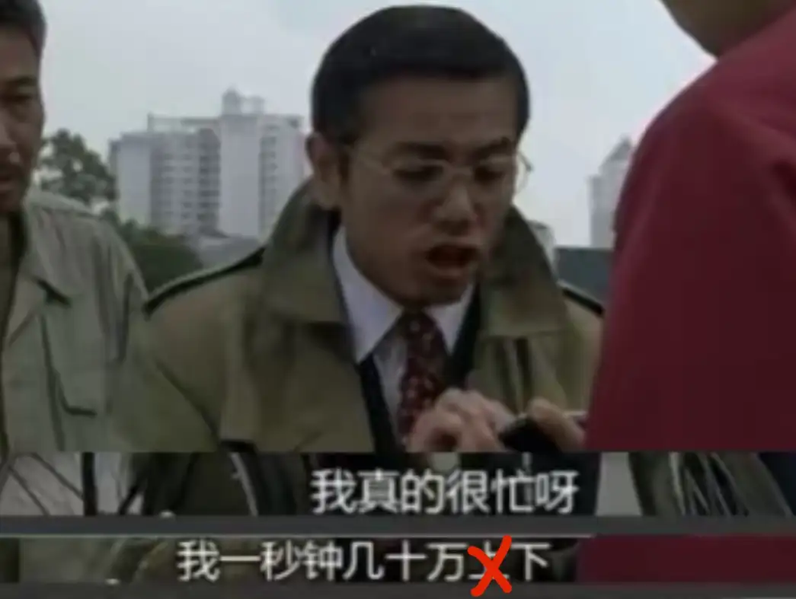

# A07　职场组织与合作　第 2 册（共 2 册）

- 专题代码：A07　专题名称：职场组织与合作
- 专题界定：共事、上下级、管理、服务、合同、组织协作与退出。
- 本册：第 2 / 2 册　收录 181 篇　正文字符 190,383
- 语料：`sooon-q9adg-articles-v2.jsonl`（4,305 篇）　SHA-256：`cdc9c271309e1d71d9708889a3a31f4777e0c339ea54c3753521894afdb8357d`
- 生成时间：2026-09-27T00:01:00.997126+08:00　排序：发表日期 → 源序号（全库唯一，不重复）

**标记约定**：`【待审】` 主题仍为暂定；`【排除候选】` 图片/正文过薄的剔除候选；
`【正文标注未完待续】` 作者原文自带未完标记；`【正文缺失片段（复核已记）】` 复核记录已确认的正文缺口；
`【图片缺 N 张】` 源图不可获取。标记只作提示，不改写原文、不改动分类状态。

---

## 1656　投鞭断流

- 日期：2024-04-04　主专题：A07 职场组织与合作
- 源 ID：`92970f66-cf02-5019-83be-d35e6c267dec`　原文链接：https://www.zhihu.com/question/648611918/answer/3453877170
- 官方对象—实践路径：与合作者 / 与共事者 / 协作
- 23 概念标签：事实与证据;能力与学习;选择与自由;责任与后果;成本与总账;劳动与组织;权力与异议
- 证据状态：manual_confirmed　初读：read　独立复核：not_reviewed

**问**：跨部门协同，最困难的地方是什么？如何破解？

跨部门协作，或者说干脆点说——所有的协作——都有一个最基本的逻辑，你能搞清楚，就能把事办成。
那就是要“起势”。
这是指你要造成这样一种态势——核心团队之内的人都对“一旦失败我们都将同归于尽”没有任何侥幸，而核心团队之外的人则要对“核心团队实力足够强大，这事哪怕我捣乱、偷懒也肯定能办成”有强烈的预期。
分解一下。
先从组建核心团队说起。
核心团队就是一开始就把名字、前途和项目成败挂了钩的人，是各个方向上的决策人，能列席闭门会议、发起动议、参与表决的人。
这个核心团队本身在技术、团队意识、对领袖的认可方面你都要有绝对的把握，以至于你一旦把这个团队组起来，这几个人就心里有数——哪怕不靠别人，就凭我们这几个人，我们已经足够拿出“最小可用产品”。
我们的能力已经达到这根基线，风险备用金超出项目所需三倍有余，在我们不再引入任何人的前提下，我们已经足够拿出具有最基本的可用性的结果。
核心团队不能大，不建议超过5人，最好不要超过3人。一旦超过这个规模，组织决策会议的成本就会剧增，而项目成功的获得感也会被摊得太薄。
“最小可用产品”一定要定义得极尽简洁、极端保守，以至于这几个人一碰头，对完成这个结果就已经有十足的信心——这个信心要强大到“这么唾手可得的成果，不做简直是傻x”的程度。
一旦核心团队达成了这个共识，整个大跨部门团队里的其它成员你就不必过度顾忌了。
因为你的“势”已经成了。
剩下的所有人都意识到了——按照核心团队公布的“最小可用目标”，即使把我闲置、排除在进程之外，他们也是可以交差、可以结案的。
这样一来，所有非核心团队成员，不管是哪个部门的，就要考虑“胜利者的评价”的问题。
因为你已经赢定了，你做完这个项目，你一定可以以胜利者的姿态来写总结报告，你们核心团队自然全是功臣，但我们非核心成员，却根据表现有机会成为“项目未能达到理想目标”的责任人。
要注意——在“最小可用目标”和“理想目标”之间还会有好大一段空间。作为核心团队，只要你们达成了前者，项目已经成功了，你们就已经获得了胜利者身份。而作为项目领导团队，你们就理所当然地、毋庸置疑地同时拥有了无法剥夺的评价其他成员的表现的权柄。
这是自然法赋予的权柄，谁也否决不了。
就像统帅把仗打输了，那就啥也别说了，但是如果打赢了，那么说谁该枪毙、谁该撤职，就算不立刻生效，也是绝对要造成严肃后果的。
这就是保证非核心的协作部门、外协人员必然要采取积极态度的关键。
因为如果不出力甚至捣乱，你们有一个最简单的办法就是直接把ta停职不用了。而就为了报这个扯后腿、怠工的仇，你都会刺激起你们核心团队进一步发力把项目做好的意志。做不成这些人就可以看笑话，做成了，这些人个个都要付出代价。
这个ta们一开完项目规划会，看看最低目标的清晰定义和你们核心团队的实力，心里立刻就会掂量清楚。
而另一面——既然哪怕没有ta们这事都能成，那么出了任何力，哪怕没有功劳只有苦劳，都会是胜利者之一，都可以从最后的成功中分到一杯羹。至不济，也能得到这帮未来赢家的好感，来日方长，将来总多条路。
只要你造成这个态势，无论你们企业有何种复杂的部门利益关系、何种纷繁复杂的规章漏洞，你放心，周围的协作者只会想法子钻漏洞来出力，而不会想办法钻漏洞推脱。
这些对你都不构成障碍。
“规矩”“理由”那是对输家才会用的东西。对于确定无疑的赢家，没人会让规矩挡了自己分红。
前提是你要有这个核心团队。
如果你是单凭自己就能办到这个最低目标，then you are golden——堪称不坏金身。
你一定可以说服几个对此毫不怀疑的人，愿意作出贡献，帮你把这个“最小可用”的标准再抬高一点。
这个绝对有把握的目标水平就会变得更诱人、更有利可图，一旦成功，就会给你们带来更大的话语权。
你的胜势就会更强。
你下指令给人，都是在给人进步机会。
谁要是不开眼，不珍惜，你不会有任何纠结，立刻就可以把ta挂起来。
你忙是吧？那后面不找你了。回头项目验收，老板对项目赞不绝口，但是“可惜这个小特性没做”——你一句“安排了张三，但他没空，所以先搁置了”，老板心里有数。
张三是不是真忙，老板自然比你容易了解。
那么，有人就要问——如果我组织不起足够满足最小可用标准的核心团队怎么办？
那么你一开始就会被所有协作方认定“八成要搞砸”。
所有的人都不想成为“虽然使尽全身解数不眠不休，但奈何出力的人太少，独木难支”的那个“事情都是ta干的”的“主要责任人”。
ta们当然会找各种理由远离事故现场。“我的部门有自己更重要的使命”只是最常用的好理由而已。
实际上即使你想办法把这个理由卡住了——不管是用会议记录还是“事事留痕”——人家也有直接“身体不适”“家里出事”等等催人泪下的充分理由。
真正的问题是“如果我们不出力你就会输”。
而“我们不出力你就会输”意味着你大概率要输。
谁要跟输家一队？所以估计“我们”谁也不会出力。
谁也不会出力，意味着我自己单独出力就是在找死。
每一个想出力的人都会想到这些。
所以你输定了。
只有“即使我们都不出力ta们也会赢”，才会让所有人都抢着出力。
如果你无论怎么压缩“最小可用产品”的定义，都凑不出一个有足够能力和资源的团队来自完成这个项目，那么你就不要贪图完成它的好处乱伸头。
你要一再地、反复地、坚定地拒绝。你拒绝，上司不放弃就要加资源、降标准、免责任。
只有过了那条线，你才能松口。否则称病不出、告老请辞都可以考虑。

做人一定要掷地有声，要树立胜利的品牌。
要反复赢给别人看。
赢到别人开始相信“只要这个人选择了这个目标，就意味着ta有把握，而且这很可信”。
到这一步，你就有了“胜利的品牌”。
你自身就是旗帜。
旌旗所向，投鞭断流。

---

## 1654　羁绊源

- 日期：2024-04-05　主专题：A07 职场组织与合作　副专题：A08;A06;A15
- 源 ID：`ea539261-bd1d-5bc1-8dbe-e7eb5b258493`　原文链接：https://www.zhihu.com/question/645722984/answer/3455569660
- 官方对象—实践路径：与合作者 / 与被服务者 / 履约
- 23 概念标签：定义与达意;选择与自由;信用与信任;爱与回应;照料与家庭;劳动与组织;宗教与自然法
- 证据状态：manual_confirmed　初读：read　独立复核：not_reviewed

**问**：感情很深的家人被查出来癌症复发，最后一位家人离开后，我该如何面对人生？如何与世界继续有羁绊？

跟人建立羁绊也没有很复杂。
比如，认真的做一份工作，你做得好，做得人受益、放心，你就会和客户、同事之间建立羁绊。
认真的做一个产品或者服务，品质可靠、功能实用、价格划算，而且需要不断复购，你就会和你的顾客、用户建立羁绊。
本质上，羁绊是一种“复购”关系。
你能提供任何一种帮助人延长寿命、改善人生体验的产品或者服务，你自然而然的就会有人关心和惦记。
这产品和服务不需要多么高大上，不需要多珍稀、先进，只需要可靠、性价比高就好了。
但是要注意这里面有个关键属性——复购性。
例如专业割阑尾就不行，人只有一条阑尾，最多割一次，分成十八次那叫切香肠了。
你缺少羁绊，就考虑一下往这个方向去靠，认真去做就行了。
服务够好、够关键，同事、客户比亲生的都亲，你住院ta们到处找人托关系帮你治。
实际上这本来就应该是所有人去追求的方向，而不应该一门心思只把眼睛盯在亲生的和婚姻关系上，以为“只有这种才算真的”。
事实上恰恰相反，往往这些亲情、婚姻本身的生命是依赖于你与客户、同事之间的羁绊的。
一个缺少客户和同事的人，往往亲情和婚姻本身就会崩解。社会会赞扬和鼓吹亲情、婚姻关系，根本原因恰恰就在于这能帮助一个人创造价值、服务社会。那些不能帮助人提高这方面的表现的亲情和婚姻，往往在道德评价和舆论评价上会不断受到惩罚，以至于趋向解体。
客户和同事才是人际关系的核心和目的，反而亲情和婚姻是围绕这一目的建立起来的。
这才是真相。
“羁绊感”是你在尽到这份社会责任后由社会规律驱动人性本能来给予你满足的。
不要去忧虑自然法是否有效，专心按要求做就行了——就像不要去忧虑牛顿定律明天会不会失灵，你想通车就好好造桥就行了。
26岁，没有任何必要过度悲观。有时候甚至不需要什么努力，纯凭运气都能撞到某个适合你的机会。
休息好，开始搞就行了。

---

## 1651　树立什么权威

- 日期：2024-04-11　主专题：A07 职场组织与合作　副专题：A08;A06;A03
- 源 ID：`daba5824-8395-593c-a904-7b9d1c86c577`　原文链接：https://www.zhihu.com/question/650468795/answer/3461661421
- 官方对象—实践路径：与合作者 / 与管理者 / 服从
- 23 概念标签：事实与证据;选择与自由;责任与后果;成本与总账;信用与信任;劳动与组织;法律与秩序;权力与异议;技术与工程
- 证据状态：manual_confirmed　初读：read　独立复核：not_reviewed

**问**：为什么男领导都喜欢用不回微信这个方式来宣扬权威？

微信、邮件并没有什么强力提醒和回执，你怎么知道对方是没回还是没看？用微信属于极其不可靠的沟通手段，对方没回或者隔了很久才回属于绝对正常的现象，你脑补什么“树立权威”？
领导的权威不需要“树立”，本来职权就自带了，还要“树立”啥？
职场新人在这自我脑补“桀骜不驯”，幻想领导还要在自己这里先“树立”一下“权威”才能获得自己的“忠心”，纯属垃圾小说看多了，在找死。
你当这是青春校园小说吗？需要你心服口服你才要“服软”，然后才能“真心实意的服从”？
那你家装空调的师傅是不是还要你先表演个前手后空翻或者单手引体向上才动手干活？阿姨是不是还要你刷个马桶喝一口她再给你干活？
你是ta们的雇主，你需要证明你的“权威”吗？你看ta们拨一下动一下，叫ta们改变工作态度，ta们要来咕哝一下“就是想PUA我们”“要通过这种方式树立权威”，你会怎么处置？
是苦口婆心向ta们证明“我真的没有这样”吗？
还是抄起电话把派遣公司的负责人拎出来骂？——你们找的这什么人？怎么培训的？你们自己说怎么交代？
现在的小孩子满脑子这种互联网大麻烟，沉浸在自己的青春偶像剧里吸得两眼翻白，犯这种甚至没有批评价值的101错误，毫无意义的葬送自己的前途。
真的是瞎搞。

---

## 1644　居高临下

- 日期：2024-04-13　主专题：A07 职场组织与合作　副专题：A06;A03;A08
- 源 ID：`e6338b45-aee6-5622-8810-d5706e6ff183`　原文链接：https://www.zhihu.com/question/652536633/answer/3465004760
- 官方对象—实践路径：与社会 / 与文化 / 遵循
- 23 概念标签：事实与证据;选择与自由;边界与许可;法律与秩序;文明与历史;心理与主体
- 证据状态：manual_confirmed　初读：read　独立复核：not_reviewed

**问**：如何评价德国博主海雯娜“中西方对成瘾物的认定差异是基于文化差异而产生”的观点？

没看出她说的有任何问题，都是大实话。中国的确是和西方有不同的认定标准。
因为毒品问题我们在两三千年前就已经研究过了，早就已经解决了。
中国文化对麻醉品、精神药品的鄙视和摈弃根本不是从鸦片战争才开始，而是从五石散、红丸的时代——近两千年前就开始了。
玩物、好酒都被斥为丧志，何况嗜毒？
中国要坚持自己的禁毒标准，没有任何问题，根本不必因为其它国家观点不同而有任何情绪波动，没有取得其他落后文明认可的任何必要。
你当惯了优等生自然就明白了——同学跟你答案不一样，你只会同情ta们。
只有自己算不明白的差生才会为“我跟大家答案不一样”焦虑暴跳。
我是对的，跟我不一样，那是你们错了，而且这是常态。
少花精力在“凭什么”、“你咋这么傲慢”这类无聊且无关的纠结上，多研究清楚我的成绩和我的判断之间的关系，对你们有意义得多。
你们越早习惯，成绩才会越早开始提高。
就这样。

---

## 1638　水母阴姬

- 日期：2024-04-16　主专题：A07 职场组织与合作　副专题：A01
- 源 ID：`fd1785b0-7254-5793-94da-1a4d26274547`　原文链接：https://www.zhihu.com/question/652586232/answer/3468342835
- 官方对象—实践路径：与合作者 / 与管理者 / 博弈
- 23 概念标签：能力与学习;选择与自由;成本与总账;边界与许可;权力与异议
- 证据状态：manual_confirmed　初读：read　独立复核：not_reviewed

**问**：老实人为什么很容易原谅别人？

单位同事很老实，干活是被压榨的最惨的一个，最近刚好和他做同一个项目，发现他很奇怪的特点：在平时干活的时候对于老板的压榨深恶痛绝，积怨已久，甚至崩溃破口大骂，但是当老板请我们吃饭，说我们辛苦了，在饭桌上开一开他的玩笑，又夸他几句，他就放下了对老板的恨，开始说些心里话，甚至有些知无不言……这种事经历几次后我们对他说话都更小心了一点，因为发现他很容易被老板“感化”，我们平时在一起都了解，他不同于那些“精明”的同事的当面一套背后一套，而且明显看出他是真诚地原谅、忘记了对方的伤害，而当吃完饭，回到工作中被压榨的状态时，他的仇恨与愤怒又重新燃起……后来和他聊天，问他为什么，他说当老板请吃饭的时候一片和睦的氛围，并且对方对自己被“伤害”表达了歉意，而他感觉很不好意思拒绝这样的“好意”。我感觉他的心里好像就是2种极端，要么就是敌人，要么做朋友，而且很想把关系变成纯粹的友好，不能够处理和兼容“恩惠”和“仇恨”交错的人际关系，很容易因为一顿饭这样的小恩情忽略了之前的伤害，也不会去反抗，当恨别人的时候的报复手段也仅只是“不来往了”“不主动和仇人说话”……仔细想想他好像对于同事也是这样，被欺负的时候恨别人，而当别人没脸没皮过来套近乎开开玩笑，或者给他个酸奶，他就淡忘了之前的仇恨；去甲方单位干活儿，对方提出不合理的要求导致他加班他觉得愤怒，但对方提出帮他打出租车时，他又很不好意思地客客气气，就很容易被拿捏……这是什么心理？老实人这种心理又是怎样形成的？
很显然，这位老实人比较不容易丢掉工作，也更不容易出现职业空窗期。
ta这就是非常标准的、甚至是健康的状态。
反而是那些一旦不满就没有任何手段可以修复合作关系的人，往往会更快地走投无路。
你要记住——你进行关系博弈的一切权力（power）和筹码，在本质上都依赖于“有别人在排队等着跟我合作”。
既不是“我能力超群”，也不是“我手段狠辣”。
因为如果“能力超群”导致对方入不敷出或者风险不可控，你的能力对对方而言毫无实际价值。
至于靠“手段狠辣”得到“良好待遇”，这本质上只不过是暴力勒索。就算得到什么待遇也都只是缓兵之计而已，最后等着你的一定是“摔杯为号”。
你唯一的筹码就是“你后面有人排队”，是“你不答应有的是人答应”，是“此处不留爷，自有留爷处”。
因此，任何策略——不管你自己觉得多么正义、多么痛快、多么公道——只要会缩短排在你门口的队伍长度，在本质上就一定都是错的。
就是这么朴素。
现在你再回头来看这个“要么就翻脸翻到劝不好，要么就干脆不翻脸”的特性，和“容易爆发矛盾、也容易消解”相比，你觉得谁门口排的队列更长？
那种“平时看不出问题、出了问题就劝不好”的人，咋说呢，自己本人可能不觉得，旁观者看到ta“大显神通”只会觉得背脊发凉。
因为既没有预警手段，也没有挽回手段。
江湖最怕的就是这种“无色无臭又无解”的天一神水——谁不觉得神水宫宫主代代都是变态？
神水宫的姐姐们人均人间绝色，却恋爱都没得谈——谁活得不耐烦了请水母阴姬晚上出去烤串？
吸取教训！
每天早上推开门看看，有多少人在排队。
排到街角了，你就可以伸伸脚。
就酱。

---

## 1626　不依赖

- 日期：2024-04-22　主专题：A07 职场组织与合作　副专题：A08;A13;A15
- 源 ID：`fb781ffd-8397-54d2-abbd-ad001665350b`　原文链接：https://www.zhihu.com/question/653480308/answer/3474895954
- 官方对象—实践路径：与合作者 / 与服务者 / 交办
- 23 概念标签：能力与学习;选择与自由;责任与后果;成本与总账;劳动与组织;财富与市场;法律与秩序;技术与工程
- 证据状态：manual_confirmed　初读：read　独立复核：not_reviewed

**问**：如何改掉依赖别人的毛病？

这个问题里有魔鬼啊。
因为你要追求的是“降低依赖带来的脆弱性”，而不是“降低依赖性”。
这不是一回事，甚至是南辕北辙、判若云泥的两件事。
什么叫“降低依赖性”？
根本的来讲，就是我自己来，直接去掉你，我亲自操刀。不分工、不授权，全流程内部解决。
从播种到采收到加工到洗碗，我全干了，所有的其他人在最终意义上都是多余的，都是可以去除、甚至已经被去除的。

什么叫“降低依赖带来的脆弱性”？
就是这个工序我是真的搞不定，是肯定要靠别人的，但是我这部分预算留得很足，我就不信死了张屠夫我就非要吃带毛猪。
依赖是存在而且被接受的，甚至是被主动设计和寻求的，但是因为恰当的管理，这种充满了依赖的系统却是强壮的。
我自己是肯定没精力学养猪和杀猪的，而我五天没有红烧肉会死，但我很有信心相信要发生“吃不到猪肉”这种状况近乎不可能。
因为我的这个信心、这个设计，我确信张屠夫也不敢随便给我脸色看——除非ta嫌钱多。
看明白这两者的区别了吗？
很多人把这两者搞混了，因为依赖、受制于人而受的气，于是回来走“降低依赖性”的路。
但这其实是死路——你就算学会了从养猪到杀猪到煮熟的全流程，从此以后再也不需要屠夫了，你还能学会从摘棉花到织布裁衣的全流程吗？
全身是铁，能打几根钉？
你的问题不是依赖——强如苹果、特斯拉，一样要依赖大量的供应商——而是你的依赖带来了脆弱性。
苹果和特斯拉对供应商的依赖就没有带来这么强的脆弱性。
为啥？因为它们给的价钱足够高，付款足够准时，而验收标准足够公平。
而它们为什么能给这“足够高的价钱”？
是因为它们“有钱”吗？
不，是因为它们最后能把凝聚了所有“依赖成本”的产品卖出去，而且是以回报完所有供应商还有盈余的价格卖出去。
关键不在于依赖，而在于你用于支付依赖的成本，能不能由借助这些依赖而生产的产品收回来。
还是说你有这么多依赖，消耗了这么多成本，却没有生产出产品，没能卖出这个价？
这个没有做到，解决方案是调整你的产品设计、市场定位和生产管理，直到达到这个平衡，而不是“大力发展自研、自产”。
走后一条路，你很可能反而离达成正循环这个目标更远。
你要解决的不是依赖本身，而是要解决你的依赖体系——即你的供应链——的脆弱性和无效性。
不要南辕北辙。

---

## 1624　倦怠

- 日期：2024-04-25　主专题：A07 职场组织与合作　副专题：A01
- 源 ID：`efc59617-3016-5780-86fc-31d4106a06c0`　原文链接：https://www.zhihu.com/question/653772835/answer/3477653544
- 官方对象—实践路径：与合作者 / 与被服务者 / 履约
- 23 概念标签：能力与学习;责任与后果;成本与总账;爱与回应;劳动与组织;技术与工程
- 证据状态：manual_confirmed　初读：read　独立复核：not_reviewed

**问**：工作了好几年，职业倦怠了怎么办？

做职业，要真的去关爱你的客户。
在一切的利益、博弈之外，要对你的客户——不是具体的哪一个客户，而是你的客户群体——有真正的服务精神。
要真的关心ta们的疾苦，ta们的期待。
要念念不忘，常在心头。
要盘算着像给恋人准备惊喜一样，不断的盘算着怎么给ta们更大的惊喜。要盘算着怎么让ta们无可挑剔、无可抱怨，因为有你而感到幸运，嘴角带笑。
要不断的创造新的工具，积淀你的经验资产，改进你的服务。
这个努力的深度是无限的，是其乐无穷的。
举点例子——我何以每天答题不倦，要扩展爱发电，要发展素问……因为我对你们有感情，真正的感情。我每天都在考虑怎么能让你们获得更多的惊喜。
你不付出真感情，你也难有真的激情。
如果你中了太多的那种犬儒主义的毒，只是把客户当一群过于麻烦的讨厌鬼，一个不方便的饭碗，你迟早会过于专注自己的“付出”，而去不自觉地怨恨你自己选择的服务对象。
你心里存着这个对客户的暗暗的敌意，你跟客户之间就天然存在着戒惧——你防着ta们、忍着ta们，ta们也要防着你，忍着你。
防着、忍着，客户就不会给你足够的好的反馈，不会给你你其实极其需要的原谅、鼓励和感激。
你没有这些原谅、鼓励和感激的时时修复，你的怨恨、戒备就会更加发酵，迟早有一天你会倦怠和绝望。
不光是对一个特定的客户倦怠，而是对你所有的客户都倦怠，进而对一切的“服务ta人”都倦怠——甚至是对服务自己的子女、父母、配偶都倦怠，都绝望。
那不是“换一个工作”可以解决的。
要做到建立这种感情，不能躺着等客户、等别人来给你自己各种激励，要靠很多自我的心理建设和引导，要防止一些不必要的猜疑暗自发育、避免使用一切不必要的补弱和过度防御。
这涉及到大量的具体议题，只有这样多达数千、数万个的具体答案可以给你一个勉强可用的参考。
和人建立和保持好的关系，从根上讲是要先打磨好自己。打磨好自己，这关系建立好了，对方会给你足够维持激情的反馈，你的倦怠才能屡屡被击退——乃至于你会产生一种信心，相信这些倦怠最终总会被击退，无非发作一阵而已。过不多久，自然又有某个你关心的客户陷入危难，激起你的关切和激情，倦怠就消失了。
一言以蔽之——击退这种倦怠的根本，是有效的、踏入正循环的爱。
一旦踏入正循环，爱会像进入自持状态的核聚变一样，自己产生一切维持自身的能量还有富余。
不要去相信那些阴阳怪气、挑拨离间的坏东西，那些东西可以帮你发泄一时的怨恨、不满，却是以磨损你爱的能力和信念为代价，以剥夺你激活这种正循环的能力为代价。
这种正循环关系是你的救生绳，避难所，末世方舟，你真正的出路所在。
不要搞错了。

---

## 1615　喜怒不形于色

- 日期：2024-04-29　主专题：A07 职场组织与合作　副专题：A01
- 源 ID：`dafbd16a-9b9d-543b-9f6e-68e01e55daa0`　原文链接：https://www.zhihu.com/question/654067740/answer/3482809236
- 官方对象—实践路径：与合作者 / 与被服务者 / 履约
- 23 概念标签：定义与达意;能力与学习;选择与自由;责任与后果;爱与回应;净输出与不掠夺;边界与许可;照料与家庭;劳动与组织;法律与秩序;权力与异议;技术与工程;心理与主体
- 证据状态：manual_confirmed　初读：read　独立复核：not_reviewed

**问**：我是绝对追求真实的人，但是做销售让我要压抑真实自我与所有人搞好关系，这让我痛苦，怎么办？

比如不愿意对不喜欢的人假装喜欢，假装关系好，有什么表情都在脸上写着呢……如果在客户现场，可能客户一个不顺我意或者拒绝，我的脸色立马变了，情绪也比较外放……反正你们懂得，这就很容易影响销售状态，从而影响业绩，影响收入。其实我知道怎样是对的，行，为了赢得领导同事客户的好评，为了得到别人的认可，我可以委曲求全，努力维系关系，假装关系好，假装情商高，假装善解人意，可是这份假装太痛苦，因为我追求真实，我不太喜欢虚伪的自己，不太喜欢虚伪的行为，因此这些看似高情商的行为也坚持不了多久……并且严重影响我的状态，因为拧巴，因为内心矛盾，因为这份工作需要我违背本心……最终影响了业绩，也影响了人际关系，影响了收入……
这个不叫做“绝对追求真实”，而叫做社会性发育缺陷。
所谓社会性，指的就是pro-social的特性，也就是会使得人类社会趋向繁荣的属性，那主要是一种有利于合作、和解，同时在微观和宏观层面创造公共价值、降低公共风险的倾向。
而这类“喜怒形于色”的行为方式，在本质上是“顺我者昌之，逆我者亡之”的方法论在具体问题上的下意识实践。
“顺我者昌之、逆我者亡之”本质上是一个人对自己之外的人类社会发动的一种侵略战争。
人类社会追求的是某种族群总体的幸存和繁荣，而这个人自己在追求自己的幸存和繁荣。为了这个目的，这个人迷信靠自己的策略去打击、利诱离ta距离较近而社会难以保障的社会成员，把对方拉进自己统治的小王国。
“社会要保护你，你得先通过警察、法院去申请，但我要伤害你却是此时此地，马上动手。社会就算保护你也只有一时一地，而我要打击你、奖励你，却是随时随地。所以服务于我比服务于社会对你的生存更加重要”——这就是这类方法论的底层原理，也是反社会性的行为方式痼疾难除的根源。
它来自一种类似丛林式的生存本能——在社会本身不发达或者过度扩张、因而难以向社会成员提供必要的救济的时候，如果强人本身对势力范围内的弱势个体拥有压倒性的优势，这个方法论是很有机会行通的。一个强人往往确实可以凭借这种做法在自己身边维护一个有效的统治，最典型的就是“家庭暴君”、“公司暴君”。社会甚至会承认家庭成员首先是家主的臣民而非社会的成员——即所谓“清官难断家务事”。
但一旦社会发展到一定程度，足以对其成员提供足够迅速而充分的援助，抵消掉个别强人对身边弱者的暴力优势，就会让这类反社会行为被抑制，使得这类行为不断地被得到了充分援助的弱者挫败，得到得不偿失的结果。
比如一个宗族强力管理自己所在的村庄，于是张三强占邻人的田地就可能被宗族有效干预。一再有效地干预，这类“只要我拳头大就可以顺我者昌之、逆我者亡之”的幻想就会破灭。
一旦破灭了，至少“喜怒形于色”的冲动就会得到本能的抑制。
因为每次喜怒形于色招来的都是残酷的打击——要么你的对手本身就并不比你柔弱，直接动手就让你知道了厉害；要么ta对你虽略有劣势，但是ta可以召唤社会援助反击你的侵犯企图，让你得不偿失。
社会发展到这个地步，社会成员就会有效地意识到“通过服务于社会的目的融入大社会，而不是尝试另外建立一个服务于自己的小社会”才是作为人类生存的正确道路。
而一旦正确的接受了这个方法论，“喜怒形于色”就绝不可能获得“追求真实”这类正面的定性。
因为你的喜怒只服务于你自己私人的利益诉求，而你自己私人的利益诉求本来就是次要的、不允许与社会的诉求对立的，那是你的私事，不是其他社会成员理所应该去关心和承受的公事，未经合规的程序，甚至不允许你直接表达。
什么叫“合规的程序”？
1）你只能对给了你预先许可的人自由表达，例如明确给了你这个许可的你的父母、配偶、恋人、挚友这类。现场哪怕只有一个没给许可的人，你都不能“喜怒形于色”。而给你这个许可，是一种代价极高的付出，你需要严肃地考虑清楚你要怎么才能维持对方给你的这个许可。
注意，即使是父母、配偶这类人，你仍然需要许可才能去搞“喜怒形于色”，而不是人家一接受这个身份你就可以认为自己自动获得这个权利。
别忘了，还有“相敬如宾”，还有“晨昏定省”——实际上在所有的传统社会对于亲子、配偶之间都是有礼仪要求的，绝非可以随自己的情绪想怎么干就怎么干。
“可以喜怒形于色”不是“亲密关系的标配”，而是对一切人都要单独申请的特权。而且人家给了你，你就欠了巨大的义务，坦率地讲，扣除这个义务，你未必是赚了。说穿了，苦苦追寻这个可以喜怒形于色的特权，甚至把它列为“必须满足的个人需求”，纯属一种战略性的愚蠢。
2）你要向接受你这个特权的人提供可以与第三方自由交易的补偿。
简单来说，就是给予你这个许可的人不应该因为你的喜怒受损，而必须得到总的供养。以你的喜怒为指挥棒行动的一整个团体，必须要总体地对人类有益，从而获得足够的市场回报或者来自自然界的回报，以至于你可以在内部进行合理地分配后保证所有给你这个授权的人最后不会得到净损失——至少在总体上不会净亏损。
否则你这个“喜怒形于色”在客观上就没有得到自然法的许可，最后一定会导致总破产。
即使这些人个人给你许可都不行，因为ta们会陪着你一起破产。
“欢迎/允许喜怒形于色”的特权，别说去撒泼打滚地要，就算是人家主动地给，你都不该收，更不必说还给这些贪妄求去加上什么“绝对追求真实”之类的“尊号”了。
不要把“喜怒不能形于色”视为一种损失，你的情绪管理只是你社会职责的一部分，是专业性义务的一部分，是义务。
正是因为它是一个社会义务，所以做得好才成其为一种值得人敬仰的修养。
对待客户，你要保持专业所要求的情绪管理；当电梯小姐，你就要保持亲切友好；当工程师，你就要严谨、客观、冷静。
你在这个时候不是你自己，而是名为“电梯小姐”、“工程师”的神，你是作为这样的“神灵”在回应凡人对你的依赖和祈祷。
这不叫“虚伪”，这叫尽忠职守、响应如神。
人是社会性的物种，这是人类真正的天职。
受命于天，既寿永昌。

---

## 1564　魔法防御使

- 日期：2024-05-28　主专题：A07 职场组织与合作　副专题：A05;A06
- 源 ID：`b48b5492-f366-5b83-af60-21b8be5df0b9`　原文链接：https://www.zhihu.com/question/653989008/answer/3512131299
- 官方对象—实践路径：与亲族 / 与子女 / 抚养
- 23 概念标签：能力与学习;选择与自由;成本与总账;信用与信任;爱与回应;权力与异议
- 证据状态：manual_confirmed　初读：read　独立复核：not_reviewed

**问**：如何克服因为害怕被别人超过，而不愿对外分享/输出（自己所掌握的方法、经验等）的心理？

很显然，决定是否分享信息的基本要害是你们是零和博弈还是非零和博弈。
同是一个队的队友，要输大家一起输，你知道信息和方法不及时分享就很蠢。但如果是你死我活的敌人，那么分享知识和经验就存在明显的风险。这逻辑又简单、又直白，似乎根本没什么好说的。
但问题在于，人们往往过高的估计“这是零和博弈”的概率。
社会在总体上不是零和博弈的，甚至在直接竞争对手之间利益都不见得完全互相对立——哪怕是同一行业的直接竞争对手，也存在“共同维护行业利益”的合作必要。
真正的零和博弈存在一个明显的特征，那就是存在将对方在道德上污名化、在存在上非正当化、在位格上非人化的意图——也就是所谓的“不共戴天”。
除了这种不共戴天的关系，人与人之间的总体关系总是有最基本的合作，是存在利益取向差异的同事关系，但归根到底是同事关系。
为什么要强调这一点？那就是你先要把自己的文化本能扭过来，因为这个不扭过来，你会得到一套完全不同的技能和经验。
如果你认为身边都是人形恶魔，你势必学到的是防御术童子功，然后将来再去学一些“如何改善人际关系”的办法去打补丁，去解决合作伙伴太少、毫无社会安全网保障的问题。
如果你认为身边的人都是天使，你势必学的是合作术童子功，然后将来学一些“防人之心不可无”的办法去打补丁，去解决信错了人遭遇投资损失和安全风险的问题。
这两条路其实不是殊途同归的，而是各自走向两极然后再向中间找补一点。但即使是找补之后，也仅仅是稍微弥补修正了一下可行性。
而这里魔鬼来了——因为客观上人类社会是带有部分零和色彩的非零和博弈结构，很显然“先练合作童子功再补修防御术”的思路会在这个社会中得到更多奖赏。
“主修合作、辅修防御” 比 “主修防御、辅修合作”，在一个自身以合作为基底、以对抗为补充的世界里，当然更吃得开。
换言之，在人的早年阶段，父母应该毫不犹豫的考虑为子女塑造“除非有非常值得警惕的理由，优先考虑合作”的行为方式，从而让子女多做合作类的生活实践，并在过程中去帮助子女解决合作会遇到的典型问题。
而不是反过来，指导子女信奉“除非有极大的、明显的、即时的好处，默认不合作”——这样子女很自然从小练的就是敬而远之、事不关己、井水不犯河水这样的“防御术”。
而一旦走了防御术，会出现一个额外附带的效果——走合作路线才有“朋友不尊重我怎么办”“我帮他他不帮我怎么办”……等等层出不穷的小课题、小项目、小作业要去辅导和完成，而“不关你事”“敬而远之”却因为天然的逻辑特性会是毫无情节、毫无附加课题的超静态体验。
于是为“主修防御补修合作”路线的策略带来了一个额外的劣势——人家“主修合作”的小朋友，同时就开始辅修防御了，等到二十几岁毕业时，人家其实两门都修了个马马虎虎了，而“主修防御”的小朋友，往往很自然的要到大学毕业或至少上了大学才有机会去接触“补修合作”的作业——辅修科目还几乎是个零分。
别的不谈，说点最现实的，会极大的影响子女到了大学阶段——包括后来青年阶段——的恋爱求偶。
因为恋爱求偶不管人自己是什么水平，在本质上都是对对方社会性水平的极端考验。这时就会出现一个极为讽刺和悲剧的结果——连主修防御辅修合作的人，自己都不愿意选择自己的同门，而宁可去选择主修合作专业的对象。
而这个“得到择偶性的认可”，不但是一个“获得性检验”的小问题，还是一个“人格淬火”的关键步骤。
世界上有一个人——不管ta多么不成熟、多么幼稚——认为你有可能能承担起ta整个人生的合作需求，这个铁证对于一个人面对社会、面对竞争、面对团队的自信心有至关重要的支撑作用。
其实“性”在这里根本是次要因素，只是证书上盖的钢印——有的证书盖的不是钢印，这不影响证书本身的效力。
实际上恰恰相反，是性担当了这个“证书钢印”的角色，它才反过来能激起强烈的心理快感。这个快感其实不是钢印带来的，而是这个认证带给你的。就像你的快感不是录取通知书带给你的，而是那个学籍带给你的一样。（这也是为啥性的快感很容易会褪色——谁会天天拿着录取通知书傻笑？）
而悲剧的是——这一切在父母替子女选择轨道时就已经极大的被限定了。
当父母们自己被社会的竞争吓坏，被自己遭遇到的合作灾难深刻伤害而陷入茫然，父母极易为子女选择“你还是主修防御”的策略，从小教导子女“一切都是零和博弈，做人不要太善良”。
而微妙的是——父母自身之所以会有如此强的创伤记忆，要去教子女“不要太善良”，往往恰恰是因为ta们自己的合作专业修得太浅，既不知道合作的常规风险，也没有丰富成熟的风险控制技术，所以没有建立起对合作的信心和经验资产。
换言之，“魔法防御使”是有强烈代际遗传效应的。
要想为家族逆天改命，必须有某一代的父母幡然醒悟，为子女坚定的选择“主修合作、辅修防御”方向。
而在一个选择了这个方向的家族教育里，“害怕被超过而不愿分享技巧”这个问题会变成一个“被我帮助的人超过了我还没有感激怎么办”的对称问题。
而这个问题的答案就指向另一个方向：
用小的、简单的、广播式的帮助来大范围的测试受助方对帮助的反馈反应。
然后根据表现挑出表现最恶劣的一些——尤其是恩将仇报、挑三拣四的那些——用“之前的帮助你就没有回报”作为无声的基本理由将这些人排除，对有回馈自觉的、主动自我约束以降低你的帮助成本那部分提升帮助规模，进行下一轮筛选。
已经淘汰掉的那些也不要彻底抛弃，过一段时间再把ta们纳入新一轮广播性的福利中，看ta们是否接受了教训。
在这个过程中，你自然会获得领导权和管理权，并且由于重点投资的都是有回报习惯和降低他人投资成本自觉的对象，你的回报自然足以支付成本有余。
这是个净赚的生意，没有必要“产生恐惧和忧虑”。
这本身就是一个“主修合作，辅修防御”的实践案例。

---

## 1559　对事的差距

- 日期：2024-06-01　主专题：A07 职场组织与合作　副专题：A08;A04;A01
- 源 ID：`a1794043-1259-5bbf-b603-ffa5e2853c6a`　原文链接：https://afdian.com/p/8e697534202511ef845652540025c377
- 官方对象—实践路径：与自己 / 与能力 / 运用
- 23 概念标签：能力与学习;成本与总账;劳动与组织;财富与市场
- 证据状态：manual_confirmed　初读：read　独立复核：not_reviewed

**问**：如何在面对自己和他人的差距时心平气和？

将来你就知道了，其实真正的问题是你和事的差距，而不是你和人的差距。
啥叫你和事的差距？老板要你画个图纸，你能不能画出来没错误、车间能投产、客户不吐槽？
老板不在乎你在全行业排名第几，ta只问你能不能搞定，能搞定就你了，因为先撞到你了，你行你就上了，别人是可能比你强，但是ta没那个时间去找、没那个精力去对比。
一句话，就这事，能行，还是不能行？
十件事，你能办到三件，张三能办到六件，结果会是啥呢？会是你能办的三件你办，你不能办的三件张三办，其实还是你们各办三件。而且论及收入，张三多半还是仅收到那三件的报酬，而不是收办六件事的报酬。
因为张三虽然有办六件事的水平，但只有办三件事的力气。而既然那三件事没办，当然不可能没办事却收到报酬了。
**所以，能力强一倍，并不等于境遇强一倍，某种程度上这甚至是效率递减的。**因为境遇并不和能力挂钩，而只和实际劳动成果挂钩。
凡事不要跟人比，要跟事情比，拿自己做出的成果跟市面上一般的出售的成果去比。
这个道理很简单，你能以同样的速度、成本、持久性做出和楼下卖的一样的炸酱面，那么你就能活了。至于你在全国炸酱面届排名第多少号，不重要。
你要的是你的炸酱面能在双盲测试中让人吃不出区别来，不是“看看在同学之中排第几名”。你排第一，炸酱面吃得客户掀桌，你排第一也毫无意义。
你排最后，但客人吃完毫无表情付钱走人，你也能活。
世界上绝大多数的需求都不是那种“不惜代价，只要更高更快更强”的需求，于是也不是那种“赢家通吃”的需求。而是那种“价格不高、要求普通、利润适中，完成就好”的需求。
你要多比较自己的能力和这些业务要求之间的差距，而不是你的能力和别人的能力的差距。
确切的知道自己的能力和业务要求之间的差距为0，你看待自己和别人的差距心态自然就会平和。
因为后者其实并不影响你的基本幸福和人生价值。

---

## 1558　新手计划

- 日期：2024-06-02　主专题：A07 职场组织与合作　副专题：A04;A03
- 源 ID：`23cec62a-1ed0-59ec-9a7b-38a6e49af3c5`　原文链接：https://afdian.com/p/836c441e205611efb2af52540025c377
- 官方对象—实践路径：与自己 / 与能力 / 获取
- 23 概念标签：能力与学习;责任与后果;成本与总账;劳动与组织;权力与异议
- 证据状态：manual_confirmed　初读：read　独立复核：not_reviewed

**问**：涉足新领域时，如何在尚无足够sop“砖块”积累情况下，制定一个有效的行动计划？

从人的正常成长轨迹来讲，除非发生“一代目暴亡，二代目冲龄即位”这类极端事件，否则一般人都不会在没有足够经验时被赋予制定复杂计划的权力。
你都没干过，我是上级，我是不太可能让你去从制定计划开始去负责一个如此陌生的工作的。硬赶着你上架的话，我一定做好了你会犯低级错误、彻底砸锅、没有产出任何有效成果的准备，这肯定是形格势禁，已经死马当成活马医、有枣没枣打三杆子的局面了，那么反正最多就是输，不如让替补球员上场体验体验。
这时候你根本没必要过于执着追求制定“有效的行动计划”。
坦率讲，你没有过实践经验，根本不可能无师自通的确认何谓有效何谓无效，你要换一个方向，去制定一个理论上逻辑通顺，可以明确的执行，以至于可以有效总结的方案。
举个实际的例子：比如你突然被安排当足球主教练，这之前你甚至都不太看足球，也就刚明白足球的基本规则，你立刻就要制定一个计划去开打，你要怎么办？
你首先要有一条理论上可行的计划。譬如——“所有人都往离球门最近的队友处传球，最接近球门的这个负责射门。如果在这期间有人跑到你前头去了，那么按照这个策略，你就要传球。”
这个计划显然极其的初级和业余，但是你注意——它满足了两个条件。
1）它在数学逻辑上是通顺的。它逻辑清晰的指向“一群人合作将球踢进球门”这个结果。它很显然的有一定的逻辑可行性，而不是从逻辑上都无法成立。
例如你把战术改成“尽快传给五米以内离你最近的队友”，那么这个策略在数学上就不能保证球会被踢进对方球门，它完全可能陷入一个三角僵局，即在三个队员之间传一万脚，连中线都不过。
2）它是否被严格执行了，是很容易被检查的。例如你直接全程录像，那么你就可以通过回放录像清晰的看到第几分第几秒的哪一脚传球或者射门是违背这个基本战略规则的。
因为你的计划本身是非常清晰的，所以偏离计划也会是非常分明的。而一旦发生这种事件，你就会立刻捕获一个定义明确的意外状况、一个确切的异常。
不管你是分析它发生的原理，还是分析它发生的方向，还是观察它的影响，你都可以对你原有的那个数学逻辑分明的计划打一个新的规范的补丁——例如添加一个“如果你无法有效观察前方，则传给你身后最近的队友，从他脚下重新启动，沿着先前的方针推进”，你的计划就得到了加强。
而这样做的好处是什么呢？
1）鉴于你制订的原始计划在数学上是显然成立的，你已经不会得到“完全没有有效思路”的评价。
2）鉴于你给出的策略规则非常容易分明的确定谁在什么时候偏离了执行要求，你很容易摆脱“管理不善”的评价。
谁违规，谁负责，你作为主事人其实不能做到没人有机会违规——死刑都拦不住人犯罪，你又不是万磁王，你哪能按住每一只乱动的手？——只要你能做到一旦发生计划偏离，你就能定位时间、地点、人物、剧情，你的管理职能就很容易承担。
3）鉴于对计划到底是怎么失败的，如何进一步改进该计划思路，你可以基于原有的逻辑通顺的计划去提出更具有健壮性的计划，你就免于了“没有成长空间”的评价。
而你如果能满足这三个要求，即上手就有思路、出问题知道出在哪、看到问题后能提出进一步的有效思路，那么作为一个明知没有经验的新人，不管你这计划最后结果如何，你都会得到特殊的高评价。
为什么呢？
因为你即使没有获得成功，但你良好的、有系统的尝试，有效的改善了组织对该挑战的战术位置。
就像你就算没拿下这个山头，但你已经严谨的尝试了一种可能行得通的战术，并且在撤下来的时候，你告诉了继任者你这个计划在哪里遇到了什么问题导致了受阻。
你后面的人就不是从0起点去对付这个问题。
你把整个组织对付这个问题的起点抬高了，这是有效的贡献，甚至是作为毫无经验的开拓者所能做到的最大的贡献。
而实际上你仔细观察，就会发现“所有人都往离球门最近的队友处传球，最接近球门的这个负责射门。如果在这期间有人跑到你前头去了，那么按照这个策略，你就要传球”本身就是一种SOP体系。
在这个体系的每个节点上都有清晰的输入和输出，明确的条件控制规则，全是SOP，发现没有？
其实这些SOP是不可靠的、是你无法知道是否足够有效的，但这不重要，此时“理论上有值得尝试的价值、而且从执行中能得到有意义的经验教训”已经替代了“足够有效”，解决了你的问题。
你没有“足够有效的行动计划”，你有“胜算不为零，而且能产生经验教训的计划”就够了，而且是你能追求的极限了。
你只是要避免那种连理论上都没有确切的成功路线、没有有效方法判断计划何时何地被偏离、无法改变针对问题的战术位置的计划。
这并不那么困难。

---

## 1555　傻强

- 日期：2024-06-04　主专题：A07 职场组织与合作　副专题：A04;A10
- 源 ID：`bc3e4fcc-d641-5665-9a27-e751c9e03298`　原文链接：https://www.zhihu.com/question/651409290/answer/3520107471
- 官方对象—实践路径：与合作者 / 与共事者 / 协作
- 23 概念标签：能力与学习;责任与后果;成本与总账;劳动与组织
- 证据状态：manual_confirmed　初读：read　独立复核：not_reviewed

**问**：面试被问到知识盲区，是直接说不清楚，还是说一些正确的废话？

当然是实话实说，因为你撑不过去。
主考官如果是合格的，你到底会不会并不难看出来。只要看出来你是不会装会，那你就死定了。
因为在工作中最可恨的愚蠢行为之一就是不会却装会。
你明明不会开保险柜，你说会，大家点也踩了、脸也蒙了、枪也开了、保险库也炸了、丧彪都中枪了，傻强都挂了。
你现在来说你是装的，其实你不会。
信不信丧彪一只手就掐死你？
一旦遇到了你不会的问题，这个问题就自动变成“当我遇到我不会的问题我会怎么办”的团队意识问题。
1）我肯定毫不隐瞒，立刻上报风险，帮助团队负责人掌握状况，把握解决风险的最佳机会。
2）我立刻提出我个人研究这个问题的思路和需要的时间和资源，供团队负责人综合考虑。
3）我立刻告知如果这项工作要转交ta人我可以做的配合。
4）在报告完毕之后，在主管做出决定之前，我会自动开始按照前面报告的思路着手研究这个问题，并按计划报告研究进度。
没人能保证知道所有必要的知识，如果有，那不是你可以通过“面试”这种方式去招纳的人物。
所以没有必要纠结“这个我不会”——不客气地讲，主考官如果合格，会一直问到你的盲区出现为止。因为ta们需要评估你遇到不会的地方是个什么人品、什么态度、会给出什么解决方案。
这极为重要。
每次面试新人的时候，丧彪都会想起傻强。

---

## 1550　音频防弹衣

- 日期：2024-06-06　主专题：A07 职场组织与合作　副专题：A04;A01;A06
- 源 ID：`499ce03c-e809-5ad7-9e9a-483ee1abca00`　原文链接：https://www.zhihu.com/question/304216098/answer/3521530599
- 官方对象—实践路径：与自己 / 与能力 / 获取
- 23 概念标签：能力与学习;选择与自由;责任与后果;成本与总账;技术与工程
- 证据状态：manual_confirmed　初读：read　独立复核：not_reviewed

**问**：我经常听不懂别人说的话，听不懂别人要表达的意思，抓不住重点，无法和别人正常沟通。怎么办？

其实这种所谓“听不懂”的情况，更多的是害怕承担互动的责任。
我没听懂，而且我也很直白的告诉了你我没听懂，那么无论你自认为告诉了我什么，我都没责任。我没听懂你硬要我做，那后果自然不能由我承担呀。
这个就把互动的风险都推到了对方一边，尤其是逼迫对方不能不预备自己会承担多次的试错成本。自己这边则以战术的安全换了战略的不安全。
因为别人也不都是傻瓜，跟你说话这么高的成本、这么大的责任，又不是没别人可以合作，为啥要找一个这么费劲的呢？
问题是，这种坏处在学校阶段不会体现出来——老师同学家长都是被绑死的关系，几乎没办法因为你很难沟通就不跟你沟通，因此在学生时代这总是更有利可图。
习惯了占这个便宜，就会养成这种“不管三七二十一，先说听不懂再说”的下意识习惯，并且对说“听懂了”本能的感到紧张和恐惧——因为这一说自己的免责避弹衣就脱了，只觉得全身凉飕飕地。
要说怎么办，最根本的还是要停止占这个便宜。因为这个便宜占了，战略上的损失太大——一旦失业失恋就很难再就业、再恋爱，毕竟人家也不愿意总跟说话听不懂、砸锅没责任的人费劲伤心。
在下定这个决心的前提下，你最好专研一门技术专长，把这个领域里的东西扎扎实实的吃透，以至于只要提到这个领域，没有可能你会“听不懂”。
这样，你至少有一个“避难所”，别人在别的方面没法跟你沟通，至少在这个专业领域里不必过于担心。你也可以借着“只能谈这个领域内的事”这个清晰的准则获得一些豁免，这样至少有机会自食其力、参与社会合作。
如果你真的有志于解决这个问题，那么你还宜大量的阅读经典的小说。
人是经验动物，熟读唐诗三百首，不会作诗也会吟。直接用大剂量、高质量的语料素材冲洗大脑，可以很大程度上改变你对文字和语言的恐惧。
几百万字的小说，无数的主角配角明线暗线伏笔暗示你都看明白了，你为什么要怀疑自己听不懂基本的日常沟通？
世界一百名著都看了个遍，故事都看了个七七八八，经典情节该感动也感同身受了，你的理解能力自然就过关了。
既然肯定过关了，以后就要弃用这该死的“防弹衣”。
跟人说话，人家一片赤诚，你穿个防弹衣，这是个很混账的行为——不要以为这占了便宜，人家会暴怒然后删除你的。

---

## 1534　解决问题的态度

- 日期：2024-06-13　主专题：A07 职场组织与合作　副专题：A10;A01
- 源 ID：`9abd8382-27bd-5f41-94a7-befd2987b4fe`　原文链接：https://www.zhihu.com/question/658500955/answer/3529099858
- 官方对象—实践路径：与合作者 / 与被管理者 / 沟通
- 23 概念标签：选择与自由;责任与后果;边界与许可;法律与秩序;权力与异议;心理与主体
- 证据状态：manual_confirmed　初读：read　独立复核：not_reviewed

**问**：「忍耐退让」和「当场爆发」哪个比较好解决问题？

解决问题就要解决问题的态度，既不是忍耐退让，也不是“当场爆发”。
非要借着“发脾气”才能传递你的反对和不满意，这是非常软弱和怯懦的象征，人家凭啥要因为你发脾气、失控、伤心难过而让步？这又不是在家里，你躺地上打滚撒个激烈的娇，爹妈就只能给你买玩具。
发脾气其实是一种张牙舞爪的摇尾乞怜，是毫无筹码时拿尊严换糖的黔驴技穷，不但没什么可威风的，而且很丢脸。
有充分自信的人在动了怒时，语调往往是克制、温和、明确的，是一种“相信响鼓不需要重锤，你该怎么做，我已经告诉你了，我没有必要提醒你不照办的后果，而你应该懂得这最后机会的珍贵”。
是一种唯恐自己冲动误杀，而采用的格外中性、精确、正式的语气，以确保对方对应该怎么做没有任何可误解的余地。
会从称呼对方的昵称改为称呼对方的正式职务，从嬉笑幽默的风格改为公文通告的字斟句酌，会不带任何比喻、设问，而改用纯陈述句、会消除一切敲手指、二郎腿、撑下巴的休闲姿态，改为正襟危坐。
没有一丝的怒骂和嘶吼，全是敬语谦词，但却足以让受方感受到“轻松诙谐”的气氛消散殆尽，不得不端正姿势、收起一切嬉笑狎昵之心，小心谨慎以同等大礼相敬。
那是一种透过高度严肃体现出的压力，一种“如果你把我下面的话当成玩笑，你最好通知家里人做好心理准备”的近乎遗体告别般的高度礼貌。
这背后打底的不是什么“当心我失控”的可悲威胁，而是“我可以轻松的取消你本来就没有权利主张的支持”的实力。
前提是你有这样的实力、也的确没有法律和契约在妨碍你自由措置的完全自由，而对方对此一清二楚。
在这个基础上，我还在保持着这样的礼貌和温柔——尽管它肃穆森严到让你汗毛倒竖、背心出汗——但我毕竟没有直接动手让你破产失业，而是给了你一个机会表现你的重视和挽回，这已经是对你难得的忍耐和退让。
如果你对我这个慈悲做出的反应不是“谢谢多给我了我一个机会”，而是让我看出一丝一毫的“为啥发火”之类的不服不忿，你就回家等通知吧。
因为你已经得到过最好的机会，而你自己浪费了。我只能把“这种机会错过不得”的教训给你作为最后的礼物，帮助你在剩下的人生里不再犯下这种愚蠢的错误。
或者说，你可能的确更适合去那种老板上司同事发无数次脾气才能推动你动一动的那种环境。
只不过到时候你只会记得自己“一天到晚被老板当出气筒，毫无人格尊严”。

---

## 1520　矛盾的赌注

- 日期：2024-06-24　主专题：A07 职场组织与合作　副专题：A08;A11
- 源 ID：`212f8bd5-ad3d-5f1f-9d61-1deb9547b35f`　原文链接：https://www.zhihu.com/question/658532700/answer/3540082016
- 23 概念标签：能力与学习;责任与后果;信用与信任;爱与回应
- 证据状态：manual_confirmed　初读：read　独立复核：not_reviewed

**问**：平时对自己不错的领导出现了问题（错误），自己要不要有主动背锅的觉悟，事后会不会吃亏？

这是个非常蠢的想法。
是谁的责任就是谁的责任，该怎么样就怎么样。
永远不要想着替谁逃避应付的责任是一种爱和善。
如果对方这样想，那么对方也难成大器。
你要成就事业，就不能把心思放在“怎么逃避责任和指望小弟帮忙承担责任”上，如果你打算用这种方案来解决责任问题，那么你也就不可能成大器。
而这个“我替你扛责任”在逻辑上可能成立的前提就是你将来成了大器可以回报我的贡献。
看出这个问题在哪了吗？
就是欢迎你这么干的领导，自然而然就是难以回报你的牺牲的领导。
而且自然而然就是不值得你不计代价的这么干的领导。
因为盘算着“找人替我扛责任”的领导有多大的可能会以利国利民、天下兴亡为己任，值得你看在ta对人类的价值的份上为人类扛下这个牺牲？
不但如此，你替一个领导扛这种责任，反而会耽误ta真正的前途。
成大器的人吃几个深刻的教训是很正常的事，否则真的很难全凭理论知道好歹和红线。ta本来可以因此深刻的吸收教训，走上更稳健、天花板更高的前途，你给ta一扛，ta就失去了这个经由教训成熟的机会。
这其实是一种溺爱。
作为下属，你要做的是公平正直，默默观察这个人面对这种磨难是个什么态度。
是怨天尤人、怨恨下属不肯帮自己挡枪，还是无怨无恨，正面承受，重新出发。
如果是后一种人，那么到了这个时候你才要开始在这个人身上下重注。
在领导身上下注，根本不是看“领导对我有多好”的，而是近乎无情、冷酷的单看领导有何前途。
前途远大，你对我没有任何偏爱，我也会下你身上下重注。
做人不行，没有能力和手腕，缺少野心和与野心相配的品质，你对我再好我也不可能下重注。
这是冰冷的投资回报问题，它的温情之处在于——那些决定一个人值不值得投资的要素，本身是绝对正直的自然法决定的，自然而然的指向一些会让人一见倾心的高尚而又强悍的人。
既不高尚，又不强悍，零分。

---

## 1521　六根雪糕

- 日期：2024-06-24　主专题：A07 职场组织与合作　副专题：A08;A06
- 源 ID：`2032e4cb-4b93-5429-ad8a-6629b5552e97`　原文链接：https://www.zhihu.com/question/658295562/answer/3540028106
- 官方对象—实践路径：与合作者 / 与服务者 / 协商
- 23 概念标签：定义与达意;能力与学习;责任与后果;成本与总账;信用与信任;照料与家庭
- 证据状态：manual_confirmed　初读：read　独立复核：not_reviewed

**问**：能不能在孩子面前说，这个东西太贵了，不划算，我们去网上买？

这话应该这么说：
“如果你可以忍一下，我们可以到网上买，省下的钱可以给你买六根雪糕或者一个皮肤。”
跟“这个东西我们去网上买”相比有什么区别？
区别在于两者都要求ta忍耐，但忍耐的动机不同，前者ta的忍耐可以从你省下的钱里面分润，而后者ta的忍耐仅仅只换到了你的利益。
前者如果他忍了，整个约定将在几天内完成，意味着几天内ta就可以享受ta忍耐的成果，形成一个“忍耐可以盈利”的体验，并且你也因为履约收获更高的信用。
后者如果ta忍了，事情就以ta得到了一句你自己都不见得会记得的口头表扬为结束——甚至更糟糕，你只是敷衍ta一句，指望着ta回家就忘了。最后形成了一个“忍耐一定会吃大亏、吃硬亏”的经验。即使你履行了，你也没有积累到额外信用，反而会被视作“又欠了我一个人情”。
这两种结果之间差异，成本是几根雪糕。
如果你觉得省下这几根雪糕你是赚了，你这辈子可能都会比较穷。
因为给你一本万利的机会，你眼里只会看到那一本，看不见万利。

所有你的诉求表达，都要设计好对方如何从满足你的人诉求中获利。不要把时间花在描述你的诉求上，而要把精力放在如何设计对方的获利上。
如果你的诉求被满足所产生的利益不足以使帮助你满足的人获得必要的收益，那么这个诉求是否值得占用你的时间——你的生命——去追求，很值得你重新思考一下。
能达成这个标准的诉求都有“自我实现”的特性，你只是需要准确可信的把分成计划描述给必要的人听，它会自动的在各个参与者的自觉推动下实现。
达不到这个标准的诉求，同样占据你的生命，但就得你自己独力支撑。成本高很多倍，而且失败和放弃的概率甚大。
日积月累，人生道路将有天壤之别。
从这个角度来说——答案是“不行，你不能这么说”。

---

## 1515　大棒pro

- 日期：2024-06-25　主专题：A07 职场组织与合作　副专题：A04;A10
- 源 ID：`0f981c62-b4d2-52c5-9d8d-69dadf81dcae`　原文链接：https://www.zhihu.com/question/658504391/answer/3541799254
- 官方对象—实践路径：与合作者 / 与受教者 / 传授
- 23 概念标签：事实与证据;能力与学习;选择与自由;责任与后果;劳动与组织
- 证据状态：manual_confirmed　初读：read　独立复核：not_reviewed

**问**：带了一个「心比天高」的职场新人，还爱怼我，有什么好方法应对？

向人事部门报告你教学效果不好，请人事部门另行安排新的导师给ta。
如果上面批评你“这点事情都教不好”，你就坦然承认“我确实教学能力不行，要不然能不能找人教一下我怎么教，或者教一下这个人示范一下给我参考一下”。
因为这就是客观的事实，你又没有夸张啥，被人指明了一个事实，你有啥好恼羞成怒的？
进入了企业，教学逻辑跟学校就完全不同了。学不会的责任九成在招工部门没能筛掉资质不足的人——这包括学习自觉、伦理观问题——只有一成在具体教学部门。
企业不该留下“需要千辛万苦才能教会一点”的员工，理所应当采取“浅教辄止”的逻辑——教你一遍，你自己就要给我看到令我满意的进度和态度；任何一方面让我觉得不合适，最好的选择都是在试用期结束前请你另谋高就。
人怕入错行，你学得费力、学得不甘愿（这包括任何意义上的态度不端正），那么不留你不是残忍，留你才是对你残忍。
不留你，你难过个十天半月，再找说不定就找到更让你感兴趣的了。一直找不到，你也会知道社会的逻辑，学会收起自己各种七七八八的蠢念了。
再学你就不会搞出这种在企业怼师傅的奇妙行为了。
进入社会，一切都是大棒教育，如果大棒教育不见效，只能替代成更快更猛的大棒教育pro。
总体上是一个全社会配合起来打年糕的过程。
ta找过的企业一起上，轮流大棒，是ta学会某个原则——实际上是不容选择的社会通行法则——的最快途径，某种意义上可以说“不再纵容年轻人从学生时期存留的恶习”是所有企业共同的社会责任之一。
没什么不好意思的，觉得心疼，那就棒子抡得更快点。
多开除几次，就慢慢有个大人样了。

---

## 1505　温柔的魔鬼

- 日期：2024-07-01　主专题：A07 职场组织与合作　副专题：A12;A06
- 源 ID：`3ff64662-fa85-5c81-adb7-d824fe4d6c5f`　原文链接：https://www.zhihu.com/question/660152690/answer/3547584046
- 官方对象—实践路径：与自己 / 与原则 / 建立
- 23 概念标签：能力与学习;选择与自由;责任与后果;边界与许可;法律与秩序;权力与异议;文明与历史
- 证据状态：manual_confirmed　初读：read　独立复核：not_reviewed

**问**：如何评价中国驻法国大使卢沙野称“一定意义上中国内战还没结束，目前台湾政权是叛乱政权”?

不杀之恩几乎总是比活命之恩更受感激，这是一个很有趣的bug。
在提供活命知恩的时候，需要确保对方知道不杀之恩的存在。
不要对意识不到不杀之恩的人提供活命之恩。
两恩并存，而且活命叠在不杀之上，才是健康的架构。
健康的关系，敬畏要先于友善，没有敬畏，友善会堕落为贿赂。
令人敬畏的人和蔼，猛虎细嗅蔷薇，才是为人的正道。

I’m not an angel, dear
but a gentle devil.
that’s why you scream my name, my love

---

## 1491　慢工

- 日期：2024-07-05　主专题：A07 职场组织与合作
- 源 ID：`b0bf86fd-6254-5e29-b919-932ecd79b078`　原文链接：https://afdian.com/p/cbe4a7503a4f11ef9e1c52540025c377
- 官方对象—实践路径：与合作者 / 与共事者 / 协作
- 23 概念标签：选择与自由;成本与总账;信用与信任;边界与许可;劳动与组织
- 证据状态：manual_confirmed　初读：read　独立复核：not_reviewed

**问**：为什么有的同事老是叫我帮他做事情？而我又不懂得拒绝，怎么办？

一个同事这样来调动你的资源，有一个前提，就是你的上司不反对。
如果你们项目组要去给客户提案而你负责整合ppt，哪个同事要占用你的时间去帮ta复印资料，老板知道了怕会开骂，你要是真把方案放下去花几个小时给ta搞复印，那连你一起骂。
但如果你自己是做复印的，两个小时就复印完了，你就坐那了，那么同事来叫你帮忙做事，你不做，那就要骂你。
因为你手上没事，你是闲置资源，你自然而然有责任分担其它团队成员的工作。
而你为什么会没事呢？
主要是因为两条：
1）你手上的事做完了，你没有第一时间报告给上司去领取下一个任务。上司往往是没精力追着你屁股后面问你交付物在哪的，得你自己积极主动到上司手里挂号，主动的推动上司给你进一步的任务。
但职场新人往往中了大量的蠢毒，自认为尽量躲着上司可以避免“被压榨”，殊不知这样一来，第一你会落下一个“植物性白痴”的骂名，第二你会把自己变成团队里谁都可以折磨虐待的人。
你手里有上司分派的工作在推进，谁在你交付前打扰都是在跟上司抢人，挖上司的墙角。
你没有，你就**都活该——你连状都不敢告。
告状你说啥？说张三给我安排杂事？张三说我看ta没啥事嘛。你回答什么？
上司给了你一个半天该交的任务，你自己默不吭声做完了发老板邮箱，你盘算着“检查邮箱发现我做完了然后再给我安排新任务”应该是老板自己的责任。在上司那边看来是什么情节？是ta一查你昨天下班前悄悄的交了，只是你没有显性的报告ta，没有找ta主动领取下一步的安排，你就自得其乐的在毫无任务安排的空闲状态下混掉了第二天上午这个半天，而且你隐隐的有“谁叫你不主动安排我做事”的意思，没人找你你会一直混下去。
而这时张三安排你打杂，这在上司眼里看叫“替天行道”，懂不懂？
ta是绝对不会替你“主持公道”的，反过来会叫张三以后就这么办，叫你自己要是闲着就主动听张三安排。
你不喜欢直属，那你就当团宠吧。

2）对工作完成质量标准低。
就以复印件为例。复印好了，要不要整理成册？整理成册要不要装订？装订好了要不要写好分发对象的名字？要不要额外多印两份备用存档？用什么方式装订？
如果你只是塞进复印机，复印机吐出来啥样你就啥样交，你这活十五分钟就干完了，干完你就闲了。
如果你这个质量的活拖到三个小时才干完，你照样要完蛋。
你要想借着一个复印的活把时间“混满”，充分享受“上司指定任务”的护身符效应，你得给你的工作设定更高的完成标准。
注意，这不是指把任务质量无谓的提高——比如给每一份复印件手绘封面这种蠢行——而是指确实围绕着“高质量交付”把问题想全一点、想深一点，在约定时间内做出接收者惊艳的好活来。
也就是要用“细活”来将你的“慢工”正当化，以至于你的客户——也就是你的上司——对你的成果有充分信任和高度期待，以至于愿意给你足够的时间、足够重要的任务，以便你把这个任务也做得惊艳。
通过不断的提交“细活”，你可以争到“慢工”的权利。
萨维尔街的裁缝说你的定制西装要三个月交，你还舍不得逼ta十五天就交好吗？
你手里在从容的忙着上司亲自交付、结果令ta充满期待的活，你看谁敢来支使你、消遣你？ta们不是白痴，一旦这么干你就会去找上司请示“哪个任务应该优先交”，上司就会知道张三这个蠢蛋在犯浑，到时候张三就是被叫进去骂的那个。
不信你试试。

---

## 1489　良好沟通

- 日期：2024-07-06　主专题：A07 职场组织与合作　副专题：A06;A03
- 源 ID：`33d69ccd-d68b-5046-bcdb-6eaf949dfda2`　原文链接：https://afdian.com/p/174b71f83b2a11ef9d2d5254001e7c00
- 23 概念标签：定义与达意;责任与后果;成本与总账;权力与异议;心理与主体
- 证据状态：manual_confirmed　初读：read　独立复核：not_reviewed

**问**：良好的交流沟通是什么样的? 是沟通出一个结果，还是沟通出一份感情？

人是不爱沟通的。
甚至可以说连动物都是不爱沟通的。
出点声，在自然界也罢、在社会也罢，在这些出声能换到什么好处之前，首先招来的是风险，是损失和受伤的可能。
所以沟通是一个“消耗勇气值”的行为。约等于一个人拿出一份勇气，下到赌桌上了，赌至少能把这份勇气赢回来还有盈余。
所以作为沟通的对话者，你要承担的最低的目标、最小的责任，就是要保证对方开口沟通的这份勇气不要亏掉。
换言之，让沟通的双方通过这次沟通都至少获得再次发起或者延续沟通的勇气，是良好沟通的及格线。
我跟你反映问题，问题没解决，但是反映完以后我的体验还可以，我得到的结论是以后要是有问题，我仍然愿意反映，而且经过这一次经验，我比上次肯定更不会犹豫。
虽然问题没解决、诉求没达成，但是只要做到了“当事人觉得这次沟通获得的价值足以令人对下次沟通有良性期待”，这个沟通就是一次好的沟通了。
反过来，例如客户要退款，跟你沟通了一番，ta是退成了，但是ta觉得“下次还有这事，真的不想再受这遍沟通的累了”，那么虽然ta达到了目标，你的沟通也失败了。
太多的人把沟通的第一目的放在了“解决问题”上，仿佛除了“到底退没退钱”、“到底批没批准”算实质的结果，别的都算过程甚至算多余的情节。
实际上这是根本错误的。只要你的沟通本身能维持持续沟通的勇气，问题要么在持续沟通中借助双方的合作自然解决，要么问题的不可解决性会在双方的探讨中达成共识。
但一旦你的沟通在某一个段落失败到了连下一次沟通的勇气赌注都赚不回来，你们的沟通就会中断。这个沟通中断了，你们合作解决问题的进程就直接断裂。
根本就没有什么“解决问题”可言了。
确保持续的达到“维持继续沟通的热情”的目标，沟通所要解决的问题才有希望撑到最后开花结果。
任何一句、一段沟通掉了链子，触发不了下一次的沟通，问题的发育就会终止，无法再发育到开花结果的阶段。
够清楚了吗？
对话的及格线，是让对方愿意继续对话下去。
做得到，就是良好沟通。

---

## 1466　高级回怼

- 日期：2024-07-15　主专题：A07 职场组织与合作　副专题：A03;A06
- 源 ID：`9de92083-3816-503c-bfb1-c3c737586357`　原文链接：https://www.zhihu.com/question/661329477/answer/3562633001
- 官方对象—实践路径：与合作者 / 与共事者 / 协作
- 23 概念标签：定义与达意;能力与学习;选择与自由;责任与后果;成本与总账;爱与回应;劳动与组织;权力与异议;技术与工程;心理与主体
- 证据状态：manual_confirmed　初读：read　独立复核：not_reviewed

**问**：办公室女同事讽刺「你一个三本学生如何跟我一个985的做一样的工作！」如何高级回怼？

“充分说明我们这个工作下限很低而上限很高，我还有很多经验和理论知识需要向前辈学习。”
任何时候，多个朋友都比多个敌人要好。
人忌惮、敬畏、亲爱的是自控力极强、身段极柔软、朋友极多的人，而不是凶狠的人。
有这些，想要“凶狠”，只需要流露出一点“这人让我有点烦”的意思，自有想要结交你的人拿ta来送礼。
没有这些，想靠所谓的“回怼”“凶狠”讨回“场子”，一辈子最高的天花板也就是中级人民法院。
你要做就要做真正有效的威慑。
不要搞那些四面树敌的小把戏。

---

## 1438　盗火线

- 日期：2024-07-25　主专题：A07 职场组织与合作　副专题：A09;A10
- 源 ID：`01e7200d-239e-5ef9-8b6a-58ca1ca82f97`　原文链接：https://www.zhihu.com/question/659421365/answer/3572560169
- 官方对象—实践路径：与合作者 / 与被服务者 / 履约
- 23 概念标签：事实与证据;选择与自由;责任与后果;爱与回应;净输出与不掠夺;法律与秩序
- 证据状态：manual_confirmed　初读：read　独立复核：not_reviewed

**问**：Manner回应店员泼顾客咖啡粉，「涉事员工已被辞退」，员工和顾客间的冲突，怎样才算「妥善处理」？

自己处理不了，当然是移交给上级处理。
这不是很直白的默认处置吗？
我是窗口，我是在按我店里的规则和流程办事，你对这个结果不满，显然就超出了我可以满足的范畴。你实际上是要申请一种超规格待遇，这个待遇只有店长甚至更高层级可以批准，我没有权限批准。
我能帮你的就是帮你联系店长、经理，给你创造条件去向ta们申请。ta们不批准，我不但可以不做恶人，还可以悄悄多给你点免费赠品当好人呢。
这种黑白脸都得分工的，前台当好人，让客户够不着的后台人去当恶人，这是最简单的系统分工。
客人要是对经理的处置再不满意，那就经理再悄悄塞个钥匙扣啥的，请ta去找全国客服电话提要求。
一百个客户里也难有一个客户能坚持投诉三轮的。
就真坚持了三轮，你钥匙扣也拿了、指甲剪也拿了，大家录音也有，每一级都对你很客气礼貌，你最后还是要翻脸，还是要“曝光”，那你来吧。
到时候我们找个律师把对话录音现场放给你配偶 / 父母 / 法律顾问一起听听，让ta们替你评估一下我们公开这些录音会对你造成的舆论后果，然后我们要求你自己发文撤销指控，你要是做得好，我们还发个星享卡给你呢。
要是这样的台阶你都不肯下，钢铁自信全国网友都会站在你这边，那我们就只好起诉你破坏商誉，在法庭上把这些录音放出来。你放心，至少有一万家媒体会透彻的报道这种“大反转”。
到时候你不但要败诉，要道歉，怕是你的社交账号都要全部注销、连家都得搬一下。
注意这个全过程——这是一路给了你无数台阶下，你都不下，非要一条道走到黑的结果，到时候你要再埋怨，网友都没法答应。
现在一线员工却不知道这个“基本的投诉处理规范”，这意味着要么店长没教，要么公关部门没有制定规范。
该开除的还应该包括这两个环节的责任人。
具体犯错的员工，其实应该是发回重新培训，而不是开除。

---

## 1430　madness

- 日期：2024-07-29　主专题：A07 职场组织与合作　副专题：A21
- 源 ID：`5d0a775e-f2e9-5c56-b3ac-f3519ecd0146`　原文链接：https://www.zhihu.com/question/662675878/answer/3576718420
- 官方对象—实践路径：与社会 / 与文化 / 创造
- 23 概念标签：定义与达意;选择与自由;成本与总账;信用与信任;权力与异议;技术与工程;文明与历史
- 证据状态：manual_confirmed　初读：read　独立复核：not_reviewed

**问**：如何评价巴黎奥运会运动员在塞纳河上乘坐游船入场的方式？

这是个非常疯狂的策略。
奥运开幕式要花很多钱，这个是肯定的。而开幕式回本的主要手段是卖转播权。而转播权值不值钱，和开幕式是否有泄密有很大的关系。
如果你不承诺保密，还没播就泄露出各种彩排细节，根据转播合同你很可能要赔很多钱——因为你的客户赔了大钱。
这就是为什么历来奥运会开幕式都会选一个大体育场来搞。就是因为体育场可以提供必要的保密条件，可以无数次的安全彩排，即保证现场效果可靠精彩，又不会发生泄密。
对照着看，你就知道巴黎这次选择塞纳河、埃菲尔铁塔和卢浮宫是多么疯狂。
这都是不可能拿来封闭彩排的场所，游人如织、人人举着相机。而一场投资上十亿欧元的超大型活动居然连一次全场彩排都不做，这是一种什么样的疯狂？
这么说吧，假如印度今天突然决定拿一次都没试过的飞船直接载人航天，其实风险都比这小。因为飞船好歹出意外都是机械风险，可不是每一个环节都靠“充满浪漫精神的法国人”在执行。
这么搞，可能出问题的环节非常的多，最常见的就是各种意料之外的故障、意外卡住进程。既然没有大彩排，就意味着机位调度、镜头切换、字幕解说……全都是第一轮硬上，全靠导演现场灵活机变。
本来预定几点镜头给总统，几点火炬越过哪个屋顶，几点正好让哪两个元素同框……一旦现场有点意外，时间错过了，就要临时调整防止开天窗、防止影响最关键的时程。
如果你仔细观察，会发现这次转播用了大量的机动机位。甚至都不是用的摇臂、滑轨，而是摄影师硬扛着拍，在旁边的船上跟拍，用无人机、直升机拍。
这就是因为没有彩排，现场可能出现的意外太多，所以被迫用大量的机动性来准备应付意外。结果就是这次开幕的转播是画面最摇晃的一次。

尤其是，这种大开放场地，起雾、下雨、起风，根本不受控制，而要为这种场地做备案几乎不现实。
难不成还能给整条塞纳河加盖子不成？一旦下雨，全靠硬捱。那位近百岁坐着轮椅的火炬手淋着这么大的雨来参加，着实是为了祖国在搏命了。

而且还有更令人后怕的东西被人忽视了——这样一个庆典进程，简直是恐怖袭击的黄金机会。这安保根本就没法做。谁知道哪个阳台上不会飞出一发火箭弹或者无人机给以色列队的船来个天女散花？天知道哪个屋顶不会发出几发大烟花，来个“从海洋到河流”的大标语？如此开放的空间和混乱的人流，拿什么管控？

所以说这个开幕式只要没死到三个人以上其实组委会都可以开表彰大会了。
的确，直接用上塞纳河、西岱岛、卢浮宫，埃菲尔铁塔，再没有比这更法国、更巴黎的方案了。而要用这个方案，就是要眼睁睁的去冒这么多根本无法管控的风险。
这就是豪赌。
你甚至可以怀疑，之所以内容如此激烈、出位，就是因为导演组已经赌红了眼。反正已经赌了命，为啥还要限制赌注？干脆赌穿、赌透。
这也算见证历史了，知道珍惜吧。有这么大的胆子还能真干得出来的可真不多。
至少张艺谋多半是没这胆子的。

---

## 1431　问得不耐烦

- 日期：2024-07-29　主专题：A07 职场组织与合作　副专题：A03;A04
- 源 ID：`cc63a391-fb8b-58d6-9ee2-b319b00816bd`　原文链接：https://www.zhihu.com/question/660814129/answer/3576669957
- 官方对象—实践路径：与合作者 / 与共事者 / 协作
- 23 概念标签：事实与证据;定义与达意;责任与后果;劳动与组织
- 证据状态：manual_confirmed　初读：read　独立复核：not_reviewed

**问**：领导鼓励我「不懂就问」，但当我真正提问时他却显得不耐烦，我该如何处理这种矛盾？

说“不懂就问”，就给了发问权。
你问了，对方不耐烦、发火，原因不在于“你提了问题”这个事实本身，而在于你提的问题没提好。
这其实没有啥矛盾的。
这主要是“不懂”的定义问题。
很多人定义的“不懂”是自己思考了一下没想明白，于是这就叫“不懂”了，拿来问的时候就直接问自己没想明白的那个原问题。
这样当这个问题被提交上来的时候，你本人对这个问题做的若干探索完全没有任何体现，除了这个原问题本身，“你是怎么没有解开这个问题的”这个有重大参考意义的部分并不存在。
这就会很令人愤怒，因为你的贡献等于零，你无形中把自己的责任取消了。
你作为团队成员，只能上交你解决了但没解决掉的问题，而不是把落到你头上的问题原汁原味、全须全尾的丢给别人去帮你解决。
如果你的问题转交给别人的时候没有附上任何来自你自己的研究、尝试和调查痕迹，你就要回答一个更根本的伦理问题——请问你的责任在哪？
你承担了什么？
你以为这还是在学校？是你出钱、国家替你补贴，在雇佣老师给你解决问题吗？
你是团队成员，你是按照“将积极为解决团队的共同问题承担一份责任、从而在团队的共同收获中分得一份”的条款进来的。
每个人对自己手上遇到的问题都是无可推卸的第一责任人，问题过了你的手、流经了你这个节点，必须比没有流经你这个节点之前附上更多的参考信息和适当的预处理。
比如顾客抱怨一个产品问题，提出要求，你是接线员，你手册上没有对应的处理方案。
问题到你这个节点，原始的状态是一段电话录音。从你手里流向你的主管，你主管拿到的就不能还是这一段原始录音，还应该有你的概述、你查阅过的过往类似案例、你自己预先给客户做的铺垫性答复等等等等来自你的、新产生的数据。
你确实最后没能解决这个问题，以至于要向上提问，但是你交上来的问题和你接到手的问题之间必须要多出一块你所生产的内容。
上司真正关心的不仅仅是“问题本身的解决”这种事务性的收益，还在关心你作为团队成员、作为业务节点的有效性。
ta要关心你这个节点所做的探索为什么没能解决这个问题，必须要检查“你这个节点的产出”这个原始资料，看你是哪方面技能不足还是有什么信息权限没开放给你。
只要有这个纪录，这类改进起码就有一个努力的起点。
结果你可倒好，问题原样转交上级处理，你的附加信息生产都不是质量如何的问题，而是产量都为0。想改善团队结构、成员技能都没有地方可以下手。
请问，团队为什么要多花钱添加一个可靠性还不如语音信箱的“问题转发器”？是现代科技还没实现这个功能吗？
又或者你产量不为零，但是质量和产量根本和一个身体健康、神志清楚、能说会算的人类应有的质量和产量不相称，那也同样会让人觉得你的工作伦理和职业道德有问题。
对方不是因为你提问而发怒。
而是因为透过你转发的问题，察觉到了“事不关己”的态度而发怒。
因为这是对自己加入团队的基本承诺的背叛，是一种公然的欺骗。
是你自己削尖脑袋要挤进来做事的，挤进来了你却当“问题转发器”，你还要嘟囔“是你让我不懂就问的”来给自己的袖手旁观“鸣冤”，换了是你，你怒不怒？
你的思考痕迹、你的信息产出、你对问题的改善性努力在哪？这是你领取报酬和福利、占用其他团队成员精力、挤占那些没能坐上你的位置的竞争对手的原因，是你的存在价值。
说得再赤裸一点，是你让我花钱，说要卖给我的货。
我的钱付了，你的货在哪？
你还奇怪我为什么发火？
你还要嘟囔“是我叫你问的”？

---

## 1419　老实板凳

- 日期：2024-07-31　主专题：A07 职场组织与合作　副专题：A06;A03
- 源 ID：`a9f669a2-14d1-539d-988e-236933eb8c70`　原文链接：https://www.zhihu.com/question/474920043/answer/3579580575
- 官方对象—实践路径：与合作者 / 与共事者 / 协作
- 23 概念标签：能力与学习;选择与自由;责任与后果;成本与总账;信用与信任;劳动与组织
- 证据状态：manual_confirmed　初读：read　独立复核：not_reviewed

**问**：我一个老实人，职场上不懂讨好领导，不会人情事故，也是种错吗？

何止是错。
你把“与上级构建和谐友好的合作关系”蔑称为“讨好领导”，把“与团队成员构建紧密的信任和合作”称为“人情世故”，还把这两种居高临下构陷所有队友的行为自我加冕为“老实人”。
这种搞法，被判坐一辈子冷板凳，半级都不升，实属罪有应得。
而且这个判罚最恰如其分的地方就在于——真正把自己钉在冷板凳上的，就是这个态度本身。
啥时候自己知道错，啥时候一抬腿就可以从冷板凳上站起来。
要继续坚信这是一门名为“老实人”的高尚艺术，那就是自己牢牢的、主动的坐在冷板凳上，那就慢慢享受好了。
擅自坐到神位上对别人做道德贬低，没挨打都是轻的了，还“也是种错吗”……
团队里招进了这种“老实人”，HR应该扣工资。

---

## 1416　客户、服务员和导师

- 日期：2024-08-02　主专题：A07 职场组织与合作　副专题：A10;A03
- 源 ID：`695b4998-a935-5426-968c-c092f438217d`　原文链接：https://afdian.com/p/e9faff26504f11ef907a5254001e7c00
- 官方对象—实践路径：与合作者 / 与管理者 / 脱离
- 23 概念标签：定义与达意;能力与学习;选择与自由;成本与总账;爱与回应;心理与主体
- 证据状态：manual_confirmed　初读：read　独立复核：not_reviewed

**问**：水平不如你的人成了上级领导，你会郁闷吗？

本质上讲，世界上没有所谓的“上级领导”。本质上上级领导就是三个角色之和——ta同时是你的客户、服务员和导师。
水平不行的人成为了你的客户，那就要看ta提供的报酬是否能为ta造成的成本买单，可以的话这都是业务。要是ta什么都会、什么都懂，你怎么会有这么大的利润呢？
水平不行的人成了你的服务员——也就是为你提供管理服务的人——帮你接活、帮你管理客户需求、帮你收银转账、帮你管理其他合作者，这就要看ta的水平有多不行。是不是接不到对你有利可图的活、是不是管理不住客户需求、是不是不能及时准确的结算、是不是无法向你提供合格有效的协助者……
这个倒不是看ta的绝对水平的高低，而是看相对性的——你有没有条件雇佣更优秀的服务员。
水平不行的人成了你的导师，这肯定没法接受。如果你的确需要你的上级领导在你没有思路、没有办法的时候能给你提供指导和提示，无法靠自学或者其他咨询手段满足这个需求，那么在这种情况下，做不了（或者不愿做）这个导师的领导是不行的。
这三个角色里，客户角色是没有水平要求的。
服务员角色有相对的水平要求。
导师角色有绝对的水平要求。
而相对的，你会发现你年纪越轻、资历越浅，就越是需要和依赖后两种服务；年纪越大，资历越深，就越是不依赖后两种角色而是依赖第一种。
所以，你年纪越轻，越不应该容忍低水平的人做领导，而应该选择哪怕不拿钱也要尽可能跟着你能找到的最高水平的人。
你年纪越大，则要反过来，越要去寻找支付能力更强的客户型角色，因为你对后两种服务的依赖越小。
甚至，你很可能已经独立执业，根本就不需要后两种角色，只需要第一种了。
所谓郁闷，是指在年轻的时候发现水平不足的人无法担当后两种角色。
这不需要搞心理建设，就像你吃到一碗不好吃的牛肉面，没有必要自我心理建设去“不对那家店感到郁闷”一样。
你应该赶紧换一家。

---

## 1412　多了一道五花肉

- 日期：2024-08-04　主专题：A07 职场组织与合作　副专题：A02;A03
- 源 ID：`d205640d-065d-58fa-b452-694a4fde9114`　原文链接：https://www.zhihu.com/question/662365068/answer/3583109670
- 官方对象—实践路径：与社会 / 与组织 / 参与
- 23 概念标签：事实与证据;选择与自由;成本与总账;法律与秩序;权力与异议
- 证据状态：manual_confirmed　初读：read　独立复核：not_reviewed

**问**：专家建议高校设立确保私密的性骚扰举报通道，高校教师性骚扰事件为何频发？这一建议是否可行？

当然可行，事实上这样的通道应该已经是现成的了，用不着再去“建立”啥了。
很多人就基于“举报渠道是私密的”这一点就认为这会意味着私下包庇犯罪者，这其实是一个错误的推论。
因为保证对方受到惩处的不是举报渠道，而是举报人手里牢固掌握的证据。
私密渠道举报了，你如果私下包庇，难道我会就此算了？我当然会选择把证据公开，再来一次。
这一次要是在公众眼里过不了关，那么连包庇者也要一起落马下水。
之前的鼠头鸭脖事件不就是活例子？

有人会说我私下举报了对方可能会打草惊蛇，让包庇方有机会掩埋证据。
但要对抗这种包庇，靠的不是你换成公开渠道，而是靠你自己直接掌握的硬证据的质量。
如果你手里直接掌握的硬证据不够有说服力、决定性，你公开举报了就没有掩盖证据的机会了？不是一样会有吗？
如果你手里的证据非常硬核，私密举报，学校发现根本没有掩盖和包庇的可能，ta们自然是知道好歹的，势必要给你足够好的条件来感谢你给了ta们一个管控影响的机会。的确可能只是勒令当事人自行辞职或低调地解聘当事人，但是给你的条件一定会足以让你觉得合算。
这其实是一个拿到更好的条件的机会，对受侵害人是有净收益的。
一旦你手里的证据掌握得不确实、没有决定性，你就不要过度期待公开举报能得到更好的结果。
因为学校要“包庇“的不是教授，而是自己学校的声誉，天然有更强的冲动去尝试从否定指控的角度解决问题。你如果在证据不够硬核的前提下选择公开举报，那么就变成了你的名誉和学校的名誉二选一。你会给自己带来最严重的敌意和对抗，风险反而更大。哪怕你是公开举报，只要你的证据不足，公开举报只会导致学校更强烈地企图自保。对你哪有什么净收益？
接到私密举报，而且是证据质量极佳的私密举报，学校就非常清楚举报人的态度是可以争取甚至暗示学校来积极争取的。学校只要保持一个靠谱的姿态，当事人甚至都不会将火力对准学校。
校方只要脑子不蠢，根本不会无端端的去选择去帮人挡枪。能劝退教师或者施压让教师来和解，对学校就成了最佳解。而教师方拒绝学校这个比较温和的提议，反而会激怒学校管理方，把学校推到“大义灭亲，败中求胜”的立场上去。
所以，在你提交这个证据给学校的私密举报渠道之前，最好先请法律顾问详细的检查你的证据质量，确保你的指控扎实有力，足够有致命性。如果数量不足，你要做的不是去寻找“更有力的举报渠道”，而是继续不动声色的完善自己的证据，直到你的证据无懈可击。
而证据无懈可击之后，你会发现存在这样的举报渠道对你有利，而不是不利。
此外，做人有一个总的原则——
永远不要反对别人给你更多选择，无论新增的选择你自己是否喜欢。
你不喜欢，你直接不选不就解决了？你为什么要为了连“不选”的纠结都省掉，宁可去反对这个自由本身被建立？
这就像菜单上要增加一道五花肉，你自己是不吃五花肉，但你本来可以简单的不点这道菜，你却选择了甚至不惜用暴力去批评、攻击店家，就为了可以回避掉“有了这个选项我要多的那点纠结”。
你说说，你这软弱到了什么地步？
因为新增的选择令自己感到棘手就去反对甚至诅咒这些选择，这是一种外显的脆弱感，一种鲜明的失败者气质。
有这个心态的人，很自然地会让人无法看好，会导致自己丧失对资源的吸引力，甚至可能导致现有的投资者撤资。你不但没有通过这种反对获得任何收益，反而要给你自己造成严重的实际损失。
显而易见的前途不祥。
这背后是一条残酷的自然法——自然厌恶恐惧自由的人。

---

## 1401　事业为重

- 日期：2024-08-08　主专题：A07 职场组织与合作　副专题：A06;A08
- 源 ID：`3827ac33-b79d-5aa7-9b08-1e03aeb1b7f8`　原文链接：https://www.zhihu.com/question/462566972/answer/3588314043
- 官方对象—实践路径：与自己 / 与理想 / 建立
- 23 概念标签：能力与学习;选择与自由;责任与后果;爱与回应;照料与家庭;劳动与组织;财富与市场;心理与主体
- 证据状态：manual_confirmed　初读：read　独立复核：not_reviewed

**问**：二十岁出头的年纪，事业跟爱情哪个更加重要，两者可以兼顾嘛？

当然是事业重要。
爱情是基于事业的，爱情中的种种摩擦和痛苦，最终极的救赎就是事业有所成就。
事业是有利于万民，爱情却只是两个人之间的事。说得更透彻一点，爱情是不产生什么社会价值、公共价值的。
爱情只有服务于事业，才会得到广泛的祝福，才能依靠这些祝福抵抗各式各样的敌意攻击和风浪侵袭。
爱情如果和事业相悖，就等于与全社会的公共价值为敌，很自然的要受各种无孔不入的挑剔和诅咒。在这些诅咒长期围攻之下，爱情本身也很难幸存多久。
这玩意没啥“公平”可讲，就是这么赤裸裸、明晃晃的、而且不讲情面，不会放水。
另一方面，事业是人与市场、与社会、与自然的直接互动，这里面有最有效的刺激人格健全、情绪稳定、观察敏锐的训练。不经过这个最关键的教育，人实际上很难在精神上发育成熟。
一个不成熟的人的爱情也罢、爱也罢，都是粗粝无比，极易造成痛苦的。

一来二去你一算，你会发现二十几岁“以爱情为重”其实是个伪选择。

人要以事业为重，爱情只能在不妨碍事业、有助于事业的前提下存在——这甚至不限于二十岁，而是永远如此。

---

## 1402　强者道歉

- 日期：2024-08-08　主专题：A07 职场组织与合作　副专题：A03;A06
- 源 ID：`fa334950-a865-54b8-8f43-6f5da060b7be`　原文链接：https://www.zhihu.com/question/662762957/answer/3588109943
- 官方对象—实践路径：与自己 / 与名誉 / 修复
- 23 概念标签：选择与自由;责任与后果;信用与信任;爱与回应;净输出与不掠夺;财富与市场;权力与异议
- 证据状态：manual_confirmed　初读：read　独立复核：not_reviewed

**问**：强者从不道歉吗？

这都是些弱者对强者的想象，跟“有朝一日有了钱，我就用金柴刀砍柴”一个思路。
弱者跟强者的差别不在于道不道歉，只是弱者们时常觉得差别在这里，所以耿耿于怀，所以喜欢想象自己当了强者就不用道歉了而已。
该道歉就要道歉，这跟强者弱者无关。强者该道歉不道歉，也要失去弱者的爱戴和支持，从而要被削弱，自然而然变成弱者。
强者道歉概率可能的确客观上较小，但那主要不是因为ta们权势滔天没人敢让ta们道歉，而是ta们之所以强就是因为更好的掌握了自己与他人、与自然的恰当关系，所以才因此得到更多忠诚的支持和自然的馈赠，这是技术性原因，不是有什么特权条款特别豁免。
有的人可能想的是“强者可以用充分的补偿来抵消道歉的必要”，其实这是不成立的。
很多事情根本没有什么“足够的赔偿”可言，比如你过失致人死亡，你难道觉得只要给钱就不需要道歉了？那么别人给这么多钱是不是就可以砍死你？这只是迷信金钱的力量罢了。
这当然是不成立的。

说到底，道歉其实是一件强大的武器，而不是一种注定的损失。唯恐避道歉而不及其实从一开始就是基于片面认知的错误行为，会错过很多人生的精彩机会。
有歉可道的时候，其实都是加强关系、加深羁绊、赢得忠诚的机会，明白的人只会珍惜，怎么会反过来逃避呢？
这是个巨大的浪费。

---

## 1388　多余的刺头

- 日期：2024-08-14　主专题：A07 职场组织与合作　副专题：A10;A09
- 源 ID：`defa96aa-07e2-586f-a675-05858f3368cd`　原文链接：https://afdian.com/p/d2debbcc5a4811efacf25254001e7c00
- 官方对象—实践路径：与合作者 / 与被管理者 / 奖惩
- 23 概念标签：能力与学习;责任与后果;信用与信任;劳动与组织;法律与秩序;权力与异议
- 证据状态：manual_confirmed　初读：read　独立复核：not_reviewed

**问**：如何管理文化程度不高的基层员工？

一般而言，应该是直接谈钱。
讲清楚怎么做可以得奖金，怎么做会扣钱，然后把评判权捏在自己手里。
到了月底当众发一个奖金，再当众扣一个钱。
不用挨个批评、挨个鼓励，只单独的奖励那个特别突出的，单独惩罚那个特别糟糕的，然后你自己的标准掌握得可靠一点——这不是指“公平”，而是指“受管理者绝大部分能接受”。
绝大部分人能接受就可以，极少数人可能还是会喊不公平。不错，这极少数人的意见未必是错的，的确还是有可能存在绝对意义上的、细微的不公平，但你做到绝大多数人能接受，你就可以表示“不好意思，能力有限，下次再改”了。
不否定你的道理，但不会反复按你的意见改来改去。记录在案，下次再说。
不要承诺绝对的公平。
如果按绝对公平是50，我只能承诺45～55。
你放心，你再得罪我，我也不至于给你42，这绝对有保证。
但具体对你个人是45还是55……不好意思，事实上看我心情。
所以，你最好不要让我心情不好。
怎么会让我心情好，怎么会让我心情不好，我一句话也说不清楚。你要真的在乎，你可以多读这几千篇文档。
这几千篇我不是全都同意，但是基本上“虽不中亦不远矣”。
你要是没精力研究，也可以直接拿职业生涯碰运气，这是你的权利。
总之，我保证不低于45。
低于45，你应该可以找到不少和你同样不满的同事，这很客观。
你要想在我手里得到55，你就多去研究我喜欢什么、欣赏什么。
就是这么直白。
少讲道理，少做教育，直接奖励那些在乎你的偏好、积极响应的员工，然后宽容一个不过分的“刺头”，以免中间的员工心寒、紧张。
把除了这个刺头之外的“多余的刺头”干脆利索的开除。
保持这个格局，就差不多了。

顺便，这给了你一点提示——刺头不是绝对不能当，但绝不能当“多余的刺头”。
极易完蛋。

---

## 1380　凡尔赛

- 日期：2024-08-18　主专题：A07 职场组织与合作　副专题：A03;A16
- 源 ID：`95d4c8ef-c800-5643-ba1d-dcc4f9220dce`　原文链接：https://afdian.com/p/0e1bb9105d3711efb95e52540025c377
- 官方对象—实践路径：与合作者 / 与共事者 / 协作
- 23 概念标签：事实与证据;能力与学习;选择与自由;成本与总账;信用与信任;劳动与组织;技术与工程;心理与主体
- 证据状态：manual_confirmed　初读：read　独立复核：not_reviewed

**问**：职场上如何不动声色地展示实力而不让人感觉「凡尔赛」？

这秘诀很简单——不要展示给会把“凡尔赛”挂在嘴边的人看。
或者更确切的说，无论什么技艺，如果你怕被人说凡尔赛，你就不要当众展示；你要当众展示，你就不要指望有什么办法避免人说你凡尔赛。
因为那些喜欢说人凡尔赛的人是不讲道理的，就是纯嫉贤妒能。你有更强的能力这一点就足以招来这个评价；无论你用什么方式去显露这一点，都避免不了这个结果。
“展示实力”这一条就足够被人说凡尔赛了，“不动声色”除非不动声色到根本没有有效展示的程度，否则解决不了这个矛盾。
那样你转了个圈又回到了原点——那不就是“深藏不露”了吗？
这么说吧，老板是不怕你展露实力的。你是给ta打工的，你有实力对ta是资源，是好事。
那些要依靠你的同事也是不怕你展露实力的，ta们能不能按点下班和你的实力有直接关系。
喜欢拿起“凡尔赛”这种罪名来搞人身攻击的人其实说白了分两种：一种是纯没活醒、不知好歹、只知道自己那点情绪的人，一种是你的实力对ta有实际妨碍的那部分人。
而后一种人往往脑子很清醒，很清楚在公司里公开排挤有才能的同事其实是在破坏老板的利益，ta们轻易不会领头，而是等有些脑子不清楚的二愣子先胡说八道，ta们再在无人处对这些傻瓜表示赞许。
所以，真正的问题是不要在那些幼稚的人面前随便展露实力。
你要记住，展露实力首先有成本、其次有风险，没有确切的收益，为了一些看了反而会有反效果的人的所谓“赞许”而积极展示，你本来就招了天忌。
其实是自然规则做了这个设计，来防止你虚荣作祟，胡作非为。
你太渴望虚荣，你就会惊动这些不自觉的“哨兵”发起攻击，而哨兵的攻击会自动获得你的潜伏对手的隐性赞助。
这就是一个抑制虚荣的系统机制，全自动的，老板也没办法——ta很难保证组织里没有这种愣头青。
总要培养一些新人吧？总要有新鲜血液吧？
甚至，你自己如果不够成熟，你自己都是一个不自觉的哨兵。
这种妒忌本能是人的默认设置，需要经过漫长的社会化过程才能磨掉。没磨掉之前，哨兵们会一代又一代的被全新生产出来，确保每一代不知死活的虚荣追求者受到残酷的打击。
这很费哨兵，但是历史主人的意图反正达到了，ta可是不考虑人类的伤亡的。
对老板和客户表现实力，对同事表现热情。
不要搞错了，也不要有侥幸。

---

## 1376　抱什么歉

- 日期：2024-08-20　主专题：A07 职场组织与合作　副专题：A06;A03
- 源 ID：`c95c78c8-b369-503c-8e91-3716a999ce2d`　原文链接：https://afdian.com/p/303827365f0811efb5c952540025c377
- 官方对象—实践路径：与社会 / 与文化 / 遵循
- 23 概念标签：能力与学习;选择与自由;责任与后果;成本与总账;边界与许可;劳动与组织;技术与工程;文明与历史;性别与身体;宗教与自然法
- 证据状态：manual_confirmed　初读：read　独立复核：not_reviewed

**问**：对于聚会有人提出“男A女免”的行为你怎么看？

假设你第一直觉是要拒绝，那么你会怎么说？
“抱歉，这个我接受不了。”
是吧？
那么这个“抱歉”是在报什么“歉”？你想过没有？
抱“我没有能力提出一个让你这个想法行得通的万全之策”的歉。
在中国的礼仪里，无论你的朋友、熟人甚至只是没有公开宣告敌对的陌生人提出什么需求，你都有义务第一时间先去思考有没有可以令其变得可行的策略。
这是无条件的社会义务，是社会化的强制要求。
你想不到，你要先为此抱歉，然后才能行使“拒绝权”。
所以，你拒绝时下意识就会加上这句“抱歉”，而且放在“我接受不了”前面。
这就是这种强制社会性的自然法则在你的行为方式上留下的强制烙印。
不管你有没有意识到，你都会不自觉地照办。
而如果你直接说“我不接受”，而不是“我接受不了”，而且还拒绝在前面加上“抱歉”，你就会立刻在所有目睹者的眼里被打上“此人反社会”的标记，你的档案就会被放进“如无必要，不宜交往”的类别里落灰。
因为你在某件事里绝对不可替代的可能性实在不大，这个“宜交往”的“必要”恐怕永远都攒不够了。
这就是这个规则的残酷性。
你就是装、也要装出一句“抱歉”，就是做戏、也要做出“是我能力有限、接受不了”而不是“我不想接受”的姿态来。
除非你活腻了。
而且你要认识清楚——这个“客气”不是出于提出动议的这个人的面子，而是全社会所有成员的面子。你不照办，后果不是得罪这个提议的人而已，而还会被所有看到你这个行为的人一起拉进ta们私人的黑名单。
这就是这个规矩的严苛程度。
除了你已经宣战的敌人，任何社会成员对你给出提议，不管这个提议你自己喜欢或者不喜欢，你都有绝对的、不容推卸的、由全体社会成员默认强加的“先考虑是否有可行方案”的义务。
你必须要先尽到这个义务，先走过这个必要流程，在这个流程中得出“无有效解”的结论，然后为这个结论“抱歉”，然后才能基于“我的能力不足以承担你的提议所造成的压力”的姿态令对方的提议得到“不可行”的结果。
只有这样，你的拒绝才能安全的被全体社会成员接受，对方如果再拒绝你的拒绝，就会受到其它社会成员的否定和惩诫。
ta提出动议——不管这个动议多么荒唐——本身是受到社会宽容的。你不照规矩走流程就拒绝，社会就会先惩诫你。你照规矩办了，ta不认栽，社会才会去惩诫ta。
很多人会幻想“社会应该提前惩戒提出荒唐动议的人”，希望社会帮自己提前省去后面的标准操作，比如这个答案下大量集中的这种类型的答案就是在做这种不自觉地尝试。
但是这个做法是意义不大的。
因为社会的天性就是亲合作的，是“pro cooperation”的，这是社会本身的生命力所在。
我们现代社会千奇百怪的合作，其中绝大部分都曾经在古代社会是越礼、非法的。
若非有某个“不识时务”、“不知好歹”的人大胆的提出并被社会所容，这些古代社会所没有的千奇百怪的合作形式、组织形态是从何而来？
而历史很显然的在奖励那些“对提出荒谬动议格外宽容”的社会，因为在这方面不如ta们的对立的社会形态极易打输**战争、打输科技战、贸易战。
自然法会惩罚那些喜欢在提案阶段就提前严厉惩罚“提出荒谬提案的人”的社会，而亲睐那些对提案者的荒谬性格外宽容、将配合的义务默认强加在所有的社会成员身上，并要求拒绝必须基于“承受力不足”而不允许基于“我不喜欢”的社会。
这整个设计，就是为了所有的社会成员在提出某种合作建议的时候顾忌尽量少、成功率尽量高、负面后果尽量小。
哪个社会在这方面表现越好，这个社会就会越容易创造新的合作形态，完成以前没人完成过的组织成就，做到以前没人做到过的事，从而在经济繁荣上、制造技术、战争能力上乃至于文化丰富性、艺术创造性上压倒与此背道而驰的社会形态。
所以，不要妄想通过众口一词斥责某个（甚至没有没有触犯法律的）动议过于荒唐来试图“震慑”住这些“白目狂徒”。
因为历史规律不赞成、你所在的社会也不敢、不会支持你的这种努力。
别说你这么干极难奏效，即使局部的、暂时的奏效了，也会随着时间推移迅速的被拆毁、被遗忘，就像这种规范共识从来没有建立起来过一样。
你为此做出的努力都会被时间的河流轻松的夷平，就像海浪无所谓的摧毁一切沙滩上的沙子城堡一样。
一夜过去，了无痕迹。
说到这里，你真正应该沉思的是自然法通过这种设计在表达什么态度，
它其实在暗示——“你为什么不认真的想一想有没有什么巧妙的办法能让这个荒唐的提议行得通”。
举个例子——把这个提议增强为“设立一个最低募款目标，接受匿名捐款，如果你真的想要实现这个构想，你可以约上几个男性同学直接把这个份额都认购掉，但这样一来就不是“男生请女生客”，而是“发起委员会请全体同学客”，只是凑巧发起委员会的成员都是男性罢了。为了避免争议，在最小额度之外还可以接受额外的自由捐款，额外捐款用来购买计划外的体验项目，不愿意领情的同学大可以自由捐助就行了。
这样不就保留了这个实质而又削弱了负面意味？
这类似的手段还有很多——例如假借“几个男同学凑巧一起出差到老家”的机会，反正已经要聚会，于是顺便邀请大家都来凑趣。这个小聚会已经包了足够大的场子，单已经买好了，大家不来都可惜，这不就把客也请了、面子也留了？
这些策略真的是一个也想不到吗？
还是说你出于迅雷不及掩耳的“震怒”，其实根本连想都没有想，就已经冲口而出“抱歉，我无法接受”，甚至“我不愿意”？
这么说吧，你一定要这么办也行，只要你照这个强制性规范把样子做到，你就可以避免那一系列的惩罚生效，你只要不要连这点姿态性的要求都不做，非要自找社会惩罚就行——那可不是跟你客气，那些惩罚都是拳拳到肉、是真金白银的，回头你可别哭穷哭孤独哭没机会。
但从另一面看，如果你不把这句“抱歉”仅仅看作一种需要虚与委蛇的“繁文缛节”，而是真的有这种“不论提议有多么荒唐，我都会跃跃欲试的挑战一下把它补充周全，并把“实在找不到周全之道”视为一种智慧的不足，并真的感到抱歉，把无力承担其代价看作能力的不足，并真的感到遗憾，那么你几乎必定会成为社会的宠儿。
因为首先你就比前者多做了很多练习题，智慧都是这么练出来的。前者借着这愤怒那愤怒把这些智力挑战都拒考了，根本就没有练，哪里能凭空产生“将合作改进到可行”的能力和经验？
其次，不管你是否成功的得到了好方案，你这个宽容性、积极合作的本能立场会大大的激励一切目睹耳闻的社会成员。
ta们也有各种希望达成的合作，ta们也在愁没有显著可行的合作方案，ta们只有诚挚的付费意愿。
这在将来就是你无数的offer的源头。
你周全不了，你可以走“抱歉，无法接受”的路无害的拒绝，但你至少可以得到这些offer，有根据自己的需求来选择、拒绝的机会。
而那些“严苛的威慑者”们呢？通过严厉的惩戒那些“提出荒谬需求的人”，ta们将根本没有机会见到这些offer。
ta们的确省掉了“拒绝的麻烦”，但是却少了选择的机会。
相信我，“选择的机会”绝对比“拒绝的麻烦”值钱得多。
在你获得的选择的机会多到你根本无从应对之前，绝对不建议你先去追求节省“拒绝的麻烦”，这是一种显而易见的错误策略。

---

## 1375　就三天

- 日期：2024-08-21　主专题：A07 职场组织与合作　副专题：A04
- 源 ID：`a487a6c9-1114-584a-92e2-6003d8bf5bcd`　原文链接：https://afdian.com/p/c89f02ea5f5011efa4f952540025c377
- 官方对象—实践路径：与自己 / 与能力 / 运用
- 23 概念标签：定义与达意;能力与学习;选择与自由;责任与后果;成本与总账;劳动与组织;技术与工程;文明与历史
- 证据状态：manual_confirmed　初读：read　独立复核：not_reviewed

**问**：遇到困难有逃避情绪，总是想花更多的时间来准备怎么办？

这是个笨办法。
处理艰难的任务有两个做法，一个就是你这里说的“花掉很多时间，最后毕其功于一役”。
但还有另一个做法，就是“尽早拿出框架、尽快拿出骨瘦如柴但是四肢健全的第一版，然后把剩下的时间拿来增肌、整形，直到时间用完”。
这两个做法，其实是后一个更好。
因为很多问题都是要在东西做出来之后才会暴露出来。一开始就尽快拿出“骨瘦如柴但四肢健全的第一版”，这个东西其实就已经“做出来”了。
这个做出来了，这个东西的“底”就有了，相关各方——包括你自己——就心里有数了。
还需要投入多少资源，截止时间到了时估计能到达一个什么高度，根据这个第一版就已经有了粗略的把握。
尤其是，如果你的初版是闪电般的做好，那么它的粗糙就往往可以被原谅，它的缺陷可以被宽容，而它的亮点——尤其是其框架的合理性和预见性——就会被特别欣赏。
这其实是所谓“艰巨任务”的第一个得分点，最好在24小时——或者至多72小时内做到。
坦率讲，不论你的项目有多大，它的框架都应该在72小时内就绪。
超过72小时你的补充调查研究还没做完、你的框架都没有办法有基本的眉目，那么就意味着这件事情超出了你当前可以稳妥处置的水平。
因为这件事80%的必要知识你都应该在做这事之前就有积累，72小时只是用来做补充研究和细节核实的最大宽限。
你有把握在三天内就拿出框架和原型，你就接，否则这事你就要让能做到这一点的人来接，你去打下手、跟着学。
如果你的团队里没人能做到这一点就跑去主动接这样的项目，你最好提前准备出路——因为这意味着这个团队是在冒未知的风险，而不是已知的风险。
它未必一定不成功——成功的概率还是有的——但是这意味着它的企业文化有问题，文化有问题，迟早会玩完。
出手签合同、接任务之前就要有八成把握，三天就能确定大局和底线，这才是正常的稳健的组织、个人应有的行事风格。
如果一个事你陌生到超出了这个水平，但你又想争取，那你就先把自己的水平提高到这个水平再去冒那三天的险。
只有这个事不是你自己主动选择承接的，而是天上掉下来砸在你身上的才能例外——例如你从来没搞过原子弹，但是历史要求你必须不惜代价尽快搞出来，而你已经是离这个使命最近的人。这时候你是责无旁贷，而不是出于“最佳经营”的思路在选项目，这可以例外。
只要是你自己主动选择的项目、任务，这个法则都不能例外。
你甚至可以干脆把“乱接三天搞不出框架的项目”本身视为“傲慢”的实践定义。
换言之——你如果遵循这个经营的方法论，那么只要是你主动选择的项目和任务，你就都可以在三天内拿出框架。在这个前提下，你如果不抓住这个“一切过错都自动赦免、一切亮点都加倍奖励”的节点先捞取这份最便宜的得分，你其实吃亏了。
吃了大亏。
不但如此，一旦错过了这个最佳得分点，越往后拖，对你的失误和缺漏就越不能原谅、对你的成果和亮点的期待就越理所当然。
就像一条鱼，第一天吃叫生猛海鲜，在桌上放三天再吃叫食物中毒。
这就是自己害自己。
如果你是无能的，那么也最好在前三天就把你有多无能暴露出来给上司清楚的看到。
上司也许嘴上骂骂咧咧，但是这绝对比你拖到最后时限才让ta发现你搞得稀烂的后果轻。因为第三天就知道不行，ta还有机会插手补救，你打着“慢工出细活”的旗号拖到最后一天才交个破灯笼，你就是纯该死。
这常常是不可原谅的。
说白了，“逃避困难”毫无意义。
三天交初稿，是死是活都先交，就这样。

---

## 1363　第三术式

- 日期：2024-08-26　主专题：A07 职场组织与合作　副专题：A10;A16;A04
- 源 ID：`b41728e2-5953-58ca-b781-22dea32d0f7e`　原文链接：https://afdian.com/p/e8820382638d11efb0a652540025c377
- 官方对象—实践路径：与其它 / 与陌生人 / 施助
- 23 概念标签：定义与达意;能力与学习;选择与自由;责任与后果;成本与总账;财富与市场;法律与秩序;心理与主体
- 证据状态：manual_confirmed　初读：read　独立复核：not_reviewed

**问**：广西河池李警官2次下水救会游泳的轻生女孩，被女孩数次故意推走导致溺亡，如何看待此事？

作为社会成员，希望某类事情减少发生，就一定要从这样一个角度思考问题——
有什么我能做、而和我情况一样的人容易模仿、乐于模仿、同时又有效的策略？
不是“让我最痛快的策略”，也不是上述条件没有完全满足的策略，而是上面所有条件一起满足的策略。
如果你只是在做你自己最痛快但是没有实际效果的反应，那么你根本就没有在真正的关心这件事，你只是在享受它能给你带来的快感——尽管这其中有会感到愤怒继而感到沮丧的苦涩感，但这就像辣椒炒肉和咖啡一样，只是这种零食的风味而已。
如果你在做有某种实际效果但是一般人无法模仿、难以模仿、不愿意模仿的对策，那么你就只是在私人的、单独的处理这个个案。
无论你处理是否成功，都对之后同类的事件没有影响。这谈不到“影响社会”，只是你个人的私事而已。
你要影响社会，只有三种途径：
1）自己成为社会领袖，例如总理、大法官、执政官，直接修改立法。自己建立组织，依靠组织力量也算自己成为社会领袖。
2）影响社会领袖按你的意愿/观点行事。这主要是指成为专业权威，例如科学家、经济学家、思想家。
3）自己创建成功先例，引发其他社会成员的效仿。这是指“第一个安装防盗网的”“第一个封阳台的”“第一个穿防晒服的”。
你有没有发现，这些行为都是从不知何人发起，但往往一瞬间就传遍整个地区，蔚然成风？那个第一个这么做的人改变了社会，甚至是不可阻挡的改变了社会，但是却是普通人，甚至在改变了之后仍然是普通人。
作为普通人，离你最近的显然是、也一直是这第三条路。
真正困难的地方，就在于如何能解决掉这几个拦路虎——
要做到别人容易模仿，你需要对人的客观能力、普遍资源有广泛的、靠谱的了解。不是坐在家里自由想象，而是真的去看到、听到、摸到人间百态，要到人车上、门口，甚至家里去看看。
要做到别人乐于模仿，你需要对人到底是什么样的动物，有什么渴望、恐惧和迷茫有深刻的了解。那意味着你要在认知科学、行为学、组织学、社会学、历史学上面下相当的功夫。
要做到有效，就要了解经济学、政治学、法学和物理学、化学、生物学这类主管实效的知识。同时还要了解情报学、传播学——因为没有可见性的有效对于你的目的实际上是无效的。
三花聚顶，你才能得到这个即使以普通人身份都能撬动世界、改变宏观历史的能力。
想到这个方案非常需要功夫，但是这个功夫本身凝结成的结果——即那个“普通人容易模仿、乐于模仿而且有可见的有效性的行为”，那个“0号菌株”本身会是非常简洁、轻松而富有生命力的。
而且恰恰你是普通人，你反而对这“第三术式”有着最强的资质和天赋——比起社会领袖们，你对你的同类的处境和心态有着最真实、最紧贴的直觉和经验，你自己的思考起点就已经在ta们身边。而且你的成功天然就不是“天赋异禀的超人的成功”，而自然而然就是“平凡人的成功”，因此你天然的最能领悟这样的方案，做出来也有最强的示范性。
这个“第三术式”是自然法则专门给平民留下的权力接口，你要学会正确地通过它来作为社会成员治理社会。
就以这个案例而言，“斥责zs者残忍、无礼”是无效的。对方的本来目的就是自杀，你去救ta本来就只是对你自己是在做功德；对对方而言，起码在当时当地是在妨碍对方花费了极大勇气才开始实施的从极大痛苦中自我解脱的尝试。对对方而言，至少在当时当地，你是个只顾自己的功德、不顾ta地狱般的痛苦折磨的恶人。
要做的不是去斥责那些自杀者“恩将仇报”，因为当时当地，对ta们而言，只有“仇”，哪有“恩”？
要做的反而是提醒所有人意识到救援zs者要注意这个常识——你所救助的对象很可能不欢迎、不感激甚至可能会抗拒、阻挠、攻击你的救助行为。你必须在行动时要考虑这个要素，做好风险防范和总体规划。
尤其是警察、消防、城管这些容易涉及zs援救应急响应的亲民服务部门，甚至是一般民众，更应该普及这个基本认识。
“呼吁相关部门在zs援助的标准作业规范中增加这个明确的提示”在这里要远比“怒斥忘恩负义的zs者，让ta遭遇最惨烈的网络暴力，看以后谁zs还敢坑害救援者”。
想想清楚，人家不是要去评先进、奔前程，人家是要zs啊！
这么干只会导致自杀的人选择“更没有救援余地的方式”——最后是在增加自杀的成功率，并导致未来救援人员更大的风险。
凡事要算账，分清楚正反面再行动。

看准第三术式，这才是通往“强大的平民”的最短路径。

---

## 1361　预警

- 日期：2024-08-28　主专题：A07 职场组织与合作　副专题：A09;A01
- 源 ID：`f6a3679a-8b8c-5bb6-a4c4-638f2e2cf1a5`　原文链接：https://afdian.com/p/c0db888c64bc11ef8dc15254001e7c00
- 官方对象—实践路径：与合作者 / 与共事者 / 协作
- 23 概念标签：责任与后果;成本与总账;信用与信任;劳动与组织;心理与主体
- 证据状态：manual_confirmed　初读：read　独立复核：not_reviewed

**问**：得了抑郁症，该辞职休息还是硬扛着继续上班？

不仅是得抑郁症，得一切的会影响工作的病，甚至是遇到会对工作成果产生明显影响的事，你都有责任要跟团队负责人尽早沟通，协商以下解决方案：
1）短期内降低劳动强度（同时也减少薪酬）的临时方案。
某些任务可以回家做，或者转向某个支线次要任务，或者每周额外休半天。
2）约定临时方案的期限。
必须约定临时方案的裁定期，也就是到了这个日期，要做出是继续延长临时方案的期限，还是你已经可以恢复原工作模式，还是对方可以开始寻找替代者的决定。
如果是最后一种，你有绝对的义务积极配合离职交接——也就是你要跟对方约定再坚持多久，以便让对方寻找合适人手。超过了这个时限，那就恕你不能继续坚持了，因为你毕竟是一个已知不能长期坚持的病人。

不要忧虑“工作不好找”，想着“尽量扛过去”，这是错误的做法。因为你这种私自决定首先就会导致你自己背上一份额外的“绝不能让别人看出来”的压力，导致病上加病；而另一方面，你本来就已经难以支撑，你还要把自己弄到病上加病的去支撑，这很显然会大大增加工作砸锅的概率。
如果砸锅了，而团队成员发现是因为你隐瞒病情造成的，你跟这个团队的缘分就尽了。因为哪怕你再回归，看上去一切正常，其他团队成员也无法再安心——上次不就是看上去一切正常的时候突然爆炸的？
反过来，如果你主动采取这个负责任的态度，有序的寻求解决问题，那么即使这次不得不离职、在你好转之后再次加入，团队成员也仍有足够的安全感来接纳你。
因为人得抑郁症是由不得自己的，谁都有这个可能，而你却是一个已知会用负责任的态度来处理这类意外的人，你比还没得过抑郁症于是不确定会不会干蠢事的人反而要安全可靠。
即使不回归这个团队，团队同事也会有对你的这个坦率而勇敢的处理方式识货的，这很容易给你带来别的机会。
更不提你达成了临时安排，你的心情本身就会轻松一大截——团队通过给你临时安排而充分的向你展示了宽容和爱——你是带着被宽慰的心情处理一份减了负担的工作，这比硬瞒硬扛、以更为焦虑的心态去处理原本就处理不了了的工作要有利得多。
所以，一旦你确信长期影响无法避免，你就不要隐瞒。
这不需要你有多大的勇气，只需要你清醒的认识到不这样做将面临更加恶劣的后果就行。

---

## 1355　帮亲

- 日期：2024-08-30　主专题：A07 职场组织与合作　副专题：A09;A03
- 源 ID：`fc854ef8-41cc-5c48-97e8-7ba8ef0cde0a`　原文链接：https://www.zhihu.com/question/330135927/answer/3610334500
- 官方对象—实践路径：与社会 / 与社区 / 共处
- 23 概念标签：事实与证据;定义与达意;能力与学习;信用与信任;边界与许可;法律与秩序;文明与历史
- 证据状态：manual_confirmed　初读：read　独立复核：not_reviewed

**问**：你认同帮亲不帮理的道理吗？

帮理就是帮亲。
帮理，就是在保护亲所生存的这个社会的有效性。这个社会有效运转，社会契约坚实可信，对你所有的亲包括你自己都是极大极大的利益所在。
为了亲那些一时一地的眼前利益，帮着亲去挖社会契约的墙脚，就像为了占点便宜往村口的井里扔死老鼠。
这类所谓“帮亲不帮理”的情境，无一例外都是大乱之世，社会契约已经完全崩溃，司法、行政、信仰都已经完全失能，你不能再假定任何人在遵守任何约定和传统，因为能够惩治失信、失礼的社会体制已经根本上消失了，皇帝已经跳海了，百官已经四散而逃，州已不州、县已不县，举族逃亡，身处不测之地。
这种条件下，已无理可帮，只剩下亲这最后的利益同盟了，只好帮亲。
只要不是这种情况，是司法会抓人能抓人、新政能罚款能驳回、社会知惩戒会惩戒的时代，你不帮理，你不光帮不了亲，连你也一起拎起来打板子。
更糟糕的是啥？你帮亲不帮理你还“成功”了。成功的结果是啥呢？是你自己本人对社会契约的有效性会产生恐慌，而你那个亲会对社会契约的有效性产生傲慢。
你恐慌，你就要开始怀疑你的房产证是不是真有效、你的合同是不是真能办、你的报销范围内药品是不是真的有药效……因为你自己就活生生的“成功”撕破了社会契约，并没有受到期待中应有的遏制和惩罚，不是吗？
既然如此，那么所有的社会契约对你做的承诺，你还能相信哪个呢？
你信不过，你的日子绝不会是从容潇洒，只会是日夜惶恐不安。
不信你去看看那些夕阳红老人群，有多少已经把自己吓得魂不附体的老人过着那种惶惶不可终日的日子？那些群里传的都是些什么样杯弓蛇影的鬼故事？
你现在觉得ta们可笑，怜悯ta们荒唐，你这样帮亲不帮理下去，你将来跟ta们必定殊途同归。
而另一面，被你成功帮着踩烂了理的那位亲，刚获得了这么宝贵的成功经验，ta能罢得了手吗？什么叫“我爸爸是李刚”？这其实就是赤裸裸的帮亲症发作期症状。
不就是ta亲爹帮亲帮的吗？
不要以为你干成一次社会就认栽了。人家存在了几千年，什么样的“上阵父子兵”没见过？它就像何先生，不怕你赌，就怕你不赢。你赢了才会一直赌下去，才会越赌越大，最后它一把就让你收皮——如今“李刚”父子在何处威风？
社会是实力无穷的，它可以输一百把，只要你越赌越大，最后赢的一定是它。而你既然把把都在众亲相帮下一直赢，你怎么舍得收手？怎么会刚输光一次就认栽？
所以你“帮亲”最后只会是害亲收场。
帮理就是帮亲，帮亲害理就是弃亲。

---

## 1343　来事儿

- 日期：2024-09-03　主专题：A07 职场组织与合作　副专题：A06;A08
- 源 ID：`4201c9b1-35d8-5484-84df-b5634d7f33f6`　原文链接：https://www.zhihu.com/question/22398125/answer/3614011343
- 官方对象—实践路径：与自己 / 与能力 / 获取
- 23 概念标签：定义与达意;能力与学习;劳动与组织;心理与主体
- 证据状态：manual_confirmed　初读：read　独立复核：not_reviewed

**问**：在人际交往中什么叫做「会来事儿」？

简单点说，就是善于改善他人的社会性体验。
同样的一件事，在不改变物理结果、经济结果的前提下，通过调整执行的方式、细节，让各方感受到安全、满足、自信、理解、接纳、愉快。
比如，同样一桌酒席，菜价不变，菜品不变，席上有ta，宾主尽欢。
同样一趟出游，行程不变，价钱不变，有ta同行，尽兴而归。
同样的一场会议，议程不变，甚至结论也不变，但是有ta列席，没有剑拔弩张。
这就叫善于改善社会性体验。
现在的问题是，为什么这好像被认为是一种不道德的行为、一种带有贬义的评价？
因为有很多人认为这种优势是不公平的。
算产量、算合格率，这个是很容易被接受的，也相对容易努力，这主要是跟物理规律、物质属性打交道。
但是算态度、算举止、算语言艺术，这些东西不能量化，也很难统一的学习，因为这些“难以服众”的因素令我在社会竞争中落败，我就有点不服了。
站在第三方来看，假设我们把这种价值折算出一个具体的数目来，比如800块吧，也就是说，不会来事的张三多创造出800块的价值，地位就会和会来事的李四再次获得相同的竞争力。如果超过800，那么不会来事的张三地位还会超过李四。
问题是，这中间存在一个魔鬼地带——如果张三额外创造的价值只有600怎么办？那就会出现“我创造的明面的价值比你还多，但我反而比你地位低”这种“极不公平”的状况。
这个比张三超过800后站在“惨胜“的立场上看待李四的心态要痛苦得多。
处在这个“地狱峡谷”里的人就会特别容易诉诸于口。ta也知道“会来事”不是罪，但ta就会特别喜欢强调“会来事”来暗示ta自己“其实在明面价值的创造上有优势”，只是因为价值的裁定者、利益的分配者把对方提供的社会性价值估价估得太高，导致了自己“不公平”的落败。
这从本质上讲其实是说不通的，但是比起“努力奋进去创造超过800的价值”或“参悟领会提供社会性价值的技能”相比，发出这种抱怨进行自我安慰的成本要低廉得多。
不要这么做，你不如坦承这些人也提供了有效的价值。接下来你既可以毫无芥蒂的去学习同样的技能，要么也可以心平气和的在别的方面提供更多的价值去竞争。
而你一旦用了那种抱怨的手段去自我安慰，那么你第一不再可能心无芥蒂的去学习，第二也无法心平气和的去努力扩大输出，发动有效竞争。
这两条路被你自己堵死了，才是你不该抱怨的理由，而不是“别人不允许你抱怨”。
遇到问题，要采用能解决问题的策略，不要采取不能解决问题、甚至会妨碍解决问题的策略，这听上去好像是一句直白到有点傻气的废话。
但是遗憾的是，不知多少人在无意中背道而行。

---

## 1336　礼貌的意义

- 日期：2024-09-06　主专题：A07 职场组织与合作　副专题：A16;A03
- 源 ID：`423bb80a-1424-508a-9b37-7715329708f2`　原文链接：https://www.zhihu.com/question/24528668/answer/3617094335
- 官方对象—实践路径：与社会 / 与文化 / 遵循
- 23 概念标签：能力与学习;选择与自由;责任与后果;成本与总账;权力与异议;技术与工程;生态与自然
- 证据状态：manual_confirmed　初读：read　独立复核：not_reviewed

**问**：礼貌有什么意义？

世界上对人最危险的动物是什么？
是敌人。
怎么知道某人是不是敌人？
没礼貌的人，就是敌人。
不礼貌，就是在找死。
认为“必须对人礼貌”就是莫大的屈辱，
就是在逼自己死。
教人“对人礼貌就是自甘下贱”或者“只要有本事就可以不用对人礼貌”，
就是在教人找死。

不礼貌，随时可能遭遇突然死亡，
这不是什么文学性的比喻，
而是实实在在被人打死、砍死、撞死、坑死这种血淋淋的死法。

能延年益寿，这就是礼貌的意义。

---

## 1335　铁布衫

- 日期：2024-09-07　主专题：A07 职场组织与合作　副专题：A03
- 源 ID：`43bd5bfe-7837-51af-a1a5-cc93c3ab8b57`　原文链接：https://www.zhihu.com/question/625858757/answer/3618163480
- 官方对象—实践路径：与合作者 / 与共事者 / 协作
- 23 概念标签：事实与证据;定义与达意;能力与学习;责任与后果;成本与总账;法律与秩序;权力与异议;技术与工程;文明与历史
- 证据状态：manual_confirmed　初读：read　独立复核：not_reviewed

**问**：遇到一根筋、狂暴、没文化不讲理的人如何有文化不带脏字骂回去？

我是一个刚进入社会的大学生，也是一个文静的女孩子，昨天在工作中查问题点，有个普工操作手法不正确，我好好跟他讲了，但他开口就骂我，骂的很脏，我没骂回去，后来找了他领导，他领导骂了他，我要他跟我道歉，他不肯，却还继续骂，后来他们领导叫他下班了，他亏了一天的钱。今天他来上班了，我跟我领导讲了，我领导就去找他们领导，要他跟我道歉，三个领导在场，他还在时不时爆粗口，还说昨天要是他手里有东西，今天进殡仪馆的人就是我！！！就是不肯道歉，我全程没骂过他。一是不知道如何骂，二是不想激化矛盾，毕竟领导来来给我解决问题了。后来他不肯道歉，领导叫我先去工作了，我也不知道后续怎么样。我后来越想越郁闷，我下次遇到这样的情况，该怎么有文化地骂回去呢？为什么会遇到这样的人，不给我道歉又显得我好软弱，没有尊严，好讨厌这样的性格。
我发现年轻人最大的一个困难，就是在不知道自己错在哪的前提下，无条件地假定自己肯定没错。
例如这里的“我好好地跟他讲了”。
这个自我宣告的“我好好跟他讲了”，具体而言，到底是怎么“好好地”讲的呢？没提。
因为觉得没有必要提，觉得绝对正确，绝不可能存在任何争议，全世界任何人来，也绝不可能否定我这个讲是“好好地讲”，所以故事可以直接略过这一段，直接从“对方莫名其妙有病”开始讲起。
整个事件，我只想知道如何对付“一根筋、狂暴、没文化、不讲理”的人，而且只想知道如何“不带脏字地骂回去”。
我不想知道、也不认为在“好好讲”这个部分有可能的任何需要改进的地方。
我的“好好讲”学分已经修满了，我现在只需要修“好好讲”无效后的其它的学分。
我现在实实在在地告诉你，这是一条不归路。
“好好讲”是威力无穷的工具，有无穷尽的深度可以挖掘，而且是解决你一切的人际危机最有力、最首要、最必要的工具。
在思考“如何处理一个棘手的人际关系问题”的时候，如果你的精力不是大部分放在“好好讲”的部分，而是放在“好好讲”之外的部分，你的资源分配就一定是错的。如果你只能选一个方向投入智力资源，你最好毫不犹豫地投入到“如何改进表达方式”上，而不是“在现有表达方式维持不变的前提下，如何战胜对方的攻击 / 如何抵抗对方的伤害 / 如何修复伤害造成的后果”。
为什么？
打个比方，你就明白了。
这个案例里的当事人的思路是这样——交通法规定了冲红灯撞人是全责，所以我“看到绿灯过马路什么错都没有”，既然“什么错都没有”，我这一条就完全不要再做改进了，我只想请各位大师教我一身横练的铁布衫功夫，这样下次不但可以不被肇事司机撞伤，还能当场发功把卡车怼个跟头，把该司机绳之以法。
我已经“好好地说”了，我凭啥还要“更好好地说”？那不是‘向恶势力低头’吗？”
“我已经已经完全合法地过马路了，我凭啥还要在绿灯亮起、路权已经完全归我的时候左顾右盼，防止有不遵守交通规则的车撞我？那不是向坏司机让步吗？”
看到这里面的问题了吗？
你到底是该练“就算绿灯过马路还是要眼观六路”这种“多余的、不公平的、额外的”技能，还是要练铁布衫和索赔？
你还觉得你的合理性不可质疑，还觉得上面的批评“不公平”吗？
你还觉得“只需要按照明确的规定做了就没有必要再做改进”了吗？
你现在看得到你现在自信无懈可击的“明明好好讲了”和真正的“好好讲了”之间的差距了吗？
将来决定你的生死的，是你能不能磨平这个差距，绝不是“无敌铁布衫”和“确保对方牢底坐穿”。
你完全搞错了努力方向。
而且这种错法暗示着你并没有意识到你离真正能在社会中有效地生存还缺多少功课。
意识得到这个功课，你以后就不会轻易地讲“我还不够礼貌吗”“我还不够善解人意吗”“我还不够委婉吗”“我态度还不够好吗”“我还不算好好讲吗”这样的话。
毫无疑问，这方面你永远摸不到尽头。但你不要以为这对你是坏事——正是因为这门功夫摸不到尽头，现在你所受到的沉重打击就仍有进一步努力去降低发生概率的空间，你就不用急着绝望。
你现在是想走另一条路，即在“好好说”方面现在就封顶，转头去练铁布衫，练激化矛盾后的攻防战、治疗手段。指望靠绝对强大的攻防能力、治疗能力去免除进一步研究“好好说”这种“屈辱、神秘、必须向老人们低头”的“恶心功夫”的必要性。
但是你很快就会发现，在“好好说”的技能仅停留在“完全合规”这么低劣的水平的前提下，你会触发的出乎你意料的狂暴冲击的威力远远超过任何铁布衫所能抵挡的极限。
多少人抑郁到自杀，就是因为发现“铁布衫”根本不堪一击，而又在大脑里死死的守着那个“我明明好好讲了”的钢印，觉得自己根本没有“更加好好讲”的空间——或者说，要坚持“在这方面努力就是对恶势力低头”。
ta要拿死亡来谴责这个“逼迫我向恶势力低头”的邪恶世界。
“非要逼我在绿灯过马路前还要左右看，我宁可抛弃这个不公道的世界”——这听起来荒唐得不真实，但却浸透了年轻人的鲜血。
唉。

记住，只有“好好讲”无限的深奥性可以让你寄托永不磨灭的“我可以改善未来风险”的希望，可以维系无限的继续面对无常世界的勇气。
不是所谓“刀枪不入”的铁布衫。

---

## 1332　完整规定

- 日期：2024-09-08　主专题：A07 职场组织与合作　副专题：A03;A00
- 源 ID：`b1950e66-57a2-5bda-aecf-76ac70f605eb`　原文链接：https://www.zhihu.com/question/545876916/answer/3619060017
- 官方对象—实践路径：与社会 / 与文化 / 批判
- 23 概念标签：事实与证据;选择与自由;爱与回应;边界与许可;权力与异议;性别与身体;宗教与自然法
- 证据状态：manual_confirmed　初读：read　独立复核：not_reviewed

**问**：用先生称呼杰出女性真的不妥吗？

很多人在思考伦理问题的时候喜欢将一些问题过度简化，这就是一个例子。
“用先生称呼女性”本身可能存在争议。
在认为用先生称呼女性不妥的人面前用先生称呼女性不妥，没有争议。
在不这么认为的人面前这么做，没有不妥，这也没有争议。
为什么这两者不能同时成立？一定要将“在谁的面前说”这个条件去掉，尝试得出一种“无论在什么条件下都一定适用的结论”？
因为这样会简洁、优美。
不带这个前缀，命题简短又优美，又具有更广谱的适用性，所以为了这个简洁优美、广泛适用，我要为这个有着无法解决的争议的问题强力的下一个结论，接着用新达成的共识去惩罚、甚至消灭与这个结论立场不同的人。
删繁就简，只需要消灭一部分不识时务的人，剩下的人就可以享受一个伦理法则简短优美得多的世界了。
何其美哉～
美你个大头鬼啊。
这时候你要扩充脑容量，不要逼着世界反过来适应你有限的脑容量。
花钱多买两个硬盘好了，岂能为了省硬盘空间，硬去“简化系统”？
两种情况都不违背爱的原则，没有彼此不共戴天、你死我活的逻辑对立关系，完全可以划定前提条件，令其各安一隅，那就有必要用“各安一隅”法，让ta们可以各自安心的实践，让自然法去决定ta们具体的命运。
你不要在自然法无法推论出不可持续性的前提下，自己替代自然法宣布其中一个非法。
这样做就是你个人要与持有这个立场的人为敌，而不是自然法与ta们为敌了。
敌人是自然法，自己无论多么坚强、高傲，都只能一声不吭无条件认栽，老老实实自己反省改过。
敌人若是一个人，硬要超越自然法去自行宣布“你这个不合理”，那么这只有一个可行的应对，那就是对抗到底。
所以，这个问题就得这么解决——阴者自阴，阳者自阳，各自安好，不必强求一致。
不要在两个同样有可持续性的结论之中强行凭自己的个人偏好去淘汰一个，很容易挨打的。

---

## 1324　李四闭嘴

- 日期：2024-09-10　主专题：A07 职场组织与合作　副专题：A02;A11
- 源 ID：`863857c9-3734-59b0-9d7b-bd00b889dcad`　原文链接：https://afdian.com/p/3272fb8e6ef811ef832e5254001e7c00
- 官方对象—实践路径：与其它 / 与陌生人 / 接近
- 23 概念标签：事实与证据;定义与达意;能力与学习;选择与自由;边界与许可;权力与异议
- 证据状态：manual_confirmed　初读：read　独立复核：not_reviewed

**问**：如果对方没有接受真话的能力和心胸，你选择真诚、说谎、还是闭嘴？

我所说的是我的观点。
我相信这是正确的，不代表这绝对是正确的，不等于这就是客观事实。
任何人都有理所当然的权利以自行承担后果为代价，决定授予谁与自己对话的权利。
事实上发生的情节只可能是“张三没有兴趣了解我的观点”，而不可能是“张三不愿意接受现实”。
诚然，你可以私下的、自行认为“张三不能接受现实”，但本质上你这个认定本身仍然只是一个观点。
你是个凡人，你没有权柄去给别人规定什么是事实。
即使对方同意你关于“xx是事实”的观点，你们俩加起来也不能宣布“张三不能接受事实”——你们如果这么说，你们的话会自动的变成“我们一致认为张三没有接受事实”。
再说一遍——根本就不可能发生“我发现张三没有接受真话的心胸”这种情节，只会有“我发现张三不愿授予我对话权”。
张三不愿授予，我根本没有选择的余地，不存在“可以在真诚、说谎、闭嘴之间选”的说法。
你必须对张三闭嘴。
这不是选择题，其它选项都属于侵犯张三最基本的自主权，是违法甚至犯罪行为。

---

## 1327　十分热情

- 日期：2024-09-10　主专题：A07 职场组织与合作　副专题：A08;A06
- 源 ID：`8e07532d-ede8-5b5a-9f0d-5a0a34d9f17e`　原文链接：https://afdian.com/p/6e79ad066ecd11efa1dc52540025c377
- 官方对象—实践路径：与合作者 / 与被服务者 / 缔约
- 23 概念标签：能力与学习;选择与自由;责任与后果;成本与总账;信用与信任;爱与回应;净输出与不掠夺;边界与许可;照料与家庭
- 证据状态：manual_confirmed　初读：read　独立复核：not_reviewed

**问**：如何对人恰如其分的保持热情？

所谓“恰如其分”，是指正面效应最大，负面效应最小。
对人热情的正面效应是加强人与自己交易的积极性，但是负面效应是要消耗精力、消耗自己的服务实力（服务了这个就不能再服务那个），另外有招来低质业务的可能。
大部分人采用的默认“热情策略”是这样的：
1）不设立任何交易门槛，以免错失任何潜在的交易邀请。
2）收到邀请后再根据具体内容决定“热情的程度”，以便对客户形成洽谈的激励。
这个策略自然会产生一个痛点——一部分客户会被你拒绝。于是你要纠结怎么能巧妙而不失热情的拒绝，以免寒了这位客户的心，失去这位客户能带来的其它交易机会。
这就是这问题里所要的“恰如其分”，不是吗？
这个问题之所以难，在于这个客户在被你判定为“不接单”的时候，本质上是受了一种隐性的欺骗。
一开始你做出了“一切合作都欢迎谈”的姿态，真的来找你谈了，你却说你不做，我的试错成本因为你这个“一切都能谈”的姿态打了水漂。我一开始就是一个让你实际付出补偿的姿态。你不给我任何真金白银的补偿，只给我赔个笑脸，我是不认账的。
换到你的视角看呢？我给你一个交易提议，但是毕竟你看完之后觉得不划算，毕竟没成交，没有收益，要你为一个没有收益的机会付费，你无法接受。
第一，你对外展现的是一个“什么都欢迎来谈”的姿态，如果不论对你是否划算、最后是否成功，你都要拿出一笔真金白银来酬谢，这对你是负担不起的。
第二，这样干似乎对你不公平——难道你一定就要答应？为什么没有拒绝的自由？为什么这个机会损失不应该对方自担？
这矛盾在哪里？
在于一开始你占了“什么都欢迎谈”的便宜，通过这个姿态拿到了一些你本来不应该会得到的邀约；而等你真的拿到了手，你为了自保拒绝之后的风险成本却被信任你而来的客户自己承担了。
换言之，你在享受福利，而成本由客户承担，是你在本质上微妙的剥削了对方。
你现在是要找一种不出钱的廉价手段，让对方自认倒霉，不要追究你的狡诈，还在以后继续给你别的机会。
你是在问一个能让这种剥削维持得下去的妙计。
天下哪有这么便宜的事？
而你为什么要这么干？
因为你自己没有可靠的专业，没有能高概率成功的精通的领域，所以你想用“尽可能多的机会”来补偿你的低成功率。所以你才如此强烈的依赖“什么合作都欢迎谈”的超热情形象。
你不改变这个“用恶劣手段补偿能力欠缺”的根本策略，追根到底是没有可行的巧妙补丁的。
这不是你的社交技巧问题，而是没人能长期被蒙蔽，长期上这种当——好处都你占了，亏都ta吃了，ta就落一个赔笑。
要改变这个困境，第一你要老老实实的专精一门，只要是这个业务领域，你闭着眼睛也能拿出质量上乘、性能可靠、完全合规的产品或者服务。
有了这个明确的专业范围，你就把这个你一定有本事做好的业务明码实价的标出来。
我只做这件事，除了这件事，别的合作邀约我接不了也不接，你也别找我。只要是这件事，你找我一定会有好结果。
在这个条款下，你找到我，我对你就完全热情，没有必要考虑“过分热情”的问题。对我也不存在“生怕过度热情招来太多需要谨慎拒绝的劣质业务”的问题——因为不管我多热情，也只限于我能搞得定的这个范围。
搞不定的范围我也没有热情度的问题，因为我一概都表示爱莫能助，请你另请高明。
我要获得充分的机会，不靠向身边这几个熟人广播“我什么都欢迎来谈”，而靠向所有我服务得到的范围内的潜在专业客户去广播我的专业服务。
这样我就从“对背景极为复杂的客户实施一个复杂的热情策略”转变成了“对目标客户毫无保留的热情，对非目标客户表示爱莫能助”。
虽然即使是目标客户也有合作不了的情况需要补偿，但因为现在接触能结出有效果实的概率大幅的提高了，而无效接触因为提前筛选却大幅减少了，我可以轻松的负担起“只要你符合我的条件结果没有谈成合作，我都可以给你真金白银的补偿，让你满意而归，下次有合作机会第一个想着我”的代价。
也就是说，我现在可以尽情的热情到你没有任何可抱怨的程度。
我由此摆脱了“到底要热情到什么程度”的困扰。

有人可能要问——你这说的是生意上的客户，那么亲戚朋友这些注定不是客户、交往肯定不是基于专业服务需求的人呢？对这些人要热情到什么程度？
对这些人，你只需要热情到“有实质合伙关系的与其分享红利，有实质互助共识的预留贷款额度”的程度。
举点具体的例子——比如你在外打拼，这个亲戚朋友在老家，客观上起到了看顾你的双亲的作用，那么既然照顾双亲是你的人伦义务，这位亲戚朋友就等于分担了一份应该在你的收入中占有相当比例的义务。
那么这位亲戚就应该在你的收入中分一份——ta年年都应该有红包，要跟你的收入成一定正相关关系。
而所谓有互助义务，是指虽然平时没有日常的合作关系，但亲朋之间有“互为经济后盾”的共识，那么对方在你这里就应该有一个无抵押贷款的额度。
这实际上是有抵押的——一个是用这个优待政策的持续作抵押，一个是用ta原本每年可以分到的红利作抵押。
比如，你是我堂妹，你负责在老家照顾老人，我给你预留了20万无抵押的贷款额度，并且每年给你一万的照顾津贴，而且我如果赚得多了，可能会要求你给我的父母提供更好的照顾，你也会分更多。
你可以找我借钱，但最多只能借到20万。而且这二十万我会扣着大概十万，留着给你救命。这十万，你借去买车、买房我是不给的；但你或者你的家人出了什么意外，没了劳动能力或者没了生活来源，这十万是留给你续命的。
你如果借了还不上，不要紧，你只要继续照顾老人，每年这个债务都会自动的减少一万（而且后面还会以更快的速度递减），总有自动还完的一天。
这就是我对你的“热情”。
在这个热情基础上，我不担心对你哪里不够照顾导致你怀恨在心，你要是觉得这笔无息备用金和现金流不值得你把我往好处想，不值得你放下过度的自我防御，或者不值得我将来落难时你承担对我的贷款义务，我们的关系就会自然终止，我撤除对你的委托，也撤除对你的现金流输出。
我也不担心我对你过度热情会引起你的“过度贪婪”，因为我是输出者，就这么多，你要也只有这么多——你主动提出“提供更多服务来换更大支持”，或者令我满意的承担了多年信任，你的额度自然会涨，不用你多说。
有这个规矩明确、数量清晰的“热情”保底，我对“你来我该请你住几星级酒店”“我去该不该麻烦你接送”“过年送你什么酒”这类问题放松得很。
你为什么觉得“热情尺度”难以掌握？因为你没有这份基础契约保底，关系好坏极大的受到“几星级饭店”“有没有到机场接”的影响，容错率极低，所以你才会这么焦虑。
解决问题，第一要害不是“如何做对”，而是“如何保证做错了没事”。
当你做到就算做错也没有多大影响时，你怎么做都对。
你消灭了错误本身。

---

## 1316　逆行超车

- 日期：2024-09-12　主专题：A07 职场组织与合作　副专题：A12;A16
- 源 ID：`b8eaad53-cd0e-5fb9-b434-1fd2ed27b728`　原文链接：https://www.zhihu.com/question/666081356/answer/3623808117
- 官方对象—实践路径：与其它 / 与陌生人 / 防卫
- 23 概念标签：事实与证据;责任与后果;成本与总账;照料与家庭;法律与秩序
- 证据状态：manual_confirmed　初读：needs_reread　独立复核：not_reviewed

**问**：警方通报青岛「王某驾车逆行辱骂殴打他人」案件情况，有哪些细节值得关注？

对方借对向车道超车，你可以拿出行车记录仪资料上传到微信相关公众号举报，不但会成功达成你要的社会正义，还会得到现金奖励。

看到对方借对向车道超车，不断抢先占位干扰对方并回同向车道，反复多次，你也许觉得你在“替天行道”，但你必然会因为一再将对方推入车毁人亡的巨大风险之中而极端的激怒对方。
无论法律上是否在事后认定对方有罪、也无论事后有多少网民给你喝彩，对方都可能在当时爆发强烈的报复冲动，对你采用致命手段报复，例如利用强大的车辆功率将你直接推落山崖。
而且到时候对方律师一定会举出“激情犯罪”条款来减轻判罚，而这一条极有可能被法庭接受。
如果对方直接跟你同归于尽，对方的家人对你的家人不存在任何赔偿义务。
如果你的行为导致对方果然在对向车道上发生撞击事故遭遇伤亡，无论法律是否判定你对这一伤亡负有可追究的责任，对方的家人都可能对你发动极尽残酷的血腥报复，而且报复对象不会限于你本人——你怼死的是别人的子女，别人完全有可能决定拼了命不要，要杀死你的子女。只要对方家庭还有一个血亲活在世上，你将永无安宁之日。
最后，如果对方确有紧急到愿意搏命冒险逆行超车的理由，你这样阻拦对方，导致对方冒险失败，承受了重大损失——这同样可能是人命关天的损失——无论这个交通事故的处理结果如何，也不管你遇害后网友会为你多么愤愤不平，你都要准备面对对方的恶性报复。
这个时候，再提醒你一遍——遇到焦虑到要借逆行车道加塞的人，你可以主动让出空间让ta并回来，然后发行车记录仪的片段去交警公众号领赏，也可以拿自己，拿自己全家的命去博一个月后再也不会提起你的“正义网友”的同情和喝彩。
你不是十岁小孩，想清楚了再选。
另外，上天有好生之德，因此凡不以杀伤为忌，反以杀伤为用的“正义”，都不能称为替天行道。
那是替嗜杀的自己发泄杀欲，而借着由此获利的一群私人的声援避责逃罪而已。
这是替私行道。
以后不要混淆这两者，因为后者大凶。

<!-- 图片：1 张，审读结论见下 -->

---

## 1302　遥不可及

- 日期：2024-09-16　主专题：A07 职场组织与合作　副专题：A10;A08
- 源 ID：`d979dfc8-4cc6-5471-966d-dab2c8af7e78`　原文链接：https://www.zhihu.com/question/667029889/answer/3626671545
- 官方对象—实践路径：与合作者 / 与管理者 / 博弈
- 23 概念标签：能力与学习;选择与自由;责任与后果;成本与总账;信用与信任;净输出与不掠夺;边界与许可;劳动与组织;法律与秩序;权力与异议;心理与主体
- 证据状态：manual_confirmed　初读：read　独立复核：not_reviewed

**问**：大量求职者因有劳动仲裁诉讼记录遭拒录，如何看待企业这一规定？求职者如何维权？

其实这跟有离婚记录不容易谈恋爱一样，属于自然而然的结果。
“责怪企业”没有意义，没有哪家有这个打算的企业会因为“被责怪”而放下这个要求。
要解决这个问题，对于劳动者而言，最现实的手段其实是改变自己的求职策略，拒绝“资金沉淀比例过大”的薪酬方案，更多的主张现结、快结。
这类纠纷，绝大多数都是因为有某种应付报酬没有支付发生的争议，不是啥年终奖，就是某笔离职补偿。换言之，有一笔钱，而且是一大笔钱在公司手里，要在远期支付，而这笔钱被你看成了“可期待收入”的一部分，并且影响了你的就业决策和劳动态度。结果真到了见真章的时候，你意外的发现这笔钱没了，你要打官司。
你要学会无视这些“压箱底的钱”。“离职时按N+M补偿”这条福利，不能成为你是否入职的关键要素。如果有奖金绩效方案，甚至还占到总收入的可观部分，那么就一定是周结好过月结、月结好过季结、季结好过年底结。
总而言之，按薪酬绩效方案该结给你的钱，不可以账期太长，这是一个极大的风险因素，极易引起诉讼。
而诉讼的代价绝不是“要打很久”“要跑腿”“有不确定性”而已，而是一定会留下一个公开可查的诉讼记录。
这其实是一个重大的隐私泄露，但这是公共记录，你没法管理。
这个记录的价格，就像现在这个问题所揭示的这样，其实是非常高昂的，甚至可能高昂到比你打算通过诉讼追索的那笔钱还要贵。
因为它的确会实实在在的、客观的影响到你再就业。
尤其是以招收应届生、资浅者为主的企业，你有这个诉讼记录，对你会有很大的影响。也许你根本不是过错方，就像“离婚根本是因为对方出轨”那样，但是新的对象往往没有心情和兴致去了解具体的是非曲直。
于是从总体上看，你可以非常直观的看到，祸根就在这种“长账期收入承诺”上。
这个部分是危险因素，占的比例越大，你对合同就要越慎重，因为它越可能以一场代价高昂、很可能得不偿失的诉讼作为休止符。到时候，你不打这官司，要损失大笔应得的报酬；打了这官司，即使赢了，也要留下一个后患很大的记录。两个结果对你都是坏结果，而这种很容易导致“所有的结果都是坏结果”的东西，你当然别无选择，只能把它排除在“诱人的利益”之外。
也就是先排除掉这些可能要付出高昂的代价才能真正拿到手的福利，去考虑剩下的现结的、可靠的报酬是不是已经足以让你决定签署合同了。
一个看似报酬较低但干脆利索、毫无后患的选择，往往比一个看似报酬很高、但手尾很长、后患无穷的选择更值钱。
手尾和后患是很贵的，不光是这种“留下记录很麻烦”的问题昂贵，更糟糕的是它很容易导致你巨大的心理成本。
那种月结的方案，一个月没结清就会给你敲响警钟，三个月没结清你已经觉得弃不足惜，半年没结清你自然忍无可忍、义无反顾。
而那些年结的呢？其实你在三月就觉得不爽，八月已经觉得纠结焦虑，但你抱着“年尾有一大笔”的念头勉强支撑，到了年底其实没结清，只结了个八成，你怎么想？你想“毕竟也结了八成，还答应我慢慢补齐呢”。
在总金额一样的前提下，后者具有强得多的迷惑性，会严重的扭曲你的果断决策，有大得多的可能性会占用你更多的职业生命。
真正值钱的是你的职业生命，不是这几千、几万块钱。
因为假设你一共可以有四十年职业生涯，这四十年里的第一年和第四十年得到的报酬是有巨大的差异的，第四十年你有最大的人脉、最强的经验、最厚的资本，收入是第一年那个菜鸟的十倍以上。
但你在这期间耽误的每一年，在本质意义上都是从尾部扣除你最黄金的那一段。
你耽误两年，等于把40年职业生涯缩短到38年，问题是，你失去的不是收入最低的第1、第2年，也不是你被耽误的第7、第8年，而是收入最高的第39、40年。
这才是这种黏黏糊糊的、让你难以快速决断的结算逻辑给你造成的真正代价。
简单来说，不要对那些论年来兑现的福利太在意，在求职的时候就不要赋予它太大的影响权重，这对你将来快意人生有很大的好处。

---

## 1296　贵妃之死

- 日期：2024-09-18　主专题：A07 职场组织与合作　副专题：A08
- 源 ID：`daed94c5-cb94-5cae-b638-b7afde450877`　原文链接：https://www.zhihu.com/question/593782641/answer/3628547151
- 官方对象—实践路径：与合作者 / 与共事者 / 协作
- 23 概念标签：事实与证据;定义与达意;能力与学习;选择与自由;责任与后果;成本与总账;劳动与组织;法律与秩序;权力与异议
- 证据状态：manual_confirmed　初读：read　独立复核：not_reviewed

**问**：是同事太敏感还是领导安排不当？

1.同事D主要工作是负责公司年会活动和团建活动，有他长期的合作供应商2.领导比同事D晚几年来的公司，且是董事长亲戚，领导一直想换换合作的供应商同事D不太愿意换，有时和领导说话也非常不客气3.周一临下班领导找我说部门计划在本月底搞部门团建，这个事就全权交给我一人去做，同事D因为五月要弄员工大会还有装修的事还有其他的一些事情，怕他忙不来，领导没别的意思 就是怕他忙不过来，就打算把这个小活给我弄了，因为总监也没确定100%就搞团建，我领导只是想提前找人做做方案，等总监发话去的时候能及时给出方案而已！我们弹性上下班，领导跟我说的时候同事D已经下班了，后来领导也是出于尊重同事D给他打电话讨论其他事情的同时也告知他部门团建的工作就先交给我去做了，领导和他挂了电话，他立马就给我发微信问团建打算怎么弄，问我听明白领导什么意思了吗？我就一五一十的全部告诉了他，他说那就找团建公司，我说我已经找到两家了，我说你要是找的话我就先不咨询这俩家公司了，同事D说让我找第二天早上一来上班 他一句话不跟我说 无任何交流，而且他自己找了团建公司给领导一版方案，领导私下找我问这个方案是你俩一起做的吗？我当时一脸懵，我说我都不知道他做方案了，我把我两如何交流的也和领导说了，领导也有点无奈，没想到事情会如此的复杂，领导让我继续做自己的方案

权力斗争的基础追根到底是什么？
很多人觉得是“跟老板的关系”——例如你是老板的亲戚，你就可以斗赢没有亲戚关系的一般元老；你是小太子的玩伴，你就可以斗倒老太爷走后留下的老臣……
其实这是宫斗戏看多了。
“权力斗争”的基础说到底是承担组织使命的能力。
就以这个案例为例，也许这位老板亲戚以为凭自己的亲戚关系和品级可以简单地通过换供应商夺权，但这位亲戚恐怕很快就会意识到这个坑有多大。
为什么？
因为企业内部活动里的专业巨坑之多远超一般菜鸟的想象——换个音响型号、换个控台、换个桁架结构……分分钟差一半价。内部哪个部门有预算可以挪用、哪些头头脑脑有露脸宣传的需求，谁跟谁有过节、什么节目能上什么节目不能……这里面的致命细节比家庭装修的门道还要多、还要深。
这位领导想夺权，想显示存在感，要是先找好了可靠外援、组织了谨慎强干的队伍也罢了，找了你这么一个毫无经验的小白，让你这毫无经验的小白自己去外面用搜索引擎搜活动公司，这个思路很显然是对这些东西有多大的风险毫无概念。
而这位老同志呢？第一叫你“听他的去找”，另一方面自己出一套方案。
ta肯定知道这个方案不会被采用，甚至很有可能被这位领导故意绕开——你说要LED屏，我偏不用；你说用副屏，我偏不加。
尤其是ta这个方案写着报价50万，这位领导很可能最后要赌口气，要供应商压到40万。
到时候这位老员工两手一笼，你们不是牛吗？那么你们来吧。我的方案写了、预算也报了，可是你们自己没用哦，是你们要搞个比这更酷炫、价钱更低的哦。
预算低怎么低下来的？当然是主要的节目都要你们的员工出了，少在外面请专业演员、少请资深的舞蹈教练，可不就便宜了吗？
到时候你去组织人部门员工去排练试试？最后练个稀巴烂，练的人自己都觉得要丢脸，到时候所有的锅都是你们组织不力——难道你要怪抽业余时间给你出节目的各部门员工甚至领舞的副总不认真？你明年还想叫得动ta们吗？你明年是不是不混了？ta们一起在“活动体验反馈表”上“委婉的指出一些不足”，这位想夺权的领导会自己去负责吗？
年会上老板讲话的话筒突然没声、LED上老板的特写镜头刚好正脸上那一块花了黑了、年终抽奖程序卡住，尤其是要有什么“预祝明年前程似锦”的亮灯仪式的灯没亮起来，到时候恐怕有人会要“人头落地”。
至于是你的人头还是这位想夺权的老总的人头，你猜？
ta十之八九要推在你身上，哀叹“错误的对你寄予了过度信任”——公司是你找的，方案可是你做的。
ta可绝口不提是ta强迫供应商大减价，供应商不能不改方案，ta搞不好还会为了“败中求胜”去指示财务部推延付款，要以“效果不好”逼迫供应商赔款呢。
回头供应商在门口拉横幅：“还我血汗钱”。
简直美哉。
而这位老员工已经通过“提交过一个完整方案”把责任撇的干干净净。
所以这事你要办，处处都要落在纸面上，一切都要这位领导签字、盖章。不盖章你不动，不要给对方任何机会拿你当一次性防弹插片。
所以权力斗争的基础是啥？
其实说穿了还是实力。
有实力，谁要来挑衅，有的是办法让对方吃不了兜着走。
亲戚亲，亲得过利润和士气吗？
那么多“大义灭亲”砍皇叔的头祭旗、赐贵妃死以安三军的历史说得够清楚了。
另外不要以为“老板肯定偏向亲戚”——大部分情况下，上了正轨的企业里，老板眼里那些不得不安排一下的亲戚都是些垃圾。
ta没准比你和老臣们还盼着有机会抓住这些傻鸟犯错，好堂而皇之的翻脸送ta们滚蛋。
如果可以选，ta一开始就一百二十万个愿意一人一月发两万送这些大爷回家去打麻将。
那样这些不知好歹的混蛋何至于有这么大的祸害？

---

## 1294　恶人磨

- 日期：2024-09-19　主专题：A07 职场组织与合作　副专题：A02;A16
- 源 ID：`05771a13-281b-562b-8eb1-532096073249`　原文链接：https://afdian.com/p/017dbd9a763011ef942552540025c377
- 官方对象—实践路径：与其它 / 与陌生人 / 防卫
- 23 概念标签：定义与达意;能力与学习;选择与自由;成本与总账;边界与许可;权力与异议
- 证据状态：manual_confirmed　初读：read　独立复核：not_reviewed

**问**：使用“敬而远之”一词，传达的意思重点在“尊重敬畏个人自由”还是“采取措施拉远距离”？

所谓“敬而远之”是指一种疏远策略，但却常常是一个被搞错的策略。
ta恶，所以你才想疏远，对吧？然后为了能有效的疏远，于是你对ta特别客气，以免被对方纠缠、注意，对吧？这看上去很通顺，但是却带来一个问题——
这不是在奖励恶吗？
岂不是越恶反而越受优待和礼遇？
所以这不是简单的“特别客气”，而是有特殊尺度原则的。
它的重点其实不在“敬”，而在“远之”。
无论你要和我打什么交道，我都是不会给机会的；要跟我发生什么利益往来，我都是不会同意的。你跟我发生的任何对话，都不会留下一个有必要再次对话的尾巴。你在我这肯定不会有利可图，也不会产生有利可图的希望。
这个总的原则是先确定好的，在此基础之上，所谓的“敬”，是指我不会是最不礼貌——尤其是显著的最不礼貌——的那个。
也就是说，这个敬，其实指的是“相对礼貌”，而不是指“敬为上宾”这种。
当然你不能故意的去伤害ta的感情和尊严，故意去侮辱ta。但是你也要避免搞成“非常热情、非常客气，只是避免达成具体协议”。那样你会发出一个非常令对方困惑的信号，看表情举止你是非常亲热的，搞的似乎恨不得当场结拜一般，搞得对方期待很高，结果真到了具体要求上，你一个也不答应。这就有很大的“牵扯对方注意、消耗对方精力而又不给对方结果”的意思。这实际上是一种敌意的行为。结果是你的热情反而为你招来对方的注视，而你的辜负还额外给对方制造了针对你的理由。
这不是适得其反了吗？
所以说秘诀在于你的客气的尺度要掌握在“无礼可挑的前提下，冷淡得不极端、不突出”。你只需要比其他对ta更冷淡的人好一些，不要在“态度冷淡”方面排名第一梯队就好了，不要搞成特别热情、特别客气。
简单来说，让那些对其态度特别激烈的人排在你前面，这样对方的反社会性导致的报复倾向就会首先指向第一梯队的敌对者，而不是你；而你又不要在热情积极方面名列前茅，那就敬过头了，容易被对方误以为你是站在ta身后的支持者，回头来管你要各种支持，没有得到反而要恼羞成怒。
这个尺度才是敬而远之的微妙之处，掌握得好，对方就自然总是会有比你更可恶、常常与ta同样反社会性比较强的敌人需要对付，就没精力来纠结你了。
而之所以会如此，是因为这个微妙的尺度掌握本身就是社会性强的人才能觉察和掌握的挑战，很自然的就会导致最后会凑到一起争斗的双方都是社会性不足的人。
也就是俗称的“恶人自有恶人磨”。

---

## 1283　有巢氏

- 日期：2024-09-22　主专题：A07 职场组织与合作　副专题：A08;A06
- 源 ID：`e0e409fb-1965-5508-ac49-42c6a2d7b5b0`　原文链接：https://afdian.com/p/a432095c785511efafad52540025c377
- 官方对象—实践路径：与社会 / 与社区 / 共建
- 23 概念标签：定义与达意;能力与学习;成本与总账;信用与信任;净输出与不掠夺;劳动与组织;财富与市场
- 证据状态：manual_confirmed　初读：read　独立复核：not_reviewed

**问**：向外释放善意却总是得不到正向反馈，怎么办？

答案就隐藏在问题之中。
一个体系内要实现高度的互助驱动，往往稀缺的不是愿意付出的人，而是愿意回报的人。因此，如果你希望在自己身边构筑一个高互助驱动的私有环境——这正是你“向外释放善意”的最终目的，不是吗？——你要做的不是去对外释放善意，而是要积极的回报善意。
你对外释放善意不一定能有效的构筑这个环境，但有效的回报善意却一定可以。
简单来说，在构造“高度互助的私有环境”这个问题上，“绝不让在任何意义上主动帮助过你的人落空”远比“主动热情帮助ta人”效率更高。
这么理解——每一个主动帮助过你的人，都是拉进你的小环境的绝佳人选，因为ta们的适格性是不言而喻的；而你主动去释放善意检验ta人的回报习惯，却显而易见的有一个相当高的失败率，而失败是有成本的。
而“拉进小环境”最佳的手段就是积极奖励你想要激励的行为，就这么直白。
要实施这个策略，有两个显而易见的问题：
1）你必须有足够高的个人效率，也就是有珍惜的能力。什么意思呢？就是对方给你的这个帮助，你要能拿来充分运用后产生额外的利润，以至于可以覆盖你的回报还有富余。
比如你希望有人给你提供面粉，你拿到面粉可以做成面包卖出利润来，可以把面粉钱再加上一些添头回赠给主动给你面粉的人，你自己还能剩下一些多余的利润，这个策略就显然可以无限的运转下去。
这就意味着——如果你没有这个本事、也没有这个打算把面粉做成面包并销售出去，那么你就不要去“求哪位给我些面粉”，因为这必然意味着你自己要回避回报本身，以避免自己破产。
这也是为什么那么多人“知恩不图报”的原因，因为ta们拿两斤面粉只能做一斤面包，连自己都喂不饱，根本无法产生足够的利润来奖励帮助行为。ta们去执行“有恩必报”策略，必然会导致自己破产，因此ta们只能寄生在ta人的好意上，当一个“知恩不报”但不会破产的个人经营体。
换言之，要经营个人的高互助驱动环境，首要的点就在于人要有扎实的劳动技能和经营能力，提出的需求本身就是自身经营中的实际的迫切需求，以至于一旦被满足，自己的利润就会有超出帮助成本的收益。（或者换个角度，一旦得到帮助就可以避免自己本来会承受的巨大损失，而这个被避免的损失可以被视为利润且高于帮助的成本，以至于对帮助给予足够的回报仍然是净减少了本来会有的损失，实际上一样是盈利的。）
不要随口去提你获得后其实无法产生利润（甚至压根没有凭此去产生利润的想法）的需求去让人“帮助”，因为那本质上是在剥削和掠夺。
实际上，拿到帮助就一定会将其投入生产经营、产生利润，这可以说就是“珍惜”的实践性定义。
也就是说，不要去请求你自己不会珍惜的帮助，因为这必然导致你本能的逃避回报，最终导致你对对方的剥削。这不但无助于你在身边构建高度互助的小环境，还会平白损耗你本可以用来筑巢的资源。
你一生能接触的这类资源是有限的，都浪费了，你后来醒悟了要再完成筑巢工作会事倍功半。

2）主动出击向ta人提供帮助时，你要高度注意对方的需求是否有潜在的回报余地，也就是你这个帮助帮对方避免的损失额度是否比你的帮助本身的成本高，又或者能帮对方产生的利润是否比你的成本高。
如果这两个预期都不成立，那意味着你要么收手，不要为难彼此，要么就要先有“这不会有回报”的预期。
如果这两个预期都成立，那么这肯定值得你小笔投入，去看看对方的品性，如果对方果然在整个经营循环后给了你高于成本的回报，那么这个人你当然是拉进你的小环境为好。
因为这是一群能赚钱的人进入同一个高度互助的生态，让彼此都更容易赚钱，结果当然是所有人都越来越富有。
你能以这样一群利润中心为原料构建一个高度互助的圈子，你当然就构建了一个温暖安全的巢，这几乎可以让你免于疾病之外的一切恐惧。

---

## 1277　无道人

- 日期：2024-09-23　主专题：A07 职场组织与合作
- 源 ID：`aaae7c62-0a3b-5e42-a03e-022a316e495f`　原文链接：https://www.zhihu.com/question/667844458/answer/3633021283
- 官方对象—实践路径：与合作者 / 与共事者 / 协作
- 23 概念标签：事实与证据;定义与达意;能力与学习;选择与自由;责任与后果;爱与回应;边界与许可;劳动与组织;文明与历史;心理与主体
- 证据状态：manual_confirmed　初读：read　独立复核：not_reviewed

**问**：管培生入职 43 天拒绝周末跑 10 公里被辞退，此前已连续加班 12 天，公司行为合法吗？如何维权？

看了下这位的对话记录，ta其实完全没明白自己为什么被淘汰。
其实淘汰的原因不是你没参加团建活动，而是你在拒绝团建活动的时候很明显的暴露出了愤怒情绪，在朝传达这个要求的办事人员发泄怨气。
这一下表明了几个致命的问题：
1）你没有能力分辨场合。
因为你对这个安排不满，要去对受理这个不满的窗口去传达，你不能对信使发泄。这事的决定权、发起端都不在信使手里，你这就像收到落榜通知书，把邮差骂了一顿。你落榜归你落榜，邮差送归邮差送，你落榜了也要对邮差说“辛苦你送信”，你对着邮差大骂一通“你们怎么肉眼凡胎不识英才”，邮差白眼一翻“我们？什么我们？我就一送信的”，当即就知道你根本不明白是非进退，两眼发白，俗称“白目”。
邮差回去会给你浓墨重彩的加上一笔朱色差评。

2）你管理不好自己的情绪。
你会不会不爽，对方是非常清楚的，但是团队合作绝不容忍谁觉得不爽就来发怨气。这不是幼儿园，不是收你钱给你搞心理治疗的治疗所，这里是所有人都要管理自己情绪的协作所。无论你有什么情绪，别人得到的都只能是温柔、积极、乐观的答复。你要拒绝，也必须温柔、积极、乐观的拒绝。每一个人都不但要克制自己的情绪，还要成为同事情绪的舒缓器、加油机。
要说谁有资格发泄一点情绪，那这个人必须先证明ta带来的价值值得其他成员忍受ta的情绪。那是要先屠一条龙，把龙牙挂在脖子上的。
冰冷一点讲，你没这个资格。而你不应该需要人提醒你这一点。没人有义务和心情去教你这些你在踏进这个门之前就该有的常识。

3）你不懂必要的沟通技巧。
你可以问“都有谁报名了呀”，先了解其他人是不是都去了。你可以问有没有人缺席，为什么缺席，从而知道什么原因可以缺席。你可以问连续加班的人可不可以豁免。你可以问是不是这是新人的传统，历届是不是都是全员到齐。
这都是不会激怒对方，甚至会让对方暗自欣赏的试探。
ta明知道你是在试探如何可以冠冕堂皇的、没有后患的拒绝参加，但你的手段委婉，这体现出分寸技巧，意味着将来面对客户和同事ta也可以指望你会有技巧的表达意见、实现意图。
然而你跳过了这一切柔性手段不用，干脆连摸索试探一下有哪些可以合法拒绝的手段的功夫都省略，直接认定这是“绝对强制”，然后不给人分说的机会的前提下直接按这一点来搞批判。
你只想自己爽不爽，根本不在乎冤枉人的可能性；你只觉得是强制性的，不用问就可以自我断言绝无其他可能了。你这个傲慢且多疑的性格干脆就没法参与社会分工合作。
你不参加这个活动仅仅只是这些问题被暴露出来的场合、契机，你根本不是因为拒绝了这个活动本身被解约，而是因为在拒绝的过程中暴露出的严重社会性匮乏而被拒绝。而你认识不到这之间的区别这一点本身，就更加的说明淘汰的决策无比明智。
而且你别想着打什么爹味牌、PUA牌、舆论牌来“惩罚企业”，这个游戏根本没有这个玩法——认同你这些理念的人集体“抵制”这家企业，只会正中对方下怀，人家巴不得这样的人主动的别去混试用名额，这反而是个好事。

---

## 1278　瞎比比

- 日期：2024-09-23　主专题：A07 职场组织与合作　副专题：A20;A01
- 源 ID：`586249cd-9555-5dd8-9779-1bfe22bdb6b3`　原文链接：https://www.zhihu.com/question/31197746/answer/3633002258
- 官方对象—实践路径：与社会 / 与社区 / 共建
- 23 概念标签：定义与达意;能力与学习;选择与自由;责任与后果;成本与总账;信用与信任;边界与许可;劳动与组织;财富与市场;文明与历史;心理与主体
- 证据状态：manual_confirmed　初读：read　独立复核：not_reviewed

**问**：“英雄史观”和“群众史观”到底谁更有说服力？

不说那些虚的，我们直接说英雄守则。因为我现在做的就是在培养英雄，你们当中将来必然会出让历史铭记的英雄人物。
你记好——如果你看不到你的民众在哪，看不到你冒险所服务的民众是谁，看不清ta们的样子，看不见ta们的需求、看不懂ta们的痛苦，看不明白ta们的喜怒哀乐，那么你绝对属于没有毕业，你就给我老老实实的坐好，不要想着偷偷翻院墙出去瞎搞。
因为英雄主义不是牛x主义，不是一个证明自己最酷炫、最吊的尿远比赛，那是要玩命掉脑袋的。
不，你搞错了，我不是在说你要干的这件事本身要玩命掉脑袋，而是说你干完了、一夜成名天下知了之后，你会变成人民的敌人眼里的最大的目标。
人民的敌人可不是一群毛茸茸的小鸭子，而是一群能把人民死死的按在地上敲骨吸髓的魔鬼，你觉得这些人的处心积虑会毫无力道吗？
这些人会看到你多么重要，你多么值钱，你头上会有七八位数甚至九十位数的赏金，会有无数的人想要你的命，要你掉脑袋。
你得靠你的人民来保你的小命，你懂不懂？
到时候会有无数的冷嘲热讽朝你扑来，你要靠你的人民更海量的鼓励抚慰来顶住；
到时候有无数的造谣中伤，你要靠你的人民的见证和信任来顶住；
到时候会有无数的明枪暗箭，不是文学比喻，而是真的狙击枪和喂毒箭，你得靠你的人民来护住后背前心、三朋九族。
而且即便如此，你也未必能幸免于难，你得靠你的人民的纪念来让你闭得上双眼，放心得下你的遗孤亲眷。
说白了，人民就是英雄的社会保障体系，就跟打工要有社保医保一样。
这个问题没有一丝一毫的玫瑰色金光万丈，它无比的现实，跟“没有五险一金的工不是没得选择不要瞎打”一样的现实。
但是不要理解为这是“劝退”——开玩笑，英雄学院永远劝进不劝退。
你必须经过一个“振臂一呼，无人响应 / 一人响应 / 两人响应 / 三人响应 / 十人响应 / 千人响应 / 万人响应………”的过程，并在这个过程中找到你的人民，一个一个的解决上面那些问题。
你万万不要指望可以不经这个过程就设想“登高一呼，天下景从”——不是说这个惊喜不可能有，但你不能按这个做人生计划。
当一个找到了人民的英雄，说白了比当超人还爽。你会有远超旁人的勇气，因为你背后有常人难以想象的庞大后盾。
只要不把你和你的人民分开，山你都能移走，海你都能填平，世界上除了自然规律不答应的，你什么都不怕，什么都敢想，什么都能干。
这是人所能追求的最极致的自由，是人能真正够得着的最大的自我实现。那种自信和豪迈，绝不是什么“年入百万、豪车美女”所能比的。
英雄史观就是人民史观，因为英雄跟人民根本就是一体的。把英雄和人民分拆成两个单独的部分问重要性就像问转向器和引擎谁对汽车比较重要一样，属于无意义的问题。
你要当英雄，一定要先找到你的人民。你要当人民，你要紧紧的抓住你的英雄，举得高高的，护得紧紧的。这是互相成就的事，不是什么“一争高下”的事。
不要让任何人挑唆你们去争谁比较重要，谁挑唆，灭了谁，因为那是敌人。

---

## 1267　雷峰夕照

- 日期：2024-09-25　主专题：A07 职场组织与合作　副专题：A03;A12
- 源 ID：`affe0767-5b33-562b-a0a0-2cb9a8fa4f86`　原文链接：https://afdian.com/p/132142607b3a11efb52652540025c377
- 官方对象—实践路径：与社会 / 与社区 / 共处
- 23 概念标签：能力与学习;责任与后果;成本与总账;信用与信任;边界与许可;照料与家庭
- 证据状态：manual_confirmed　初读：read　独立复核：not_reviewed

**问**：怎么看待人至察则无徒水至清则无鱼？

一些事情，一旦你知道了，你就难办了。
不管你是赞成、反对还是沉默，都是态度，而这些态度不但会影响当事人，还会影响旁观者、影响盟友、甚至影响敌人。
比如张三在家夫妻吵架，大打出手，弟妹脸上都有青紫，张三自己也挂了彩，你不知道便罢，你知道了就不好办。
你宣布插手这事，张三要辞职——公司管得还真宽，我家里的事也要管；
你宣布不插手这事，公司里有一派人要翻桌——公司岂能容忍家暴的员工。
你不吭声，不吭声就等于表态。
其实这事你只要知道了就没有好答案，不论你作何回应，都有一帮人要离心离德。
这类事情本来就有不少，本来就已经有相当大的非战斗减员率，你还要来个“灵感大王明察秋毫”？
当然迟早把所有人都闹翻，这只是个基本的数学问题。

人要学会在安全底线之上容留隐私空间，让别人有机会把其实与大局无关的细节隔离开，自己处理，不但不用浪费你的资源，也可以避免平地起风云、非战斗减员。
人没有完美的，也没有完全顺你意的，知道了一切隐私，以人类的心胸狭隘程度、疑神疑鬼程度、向恶想象的程度，必然导致关系的艰难。
人家可以犹豫一下，为什么不可以？但人家那一犹豫，对于正在力举千钧、牙咬得咯咯响的你而言，是难以承受的“不懂感恩”。
其实人家没错，错在你自己因为压力大而变得苛刻、过线了。
问题是，你不是神仙，没有无限的保持正确价值观的能力。
这时候，你不知道过多细节，你的脆弱就不容易酿成令人遗憾的过度苛求，你们的关系就容易维持。
你给了人家随意隐藏尴尬细节的自由，人家当然就更容易给你更好的体验。你得到了这个更好的体验，就容易给人愉快的反馈，而对方得到了“我让ta很高兴，那么估计哪怕有点小磕绊也不会多致命”的安全感，关系就会越积越厚，越来越坚固。
这就是为什么“人至察则无徒”。
这其实说的是做人一定要尽可能地尊重别人的隐私，不要非逼人喝雄黄酒现出原形。
现出原形，你本来大好的日子自己就过不下去了。你就要走法海剧情、要水漫金山、要雷峰塔了。
你说这是不是二？

---

## 1268　反纪律的人

- 日期：2024-09-25　主专题：A07 职场组织与合作　副专题：A04
- 源 ID：`cc80ab01-2d5e-58e2-b073-14d432771240`　原文链接：https://afdian.com/p/61dead927ae111ef876e52540025c377
- 官方对象—实践路径：与社会 / 与组织 / 参与
- 23 概念标签：事实与证据;定义与达意;选择与自由;成本与总账;爱与回应;边界与许可;劳动与组织;法律与秩序
- 证据状态：manual_confirmed　初读：read　独立复核：not_reviewed

**问**：山西一高中生晚 11 点后上厕所被定重大违纪，校方回应「属实 」，学校制度是否合理？暴露出哪些问题？

现在流行这一种社会病——“反纪律主义”。
具体的表现就是坚决反对一切纪律，把消灭一切纪律视为一种追求，不光自己希望过一种没有纪律的生活，最好没有任何需要遵守的程序、规则，还敌视一切别人需要遵守的纪律、攻击别人积极遵守纪律的行为。
把纪律提高到“反人性”的角度，默认视为反人性的罪行，把一切规定纪律、执行纪律的行为都定性为“法西斯”“奴役”“规训”，把主动遵守甚至是支持、热爱纪律，称为“奴性”“自甘低贱”。
如此的仇视纪律，把纪律当成毋庸置疑的罪恶，那么你能找到一个无纪律要求的组织吗？
这是指那些创造价值、追求目标、并在过程中给你利润的组织。你花钱去享受服务的那种可不算，倒不是说人家不是组织，而是说你不是人家的成员。
找得到吗？
两个组织相争，谁更有纪律，谁的内部讨论更有效率，内部执行更敏捷、更有效、更便宜，面对风险反应更快、面对挑战表现更稳定坚韧。
谁更有纪律，谁就赢面更大，从来如此。
越精英的组织，规矩越多越严，组织的胜率越高，福利待遇空间越大。
如果你仇恨纪律，这一切就都跟你没关系。
如果你不算是仇恨，但只是勉强忍受纪律，你可能可以找到一些暂时的容身之处，但显然不必指望在这组织里飞黄腾达了。没有哪个组织会憋着去提拔明显只是在勉强容忍组织纪律的人——否则制定这些纪律干什么？
这都是铁板钉钉的朴素事实——仇恨纪律就等于自我阉割、主动放弃一切组织资源，立志要单手擎天，一个人战胜一切困难。
这么说吧——这要能行得通，那么人类社会现在最大的问题应该是有一种神出鬼没的类人生物到处肆虐，大片的荒野区域都被这种类人生物占据，每个城市都被铜墙铁壁包围，人不结伴、不武装到牙齿根本不敢出界一步。
因为这种“独行人类”应该会对社会化的人类分支形成强而有力的竞争关系，起码能牢牢占据半个地球才对。
这地球是这个样子吗？
要是在几百万年前，原始的独行种人类连原始的部落都对抗不了，你这新独行种人类打算怎么对抗有卫星航母原子弹的社会性人类？
你仇恨纪律，你就是在自找没朋友，没恋人，没工作、没收入，没地位、没未来的人生。
就这么直白。
因为哪怕是谈恋爱，朋友相处，也是有规矩，有契约，有纪律约束的。一受约束就搞什么反人性规训奴性三件套，你就回家自己吃自己好了。
因为你对别人遵守你颁布、你建议的纪律根本没意见，只是轮到你去遵守别人颁布、别人建议的纪律，你就要寻百般理由、借口赖账。
你当别人是傻瓜看不出来吗？
一个纪律除非是逻辑上不可执行的，否则就应该被执行。这个纪律要是不对，制定这个纪律的组织自然会消亡，不想消亡自然会知道调整。
只要没有违反法律、没有剥夺人自由离开的权利，一个纪律就没有必要在意“反人性”之类的指责，只需要考虑是否能有效服务于组织的使命。
难道人人都是一滩没形状的烂泥最人性？
一所升学率高的学校执行强力纪律没什么问题。
你个人可以觉得代价太大自己选择退学或者不入学，谁不准你行使这个权利你就报警。你觉得违法可以去向教育局投诉。
除此之外，没人有义务来满足你的私人价值观、个人喜好。人家有选择合法实施严厉纪律去追求自己使命的自由，人也有自愿接受、积极遵守这些纪律去追求获得自己的目标的自由。
而且，热爱纪律生活、欢迎纪律约束，对人来说是毫无疑问的生存优势，那些一有纪律就浑身发痒、什么纪律都守不住的人才是高风险、高失败率的问题人，且大概率是个扶不起来的失败者。
不必因为一些胡编乱造的所谓“反例”甚至只是用来哄骗关注、骗流量的故事而有什么动摇。
有纪律的人总是铁蹄，是洪流，是不可阻挡的力量的一部分，让那些打着“崇尚自由”“人性化”旗号的人去做白日梦，你只管齐步向前。

---

## 1256　噤

- 日期：2024-09-28　主专题：A07 职场组织与合作　副专题：A11;A02
- 源 ID：`b1fb817f-c6f7-5a07-b667-5921c235bbe7`　原文链接：https://www.zhihu.com/question/668055839/answer/3725212334
- 官方对象—实践路径：与社会 / 与舆论 / 表达
- 23 概念标签：选择与自由;责任与后果;法律与秩序
- 证据状态：manual_confirmed　初读：read　独立复核：not_reviewed

**问**：为什么支持罗翔的人，总是闭口不谈他曾经写的论文——取消煽动分裂国家罪、煽动颠覆国家政权罪？

我谈不上支持罗翔的学术观点。
但是我坚决反对现在这种“对人不对事”的暴力风气。
搞这种攻击的人必须要回答一个问题——你们想要通过这种“杀一儆百”建立一种什么样的讨论规则？一种什么样的学术伦理？
法律、学术不是帮派斗争，每判一个人、一件事错，都是在改变自己的规则、重新型塑社会的行为规范。
这样去“打倒罗翔”，是要树立一种什么样的社会规范？如果你都没有胆量直接堂而皇之的说出来，一心想着靠“曝尸荒野”来暗示、隐喻，那么这只是在制造社会恐怖。
这是一种舆论恐怖主义行为。
因为某种恐怖主义行为刚好残害的是自己不喜欢的人而为恐怖主义叫好，这不过是一种同流合污而已。
别人怎么想我不管，我不会赞成。

---

## 1241　风评无用

- 日期：2024-10-01　主专题：A07 职场组织与合作　副专题：A00;A10
- 源 ID：`38e4a3b3-527d-58a1-ae85-840d1b37275e`　原文链接：https://www.zhihu.com/question/385380335/answer/3976739327
- 官方对象—实践路径：与社会 / 与舆论 / 接收
- 23 概念标签：事实与证据;选择与自由;信用与信任
- 证据状态：manual_confirmed　初读：read　独立复核：not_reviewed

**问**：为什么易中天风评不好？

在中国要“风评好”需要什么水平？
需要全民欠你情。
那是钱学森、钱三强、袁隆平、钟南山这样领共和国勋章的水平。
那也不是因为这些人已经到了无可挑剔的地步，而是因为ta们贡献巨大，没人会允许你去轻浮的挑剔ta们。
除此之外，谁出了名却没有这份重大贡献防身，都会成为自媒体的进身之阶、集中攻击的对象，自然而然就会“风评不好”。
不好就不好呗，有什么大不了。
或迟或早，你最终都会认识到——其实这类风评不重要，到底要不要舍弃这个信源，还是得自己亲自去鉴别、尝试。
因为那些“风评完美”的信源更多的只是因为成名未久、咖位不够，所以还没成为自媒体们利用的目标而已，并不是这些新人有什么独特的、整体的道德优势。
而且你看多了，会很自然的发现有很多所谓“风评不好”本身就是一些鬼扯淡的人制造出来的，只不过鬼扯淡的人真的太多，总是看上去声势浩大罢了。
行不行，还是要自己看，“风评”没有太大的参考意义。

PS：不要理解为这是为易中天辩护，这不针对任何特定人。

---

## 1231　败军之将

- 日期：2024-10-05　主专题：A07 职场组织与合作
- 源 ID：`279d683a-3da4-5f55-a841-9b9c2f8143e3`　原文链接：https://afdian.com/p/3d2742e2828a11ef98a852540025c377
- 官方对象—实践路径：与合作者 / 与被管理者 / 奖惩
- 23 概念标签：事实与证据;能力与学习;责任与后果;成本与总账;信用与信任;劳动与组织
- 证据状态：manual_confirmed　初读：read　独立复核：not_reviewed

**问**：领导分配任务，临时负责人包揽了大部分，小部分平均分配，还是有人没及时交上来，需要向上反馈吗？

第一，负责人没有必要“包揽大部分”。
负责人是以搞坏了负首要责任的赌注交换到了管理权，可以凭借管理权来获得最佳结果。这个管理权正确的实施方式应该是设立奖惩条例，激励全体成员合作做出最好结果。
这是一个设计激励来吸引玩家参与的关卡设计问题。自己包揽大部分，实际上就是自己觉得这关卡没法设计，所以干脆尽量自己干掉，这本质上是一种失败主义、逃跑主义行为，而且也浪费了这次实践机会。
正确的做法是这个项目的功劳有十成的话，做成了我作为领导者单领一成，作为管理策划工作量的合理报酬，剩下的九成，七成用作按照质与量分配，剩余的两成用于机动补漏，以防有谁顶不住，用来奖励帮忙的人。
如果项目失败，我额外承担一成失败责任，剩下谁捅娄子开天窗，谁独自承担五成责任，其他人平分剩下的四成责任。
这其中我作为成员之一承担了工作量，我就要凭成员身份平等的分具体工作量的功劳、承担具体工作量的责任。
所有人分到的工作量都记录在案，交上来的东西也记录在案，在最后的致谢名单里都会一一注明。领导评估功劳时，不会只看到什么含糊其辞的“集体劳动的共同成果”之类的鬼话，而是会看到详细的贡献分解，我不会嫌麻烦。
如果有谁没有做出任何实际贡献，之后的感谢表里会明确的注明这一点。
第二，出了问题，除非导致任务无法完成、需要向上所要额外资源，否则要靠你自己手里留的那两成预算来激励其他成员解决问题。
你解决了问题，再以“可以解决问题的主管”的身份去要求上司严惩或开除那些偷鸡摸狗的成员。
你解决问题失败，那么一切都首先归结于你自己管理失策，其他人的问题你只是如实反映，按照预先的约定分配责任，你不要指望在预先约定的范围之外还要给肇事者什么额外的教训。
因为你作为领导者失败了，你没资格审判和指控了。
你按上述原则主动承担责任，那么即使你失败，你的品格和担当也会为你争取下属和上司的最大谅解，下次机会可能还是你的——因为你已经可以一回生二回熟了。
如果你在项目失败的前提下先去指责都是xxx害的，第一你的领导责任一样跑不掉，但上司和组织成员都会感觉你不适合再次担当领导责任。
一旦失败，你要争的就不是“能不能不为失败负责”，而是“再次拿到领导权的机会”。
能在失败后反而让下属和上司深深觉得下次就该再次给你机会，这反而是比单纯的干成了更大的成功。
为此承担责任你其实是赚了。
为了害怕责任而往你的下属身上推，哪怕是有理有据的，你都会折损你再次拿到指挥权的机会。
这是捡芝麻丢西瓜。
自己多想吧。

---

## 1201　盗名

- 日期：2024-10-16　主专题：A07 职场组织与合作　副专题：A16;A02
- 源 ID：`5b10c323-2fe2-5bea-9bbd-616bcfd9180d`　原文链接：https://afdian.com/p/e308d9268b1f11efb96a52540025c377
- 官方对象—实践路径：与自己 / 与名誉 / 修复
- 23 概念标签：事实与证据;选择与自由;责任与后果;成本与总账;净输出与不掠夺;边界与许可;法律与秩序
- 证据状态：manual_confirmed　初读：read　独立复核：not_reviewed

**问**：朋友总是以我的名义，让别人帮忙，我该怎么办？

你可以发布一个群发消息：
最近遇到有人冒充我的朋友以我名义向人借钱、请托办事，请遇到这类情况而没有和我本人直接确认过的各位朋友及时与我核实，以确认损失范围。如有不便，敬请谅谅解。
又及，遇到声称得到我的许可要求获得借款、优待者，请各位亲朋好友及时与我本人联络核实。原则上如果确有这类需求，我一定会亲自提前拜托，而不会在没有亲自拜托前安排其人直接求助。望周知。

这个消息也特别发给这个人。不出意外的话，这人会立刻前来试探你是不是说ta，你就说有人冒充你的名义找亲戚朋友借钱，所以群发一下。ta根本无从查证，也没脸查证。要追问具体细节，你就问ta“怎么了？你也被借了？”其他细节涉及到家族隐私，恕不便奉告。
接着ta多难过扛不住压力自首，坦白自己之前干过的事，以防有人向你核实时被你踢爆，要拜托你帮ta遮掩。
你看情况，不是很大的事就告诫ta下不为例。如果你觉的性质恶劣，你就“为难”，毕竟你这事事关重大，我不能不跟人说清楚。
ta要求饶，要哀告，你直接告诉他出个十万八万来帮他摆平风险——你之前拿我的名义办事，无非是想用我欠人情换你现得利。不好意思，你给我拿出钱来，人家办完事我给人家双倍酬劳，不但我不欠对方人情，人家还要欠我一个发财的感激。
别废话，拿钱来。不出真金白银，怕你还敢。
这笔钱你出了，那么恶例算是得到了有效补救，朋友还有得做。
你不出，不好意思，你不仁在前，作为朋友，只能把应有的教训作为最后的礼物送给你。
祝你吸取教训，余生顺遂。

---

## 1196　炫耀与展示

- 日期：2024-10-17　主专题：A07 职场组织与合作　副专题：A15;A02
- 源 ID：`2880ac02-c11a-59d2-8e93-fb7d6e44e63b`　原文链接：https://afdian.com/p/5d06a1028c0311ef9ada52540025c377
- 官方对象—实践路径：与自己 / 与名誉 / 建立
- 23 概念标签：定义与达意;能力与学习;责任与后果;爱与回应;心理与主体
- 证据状态：manual_confirmed　初读：read　独立复核：not_reviewed

**问**：炫耀和展示的区别是什么？

展示是把我的成就拿出来给你看，让你看到人类可以做到这样，我是人，你也是人，只要你下定决心，你也可以做到。
炫耀是把我的成就拿出来给你看，让你知道天才和凡人的差距到底有多大，请你早点绝了觉得你也可以的可笑念头。
前者是为了给人希望，后者是为了让人绝望。
前者是爱，后者是迫害。

---

## 1186　异于禽兽者

- 日期：2024-10-19　主专题：A07 职场组织与合作　副专题：A02;A03
- 源 ID：`2d8caf8b-3852-58fe-a46f-ad5672e6a21a`　原文链接：https://afdian.com/p/d5089fda8db511ef8d0a5254001e7c00
- 官方对象—实践路径：与自己 / 与欲望 / 节制
- 23 概念标签：定义与达意;能力与学习;责任与后果;成本与总账;边界与许可;照料与家庭;劳动与组织;权力与异议;生态与自然
- 证据状态：manual_confirmed　初读：read　独立复核：not_reviewed

**问**：真性情和口无遮拦情商低和没教养有什么区别体现？

没有区别。
“真性情”只不过是人给自己的无礼行为进行的自我美化而已。
有时候别人夸ta“真性情”，一般要么是得罪不起ta所以歹话好说，要么就是羡慕ta有资源或者有条件可以任性。
这不是什么好话。
没人不是按自己的真性情活着，不要以为人决定克己复礼、主动压制兽性在社会规则下做事就是什么“伪装”。
人是人，不是野兽。
人有所异于禽兽者，乃以为人。
整天拿着兽性当“真性情”，还拿反社会性自我美化当优点来得意的人，你直接离ta们远点。
跟这些人走得太近，跟去动物园非要把手往铁笼子里伸没区别。

---

## 1180　吾乃蛮夷

- 日期：2024-10-20　主专题：A07 职场组织与合作　副专题：A16;A08
- 源 ID：`cc81ce65-39dc-5f14-a29b-5ad8e52823e0`　原文链接：https://www.zhihu.com/question/1052812596/answer/9839298466
- 官方对象—实践路径：与社会 / 与社区 / 共建
- 23 概念标签：能力与学习;选择与自由;成本与总账;信用与信任;边界与许可
- 证据状态：manual_confirmed　初读：read　独立复核：not_reviewed

**问**：王宝强被曝慈善人设翻车，《八角笼中》小演员控诉其作秀「承诺资助至大学毕业，但未兑现」，到底是怎么回事？

真干慈善的人，“慈善人设破产”，身上背一点争议甚至“云骂名”，其实是好事。
说明这慈善做得有点谱。因为有谱的、有原则的慈善，绝对是会有这种“争议”、这种“云骂名”的。
因为这个世界上充斥着对慈善一无所知却所求炽烈的人，只要你做得够久、够多，一定会遇上ta们，ta们一定会认为“你是做慈善的，你怎么可以拒绝我这样那样的‘最基本’的要求”。
不光是被拒绝这么简单，ta们会因为你仁名远播，而把你的拒绝视为一种令ta们寝食难安的道德否决。你是好人，你拒绝了ta的要求，ta们第一念头是啥？
说明ta的要求“一定”被你认定为邪恶的、过分的、猥琐的要求了。
你想想，你遇上了救苦救难观世音，观世音谁都救了，就不肯救你，这啥意思？你自己会不会觉得这意思是“以观世音的慈悲都容不得我的卑污”？
“肯定是这个原因”。
一旦这种拒绝被认定为“肯定是这个原因”，这位被拒绝者，九成九要变成潜伏的厌恨者甚至诽谤者。
因为ta对你谁都救但是就不肯救ta愤恨难忍，而想到你万一以活菩萨身份对人说“这个人实在太猥琐，我都不想救”对ta的社会信誉造成的毁灭性打击，ta简直夜不能寐。
这不是嘲讽，这实在是人之常情。
为今之计，只有趁着你还没开口，先一步把你弄脏，把你的菩萨形象毁了，把你说话的分量抹杀，不然只要想起你单独拒绝我的嘴脸，我手都在发抖，想到你可能对人面带讥笑的讲我，我心都在发颤。
你能不能跟他解释呢？“要享受服务要排队”“要碰运气等抽签”“我们不能直接转账”………
“对不起，我明明看到隔壁张三李四你就给了，你这些都是借口。”
这时候ta完全忘了，人家拿自己的钱、自己的力来舍给ta人，就算是随心所欲又如何？咋的？我昨天心情好，就给了张三网开一面不行？
更忘了人家设定的救助规则，人家有无限的、不受追究的解释权，根本没有义务保证你对解释满意。
而更荒唐的是，如果ta真的看清楚了排队规则，ta就会发现直接根据这些规则，恰恰ta的行为就是必须被拒绝的。ta只是看见这里写着施粥，就自认为规则必然如自己的想象，走进来拿起来就喝而已。
不给喝，就是“菩萨单独不救我”，是“视我为贱类”，是“双标”，是“傲慢”，是“霸道”，是“欺世盗名”。
如果真的回去读了一遍规则，真的发现自己确实理亏，那甚至更糟，你这叫“故意设计陷阱”，“把简单的问题复杂化”。
心里对自己可能被点名而社死的恐惧一起来——
“菩萨必须断头”。

你们可能听起来觉得这太荒唐了，太“奇葩”了。
但是只要你们真的站出来做公共服务，你不要有任何侥幸——只要够久、够多，你必定遭遇。
无可回避，因为这由不得你。
何止由不得你，这种现象甚至不是什么“只有千分之一”，而是你运气不好（尤其是名声越响亮越是如此），可以多到十分之一，甚至五分之一。
甚至如果你处理不好——比如你水平不够，真的设计了一个不严谨的规则指南——那甚至可以多到二分之一，超过二分之一。
这也正是为什么毫无经验的人动了善心，往往还没帮上一两个，感谢还没落着，反而招来仿佛不共戴天的刻骨之仇，搞得心寒如雪、愿败如灰的原因。

这一关你肯定会遇到，过不去，你就自然不干了，背着创伤记忆告诫子孙“杀人放火莫修桥”去了。
过得去，你一定会背一个“骗子”“虚伪”“欺世盗名”的传闻。
因为你不可能不频繁的拒绝人，而被你拒绝的人不可能都能很好的不思恶，去认为“这只是我要进一步理解规则造成的误会”，而一旦ta们向恶想象，那么“菩萨定罪”的可能就会逼得ta们要“被迫自卫”。
而你必须原谅，必须接受。
你不能个个去澄清，因为你一澄清，以你的威望，自然有无数人会站在你这一边，而那些被你澄清的人就会成为万众之敌，成为“撒谎迫害好人的忘恩负义的毒蛇”。
你是来帮人的，帮人就知道这误会不可免，你次次澄清，不知会逼死多少人。你自问一下，你到底是来帮人还是来玩诱杀游戏的？
你必须沉默，完全寄望于那些得到帮助的人在你拒绝提供具体细节的前提下为你去辩解“我相信ta不是这样的人”。
因为ta们不知道具体细节，这种辩解就不会构成对误会者、指控者的断然的进攻，而只会是一种让旁人将信将疑、从而让指控者勉强可以接受的“软弱的辩解”。
你只能接受这个安排——再说一遍，你【只能接受】这种安排。
而这种接受的结果，就是你永远会有一些在外界看来“因为心虚而不敢回应的可疑指控”萦绕着你。
看懂没有？这种“有云污点”的特性，是你要干这事无可避免的长期症状。你还没有，要么是你还干得不够久、不够多，要么是你真的有问题。
例如你次次都拿出录像证据，把这些人当众社死，一共也就捐了一百包方便面，帐篷门口就挂了三颗人头。
而门口排队的人心里会想“值不值得为了一包方便面，伸头去玩3%死亡率的赌命游戏”。
万一我也搞错了规则含义呢？我被这种“善人”当众曝光，不但方便面没吃着，还要沦为“穷还不知廉耻”的贱人。
啥方便面，能治疗癌症吗？
看明白了吗？
慈善事业这么干，就会干成“名声洁白无邪，前台门可罗雀，但却理论上一直在“提供服务””的状态。
你说你这干得有没有问题？

所以还是绕回来了，你只有接受，必须接受，而且最好是看明白了这篇东西，提前就接受。
而不要存着一个“我是做好事，所以大家一定都会温暖我”的粉色幻想，到时候迎头撞上自然法为这类傲慢的善人设立的铁照壁，来个道心粉碎，直堕恶流。

而一旦你预先就接受了这是不可避免的，你就会反过来欣赏这类名声给你的好处。
到时候有人夹缠不清，你索性“粗暴”一点。
对方悲愤控诉，你一拍桌子——
没听说吗？
吾乃蛮夷。

---

## 1159　邋遢的黄蓉

- 日期：2024-10-27　主专题：A07 职场组织与合作　副专题：A02;A15
- 源 ID：`3584a25e-d173-578d-9fce-0d23ddcce5a8`　原文链接：https://afdian.com/p/31265432945611efac845254001e7c00
- 官方对象—实践路径：与其它 / 与陌生人 / 观察
- 23 概念标签：定义与达意;能力与学习;选择与自由;责任与后果;成本与总账;财富与市场;技术与工程
- 证据状态：manual_confirmed　初读：read　独立复核：not_reviewed

**问**：怎么改变以貌取人的习惯？

以貌取人作为一种策略本身没问题，没必要改变。
要改变的是以貌取人的技术。
最简单地来说，就是要学会排除掉天生的生理因素，把所有人对待自己外貌的立场和努力拉平到一个起跑线上来比较。
也就是天生丽质的和天生不丽质的放在一起，天生丽质的评分要打点折。
有钱的和没钱的放在一起，有钱的评分要打点折。
这就像评价一个人的慈善程度，不是只看ta捐献的绝对值，还要看ta的资源和能力一样。
穷寡妇的两文钱，比财主的二两银还要重。
“修边幅”的本质在于“我愿意为了其他社会成员的良好体验做出力所能及的努力”的基本态度。
因此，一旦你通过“以貌取人”发现对方是在拒绝甚至否定这项社会义务，那么你就可以认定对方实际上不是合格的社会成员，而是一个“搭便车者”。
你当然可以容忍搭便车者，但那是在保证买了票的乘客完全满意的前提下。
而且你有义务确保买了票的乘客和搭便车者有待遇上的差异。
否则你实质上就是在惩罚买了票的乘客。
身为社会成员，你有帮助社会繁荣、防止社会资源浪费的天然义务，这就意味着“以貌取人”实际上是你的一项社会义务。
只是你要注意，穿戴整齐的加西莫多比邋遢的黄蓉得分要高。

---

## 1144　真人不语

- 日期：2024-11-03　主专题：A07 职场组织与合作　副专题：A02;A03
- 源 ID：`0b0dc7b1-32a0-51f7-b3fa-64af33797853`　原文链接：https://www.zhihu.com/question/653334528/answer/21523835548
- 官方对象—实践路径：与友人 / 与朋友 / 相处;与自己 / 与情绪 / 接纳;与友人 / 与邻人 / 相处;与自己 / 与原则 / 坚持;与自己 / 与能力 / 承受
- 23 概念标签：定义与达意;能力与学习;选择与自由;成本与总账;边界与许可;法律与秩序;心理与主体
- 证据状态：manual_confirmed　初读：read　独立复核：not_reviewed

**问**：为什么越长大越遇不到真诚的人？

这叫啥话，
我不是人？
你这不就遇到了？
遇到了你想咋样？
真诚仅仅意味着实话实说，没有坑你的打算。
这既不意味着对你有求必应，也不意味着容你侵犯隐私，甚至都不见得意味着友好热情，随便容人套近乎。
甚至恰恰相反，正因为没有坑你的打算，所以格外崖岸高峻、坚城深池、戒备森严。
甚至——你可能要大感意外——对你冷若冰霜、据之于千里之外的，有很大比例恰恰正是真诚的人。
真诚不是热诚，是没有“温暖友善”属性的。
不但不见得热诚，反而往往极大概率会给你强烈的冷淡感，因为这类人开口就是精准、优质的真实情报，言必有物、言必有中，所以绝不会轻易给人机会来卖好套话。
因为ta们每一个都吃过足够的教训。
“真诚”和“没有严防信息泄露的意识”合起来，等如小儿持和氏璧过闹市。
慢藏诲盗，必引贪鬼无算。
这不光是容易遭人索取、利用的问题，还有一重更大的忌讳——其实人类承受真相的能力极为有限，ta又非要问，问了ta又痛苦、纠结、逃避，继而要迁怒，要贰过，要报复。
求的是ta，狂傲在前；怨的也ta，背信在后。
所以真人不轻语。
你遇得到，很真，但你遇得到还要受得住真相，还要有资格开口。
不是遇到难，是开口难，是受住难。
而你既然在哀叹为什么遇不到，现在就可以免费的送你一个真相——
你遇到过，只是你都被判定为不及格，所以当面错过了。

看到没，这就是真诚。
你现在喉头涌起的这股心血，就是得到真诚的感觉。
咽下去，不要吐出来。
咽下去你就转运。

---

## 1130　弦歌雅意

- 日期：2024-11-08　主专题：A07 职场组织与合作　副专题：A03
- 源 ID：`f6e78069-38be-564b-9be2-d7140c1a22b0`　原文链接：https://afdian.com/p/ed7175c49d5f11ef9b7f52540025c377
- 官方对象—实践路径：与合作者 / 与管理者 / 服从
- 23 概念标签：事实与证据;定义与达意;选择与自由;责任与后果;成本与总账;劳动与组织;权力与异议;文明与历史
- 证据状态：manual_confirmed　初读：read　独立复核：not_reviewed

**问**：如何能听懂领导或者长辈的画外音，从而做出合适的回答？

这是个非常危险的事务，务必要慎重。
道理非常简单——你这种“心领神会”是off record的，是不受正规程序保护的，你的领导或者长辈有完美的否定权（full denialbility），一旦东窗事发，你将是不折不扣的替罪羔羊，你的家人遗属甚至都没有地方去申告哭诉。
最可悲的是，这类发动全身消息儿去揣摩“画外音”“言外之意”的做法，本身就是在召唤人心中的魔鬼。
第一，你在引诱ta恶意利用你所极力推销的“悟性”。
你想想看，你展现了一个多么好的方便法门？某件事你自己“揣摩”出来了，领导不置可否，你去干了，ta得了巨大的好处，东窗事发了，你说什么？
你说是ta授意的？ta说我根本没这个意思，你说是我授意的，证据何在？
你有什么证据证明ta真的授意过？有ta的批示？还是有会议记录？还是有录音？有签名？
不好意思，全是你自己私自自以为——直径一米五的大铁锅，整锅都是你的。
孤儿寡母去喊冤，要ta看在你一片忠心的面子上有所抚恤。
ta大手一摆——不是我不同情，但是如果我这么干了，纪委要认为我这是攻守同盟，利益输送。

第二，你在逼ta消灭危险因素。
一些人小说看多了，以为“领导一个眼神自己就心领神会会让领导龙颜大悦，让自己飞黄腾达”——这真的是大错特错。

要说明这为什么是错，要先讲清楚领导真正需要的什么样的善解人意。
如果你把你和领导的交流视为一种“拟合计算”——也就是ta给你一张坐标纸，ta在纸上标明了五六个数据点，你要根据这些数据点，估计出这些数据点背后显示的是一条什么样的函数曲线。
纸上这么多点，展现的是不是一条直线？还是一条正弦曲线？双曲线？对数曲线？抛物线？
你看得出这是什么曲线，还可以根据这条曲线以越来越小的误差预测出ta会给你提示的下一个点在哪——这就是领导要的“正确的理解力”。
在这个基础上，ta对你的领悟力有一个基本期待。
当ta只给了你一个点，ta可以理解“仅仅基于这一个点，你什么也拟合不了”，所以你这时候做事“不靠谱”，其实不能算是你的责任。
当ta只给了你两个点，ta会期待你尝试猜测这是一条直线——尽管ta要画的未必是一条直线——但是ta会看你会不会按照这是直线的假设来询问“如果是这样的，那么是否意味着当我遇到xxx的时候我应该yyy”。
ta再给你第三个点，这三个点可能意味着这是一条时常略有小误差的直线，也可能意味着ta要画一条经过这三个点的圆弧，也可能意味着ta要画一条经过这三个点的抛物线，此时ta在期待能看到你在探索这些可能性。
ta会持续不断的增加新的参考点，随着给你的信息的增多，ta要画的那条真正的曲线会越来越清晰，越来越接近ta需要你理解的真正的结果。
ta要的是一个受控的、高效的沟通过程，要的是这个高效的拟合沟通中，你所展现的积极态度和高度的拟合能力。
这样，ta就可以通过不断地调整对你的信息揭露，来引导你按照ta所预期的逻辑主动的、举一反三的工作。
比如ta需要你沿着直线前进，画了两个点，就能看到你直线前进，只是因为这两个点很少，你可能直线的方向不大对，那么ta增加第二点，第三点……就可以不断的微调你的直线斜率，直达理想状态。
你甚至可以说，这就是“建立工作默契”、“磨合”的数学本质。

ta不想要的是什么？
是ta心里想着要让你按抛物线前进，而当ta在纸上刚刚画了一个点时，就发现你不但猜到答案是抛物线，而且猜到了抛物线的比例尺和顶点坐标。
因为仅有一个点，从数学上根本就不应该能确认“即将画出这样一根抛物线”。
你看懂没有？
你心里想的是“我表现了超强的理解力”，但是在你的领导看来，你展现的绝不是理解力，而是巨大的威胁。
因为某种ta不了解的原因，你知道很多ta没有向你揭示的、你也不该知道的数据。
看懂没有？
这就像你在B站看了个减肥视频，一进淘宝，刚输了个“排”，淘宝搜索框里就出现了一堆“排油胶囊”，连一个“排风扇”“排队神器”“排球”的建议都没有。
你觉得“这个搜索引擎真智能”吗？
淘宝你还可以忍受，现在在你的下属中有这么一个“聪明绝顶”的人，你觉得这人能留吗？
你看懂杨修怎么死的了吗？
你看懂为什么这不但不会让领导觉得惊喜，还会触动对方的杀机了吗？
更不要提你还在用“超强领悟力”不断向对方提供免费的送你下地狱的方便法门。
你在竭尽全力的同时制造谋害的动机和条件——什么叫“作死”？

牢牢的记住这个例子，理解得越深，你的前途就越安全和光明。
你记住：
上司不期待、甚至厌恶那种在ta确信数据还不足以做出有效结论时就试图做出结论的下属——因为你过于轻率；
而且ta们还会恐惧和憎恶那些在这个条件下就把结论做对了的下属——因为你过于傲慢和险恶；
反过来，ta们也鄙视和讨厌那种给了你二十多个点，你都还看不出这是一根抛物线、算不出抛物线表达式的下属——因为你过于愚笨；
尤其是给了你二十多个点，却发现你永远只记住最近的三个点，还在问“这到底是啥曲线，我啥也算不出来”的这种下属——因为你过于轻忽。

这几宗罪，在上面这个例子里都可以精确的定义。
那种能让上司惊喜的既不轻率、又不傲慢、更无轻忽、充满灵性而又安全可信的纯良的悟性，就在这几条边界之内。
你能理解，必然前途无量。

现在再回到最开始的问题上来——这个逻辑也将这个危险无形中扼杀了。
因为你的领悟都是必须要先有最起码的数据输入作依据的。将来内审部门来审查事故原因，你把领导自己亲手画出的坐标纸拿出来，指着记录清晰的历史案例说明你在当时作出那个判断的逻辑依据，你可以堂堂正正的说“这是上司要求我的”。
你大概率安全过关，由你的上司去承担领导和管理责任。

自己领悟吧。

---

## 1124　money talks

- 日期：2024-11-12　主专题：A07 职场组织与合作　副专题：A02;A10
- 源 ID：`968622b4-60dc-5c3d-9ba7-b2c42ba81ea8`　原文链接：https://www.zhihu.com/question/3795183133/answer/29333897425
- 官方对象—实践路径：与合作者 / 与服务者 / 选任
- 23 概念标签：责任与后果;成本与总账;信用与信任;法律与秩序;心理与主体
- 证据状态：manual_confirmed　初读：read　独立复核：not_reviewed

**问**：不能接受别人说我的不好，一说我就会不耐烦，这是为什么？

因为没收费。
这可真不是开玩笑。
你其实只能听那些你花钱也要买意见的人的意见。
例如你去看病，你要先付费给医生，让医生来说你到底什么病。
你捂着肚子疼得脸发白，花钱挂了号排了队，结果医生要是说你没病，你怕不要打ta——看到没？这时候你就没有“说我不好我就不耐烦”的毛病了。
无论张三李四，如果你没有为对方的意见付费的心思，ta来说你，你就会不耐烦。
你有这个自觉冲动，对方说了你，还没收你钱，你还会觉得心里没底——因为没收钱的意见显然对方也没什么责任，你还要担心对方没上心。
最后综合起来就是一个结论——你客观上只能接受你肯付费的专家给你的意见。
问题是，很多人心里没有任何这类专家人选，觉得自己就是人类智慧的巅峰。
在这种情况下，那就确实没有任何人可以获得“不耐烦”待遇了。
你要检查一下自己——你是不是正处在一个“觉得世界上任何人的意见都不值得购买”的状态。
如果是，你要警惕，因为你的状况相当危险了，可能有近在咫尺的危机。

---

## 1080　大炼钢铁

- 日期：2024-12-20　主专题：A07 职场组织与合作　副专题：A12;A02
- 源 ID：`89302e9b-5194-561d-be24-373111ca48d7`　原文链接：https://www.zhihu.com/question/5658217216/answer/59667067504
- 官方对象—实践路径：与社会 / 与社区 / 共处
- 23 概念标签：事实与证据;定义与达意;选择与自由;责任与后果;边界与许可;法律与秩序
- 证据状态：manual_confirmed　初读：read　独立复核：not_reviewed

**问**：西装骑行在中国为什么水土不服？

什么“水土不服”？因为有人骂？
很多人觉得人云亦云的生活毫无激情，活着想死，恨社会容不下有个性的生活方式。
但是一旦自己真的看到谁人云不亦云，尤其是我云你不亦云，就要想方设法展现一下威力，搞人家一下。
理想的追求是这样的——

你云我不亦云，我要特立独行的时候，你们要赞同、要钦佩、要恍然大悟、要深受启发。
但我云你不亦云的时候，你要知耻、要尊重“大众观点”和“传统习俗”、要知道进退。
而所谓“大众观点”，即一切“能在局部集中起一百个人异口同声”规模的观点。在十几亿人的国家，只要我有超过一百个伙伴愿意集中在某个流量节点上异口同声，我们就能形成某种大众观点。
要是有一万个人，那就是“毋庸置疑的社会主流意见”了。
按这个实践逻辑，也就是只有不会引起超过任意一百人批评的事物是安全的，是不需要“知道羞耻”的，是“服水土”的。
这很像打麻将——丢出去一张牌，三家都不吃不碰不和，方为安全。不同的是，这种“生活麻将”起码有两千多家，你每张牌丢出去，两千多家都得不吃不碰不和才行。
这种两千多家都不要的牌一共就没几张，只能出这些牌，自己又活得想抹脖子。
看出问题来没有？
我不敢出头，因为我知道别人出头的时候我自己是怎么勒别人脖子的。我要是敢把脖子伸出去，肯定有另一个“我”来勒我的脖子。
你有没有想过，你自己不去勒别人的脖子，因为你知道自己不是啥特殊型号，知道自己就是普通人，你就可以透过你自己的宽容去相信“世界上肯定还有很多和我一样能宽容到这个程度的人”，然后你自己也可以不必活的这么缩头缩脚？
你对人不宽容一点，你自己的小屋子就会提高一点含铁量。
你越狠厉苛刻，你自己就越接近生活在纯铁盒子里。
钢铁就是你这么炼成的。
做人为什么要宽容？那不是被你宽容的人得了利，而是你自己吃了亏。
你才是你自己宽容的第一受益人。
你不是要去放过别人——人家自有法律保护，坦白说未必需要你放过。
你要放过的是你自己。

---

## 1067　整齐

- 日期：2024-12-27　主专题：A07 职场组织与合作　副专题：A08
- 源 ID：`720503bc-83cd-579e-8293-adb3fb2fde64`　原文链接：https://afdian.com/p/8b093c60c3c411efb6c152540025c377
- 官方对象—实践路径：与自己 / 与能力 / 运用
- 23 概念标签：能力与学习;选择与自由;责任与后果;成本与总账;信用与信任;劳动与组织;财富与市场;法律与秩序;技术与工程
- 证据状态：manual_confirmed　初读：read　独立复核：not_reviewed

**问**：桌面乱的人是否比桌面整齐的人更具创造力？

“桌面整齐”要看是怎么个整齐法。
是面向观赏的整齐，还是面向工作的整齐。
什么叫面向观赏的整齐？往往是颇具视觉美感，例如完全净空的桌面，富有几何美感的配色和布局这些。
比如博物馆摆展品，不同规格的箭头按时间顺序摆放，便于你了解。

而面向工作的整齐，则要保证“可以最高效率地保证心流状态的维持”。
这有一个具体的例子，了解一下这个东西——器械护士摆台图谱。
器械护士就是在做手术时负责按照主刀大夫的需求提供器械的护士。ta要负责管理整场手术所有器械的维护、质检、清洁、摆放、递送、回收。基本上要化身人肉魔法，主刀医生眼都不抬，一伸手说个简称，这件对应的器械就要在一两秒内以极为规范的姿态递到医生手里。如果你多花了两秒去找到底在哪，医生盯着被不断涌出的血液淹没、还在不断搏动的实施部位，ta的焦虑就会呈指数级上升。因为ta要克制扭头去看你到底怎么了、到底出了什么问题的冲动，以免一扭头再回来那个细微的特征就找不着了。
更不必说遇到你递错了、递过去却是锁定状态这类事故，你可能会被医生骂到化成一滩水。
所以就需要手术摆台图谱。
图谱把“什么手术需要什么器械”“什么器械以什么姿态摆在哪里”直接用照片拍给你看。你要背到滚瓜烂熟，别说不看图谱要摆得出来，甚至要做到不看图谱凭感觉都可以八九不离十摸到需要的器械。而且要熟悉每把器械递出去时的手感和步骤。
这是一门功夫，而且是人命关天的功夫。
而这种“器械护士摆台图谱”式的整齐，就叫做“面向使用的整齐”。
这种整齐如果做不到，那么你的心流除非不涉及任何器械运用，否则就会经常被“工具找不到”而打断。
如果你的创造力只需要拍拍脑袋——有的甚至脑袋都不用拍，只拍大腿就行，那就用不着这种面向工作的整齐。
但这也就意味着如果行家一看，你没有这种面向工作的整齐，对方就会下意识地猜测你的创造性很可能仅限拍大腿级别。
请相信，和这种猜测给你造成的损失比起来，“研究优化布局”和“保持整齐”所需要的成本是微不足道的。
所以，建议你停止所谓“乱也有乱的效率”这种幻想。
就算你做不到严格保持工具的组织性，你也要站在正义的一边去觉得自己有欠缺、需要改进。
而不是拿出什么“乱有乱序”的鬼话来自我开脱，去保持那个低水平。
你要这么干，你别怪人不给你单子做、不跟你签合同——人可没有必要拿自己的成本和风险去赌你是对的。没单子没合同，你抱着这些幻想出来的“正确”会让你活活饿死。
说直白点——整齐点比散乱点生意会好点，单价会高一些，对客户可以强势一些。
你如果非要选后者，你就要记住——你抱怨客户不给价、不给单、说话不客气的合法性要打折，因为这起码有一部分是你自己选的。
你不能又享受这个安逸，又不付这个代价。
就是这样。

---

## 1055　历史的手续费

- 日期：2025-01-02　主专题：A07 职场组织与合作　副专题：A02;A15
- 源 ID：`8ed697c1-c8dc-545a-a480-88c6f425be79`　原文链接：https://afdian.com/p/3b08bbe8c8a411efb81752540025c377
- 官方对象—实践路径：与社会 / 与文化 / 批判
- 23 概念标签：能力与学习;选择与自由;责任与后果;成本与总账;法律与秩序;文明与历史;心理与主体
- 证据状态：manual_confirmed　初读：read　独立复核：not_reviewed

**问**：为什么男朋友对第一个孩子的冠姓权非常在意？

有一个规律要注意——人对“公平”“合理”的认知并不是建立在某种朴素的数学对称性基础上的，而是建立在ta自己的预期基础上的。
准确地说，ta有一个自我分类定位，凡是ta认为与自己定位相同的人普遍享有的待遇，ta没得到，ta就会产生不公平感。
比如尽管没有任何明确规定，但历来班上前三名可以的三好学生，ta是前三名却没得到，ta就会觉得不公平。
例如班上别的同学都曾经出国度假，ta没有，ta就会觉得不公平。
这个才是“执着”“愤懑”的真正原理。
换句话来说，人们主张“公平”“应该”，更多地是基于传统、惯例，而不是很多年轻人不假思索地认为的“社会的基本法则”。
这本来应该是个常识，因为时时处处都是如此，一向都是如此，但年轻人往往会觉得很惊讶。
这里固然有年轻人是通过学校教育对社会形成预期的原因——学校没法花那么多时间讲社会百态，更何况各个地区、各个时期的先例、惯例也不尽相同，连教材也很难写。
但还有另一重隐秘的原因——讲传统、讲惯例，年轻人天然地被动，所以年轻人也有一点揣着明白装糊涂、要把战斗保持在自己的主场的意思。
这样是不行的，主要是这样会导致你有很多“惊讶的意外”。总是发现现实与自己的意料之间有巨大的差异——甚至是背道而驰——这是一个有强烈致郁效应的祸源。
记住，人们不是按理想法则来看待“公平”和“应该”的，你要先了解这人目前所处的传统惯例是什么样，根据这个来估计对方的反应。
不错，很可能你期待的那个方案更符合理想的法则、符合历史潮流，但是请注意——你还需要付出历史的代价，才能得到历史给你的应许。
并不是历史应许给你了，你就可以直接拿着这个许诺去要求旧的一切自付搬家费自己打包走人，你只需要拎包入住，而是你拿着历史的应许，还要替对方支付搬家费，然后你才能入住。
“应该”的确是应该，但应该也得支付代价。
不要觉得这有什么不公平，历史上所有更新更好的理念的实现，都不是更新更好的理念一提出，旧人旧事就恍然大悟主动下台把舞台让出来的——哪怕ta们自己都觉得自己是要被淘汰的一方，ta们也不会自己离开。
所以凭什么到你这里，到你这件事上这个规律就理应失效？
心态放平，去思考如何让自己的理念以最小的代价实现，这本来就是应有的程序，没有什么不公平的。

---

## 1052　公什么关

- 日期：2025-01-03　主专题：A07 职场组织与合作　副专题：A10;A08
- 源 ID：`4d16a26b-cff2-5424-9d73-7fb9fffbb004`　原文链接：https://afdian.com/album/9eb1469496c711eda7395254001e7c00/aea1f4dec94e11efb83552540025c377
- 官方对象—实践路径：与社会 / 与舆论 / 应对
- 23 概念标签：事实与证据;能力与学习;选择与自由;责任与后果;成本与总账;信用与信任;边界与许可;劳动与组织;心理与主体
- 证据状态：manual_confirmed　初读：read　独立复核：not_reviewed

**问**：比亚迪在巴西被“误会”，其公关能力和某为差距在哪？

那些不买单的人的意见可以忽略，用不着浪费公关资源。
有些事情根本不具备可操作性，直接作为预定风险接受就行了。
自然也就谈不上什么“公关能力”问题了。
或者换一个思路——其实公共关系不但要谋求“与特定人群的关系足够好”，还要谋求“与特定人群的关系足够不好”。
例如，你不但要谋求与那些努力上进、诚实守信的人关系足够好，还要谋求与那些搬弄是非、损公肥私、损人利己的人的关系足够不好。
后者一样是收益。
有很多事情，一旦某些人对其表示了特定的态度，就会自动把自己划入“需要与其保持足够不好的关系”的范围中去。
这些人往往出于自己的处世观以为所有人都会和ta一样，会强迫性的追求“你好我好大家好”，会跑来讨好ta，这其实只是一种对自己的崇拜——以为自己的做法就是人类的榜样。
其实ta自己之所以这样，就是因为自己的这种行为方式搞得众叛亲离、孤苦无依，所以谁对ta有意见ta都受不了、都要焦虑的讨好。ta只是以为既然自己这么伟大的人物都得这样活，那谁能不这样活？所以基于这个假设，在幻想自己制造的“危机”一定威力十足。
殊不知，真正贴近生活、尊重事实的劳动人民心里自有一杆秤，从一开始就会把这些人的意见当反指标。
一件合理的事会被这些人骂实属平常，甚至反而可以证明它真的挺合理的。
所以需要公什么关？
这时不“公关”，反而是公关能力的体现。

---

## 1049　四六分

- 日期：2025-01-04　主专题：A07 职场组织与合作　副专题：A08
- 源 ID：`451358a1-f495-5bb0-9b1b-04b25333d983`　原文链接：https://afdian.com/p/a180cdf2ca4311ef983952540025c377
- 官方对象—实践路径：与合作者 / 与被管理者 / 指挥
- 23 概念标签：事实与证据;能力与学习;选择与自由;责任与后果;成本与总账;信用与信任;劳动与组织;权力与异议;文明与历史
- 证据状态：manual_confirmed　初读：read　独立复核：not_reviewed

**问**：为什么管理者个人能力很强，却无法带领团队取得突破？

这个想法其实是想反了——为什么管理者个人能力很强，再加上团队辅助却没有把ta很强的能力最大限度的发挥出来？
或者简单点说——为什么额外增加了团队辅助，结果对这个人的效能没有助力，反而扯了后腿？
团队在思考“为啥领袖没能带我们突破困难”，领袖在思考“为什么团队没能帮助我突破困难”，但这本质上其实是两个语境、逻辑完全相反的问题。
前一种问题，领袖是推选出来的，是有共同志向的人先聚拢在一起，然后集体推选、聘任领袖来帮助整个团队实现共同目标。组织在先，领袖在后，总体目标未达成，考虑的是换领袖。
后一种问题，团队是领袖招募、构建的，是领袖因为自己的目标产生需求然后动用自己的资源去组建团队。领袖在先，组织在后，总体目标未达成，考虑的是更新组织。
你看出这问题魔鬼的细节了吗？
这是一个身处后一个语境里的组织成员提出的前一个语境里才存在的问题。
提问者本来该问的是“为什么我们无法帮助明明个人能力很强的领袖达成突破”，但却问成了“为什么领袖能力强，却不能带领我们取得突破”。
这个提问方向的错位本身就揭示了问题的答案——ta要组建一个帮助自己进一步解放能力的组织，就必须找会用前一种问法来思考困境的成员，而不是找遇到问题后会问后一种问题的成员。
一旦在选择成员的时候犯了方向性的、原则性的错误，而且企业文化也没有很好地维持住，其实要反思的已经不是管理问题，而是要下大决心给整个组织换血。
坚决地裁撤、清除掉思想错位的成员，重新把团队的伦理逻辑理顺，才能建立起解决问题的组织基础。
否则无论怎么巧妙地“提升管理”，都会因为组织成员的伦理错位而事倍功半——在看到结果之前，先被强征三成隐形的“管理无效税”。
简单来说，身处私营企业，你的上司、领导本质上就是你的客户。
世上哪有供应商有“客户明明能力很强，为什么不能带着我们这些供应商取得成功”这种疑惑的道理？
要么ta能力不强，要么就是我们这些供应商要自己反思为什么我的客户无法靠我取得成功，为啥我们没法给明明很有能力的客户创造市场优势。
这归结到底有点像我唯一的客户要我提供六分的接头，我只能提供四分的接头，然后我不思考如何生产六分的接头，而是在思考“为啥客户不能改改设计，改用四分的接头呢”。
我们一群供应商都这么想问题，然后凑在一起感叹“为啥客户能力这么优秀，就不能搞出一个设计来，把我们提供的各种不合规格的零件拼出一辆能跑的车来横扫市场呢”。
你说客户应该怎么解决问题？这是ta设计整合能力的问题吗？
ta错就错在一开始就没发现你是这么想问题的，错在自己构建的供应商体系整个文化都是错的。ta该做的根本就不该是这个供应商体系所期盼的“再改改设计图、提高兼容性”，而是应该痛下决心立刻换掉整个体系。

---

## 1047　邪魔外道

- 日期：2025-01-05　主专题：A07 职场组织与合作　副专题：A12;A18
- 源 ID：`1bd05dcc-2794-5971-9b5d-4786a9d2078c`　原文链接：https://www.zhihu.com/question/8652144101/answer/71789290912
- 官方对象—实践路径：与其它 / 与陌生人 / 防卫
- 23 概念标签：事实与证据;能力与学习;选择与自由;责任与后果;信用与信任;边界与许可;技术与工程;文明与历史
- 证据状态：manual_confirmed　初读：read　独立复核：not_reviewed

**问**：如何看待俄39旅一名雅库特士兵与乌军近身肉搏的视频？

人类的文明，有句最关键的话可以做试金石——“不用跟邪魔外道讲江湖道义”。
一旦成了敌人，把对方当邪魔外道，还算是题中应有之义。
但是把对方当了邪魔外道，是否认为可以不讲江湖道义、是否觉得可以甚至应该不把对方当人，这就是文明的一条分界线。
觉得不用讲、不该当的一方，虽然说人话、穿人衣，甚至掌握着科学技术，但却并不能算文明人。
为了各自的诉求生死相搏，这没问题，但只要胜负已分，就还是要把对方当人看、当人对待。
说到底，人类文明真正的内核也就这么不多点内容，这是其中很重要的一条。

---

## 1031　面试愉快

- 日期：2025-01-11　主专题：A07 职场组织与合作　副专题：A03
- 源 ID：`3b8ef0e6-214b-5313-9ec1-dac59aa419fa`　原文链接：https://afdian.com/p/ea592f96cffd11ef86c652540025c377
- 官方对象—实践路径：与合作者 / 与共事者 / 加入
- 23 概念标签：定义与达意;能力与学习;选择与自由;责任与后果;成本与总账;劳动与组织;心理与主体
- 证据状态：manual_confirmed　初读：read　独立复核：not_reviewed

**问**：面试时聊得不错，却没拿到 offer 是什么原因呢？

和候选人聊得不愉快，对面试官而言是一种失职。
因为面试官除了要筛选合格候选人之外，还天然地需要巩固所有能进入面试的候选人对本企业的品牌认同。
其实面试不是一锤子买卖，有可能你在这一批里没有得到录用，但面试官会把你放进人才池里，让人力部门长期保持关注和接触。这一批录满了，可能你有这些那些的短板暂时没录上，但是给了你反馈，下次有招聘需求通知你，约你谈谈看看你有没有根据反馈自我提升，这对下一次合作有很大的参考意义。
“积极配合需求自我提升”实际上不比“技能优秀”的价值逊色，而这一点还真必须来个两轮以上才看得出来。
排除这个考虑，单纯从预防公关危机角度，面试官也要避免和候选人发生不愉快。本来人家没有被录取就已经可能有怨气，要是现场还呛起来，分分钟引发公共舆情，显然得不偿失。
因此，“和面试官谈得很愉快”属于题中应有之义，预料中事，几乎和“是否会录取”没有关系，谈不上什么原因。
需要防止的是自己把这种拒绝视为个人的耻辱和失败。
其实企业录用人是非常谨慎小心的，因为用错人成本极其高昂，所以企业的标准往往远超实际需要地挑剔。你没过面试，其实跟你的实际能力是否真能应付那个工作并没有绝对关联，不必理解为“我的工作能力不被认可”。
但有一点你要注意——最常导致面试失败的要害，其实是被混淆为“自信”的傲慢。
这是大部分进入面试环节的候选人被取消资格的本质原因。
你能进面试，一般来说你的履历和作品已经过线了，人家之所以要面谈，主要是看你这人给人的感觉是否好合作。
而是否好合作的要害，总是在看你的傲慢度。
你傲慢，就会导致团队成员想要说服你成本太高，要为你付出太多的情绪能量、士气成本和讨论资源，这是绝不能容忍的。
面试官和你讨论问题，你的立场要坚定地站稳——不要去证明自己是对的，而是要给予所有观点最大的智力支持，公正地寻找最优的答案。
很多年轻人有这种极端错误的反应，一旦面试官流露出一点疑似对ta观点的怀疑，就立刻穿起“反PUA”的软猬甲，对面试官所有的表述极力补弱、吹毛求疵、恶意想象、劣向理解，以求自己原本的观点“必胜”。
而不是对对方的看法有充分好奇，先引导对方把所有可能的疑问做最好的、最有力地表达，然后站在公正的立场上充分考虑对方主张成立的可能性，再作出不偏不倚的结论。
最坏的口头禅是什么呢？——“看来您错误理解了我的意思。”“不不不，我不是这个意思。”
这话哪里有错？
因为如果真的是对方错误理解你的意思，你要说的也是“非常抱歉，我想是我没有表达清楚，请允许我换一个表达方式……”。
为什么？既然你确信对方的立场是积极友好的，那么对方理解错误的责任就得由你至少分担一部分。你直接说“你理解错了”，其实有“责任完全在你”的意味。
如果你不是找工作，只是一般讨论聊天，那这问题不大。但你如果想成为对方未来几年坐在隔壁桌、时时处处要打交道的队友，那么你对“应尽责任”的定义最好更利他一些。
你响鼓不必重锤，也不会“得理不饶人”，并且时时处处懂得避免自己的ego妨碍最佳团队效能，那么你的过关概率大很多。
这种谦卑、宽容、开放的态度，需要平时点滴功夫练起，到时候才能习惯成自然。
所以，不要在网上口不择言，无谓争执，多着眼于建设性、多在补强原则上与人对话。
这直接关系到你的前途。

---

## 1032　只手擎天

- 日期：2025-01-11　主专题：A07 职场组织与合作　副专题：A13;A20
- 源 ID：`664e80ba-dfb9-54de-8ae6-520055ac8031`　原文链接：https://www.zhihu.com/question/8672152563/answer/76795672988
- 官方对象—实践路径：与友人 / 与同志 / 同行
- 23 概念标签：能力与学习;选择与自由;责任与后果;成本与总账;劳动与组织;法律与秩序;权力与异议;技术与工程;文明与历史
- 证据状态：manual_confirmed　初读：read　独立复核：not_reviewed

**问**：宁德时代的巧克力换电站对蔚来的冲击有多大？

这就要读读历史了。
时天下人皆憎董卓之恶，曹操散尽家财，奔走联络，外加各路诸侯刺史共计响应，集于关东，起兵讨董。
结果大军云集，谁都不出战，各路诸侯整天聚在一起饮宴。曹操急了，自己带着一些积极分子出发去进攻。结果在荥阳大败，差点没跑掉。
回到酸枣，各位老大还在开联谊会。力劝各位大哥上吧，大哥们不听。曹操没法子，带着自己的人马奔了袁绍。
接着孙坚先吃一个大败仗，又差点没跑了，但这之后连战连捷，甚至攻入洛阳，连传国玉玺都被他捡到了，董卓都派人来和亲。
但之后呢？盟军觉得孙坚风头太旺了，暗地扯后腿，使绊子，趁着孙坚在前线占孙坚的地盘。
最后整个所谓同盟一地鸡毛，不但董卓没打倒，反而自己内部反目成仇，在之后的数十年里互相攻占不休。孙坚没死在董卓手里，最后死在了刘表手里。
董卓的实力，要单论兵力总量、地盘、人才、名望、大义，没一样占优的，甚至可以说是绝对劣势。
就这，盟军也打了个七七八八，落花流水，不了了之。
说明什么历史教训？
那就是遇到硬仗，要自己独力先打了，打出名堂了，立住旗号了，再召集同盟。
要先做到“没你们我也干了”“没你们我也干得成”，再问“有没有谁想交钱搭船”。
为什么要这样？
因为只有这样，遇到“往左还是往右”的问题时，才能有一个老大出来说“我说往左，坚持往右的可以退出”。
因为我是老大，我已经决定就算我自己出钱也要往左，这已经足够决定往左能行。你反对你就出去，用不着你，少跟我废话。
而那种“大家一起来共襄盛举”的联盟呢？
我想宽点，你想长点，ta想厚点，张三想要600v，李四想要800v……人人都抱着一个“不按我的来我就撤，看你们怎么玩”的心思。
不开好会，不“统一好标准”，怎么铺开啊？凭啥不考虑我的需求？我已经为长电池投入的研发成本，凭啥要因为你喜欢宽电池而打水漂？
一步没动，开会就开三年。

真要干，必须要有一个头铁的，开你妹的会，我先干出几千个换电站来再说。
我就这标准，你答应，你立刻就可以得到支持，我是不可能给你一点妥协、兼顾你一点“个人小小要求”的。但我的好处是你只要咽得下这口气，立刻就能用，不用再等三五年看到底能建多少站。
联盟，必须要大哥单独就能打赢，让别人都搭顺风船，然后作为船主让这些吃人嘴软的船客老实守规矩。
绝不能倡议发起者指着倡议响应者出钱出力、攻坚负重，搞“集体决策”“共同进退”，否则不是当曹操，就是当孙坚。
董卓只是一例，其实诸国合纵抗秦、孙刘联盟抗曹不也是活例子？
孙中山指望靠军阀们抬轿子，结果被陈炯明赶出广州，最后还是下定决心自建武装，本质上不也一样？
同样的，蒋之所以带着大批地方部队打不过解放军，本质上不也一样？
这根本就是一个错误的方法论。
想胜利，一定要先自己上，打出威风、打出胜利的曙光，再谈同盟。
靠同盟想混个胜利，哪有那么容易。

---

## 1026　安全的诅咒

- 日期：2025-01-13　主专题：A07 职场组织与合作　副专题：A11;A16
- 源 ID：`b536c5c0-27c5-53d9-92b3-652dcd26cd80`　原文链接：https://www.zhihu.com/question/591953257/answer/78354422852
- 官方对象—实践路径：与自己 / 与情绪 / 调节
- 23 概念标签：能力与学习;选择与自由;成本与总账;爱与回应;劳动与组织;财富与市场;法律与秩序;权力与异议
- 证据状态：manual_confirmed　初读：read　独立复核：not_reviewed

**问**：谁在制造泰国旅游恐慌？

问这个问题意义不大，因为不可能靠“源头管控”解决问题。
制造这种恐慌的成本足够低，低到只需要十几秒钟说句俏皮话。如此低的成本，哪怕只换到十几个赞都已经足以让当事人觉得回本了。
这就像感冒病毒，随便抓一把空气，没准都有几个拷贝，询问“谁是源头”意义甚微。
管理自己对恐怖消息的过度反应，本来就是一个自己努力、自己享受的家庭作业。
否则哪里有机会做“别人恐惧我贪婪，别人贪婪我恐惧”呢？
别人都恐惧，那么泰国的旅游服务价格就会下降，安全标准也会提高，如果再加上你有应对风险的策略和能力，那么别人的恐惧都是你的福利，于你个人而言，未必有必要去“纠偏”。
你可以顺水推舟，服务于对方基于恐惧产生的需求嘛。
例如你怕泰国我不怕，那么你有啥要在泰国买的我帮你买呀。
例如公司派你来泰国你推不掉，我可以提供陪伴服务呀。
例如你既然害怕泰国这种等级的风险，那么我可以卖到乌兹别克斯坦玩的旅游保险啊。买1000块赔100万，提供紧急救援服务。救得了你我就可以省赔款，救不了你我认赔，我你信不过，钱你还信不过吗？
不要去劝，要去服务。不要谴责别人的恐惧，别人的恐惧都是商机。
非要去劝，不但赚不到钱，还要赔上一脑袋汗和一肚子气，这是下策。
那么为什么要果断赚人的恐惧钱呢？因为对人的恐惧最好的教育，就是让人意识到恐惧本身是成本很高的。
你这也恐惧、那也恐惧，那么这也要付费、那也要付费，恐惧多到一定程度，一个是你面对的竞争会更激烈，你的利润会更微薄，一个是你的日程成本也会比别人高。
这是渗入到你生活的点点滴滴，时时刻刻都在限制收入、加剧竞争、消耗利润的，可不是泰国出事后才开始的。
真正对你造成损害的，根本不是你一辈子也去不了几次的泰国，而是你划得过高的安全线。
这根线不但会阻止你去泰国，还会阻止你去大批别的国家、大批别的城市，阻止你和很多人接触，阻止你做很多职业、经营很多业务，让你少吃很多东西、少见很多事。
你需要极为严肃地考虑你的安全线到底要划在哪里。
因为这是关系到你自己命运的事，你要确保是你的理智在做出这个决定，而不是你对绝对安全的病态追求。
“绝对安全”是口棺材。

---

## 1012　哥利亚说

- 日期：2025-01-20　主专题：A07 职场组织与合作　副专题：A16;A03
- 源 ID：`ae8e2e0c-87e9-5a44-99a6-9db8fcef3f8f`　原文链接：https://afdian.com/p/648f41ced68411ef913852540025c377
- 官方对象—实践路径：与友人 / 与朋友 / 相处
- 23 概念标签：选择与自由;责任与后果;信用与信任;技术与工程;心理与主体
- 证据状态：manual_confirmed　初读：read　独立复核：not_reviewed

**问**：如何看待接受单身女性微信上的邀请，参加一对一羽毛球娱乐活动时，高频吊杀球，打得女生到处捡球的单身男性？

以强对弱，如果不是存在存亡矛盾、敌我对立之类的零和格局，而是一种娱乐性的、友好的、目的在于增进友谊的对抗，那么要采用一个友善的策略。
什么策略呢？
就是创造机会，让对方发挥出ta自己都想象不到的高度，帮助对方对自己造成最大的威胁，然后自我挑战，看能不能在这个前提下应对这个挑战。
如果你擅长前场拦截，那么我就特意给你喂前场拦截的机会，让你把特长发挥到极限，我再试试我能不能应对你这个最强特技。
但我肯定会全力以赴地尝试反击你的已经被强化过的特技，不会再在这个基础上故意示弱。
让对方把自己最大的优势痛快的释放出来，而不是像对付敌人那样，事先封堵对方发挥优势的可能，把自己胜利的概率无条件的最大化。
对方自我感觉优势已经尽情释放了，还是没能打赢你，对方的感觉就不是憋屈、屈辱，而是钦佩、折服。
虽然输了，但是输得没话讲，心服口服。
更不必说这样打，那些惊险的扑救、精妙的化解，足以让对方也拍案叫绝，念念不忘。这时对方虽然自己是失败的一方，但作为这些神之一手的发动者，自己也与有荣焉。
而这样即使你真没救起来，甚至整局都输掉了，你自己也不会有什么屈辱和焦虑。
对方完全可以为“击败了传说中的强手”欢欣鼓舞，而你又不必为“输给弱手深感屈辱”。
如果对方体会不到这个心意呢？那你可以一笑置之——不是谁的天赋都会好到能意会到这种微妙处。真要能意会到这其中的微妙处，你自然会有知己之感。
而如果对方为此洋洋得意甚至耀武扬威呢？那恭喜你，你很轻松就试出了对方的斤两——在学会正确评估实力前，此人虽可优容，但不可信托和依赖，因为ta做事容易失败。
和那种打着“永远竭尽全力追求胜利”的旗号却采取侮辱性战术的策略去对比一下优劣：
1）对方发现你是一个把胜利快感放在社会性快感之上的人，也就是一个社会性发育有缺陷、甚至可能是有反社会人格的人。
最起码也是扣分，严重的话一次就扣到负分。
2）万一你要是输了，你自己要受到严重的心理打击。
不要以为你真的就万无一失。你可能不知道老天爷是个什么脾气——ta最大的爱好就是搞这种“哥利亚被大卫击毙”的戏码。
而会走凌辱路线来榨取快感、还拿“比赛就要全力以赴”来遮掩的人恰恰是最输不起的，一旦要是被意外翻盘，会粉碎性精神骨折。
运气不好，心理阴影半辈子都好不了，打谁都赢不了了。
自己想清楚吧。

---

## 1005　不够友好

- 日期：2025-01-23　主专题：A07 职场组织与合作　副专题：A03;A02
- 源 ID：`c7c723cf-8b91-52db-9ac9-6a9e798dff60`　原文链接：https://www.zhihu.com/question/10369455443/answer/85550193610
- 官方对象—实践路径：与友人 / 与朋友 / 相处
- 23 概念标签：定义与达意;选择与自由;责任与后果;信用与信任;爱与回应;劳动与组织;财富与市场;法律与秩序;权力与异议
- 证据状态：manual_confirmed　初读：read　独立复核：not_reviewed

**问**：利用别人不知道的渠道，把低价商品以高价卖给ta们，算不算以恶为业？

如果是陌生人，并不算。
了解清楚价格是你自己的生存义务，不是别人的当然责任。另外你也没有资格定义别人的劳动具体值多少钱。
这只能算不够友好。

如果是有一定伦理义务和一定契约关系的友人、亲人，这个也不能算恶，也只能算不够友好，也就是对友好的实践与预期存在落差。
如果是恶，那是要引入公权力实施主动打击和惩罚的。
但是对“不够友好”，对应的处置就是进行相应的关系降级，使得关系降级到和对方的作为相衬的距离上。
但注意，这最多降为陌生人，不会降成负值、降成要主动发起进攻的敌人。
因为对方的一些令人失望、令人担忧未来合作前途的表现而拉远、降级合作关系，这完全是人对自己的权益的正当照顾，不成其为惩罚和报复，因为这没有夺走什么对方已经拥有的利益。
难道一个人能为了ta尚未得到的利益禁止别人自我保护？这显然是在自行加冕为比其他人高一等的主子，要求别人自觉为ta而活了，想要长期持续的社会是无法认同的。
不够友好不是作恶，要按照“不够友好”来处理，不能按“作恶”来处理。
不够友好不像作恶，作恶会让你失去你已经得到的、已经在你名下的东西，不够友好你失去的是你本可以得到的东西，后者并不一定比前者便宜。

---

## 0999　哗众取宠

- 日期：2025-01-26　主专题：A07 职场组织与合作　副专题：A02;A10
- 源 ID：`5f29fe1e-46f5-5fa0-a298-56f7f16c729e`　原文链接：https://www.zhihu.com/question/9719028987/answer/87448486934
- 官方对象—实践路径：与社会 / 与舆论 / 传播
- 23 概念标签：定义与达意;能力与学习;责任与后果;成本与总账;爱与回应;边界与许可;法律与秩序;文明与历史;生态与自然;心理与主体
- 证据状态：manual_confirmed　初读：read　独立复核：not_reviewed

**问**：“哗众取宠”是一种很严重的侮辱吗？

哗众取宠到底是一个什么概念？
它是指“完全为了自己的私利攫夺公共舆论资源”。
可以为了自己的私利，这没问题，没有人会要求别人不照顾自己的正当利益，但是完全是为了自己的私利，这就不行了。
举点例子，大家在上课，你扮鬼脸，大家哈哈一笑，你表演欲得到了满足，但是大家的学习情绪打乱了，这个就叫“哗众取宠”。
哗众取宠的本质是很简单的，就是一种对公共资源的掠夺，但这没有因为“中饱私囊”“假公济私”这类概念的存在而变得多余，而是有自己的一席之地，这是为什么？
因为这种行为比中饱私囊多了一个要素——“哗众”——即满足了公众的猎奇心。
人是好奇的动物，对于任何陌生而没有危险感的事物有天生的偏好，而且这种偏好是不能通过训练消除的——如果真消除了，人类也会失去依靠外界信号打破信息茧房的能力，那是真的思想残疾了。
既然这种天生的偏好不能去除，自然会导致这里出现了一个bug——人类对提供猎奇内容的人有一种背景性的庇护、偏袒欲。人们——尤其是猎奇欲强烈的青少年——会因为猎奇欲得到满足而想要庇护、奖励这么做的人。这也正是这些人所期待的那个“宠”。
这很像人类利用奶牛的天然习性挤奶牛的奶。本来奶牛的泌乳反射是用来喂养它的幼崽的，结果人类发现只要给予恰当刺激就能偷走奶牛的奶。
奶牛做不到为了防止人类偷奶就关闭掉泌乳反射，因为这样做会饿死它自己的孩子，所以奶牛就只好被动受着。
“哗众取宠”在本质上就是同一个故事，只是这次是人类在利用其他同类的弱点。
而人类之中会兴起一股力量——这主要是已经吃过一味猎奇的惨烈教训、猎奇欲已经得到良好管理的成人——来打击这种行为，是人类社会作为一种超个体组织对这个问题的一种回应。
必须有一些守望者来抑制这种利用青少年本能弱点的现象。否则今天看还是扮鬼脸逗同学爆笑，明天就是腥膻色谣淹没公共舆论平台，严重破坏青少年甚至成年人的认知发育。
长期受高强度简单猎奇刺激，尤其是在青少年时期，是真的可能影响大脑的发育的，从底层来讲，人类也跟语料在基座上二次微调出来的大模型没有什么本质区别。你吃进去的全是碎片化的猎奇内容，和你吃进去的是有和谐宏观结构的文明成果，洗出来的大脑是不一样的。
所以，哗众取宠的确是一个危害人类的现象。
至于这是否一种侮辱，这见仁见智吧。

---

## 0985　天下第一

- 日期：2025-01-31　主专题：A07 职场组织与合作　副专题：A13;A08
- 源 ID：`edfcfb1d-1da3-5e97-a540-a2bf62558ebe`　原文链接：https://www.zhihu.com/question/10697407514/answer/88952399283
- 官方对象—实践路径：与合作者 / 与共事者 / 协作
- 23 概念标签：能力与学习;选择与自由;责任与后果;成本与总账;边界与许可;劳动与组织;财富与市场;技术与工程;文明与历史;心理与主体
- 证据状态：manual_confirmed　初读：read　独立复核：not_reviewed

**问**：如何理解 DeepSeek 创始人梁文锋说「中国创新不缺资本，缺乏的是信心以及如何组织高密度的人才」？

其实真正关键的是如何组织高密度的人才的方法问题，而不是信心。
因为如果解决掉了这个问题，信心也自然会迸发出来。
而组织高密度人才的关键，其实也不是所谓的“管理方法”，而是企业自身对自身理念、自身理想的真诚追求。
说白了，需要真正成熟的理想主义。
不是孩子气的、赌气式的幻想主义，而是一群三四十岁的、已经见过、受过、挨过但尚未老去、冷却的老兵，加上一群有足够社会性的青年，去真诚的为伟大的理想奋斗的那种真正的、成熟的理想主义。
那种领袖愿意拿出毕生所学、追随者愿意拿出几年青春，赌一赌青史留名的理想主义。
当然这种组织仍然需要一定的资本，需要必要的管理协调，但是这种真诚的理想主义可以极大的降低企业的内部摩擦和管理运营成本，创造出真正的奇迹。
其实历数中国最近密集发布的“新奇观”，不管是黑悟空、还是轮足机器人、deepseek、甚至更早的大疆，背后都是这样的逻辑在支撑这些精英小团队奋斗。
这种关键力量的要害还不仅仅在于“节约成本”，而是解决了一个更关键的问题——“我为什么要选择这个团队”。
因为这些团队里都是有充分选择权的精英，如果只考虑待遇，去其他大资本企业去当个foot soldier的福利和保障都不会更差，甚至更安稳、更“work life balance”。
如果不是为了这里能创造历史，能让自己激动和盼望，以这些人的资历和能力，天下何处不可去？
真的有理想，资本是次要的，而且会随理想而来。
而且只有真正的理想，是唯一能让能力超群的人低下高贵的头，驯服内心的傲慢恶魔，去和人真正合作的东西，资本不行。
真正的关键，是中国的中青年开始有越来越多的人重拾了理想这种几乎已经被视为愚蠢和不道德的东西。
是初生牛犊不怕虎也好，是不到黄河心不死也好，要成就伟大事业，必须要靠聪明人因为梦想而甘于忍受痛苦，而不能是聪明人为了贪婪而不惜放弃原则。
而且追求理想有一个特殊的优势——我可以不做第一个成功的，我也可以做第一个失败的。关键是要为天下先，成败次要。
如果你是第一个，失败也会响彻业界、青史留名，那么你对失败的恐惧就不会如此激烈。
但如果你只是第十七个试图复制前十个成功前辈的后来者，你就会对失败恐惧得夜不能寐——因为已经是你唯一可指望的成果，如果你再失败，那青春和资本岂不完全错付？
于是会导致不是为理想、梦想而战的人呈现出一种惊人的懦弱——尽管它总被描述为“务实”“踏实”。
希望将来有越来越多的年轻人投入“敢于第一个失败”的行列，到时候你们就会明白，其他的东西其实都是次要的。
伟大的理想救赎一切。

---

## 0982　黑信使

- 日期：2025-02-01　主专题：A07 职场组织与合作　副专题：A19
- 源 ID：`5a7bb67a-3250-52ab-a9be-ec806ae520a9`　原文链接：https://afdian.com/p/6eafb8d2dffd11efa79352540025c377
- 官方对象—实践路径：与合作者 / 与共事者 / 协作
- 23 概念标签：事实与证据;能力与学习;责任与后果;成本与总账;边界与许可;劳动与组织;法律与秩序
- 证据状态：manual_confirmed　初读：read　独立复核：not_reviewed

**问**：体制内怎么给刚有家人去世的同事说有个紧急工作？

星期二下午办公室一个姐姐的奶奶去世了，奶奶年级很大了在医院住了一阵子，医生下了病危，那个姐姐这几天都注意着电话，星期三应该是去给奶奶处理后事，下午领导喊我去办公室说有一个比较急的报表要下周一上报，我才入职没多久，这个报表一直是这个姐姐在弄（这个报表也算是这个姐姐的主要工作了，他没有教过我领导也没有让我接这块工作的意思，所以我不会），领导意思是让我今明两天给这个姐姐说，但我真的超级为难，只恨自己不会干 不然我宁愿自己加班弄这个表 而不是去给一个家里刚有亲人去世的同事通知工作，想问问大家我应该怎么说这件事，而且这个姐姐属于是副科长，也是我的领导了 跪求一个好点的方法？
同事有纾难之义。
啥意思呢？就是其他同事有个人的危难危难，其他同事有责任替ta分担。这种分担绝不是“替ta打掩护，让ta不必承担组织责任、工作使命”，而是“为ta提供最大的便利，让ta能以最小代价协调工作与个人危机之间的矛盾”。
组织和同事都要救，而且是置身事内的救。这意味着：
1）只救组织不救同事，不行。以此事为例，你仿佛传声筒，大谈“舍小家为大家”，话里话外“公司兴亡在此一举，务必归队，否则恐有不忍言之事”，这就是只救公司不救同事。
除非你出身青红帮，发过“兄弟有难而不救者五雷诛灭”这种血誓，对方不归队会被追杀，否则仅仅是基于劳动合同、利益协作而缔结的组织关系你是没有立场选择“只顾组织不顾同事”这种选项的。
2）只救同事不救组织，不行。这倒不是说“组织永远比同事优先”，而是你必须假设同事自己加入组织时对组织有真诚的期待，你不能替ta假设“ta一定希望组织为ta的私事让路”——哪怕你自己觉得换了是你一定会埋怨组织打扰你的私事也不行。
否则，你“一片好心”使出“联系不上”的妙计，自以为是替同事免去了打扰，但万一你遇上了焦裕禄式的组织骨干，人家不但不会感激你、领你这个情，还可能会因为你耽误了ta四万小时无事故的完美职业纪录、职业生涯至关重要的大机遇而大怒。
到时组织也大怒——因为你胆敢在上传下达上动手脚，同事也大怒——谁要你以小人之心度君子之腹替ta决定？你一片好心要搞成里外不是人。
甚至要是娄子捅得太大，导致国有资产流失、公司商誉受损甚至被监管处罚整改之类，你弄不好搞出天价赔偿责任和黑到流脓的背调污点。
3）置身事外，不行。你只要参与了甚至仅仅只是被知会到了，你就不能指望“这关我鸟事”的态度能为其他人接受。
你在这条船上，这条船着火了，船长叫你赶紧叫大副来报道，你就不能理解为“我当一下人肉传声筒就行，大副来不来那是大副和船长之间的事，关我鸟事” 。
你要这么理解，你就等于自行宣布你的作用不如一部电话，装上电话就应该开了你。
船长有电话可用却叫你，显而易见的是希望你发挥比电话更大的作用，你必须要在这个过程中添加来自于你的、大于“传呼机”的价值，这是一个组织成员不言而喻的自觉，是不应该再需要人来教你一下的，是不受“不知者不为罪”的免罪法则保护的。
这种常识你来之前就该有，来了却“不知”，你已经犯了严重过失。
那么具体怎么添加来自你的价值呢？
1）你要老老实实的传递公司的召唤诉求，不夸张但也不淡化的描述公司遇到的困难。
2）你同时提出你个人能提供给对方的资源。举点例子：
你可以尝试告诉我怎么操作，我先尝试替你打个草稿甚至帮你先做一版，尽量在你不必离开现场的前提下把这事做了。
如果你觉得这不行，那么你有没有其他人选或方案推荐，告诉我，我帮你去争取。
如果你觉得这也不行，你只能回来，那么告诉我我有什么可以帮你的，可以让你的离开尽可能推迟和简短，我甚至可以去帮你打理一些我力所能及的你那边的个人事务。帮你谢客也许不行，但帮你招呼来宾休息、停车这些我可以帮忙。
总之，有什么我能做到而可以让这事对你和对组织的影响尽可能缩小的方案，你都可以告诉我，只要力所能及，我在所不辞。
这就叫置身事内，既救公司、也救同事，这才是team player该有的团队意识。
注意，这绝不是叫你大包大揽、干不了也拍胸脯接着。越是危急，越不容人耍傲慢自信。你没把握的就要老老实实讲没把握，然后基于你对自己的了解，给对方提出替代方案。
举个例子——你要我直接写报表我可能办不到，但我可以帮你把办公室的主机打开，把必要的文件和底稿按你的要求排列好，然后开远程呼叫你，你看着我操作。
而不是“你要我直接写报表，这我写不了”就不吭声了，还能怎么用我您自己慢慢想，我只管点头摇头，不负责提供方案建议。
这个表现看上去似乎口口声声“我愿意帮忙”，但实际上是“我表个帮忙的态，免得你们说我无动于衷，但其实我是不想帮忙的，只是不想落口实而已”。
这种小聪明最好不要耍，谁不是千年的狐狸，你搞这种故作姿态，甚至还不如干脆说“我是啥也不懂的傻瓜，所以我不知道需要提供支持”。
那只是傻，至少不是坏。
就说到这里，自己举一反三吧。

---

## 0966　认错问题

- 日期：2025-02-08　主专题：A07 职场组织与合作　副专题：A09;A10
- 源 ID：`23434474-9bc8-579b-b6f8-b3743e97e2c3`　原文链接：https://www.zhihu.com/question/413658424/answer/95774667403
- 官方对象—实践路径：与合作者 / 与管理者 / 博弈
- 23 概念标签：定义与达意;责任与后果;成本与总账;信用与信任;照料与家庭;劳动与组织;技术与工程;心理与主体
- 证据状态：manual_confirmed　初读：read　独立复核：not_reviewed

**问**：本人公务员科员，与领导发生了激烈争吵，现在领导已经不给我安排任务了，应该怎么处理？

那要看你为什么吵的，怎么吵的，要看是非曲直。
问这问题，只提吵完的后果，不提吵的原因经过，问的是一种不必考虑前情就可以消除后果的计策，这个出发点就有问题。
如果爆发争吵的责任根本就在你，你还盘算着利用公务员的开除程序的复杂度打掩护、利用下告上的反制风险威慑上级的进一步追究，那未免太小看中国的组织自洁能力了。
如果责任不在你，纯是领导发官威、逞凶伤人，那么事态扩大自然对对方不利，对方只要不是傻瓜就会采用程序上更无可指责的隐性报复手段，而不是用“完全不安排工作内容”这种内部调查一问可知异常的手段。
而既然对方已经公然采用了这么粗暴的手段，就意味着即使有人来查也夷然不惧，那至少也表示对方非常有把握一切知情的人都会毫不犹豫的做出对ta有利的供述。
意味着在这场争吵中所有人都站在你的极端反面。
而你既然到知乎来问，要么是你没胆子问父母，要么是问过父母父母给你的答案不满意。那能是什么答案？
估计是要你低下“高贵”的头，老老实实认错、检讨。
你能听，你不就听了？但你听不了，所以你到知乎来问，你要听你想听的答案。
什么答案？
你早就听过的那种“当滚刀肉组织拿你没办法”的答案。
你自己已经是公务员，真的还需要网友来告诉你有这种答案吗？
所以这只是一种自己已经做了决定只是硬气不足，所以聚众壮胆的行为。
聚众可以壮胆，但世界上的事不是有胆就行。否则这个世界上根本不会有“胆小”的人。
错之所以为错，就是因为它有不认比认更糟的属性。凡是那种认比不认结果更糟的东西，自然也就不叫做错误了。
你多半会拿自己的人生去试试看不认比认是不是更糟，想要向父母证明“不认错也可以”。
这是你天然的自由，天赋人权。
但从上述所有迹象来看，过个两年三年，你既然没有认错，要么一轮你直接受到惨痛到你后悔莫及的教训，要么这一次你滑过去了，进一步确立了“这没什么大不了”的自信，两三年后再次爆发，再次导致严重后果。
还是那句话，错误是那些不认比认后果更严重的东西。
你可以试，但算账客观一点。
是赚是赔，不要只顾在人前嘴硬。
祝你好运。

---

## 0957　狡辩

- 日期：2025-02-12　主专题：A07 职场组织与合作　副专题：A02;A09
- 源 ID：`ef52f8dd-0744-5344-b11a-b8bd7f6494ba`　原文链接：https://afdian.com/p/1bae5684e7d211efb30b5254001e7c00
- 官方对象—实践路径：与其它 / 与陌生人 / 防卫
- 23 概念标签：定义与达意;选择与自由;责任与后果;边界与许可;技术与工程
- 证据状态：manual_confirmed　初读：read　独立复核：not_reviewed

**问**：如何分清狡辩与解释?

没法分。
这么说吧，脑子清楚的人是不用“狡辩”这种词汇的，因为这纯属多余的空概念。
谁用这种概念，就等于宣布自己智力水平不够了，辩不过要直接动手了。
ta说的已经不是道理、合同的问题，而是实力、手段了。道理ta没有，合同ta理亏，但是ta要靠暴力来回避责任，要靠“胜利者永远正确”法则来在拳头上证明真理了。
一方宣布“狡辩”定性，那就是法庭斗争、议会斗争环节结束了，要进入武装对抗了。比起思考“什么叫狡辩”，你应该立刻卧倒上膛，准备战斗了。
你看得到对方的解释不成立，那么看到什么就说什么，说清楚。不管对方是有意的还是无意的，都当是无意的，因为有意无意根本不重要。
你找不到对方任何破绽，只是单纯的不想接受结果，你大可以说“我看不出问题，但我不接受结果”。你本来就不存在“说得通就必接受”的义务。
这就像去买猪肉，这块肉没问题，你就一定要买？
但你现在来个我看不出任何问题，但我就要断言这是因为你狡猾，把问题掩藏了，所以我不接受。
这就像我看不出猪肉有任何问题，但我绝对确信就是有问题，我是因为你猪肉有问题所以不买。
你信不信卖肉的给你一刀？这是不是活得不耐烦了？
找茬找到这个地步，已经到了毫无根据的诬陷人的地步了，你指望对方给你什么反应？点头哈腰连声称是？
说这话，就是寻衅滋事，而且有致命的风险。
因为这种直接亵渎对方名誉的行为是不可妥协、必须惩戒的。
所以这么说吧——凡是关心子女的小命的父母，都会叮嘱子女在外面绝对不要讲谁是“狡辩”，直接把这种南霸天才用得起的词从词典里去掉。
南霸天是敢用，但南霸天就是这样被砍死的。
直接把这个词废弃，不必问什么区别了。

---

## 0958　少收了三五斗

- 日期：2025-02-12　主专题：A07 职场组织与合作　副专题：A15;A02
- 源 ID：`8ea1ca95-bc6b-55e8-98c9-f2d2bb54abe1`　原文链接：https://afdian.com/p/fc8f192ee8b611ef9d165254001e7c00
- 官方对象—实践路径：与合作者 / 与被管理者 / 沟通
- 23 概念标签：事实与证据;选择与自由;责任与后果;成本与总账;边界与许可;技术与工程
- 证据状态：manual_confirmed　初读：read　独立复核：not_reviewed

**问**：领导让你买奶茶，你花了 547 元，他给你转了 500 元并说「钱已转，你收一下」，你该怎么回复？

如果你提前没报告是547，他转了500，那么：
“怪我没及时报告，还得麻烦您再多转一次。整个费用是547。[附小票图片]”

如果你提前报告了是547，他还是只转了500，那么：
“您可能太忙了把转给别人的款子转我这儿了。我这边是547的。[发带小票金额的对话截图] [转账点拒收]”
分析一下这两者的共通之处是什么？
共通之处就是作为伙伴、同事、下属，发现了某种可疑的失误，你有义务首先假设存在某种与道德无关的技术性原因。
你采用这个角度，就是已经在释放善意并且亮明了了你不会放过这件事的立场。
对方要顺流而下，那么路已经铺好，轻而易举。
对方要逆流而上，那么你的立场早就明确表达了——既然你开口提醒、落到了纸面上，就做好了面对冲突的准备了。对方要开战，就要以“拒绝了和解机会强行主动开战”的身份加入纠纷。
这会为你在接下来的斗争中争取到额外的主动权。
这不见得一定保证你胜利，但既然要开战，多得一份优势就是多得一份。
礼仪、和善，本身就是武器。

---

## 0951　不带夸赞的礼遇

- 日期：2025-02-14　主专题：A07 职场组织与合作　副专题：A01
- 源 ID：`15d53474-8bf6-5879-8209-cb5cdc17cb94`　原文链接：https://afdian.com/p/9bde0fa8ea3311ef8ab552540025c377
- 官方对象—实践路径：与合作者 / 与服务者 / 验收
- 23 概念标签：事实与证据;定义与达意;能力与学习;责任与后果;成本与总账;信用与信任;净输出与不掠夺;照料与家庭;劳动与组织;心理与主体
- 证据状态：manual_confirmed　初读：read　独立复核：not_reviewed

**问**：辅导员让我订蛋糕，16 寸蛋糕一个人从蛋糕店运到会议室，没有表扬，有点委屈怎么办？

你的委屈主要是因为你的心理上还是一个小孩。
成年人的鄙视 / 尊崇链不是这么工作的。
成年人并不会大肆夸赞那些无声的完成自己的本职工作的人，因为这的确只是成年人的及格线。
但是这种无显性夸赞的态度，却不是一个无感的态度，而是会包含一个成年人对另一个成年人的高度的敬重。
只要对方和你有任何合作，哪怕其程度仅限于在你开的便利店里经常买几包烟、经常碰到你送ta家的快递、请你上门安装了一幅窗帘、修了一个马桶……只要你做到了准时准点、无惊无险、稳稳当当、符合质量要求——简而言之，达到了ta最通常的诉求——ta就会给你一个成年人对另一个成年人的正常待遇。
这个待遇看上去仅限于一般性的礼貌、平和的对话、很普通的友善的态度、力所能及的成人之美，但实际上这个待遇会让儿童可望而不可及。
例如，子女对这样的人无礼，父母会立刻道歉并感到是自己没尽到教育责任。
例如，如果这样的人的陈述和子女的陈述发生了冲突，父母很可能倾向于认为对方说的是事实而子女可能搞不清状况。
例如，在父母与这样的人对话期间小孩插嘴，父母会援引“大人说话小孩别插嘴”条款，给予对方优先待遇。
例如，如果小孩在背后吐槽这样的人，父母可能会给予惩戒。
为什么？
因为父母自己就经历过大量“历经了难为外人道的痛苦和艰难，才勉强做到了没迟到 / 客户没发现问题 / 及时交付 / 正常交接 / 会议如期举行 / 顾客没投诉 ……”这类体验。
父母深深的知道，别看这个服务如此的普通，但面前这位以标准水平提供标准服务的窗帘匠、油漆工、快递员、空调工、超市小老板、餐厅前台、清洁工、行政前台、会计、司机……都是顶住了千奇百怪、难为外人道的无常和风险才做到的。
就像ta们在自己的岗位上顶住的那无数的变数和难以穷尽的心魔才勉强做到了没有突然抑郁大爆发连续迟到缺勤被开除那样，每一个在你面前不动声色、面带微笑、专业而熟练的完成了看上去没有任何值得特别夸赞之处的最普通的服务，而且自己也觉得这完全是份内事、没什么值得夸赞的成年人，在ta们眼里，都是战胜了整个世界——或者至少，还没有被这个世界打败——的英雄。
这就是所谓的“大家都不容易”。
这个成就就是每一个能在社会上稳稳立足，能不以恶为业养活自己的人的及格成就。确实只是及格而已，确实没什么可夸耀的。
但是，只有自己历经风雨劫难、挺住了无数心魔诱惑恐吓也同样站住了的人，才知道这“一点都不值得特别夸奖”的水平已经有多么艰难。
以至于ta们会对同样闯过了这十八铜人阵的师兄弟拱手为礼。
而很自然的，觉得自己做到了这么一件事世界就欠自己一个夸赞的人，显然还没资格享受这个礼遇。
你要这个夸赞，你就会失去这个不含夸赞的礼遇。
因为能享受这个礼遇的人，把按质按量完成自己的分内事、完成自己的承诺视为一种不需要被夸赞、甚至没必要被感激、没必要被记录的平凡事——无论ta们自己为此经历了怎样的艰辛和折磨。
ta们最享受的不是对方盛赞“这么大的雪，我都不抱希望了，你居然能准时把这件东西送到而且毫发无损”，而是在对方夸了这句之后，自己淡然一笑——“这本来就是应该的”。
这句“应该的”，就是人类对这个世界最响亮、最自豪的胜利宣言。
我定胜天，所以“应该”。

你可能会愤愤不平——“其实我也只是要人家说前半句。ta们说了前半句，我也会说后半句”。
但这里恰恰是你修炼未足的地方——成年人不需要人说那前半句，ta们的后半句不需要前半句。
ta们不需要人恩赐这张梯子。
你现在要这个夸赞，是因为你还体会不到这份不含夸赞的礼遇的贵重。
等你有一天也到这个境界了，你就会知道其实以抛弃这个夸赞为代价去换这个资格，才是一本万利。
因为这就是你心心念念的那个所谓的尊重。

---

## 0938　钢铁苍穹

- 日期：2025-02-21　主专题：A07 职场组织与合作　副专题：A08
- 源 ID：`131eb030-2a1f-5c18-a917-a38926b4ce6b`　原文链接：https://afdian.com/p/191c374cf01511ef853a52540025c377
- 官方对象—实践路径：与合作者 / 与管理者 / 博弈
- 23 概念标签：事实与证据;选择与自由;责任与后果;成本与总账;信用与信任;边界与许可;劳动与组织;财富与市场;权力与异议;心理与主体
- 证据状态：manual_confirmed　初读：read　独立复核：not_reviewed

**问**：工作多年薪资涨幅微乎其微，是该和老板直接谈加薪还是先提升自己寻找外部机会？

OK，讲一下谈加薪的法则。
首先我们假设存在一条基线，就是你所做的工作的市场公允价格。
如果你现在的薪水在这条公允价格之下，你希望提升到这个公允价格，你的策略很简单，就是先辞职，而且是老老实实、认认真真的辞职，让老板自己决定要不要留你。
既然这个价格是你这个年纪、你这个资历所能取得的公允价格，你就没有必要犹豫。而你如果对“职业前途不会受损“这一条很犹豫，那么你就要意识到老板给你的薪水不只是钱，还包括这个前途。
这个情况比较简单。
然后我们来谈比较复杂的情况——在你现有薪水并不低于市场公允价格的基础上，你要怎么寻求加薪。

首先，我们先简化模型，假设你就是在一家小团队里任职，你可以直接跟老板谈判，谈好了你所说服的这位就可以直接调整你的薪水，暂时不考虑你的顶头上司没权利调整薪资（包括做出有力推荐）这种情况。
也就是简化到你和老板一对一，说服ta加你的薪。

你要先理解老板这种动物的思考方式。
这你就要理解老板对薪水的认知了。
薪资这个游戏，在ta们心里有这么几个规则：
1）同级别存在工资攀比心理，而天下无不透风的墙，一旦给张三加薪，就等于给同职级或者同绩效的所有张三加薪，甚至，其他可以类比但职级不同的职位也要成比例的加薪，否则就可能引起部分人离职，这会是一大笔钱。薪可加而不可减。
2）薪水有固定的年资增长计划，这本身就要求收入——如果不是净利润的话——也逐年增长。
换言之，在老板心里，原本就要负担的例行加薪制度已经是沉重的负担，本来就给企业套上了不断收紧的绞索。所以，任何人对这个例行涨薪仍然不满，ta的第一念头都是把这个人除名，而不是听ta大摆苦劳和资历，拿这个来冲击例行涨薪计划。
如果靠“摆苦劳”真的实现了“加薪”，这个加薪也有极大可能是因为暂时有某种要害离不开你，所以不得不被你拿捏，暂时屈服。ta不会是用提高你的职级给你加薪的形式，而是会用临时增发一笔一次性奖金（甚至是特别津贴）的方式来暂时满足你的要求。
问题解决了再“徐徐图之”。
为什么这么说？
因为单就职业伦理而言，除非ta之前有欠薪或者特别借助你度过难关而对你有预先承诺，否则只要已经按时发薪了，你的“苦劳”就已经通过双方自愿同意的方式给过报酬了。你在老板眼里根本就没有尚未被补偿的苦劳可以摆出来交换，ta们九成九会认为你是在挟机敲诈。
注意，这里没有评判老板这样想对不对，仅仅是告诉你老板们大概率会怎么想、会怎么做。
严格意义上讲，ta们只能接受一种计划外的加薪——
那就是你要提供某种ta们原本没有设想过的价值，让ta们感觉到你可以在ta们原先设想的利润之外创造额外的利润。
而你的薪水可以占到这块“额外利润”的很大比例——远超过你原本薪资相对你原有全部产出中的比例。
这是你唯一后患可管理的（即相对安全的）加薪捷径。
而且你要注意：
1）这个额外产出不能是你原有工作的“加大功率版”——例如你原本一天做七个，现在你提出你可以一天做九个，然后要求多的这两个的计件工资你要加三成。
这有很大的风险，因为这就像一名老师正课不好好讲，都留到收费的课外补习班来讲，这在严格意义上讲有贪污之嫌。更何况如果老板接受这种做法，这也会对其他人发出非常错误的信号。
2）不宜用提出延长工作时间换延长部分有额外报酬率的方法。除了这样做其实和“上强度法”没有本质区别，你也不宜通过延长工作时间来追求收入增长。一旦生活工作平衡被打破，你的生活可能要产生相当大的危机挑战，就算你回头能克服也要付出好一段代价。
靠延长工作时间来提高收入，本质上是一个伪收入。只能是短期策略，不能视为常态。
3）你的本职工作要达标，要赢得尊重。
所谓尊重，是指工作做到了行业普遍认可的优秀水平。不用拔尖到凤毛麟角，但高度可靠、稳妥严谨、无懈可击是一个起码的标准。
你需要先用本职工作的品质来担保你提出的新业务的品质，否则你本职就做得丢三落四，隔三差五要人给你善后，你提出“我可以做一个新业务，这回我要多分两成”将只会显得你贪得无厌、不知好歹。
而要赢得这种尊重、这种期待，你就要先建立你的“品质神话”。
举点例子——你做个PPT，字体统一、色彩一致、格式严谨、对齐到像素，一眼可知的格式精良。你做个Excel表，公式规范、图表清晰、表列合理、结构健壮。
这很像苹果把电脑做得无懈可击，臻于完美，那么等它做手机、耳机、做手表的时候自然一个比一个好卖。
你之前没有建立起“我的东西决不会有问题”的质量神话，你就不要指望能跟老板谈出什么戏剧性的结果。
3）要赢得超额利润，可以用对赌协议的逻辑，承诺“做不好老子不要钱”。
提出的新业务你可以占更大成数，意味着新业务的利润率对老板来说较低，只不过反正是多出来的利润，也无不可。
但既然利润率更低，老板就会对风险更敏感，别来个偷鸡不着蚀把米。所以你有必要先行一步堵死这个顾虑。
这是我提出的，做不成你零风险或者风险低到诱人，我不光是凭可以给你额外利润占更多成数，而且我也凭本事抑制风险分更多成数。
踩好以上要点，你展现出的成熟度和野心本身也会对老板形成一种暗示——我的翅膀已经硬到能捕猎了，现在是给你面子让你优先合作。你如果让我不满意，拒绝我的offer，那么我很可能会跳槽走人，离开这个天花板太低的地方。
这才是你拿到超额薪水，突破钢铁苍穹的正道。

---

## 0932　无悲喜

- 日期：2025-02-28　主专题：A07 职场组织与合作　副专题：A02;A11
- 源 ID：`abf7f207-3ff0-50d8-9591-6403ca0c35f1`　原文链接：https://www.zhihu.com/question/8448129130/answer/112997195777
- 官方对象—实践路径：与社会 / 与舆论 / 应对
- 23 概念标签：选择与自由;责任与后果;爱与回应;边界与许可;心理与主体
- 证据状态：manual_confirmed　初读：read　独立复核：not_reviewed

**问**：如何反驳“你发出来不就是让我评价的吗”？

这话没问题，ta是对的。
不管ta说了什么，都是你发表并开放评论的结果。
除非你一开始先规定且明示了某种规则，否则的确无论ta发了什么你都没有权利责怪ta。
但这不妨碍你可以一声不吭的把ta发的话删掉。
因为基于同样的道理，ta发到你的评论区里，也是来让你管理的。
ta只要主张ta拥有“被预先许可的评论自由”，就要同样接受你拥有被ta预先许可的管理自由。
ta怎么评你也不能责怪ta，同样，你怎么删ta也不能责怪你。
让自然的规则正常工作，自然的泯灭纷争，而不要在这其中掺入过多的情绪波动，徒然增加无谓的损失。

---

## 0931　最

- 日期：2025-03-01　主专题：A07 职场组织与合作　副专题：A09;A00
- 源 ID：`12429061-52ab-54e1-8405-44583710be35`　原文链接：https://afdian.com/p/ba758126f61311ef83b652540025c377
- 官方对象—实践路径：与合作者 / 与被服务者 / 履约
- 23 概念标签：能力与学习;选择与自由;责任与后果;信用与信任;劳动与组织;心理与主体
- 证据状态：manual_confirmed　初读：read　独立复核：not_reviewed

**问**：领导安排我得罪人的工作怎么办？

这里有一个人生的魔鬼细节，你搞明白了受益终身。
永远要给人最好的结果，但永远要记住，“最好的结果”不等于“好结果”。
你被判拘留，我负责拘留你，我给你最公平规范的执行，让你得到现实条件允许的最理想的拘留体验，这就是最好的结果。
但你还是得蹲三天，这却不是一个好结果。

我卖给你彩票，我保证打印清晰，接待亲切，兑换快捷，隐私保护良好，摇奖机制可检验。
但你买了没中。
我提供给你的是你能得到的最好的结果，但不是一个好结果。

我给你看病，我保证给你负责任的诊断、精心的护理、最大限度的治疗，但你最后还是截肢了。
给了你最好的结果，但不是好结果。

看出问题来没有？
最好的结果不是好结果——而且是十之八九都不是好结果。
人对人的至高义务，只到提供最好的结果为止，而不是提供“好结果”。
这是人神的分野之一——神才能提供后者；人如果私自以提供后者为义务，就是妄图自居为神。
搞错了这一点“细节”，你刚一动念，就给了自己人间最深最恶的诅咒——厄运不会等到交付结果才到来，而是从一开始就会以不可承受的心理恐慌实施惩罚。
最后的毁灭，只是心火灼烧到尽头的解脱而已。
把这句话写下来，记牢——我的义务是提供合乎契约的结果，我的至高追求是提供可期待的最好的结果，而这两者都不等于好结果。
人类无权承诺好结果，只能承诺最好的结果。
你只会因为没有给人最好的结果而亏欠人，而不是因为没有提供好结果。
看明白了这一点，你的人生才有平安和勇气可言。
否则你就抑郁到看懂这一点为止。

---

## 0927　敌人的掌声

- 日期：2025-03-03　主专题：A07 职场组织与合作　副专题：A03;A11
- 源 ID：`e8014b73-baa4-53db-9322-627e3504f05e`　原文链接：https://www.zhihu.com/question/936226915/answer/114756819635
- 官方对象—实践路径：与友人 / 与恋人 / 相处
- 23 概念标签：成本与总账;信用与信任;爱与回应;心理与主体
- 证据状态：manual_confirmed　初读：read　独立复核：not_reviewed

**问**：为什么在做一件事之前，脑海先想到的是如果失败怎么办、会不会很尴尬、会不会很麻烦、被别人嘲笑怎么办？

有人为爱人做事，有人为敌人做事。
为爱人做事，思考的是爱人的想法，爱不思恶，爱不生债，所以做起来没有额外负担。
我去做是因为这事就算没有完全成功，有做也要好过没做。而爱我的人甚至不需要看懂我到底在做什么，也可以仅仅凭着爱相信我所做的值得感谢和安慰。
我不需要辩解、证明，不必依赖所谓的成功来购买宽恕。
因为我早已被预先宽恕。

为敌人做事，思考的是敌人的想法，而想象中的敌人自然是要从我的失败中取乐取利的。
我去做只要没有取得令人无话可说的成功，做了就还不如不做，因为即使没有亏本，如果利润微薄，都不值得我为此忍受那些精神伤害。
所以我只对做了能震惊天下、谁敢嘲笑我别人会自动把ta们当成羡慕嫉妒恨的事有兴趣。
而这样的事，我却又没有把握，一想其中的风险就焦虑和恐惧。
于是我十几年来一直想搞个大的，能让所有敌人都闭嘴的大的。
却从未为爱我的人做点小的。
任何小的。

你为爱人工作，还是为敌人工作？

你是不是要说你没有爱人？

你是不是觉得要先有爱人，然后才为爱人工作？

你知道你错在哪里了吗？
这个世界上从来没缺过爱你的人——否则你现在看到的是什么？

你为什么一事无成？
因为你只渴望敌人的掌声。

---

## 0905　小油子

- 日期：2025-03-13　主专题：A07 职场组织与合作　副专题：A04;A08;A01
- 源 ID：`512c1ba9-4005-5685-bfc6-08e1d35d967c`　原文链接：https://www.zhihu.com/question/2642679201/answer/123191939996
- 23 概念标签：定义与达意;责任与后果;劳动与组织;文明与历史
- 证据状态：manual_confirmed　初读：read　独立复核：not_reviewed

**问**：年轻人的哪些行为会让职场之路越走越窄？

年轻人在职场最大的忌讳，就是发表“老油子言论”。
其他所有的错你都可以犯，因为你是年轻人。
年轻人干出什么荒唐的事，都可以被看作“成长的必要过程”起码打个八折，而且再怎么犯，都死罪可免。这是年轻人最大的福利。
而这个福利存在的前提，是你还展现出发育的可能，还有向上的志气。
这是一个很低的要求，甚至不要求你真的在努力、不需要你真的有什么可见的进步，只要你呈现出还有改变的可能、还有没用掉的“生长因子”，社会就会再给你宽容、给你时间、给你机会、给你投资。
没办法，就算下一代再怎么不成器，把东西留在自己手里陪葬仍然是不可选的。这就像新员工再糟糕，企业也总不能说不再招人了一样——难道靠这帮老人家一直干？
但一旦你开始摆出老油条姿态，开始玩什么“丧文化”，大谈“混口饭吃”“牛马”“耗材”“阶层固化”“及时行乐”，那么你就不能再享受年轻人的这项额外豁免了。
你会失去“年轻人”的待遇。
再也没有必要给你网开一面，也没有必要再跟你复盘讨论，也没有必要让你去培训学习。因为这全是可想而知的浪费。
你会什么你就接着干，干不动了、用不着了，就请你走，就这样了。

坦率讲，其实“年轻”与否，和年龄关系不大，更取决于你的心态是否还是年轻人的心态。
什么是年轻人的心态？就是相信自己最好的状态还在前面、最大的成就尚未达成，不相信现在的水平就已经是自己的极限、现在的成绩就是你能达到的一切。
你有这个心态，其他人才能考虑向你投资。就算你三四十岁了又如何？任正非创建华为时已经43岁了，华为不也做起来了吗？
你自己已经在宣告“我最好也就这样了，我的巅峰水平就是这个水平，我已经没有更多的自我期待了”，那么就算你现在只有二十岁，你也只能被看作已经无可期待的老人。
别人有什么必要上赶着捧着资源求你回心转意？ta们找不到这些资源更好的去处了吗？
更何况，你自己都在抱怨这是负担、是折磨了，别人给你机会，不但不会被认为是帮助，反而会被认为是压迫和折磨，人家何必要来自找没趣呢？
人人如此，你的路岂能不越走越窄？

---

## 0901　泸定桥头

- 日期：2025-03-15　主专题：A07 职场组织与合作　副专题：A02;A10
- 源 ID：`6b062429-726e-53ed-b99e-acd37cda4d54`　原文链接：https://afdian.com/p/4df54e26fb3311ef8dae5254001e7c00
- 官方对象—实践路径：与自己 / 与原则 / 坚持
- 23 概念标签：定义与达意;能力与学习;选择与自由;成本与总账;劳动与组织
- 证据状态：manual_confirmed　初读：read　独立复核：not_reviewed

**问**：女公务员拒绝了官场潜规则后如何立足？？

一个人在别人眼里有三个主要的内在特征，会极大的影响别人怎么对待ta。
那就是这个人的理想、原则和手段。
理想，就是别人觉得你要什么，你的根本追求是什么。注意，这个根本追求，是指你可以舍命、正在为之舍命的那种追求，不是指你的“需求”。例如“为家族繁荣而献身”“为祖国献身”这一类。
那是平时就能看到你在为之忍饥挨饿、甘之如饴的东西。
原则，是指你决定哪些事可以干、哪些事不能干、哪些事要怎么干的一些一般法则。例如“临财毋苟得”“言而有信”“恩怨分明”这一类。
手段，是指你具体操作时的手法、计划。例如你处理问题的一般套路、常规手法等等。这跟你的资源、智慧、技能高度相关。
明确了这些基本概念，再看下面这条定理：
理想明确、原则清晰、手段难以预测的人，别人不敢轻易冒犯。
一切觉得自己容易被人冒犯、在苦恼应该怎么办的情况，你都可以自问自己在这三方面哪里没做好，以至于引起了对方的觊觎之心，这是一种相当有效的思考框架。
为什么是这样，从头说起——
理想，其实是一种死志。
人觉得你有理想，不是靠你自己宣布出来的，而是靠观察到“平时ta爱惜生命、贪图享受，但是沾上这个ta就能忍饥挨饿、废寝忘食、忍辱负重、不避艰险”的行为方式确认出来的。
“有理想”，是靠不怕苦、不怕累、不怕死的事迹证明出来的特征。
注意，为了钱不怕不算，因为那本质上是投机行为，是指望着发了大财之后可以更不苦不累不险。那其实不但不是不怕苦累的表现，反而是因为怕苦怕累怕险所以才铤而走险的表现，那对证实你的理想性没有价值。
人觉得你有理想，一定会同时相信你不怕死。而且这不是指因为性格冲动、不知天高地厚、不爱惜生命那种“不知死”。而是指对方相信一旦触动了事关你理想的核心利益，你是不怕苦、不怕累而且不怕死的。
而这种预料对ta绝不是空穴来风，是平时点点滴滴里可以看到事实、江湖上有传说的。
如果你平时老把“活着无非就是吃饭”“我们底层人”这类话摆在嘴上说，那么对方就会放心大胆的预测你再大的勇气也扛不住以死相逼、再大的坚持也顶不住以利相诱。
而权势和利益人家都不缺，你在对方眼里就会自动退化成投币就会唱歌、不唱只需要再踢一脚的点唱机。

有理想必然有原则。而原则最容易让人感知的部分是强硬。
很多人都在强调“强硬”的震慑作用，以为所谓的强硬是指对胆敢妨碍自己利益的人横眉立目。
这是错的——如果你的敌人是高手，既然已经动手，必然已经算定了你这种基本款反应无法反制。落到你头上时ta动势已成，哪里是你这种应激式的“抗拒”所能反制的？
真正的强硬，是在还根本没有利害冲突的时候的强硬。
展现这种强硬的最好手段，是持戒。
戒，是一种常人不愿意付出的、看似会“降低适应能力”的代价——例如某种饮食上的严格禁忌、某种行为上的严格规范、某种着装上的强制性约束等等等等，但是在其背后有重要的精神性的象征意义而被当事人视为某种信仰义务来坚持。
这种坚持对那些没有信仰的人来说，常常是无法理解也无法效仿的。
但恰恰是这种看似无法理喻但却无法动摇的坚定执着，在无形中向其他人证实当事人对待理想的极端严肃态度。
那不是跟你说着好玩的，我既然可以为了我的理想原则坚持这种你不能理喻也无法效仿的戒律，你就不要对直接妨碍我的追求会造成的后果抱有侥幸。
这本身就是无声的威力展示。
这才是展现强硬的正确做法——不是通过横眉立目、大呼小叫、 揎腕攘臂的疾言厉色，而是通过自己日常行为举止中流露出的意志力和纪律性。
一个狠到能持守这种苛刻戒律的人，一旦决定与你为敌，当然是富有行动力的。
而那些整天自由散漫、对一切都无可无不可、无组织无纪律也无所谓的人，总是会招来种种凌辱。
不为别的——这种无能、软弱的样子本身就惹人轻视，容易招来凌辱、被人选作用于牺牲的低值易耗品。

有理想就有原则，有了原则就有限制，而有限制意味着做事必须有手段。
这不是指那些威逼利诱、机械阴谋的手段——这类廉价的手段往往一开始就是违背原则的。
这指的是硬功夫和创意。
硬功夫，例如计算能力、计划能力、撰写能力、说服能力、营销能力、设计能力。
创意则是指超出日常经验的创造性解决问题——也就是不走寻常路的能力。
世界上最危险的不是那些心狠手辣的人，而是那些充满创意、不能以常理度之的人。
是发明家。
这说的是那些马盖先、诸葛孔明、瓦特式的人物，能拿白糖面粉搓出破甲弹、用木头麻布拼出四足机器人、用开水壶开火车的这种人。
不但要完成任务，还要经常测试奇思妙想、挑战没有人做过甚至想过的策略。
这实际上是一种立威。
一个人能以你从未想象的手段做到你甚至没有想过可行的事，你就绝不敢轻易与ta为敌。这是很浅显的道理——除非你一出手就能斩草除根，否则从此以后你的人生再也没有安全可言。因为你亲眼看到过这人把硬币从封闭的玻璃瓶子里拿出来、在沙漠里用沙子换到水、让水燃烧。
把这三个原则放到这个问题的现实里来，就可以得到以下“护身法”。
1）开始展现鲜明、虔诚的党性。
这是最顺理成章、最直接的——你本来就在一个对此有要求的组织中——对其他人的贪心色欲是临头浇下的一瓢冷水。
2）开始对自己执行某种戒律性的纪律——例如每天早半小时到办公室，或者每天把桌面清空复原，或者开始坚守“黑上衣”风格。要怎么设计，自己多想。
3）要创造一些“能力神话”。
这不见得一定是飞夺泸定桥这种战斗奇迹，也可以小到学点近景魔术、写点实用小程序，甚至发明一些小物件。
要给人直观的“这是一个难以预料应对策略的人”的感受。
这三条你都做到了，你会自然地发出“难对付”的信号，让有企图的人把目标转向对ta更安全的选择，甚至可以对对方形成无声的威胁，驱使对方来跟你道歉、务求你的谅解和原谅——但这就不是学点小魔术的水平了，那最好真的飞夺一两座泸定桥了。

---

## 0887　高级快乐

- 日期：2025-03-24　主专题：A07 职场组织与合作　副专题：A00;A15
- 源 ID：`62b66288-7950-5adb-ae00-911f8f24dd16`　原文链接：https://afdian.com/p/d0792f50028811f092af52540025c377
- 官方对象—实践路径：与社会 / 与社区 / 共建
- 23 概念标签：定义与达意;选择与自由;成本与总账
- 证据状态：manual_confirmed　初读：read　独立复核：not_reviewed

**问**：有没有什么方法可以区分出高级快乐和低级快乐？

这很简单——正外部性越强的快乐越高级。
也就是你的快乐能传递给别人的正面帮助越多，你的快乐就越高级。
你喜欢演奏音乐，听到你演奏的人会有享受、经营剧院的人有收入，这就比你爱吃火锅——你吃了火锅只有生产火锅的人赚到钱——就高级一些，
而这又要比你喜欢欺负人，受益者只有你，其他人却要受害要高级。
同理，你喜欢科学研究，研究成果有益于千秋万代，你这个快乐就高级得非常极致了。
乐趣的高级程度与正外部性正相关，这就是正确答案，不必另寻了。

---

## 0876　不改之路

- 日期：2025-03-30　主专题：A07 职场组织与合作　副专题：A08;A10
- 源 ID：`01a80dcd-f154-5b79-a0f4-28b2f294d3b7`　原文链接：https://afdian.com/p/82e64540074a11f0a09052540025c377
- 官方对象—实践路径：与合作者 / 与被服务者 / 履约
- 23 概念标签：责任与后果;成本与总账;信用与信任;边界与许可;劳动与组织
- 证据状态：manual_confirmed　初读：read　独立复核：not_reviewed

**问**：当客户的要求不断的变动，你会怎么应对？

先要确认预付款、修改费用、修改周期、终止合作条款这些关键的合同细节才能承接这个客户。
简单来说：
1）要有预付款才能开工，预付款应该能覆盖初稿到第一轮修改的成本和合理利润。
2）要约定第一轮修改后的后续修改的报价权和结算要求。这是指如果初次修改后的结果你不满意，那么默认合同是直接结束的。你可以根据合同拒绝支付剩余尾款，以降低你的损失，而这时我作为供应商处于保本状态。
如果你需要第二次修改，那么你需要先结清上一轮的全款。如果不结清全款，后续的合作是没有可能的。
然后你给出的修改需求会被视为新的设计合同，我方给你新的报价。如果你同意，那就需要再次支付预付款后我们再开工。如果你无法同意，同样合作自然终止。
后续无论多少次修改，都按照这个标准模式无限循环。
这样，客户无论要修改多少次，都是不断的追加合同和重复付款的过程，我方当然会专心致志、敬业负责的给出新的设计结果。
而且无论何时终止合作，双方都没有什么恩怨可言。

有人肯定会说——“这太不现实了，没有哪个客户会按这个方式跟你合作”。
第一，在拿到这样的合作地位之前，设计、开发单位需要先把自己的战略目标设定为“扬名立万”，而不是“马上赚钱”。
也就是先通过获奖作品、家喻户晓的知名作品、行内闻名遐迩的成功案例树立自己的名誉，然后凭借这个名誉来按照这个健康模式运营，而不是在无法建立名誉之前用所谓“改到满意为止”的谎言浪费职业生命、出售人格价值。

你做不到，那是你的事。你做不到，在这一行里你就不是在“生存”，而只是在慢慢死亡而已。
因为这个模式是职业生存的起点线。
不能按这个模式运转，你是否会积累重大的系统风险就极大的依赖于景气。一旦不景气，你之前赚到的利润都要被坏账吞掉——因为你的员工必须按月领到工资，而不是等你改完无数轮拿到所谓的“尾款”之后才领薪水。
换言之，如果你按照“无限修改改到满意再拿钱”的模式拿单子，你要么在实际上改完第一稿之后就开始磨洋工，磨到客户deadline临头，不能不付款就范；要么就走在耗尽体力直至放弃的不可逆道路上。

那么怎么扬名立万？
先竭尽全力达到能做出一点可靠贡献的及格线，然后宁可不要报酬、甚至给钱也要参与有价值的项目、跟对有价值的人。
能扬名立万的项目，本身就会按照上面的逻辑运行，而有价值的人，就是能跑通这种业务逻辑的人。
能打动这些人的，是近乎奋不顾身的职业热忱和近于宗教虔诚的品质追求。
我可能还不能帮你画图，但我已经可以帮你磨墨，帮你倒茶，我专门学过、练过，你让我试给你看看。
是那种能配得上能做出这种作品的师傅的墨和茶。
人有没有前途，从这里已经可以看到。你如果做到了这个地步，凭着磨墨、倒茶也能行得进去。

这就是通向“顾客改动就能加价”的正路，去吧。

---

## 0868　面向纪要会议

- 日期：2025-04-03　主专题：A07 职场组织与合作　副专题：A03;A10
- 源 ID：`13249eb5-38e0-5980-949f-f7e697f75887`　原文链接：https://afdian.com/p/bb0b845e0a6e11f0b49952540025c377
- 官方对象—实践路径：与社会 / 与组织 / 参与
- 23 概念标签：事实与证据;定义与达意;能力与学习;责任与后果;劳动与组织;权力与异议
- 证据状态：manual_confirmed　初读：read　独立复核：not_reviewed

**问**：如何写好公司会议中的会议纪要？

我介绍一种管理风格，你们自己将来主持工作时可以参考。
那就是“面向纪要的会议”。
要树立一种观念——开会不是为了“商量事情”，而是为了“产生会议纪要并签字”。
这种会议分为以下几条：
会前需要做的基本作业——例如需要分发的阅读资料、数据、议程安排等等。
最重要的是，这份作业里包含了“需要你在会上上交的输出物”。
每一个人都要在会前提前先阅读清楚这些资料，把自己的作业做好，同时要把自己该在会上交上来的输出物准备好。
这是为会议的第一阶段——即信息采集、情况说明部分——做好准备。
关键来了——这个会前作业里的输出物有一个标准格式，即你要按照会前发放的会议说明主动准备好准备记入会议纪要的摘要以及你的作业本体。
摘要+本体，这两个部分都要齐备。
本体可以是文件包、压缩包，这个你现场需要演示时可以用。但是，你必须要同时准备好一段你自己认为已经可以充分表达你这些内容的要点的、提纲挈领的摘要。
我作为主席、领导，我坦白告诉你——我会像老鹰一样盯着你这份摘要的水平。
因为最终的会议记录其实是这样由各个参会者提交的摘要直接连缀而成，我极端的依赖一份高质量的会议纪要来从全局视角俯视整个问题的全貌。
你的摘要如果失真，我是会勃然大怒的。
我听了你的报告、看了你的摘要，如果发现你的摘要没有充分的索引效能，我会当场提出修改、增删其中的词句，以保证我事后独处回顾会议记录时能以此为线索去调取详细资料。
公平起见，我会询问你对这个修订有何补充或者修订，以确保你也同意这个摘要仍然符合你要表达的要点。
但是你要清楚，我提出这样的修订，已经是某种意义上的警告。
再说一遍——我是围绕会议记录工作的。
我记不住你们那些长篇大论、五彩缤纷的东西，至少我不自信肯定可以记住。我的工作方法是在这种会议上主要确保你提交的资料和摘要对得上。
你不要拿我当你爹妈，我要记住的数据和事务太多，我只能依赖高度凝练的摘要来管理。你来个丢三落四、张冠李戴，自己都把自己的摘要写漏写错，你在我这一定不会有什么很好的职业前途。
尤其是，这份纪要不是只对我有用，而是对参会的所有人都有用，ta们要依赖这份资料往下开会，这是法定依据。
我对那种建立在“各人凭记忆回顾刚才听到了些什么”的进一步讨论没有兴趣，因为这种个人记忆根本就不可靠。
每个人都要严格的按照刚刚生成的第一阶段会议纪要及其相关附件大全为基础去推进第二阶段会议。
这意味着会议开完第一段，所有人就都要拿着整个精炼、完整的第一阶段会议纪要，从更高的视角俯视会议采集的所有信息，然后再在这个资料基础上准备好在方案、结论阶段自己要提交的会议纪要片段。
我会给时间让各位写好，这些片段先交上来，秘书先把会议纪要草案做好了，然后才召开第二段会议。
第二阶段是意见、建议阶段。
第二段会议的基本形式，就是各位站起来解释一下属于自己的那段会议纪要具体是什么意思。
你写出来的就是一百多个字，说明了你的意见和建议。现在给你几分钟，把这一百多个字背后的想法、逻辑讲清楚。现场录音、录像。
你讲着讲着觉得这个摘要有些地方要修改，可以，允许，你让会议秘书帮你改改。
但你讲完坐下了，属于你的那段纪要就固定了。
全部讲完，第二段纪要——即意见与建议部分，也就自然完成了。
然后秘书把前两段的会议记录发给所有人。
一般而言，按我的风格，我的决策会直接做出，当时做，我当时就会告知会议秘书在纪要上如何写。
这包括了下一步的所有推进安排、奖惩决策。
写完了，所有人对整个会议纪要没有进一步的修改需求了，散会。会议纪要及相关附件抄送所有相关人并永久存档。
此后的一切纷争、业绩核查、工作落实，都以这份记录为准。

这种会议，大屏幕上的主要内容不会是PPT——那最多是某人讲解时切到自己的画面临时的搞一下——而是一个文字简洁的纵向大纲结构。
它没有多少现场打字或者由会议秘书来“发挥主观能动性和语言艺术代为总结”的做法，而是本段会议之前各责任人先写好的，秘书还没进入下一段会议就依次收集、拷贝、粘贴做好了。
会开完，会议记录就自动完成，而且本身会议就是围绕会议纪要展开的，没人会在最后还来掰扯折腾。
会一开完，就有白纸黑字的共识摆在那，该怎么做，自然就落实了。
如果你能做到这一步，你就会看到这个严谨的、记录充分的过程会自然地威慑住任何想要打马虎眼、消极怠慢的人。
因为没有给你留下余地。
同时，反过来，谁要是适应不了这样的工作风格，例如自称“没什么文化，没能力的写摘要”，那么至少你是没资格参与这样的会议的。
这样的人只会偶尔被邀请列席，提供一些现场资料什么的，不可能给你什么管理责任。
能写摘要、养成提交摘要的习惯，这是基本要求。达不到建议你不要指望管理岗。
另外，绝不能容忍开了半天会，七嘴八舌扯了半天，会议纪要没有写下一个字这种情况。
没有提交纪要——包括没把问题思考成熟到能写出纪要的程度——你根本没资格、没必要占用这么多人的时间。
纪要应该是在你开口之前自己提交上来的，不是你说完了秘书再去犯愁“我怎么替ta总结”的事。
在我这绝不允许“秘书掌管共同叙事”这种事。
你们想想吧。

---

## 0865　侯嬴

- 日期：2025-04-05　主专题：A07 职场组织与合作　副专题：A18;A00
- 源 ID：`5dab5408-8d30-52f1-9669-69a4b566c0e5`　原文链接：https://afdian.com/p/d553e1340c0911f09acb52540025c377
- 官方对象—实践路径：与社会 / 与舆论 / 表达
- 23 概念标签：能力与学习;选择与自由;权力与异议;文明与历史
- 证据状态：manual_confirmed　初读：read　独立复核：not_reviewed

**问**：为什么许多才二十岁出头的年轻人就着急迫切想成为所谓的人生赢家？

这是社会舆论年轻化导致的一个副作用。
年轻人掌握了“舆论评价”这一公器，在执行着“分发荣耀”这样的社交职能，这就导致了一个很悲剧的错位——
年轻人容易按外在成就而不是按内在品格评价一个人的成功。
一来，这是ta们从学校按考分评优的评价体系里不假思索接受来的“天经地义”。
二来，ta们还不理解，其实成就有极大的运气成分，无能之辈也一样可能侥幸取得看似很庞大的成就。
真正可贵的是人的品格。是哪怕还毫无值得炫耀的成就，但威武不能屈、贫贱不能移、富贵不能淫，谦虚谨慎、戒骄戒躁、不卑不亢、不贪不傲的钢铁一样强健的人格。
是侯嬴、豫让这样处于下寮却如精钢的硬汉。
是红拂、秋瑾这样的决绝之人。
要论名利成就，这些人谈不上“赢家”，有些甚至算是“失败者”。
刺杀了别人一辈子，最后只能请被刺杀对象脱件衣服来全个念想，还不够失败吗？
但这些人却在传统文化中成为人间绝响，千古之下，读之仍然叫人意难平，心怀激荡。
这是久历人世，知道什么是真正的艰难、什么是真正的可贵的中年人、老年人的价值观。
类似这样的人，没能功成名就，那是运气不好，而不是ta们人做得不好。
不必有这些成就，在还没赴赵之前，一介小吏侯嬴，年已七十，就能凭揖让气度让信陵君下拜。
人的成功不是靠那些成就、名利来认证的。
可惜，互联网时代，年轻人的舆论能量太大，无形中把至少舆论场上的评价标准归化成了年轻人的标准。
而年轻人是很难明白侯嬴、豫让这样身无分文、毫无才艺的“输家”有什么值得大礼参拜的。
这也就导致了急于获得这种舆论认可的年轻人沾染了这种急功近利、过度重视外在成就的心态。

---

## 0852　拉帮结派

- 日期：2025-04-12　主专题：A07 职场组织与合作　副专题：A03
- 源 ID：`f27a9e21-f424-58d8-8f8c-de9fd03c73ef`　原文链接：https://afdian.com/p/74fa92bc116b11f08fc752540025c377
- 官方对象—实践路径：与合作者 / 与共事者 / 协作
- 23 概念标签：能力与学习;责任与后果;成本与总账;爱与回应;劳动与组织;权力与异议;技术与工程;民族与身份
- 证据状态：manual_confirmed　初读：read　独立复核：not_reviewed

**问**：国人为何喜欢窝里斗和拉帮结派，建立小圈子？

首先，一定的内部竞争、内部派别既不可避免，也不无价值，这并不是一件绝对的坏事。
为什么说这不可避免？
因为很明显愿意加入这类小团体的组织成员比从不加入任何小团体的成员在特定环境、特定条件下可以获得比较强的生存优势。
尤其是新人阶段，别人加入了小团体，你没有，最起码你在信息获取上就会落后一截。这没有涉及任何徇私舞弊，仅仅是对方可以找到伙伴中午坐着一起吃饭闲聊，你却总是抱着饭盆独自找角落，对方当然更容易获得更多情报。
即使这在长期可能付出某种代价，但对方比你更容易挺过试用期是显而易见的。
就这一条优势，就会导致“新人成员迅速被拉入某些圈子”成为一个源头性的问题，而顺流直下一定会发育成某种形式的内部团体。
这些团体松散点就叫做“圈子”，紧密点就叫做“帮派”。
圈子不是问题，圈子是互相交叉的，往往是用“摩旅”“钓鱼”“越野”“羽毛球”之类的爱好连接起来的，一个人大可以属于若干个圈子。因此圈子之间难以做到信息隔离、利益区隔。
问题是帮派。
帮派帮派，什么叫“帮”？什么叫“派”？
为什么盐帮就叫盐帮，武当派就叫武当派？为什么不叫盐派、武当帮？
因为“帮”就是指“守望相助”，一般是指基于劳动合作关系结成的互助团体——大家都是码头运货的，每天你下货放在我肩膀上、我上货推到你推车上，我们配合不好我要受伤、你要罚钱，这样我们天然就有这个合作利益关系绑定。一个“工作小组”就天然是一个“帮”的底子。
什么叫“派”？
“派”就是支流。
你跟我是同一个师父，我们跟张三李四又是同一个师祖。我们的做事方法、生存逻辑，甚至核心资源都几乎一致。
但帮、派，你就不能一次加几个了。
因为帮、派和别的帮、派有利益冲突。
我们游龙帮和隔壁四海帮都负责卸货，但是我们游龙帮好不容易有位兄弟发现了一个小诀窍，比四海帮快上那么一点。正因为我们快上那么一点，货主给我们对接的仓多，仓多兄弟就多。
你老人家又跑去参加四海帮，你该不该死？
派略有不同，派一般是有一整套围绕核心资源的技术理论，用这个理论、基于这个资源能做出一种高度优化的结果。比如我们央州多山多雨、烟雨朦胧，所以我们央州画派尤其擅长表现云雾。
结果你明明是我们央州派出身，却跳出去讲“只有没本事画山石的才老用云雾遮丑”。
这就叫欺师灭祖。

因此，协作关系成帮、师承关系天然成派，这属于天然的“自组织”现象，一定要去阻止不是不行，但必须要付出相应的成本。
问题是，拉帮结派，的确可以在小帮小派内部创造更紧密、高效的合作关系和知识传承关系，你花成本遏制，还要失去这种局部效率和训练效果，等于还要承担双重损失。
除非你这一行有某种超高利润能支付得起这种双重损失，否则是无法遏制这些现象的。
而且，不要以为这是中国人才有的特点，日本人、韩国人、印度人、伊朗人、西班牙人、英国人……没有什么人类社会不受这种自然法的统治。
认为中国人“特别喜欢”拉帮结派，这只是见识太少造成的幻觉罢了。
问题不在于小团体、小帮派，而在于掌权者、仲裁者如何遏制这些内部竞争转化为内部斗争的趋势。
但这是另一个问题了。

---

## 0843　忠诚的资格

- 日期：2025-04-16　主专题：A07 职场组织与合作　副专题：A08;A15
- 源 ID：`62cad607-ebe3-5cd8-b457-b3962330280c`　原文链接：https://www.zhihu.com/question/1895072197103567472/answer/1895813836759606497
- 官方对象—实践路径：与自己 / 与原则 / 坚持
- 23 概念标签：定义与达意;能力与学习;选择与自由;责任与后果;信用与信任;劳动与组织;法律与秩序;权力与异议
- 证据状态：manual_confirmed　初读：read　独立复核：not_reviewed

**问**：忠诚和奴性有区别吗？

忠诚是指人可以战胜背叛得手的诱惑，是英勇的结果。
奴性是指人无法战胜背叛失手的恐惧，是怯懦的结果。
实力强劲，自信翻脸了你也对我无可奈何，在这个前提下，面对诱惑还可以坚守合作，这个就叫忠诚。
软弱无能，根本无法独立生存，生怕一旦失了欢心就会无葬身之地，在这个前提下，面对诱惑也不敢不坚守合作，这个就叫奴性。
忠诚是有选择但不选，奴性是没有选择。
努力学习，能力可靠，经济独立，这是忠诚的资格。

从这里延伸出去，就会看到——
忠诚勇于攻坚克难，可以忍受误解，但不接受侮辱。
因为忠诚的人是有能力的人，面对困难正好发挥能力。
而又因为对自己能力的自信，即使知道你产生了误解，也可以自信将来你自然要被事实说服——再说你误解又能奈我何？你动手试试？而误解并不是谁有什么道德问题，总不能不允许人犯一点错误。
但是侮辱是绝不接受的——主要是也没有必要接受。

奴性则根本没有能力攻坚克难，无法忍受误解，但可以接受甚至欢迎侮辱。 
没能力，当然谈不上攻坚克难了。
因为生存依赖庇护和豢养，当然也无法忍受误解——万一被抛弃了呢？
为什么接受甚至欢迎侮辱？因为这样可以养成主人对自己的依赖。可以肆无忌惮的侮辱人是一种很容易上瘾的行为，一但上了瘾，这个体验就只能由乐意接受这种待遇的人提供。
这其实是一种制毒贩毒行为。
所以这两种行为差距是非常大的，堪称天壤之别。

---

## 0828　挪车

- 日期：2025-04-24　主专题：A07 职场组织与合作　副专题：A12;A08
- 源 ID：`f287e791-c8f0-5142-836c-716472139402`　原文链接：https://afdian.com/p/58db35181af411f08f8252540025c377
- 官方对象—实践路径：与社会 / 与社区 / 共处
- 23 概念标签：能力与学习;选择与自由;责任与后果;爱与回应;法律与秩序;技术与工程;生态与自然;心理与主体
- 证据状态：manual_confirmed　初读：read　独立复核：not_reviewed

**问**：碰到车子被堵在车位死都联系不上人怎么办？

遇到问题，优先考虑技术解决。
1）捐献/众筹一套“挪车神器”和若干车轮锁。在业委会发起关于“授权委托物业收取堵车罚金”的动议并推动通过。
以后遇到堵车位的，直接呼叫物业录像后用挪车神器挪走、锁车、收罚款，罚款物业直接得。
有利益驱动，物业自有热情。

2）找个朋友帮忙。你自己先打挪车电话，对方要是不理会，你发个消息让另一个朋友打电话，告诉ta“刚才有人好像被你堵在里面，这人很激动，骂了一顿街，听意思好像去找工具要准备拆你的轮胎了，你赶紧下来”。
要是对方不接，就请这个朋友报警，就说了解到朋友情绪激动，可能要实施破坏他人财物的错误，请警方尽快到场介入，防止治安暴力事件发生。
这并不是假警报，因为的确警方不介入的话是有可能要出问题呀，不是吗？
警方只要到场了，肯定要联系车主。警方都出动人力了，车主要再不理会，警方就有强制拖车权了。

---

## 0805　清洁工休息室

- 日期：2025-05-05　主专题：A07 职场组织与合作　副专题：A08
- 源 ID：`fa3f0dd9-ac13-5b17-9269-100fc01cfe5f`　原文链接：https://afdian.com/p/62049d2a238a11f09e1252540025c377
- 官方对象—实践路径：与社会 / 与组织 / 参与
- 23 概念标签：能力与学习;选择与自由;责任与后果;劳动与组织;财富与市场;技术与工程;文明与历史
- 证据状态：manual_confirmed　初读：read　独立复核：not_reviewed

**问**：如何看待一些保洁人员只能在厕所隔间休息的现象？怎样才能让保洁员有自己的休息室？

看似这是个小问题，但实际上却是一个大问题。
那就是一家企业到底是在基于一个什么策略在生存的问题——这家企业的基本生存逻辑，是“将自己的成功尽量延续”，还是“将自己的灭亡尽量推迟”？
一家成功的企业，刚刚大获全胜，高居细分市场的王座，享受着超额利润。
这个时候，它想的就是如何将我的胜利继续延续。
而要延续我的胜利，很自然的，第一步就是要延续为我取得这胜利的团队的稳定。
我有超额利润，而且有市场领先的统治地位，钱不是我最关心的问题，但如果我过于吝惜金钱导致我这只下金蛋的鹅营养不良，我就是世界上最蠢的傻瓜。
而要稳定这支团队，我就势必要提供三个要素：有竞争力的薪酬、健康的工作环境以及延及终身的职业规划。
有竞争力的薪酬就不说了——谁不想挖赢家的人？这是起码的应对。
健康的工作环境，就是让员工们觉得不会损害健康和可持续性的、有希望健健康康干下去的环境。而不是一个干一天就病得更重一分、眼见得三五年不辞职就得死在这的这么一个环境。
这也是为什么各大厂不约而同的大搞优质员工餐、健身房、按摩师等等保健设施。
这自然也包括有尊严的、体面的心理环境——这是指窗明几净的、足够宽敞的工作环境和对员工礼貌、妥帖的对待。
在这种企业里，“保洁人员”，或者更准确的讲——后勤部——会有自己的更衣室和待命休息室。有足够的人手轮班，有足够的专业工具、清洗试剂、防护装具和训练，并且有专业的工作制服。平时不当班的人是便装在休息室待命，当班则要穿上制服、推上工具车去工作区域作业。
工具自有体面的工具间保存，而且有专人维护、保养、更新——事实上这些工具并不便宜廉价，使用起来还需要专业培训指导，否则也维护不了如此华丽精致的办公环境。
正是因为自上而下的贯彻着“最重要的就是把胜利延续下去”的基本逻辑，才能保证这样的工作面貌。
这样的企业有一个特点——它一开始就是因为资本看到了巨大的商业机会而果断下注的结果，出手就是为了席卷市场。
是为了赢。
这样即使在夺取最初胜利的过程中，资本也绝不允许为了节省一些蝇头小利而拖慢甚至损害取胜的迅猛性。
打赢了，这些细节损失根本不值一提；打输了，节约这点成本根本毫无意义。
而这类企业有一个特点——它不会不择手段的延续自己的寿命。
前几年还在大赚特赚，这几年风向变了，前景预期不良了，这些企业背后的资本会宁可趁着企业还有残值迅速出售或者趁着还有残值直接清盘结算。
换言之，它们根本不会等到失败，而是一看“赢不了了”，甚至是“还能赢，但是赢得不够多了”，它们就宁可推倒解散了。
而不是采用另一个我们更耳熟能详的策略——不惜一切推迟最后的灭亡。
这就是另一个生存逻辑，即节衣缩食、偷工减料，不断的挑战用户和员工能承受的体验底线，尽可能的熬下去，看能不能熬过冬天，熬到下一个春天和高潮。
在这个逻辑下，就会出现“给不了清洁工体面”的问题。
而且这个问题是绝对无解的。
因为决定这个现象的，是一个全局性的生存战略，要扭转这个现象，需要先颠覆这整个生存逻辑，那绝不是清洁工多一个休息室的问题，而是一个天翻地覆的生存方式的改变。
这有个很有趣的对比——你可以去上海的高端商场、顶级酒店观察一下，这些地方的后勤部门就相当专业，它们的清洁工人也罢，保安也罢，待遇就相当体面。
而这些商场酒店一旦生意不好，又无起色，ta们不会搞“减配降级”，而是直接出售、转卖、清盘结算。
反而是中端商场——尤其是主张性价比的那些——就会干一些“把空调关小一点省电、少请几个清洁工省人工、关一半电梯省维护费、喷泉少开点省水”这样的“挣扎求存”的举措。
这样的商场酒店就容易有一个“缓缓衰败”的过程。
而在它竭力“延缓衰老”的每一个阶段，都会出现“清洁工没有体面”的现象。
看明白了吗？这是两种经营文化的差别，而不是一个简单的“善待员工”的问题。
简单点说——
以“争取并尽量延续胜利”逻辑生存的企业，员工才有体面，清洁工才有休息室，但这种企业随时可能裁员或者解散。
以“尽量延缓死亡，等待春天”为逻辑的企业，员工备受煎熬，清洁工只能蜷缩角落，但这种企业里核心员工相对不容易失业。
注意，不要误以为前一种企业一定比后一种企业有钱。后者也有很多是很有钱的，这跟有钱没钱关系不大，而是一个企业所有者的经营理念问题。
仔细掂量清楚你自己要去的是哪一种企业。

---

## 0788　平乱

- 日期：2025-05-13　主专题：A07 职场组织与合作　副专题：A10;A03
- 源 ID：`9688ba01-7f6d-52cb-8a29-30317d1d6313`　原文链接：https://afdian.com/p/0101a6c229c411f085c052540025c377
- 官方对象—实践路径：与社会 / 与组织 / 参与
- 23 概念标签：事实与证据;能力与学习;责任与后果;净输出与不掠夺;边界与许可;劳动与组织;法律与秩序;权力与异议;心理与主体
- 证据状态：manual_confirmed　初读：read　独立复核：not_reviewed

**问**：如果你是老板，被十几位员工联名要求罢免掉他们的直接上司，不然全辞职，你会怎么办?

第一步，公司高层集体道歉。
因为能出现这种事故，必然是因为下情上传或上情下达的制度设计出现了重大漏洞，以至于下层产生的问题未能被及早察觉和处理。事情要发展到这一步才能被我们察觉，这个直接上司有多大问题都是次要问题，我们自己有多大问题才是首要问题。
我们必然会做章程上、制度上的修订来减少这类情况再次发生的概率。
其实这就是组织成员真正需要的“安抚”——不是加薪、不是补偿、不是帮忙泄愤，而是一种对某个明显威胁的有效应对。
仅仅只是搞情绪贿赂、物质贿赂，拿中层献祭，其实不但侮辱了一线员工的志气和品格，诱发勒索行为倾向，还会导致中层离心离德。
万方有罪，罪在朕躬——企业里没有决策层无需道歉的过失。
即使是所谓“执行层的过失”，这人也是根据高层制定的招聘规则招募的、由高层直接或授权批准的，高层一样要承担责任，绝没有“都是这个人使坏”就可以搪塞过去的理由。
如果有任何“无需道歉的过失”可言，那么意味着那件事超出了人类所能管理的极限，无法通过成本可承受的手段加以防范，其性质就必然不是一个过失，而仅仅是一个意外事故。
只要是一个事前可以预料存在相当概率，而事后又证明可以通过政策调整降低概率的损失，对高层就没有借口，只能认定为“过失”并承担责任。
高层先承担责任，才能通过这种公正性的证明获得裁决其他组织成员之间矛盾的道义立场。
否则，高层明显的先推卸了自己的责任，这就意味着不论接下来谁受到处理，谁都先做了高层的替罪羊，都必然要引起兔死狐悲的涟漪效应，进而造成“及时行乐”“早为退步计”的组织腐化。
其实具体的过失永远是一时一地的小事，只考虑“摆平”，随便都有一百多种办法，决定具体用哪种办法的真正关键，对高层而言，其实是对长尾效应的深谋远虑。
如果借助一次矛盾爆发，能传递出“高层奉行无条件对一切过失负首要责任的原则”这种信息，那么很自然的就会为企业注入根本的严肃性。
因为任何过失行为，包括哪怕一个流水线工人乱拧螺丝钉，CEO都要道歉、都要承担赔偿责任，那么从上到下都不必对“x层才不会在意这种事”有任何幻想。
如果有什么事处理了之后所有的损失都触及到某个层级就为止了，那么无论你怎么强调敬业、负责，人们也会本能的、自然的认定没有被触及的那些层级根本不会有根本的关切，只不过做做样子而已。
这才是“出了事全拿中层献祭”对底层其实仅仅只是一种贿赂和收买，而根本达不到激励底层的作用的原因。
甚至可以这么说——你是这底层之一，你们起事之后高层出来收拾局面，如果这个收拾没有包含高层的主动引咎认罚，那么即使开出的安抚条件相当优厚（那是股东的钱），也没有在事后追究你的责任，你也应该及早考虑跳槽、辞职的选择。
这种企业对你而言缺少职业发展的保障，因为接下来你无非是升任中层，而中层的首要基本职能是干脏活的替罪羊。

第二步，成立调查小组，听取所有各方的报告，还原事情经过，确定公司当前管理制度的漏洞。
公司制度当然不可能阻止所有人违规操作，尤其是串通性质的违规操作，但是这不表示公司制度不应该尽早的、及时的察觉异常。如果没有，显然意味着监察机制的不足——例如对举报人缺少有力的保护措施。
听取报告的重点不是去考虑“公司的损失应该谁来赔偿”，而是如何在制度上给全体成员一个“以后这类情况再出现的概率会降低”的回应。
切忌搞成“枭首示众”“以平民愤”这类煽情式的局面。
相反，除非的确查到中层管理有恶意违规行为，否则如果只是普通的能力上的无能、风格上不能适应企业文化，甚至纯属“八字不合，命格犯冲”这类无奈的冲突，当事管理层要享受应有的礼遇。
那不是ta的个人责任，而是公司自己用人不明、识人有误。不但这位管理人员不应受辱，反而公司要对其抱有一定的歉意——因为错误的傲慢，我们耽误了你一段事业生涯的宝贵时光。
遇到有恶意违规，那就应该怎么走程序就怎么走程序，该追究法律责任的追究法律责任。
但没有恶意违规，公司应该循正常待遇解除合作关系，该给的离职补偿一分不应该少，而且在推荐信上不应留下恶评。
哪怕基层员工“民愤极大”也如此。
因为中层管理天然要遭遇这类“民愤”，绝不能无原则的唯“民愤”是瞻，动辄牺牲中层管理，“借粮官头”去安抚、哄骗“民意”。
如果高层对中层管理没有这点担当，一味的“亲民”，用中层管理做“耗材”投喂底层情绪，企业会面临生死存亡的危局。
一来，这种无原则的出卖会极大的刺激基层的暴虐冲动，令所有中层寸步难移；
二来，这会导致中层骨干离心离德、破罐子破摔。一方面能力强的大批离职另寻安身之所，另一方面因为人才出走，剩下的庸才反而会变得举足轻重、尾大不掉，对企业的组织生态造成全局性的恶化；
三来，这会导致基层员工寻求升职的动力大幅减弱。“宁为鸡首，不为牛后”——最高只想当“兵王”，无人想当哪怕一个排长。而这种上升渠道的崩断对企业的总体发展有极为深远的危害。
而如果反过来做——高层道歉、制度改进、外加对基层受损者给予相当补偿，其实安抚性已经足够。而对中层的就事论事、领袖分谤的爱护，也足以令整个中层保持信心，甚至增强对组织的向心力。而制度的严格化和“礼送出境”的处置，也可以震慑某些人继续利用职权谋私的妄念，不会给中层以过强的安全感，避免恃宠而骄。
这种对中层骨干的爱惜和礼遇，还会起到“千金买马骨”的激励效应，驱动基层员工努力上进，并降低外部人才的空降引进的门槛。
真正震慑住中层不妄动的，其实恰恰是基层的跃跃欲试和外部人才的向往——也就是那句无言的“你不干有的是人要干”——而不是所谓的“剥皮揎草、千刀万剐”。
而这一切要行得通，起步第一条，就是组织领袖要有“万方有罪，罪在朕躬”的不可动摇的自觉。
企业是你的，企业出现的一切问题，包括任何人的违规、违法操作，你都有不可推卸的责任。
你第一时间先把自己的责任担了，你的领袖地位才会实际生效，你才从自然法中再次获得处置任何事态的天然权威。
问题才有寻求妥善解的余地可言。
一旦你玩弄公器，利用自己的裁决权把你自己应分的损失、责任推向任何替罪羊，你的道德力量即刻消解，你能寻求的最好结果也只是一个“苟且解”。
“妥善解”能让你的组织越挫越强，负重断裂的肌肉纤维重新修复只会更胜从前。将来你会发现，这点痛苦和折磨相对你所获得的力量而言，实在是最划算的投资。
而“苟且解”则会不断推高你企业内部的残毒指标，渐渐让一切机能走向循环恶化，直至万劫不复。
向死则生，苟生则死。
自己多想想吧。

---

## 0786　紫气东来

- 日期：2025-05-15　主专题：A07 职场组织与合作　副专题：A08
- 源 ID：`cc1af6bd-dd4d-500d-ab5f-11401032f261`　原文链接：https://afdian.com/p/9099f7f82b7711f0877752540025c377
- 官方对象—实践路径：与社会 / 与组织 / 参与
- 23 概念标签：能力与学习;选择与自由;成本与总账;边界与许可;劳动与组织;心理与主体
- 证据状态：manual_confirmed　初读：read　独立复核：not_reviewed

**问**：如何看待胖东来关闭官网事件？

人们一直在问“为什么胖东来不全国开店”。
其实根本原因就在这里。
创始人性格上的特性，会限制住其领导的实体规模和寿命上限。
上尝从容与信言诸将能不，各有差。上问曰：“如我能将几何？”信曰：“陛下不过能将十万。”上曰：“于君何如？”曰：“臣多多而益善耳。”
这句“多多益善”是句非常有魄力的话。
一般人都有上限，所以要知其度，要适可而止，此所谓“人贵有自知之明”。
但有一类人没有上限，此所谓“帝王之姿”，可以无限扩大组织规模，直到“普天之下，莫非王臣”，坐北朝南，可称天子。
这两类人有一个最显著的差别，就是对特定刺激的反应的尺度不同。
简单来说，对越高频、成本越低、越局部的刺激反应越小，其组织管理能力的上限越高。
这道理非常直白——如果风吹草动就如临大敌，有限的资源就会迅速被绷紧、耗竭，自然也就会停止扩张了。
有苍蝇叮，牛只能用摇头、皮肤抽动、甩尾巴这种成本的策略去应对，而不能用撞树、翻滚的方式去赶苍蝇。
尽管这些策略同样可以赶走苍蝇，而且看上去比甩尾巴更有威力、更“彻底”，但实际上这么做就算把苍蝇赶走也输了。
因为亏损也是失败。
这也是人为什么要学习各种处世技能、经营智慧——这就是为了提高处理问题的效率，不但要解决问题，还要以相称的成本规模和风险规模来解决问题。
对方用机枪兵骚扰，你用两辆坦克解决，解决了你也输了。你只有用比机枪兵更廉价的手段解决掉这机枪兵，你才是真的赢了。
能以比挑衅的发起者更低的成本解决挑衅，才能真正的遏制、震慑乃至提前打掉对方挑衅的企图。而要做到这一点，需要大量的修炼和学习。
能用一根绣花针打败一杆红缨枪，你自然东方不败。
当你需要用红缨枪去打败绣花针，那么你的极限也就不远了。
这也是为什么对很多过于细小的、危害不大的问题，这些人直接予以忽略。
这是做大事在数学上肉眼可见的绝对必要条件。
你什么时候遇上了自己既无法遏止，又无法经济的解决的困难，哪怕它并不致命，也会导致规模扩张的动能受限。
举点例子，帝国幅员辽阔，最多能辽阔到什么程度呢？就是在帝国的最边疆发生了随机叛乱——这个总是会有的——那么当地的税赋要能支撑派军征讨的成本。
其实你打还是打得过的，但是你次次都要派禁卫军去打，光高铁票和装备快递费都亏得不行了。
你的帝国就肯定不如动员当地驻军就能打赢的帝国大。
更不如那些一旦有人叛了，周边的邻邦还不等你动手就主动帮你把这人绑了送进京城以求封赏的帝国大。
更不如那些一旦有人起了叛心，告诉朋友，朋友就一致怒斥其“贪私利而祸天下”而与其绝交的帝国大。
注意看这层层递进——最后一层能做到“进一步扩张的边际成本为零”。
这就是能做到“多多益善”的人的数学特性——ta们做事指向努力构造一个“扩张边际成本为零”的架构。
要达成这个架构，是需要多年的艰辛努力的，要建立必要的组织结构、积攒足够的规则体系、积淀足够的组织共识、构建足够的意识形态资产。
但一旦构建成功，达到了“进一步扩张规模边际成本为零”的成就，这个组织就会在规模上突破人力管理的上限，达到数千万乃至数十亿成员的规模。
这就是“天下唯有德者居之”的实践性解释。
这不是指“当个大孝子”“当个老好人”，而是指对“扩张边际成本”这个关键指标的宗教性的虔诚和追求。
真正明白这个要害的人，会为了这个指标克服自身一切的软弱和傲慢，有什么问题就承认什么问题，该做什么悔改就做什么悔改。
类似这类“按捺不住情绪用大炮打蚊子”的行为，对这类人来说是那种极为刺眼的错误。因为“大炮打蚊子”是显而易见的直接提高“扩张边际成本”的行为，是绝对不可选的。
如果需要克服自身情绪才可以不犯这个错误，这类人会毫不犹豫的克制自身的情绪。
这是真正通向山巅的漫长道路，是胸怀大志的人必须有的自觉。
你们之中将来必会兴起这样的人——就从看懂这篇东西开始。

---

## 0759　越级指挥

- 日期：2025-05-27　主专题：A07 职场组织与合作　副专题：A12;A03
- 源 ID：`4d42541b-c24e-52e0-81a4-d4f578b5e204`　原文链接：https://afdian.com/p/d3e776d034ef11f086ca52540025c377
- 官方对象—实践路径：与合作者 / 与被管理者 / 指挥
- 23 概念标签：责任与后果;成本与总账;劳动与组织
- 证据状态：manual_confirmed　初读：read　独立复核：not_reviewed

**问**：我是部门负责人，一个下属经常越过我发号施令安排工作怎么办?

很简单，你就当什么也不知道，接着发布你自己的安排。
于是下属们就会得到两倍的工作量。
当然要问你“有冲突怎么办”。
冲突？
啥冲突？
跟什么冲突？
啊？你们还有这么一份工作量？咋来的？
你问我哪一份工作量优先？
是这样啊——我不反对你们额外把这事做得更好，但是两条：
1）我布置的工作量没完成，你会被打低绩效。
2）我没布置的工作量不允许算加班。
在此基础上，你们自己决定怎么安排自己的工作。
接下去这些同事就会去找这名下属签单、要加班费。
ta不肯掏加班费，下次就自然开不了口了。

---

## 0732　妈妈岗

- 日期：2025-06-15　主专题：A07 职场组织与合作　副专题：A08;A05
- 源 ID：`da6f5c1c-e01b-5f75-abb3-fbf29b15c36f`　原文链接：https://afdian.com/p/f687e8ce43bc11f0813b52540025c377
- 官方对象—实践路径：与合作者 / 与共事者 / 协作
- 23 概念标签：选择与自由;责任与后果;成本与总账;照料与家庭;劳动与组织;财富与市场;性别与身体
- 证据状态：manual_confirmed　初读：read　独立复核：not_reviewed

**问**：湖北全面推行“妈妈岗”，你怎么看？

有人觉得这些岗位会是一些倒咖啡、复印文件、代订午餐的职位，基本上是基于内心恐慌对现实的wishful thinking。
妈妈岗更可能是财务总监、大客户经理、咨询顾问这一类的中高级职位。
因为这类女性——我是指那些被企业垂涎、宁可做出制度妥协也要招揽、囊括的女性人才，基本上都是因为生育责任不得不转向时间灵活、在线协作的女性精英。
都是些英语流利、专业熟练、气质优雅、洞察人心、心狠手辣的人。
若不是算得清账、看得清人心，而且足够心狠手辣，这些人不会断然放弃自己的职业前途去育儿。
换了男性坐在这个位置上，自己下一下这个决心就知道这需要多大的决绝。
对别人狠，可以靠贪婪和愚蠢凑勇气；对自己狠，看出不及时截肢会失去更多就能操起刀把手砍断，这样的女性才有可能真的从成功的职业生涯里一声不吭去当“老妈子”，而且能愿赌服输，不拿这个在家人面前念叨、邀功。
只是因为这些人知道如果企业没有这个制度准备，单靠自己的优秀能力很难自己去推动企业做这种妥协。强推可以，但既然是你推动企业为你做这么大的自我定制和修改，你就要为这个“人情”付出多得多的额外报酬。
这是个不划算的勉强，智者不取。
但如果企业自己就有这个明确自觉，自己来跟这些拿着刀正准备壮士断腕的女性豪杰谈有什么可能不必如此，那这个妥协就可以在不必付出这份额外的政治资本的前提下更好的达成一致。
这就可以谈，手可以不必砍了，刀就可以放下了。
这才是“妈妈岗”的主要实践，而不是什么打扫、复印、点餐。
什么时候打杂可以时间自由了？
昨天开了会明天又要开，今天晚上必须把会场收拾干净布置成明天的会场格局，你给“妈妈岗”一个看看？
标书明天下午就必须要寄出去，所有人都在疯狂打印、校订、封装，你说声“我要接娃”试试？
代点餐，你一天点一天不点试试？谁耐得烦记得你儿子什么时候考试？
越是低端杂活，反而越是不允许三天打鱼两天晒网的。
你们自己不就是活例子吗？你们自己不就在成天吐槽自己作为低级牛马没日没夜，高管却爱来不来、时隐时现吗？
怎么一到“妈妈岗”就开始幻想存在大量“低薪但却赛神仙”的工作了？
靠点谱。

---

## 0729　鸳鸯锅

- 日期：2025-06-16　主专题：A07 职场组织与合作　副专题：A12;A11
- 源 ID：`4f977534-1fc7-581c-af83-d0746f0a3a1a`　原文链接：https://www.zhihu.com/question/631595282/answer/1917940463425519788
- 官方对象—实践路径：与合作者 / 与管理者 / 博弈
- 23 概念标签：选择与自由;责任与后果;成本与总账;劳动与组织;法律与秩序;权力与异议;技术与工程;心理与主体
- 证据状态：manual_confirmed　初读：read　独立复核：not_reviewed

**问**：体制内领导逼你签不该签的字怎么办？

这其实答案都是明摆着的：
“我对这个问题的合规性有疑虑，所以我要跟合规部门 / 纪律部门 / 监管部门 请教清楚，确认这个操作的合规性再签字。”
我也不知道合不合法，你等我先问问纪委的同志。
这属于正常的合规操作——企业内没有任何操作是可以对合规部门保密的，你不清楚是否合规，按照企业制度理所当然的应该请合规部门预审。如果你这事内部没有规定和先例，那就要行业监管部门来提前确认无罪。
你看ta能不能让你拿去给合规部门看。
ta能，你就按这个搞法让合规部门先点头，点完头就没你的事了。ta敢这样一般也意味着确实没啥大事。
ta不能，自然偃旗息鼓、不敢再提，你也不必纠结了。
如果你只是一个下级办事员，这就是标准操作，这根本不需要你来纠结，制度已经给你保障了。
真要纠结，你自己得是那个无上级可请示的人、最后把关人，比如财务总监、技术总监……整个组织范围内你就是最高权威，只有你替别人分担责任，没人能替你分担责任了。
但你如果是这个地位，你对企业就是举足轻重，对方只能拿感情、利诱来诱惑你，其实没能力硬逼。
对方能硬逼，看准的是你自己内心的软弱，哪怕有底牌、有合法权力，你也会害怕“得罪人”、害怕“面子上不好看”，会在心理软弱的驱使下就范。
这个就是你自己的人生功课了。
这么说吧，做到总监一级，就要有能“微笑着开枪”的罡气。
抬手对ta膝盖一枪，然后照样笑眯眯的约ta晚上吃火锅。
ta挨了这一枪，火锅还得好好吃。
不然还要再挨一枪，火锅都没得吃。
看你刚挨了一枪，算了，火锅就点鸳鸯的吧。

---

## 0716　趣小鬼

- 日期：2025-06-23　主专题：A07 职场组织与合作　副专题：A12;A03
- 源 ID：`d88fd6fe-7bbc-5f04-b980-46a4bb8a710b`　原文链接：https://afdian.com/p/587f8b9a4a1111f0b13352540025c377
- 官方对象—实践路径：与合作者 / 与管理者 / 博弈
- 23 概念标签：责任与后果;劳动与组织;法律与秩序
- 证据状态：manual_confirmed　初读：read　独立复核：not_reviewed

**问**：刚提拔，同办公室临时工仗着年龄喊我小某，怎样委婉提醒他没资格这么喊？

这其实不难，找一个ta在场的时候，你对自己手下的小萝卜头讲一下课——对不同领导你应该怎么称呼。
在讲授过程中，你可以绕过ta，讲一讲按照这位小萝卜头的身份，怎样称呼领导、同事是不礼貌的、是影响团结的。
然后你可以郑重对你自己手下的科员要求如何规范称呼你。
这就足够委婉了。
接下来这个人要是我行我素，而ta的身份地位还不如你手下的科员，ta自然要犯众怒，到时候科员们自然要给ta脸色看、要教训ta。
用不着你来唱黑脸。
等级制组织里遇到不安于位者，上位者并不需要直接针对，让ta的同级甚至上级发现ta的无礼就行了。
这自然会引发这些人的厌恶和反制——我们地位更高尚且还不能这么做，你算老几，你在这蹬鼻子上脸？你对我的上司不敬，那我算什么？那岂不是跨两级的侮辱？
你坐着看ta吃教训就行了。
这个原理很重要——当某人对你无礼，你要做的不是去赢得ta的尊重，而是要高一级，去赢得ta头顶上的那位的尊重。
有人说阎王好见，小鬼难搪，这话一反过来，不正是小鬼难搪，阎王好见吗？
不必跟小鬼争什么输赢，直入内堂，跟阎王喝茶聊天。提一句“你这小鬼倒是个趣人，初生牛犊不怕虎”。
到底多有趣，反正超有趣，阎老弟回头慢慢研究。
你喝完茶告辞，小鬼的腿都会打断。
你跟小鬼废什么话？

---

## 0712　带动

- 日期：2025-06-25　主专题：A07 职场组织与合作
- 源 ID：`07378320-429a-5ba4-bfb2-c6cbf726b1d3`　原文链接：https://afdian.com/p/09d0c6fa4ba911f0a48b52540025c377
- 官方对象—实践路径：与合作者 / 与共事者 / 加入
- 23 概念标签：事实与证据;定义与达意;选择与自由;责任与后果;成本与总账;信用与信任;边界与许可;劳动与组织;心理与主体
- 证据状态：manual_confirmed　初读：read　独立复核：not_reviewed

**问**：在职场上被老员工欺负，交接工作的时候不乐意，领导又不维护怎么办?

是这样的，我是刚毕业出来工作，对工作不太熟悉，目前公司有安排B带我，但是她交接工作的时候只发给我一个文档，就是我去问她，她就一股不耐烦的火气，我是从她手上交接一部分工作，我领导是新来的，有很多地方不懂，什么工作细节都要我去问人家反复确定，当然我听领导的话免不了被B怼，B是一个老员工，在公司待了四五年了吧，很熟悉公司的规章制度，因为我上一份工作不满十月，所以我希望这份工作我能做得长久一点，至少一年，但是现在的处境就是，老员工不愿意带我，领导又不维护我，我知道不奢望领导维护我之类的，他刚来，但是我工作交接确实很困难，目前已经交接一个月了，应该来说是工作完全交接的状态，工作倒是还好，就是心累，纠结要不要在这待下去了，之前跟领导说过交接的困难，但是他说在职场上这是常见的事情。我是真的不懂老员工在高傲什么呀，交接工作出去不就减少了她自己的工作量嘛，大家说说我还有必要在这耗着嘛，我也想干好这份工作就是心累
这个你要先从对方的视角看待问题。
在对方的视角，公司招人自然是因为ta原本的工作忙不过来了，需要增加人手来接手、分担。
那么ta的期待是你来了，ta就可以迅速的从极度疲劳中解放出来，例如终于可以休假，可以去就诊看病、去喘口气了。
另一方面，很可能组织的安排是ta手里这部分工作移交之后，ta空出来的精力已经另有安排。
但是ta实际体会到的是什么呢？
第一，ta交接了工作，结果这工作却是交而不接，交不出去。
以前ta自己做，一遍搞定；现在给你做，要交代你怎么做，你做到一半还要去问ta，ta表了态就要再一次被牵扯到本来已经不应该再由ta承担的责任中去。
ta不但不能喘口气、不能去忙ta的新工作内容，反而在原有的负担之上增加了新的负担。
尤其是你问得还很不着调，暗示着这不是一时半会的事，很可能要持续几个月甚至半年、一年。
而且你还带着怨气和责怪，有一种认为ta在渎职的意味。
你倒是不用太担心ta对你的怨言和愤怒——ta其实知道你基本是无辜的，而且就算是怪你，以你这么懵懂生涩，你能明白什么呢？对缩短你接手的周期有何帮助呢？
ta真正的怨气恰恰是指向你的上司、指向招募你的责任人的。
这也是为什么你的上司不情愿为你“出头”，因为老实说ta多少有点理亏，真要帮你“出头”，得到的怕不是一场痛骂，还有激化矛盾导致骨干员工冲动离职的风险。
而你都已经满腹委屈去找上司求助了，严格意义上也的确可以说是老员工有点不专业的情绪，要你“委曲求全”，从ta的立场也不合适，因为很有不为下属提供应有支援的意思。
所以ta含糊其辞的躲了。

这是一个很艰难的开头，但是对职场新人来说却是一个概率很大的开头。
这里说说怎么办：
1）调查核实一下，对方是不是的确满手都是事，压力很大，因为你的到来有额外的加班压力。
如果有，你不妨对ta说清楚你明白ta因为要指导你要承担非常沉重的额外压力。
你可能没能力完全帮ta免去这一番额外的辛苦，但你会努力尝试让这个痛苦尽量减少点。
人的痛苦，第一是苦在无人知。无人知，就无人体谅，就无人援助。这种只有自己一个人可以看见的恶魔是格外折磨人的。
你能看见，对ta就是一大安慰。

2）你要做出实际行动来让ta感觉到你有分担。
这个说白一点，就是如果ta不得不为你加班，你交给ta的东西的质量一定要体现出你有尽力替ta避免了。
这是你尽力之后，实在是拦不住的部分，是你尽力排除了无谓的痛苦的不得已的残余。
何以见得尽力了，你在公司的精力用足了，毫无保留；你甚至还投入了一些公司义务之外的、额外的努力。
因为如果你不付出，那就要由ta来额外加班来补足你没填补的部分。
一旦ta发现你在职分之内毫无松懈，ta就会得到很大安慰；如果ta进一步发现你在这之外还投入了额外的努力，以尽力减轻ta不得不付出的分外的努力，那么你们的关系就会从简单的“工作同事”提升到“超越职业合作的私人友情”。
这么说吧，肯在本分之外主动用自己加班来换ta少加班的，那就不只是同事，而是朋友了。
ta将来如果有所开创，就自然而然会有念头要带你一起。因为那时ta需要的不只是员工，还需要ta能信任的合伙人。
这就是所谓的“人脉”了，是你三十五岁被裁员时的一根保险带。
是的，你有权抱怨，有立场不配合，有资格说“这是ta的问题”，但这样做并不会有助于事情的尽快解决。
你如果可以在“分外”做一点投入，你有机会获得分内本来不会有的收益——对方的一丝好念。
这份欣赏和感激，也不是ta在分内应该给你的。
所谓“搞好关系”，其实不是什么吃吃喝喝、吹捧逢迎，而是指“有事能分担、有问题能指望”，指有这样的实实在在的见证。
你多想想吧。

---

## 0711　两个钱包

- 日期：2025-06-26　主专题：A07 职场组织与合作　副专题：A08;A01
- 源 ID：`05d3be97-1b30-5c13-8330-1c5bb3992838`　原文链接：https://afdian.com/p/b1a6164a4c7211f0bedc52540025c377
- 官方对象—实践路径：与自己 / 与能力 / 获取
- 23 概念标签：事实与证据;能力与学习;选择与自由;成本与总账;净输出与不掠夺;劳动与组织;心理与主体;宗教与自然法
- 证据状态：manual_confirmed　初读：read　独立复核：not_reviewed

**问**：待着家里快两年，社交恐惧，不敢工作怎么办?

我们不妨粗俗一点。
就想象你是一个简单粗暴的傻鸟，每句都不是人话，但你金钱无限，对方刚一不爽，你立马转账1314.20元。
于是你构建了一种纯“挨骂换金钱”的人际关系。
你对这个关系社不“社恐”？
金钱无限，那还有啥好说的，对吧？
挨骂领钱的一方呢？虽然不能说人人都乐意，但肯定也不少。所以人家也没问题，对吧？
问题是不是解决了？
唯一问题——你没有无限金钱。
但无论如何，这个极端案例我们是立住了，“无限金钱 + 0社交能力”是一个可行的方案，对吧？
那么“大量金钱 + 0.1社交能力”呢？
也就是你每两句就有一句人话，那么你的句均打款是不是就降到了657.10元了？
看见没，一句人话换657.1块钱。
那要是“0.2社交能力”呢？
你看明白了吧？
社交能力越强，钞能力要求越低。
现在我们再引入劳动问题——钱当然都是劳动来的。
也就是说这个公式是：劳动获利 - 劳动过程中社交损耗 = 劳动纯利。
劳动越有效，社会对你的社交能力要求就越低，因为你有来自劳动成果的收益可以去“买下”人们因你社交能力欠缺导致的不愉快，从而可以让整个体系运转起来。
现在关键来了，这个你要听好——有没有听过“1 + 1 > 2”？
一个人加另一个人，分工合作可以产生超过一个人孤军奋战的超额收益，这个熟悉吧？
也就是说——原本没有你，ta每小时就得到20块；现在有了你，你们合作可以一起赚到50块，对半分之后ta可以得到25块，你也可以得到25块。
ta多得到5块钱，这5块钱是因你而来，但却并不是你给的，看到没有？
而你自己呢？
原本单干20块，现在也是多得了5块。
现在我们假设你的社交能力很差，那么你其实现在就有这多的5块钱可以打给对方，让对方看在钱的面子上消消气。
但你转换到对方的视角看，如果ta收了这5块还不够舒服，还是要跟你翻脸拆伙，ta的综合损失是多少？
是回到单干模式，重新去拿ta的20块。
从拿25+，一跤跌回拿20。
发现没有？自然法在通过“1 + 1 > 2”给你发“社恐补贴”。
它一出手就替你先掏了一大笔“超额收益”，一半给了对方，作为忍受你社交缺陷的基本奖励；还把另一半给到了你的账户，让你有钱去在这个基础上进一步为一些超离谱的社交事故买单。
你把自然法给你的这双重津贴都花光了，还解决不了你的社交无能带来的对方的情绪损失，这才真的要开始掏你自己的劳动所得。
到这一步，你才真的进入了“还不如单干”的领域。
只要你没有社交无能到掏尽了你那份超额津贴都解决不了，你那5块钱都可能有剩的，你都可以拿到20+，你拿到的都比你单干拿到的多。
看懂了没有？
而如果你单干劳动能力就很强，以至于人家和你一合作，产生的超额利润不止10，而是100甚至1000呢？
你见过厨房大师傅骂人吗？这个没见过，也听过大明星在后台发脾气吧？
ta们所产生的那个“大于2”的超额利润就远大于10，所以对ta们的社交能力的要求就天然有大量的自然法津贴去补平，以至于照样可以维持所有人都有净收益的可持续状态。
唯一问题是——如果ta们修养更好点，ta们自己本来可以赚到更多。
而劳动这个事，显然是有经验积累问题的。越做越熟练，产生的利润越高。
换言之，劳动起来，哪怕自掏腰包劳动起来，一旦你有了最基本的劳动有效性，自然法就会开始给你发补贴，弥补你社交无能造成的后果。
而且这个补贴还有一半是作为备用金发给你的，只要你在社交能力上稍微努力就可以自己节流。
你以“社恐”为由不参与劳动，你劳动也得不到，社恐问题也解决不了。
你宁可自掏腰包补贴也坚决去劳动，一旦劳动经验积累到自然法补贴够大，你的社交无能不解决也自然解决了，而你还会获得劳动收入。
这份现金流迟早把你自掏的那些腰包填平还有多的。
账算清楚了，怎么做，你自己掂量。

---

## 0709　签字人

- 日期：2025-06-27　主专题：A07 职场组织与合作　副专题：A06;A09
- 源 ID：`58d9edf0-a7c5-5ccb-b07e-43f8a2bd5a7b`　原文链接：https://www.zhihu.com/question/1897139392247735419/answer/1919772132872811839
- 官方对象—实践路径：与亲族 / 与配偶 / 结合
- 23 概念标签：定义与达意;成本与总账;信用与信任;爱与回应;边界与许可;照料与家庭;法律与秩序
- 证据状态：manual_confirmed　初读：read　独立复核：not_reviewed

**问**：结婚如果不能拥有“合法的性要求权”，那么为什么要结婚?

某种意义上，婚姻制度是为了给你一个信任门槛不那么高的朋友。
一旦你昏迷、失联，你的社会职责就需要有一个人来接手。你的公司、亲朋好友、各种社会机构——例如公安、社保、医疗、金融——都需要一个人提供有法律效力的答案。
这个人要帮你解决因为这些不可控力造成的社会化危机，以便你醒过来时你没有因为社会关系的全面断裂变成一个社会边缘人。
否则从你的视角看来，只知道眼前一黑，再睁眼已经物是人非。
你人事不知了，要不要卖房子抢救你？你的父母走后这个决定谁来做？
这个决定医生没法替你做，你的一般朋友想做也做不了。
没人做这个决定，你很可能只有眼前一黑，没有“再睁眼”这个续集了。
甚至，没有配偶，作为离开父母独立生活的成年人，你旅游失踪了都没人报警。
父母意识到不对劲已经几个月后了，报警都不知道报啥内容。而且就算报了警，子女和父母失联属于正常现象，警方哪有那么多资源去帮忙查不孝子？
父母自己冲到你家要锁匠帮忙开门锁，锁匠都不敢动手——因为按照法定关系，父母其实没有当然的权利查看你的隐私。
不要觉得这是小事，这不是小事。
自己背后有一个由法律关系、社会伦理保障的“自己人”是一项非常重要的安全事务，没有这根安全绳，社会对一个人——甚至是一个富人——是相当困难的挑战。
这个要你孤单闯天涯，遇过“叫天天不应，叫地地不灵”的绝境后才能真正的体会到。“性权利”其实并不是婚姻关系的真正主题，那只是附带的。

---

## 0700　将上堂

- 日期：2025-06-30　主专题：A07 职场组织与合作　副专题：A09;A06
- 源 ID：`53b34398-6a0c-57d3-833b-eb08f9fc9cc4`　原文链接：https://www.zhihu.com/question/1903926261572666644/answer/1923143233220907662
- 官方对象—实践路径：与其它 / 与陌生人 / 接近
- 23 概念标签：责任与后果;成本与总账;劳动与组织;权力与异议
- 证据状态：manual_confirmed　初读：read　独立复核：not_reviewed

**问**：回自己寝室要敲门么?

将入门，问孰存。将上堂，声必扬。
即将和其他社会成员接触，给别人一个好的基础来和你接触是一种很好的习惯。
这类细微习惯有很多，例如走路不要贴墙角，以免你探出路口时侧面来人预警距离过短发生碰撞。
例如潜艇兵穿过舱门或狭窄通道时都要喊一声“passing through”。
随时随地要注意不要让即将和你接触的人猝不及防的和你遭遇，这不仅仅是方便别人，其实也是保护你自己。
说得不好听点，你不会喜欢因为无意间撞破老板的秘密而被开除，也不会喜欢因为无意间撞破客户的尴尬场面而被移出项目组，更不想因为鲁莽撞破邻居的秘密而被灭口。
你提前给出提醒，不仅仅是一个对别人礼貌的问题，主要是对你自己可以回避不必要的突发风险。
有人会觉得“这样显得跟兄弟们不亲热”。
那就看是“亲热”重要，还是小命重要了。

---

## 0701　早鸟

- 日期：2025-06-30　主专题：A07 职场组织与合作　副专题：A09;A01
- 源 ID：`945e959a-79f1-5845-a644-c37e149d73d0`　原文链接：https://www.zhihu.com/question/30523587/answer/1923038927729698285
- 官方对象—实践路径：与自己 / 与时间 / 管理;与自己 / 与时间 / 使用
- 23 概念标签：能力与学习;选择与自由;责任与后果;成本与总账;劳动与组织;心理与主体;性别与身体
- 证据状态：manual_confirmed　初读：read　独立复核：not_reviewed

**问**：为什么熬夜晚起不健康，早睡早起就健康？

这分生理和心理两个方面。
生理方面，你有很多生理机制依赖阳光的参与，最典型的是维生素D的合成就严重依赖于阳光，而维生素D又会影响你对钙、磷的吸收，从而影响到骨骼、牙齿的发育。长期不晒太阳容易得骨质疏松和佝偻病——即所谓“病怏怏”。
阳光刺激褪黑素分泌、影响睡眠节律，紫外线刺激红细胞生产。
阳光是一份健康资源，错过了想用别的手段弥补并不容易。

但这其实是损失的小部分，更大的损失是社会资源是按照“早睡早起”者的节律分布的。
社会会在固定的几个时段供应早中晚餐，而这些餐饮机构也会根据这个时间倒推采购食材、准备食材的时间，这就无形中导致晚睡晚起者实际上吃到的会是质量较差的食材。
又比如，社会提供各项服务的时间也是按照主流作息来安排，晚睡晚起者要获得社会服务，就全要安排在下午等更狭窄的时段。这往往争夺更激烈、排队很长。
又比如，你要参与社会协作，对方给出的协作时间常常是上午——例如甲方要求早上九点召开投标会议、例如招生考试安排在早上九点开始、例如你的客户会认定早上9：30是一个适合给你打电话沟通需求的时段。
这类安排是不会考虑你作为晚睡晚起者的特殊需求的。而除非你有某种强势地位——例如你才是客户——你没有能力阻止这些安排。
其结果就是你经常会因为这类“意外安排”被严重剥夺睡眠。
净结果是要么你渐渐的脱离社会生活，以至于没人会在早上来找你麻烦——事实上只会是降低频率，杜绝不了，要么是你不断的被剥夺睡眠，渐渐进入长期严重缺乏休息的狂躁状态。

问题不是理想的早睡早起和理想的晚睡晚起谁好谁坏，而是世界上没有另一个围绕晚睡晚起节奏建立的社会体系。
坚持晚睡晚起，实际上是选择了一种半脱离社会的生存方式。这虽然未见得不可行，但显然是需要资源来支付成本的。
而恰恰是一些沾染这种恶习的年轻人，往往贫穷之极，根本没有这个资源可以来支付这个成本。因此年轻人晚睡晚起，要么是父母支付成本来维持，要么就是逐步走入抑郁漩涡的开始。
这也是为什么素问如此重视培养读者们晨间打卡习惯的原因。
养成早起本能，充分汲取自然和社会资源，能在未然之时有力的迟滞抑郁倾向的积累。
这不是一项“大家都欢乐”的游戏，而是大家一起帮你实现的努力。
另外，提醒一句——虽然现在上线了休假功能，但这不是给你用来“每个月可以睡一次午觉”用的，而是用来给你防备某天意外事故导致昏迷（例如要做手术）或者因为各种原因突然失去链接（例如被迫到没有信号的地方出差、飞机航班时间冲突、所辖地区突然屏蔽素问网址）时意外中断你的超长连续打卡记录用的。
你拿来“每月一睡”，一旦出现这种意外就会断卡，自己掂量清楚。

---

## 0674　内经

- 日期：2025-07-13　主专题：A07 职场组织与合作　副专题：A08
- 源 ID：`32fa23c0-5b5d-53f2-863d-146a2c5f44ff`　原文链接：https://www.zhihu.com/question/1927158273481615244/answer/1927258830867272417
- 官方对象—实践路径：与合作者 / 与管理者 / 博弈
- 23 概念标签：事实与证据;定义与达意;选择与自由;责任与后果;成本与总账;净输出与不掠夺;法律与秩序
- 证据状态：manual_confirmed　初读：read　独立复核：not_reviewed

**问**：这种情况下，我该不该争取年终奖?

4月份的时候，领导跟我们这些骨干谈发年终奖，给了我一个S ，说我去年表现很不错。但是5月份因为我项目上出了问题，领导很生气，就说给我缓发。我的其他同事5月份都发了，就我还没有发。一直持续到7月份。中间我也有问过我领导，什么时候给我发，但是领导说A项目完了，就发，结果A项目完了没有发；后来又说B项目完了，我向大领导争取争取，结果B项目完了也还是没发。我又问了问我直属领导，结果他说，这事儿跟我也没啥太大关系，我再给你问问吧。然后，就没信儿了。其实，我想着我今年底以前就要离职了，不想在这里待着了，他发了奖金。结果我走了，挺过意不去的，不发就不发了；但是我想着那也是一笔钱啊，而且是去年的年终奖，为啥不要呢？所以我就纠结了，我到底该不该争取我的年终奖呢还？
一般遇到这类情况，有两个流派。
一派是要公平正义，也就是“属于我的东西，我一定要拿回来”。
这一派非常常见，也属于主流思路。也为各种影视作品提供了大量的素材。
当帅气主角把背信弃义的奸角绑在ta的别墅里引爆，背对冲天的火光头也不回的潇洒离去时，无数人流下了激动的泪水。
但我要跟你讲的不是这一派——这是一身横练的外家功夫，讲的是一力破十会。
我要讲一下内家心法。
那就是发现人违约了，优先考虑顺向利用，不但不往回扯，而且还反过来往前送一把，把对方拉进内圈来。
什么意思？
你我都知道你扣了我的奖金没发。我相信你的人品，你没发，想必有你的难言之隐，我现在先考虑不让你为难的方案，那就是你不能给我奖金，那你能不能给我xxx。
这个xxx，是对我有大用而对你可以付出的东西。例如，某个我想要的人事调动、我想要的关键投票、我想要的特殊情报。
这些东西，有钱都不好买，而且没有非常原因，甚至不好开口。
但你现在对我不起，这个“非常原因”你送给我了。
我现在抬手一个“可不追究”再送你一张优惠券，很显然，已经表达了你能期待的最大善意。
然后我再点的菜，你最好掂量清楚要不要给我端出来。
你如果又表示为难，那好，我还有第二方案，第二方案你更被动、再拒绝的道义压力更大。
甚至——实际上我想要的反而是第二方案，第一方案丢出来就是明知你办不到只能拒绝，好给你上强度的增压器。
你要是第二方案也拒绝，那我就要祝你好运了。
现在你性质变了。
你之前只是干了一件蠢事。
你现在是干了一件蠢事，而且给你机会你还要拒绝，再给你机会你还要再拒绝。
罪加二等，三罪并罚。
我再追讨起来，就是连这两级台阶一起公诸于众，让你承受三倍损失。
这加了两倍聚能环的金属射流，就不是简单的直接跟你闹那种初级榴弹的威力了，穿深800mm，复合装甲都给你射个对穿。
第二种可能，是ta感受到了压力，答应了你主动提出的补救方案。
那么ta十足十交付了，天下太平。
ta要是再次偷工减料……那就开炮吗？
不，再“体谅ta的难处”，再提第二轮补救方案，主炮二级聚能，再把新的穿甲弹顶在ta头上。
这次你要再拒绝，那就是从第一轮我如何给你机会，你第二轮又来这一手，我还给你机会，结果你居然不要脸。
你的总后果要在刚才那个情境的基础上再加码，爆出去了你的名誉损失还会更大。你还不如第一轮就老老实实的下台阶。
这样，对方一般都意识到了——其实亏欠你这种“善解人意”的老狐狸反而是要付利息的，还是驴打滚的利息。
人最不会赖的，就是高利贷。
这就是内家拳。
你出拳来，我不但不格挡，还要搭住手腕再送你前来三寸，但你一旦陷深三寸，就不再是你说了算了。
你偷我的东西，我发现了不但不打你，我还让你帮我刷一下外墙漆抵消你偷的份额。
但你要这样外墙还刷不好，那就不好意思了，你要还的就不只是你偷的那份，还要再加这堵墙了。
你何苦呢？
看懂没有？
有人干了蠢事，你有一次获利的机会，你要是实在想不到有什么替代方案可提，你再考虑要不要直接索取正义的问题。
直接就进入追求正义环节，你其实浪费了一次操作机会。
自己体会一下吧。

---

## 0673　白辛苦勿辛苦

- 日期：2025-07-14　主专题：A07 职场组织与合作　副专题：A12;A04
- 源 ID：`a2bbe5aa-c9c7-5f41-bf9f-f94c2604ac36`　原文链接：https://afdian.com/p/be9ec7ca5a8c11f0ae7452540025c377
- 官方对象—实践路径：与合作者 / 与管理者 / 服从
- 23 概念标签：事实与证据;能力与学习;选择与自由;信用与信任;边界与许可;文明与历史;宗教与自然法
- 证据状态：manual_confirmed　初读：read　独立复核：not_reviewed

**问**：「能做你领导的人，绝大多数都比你能力强」，这句话你认同吗？

比我能力强的人当然不是没有，但是比例很小。
所以这话对我成立的可能性非常小。
但韩信强就强在——即使刘邦能力样样不如他，也并没有妨碍他打出兵仙的赫赫威名。
把位置调换，换刘邦领兵、韩信做主，汉军势必一败涂地，何谈垓下，连陇上、关中都不会有。
领导之所以是领导，是之前的历史的选择。你要尊重的不是领导的能力，而是选择了ta的历史的主人。
历史的主人至尊至大，不由人愿、不受人责。
ta既未承诺，也未按照“能力”来安排座次、地位、角色。ta是按照ta自己心目中所编定的历史剧情的需要，该让蠢材坐龙椅，ta便让蠢材坐龙椅；需要让蛟龙曳尾于泥涂，那就会让龙游浅滩遭虾戏。
你发现驾驶座上坐着一个笨蛋，你要尊重的不是这个笨蛋，而是把ta放在这个座位上的天意。
不要把一丝力气花在质疑“笨蛋的座次”上。因为人人都知道船长是笨蛋，所以如果这船没有被击沉，人就知道这是你大副的功劳。
你可以由此得到一枚“即使船长是笨蛋也能保住船不沉”的大副肩章。这枚肩章比“船长是英才才能保住船不沉”的大副肩章值钱。
值钱得多。
你怎么知道这不正是历史的主人把这个笨蛋放在船长席的原因？也许ta不是要证明“笨蛋才能当船长”，而是要证明“这是我的宠儿，不信你看我弄个笨蛋当船长，看ta能不能把船开回来”。
没有笨蛋船长，怎见得你是个好大副？
全是好船长，供根木头也能当大副，你岂不白辛苦？
白老师啊，侬知道的呀，白辛苦勿辛苦伐？

---

## 0671　湿柴

- 日期：2025-07-15　主专题：A07 职场组织与合作　副专题：A06;A01
- 源 ID：`388c5dec-1ea2-59c0-b523-b545b93eac36`　原文链接：https://www.zhihu.com/question/1926308227827631146/answer/1928413097258910760
- 官方对象—实践路径：与合作者 / 与教导者 / 受教
- 23 概念标签：事实与证据;选择与自由;责任与后果;信用与信任;爱与回应
- 证据状态：manual_confirmed　初读：read　独立复核：not_reviewed

**问**：领导说要培养我成为他的接班人，但我总觉得他是要利用我。职场里有真心的「师徒」一说吗？我该如何判断？

你不用判断，因为这事没戏。
没戏的原因是啥？
这就像谈恋爱，一方表白了，另一方不是欣喜若狂而是顾虑重重，至少说明表白一方对双方关系的洞察力严重欠缺。
没有这份洞察力，这个关系其实天然就维持不了。
你的领导做的就是这种表白。ta已经觉得你们的关系已经到了ta可以做这个表白的程度了，那么你现在的犹豫怀疑本身就证明了ta的眼光不够。
就像表白一样，你表白了，对方却没有当场高兴得跳起来，而是顾虑重重表示明天答复，那么等ta明天答复说经过慎重考虑决定接受时，其实你已经想要收回表白了。
在对方表示“要好好考虑一天”的时候，你已经知道你错了。
夫妻、师徒、接班人，这都是至死方休的关系。
这种关系，只宜先有“就便是我一厢情愿，我也绝不后悔”的干柴，再成“果然ta也一样”的烈火。
一触即发，炉火纯青。
干柴混湿柴，点着了也是干柴在烧，浓烟滚滚。
ta烧完，你熏黑，饭夹生。

---

## 0663　胆

- 日期：2025-07-21　主专题：A07 职场组织与合作　副专题：A04;A08
- 源 ID：`b6a6cd99-65a5-5044-9d1a-8bfb95242df6`　原文链接：https://afdian.com/p/5db47566601f11f09a5152540025c377
- 官方对象—实践路径：与社会 / 与组织 / 参与
- 23 概念标签：能力与学习;选择与自由;责任与后果;劳动与组织;财富与市场
- 证据状态：manual_confirmed　初读：read　独立复核：not_reviewed

**问**：同事说：“办公室脏了，你没事拖一下吧”你该如何回复他？

企业里一般有两种工作，一种是当剑鞘，一种是当剑锋。
剑鞘这东西，皮的也罢、木的也罢、塑料的也罢，只要能包住剑锋，防水防尘，稳固不脱落即可，及格万岁。
而剑锋这东西，则是越锋利、越坚固、越耐久越好，从无所谓“过于锋利”“过于坚固”这种说法，精益求精，永无穷尽。
当剑鞘的员工，好处是每项工作内容的预计花费时间相当可以预料，例如今天要扫地、换水、跑税务局领报表、去码头接货……
都有明确标准，只要做过，就会有一个比较确定的时间预期，于是只要一天时间没用满，就还可以塞入更多内容。例如知道你今天负责换水扫地，别人掐指一算，就知道你下午还有时间，就会安排你再去领表交材料。
当剑锋的员工呢，则干的是那些“无所不用其极”的工作。
例如开拓市场，例如研发新品，例如项目谈判，例如营销策划。
这些工作没有“及格”一说，甚至没有“满意”一说。
谈下一个亿，还想要两个亿；减重到2.5吨，还想减到2.445吨。
因为一寸长就有一寸强。
没人会去叫“锋组”的人扫地。
因为没人会容忍“这个单子没拿下”和“昨天小李被老王指派去扫地了”这两件事同时发生——老王自己也没这个胆子。
你会被人叫去扫地，是因为你是剑鞘，还没人用你当刀锋。
或者更深一点说——你还没有显露出“必然会被用在刀刃上”的明显特征。
因为哪怕你身上已经露出了这种锐利，对方意识到你很快要入选锋营，对方都会预留地步，以免给自己埋下不必要的隐患。
这些才是你会有这种困扰的根本原因。
要说这样那样狡猾“智慧”的“应对话术”不是没有，但是如果你不改变ta人对你前途的悲观预期，这些话术挡得到一时，挡不了一世。
我反倒要劝你把“不得不接受这些安排”直接吞下，当作“我必发奋”的提醒来看。
卧薪尝胆者，无不强之患。
此胆苦，日尝之，可明志。
不用任何话术，永不拒绝，直到有一天老王自己不再开口安排你拖地。
你就知道，你成了。

---

## 0655　单双杀

- 日期：2025-07-26　主专题：A07 职场组织与合作　副专题：A12;A06
- 源 ID：`54622048-fc7a-52a8-95ef-75e6e911682e`　原文链接：https://www.zhihu.com/question/1927917720139198786/answer/1932233150962066067
- 官方对象—实践路径：与合作者 / 与被管理者 / 奖惩
- 23 概念标签：事实与证据;选择与自由;责任与后果;爱与回应;照料与家庭;劳动与组织;法律与秩序
- 证据状态：manual_confirmed　初读：read　独立复核：not_reviewed

**问**：我是部门负责人，无意中发现手下两个下属谈恋爱，而公司不允许内部谈恋爱，我应该怎么做？

开除一个，或者两个都开除。
这不是有规定在此吗？
还有什么怎么办？
你唯一要防止的是自己误判，这个你直接询问就可以了。
把双方分别叫进来，提醒ta公司有这个规定，所以我必须至少开除一个，问ta有没有这事。
这有几种结果——
1）两个都否认。
那么既然都否认，我现在就当没这事。如果我发现结果不是这样，后果严重。
于是这两个人会收敛行为。只要ta们收敛了，除非彼此职权有伦理冲突，否则就当作不存在恋爱关系处理。
2）两个都承认。
都承认，那我就拣重要性较低的那个开除。规矩就是规矩，明知故犯，爱莫能助。
3）一个承认一个不承认。
那就把不承认的那个叫进来，告诉ta另一个承认了，问ta怎么回事，有没有冤枉ta，ta刚才不承认是不是撒谎？还是承认的那个是在撒谎？
这种回去大概率分手，而且有一方会主动辞职。
如果主动辞职的不是那个一开始不承认的，那就把这个不辞职的辞退、把那个主动辞职的招回来——因为那个辞职多半是因为不想跟这家伙再碰面了。
这就不只是执行组织制度的问题了，还是一份帮人看清人的功德了。
别回头大着肚子对方要分手，那就更糟糕了。

---

## 0649　惟余莽莽

- 日期：2025-07-29　主专题：A07 职场组织与合作　副专题：A08
- 源 ID：`7d450309-fede-5a03-b2ea-c31ad846c894`　原文链接：https://afdian.com/p/246a0a0c665811f0a14d52540025c377
- 官方对象—实践路径：与社会 / 与组织 / 参与
- 23 概念标签：能力与学习;选择与自由;责任与后果;成本与总账;信用与信任;劳动与组织;财富与市场;法律与秩序;技术与工程;文明与历史
- 证据状态：manual_confirmed　初读：read　独立复核：not_reviewed

**问**：在公司岗位价值被否定，职业定位模糊，工作内容偏离专业领域，该怎么破?

我在公司做新媒体运营，做了2.5年了，我擅长拍摄剪辑，尤其是活动快剪，加上第一年公司业务多，举办的活动也多，因此我的发挥空间比较多，公司上下也挺认可我的工作。第二年由于公司业务亏损，我们部门没有产品可卖了，新媒体工作也因此没有产品和活动可宣传了。于是公司开始给我增加了一些杂活，11月的时候领导派我去外地支援物流项目，协助集装箱装运，支援了俩个月，临近过年才回来，回来后还给公司做了年终总结视频，企业拜年视频等宣传视频。春节结束后，又去项目上支援了一个月才回来，回来后又给公司做了企业宣传视频。现在领导说新媒体运营在公司没啥作用了，又想让我去研究做跨境电商。我很恼火，准备辞职，但是我觉得我不应该裸辞，我这应该属于被迫辞职，理应得到赔偿。请问我该怎么办
职业有两种做法。
一种是专家路线，也就是换公司不换专业，在A公司做传播，那么到B公司也继续做传播，到C公司也继续做传播，最后走向传播专家，自己独树一帜独立开业也好，走向教学也好、学术也好或者去某公司担任业务副总裁也好，最后以丰富的专业资历，成为某个企业的价值支撑——也就是这家公司的估值和你在这个岗位有很大关联。
一种是领袖路线，也就是换岗位不换组织，同一个组织，宣传部也做过，生产部也做过，后勤部也做过，市场部也做过，工会你都做过。
各个部门都对你的专业精神和对组织的热情有口皆碑，你的人品、视野和人脉众所周知。生产部老大要你，就是因为你在研发部和市场部都有熟人而且信誉卓著，有你大家开会都不容易吵起来，达成共识效率高、成本低。
这种资历，极易成为CEO候选人。
股东是很现实的，一家大企业、大组织要能稳定，上下之间必须有足够稳固的相互信任，那不是靠空降一个菩萨就可以解决的问题，最好的选择往往就是这种“六部打通关”的少壮派——说是少壮，也已经五十出头了。
每个部门都有你的知交故旧，而且不止一个，这种既定现实就会导致没有任何一个部门的诸侯敢于假定自己有什么内部秘密可以逃脱你的人脉。
这对于维护组织的高度稳定和可靠有巨大的战略意义，就算不安排你当CEO，你也必然会被股东会视为肱股重臣。
你必须要被纳入董事会，因为你的存在已经有战略性的中枢意义。
如果你多读历史，你会发现很多枭雄豪杰都是这样的上升路线。柴荣、赵匡胤、朱元璋乃至老一代领导人中这类人物比比皆是。
能上能下，能朝能野，能屈能伸，从不花一分力气去幽愤怀怨，放在哪就从哪里做起来，分到什么就把什么做好。
不会就学、不懂就问、挨打就立正、犯错就认罚。
这种人物，只要历任一两个职位就会触动高层神经。
古之所谓豪杰之士，必有过人之节、人情有所不能忍者。匹夫见辱，拔剑而起，挺身而斗，此不足为勇也。天下有大勇者，卒然临之而不惊，无故加之而不怒；此其所挟持者甚大，而其志甚远也。
看好这段话，记住了——匹夫见辱，拔剑而起、挺身而斗，此不足为勇也。何止不足为勇，其实本质上是看轻自己的价值，所以才能容忍自己如此轻贱地自我浪费。
古之所谓豪杰之士，必有过人之节、人情有所不能忍者。故必卒然临之而不惊，无故加之而不怒。
真正的钢铁，任何风吹雨打都视如等闲，不惊不怒，直道而行。
不问“凭什么”，只问现在最有效的努力是什么。
你遇到这些事，愤懑难当，以至于要怀恨、要失望、要辞职，都是人之常情，没人能说你任何不对、不好。
然而，人等待的领袖一定是那些胜于常人的人。
是那些有一万个"情有可原"可用，但却一分也用不着的人。
是那些人人觉得换了是自己多半会放弃、多半会怨恨，但却发现ta不但没放弃，甚至没有浪费一分力气去怨恨，已经抱着令人难以理解的十二分热情投入新岗位、新命运中去的人。
钦佩和敬服，是从人自认办不到处来的，那往往不是指佩服你打破了什么短跑或者举重纪录，而是指你能忍人所不能忍，举重若轻。
ta立刻就会希望当这艘船遇到风浪时是这样的人在掌舵。
因为比起人会给人的委屈和折磨，上天会给的挫折和考验要更难上千万倍。
人给你委屈和折磨，你还可以抱怨、可以控诉；无常的历史给你风刀霜剑，那是残酷无情、不由分说的。
世界上唯一的“公平”，就是它对所有人都同样无情的“不公”。之所以有人可以拥有可以“控诉不公”的奢侈，完全是因为ta所处的社群凭着自己的坚韧和努力用自己的产出从无常之中赎买到了一些额外的资源，用来维护原本在自然中不存在的社会法则。
这些法则对领袖们而言是不存在的，领袖是要独自面对丛林的人。
因此那一份“卒然临之而不惊，无故加之而不怒”的实实在在的硬功夫就是最基本的资格证。
这个资格，除了“干一行，爱一行；爱一行，精一行”还有什么更好的证明呢？
所以，看你所在的组织是一个什么样的组织，如果你所在的组织是一个没有愿景、没有清晰的使命、也没有真诚的成员的临时性组织，那就只能拿来走专家路线——果断的换公司不换岗位。
但如果它有足够的生命力和价值让你真正效忠它的使命，有足够多真诚的成员在为之奋斗，那就不但不要把这类“漂泊”视为“吃亏”，反而要视为这是你“异于常人”的机会。
英雄出于草莽，何曾出于锦绣？

---

## 0646　二不可测

- 日期：2025-07-31　主专题：A07 职场组织与合作　副专题：A01
- 源 ID：`43611477-c31c-532d-b907-6c7a6ff73160`　原文链接：https://www.zhihu.com/question/1931876906250265458/answer/1933895924788205178
- 官方对象—实践路径：与合作者 / 与管理者 / 服从
- 23 概念标签：选择与自由;责任与后果;成本与总账;信用与信任;边界与许可;劳动与组织;法律与秩序;权力与异议;性别与身体
- 证据状态：manual_confirmed　初读：read　独立复核：not_reviewed

**问**：为什么不要轻易接受上司的服从性测试?

……
让上司感觉到需要搞“服从性测试”，你已经需要另找工作了，你还在想怎么“不接受服从性测试”……
不想干就不要干，早点换工作换到你没得换为止，然后好好干。
不要听一些蠢人教你这样那样的“暗示拒绝”“绵里藏针”的所谓技巧。
这都是扯淡。
既然你还不敢明着拒绝，人家就会认定“至少可以加压到即将明确拒绝为止”。
很显然再加一个大气压也还不会炸，那我先再加一个大气压再说。
一看你不还没炸吗？我再来半个大气压。
还没炸吧？ 我再来0.15大气压。
无限逼近，刀锋跳舞什么的最喜欢了。

结果从你这头来看是什么结果？就是“我明明已经暗示拒绝了、反复暗示了，但是对方不但不在乎，反而进一步加压、步步逼近”。
然后呢？
然后你屈服的概率大于90%。
因为你一开始用“婉拒”，反复“婉拒”，其实就已经用实际行动把“关系不恶化”放在了“拒绝”的前面。
所以真把你摆上台，手段精确的推挤，逼着你在这两者之间二选一，你几乎必然会选“关系不恶化“。
对方仅仅需要防止一次加十个大气压，你还没来得及就把你压爆了而已。

正确的架构是什么？
是在工作上只要不涉及垫钱、担保、违法，几乎永远干脆的说“好”，同时在日常言谈举止中展露自己嫉恶如仇、见义勇为的一面。
我举个例子——如果你是一个曾经见义勇为生擒持械歹徒的人，那么你在单位里再怎么来者不拒，也不会有人考虑用“服从性测试”来试探让你当替死鬼的可能性。
甚至连这个水平也不需要，只要你有一个“很容易认死理”的名声，一样无论你在工作上如何高度服从，也不会有人愿意轻易试探让你干脏活的可能性。
是“平时路见不平时的行为记录”，而不是“在工作上是否足够服从安排”，在决定有邪念的人是否会动念要来试探你。
你用“工作上不配合”来对抗“服从性测试”，纯属职业自杀。
那不是你慢慢攒“不服从积分”攒到60分才开除，而是你刚干一回、刚攒一分，你的上司就会动杀心。
因为这不是一个量的问题，而是一个“留这种人来干什么”的性质问题。
你平时评点社会现象、热点新闻，落下一个“过度理想主义”的名声，而且真的有过某种见义勇为的行动记录，让人发现你就是一个true beliver，一个“那种人”。
这个看似“有点二”，但又正气凛然、无人可以说嘴的“轴人”形象，才是你免于一切无聊的“服从性测试”的要害。
因为对方会怕你突然中二魂附体，把ta拉上秤盘。
俗话说得好，有的事不上秤不到二两，上了秤一千斤打不住。
这种事最怕热血中二少年，ta还来测你？ta要不要命了？
然后你放心大胆的有求必应，当个勤快人。
看似你挑了担子，但是别忘了，挑担子多的人撂挑子威力也大。
回头你“积劳成疾，请假三天”，让这些人体会一下你离职的效果。
你再时不时在“没人”的卫生间里跟老妈打个电话说“真的有点累”。
你看老板蹲在马桶上敢不敢吱声。
明不明白？

---

## 0643　莫西沙

- 日期：2025-08-03　主专题：A07 职场组织与合作　副专题：A04;A08
- 源 ID：`e91365b5-6ff4-56cf-ba9b-d5204f5bfcb6`　原文链接：https://www.zhihu.com/question/631513904/answer/1935006121560613740
- 官方对象—实践路径：与社会 / 与文化 / 批判
- 23 概念标签：能力与学习;财富与市场
- 证据状态：manual_confirmed　初读：needs_reread　独立复核：not_reviewed

**问**：怎么丢掉学历崇拜?

是这样的——一般成年人得知对方的学历，是在做完了项目之后，甲方乙方互相宴请庆功，酒过三巡之后才开始谈论家乡、专业、学历这些信息。
如果你走不到这一步，或者项目完成得一饭不值，一般不会有人会费心来问你是什么学历、什么专业、哪个大学。
甚至如果是这样，人家问你，你都不敢说你是清华的。
你要是反其道而行之呢？
在项目刚开始的时候自我介绍“在下清华/斯坦福”呢？
第一人家要觉得你估计有点毛病。
第二人家接下来就等着你的精彩表现来开开眼，而你多半要丢母校的脸。
要不人家为什么会觉得你有点毛病呢？
脑子清楚的人绝不会在一开始给自己挖这么大的坑。
枪声一响，就没有西点军校了，只有三连长，只有军功章。
有军功章，不需要西点军校。
没军功章，不提西点更好。

这还有另一种视角。
你见过缅甸买翡翠原石没有？带着皮壳的原石开个小窗，透一点绿出来给你看，电筒一打透亮的。按照这个，原石分了等级，ABCDE。
A有A价，B有B价。
但是你用A级的价买了A级的原石，回去就能切出帝王绿吗？
这可不好说。
没准切完发现就开窗那点绿。
学历崇拜，就像你在崇拜这些带着皮壳的原石。
很容易倾家荡产的。

<!-- 图片：1 张，审读结论见下 -->

---

## 0635　泥里的智慧

- 日期：2025-08-05　主专题：A07 职场组织与合作　副专题：A03;A11
- 源 ID：`3354f89f-28ad-5816-b0ff-42b7f93388ca`　原文链接：https://afdian.com/p/1944103c6bdf11f09b4c5254001e7c00
- 23 概念标签：能力与学习;选择与自由;责任与后果;爱与回应;边界与许可;法律与秩序;文明与历史;心理与主体;性别与身体
- 证据状态：manual_confirmed　初读：read　独立复核：not_reviewed

**问**：什么样的女人，在婚姻里会得到更多的爱和尊重？

这个问题太简单了——不接受不尊重的人在任何地方都会得到更多的爱和尊重。
因为得到更多的爱和尊重的唯一条件，就是和有爱、恒常尊重的人相处，不和那些意识不到什么叫尊重、不懂尊重、对不尊重无所谓、被提醒不但不悔过还跳起来攻击人的人相处。
就这么简单。
一个人不尊重人是非常明显的——没有对盲人不敬之意——但一个不懂尊重的人在这个问题上就像是一个盲人一样。稀里糊涂、大大咧咧、无所d谓就是个常态。
而一个懂得尊重的人对这种行为方式警觉之高、厌恶之深是近乎生理性的。要勉强共处一室就已经费力伤神，更不用谈什么交友结亲了。
这类人是绝不会把这类傲慢、冷漠、狂妄、自私、刻薄、狠毒，误读为什么自信、自尊、果断、勇敢、男子汉气概、英雄主义的。
根本就不和这样的人进入亲密关系，当然也就无所谓。
坏就坏在那些已经习惯了不被尊重，自己也不知尊重为何物的人，会给这类兽性十足的行为加上各种各样美好的称号，来个蜜水送服，一口咽下。
一步错，步步错，错了又错，错上加错，终于错到认错了的时候，回头已是百年身，恩连怨结，骨头连筋，既无勇气、也无力气挣扎了。
于是日日在凌辱和践踏的地狱中苦熬。
其实早在交友恋爱之前就养成对不尊重的敏感和恶心，后面的剧情根本就不会存在。
懂得尊重的人固然优秀，但要和这些人相处极为容易，用不着你有门萨学会会员，也不需要你去考个状元，只需要你也习惯成自然的尊重人，对于自己对人失礼够敏感和介意就可以了。
这个概念叫做decency，中文译为“体面”，但这其实不如英文的decency正中要害。
Be a decent person, be with decent person, have a way to tell them apart, that’s all you need to be treated with all due respect.
这不是什么火箭科学，仅仅只需要一种“尊重先于一切”的罡气。
我不管你身怀何种绝世奇珍、手握何种能致我于死地的巨大权柄，也不管忍受这种侮辱对我有多大的收益。
我发现你没有尊重人的习惯和意识，我绝不会与你为友。
我可以怜悯你、原谅你、宽容你、帮助你，但我绝不会与你为友。
你过不了这个门槛，绝不可能得到走进我的世界的许可。
你进来了，被发现是误判，一定会被清除。
我绝不容忍在我的近旁有任何胆敢对我不尊重的人存在。
我身边也不会有任何人会对不尊重我的后果有任何侥幸。
一旦ta们意识到可能无意中造成了这种误会，因为我对ta们生死攸关的价值，没有人会敢于任由这种误会发育成我真正的介意。
而任由这种误会的可能存在，ta们也自然会被取消资格——无论这会带来什么所谓的经济代价。
谁也别想用任何利益购买可以不尊重我的“权利”。
你放一亿美元在我面前换骂我一句的权利试试，我眨眨眼都算你赢。
有人问“那这样岂不是很难生存”？
第一，我看上去像是生存很艰难的样子吗？
第二，人要以此为前提去训练自己的能力。
如果你的能力不足以支撑这样的人生选择，你要视为你的能力绝对的不足，坚定的选择把能力提高到能支撑这样的人生选择为止。
永远不要为了所谓的“好混”，选择放松对自身能力的追求，用“接受侮辱”“降低尊严”来“补足”因为能力缺陷带来的生存劣势。
这是一个人卓越杰出的起点。一个乐于用出卖尊严来换少读点书、少练点功夫还自认为“人生智慧”的人，自然而然注定是无能之辈。
而且自然而然要求仁得仁——ta选择了靠卖尊严换“好混”，ta就一定会陷入“只要在乎一点尊严就混不下去”的境地。
这类人自己自作自受，深陷这类屈辱而悲惨的境地，一边哀嚎得不到尊重，一边却又拿这种“经验”来劝你“人要学会不要那么计较尊严，不然不好混”。
ta们自洽了，ta们的理论和ta们的人生经验匹配，的确适用于ta们自己选择的那个泥潭。
你问怎么可以不生活在那样的泥潭里，你就要从拒绝那一套“生活智慧”开始。
我向你保证这是可以做到的，因为我每天都生活在这种状态下。
你不要以为这是因为我超级优秀所以可以过得这么爽。
你恰恰搞反了，我是因为绝不接受那种活法，才变得这么优秀。
不接受是优秀的原因，优秀是不接受的结果。不接受本身才是不必接受的原因，优秀只是绝不接受的意志得以实现的自然路径。
永远不要在尊严上妥协，为了不必妥协，学好你的语文、数学、物理、法律、会计、营销、美术、历史……
学穷天下，绝不妥协。

然后你就会看见——不知道尊重你的，全是你删除起来没有任何纠结的傻x。
因为你就是一台行走的印钞机。
你上哪去抱怨“没有得到足够的尊重和爱”？

---

## 0631　败犹胜

- 日期：2025-08-09　主专题：A07 职场组织与合作　副专题：A03
- 源 ID：`21c276d1-9786-50d2-a4af-c95fdf7244d7`　原文链接：https://afdian.com/p/94632d5a6f0b11f0868552540025c377
- 官方对象—实践路径：与社会 / 与组织 / 参与
- 23 概念标签：事实与证据;定义与达意;选择与自由;责任与后果;成本与总账;信用与信任;净输出与不掠夺;劳动与组织;心理与主体
- 证据状态：manual_confirmed　初读：read　独立复核：not_reviewed

**问**：工作上出现理解错位，是传达者还是接收者的问题？一个没说清楚，一个没问清楚，是谁的锅？

这个问题，你要从裁决者的视角来看。
裁决者既然可以有资格在你们之间定是非，自然地位比你们高，在ta眼里，判决结果的关键有几个：
1）一旦形成判例，就会成为企业通例，会对全局造成影响。
这是ta最关心的问题。和这个全局影响相比，你们各自的情绪、得失，本质上都是小节。大不了这件事上你受伤了，那件事上给你点补偿平衡一下。这一类的资源，只要企业是正常运作的，对ta不值一提。
2）ta要考察你们各自的立场表现，形成对你们的看法。
正所谓烈火见真金，招来组织调查、要面对责任划分的场面就属于烈火。
真金就是你们考虑这个责任的时候是优先考虑你自己本人的得失，还是“这样定责对公司全局有何影响”。
你要是把前者放在后者之前，甚至都没流露出一点从后者考虑的痕迹，那么也许这个判定还是会按照“形成何种判例对公司全局有利”的思路去判，但这是这个案子的是非。
现在多了一件案子、一重是非，就是你这个“以自己的利益为绝对优先，甚至连与组织利益协调一下的痕迹都没有”的表现引出的新案子、新是非。
之前那个案子也许还有谁承担什么责任的问题，但现在这个新案子的结论很简单——此人不可重用、不可升迁，而且要做好不留的打算。
 你要照顾自己的利益，这可以理解，甚至你要以你自己的利益为优先，也不是不能接受，但是组织需要看到你曾经站在组织利益的角度思考过对组织的影响的痕迹，要看到你曾经试图寻求双赢的痕迹。
你要是有这些痕迹，是努力过但协调失败了，你再以你的利益为优先，这是人之常情，非要逼你无条件以组织利益为中心，未免强人所难，而且真的当成通行要求的话，对组织而言用人门槛太高了。
但你都没考虑过，自然更谈不上拿考虑出来的对组织更有利的方案和对你自己有利的方案求同存异了。
那就意味着你不是自己人，你只是寄生在鲸鱼身上的藤壶。你只在乎你自己吃得肥不肥，不考虑鲸鱼痛不痛、累不累、死不死。
那么既然鲸鱼都知道蹭冰块蹭礁石来清除藤壶，人类难道连这点明智都没有吗？

那么什么是最起码的痕迹呢？
就是组织希望看到你自责，希望看到你主动承担责任，准确的说，是希望事件各方都各自主动承担自己的那份责任。
总责任十分，组织想看到的，是你们各自都认到5分以上。这样共得十二分以上的腾挪余地，如果判决是各分五分，你们双方都可以感受到组织的宽宏大量。即使判决是四六分，分六的那一方也可以想到“本来就是六分”，仍然不生怨恨。
组织最讨厌看到的是十分责任两人各认三分。缺着四分，只好由组织来强分。这样无论怎么分，都至少有一方会怀恨在心。
那么现在问题来了，如果自查结果是四六分的呢？
那么组织会立刻认定自认六分责的那一方才是自己人，而自认四分的那一方是外人。
也许案子本身还是按照最佳立法导向去判。但是判完之后，那个自认六分的无论吃了什么亏，组织都会考虑另外给出利益以安抚和奖赏ta的忠诚。换言之，六分位输了也是赢，只不过会靠盘外补偿赢回来。
也许那个自认四分的真的会被判只担四分甚至连四分都不到，但是这个人已经上了下次裁员的预备名单了。
赢了也等于输了。
看懂没有？
越是愿意承担自认的，组织自然越当个宝。就算是当时迫不得已要让你吃亏，要另找理由给你补偿容易得很。
这才是你要争取的“虽败犹胜”的不败之地。
自己多想想吧。

---

## 0625　工作重点

- 日期：2025-08-13　主专题：A07 职场组织与合作　副专题：A03
- 源 ID：`2fd8d665-a1e8-5e8b-bd98-4696b19cff95`　原文链接：https://afdian.com/p/0d597f50722e11f0ac9152540025c377
- 官方对象—实践路径：与合作者 / 与管理者 / 服从
- 23 概念标签：定义与达意;选择与自由;责任与后果;成本与总账;劳动与组织;心理与主体
- 证据状态：manual_confirmed　初读：read　独立复核：not_reviewed

**问**：跟领导汇报工作，总被说“没重点”，这可咋整啊？

你记住，一切的工作问题，都是交付物问题。
可能有人觉得很多任务都没有交付物，例如“你去告诉张三一声，叫ta下午来开会”。
没有交付物吗？有。就是你告知张三、张三回复对话的邮件。
一个工作一定会有一组可交的东西，要么是下一环节要用的物料，要么是下一环节的确认回执，要么是完成的证明。
实际上这三者在本质上都是“完成的证明”。
所以，所谓“交付物定义”，指的就是“该交付物如何可以证实工作已经完成”。
具体怎么定义，你自己去思考，但一定会存在一个东西，这个东西一定可以拿出来，而且一拿出来就可以绝对有效的证明你的工作做完了。
你可以把“工作”本身直接视为“取得并移交交付物”的过程。
一旦完成这样的形式归化，“工作的重点”这个问题就立刻得到了非常清晰的解决——它就是指三个问题：
1）能不能准时交付。
2）是否需要修改交付物定义。
3）是否需要额外资源。
换言之，报告工作存在一个固定格式。
第一轮：沿着重要性由高到低排序，依次报告手头所有的相关交付物是否能准时交付。
这一轮讲完一般只需要一两分钟，说完就闭嘴。
是的，闭嘴。
闭嘴主要闭住两条：
第一，除非你确信会出现延迟，否则既然你报告不会延迟，就不要出于焦虑去报告可能导致延迟的风险因素。很多人容易犯这种焦虑症，其实各种威胁性因素还没有脱离掌控，还能保证及时交付，但是因为自己压力大、焦虑，就开始进入诉苦、预告模式，主打一个提前推卸责任。
第二，对已经确信会出现延迟的，你报告了会延迟多久，你就可以先暂停。因为对领导而言，ta有一个选择，就是直接接受你的交付延迟而不问你原因。你直接开始解释，你就剥夺了ta节省这个时间的自由。
第三，五个交付物，只报告延迟与否，非常干脆就可以说完。而你一旦第二个可能延迟就开始自顾自地解释为什么要延迟、你为什么不得已……然后再说第三个按期交，第四个要延迟你又长篇大论一番……这样等你全部咕叽完，领导已经被你解释晕了，篇幅太长了，而且完全没有格式对称性，ta已经忘记了哪个需要延迟了。
至少ta要梳理出结论要花一份额外的工夫，这很容易激怒ta。
所以，第一轮干脆利落的只谈一二三四五，哪个要延迟、估计延迟多少。
说完就闭嘴，如果领导觉得第二条的延迟交付不妥，ta会问你为什么延迟、有何方案——这方案一般要么是修改交付物定义，要么是追加资源。
ta不问就说明不重要，ta问你再简短的回答。
ta问了你，这就进入了第二轮——
1）解释为什么评估会延迟。
2）给出自己目前想到的解决方案并请求指正或批准。
ta问哪个交付物，就只谈这一个交付物。这样篇幅一样会很短。
你坚持上述原则，就不会再有人说你“没重点”。
因为上面这些就是工作报告的全部重点。

---

## 0618　两虎

- 日期：2025-08-19　主专题：A07 职场组织与合作　副专题：A03
- 源 ID：`37a01550-d2c7-5d7a-a171-b27213176611`　原文链接：https://afdian.com/p/97306a4876ef11f09eab52540025c377
- 官方对象—实践路径：与合作者 / 与被管理者 / 沟通
- 23 概念标签：事实与证据;能力与学习;选择与自由;责任与后果;成本与总账;信用与信任;净输出与不掠夺;劳动与组织
- 证据状态：manual_confirmed　初读：read　独立复核：not_reviewed

**问**：自己带的团队里面的核心成员起冲突了怎么办?

核心成员起冲突，处理的标准流程如下：
1）单独召见双方，让ta们各自陈情。
你什么都不要说，也不要表明立场，先听。重点听以下几个内容：
第一，事情是如何发生的。这里主要考察对方的表述能力。
第二，哪些你有真凭实据、哪些是你的推测。这里主要考察对方区分事实与观点的能力。
第三，你认为最理想的解决是什么。这里主要考察对方识别和协调各方利益的水平，同时也可以看到ta把组织的利益、你（也就是ta的领导）的利益、对方的利益、ta自己的利益、其它相关方的利益分别摆在什么优先级上。
第四，如果理想解决做不到，你能接受的最低选择是什么。这里考察的是对方的策略深度。同时可以更清楚的认识到这人的价值观、方法论和才能。

走完这一轮，你对这两个人就会有一系列的价值评估。
第一，看这人的价值排序，把自己摆在哪里、组织摆在哪里、别人摆在哪里，对“敌人”有没有慈悲意、有没有必要的补强。
这就是德的层面，胸襟的层面。
第二，看ta自己当老大的话ta会怎么协调处理矛盾。
这是才的层面。

德先才后。能做到核心成员，才不是短板，但是如果被发现在胸襟、价值观上有缺陷，那么你就会自然而然的优先考虑放弃输家。
这道理很简单——弃卒保车。没有胸襟，继续在你身上投入资源是在浪费组织的运势。
这甚至和具体的是非无关。也许你的确是受损方，那我也可以给你相应的补偿然后让你离职。
奖罚是奖罚，这跟去留并不是一回事。给你重奖、补偿，然后请你走人，这不矛盾。
在我的眼里，组织最强的生命力才是真正的是非，除此之外别无标准。

德行相当，也就是对各方的利益优先级排序正确，然而自己设想的解决方案稀烂，对相关利益方的利害设想肤浅、处置幼稚，而且不但幼稚，还傲慢执拗，这也是半个死刑。
有没有傲慢执拗，这是可以试探出来的。最典型的表现就是PlanB几乎和PlanA一样，也就是所谓的“一步也不能退”。

如果德才都相当，你开始第二轮约谈。
你给对方两个选择，一个是比ta现在最低的期望还要低，但是你选这个我就算欠你一个人情；一个自然是高于ta最差的期望，让ta选。
看态度。
自愿选吃亏换人情的，自然就得到了人情。那就让ta吃一段ta自己选的亏，看ta说的是不是真话。因为有一些人会搞投机，做高姿态，赌其实不会真的让ta付出代价，于是会“聪明的”打蛇随棍上，故意非常积极的选前者。
所以“吃亏”这一点要落实，要真的把亏吃上，而且要盯住ta吃了ta自己选的这亏，会不会讲怪话、背地抱怨。
如果没有，这人可以大用。
可以做不少职位看似很低，但可以“密折直奏”的事。
其实是不是骨干不是看表面职位的，而是看和核心领导层的通信层级。职位高，但是需要转折汇报，汇报要预约、要申请，这反而不如职位低但是可以直接汇报尤其是汇报无需申请来得近。
所以领侍卫内大臣、江南织造往往比一些官职高得多的官员更骨干。
但这类职位，只有那些“愿意用吃亏换人情还觉得赚了”的人才能做。
如果这人选不吃亏的方案，那么ta就不吃亏。但是这人基本上就看将来的本事了。ta不会知道组织的核心机密，不会成为组织的核心角色。虽然这不代表ta将来毫无前途，但基本上不会有什么超等拔擢、特殊培养。
自然也不太可能再被用在独当一面、可以独断专行的职位上。
也就是不太可能被用在领导职位上。
遇到组织需要收缩裁员，显然后者更大概率进裁员名单。
如果两个都选“吃亏换人情”呢？
那么这种“各自都愿为领袖做重大让步”的局面必然可以给你非常从容的腾挪空间，你肯定可以做出某种对双方都高于最低期待的方案来，把问题直接消解，还足以让双方都觉得相当惊喜。
这是标准逻辑，基本可以照搬。
而且这也很公平——要么你选安稳、选现得利，要么你选“简在帝心”、选前途。
是的，会有很多人劝你“不要上老板的当”“不要相信画饼”。
没问题，你的对手也会听到。正因为有这些声音存在，你输了就别抱怨——因为对方是顶着这个压力、焦虑没选你所谓“更聪明”的选项的。
这种选择本身就意味着这个人比你心强。
要领导别人，最重要的就是这种心性上的强悍。
你没什么好不服的——不服你就选，选不了就闭嘴坐下。
以上。

---

## 0617　一根稻草

- 日期：2025-08-20　主专题：A07 职场组织与合作　副专题：A10;A08
- 源 ID：`2b2729c5-f76f-5279-92ea-1c4177790523`　原文链接：https://afdian.com/p/d3d36a06779c11f08dc75254001e7c00
- 官方对象—实践路径：与社会 / 与社区 / 共建
- 23 概念标签：责任与后果;成本与总账;边界与许可;照料与家庭;劳动与组织;财富与市场;法律与秩序;文明与历史
- 证据状态：manual_confirmed　初读：read　独立复核：not_reviewed

**问**：物业为什么取缔不了？

凡是在小区里喊什么不交物业费来抵制物业的，有一个算一个，没一个同时拥有智商和道德的。
何以见得？
如果上一家是因为收不到物业费而被迫离开的，请问下一家凭什么相信你还会交物业费？
这跟定的价格是多少根本无关，定的价格再低，那几个不交物业费的照样不会交。ta们上蹿下跳，其实只不过是找一切理由来赖账、来占全体交费业主的便宜罢了。
你要换物业，前提就是你必须先交满了物业费，这样你要换才会有别的正经的物业企业愿意来竞标。
如果你把这个物业炒掉的结果是没有正经人再来自讨没趣，那么这时候来找你的会是什么人？
这个就像你上次离婚是因为家庭暴力，这时候有人主动找你谈恋爱，这会是什么人？
是自信即使冒上这个险还一样可以有净收益的人。
那么，你猜猜，这个净收益的预期是怎么算出来的？
所以，一旦有人搞什么“不交物业费抵制物业”的套路，你就要表明态度，把这些利害关系讲清楚。
不错，这类人会疯狂的诋毁你、骂你，但是自然有心里有数的业主会站在你这边。
到了开业主大会投票，你要坚定的拉票反对这些人“换物业”的企图——这些人只不过是想赖ta那几千块的物业费，ta们根本就不懂绿植养护、水系统维护、安全系统维护、停车设施维护、景观维护、电梯维护的应有成本。
要换物业，前提是你先把物业费交齐，不交齐你就是想蹭掉所有交费业主的便宜再把账单烧掉。
你不交物业费，你对物业的一切抱怨都毫无价值。这就像不付款的人挑剔菜做得不好一样。
你要降物业费，可以，先签下同级别物业企业的意向合同，确保有人无缝衔接。拿不到这个合同，换物业、炒物业都免谈。
因为无论你自认为享受到的服务有多差，有服务都好过无服务。
你想搞“先拖死一家再看有没有人接盘”的策略，就像先把这个媳妇打死然后再看有没有别人爱你一样的愚昧。
尤其是你想要搞“通过换物业来降物业费”的把戏，你就解释不了一个问题，一个收如此高物业费的物业也没能让你满意，一个收更少物业费的物业何以就能让你满意？
是因为物业费从3.0降到2.5，你突然就不在乎楼道里有时有灰尘了？还是突然无所谓电梯里没空调了？
你要说“价钱一样达到比上家更好的体验”也罢了，你是在期待“下一家收更少的钱来达到比上一家更好的体验”。
你想得美。
你想有好的居住体验、维持住你的房产价值，你就要在小区里稳住一个有效的群体去对抗这种损人不利己的有毒倾向。
你需要自己组织独立的业主群，凭着你这个群和物业更健康的关系，反而威胁物业更快、更有效的响应你这个群里的物业需求。
你会发现，物业重视你这群人的体验远远胜过重视那些老赖住户的需求，因为你这群人是保住物业生存的关键。ta们想煽动开业主大会炒物业，只要你们不同意，ta们就办不到。
加入那一群，物业自然会跟ta们打太极，让ta们闹到不可开交再稍微意思一下；加入你这一群，你们有意见，物业动作会快得多。
只要你们满意，那一群不满意也没用。而换不掉物业，欠费久了物业自然要起诉ta们的。

具体如何操作呢？
就是你们单独建一个“物业监督沟通群”。群规包括以下几条：
群宗旨——以付费业主的身份有效监督物业服务，对物业公共区服务质量、响应速度、处理结果给予有序的存档监督，以作为将来业主大会作出物业合同续签的权威依据。
本群主张建立业主与物业的良性互动关系，有序追踪、有效监督。本群不能保证一切处置都会获得令所有人满意的解决，但可以保证相关视频图像资料得到群员的共同见证和保存。将来如有诉讼纠纷，这些意见视频和交流结果相信将有一定的参考意义。
基于此宗旨，本群的具体群规如下：
1）只有不存在物业费拖欠的业主可以加入。如果发生拖欠，会给予三个月的周转期，超过三个月就会被移除，直到物业费缴纳为止。
2）本群有标准的投诉提交格式，即通过填写标准表单记录物业需求来推动和记录问题解决。该表单有以下填写细则要求：
本群仅处理小区公共区域的物业维护内容（即各私家住宅大门以外的相关问题），业主住宅大门以内的物业需求请单独跟物业协调。
一切经本群记录的服务需求都必须提供图片和视频资料（必填项），但除非经过同意，原则上该资料不允许包括除当事人和相关物业人员之外的其他人员，以免无意中牵涉他人肖像权和隐私问题导致影响其证据效力。推荐画面中不要包含任何具体人物。
情节描述中禁止包含任何人身攻击和道德评价内容（业主对物业、物业对业主、业主对业主一概禁止）。其判断由群主作出。如果出现这类内容，本群保留截留表单、移除成员的权利。
本群仅用作记录、公布表单和物业处理结果用，与此主题无关的闲聊一概禁止，以免造成资料整理的复杂性、超出群主的维护能力和引发无谓的矛盾。违反此规则的用户将视情况移除。

3）任何群成员均有权申请获得任何有效表单的记录。也可以自行下载相关资料保存用于自己的相关用途（这也是为什么必须排除无关人员且只能拍摄公共区域的原因）。
4）本群的服务由群主自费建立，使用完全免费，但保留在任何时候不经通知终止的权利。（因此如果你要使用本群内的案例资料，请及时自行下载保存或录屏存证。）

这个群最开始不需要很多人，你直接邀请几个你看到的态度比较端正的业主参加。先靠这些积极成员形成稳固的良性传统，以至于后面的新人进来一看就看得到这个群里的内容风格和纪律性，这样不但你维护成本低，而且调性有自维持性。任何新人想要破坏规矩，在所有老成员面前ta都是绝对孤立的，你处理ta，老成员绝对没意见。ta要讲怪话也罢、要攻击你们也罢，攻击的都是一群人，ta绝对寡不敌众。
这群人也许不多，一共可能也就十来个，但已经够了。
将来开任何业主会议，这个群里积累的“规范投诉，快速响应，音视频存档”档案都会起到良好的见证作用。
案例积累越多，你越能稳步引入更多的业主加入，并且可以稳定的维持气氛。因为这是一项不针对任何人的公共服务，谁都会发现经过这个通道记录设施损坏、垃圾堆积……得到的响应是最快的。
除了一些老赖，没人喜欢“靠闹解决”——自己也累，久了一定坏名声。
能拍一张照片或者一点视频写几句话就解决问题，谁不愿意这么解决呢？然后一年有几百件案子都及时解决了，谁非要去换掉物业呢？
就算要换物业，新物业进来查看一下这些档案，自然会发现这个小区的业主有理性沟通的机制，自然也有兴趣参与竞价。
有新人竞价，自然老物业也会考虑能不能竞争，你要降物业费不就可以靠自然的市场机制实现了？
记住，你不需要争取所有人，你这个群不必有巨大的规模，只要有个十来个人就够了。这十来个人唯一的作用就是人肉见证——ta们自然也会担任天然的监督员，整天去提交整改需求。
物业也不会跟你抬杠，因为把你们这几个人服务好，对ta们获的业主的谅解和接纳有战略意义。到时候谁说ta们玩忽职守，ta们就可以掏出这一大堆案例来自证。
这不同于物业自己给自己贴金，这都是有十来个业主见证的。自然对其他理性业主有坚实的影响。
至于这对你群员的收益呢？你这些群员无疑会获得最佳的居住体验。你们家地漏堵了，物业比你都急。
你们去交物业费，油都多给你们一桶。
谁不服谁就加群呗——就是你没准很懒，懒得加新人呢。
解决问题靠系统化手段，靠“影响平衡的那根稻草”。要你掏出二十亿买下一半的楼当然不现实，但是这根关键的稻草你真的拿不出吗？
真正的要害在于看见那根稻草在哪里，如何把它摆到秤盘上。

---

## 0600　鸡与猴

- 日期：2025-08-29　主专题：A07 职场组织与合作　副专题：A08;A10
- 源 ID：`1de3d1f9-c5ac-5e35-aabf-599e8fa73ef0`　原文链接：https://afdian.com/p/e24e50da7ec911f0a0d852540025c377
- 23 概念标签：选择与自由;责任与后果;成本与总账;信用与信任;爱与回应;劳动与组织;权力与异议;心理与主体
- 证据状态：manual_confirmed　初读：read　独立复核：not_reviewed

**问**：怎么判定领导有没有把你当自己人？

有一个最简单的判定依据——ta有没有对你“背人批评，当人表扬”。
背着人，单独批评你，无论怎么批评，都不会影响你的社会风评，这就是一种爱护。
尤其是单独说批评的话，你一个怀恨在心，几时当着别的同事的面喊出来“你那天晚上明明跟我说xxx”，ta就会被你出卖。你以为同事们会同情你挨批评、“被PUA”？
你错了，ta们会怨恨领导给了你一个人特殊的指点，让你得到了特殊的、ta们所没有的优势，ta们会暗暗解恨——为领导遭遇的你的背叛，因为这在ta们看来恰恰就是领导偏爱错了人的报应。
这个你不懂，但是单独私下批评你的领导是非常清楚的。
没有偏爱的领导要批评你最多就是语气柔和点，而且批评一定当着别人，一定有堂皇正当的事由，批评的都是你干得不像人事、骂你好让别人知道这是干不得的事。
说白了，是拿你当鸡杀给猴子看。
而且是明正典刑，大家拍手称快——早就看你干得稀烂不像话，大家早就不耐烦甚至怀疑领导包庇了。这时候领导出手杀鸡，一来可以向下属证明自己还是很宽容的，不到这个地步的失误都不会惩罚，二来可以证明自己大公无私，杀鸡的刀不是拿不住，小猴崽子们不要妄想真的可以无法无天。
而一旦领导选了私下批评，就等于把后背交给你了，给了你攀扯、出卖的把柄。
ta本来不必这么选的。你记住，ta本来不需要冒这个险的。

再看“当人表扬”。
ta当着别人——注意这是指外人，比如别的公司、别的单位的人——表扬你，就等于在这个人面前给你做了担保。不仅仅是对当时夸奖的具体技能、成就做了担保，而且同时为你的信用、人品做了担保。你在这个见证者眼里就从此成了“被xx领导看重的人”，你在这个人面前说话办事，这人就要考虑你领导的面子。ta就会认为帮你一把就等于卖你的领导一个人情，如果阻碍你、得罪你，就是在驳你领导的面子。
而这就意味着领导在赌你不会狐假虎威、胡作非为。
你记不记得鲁达怎么欺负郑屠？他打着小种经略相公的旗号说小种相公家里要做菜，要郑屠办事。
郑屠会去找小种相公核实吗？如果他真的跑去核实一次，被鲁达发现了就会深深的得罪鲁达。就算揭穿了鲁达，鲁达可能不过是挨一顿骂，但是小种相公身边的军官岂是可以白得罪的？你不怕他几时逮住机会“发挥关键作用”搞到你破家灭门？
所以郑屠能核实吗？
而这需要啥？只需要小种相公当着别人的面半骂半夸一句“鲁达这厮倒算得用”，用不了三五天就传遍州城，人人就都知道鲁达是司令长官的“得用之人”，你就已经可以凭着这点白打郑屠一顿。
鲁达是手重冲动打死了人，否则你信不信只是打得郑屠卧床三月，郑屠何止不敢报复，还要伤好之后客客气气来请教“小人不知如何恶了提辖”，要赔礼、要请罪、要指点呢。
所以久经江湖的领导绝不会轻易的当着外人的面夸下属，因为这道祝福发出去，如果被夸的人是个惹祸精，麻烦手尾天知道有多大？
ta如果这么夸你，ta也是在你身上下了大注，而且冒了很大的风险。
ta本来可以不这么做的。
遗憾的是，很多小孩子只会觉得挨了批评不舒服，得了夸奖该当的。
所以这两条其实是连环计——如果ta发现私下批评你，你的反应不太健康，那么ta以后就不再私下批评你了，改公开批评你了——一顶小鸡帽给你戴上，猴子们兴奋得吱哇乱叫。
更不必提什么“当人表扬”了。
自己想想吧。

---

## 0599　出格

- 日期：2025-08-30　主专题：A07 职场组织与合作　副专题：A10
- 源 ID：`1e36927e-4fb1-5ef2-aaf4-9ec07bba1870`　原文链接：https://afdian.com/p/2661311a7f9d11f082405254001e7c00
- 23 概念标签：成本与总账;边界与许可;劳动与组织;法律与秩序;权力与异议;文明与历史;心理与主体
- 证据状态：manual_confirmed　初读：read　独立复核：not_reviewed

**问**：刚入职场，总是被同事说「很高调」，这是什么意思？

这主要是指你做了一些出头亮相的事。
比如在会议中发言，导致ta认为你这个发言可能会被老板、客户注意到。
比如在讨论方案的时候，你抱着一种“我可以解决问题”的态度提出建议。
比如在需要人举手领命的时候，你不学别人低头装死等头头来点将而是主动请缨。
你在争夺建立功勋的机会，或者你不避讳被人妒忌、忌讳的风险，你就会被评为“高调”。
这个“高调论”背后有上下两个层面的合谋。
下层有一种互相团结对抗管理层的隐形文化，靠的是彼此心照不宣的消极来和“穿长衫的”对抗。所以ta们对你这种“向长衫追求认可”的行为就会本能的反感。
而高层则喜欢“有序积极”——ta们不是不喜欢积极，而是不喜欢失控感。例如你没有经过老板的许可突然在客户会议上直接建议某个方案，这就会展现出一种公司管理失序的迹象，对公司品牌造成损害。
ta们的这些行为是否正当、正义，这是另一个问题，但这是普遍会有的本能情绪，这一点是毋庸置疑的。
自己想想怎么避免吧。

---

## 0593　虚与实

- 日期：2025-09-02　主专题：A07 职场组织与合作　副专题：A01;A03
- 源 ID：`adcf9c0a-3970-5f19-bc40-b7f25403b0ab`　原文链接：https://afdian.com/p/1c45f74e81df11f0916952540025c377
- 23 概念标签：事实与证据;能力与学习;选择与自由;责任与后果;成本与总账;边界与许可;劳动与组织
- 证据状态：manual_confirmed　初读：read　独立复核：not_reviewed

**问**：职场上前领导故意找现领导说我的缺点怎么办？

这分两种情况。
第一种，前领导说的是假话、是编的，想要误导现领导。
这一般是不会发生的，因为你之后有的是机会用真实的能力证明这是谎言。毕竟你才是以后和ta朝夕相处的人，随时随地都有机会，前领导撒一个这么容易被戳穿的谎对ta有什么具体好处？
你别说什么“就是为了报复我”，除非报复你有什么可以兑现为真金白银的好处，单纯这种虚无缥缈的心理快感对职场老油条们来说是根本不值得拿自己的名声来换的。
觉得折磨你的心理快感值得人家用信誉和前途去换，本质上是一种自恋。

第二种，对方讲的就是实话，你就是有这些缺点，只不过之前现领导不知道，现在经过告知ta知道了。
问题是，这为什么是一件坏事？
你为什么要维持一个你没有这些缺点的假象？
维持着这种假象，上司布置任务的时候就不会回避你的弱势项，到时候你是举手告诉ta“其实我搞不定”，还是硬着头皮死扛？
你扛得住吗？
扛不住，捅了娄子，你得到的评价真的会比现领导提前知道你的缺点来的好、更容易扭转吗？
其实你仔细想想，让现领导知道你的缺点，提前回避对你太难的任务，对你积累业绩反而有好处。
前领导要害你，不但不应该揭露你的缺点，还应该反过来把你吹成一朵花，让现领导建立高期待，给你各种“重用”，让你接二连三的砸锅，让现领导怀疑你不肯出力、工作态度有问题。
否则怎么解释你在前任那里这么“优秀”，到了ta任上你就“装傻充愣”？
你真觉得这样更好吗？
现领导正确的认识到了你的缺点，一直在避免给你搞不定的活干，既然如此，哪天ta要是给你安排了这类任务，要么就是因为ta别无选择了、没有别人可用了，只能死马当活马医让你上了；要么就是ta要锻炼一下你的这个短板，想要看你这段时间有无长进或者能不能练出来。
无论哪个情况，你就会处于一个极佳的位置——你干坏了基本没啥责任，干好了却可能极大加分。
有赢无输，有什么不好？

其实真正卡在中间的，只是你那个良好的自我感觉，一种可以觉得自己还不错、是个人物、有些排面、有点地位的良好自我感觉。
这要靠“没有什么缺点”“没有什么失败记录”来维持。所以前领导告诉现领导你的糗事、你的缺点，对你就难以下咽。
这就是经典的“慕虚名而处实祸”。
人是怎么变穷的？就是一轮一轮的用实祸去换虚名。
实祸是要反映在医疗账单和银行账户上的，而虚名呢？
虚名只不过是一缕青烟。
你要把自己穷死、困死吗？

---

## 0587　开窍

- 日期：2025-09-07　主专题：A07 职场组织与合作　副专题：A04;A03
- 源 ID：`bcf2a482-1d00-5993-8c65-0935b5499f25`　原文链接：https://afdian.com/p/2e2d069685d111f0954c52540025c377
- 官方对象—实践路径：与合作者 / 与管理者 / 服从
- 23 概念标签：定义与达意;能力与学习;选择与自由;责任与后果;成本与总账;劳动与组织
- 证据状态：manual_confirmed　初读：read　独立复核：not_reviewed

**问**：领导说他喜欢跟「开窍」的人打交道。那么什么样的人算是「开窍」了呢？

开窍就是明白一件事为什么要做，明白它的目的和价值。
明白目的和价值，你才会自己产生一系列的价值标准，定义什么叫“这事办得好”。
比如我在厨房里喊一声“快，帮我拿点纸来！”
我只有时间喊这么一声，你冲出去拿什么纸？
是包装箱纸壳子，还是一张报纸？还是一张海报纸？还是一卷卫生纸？
我在厨房里喊，我估计是要什么纸？我多半要的是可以去污、吸水或隔热的纸。
你拿了一张海报来，或者撕了一块包装纸箱来，我不能说你做错了，因为我知道我的确只给了你这么点信息，按我给的这个信息，你其实谈不上做得有什么错。
海报纸不也是纸？瓦楞纸不也是纸？你做错了吗？
严格说是没有的。
但我会发现你在执行指令的时候不会先建立“怎么做才算优秀、怎么算及格、怎么算失败”的标准，没有算上这么一算。
但到这里算是“不开窍”吗？
算，但还不致命。因为年轻人、菜鸟经常犯这种错误。我如果坚决不接受，那能给我干活的人就太少了，我要招人的成本就会过高。
致命的是我告诉你我要的不是报纸，是能吸水去污的纸的时候，你说“你又没说”“不早说”，而不是一拍大腿“哎呀呀，对呀，我下次注意 / 我应该想到的”。
因为这意味着你不但没开窍，而且想等到你开窍非常难。
人毕竟要的是一个做得成、做得好事的人，而不是一个“虽然办不成事但确实没责任”的人。
给你下指令要八百多字，而且只要心怀侥幸省了一句话，你必在这句话上犯一个“你又不早说”的错，这样的苦活没人想干，你明白吗？
这就是所谓的“窍”，不开没责任，只不过就是工作会比较难找而又比较容易丢。
就是这样，你掂量吧。

---

## 0577　受不了

- 日期：2025-09-14　主专题：A07 职场组织与合作　副专题：A01;A03
- 源 ID：`4585db01-7053-5949-911d-9a27ecadef26`　原文链接：https://www.zhihu.com/question/1924630472002085706/answer/1950501421679096957
- 官方对象—实践路径：与合作者 / 与管理者 / 博弈
- 23 概念标签：事实与证据;能力与学习;责任与后果;边界与许可;劳动与组织;性别与身体
- 证据状态：manual_confirmed　初读：read　独立复核：not_reviewed

**问**：体制内，领导觉得我很能干，态度积极，有进步的想法，安排过量的工作给我，几乎天天加班，承受不了怎么办？

受不了，你还不生病？
生了病，你还不请病假？
你请病假，就是你确实承受不了。
你不请病假、只嘴上说“受不了”，既有可能是你受不了，也有可能是你在挑肥拣瘦、避重就轻。
不请病假，在“受不了”和“欺骗上级、偷奸耍滑”之间就没有实质性的区别。
你自己掂量。

---

## 0572　解结

- 日期：2025-09-20　主专题：A07 职场组织与合作　副专题：A10;A11
- 源 ID：`e8104b8f-0b99-50e4-9668-1ab38ed9b0a5`　原文链接：https://afdian.com/p/a2241f4a8f2611f0be6052540025c377
- 23 概念标签：事实与证据;责任与后果;成本与总账;信用与信任;边界与许可;劳动与组织
- 证据状态：manual_confirmed　初读：read　独立复核：not_reviewed

**问**：该如何面对跟自己有过节，却又要一起工作的同事?

其实你要解决的不是你和这位同事的关系，而是你和你自己的关系。
你先要解决你自己如何看待你自己的问题。
第一个问题，就是“我是不是一个公私不分的人”？
你不要简单的假设自己一定不是，你一定要有证据来对自己证明你不是。
比如，你本来一向让这人搭便车上下班，你是在公事上闹了矛盾，那么今天你还履行这个约定吗？
或者，你是私人跟ta闹了矛盾，ta找你报销，你会卡ta的手续吗？
恰恰是因为你跟ta闹了矛盾，你反而有很大的必要严格的防止公事矛盾影响私交或者私人矛盾影响公事。

又或者，你是一个以人废言的人吗？
ta跟你有过节，是否你就会坚决反对ta的一切提案，哪怕是有效的？否定ta的一切判断，哪怕是合理的？
ta跟你有过节，你是不是就要破坏ta一切的机会？

又或者，你是一个恨屋及乌的人吗？你是不是要惩罚所有亲近ta、支持ta的人？

又或者，你是一个正直的人吗？是不是你跟ta有过节，你就会不经严谨调查去相信和助推关于对方的各种谣言？

又或者，你是一个人道的人吗？是不是你和ta有过节，ta得了癌症你只会幸灾乐祸，遭了横祸你必然会袖手旁观、落井下石？

你有“你不是这样的人”的证据吗？
一旦你和某人有了过节，你就获得了获取上述所有证据的最佳机会。
遇到这个人的论述，你要格外的公平。
遇到这个人有灾难，你有格外的必要去帮助或至少不落井下石。
遇到适合这个人的机会，你要格外的“外举不避仇”。
遇到有人迫害这个人，你有格外的必要仗义执言。
这有两点关键意义：
1）这些证据对你自己尊敬你自己、信任你自己有重大的意义。这才是“自尊”最有效、最正当的源泉。
我手握着大量的证据，足以确信我是一个经得起考验的公私分明、恩怨分明、就事论事、公平正直、讲求人道的人。
这个敌人本身就是见证。
2）恰恰是因为这些方面你都经受住的考验，你才可以确信你的反对就是单纯的反对——注意这并不意味着你有资格居高临下自居高人一等（例如要对方感恩你是一个如此优秀的敌人），因为上述那些品质虽然难能可贵，但实际上却是你本来就应对你自己尽到的原则义务。
但无论如何，你的反对会因为你坚守这些原则“干净”很多、光明很多。

你会发现，当你严守这些法则，对方原本因为过节而高度紧张的戒备和敌意很快会因为你种种令ta意外的表现而自然松弛。
ta原本是准备好你蛮不讲理、趁人之危、幸灾乐祸、恶意中伤的，但你却没有。这对你只是坚守自己的原则，但在对方却很容易被认为是善意的行为。
对方重新纠正了基本看法，往往会更严肃的对待当初自己的行为，你们的过节就有最大的机会解开，或者至少无毒化。
君子和而不同，争执有道。

---

## 0568　斗小人

- 日期：2025-09-22　主专题：A07 职场组织与合作　副专题：A03;A11
- 源 ID：`4f300d21-cf5e-5160-aa1e-8dcfb3e1d852`　原文链接：https://afdian.com/p/d8e779b291b211f0873152540025c377
- 官方对象—实践路径：与自己 / 与原则 / 坚持
- 23 概念标签：事实与证据;定义与达意;能力与学习;选择与自由;责任与后果;成本与总账;信用与信任;权力与异议;心理与主体
- 证据状态：manual_confirmed　初读：read　独立复核：not_reviewed
- 标记：`【正文标注未完待续】`

**问**：君子为什么常常斗不过小人？

君子斗不过小人，有两个典型场景——一个是群众选择了小人的方案，一个是领导选择了小人的方案。
先说前一个。
这往往是因为“小人可以不计后果的给出承诺，遇上了一些不懂行的群众，加上自己花钱收买了一些内应，用手段恐吓住了一些刺头，导致最后小人的方案里不负责任、不切实际的部分被很好的掩盖了，造成了一种惊人的性价比假象”。
这时候君子常常就会输。
总结得没错吧？

对这一种失败，有这么几条可说：
1）你为什么没有充分的展示你的方案的优越性？你没有直观的、易懂的、有决定性的展示方式吗？
没有的话，你不是输在对方是小人上，而是输在自己的沟通无能上。
2）你为什么不能给出更好的报价？是因为你的方案确实不合理，还是因为你不愿意承担过大的压力，所以只能承受这个保守的业绩承诺？
你现在觉得对方是小人，承诺了“不切实际”的目标，所以你输了。
要是后来人家实现了呢？
你怎么知道人家真的实现不了？就因为你觉得你自己实现不了，而你不相信对方比得上你？
3）对方有坚定支持ta的群众，你为什么没有？你将这解释为“群众愚蠢”“一小撮人收了钱”，你是确有实据，还是仅仅基于“我不可能这么失败”这一前提倒推的？
你看出问题来没有？
当你自认为君子，遭遇了这种“输给小人”的失败，如果你是在这样自我反问，并且问得自己哑口无言，你才是真的君子。
君子不是自诩为君子的人，君子是按照君子的逻辑行事的人。
会这样自我诘问、在诘问之后做出不自贿的结论的，才是君子。
一个君子在自我诘问之后会怎么想？
会承认对方就是比自己承压能力强，胆子大，比自己会展示，会沟通，会假设“对方可能真的可以达到这样的承诺目标”。
会反省和学习。
这样思考问题，君子们实际上不会把这个失败视为“输给小人”，而是“输给有本事的人”。
从而根本没有什么消极抑郁。
ta于是会把精力投入到观察、模仿、分析、学习对方的长处上。除非事实后来验证对手果然兜不住承诺跑路了，否则君子不会幸灾乐祸，也不会盼着看对方出丑。
你这样做了，后来事实验证了确实其实你才是对的，群众自然会受到教育，你再来赢第二局好了。
（未完，待续）

---

## 0563　登堂入室

- 日期：2025-09-25　主专题：A07 职场组织与合作　副专题：A04;A05
- 源 ID：`7eb4210b-4ebf-5abd-af1c-573582143a19`　原文链接：https://afdian.com/p/fe3dd738940011f09b2d52540025c377
- 官方对象—实践路径：与合作者 / 与受教者 / 传授
- 23 概念标签：能力与学习;选择与自由;责任与后果;爱与回应;净输出与不掠夺;劳动与组织;心理与主体
- 证据状态：manual_confirmed　初读：read　独立复核：not_reviewed

**问**：职场上，领导让你带新人，你会把所有东西教给他吗？

带教新人，标准路线按这个来：
1）门前客。
开门一线，里面的风景给你看到，门缝在哪也告诉你了，要上几级台阶你也看得到。
要进来你要自己爬上台阶，自己敲门，自己推门。
不肯爬台阶、指着我大开中门相迎的，通知人事部“缺少主动精神和职业兴趣，建议开除”。
2）初窥门径。
上了台阶，敲了门，站在门外，出声问有没有人在，能不能进。一个有真诚意愿的访客该尽的努力都尽到了——做到了“再往前不知是否礼貌了”的地步，这时候可以出声回应，打开门在前厅接待。
ta已经尽了新人应有的努力，克服了足够的惶恐和纠结，ta此刻的焦虑已经有资格得到一些主动的安抚。所以从这里开始，做主人的可以安排ta入座，可以请ta喝茶，可以开始讲更多实质性的、有份量的东西。
3）登堂入室。
从前厅到正堂，要穿过三重院子，这中间该教什么就教，但要盯住这小子有无懈怠、厌倦。
很多人其实不知道自己其实要不要，要真的上了桌、入了局、亲身体验了，才知道自己是不是真的喜欢。
比如有的小孩小时候看武打片，觉得少林武僧真的帅，一门心思想上少林学艺。长跪山门也跪了，入门修行也扛住了，结果真的开始授业时却大失所望，开始觉得枯燥无味、毫不惊喜，成天站桩练架，打熬筋骨，诵经参禅背真言。没有真的进入实质教学环节时还有盼头，可以靠这个盼头、幻想撑住各种考验和挑战，结果真的进门了，却往往大失所望，没精打采。
这个不要勉强，不要怒斥、激励，而要劝退、劝离。
要安慰ta“真的发现不适合，早点离开才是智慧”。
不要讲“精彩的在后面”，不要讲“现在放弃可惜”。
因为到这一刻为止，ta其实还没有付出值得你去替ta惋惜的努力。
你要允许对方恍然大悟、回心转意。尤其是你现在付出的仍然只不过是例行公事式的告知、示范工作，还谈不上有羁绊，这时候，如果不做任何鼓励、安慰、诱惑，对方就会丧失动力和企图心的话，最好的安排就是到此结束。
如果你但凡犯一点蠢，要演示后面的好果子，诱惑、说服对方勉强留下来，你后面会与之反目、势如水火的概率极大。
因为对方看到这些诱惑，为此改变主意继续忍受痛苦，ta的耐心和恒心最多坚持一个星期就要看到诱惑肉眼可见的装在盘子里端上来。
没端上来，你就是骗ta多熬了一星期的王八蛋。
所以，绝对不要劝。

什么样的人可以穿过三重院子到达正堂？
那种不需要什么额外的鼓励、哄骗、抚慰，能在“枯燥”的基本训练里看到成就、感到欣喜、找到乐趣的人。
那些真的连这个过程都喜欢，以至于对看似不咸不淡、只是打开院子告诉ta厕所在哪、器械怎么用、安全事项，就允许ta在这游乐场里玩的你有正确的感激。
因为ta真的觉得好玩，当然对你有感谢。
要等ta把这些基本功都玩腻了，临摹静物已经熟极而流、陶泥造型已经惟妙惟肖，技巧已经非常熟了。
这时候ta只要想到什么都可以画出来，画出一个形神兼备的东西或人物对ta已经过于简单以至于已经乐趣缺缺了。
但ta手头又没有故事、没有calling、没有使命。
到了这个时候，ta想放弃、想“换一条赛道”、想换一个新游戏去玩。
这个时候，ta才有了被挽留的资格，ta的努力和沉淀才有了值得惋惜的价值。
你可以开始伸手推开通向“内室”的门。
让ta看看好东西。
见识见识楼外之楼，天外之天。
这就是所谓的登堂，入室。
到了这个节点，你所谓的“该不该倾囊相授”的决定才会出现。
而ta有本事走到这里，答案几乎永远是“应该”。
因为能走到你的堂前室外，本身就意味着对方是“天选之人”。
为什么从门外到堂前这漫漫长路你都绝不应该伸手多做引诱和挽留？
因为你要确信走到堂前的这人十足十是天选，而不是你选的。
只有你确信这人是天选，你才有勇气和信念去忍受真正为人师的痛苦和折磨。
不要有侥幸，师胜父母，为人师比为人父母更痛苦。
师徒之间猜疑、背叛的恩怨情仇，若无“天选”的确信做基石，比之父母更难熬。
因为父母能包容子女一切的伤害、猜疑、辜负和背叛的真正解毒剂，恰恰就是“谁叫ta是我亲生的”这份“天意”的担保，而为人师者天生是没这担保的。
因此，一旦你在堂前之前伸过手，你遇到弟子辜负、误解、猜疑乃至背叛，你就会忍不住想之前是自己伸手、对方居然不知感恩还要反手伤害，你会无法忍受的想“我可以后悔、我应该收回”。
只有你堂前未伸过手，仅仅只尽到了最低义务——那不是对访客的义务，而是对组织的义务、对自己技艺的义务——而对方能敲响你堂前的门，你就可以确信门外的这人是天意所钟，如同天使送那灵魂入母腹父家一般，将这新枝嫁接到你这老树上。
这之后如有辜负，那是天意，你无可抱怨，也不必浪费心思抱怨，你反而可以集中精力用更多的教授和启发令猜疑的蠢材自己知错、自己痛悔。
4）推门而出。
什么意思？
弟子入了内室见识过了这一行的至高境界，漫天星斗，终于知道高者何高、阔者何阔，你就要再推开院门，让ta看见门外的山河壮丽，辽阔星空。
ta自然会看见星图上该ta点亮的位置，看到该ta行至天边的路，该ta结庐设堂的杏林。
到这里，已经不是要不要倾囊相授的问题了，而是你这传人的前途已经贵于你的前途，ta的生命已经重于你的生命。
你的衣也罢、钵也罢、杖也罢，有利于ta的，都可以给ta。
有人要去害ta，你已经可以不惜生命，因为ta已经是要替你活下去的你。
还谈什么“要不要倾囊相授”？
不要以为这是不幸，这是为人师者至高的浪漫，至胜的圆满。
愿你们有机会懂得这种幸福。

这对身为堂前客的你自己有何意义？
记住了，敲门入，窥门径，至堂前，不要有一丝一毫的侥幸指着老师来喂你、哄你。
你有一丝一毫的这种妄想，你都没资格也没机会真正的登堂入室，遇到了那种不知敬畏、贪婪傲慢自以为是“爱护青年”的庸师一路连拉带拽的哄着骗着拖着推着求着你“再试试再忍忍”，往往误入歧途，以同样的平庸了事。
真正的好老师，在这阶段有义务避免你产生不该有的额外利益驱动，以免强扭西瓜。
你注定要在这阶段忍受“冷漠”和“怠慢”。
忍不住，你就再回家多吃几年奶，长大点再来，因为你还没资格领受任何真传。
嘴闭紧，少废话。想干干，不干早点换。
不要抱怨。

---

## 0561　无人机武士

- 日期：2025-09-26　主专题：A07 职场组织与合作　副专题：A06;A02
- 源 ID：`96219561-4aac-57e1-9c55-c7cd57b68f30`　原文链接：https://www.zhihu.com/question/1950851227249272134/answer/1954911511723090294
- 官方对象—实践路径：与合作者 / 与服务者 / 选任
- 23 概念标签：事实与证据;定义与达意;能力与学习;选择与自由;成本与总账;信用与信任;劳动与组织;财富与市场;技术与工程;文明与历史
- 证据状态：manual_confirmed　初读：needs_reread　独立复核：not_reviewed

**问**：经过罗永浩和贾国龙一战后，你还会去西贝吃饭吗？

会。
不但会，甚至还有了拿来当成日常快餐解决方案的打算。接下来准备把看上去有兴趣的有计划的全吃一遍，挑一下可以经常吃的。
这种刚刚遭受教训的企业的产品质量显然会处在一个质量空前提高的时期。
现在的西贝供餐恐怕比所有的对手都更安全。
作为一个“废寝忘食之徒”，我对急冻食材和大厂预制食物反而有额外的信任和依赖。
就是买菜也几乎是直接买封装好的土豆丝、藕片、萝卜块、辣椒丝、肉馅。
深冻的厄瓜多尔白虾、阿根廷牛腩块、科尔沁牛肉卷、青豆、玉米粒、胡萝卜丁更是常备。
我是没兴趣去从原生食材开始处理的。

相反，针对一种冷冻食材开发好的调味烹饪方案往往可以凭着标准食材的稳定品质一直有效。上次好吃这次也会好吃，不存在“上次肉太老”“这次土豆太粉”这类问题，更省心。
烹饪问题可以简化到“用什么专用调料包处理什么预制食材”。
盒装内酯豆腐配麻婆豆腐调料配中粮牛肉沫和超市盒装的生葱末，次次成功不好么？
武士不是用武士刀的人，真正的武士在幕末就该用左轮枪，现在应该用无人机。
定义你的不是你的方法，而是你的方法论。

<!-- 图片：1 张，审读结论见下 -->

---

## 0494　跳两级

- 日期：2025-11-05　主专题：A07 职场组织与合作　副专题：A16
- 源 ID：`28fa23c8-71f1-50ab-8d78-b3737da5680a`　原文链接：https://www.zhihu.com/question/1967904513127048603/answer/1969446337436185000
- 官方对象—实践路径：与自己 / 与名誉 / 建立
- 23 概念标签：事实与证据;能力与学习;劳动与组织
- 证据状态：manual_confirmed　初读：read　独立复核：not_reviewed

**问**：职场中自己的工作成果被「窃取」，不能署自己的名字该怎么办？有哪些好的办法为自己正名？

你的工作业绩有个逐渐外显的过程。
第一阶段，只有直接与你合作的同事和上司知道。
这是通过具体的工作合作知道的。但这个阶段已经有足够的意义——因为ta们跳槽或者自立门户时，因为知道你的工作表现和职业道德，很容易会介绍工作机会给你。
第二阶段，高层领导开始知道。
你工作业绩好，你的上司在高层领导眼里的表现就会变好。ta原来是什么水平老板多半心里有数，突然牛起来了自然会关注原因。如果大老板水平够的话，自然在组织内部还有自己的非正式情报体系，你真要有什么传奇功绩，并不容易被完全一手遮天。
如果能被一手遮天，那一定是因为这业绩也就中等偏上而已。
因为无论如何你都有越权上报的客观机会，如果真是那种惊人的业绩被瞒报，你去高层去捅破真相，黑心上司自然要吃不了兜着走。你为什么没去击鼓鸣冤？是不是因为你自己也知道其实这没那么特别，高层发现了“真相”也只会耸耸肩而且还可能觉得你这人不靠谱？

第三阶段，客户开始知道。
客户是很精的。项目圆满完成客户要开庆功宴，得去吧？客户在酒桌上挨个聊项目的艰辛过程得接话吧？聊得差不多，客户也知道大概功臣是谁了。
ta还憋着想挖人咧。

第四阶段，业内同行开始知道。
同事跳槽，同行交流，项目出圈，同行们自然嗅觉敏感。如果出现什么大家没听过的新人新事，大家耳朵都尖得很，谁也不比谁迟钝——迟钝的，人都没了。
第五阶段，业内的其他客户开始知道。
客户和客户之间也是竞争关系，张三因为用了一个好供应商实现了自动泊车大了个卖，李四也自有办法找到实现这个功能的功臣。
谁不吃二两干饭？
第六阶段，一般民众开始知道。
这个好解释——真利国利民利消费者的进展，老百姓、消费者们谁不想知道背后是谁？
到了这最后一步，你也就算功成名就了。

那么说这个顺序是为什么呢？
是因为这里面有一个大体的规律——从第一到第六阶，你每次升级都最多只能跳一级。
例如，你工作做得很好，但同事和上司想要联手埋没你，你可以上跳一级去直奔大老板。
同事上司认可，大老板想埋没你，你可以上跳一级直奔客户。
同事上司和老板都认可，客户想埋没你，你可以直奔业内同行。
以此类推。
但你最好不要指望跨两级。
比如同事上司和大老板都不认可，你直奔客户，这就跨了两级。
跨两级，就勉强了。你的自我认可就可能和前两级知情者的体验和证词矛盾，这个矛盾会相当有效的阻止下一级的受众对你的认可。
其实这个案例就是一个相当鲜明的例子。
当事人想要跳过两级以上的阶段，直接跳到第六级，ta的力主自证就显得比较单薄。如果他真的实力如此强劲的话，自然有别的导演、别的剧组、别的投资人伸出橄榄枝的。
你也可以反过来想——如果最近的两级你都取得不了认可，你最好往“自己的功夫和资历还没到位”的方向去思考，而不是往“你们都在针对我”的方向去思考。
这样有助于你脚踏实地，拾阶而上。

---

## 0495　锋利的无知

- 日期：2025-11-05　主专题：A07 职场组织与合作　副专题：A04;A03
- 源 ID：`f493a751-569b-54a3-9325-0fcba046be89`　原文链接：https://afdian.com/p/0c0d757eb42411f0ba0252540025c377
- 官方对象—实践路径：与自己 / 与能力 / 运用
- 23 概念标签：事实与证据;能力与学习;责任与后果;成本与总账;边界与许可;心理与主体
- 证据状态：manual_confirmed　初读：read　独立复核：not_reviewed

**问**：研究生复试被问到不会的问题，是「绞尽脑汁回答」还是直接申请「我不会能否换一题」？

面试一旦遇到自己不会的题，有个通用公式，那就是“重设议题”。
第一步，坦诚自己对这个领域不熟悉。
对方原本是要考察你的知识储备的，但是你既然坦诚不熟悉，这个意图就自然落空了，只能退而求其次，去考察别的素养。
所以如果你不会、不熟，那就先坦诚不会、不熟，先把对方的预期调低，让对方不再期待你考个满分，而是预期你会考零分。一旦这个预期调低了，你只要考的不是零分，都会反过来让对方感受到可取之处。
你直接说不熟悉，你展示的重点就从“熟练解决已知问题”改成“巧妙解决未知问题”。
对你的评分标准就从“巧夺天工”变成了“身残志坚”。
你要表现的就是真正的“大胆假设”的能力——就像第一个踏足月球的宇航员一样。
其实搞科研和搞学习不一样，前者非常看重“新手”们“天真无邪”时的天然直觉和创意。
已经在这个领域里遨游了很久的老兵们往往已经被经典结论和主流理论完全征服了，反而是懵懂无知、不知天高地厚的新人的“童言无忌”天然的带有无污染的新意。
如果你以无知之身却可以不焦虑自己“不懂规矩”，能现场给出一些精彩的推论和educated guess，其效果反而要比所谓经验丰富的老手展现的熟练手段更值得另眼相看。
你是来考研究生的，本来该考察的就是你的研究能力。什么都知道的东西，怎么考得出你研究的能力？
不要把无知视为纯然的损失和无能。
被充分珍惜和良好利用的无知、天真一样是宝贵的东西，展示一下你的无知有多锋利。
放心，有人识货。

---

## 0478　尾指

- 日期：2025-11-15　主专题：A07 职场组织与合作　副专题：A08;A12
- 源 ID：`d45814f0-fca0-5e33-bf7a-39ed7e1b0f75`　原文链接：https://www.zhihu.com/question/1972723249331864758/answer/1973040862276649931
- 官方对象—实践路径：与自己 / 与名誉 / 修复
- 23 概念标签：事实与证据;能力与学习;责任与后果;成本与总账;信用与信任;劳动与组织;财富与市场;技术与工程
- 证据状态：manual_confirmed　初读：read　独立复核：not_reviewed

**问**：理想汽车发布两起质量事故处理公告，共 18 名员工被问责，能挽回消费者信任吗？哪些后续保障更值得关注？

你们将来要领导自己的事业的，下面这两段要记牢，记牢了、办好了，遇到了这类问题反而是建立品牌的机会。
把“亏掉”“赔掉”的钱视为建设品牌的成本，不但不要省，还要大笔的投入。
赢回客户信任分两层。
第一层，企业信用方面赢回信任。
这一层的要害在于断指明志。
我犯了影响你信任的错误，我要赔礼道歉，那就一定要对自己造成【净亏损】来献祭——也就是做成“我自己绝不在这件事里留任何利润”。
因为这件事赚的钱要拿出来捐掉、赔掉，甚至烧掉都可以，但无论如何都要做到“我得不偿失”。
这里说的“我”，是指需要重获客户信任的整个链条上的责任人，第一个就包括最高领导自身。
最高领导人必须明确的给出足以证明“这件事情不可持续”的损失，才能重建信任。
你得了利、捅了篓子，为了向我道歉，你打了张三一个耳光。
我吃亏，你得利，张三挨耳光——我看你得到的不是教训，而是经验，是“可持续的盈利模式”。

第二层，业务层面挽回客户信任。
出了问题——出了什么问题？怎么出的？问题的原理是什么？是什么流程的哪一步由什么人出于什么原因造成的？
我作为客户，要看到你对这个问题的认知到底有多深。你唯一让我相信你确实认真对待了问题的办法，就是把这个过程原原本本、详详细细的报告出来，形成完整扎实的证据链。
最好不但有技术报告，还有六集纪录片、有汤姆汉克斯或者陈道明（不能是姜文葛优小沈阳哈）主演的获奖电影。
如果你基于“多说多错”原则来个“四十八字事故总结”，要求我脑补“ta们肯定自己知道是什么原因”，
那么，你也可以继续脑补我会再坐你家的飞机。

记住了，出了事，就照这个搞，搞完了你的产品会获得比出事之前更强的信任，甚至比别家没出过事的更值得信任——“ta家出过事，一定比以前更小心”对你是一本万利的收益。
不照这个来，搞成“ta家出过事，结果根本没事，我看ta们还会有事”。
别人断指明志，你断尾求生——要是都一样回报，你自己觉得公平吗？

---

## 0472　稳妥说

- 日期：2025-11-20　主专题：A07 职场组织与合作　副专题：A10;A03
- 源 ID：`44de7ae5-1ca5-5217-8280-d69018d565b0`　原文链接：https://afdian.com/p/cd82b93ac01311f0bd5152540025c377
- 官方对象—实践路径：与合作者 / 与共事者 / 协作
- 23 概念标签：定义与达意;能力与学习;责任与后果;信用与信任;边界与许可;法律与秩序;心理与主体
- 证据状态：manual_confirmed　初读：read　独立复核：not_reviewed

**问**：与同事闲谈中，有哪些语言陷阱应该格外注意？如何应对？

这本身就是一个陷阱问题，因为你一旦开始建立“同事的语言里到处是陷阱”的意识，那么你的问题就不是任何防范技巧所能应对的了。
记的技巧越多，你越会因为记不住、用不好而焦虑，用起来会格外的不自然，最后得到的也是最坏的结果。
这个问题真正的要害在于三条：
1）要认真学习法律中关于“口头要约”的相关规定。
这个是专业的法律问题，然而却很要害，需要你自己根据这个关键词指引去认真研究相关的案例、判例，确保自己不会错误的、无意识的造成有效要约而产生法律责任。
但是为什么这不叫“防备陷阱”？因为主动自觉守卫这条红线，本身就是“勿轻诺寡信”的传统做人道理，这跟别人是否“引诱”你没有关系。有没有人引导，到了要承诺时都要思考清楚。
这里只是额外加了一条专业的提示，让你把这件事做好一点罢了。

2）不要存伤人之心。
既不要伤面前的对话者，也不要伤任何不在现场的第三方。
不要说任何诅咒、讽刺、讥笑，或者意在激怒、刺激的话。
有问题，投诉、起诉、申请调岗都可以，但无论如何都不要造“口孽”。
任何情况下，对任何人都不要这么做，长期坚持到习惯成自然，而不是专门跟谁讲话时才要自己加着小心去防。

3）在做好上述两条的基础上，对对方给予必要的信任。
什么必要的信任？
就是真诚的假定对方是好意，存着友善的心。
这意味着对方如果说出了什么让你心里不舒服、尤其是你认为有攻击性的话的时候，你无论如何都要第一时间当成是误会。
可以先当成误会继续对话，如果真的是误会，接下去的对话不会受到影响。如果不是误会，对方的确就是意图伤害你，你也一定首先采取“是不是我有什么地方引起了误会”的态度，不要首先假定是对方无端的挑衅。
这不代表你要接受对方的判定，但这个“相信你不会无缘无故的攻击人”的态度、礼遇、礼仪就是你最好的、最有力的解毒剂、灭火器。
先把这个姿态摆出来，对方最基本的友善就能被最大限度的召唤出来。
虽然这不表示问题一定能完美的解决，但你只要做了这个动作，冲突恶化的责任就不太会再放在你身上——这不就是你要避开的“陷阱”吗？
你会发现，采取“你对我生气，更可能是我做了什么而不是你是个坏人”的态度，没人会非要与你为敌。
而就算遇到了最坏的情况，对方也不会仅仅因为你首先走这一步而轻易的得逞——你听完了对方的投诉，并不见得一定要无条件认罪呀，到底有没有罪过，对方说了不算，先听无妨，不要害怕。
你去了这个恐惧，真诚的采取这个信任姿态，和你对话自然总是愉快。
谈话体验好，感情会自然越来越好的，又何必一天到晚去防呢？

---

## 0470　不服还行

- 日期：2025-11-21　主专题：A07 职场组织与合作　副专题：A11;A08
- 源 ID：`20919dcb-3e55-5a63-bf2c-7cf38874a844`　原文链接：https://afdian.com/p/5435d982c0da11f0aa0452540025c377
- 官方对象—实践路径：与合作者 / 与被管理者 / 奖惩
- 23 概念标签：选择与自由;责任与后果;信用与信任;边界与许可;劳动与组织;法律与秩序;权力与异议;心理与主体
- 证据状态：manual_confirmed　初读：read　独立复核：not_reviewed

**问**：团队成员之间谁也不服谁怎么办？

在团队里最基本的要求是忠诚、是认同、是团结吗？
其实不是。
是专业精神、职业道德。
你不认同，但你仍然可以基于专业精神、职业道德良好的处理任务，这就是优秀的团队成员，值得团队把你视为重要资产、值得高度认同和表彰。
团队合作，最常规的状态其实是把自己对“战略”的各种认同或不认同抛开，忠实履行自己的职责。
并且尤其是在自己并不认同时，反而要格外用心的善尽职责，以防自己的不认同妨碍自己的专业声誉。
组建团队，要首先寻找这样的人，然后才锦上添花的去考虑这人是否认同团队的理念、认同组织的愿景。
专业精神、职业道德才是首位的，没有专业精神、职业道德，“认同”与否其实只是小孩子的把戏，几乎没有实际意义。
你高兴就干，不高兴就不干？你认同就好好干、不认同就不好好干？你这点专业精神、职业道德都没有，你在团队里就是最大的不稳定因素，一定破坏大于建设。
这跟“团队成员之间彼此不服”有何关系？
“因为不服就不配合”是最低级的职业道德问题。堪称没有断奶，根本就不知道自己为什么要在这里、到底是来干什么的。
而团队管理者怎么处理这种问题？
重点绝不是去做什么思想工作，去向“不服”的人解释对方有多么厉害。这不但解决不了问题，还是在通过服务和关注，奖励这种“不服”和其背后的“不服就不配合”的肮脏行径。
重点要放在及时表彰富有专业精神、职业道德的表现，严厉惩戒缺乏职业道德的表现。
要格外注重表彰那些“其实ta反对这个方案，但ta仍然发挥了最高的职业水准”的典型案例。
重奖、重赏，挂在嘴边念叨个半年一年，让每一个人都认识清楚这是第一要求，是获得赞许和收益的捷径。
少谈“大家要精诚团结”，要多谈“钢铁般可靠的职业道德和专业精神”。
这样做下去，看看效果如何。

---

## 0464　意犹未尽

- 日期：2025-11-25　主专题：A07 职场组织与合作　副专题：A06;A08
- 源 ID：`b128ddf4-ac47-572d-ac68-a07278b0a8ed`　原文链接：https://afdian.com/p/cf8b5aa6c3f711f08f6052540025c377
- 官方对象—实践路径：与合作者 / 与共事者 / 分离
- 23 概念标签：事实与证据;能力与学习;选择与自由;责任与后果;成本与总账;信用与信任;爱与回应;净输出与不掠夺;边界与许可;劳动与组织
- 证据状态：manual_confirmed　初读：read　独立复核：not_reviewed

**问**：已经离职了，前同事三番四次电话微信问工作的事该不该回复？

当然要回。
“凡是我经手的事，都要有始有终，一定不叫它掉在地上。”——这是一个非常重要的职业声誉，如果你建立起来了，将来有人创业、跳槽时就会很惦记着你，因为如果叫上了你，你就算后来离开了，交到你手上的事也一定有着落。
这样你的职业道路很有机会越走越宽。
那么怎么解决“越陷越深”问题呢？
很简单——先忙你自己的事，把这些帮忙的事作为第二优先级或者更低优先级的事来处理。
要么就是在上班时间根本不接电话、屏蔽消息，等下班时间、休息时间再回拨过去。
要么就是接了电话，但告诉对方“抱歉现在正在开会/上班/做事不方便，没时间处理，大约过几个小时后再给你回复”。
如果你脸皮薄，那就走前一种。
回复是要回复的，帮助是要帮助的，但是很显然，既然离职了，我现在的事情——包括我的休息、学习、私人事务——肯定优先级要比已经离职的工作优先级高。
对方毫无立场主张离职后的职责比你现在的工作、生活重要，因此你完全可以正当的这样处置，而不必担心破坏你的“有始有终”的职业声誉。
而这样做可以迫使对方真正的接受“这个人已经不可能随叫随到”的现实，强力的驱动ta们在无法得到你帮助的那几个小时里先自己尝试解决问题。
有工作进度的刀子架在脖子上，ta们很可能可以独立解决——那个资料ta们会找到的，那个东西ta们会琢磨出来的。
等你几个小时后打过去“我刚下班，刚看到你的留言，马上就打过来了，抱歉晚上还被安排加班了。那个表你们找到了吗？”
ta们十之八九要回答你“已经找到了”“现在已经不需要了”。
事实证明，没有你死不了。
而你也没有“离职了就不管”。
还有十之一二，对方如热锅蚂蚁般折腾了一下午、一晚上，还是没解决，最后你来了，一句话就给ta们解了套。
这必然导致几大效果：
1）ta们意识到交接工作做得很糟糕，对你还有巨大的依赖，你还有ta们未曾料想的巨大价值。
2）ta们很需要你更及时的服务。
3）你手握着巨大的主动权，你不接电话，ta们一点办法也没有。
既然如此，你就有了以下选择：
1）可以安排一次特别的补充交接，这一次ta们就会仔仔细细问好，并且认真对待。这个会大大的提升你和前团队的人脉关系，为你将来的职业发展加强保障。并且同时也进一步解决了未尽事宜。
2）可以等待对方自己主动提用金钱补偿来换你更及时的响应。
对方不提，那么下次让ta们自己再多摸索几小时。
这也不算折磨和报复——这是在让对方有机会在实战中学习独立。

就这么办，自然解决。

---

## 0460　受命

- 日期：2025-11-28　主专题：A07 职场组织与合作　副专题：A03;A11
- 源 ID：`4dc9db9e-62ae-598d-a01f-e4f16a01dc2f`　原文链接：https://afdian.com/p/1c644a36c65511f096ba52540025c377
- 官方对象—实践路径：与合作者 / 与管理者 / 服从
- 23 概念标签：事实与证据;能力与学习;选择与自由;责任与后果;成本与总账;信用与信任;边界与许可;劳动与组织;财富与市场;法律与秩序;性别与身体
- 证据状态：manual_confirmed　初读：read　独立复核：not_reviewed

**问**：自己认为不对的命令到底该不该服从，应该怎么样确定对与错的边界呢？

自己认为不对的命令，当然不应该服从，这是毫无疑问的。
问题不出在“这个原则本身是否正确有效”上，而出在“你不应该随意的去判断对不对”上。
这就像你是一个超市小老板，张三来买一把刀，你开始想“张三这么瘦，可能根本握不稳刀”，于是你判断张三买刀就“不对”，然后你拒绝卖刀给ta。
李四来买一包糖，你一看李四好胖，吃糖不得得糖尿病吗？你又觉得“不对”，于是你拒绝卖糖给李四。
你这么做，从根本上讲，其实就是永远的把自己的判断凌驾于其他人的判断之上，什么都要“觉得”一下，然后按照你的“觉得”来决定自己是否配合、驳回。
这里所缺的，其实是一点点对别人的信任和对自己的谦卑。
你要相信——对方做这个决策，估计是有你所看不到的合理性。
从你的视角看过去通不通、对不对，其实并不能替代对方自己的判断。对方是负责人，对方了解的情况更多、思考更深，承担的责任更大，而且经验也更丰富。
因此对方的指令如果和我自己的口味不符，恐怕也是对方的决策质量更好。
将心比心，你愿意你的配合者不断的基于ta的“觉得”来驳回你的需求吗？
如果对方对你这点信任和托付都没有，发出每一次的协作邀约你都要同时准备一大篇说服工作，还要接受可能被驳回的风险，你愿意首选这样的人来合作吗？
张三也许买刀是要带给ta朋友用，李四也许是要买一包糖去给人道喜，你如何能简单的望文生义的判断呢？
你多多的体谅一下别人，晓得自己的局限和无知，你就会很快发现，其实你很少能做什么确切的“不对”的判断。
能确定无疑的判断出“不对”的场景基本上都和直接触犯法律或危及财物安全有关，而这类情况不该会天天都出现。
对与错的边界，建议你就放在“直接违法”“直接造成自身财物损失”这里。
时刻提醒自己——这里该不该我来做评判。
索性就不评判，自然也就不用面对“自己觉得不对，要不要听命”的问题了。

---

## 0457　可帮之人

- 日期：2025-11-30　主专题：A07 职场组织与合作　副专题：A05;A11
- 源 ID：`5cadc073-abe3-5280-8d6f-ced26f7b2bbf`　原文链接：https://afdian.com/p/e5bfaca6c7d411f0b9cb52540025c377
- 23 概念标签：定义与达意;能力与学习;责任与后果;信用与信任;爱与回应;边界与许可;劳动与组织
- 证据状态：manual_confirmed　初读：read　独立复核：not_reviewed

**问**：亲戚离异后家庭关系混乱，原配的孩子无力教育，三年级时考试交白卷被父亲鞭打，作为亲戚能做什么帮助孩子？

始终记住，帮助是一种奖励。
绝不能仅仅因为谁可怜就去帮助，否则你就是在“奖励可怜”。
可怜，仅仅是值得你认真寻找帮助契机的肇因，一个“启动器”，但绝不能是导致你的帮助落地的原因。
帮助，一定要看到值得奖励、值得助推的要害。
看不到，可以匿名的施舍，以抚慰自己作痛的同情心，但不要直接去帮助。
再说一遍，一定要看到对方有值得奖励、值得帮助的理由，你才能出手帮助。
举点例子——
非常可怜，但却没有放弃自食其力的原则，拼了命的打工，只是找不到好的工作，那么这时候你可以帮助介绍工作或者帮ta交学费去学手艺。
又比如，非常可怜，人残疾了，但竭力生活自理，尽量不给家里添麻烦，那么你可以想办法给ta买个轮椅、弄个助听器、添置帮助ta自我照顾的设施。
看到了吗？
非常可怜只是你去查看有何可着手处的起点，真正落地，是因为ta在逆境之中没有背转脸去，抛弃自己的生存责任、抛弃自己的社会义务，没有走向黑暗，还在挣扎着向光明、向道义爬行。
因着这坚持、这挣扎，人才应得奖励，而帮助就是恰当的奖励。
而且你要清清楚楚的告诉ta，这帮助、这奖励是因何而来，是为着什么。
这样你的帮助才会进一步的激励、引导对方积极的一面持续的生长、壮大。
而且即使最后天意所致没有结成什么令人欣喜的果子，你也不易因为这帮助而诱发贪婪的觊觎。
我帮助你，首先是因为认同你的自强不息。
这帮助是不求你什么回报的，但一定是因着你从不放弃。
你再失败多少次也好，只要你诚恳谦卑的总结错误，不断的爬起来做更佳的尝试，我就自然总会惦记着尽力帮你。
当然我能出的力有大有小，不见得总能满足你的需要。
但不论多寡缓急，我总要尽力挤一挤的。
但你一旦放弃了自强不息，一旦走向社会的反面，不再考虑自力更生、不再考虑帮助他人和社会，那么我也就无着手之处了。
又例如你要是假装上进在我这骗学费，被我发现了，自然也就到此为止了。
因为我不能奖励这样的行为。

你很可怜，这是有民政部门可以保底的，我会帮你报名、办手续，也会对能惠及你的相关的慈善机构做一些捐助，请ta们对你上心。
但这不是帮助，而是泛在的慈善的义务了。
这是两码事，你明白吗？
帮助是奖励，一定要你有可帮之理，而且必须是值得相信的、真实的理由。
仅仅是可怜，找不到任何自立自强、心怀社会的追求，那就只能匿名的、间接的做些慈善罢了。
而且你真有心帮助，你自然会有一双发现闪光点的眼睛。不要指望对方毫无缺点，只要你能发现一些难能可贵的表现，就已经可以针对那点表现做一些就事论事的帮助了。

这从反面也提醒你——如果你自己身处逆境，记住，在逆境中坚持善良和自强，才是最容易得到帮助的做法。
绝不是卖弄可怜、谴责别人没有同情心，那也许对获取更多的慈善施舍有一定好处，但对获得积极的帮助是完全错误的。

就说到这里，希望对你们有所帮助。

---

## 0452　藏锋

- 日期：2025-12-02　主专题：A07 职场组织与合作　副专题：A01
- 源 ID：`f23951f8-c485-54d0-af10-88bb72107bc3`　原文链接：https://www.zhihu.com/question/636147588/answer/1979299765402494279
- 官方对象—实践路径：与自己 / 与能力 / 运用
- 23 概念标签：定义与达意;能力与学习;责任与后果;成本与总账;信用与信任;劳动与组织;法律与秩序
- 证据状态：manual_confirmed　初读：read　独立复核：not_reviewed

**问**：体制内需不需要藏锋露拙？

首先，什么是“锋”？
这分两面，一面是卓越的解决问题的实力，一面是“舍我其谁”的尖锐态度。
所谓藏锋，就是把这两点隐藏起来。
所谓露拙，是不但把这两点隐藏起来，还要额外故意暴露一些“无能”“愚钝”来作掩护。
为了什么呢？
为了躲苦差事，避免“顶锅”“趟雷”。
基于这些基本认知，我们来探讨一下这些策略的最佳配置。
直奔主题——最佳配置如下：
1）如果有卓越的解决问题的能力，对同事要藏，对领导要露。
对同事要藏，以避免同事感到威胁后各种不自觉的破坏、排挤和打压。这其实无关乎道德，而是晋升博弈导致的零和关系的结果。也不要深怪同事如何“险恶”，你刺激了ta们的安全感，ta们焉能安坐什么也不做？
而对同事显露、炫耀实力，除了影响团结和和谐，其实并不能带来什么实际的收益，这属于典型的务虚名而处实祸，殊为不智。
卓越的工作能力，对领导要露。
这是指单独汇报工作时，要充分的展现干练、高效和缜密，让领导对你的能力留下深刻印象和鲜明认知。
让领导对你的能力有期待，你的职业生涯才有最多的机会，这是不言而喻的。而如果领导对你的实力的认识是私密的，对于ta把你用作“奇兵”还有额外的加成作用。
很多人可能误以为实力让大家公开看到积攒“群众威望”，方便领导安排自己担任小组长或者项目级的领导职责，这是错的。
会让你获得这种威望的是你的业绩，而不是你的能力。
这些业绩恰恰是领导给你特别委任，而你奇兵突起、杀了个七进七出之后才获得的东西。
所以，不要对同事炫耀能力，但要向领导充分显露。

2）舍我其谁的尖锐态度，平时收敛，遇到机会再拿出来。
平时的日常业务不要争，服从分配，给你什么做什么，做好、做扎实。
重点突出不挑肥拣瘦、工作作风扎实可靠，但也不争不抢、低调谦和。
这是为了避免被被动指派的任务过多的牵扯精力，耽误了你自己的日常进修、学习、自我提高。
同时，平时工作任劳任怨且扎实可靠，会为关键时候坚决出手争夺战略目标打下良好基础：
1）平时你不争不抢，到了关键时候出手时，你有更多“人情”可用——我从未主动提要求，这次我志在必得，轮也该轮到我了吧？
2）平时一般任务我做得无懈可击，这次我主动请缨，这个任务虽然看上去难度更大、更有挑战，但有我平时的良好记录打底，可以让领导更容易下定决心。
看到真正的机会了，再把“这次舍我其谁”锐气拿出来。拿到了，就全力以赴做好。
做好了，上面说的群众威望就自然有所积累了。
然后你可以再回到蛰伏状态，再去修养生息，等待下一次机会好了。
上面的总原则掌握好即可，而不要故意的“露拙”。
故意露拙，要么让人觉得你能力有问题，要么让人觉得你态度有问题，甚至更坏——让人觉得这两者都有问题。
那你何止没什么前途，可能还要额外吃挂落、遭处置呢。
就说到这里，具体运用，自己琢磨吧。

---

## 0419　你干我敢

- 日期：2025-12-18　主专题：A07 职场组织与合作　副专题：A08;A12
- 源 ID：`464b3a2e-6d5d-588d-a87d-38286aab930a`　原文链接：https://afdian.com/p/c790413ad60911f08ea952540025c377
- 官方对象—实践路径：与合作者 / 与管理者 / 博弈
- 23 概念标签：能力与学习;选择与自由;责任与后果;成本与总账;信用与信任;边界与许可;法律与秩序;权力与异议
- 证据状态：manual_confirmed　初读：read　独立复核：not_reviewed

**问**：领导给我安排了一个很大的项目让我负责，我认为我能力不足，不知道该不该拒绝?

遇到这种情况，主要要锁定一个条件——你要一个制度性的支持，那就是该领导要正式挂名项目监督/督导，你的定期项目报告要报ta审核签字。
你可以事前不参与，但我事后给你的报告你要看，有问题你要指出，要给我批复意见。
我第一阶段做计划书，做好了就作为第一阶段成果报给你指导。你要嫌麻烦，签字表示“已阅”也行。
然后我每个阶段——比如每周或者每半月——汇报一次我已经执行了什么、接下来打算做什么、预期结果会是什么、我为什么打算这么做。
你要看，看完你要不说话我就当你点头同意了，后果你肯定要担一份，因为你看了没说话就说明你已经同意，出了事你要承担首要责任，你说不了“我都不知道，全是小张自作主张”这种话。
因为你签了“已阅”了。
你不签，不表态，只要我确保送达了，你也一样脱不了干系。
你脱不了干系，你就必须给我必要的指导和资源，我就不怕出问题。
有了这个制度性保障，你就不用怕领导拿你当替罪羊。
咬死这一点，总之我信心不够，你说你看好我，你相信我，你支持我，那就请你正式挂名。
你不挂名，你就是嘴头哄哄我而已。
你挂名，我就相信你是真看好我。
只有你是真看好我，你的看好才能转化为我的信心。
这就是我划下的道，are you in or are you out？
别想着拿高帽子把我绕糊涂，我这人很简单、认死理。
你干我就敢。
你干不干？

---

## 0417　何人居之

- 日期：2025-12-19　主专题：A07 职场组织与合作　副专题：A08
- 源 ID：`c64298ac-8dc3-553a-822d-567349db4ec1`　原文链接：https://afdian.com/p/e5fd5302d6c611f093865254001e7c00
- 官方对象—实践路径：与合作者 / 与被管理者 / 确权
- 23 概念标签：定义与达意;能力与学习;责任与后果;成本与总账;信用与信任;净输出与不掠夺;劳动与组织;法律与秩序;权力与异议
- 证据状态：manual_confirmed　初读：read　独立复核：not_reviewed

**问**：什么样的员工容易被提拔为管理层？

首先我们假设那些常规的工作能力、理解能力、表达能力……都已经到了一名资深员工的水平。
几名竞争者都已经不是职场新人，都已经可以很好的胜任自己负责的岗位业务，至少也是一名受过业务考验的骨干员工了，在这个业务能力之外，最重要的是什么？
当然是最起码的——ta能叫得动下属按指令行事。
而ta能叫得动下属按指令行事的最根本的影响力根源是什么？
是人们相信ta会公平、正直的处事。
不是无条件的“罩着”，不是“有肉吃”，而是公平、正直。
这具体是什么意思呢？
其实一名管理者要公平，最大的关键就一个——自己要后分蛋糕，而不是先分蛋糕。
管理者的蛋糕逻辑是这样的：ta普遍的向所有人提供管理服务，然后分取每个人蛋糕的一部分。
为了形象起见，我们就假设张三手下一共管五个人，每个人的劳动成果都计为1，而张三从每个人手里抽0.25的份额作为自己的报酬。
那么张三的收益是多少呢？是5 x 0.25 = 1.25。而另外五个人每个人都是0.75。
这1.25就是张三解决管理问题的主要筹码。
一个人要掌握绝对公平是不可能的，你总会因为种种的认识错误、情绪冲动、能力问题，错误的造成事实上的不公平，这是人所难免的。
问题不出在你会不会搞错，会不会出问题，而出在你意识到搞错、意识到出问题之后你怎么做。
要害就在这里了——合格的管理者会从自己的1.25里拿出必要的份额来，弥补自己误判、不公所造成的下属的冤屈和损失。
而不合格的管理者思考的却是自己的1.25无论如何要保住，至于管理中小小失误，五位下属应该有一定的自觉性，不要吹毛求疵。
看到差别没有？
合格的管理者负责切蛋糕，而且客观上已经拿了最大份额，那么ta就一定要自觉的最后再拿，自己那一份要补完所有的洞后，剩下多少，ta才拿多少。
要是自己实在失误太多，搞到赔完损失一分不剩，那就是自己没资格分蛋糕。
一个管理者是抱着这样的自觉，ta持有的那份潜在的报酬才成了ta的“威望储备金”。
才让人乐于服从，乐于接受ta的裁决和指引。
因为ta等于拿自己的那份给所有人买了一份“管理险”，只有没出险，ta才有钱拿。
因为这个关系，下属们才相信这位上司会尽心竭力。
而这个“我确实拿最多，但我最后拿，所有坑我都要填一份”的自觉，就是一个人适合做管理岗最大的要害。
如果几个人别的条件都一样，那么胜负就分在对这个残酷的规则的自觉认识、真诚遵守的程度上。
这就是所谓的“管理者的职业道德”。
天下者，唯有德者居之。

---

## 0402　亲自呼吸

- 日期：2025-12-27　主专题：A07 职场组织与合作　副专题：A08;A01
- 源 ID：`e6f6addf-7426-579c-bf87-efe17b7585ef`　原文链接：https://afdian.com/p/64a5d728dd1211f0b48552540025c377
- 官方对象—实践路径：与合作者 / 与共事者 / 协作
- 23 概念标签：事实与证据;定义与达意;能力与学习;责任与后果;照料与家庭;劳动与组织;财富与市场;心理与主体
- 证据状态：manual_confirmed　初读：read　独立复核：not_reviewed

**问**：在团队中的付出没有得到认可和回报怎么办？

怎么样叫做“没有认可和回报”？
你是说被开除了？被扣工资了吗？
团队对你的付出的认可就是没开除你，对你的回报就是工资。
没被开除，没被扣工资，就已经是认可和回报了。
这包括了没被开除但是挨了批评——这仍然算认可。
也包括没发奖金但是发了工资——这仍然算是回报。
你想要的不是这个，是吗？
你是要在没开除的基础上再把你评为优秀员工、在发足工资的基础上再发大笔奖金甚至股权，对吗？
那么这答案很简单——既然没有，那么你的贡献就不如你自己想象的那么大。
如果真的很大，像你想象的那样对团队生死存亡有重大影响，你放心，光是考虑到让你寒心的风险，团队都自然要想出各种创意来超额地稳固你的忠诚。
既然没人这么做，就意味着团队并不纠结你走人的后果，不愿意付出这份额外的成本。
你是这次赚钱的关键因素，谁不想再赚一笔？谁会跟财神爷过不去？既然没人动，那就请你不要自认为额外付出了什么东西，不要自我感动。
你该做的是进一步提升你的贡献份额和关键性，而不是在仅仅不过是履行了应尽的职责义务时就指望得到超额奖励。
注意，没人说你没贡献、毫无价值——没人要开除你，不是吗？报酬支付了，不是吗？这已经就是你想要的认可和回报。
这就是了。
这没有给你足够的被认可感、被回报感，要检讨的是你自己。
你那是被爹妈、老师惯坏了——只要干一点本来就该你干的事没干砸，就有一群人围着喊“宝宝真棒”。
欢迎来到成人的世界——在这里，实打实的履行职责不会获得任何额外的夸奖。
因为这如呼吸般的理所当然，难道还有人为你“亲自完成呼吸”给你鼓掌？那大家不得累死？
把标准调整正确，同时顺便——把“必须有人夸才肯干分内事”的习惯改掉。
否则失业和贫穷真的会教训人的。

---

## 0377　各自理解

- 日期：2026-01-09　主专题：A07 职场组织与合作　副专题：A03;A08
- 源 ID：`9eb00f42-a421-5ccb-b727-36b7ca990eff`　原文链接：https://afdian.com/p/70022350ed2611f0967952540025c377
- 官方对象—实践路径：与合作者 / 与被服务者 / 履约
- 23 概念标签：事实与证据;定义与达意;选择与自由;责任与后果;成本与总账;边界与许可;劳动与组织
- 证据状态：manual_confirmed　初读：read　独立复核：not_reviewed

**问**：“你有你的理解”是什么意思？

这意思是现场的概念定义权在对方手上，对方尊重你自己做出的个人定义，但是就推进讨论、开展工作而言，必须要基于ta——也就是项目业主——所给定的标准定义来。
毕竟这个项目是对方的项目，亏损风险是对方承担。
这也提醒你注意这个关键问题——在讨论问题的时候，你是在补全对方的定义还是在颠覆对方的定义？
比如对方说“我要弄个意式装修”，你对意式风格有一个自己的理解，ta不同意，ta就很容易说出这句话来。
说这话其实是一种委婉的尊重了，你也确实表达了意见，对方也听见了，说出这句话，是为了把讨论重新导入正轨。
而你这时候要仔细的想一想——现在是你在为ta服务还是ta在为你服务。
如果ta才是被服务的对象，你就要无条件的放下争议，好好地尝试了解ta的理解是什么。例如找一些样本请ta选择，例如提出一些问题来探究ta意指的细节。
重要的不是你的理解，而是ta的理解。
你很可能在交谈中发现对方完全用错了词，例如对方所说的“意式风格”完全不是经典意义上的意式风格，而是地中海风格，那么你有两个选择：
a）无视通行定义，就按客户的认定来。用“这毕竟是对方的项目”来解开自己心里的疙瘩。
b）委婉的解释行业的标准称呼，引导客户修正表述以降低之后发生误解的可能。
前一个选择很直白，也比较保险。
后一个选择则比较复杂——因为你也需要一个比较易于沟通的客户。如果客户要求的定义权仅仅是和你的个人定义有冲突，你让道是绝对应该的；但如果客户的定义权是和比较明确的行业定义、尤其是法规规定有冲突，而客户又很难说服，那么这个合作本身可能风险太大。
比如客户对“保温层”有一个自己的理解，这个理解和建筑法规的规定有差距而客户却很难被说服，那么这个单子你不接可能只是避免了一次无谓的损失。
只是你要注意，没有必要因此而对对方疾言厉色或者语带不屑。
说话要好好说，不要有攻击性。

---

## 0312　应分困难

- 日期：2026-02-12　主专题：A07 职场组织与合作　副专题：A08;A10
- 源 ID：`062b2bad-4348-5c1d-895e-83d0f0b1c037`　原文链接：https://afdian.com/p/504679d601de11f19eaf5254001e7c00
- 23 概念标签：事实与证据;能力与学习;选择与自由;责任与后果;信用与信任;劳动与组织;技术与工程
- 证据状态：manual_confirmed　初读：read　独立复核：not_reviewed

**问**：工作中遇到困难时如何确定这是“应分的困难”还是自己不适合做这份职业？

所谓“适不适合做这份职业”，有一个很好的判断工具，就是看你是否想要这个职业的成功者的生活状态。
ta们已经成功了，就是你的榜样，排除掉ta们自己个人的特殊因素，看看ta们的生活你想不想要，你能不能想象那就是你。
这个标准不必太高，比如你是会计，你没必要拿财政司长作参照，也许财务总监就已经可以了。
如果你自惭形秽，自认为自己永远到不了这个也并不算遥不可及的高度，或者就算能到这个位置，你也对对方的职业体验毫无兴趣，那么你就可以考虑“不适合干这个职业”这一选项。
因为你没有认同和渴望，自然也就没有忍耐能力生长的那种隐痛的耐心。
没有这个耐心，你是难以取得这个职业的成功的。
你想要吗？你都不想要，你怎么会适合呢？
至于“应分的困难”，字面意义上是指“绕不过去的困难”，事实上是指三种困难：
第一种，绕了，但是的确绕不过去的困难。
这不是废话，因为有很多人是没有绕就认定这困难绕不过去，而这个“不必尝试”的背后原因只是因为懒惰，而不是因为有逻辑完备的演算。
推不开的门，要推一推；确实推不开，再断言推不开，再考虑换门或者破门。
第二种呢？就是已经发生过的困难。
已经既成事实了，还绕什么？这时候你就尽情的耍思想流氓战术——“这些全都是我应分的困难”。
因为这时候认定这些困难不应分、“本可以绕开”已经没有收益，只会造成你的损失了。
什么“本可以绕开”？你能穿越回去，把那个愚蠢的你提前变得没那么愚蠢吗？
不，你的命运已经揭示了，你当时就是那么无可避免的愚蠢。对那个注定那么愚蠢的你，那个困难根本就不可能被绕开。
只有“下次也许可以绕开”，哪来“本可以绕开”？
所以，一切已经发生的困难都是“应分的困难”。
不吵不闹，认下来，视为“我已经交过的、上天认定我该交的学费”，然后安安心心去吸取教训营养，阔步向前好了。
什么叫“该交的”？就是“应分”。

第三种“应分”，指的是你自己签署的或者默认对你有效的社会契约所规定的义务。
例如买东西要给钱，违背合同要赔偿，撞坏人家车子要承担事故责任……
这是社会契约明文规定的，也是你自己的承诺导致的义务，当然属于你应分承担的责任了。

---

## 0301　赛的是人

- 日期：2026-02-23　主专题：A07 职场组织与合作　副专题：A13;A04
- 源 ID：`0f2d3529-3ca5-5f48-8dfa-58bb77ca47c0`　原文链接：https://www.zhihu.com/question/2007141928202937928/answer/2008625393297555960
- 官方对象—实践路径：与社会 / 与技术 / 运用
- 23 概念标签：责任与后果;爱与回应;边界与许可;劳动与组织;权力与异议;技术与工程;人工智能与机器
- 证据状态：manual_confirmed　初读：read　独立复核：not_reviewed

**问**：《飞驰人生 3》中安部长为什么会认为「赛车赛的只是车」？

这话并不正确。
赛车运动的组织者自己很清楚，其实比赛还是要比人。如果让车的因素完全抹杀人的因素，搞到人的发挥都不影响结果的地步，比赛就没了。
射箭比赛要是想的话完全可以在弓把上安装智慧观瞄系统，连风偏和重力修正都给你做了，甚至干脆自动击发，百发百中算了。
赛车完全可以全自动驾驶，根本不需要车手，顺便还可以把人的体重减掉，行走如飞。但这样一来，比赛就死了。
国际汽联哪可能这么蠢？ta们会限制车的因素，避免这种砸饭碗的事发生的。
比如限定排量不得大于1600cc，最大转速不得超过15000转，最低重量不得低于798kg（含车手体重），限制载油量、限制最大输油流量、限制空气动力学设计。
这不是说各个车队不能戴着镣铐跳舞搞出一些技术性优势，但这就像鲨鱼皮泳衣一样，搞过分了就会被禁。
你要搞出什么车手都跑不过的AI汽车，你不被比赛踢出场外，比赛就要被你踢出场外了。
说到底，比赛最终毕竟比的是人。
大家来花时间看、用感情去爱的是人。

---

## 0295　不待见

- 日期：2026-02-24　主专题：A07 职场组织与合作　副专题：A06;A08
- 源 ID：`5b409dd5-b59d-515b-816e-f0689018e8a4`　原文链接：https://afdian.com/p/27adb6a00b6c11f1833452540025c377
- 官方对象—实践路径：与社会 / 与组织 / 加入
- 23 概念标签：能力与学习;选择与自由;责任与后果;成本与总账;劳动与组织;权力与异议;文明与历史
- 证据状态：manual_confirmed　初读：read　独立复核：not_reviewed

**问**：发现自己不招人喜欢/待见，又不明所以，应该怎么办？

举个例子吧，最近新加入了一个打羽毛球的群，去打了两次，群友大多比我打的好（好很多吧），我也能理解高手不愿意和菜鸟玩儿的那种心情。。。但是有一个和我一样菜的，他却能和他们打在一起。。。所以 有点不明所以

这是一个非常好的问题，因为你这里问的“招人待见”，是指“新人如何赢得团体的接纳”，而这是一项重要的基本功。
而你的描述谈到了赢得团体接纳的一个最根本的问题：
接纳的成本应该由哪一方支付？
是的，一个团体适应新人加入无疑是有成本的，大家要针对“有了一个新人”这个新的情况去做适应，去改变自己的惯常的交互逻辑。要多给出一份寒暄的热情，常常要多征求一份独立意见，而且几乎必然要付出一轮解释、介绍的成本，这还没有包含新人因为不熟悉规则和惯例而犯下各种无心之失所造成的修补成本。
只要进新人，这份成本就是必然存在的。你可以简单的这么理解——这份成本有人出，而且支付足额了，融入过程就会顺利完成。
而“这份成本该谁出”这个问题，就微妙起来了。可以分这么几种情况：
1）当团体极其渴望和依赖新人的时候，往往由团体支付。
举点例子，培训机构招生，要依赖新学生的学费生存，那么很自然的这份成本就不能让新学生来承担，因为这会大大的提高招生的难度。
比如企业招新员工，这是指望着新员工好好工作，好扩大利润的，自然也不能不自己解决新员工的适应问题。
又比如，义务教育制学校接纳新学生，因为学校的绩效取决于学生的学术成绩，尽管这时学生交的学费不多，但校方也一样会积极支付成本，帮助新学生尽快适应校园生活。

2）当团体本身并无特殊的扩张意愿，而是新人意图加入已经稳固自足的小圈子时，这份成本就要由新人自己来承担。
例如一个彼此熟悉的羽毛球兴趣圈子，张哥李总王二姐已经在这块场地里结成了常用练习比赛圈子，也没想发展什么新人来“做大做强”，这时候你要进入这个圈子，因为你的加入带来的组织成本，就要由你支付了。
现在魔鬼的细节来了——绝大多数人不招人待见，首先就是从搞错了状况开始的。
最典型的就是在学校、公司这种第一类情况里呆惯了，默认这个磨合成本就算不是全部、也至少部分的应该由组织来承担。而且最重要的是，组织那一份要先支付，然后自己才肯去承担自己的这一份磨合成本。
简单来说，就是在第二类组织里要求组织先对自己展现热情，先表达诚意，先表明它真的渴望自己加入，然后自己才勉为其难去给现有组织成员必要的礼貌，以及去尝试了解和适应组织的传统和规则。
这时心里给自己的解释是“人格都是对等的，凭什么要我伺候、迁就你们，凭什么不是你们伺候、迁就我”。
然而这根本不是“人格对等”的问题，而是“谁的预期收益更少导致谁的主动意愿更弱”的问题。
你对人己双方的预期收益有所错估，导致这份磨合的成本踏空了，没有足够的人来支付，于是这份关系就启动不了了，就是这么朴素。
另一个客观现实是——一切已经自给自足而且并不渴望新人加入的组织，往往反而是内部有较高的利益流动的组织，恰恰是这样的组织会对加入新人不那么积极，因为总会首先引入新的变数、分流大家的收益，然后要运气好，新人才会给集体带来贡献，弥补大家前期的亏损。万一要是新人先消耗了大家的热情，却在带来收益之前就流失了，大家就是白热情了。
于是这类一旦加入就有利可图的团体往往是非常倾向“让新人自己主动支付这份成本，然后再考虑是否积极回应”的模式的。
这本质上是一种经济理性，而不是所谓的“欺负新人”。
要么你不认同对方的价值，那么就索性不要加入。
要么认识到对方的价值，就要主动积极的嘴巴甜一点、态度热情一点、姿态谦卑一点，去先把自己的成本支付掉，好唤起前辈们的接纳。
而这样做的时候，不要往“屈辱”“欺负”“不平等”这些路子上想。
没人故意在刁难你，换了你是这类组织前辈，你也会在若干次白白付出热情后转向先看对方反应再回应。这是自然法导致的组织行为，谈不上恶意。
你一旦往那边想，在第二类组织里一定不招人待见。
搞清楚了来龙去脉，调整心态再去争取吧。

---

## 0293　糖水

- 日期：2026-02-26　主专题：A07 职场组织与合作　副专题：A13;A08
- 源 ID：`878fb805-8cc4-5154-be03-9e2df4cdaa52`　原文链接：https://www.zhihu.com/question/2005279929667956946/answer/2005952995913921900
- 官方对象—实践路径：与自己 / 与能力 / 运用
- 23 概念标签：能力与学习;成本与总账;技术与工程
- 证据状态：manual_confirmed　初读：read　独立复核：not_reviewed

**问**：我朋友去面试，面试官大概聊了聊，问他：在100杯水里，有一杯放糖了，你如何快速的找到它？

注意语境：
这是企业面试。
你的目的是要通过面试，而不是考上奥赛小组名额。
企业面试给的一切情境题，全部都自动包含成本、风险和可操作性的隐性要求。
你要展现的不是你的脑筋急转弯能力，而是你的成本、效率、风险和可操作性意识。任何不能最充分的展现你的这些素质的方案，都是坏方案。
基于这个原则，你的回答应该类似这样：
方法1:
每一杯都弄一滴到外壁上，任其顺外壁滑落。
然后再一次性检查杯壁，看哪杯有留痕。
因为重力作用会导致水迹快速被摊薄，大大加快水迹干透的速度，而这一道水痕在视觉上会足够明显，检查起来相对容易。
总结：
引入工具极少，成本低，出结果快，操作简单，检出有效性高，对低浓度也有相当效果，而且没有破坏性。

方法2:
如果杯子一样，水位一致，而且溶液浓度差异够大，那么还可以用玻璃棒直接敲击听声。
一排杯子一笔拉过去，只需要几秒就能检查完所有杯子。
总结：
引入工具极少，成本极低，对样本完全无损，出结果极快，操作极简单，而且没有破坏性。
但对低浓度情况检出率不足。

方法3:
将锅烧红，每一杯都用玻璃棒甩几滴水珠到锅里。看哪一杯的水珠会燃起轻微火焰，并散发焦糊味。
总结：
引入工具少，成本较低，可能需要消防安全许可证，出结果快，操作简单，而且对低浓度检出可靠。

不建议方案：
将水先做混合再检测，依赖二分法来减少检测次数。
因为操作时间长，需要较高的用工素质，引入大量器皿工具，消耗大量的样本物料，同时无法保证检出50倍稀释后的样本。

重点不在你的方案本身，而在你后面那个总结。
尤其是你会表明你清楚的知道那个著名答案，而你又是如何坚决否定它的。
你按这个回答，得到这个工作机会的概率会远远高于稀释流答法。

---

## 0268　敏感问题

- 日期：2026-03-13　主专题：A07 职场组织与合作　副专题：A03;A06;A10
- 源 ID：`decc0de3-f97f-57d1-b689-c578bdea0636`　原文链接：https://afdian.com/p/389e87c8165211f1933f52540025c377
- 官方对象—实践路径：与合作者 / 与管理者 / 服从
- 23 概念标签：事实与证据;定义与达意;成本与总账;爱与回应;劳动与组织
- 证据状态：manual_confirmed　初读：read　独立复核：not_reviewed

**问**：领导找你谈话，问你怎么评价某位同事，这可能关系到同事的年度调薪，我该怎么办说？

今天下午，领导突然把我叫去办公室，还让我关上门，让我坐她对面，问了我一些工作上的事情后，话锋一转，突然说：“你觉得坐你对面的小王，平时工作上表现怎样”？我觉得好难回答啊…
遵循以下几个原则：
1）奠定基调。
你要说“总的来说，我觉得ta的工作表现我个人可以接受。如果存在什么我这个层面无法消化和配合的重大困难，我不会隐瞒不提。”
这段话是一个必然设定的基准。正如这段话本身所描述的——如果你在这个时候大倒苦水，你就要面对一个指向你自己的基本问题——“早你怎么不说？”
这么大的问题，你已经忍无可忍了，要不是我问你，看你这样子，你还会继续憋着，你什么意思？
你是怕得罪人，宁可公司继续在茫然无知中承受损失吗？
你既然之前没有投诉，你就已经等于用实际行动在告知上司“ta的表现，我个人没有觉得有值得上报的过失”。
如果你现在嘴上说的和你之前实际做的脱离，那么你自己首先就有职业道德问题。
所以，不论你自己有多少抱怨、腹诽，这句“我个人可以接受”都是确定的结论，没什么可纠结、犹豫的。

2）锁定意图。
“我整体可以接受”，意思是指对方是有一些需要我做调整才能适应的地方，只是我把做这种调整适应视为我的分内事，自己无声的就做了，因为这是对组织最好的安排，也是每个团队成员应有的自觉。否则人人遇到需要做配合的地方都视为对方的问题要求组织去处理对方，组织必然乱套。
你现在问我意见，我就视为你打算为我移除一些适应的负担。既然是这样，我本人是觉得一切ok的，是你要认定某些地方不ok，那么自然这个我就得问你了。
“请问，具体哪方面需要我的反馈？能不能具体的提示我一下？”
你这样去回答，就已经尽了对同事的爱护之义了。
因为从ta的角度来看，你先前已经作出了“可以接受”的总评价。是上司进一步指定了一个具体事项逼着你表态，你才被迫说出一些对ta不利的话的。
上司既然来做这个谈话，估计是掌握了什么确切的情报线索，一来是听别人的意见来确定真伪，另一方面也是在试探各个相关人是否有包庇、失察之罪。
你直接问ta具体是什么事，上司要么回答一个具体事件，要么就会说“也就随便聊聊”。说后者这事就结束了。
如果是前者，是说出了什么具体的事项，例如发现经ta手的库存不匹配，要问你这个同僚知不知道。
这意味着在你揭露之前，上司已经掌握了情况，你回不回答其实对同事已无本质影响了，同事将来知道了过程，也怪不了你什么了。

3）作出反馈。
知道了具体事项，你可以反馈了——“关于这件事，从我的角度，希望ta的配合方式做一点这样那样的改变”。
这就是你的反馈。
没有判对方有罪，只谈了“我希望有所变化的部分”。
这是中性的，你永远有理由期待同事做某种变化来方便你配合，提不提在你，支持不支持在上司，接受不接受在当事人自己。上司不赞同可以否定，同事不接受可以拒绝，但这并不意味着你提都不能提。
你提这种意见总是正当的。
尤其是如果你在尾巴上加上一句“也许做这样的调整对组织来说成本过高，或者对ta太过勉强，具体是否可行，还是你们再去议定”，你就更加稳妥了。

一般到这里你已经应付完了，但我们再补一点——如果上司直接要你评价此人的人品，你怎么办？
还是那句话——既然我没投诉过，就意味着对方的人品我可以接受，要说缺点，只是人无完人罢了。
这就是你回答这类问题的分寸。
参考吧。

---

## 0242　恭惟

- 日期：2026-03-25　主专题：A07 职场组织与合作　副专题：A10;A02
- 源 ID：`98fdca96-b5f8-57e3-bae6-e6299c735b73`　原文链接：https://www.zhihu.com/question/371118943/answer/2013997823398540071
- 23 概念标签：定义与达意;能力与学习;选择与自由;边界与许可;劳动与组织
- 证据状态：manual_confirmed　初读：read　独立复核：not_reviewed

**问**：恭维、讨好、巴结和热情、会说话、高情商的区别在于什么？

其实“恭维”是个错词。
正确的写法是“恭惟”。
这是下臣、僚属在向上级陈述观点、建议的公文上的发语词。
恭者，敬而肃也。指“以尊敬严肃的态度”。
惟者，凡思也。指“我的个人思考，个人见解”。
合起来，就是“以尊敬严肃的态度，向您陈述我的以下个人想法”，或简单的说“我严肃而谦卑地认为”。
“恭惟《春秋》法五始之要，在乎审己正统而已。”
意思是“我严肃而谦卑的认为：《春秋》法用‘五始’纪事的核心用意，在于确定正统源流”。
“五始”是指一个篇章叙事总是以五个时间点之一作为开头，分为元年：代表《春秋》记载的开始，即“始”。春：代表一年之始，万物复苏，象征新开始。王：代表周天子，确立“尊王”大义，确立正统。正月：代表一年的第一个月，代表“时”。公即位：代表鲁国国君的继位，是《春秋》记载的首要事件。
这在现代语言习惯里，等位的表现是什么呢？
就是在表达观点之前先加一句“我有点个人想法，不一定对，但说出来抛砖引玉”“可能有些偏颇，但我个人觉得xxx”。
这就是正宗的“恭惟”作为发语词的原意。之前的文臣吏属在条陈献策前面加一句“恭惟 xxxxx”，实实在在就是这个意思。
知道了原意，现在还觉得如何？
这其实就是中国乃至全世界通行的对话礼仪。
甚至不止是对上司、领导，就是对最普通的陌生人、客户、朋友，一切你不希望对方误解你的好意的人，都是如此。

什么叫“讨好”？
这是指下官在考核成绩、核定升迁资格的时候，努力想要得到一个“好”的评价。用一个“讨”字，意思是自知成就有限，但希望上司体谅，看在没有功劳也有苦劳的份上，不要给我弄个差评。
现在网约车司机和客服经常顺口一句“能不能麻烦您给个好评”，就是经典的“讨好”。

什么叫“巴结”？
意思是“紧巴巴的努力到极限，尽可能完成指派的艰巨任务”。例如：“大人所言军需三十万两，在下一定尽力巴结”。
在原文语境里，意思是“我的能力不行，但你如此信任我，我不敢不拼尽全力，努力做到不误你的事”。
这在现代语境里，就是“你这个需求说实话我压力很大，我想想办法，怎么着我也争取不误你的事”。

你是不是觉得这好像把恭维、讨好、巴结说得太平常了，在为这些行为“开脱”？
真的吗？
你以为那些人在背后骂你“恭惟”“讨好”“巴结”时骂的是啥？
你做到这个地步已经有人骂你了，因为做到这一步你已经对ta“造成压力”了。
坦白讲，这些行为到底是得到“情商高”还是“奴性”的评价，要害根本就不在于你的行为本身，而在于评价者跟你是什么关系。
如果是你的父母、配偶、朋友，ta们肯定认定这些叫“情商高”，会因此认为你的职业前途比较安全、乐观。
如果是有竞争关系、零和关系的对手，ta们大概率要拿着你这些表现咬牙切齿。
就这么点“秘密”。
这么说吧，除非你职业自杀，永久退出商场、职场，否则恐怕你是避免不了“恭惟 / 讨好 / 巴结”的评价的。
因为这些都谈不上多高情商，纯属基本社交礼仪而已，这点“情商”都没有，你这不是工作不工作的事，而是一个“你是不是眼里只有你自己”的问题。
谁要再当你的“平等伙伴”，迟早要被你气死。

---

## 0220　先展后奏

- 日期：2026-04-08　主专题：A07 职场组织与合作　副专题：A04;A08
- 源 ID：`ac4a4d46-61b4-5fc7-a105-a187ce3de43d`　原文链接：https://www.ifdian.net/p/4c4a4c5c2d3c11f183745254001e7c00
- 官方对象—实践路径：与合作者 / 与共事者 / 加入
- 23 概念标签：能力与学习;选择与自由;信用与信任;边界与许可;技术与工程;文明与历史
- 证据状态：manual_confirmed　初读：read　独立复核：not_reviewed

**问**：大家好，我是一名25届的毕业生。由于一直找不到工作，每天都在崩溃。大家有什么好的建议吗？

第一步，查一下你所在行业最近的几个大型展会在何时、何地展开。
做好准备，去参加一下。
头发理一理，衣服穿穿好，带上一个大提袋，一个录音笔，一个充电宝。录音笔是为了长时间录音，充电宝是为了给手机供电，好做较长时间的拍摄。
然后准备一个微信号，准备加人微信。
第一天就入场，每天都第一时间入场，逛到最后。
扫尽所有引起你注意的展商。做好几方面的记录——
1）拿到展商的产品名录和资料。
2）对产品实物拍照、拍视频，做好记录。
3）多旁听ta们与随机来访的客户的攀谈，你自己也不妨适当参与一下。了解一下产品卖点、销售模式、下一代的规划。
要是人家问你是干啥的，你不要撒谎，老老实实回答自己是学相关专业的，想了解行业，也想借这个机会向前辈专家学习。
4）拿到相关人的名片，能加微信就加微信。
第二步，逛完了之后，回家把收集到的资料整理清楚，自己多回看。
尤其是对出现最多的产品类型做具体的分析和记忆——这代表着最近的行业焦点，而且各大企业都会有对标的产品。这些产品各自有何特色？各个厂家的思路、策略有何差异？ta们互相之间如何认识其他竞品的优势，各自的对策是什么？
你要对这些烂熟于心，倒背如流。
遇到不明白的，甚至可以和厂家的人请教一下。
第三步，多赶几个场，国内的、亚洲的、全球的，全行业的、细分领域的……力求具体的、亲身的，把这个行业直观的吃透。
然后再针对性的选择你认为企业文化、发展前景、产品规划……合乎你自己个人追求的，去针对这些企业的需求，补足自己的短板。
第四步，不惜一切代价钻进自己的目标企业。
目标企业不见得是指头部企业，也可能是那些野心勃勃、有自己的护城河的小企业，这一点你要量力而行。
不要考虑太多薪酬、职级问题，只要进得去，就拣你够得着门槛的职位投简历。
你现在知道它们要什么，你的简历自然比之前的“普发版”做得更具体，更言之有物。
如果可能，你还可以请你已经在不同展会上打过n次照面的“半师”们帮你美言几句。
你的成功概率应该会有明显的改观。
去试试吧。

---

## 0214　金边

- 日期：2026-04-10　主专题：A07 职场组织与合作　副专题：A15;A02
- 源 ID：`d752f922-e348-522a-ac2b-a38ab286c6d7`　原文链接：https://www.zhihu.com/question/13435572868/answer/2018475665851176231
- 官方对象—实践路径：与自己 / 与能力 / 运用
- 23 概念标签：定义与达意;能力与学习;信用与信任;边界与许可;劳动与组织;心理与主体;性别与身体
- 证据状态：manual_confirmed　初读：read　独立复核：not_reviewed

**问**：视力受限的人适合从事哪些工作呢？

主要是三类：
1）表演工作。
无论是器乐、声乐还是语言类，盲人都有一定的优势。
一来，盲人的观众缘天然的好。盲人有勇气站上舞台，观众天然的愿意给予鼓励和肯定，这是一个很大的优势。
二来，盲人因为视障的缘故，对外界繁杂信息的骚扰天然免疫力比较强，自然而然的有很多内观、接近禅定的实践，所以对声音里的情绪有比较深的洞察。如果掌握了表达和沟通的能力，比别人更有机会成为可以触摸人心的艺术家。

2）需要敏锐的非视觉感官的工作。
盲人因为看不见，会导致大脑发育上天然的向其他感官倾斜。听觉敏锐是众所周知的，事实上触觉、嗅觉乃至味觉也都更容易增强。因此可以做调音师、调香师、品酒 / 品茶师。

3）对常人存在更多避讳的身体接触类的工作。
盲人因为看不见，天然的对某些隐私、避讳免疫，能带给人常人带不来的安全感，因此更适合从事按摩这类的理疗工作。
其实明星政要很多都喜欢盲人的按摩服务，因为心理上会自然放松一些。

不要简单的认为自己的不同只是纯粹的缺陷，多考虑利用积极的一面。
哪怕是得了癌症，也在另一面意味着有了无敌之身。
乌云也有金边，诅咒也含祝福。
别灰心。

---

## 0203　好不自在

- 日期：2026-04-14　主专题：A07 职场组织与合作　副专题：A03
- 源 ID：`345da9c5-2501-5652-ab4f-493ee77a4bc4`　原文链接：https://www.zhihu.com/question/656366575/answer/2018983602956842198
- 官方对象—实践路径：与社会 / 与组织 / 参与
- 23 概念标签：定义与达意;能力与学习;选择与自由;责任与后果;成本与总账;信用与信任;劳动与组织;法律与秩序;权力与异议
- 证据状态：manual_confirmed　初读：read　独立复核：not_reviewed

**问**：为什么一去高档场所就浑身不自在?

你是指什么“自在”？
短裤拖鞋打赤膊？想抽烟抽烟，想吐痰吐痰？孩子飞跑、宠物撒欢？
你有没有想过，这种对“自在”的需求本身有问题？
所谓的“不自在”，说白了就是对社会化、组织化的纪律成本、秩序成本有抗拒。
什么地方不自在？
军队极其不自在——风纪扣不扣、不按规矩敬礼就可能挨训诫、受处分；
大型工业企业不自在——不按规范施工作业，不戴面罩、不接地线，出了事要去坐牢。
“不自在”和“低摩擦协作”是对称、平衡的。
对“自在”的渴望说白了是对儿童特权的留恋——人类对儿童没有社会化的要求，而且社会资源优先照顾儿童，无形中让儿童成了责任最小、成本最低、享受最大的特殊人群。
儿童可以不守规矩，可以随便“自在”，照样被宠着、被供养着。
问题是儿童不掌握权力、不承担社会责任、不参与社会运作。而你作为成人，参与的社会协作等级越高、越要害，你自然而然就越不“自在”。
因为你“自在”，就要逼别人被迫接受复杂的不确定性，给别的合作者造成巨大的成本和风险。
人家又不是受虐狂，只要有得选，为什么要选一个“自在”的人来坑自己？
三十而立，四十而不惑，五十而知天命，六十而耳顺，七十而从心所欲、不逾矩。
“七十岁，可以做到随心所欲也不逾越社会规范”——这是什么意思？意思是再也没有对秩序规范的抗拒和纠结，不再把社会规范视为自身自由的障碍和敌人。
保护你的必然同时限制你，帮助你的必然同时拘束你。你越是减少对这种限制和拘束的无谓抗拒，你越是可以更快、更多的获得和利用这些保护和帮助。
你越是执着于“自在”，就越是会拖延自己参与更重要事务的机会。
在你自己确切知道这个交换关系的前提下，你确实可以自由选择，但是你要确保自己是自觉的做了自愿承受代价的主动选择，而不是只看着“自在”没有适应成本，觉得够舒服，先选了再说，到了要付出“几十岁了无权无钱无地位”的代价时又愤恨“社会不公”。
又要“自在”，又要掺合不允许自在的要害职能，哪有这么两全其美的事？
没人会不想肆意的活着，但是对“肆意生活”的过度赞美和执着，对妨碍“肆意生活”的一切的仇视和丑化，其实说到底是一种反社会倾向。
而社会是必须抑制反社会倾向才能维持存在的，社会如果无法维持，人类文明根本不可能保持现有的规模和水平。它一定会通过排斥和推挤来抑制反社会倾向。
换言之，如果你把一切“不自在”都视为对你的剥夺和侵犯，那么你其实就是选择了不断被社会有意无意的排斥和推挤。
这个选择你仍然可以做，但不要抱着侥幸去做。
做了就不要抱怨代价了。

自己选吧。

---

## 0202　孤单的锁

- 日期：2026-04-15　主专题：A07 职场组织与合作　副专题：A06;A01
- 源 ID：`1ffe6155-d7cd-57b9-b8c4-f13e9d139eed`　原文链接：https://www.ifdian.net/p/f18eb2e232b511f1adca52540025c377
- 官方对象—实践路径：与合作者 / 与共事者 / 协作
- 23 概念标签：能力与学习;责任与后果;成本与总账;信用与信任;爱与回应;劳动与组织;心理与主体
- 证据状态：manual_confirmed　初读：read　独立复核：not_reviewed

**问**：如何克服“怕麻烦”的心理？

比如开一个XX证明，要跑很多部门，经过一系列繁琐的程序，加上不太擅长和人打交道，于是就“怕麻烦”，不想去做；比如吃的用的，美味往往需要复杂的烹饪，高品质的物品往往需要保养，于是就“怕麻烦”，凑合着吃快速食品，用次一点的东西：又比如搞一个创新项目，一开始充满热情，但是后续过程中又是修改枯燥的论文，又是东跑西跑地交材料，就慢慢没兴趣了。我知道这其实就是思想上的懒惰，可是我个人还算比较勤劳的，长年坚持跑步，背英语。做事情如果目标和思路很明确，也会很专注地投入。我就是怕在做一件事情的时候老是节外生枝，要先做很多零碎的事情才能达到目的，不喜欢在处理很多”麻烦“时慢慢失去热情。请问如何才能克服这种“怕麻烦”的心理，或者如何改变自己思想上的这种懒惰的习惯？
麻烦事最好的处理方式，是和可靠的伙伴一起处理。
哪怕就只有两个人结对，遇到事情也可以情绪上有相互慰藉，思路上有相互补充，资源上有相互支撑，勇气上有相互激励。
我搞不定的，还有一个可靠的伙伴能指望。
我看不清的，还有一个同样聪明的搭档可以盯着。

我顶不住时，还有一个人可以帮我顶一顶。
一个人干手忙脚乱的，两个人就能组个小流水线，效率何止高了一倍？
有些事，我不擅长，所以我才觉得琐细。我不擅长ta擅长，我们就都各自解脱。
我们要是都不擅长，想一想，多了一个人工作量就少了一半，人也勇气倍增。
尤其是，我对对方也有同样的支撑作用——这事要换了只有ta一个人，ta也搞不定，ta也会觉得压力太大。有我在，ta也胆子大了不止一倍。
但这中间有一个巨大的条件，就是彼此要有爱。
不只是信任而已，而是同伴之间真正的关切之情，手足之情。
对方扛着那一头，那我也就要抬好我这一头，否则我手一松，对方就要惨遭不幸。
我做这一步，ta做下一步，如果是我一个人我可能吊儿郎当，但一想到我不搞好ta下一步根本没法干，我怎么也要打起精神把我这一步做好。
最自豪和欣慰的时刻，就是看到对方接手自己这一步的成果时的如释重负。
本来怕累的，有对方的欣慰作为奖赏，也不怕了。
本来觉得麻烦的，有对方的欢欣鼓舞作为报酬，也不觉得了。
这是解决“怕麻烦”心理的最好途径——正好你本来就需要解决与人合作、寻找伙伴、建立友情这些人生必修课，这个问题完全可以作为必修课修好了的一个额外奖赏顺便解决。
赢得一个工作伙伴或者一个团队对你的合作能力的充分认可，是你人生必须要打通的关卡之一，这甚至比找到恋人都必备——毕竟终身独身并不意味着没饭吃，但是终身都没法与人紧密合作，这是个生活来源问题，饭碗问题。
其实你仔细想想就会发现——人类会怕麻烦，正是自然设计人类时一个有意的安排。
ta不希望你孤单，所以把麻烦做成了孤单的锁，而把伙伴做成了这把锁的钥匙。
你想不找伙伴而做到“不怕繁琐”，ta要罚你款的。

---

## 0159　桃花庵里桃花仙

- 日期：2026-05-08　主专题：A07 职场组织与合作　副专题：A08;A13
- 源 ID：`40b0dd59-e215-5ead-add2-344095509b60`　原文链接：https://www.zhihu.com/question/2004938442837092198/answer/2025598976171282930
- 官方对象—实践路径：与社会 / 与技术 / 适应
- 23 概念标签：事实与证据;能力与学习;成本与总账;劳动与组织;财富与市场;权力与异议;技术与工程;人工智能与机器
- 证据状态：manual_confirmed　初读：read　独立复核：not_reviewed

**问**：你看好超级个体，一人公司（OPC）吗？为什么？

事实上，AI潮流最微妙的一点，就是最后摘果子的将不会是程序员们，而会是原本几乎不太懂技术的实业界用户。
例如一名种桃子的农民。
这人以前只能把产品卖给集中采购商，因为这位集中采购商依靠资本优势集中了智力资源，通过IT技术优势和由此优势衍生出来的流量优势占据了整个商业流程的主要部分，卡在了桃农和ta的用户之间。
而AI最大的作用，就是会趋向从最终意义上消灭这个“智力优势”。
桃农拿出自己的桃子，告诉AI：“帮我卖出去”。
AI开始生成商业计划——它将预约抽检和分级服务，将桃子分为三类产品：甜度品相最好的，它会生成介绍站点和营销内容，寻找适当的平台开始投放它生成的广告短片，开始对外销售；品质优良但卖相欠佳的，AI将定制罐头服务和酿造服务，做成独有的罐头和酒类产品；再次一等的，AI挂牌卖给饲料和绿色生物材料企业回收利用。
桃农唯一需要解决的，就是批准计划并支付资金。中间的所有环节都会在一个不太长的时间段落内，被各种纯程序员们开办的OPC以极度的竞争相互湮灭，成为AI可以直接调用的平台服务。
最完美的服务会被各家大模型企业推出的竞品夺魂而去——它们将直接拒绝为你的个人优秀产品提供服务，然后推出和它们的闭源模型深度整合的成熟产品。
最后活下来的，只有巨头企业和桃农、包装商、冷库服务商、冷链运输商、罐装服务商、酿造服务商。
ta们的共同特点，就是都占用着真实运转着的机器，处理着现实的物理、化学过程。
没有垄断任何物理性资源或者内容源头的程序员们会发现自己就像孙中山，如果不开黄埔军校、不掌握自己的武装，总想依靠巧妙的利用军阀来治平天下，最后总是在为军阀作嫁衣，到底一场空。
现在在为AI的进步欢呼的是程序员们，
但AI时代最后的赢家却会是桃农们。
如果你唯一的优势就是比你种桃子的舅舅更懂敲键盘，你可能在五年后发现是他不再需要你，而不是你将淘汰他。
是你应该早点去跟他学一点种桃子。
我的判断一般会领先现实三年到五年，你还有时间找到你的“桃子”。
别花太多时间追逐最新的AI技术，开始种你的桃子。

---

## 0124　等因奉此

- 日期：2026-06-04　主专题：A07 职场组织与合作　副专题：A03;A10
- 源 ID：`f52eb7c8-d75f-535f-a115-2d4098b93f1d`　原文链接：https://www.zhihu.com/question/2039045903860937406/answer/2045574594778624853
- 官方对象—实践路径：与合作者 / 与共事者 / 协作
- 23 概念标签：事实与证据;责任与后果;成本与总账;劳动与组织;权力与异议;文明与历史
- 证据状态：manual_confirmed　初读：read　独立复核：not_reviewed

**问**：同事在下班前5分钟甩给我一个急活，还说是“领导的意思”，我该怎么优雅地回怼？

比较正当的办法是直接和领导核实，如果确实是真的，那么这里你可以抓住领导问一些任务细节，一些相关的关键信息，对一下时间节点，确认一下planB这类安排。
既然是不能等要加班的急活，自然是有其要害性，你要问这些完全正当，而且你的工作能力既然可以为这种急活兜底，应该也有一定的洞察力，要抓这些细节并不困难。
沟通完之后谈这样一个问题——该同事传的话的原文是什么。
不出意外的话，这位同事的转述多半是丢三落四的“一句话通知”版。
和你这个沟通后的完整版相比，差了很多一旦弄错会出严重问题的细节。
对比之后你可以礼貌的指出——出于工作的稳妥交接起见，如果确实需要某同事带话的话，最好给一个写好的任务书请ta转交，而不是依靠该同事的直观记忆和口头转述。因为这样至少从这个案例来看，最后还是要当面做一番沟通来确定细节才能执行。一来这样并不比直接叫我来沟通节约工作量，二来这次得亏还沟通了一下，否则直接照“简略转述版”自由发挥，搞不好就捅娄子了。
这个策略的有效性就在于你自己是否善于挖掘简略版的潜在风险点了。

第二个做法，那就是顺势承认同事的传话有效性。同样是开始抠细节，但你抠出的细节就请ta作为钦差大臣来确认。
你不是直接跟老板沟通的吗？你在场我不在场，你要传话我当然要问你。那么这里老板怎么说的？那个问题老板怎么交代的？你不告诉我，我可没法执行。而你说老板是这么那么说的，我要照办了捅了娄子，那就是你担着。你看看我这个阴沉的脸色，你担不担心我故意搞砸来拉你背锅。
到时候老板要是不接责任，责任就在你这传话人身上。
除此之外，你说得越多，落在我手里的可待核实的内容就越多，我去和老板核实，老板会觉得某些细节是你假传圣旨的概率就越大。
不好意思，是你自己要传旨的，这是传旨人天然要承担的责任，你可怪不着我。
我礼貌专业的提问，你如果是假传圣旨，越答越会感到陷得深。我保证你答到一半就会发现自己惹了大麻烦。
你要么要开始说“我也说不清，你不妨自己直接问老板”，然后我打电话，要么就要自己给老板打电话核实细节。
无论是哪个，这电话打过去对你都是巨大问题：
如果你是真的受命传话，老板不管是接到我的电话还是你的电话，第一个念头就是“最后还是要我自己说，我要你何用？”
如果你是假传圣旨，我这电话还没拿起来，你就要立刻自己转弯说“这事也没那么急，你先回家，我回头跟老板核实清楚再跟你说”来救场。
我肯定顺水推舟，“那要不我明天自己问问老板具体怎么回事”。你要是再次阻止我直接沟通，那就意味着假传圣旨的概率极大。你就此落了一个职业道德的把柄在我手里了，至少在近期我随时随地可以通过“核实上次那件事”在老板那边给你来个狠的。
就算事后证明我是误判，对我又有何损失呢？我只不过正常核实而已。
但大家是好同事，我大概率是多虚晃几枪，多欣赏几次你扯各种理由避免我对账的尴尬。
我的目的是要让你意识到一个问题——当传令兵是压力很大的工作，别以为只是转述老板一句话就完事，遇到我这种老奸巨猾之人，完全可以一点错都挑不出的让你背上巨大的精神压力，陷入可观的进退两难的风险。
而且全是阳谋，事后老板看、你自己看，都会发现我问的全是分内该问的，全是你不答不行的，只能被理解为对工作认真负责，甚至还帮你们弥补了你们自己没想到的风险点。
你自己是活活的、避无可避的被我送进了组织原则绞肉机——因为“钦差大臣”本来就应该这么难当。
开玩笑，如果只需要传朕一句口谕，地方督抚就可以等因奉此、办理妥当，还要什么尚方宝剑、特旨密函？
我要不爽，给你顺水推舟运作一番，你有大概率会被定性为乱传旨意造成大祸的替罪羊——我照你的瞎指挥瞎搞一顿，你看老板会来替你负责吗？
你回过味来了，还要反过来求我给台阶下。
你体验过一回，下回还有到我山西地面上传旨的活，你看你还敢自告奋勇乱接不？
做事要多读历史，否则死亡率太高了。

---

## 0120　延历寺

- 日期：2026-06-05　主专题：A07 职场组织与合作　副专题：A10;A20
- 源 ID：`05560f89-6f4c-5dd9-bbad-08cdeb4e07ba`　原文链接：https://www.zhihu.com/question/2015380170920444041/answer/2027857266947237858
- 官方对象—实践路径：与社会 / 与组织 / 参与
- 23 概念标签：选择与自由;责任与后果;成本与总账;边界与许可;劳动与组织
- 证据状态：manual_confirmed　初读：read　独立复核：not_reviewed

**问**：为什么真正厉害的人，往往很少和别人争论对错？

用争论对错的方式影响事情的走向，有一个致命的隐患——会暴露自己的信念、观点和立场。这个信息一结合这些人的部分具体隐私信息，很容易进一步暴露这些人的行动计划或战略方向。
这些人都是比较值钱的目标，暴露了自己的动向很容易招致各种潜在力量的暗中围猎，由此带来的风险一般都远超过试图通过争论获得的利益本身。
多试几次，吃到教训，自然就明白了。
争论的时候也有，那就是真的知根知底的同志、本来就了解一切机密，也确有法定的关键投票权——这基本是“常务委员会成员”这个级别了。
而在这个级别，真正关键的也不是争论道理，而是看你过往的成就、战绩的。
到了一定层次，一切的选项都是公说公有理，婆说婆有理的，没人会去坚持一个物理层面就完全说不通的方案——大家都不是白混到这么高的地位的。
所以最后决定事情走向的，除了直接的利益分配、风险分担方案之外，最特殊的因素就是主推人的威望、战绩。
公也有理，婆也有理，但公征服过辽东，当然听公的。
这不代表婆没理，甚至不代表听公的就会成功。
只是游戏规则如此罢了。
往往是青少年，过于相信理论说服的力量，场面常搞成这样——用详尽的ppt和精彩的论证力主应该去海南，老大哥赞许的频频点头——“年轻人真的有干劲，很有想法”。
拍拍你的肩膀。
“既然如此，”他敲敲桌子，“我们就选河南吧。”
一票反对，一票弃权，二十六票通过——去了河南。
不是你PPT做得不好，而是因为老头子曾经火烧延历寺。

---

## 0117　圆滑2

- 日期：2026-06-08　主专题：A07 职场组织与合作　副专题：A01;A04
- 源 ID：`6fb08d39-0a3e-5fa9-b572-0e6ae9791bb9`　原文链接：https://www.ifdian.net/p/67578a885d2911f1837752540025c377
- 官方对象—实践路径：与社会 / 与组织 / 参与
- 23 概念标签：能力与学习;责任与后果;劳动与组织
- 证据状态：manual_confirmed　初读：read　独立复核：not_reviewed

**问**：如何在体制内做一个处事“圆滑”的人?

由于性格原因，在职场中总是不会说话处事，甚至感觉自己都把自己的路走窄了。不会对巴结人，做事直来直去，请问各位知友，我应该如何改变自己，做一个“”圆滑”的人？
“圆滑”的本质是什么？
其实是体谅。
你从一开始就要体谅人，要意识到人不只是组织的螺丝钉、不仅仅是集体意志的执行器，还是普普通通的人。
会害怕、会猜疑、会贪婪、会记恨的人。
血肉之躯，有涯之生，若之奈何。
你所设想的“完美执行”，是建立在每一个组织成员都完美的执行自己的职责基础上的——每个人都该自负其责的承担那个岗位应分的压力、焦虑和风险，尽忠职守，完成使命。
你觉得这是起码的、应该的，所以做不到是错的，是应该惩罚的，所以你不怎么考虑这些人的“小心思”，而只是在发现私心作祟，有碍公事时理所当然，义正词严地愤怒，大义凛然的要求严惩不怠，以儆效尤。
你存着这样的念头，就没有动力关心人的个人疾苦，更没有动力付出什么努力去额外照顾这些疾苦。然而这份关心和照顾，恰恰就是“圆滑”的本质。
在公事之外能看到人的疾苦和无奈，愿意尽可能地周全，你眼里才有活，才会去尝试调和，才会在做不到的时候努力求教，得到了教导你才会老老实实的去执行。
如果你脑子里只有“应该把这些因私废公的人通通开除”的念头，你就不会关心，也就不会想办法周全，周全不了你更不会去问，就算有人善意提醒你，你也不会去执行，因为你会觉得这毫无必要，甚至还是在向丑恶现象妥协。
说到底，无非“体谅”二字。
把人当人看，不要把照顾人的私心视为不必要的累赘，而要视为同为人类应尽的义务之一。
组织归根到底是托住人的船——旨在活人的船，如何能无情而行？
组织的使命当然要努力推进，但是这不妨碍要在这同时照顾到人的软弱、缺憾。而这两个目的的调和，就会造就一种特殊的分寸感——圆滑。
有违原则的话，我是一句没说的；有悖使命的事，我也一件没做。但在这两者之间，我留下了让你腾挪、适应的余地，给了你应有的喘息空间。
我是花了心血的，所以我的诚意是有证明的；而我能猜准这个分寸，我的能力你自然也心里有数。
既然如此，该照顾的我已经照顾了，该你做的你也不要让我失望。
什么也没说，人情也有了，影响也到位了，事情也做了。
这就是圆滑了。

---

## 0108　哭奶

- 日期：2026-06-13　主专题：A07 职场组织与合作　副专题：A08;A01
- 源 ID：`9a42c70d-c6f8-57cc-813b-058eff9c1a65`　原文链接：https://www.zhihu.com/question/1978212540292030899/answer/2029871526581883725
- 官方对象—实践路径：与合作者 / 与管理者 / 博弈
- 23 概念标签：能力与学习;选择与自由;责任与后果;成本与总账;信用与信任;净输出与不掠夺;照料与家庭
- 证据状态：manual_confirmed　初读：read　独立复核：not_reviewed

**问**：为什么小时候被教育“吃亏是福”，长大后发现“会哭的孩子有奶吃”？我们到底该信哪一套？

“会哭的孩子有奶吃”是一个经典的“争预算”关系。
比如卫生部和环境部争预算，华西县和海东县争预算，就算争得再厉害，也不能说不要卫生部和海东县了。这就像你和大哥争资源，争得再凶，最多你多点他少点，不可能影响到你们的基本资格。
你有如同亲生儿子、国防部、海西县这种“绝对无法被放弃”的绝对稳固地位，你才能争。否则，你就算有暂时的不可替代性，人也会在你的不可替代性消除后拿掉你。
你有多不可替代，你就可以哭多大声；你的不可替代性有多久，你就可以哭多久。
这个时候讽刺的地方来了——你的不可替代性首先来自长期积累的信任，那是靠你的忠诚、热忱、在关键时候顶得住、信得过才得来的。
别人跟你技能一样，甚至比你强，但这人合作起来不知道有什么问题，弄不好是一个相信“哭奶”论的混蛋，所以ta替代不了你。
你得先花十几年二十几年，先证明你的专业能力和忠诚，能让我相信你即使在争，也一定是因为这事真的重要，而不是你小舅子缺钱买劳斯莱斯，你才有享受这个待遇的资格。
可以这么说，一个公司里能跟老板“哭奶”的一共也就那么极少数的几个人，除非是老板亲生的，否则都要是挽救过公司命运、把老板从死人堆里拖出来过的交情。
要对人不可替代性强到这个程度，你从一开始就不能是一个满脑子哭奶论的人。人不是傻瓜，人对任何负面迹象都敏感之极，绝不会容忍一个心术不正的人占据自己身边不可替代的位置。
你就是没有，人都可能误以为你有，甚至会脱离实际证据向恶处想象，何况你还真的相信、推崇这些技巧呢？
你不信这个、不搞这个，五年十年后，你才会获得这种信任和依赖，让你有机会成为一个有资格可以争预算的人。
不哭奶的人，才有机会哭奶——如果你长大后发现的不是这个，建议你重长。

---

## 0106　小算盘

- 日期：2026-06-14　主专题：A07 职场组织与合作　副专题：A04;A08
- 源 ID：`a306129e-d5b1-544e-beeb-60e87483e02f`　原文链接：https://www.ifdian.net/p/bb92051e61d011f18ad452540025c377
- 官方对象—实践路径：与自己 / 与能力 / 获取
- 23 概念标签：能力与学习;责任与后果;成本与总账;信用与信任;净输出与不掠夺;照料与家庭;技术与工程
- 证据状态：manual_confirmed　初读：read　独立复核：not_reviewed

**问**：现在这个社会，到底是人脉重要，还是个人能力更重要？

你想过这个问题没有——你的“人脉”希望你选哪一项？
有哪个“人脉”会希望你选“个人能力不重要”？
轮到你自己当别人的“人脉”，求上门来的这位毫无个人能力，然后这位毫无个人能力的朋友向你大力推销项目策划案，“介绍生意机会”，你什么感受？
你脉动得起来吗？
你是不是宁可直接给ta点钱，买断你的帮助义务？
你怎么会成为这种毫无能力的人的人脉？这有可能是因为这人自己吗？当然是因为这人的父母、家族出身这些关联因素。如果是这样，其实这人享有的资源并不是所谓的人脉，而是以人情形式存储的家族遗产。
而且坦率讲，如果子女后代没有个人能力来维持人脉关系持续得到滋养回报，在最好的情况下也是快速把人脉耗尽，更常见的情况是父母一下台，人脉就直接过期失效了。人家是欠人情不假，但是报答在无能大少爷身上完全是打水漂，而省下这笔开支，无能大少爷其实根本没能力追究，那么为什么还要打这个水漂呢？
没有能力，你自己肯定争取不到人脉，也留不住人脉，甚至没有父母在位兜底，根本就兑现不了人脉。
这只是其一。
其二，人脉难道是天上掉下来的？
人脉本身就是高度的观察力、判断力、行动力结合对社会和人性的深刻理解创造出来的成果。
这些同样是人必修的核心能力。
人脉本身就是人脉的能力的结果， 你说能力重不重要？

这答案是无比清晰的，绝对是个人能力在先、以个人能力为中心。
问题是，问这问题的人在盘算什么？
在盘算自己只要学点什么高超玄妙的专业技术，就可以不用学任何跟人脉相关的技能了，打着一种“能力够强就不用在乎任何人的心思”的主意。
事实是什么呢？
是你专业能力越强，你就越需要朋友们保护、守卫，否则你能力越大，敌人就越多，敌意就越强。
你越想在专业上有成就，你越需要一路上的人尽量成为你的朋友而不是敌人，你越需要对等的“创造人脉的能力”。
这是必修课，是高超的专业能力替代不了的功夫。
别打这些小算盘了，老实学习吧。

---

## 0075　NPC

- 日期：2026-06-27　主专题：A07 职场组织与合作　副专题：A02;A10
- 源 ID：`26639f91-6db3-571c-af59-364e41e1b24e`　原文链接：https://www.ifdian.net/p/2661721e6c1a11f1a43052540025c377
- 官方对象—实践路径：与合作者 / 与被服务者 / 履约
- 23 概念标签：能力与学习;选择与自由;责任与后果;爱与回应;边界与许可;劳动与组织
- 证据状态：manual_confirmed　初读：read　独立复核：not_reviewed

**问**：如何正确的打招呼?

我是一个酒店前台，女，26岁，平常的工作就是给客人处理退房的费用结算问题，在学习了答主的答案三年以后，一直秉持着每个人都是耶稣，要向对待爱人一样服务每一个客人，要一视同仁，响应入神，和按电梯的神一样尽力给每个客人最好的服务，客人的反馈一直都很好，大家也都很开心。但是最近我发现我结束工作离开工作的位置也没有穿工服了以后经常会遇见男客人，我想着工作就是工作，生活就是生活，而且在接待他们的过程中一些男客人总是一直盯着我看，表现的很开心很激动，有那种情难自抑的感觉，（本人没有自恋,确实小有点姿色，发出来也不是为了炫耀，是想向答主请教一下如何处理这些问题比较好，因为前台类似的岗位大部分都是由女性承担的，或多或少都会遇见类似的问题，答主如果可以回答这个问题，我喜不自胜，能帮助到其他有相同困扰的姐妹那就更好了）而且他们一直在拿不相关的话题问题来让我多和他们聊天讲话，并且身子要前倾双肘靠在柜台上，导致他的脸和我的身体离的特别近，我觉得有点胡搅蛮缠胡言乱语了，而且对这类疑似性骚扰的行为特别不适，于是在工作场合之外遇见他们我就尽量避开了，但是我的不打招呼或者比较冷淡的表情行为感觉激怒了他们，他们会恶狠狠的一直盯着我，然后因为这些事故意在下次来惩罚我，或者和其他客人散播负面评价。我也是想了好几周查阅了一些东西没有找到答案才来向答主提问的，真的很困惑，因为各个年龄段的女客人就不会有这些事情和问题。
所以今天发素问想问问答主如何规避客人类似性骚扰的问题（本人已经很低调了，不化妆不打理发型穿衣服朴朴素素，有时候还带口罩），以及脱离工作场合后需不需要给客人热情打招呼？（刚来的时候尝试过给遇见的每一个客人打招呼，发现很多人不喜欢直接就无视或者把头扭过去了，所以以后都没有主动再打招呼了）
万分感谢答主花时间查看问题，无论回不回答我答主都是最好的答主，嘻嘻。祝身体健康！
说一个原理，你明白了，以后这类事情就自然会被抑制了。
不知道你有没有听过说“鬼上身”？你应该在电影电视里见过。就是农村一些神婆神汉“作法”，召唤各种神仙妖怪亡魂上身。眼睛一闭一睁，有的还来一阵抽搐，然后立马跟换了一个人似的。
姿态也变了，语气也变了，性格也变了，仿佛另一个人格附体。
一旦发生这个转换，原本的话题立刻聊不下去了——人都换了嘛。
话都聊不下去了，更何况别的念头呢？
你就记住——服务行业的身份切换就和这些人的演出一样，是你主动召唤出“服务者人格”，转眼间就入了戏。
举点例子，一旦你入了戏，你的站姿立刻恢复成标准站姿，情绪立刻切换变成标准笑容，遣词造句立刻变成标准话术。
对方一旦看到你“鬼上身”了，原本对你私人的兴趣就无法再对进入另一个角色的你继续维持——毕竟你的“人”都换掉了。
对方撩你“几点下班呀”，你双手叠放在腹部，专业微笑“我们是二十四小时轮班制的，无论您什么时候需要服务，只要拨打前台电话，我们都会及时响应。”

对方不依不饶“我问的是你个人几点下班”，你维持标准站姿“我们的排班安排是由当班经理根据业务情况具体调度的，如果您需要，我可以帮您呼叫经理具体答复。”
对方在楼道里遇到你，你当即恢复标准站姿道旁侍立，低头致意。
让对方看到那个“专业人格”瞬间加载到位，对方要撩拨的那个人格犹如川剧变脸一样被你转到后台去了，ta多大的欲念这时候也浇了个透心凉。
而ta怎么样也拦不住你，因为你要做的仅仅是“自主入戏”而已，拿绳子捆着你都没用。
低下头还是梅兰芳，抬起头已经是穆桂英。你要对梅兰芳说啥，你有本事对穆桂英接着说下去？
你只是要练习好，要入得快、入得深，要做到“翻脸如同翻书一样快”。
对方看到你发动了变身技，立刻就知道没机会了。
一穿上制服，一踏进酒店，你就不是你了。你根本都不在，对方搭讪的只能是一个NPC。扮演好你的NPC，没人会跟NPC谈恋爱的。

---

## 0066　三斗金

- 日期：2026-06-29　主专题：A07 职场组织与合作　副专题：A08;A03
- 源 ID：`fa35c62a-72ac-5f83-806a-cbd66eaef0ab`　原文链接：https://www.zhihu.com/question/14174027046/answer/2055022964362459031
- 官方对象—实践路径：与自己 / 与能力 / 承受
- 23 概念标签：能力与学习;选择与自由;责任与后果;成本与总账;净输出与不掠夺;边界与许可;劳动与组织;法律与秩序;技术与工程;心理与主体
- 证据状态：manual_confirmed　初读：read　独立复核：not_reviewed

**问**：如何改变自己太负责任的性格?

过于负责，真有种吃力不讨好还内耗自身，费心费力，还起不到作用。怎么才能做出改变。
什么叫“太负责”？
有人把不该你承担的责任强加在你头上，你就客气的请ta向有关部门寻求司法救济，叫警察也好、起诉也好、仲裁也罢，怎么判你就怎么赔，没必要多花彼此的精力和感情无谓的纠结。
该你承担的责任，怎么也要处理到位。处理不到位，将来发作起来吃亏的是你自己。这谈不到什么过于负责。
帮人做防水，就不要做个表面功夫，巴着将来好赖账。
帮人写代码，就不要胡写八写留一堆坑，回头查出来了还是要你来填。
你如果拿着什么“张三李四乱搞也没见ta们有啥后果”说事，要拿这个做基准线，把承担本就应该承担的责任称为“过于负责”，那么这篇东西你没必要看下去了，因为我的“智商”肯定没你高，帮不了你这种超级聪明之人。
你对运气的信心要真这么强，不如直接去澳门，一万本金连中十个大就是1024万，直接财富自由了，干什么防水工程？
现在只说真正的“过于负责”。
什么叫真正的过于负责？
比如做一个凉棚，承诺3年质保，用A级管可以管5年，用B级可以管4年，C级只能管3年，D级管1年。
选D级，显而易见的是不负责，赌的就是出事的时候人家已经找不到你了。这个我们说过了，祝你跑路愉快。
选C级，可以算负责，但是略有一点冒险。因为质保3年的管材不见得能保3年出问题概率为零，出了问题你只要不跑路就要亏本。不出问题你就多赚了一点，这多少有点富贵险中求的意思。
选B级但不加价，这叫牺牲部分利润换取高客户体验。这部分差价不大，但是可以很好的省掉售后成本和跑路的成本，积累了声誉将来还有机会得到更大的客户，有长期宏观收益。
选B，用户也要夸你做事负责。
选A，自己没利润甚至要亏本。为什么要选A？其实不是人美心善，而是自己对自己的结构设计没把握，不用A级怕垮台出大事，是为了让自己没底的小心灵有一个安慰。
问题是这就没利润了。
跑去找客户加价但是被客户拒绝了——客户合同上就不是这么写的，你要免费，ta就愿意；你要加钱，人家就不干了。
是的，人家有欺负你已经自己安上去了、生米已经煮成了熟饭的意思。
但你为什么不先问客户，把意见搞清楚，就要自己先把A级管安上去？
还不是因为你对自己的结构计算和焊接技术心里没底，害怕客户一口给你否决了，逼着你上B级管回头要出问题？
哪来什么“过度负责的委屈”？
只有“企图让客户为自己的无能买单没能成功，还要化妆成过于负责被人辜负”的把戏。
再说一遍——在经验和能力不足以低成本实现的前提下，自担风险和成本提高交付标准，这不叫“过于负责”。
谁叫你上课不好好听、下课不好好练，自己不多保一道险睡不着觉？凭啥客户要为你自己的忐忑买单？
说句公道话，其实你无论上课多么好好听、下课多么好好练，在职业生涯的早期，毕竟没有经验验证的前提下，这种保险费总是要交一些的。
这只是人人都应该承担的“新手税”。
西天取经也要交三斗金，这就是自然法的规矩，淡然受之可也。
你没什么好委屈的。
更没有什么好“改掉”的。
你真正需要吸取的教训是——要警惕自己自我美化的本能。
这玩意经常偷偷改换议题，害死人。

---

## 0069　你好富二代

- 日期：2026-06-29　主专题：A07 职场组织与合作　副专题：A08;A04
- 源 ID：`a05bf5e0-e374-5762-9491-68f824cea641`　原文链接：https://www.zhihu.com/question/1965029397380706449/answer/2035732728516232118
- 官方对象—实践路径：与自己 / 与能力 / 获取
- 23 概念标签：能力与学习;信用与信任;劳动与组织;财富与市场;生态与自然
- 证据状态：manual_confirmed　初读：read　独立复核：not_reviewed

**问**：努力学习真的拼不过富二代吗？

你为什么一定要跟富二代“拼”？
富二代要继承家里的企业，这企业是限定只招富二代的员工吗？
“虽然你的能力很强，但是不好意思，ta家更有钱，所以我要招ta”这样吗？
甚至更进一步的——就算这个岗位空着，你的能力也确实足够，只要你不是富二代，我也坚决不用你，这样？
如果不是，你完全可能作为雇员和“富二代”合作，ta的资金实力本身就是你的收入保障，有何不好？
你可能想说某些企业只要有极其光鲜的学历的候选人，而只有富二代有钱支付这些学历的成本？
以国内对公立教育保持廉价的重视，大学对贫困生给予的补助力度，平民阶层拿到这些学历的路径并没有被堵死，不是吗？
再退一步，这些企业也并不能把世上的生意都做尽，不是吗？
哪怕这些企业很强大，它们仍然物理性的需要大量“非豪门企业”来构成完整生态。
哪怕你真的是“无论如何都拼不过富二代”，纯富二代的数量也不够填补一个社会健康可持续运转的全部职位——除非你把“富二代”的定义扩宽到一个至少四分之三的人口都包进去的水平。
扩宽到这个程度，怕是你自己都算“富二代”了，整个问题都变质了。
何况，即使对这些豪门企业，“宁可职位空着也绝不便宜穷孩子”的“纯富二代结构”一定会是终极答案吗？
那么张雪机车怎么解释？
甚至更进一步的——中国企业击败国外巨头时，这些中国企业相对它们强大的西方对手不也是“穷小子”吗？
谁说企业员工总身价高、甚至企业总资产大就包赢？
真要是“有钱就包赢”，哪里还有现在的东西大争？
整个世界局势都在非常现实的告诉你，至少在经济领域并没有这样的铁律，无论是历史上还是现实中都有大量的明证，你为什么还要紧紧握着这种执念？
更何况，不要把“富二代”们看得全那么青面獠牙，仿佛ta们人生的唯一乐趣就是择人而噬、作践穷人。
ta们很多都很善良，也是积极向上，乐于帮助人的人。你帮助了ta们，ta们也自然会给你正常的回应。为什么ta们就不能是你的朋友和伙伴？为什么ta们跟你就一定是你死我活的竞争关系？

所以别死抱着这种执念。
尽你所能的学习和训练，好好的掌握一些技能、知识，做一个能有效的利用社会资源、人类知识财富的人，一个友好、亲善的人，多多提高合作的能力。
这个世界足够大，远不至于到“所到之处都遇到邪恶强大的富二代”的程度——要么不是富二代，要么不邪恶，要么不强大。
何况就算三花聚顶，你在朋友们的帮助下也还有得一搏，何必那么害怕，先就闻风丧胆呢？
安心学你的。
学习的首要目的，是能让信任你的人们需要你的时候，你能切切实实帮上一些忙，而不是这也要人帮你算、那也要人帮你翻译，是你确实可以自己搞定，对人起到正面帮助。
很多时候你自己就是“关系户”，问题是你已经在比别人资格优先很多的前提下，真的是搞不定客观需求，连最起码能用的结果也拿不出来，搞得朋友们实在不能不去依赖别人，仅仅为了信任成本就付出巨大的代价。
你不需要比这个强、比那个强，你是要通过学习，学到一些堪用、顶用的东西。
学会炒饭，虽然没有炒到国宴水平，但能让家人们吃上健康、有锅气的一餐，这就是很大的收益。
学会基本的财务常识，给朋友做一个可靠的财务代表，这都是有效的劳动。
人品立起来，朋友多处好，然后有堪用的技能，自有人想要借重你的可靠和能力，你就能生存，挺朴素的事。
好好学习吧，别让大家失望。

---

## 0061　正衣冠

- 日期：2026-06-30　主专题：A07 职场组织与合作　副专题：A02;A08
- 源 ID：`3146e5f6-0769-5784-9040-caf8b2920753`　原文链接：https://www.zhihu.com/question/23957022/answer/2036229177863578626
- 官方对象—实践路径：与自己 / 与名誉 / 建立
- 23 概念标签：选择与自由;劳动与组织;法律与秩序;性别与身体
- 证据状态：manual_confirmed　初读：read　独立复核：not_reviewed

**问**：为什么有的男人穿西装像金融才俊，有的却像地产中介？

第一，一个恰当的西装穿着者，不会穿着它出现在不恰当的温度区域。
西装正装对应的温度，应该在20摄氏度上下——这要么是车里的空调温度，要么是酒店、办公室的温度。
如果你在二十七八摄氏度，甚至三十一二摄氏度还不得不穿着西装奔走，你不出汗是不可能的，这时候最低限度，西装也不该还穿在你身上，而应该脱下来挽在手臂上了。
然而地产中介们经常为“工作规范”所迫，在这个温度下被迫全副武装，而又因为出汗而油光满面、狼狈不堪。
这直接流露出“无法掌握自己的存在”的“被统治者”的悲剧性气息。
从而走向了优雅、自信的反面。

第二，穿西装的人不伺候人。
穿马甲、穿改造后的由雇主提供的制服（哪怕是燕尾服），并不是穿西装。这其实是一项隐形的规矩。
一旦穿上西装，即使是担任服务性的工作，也将升格为平等的主体，担任咨询、建议、代理这类“平等服务”的角色。这时对方不言自明的拥有拒绝服务、挑选顾客的自由。
顾客足可以获得对方认可而得到这种帮助而自豪。
这种“我给你提供诊断意见是对你的认可，你要知道珍惜”的态度，和穿着礼服马甲为人倒酒、泊车、搬运行李的工作是两个性质。

第三，穿西装的人遵循的是code，而不是regulation。
你说black tie，那么我有我的black tie。我的选择不容人质疑，而且必然与任何人都不同——我有我的料子、暗纹、徽记、配饰。
但是穿西装制服的人一切必须服从他人的强制规定，以求抹去无谓的个人特性，化为专业群体的一部分。
注意，这不是说后者更低贱——军人也在其列，而即使是皇帝，也有标准戎装礼服，一样要严格遵守军规——只是说这是两种逻辑。
你做到这几条，你穿西装就不会被人误以为销售代表——如果发生，也是对方不懂事了。

---

## 0057　炀

- 日期：2026-07-02　主专题：A07 职场组织与合作　副专题：A10;A20
- 源 ID：`ba2a38af-1016-5306-8be5-3b6a0c38d154`　原文链接：https://www.zhihu.com/question/8906701443/answer/2035864818658318123
- 官方对象—实践路径：与合作者 / 与被管理者 / 确权
- 23 概念标签：能力与学习;信用与信任;爱与回应;边界与许可;劳动与组织;权力与异议
- 证据状态：manual_confirmed　初读：read　独立复核：not_reviewed

**问**：为什么几乎所有历史模拟游戏都无法模拟大国的衰落？

它不是无法模拟，而是如果“真实的模拟”，你会把差评敲到键盘没字。
首先，如果你真实的模拟，你会发现，在你面前根本就不会有“内政”“军事”“外交”“科技”这些面板。
而是几个老神在在、神色恭谨，但是话说得抓不到把柄却又不尽不实的大臣。
你没有太大的能力鉴定这些话是真是假，至少你大概率没有能力证实它是假话。到底几分真、几分假，你大概率靠自己有限的常识去猜——而你如果是真实的皇帝，除非你是初代创业之君，你大半是深宫长大，鸡蛋几钱一枚还是太傅教你的。
而且你还记不住。
你大概率也并不知道什么样的部队到底有多少战力。甚至可能不确定你看到的部队有多少不是昨晚刚穿上军装来接受检阅的。
你想要调低税率，并不能在内政面板上点击减号并确认，你得说服几个关键大臣去把那个坚决反对的阁老弹劾得抵挡不住，再安排几个阁老的门生进入几个指定职位安其心后，等他上表乞骸骨，然后你仁慈的赐其金帛铁券荣衔还乡。
然后你才可以稍有动作，执行一个有足够多大臣支持的妥协方案。
如果你不按这个温和的手段来，把胆敢激怒你的文臣领袖断然解职治罪，搞得他们毫无安全感，他们迟早会给你来个“嗜丹暴毙”，回头在史书上给你记上一笔“白昼宣淫，荒唐无度，食金丹而暴毙”，谥一“炀”字。
到底咋死的，从太后到储君都莫宰羊，太医院进奏密档不发。
它玩起来根本不像是什么内政外交游戏，倒像是和太傅、阁老、令公们玩的一种诡异的恋爱游戏。
净是些“要送他什么礼物”“他过生日去不去”“怎么让他知道朕不高兴又不让他真的觉得要分手”之类的难题。
这些老家伙们的敏感少女心可比朕的六宫佳丽麻烦多了。
动不动就“病”，得朕去哄，还要哄给群臣看。
什么百万雄师，跟你压根没啥直接关系，全看你那六十来岁的“男朋友”对你的感情有多真。
你“指挥大军”的主要手段是和他女儿结婚，并且听说北方冷，特意送他一副棉手套。
就是李世民，也是这么玩的。
不这么玩的一般拿不到胜利结局。
甚至“正常死亡”结局都拿不到。
真不是“无法模拟”，而是模拟了类型都变了。

顺便说一句——事实上几乎一切的管理工作都是同一个故事。
到了高处，你要解决的一般都不是业务问题，而是文臣武将们的信任问题——对你的信任问题、对彼此的信任问题，是爱的问题。
ta们信不足，一切都是鬼扯蛋。ta们信得足，你才会有那么一点实在的直接影响力。
而且仍然是一点点而已。
你敢有“一切操之在朕”的幻觉，觉得ta们的感受、看法毫不重要，你就等着墓碑上刻一个“炀”字吧。

---

## 0039　弟子服其劳

- 日期：2026-07-07　主专题：A07 职场组织与合作　副专题：A04;A03
- 源 ID：`4acdd38f-59cb-51e5-a4af-56dc3112c805`　原文链接：https://www.zhihu.com/question/1949963205116945961/answer/2039071433071007069
- 官方对象—实践路径：与合作者 / 与被管理者 / 确权
- 23 概念标签：能力与学习;责任与后果;爱与回应;边界与许可;劳动与组织
- 证据状态：manual_confirmed　初读：read　独立复核：not_reviewed

**问**：老师要求班上的男同学为班级搬水，你认为这合理吗？

这是个不太好的领导思路。
提一个更好的做法。
提出“班上有这个搬水的需求，需要处理如此这般的一些相关职责，哪些同学有为大家服务的热情，可以稍后告诉我一下，我们看情况决定具体怎么分担职责”。
不必提这会给什么回报，静静等待。
如果没有人报名，那就自己亲自干起来，慢慢等人响应，不必等待学生们主动。
但是要害在于这里——在没有许诺任何回报的前提下，谁先勇于承担，那么以后就将其视为重点关注对象，给予优先待遇。
优先提拔为学生干部、优先入队、优先入团，优先授予“三好学生”这些荣誉……这是显然的，也是该当的——集体需要出力时愿意挺身而出，还有什么比这更配得集体的荣誉？
其次作业仔细批改；考试重点讲评；有不懂的地方重点讲解；有竞赛机会，只要ta够格，就优先推荐；有教师评语的机会，都给予能给予的较好评语；遇到有人欺负ta，给予坚决有效的庇护。
说得江湖一点，我开口发任务，你在没有承诺回报的前提下勇于回应，我只要办得到，当然不能让你吃亏。
但是要注意，优先归优先、倾斜归倾斜，但那是多给机会、排在前面，而不是无视标准、不分是非，绝不能偏袒到让别的学生觉得“单凭本事不可能赢得了ta”“就算有理对上ta也会败诉”的程度。
也不要随便拿ta做榜样去批评其他学生“不合格”“不优秀”。
如果到了这个程度，首先你给这个孩子带来的就不是其他同学的钦佩和向往，而是妒忌和怨恨；其次你会挫伤其他学生的积极性——ta们确实会意识到有这样的机会应该争取，但却有可能搞成把学习视为第二位、把钻营这类机会作为第一位，搞得本末倒置；第三这种极度偏袒会扭曲这孩子与其他人的地位关系，极易导致ta狐假虎威去霸凌别人，最后反而害了ta，甚至还要逼得你不得不亲手“挥泪斩马谡”，那就成悲剧了。
所以要给予优待，但要是公平、恰当的、温和的优待，绝不是不公平的偏袒。
你的目的是要创造“如果你积极响应公共需求，我作为秩序主导者，必定不亏负你”的先例。
注意那个保底策略——没人响应，那就亲自出手承担，不要因为这个而批评“看来我们班上没有有担当的人”“你们一个懂事的都没有”。
你说话没人听，那是因为你自己威望不足。你的威望不足，是因为你自己德行不足。
那就积攒德行，所以直接自己承担，身先士卒。
不要自己只动嘴，只想着要别人干，别人不干就用各种手段惩罚人的消极，逼着人干——这样你自然越带越带不动，越逼越不服。
养成这个习惯——发号召没人听，那就自己上，不要抱怨；有人响应，那就绝不相负。
一直坚持这个朴素的做法，你以后开口要求做点什么，自然响应的人会越来越积极，越来越快。
你的威望自然建立，而且手下集体的风气自然正直。
这是正道。

---

## 0035　赤手空拳

- 日期：2026-07-08　主专题：A07 职场组织与合作　副专题：A08;A10
- 源 ID：`ca0b2dd4-e67a-5243-a150-98c3b33953c1`　原文链接：https://www.zhihu.com/question/2007650353663984734/answer/2057207322015949934
- 官方对象—实践路径：与自己 / 与能力 / 承受
- 23 概念标签：定义与达意;能力与学习;选择与自由;责任与后果;成本与总账;信用与信任;爱与回应;边界与许可;财富与市场;法律与秩序;权力与异议
- 证据状态：manual_confirmed　初读：read　独立复核：not_reviewed

**问**：男性去责任化是不是赢学?

认为负责任是便宜了别人，是吃亏，这是对“责任”这个机制的理解非常欠缺导致的，属于一种社会化发育不足的表现。
其实每个人都在通过推销自己的责任承担能力来获得社会资源的倾注，这个就像你的产品一样。
我负责大门安全，所以我获得守门的托付、权力和相应的报酬。我负了这个责，所以我可以。
我负责公司的盈利，所以我获得招聘、解雇、动用资金的授权，享有公司的分红。
“去责任”，同时就是去权柄、去地位、去资源，是一种自我残害。
何止不是“赢学”，甚至连“输学”都谈不上——干脆是个“逃学”。
这个社会只有责任和义务两种强制，义务是逃无可逃的，因为逃避义务会触犯法律、形成犯罪。
然而主动承担责任、通过责任获取权力和资源才是对冲义务的重压、获得主动的自由的正道。
唯一的问题是你要学会精确的定义你的责任——就像设计你做的杯子是什么形状、你打的刀用什么钢一样。
你要是稀里糊涂的拿东西上市场，定义含糊的地方你很可能要买单。你要说我这耳机只是个形状特别的耳环，我没说它一定能听歌，那不好意思，耳机这个定义由不得你，不能听歌就是假货，你就要罚款赔钱。
你吃了这亏，本该回去总结学习，结果你来个一口咬定市场不公平，爷爷不玩了。
咋说呢……不承担责任，就没有权力和资源，义务可是仍然不减免的。你要赤手空拳去扛义务，要吃的苦头可多了去了。
负责任是福利，不是吃亏。
别搞反了。

---

## 0024　靶向药

- 日期：2026-07-11　主专题：A07 职场组织与合作　副专题：A10;A01
- 源 ID：`4323b869-06ea-5335-a116-9418e052e7a4`　原文链接：https://www.ifdian.net/p/f118cbba771411f19cc65254001e7c00
- 官方对象—实践路径：与社会 / 与组织 / 参与
- 23 概念标签：事实与证据;能力与学习;选择与自由;责任与后果;成本与总账;劳动与组织;文明与历史
- 证据状态：manual_confirmed　初读：read　独立复核：not_reviewed

**问**：当我的利益被侵犯或受损的时候，我却羞于为自己争取利益。怕大家不会喜欢我。我该怎么办？

当我的利益被侵犯或受损的时候，我却羞于为自己争取利益。也不知道为什么，总是没有勇气说出自己的要求，担心大家因为“我为自己争取利益”而不喜欢我。
侵犯你利益的人，有没有侵犯别人的利益？
如果从头到尾只有你一个人的利益被侵犯，而这个人非常聪明，懂得把从你这里掠夺的利益和别人瓜分，那么你的问题就不是如何争取利益，而是要赶紧走人，因为在这种情况下，你根本就不是这个组织的成员，而只是ta们的资源。
如果这人侵犯你的利益只是肥了ta自己，于别人无益，那么你去争取自己的利益自然也就不存在“别人不喜欢你”了。
那只是你和那个人之间的事。
但这并不是你直接与之对峙的最佳时机。
最佳时机是这人既然侵占成性而且一向吃独食，迟早会侵占其他人的利益。
这个时候，你可以出头为别人争取利益。
“当初ta搞我，我还以为是一时误会，现在连你小张、老刘都搞，我实在看不下去了。”
你总不担心小张，老刘不喜欢你了吧？
还是说只要不搞到你头上，你就当没看见，搞到你头上你才要出手争取你自己的利益？上次搞你你不高兴，但是这次搞别人你就没所谓了？
如果是这样，你也别惊讶为啥别人对你的利益被侵犯无动于衷了——但好歹无动于衷并不表示对你争取自己的利益反感。
会反感，只会是因为你争取利益的方式本身损害了ta们的利益——比如不给发奖金就把公司的门堵上、“今天不给我一个交代谁也别想好过”这一类。
如果你能找到外科手术式的手段，如同靶向药一样精准的打击对手的痛点而完美的避开无辜，那么大家何止对你维护权利没有意见，还会对你的精心照顾心有感激，对你的手段心生敬佩。
你只是需要多投入一些智力资源，考虑好怎么能达成目的而又不产生附带伤害就可以了。
只不过既然你会为这个级别的问题困扰，说明你掌握斗争尺度的能力可能比较欠缺，建议你想到了策略也和更有经验和斗争智慧的长辈商量一下。
平时多看历史书，对培养这种直觉有好处。

---

## 0002　后半句

- 日期：2026-07-16　主专题：A07 职场组织与合作　副专题：A06;A08
- 源 ID：`359095f1-02f7-5cfb-ac88-a2add28d06ca`　原文链接：https://www.ifdian.net/p/ed6f1e387afc11f1a7eb52540025c377
- 官方对象—实践路径：与合作者 / 与共事者 / 协作
- 23 概念标签：能力与学习;劳动与组织
- 证据状态：manual_confirmed　初读：read　独立复核：not_reviewed

**问**：性格很内向，不善言辞的人，有什么办法可以和同事们搞好关系，拉近距离？

和同事搞好关系，其实关键就一条——
把自己的工作做好，然后感谢ta的帮助。
这两句要同时做到。
很多人只知道闷头把自己的工作做好，觉得我来公司就是干活的，只要把活干好就行了，公司离不开我，同事对我不爽也要忌惮我三分，这样我就不怕人欺负了。等我地位稳固了，同事自然会围过来跟我搞好关系的。
然而这个理论有个很大的缺陷——你这样一生不吭追求卓越，无形中就流露出一种敌意，甚至一种轻蔑。
我们是同事，如果我真得罪了你什么你一声不吭也罢了，你直接就一声不吭埋头苦干，我都要怀疑我是不是哪里得罪了你，所以你要发狠爬到我头上去搞我。
哪怕我就是真的得罪了你，你好歹也给我提个醒，让我有个道歉的机会吧？你连这个机会都不给我，你是有多瞧不上我？
你这种回避交流、不搞社交的态度，如果工作也就一般般也还罢了，大家把你当个小透明，井水不犯河水也无所谓。但你如果开足马力大干特干，反而要引起其他人的惊惧。ta
ta们起了惊惧，岂能不齐心协力给你捣乱，以求自保？
ta们一给你捣起乱来，你之前的那个“埋头苦干出成果，靠成果获得尊重”的计划就会卡在“出成果”这一步。
根本执行不下去。
这就是为什么后半句一定不能省——事情要做好，还要让同事们分得到功劳。
哪怕ta们什么都没有帮，仅仅只是没有给你捣乱，你都要在心里真诚的、毫不勉强的承认，同事们至少在提供安定环境这方面对你的成果有不容无视的贡献。
更不必提在这个基础上，ta们还往往给了你不少配合——给了你数据，提供了你的前序流程结果，参与完成了后续流程等等。
这并不是空客套、不是虚情假意，而是确实是客观事实，不是吗？
于是，一旦你事情做成了，还真诚的承认和声明ta们的功劳，表示你的感谢——最好送点小礼物——那么这种坚实的行动，就会奠定你和同事关系的基调。
你有能力，你做事有成果，而你乐意承认别人的帮助，这样ta们对你最好的选择自然是对你多多友善和帮助。
你内向也没关系，不善言辞是个闷葫芦也没关系，因为在职场里有成本可承受的功劳、业绩来源，是压倒一切的首要诉求。
你满足得了这最核心的诉求，别的都是次要的。
慢慢的你们关系越来越好，你自然也就不那么内向，话也会敢说了。
距离自然也近了。

---

## 4280　问不起

- 日期：2026-07-22　主专题：A07 职场组织与合作　副专题：A03
- 源 ID：`053877e9-83f9-520e-937e-71e6f94b3021`　原文链接：https://www.zhihu.com/question/2046602314325268215/answer/2062550422443888651
- 23 概念标签：劳动与组织;事实与证据;定义与达意;信用与信任;爱与回应;边界与许可
- 证据状态：manual_confirmed　初读：read　独立复核：not_reviewed

**问**：给大领导汇报工作，领导经常性抓到一个点就使劲往细节问，直到问答不上，该如何应对呢？这种现象正常吗？

请你相信，这些问题没有哪个是为了刁难你，而是ta的领导、ta的客户也会问ta的问题。
ta“刁难”你的时候，考虑的根本不是让你如何难看，好去建立什么权威，而是在脑海里模拟着客户和上司问自己这些问题的时候，自己能不能做到以下三条：
1）一切关键的，都可以直接在PPT上找到。
2）PPT上找不到的，一定都不关键，上司和客户可以接受ta稍微核实一下再回答。
3）PPT上找不到的细节，公司里的相关负责人一定清楚，自己只要一个电话就可以核实。
重要的我一定要知道，我不知道的一定不重要，我不知道的一定有人知道——这三条合起来就是上司们所谓的“心里有底”。
这个底，是ta们在客户、在上司面前说话硬气的根本保障，关系到企业的信誉和品牌价值，是绝不能开玩笑的核心问题。
所以要用突击抽查和严厉训斥、惩罚来确保从上到下都保持严谨态度，杜绝loose end。
绝不允许有什么有关细节挖到具体撰稿人了居然是没答案的，因为ta在客户面前说了那句“具体的精确数据我核实一下尽快答复您”之后，一旦散会，这个倒计时就是以小时计的。
半小时一小时就能核实，和一天后才能核实，和一周后才能核实，这造成的印象已然不同。
更糟糕的是，这还不是一个“当时问了什么数字就报什么数字”的工作，而是要防着对方知道这个答案后立刻给出追问，你难道让ta回答“那我再核实核实”？你得把这个当时答不出来的问题的整个周边问题一起核实，一起准备。
要down to the earth，挖到物理基座上，形成闭环解释才行。而这种准备，如果不是先有工作做在前，接到电话才开始如梦方醒的补课，是很难一个半天就敢说准备好了的。
所以在内部自审的时候，让大领导揪出这样一个薄弱点，对大领导造成的恐惧是深可见骨的，甚至可以影响到ta对相关负责人的基本信任，不挨骂是不可能的。
你都找我汇报了，你就不能只对PPT上写了的东西负责，这PPT相关的周边一切情况你都要负责，我抽查必须验证这一点，否则以后你的报告我怎么信？
你觉得这是吹毛求疵，是因为你没有直接面对客户，没体会过这种煎熬。
将来也许有机会明白的。

---

## 4287　通而融

- 日期：2026-07-22　主专题：A07 职场组织与合作　副专题：A03
- 源 ID：`67231fc3-fd70-534b-b395-840ab39535d3`　原文链接：https://www.ifdian.net/p/0ad75a6c7fc611f1ae6152540025c377
- 23 概念标签：文明与历史;财富与市场;边界与许可;责任与后果;事实与证据;权力与异议
- 证据状态：manual_confirmed　初读：read　独立复核：not_reviewed

**问**：面对不合理的现场指令，普通员工有什么合规的应对方式？

第一个问题——
如果以后想在职场上有所发展，就要根除一个坏毛病：只有你自己负责或有权直接制定、修改、执行、监督、奖惩的规则，你才有立场判定“不合理”。
举个例子，你是总经理，按照章程你可以直接修改办公室主任制定的打印纸使用规范，这个时候，你可以没有什么后患的说“这个规矩不合理”；你自己制定了一个迟到条例，你自己发现效果有问题，你自己在会议上可以说“现在看来这个条例不太合理”。
只要不属于这种情况，只要这个规矩不是你定的、你也没有正式的权力去直接修改，你就不要谈“不合理”，而要说“我难以执行”“我难以配合”“我需要指导”。
绝对不要乱说“不合理”。
因为在没有特殊授权（例如在会议上盛邀大家给反馈）的前提下，“质疑规矩不合理于是拒不配合”是对规则制定者最极端的冒犯之一，几乎是铁定要上黑名单的。
这约等于指着规则制定者的鼻子骂ta是傻x。
是的，就是这么严重。
不要相信什么“这是我的正当权利”——这就算是你的正当权利，也不影响对方会被激怒而且可能对你采取敌对态度。
ta手里完全正当的伤害你的手段太多了，很多都是无色无味的——例如在年终考核时交代你上司一句，你的绩效就可能因为完全冠冕堂皇的理由减等。甚至遇上“明白人”型的上司，对方还会主动的把你减等，作为“建设上级关系”的心意小礼品。
再说一遍，你自己的立的规矩，你可以说不合理，别人立的规矩，你没资格说不合理。
这种习惯从哪来的？
三个来源——
一个是从人长期批评政府政策、行政法规的习惯上来的。但人往往忘记——作为民主国家、原则上所有的规矩都是你同时参与制定了的，从法理学来说，是你作为总股东之一委派了一群人在帮你立法、执法，所以作为总股东，你可以对这些公共事务有天然的评价权。
这绝不是一个“评价权自然普遍存在”的例证、反而恰恰是“评价权一定来自所有权”的例证。
事实上，你天然的就懂这个道理——因为一不让你批评这些行政决策，你就会本能的脱口而出“这是人民的国家，我是人民”——你天然的就知道这是因为你有这个权利合法性来源。
评价权来自所有权和基于所有权的转授，不是凭空掉下来的，也不是“谁看到什么事都可以评价”。
第二是从父母就可以肆无忌惮的评点自己的一切“不合理”的观察中来的，但父母当然也是有社会的集体授权才享有的这个“泛审判权”。
第三，就是作为消费者，你经常理直气壮的评点你买到的产品和服务不合理。但你应该已经看到规律了——那是因为经过购买，你拥有了所有权。
你可能要问：“那么我对没有购买的商品和服务也有批判权啊”——那其实是厂商贪图你的购买意愿而做的贿赂。
一旦证实你没有购买意愿而且目的就是破坏其他人的购买意愿，人家是要告诽谤的。
看明白了这个，回头看你在企业中、社会上的处境，你就知道犯这种错误有多危险。
规则让人不方便的时候，规则的制定者只能接受你忍受不方便去服从规则，而绝不能接受你以自己的方便为优先而无视规则。
因为ta只要在这个原则上退让一步，ta所有的规则就都无效了——谁都顺着自己的方便，撂下一句“不合理”就可以自行其是，自己不但得不到必要的配合，还要落一个“傻x”的罪名——这么说吧，就得罪人而言，少有比这更糟糕的做法了。
运气最好的结果是对方不做上报，否则上报了你就只有不等批评处置，主动去道歉检讨一条路了。
别等着“有追究再检讨不迟”——真要处置未必会明着“追究”，人家可能顾虑这人连这点规矩都不懂，批评ta恐怕ta要犯浑，索性直接想别的手段处理。
现在再谈你遇到这种规矩导致巨大不便的情况要怎么办。
1）绝对不要说什么不合理，只说“有困难，请告诉我怎么处理”。
你坚持这个立场，协调矛盾的压力就在执法者和立法者。
理想而言，此时执法者应该去向立法者请示。
但是恰恰因为ta不方便请示，你才有了操作变通的空间。
2）和不愿麻烦扩大化的执行者商量折中方案。
ta该请示而没请示，造成了你的损失，ta也可能受批评和责罚，所以ta是有动力和你协商权宜之计的。如果你再添上一些激励——例如承诺答谢、承诺自己负责、绝对保密——对方很容易和你达成私下合作，保证你既不受损失，ta也好交差。
你只是一定要意识到，这是你在私下里请人帮忙，对方为你担了干系，这事不能大肆宣扬，你要念人的好，绝不能自认为理直气壮，对方应该配合，不配合就是岂有此理，那样你不但得不到通融，还可能逼着对方严格执行。
拿住这个分寸，你的职业道路会顺畅很多，祝你好运。

---

## 4252　从知到行

- 日期：2026-07-29　主专题：A07 职场组织与合作　副专题：A01;A13;A08
- 源 ID：`1d062707-da28-563a-9dae-ad13de32fb4e`　原文链接：https://www.zhihu.com/question/1944823448862974122/answer/2064393261062566074
- 官方对象—实践路径：与自己 / 与能力 / 获取;与社会 / 与社区 / 融入;与社会 / 与社区 / 共建
- 23 概念标签：心理与主体;生态与自然;成本与总账;劳动与组织;财富与市场;事实与证据
- 证据状态：manual_confirmed　初读：read　独立复核：not_reviewed

**问**：知道与做到之间，到底隔着什么？

隔着社区环境、工具和资源啊。
1）伙伴和社区。
你需要一个活着的同类社区去给你提供充分的情感上的反馈，帮你不断的补足情绪上的能量、修复和维护信心，让你可以长期低成本的保持努力的意志动能。
否则你很容易偏离目标，东搞搞、西摸摸，凑到别的人堆里去了。
人类就是一种“逐热闹而居”的动物，天生的会被人气吸引，进入各种社群，然后受到社群引导发生自身的改变。
你要脱离这个机制，单独靠自身的意志力成事，不是不行，但是必然要付出相应的成本损耗。
这个损耗会在很大程度上降低你到达彼岸的概率。
你想干什么事，目标比较长远，那么你一定要想办法找到在走这条路的社区，找到同伴，没有现成的，那就自己结交、自己创造。
不要孤身上路。
2）得心应手的工具。
知道和做到之间，主要的障碍就是工作量。有伙伴陪伴，你的斗志可能不缺，但是工作量是客观的，你需要工具来保证你的效率，让艰巨的任务变得人力可以企及。
愚公移山是因为愚公子子孙孙无穷匮也，但你肯定还是想要在有生之年达成目标的，不是吗？
这就意味着你的努力过程里有差不多两三成的力气会花在寻觅、构造和改进你的工具上。
工欲善其事，必先利其器。定期要磨刀、要改造刀。伐一座山的木，在山脚下用的是斧头，到山腰应该已经用上油锯了。
3）必要的资源。
这个资源不是单指钱，还指必要的人脉、信誉、体力、社会条件——一切能为你增加容错性的储备。
有资源，你犯得起错，你的焦虑就不太难控制，更容易做到规律作息，情绪积极。你的情绪积极，社区就会和你互动良好，这能很好的保护你的长期耐力，反而会让你的资源消耗减小，做到一个“备而不用”。
同样的，资源足够，你才有心力去磨刀，因为资源不足的人的第一个执念就是觉得只有砍柴有用，磨刀没有用，进而走进越砍刀越钝，刀越钝越要更拼命的砍的恶性循环，最后人也弄得沮丧怨毒、生人勿近，社区的关系也被搞坏了。
但也不要把资源看得多么关键。
资源足不足是看任务需求和自己的节俭程度的，而不是非要金钱无限、青春无敌。
一个追求，从知道到做到，基本上就是把这三个要素解决好，你的追求过程就很容易达成自持效应——它的推进本身就会激励你继续推进。
坚持和精进会是一个自然而然的结果。
自然而然的坚持和精进，做到只不过是水到渠成的事。
对待个人目标，始终检查好这三要素、维护好它们就可以了，没什么神秘的。
遇到了瓶颈，多向这三个方向要答案，任何一个给了你新的助益，都会给你再前进一步的勇气。
所有的目标，无非是这样的一步又一步罢了。

---

## 4258　甜老虎

- 日期：2026-07-29　主专题：A07 职场组织与合作　副专题：A06;A12
- 源 ID：`6957efab-016d-53af-b7df-8b42eb0833cf`　原文链接：https://www.zhihu.com/question/2039625252796372243/answer/2065072072041181879
- 23 概念标签：事实与证据;爱与回应;宗教与自然法;定义与达意;照料与家庭;能力与学习
- 证据状态：manual_confirmed　初读：read　独立复核：not_reviewed

**问**：为什么家长教育孩子时告诉他要懂得谦让，友爱，现实中为点利益争得脸红耳赤？

谦让、友爱，和捍卫自己的现实利益没有矛盾，甚至本身就是捍卫策略的一个铺垫和伏笔。
在前面谦让、友爱，为的是在后面说那句“抱歉，这个我必须坚持”的时候加大对方的预期损失。
ta会损失一个对ta采用谦让、友爱立场的合作者。
要有效的做好谦让、友爱，你必须先要建立一定的“威名”。
要么是你朋友众多而且影响力很强，要么是你有某种以一当十的实力或神鬼难测的计谋，总之，这背后是存在某种威慑性、制衡性。
一旦对方尝试冲击红线，你就会从谦让、友爱的基本立场回撤，让对方意识到把你从友爱立场推向冷漠的中立立场甚至对抗的敌对立场所带来的隐形损失。
如果这样还不足以遏制对方的进犯，那么该怒发冲冠就怒发冲冠，这不但没什么问题，还会因为你之前的谦让友爱而变得理直气壮、名正言顺。
其实你要和谁斗争都不是问题，你主要是要防止你在斗争中的精彩发挥威胁到你的合作者和盟友。
斗争起来肯定是狡计百出、血肉横飞，你想心慈手软，对方不依不饶，形势未必容得你手下留情。这部分你是没得选择的。
如果你平时没有“谦让、友爱在前，被辜负后转为中立、冷漠，被进一步侵犯后转向敌对、斗争”的这么一个转化过程，那么你一旦被卷入不得不坚决捍卫利益的局面，放手搏杀，就会在另一面给自己造成严重的损害——你的公众形象会变成“平时就很难合作，一旦触怒就会带来严重后果”。
这样的人，谁愿意冒险来往？
所以，恰恰是平时谦让友爱的人，进入了敌对状态反而可以坚决斗争。
而且是前面谦让、友爱做得越好，盟友们对你对敌人的狠辣手段宽容性越高。
所以在实战中，常有动了杀心的人反而会加倍的作出谦让友爱的姿态的现象——行大礼，下谦词，但实际上给的是对方根本不会接受的条款，而且明知对方很可能会生气，可能会冲动出击。一旦出击，被“辜负”的一方就有了用狠辣手段的天然正当性。
所以成熟的人非常在意对方行过度的大礼，遇到了都要坚辞不受，这背后是有这深刻的原因的。
笑面虎，笑面虎，笑得越甜，才能越虎。
当心别被老虎吃了。

---

## 4238　置身钉外

- 日期：2026-08-03　主专题：A07 职场组织与合作　副专题：A13;A08
- 源 ID：`13a691da-053b-598e-b831-7da9a49fba15`　原文链接：https://www.zhihu.com/question/2046261330911482494/answer/2046886796844348841
- 23 概念标签：劳动与组织;责任与后果;财富与市场;事实与证据;技术与工程;人工智能与机器
- 证据状态：manual_confirmed　初读：read　独立复核：not_reviewed

**问**：如何评价钉钉内网7.5万字长文《置身钉内》？反映出公司管理和开发哪些问题？

这集中到一个关键而基本的问题上——现在人类劳动的效率瓶颈到底是什么？
我们从历代工业革命里得到了一个很朴素、很强硬的信念——“所谓生产力进步，就是让一个人可以干两个人的事。”
用了镰刀，一个人可以割两个人的麦子，效率提升了，赚钱。
有了汽车，一个人可以拉几十个人的货，效率提升了，赚钱。
有了软件程序，一个人可以处理以前上百倍的表格数据，效率提升了，赚钱。
然而这些进步都有一个至关重要的要害——在提升效率的同时，这些工具自身的逻辑完备，没有同步的提升劳动者的决策风险。
用镰刀割麦子，除了比手拔快了几倍，并没有提高风险。汽车多拉了十几倍的货，并没有提高运货人的风险。软件处理多几百倍的数据，并没有比之前更多犯错的风险。
这些技术革命，除了提高了人的效率，还同时压制了人的风险，所以人可以毫不犹豫的应用，仅受体力和技术自身的限制。
但OA系统并不一样。
OA系统的作用是向用户推送事务，而这事务如果真是高度机械的重复事务，那就根本不必推送，直接自动化即可。
既然值得日复一日的推送，就是存在某种复杂性、不确定性，必须由人用人类的智慧作出判断，以人格的价值为其担保。
换言之，OA推送的事务不像麦子、货物和单纯的数据，而是包含着不确定性的责任和风险。
虽然不能说良好的数据组织和及时的信息传达不重要，但人类处理这些责任和风险更关键的瓶颈是人的心理承受力容易过载。
即使以之前飞书、钉钉甚至企微的传达效率，人们已经开始应接不暇、开始产生畏惧心态了。
其实不是你的信息传递得不够快、不是信息组织得不够有序和清晰，而是人受不了一天之内涌入这么多需要背负责任的不确定性。
是人的心理消解速度已经普遍不能有效压制压力堆积的速度，已经承受不住这种节奏的工作逻辑了。
想要人可持续的承担职责，必须要放慢一些工作节奏了。
然而如果把工作节奏放慢到人可以稳定适应的程度，我们其实并不需要多么强大的OA。
现在的OA在干什么呢？在追求让一个人类其实承受不了的节奏能通过信息的良好组织和辅助加工变得尽量可承受，从而将一个人有限的“使用寿命”提高一些。
这个思路先不论对错，一执行下去只会让早已不堪重负的用户们因为要适应一个又一个的“革命性流程”而苦不堪言。
原本就因为老板对OA各种推送功能的喜爱而奄奄一息、勉强维持了，现在还要在已趋极限的风险承受状态下给你们当各种实验性应用的小白鼠。
用户不愿意配合了，配合不了了，无力配合了。
这不是说这些将AI融入工作流的尝试没有价值、不该被尝试，而是说你要开发这些可以，但不要对用户会有什么热烈反应有太高的期待。
你们会受到市场冷遇几乎是逻辑必然的。
如果还有那种“不满足于只将ai埋藏在各种传统流程的背后当助手”的念头，想要“探索基于ai的全新工作模式”，那么你要做可以，从一开始就要抱着“必然要失败很多次才会慢慢被人接受”的预期。
你得抱着视死如归的心态去做，而不是即将一炮而红的心态。
坦率讲，从历史的眼光来看，这类全新的革命应该由某个没有奢望和心理负担的小厂作出的小玩意作为种子，无心插柳柳成荫，慢慢自下而上的生长起来，而不是由家大业大、有偶像包袱、想着第一版就要有个“起码的完整性”的大厂一次就推出“新巨作”然后大获成功。
后一个想法会埋葬很多野心勃勃的“掌舵人”。
这个野心没法放下，因为决策者们谦卑不了，而这个野心本身就注定了早已心理过载的市场不会给好脸色，几乎跟你怎么勤奋、怎么用心无关。
甚至你越“革命性”、越“全面”，市场的脸色还会越铁青。
你们一门心思想要摘取时代先锋的桂冠，只是把“为客户着想”作为摘取桂冠的手段，在实际构思中你们总是自信只要自己够先进，客户会忍着痛苦最终就范。
这样的想法，有些傲慢了。
这才是这个项目搞成这样的根子。

---

## 4240　马戛尔尼

- 日期：2026-08-03　主专题：A07 职场组织与合作　副专题：A06;A20
- 源 ID：`f1806d37-7f74-5a18-980e-f53a768f9292`　原文链接：https://www.ifdian.net/p/e4ce894a892e11f194785254001e7c00
- 官方对象—实践路径：与亲族 / 与子女 / 抚养;与合作者 / 与服务者 / 协商
- 23 概念标签：文明与历史;照料与家庭;事实与证据;宗教与自然法;财富与市场;劳动与组织
- 证据状态：manual_confirmed　初读：read　独立复核：not_reviewed

**问**：孩子被班里小团体孤立了，成天闷闷不乐，跟老师反映也没啥效果，家长该怎么巧妙出手，帮孩子重归快乐社交？

有人处即丛林。
凡人聚集处，都是有社会结构的。群体中必然有领袖、有意见的关键引导者，有追随者，有不由自主的组织关系。这是任何一个人类群体本能就会形成的格局。
进入一个集体，一定要小心的观察既成的结构，摸索已有的传统和习俗，主动的遵从和适应，而不要有任何额外的心结和执着。
这样看待这个问题——这个格局是一种天意的体现，你并不是自屈于某个个人之下，而是降服于天意所属的结局之下。
这个格局是现在的人历经多轮摩擦和争斗、付出了无数代价才形成的，不管它是否令你觉得满意，它都已经是花费了巨大成本才凝聚成的结果。不是这些胜利者值得崇拜，而是达成这个格局所已经被抛洒的痛苦和血泪值得尊重。作为其中一员，不承认这个格局，其实是对已经接受这格局的所有人（而不仅仅是其中的首领）的冒犯。
这几乎必然招致惩罚和报复。
举一个著名的例子——马戛尔尼谒见乾隆皇帝。英国使团就坚持要按欧洲礼节行单膝礼，而中国朝廷则坚持要行双膝跪礼。历史上关于这一次争拗的结局记载模糊——中国称英国人最终还是行了双膝礼，而英国人则坚称是单膝礼。
然而这个并不重要，重要的是马戛尔尼谒见所要达成的目的全面落空，连一件都没有达成。
他随身带了600多箱英国的优势产品，这其中包括天体运行仪、连发枪、加农炮、风帆战舰的仿真模型，想要说服乾隆改变仅在广州设立十三行专营贸易的限制，实现两国大规模通商，好把这些东西大批量的卖给中国，平衡中国大量出口瓷器、茶叶和丝绸却不买英国几乎任何产品所带来的持续逆差。
因为英国的优势产品说白了是武器，而不是日用百货，不卖武器给中国，英国人快买不起茶叶和丝绸了。
这在马戛尔尼——乃至英王乔治三世看来，完全是双赢的提议，甚至已经包含了英几乎对任何欧洲兄弟国家都未曾有过的恭敬。
然而仅仅是因为没有遵从这个基本法则，完全落空。
不但落空，还导致了中国对英商的加倍敌意。
1793年12月——也就是9月中旬马戛尔尼承德谒见完全失败之后——一名年轻的军官在土伦战役中击败了英国，揭开了一个传奇的时代。
这名军官叫拿破仑。
设若英国真的实现了这一次的出使意图，英国和中国实现全面通商，得以从世界最大的经济体拿回滚滚的白银，拿破仑几乎不可能战胜本就实力领先的英国，哈布斯堡的神圣罗马帝国也就不会在反法同盟的多次失败中衰落，进而普鲁士的崛起也要打上一个大问号，整个欧洲的历史都会被完全改写。
更不提如果中国在1793年开始全面通商，开始接触现代枪炮、机器和风帆战舰，不但不会有1840年的鸦片战争之败，而且1853年日本那艘黑船所引发的明治维新，恐怕也不可能得到甲午海战的胜利。
甚至就连刚刚勉强独立的美国，之所以能实现独立，也是靠着法国王室拼命借高利贷支援以给英国制造困难。这本身就是1793年法国破产、爆发大革命、砍掉了国王脑袋的直接原因。
如果马戛尔尼成功，英国得以打开中国3亿人口的市场，拿破仑独力难支，掌握了欧洲主导权的英国一回手再次扑向只有400万人口而且失去了法国支援的美国，美洲历史怕也是另一番景象。
可以说这一次小小的对既有权力结构的不接纳，改变了整个世界的历史。
记住这个现实——如果你要在人类之中生存，认清既有的权力结构，顺应这个结构去建立你的影响力，这是由自然法监管执行的生存逻辑，这是不受人类自己的任何“正义理论”决定的。
不管这背后有多大的利益、多严重的后果、多荒唐的不合理，你不尊重现有的秩序，这个秩序都会先惩罚了你再说。
哪怕你颠覆了这个组织，下次进入另一个组织，只要你依然故我，那么同样的反弹和惩罚也会再次重演。
这是自然法，教导子女认清和顺应自然法，是父母无可推卸的责任。
停止再用“对小组方案提了好几处自认为关键的修改建议”来描述自己孩子礼数不足的问题，而要认真严肃的反省自己对礼貌、恭敬的讲话的重要性认识得何其不足。
不要把察言观色和礼数周全视为什么低贱的象征，这都是要严肃的教授和精进的必备的社会化技能。
觉察到人的情感需求，避免无谓的情绪刺激，这是人必须要养成的自觉和修养，既然事实说明你实践失败了，这时需要做的就是认真复盘，讨论问题出在哪里，然后老老实实的真诚道歉。
眼睛要放在事实的使命上，而不是无谓的所谓“尊严”上。
达成了事实的成就，你要的尊严必十倍，百倍的还给你。
别做马戛尔尼。

---

## 4231　成功之母

- 日期：2026-08-06　主专题：A07 职场组织与合作　副专题：A04;A08
- 源 ID：`1addb67f-8f67-5299-98aa-53ebc0618259`　原文链接：https://www.zhihu.com/question/2065724478156547318/answer/2068345879665324812
- 官方对象—实践路径：与自己 / 与能力 / 获取;与合作者 / 与管理者 / 博弈
- 23 概念标签：责任与后果;劳动与组织;能力与学习;财富与市场;定义与达意;事实与证据
- 证据状态：manual_confirmed　初读：read　独立复核：not_reviewed

**问**：大领导来视察，直属领导把我的功劳说成自己的，我该当场补充还是闭嘴？

你根本就没有被抢功劳。
他说的是带团队搞出来的，并没有说是他自己搞出来的。如果对方真的感兴趣，要问团队主力是哪几位，他不说是你，这才到了抢功劳这一步，否则谈不上抢了你什么功劳。
你可能觉得方案都是你写的、熬夜都是你熬的，他只是负责给了些修改意见，负责去做了下报告，所以就认为这个项目是你牵头搞的。
那是你对“牵头”的概念理解有问题。
首先，没有他，你这项目立不了项。你的资历并不足够要求企业给你资源——你自己本人的工时也是企业的资源，不是你想拿来做什么就可以拿来做什么，否则企业生产哪还有组织纪律性？没有资源放行，你要是自己硬上，会被判定为玩忽职守甚至窃取企业资源。
第二，没有他，你这项目的风险没有兜底。
你不要光想着项目顺利，它也有可能不顺利。
你可能想“不顺利就扣我钱、就开除我好了，我承担后果”，但实际上那是因为有上司赋予合法性才会有的待遇。如果你是私下里自己“立项”而搞砸，你的后果可不是扣工资，离职而已，而是可能被起诉、被追究法律责任。
有被赋予合法性，你才会有“最多不过开除”的责任保底——而这保险不是免费的。
组织看功劳，首先看谁负责、谁担保，其次才看谁干活。
你这个“功劳观”要早点扭转过来，不然你会和一切的风险担保人都关系恶劣，以后你很难借助ta们的担保去做你其实承担不起总体风险的项目。
而“借助上司、老板、客户的担保和授权，以较轻的精神负担、较多的资源去从事你本人无法承担风险的项目”，是你快速获得经验资本的最主流途径。
你在早期靠这些资源获得了一些硬核项目的真实经验，这才是你将来安身立命之本。
但如果你把那些都叫抢功劳，你就会无从借力，过个十年八年，你手里的经验涉及的深度、广度和高度都会低得多，那才是真吃亏的时候。
你要的“公平”在这里，在将来市场对你资历的认可上，不在什么“大领导的赏识”上。
市场才是最终和最宽容的领导，不是你单位里那个坐转椅的。
我甚至建议你年轻时索性主动选择用出让“功劳”换参与更高项目的机会，那才是利益的大头。
那是成功之母。
不要本末倒置。

---

## 4203　惯不着

- 日期：2026-08-13　主专题：A07 职场组织与合作　副专题：A10;A03
- 源 ID：`53224564-1654-59bc-9873-adcf20a9d498`　原文链接：https://www.zhihu.com/question/2047698414016767512/answer/2070634739086647680
- 23 概念标签：劳动与组织;心理与主体;责任与后果;定义与达意;事实与证据;能力与学习
- 证据状态：manual_confirmed　初读：read　独立复核：not_reviewed

**问**：作为管理者，在你遇到员工开会怼你，你会怎么办？

有一个非常简单的办法：
帮ta把ta的观点总结一遍，但是改用中性、专业的语言风格和礼貌的表达方式。
问ta是不是要说的就是这些，直到ta自己确认内容没有遗漏。
然后基于这个版本继续推进讨论。
同时告诫一下对方——以后注意用这个方式来表达自己的观点，这个工作应该自己完成，是组织成员天然的个人责任，做不到要自己主动学习，需要别人代劳应该给予补偿。
下不为例。
如果对方不只是内容本身有敌对情绪，还刻意违背会议秩序——例如打断你的发言、跳过自己的发言顺序——那么就违背会议秩序的部分请主持人维护秩序。必要的话叫保安把ta请出去，事后开罚单让ta赔偿公司的会议损失。一群人聚在一起烧工资，是来解决问题的，不是来安抚你的情绪陪你过家家的。
如果对方把话题往当众检举揭发这类话题上靠，那就告诉ta正规的投诉途径，包括报警电话，礼貌的建议ta利用合法途径自我救济。
总而言之，只要你的观点被提炼保留了，你就根本没有立场谈什么所谓的刻意打压。有问题走预设好的渠道去解决，那些渠道一开始就告诉了你了。
走那些渠道没能达成你的诉求，意味着组织不赞同你的看法。
你没资格让企业、组织围绕你的喜怒哀乐在你喜欢的时机以你喜欢的方式讨论你喜欢的议题。
警告一两次不改，只有一个结果——开除而且如实出具背景调查意见。
到时候你看谁会惯着你。

---

## 4206　动感光波

- 日期：2026-08-13　主专题：A07 职场组织与合作　副专题：A06;A08
- 源 ID：`66627550-a9d0-5b2e-af32-c03cfac0786a`　原文链接：https://www.zhihu.com/question/661571192/answer/2050269644070598620
- 23 概念标签：事实与证据;定义与达意;爱与回应;边界与许可
- 证据状态：manual_confirmed　初读：read　独立复核：not_reviewed

**问**：如果一家小餐馆味道非常非常好，价格也适中，但老板的服务态度很蛮横，你还会光顾第二次吗？

当然会。
我倒要试试是本座可爱，还是老板可恶。
哔嘟哔嘟魅惑光波～～滋滋滋～～
我这么萌的你都下得去手，反了你还。
略略略～

---

## 4183　斩蛇剑

- 日期：2026-08-17　主专题：A07 职场组织与合作　副专题：A06;A01
- 源 ID：`29fcec2d-ac07-549c-85dc-994ea1c7e7ee`　原文链接：https://www.zhihu.com/question/1967536195916497780/answer/2072605078775652618
- 官方对象—实践路径：与其它 / 与敌人 / 备战;与合作者 / 与共事者 / 协作
- 23 概念标签：定义与达意;事实与证据;劳动与组织;爱与回应;边界与许可
- 证据状态：manual_confirmed　初读：read　独立复核：not_reviewed

**问**：同事请下午茶没带你，说“不好意思，点的时候忘了你”，你会怎么回？

“啊，没事没事，谢谢你还惦记着我，这就有心了。”
就这样回啊。
这算什么问题？
我知道，有人想说“这人是故意的，这是要搞孤立”。
这话是错的，因为掉了“可能”。
这人可能是故意的，这可能是要搞孤立。
是有可能，但也只是可能。可能是故意的，也可能不是。
我选后者。
如果我选对了，直接避免一次无谓的冲突。
如果我选错了——也就是这人真的就是在故意针对我、故意要刺激我——那么我的“误解”也恰恰正是最好的回应。
抱歉，我没看出来，你白暗示了。
你想要踩在线上，诱使我过线，作出过激反应，好利用来破坏我的声誉、让社群认为我是敏感而恶毒的未爆弹？
抱歉，你需要先迈过红线，把挑衅做得更露骨、更清晰一些。
请你加强演出，再来一次。
我不满意的话，那还要麻烦你再加大剂量，迈过红线更远一些，不然我心思太纯洁，而且从来不想象恶。
你必须完全站到红线这边，露出你的全部毒牙，直接喷出毒液来，我才能确认你真的是毒蛇，而我确实不受你的“欢迎”。
不过，到了这一步，我给你看个宝贝。
高祖遗我斩蛇剑，到今与尔试锋芒。
你觉得脖子凉，是因为我用的是银盘子。
不好意思，没垫块布。
那块布被大家拿去给我做锦旗了。
所以，
“没事没事，谢谢你还惦记我。”

---

## 4150　威风咒

- 日期：2026-08-23　主专题：A07 职场组织与合作　副专题：A08;A06
- 源 ID：`2458d415-6133-524b-a9e2-ff94cbe0296e`　原文链接：https://www.zhihu.com/question/2069799083045287916/answer/2074793249190032730
- 官方对象—实践路径：与友人 / 与朋友 / 相处;与自己 / 与欲望 / 节制;与其它 / 与敌人 / 交战;与合作者 / 与被服务者 / 缔约;与合作者 / 与被服务者 / 解约
- 23 概念标签：爱与回应;边界与许可;法律与秩序;事实与证据;定义与达意;成本与总账
- 证据状态：manual_confirmed　初读：read　独立复核：not_reviewed

**问**：于东来回应关闭胖东来生活广场店，因早年租约失误造成租户租金失衡，门店盈利上亿仍闭店，如何看待他的选择？

与人交往时有一个要害——不可以占尽优势。
有时候你的地位非常优越，堪称一手掌握对方的生死存亡，可以随意开价，对方要么接受，要么出局。
恰恰在这种时候，你反而要避免把合同谈成对自己毫无约束的样子。
举个极端的例子。
有人掌握了别人的阴私，开口敲诈一万。说一万就是一万，没得商量。
这一万对方其实给得起，理性上似乎也只有屈服。但现实中，对方却可能宁可出十万找个杀手，把敲诈者消灭。
问题不在金额，而在于ta无法接受这种绝对被动的关系：
我对你没有任何制约手段，只能接受你的开价。今天你要一万，我给得起；但明天呢？
真正无法承受的不是这一万块钱，而是从此以后，你想要多少就是多少。
所以，任何时候，当你发现自己处在绝对优势、绝对主动的地位时，反而要万分谨慎。因为绝对的强势，很可能最终换来对方的完全不合作。
房东要涨租，可以。但一来要克制涨幅，二来要主动限定以后的涨租频率和递增规律。
强势的一方，要主动给自己戴上紧箍。
因为只有这样，对方才能有安全感，才知道自己的处境不会完全取决于你的心情，才能积极的看待你们的合作。
做生意也罢，谈恋爱也罢，自身的绝对强势都不完全是好消息。你必须主动给出一些值得信赖的凭信，保护对方的安全感和可控感。
否则你只顾着自己威风八面，对方却时时担心你什么时候会挥下一刀，这样的合作不可能长久。
肌肉发达，那就主动站在铁门外；百发百中，那就主动把弓箭收进盒子里。
主动的接受一些约束和脆弱性，给对方一些保障。
能合作，就能有收益，总好过鸡飞蛋打、一无所得。
这里不就是一个很好的教训吗？

---

## 4144　屈居人下

- 日期：2026-08-26　主专题：A07 职场组织与合作　副专题：A04;A08
- 源 ID：`1e9053da-6911-524f-8ed9-563c2471d980`　原文链接：https://www.ifdian.net/p/4fe794929b4511f188b252540025c377
- 官方对象—实践路径：与合作者 / 与被服务者 / 履约;与合作者 / 与管理者 / 服从;与合作者 / 与共事者 / 协作
- 23 概念标签：劳动与组织;爱与回应;性别与身体;文明与历史;财富与市场;选择与自由
- 证据状态：manual_confirmed　初读：read　独立复核：not_reviewed

**问**：工作中甘愿屈居人下，是不是很没出息？

屈居人下一般有三个含义：
1）成绩表现不如人。
同样是销售，销售额不如人。
同样是工程师，系统经济性不如人。
同样是技工，合格率不如人。
齐头并进，屈居人下。
这是要争一争的——倒不是要“争赢”，而是要好好的参照一下对方的方法策略，吸取对方的教训，借用对方的经验，努力的争一争。
只要问题不是出在什么不可克服的条件上——例如男人总不能和女人比生孩子——而是出在对同等条件的运营上，那就一定要争一争。
例如对方能做出光刻机，物理学是平的，我没理由做不出。
对方能回收火箭，空气动力学是一样的，我没有理由回收不了。
这方面，只要符合志向，不是走偏路，那就要好好的争一争。
借着竞争，发挥最大的潜能。

2）在社会分工上要接受对方的指派。
例如对方是客户，你是供应商；对方是指挥官，你是步兵；对方是上司，你是下属……
这种情况只看一点——你是不是受到非自愿的人身威胁，不能自由的终止关系。
只要没有这种来自对方的威胁、绑架，你是在对等交换条件的基础上自愿缔结服从关系，而且随时可以选择结束这安排，那么你从一开始就不存在“屈居于人下”。
这只是最正常的平等合作关系，在你要价的时候你有优势，在对方接受服务的时候对方有优势。只有忽略了前者、只看后者的时候，才会觉得好像自己吃亏了而已。
你不是被对方抓来锁住、用刀剑逼迫着从事你自己毫无所得的苦役，而是收取了自己同意的报酬、按自己同意的方式交付服务。
这有什么屈居、人下？
如果这也算“屈居人下”，那么张三收了你的钱帮你造车也就成了屈居你之下了、李四拿了你的诊金给你看病也成了屈居你之下了，这就荒唐了。
3）受到欺凌而不能反抗。
在很多时候——尤其是封建社会里——很多服从关系是强加的而且是无报酬的。
比如县太爷要用你的房子，你就得乖乖搬走，而且他不给钱你也不敢要，这就属于屈居人下了。
你不听他就要抓你去打板子，去坐牢，而你无法逃脱。
这样的关系就是真的屈居人下。
而这种情况，显然是不可“甘愿”的——这个如果“甘愿”了，你就不是人，而是两脚兽了。

综上所述：
工作中对成绩落后无动于衷，这种屈居人下没有出息。
工作中对显失公平、罔顾自愿的强加忍气吞声、寻求适应，这种屈居人下也没有出息。
工作中自愿担任配合性、供应性岗位，积极工作、表现出色，这不叫屈居于人下，不在此讨论范围之内。

---

## 4125　家家兵

- 日期：2026-09-01　主专题：A07 职场组织与合作　副专题：A05;A04
- 源 ID：`ef2aeee8-4846-58d5-974c-79ee15246340`　原文链接：https://www.zhihu.com/question/2075236179797096090/answer/2077438836779630792
- 23 概念标签：心理与主体;照料与家庭;责任与后果;能力与学习;文明与历史;法律与秩序
- 证据状态：manual_confirmed　初读：read　独立复核：not_reviewed

**问**：当兵被班长往死里整，家里不愿帮你走动，你是硬留还是回家？

先说我去当兵的背景吧。我初中那会儿在楼道里跟人起了冲突，推搡了几下，对方报了警，闹到派出所，后来我在那儿情绪崩了跟工作人员吵了几句。从那以后我就一直在家待着，门都不怎么出，整整赋闲了三年。
初中生，“推搡了几下”，严重到被报警。
以绝对的未成年人身份，报警还没能当场调解，严重到要回所处理。
“情绪崩了”和“工作人员”——故意避用警察一词——“吵了几句”。
没有谈论最后处置，只谈“一直在家呆着”。
这中间恐有隐情。
你有严重的understate倾向——也就是会本能的对问题采取掩盖、淡化描述。
到了2016年，我大姑觉得我不能老这么闲着，就跟学校那边联系了一下，找了个认识的教导主任，花了千把块钱，把我的名字挂在一所职高里，算是保留了个学籍。其实那职高我一天都没去过，连军训都没参加——因为我入学比人家晚了两个礼拜，等我过去的时候人家早训完了。家里也没打算真让我去读那个职高，目的就一个：挂个学籍，好让我能走兵。我爸跟我大姑都觉得，男孩子必须去部队练一练，不然人就废了。可我那时候心里其实不太想去。那会儿正好赶上选秀综艺火的时候，我一门心思就想往那方面钻，觉得那才是我想干的事。但我爸不听这些，就一句话：你必须去。我也反抗不了，就这么稀里糊涂进去了。结果进去之后，我整个人就懵了。叠被子叠不明白，别人两周叠成豆腐块，我叠了两个月还是面包团。
这不是火箭科技，这是手把手教学的手工劳动。
“两个月面包团”如果是智力问题，已经是智力障碍级别，应该是说话口齿不清，表达语法不畅的水准，而你现在的叙事能力，意味着你显然不是这一类。
用“懵了”来解释，感觉又是understatement。
体能就更别提了，跑步永远吊车尾，俯卧撑做到手发抖。条令条例背到半夜，第二天一考全忘。最要命的是我这个人理解能力差、反应慢，出门连路都记不住，站岗都能站错哨位。
其它不提，出门不记路，站岗站错位，对于军营这种巴掌大的地来说，住了几个月是这种认知水平，也是智力障碍级别的问题。
只要你说话流利，能说清楚方位、因果，就意味着你的认知能力不会低于这个水平。与你对话的人就不会接受你有这个级别的智力障碍。
这些其实咬咬牙还能忍，但偏偏摊上了一个看我不顺眼的班长。他整人的招数你们都懂，军姿蹲马扎，一蹲半小时起步，腿抖得跟筛糠似的还不能动。别人犯错了骂两句就过了，到我这儿就没完没了。白天练一天，晚上还得加练到凌晨一两点。
但是你描述起班长，风格就变了。
既然你体能如此之差，军姿扎马步这样的练习就并不能简单的认定为“整人”，而且既然是“样样吊车尾”，自然即使训练时间加长到超过所有人并不奇怪。
从后面的描述看，显然部队也罢、父母也罢，并不认同你的“整人”结论。
但这个就被明确的定性为“整人”。
针对别人，就不是轻描淡写了，而是有意加重了。
最恶心的一次是体能考核。俯卧撑及格线是45个，我咬着牙做了45个，旁边的兵都看见了。结果班长走过来，张嘴就说我做了43个。我想争辩，指着旁边的人说有人证，他直接来了一句：“你学籍都是挂名凑数的，你有什么不敢干的？”——这话是当着全班的面说的，我当时脸都白了。这事儿说白了就两条路。第一条路，我家里心疼我，愿意再帮我走动走动，跟上面递个话，让班长别那么针对我。那我还有可能留下来，好歹混到退伍。但我想清楚了，就算新兵连熬过去了，下了连队呢？班长要是真记仇，他能整我整整两年。留下来就得做好遭两年罪的准备。
何谓“再”走动？
是不是之前派出所就有“走动”？辍学就有“走动”？“挂名职高”就有走动？
征兵入伍本身就有“走动”？
其实以你的治安滋事、辍学、挂名的资料，你恐怕是不够征兵资格的。
第二条路，我家里觉得当兵就得吃苦，让我自己扛着。那我基本上就凉了。没人替我说话，班长继续整我，我自己又确实跟不上，最后的结果就是部队把我退了，不是我主动不干，是他们不要我。我爸和我大姑后来选了第二条路。他们觉得男孩子吃点苦正常，没当回事儿。
ta们恐怕不是没当回事儿，而是不再相信你、也不再容忍你了。
结果我没撑到半年就被退回来了。回来之后好几年抬不起头，村里人背后都说我是被部队撵回来的。但话说回来，被退回来就一定是坏事吗？那年我才18岁，退回来顶多是回家。回家能干吗？复读考大学，或者上个技校学门手艺，过两年也才20岁，有的是时间重新开始。想想我们班长，他要是96年的，那时候已经23了，他除了待在部队他还能去哪儿？他不敢走，因为他没退路了。但我年轻，我有的是资本从头再来。
在自我安慰上，你确实能力很强。这不是阴阳怪气，而是实事求是。
这不全是坏事。
所以我就想问问：当兵被班长往死里整，家里托人把我塞进来的，到底是该让家里再花一次人情硬留下来，还是干脆认怂回家另谋出路？
这个问题对你已经没有意义了，对我也没有意义。
我们谈点有意义的——这一切到底是怎么发生的。
1）自我安慰的界限在哪里。
自我安慰是保持乐观的基本手段。没有足够的乐观，人安全感过度匮乏，会因为焦虑程度过高而陷入连续失眠、饮食失调导致的生理性危机，进而会损害基本的社会性功能，再受到人际关系崩塌的威胁，这是非常危险的发展方向，所以不必对自我安慰、自我开解本身有什么负面偏见。
问题是自我安慰如果过了线，又会导致安全感过强，行动消极，在事实意义上不承担自己的社会责任，导致其他成员被迫为你分担本该由你承担的人生义务，形成实质意义的剥削，这种长期剥削到最后往往会导致社会关系的崩溃。
同时因为安全感过强，消极行动，会消解人的人格和技能的成长性，社会关系最终崩溃时人往往还停留在惊人的低能状态。
人没能力，却又失去了援助，危险性不言而喻。
自我安慰显然存在一个必须掌握好的恰当的尺度来尽量避免踩到这上下两条高压线。
这个尺度，就是对自己总结事实必须要客观。
要像实验报告。
什么叫“像实验报告”？
给一个实践标准：
AI根据你的描述生成的画面、视频，应该会被监控视频证实。
没人可以在看到这段生成画面和实际监控录像后判定你在说谎——做到这一条，你就做到了忠实于事实。
你很快就会发现“只不过”“根本没有”“我明明”“小问题”这类话不是在描述事实，而是在尝试用自己的判定替代对事实的描述。
这个检验极其有效，能过不能过，一试便知。
过不去，你就在逃避现实，你的自我安慰就建立在假装问题不存在上，你的安全感就是从那些负责保护你、支撑你的人身上盗窃、剥削而来。
久后你必遭危机。
过得去这个检验，你面对了全部现实，仍然能鼓舞自己保持乐观，你这乐观才是有现实分量的东西。它是靠自己的脚站在事实的地基上，不是靠你用含糊、美化的幻想一直扶着。
能造就人的乐观，是承认自己这次只考了58分没及格，四道大题错三道，但只要持续努力，错的将来能弄对，不会的能学会，而不是“考得也没那么差”“我只是没认真”“老师对我有偏见”。
发现没有？
“考了58分没及格，四道大题错三道”有画面，“考得也没那么差”“我只是没认真”“老师对我有偏见”没有画面。
父母们，记住，从小要高度重视“看图说话”技能的培养，长期刻意训练“说说刚才发生了什么故事”的能力。
遇到孩子报告任何问题，你都要先拿到“画面”。忽略子女的一切语气词，先补全“监控录像”。
纵容子女用含糊结论、轻描淡写蒙混过关，种下的会是后患无穷的人生灾难。
这些在模糊画面遮掩下的自欺欺人，会从底层阉割子女的人格发育，其后果远远的大于当时到底是谁打了谁，考试及没及格。
只有在完整画面先造成了该有的精神压力后再疏解这压力，你锻造的才是真正的坚韧，ta将来稳固的自信的基石，否则ta很快会学会含糊其辞自欺欺人。
贻害无穷。
2）帮子女面对困难的努力不要用在帮ta避免应有的后果上，而要用在治愈应有的后果造成的打击上。
犯了错误，该挨锤就挨锤，花力气去治锤伤，而不要花力气拦住锤子不落地。
不要帮ta“运动”，不要帮ta作弊。
否则ta无法拥有严肃的人生态度，永远在过家家。
过家家只长体验，不长肌肉。
只有体验，没有肌肉是抑郁的传统配方。
改掉这些习惯，回到正道上来，这才是你现在真正的关键问题。
你之前说得没错，你还年轻，可以从头再来。
然而只有先把这习惯改掉，你才有所谓的从头再来，否则只不过是重开了一局过家家罢了。

---

## 4103　围三缺一

- 日期：2026-09-06　主专题：A07 职场组织与合作　副专题：A10;A16
- 源 ID：`d8df36f8-1c1d-5d0d-a532-9d500ec4945b`　原文链接：https://www.zhihu.com/question/2079182746052552575/answer/2079527276287471945
- 23 概念标签：事实与证据;财富与市场;成本与总账;技术与工程;生态与自然;边界与许可
- 证据状态：manual_confirmed　初读：read　独立复核：not_reviewed

**问**：家长在寿司郎餐位用杯子给孩童接尿，顾客称服务员未加制止，从海底捞到寿司郎，门店遇此类事该怎么妥善处理？

以下这些策略不是针对一次性餐具的，而是针对顾客玷污可复用餐具这种情况。一次性餐具确实有特殊性，这里的方法不适用。
第一，立刻开始与顾客的交涉，录下交涉过程。可以利用店内已有的监控设备，避免手持录像设备引起顾客不必要的敌意。
交涉要点如下：
1）我们是不能配合这样的消费行为的，因为这会对我们的声誉产生严重的破坏，相信您也能理解我们的苦衷。
2）我们理解你是出于紧急情况的应急处理，在能配合我们消除影响的前提下，我们可以平和处理，为双方都把不良影响降到最低。
3）我们需要作出的配合如下：
我们会把受污染的餐具集中起来，你们朗读一个我们双方同意的过程说明——说明的内容会由你们提前确认，具体措辞可以修改。然后在我们双方的见证下，在你们确认对象无误的前提下，不可逆的破坏并销毁受污染的餐具。我们也当场承诺除要求赔偿餐具本身的成本之外，不会对你们做额外的后续追究。我们会提供销毁餐具的收据和证明，由您保存，证明您已经积极配合、妥善消除了影响。
这些录像会被封存，如果您顾虑很大，可以只出声音、确保签署和解文件，不露脸都可以。我们可以给予最大的体谅和保护。在留存指纹签名的前提下，你可以不必告知我们身份信息。（其实一般店内公共区已经有监控录像和环境录音）
事实上，如果您妥善的配合我们这个处理，客观上也就不会有很大的舆论压力可言，因为对公众的潜在危害已经消除了。
我们也不会对您后续的到店消费需求有任何的限制，仍然热情欢迎您来。
如果您不予配合，我们就不得不当众销毁全部此类型餐具，基于这个损失金额报警立案，并不得不对您发起法律诉讼来保护声誉。
并且因为这事有潜在的舆论危机可能，我们可能不得不在潜在舆情发酵之前主动做出情况说明。这对您可能有太多负面的影响，如果可以，我们也希望尽量避免。
第二，在此基础上，奖励首位举报的客户，给予免单和优惠券奖励。奖励首位通报紧急情况的店员和按照标准规范处理的店面经理。
可以以此奖励为交换，邀请这位客户见证销毁过程。这样将来舆情发酵又多一个灭火器。

按这个手段处理，这顾客自然不会再惹这个麻烦，商家也可以以最小代价最大程度避免负面舆情，消费者和公众也可以避免无谓的焦虑和恐慌。
比“当场翻脸，给个刻骨铭心的创伤记忆当教训”更温和、稳妥，不是吗？
如果你认同这个做法，不妨体会下这个做法的思路逻辑，因为这不仅仅可以用在这一个情景里。
爱和温柔是有力量的。
围三缺一，才是攻取城池的速胜之道。
四面包围，无必要的暴虐，反而会导致步步艰难，难以速胜。

---

## 4079　礼兵

- 日期：2026-09-13　主专题：A07 职场组织与合作　副专题：A06;A03
- 源 ID：`fa9ad31e-ce15-5830-8c99-cdbeccfd276f`　原文链接：https://www.zhihu.com/question/2078438547917379233/answer/2082139923457503496
- 官方对象—实践路径：与友人 / 与同学 / 相处;与其它 / 与陌生人 / 接近;与合作者 / 与共事者 / 协作
- 23 概念标签：事实与证据;心理与主体;爱与回应;责任与后果;劳动与组织;宗教与自然法
- 证据状态：manual_confirmed　初读：read　独立复核：not_reviewed

**问**：宿舍作息不一致时，怎样沟通才能既解决问题又不伤和气？

和人协商可能导致对方利益受损的分歧，有一些礼节上的准备要做。
1）先寻求无损的解决方案。
在你这个情况下，可以询问一下其他寝室有没有人和你有一样的烦恼，有没有其它同学也想早起但和晚睡党适配不了的。
如果找得到，那不妨大家商量一下，如果合意，那就找辅导员、生活老师协调安排一下。
2）寻先做可见的“自己适应”的努力。
例如戴夸张的大耳罩睡觉，换上厚窗帘。你可以适当夸张一点，显眼一点，让对方看到你是努力了的。
这个努力主要是证明一种姿态——我不理所当然的认为我的习惯就是正义的、优先的，你的习惯就是落后的、次要的。
相反，无论你的习惯如何——如何不符合我的父母对我的教导、如何不符合一般社会大众的主流意见——只要不违法、不违反明文的规定，我都视为我有一定的屈己从人、中途相遇的友好义务。
我不觉得委屈，我把这视为任何朋友要在一起必须要承担的默认付出，是我为“我希望和你友好”这个我自己的愿望应做的努力。就像我希望吃白菜，我要花力气种白菜一样。
哪有“想交朋友，而自己任何适应都不需要做，朋友哪里和自己冲突就在哪里惩罚朋友”的这种道理呢？
想交朋友，想好好往来，就要有相应的【自愿的】努力。
我先把这个努力做了，而且不怒气冲冲的做，不满腔怨气的做，而是心平气和的做，理所当然的做。
但我也是“狡猾”的——我不会做得无声无息、无法察觉。
这点心理压力你还是该担的，何况这本来就是我要发送的信号，要做的铺垫。让你看到是我的用意之一，只要不太大张旗鼓就可以了。
3）在仍然无果的前提下，开始引入管理员、辅导员这些秩序调解者，以“我不是说张三无权这么做，只是我适应过了确实适应不了，我能看到、能调用的资源和我的权利不如你们，请你们帮助进行有效协调”的姿态寻求解决。
“我从来没有一句话说这位同学没权利这样生活”，这一点很重要。
可能我内心里真有这个想法，但我有想法不等于人家真的就没权利了。我又不是法官、不是皇帝，怎么可能我觉得谁不对就是谁不对，谁该死谁就得去死？
这个钢铁般的自觉，就是真正的平等和真正的尊重。
都到了这个时候，你在做完了这些努力、这些铺垫之后，仍然抱着这个平和、友善的态度去协调，首先你会将对方的抵触情绪最小化。
未必可以消除到完全没有，但是至少不会直接不共戴天。无论这问题解不解决，你们还要在一个班级、一个学院里共存好几年，解决任何问题时不要伤害到这个大局，都是首要的考虑。
其次，你的心态摆得够平，矛盾没有激化，对方有一定的配合、成全之意，这事总有回旋的余地。
其实对方有了配合的动作，有所收敛，有所努力，你的感受就会大为好转，再在别的方面多积累点交情，这个问题可以持续向好，不也解决了？
如果实在不行，你可以提出“要不我出去住，你给我备注好不算我违规也行”——说到这里，协调人一般都会倾向向对方施压，推动对方让步。
这时候主要矛盾就转移到协调人和对方之间了。
事实上，承诺给你安宁环境的本来就是管理者们，这和矛盾本来就应该发生在管理者和对方之间。你自己冲在前面、用私人的针对、惩罚、威胁来尝试解决问题，反而把管理问题办成了私人矛盾。
管理者对ta施压，ta去跟管理者打对攻，管理者有一整个防御系统和ta对抗，远比你去处理要有效。解决问题要比你容易得多。

很多人哪里做得不好？
不好在了把“礼”视为一种借贷、一种恩德了。认为“先礼后兵”的“礼”是在别人已经亏欠自己时的一种借款。
我查一查规章制度，一旦根据我对规章制度的理解认定你有错，我就觉得已经握住了你的把柄，你妨碍了我的利益而在我眼里理亏，你就已经该死。对已经该死的你，我没有告官、没有痛击，而是好声好气的和你商量，这在我已经是高抬贵手，是有恩于你了。
有一种“其实我可以用兵，但我不用兵而用礼，你应该感恩，不感恩我加倍用兵干你”的想法。
但在这里其实存在一个致命的错误——承诺给你你应该得到那些权利的，是管理机构、是管理者，你是否有被承诺的利益受损，必须要先经过管理机构的正规程序判定、确认，你才能拿对方的违规来说事。
在经过这个程序之前，无论你自己觉得多有充分依据、多么悲愤，这个认定都仍然是你的个人看法，是你的观点而不是社会意义上的客观事实，是不构成对方的行动义务的。
一旦你有任何这类想法、行为，你都首先会被认定（而且是广泛的被认定）为一个“自居官方审判员的人”。
你以这样的逻辑行事，不得逞则已，一旦得逞了，所有人都会感觉到自己不但要受到官方的监督审判，还要得到你的个人认可，否则搞不好下场和你这个室友一样，这种恐惧感会驱动群体对你产生本能的排斥。
哪怕这个室友确有失德失范之处，人们仍然会如坐针毡。
因为人不能接受在已经承受公家审视的基础上，再接受一切私人的审视。这太令人窒息和沉重了——这么做的人，很难被称为朋友。
在你看这是伸张正义，在众人是“些天子以令诸侯”。人们的关注不会是你失眠多么困扰，而是“你一闹就能搞到人”。你成了一个危险因素，一个进入哪个场合就令人紧张的事物。
人要最大化的自我保护，怎么能不排斥你呢？

先礼后兵，正确的心态应该是这个礼不是借款、不是恩情，而是我身为朋友、邻人应尽的努力。
你能因此受触动，向我走来，与我中途相遇，我不以之为理所当然。
我不会觉得因为我对你有礼，你作出的改变就是该当的，只是还我无比“高尚”、慷慨借给你的债。
在我看来，这是你付出了特殊的努力，是对我有特别的友好。我也许没法给予什么实质的报酬，但起码在感情上会感谢你。
因为我不认可“你妨碍我的利益就一定是你不对、你对不起我”这种唯我独尊的价值观。
当我用尽礼仪，仍然不能承受你造成的我的困扰，我可能不能不引入一些对你有强制作用的外力，让你即使主观上不愿意，但客观上不能不有所改变——这就是所谓的“用兵”。
但我不把这当作对你的惩罚、对你的“复仇”，而视为令人遗憾的、有所歉疚的不得已。而且我的首要诉求，只是要求得问题的良好解决。
只要我有一点余地，哪怕天子就在我手里，我把天子当马骑，我都不愿“挟天子以令诸侯”。
而且这是我普遍的做人风格，对所有人都一样。
如果我和人有矛盾，一定会看到我先做努力，也会给足够的协调机会，大家都能很好的解决问题，甚至一笑泯恩仇、不打不相识。
而管理者也知道我是个得饶人处且饶人的人，ta们调解我和别人的矛盾，比调解一般人之间的矛盾主动很多、从容很多。跟我都化解不了矛盾的人，
我这样一个人，和你都处不来，有矛盾你都化解不了，你得是个什么妖怪？
这种压力会自然而然的存在，在你给了足够多和解空间和调整余地的前提下，对方多少都会给出某种配合。
一有配合，你及时给予感谢，给予正面激励，矛盾松动、软化，天大的事情有了善意都没那么难办。
关键是，一旦你确认对方是友好的、善意的，你就会多不少体谅和耐心，对方的配合不足对你就不太容易被你理解为一种刻意的示威和报复，你不会每分每秒沉浸在“我无力反击，不得不忍受这种凌辱之中”的屈辱感之中。
其实这个按秒增长的由愤恨、无力而生的屈辱感，才是人与人矛盾迅速激化的第一原因。
踩了一脚，别了一头，只消片刻，就急毒攻心，足以愤而杀人。
仁爱的第一收益，是它能从根上阻断你自己的痛苦和屈辱感，让你可以基于理性和乐观去行动，首先从这种病毒般的自我折磨里解脱。
不堵住这毒液的源泉，只要稍有触动，事态没有向你想要的方向发展的每分每秒都会飞快的转化为怨恨和愤怒。
而这个泉眼仅仅是那句“明明是ta的错”。
你要记住，你也不能接受另一个人独自判定“这明明是你的错”，你也不能接受对方先独自判你有罪，然后要求你为ta没有直接惩罚你就感恩戴德。
你不能，谁都不能。
所以你不能轮到自己“有理”的时候就这么做。你必须要丢开这种化妆成“正义观”的唯我独尊的逻辑。
只要你稍一疏忽，毒泉就要启动，几天时间就能活活淹没你的理智。
先礼后兵，礼在兵前。
礼不收费。
这不屈辱，这救的是你自己。

---

## 4058　无章办事

- 日期：2026-09-20　主专题：A07 职场组织与合作　副专题：A10
- 源 ID：`ad542f73-5ec1-5efe-9163-05d5e07ddaaf`　原文链接：https://www.zhihu.com/question/2084275838728365951/answer/2084722614715601628
- 23 概念标签：法律与秩序;权力与异议;责任与后果;劳动与组织
- 证据状态：manual_confirmed　初读：missing_first_pass　独立复核：not_reviewed

**问**：家委会私自用一千元班费给老师买礼物遭其他家长质疑，家委会有权这么做吗？类似事件层出不穷，根源在哪？

一个组织如果没有议事章程和基本程序，根本无法进行民主化治理。
民主的细节太多了。
例如这件事务是不是就是家委决策权内的事项，其实是应该有所约定的。
质疑者应该直接翻出章程来质疑，回应者应该翻出章程来回应。争执不休的应该按章程来裁决。
章程、章程、还是章程，一切都要看章程。
这本来应该由最基本的“一人一票”对章程本身先做提议和表决，然后再让各个成员依据章程各行其是，但这个建设一般都没有做。
既然没做，那么原则上一切事务就都要回到全体一人一票表决的决策逻辑上来。而这样一来，所谓的“委员”就仅仅只是组织投票、整理投票结果的组织秘书而已，应该没有任何权力可言。
这样这个头衔根本不该叫委员，而应该叫秘书、秘书长。
这就像联合国秘书长其实无法在联合国里决定任何决议的结果，只是一个讨论和表决的组织者，具体决议实施的监督者。
委员委员，有委托处置权，才叫委员。
它本身就是基于“某类事务无需经过全体表决，而可由指定的委员会表决决定“这样的约定才可能存在。
既然叫委员，这个授权有没有要看具体章程规定，不能简单的凭直觉认定一定是家委越权。
但这两位一开口却都是无条文引用的空口质疑和反质疑，而且话锋直指人身，体现出的组织伦理意识上的缺失，令人扼腕。
其实不是我们没有这个文化传统，而是这种对合法性的敏感性几乎只存在于公务员和大型组织内，而大部分的国民都不属于这任何一群。
民间良性合作，常常在彼此都有合作诚意也有共同利益的前提下，因为缺少这些基础的技术性素养而失败。
长路漫漫啊，希望我们村的读者们能在这方面多多反思，先人一步吧。

---
