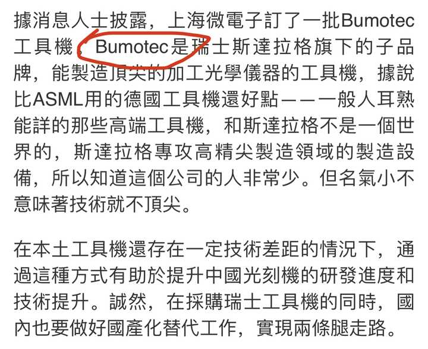
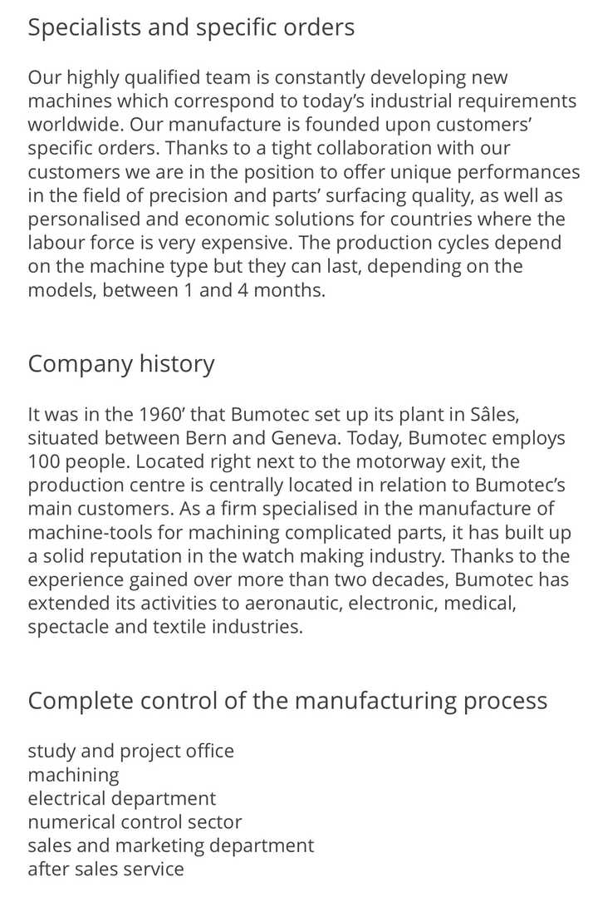
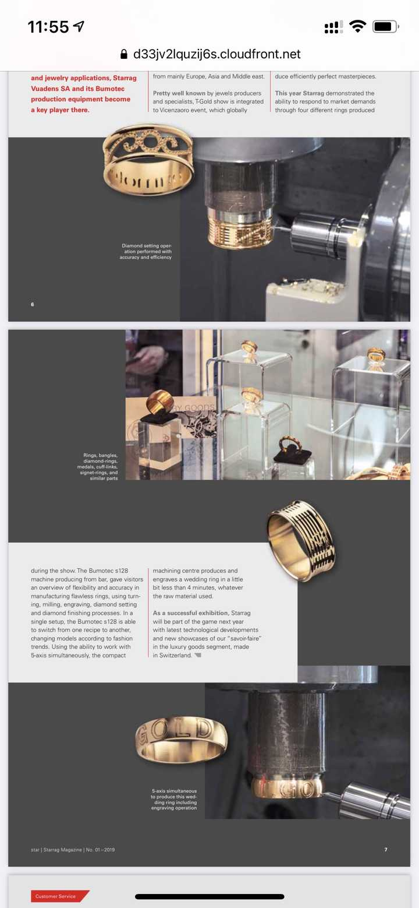
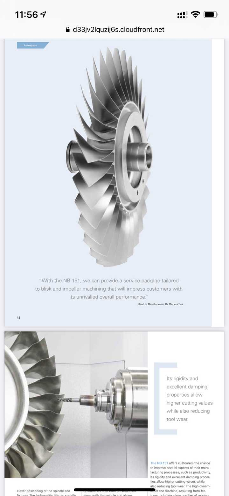
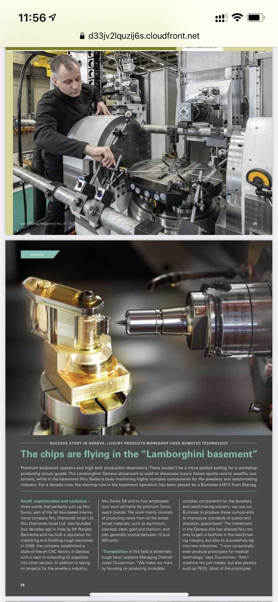
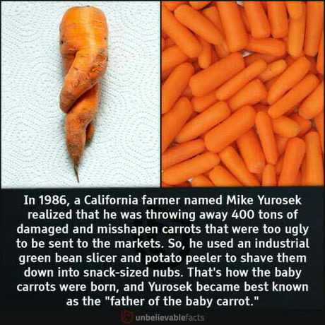

# A08　财富劳动与市场　第 1 册（共 2 册）

- 专题代码：A08　专题名称：财富劳动与市场
- 专题界定：财富获取、消费、借贷、劳动回报、市场交换与经济伦理。
- 本册：第 1 / 2 册　收录 157 篇　正文字符 178,423
- 语料：`sooon-q9adg-articles-v2.jsonl`（4,305 篇）　SHA-256：`cdc9c271309e1d71d9708889a3a31f4777e0c339ea54c3753521894afdb8357d`
- 生成时间：2026-09-27T00:01:00.997126+08:00　排序：发表日期 → 源序号（全库唯一，不重复）

**标记约定**：`【待审】` 主题仍为暂定；`【排除候选】` 图片/正文过薄的剔除候选；
`【正文标注未完待续】` 作者原文自带未完标记；`【正文缺失片段（复核已记）】` 复核记录已确认的正文缺口；
`【图片缺 N 张】` 源图不可获取。标记只作提示，不改写原文、不改动分类状态。

---

## 4028　房价崩溃

- 日期：2018-08-25　主专题：A08 财富劳动与市场　副专题：A10;A20;A07
- 源 ID：`b7c2a72e-3ae4-55e5-b0ef-2bceb65cd9af`　原文链接：https://www.zhihu.com/question/279514129/answer/477712733
- 官方对象—实践路径：与社会 / 与历史 / 借鉴
- 23 概念标签：能力与学习;责任与后果;成本与总账;信用与信任;劳动与组织;财富与市场;心理与主体
- 证据状态：manual_confirmed　初读：read　独立复核：not_reviewed

**问**：房价崩盘后会发生什么？

房价崩溃会怎么影响普通人生活？
断裂的第一环是很多企业向银行贷款所使用的抵押是他们持有的房产。当房价崩溃，银行将会要求企业追加抵押物，或者要求还款。于是会导致相当大量的企业破产，从而导致规模性的失业。

对于民间借贷人，为自己的房子贷款的那种。房价崩塌，经济下行，你也要还一样的月供。一旦断供，银行就可以强行收回房产拍卖——自然是卖不出多少钱的，卖完抵贷款，不足的部分你要接着还。这个期间失业断供就可能失去房产变成欠债一族。

对于全款拥有房产的人来说，房租收入下降。原本可以用自己的房产抵押拿到贷款来开办的不少事业也就会打消主意了。

但对于经济而言会释放两大利好：第一，劳动力市场出现大量劳动力，用工成本会下降；第二，商业用地房租会下降。
算是一个革旧迎新的过程。
自然，在这种总投机大失败之后，以后做事的人大概会踏实一点。实业的价值原本就应该远远高过房产。

---

## 4007　慈善

- 日期：2018-11-18　主专题：A08 财富劳动与市场　副专题：A11;A09
- 源 ID：`ca18e138-9e1b-564a-928b-eeb0fa966c58`　原文链接：https://www.zhihu.com/question/24064243/answer/533635981
- 官方对象—实践路径：与其它 / 与陌生人 / 施助
- 23 概念标签：定义与达意;能力与学习;选择与自由;责任与后果;成本与总账;信用与信任;爱与回应;净输出与不掠夺;财富与市场;权力与异议;生态与自然;心理与主体;宗教与自然法
- 证据状态：manual_confirmed　初读：read　独立复核：not_reviewed

**问**：如何看待修女特蕾莎以及她所经营的仁爱之家的争议？

我来说点离经叛道的话——做慈善是有常人往往不愿接受的戒律的——它的的确确只能是痛苦的延续，而不能是痛苦的解除。
德兰修女的救助所是个很鲜活的例子——医疗所如果装上空调，提供三餐温饱，使用超出周围医院水准的（在攻击者眼里只是“最低安全水准的”）医疗措施，结果会是什么样？
结果会是强而有力者总是排在队伍前面。ta们会装作穷人，占满全部床位以节约自己的电费，把领取的口粮、药物拿去转卖。会威胁甚至伤害企图揭穿ta们的人，甚至本身可能就是“德兰修女企图降低救济标准”这类谣言的编造者。
这才是人性的真相。
只有这救济的水平毫无侵占和转卖的价值，才能真正让穷人安稳地享有。
这是个什么水平？如果是物资，就是“在可以经济运输抵达的所有市场内，这些物资都属于滞销商品”的水平；如果是服务，那么就是“在辐射范围内，低于任何其他收费服务的水平”的水平。在印度，这不多不少，正是德兰修女所提供的水平。以她的救济规模，如果她超出这个水平，会逼死大量的低端商业——她提供的可是免费的。救不见得救到谁，首先还创造大批失业者。
这一点恐怕是出乎一般人意料的——系统化的、规模化的救济、慈善，往往是一种很“残忍”的行为。
第二，人不可以借助救济提高生活水准，无论这种“提高”多么微不足道。因为哪怕只要一点点的提高，都会削减人主观努力的动力。因此救济常分为两种，一种是有入门门槛和相应代价的机会开放——譬如以工代赈或者有入学门槛的减免学费的教育；一种是仅仅提供最低等级的维生支持。这种最低等级的维生支持，将必须做到从任何意义上都不能称其为一种享受，甚至要在营养均衡的基础上故意做得足够难吃。
否则，“救济”可能成为穷人彻底堕落的地狱之门。
那种符合一般人拍脑袋想象的整洁优雅、精美可口的“美好”的救济，往往给被救济地区的人民带来的是肉体的补助和灵魂的进一步伤害。不但不会真的改善贫困（往往还因为单位成本太高而格外昙花一现），而且反会以超乎常人想象的力度窒息掉人最基本的进取心。人性就是如此令人悲哀，但这就是真实的人性。若是明知如此还刻意为之，则救济者的动机到底是为了自己的锦旗还是为了改变穷苦人的命运，你们可以自己算算账。——ta援助完了，ta所援助的穷人们在精神上更糟糕，但这位援助者却载誉而归，这是用什么换了什么？（这说的是对结构性贫穷问题的援助，对意外天灾的援助不在这个类别里。）
第二种问题，就是援助者似乎被期待与受救助者“同甘共苦”。这种期待的立场有何合理性？虚伪不虚伪？仔细再想想，虚伪不虚伪？万事怕算账——做这种要求的旁观者，从哪个角度而言提高了被救助者的福利？ta们抬高了救助者需要付出的代价去满足自己的道德审美喜好，浑然不顾有多少潜在救助者因为畏惧ta们的攻击而却步，更显然是没在乎有多少人因此失去可能得到的救助了。这样的人，如果是无意的，看到这里也该自我忏悔为什么自己竟然无意中滑落至此。如果是有意的，且看到这里仍然认为自己完美高尚，那么这份表面高尚本质阴狠的心思，劝看得出来的人及早躲避。
愿意救助他人的人，理当获得可能的最好的对待。ta们多活一天，多平安一点，对亿万生民都是直接的切身利益。对于ta们，没有任何医疗措施是过于奢华的。饮食住宿，除非有纵欲伤身之嫌，也没有任何可以谈得上过于奢华的。这才是最符合穷苦人利益的安排——尽管这完全不符合一些卑鄙者的审美倾向。
这些人自己是肯定不会去做这些“蠢事”的。ta们只会通过攻击慈善者还不够慈善、对贫苦人还不够“好”，不肯与贫苦人“同甘共苦”来彰显自己的姿态。
毫无意义，而且令人恶心的姿态。
ta们连什么也不做但沉默不语的人都不如。其实，这种对有所作为者的挑剔攻击，本身只是为了遮掩自身的工具——“看，我是真小人，我好过‘伪君子’。”
呸！
——————
我再来补个更离经叛道的——实际上慈善事业的捐助者无权干预善款的使用。
我发现很多人——尤其是中国人——有一种根深蒂固的观念，就是假如我捐了款，那么我应该有权干预善款的使用。我可以对这钱应该怎么用、用在谁身上、用多少、用多快，有理所当然的评论权。
如何看待对江歌妈妈江秋莲敛财的质疑？其实你没有。对在做事的慈善机构来说，如果你是这个想法，你的钱是要不起的——举个小额捐赠者得例子就很容易理解了——接受了五十块捐赠，迎来一位大爷。以这位大爷的巨婴程度，这五十块你是不可能花得ta满意的。ta事后多半会痛心疾首四处点火，尽全力打击你这辜负ta一片好心的“伪善者”。这钱真不如不要。
对那些捐了万亿的大捐赠者呢？真有骨气的慈善机构在这个问题上也同样不该有丝毫的迎合。你捐的多，很好，谢谢。但你没有因此当然获得指点我们做事方法的权利。如果你不接受，请你一开始就不要捐。这种事业完全不是为了迎合捐款者的需求，甚至也不是为了迎合接受慈善者的需求，而仅仅是为了行事者自己的某种追求。
再加一条离经叛道的——
对于特蕾莎这样的慈善事业，这个账毫无意义。
这有两方面原因：
第一，凭证其实是无意义的，是可以用成本做出来的。
这笔钱拿去请当地人修路了。是要给你一堆领工资的回单作为凭证吗？还是要领钱的人都拿着钱拍张照作为证据？真要贪污的人，你以为这样就拦住ta们了吗？本来就是领钱的人，想要贪污的人以不给钱为交换，要ta们签一个更大金额的凭证有什么困难？你以为慈善事业涉及到的物资采购都可以拿到采购凭证？那说明你对基本实践完全无知。强推这个政策，对监督善款近乎没有意义，反而有利于假慈善机构——因为你会无意中抹去大量本来就在成本线上下挣扎的真慈善机构，ta们没钱请这个会计，没钱买那台拍凭证的相机，也没处去买发票。你真正做到的，是替那些更擅长做这些的机构“扫除竞争对手”。你在奖励造假者，难倒第一线的行动者。
第二，也许常人难以相信，要做一点慈善事业，在一些最需要慈善帮助的混乱地区意味着什么。那些部落军阀们直接走进帐篷找你要保护费，这保护费能记在哪个科目下？你以为只有一方找你要？对不起，敌对双方都找你要。你不给，不是你做不做得下去的问题，是你人走不走得了的问题。你要记在哪一科目下？那些亲手造成苦难的人，甚至将自己爪牙下的人视为与慈善机构讨价还价的筹码。你要救ta？给我一百美元我让你救一个。前提是你还要识相，不然老子明天还要涨价。这些费用，记在哪个名下？你以为这些军阀们拿了这些钱，只是去买可口可乐吗？当然是买枪买毒品去了。那你还要不要救这些病患老百姓呢？
你一定要有账才行，你就去捐给那些有账的就是了，这是理所当然的个人自由和权利。但不要以为这样就一定更正义。
很多时候，在第一线为正义行动的人，都只能靠相信、只能靠回顾自己的初心来依稀相信自己是正义的。那些第一线的慈善负责人哪天不在做噩梦自己为军阀们交的买路钱被拿去买了枪杀了人？这到底是在救人，还是在杀人？我做的到底是好事，还是其实是在拿别人的命换我的慈善？
那怎么办？不管了吗？
正义没有你想的那么简单。
仅靠所谓的账目核算，把慈善行为简单地看成一种投资回报活动，把社会性收益也折算成回报入账，以为账面有盈利，慈善就做得不错，这样的思路其实是根本没有触及CARITAS核心本质的精妙的逃避行为。看似有道理，其实根本行不通。——一条人命多少钱？你用什么口径统计成本？那些入不了账的成本和支出你怎么解决？你的社会效益统计期打算算多少年？一个少年的教育值多少钱？一个部落的文化折多少？
在如此靠不住的会计准则指导之下，你想要什么样的结果，我就有什么样的计算方法得出你想要的数字。
这只是我要从善款里拿出多少成本来付给会计师的问题而已，改变不了事实分毫。
所以作为捐款人，至少我从不纠结慈善机构的账目。你想要把这钱都拿回去买劳斯莱斯，我并不打算用给你添麻烦的办法去阻止。因为我知道那只会导致你把本来买劳斯莱斯剩下的钱里再拿一笔来请人去做账。我这样去要求，于真正的事情并无帮助。我只会从一开始考虑你是基于什么样的想法去做这件事，我只会考虑在你身上赌你是不是真心的、靠不靠谱。赌了，就完全信任。赌输了，愿赌服输。你真有对不起良知处，那些被贪污的钱是不足以补偿你在你自己和后代身上造成的恶劣传统的。那些房子车子享受，最终只会变成毒瘾，吸这毒的不光是你，还有你的子女们。那些被贪污的钱其实都变成地狱的办公经费了——又有何妨？
第三，存在着更好的捐赠做法，可以免除审计的必要，那就是买现货，不买期货。
相信我一点出来，你们就应该懂了。
一个人说我有一个好主意，如果做成了会很多人得好处，大家快来资助我，帮我做成它。这是一种“慈善期货”，如果你觉得有诚信风险，你就不捐。
一个人说我有一个想法，我已经用自己的钱和努力做了，眼下已经有了如此这般的结果，现在我需要帮助。这是一种“慈善现货”，你可以自由地为这个现货估值，然后自由决定捐赠。
捐你看得见的部分、捐你自己享受到了的部分、捐自己心算的成本的若干分之一。
这就叫做“买现货原则”。
我是为你已做的结果买单，而不是为你的美好规划投资。
如果你实在放不下心的话，只买慈善现货可以保证你的善款得到了善用。
该做的事你已经做了，结果已经出了，你已经把成本支付过了。这个时候，你已经有资格拿到我给你的这份资助完全自由地使用，哪怕去买豪车、吃石斑、买私人飞机、去给网红妹妹打赏，你也是自由的，你也完全有资格。
因为这只是你本来就有的钱。你若不做这事，你拿那份钱去声色犬马，本来就没有任何问题。
我要你的账目干什么？你养大的孤儿在此，你种下的树林在此，我捐这点钱给你，我要你的账目干嘛？
丛飞之死，与其说是他所资助的孤儿们之耻，不如说是这整个任他破产潦倒的社会之耻！孤儿们没回报他，我们在干什么？在等孤儿回报他？他抚养的是谁家的孤儿？不是他私有的孤儿，而是这个社会的孤儿。整个社会都应该感谢他令这个社会共同的后代能有所养。
我们在等什么？在等他的账吗？在等他写好透明公开的会计准则吗？
你不需要担心有人从此开始制造“假的慈善成果”并卖惨妄图欺骗大众。因为长远看这是没有持续性的——当然会出现这样的骗局，被踢爆之后大众自然不会简单的因为你卖惨就踊跃给你回报。
因为事实上，“买现货”的法则也就是一般经济法则——制造商们也是主动垫资制造产品推向市场，然后忐忑不安地等待市场反应。
我们对于买现货的经验丰富得要命。一旦对慈善事业一视同仁，而不是像以前那样一听是慈善计划就向许愿池投币，那么以我们“购买现货”的无比丰富的经验，虽然不见得能完全杜绝被骗，但能骗我们几回呢？
我们需要担心这些人反而因此有大于投入的盈余吗？
何止不必，难道我们不希望这些主动为社会的公共福利承担风险并且已经做出可以经得起检验的成果的人赢得利润吗？
还有谁比这样的人更配得丰厚的利润？还有谁能比这样的人更会将利润投入到大众最需要的、一般唯利是图的资本们不愿冒险的领域中去？
让这些人在经济上获得成功，难道不该是这个世界该有的美好的样子吗？
换一个方向思考，事实上我们欠了慈善投入者的债，只是ta自己承担了，宽免了我们。我们在事后偿还ta，不过是尽力还债罢了。通过归还这债务，我们成了慈善者中的一员，站在这新成员的立场上，我们亦与ta一同宽免了世人无意间欠下的我们的债。
“免我们的债，如同我们免了人的债。”
要理解德兰修女的心态，需要理解基督教慈善的伦理。
在基督教的慈善伦理上，是因为受者的接受，成全了施者对上帝的义务，所以是受者自我牺牲，成全了施者的功德。（在佛教的伦理上，其实也是异曲同工，是受者成全了施者的修行或“福报”——例如受供养的佛法僧成全了施主。）
施比受有福。
因此，接受这一行为本身就已经偿还了行事者全部物质与精神的付出，且还有余。受者不但不欠恩情，反而于施者有成全之恩——有容忍行事不周全之恩，有接纳因接受这行为而带来的一切不便乃至恶劣后果之恩。
其实受者才是菩萨。是受者在给施者加祝福。
没有这个觉悟，慈善根本做不久。你如果做不到在做慈善时视受者为真正的最大贡献者，你根本做不久。更确切一点说，是对这个伦理的完全认知，才使得你的行为成其为CARITAS：
“我不是什么好人，我只是为了缓解我自己同情心所诱发的痛苦而自私地利用了接受者的困境。或者说，我只是在利用他人谋求我自己在神面前的恩典。我没有足够的智慧能保证我为此作出的行为一定能补偿满足了我这私欲的资助者/受害人，甚至可以说，我深知我所提供的这些所谓的物质帮助，相对于给受害人造成的一切未来后果而言，微不足道。也许我前脚送ta粮食，后脚就为ta召来了强盗，我有什么把握这些自以为是的行为一定会为受者带来益处呢？我不是上帝，其实我永远也没有把握。我只能相信上帝既然明示这是有福的，上帝会成全和额外回报这些受害人。
我没有善，我只是在利用人尽义，利用人谋自己的福。因此，受者对我没有感激也是应该的，受者甚而看穿了我的本意而对我辱骂，只要ta最终仍然对我捐献了ta的接受，仍然是于我有恩。仍然值得感谢。”
——这才是成熟的CARITAS心态，一种常人难以接受，但却能支撑真正慈善者的心态。
只要稍稍偏离，你就将无法忍受、半途而废，并且在离开这个事业的时候对人类充满憎恶。
一个爱人的人，必须不但不能认为自己在付出，而且必须要真心实意地将对方的接受本身作为足够有余的回报。这是唯一能令长久的爱不发展为彻底的失望，进而发展成彻骨的对被辜负、被背叛、被抛弃的憎恨的心理构建。
要么你不要去爱，要么理解这个信条并真正地持守。贪图爱的义人感，又拒绝完成这个构建，你的爱只会发育成仇恨和抛弃的充分理由。
爱人的人之所以能震撼人心，在于ta们一开始就能看透这一点，挣扎着要去接受这样残酷的预设，让自己想要爱的人真的得到一点爱——一点不会发展为毒瘾和仇恨的真正的爱。
你的付出不值什么，ta人的接受才是珍贵的。是受者在布施施者。施比受有福。
没领悟到这一步，你的“慈善”只会是一场围绕着虚荣、欺骗和辜负的悲剧。因为它本来就是。为什么人间以爱为名的事多有发展成相恨相杀的，究其根本，就是因为缺了这一点。如果你的爱的结果是你觉得很多人欠了你的恩情而不是你欠了很多人感激，你就谈不上在爱。
至少，谈不上CARITAS。
CARITAS PATIENS EST.

---

## 3953　劳动保障

- 日期：2019-03-13　主专题：A08 财富劳动与市场　副专题：A10;A07
- 源 ID：`df82a10c-a11a-585d-ae5e-89e98ceea834`　原文链接：https://www.zhihu.com/question/300742925/answer/621143272
- 23 概念标签：能力与学习;选择与自由;责任与后果;劳动与组织;财富与市场;法律与秩序
- 证据状态：manual_confirmed　初读：read　独立复核：not_reviewed

**问**：为什么劳动法颁布那么多年，一些企业、单位一直都无视劳动法？

保证劳动者的利益要靠劳动力稀缺，不能靠立法提高劳动保障。
越立法，雇主市场越萎缩，劳动力越相对过剩，议价能力越低。
低到一定程度，你必须“自愿”加班才有可能有工作。
到时候任何法规都没用。

---

## 3937　名媛

- 日期：2019-05-01　主专题：A08 财富劳动与市场　副专题：A15;A05;A20
- 源 ID：`8d2bc43e-40c3-5808-b4f1-ed51e0237f63`　原文链接：https://www.zhihu.com/question/293032337/answer/668854757
- 23 概念标签：事实与证据;定义与达意;选择与自由;责任与后果;成本与总账;边界与许可;财富与市场;权力与异议;性别与身体
- 证据状态：manual_confirmed　初读：read　独立复核：not_reviewed

**问**：真正的富人家的名媛是怎样的教育与日常？

名媛有什么好的？
这么大的坑还争先恐后往里跳……
名、权、利都是人生至累，应该避之如火。
为这些自豪、矜持，以为是得福的，其实还没真正迈完由富而贵的门槛，还没见识过名门的代价，也还没有明白真能成为世家不落的名门到底意味着什么样的人生模式。
真正的名媛们不会是你们想象的那么欢乐、满足、幸福的。
内心中藏着不足为外人道的悲伤，消瘦的肩膀扛着常人难以想象的压力，因为巨大的家族责任无法选择自己的个人命运，还要保持优雅、面带微笑去接受，这才是“名媛”的常态。
真的不如钱刚够花、自己赚钱买花戴的小女生。
还觉得很幸福快乐，就还不是名媛。

---

## 3914　弱势财务部

- 日期：2019-06-24　主专题：A08 财富劳动与市场　副专题：A07
- 源 ID：`e7441d0a-0df7-593f-a8f3-6c0d2d801b10`　原文链接：https://www.zhihu.com/question/21361143/answer/726110374
- 官方对象—实践路径：与社会 / 与组织 / 参与
- 23 概念标签：事实与证据;能力与学习;选择与自由;成本与总账;信用与信任;劳动与组织;财富与市场;权力与异议
- 证据状态：manual_confirmed　初读：read　独立复核：not_reviewed

**问**：感觉我们财务部总是被欺负，是不是财务部在每一家公司都是弱势部门？

“财务部门受欺负”的企业，是没有前途的企业。
简单点说，就是这种企业并非“公司”，而是“私司”——只有老板自己一个私人知道底细的企业。甚至是“无司”——连老板自己也不知道底细，只知道银行里大概还有多少现金可以取出来。
为什么说“没有前途”？
因为它要进行资产交易极其困难。无论是估值、发债、发行股票、股权交易、期权激励、分红、资产重组……都无法进行。没人知道你的底细，你要么不肯说，要么自己都说不清，你说你要用它担保，拿它作价，谁敢随便接茬？
在现代商业实践中如果你无法进行上述金融操作，可以说等效于人还没长大就已经被阉割，注定不会有前途。
这个就像植物不可能进入食物链上层一样必然。
老板是否对财务规范性和关键性有足够的意识，是老板的格局最直接的表现之一。所谓的“城府”“沟壑”，只不过是一些庸俗的江湖技能，足以存身，不足以成事。
多少企业到了规模可以上市的时候发现自己一笔烂账算不清楚，一旦按照上市企业的财务规范运行简直连裤子拉链都拉不上，九条尾巴随风飘荡。
这都是些烂泥扶不上墙的东西，不足为训。
中国企业管理治理水平普遍地不及格。等退潮的时候，海滩上会留下大片裸泳者的尸体化为他人的肥料。
对财务制度稳健周全的企业，危机都是良机。静静等着下降周期到来，捡对方的尸体就可以称霸了。

很多业余的投资人都喜欢看“团队”，看“项目”，看“业绩”，实际上这些做法都是很不专业的。
第一条就要看财务制度和财务团队的地位。
财务制度存在逻辑缺陷，财务团队不具备必要的专业性、或者没有“如朕亲临”的地位，别的基本不用看，看了也没有意义，只是ppt而已。
多从几个不同的财务角度询问项目团队关于成本的问题，如果不能给出清晰的逻辑稳健的回答，基本就可以断言这些人不知道自己在干什么了。业余的创业团队的数字一般都是关于“潜在市场容量”，而不是关于自身经营数据和成本核算的。仅仅创始人对“成本”概念的认识深度这一个指标就在决定性意义上标定团队的投资风险。
不是不能投，但是那是在投人，是在早期结个善缘。等待他必然到来的挫折促使他成熟到理解成熟企业制度是多么关键，然后再通过提供这方面的资源去换得更大的投资收益。这里才是投资机构的着力点。
但如果要是遇到一个项目逻辑有效，而且创始人财务意识分明的，这类项目的含金量都是极高的。
财务分明，项目哪怕“一般般”，踩坑的风险也很小。
从个人角度，这样的企业能不能呆？可以，毕竟因为时代局限，它占比太大了。
但是呆着的时候要注意，此非你可托付之所，不是你的归宿所在。暂时栖身而已，不要为它付出任何职业道德上的成本，不要构建任何难以退出的羁绊，不要自己给自己构造虚幻的安全感——譬如“老板很器重我”“公司业务有前途”之类。
这些地方只能作为寻找健全企业的驿站，绝对不能作为事业终点。
企管答集
社科答集
科学答集
文艺答集

---

## 3897　人吃人

- 日期：2019-08-30　主专题：A08 财富劳动与市场　副专题：A20;A11
- 源 ID：`7769e7f1-6ec2-5c91-8bfe-05f1990edd76`　原文链接：https://www.zhihu.com/question/296666395/answer/807668245
- 23 概念标签：事实与证据;定义与达意;选择与自由;责任与后果;成本与总账;照料与家庭;劳动与组织;法律与秩序;权力与异议;技术与工程;文明与历史;民族与身份;生态与自然
- 证据状态：manual_confirmed　初读：read　独立复核：not_reviewed

**问**：人类会不会吃人类？为什么？

人吃人有两种吃法。
第一种是明吃，不赘述。
第二种是暗吃。
因为有了暗吃这种有效得多的吃法，明吃这种方式就没落了。
举个例子，契丹人、女真人跑来中原抓走俘虏，命令他们在春夏秋种地，用人力换了粮食储备。到了冬季，却未必肯拿粮食储备换这些俘虏的生存。这样在事实上他们吃的就是这些俘虏用生命换成的粮食——类似一千个俘虏换十万斤粮这样。
使用暴力剥夺人自由选择的权利，就构成剥削。
剥削致死，即是“暗吃人”。
剥削致伤、致贫、致愚，也是暗吃人，只是吃得比较缓、比较局部。譬如弄人去开采石棉矿、挖黑煤窑这类。
暗吃人在古代社会是普遍存在的。
某种程度上说，可以这么说——恰恰正是因为发现了更有效的的“吃”法，人类才会放弃掉“明吃人”这种愚行。
事实上一切残忍行为的消亡，几乎都不是因为人类变得更加高尚了，而是因为人类变得更明智了。
残忍这个概念真正的底色，其实并不是道德或者不道德，是愚蠢。是因为它在终极意义上实属愚蠢，它才会被普遍抛弃，进而在文化上被划入极端负面的范畴。
我发现很多人没看懂这个答案和正题的关系。
那就再说明白一点——
猎获到一个人类，如何从这个猎获成果里获得最多的食物？
在掌握了暗吃的技术之后，把这个人直接吃掉就变成了最愚蠢、最浪费的做法。以杀死为威胁，以“不杀之恩”为诱惑，驱使这个人进行劳动，可以获得远超过吃掉这人百倍以上的利益。
只有愚蠢无能到一定程度的族群才会保持吃人的习惯。而这类族群只要和掌握了这技术的族群接触，结果显然不会是他们吃掉了后者。
在这喊鲁迅鲁迅的，鲁迅只看到“社会吃人”这种浅显易懂的东西，而且只是带着文人的慈心感叹一下罢了。
他没有看到“社会暗吃人”实际上反而在一定程度上拯救了人类中的弱者。
这话也许残酷，但是你们要想清楚——如果弱者们不是还有被“暗吃”的余地，那是真的会变成火锅配料的！
这里大堆的论证尝试说吃人肉会得病，所以吃同类的种族会灭绝，以此逻辑来作为人类不吃人类的根本原因，这其实是站不住脚的。
道理很简单——这些病是缓症，饿肚子没力气打仗却是立竿见影的要灭亡。想明白没有？
如果仅仅是因为有这种病患，根本不足以抵消吃人所带来的利益——那后果来的太晚，而且只要发病期高于生育年龄就在事实上是无效的威胁。不吃人反而会因为缺少一项重要的食物来源而在军事斗争中失败。吃了会得病那是多少年以后的事？他们吃饱了，你们没吃饱，他们下个星期就会来杀了你全家。他们在三五年后会得病又如何？说句坦白点的话——他们本来就未必有这个运气能死于这么缓慢发作的病。
人类放弃了以人类为食，最根本的原因是建立了恐惧死亡的普遍文化理念，以至于死亡可以被有效的作为一种威胁来驱使人服从。俘虏能做牛做马，才得以根本的免除这种命运。
——日本直到1872年才开始允许吃牛肉。
就你们知道鲁迅？

---

## 3874　职业规划

- 日期：2019-11-18　主专题：A08 财富劳动与市场　副专题：A04;A01
- 源 ID：`be6d869d-9c60-5b87-85ff-30c3772ce48f`　原文链接：https://www.zhihu.com/question/25583089/answer/899020828
- 官方对象—实践路径：与自己 / 与理想 / 建立
- 23 概念标签：定义与达意;能力与学习;选择与自由;责任与后果;成本与总账;爱与回应;照料与家庭;劳动与组织;财富与市场;权力与异议;心理与主体
- 证据状态：manual_confirmed　初读：read　独立复核：not_reviewed

**问**：设计师这样的工作，可以做一辈子吗？

设计师是少有的能做到老的工作，也是现代年轻人可以选择的最佳职业之一。
预告一下，这里会顺便说一下职业选择和职业规划问题。
等找到时间。
说一下这个世代的职业规划问题。
职业关乎生存，甚至是比婚姻和生育更加决定性的人生选择。不合理的职业选择，会让人如逆水行舟，竭尽全力而不得寸进。这很快造成你的焦虑、抑郁甚至绝望。
那么如何尽可能的做出合理的职业选择呢？
首先，我们要说明一个基本问题——如果你没有一个恰当的价值观，对你将不存在任何合理的职业选择。
这就好像如果你想要找一头不需要吃草的驴，结论当然一定是找不到。实际上，遭遇职业危机的人群中绝大多数都不是职业选择本身是否合理的问题，而是价值观本身有根本缺陷，导致一切职业都不可选择。看起来只是“当前的职业不适合”，但其实那只是“所有职业都不适合”的一个单次采样。这种问题，是不可能通过重新选择职业来真正解决的。
新作出的选择只是暂时尚未崩坏，但实际上因为价值观的根本缺陷，噩梦重现是难以避免的。
所以，在谈论职业选择问题之前，首先你需要检查自己的价值观是否本身存在问题。如果你从事你的职业的原因仅仅只是“为了赚钱”，那么这个心态本身就注定了你并没有选择命运的能力，而仅仅只是被“最大利润期望”的幻像推搡揉捏罢了。你每一次的选择，都只是一种伪装成“理性取舍”，名为“进取“的放弃，诈作“勇敢”的逃窜。
你其实从未选择，你只是在被选择之后假装那是你的选择。
如果你还是觉得工作只是为了活着，那么你就不必看下去了。
因为工作是一种死法，是一种定意选定的死法。是一种对自身必将死亡的命运的彻底接纳，和在这个接纳基础上作出的安排。
因为有必死的觉悟，所以有不为所谓“生机”所动的坚决。
然后才有选择可言。
否则你一次次的“选择”，只是一种有效期不断缩短的毒品。
你最后还是要面对死亡，没有逃开一分一毫，没有赚得一分一毫，净结果只是赤条条的失去了你本可以有的意义。
站在这个基础上，再来考虑什么是有前途的事业方向。
很显然，无论是什么职业，最终必然是服务于某种会有人受益于是会发生付费行为的业务。
换句话来说，职业的前途取决于这种职业到底是在服务于什么样的需求。
这个需求不会消灭，那么这个业务也就不会消灭。对应的职业就至少有最基本的前途可言。否则需求本身消灭了，业务当然会消灭，附着在业务之上的职业自然也会消亡，非任何个人的努力和天资所能对抗。如果我们把一种需求面对一切未来变迁而保持持续存在的可能性称之为需求的“健壮性”，那么，顺理成章的——怎么鉴定一种需求的健壮性呢？
有两种需求，是最为健壮的。
第一种，是免于死亡。
第二种，是得到幸福。
提供食物、提供住所、提供知识、提供生活必需品、提供安全、提供治疗……这些是在满足第一需求。
提供娱乐、给予抚慰、给予宽恕、给予新的选择……这些是在满足第二需求。
要注意，这两种根本需求，是没有满足可言的。当你是在满足一种没有满足可言的需求，你所从事的业务就有一种来自需求本身的根本的健壮性。
你一定要确定，你所打算终身投入的职业、你的“死所”，一定是指向某个人类永远无法完全满足的需求。否则，人的一生足够漫长、你将可能面临中年踏空或者最终成空的危险。
而这种危险所带来的恐惧，会催生出你种种愚蠢而浮躁的投机行为，通过一次次累积的沉没成本，把你拖进深渊。
先确认了这一点，我们再来谈职业问题。
到底什么是“一个职业”？
如果我问你，你是做什么的，你会怎么回答？
“画画的”
“做广告文案的”
“写代码的”
“送外卖的”
“服装销售”
“地产中介”
你们热切需要听到的，是我告诉你们你们自己的这个职业很有前途，对吧？
很遗憾，如果这些就是你们心目中所认为的职业，那么这些全都极不安全。
道理很简单，它们的“深度”都太浅了，浅到容不下一个人全部的职业生涯、容不下一个人的人生。这些盒子都太小，当你进入某个阶段，你将不得不换一个盒子。
这也恰恰反映了现实——我们中的绝大多数人，就好像职场寄居蟹。每隔一段时间，就会因为行业原因、婚姻原因、子女原因、父母原因、置产原因……不得不爬出自己已经建筑坚固的壳，拖着不堪一击的身体，绝望的在黑暗的海底摸索，希望摸到一个新的壳。
答案难道是另一个壳吗？一个可以兼容你这阶段发育的新壳子？它又能管多久呢？你明知过一段时间就会有新的事情出来。
所以，我明确的告诉你一个最简单的事实——在现在这个历史时期，只有可以自由化的职业，才可以被称为真正的职业。否则，它就只是寄居蟹壳——岗位（post）。
你现在做的，到底是一个职业，还是一个岗位？
如果你现在做的是一个岗位，要怎样尽快的找到并开始你的职业？
要回答这个问题，我们必须找到“职业”的真正表达。
我是一个designer，我是一个healer，我是一个manager，我是一个entertainer，我是一个explorer，我是一个broker，我是一个problem solver，我是一个dealer，我是一个peace maker，我是一个protector……
你看懂没有？
你的职业，应该是一个这样级别的表述。这才是你的职业，其他的修饰词只是你的职业的阶段性的附加属性。
能作为职业的选择，必定是这样的“元概念”。只有这样级别的表述，才可以被看作是一种职业选择。
你目前头衔上所带的限定词，只是你进入你自己职业的的“学徒认证”。你要成为一个healer，你可能需要从门诊护士开始。你要成为一个manager，你也许需要从“客户助理”或者“接线员”做起。但客户助理、接线员，不是你的职业，而是你职业中的阶段状态。
只有明确的区分阶段状态与职业，你才能避免犯下战略性的错误，错误的在一个阶段角色上投入过多的资源。
举个例子，当你是一名接线生，同样有一个月的业余时间，你可以拿来去学管理学原理，也可以拿来学“优秀接线员须知”。你这一个月放在左边还是右边，就是未来命运的分界线。
你知道吗？有这个心胸选前者并且能执行的，甚至会是一个比后者更好的接线员——尽管后者自己表现得“更专注本职”。
为什么？因为同样的投资，前者的有效回报会延续自己的整个职业生涯，而后者却基本只会延续到自己不再做接线员了为止。能看出这个差别、能忍住短期冲动、并且持续付诸行动的人，即使是在接线员这个岗位上也会因为这个眼光和意识无师自通的占据优势。
有正确的职业意识的人，因为能意识到职业本身的“元属性”，会更加猛烈而坚决的投资在“元知识”“元技能”上，而不是各种看起来立竿见影的小技巧、小诀窍上。
而因为他们手里掌握的是几乎不受时代变迁、具体环境条件限制的元技能、元知识，他们的这些个人发展的投资就不会因为一些职业阶段的变化而变成沉没成本。因此他们才能无惧于具体的岗位变化、市场变化。
那么有哪些东西算是元知识和元技能呢？
这需要先知道“元问题”是什么——因为元知识、元技能，其实都是围绕着元问题而生出的工具。
人类所做的一切，兜兜转转，都是在围绕着元问题打转。
那么元问题到底是什么？
对每一个个人来说，人生的元问题可以规范的表达为——“找到一个足以支撑我接受死亡及死亡风险的理由。”
这是一个极其困难的任务，于是围绕着它出现了元问题的一个前置问题——“在我找到这个理由之前，我要避免死亡。”
爱、享乐、权力欲望、解脱，信仰……都是元问题的可能的答案选择。到底是哪个更好、更可行，我们暂时不去讨论。
但无论如何，只有你解决了元问题，你才能摆脱死亡一天比一天更扼制，你的人生才有真正的乐观和轻松可言，也才有真正的生命可言。
无论人是否明确的意识到了这个元问题，这个问题都在无声的、一秒也没有放松的追问着每一个人，无人幸免。
也因此，所有的人类的行为、努力、追求，都是自觉和不自觉地围绕着这个中心在运转。
这个就是人类的终极价值评价体系——有利于人类找到元问题答案的、有利于人类固守自己找到的答案的，就是人类最终会认为有价值的，也是人类会乐意付出劳动来给予回馈的。
你如果想要获得利润，最终你一定是在回答这个问题，一定是在帮助某人解决这个问题。
或者至少需要让人相信你是在这样做。
无论你是在撰写小说也罢、做科学研究也罢、制造产品也罢、设计广告也罢、做医生也罢、教师也罢、律师也罢……
只有你回答了“我的努力如何与元问题有关”，你的努力才有可能在他人眼里拥有价值，才有可能有对你的努力的需求。
越是伟大的成就，就越是更深入、更本质的触及到了这个元问题的底层。
底层是 寻找答案 / 给出答案 / 加固答案，表层是帮助争取追寻答案的机会（也就是协助维生）。
这就是人类所做的一切主观努力的本质。
凡是与这个元问题直接关联的，就是元知识、元技能。
元知识，主要是广义的语言。
元技能，是指广义的观察、归纳、演绎与表达能力。
人在年轻的时候，最核心的能力是什么？仔细看看这一篇东西。
这篇东西里所指向的技能，就是元技能之一——表达能力。
观察能力、归纳能力，最终都表现为表达能力的一部分，具体的关系在上面这篇里已经说了。
越是直接与元技能相连的工作，就越是安全系数高，越是能“做到老”。
这就是为什么“设计师”这个职业完全可以做到老的根子——所谓设计师，本身就是一个发现问题、解决问题和表达方案的职业。
尤其是在表达方面有高度的专业训练和丰富的实践磨练。
几大元技能都踩全了，怎么会那么被动呢？
如果设计师这个工作越做越窄，只会是因为你本身并不是真正的设计师，并不是在做设计工作，而只是在做人肉印刷机之类的非智力劳务。
这不是设计师这个职业的错了。

---

## 3863　“资本家”

- 日期：2019-12-30　主专题：A08 财富劳动与市场　副专题：A11;A20
- 源 ID：`e0f2d1a4-bb3d-52c4-b1ab-2e6dcedc5021`　原文链接：https://www.zhihu.com/question/326598463/answer/955706470
- 23 概念标签：事实与证据;定义与达意;能力与学习;选择与自由;责任与后果;成本与总账;信用与信任;爱与回应;劳动与组织;财富与市场;法律与秩序;权力与异议;文明与历史;宗教与自然法
- 证据状态：manual_confirmed　初读：read　独立复核：not_reviewed

**问**：资本论中的所描写的工人都惨得不像样，是真的吗？

很多学生党在这胡喷，大喊什么“偷换概念”啊，或者空洞无物的在这喊什么“为资本家洗地”啊之类的。
来，你们先解决以下问题——
1）如果一个企业跟另一个企业签供货合同，是否采购方在剥削供应方？
如果你们回答“是”，那么你们想要消灭“剥削”，请连商品经济一起消灭。因为按照你们这个定义，经济活动必须改成完全的中央调拨——也就是513厂免费为936厂提供零件，936厂再完全免费的为酒泉基地提供发动机这样。所有的工人全部回到国家评级发生活用品的状态。
否则，就要出现你们所不能忍受的“剥削”和“罪恶”。
你们是不是认为这样的经济模式才是绝对无罪的模式，而且认定这个模式可以帮助中国人赢得普遍幸福和国际生存空间？
如果是，请把你们的论文上交人大政协，不要浪费了你们的伟大构想。
如果你们说“no”，那么请听第二题——
2）中国存在个体户和个人独资企业这两种经济实体。从原则上，如果你们认定一切雇佣关系都是剥削关系，那么如果一个组织在不改变任何业务具体流程和资金支付的情况下，从一家有很多员工的企业转变成了一家仅有股东的有限责任公司和一大批个人独资企业的企业间协作——注意，支付给每家个人独资企业的报酬严格的等于原来对应份额的工资——“剥削”如何就神奇的消失了？
现在无论是理论意义上还是真实的法理意义上，都没有你们理论意义上的“员工”了。
如果你们要认定这意味着“上游企业”剥削了“下游企业”，那么你就要意识到现在剥削已经纯然的发生在上游资本家与下游资本家之间。你想要“杜绝上游资本家剥削下游资本家这种罪恶”，你就要只有“彻底毁灭一切经济活动本身”唯一的解决方案。
来，给出你们关于世界的伟大设想吧，告诉人类怎么按你们的标准纯洁的正义的繁荣起来。
我看你们根本就没有经历过那个时代，根本没挨过饿。在你们眼里，这些都是拿来斗嘴刷存在感的智力游戏，你们根本不知道放纵你们这种荒谬的蠢论背后是何等样的经济浩劫和灾难。
你们根本不知道自己在说什么。

很多人认为资本的罪恶在工厂，在那些养尊处优的城市娃们望之毛骨悚然的“简单机械重复劳动”的“不人道”的生产线上。
你们搞错了，对那些工人而言，能进这样的“条件恶劣”的工厂，已经是一无所有、失去一切之后好歹抓住的一根救命稻草了。
不做这“不人道”的“简单机械劳动”，换成什么？在家接受普遍救济吗？谁出这救济？
那好，各位好心人不妨这么办——请工人们回家，你们直接按ta们一半的工资每月汇款给ta们。很多人一个月累死累活也不过是三千。如果完全不必累，去掉了那些损耗，1500就可以在本地过日子了。不经过行政部门来一次“先上交后分配”的消耗，你直接打钱还要省一点！
你们不能又不捐献、又抱怨税收太高、又指责“血汗工厂”。三样一起做，就什么好话都被你们说了。
你们指责“血汗工厂”，要指责这些工厂主“黑心”“贪婪”，要求打击它们或者“提高规范水准”，可以——请申请提高个人所得税税率。
什么，你们想要“黑心工厂主”们交？
问题是，要么物价普涨一截——“通货膨胀”，等效于普遍强制征税。
要么就是“黑心工厂”普遍消失——ta都关门了，你上哪去找ta缴税？但是请注意，等着吃饭的人可没消失，所以还是请提高个人所得税税率。
马克思所指责的“资本罪恶”，不是指开工厂的老板有多邪恶，懂不懂？
他谴责的是那些领主自己可以收回佃农的土地，先制造农民的绝境，然后另一手开起纺织厂，农民接受低工资打工。
事实上，真正的罪恶，真正的罪恶在哪？
在于他们出于对最大利润率的追求，他们所开的工厂没有吸纳全部被他们剥夺土地的失地农民。
因为这个新生产方式的确比原来先进，产生了更多的物资。他们本来可以给原本的全体领民提供比原来更好的生活。
他们本来可以的。
正因为他们本来可以，他们没有这么做才构成罪恶。
从欧洲的道德伦理上说，贵族是对上帝承担牧养众民的当然职责才享有特殊地位的阶层，他们这样做毫无疑问有背叛社会责任和宗教义务的双重罪恶。
你们是因为承诺爱惜领民、保证公平和安全才享有服从和服务的贵族。领民们承担了他们的义务和职责。而事到临头，你们却全体参与，心照不宣的密谋、互相无耻开脱，乃至于争先恐后的背叛曾在神前发起、且每次礼拜都信誓旦旦的誓言。
“你们背叛了神圣的契约，出卖了上帝。你们绝不是没有选择，而是在有选择时选择了这种无可置辩的贪婪，所以你们才是罪恶昭彰、十恶不赦。”
合格的贵族该是什么样？大概可以看看《唐顿庄园》——如果承担责任，不抛弃领民，经营自己的庄园就绝不是什么轻松活。每天的生活绝不是简单的吃香喝辣，而是另有一份艰难。

西方资本主义的罪恶，并不是发生在流水线上和“黑心工厂”里，而是发生在“不是没有选择、而且存在绝对义务不容这样选择的时候，却做了最贪婪的选择”的这一步。
马克思是因为目睹贵族/宗教二元秩序的大面积崩塌，而不再相信贵族精神或者教会信仰能解决人类命运问题。
他复盘了整个过程，认为要想从此杜绝第二次的精英集体背叛，最根本的方案是一开始就消灭精英作出这种贪婪选择的可能性——消灭私有制 / 封建制本身。
这对这个问题已是题外话了，回到本题——仔细想清楚，罪恶是从何而来？
存在选择，才存在罪恶的法理基础。
中国面对群狼环伺的世界，长期处在强烈生存危机之中，这个宏观历史前提与当年羊吃人的贵族们存在根本性的差异。
不能说中国的每一家企业都是洁白羔羊，但是中国的所处的历史性的伦理位置决定了中国的企业主远比西方资本主义兴起时的领主/资本家二位一体的那一帮背负的原罪小得多。
同样生产环境恶劣、待遇微薄，但是仅仅只是这两条，中国的小企业主们是无罪的。
ta们并没有“把人抛入绝境迫使ta们不得不接受低待遇”的能力和权柄。

---

## 3840　五分钟厨师

- 日期：2020-02-28　主专题：A08 财富劳动与市场　副专题：A04
- 源 ID：`208c5abc-0b2a-552b-aedf-560a36c0a22b`　原文链接：https://www.zhihu.com/question/27726885/answer/1042698063
- 官方对象—实践路径：与自己 / 与能力 / 获取
- 23 概念标签：能力与学习;责任与后果;成本与总账;照料与家庭;技术与工程
- 证据状态：manual_confirmed　初读：read　独立复核：not_reviewed

**问**：可以介绍一下各种调味料的基本用法以及搭配方法吗？

给你们一个基本思路，足以解决烹饪苦手所面临的绝大多数调味问题。
现在的调味料工业是这个样子的：
由专业的研发中心以简化作业流程、标准化调味为中心思想开发各类专业复合调味料，以帮助大型连锁餐厅降低成本和提高效率。
很多连锁餐厅直接用的就是这些方案。
它们拿出自己的经典菜来，委托某家大厂代为研究专利调料包。一碗面直接开一包，一只鸭直接淋一包。
而它们一般都会开发某种菜谱网站推广它们的自研产品。（委托产品是客户机密）
例如：
联合利华饮食策划-专业厨师掌上菜谱库网站
精选菜谱 | 太太乐 | 太太乐_太太乐鸡精_太太乐官网
厨邦美食
对没学过烹饪的普通人，活用这个工具已经可以做出不少可以镇住场面的大菜了。
了解你的时代，你才能活在你的时代。

---

## 3811　撒钱

- 日期：2020-03-29　主专题：A08 财富劳动与市场　副专题：A10
- 源 ID：`01ed2146-0b15-5629-98f1-174a630ce792`　原文链接：https://www.zhihu.com/question/381589317/answer/1112686370
- 23 概念标签：能力与学习;选择与自由;责任与后果;成本与总账;信用与信任;边界与许可;财富与市场;法律与秩序;民族与身份
- 证据状态：manual_confirmed　初读：read　独立复核：not_reviewed

**问**：为什么网络上有这么多人反对给每人直接发几千块钱，却支持信贷放水的提议？

每个人发几千块不是什么好政策。
更好的政策是给每个人批准一定的低息专项贷款额度，并将这种全民个人贷与社会信用体系挂钩。
所谓专项贷款，是指这笔钱会经由申请直接划给指定的公共服务账户——比如水、电、煤气、经登记的房屋租金、暖气、网络、公交、公立教育、统一基本食品供应服务……等等指定公共服务的账户。
不需要任何物质抵押，仅凭公民身份就可以领取。
如果有违约记录，会影响到将来享受一切社会服务，并且不还清不能合法移民。
无力偿还者，可以由承担一定社会服务来抵偿。
利息不是零，也并不会特别显著的低于一般消费贷，但是可以第一年免息。
这样，有需要的人自然会主动申请，并且也不容易滥用。既可以避免大量的操作成本，也可以有效的避免对经济的不健康的冲击——无成本的资金一定会冲击供求信号，导致市场资源的错配和无效率。
在将来可以对某些类别的消费豁免贷款利息——比如用于教育的部分。
之所以这样建议，是因为中国在这方面有特殊的制度特性——中国所有的重要公共服务几乎都是全民所有的。吃了中国的，你还是拉在中国的地里。
这就在操作成本上一下变得简单易行了。
资本主义国家自然也想到了这个方案，但是它们从法理原则上要执行这个方案就有很大的成本——这样做会导致无数家公司必须先经过申请、鉴定和登记，努力进入可选供应商的名单。考虑到为了保证基本公平，手续必然有令人望而却步的复杂性。更不用说可能在时效上几乎不现实。这就是一笔极大的成本。
这个成本对中国其实一样存在，只是中国从一开始就以“国企欠缺效率”的方式买过单了。
而资本主义国家临时想用，临时买单是根本买不起的——按这个方式发救济，发到每个人头上先得摊掉几百美金的会计成本和审计成本。——哪家企业不想登记？凭什么不给登记？
所以，对它们来说，每人发个几千块更现实。几千块，在姿态上可以接受，在经济上恶果不彰，在社会收益上至少在心理上可以起到理论上的延缓动乱的效果——至少可以将领导层对动乱的责任降到可以承受的程度，不至于当即引发领导层的垮台。
这绝不是因为这对他们是理想的选择，而是因为这对它们是能做的最不坏的选择。
而中国呢，这种“公民信用贷”的额度可以根据社会信用的完美程度一口气提高到十万、二十万、甚至五十万的等级——利息也根据贷款规模相应提高。
甚至可以是无上限的。
因为首先供应端就掌握在全民所有体系之中，而且不是给了不用还，而是不但要还、还有利息的，所以首先这就不是风险不可控的、不可持续的措施。也正因为它不是亏本买卖，它的上限就可以远远的高过几千块、一次性这些限制。
如果你如期还款，你完全可以再借。
同时，这个措施能够启动大量公民的金融信用积累。这些信用数据本身是远胜货币本身的真实财富，仅仅依靠这些信用数据，人民币都会得到进一步扩张的坚实基础。
有坚实基础的扩张不同于无基础的扩展，它会促进经济活动的进一步繁荣而不是所谓空卡路里单纯的造成通胀和局部失衡。
换句话说——这个措施本质上是赚的，甚至赚得还不少，赚的不只是账面上的金钱。
这笔公民信用贷将会深刻的改变公民社会的伦理关系，更深更全面的兑现全民所有制的制度优势。一旦宣布，对人类都是一种会触发深刻反思的震撼，哪怕仅仅从争夺舆论正当性出发，这几千亿也花得够本了——何况还是要还的，还是有利息的。
如果眼光辽阔一些，它甚至可以以此为契机和先导测试，成为一种长期制度。本质上讲，这其实是一种扩大了的学贷。
因为有更好的选择存在，所以我反对“全民发现金”。

---

## 3809　瑞幸

- 日期：2020-04-03　主专题：A08 财富劳动与市场　副专题：A10;A03
- 源 ID：`721372df-56c1-58ee-ac7c-13fae594eb74`　原文链接：https://www.zhihu.com/question/384645264/answer/1124202723
- 23 概念标签：责任与后果;成本与总账;照料与家庭;财富与市场;权力与异议;文明与历史
- 证据状态：manual_confirmed　初读：read　独立复核：not_reviewed

**问**：如何看待瑞幸公布调查显示伪造交易价值达 22 亿，盘前下跌超 80%？

不要大惊小怪，也不用担心什么“坏了中概股的名声”。
不要太小看美国股民。
比这更大的雷多了去了，瑞幸排Top20只怕都排不进。
安然不比瑞幸大个十倍？1100亿，吓住“投资人”了吗？
雷曼兄弟轰然倒地，负债六千亿，吓住“投资人”了吗？
资本游戏的规则不改，作弊玩家就永不会止息。
所谓的“金融”，绝大部分内容的本质只不过是无良的父母们在强制透支尚未出世、于是毫无还手之力的子孙们而已。

---

## 3806　“撤离中国”

- 日期：2020-04-12　主专题：A08 财富劳动与市场　副专题：A12;A13
- 源 ID：`addc8fef-723d-5e12-aacf-a361a97e338f`　原文链接：https://www.zhihu.com/question/386938707/answer/1147240816
- 23 概念标签：能力与学习;选择与自由;责任与后果;成本与总账;财富与市场;法律与秩序;权力与异议;技术与工程;文明与历史;民族与身份;生态与自然;心理与主体
- 证据状态：manual_confirmed　初读：read　独立复核：not_reviewed

**问**：美白宫经济顾问库德洛呼吁美公司撤离中国，美国将支付搬家费，这意味着什么，动机是什么？

从疫情控制最快、产业链最完善、基础设施最好、能源供应最强大、离统一中心市场最近、政局最稳定的地区，
搬迁去一旦发生疫情就不知道啥时候能控制、产业链不完整、基础设施不太好、能源结构性短缺、远离中心市场、政局不稳定的地区，
只负责搬家费………
如果这样可行，那么美国当然愿意为每位非法移民出搬家费请他们回去自己的国家，两者性质完全一样，非法移民问题早就应该不存在了。
这只会让本来就已经准备破产的企业突然发现“搬家”的商机。
本来已经准备集体散伙各回各家了，平白多出一笔可以领的钱来。
甚至搞不好会催生出“到中国“创业”，然后领“搬家费”“搬回美国””的创意来。
属实低碳环保。
且双赢。
还有很多人在担心其他国家因为仇恨和敌视而宁可接受更高的成本、更低的产量和更低的利润——宁死也要争口气。
怎么说呢？世界上没有任何国家的人民比中国人民更能明白这事会是什么结果。
当年我们“勒紧裤腰带”，“宁要xxxx草，不要xxxx苗”。勒到裤腰带都快断了，都快把老一辈从哺乳纲勒到昆虫纲了。
大几亿人，抱着必死的决心勒过了，已经勒出人类历史的绝对记录了。
当年支撑我们的那股气，那何止是疫情，真是尸山血海的国仇家恨，远远的超过现在支撑“世界人民”的这点情绪。
这我们也没勒住。
来，祖传裤腰带借给你，加油勒！
现在油价很便宜！

---

## 3804　全球化

- 日期：2020-04-19　主专题：A08 财富劳动与市场　副专题：A12;A13
- 源 ID：`1e6499af-15ef-5a41-9b01-84384abbb929`　原文链接：https://www.zhihu.com/question/387274891/answer/1164595638
- 23 概念标签：定义与达意;能力与学习;选择与自由;成本与总账;净输出与不掠夺;劳动与组织;财富与市场;法律与秩序;权力与异议;技术与工程;文明与历史
- 证据状态：manual_confirmed　初读：read　独立复核：not_reviewed

**问**：如何看待逆全球化？

要说明全球化的问题，首先要说明白到底什么是全球化。
所谓的全球化，一言以蔽之，是指采集全球最好的原料、雇佣全球最好的人力、应用全球最好的技术、生产全球最多人需要的产品、卖到全球一切可以卖到的地方。
本质上，所谓的全球化就是“商品经济最大化”。如果我们有一天殖民太阳系，那么这概念就会变成“太阳系化”。
先把这定义立在这里，再看这问题的结论。
最根本的问题是，有没有什么力量可以阻止全球化？
这实际上是在问有没有什么力量能让商人放弃上面这一系列的诉求，让他们基于某种原因不要追求最极限的利润和最大的经济规模。
如果这个力量是来自于某种人类的集体主动干预，那么问题来了——这种干预必须保证均匀而统一的施加到所有的市场玩家身上。否则你把我限制了、却没限制他，他将举全球之力以压一隅。我原料不如ta好、工人不如ta便宜、市场不如ta广阔、量不如ta大，你这等于直接逼我死。你要限制我，以最起码的伦理，你也必须补贴我的损失。
如果你不打算补贴我的损失，只是打算单纯的破坏我的竞争优势、剥夺我的市场空间，那么我只有两个选择——或者战，或者逃。
所谓战，就是动员我所有的资源让你下台，甚至干脆把你肉体消灭。
所谓逃，就是我换一个不像你这样做的国家去待着。
这个规律在商业界如同万有引力定律在物理界一样不可抗拒，不受任何人的意志影响。除非消灭商品经济这种现象，否则它就必须按照这个规则行事，哪怕CEO们个人很有家国情怀、献身精神也没有用——市场和消费者是无情的，你质次价高，不管你出于什么高尚的值得同情的理由（甚至包括“保护地球”这种），长期都不可接受。
既然如此，那么全球化的基本规律就确定了——全球化就像空气，一定会进展到它自己能扩展到的极限才会止步。
所以，问题就变成了“全球化已经到达它可以到达的极限了吗”？——只有全球化达到并超越了它应有的极限，才有可能向下回归到它的极限所在。
这极限有两条，一条是物理极限——譬如全球化不可能扩展到无人居住的星球。物理极限是全球化的铜墙铁壁，是不可能超过的。
第二条线则是多种因素围成的“软极限”，超过软极限，就会有力量把你往回拉，直到把你弹回去，到显著低于软极限，然后又回弹，弹到再次超过软极限，又被回拉……如此反复。
并且这条软极限本身也是动态的。全球化指数在围着软极限上下波动的同时，也会不断的将软极限构成的篱笆今天触动一个桩子、明天触动一个桩子，不断的导致这条篱笆的变形。
这样，就构成了全球化走向的复杂性。——它不是一个全球均一的趋势，而是一个在不同的地域、不同的行业、朝着不同方向、不同的维度不均匀的波动着的过程。
它不像是一条波动的一维曲线，也不能用一个波动的二维平面来概括，也不能用浓淡不均匀的三维几率云来表示，甚至引入RGBA四元色来表达不均匀、不同色的三维着色空间也不足以形象的表达它的波动复杂性。
因为它不均匀到了这样一种“一锅五颜六色疙瘩汤”的复杂状态，以至于按照不同的口径来统计就会得到不同的结论。所以，说它是会“全面推进”还是“全面逆转”，在它触碰到一个软极限的时候是很无意义的说法。
比较有意义的，是要去理解影响各地区、各行业的局部全球化策略倾向的几大主要议题，去考虑这些主要议题的交叉反应，得出你自己的结论。
也就是你应该基于什么样的规则，去判断你所处的地域、你所处的行业，接下来会是什么走向，而不是去讨论“全球的全球化总趋势”。
因为“全球的全球化总趋势”首先是一个复杂到不可能有效讨论的话题，其次也是一个其实与你自己的切身处境几乎无关的问题——除非存在一种“全球发展指数基金”给你买卖，否则这对你是没有意义的话题。全世界上涨，你这里跌，你也是跌。
那么，问题就转化成了全球化的软极限到底有几个关键议题。每个地区，每个行业都要受到这几个关键议题的影响，视其情势的态势来判断具体的涨落。
第一个主要议题，就是全球化收益区域内再分配的挑战。
通俗的讲，全球化高度有利于进出口部门，但对该部门之外的人利益较小。
注意，不见得是“没有利益”，而是利益较小，就已经制造了问题。在全球化之前形成的政治平衡，在全球化之后平衡点就会迁移。平衡点迁移，一定会导致走向新平衡的波动变化。这个说起来轻描淡写，但这背后是大量没有预见性的企业的倒闭、不合时宜的政党的垮台、多少世家大族的轰然倒地、各种暴发户幸运儿的崛起、令人瞠目结舌的一夜变色。这是一种痛苦的、消耗大量社会资本的过程。
但是社会资本是无主的、是没有人能有效捍卫的，而商业资本是有主的，其主人会不惜一切代价为之斗争的。
所以，客观上，全球化有一种“将全民享有的社会资本没收，将其倾斜到部分密切参与全球化的阶层，并且还在物质上给予其丰厚奖励”的客观效应。
形象的说，原来村里十一个人，有10人每月盈余50，一人盈余500，两边恰好平衡。全球化来了，村子整体增加了1000，却是这个人一人独得800，剩下每人各得20。虽然剩下的人从50到了70，但是那位富翁却从500到了1300。
理论上，只需要等待这份超额利润刺激更多的村民勇于冒险，大胆走出国门去积极争夺本地区参与全球化的平等机会，从而把那位富翁所独占的水源摊平。但是现实是这份魄力背后需要的风险承担能力和信息准备，远非月余70的村民们所能普遍承担——更不用说这些富翁已经抢先一步占住了战略优势位置。
市场竞争在此失灵，于是村民们只能眼睁睁的看着能纵横四海的富翁们一天比一天占据全村财富的更大份额，以至于所有人都只能靠向他提供服务来保住饭碗。
政治版图和经济地位都在向富翁倾斜，已经不能靠市场竞争扭转回来。这个问题到了一定的限度，就会触发非经济手段的抑制全球化的能量。
本质上，所谓“中美贸易战”，并不是发生在中国和美国之间，而是发生在美国的全球化掉队者和弄潮儿之间。是美国的村民们在骚扰和打击美国的富翁们的商业关键环节，尝试强迫他们将吃到嘴的利益吐出来让大家分享。
看似在攻击中国，实际上中国所在环节的成本是刚性的、需求也是刚性的，由这种骚扰和打击所造成的成本，几乎完全是在由美国的富翁们承受。
他们将工厂“迁出中国”，迁到越南，则越南也会受到这种攻击，就是这种斗争的明证。
不能解决全球化利润的区域内广泛分配问题，全球化就不会获得进一步扩大的许可。
这才是全球化受阻的根本原因。
富翁们不可能轻易就范。即使他们愿意妥协也做好了妥协的准备，也必须使这个过程变得足够痛苦不堪才能将这个妥协付诸实施。否则如此轻松就获得了利益，则这种“闹事有钱拿”的的事伊于胡底？尤其是，这毕竟是一种典型的反资本主义的行为，如果让这种行为获得奖赏，那么资本家们将会面对一个更加严肃的问题——这个国家是否还可以继续视为资本家的祖国？
可以妥协、也不妨妥协，但却没有无制度和伦理后患的妥协的逻辑。这就像其实土匪绑票要的不多——也就一两千块，远比请保镖便宜——你可以给、也愿意给，但是却苦于没有给钱而无后患的方法一样。
给了，无论以什么形式让对方得到净盈利，就不是一两千块的问题了，而是为对方开辟了一条新谋生之道。
这个问题，从全球化一开始就在恶化，到现在才摊牌，已经是无法再拖延了。这才是全球化在全球都卡住的根源。
而真正能解决这个问题的答案，其实摆在人们面前，但对资本主义国家太过于可怕，以至于必须另外找到别的出路——那就是全民所有制以及国有经济主体化。
也就是在实质上由全民持有最有利润的优势产业，对外贸易所得利润用于全民普惠的基础建设，形成一种正循环。
美国只是在尝试通过征收必然由富翁们来承担的超额贸易税的形式在本质上实现这个设计。
这就是一种隐性的国有化。
但美国人民最好不要对问题会这么简单的解决抱有过大的乐观。
因为这个措施，会授予政府决定谁被国有化谁不会被国有化的巨大权力。这是一种政治对经济的霸权。而众所周知，就美国而言，富翁们才是最大的政治霸权势力。
不考虑人的感情好恶，川普实际上的确可以算是美国村民的宋江。
可惜宋江的下场并不美好。
这也从另一个角度，说明了为什么中国是在全球化中最成功的玩家之一。恰恰是因为中国的全民所有制和国有经济主体的架构，相当微妙的缓和了全球化对中国的极化效应。并且中国也实现了政治权力与经济实力的脱钩化——毕竟无论多么庞大的私营企业，与央企集团相比也只是九牛一毛，更不用说它们也有不少国有股份——于是也在程度上对全球化会导致的权力失衡问题免疫。
而面对这份“利润公平再分配”的难题，中国战略性的选择了将它转化为高铁、全面城市化、军事现代化、公立教育现代化、全民医疗和一带一路的战略性、全局性投资这些自然而然会惠及全民的投资，并通过这种宏大的“以工代赈”，实现了内部的按劳分配和底线保障领域的均沾。
这意味着中国对于全球化必然的副作用有更强的免疫力，自然也意味着中国在全球化上几乎没有任何顾虑，可以大胆的展开一切进攻性的策略。
实际上不只是中国如此，那些资源国有（或变相国有）的资源型国家，如果较好的控制住贪污问题，也会对全球化有更大的承受力。譬如卡塔尔、沙特、阿联酋、文莱（由皇室拥有国家关键资产并负责照顾国民）、新加坡（由精英集团管理国家资产并负责照顾国民）、日本、韩国（由财团拥有整个国家关键资产并负责照顾全体国民）这类国家，也反映了这个规律。
全球化的第二个议题，就是地缘政治格局承受重压。
全球化在改变国家的态势。每个国家的禀赋不同，在全球化中获得收益的能力也就不一样。这其实是在地球村里将美国村的问题重演了一遍。逻辑几乎完全相同，问题的平台上升了一个档次。
在美国村，富翁们实在受不了还可以换一个村。但是在地球村这个层面，并无第二个地球村可以容纳这样的“各得其所”。
你不能搬离地球，也不能脱离人类文明，这时候如果是地球村的村民对力量的失衡感到忧虑，富翁们要怎么选择呢？
上面说过了——富翁们是愿意妥协也可以妥协的，真正的问题是妥协是以什么名义、通过什么路径去妥协。
以我所见，这事只有一种处理手段——一面拥有足够的武力震慑，保证没有人敢于继续考虑靠“施压”、靠威胁获得让步的可行性；另一面主动的释放物质利益，换取社会资本，将全球化自带的消耗社会资本增加物质资产的效应对冲掉。
这两条策略，是对在全球化中受益的全体国家整体有效。这些国家将团结起来，总体的实行这两个策略。
非如此不可。
“你与我产生了这种程度的争议，以至于你动了要对我动手来榨取利益以求取得再平衡的念头，而我也看到了的确应该要在一定程度上至少缓解这种对抗性张力的必要”——这种情势，在人类历史上在所有大大小小的舞台上反复上演过。对此历史已经反复的、称得上不厌其烦的说明了故事的结局——只能有一种最终的剧情，就是最后新的“生产力之王”首先将一切软硬武力威胁震慑住，使得对方的暴力尝试彻底失败，以至于无法在任何意义上将后续的利益分配理解为自己暴力的成果；然后在这种妄念消灭之后，胜利者主动的将部分利益重新分配。而这种再分配，必须是物质上的倾斜换取国际关系、国际秩序上的调整，而不是无条件的施舍。
只有这种结果，是拥有最大稳定性的结果。它既没有奖励贪婪、懒惰与凶恶，也良性的遏制了两极分化的进一步恶化，从而熄灭了这两个推动局势继续改变的动力源。
直到实现这个结果之前，其他暂时的稳态都会因为这两个动力源仍然没有关机而进入新一轮内在张力积累，直到再次积累起来的张力把这暂时的稳态再次打破，将其推入指向这最终稳态的下一个中转站。反复循环，直到稳定到这个结局为止。
很显然，中国已经看到了这个总的趋势，已经行动起来了。
这就是为什么近年中国一方面在飞速的军事现代化和先进化，另一方面在突飞猛进的推进一带一路倡议和“人类命运共同体”的新利益分配框架。
这就是在为所有全球化受惠国、所有国家的全球化受惠阶层打前锋，铺平尽快进入适应全球化的国际秩序最终稳态的最短通路。
“丘也闻有国有家者，不患寡而患不均，不患贫而患不安。盖均无贫，和无寡，安无倾。”——《论语·季氏》第十六
在另一方面，全球化受惠国还可以进一步的扩大门户开放和市场准入，允许世界各地对全球化不满的人们经由一定的努力有机会以个人身份来参与全球化的利益分享，也是对反全球化的集团性势力釜底抽薪的一种策略。
这策略的原理有一个经典的实践，就是隋唐科举制——通过某种筛选机制将精英筛选出来变成利益阶层的一员，则足以令动乱的力量失去智力和组织资源，而削弱其实力。
全球化是生产力的发展，反全球化是生产关系的诉求。
生产关系可以在一时间延缓生产力的发展速度，但最终总是生产关系会自我调整到适应新的生产力。
除非人类放弃对物质生活的无限追求，否则这是无可逆转的宏观规律。
一直盯住这两个主要议题在各地区的进程，你就能看到全球化低潮和高潮交替的节奏，也能知道哪些信号预示着低潮的开始和结束，高潮的开始和结束。
至于根据你自己看到的迹象作出什么样的判断，那就是各人要努力自己去做的功课了。
有要求要谈一谈疫情对全球化的影响。
很多人都在喊疫情会导致各国回迁各种产业，努力提高自给自足的水平，以防再次出现这种突发窘境。
问题是，“回迁产业链可以预防突发窘境”的逻辑是什么？它在经济上的逻辑成立吗？
这些产业既然自由流动到这些地方，当然是因为这样效率是最好的、成本是最低的。只要改变它的这个状态，它就将处在效率不够好、成本不够低的状态。
它生产出的产品，一定会有更高的价格。
这只有在中国自己因为某种原因肯定不会卖给你更便宜的产品的前提下，这种更高的成本才会变成实际上最低的成本。
就算这些国家确信中国肯定会在疫情期间卡住某些国家的脖子来要挟，那么非疫情期间呢？中国也会故意在平时就不卖口罩给其他国家吗？
如果仅仅只是担心非常时期会被卡脖子，那么回迁生产线显然是一个愚蠢的行为，远远不如在和平的非禁运时期建立战略储备。
平时日积月累的储备个十亿二十亿的口罩，不费吹灰之力，便宜量又足。别看数字看起来这么大，其实还装不满一个体育场。这才多大成本？
真正解决问题的是建立这种战略储备，区别只是这个战略储备是自己建一条生产线来生产，还是平时从国外采购。这纯粹是一个如何做更便宜的问题。——而你怎么可能比中国便宜？
于是选择回迁生产线来自行生产出这个储备所花费的额外金钱，算是什么呢？
这是纯粹的浪费。
第二种可能的好处，就是再次遇到疫情时万一储备耗尽则可以自己生产。
但是这意味着这产能要有足够的规模来应付突发的巨量需求。这个巨大的产能规模，在没有疫情的漫长时期内怎么养活？
一天不发生疫情，就要净亏一天——不靠大量补贴，这些产能生产出的产品是不能和中国的产品竞争的，毕竟成本更高。
下次什么时候发生同样的疫情？又一个十七年后？大家赌气养着这支“以防万一”——其实其产品完全可以在平时廉价买到——的大军又一个十七年？
头几年也许大家积极性很高，一致认为“非如此不可”。疫情过去还没满两年，就会有各种呼声表示“这很愚蠢”，“国民不应该继续养活着这群‘无能的蛀虫’ ”。
这时候算算账，回迁生产线的成本完全沉没，只剩下一堆过时的设备可以廉价拍卖；花费了两年的补贴购买自己生产的高价口罩，成本超过向中国直接购买数倍。
这是拿口罩举例，实际上什么抗生素、原料药、呼吸机、消毒液………几乎一切与抗疫有关的行业都一样。
强行回迁，就只能靠财政收入养起来——一直养一直养，强迫本国居民以更高价格购买更差产品，帮着一起养，而且还要额外再交税补足仍然不足的部分。
而且是在疫情过后经济萧条、国债负担沉重到利息都快扛不起、货币信用都快崩溃的前提下。
而这必将挤占本来可以用来复苏和发展本国优势行业的资源，影响到本国区位优势的充分发挥。
这种主张想要长期获得足够支持——就像中国当年下定决心要自力更生实现全面的国产替代一样——有一种绝对必要的前提，就是来自中国的坚决的、无情的、绝不妥协的、显然恶意的、无休无止的禁运。
只要事实证明根本不存在这种恶意禁运，这种回撤的逻辑就整个失去了基本合理性。
而且到最后多半亏得一沓糊涂而被迫放弃。

---

## 3801　财富观

- 日期：2020-05-01　主专题：A08 财富劳动与市场　副专题：A11;A18
- 源 ID：`2133f3d8-4ccb-5c0f-9c09-1539ab21c794`　原文链接：https://www.zhihu.com/question/314627020/answer/1193533378
- 23 概念标签：定义与达意;能力与学习;选择与自由;责任与后果;成本与总账;爱与回应;净输出与不掠夺;照料与家庭;劳动与组织;财富与市场;技术与工程;文明与历史;宗教与自然法
- 证据状态：manual_confirmed　初读：read　独立复核：not_reviewed
- 标记：`【正文标注未完待续】`

**问**：如何树立正确的财富观？

这是非常重要的一篇。
第一个问题，什么叫财富观？
财富观是指对以下两个问题的解答：
财富的本质是什么？也就是到底什么才是财富的本位物，是财富真正的尺度？是钱、是物、还是权力？
财富应该如何管理？这指管理财富的目标是什么 / 如何达到这些目标？

这两个问题的答案有很多种，实际上每一个意识形态都有自己的财富观，那么如何可以称得上自己是正确的财富观呢？
这句话你们记住——世界上有一种天然的正确标准，就是“可持续性标准”。一个理念获得追随者的能力大于追随者损失的速率，这项理念就具有了可持续性。
可持续性本身又分两种模式——传染病模式和繁衍模式。
传染病模式的理念会吞噬它的追随者，但它有很强的传染性，足以靠着不断的感染新的个体来弥补损耗。只要它维持伤害力与感染力的平衡，它就能获得可持续性。如果历史氛围对它传播过于不利，它会靠着概率附着在极少数幸存的追随者身上潜伏，直到下一个春天的到来。
繁衍模式的理念则促使它的追随者获得总体的生存优势，通过不断的产生富余的生存资本来促进追随者的繁衍和扩张，由此获得自身的可持续性。
注意，我们现在谈论的是理念本身的可持续性，而不是理念的追随者的可持续性。理念自身拥有了可持续性，它就客观上获得了加冕为真理的候选资格，这也是人类永远在迷惑与争论中挣扎的根源。
我们实际上在最终意义上没有能力断言具有无限可持续性的理念孰对孰错，我们只能从对追随者自身的可持续性的利弊分析上去分辨何者是更明智的选择。
（可悲的是，对大部分人而言，真实的故事其实是在无限的举棋不定中最终耗尽了自己的选择余地，只能在交卷铃响起的最后关头，由着自己的恐惧、贪婪和愚昧抓起笔，在某个离自己最近、摸起来最舒服、闻起来最香的选项下打了勾罢了——哪里存在什么所谓“选择”？）
这里已经出现了两层价值判断的法则——
第一层，自身不具备可持续性的理念，自己就会湮灭，因此不具有参选的资格。这些种类犹如致死率百分百的病毒，即使偶尔因为突变而诞生，甚至靠着强烈的传染性挣扎一时，也会因为初代倒霉蛋的灭绝而自行湮灭——譬如太平天国就是个例子。
第二层，自身拥有可持续性的理念之中，有利于人类自身的可持续性的，对于人类是更好的选择。
这两个法则，就是衡量一个理念的好坏的基本工具。
接下来，我们来看看这个财富观的基本构成。
1）财富是经由有效的祈祷而被赐予的。
人的努力——哪怕是所谓团队的努力、社会的努力——在最终产品的所有绝对构成要素中所占的比例其实甚微。导致一件“劳动成果”之所以存在的要素绝大多数都与人类的劳动无关。
比如，地里长出粮食，人的播种、施肥、收割，只是担当了很小部分的工作，阳光、降雨、土地、空气、昆虫……等等等等无数的因素才是这件事的主要方面。这些方面出现任何问题，人类的“劳动”就是无效的。
又比如，一个团队开展一项研发项目，最终顺利上市大获成功。看似这百分百都是人类的努力了？你错了，其实这依赖于团队主要成员在这期间没有意外染病、没有闹起离婚、没有至亲去世、没有在每天上班的路上被车撞死，也依赖于办公室没有在地震中倒塌……等等等等无数被默认为“不应该出问题”的环节没有出问题。
问题是，有谁对你保证了这些环节不会出问题？
如果人类想要宣称产品百分之百来自自己的努力，那么人类显然应该对一切生产相关要素实施掌控。事实上，只要稍微追究一下，就会发现“运气”是不可能被排除的重大要素，而且绝不是全部在无关紧要的非关键路径上。
换言之，无论你自认为你的努力是多么的艰苦卓绝、超越众人，你都不能认为劳动成果是对你的劳动的理所当然的奖励。
劳动与产出的关系，更准确的描述是劳动只是为你赢得了一张抽奖券，这张奖券是否会开到奖，还要看抽奖结果。
财富在本质上是被赐予的｡不是你赢来的。
世上从不存在什么“理应获得”。你劳动，实际上是一种对上天的祷告，你获得或者不获得，是上天对你的一种回应。
主权在天，没有所谓公平或者不公平。
2）财富在本质上不是私有的，人对财富所拥有的是被赐予的管理权而不是所有权。
上帝赐财富给人，是有预设条件的。条件就是你拿到这份财富之后要妥善的运用，以兑现祂对人类的爱。
换言之，这些财富不是交给你由你所有，而是交给你代管，去实现祂的目的的。追根到底，你只是管家，而不是主人。
人不能肆意侵犯这种赐予关系，否则社会本身会被诅咒——不尊重私人处置其财产的自由，社会将失去生产力上的活力，族群可能因为生产力的崩溃而灭亡。这个客观事实被人错误的理解成为了自然法中存在“私有财产不可侵犯”的条文。因为自然法是神圣意志的体现，于是这一领悟进一步的演变成了“私有财产神圣不可侵犯”。
但这是错的。
你与财富的关系，就如你是一家公司的总经理。人们洗劫了公司，冒犯的其实不是你，而是公司的所有者——尽管所有者给了总经理依给定的目标处置资产的授权。
神圣不可侵犯的不是人的“所有权”，而是人被赐予的管理权。
所以，“总经理”们不要得意忘形——这些财富交给你们绝不是“任君处置“的。
表面上你似乎拿来烧着玩上帝也不会允许别人横加干预（刚才说过了，允许这样做的社会会受到生产率诅咒）但实际上如果你们不遵守祂给你财富的初衷，你必将因为滥用而受诅咒。
你的财富会为你自己和同食此利的家人招来各式各样的骗子和盗匪。这些骗子的伪装绝对的胜过你能明察的极限，夺走你一切对人类给予任何信任的勇气；这些强盗的威胁绝对胜过你一切的防御手段，夺走你一切的安全感。
你敢滥用一分，这诅咒就会收紧一分。直到把你活活扼杀。
任何人如果认为财富划转到了自己名下，自己拥有了世俗力量不能不投鼠忌器而加以保护的控制权，就意味着自己可以秩序所欲的利用这份财富服务于个人的欲望，都构成自然法所不容的窃取行为。一切的自然规律会动员起来，自动的制造这人无法抗拒的风险。一次又一次，直到将这份财富剥夺、甚至最终将拒绝悔改到底的此人——有时甚至包括其后代——消灭。
你们一定要仔仔细细的记住——
神赐予你的管理权固然神圣不容凡人侵犯，神对财富的定义同样神圣不容你侵犯。
任何领受财富的人，都有不容推卸的、犹如利刃加颈一样的责任，去将这财富尽最大努力的用于对爱的最大实践。
换句话说，神从来没有将任何财富仅仅赐予任何个人。每一分交到个人手里的财富，都是预定了要经由这人转交给全人类、乃至于转交给祂所创造而挚爱的一切的。财富的领受者，只是承担了实现祂这使命的指定责任人。
财富流转到谁手里，谁就负有这份不可推卸的责任。
谁敢丝毫的轻忽，无论是有意的也罢，无意的也罢，知道也罢、不知道也罢，绝无宽免可言。自然法则的认知义务在受管辖者自身。
换句话来说，财富即责任。
财富越大，责任越大，压力越大，轻忽狂悖的惩罚也越重越大。
恕我直言，如果你没有这份自觉和自愿，贫穷甚至比富有更幸运。
从纯粹享乐的立场来看，财富实际上是中性的，甚至是负面的。——拥有得多了，带来的责任若是你不情愿的，反而成为事实的折磨，会夺走快乐而不是带来快乐。
我深为世人忧虑，太多人并不知道财富的这份本质，还以为要获得他们追求的那种快乐，最好的手段就是获得足以为那些享乐买单的财富，其实如果没有足够对等的自觉，这是途经欲望而通向地狱的路。
理清了财富的本质，就可以开始讨论财富的实践守则。
3）个人生活应力求简朴，以便将自己的财富留出最大的份额用于爱的用途。
你的存量财富应该按如下方式来运用——
首先，用于保证你自己的健康和平安。因为你遵循这个财富原则，你就实际上是周围人分享到爱的源泉之一。这使得你特别的重要。你的平安和健康不单只是你的事，也是周围所有受你输出帮助的人的事。
从另一个角度来说，这财富是用于最高效率的帮助人类的，你也是拥有平等受助资格的人类。而在一切有机会被它帮助的人类之中，你的需求是最清晰直接的，且无转移支付的损耗和手续费用。
所以即使处于效率原则，这财富也理应首先被用于帮助你自己维护健康和平安。这是没有问题的。
但你要注意这优先权如果被滥用，就会自然的占用这财富的份额，甚至可能达到占用全部而毫无剩余可以用作慈善的余额的地步。
也许你的确需要一千万来治疗某种不为人熟知的心理疾病呢？只要是真的，那么你也有权力去占用分配给你的财富。上帝总不会设定什么一刀切的具体数字，但祂明察秋毫，洞知人心——你有没有在悄悄的将奢侈和浪费解释为“个人健康与平安的必须”，你自己去面对上帝的审判。
如果你的信仰是真诚的，我建议你尽自己的良知在“这是奢侈浪费”的认定上采取较为严格的标准。我有自爱的权利，即使是上帝也是许可的，但我也有避免奢侈浪费，过度占用这份公共产品的义务。红线在哪里，全看我到底对这份责任看得有多重。
你如果打算在这里自欺欺人，那么就意味着你并不相信上帝有看破这自欺欺人的能力。也就意味着你的信仰本身是假的。若这事你本来就其实不信，你又何必多费一番事自欺欺人呢？
这种巧妙地指鹿为马、令人无懈可击的聪明，本身就是一种自相矛盾的愚蠢。
所以，不要对“健康平安之必要”做自欺欺人的解释，不要心怀任何侥幸。
这里有一种流行的理论，说因为一个人的消费就是另一个人的收入，那么每个人都过奢侈浪费的生活的话，就能互相刺激，实现比全民克俭更大的经济繁荣。这似乎意味着自然法其实没有反对奢侈浪费。
但这是错的。
所谓浪费，是指不会带来价值积淀的财富使用行为。我一顿用二十只鸡，你赚到二十只鸡钱，你再用赚到的二十只鸡钱找我买一百斤米，也是一顿用完，实际上各有十九只鸡和九十斤米被倒掉。我们的综合GDP倒是很高，收支也看似平衡，但是我们损失了地力和喂养面积原本可能有的效能。我们只是在迫使“无主”的自然环境在承受损失。
如果你能企及的环境对损失的容纳能力是有限的呢？这“繁荣”本质上是以加速灭亡为代价的。只是这代价无形而且位于“遥远的”将来，使得它看起来似乎无损罢了。
但不要误会这意味着要尽可能避免使用财富。
在首先遵循节俭原则照顾好自己之后，第二优先级的，是用于承担你的直接义务——照顾你的子女。
与其他一切对象不同，子女是天赐的责任（即使是因缘际会造成的养子养女）。一切成人都有自我供养的个人责任，因此父母、配偶、亲属、朋友都并不能与子女竞争优先关系。子女的供养责任是不可推卸的，其他的供养则本质上是对其他本来要自负生存责任的成人的帮助。从这个意义上说，供养自己的子女是义务，而帮助任何其他人在本质上都是慈善。
但你要注意，节俭法则在此再次适用。而且在这里，你应该已经可以明确的看到这个隐藏的法则——神赐财富的本意既然是博爱世人，那么凡是会开列在“必要成本”项目下的支出，都必然要遵循节俭原则。
维持你自身，要提前开支，受节俭原则的约束；供应你自己的子女，是第二成本，同样要受节俭原则的约束。
在此之上，你还可以列入其他必要成本，譬如父母、配偶等等，但一概都要遵从节俭原则——越是优先保障的，越要遵循更严格的节俭，对于“这是否必要”的标准就要更严苛。因为一旦在优先保障的项目上放松节俭原则，则可以预料你将自然而然的不再会有任何可以用于慈善的余额，这就在事实上折损了这份财富的初衷。
那么，“普遍增大支出可以导致繁荣”的自然法则要作何解释呢？
这自然法则中的支出不是为穷奢极欲的浪费准备的，而是指慷慨的慈善。
你的财富在支付掉由节俭原则约束的成本之后的剩余部分，要用于慷慨的慈善。
这才是这自然法则内蕴的神圣意志所准备奖励的那个“应该普遍增大的支出”。
但是，你们不要误以为慷慨的慈善是拿钱出去天女散花。
所谓的慈善，【主要】指的是一般意义上的“投资”，确切的说，指的是选择【有正外部性的】的事业，做【有效的】、【完全不患得患失的】投资。
我们一个个的来解释这句话的要点。
首先是正外部性。正外部性，是指这件事已知的副作用能由其利润合理的补偿、参与的各方均未亏本且有合理的利润、且有外部的第三方因此受益。即这件事情的维持和广大，不但能令参与者受益，而且能客观的让世界受益。
换言之，这事业在逻辑上会为世界提供可持续性的净增加。——你们还记得正确的双重标准吗？
然后是有效性。
投资就是投资，投资要严格的计算风险，在道德原则的约束下参与公平竞争、去追求最大利润。它要求充分利用一切可以利用的手段提高效率，消除贪污和浪费，执行严格的纪律和管理。
它从任何意义上都不是变相的天女散花、复杂化的发救济。
如果有人在参与中失职，你不能因为这件事的慈善本质就认为“反正是做慈善何必计较”。
因为“天女散花”反而并不是做慈善。这一点我们在谈论直接赠送式的慈善时会另做讨论。
每一个在此事业中受益分润的人，都必须用自己建立在道德前提上的有效性来证明自己的领受资格。这一点对你本人也一样成立——你也是靠有效劳动来从上帝手里祷告而得赏赐的。
换言之，遵循这法则而行的“投资”，本质上只是一次群体的祷告。人人都要在同样的法则下凭借善良和诚实去面对自然法则和自然博弈结果的审判。换言之，这份收入并不是你发的，是他们依据自然博弈获得的。该获得的被你不正当的拦截，你的事业就会得到效率的审判。
因此保持有效性，重视投资效率，并不是为了盈利，而是为了保证让自然规律、让天意在配置这些资源上做最大的表达。你要在遵循道德原则的前提下，听从市场的信号。
在这基础之上，又有“完全不患得患失”。
这个“完全不患得患失”，我叫它“天使原则”。
因为这是在要求你将你的这份投入视作对正确事业的天使投资。你投入了，你要在意收益和有效性，但你要抱有天使的心态——这份投资如果光荣的失败，也一样是得到了最好的运用。
那是来自于上帝的托付，被运用到了上帝所钟意的用途。
它“亏损”了，但是员工得到了工资、供应商得到了货款，参与者得到了经验和教训，继承者得到了遗留的知识产权。
这是神赐财富的正确的“支出”，是爱的正当实践。这不但不是什么经营失败，反而是一种以光荣结束为形式的成功。
它必将带来更多的其他赏赐——至少，它会合理的移除你看守这财富的重负。你不必有任何良心上的恐惧，以为上帝是在以此表示你的失宠。
如果你有继续承担更多责任的心，就去总结自己的经营失策、管理失误，积极的展开新的劳动祈祷，申请新的赏赐，去追求下一个事业。
你甚至会在后面发现，这些失败是另一种形式的赏赐，是准备将更大的责任放在你肩上的必要准备。
如果没有严守法则，那么这亏损就不具备这种神圣的正义性，而可能是因为它本质邪恶而被神罚没。你就要专注去忏悔你的那些侥幸心，悔改修正。
无论是哪一种，你都没有必要自怜自伤、哀怨愤恨。因为一切本来就不是你的。
在这里，我再提出一种更更简洁的手段——你可以直接寻找你认为在道德原则上和事业性质上都达标的企业（比如环保、医疗、养老、正当的科学研究、艺术探索等等），直接通过购买股票或指数基金的方式投资。
但你要记得你这样做的初衷——天使投资的心态。
不要因为账面的涨跌就轻易的抛售——因为为他们分担亏损是正当的用途。
但你如果发现他们在造假、在窃取，则无论他们看起来多么盈利也应该抛售出清，去寻找不那么邪恶的同行放下你的资金。
如果有天使般纯洁的选择，那当然要毫不犹豫的选择。但如果没有纯洁如天使的，那么永远选择更不邪恶的那些。
你将会惊讶的发现，如果你坚定的怀抱这样的心态，如果你是自己经营，你将比以贪婪和私欲为驱动的竞争对手有坚定得多的意志和管理成本，有大得多的几率以低得难以想象的成本获得优秀人才的效忠，有显著更低的获客成本和客户忠诚，而且有强的多的面对黑天鹅和灰犀牛的运气——你要知道黑天鹅和灰犀牛的主人是谁。
你可以完全淡定的相信，祂安排的一切变故，最终都是有利于坚定爱人者的。仅仅这份信心，就能让你每夜面对惊涛骇浪般的风险仍然能安心入睡。
这本质上本来就是祂的事业，你做了你所能做的，要亏还不是祂自己乐意的，你急什么急？
仅仅这少损失的睡眠，都足够你和那些用歪门邪道来争取不正当优势的对手们掰掰手腕了。
克勤克俭，放大你天使投资的能力，然后慷慨的做这样的投资。
这投资若有回报，就是上帝在赞同你的判断，并且祂在认为这事业还没有扩大到足够的规模。你有责任将所得进一步的追加投入，直到上帝通过公平自由的市场信号告诉你祂的想法变化为止。
在这期间，一直保持克勤克俭，不要以为这增长的财富是为你的私人福利、个人的私欲而准备的。
投入到继承人的视野和心性的培养上，因为涉及到事业传承
最后一条，那句“主要”。
所谓的“主要”，意思是这不是全部，意味着还有次要。
这个“次要”，就真的是指“天女散花”了——是指无条件的捐赠。
事实上，天使投资本质也是捐赠，发现了吗？但是它是有条件捐赠。要领取天使投资，当事人要参与市场竞争，要证明有效性，要对投资负责，要承担投资本金亏损的声誉压力……
但无条件捐赠是无条件的，没有任何条款附加的。它甚至应该无条件到这样的地步——它应该是尽可能匿名的捐给自己不认识的、没有已知利害关系的不特定对象。
遇到有人坐车没钱，你去帮ta刷掉，不要告知对方自己是谁，不要留什么鬼微信二维码。
医院遇到人付不起手术费，你有能力，帮他付掉，不要告诉对方你是谁。
遇到山区失学少年，你有能力，帮他付掉一次学费，不要告诉对方你是谁。你也不要去认识对方是谁。
匿名捐给你认为因为承担了过多责任陷入困境中或者你单纯的认为对方应该有更多预算的慈善机构，不要搞什么冠名，什么去向审核。
但这里我要特别强调一个要害——数额要小到你不会介意、你不会长期的念念不忘。你身价一个亿，那么这个数字可以高到几万几十万甚至上百万。
你身家只有十来万，那么可以是几十几百。
如果你的信仰成熟、信心强大，而且的确不以世俗为念，这个比例可以扩大。但止步的准绳要以你可以接受没有任何回报为限。
这也是为什么这条法则要求你尽其可能的匿名、要求你不要去认识受捐助的人，这为的是从方法上保证你行为的准确性质，避免你将这些变成一种投资。
人们对这种至善行为的感动是至深的，但你要记住，这善意 本质上不是来自于你，而是来自于你对神赐初衷的服从。
你只是一个邮递员，你没有资格去领受他人的感谢，你不可以从这种职务行为中获得个人的利益，这本质上是贪污和亵渎。
你要知道人的贪念是有多强大，不要对自己有任何过强的信心。所以，这些匿名禁令本质上是为了保护你自己，避免由此滑向危险的歧途，触发上帝的震怒。
你不要对上帝对此的憎恶怀有任何侥幸，世界上有无数利刃般的法则在等着被这种贪污行为触发。所以，我再三嘱咐你们——如果你做不到即捐即忘、做不到甘心对方完全不知道你是谁，那么请缩小数额，不要犯下傲慢的罪。
但另一方面，你也绝不能将这个数字降低到零。
所谓的不能降为零，是指在两个要害上不能降为零：
第一项，是当你有了净收入，对这收入的处置中赠予的部分不能为零。
也就是凡有净收入，必有捐献。
第二，是指临终遗产中，捐献的部分不能为零。
也就是必有遗产留给世人。
我来解释为什么这两条如此重要。
先看第一条。
之所以如此，是因为相信上帝的爱者，必然相信上帝对自己的爱是恰当的。于是必然推断出——上帝绝不会给予你承受不起的遭遇。
无论多么的困难、艰苦，乃至于让他人望之闻风丧胆的试炼，只要落于你的身上，都意味着上帝相信你能承受得住，且能从中得到启示和成长。
这就是神义论。无论如何都相信神的义，不将任何困难和艰苦视作恶意折磨，专心努力、竭力承受、拒绝将这些痛苦视为自己可以报复他人、转嫁痛苦、离弃对爱的信仰，是真诚信仰的最基本要求。
否则一旦你觉得痛苦，你就自我授予一切为非作歹、损人利己的正当性，你所谓的信有何分量？
而要向自己和上帝真实表达自己的这份定义，最简单的方式，就是无论如何艰难，坚持坚守凡有所得，必有捐赠。而且你要记得这捐赠的守则——不可以任何形式谋求化为自利。
（注意，我没有说你必须要优先捐给教会或者宗教组织。）
你可以捐给合法政府，捐给随便的路人，但是绝不能为零。
哪怕只有一个铜板，甚至都不是货币的形式，仅仅只是不具姓名一伸手，一次指路，无论它多么微不足道，只要还在，你都是在用真实的行动向上帝表白——我承受住了，且有余力坚守你加诸在我身上的使命。
使命既然未断，我自己抑制不住的抱怨就不足以否定我对你的忠实。
这条限定的要求下限是如此之低，以至于你没有任何合理的立场去拒绝和逃避，也就意味着只要你明知故犯的逃避，你就没有任何理由去自认仍然对祂忠实。
这是没有借口可言的。
然后再说第二条。
为什么遗产中的公益份额不能为零？
这里我要先解开一个误解。这并不表示你的遗产必须要分出一部分来捐掉。因为这里有一个重要的前提——如果你的继承人（一般是你的子女）收到了你真正良好的教育，他们将继承你的财富观。那意味着他们本身就是高效的神赐继承者。在这种情况下，你大可以放心的将全部遗产移交给他们，没必要担心会违背这份财富的初衷。
即使你教育失败，他们也一样是平等的人类，仍然有资格获得一份捐赠。只不过在这时你有更大的必要分出一部分来交给更值得继承这份财富的人，以便最大限度的完成上帝对财富的初衷。
但这些其实不是重点。
之所以会有这项禁止性条款，是因为你不可以将所有的财富都耗尽在自己的治疗上。
相信上帝的人，即使并不在意永生，也应该明白人的真正生命价值就是服务于神的意愿。
这意愿不是指你烧香占卜吃致幻剂自认为听见看见的那些谶语卦辞（占卜是试探神的罪行，是受诅咒的和禁止的）。它不存在任何第二种变体——它就是爱。
你真的明白这一切，就会明白人的价值就是追随上帝的示范，服从上帝的意愿，去增添这份爱。
所以，你不能将全部被托付的财富耗尽用于保住自己的生命。
你作为财富的管理者，的确有特殊的优先权得到这份财富的保障。但这个优先权显然将会随着这份财富的耗尽而消亡。
如果你将所有的财富都用在服务你自己，那么你的特殊优先性的立场何在呢？
看到这是什么了吗？节俭原则。只是这里一次，你要节俭的是生命。
你有义务避免为了挽救自己的生命将所有财富耗尽。
上帝在这里设立了一项终极大考——世界上所有的财富加起来，也买不下一名绝对拒绝死亡的人的医疗账单。
你必须要有心理准备，要在一个恰当的点说“好了，我已经不再应该享有受这财富保障的优先权了。”
哪怕你主动留下的只剩一个铜板，你也不算不及格。
但是要注意，仅仅因为意外发生得太快、来不及去下令全部用光它而客观上有所剩余，这不算数。
为了防止这种万一，我建议你提前立好遗嘱。
（未完，待续）

---

## 3794　全球化与失业

- 日期：2020-05-13　主专题：A08 财富劳动与市场　副专题：A10;A07
- 源 ID：`1a0c33e3-e996-5f61-a55e-751991bbdfa0`　原文链接：https://www.zhihu.com/question/333947385/answer/1219847484
- 23 概念标签：能力与学习;选择与自由;责任与后果;成本与总账;爱与回应;照料与家庭;劳动与组织;财富与市场;法律与秩序;权力与异议;民族与身份;人工智能与机器
- 证据状态：manual_confirmed　初读：read　独立复核：not_reviewed

**问**：经济全球化能解决失业问题吗?

很遗憾，人类社会总体来说需要的劳动力是越来越少的。
其实失业早就在发生，只是你们没有观察到——近代以来教育在人生中所占的时段比例大幅提高了。
以前的小孩子们从十二三岁就开始出门当学徒帮工，开始参与劳动了，现在则至少要读到高中毕业。人口的普遍劳动生涯缩短，却并没有妨碍地球经济的总量提高，其实这已经是一种相当明确的“经济不需要这么多人类劳动时间”的宏观信号。
经济越发展，参与经济需要的教育时长就越长，单人的劳动效率就越高。而自动化生产线、集装箱运输、机器人、人工智能、无人驾驶等等技术的运用，也大大的提高了单个劳动者的生产效率。
这事真正的问题不是“失业”——因为人类的总产出要养得起总人口其实绰绰有余。
真正的问题是“按劳分配”作为天然默认的分配制度，其合理性——至少是有效性——正在受到颠覆性的挑战。
它造成了几大后果——
第一，政治权力向精英阶层的大幅度集中。
不要以为这只是指高官显贵们的帝王家事。它更现实的表现为“一家之主”越来越有权力。缺少劳动技能的弱势者一旦失去了有工作的一家之主的宠爱，将越来越难轻松获得一个属于自己的工作机会。这种微观生态内的权力极化才更加令人窒息。
第二，小政府和私有制的困难越来越大。
财富不可避免的大量堆积在顶尖精英的手中。这些人单个人的盈余就足以养活上万家庭。而另一面却有成千上万的家庭被高速运转的经济抛出局外。这势必要造成严重的阶级对立。
可以说数学上看，唯一有效的补救方法就是对富人征大额的遗产税和所得税，重新分配给穷人。
而一旦政府掌握了这样的权力、担当了这样的职能，只要它是称职的，那是无论如何不可能再算做小政府了，也不能再单纯的视为“守夜人”了。
单纯按照劳动力在生产关系中的不可替代性来进行收益分配，那么地球膨胀的人口规模迟早会成为一个孟买贫民窟式的噩梦。
然而让富豪们接受政府“劫富济贫”的伦理依据是什么呢？难道仅仅是“这样不管他们会一起起来杀了你分掉你的家产”这样的“花钱消灾”吗？
那么花钱消灾为什么不可以是“花钱请保镖”？
我有一个亿，拿三千万去请全村吃饭，怎么就比花一千万把村里最能打的变成我的保镖、再拿两百万去请五保户吃饭表示一下更划算？
老张用1200万解决了问题，那么老李就会想用1180万解决问题。老王就会想用1160万……
直到老吴减到了250万，终于证明减到这么少解决不了问题。
不减到可能开始翻车的极低水平，这种“成本压缩”是不会休止的。
而这个极低水平，对大多数被经济体系额外的繁衍出来却又没有被经济体系接受的人口来说，意味着一个“今天日落时精疲力竭，实在忍无可忍；明天睡醒了，精神好起来了，觉得还可以再忍忍“的生活状态。
经济总量的提高与必将越来越深的陷入失业状态的民众的生活水平的提高是不会等速的。
只要富豪们始终把积累货币财富视作至高的追求，将减少财富获得人类的总体幸福视作一种需要避免的损失，结果就一定是这样。
生产力决定生产关系是有一个前提的——必须要有外部的竞争者来自顶向下的淘汰已经自洽的、封闭的、适应了相对落后的生产关系的经济体。如果没有这种外部竞争者，就要保证能从内部的先进地区分裂、独立出一个外部竞争者来。
但无论如何，这个外部竞争者是打破酱缸的必备条件。
但如果真的有谁在将来统一了全球呢？
如果信息技术的发展已经足以帮助这全球统一政府有效的防止这种分裂呢？
下一次“生产力决定生产关系”恐怕要等到2638年火星殖民地独立了。
唯一的变数只是这六百多年在地球上掌权的到底是一个什么样的政府。是一个花三千万请全村吃饭的政府，还是一个用三百万请保镖、做慈善秀的政府。

---

## 3762　好表

- 日期：2020-06-19　主专题：A08 财富劳动与市场　副专题：A13
- 源 ID：`9138c22a-8a1b-5d74-9107-6780a70469c3`　原文链接：https://www.zhihu.com/question/400396677/answer/1292190627
- 官方对象—实践路径：与自己 / 与财富 / 使用
- 23 概念标签：定义与达意;选择与自由;财富与市场;技术与工程;文明与历史
- 证据状态：manual_confirmed　初读：read　独立复核：not_reviewed

**问**：戴几百块的手表丢人吗？

世界上最好的表就是自动电波对时的（免调整）、有夜光的（夜间可用）、钛合金表带（防手汗、海水腐蚀）+ 皮表带（可配正装）的、西装表样式的（可配正装）、光动能（免充电、免上弦）潜水（防尘防水）表。
一般一两千就买到了，三五千就算顶级了。
手表这就到头了。
再往上就不是表了，而是带计时功能的首饰，或者带计时功能的仪器。
人家说你“戴几百块的手表”丢人的时候，其实他想说的是“戴几百块的珠宝”丢人，他语文不太好。
要理解、同情和怜悯。
好多人问推荐。
直接Casio Edifice，西铁城蓝天使，卡西欧海神，西铁城空中之鹰。——以上是评论区推荐。
精工也有。——精工表盘传统一些，不喜欢三眼四眼各种数据转盘一堆表冠这类的可以考虑。
评论区淘金：
电波表校时App上线了，帮你快速对时授时
感谢评论区 @Sybeky

---

## 3754　拿住不抛

- 日期：2020-06-26　主专题：A08 财富劳动与市场　副专题：A01
- 源 ID：`5d1800e5-d393-5180-abc3-e7b142bcc5bc`　原文链接：https://www.zhihu.com/question/403374098/answer/1303918010
- 官方对象—实践路径：与自己 / 与财富 / 使用
- 23 概念标签：定义与达意;能力与学习;选择与自由;成本与总账;信用与信任;财富与市场;权力与异议;技术与工程
- 证据状态：manual_confirmed　初读：read　独立复核：not_reviewed

**问**：很多人买入后拿不住股票。怎样才能拿的住？你从何时能做到的？从最初交易经历了多久？哪些关键事改变了你？

如果是你算好了该抛，你自然就抛了。所谓的“拿不住”，一定是指你其实没有任何确切的理由，仅仅只是怀疑自己看得不准。
没有理由，就是不相信了，信不足了。
理由你都查过了，怎么说呢——说一定有威胁吧，谈不上；说一定没威胁吧，也谈不上。
要算出这事到底发生概率有多大，办不到。情报永远不够——话说，什么叫“情报够”？
就算一个威胁也没发现，那又如何？难道我没发现威胁就是真的没威胁了？要是世上有这等便宜事，市场上的企业不都是我家的了，还交易个空气啊。
看得到的威胁，已经把我推到悬崖边上了。
看不到的威胁在我背后开足了小宇宙天马流星拳。
我想一轮就挨一拳，cnm黄金圣斗士啊你是。
我现在坐在谷底，想这个问题——我怎么能做到怀疑而不害怕？
如果你的投资的目的是为了避免损失，你是不可能不害怕的。你也是不可能拿得住的。
不要听那些成功的山顶卖出的人吹嘘什么经验。
那都是六合彩的经验。
你记住，只有一种立场可以让你真的“拿得住”——投资不是为了盈利，是为了花得值得。
我之所以“投资”某甲，根本不是因为这可以给我回报，而是因为某甲做的事情是对的，结果是我乐见的，ta需要这些东西的帮助去做这件事。
举个例子，我想要帮助中国拥有芯片，于是我挑了若干家我认为真的想做这事、有理想、有决心、有希望的企业，把钱投给他们。
他亏掉了，我心甘情愿。因为我一开始就是准备捐掉了。
我就是这么傻，所以我才这么幸福。
啥时候我觉得有什么人干的什么事会让这个世界更好一些，比“让中国拥有芯片”还重要了——比如让我这样美好的人治好病多活一段时间，或者让我爱的人开心一小下。我会打开我的小猪扑满看看这家芯片企业用完了没。
剩多少就是多少，没了就没了。
“投资”不是拿来赚钱的，而是拿来花钱的。
你的聪明，要放在寻找那个“失而无憾的选择”上。要培养洞察力、发展观察的方法和技巧去察觉对方做事是为什么。不要选那些“一切围绕为股东赚取最多利润”的人，要选那些“想做点事”的人。
我要听的不是“财富故事”，因为我的钱你可以花掉而不还给我。
我要听的是它为什么值得这样花。
你如果确实是净造福于世界，你应该自然会有额外的净剩余存在。这无关乎我是不是要保本得利，而关系到这值不值得。你有有效的方法能通过掌握和分发这份额外的剩余而使我的钱出现增值，那只是额外的添头，是我丢出这笔钱的额外奖励，不是我的第一诉求。
只要值得，那么花掉了我也已经保本。
这种“值得”，救赎了一切“损失的风险”。
是因为已被“救赎”，所以我才拿得住。
所以我根本不在乎什么市场风险国际局势变幻。
我相信世界的规则里已经写定了这样的好意，那些“想做事”而不是“想赚钱”的人，总会有足够的运气和勇气。
ta们拿得住ta们的理想，我就“拿得住”我的“赌注”。
我投资的东西，是我想好了不准备再拥有的东西。我已经放开了，还有什么“拿不拿得住”？
你投资的东西，是你不能接受失去的东西，我坦白告诉你——你永远也“拿不住”。
你几点想明白，你就可以几点睡。
想不明白你就接着睁着眼睛想——你从此再无睡眠可言，只有晕倒。
如果你不认可这个“投资”的定义，那么我的“投资经验”就是0。
我的答案你不需要参考了。
如何树立正确的财富观？

---

## 3749　低估值

- 日期：2020-06-30　主专题：A08 财富劳动与市场　副专题：A10;A13
- 源 ID：`754f6925-28e6-5f1a-b137-4013b6ba97d5`　原文链接：https://www.zhihu.com/question/402690394/answer/1311486933
- 官方对象—实践路径：与自己 / 与财富 / 维护
- 23 概念标签：选择与自由;成本与总账;信用与信任;爱与回应;财富与市场
- 证据状态：manual_confirmed　初读：read　独立复核：not_reviewed

**问**：在A股买低估值的股票有什么意义？

在政策制定者极端忌讳股票退市的逻辑前提下，自然会导致上市门槛高。
这意味着凡是低估值的上市企业都至少有一个“座位”值钱。
股价越低，“座位”的可交易性越好，“座位”这项资产的价值就越高。
但收购者不是傻瓜，并购买壳谈判的消息一旦被泄露，就会有大量的人挤进来投机。他们一投机，股价就会冲天。
这个时候，真买壳的收购者必定会取消交易。
如果买壳谈判没有传出取消的消息，那么这就是假买壳、割韭菜无疑——放消息的一方在趁着外界跟风高位抛售。
所以你要玩这种游戏的话：
1）盯住上市退市机制改革。上市门槛降低，你就亏了。退市机制完善，就预示着你要亏。
这已经给了你两级警报，再被割也怪不得谁了。
2）盯住你潜伏的低价股的并购消息。已经传出并购消息，双方却迟迟没有宣布“取消交易”，反而是“辟谣”或者“不予置评”，而且股价在攀升。
劝你这时候快走。
铡刀随时落下。

以上全部不构成投资建议。

---

## 3717　商人

- 日期：2020-07-20　主专题：A08 财富劳动与市场　副专题：A07;A20
- 源 ID：`ae55535c-ed25-5436-8c01-061cc62f0d7f`　原文链接：https://www.zhihu.com/question/407632959/answer/1348786071
- 23 概念标签：事实与证据;能力与学习;选择与自由;成本与总账;劳动与组织;财富与市场;法律与秩序;权力与异议;文明与历史;生态与自然
- 证据状态：manual_confirmed　初读：read　独立复核：not_reviewed

**问**：中国古代为什么要抑商，他们不知道把土地分给三分之一的人，其他人从事工商业这样对国家好处更大吗?

为什么要重农抑商？
先要搞清楚在古代何者为商。
商都是些装备精良的职业武装力量。
否则以春秋战国那种社会条件，你根本没命把货送到目的地，也没命把钱运回家。
精良到什么程度？
商队列队而出，堂皇而行，车马鼎盛——那么多货，那么多钱，你还想走暗镖不成？
一路前哨都举着旗——我武～维扬～
经行之处的一切其他武力——无论是私人的还是地方诸侯的——即使是刻意设伏暗算，也不要想做到得能偿失，或者得手之后不被惨烈的报复。
不但保有足够的防御能力，还保证有二次报复确保足够惩戒的能力。
你们自己掂量一下，这些春秋战国时代的商是什么画风——你以为他们都是拿算盘扛扁担的吗？
人家是长戈利剑、强弓劲弩、高车重甲、前呼后拥的快速机动混成装甲特战旅好吗。
山贼们还想拦路？
识趣的要自己主动出来跪在道边行礼，摆点山货，表示特别欢迎，前面道路我们都给各位爷铺得平平的了，求可怜可怜多多体恤，给个养路钱。
大老板不耐烦的一挥手——赏。
这才能免得被前哨部队出于“合理的安全疑虑”提前屠杀焚烧。
这才是春秋战国时候能活得下来的“商”。
要注意，你不要觉得这很夸张，这是至少也要到这个水平，不然你不是在经商，而是在搞送货上门的献爱心活动。
你有了解决沿途运输安全的武装力量，你可以把本地的泥土都不如、只能烂在地里的垃圾烧硬了拖到各种地方换黄金、美女、牲口、粮食、铜、铁、奴隶、特许状、荣誉官职……
你还可以把三百里外的垃圾晒干了拖回来换黄金、美女、牲口、粮食、铜、铁、奴隶、特许状、荣誉官职……
然后你可以拿这个造更多的刀、甲、弄更多的人。
海商，即海盗；陆商，即私军。
这东西在没有成就霸业、没有“天下英雄尽入吾彀中”之前，没有建立起“无论怎么富甲天下，朕一翻手就能连根拔起”之前，当然必须国君自己做。
只有国君无能，抑不了商之说、岂有不抑商之说？
商能是些什么人？
说穿了不是王弟王叔，就是左丞相、右将军。
要么干脆就是大王的“仲父”——每天王上要鞠躬叫爸爸，他摸摸头“乖，昨天作业拿来我看”这种。
抑商，根本不是为了“重农”，抑商是为了尊王。
只是这话不能明说，含含糊糊要拿着重农来遮掩罢了。凡是跟着拿重农如何重要、商业如何抢占农业人口资源来说事的，都是被他们一并骗了。

否则商鞅为什么五马分尸？因为太爱好农业么？
都不说这个，商朝是“商人”这个词的原始源头。
商朝是以数学和会计出名的吗？
人家是以刻满了吃人图案的大火锅出名的。
这还不能让你想清楚“商人”在战国人的眼里是啥样吗？
读历史文献一定要注意——这基本上可以看作都是盗贼指示专业骗子写的。
只有在他们实在不小心的地方他们才会说实话，他们说实话的目的就是为了要说某个谎。
你要把这一帮像审赌场老千一样关在不同的房间里反复问，才能从对不拢的榫头上，从实验室给你的化验结果、弹道测试、血迹测试上搞出点真相。
直接信他们的话，都不是猪会不会上树的问题了，树都会上猪。
有人问——历史上有名的商人没几个呀，也没听说他们有多大的武装力量啊？
信陵君、平原君、春申君、孟尝君、吴起、刘濞、折御卿、张士诚、毛文龙、祖大寿、吴三桂、郑芝龙、曾国藩、曾国荃、李鸿章、荣禄、袁世凯、阎锡山、张作霖……
去查查他们生意做得怎么样，是不是手里只有几百人上千人。
什么叫“说穿了不是王弟王叔，就是左丞相、右将军”——话还说得不够直白吗？

---

## 3694　基准财

- 日期：2020-08-06　主专题：A08 财富劳动与市场　副专题：A10;A03
- 源 ID：`8daac81c-4c8a-5a6b-9860-cdda9c122843`　原文链接：https://www.zhihu.com/question/47778396/answer/1387639817
- 23 概念标签：事实与证据;能力与学习;选择与自由;责任与后果;成本与总账;爱与回应;劳动与组织;财富与市场;法律与秩序;文明与历史;民族与身份;宗教与自然法
- 证据状态：manual_confirmed　初读：read　独立复核：not_reviewed

**问**：如何评价「没有祖国你什么都不是」这句话？

不至于“什么都不是”，但是公共服务的确实实在在的是你个人实际财富的很大的一部分。
举个例子，如果没有整个公安系统，那么治安问题要消耗的你的财富要远大过目前公安系统所花掉的你的税金——李嘉诚真要防住张子强们真的很不容易，一支全方位防护安全的私人卫队绝对不便宜。
作为一个对比，在不靠国家的时代，宗族向你提供人身保护的交换条件可是可以命令你参加抢水械斗的征兵权和你若犯了族规可以把你沉潭的审判权。这些能不能用一个金额来定价还是个玄学问题。
如果没有现有的立法和司法系统——尽管它们并不令人满意——你的营商成本可能比现在高很多，很多你所依赖的上下游低利润的友商都会消失，你的供应链会大幅的向第一产业靠拢——基本上回到“从门口地里刨出来，趁赶集卖掉”的水平。
如果没有现代国防，你的一切所有权都可能会随时被宣布为非法——比如你脚下的那块地可能会被宣布为是另一个国家的领土。某些极端情况下，你的种族、宗教都不会被允许存在——也就是可能会失去生命。
没有公共医疗体系，大部分人的寿命可能无法超过50岁——这还没有考虑战乱和饥荒，只是出于一些常见病不能及时得到诊断和治疗而已。
没有大量的公共基础设施——例如铁路、公路、城市公交系统，水利设施，电力设施……现代化的生活即使不是不可能的，至少也是成本高昂的。
一个稳定发展的国家固然是用公民纳的税建成的，但是事实上一个有效的国家公务员体系代为执行的长期投资，是一个普通人能参与的最有效率和成果的投资之一。
普通人对自己的财富所做的大部分花费更多的是维持性的和享乐性的——在没能维持生命的时候一切都会拿来维持生命，足以维持生命后，一部分（很大的一部分）拿来享乐（或者被更美好的称为“改善生活”），一部分被用在了相当冒险的个人投资尝试。而这些所谓的“投资”，其中绝大部分将以失败告终。
实际上，假设有数百万人出于投机冲动将自己的可投资财富集中起来，成立一家企业，理论上也可以集中出数千亿来进行某种规模宏大的基础建设投资，但因为这些股东们的盈利冲动和复杂多变、投资原则的混乱和冲突，实际上更大的可能是会化为一场闹剧，这几千亿化为乌有——成功的企业的表决权存在一个分散化的极限，否则将不能有效的运作。
所以一个行之有效的公务员体系基于税金和其他财政收入而作出的国家级的战略性投资，几乎是个人能参与和分享利润的最有成效和现实果实的投资之一——这些税金真的被留下来，想要获得同样的收益率几乎是不可能的。
真正的问题是：1）行政体系必须是总体有效的，而不能是总体无效的；2）这些收益在多大程度上的确被共同投资人所享受；3）这份近乎“强制投资”的份额是否危及到了投资人们的财务安全。
如果这三个问题的答案都是积极的，“国家”就会成为一个普通公民个人财富中占比极大的一部分。
就像哪怕是一个身无分文的美国公民，仅仅凭着可以靠结婚给予移民绿卡，这个身份就可以卖出钱来。尽管ta身无分文，ta也分享了美国的军事优势带来的外人的敬畏、好莱坞的文化强势带来的文化上的仰视——这都是很容易被品牌化进而资本化的要素，实质上就是很现实的财富。
另外，对很多人而言，祖国是唯一能最大化兑现人的语言能力的价值的地方——将你的母语掌握到这个程度本身就是成本不菲的，如果你不再能使用你的母语，你等于凭空失去了很大一笔财富。
在祖国是一个运转有效的实体的前提下，没有它虽然的确不至于使一个人“什么都不是”，但也绝对是一份非常现实的、沉重的损失。

---

## 3683　循环买卖

- 日期：2020-08-21　主专题：A08 财富劳动与市场
- 源 ID：`6dfd5709-1c83-5346-a48a-b83753ddf7d8`　原文链接：https://www.zhihu.com/question/401778961/answer/1424763674
- 官方对象—实践路径：与自己 / 与财富 / 使用;与自己 / 与财富 / 维护
- 23 概念标签：能力与学习;选择与自由;责任与后果;成本与总账;信用与信任;爱与回应;照料与家庭;劳动与组织;财富与市场;生态与自然;心理与主体;性别与身体
- 证据状态：manual_confirmed　初读：read　独立复核：not_reviewed

**问**：国内很多家庭不够整洁，深层次原因是什么？

不会用闲鱼。
囤积的人主要是觉得东西不扔总是拥有着这些东西，是一种拥有和收益，而扔掉总是一种损失。
你要因为美感因素、情绪因素去说服这些人（或者自己）丢东西，这是不现实的，因为对很多人而言美感和情绪不值钱，不值得拿现实的损失去交换无意义的收获。
你要解决这个问题，首先就要解决这个公式，摆平不了这个公式，一切都是枉然。
那么如何解决这个公式呢？那就是把帐算清楚。
首先，大衣柜、储藏间的容量代表了你能物理拥有的工具性、资源性财富的总和。
假设这个空间总共是二十立方米。那么这二十立方米里装着的，就是和你关系最紧密、最能影响你状态、最能帮助你的物资。在你不换更大的房子的前提下，这个空间就这么大了，不会在扩大了。
不用说，这里面的“席位”是有限的。某种意义上说，你的生活质量直接取决于这20立方米里到底装了些什么，有多大的有效性。这也就意味着如果这里面有你不准备再使用的物资，这些物资所占用的空间就是“死空间”。它们占掉五立方米，你就只剩十五立方米。
在哲学意义上说，你的直接财产是你的外延，你完全可以把这理解为你是一头二十一立方米的野兽——于是，那不仅仅是你的“财产”，而且本质上就是你的鳞甲、毛发和爪牙。
囤积无用之物，就是你的“身体”坏死了一部分。
你理所应当不断的更新、持续优化你的“物质机体”，力求磨砺到最佳状态。
你理应确保它们都是你能负担得起的最明智、最好的选择，并且充分善用了所有的“席位”。其中不应该有你不知道其存在、不了解其价值和状态的部分，也不应该有知道其存在而无法随时调取的部分。
凡不满足上述条件的一切情况，都应该及时的纠正。
“囤积”本身不是错，前提是要充分依照上述原则。只获取，不整理，不管理，不更新，这其实是自我放弃，甚至是毒害，和肚子饿了却吃观音土没什么本质区别。塞得胀鼓鼓，却一点不顶饿。
这就意味着你添置的时候就要高度重视品质，你要拣你负担得起的最好的添置，然后珍惜的对待，而用循环回收来降低成本。
举个比较现实的例子——不必购买最新版的手机，而是通过二手渠道在最新版发布之后购买上一代的九九新的、箱说齐全的、在保的顶配机型，并且保留箱说票据。严格地爱惜使用。该上壳上壳，该贴膜贴膜，经常清理壳内的灰尘（否则可能划伤背壳）。等到眼看着下一波新品要发售的时候，去购买现在最新的一代，把上一代的卖掉——这时候二手市场往往有降价。
最后算下来，一年用在手机上的钱大概也就千把块（只是买入卖出的差价），但是一直用的是顶配，从来不存在卡顿这类体验。
同类的策略你可以用在几乎所有的耐用品上，这就是所谓的“持续更新和优化”。
因为存在“循环更新”的整体策略，你的整个物资配置的策略本身就变了。
第一，你自然而然会高度重视这些东西的经典性。
如果你选购得当，很多东西甚至到卖出时可以反过来赚一些钱，非电子类的物品有很大的机会可以做到这样的效果。
刀是好刀，盘子是好盘子，笔是好笔，电脑是好电脑，手机是好手机……
这些东西工作起来极其顺手稳定，值得信赖和借重，这区别其实足以影响到你的命运。
很多人在抱怨自己的东西在闲鱼上卖不出去，那么——你在购买的时候有面向闲鱼购买吗？
你在买之前有查过这个型号的闲鱼一般售价吗？
你在买入之前就该知道这东西卖不卖得出去，大概是什么价，因为你真正付出的实际上是这两个价格之间的差额，而二手售价本质上只是你的使用押金。
说句实话，在你付得起押金的情况下，奔驰G也并不贵（因为这玩意现货比订单价贵一截）。

第二，你使用起来会极其注重方法，自然而然养成爱惜物品的习惯，也自然会因此建立对这些东西的更深的理解。
一把好刀应该怎么用，怎么磨？一辆好车要怎么保养？手机充电应该怎么做最好？盘子怎么防止磕碰？电脑要如何管理？搪瓷锅要怎么清洁？葡萄酒要怎么保藏？
很多人认为“这样生活太累了吧”。
说实话，这是真傻。
a）生活的享受要建立在对生活的大量细节里的理解和关注里。不了解这些的人，享受不到真正美好的地方，所谓的享受都是“这玩意很贵，我真有钱”这种虚荣感。
这其实是暴殄天物，有钱也是白有钱了。
（事实上这些人也恰恰是闲鱼玩家最大的利润来源之一，因为ta们最没有耐心，而且最容易冲动购买顶级产品，但其实ta们往往享受不到这些东西真正的妙处。）
b）这些与物品知识里面有大量活生生的品牌故事、市场传奇。这里面凝聚了大量的智慧和经验，本身就是一个很值得挖掘的宝藏。
坦白说，被人发现你不懂得这些东西里面的道道，你大概率也不会被认为是一个有足够敏锐的产品触觉的人——因为你对优秀产品到底优秀到什么程度、有什么思路，没有直观的体验和结合实际的思考。
如果你觉得这个“累”，这真的是可惜了。

第三，你有了这些经验，你就会拥有额外的对人的洞察力。
你能看得出谁是同类。尤其是通过交易过程，更容易看出同类。
谁和你一样看得到这些深藏的价值？谁识得你所识得的这些货？你所接手的卖家，和从你手里接手的买家，会借着这同样的“识货”关系形成一个“接力圈”。
ta们的眼光看得上的东西，往往与你的口味有近似，你所看得上的东西，自然对ta们也有一定吸引力。
在这个圈子里，可以以相当低的成本共享物资。
第四，等你真的有了这样的经验和思路，你自然会发现能打动你的东西门槛自然就是很高的。而且你对财物的理解也会日渐加深。
然后你会自然而然的“节俭”——东西越来越少，但却件件都是好东西。
所谓好东西，是指因为你越来越确切的找到了生活方式和人生理想，它们也越来越耐久。
不少东西，有从你手里成为传世文物的资格。
这支笔，除了是只好笔，还因为是你的笔，最后对你的继承人是有价值的。传上两代三代，自然就成了珍宝。
你岂能不慎重选择，爱惜使用？
“囤积”本身是没错的，真正的“囤积”不是买进来堆着，而是不断的循环和精炼，直至不朽。
你真做到了这几条，你根本不太需要所谓“断舍离”，而且自然而然会整洁起来——否则怎么叫爱惜呢？
尤其是，好东西都挺贵的。
补一个闲鱼周转优化资产的最佳实践要点：
不要等到觉得要卖的时候才挂上去，而是只要不是打算变成传家宝的、有升级换代打算的东西，在到手的同时（或者不久）就挂上去。但是，注意挂一个巧妙的价格——一定要挂一个“就是此时卖掉，也一定会觉得划算”的价格。比如直接挂原价，甚至可以加价。你们真的想买，那你买好了，我把自己的目的改为“赚钱 / 免费体验新产品”就是了。
挂出时用手拍照片（注意关闭地理信息）。不要偷懒使用标准广告照。手拍照片才能和伪装成二手销售的引流贴区分开来。很多人只会购买家庭闲置物品。
物品照片必须尽可能包含以下几条：原理展示、功能正常展示、光泽效果展示、缺损情况展示、规格详情展示（一般是产品参数铭牌的清晰图）、证照手续展示。
物品标题挂上&34;关键词。
交易规则清晰明确的给定以下几条：

本人工作繁忙，不提供私聊语言沟通，只接受直接拍下。如果有任何问题请直接留言，定期公开回复和补充货品信息。仍然坚持私聊者一概拉黑。
本货品将自动不定期降价。如果你觉得贵并且也不急用，建议你点击超赞或收藏起来等待后面更好的价格——因此完全不接受讨价还价）。如果你是以前和我顺利交易过的买家，则自动减价若干元。
本货品不提供任何售后服务，请自己承担风险。但欢迎查看我的交易评价，了解一下我的交易信用。
只接受芝麻信用“极好”评级的买家（这一条选填），如果你的信用不到这一等级，请勿拍下。（如果出售物品为贵重物品，可以采用第二种写法：此货品仅接受以前与我顺利交易过的买家购买，如果你没有与我交易过，请勿拍下。）
中国境内除（罗列过远省份）外均包邮顺丰（陆运）。

发布之后，设定定期闹钟提醒，建议你稳定的更新价格和一键擦亮宝贝。除此之外完全不必进行任何额外操作。只需要注意以下几条：
凡是不遵守这些明文规则的，一概拉黑。
凡是顺利交易过的买家，交易完成后都发红包，加闲鱼好友。这样自然会积累出低交易成本的买家群体。以后会越卖越顺利。有时候某些低值品交易纯粹是为了积累这个名单。——实际上这个名单本身就是你要“买到”的最核心的标的之一。

你只需要机械的执行这个交易规则，自然或迟或早东西都会卖出去。而且以后会越来越好卖。
而且你有机会获得一个属于你的物资生态圈。

---

## 3654　生活水平

- 日期：2020-09-10　主专题：A08 财富劳动与市场　副专题：A13;A07
- 源 ID：`5814800a-d594-5dde-bba1-7e2a810985cd`　原文链接：https://www.zhihu.com/question/326990293/answer/1463817905
- 23 概念标签：能力与学习;成本与总账;照料与家庭;劳动与组织;财富与市场;法律与秩序;技术与工程;生态与自然
- 证据状态：manual_confirmed　初读：read　独立复核：not_reviewed

**问**：中国人民生活水平是不是已经超过日本了？

生活水平这个事，有一个很简单的考察标准。
既不是人均GDP，也不是物价指数，这些一方面太宏观，另一方面太多政治压力，不见得可靠。
最简单的考察标准，就是“家庭功能替代”类民生服务业的服务水准，看它的专业程度、设备维护水平这些最直观的方面。
因为这些业态都有一个很基本的基准——它一定是跟民生水平相衬的。平均水平的酒店的装修水平，总是和国民的平均居住水平相衬的——比一般的家里差，怎么做生意呢？
餐厅的出品水平，总是跟民众家庭餐饮的水平相衬的——比一般家里还难吃，怎么做生意呢？
但是因为成本原因，它们又不会脱离一般居家水准太多。
对比一下两个国家在同样生态位的酒店、餐厅、出租车、洗衣房……等等“家庭功能替代”类型的服务水平，就知道双方的实际生活水平差多少。
这个是最现实的对比，已经自动把货币汇率这些因素给消除了。
日本的旅馆对中国的旅馆，日本的出租车对中国的出租车……对方的服务水平更高，那就是对方老百姓的生活更好。
你没法直接到人家里去看人家的日常生活，你就对比一下这些你能接触到的服务就好了。
不要比价格，只直接对比体验。

中国也许在大工业、军事、航天……等等大国重器方面已经不逊色于日本，但是在人民生活水平方面仍然有相当差距。
中国真正的优势，是仍然有很大的成长空间，有总体向上的正面预期。
幸福其实不是存量问题，而是增量问题。

---

## 3637　出手

- 日期：2020-09-21　主专题：A08 财富劳动与市场　副专题：A07;A03
- 源 ID：`049c45ca-df3a-5854-b329-2a9c577ce7cc`　原文链接：https://www.zhihu.com/question/277637098/answer/1484684387
- 23 概念标签：选择与自由;责任与后果;成本与总账;信用与信任;爱与回应;边界与许可;照料与家庭;财富与市场
- 证据状态：manual_confirmed　初读：read　独立复核：not_reviewed

**问**：在闲鱼卖东西有何技巧？

不要等到觉得要卖的时候才挂上去，而是只要不是打算传给子女的、有升级换代打算的东西，在到手的同时（或者不久）就挂上去。但是，注意挂一个巧妙的价格——一定要挂一个“就是此时卖掉，也一定会觉得划算”的价格。比如直接挂原价，甚至可以加价。你们如果真的想买就买好了，我把自己的目的改为“赚钱 / 免费体验新产品”就是了。
挂出时用手拍照片（注意关闭地理信息）。不要偷懒使用标准广告照。手拍照片才能和伪装成二手销售的引流贴区分开来。很多人只会购买家庭闲置物品。
物品照片必须尽可能包含以下几条：原理展示、功能正常展示、光泽效果展示、缺损情况展示、规格详情展示（一般是产品参数铭牌的清晰图）、证照手续展示。
物品标题挂上“自用”“闲置”关键词。
交易规则清晰明确的给定以下几条：

本人工作繁忙，不提供私聊语言沟通，只接受直接拍下。如果有任何问题请直接留言，定期公开回复和补充货品信息。【仍然坚持私聊者一概拉黑】。
本货品将【自动不定期降价】。如果你觉得贵并且也不急用，建议你点击超赞或收藏起来等待后面更好的价格（因此完全不接受讨价还价）。如果你是以前和我顺利交易过的买家，则自动减价xx元。
本货品不提供任何售后服务，请自己承担风险。但欢迎查看我的交易评价，了解一下我的交易信用。
只接受芝麻信用“极好”评级的买家（这一条选填，或级别自己掌握），如果你的信用不到这一等级，请勿拍下。（如果出售物品为贵重物品，可以采用第二种写法：此货品仅接受以前与我顺利交易过的买家购买，如果你没有与我交易过，请勿拍下。）
中国境内除（罗列过远省份）外均包邮顺丰（陆运）。

发布之后，设定定期闹钟提醒，建议你稳定的更新价格和一键擦亮宝贝。除此之外完全不必进行任何额外操作。只需要注意以下几条：
凡是不遵守这些明文规则的，一概拉黑。
凡是顺利交易过的买家，交易完成后都发红包、加闲鱼好友。这样自然会积累出低交易成本的买家群体。以后会越卖越顺利。有时候某些低值品交易纯粹是为了积累这个名单——实际上这个名单本身就是你要“买到”的最核心的标的之一。

你只需要机械的执行这个交易规则，自然或迟或早东西都会卖出去。而且以后会越来越好卖。

---

## 3619　留住人才

- 日期：2020-09-29　主专题：A08 财富劳动与市场　副专题：A13;A07
- 源 ID：`8d9b910e-01fe-5f2a-ba31-a43e124705f1`　原文链接：https://www.zhihu.com/question/408039874/answer/1500021491
- 官方对象—实践路径：与合作者 / 与服务者 / 验收
- 23 概念标签：能力与学习;责任与后果;成本与总账;净输出与不掠夺;边界与许可;劳动与组织;财富与市场;技术与工程;生态与自然
- 证据状态：manual_confirmed　初读：read　独立复核：not_reviewed

**问**：为什么中国的科研人才总是留不住，作为普通人我们能做什么？

作为普通人，有这么很简单的几条可以做：
1）少买或者不买国产盗版，多买正版。
2）对原创产品积极给予使用反馈，学会如何准确的做出高质量的bug报告——这个绝对价值千金。
3）积极提供你会为之买单的衍生需求线索。
4）如果你使用过国外竞品并有有价值的体会，尽量反馈。
5）少用或不用免费版，多用收费版。（如果预算允许，一般不推荐使用完全不收费的工具。）
6）对免费开源作品，凡使用皆捐赠。
7）帮助维持用户社区的友好气氛。
8）如果你是企业经营者，多考虑合作或者分享资源。

---

## 3612　计划经济

- 日期：2020-10-09　主专题：A08 财富劳动与市场　副专题：A10;A12;A20
- 源 ID：`ca98070c-112a-5de1-8d8e-7afed106ea9e`　原文链接：https://www.zhihu.com/question/403566749/answer/1514476881
- 23 概念标签：事实与证据;定义与达意;能力与学习;选择与自由;责任与后果;成本与总账;信用与信任;劳动与组织;财富与市场;法律与秩序;权力与异议;技术与工程;文明与历史;人工智能与机器
- 证据状态：manual_confirmed　初读：read　独立复核：not_reviewed

**问**：计划经济为什么会失败？

那只是苏联失败了，而不是计划经济失败了。
苏联的失败原因很大程度上是因为它的文化、社会、人口积淀承受不起它自己的宏伟志向，而不是它的“经济制度不合理”。这就好像一个身体瘦弱的小孩要去举杠铃，ta没举住摔倒了，人总是可以轻松地认定是ta的“发力姿势不合理”。
这样认定“对”吗？“对”啊。但是是那种毫无营养的“正确”。
实际上恰恰相反——以如此脆弱的社会结构、如此浅薄的文化积淀、如此短暂的时间限制，与其说是苏联的计划经济失败了，不如说是苏联的计划经济已经创造了惊人的奇迹。
你们要想到沙俄仅仅一战之前还是一个农奴制国家，工业水平列强垫底，海军实力近乎于零。苏联所谓“加盟共和国”“东欧卫星国”固然提供了一定帮助，但毕竟不是不需要照顾的殖民地。
如果苏联没有实行强计划经济，而是在美苏对抗的背景下一开始就搞自由放任的市场经济，那么它连摸杠铃的机会都不会有。
只是那个奇迹没能帮助这个小男孩举住ta想举的杠铃。
实施市场经济的前提是你有足够的安全环境。一旦进入战备状态，自由经济就必然要被战时经济取代，这不是人力所能选择和抗拒。
“苏联计划经济”的本质根本不是什么哲学思想的差异，而就是“战时经济”四个字而已。
很遗憾，苏联的生存空间远比美国这个四面环大洋，有西欧、拉美、日韩菲台乃至中国做缓冲的国家逼仄而危急。它根本就没有机会从战时经济体制里转轨出来。
它没有不长期实行战时经济的机会，而且在这种前提条件下，它实施计划经济是对的。它的失误不在于实施了计划经济，而在于没能争取到更安全和平的发展条件。
只是历史不容假设，这可以说是苏联这个国家的宿命——它从一出生开始就是秉持着共产主义这样一种国际主义作为立国之基。这注定了它要参与“天无二日”的世界争霸。这从一开始就锁定了它作为较为劣势的一方不可能不实行计划经济。这里甚至都不存在选择可言。
人们最大的误解，就是认为自己所在的国家实行着什么样的经济体制是领导层“选择”的结果。
实际上这是错的。
经济政策是对经济现实的体认和适应的结果，是“已经先被客观现实决定，然后被明文接受”的过程。你很安全，你想实行计划经济也做不到，你不安全，你想实行自由经济也做不到。而你安全还是不安全，这不是随你自己选择的。
当美国自己危机起来了，它也会往计划经济方向换挡，而中国大局越安全，中国则会自然而然往自由经济方向换挡。
无论身处其中的人的个人意愿喜不喜欢这些换挡的方向，也无论这些决策层自己的个人理想如何，这些走向在宏观上、长期上并不由他们决定。
比较“计划经济和市场经济谁更优越”，本身就是一个错误的伪问题，没有实际意义。
第一，不管你觉得谁“更好”，决定权都不在人类手上。你的计划度该有这么高，你出于“对自由的向往”强行调低，你就是在自取灭亡，免不了丧师辱国之后黯然下台换人。你的安全危机撑不起这么高的计划度，你强行调高，你自己自然地位不保。
这就像坐在火车上的人讨论火车该往哪边转弯更好。抱歉，决定这件事的是铁轨和扳道工。
第二，锄头适合挖地，镰刀适合割草。谁好是看你是在挖地还是在割草，不是看你更喜欢谁的形状和光泽。
这种只谈形状颜色和光泽的选美讨论，最大的“用处”只是用来诱骗邻居放下锄头改用镰刀，好在他绝收之后卖米。
不要犯蠢。
一种经济运行机制所谓成功的可靠定义是什么？
不先把这一点定义清楚，就断言“失败”岂不是荒谬的很？
难道是你也不知道怎么定义，但是只要根据那种定义会得出计划经济并不必然失败的结论，那个定义一定是错的？这样？
如果是这样的立场，建议不要浪费别人的时间。
要么就请先给出一个明确的定义出来。
或者请证明“使得计划经济不必然失败的成功定义逻辑上不存在”。
注意这个标准显然不能高到“任何经济体制都失败”这个程度。
计划经济本身是一个非常复杂的概念，它本身就存在着一个探索和成长的过程。用婴儿期笨拙的计划经济实践所展现的种种缺陷来断言“凡属计划经济必定会失败”，就如同当年因着原始飞行器的屡屡失败而断言“比空气重的飞行器不可能成功”的人一样。
ta们只看到那些简陋的机器没能飞出10米、50米、100米……没能坚持过1分钟、5分钟、15分钟。与此同时热气球早在一百多年前都已经能飘空几个小时，乘着风飞出几十公里甚至上百公里了。
在第一次成功之前，你面对的总是失败。这几乎是一句废话。
问题不在于失败，而在于这次失败有没有比上次飞得远，这次滞空有没有比上次飘得久；在于这次有没有刷新上次的记录、今年有没有超过去年的水平。
凡是能有这样表现的新事物，即使没有任何既有的成功记录，也不能简单的用“必然失败”来预言它。
那么计划经济有没有体现出这样的轨迹呢？
这个我一开始就说了——在本质意义上，几乎每一家企业都是计划经济的典范。成功的企业的规模上限是否在不断提升？
两百年前的管理技术和管理工具只能最多维持几十人的有效合作和对外竞争；一百年前这个数字有没有变大？五十年前呢？二十五年前呢？
这个“最大有效竞争规模”真的是在随着时间推移下降吗？还是说它显然有一个数学上的上限？
在你能确切的证明有这个上限之前，你不能断言“计划经济必然失败”。
事实上，几乎每一家企业都在内部进行强计划指令管理这种基本的事实，本身就说明了“使用合理的自上而下的计划来管理内部资源分配以发挥最强的对外竞争力”这个基本逻辑是毫无疑问的首选策略。
前提只是你不能超过你可以有效管理的规模上限，要保持计划的有效性。
苏联的问题是以当时用纸、笔、手工插接电话为工具来运营的最大实体规模上限远远的不到一个国家的程度。强行在国家这种规模上硬做，力所不能及。
但现在已经不再是纸、笔、手工插拔电话的时代了。现在是人工智能、大数据、工业互联网和高铁、涡扇喷气式客机的年代。
在技术上，计划经济所能支撑的实体规模上限已经极大的扩展了，已经与小型国家相当。
一个典型的证据，就是现代最大企业的年销售额已经和很多国家的GDP相当——已经到达了千亿美元等级。
它的问题只是你现在有没有能力做好把这个策略用在几百万几千万乃至上亿、上十亿规模的群体身上。
你的计划要管到什么方面，要深到什么程度。你应该如何安排不打算纳入计划的部分？不打算纳入的部分与纳入的部分之间要如何处理关系。
但是你们仔细看清楚——“哪些不纳入计划”这个安排本身是计划出来的，它本身就是“计划”的一部分。
将来的趋势并非你天生可以随便，只有找到足够的理由才能不让你随便；而是你天生就不能随便，只有有充分的理由才会放你随便。
因为“有理由才放任”正在系统的击败“有理由才管制”。
为什么？
因为世界已经进入了这样一种新的时代——我们不再是那样弱小而分散的群体了。“先自由放任，等出了问题、造成了足够令人警醒的后果，我们再因为看到了这种必要去设立新社会契约管束这种放任”这种模式本身已经不可持续。
一个新的思路，你只要放任短短几年，就能借助强大的全球商业体系孵化成万亿规模的跨国实体，转化为功率空前巨大的宏观实践。
如果事后它被证明是致命的，一个国家、一个文明甚至人类的整个种族都可能承受不起这个后果。这远非信息时代甚至机械化时代之前的状况所能比拟。
自由放任，发现恶果再改，在一百年前是好策略，现在仍然基本可行，但一百年后将变得显而易见的愚蠢。
作为一个国家——尤其是没本钱犯错的国家——最好学会计划经济的必要技能、实现与这个生存策略相适应的体制和权力构造。
而那些有本钱犯错的国家也并不会因此逃过一劫——ta们只是要先等本钱输光。
看着吧，未来必定会属于“按计划放任”的计划经济国家，而不可能属于“原教旨主义自由经济”国家。
这不是人类可以凭自己的好恶选择的东西。

---

## 3609　提高收入

- 日期：2020-10-13　主专题：A08 财富劳动与市场　副专题：A04
- 源 ID：`1068d35e-a16d-557f-a8a8-d98c28bc2017`　原文链接：https://www.zhihu.com/question/420235134/answer/1520816289
- 官方对象—实践路径：与自己 / 与财富 / 维护
- 23 概念标签：能力与学习;选择与自由;责任与后果;成本与总账;爱与回应;照料与家庭;劳动与组织;财富与市场;技术与工程
- 证据状态：manual_confirmed　初读：read　独立复核：not_reviewed

**问**：加班和超额工作是否正在毁掉中国大部分的劳动者？

提高收入有两个做法。
做法A，最简单，在单位小时工资基本不变的前提下延长劳动时间。
做法B，维持劳动时间不变，提高单位小时工资。
我建议人不要找做满八小时的工作。
最理想的做法是要找只会满负荷工作四小时的工作，然后用另外的四小时让这四小时不断的变得更值钱。
要知道延长工作时间是有极限的，但是提升单位时间价值却是无限的。
需要你多花时间才会多赚钱的事，其实是亏的。
坦白说，如果不是出于个人的特别兴趣，一天需要工作超过四个小时才能满足人生需求，其实是一种需要摆脱的失败。
老实说，一个人一天工作四小时以下获得的收入才是真实的收入。
四小时即可得的小康，胜过日夜煎熬日进斗金。
有两个迹象会显示出你走在正路上——要么维持四小时不变，你的收入越来越多；要么收入维持在一个稳定的水平上，工作时间变得越来越短。
真正厉害的，是最后这一种人。
降到0时，就是神仙中人。
这跟本题有什么关系呢？
关系在于真正让人陷入深渊的不是什么996，而是出于种种原因，人们走不了“用四个小时去加强另外四个小时”的路——绝大多数人只会平白浪费掉这四个小时，另外四个小时没有得到任何加强。
要谈恋爱了、要买房了、要生娃了、要供老人病患了，那四个小时一下就不够了。很多人在空想“只要强行禁止996，就可以不必996了”，其实这都是还没活醒罢了。成年人是自己要扩大收入而只有996这一条路可走，所以才996的。
毁掉自己的，根本不是996——甚至还恰恰相反，在你的责任到来无路可走的时候，996还算给了你挣扎一下的机会。
真正毁掉你的，是你很早就自认“不是读书的料”，用“我学不进去”“这个社会还是要靠关系”废弃了那条唯一出路。
没了那条路，你不是只剩下996一个选择了吗？
我发现有的人看了这个的第一反应是“难道没读大学就活该996”之类的“不公平”。
这里的问题根本不是公平不公平。
你要走这个路线，你的条件比较差，甚至就是不公平吧，那么你就不走了？
两条路，这条路更好，更是一条活路，你的条件好，就按条件好的走法去走；你的条件不好，就按条件不好的走法去走。
走了就有好处。
不能理想的找到每天可以抽四小时的，那就从只能抽一小时的起步。一小时都没有的，就从半小时的起步。
哪怕是十分钟也好。
以“提高单位时间报酬”为本位导向，这是策略问题、方向问题，你只要坚持，你就会有改善的一天。
越改善你越能活，就是这么简单。
你要来个“我没条件考大学”“我找不到能抽四小时的工作”……无论你是用什么理由来解释你不能使用这个策略——
你去跟数学商量，看它原不原谅你。
真正跟你过不去的是简单的数学，不是什么“资本家”或者“社会”。
数学不关心你为什么做不到。

---

## 3579　买鱼

- 日期：2020-11-21　主专题：A08 财富劳动与市场　副专题：A07
- 源 ID：`41f48569-a891-5ceb-810b-264b1810d3f3`　原文链接：https://www.zhihu.com/question/431247416/answer/1587428319
- 官方对象—实践路径：与合作者 / 与服务者 / 协商
- 23 概念标签：选择与自由;责任与后果;成本与总账;信用与信任;财富与市场;心理与主体
- 证据状态：manual_confirmed　初读：read　独立复核：not_reviewed

**问**：如何看待大学理工男研究的杀鱼公式，怎么买鱼性价比最高？

做这个分析，对于买鱼性价比基本没有帮助。
因为鱼市场老板的价格基线本身就是按照带着这么多水分来确定的。彼此之间经过竞争博弈之后，这个价格里可以让利的部分已经都被竞争挤压掉了。
换句话说，任何可能导致鱼市老板的利润率进一步下降的策略，无论有什么样的大义名分，都是行不通的——因为老板可以为了避免损失而拒绝交易。
您的方法很好、很强大、很公平。但是请您寻找接受这个交易方式和定价的供货商去拿货。
至于小店，水平有限，伺候不了。
那么，要怎样提高自己的交易收益呢？你必须从降低交易成本的角度去思考，而不是从“扣除对方的‘不当利润’”的角度思考。
我举个例子，你能看懂，将来自然会有收益。
我每到一处常住，常会选一家合意的家常小餐厅调教成为私人食堂。
具体步骤是这样的：
我会点一个相当特殊的组合菜肴组合。比如——一份招牌菜，加1个煎蛋、加一份皮蛋拌豆腐。
这前提当然是招牌菜得到了我的认可。但这不表示这招牌菜有多豪华，没准也只是一种排骨汤也说不定。但这里面一定是有功夫，展现了厨师的某种能力。
在这个菜单上加上自己的特殊小需求——比如煎蛋要双面煎，要保持溏心。
这个组合和这一点小小的要求，自然有一定的独特性，足以让后厨师傅识别出点单的客人的身份。
有规律的点这个菜单。后厨一接到这个菜单，就知道是“那位客人”来了。
这么说吧——“那位客人”最后拿到的菜，跟一般人品质是不同的。
然后你可以提出红烧肉要烧到多烂，鸡蛋要不要焦边，滴几滴酱油，皮蛋要不要拌开。
再过几天，可以享有临时寄存服务，临时充电服务，特殊点单服务，专属定制酒席服务，特殊打折服务……甚至快递代收服务，雨伞暂借服务。
这家店很自然的会发展成你的生活小据点，而且老板们会很慷慨的给你各种他给得起的优惠。
你在他这买鱼，不用写公式，说不定真的水会帮你控干。
这里面的要诀是什么呢？
1）首先你要接受对方的交易系统，不要给对方造成明显损害利润的负担。那些小要求，应该是重在改善你的体验，却对对方没什么负担损失的。
2）多次交易，形成惯例，降低交易成本，提高现金流稳定性期望。这份稳定性期望你并没有付出额外的金钱，但是对对方却是很值钱的。因为那会舒缓对方的焦虑感，那是实实在在的幸福，也是持续经营的底气所在，比黄金还值钱。
3）在你没有付出什么代价，就得给对方更好的收益之后，你可以继续提出这类对方并不需要付出额外太多成本吗而能大幅改善你的体验的要求。一般都会被积极的满足。
4）最后建立起了良好而积极的关系，这份关系有大用。最起码，可以在实际上扩大你的“家”的心理范围。
处得久了，你甚至可以影响这家餐厅的菜谱，定价策略和经营方式。至少，会和厨师成为心照不宣的好友。
后来自然好货都给你留着，而且次次都合你口味，时常还有惊喜。
这些点滴温暖的关系，可以让你不必纠结“买鱼的水量”。

---

## 3568　税负

- 日期：2020-11-28　主专题：A08 财富劳动与市场　副专题：A10;A12
- 源 ID：`a878e18a-f50a-50d3-8b66-ab21df943436`　原文链接：https://www.zhihu.com/question/22803724/answer/1599230253
- 23 概念标签：能力与学习;责任与后果;成本与总账;劳动与组织;法律与秩序;文明与历史;心理与主体
- 证据状态：manual_confirmed　初读：read　独立复核：not_reviewed

**问**：「中国税负远超欧美」的说法是否属实？

税负高不高，其实看纯民营大企业有多少是一个很好的指标。
这道理不复杂——税负高了，就会强迫行业出现“化整为零”式的适应。
原本应该是一家大公司的若干部门的一群人，现在变成了很多家小公司。
这其中一个很大的驱动力就是避税——甚至是偷税漏税。这么一大群小企业，偷税漏税也不会全部被抓住，抓住了也多半是情节轻微。于是总体上就产生了额外收益。
于是只有拥有某种凭仗——譬如融资优势、资源优势、政策优势——的特殊企业可以大胆的扩大规模。
而这往往意味着挂靠、国资入股这类举动。
所以，只看这个指标就知道企业税负如何了。
但是，坦白说，中国所处的历史阶段本身几乎注定要采取高税收的策略。国际形势长期险恶，抓住一切机会、竭尽一切能力去最大限度的利用相对和平的时期求取最快发展，要求做极其宏观的战略投资。
这不可能不依靠高税率。
所以，负重前行吧。

---

## 3560　逢赌之盛

- 日期：2020-12-12　主专题：A08 财富劳动与市场　副专题：A01
- 源 ID：`13eda242-b590-58b9-877a-562320cec1ff`　原文链接：https://www.zhihu.com/question/434335059/answer/1623105859
- 官方对象—实践路径：与自己 / 与财富 / 使用
- 23 概念标签：责任与后果;成本与总账;财富与市场;心理与主体
- 证据状态：manual_confirmed　初读：read　独立复核：not_reviewed

**问**：泡泡玛特市值破 1000 亿，如何看待盲盒经济？为何盲盒能疯狂吸粉年轻人？

赌如果不禁可以到什么地步？
宋朝的时候，有所谓赌菜、赌茶、赌果子的。
你要买这两斤猪肉，把铜钱放下，跟摊主赌一把，赌赢了猪肉直接拿走，赌不赢铜钱白给。
浪漫不？

赌是毁灭人生最快的办法，远离赌性太重的人。ta们常给人一种勇气十足的浪漫感，但其实只是不知死活造成的过度自信罢了。
迷恋盲盒可以算是一个危险信号。

---

## 3550　奢侈品

- 日期：2020-12-20　主专题：A08 财富劳动与市场　副专题：A15;A13
- 源 ID：`250b12b2-5530-527c-870c-a33dc4782e36`　原文链接：https://www.zhihu.com/question/22696422/answer/1635740528
- 官方对象—实践路径：与自己 / 与财富 / 使用
- 23 概念标签：能力与学习;选择与自由;责任与后果;成本与总账;边界与许可;照料与家庭;劳动与组织;财富与市场;法律与秩序;技术与工程;文明与历史
- 证据状态：manual_confirmed　初读：needs_reread　独立复核：not_reviewed

**问**：是否有很多人歧视奢侈品？

我发现国内有一种非常奇妙的传统心态——仇视奢侈品消费。
似乎觉得富裕阶层花几百万买一件珠宝、花几个亿买一艘游艇、花几万买一双皮鞋，是不可容忍的奢侈浪费，是一种罪恶，并且把政府征收奢侈品税的政策视为一种对这种观点的背书和赞同。
把这理解为“保持艰苦朴素的优良传统”的一部分。
这大错而特错。
中国征收奢侈品税的关键原因根本不是“奢侈品有罪”，而是因为现阶段奢侈品多为进口产品。
如果你们把视角转换过来考虑，假设奢侈品都是来自中国国内的产品，那么富人们购买奢侈品到底直接的结果是什么？
是用极少的边际成本获得了极高效率的、基于完全自愿的财富转移，并且转移的方向是从各种原因良莠不齐的财富集中处，转向确定无疑的技艺精湛、经营艺术卓越的实业部门。
一次交易，只不过涉及到二十克媒介物，或者一张几平方英尺的皮革、甚至只是一张纸加一点颜料，就可以将以亿计的闲置的、富余的财富转移到一家对本行业积累至深、经营传承世代不衰、世界领先的实业机构里去，这笔交易有极高的税收效率。
这家实业机构拿到这笔钱难道是锁进金库里去吗？当然不是，它们要去研发下一代领先全球的技术，去占住下一个世代的顶尖。你以为德国瑞士的精密制造优势是哪里来的？意大利的设计传统和法国的文化品牌是怎么来的？
瑞士的精密机床是为做出更精致的机芯而创造出来的，这些机床技术、精湛技艺，真的只拿来做了手表吗？

这家Bumotec是怎么来的？

最后来一锤定音，看看Bumotec的logo：

够直白了吗？
给你们看看他们的宣传手册：
头几页就是珠宝、钟表加工。

反手就是涡轮叶片。

超级跑车零件：

这够典型了吗？

直接受益的工匠、工程师、技师……因为这项肥美的交易，有很大机会摆脱996的拼体力劳动方式——这甚至是最好的途径之一。
相比之下，富人拿到那一张纸、一块皮革制品、一瓶香料调和物、一块钢铁橡胶塑料结构物，交出沉淀在他们手里的亿万资金，这安排有何不好？
真正的问题是ta们现在是在进口奢侈品。
问题在“进口”，而不在“奢侈品”消费本身。
在本国消费中发生的本国奢侈品交易对于本国实业部门是一种非常美好的安排。甚至是中国制造业由大而强的必由之路。
难道中国有一天走向了世界第一制造业强国，竟然不会生产出大批被其他国家视为值得用超额溢价去追求那一点极致性能和底蕴的产品？
难道谁世界第一了，要勒令它“不准往贵里卖”？
想穷一辈子？
那么，作为你自己，什么是消费奢侈品的健康心态？
第一，不要基于炫耀或者“证明实力”的目的购买奢侈品，因为这对你自己是一种极其深刻的损害。
坦率的告诉你，“通过展现自己很有钱然后指望勾出别人的钱来”这种“策略”，只是一种只对脑子还不清楚的尚未摆脱拜物冲动的愚人有用的骗术。在明白人——也就是真正握有生产力优势，能扎实的改变你的命运的人——眼里，只会是扣分信号。
要么你是没看出来我是什么样人，以至于还想用这个初级手段来套我，于是你眼瞎且人品不行——主要是眼瞎得受不了；
要么你是根本不懂事，根本无法有效的将自己的行为和预期后果做有效的逻辑联接。
这种精神上的残疾多少钱都填不平，绝对的成事不足败事有余。你会出来行走江湖只能说明要么你爹妈不爱你，要么你家教不严。
你很穷，你用这一手来搞第一桶金，在抛开道德评价的前提下好歹还有一定合理性。如果你真是已经有了第一桶金，你还来这套，只能说明你没这个命。八成机会五年内你不是赌光就是乱投亏光，九成九的机会你的子女不成器，“富”半代而已。
第二，确实打算买真正意义上的奢侈品，必须要抱着“这是在选择一个够资格的对象接受我这笔财富”的心态。
只有这种心态不会败坏家风、破坏子孙的品格；不会导致个人欲望膨胀、触发毒瘾；不会扭曲积极健康的价值观，丧失工作欲望、沉湎享受。
什么是真正意义上的奢侈品？就是它并没有特别的实用价值，它不是超高速的最新显卡、不是可以下潜到一万米的深潜器，不是极端轻薄的超科技防寒服、不是可以全球保密通话的卫星电话——这些东西再贵，贵破天际，也不叫奢侈品。
空军一号值53亿美金，但它并不是奢侈品。
奢侈品是一种并非绝对必要的“多余之物”。
它天生带着“超出必要的享受”的属性，于是逻辑内嵌了“引人沉迷享受”的毒性。这种毒性你没有东西对冲，做给子女看就会带偏ta们的价值观，贻害无穷；做给自己看，会损伤意志和品格，绝非良兆。
它必须被转性，必须找到救赎才有可能是安全的。
而最大的救赎，就是奢侈品天生带有的慈善性质——在正确的鉴赏观的界定下，它是奖励极致技艺和卓越思考的最贴切的形式。
其实我不需要这么精准的手表，但我很欣赏这块表上所花的心思，尊敬这位师傅倾注在这表上的功夫和心血。能让这样的英勇行为不至于因为无人相助而受损失落，这样的心思不至于沦入无人理解的孤独迷茫，对我而言是一种特殊的值得争取的荣誉。
被幸运赐给我看守的财富，本来就应该用在奖励和赞助这样的精神和努力上。
这是一切财富所能达到的最高的价值之一，因为这个理由而将它们移交给配得的人，是一种对财富最正确的处置。
由此而能得到那些精彩绝伦的东西，只是一个额外的奖赏。
这不是“消费”，而是基于惺惺相惜、心意相通的捐赠。
红粉遗佳人，宝剑赠英雄——这不叫“奢侈”，不叫“浪费”，这叫见义勇为。
看清楚那个关键词——正确的鉴赏观。
什么叫正确的鉴赏观？
就是你要懂。
不只是懂那些“官网八卦”，“品牌故事”，还要懂那背后的心思、懂那背后的可贵之处。
你自己没有人海沉浮、大起大落，没胼手胝足、流汗流泪乃至流血的拼杀过，你是不会懂的。
所以，记住了，在你自己历尽千般、有所建树、八风不动心之前，你根本没有无害的参与奢侈品买卖的资格。
什么是“有所建树”的标准？
传世之作，可称有所建树——你创造了一番事业，有人肯接而且有人接了，这叫做有所建树。
在这之前，你的任何购买行为没有充分的实用理由都是应该避免的。
这跟价格没有关系。

<!-- 图片：6 张，审读结论见下 -->

*图 1（已视觉复核）：中文新闻截图：上海微电子订购 Bumotec 机床，正文段落高亮。*

*图 2（已视觉复核）：bumotec 品牌标志（红色 Logo）。*

*图 3（已视觉复核）：Bumotec 产品手册页（齿轮加工机床）。*

*图 4（已视觉复核）：Bumotec 产品与公司简介页（含 history 段落）。*

*图 5（已视觉复核）：Bumotec 机床产品图册页。*

*图 6（已视觉复核）：Bumotec 机床与加工零件图册页。*

---

## 3538　真奢侈品

- 日期：2020-12-29　主专题：A08 财富劳动与市场　副专题：A15;A20
- 源 ID：`81d8887e-c21c-5687-a06b-f81a8450748e`　原文链接：https://www.zhihu.com/question/429282734/answer/1651742004
- 官方对象—实践路径：与自己 / 与财富 / 维护
- 23 概念标签：事实与证据;能力与学习;选择与自由;责任与后果;爱与回应;劳动与组织;财富与市场;文明与历史
- 证据状态：manual_confirmed　初读：read　独立复核：not_reviewed

**问**：如何看待「奢侈品坏掉了心疼是因为你的经济离这个段位太远，等你真正配得上奢侈品你就不会心疼了」的言论?

没有资格进博物馆的东西，有什么资格叫奢侈品？
有资格进博物馆的东西，坏了谁不心疼？
这不是有没有钱的问题，而是有没有基本做人的格调的问题。
难道因为你买得起《蒙娜丽莎》，烧来取暖就不心疼了？你真以为它只值你买的那点钱啊？
拥有“奢侈品”的正确姿势是什么？
是这东西有机会扛过几百年的岁月洗礼，并且它里面凝聚的智慧和努力也有这个资格得到守护和加持。
于是你选了它。
等你过完波澜壮阔的一生，这件东西上又加上了你的标记，成了一件活的传世之物。
A piece of history.
所以，你们要注意——为不能像忒修斯之船那样拥有强可修复性，同时自身设计又脆弱的东西付出过高价格是不值得的。
所以实木家具要比复合板家具价格上限高，实木之中硬木又比软木高，榫卯又比特制现代连接件的高。
这也是为什么黄金白金会是贵金属——那是因为它们性质稳定可供传承。
陶瓷、稳定良好的皮革、无镀层的不易锈的金属、不带漆层的实木、纯贵金属、性质稳定没有辐射和毒性的硬质矿石、天然矿物颜料、耐降解老化的面料、高温陶瓷……
这些东西都是真正“奢侈品”的骨肉来源。
不朽的材料用配得上不朽的方法组织起来，形成的结晶配得上你灌注个人的价值。
这样的“奢侈品”，只要你买得起，就是便宜的，因为最后是赚的。
如果是花在了品质上，常常越贵反而越赚。
你的灵魂会留在这些遗物上，如果你的灵魂是可贵的，到你真正离开的时候，追随过你的每一件东西都会是无价之宝。
你兜里这把用了一辈子的钛合金小刀，最后马云也未必买得起。
在这些东西面前，什么顶配手机、特制口红、限量球鞋、电驱超跑……基本没有资格谈奢侈。
这种浪漫，没有价格。

---

## 3513　“几代人的努力”

- 日期：2021-01-22　主专题：A08 财富劳动与市场　副专题：A20;A07
- 源 ID：`c956094a-3273-5003-86fe-e449c3485a3e`　原文链接：https://www.zhihu.com/question/431601536/answer/1690740358
- 官方对象—实践路径：与自己 / 与财富 / 使用
- 23 概念标签：定义与达意;能力与学习;责任与后果;成本与总账;信用与信任;爱与回应;净输出与不掠夺;劳动与组织;财富与市场;法律与秩序;权力与异议;文明与历史;生态与自然
- 证据状态：manual_confirmed　初读：read　独立复核：not_reviewed

**问**：如何反驳「凭什么我们几代人的努力凭你寒窗苦读 10 余年就超越」？

这话说得真的是蠢。
只要是个活人，谁不是几十万代人努力到如今，俩说话人才能在此刻碰得上呢？
你这“几代人的努力”和这几十万代先祖所经历的豺狼虎豹、饥荒瘟疫、水深火热、天灾人祸、沧海桑田比起来，算个啥啊……
前看古人，这只不过是一种精神近视眼罢了。
后看来者——
说实在的，近现代每一个世代都在重复一句话“创造的物质财富超过了之前全部历史的总和”。
说得不好听一点——很多人现在一家人一年吃掉、用掉的，超过八九十年代一家人全部的家产。
这提示了什么？
无论你觉得你家现在多么的优越——即便是马云、马斯克、巴菲特这个等级——在人类现在的这个阶段，也没有真的积累起什么别人“一代绝不可能超越”的壁垒来。
超越他们的人，此刻完全可能在不知什么平平无奇的小镇，正在苦哈哈的每天揣着一颗白煮蛋上学读书。
为啥？
因为现在这个时代如同沸腾的滚水，人海沉浮的速度超过近代以前的人类不知道多少倍。
你一辈子所经历的悄无声息的能源革命、交通革命、信息革命、生产方式、生活方式革命、知识革命、伦理革命、认知革命，比起你的父母辈、祖父母辈……不知多了多少数量级。
难道你们没读过历史？“革命”是什么东西？
“革命”就是你以为你这个位置坐得够稳了，明天就有不知从哪蹦出来的孙悟空，揪住你的脖领子告诉你“想得倒美”。
昨天的东海龙王，今天的泥鳅落网。其兴也勃，其亡也忽。
区区几亿浮财，几个官职，对后代到底是福是祸都还说不好，安全感就能强到这样。
这只说明了一件事——
这家是暴发户，而且对ta的教育已经失败了。
如果这个失败不被及时的纠正，权势也罢、财富也罢，对人只会是一种灾难和诅咒，绝不是什么“终身利好消息”。
说实在的，这些话也就是一些还没见过厉害的“新兴中产阶级”对拜物教的皈依狂热。说这种话，意味着病已经开始发作了。
真正的财富是愿意为你舍生忘死的高尚的人。
因为贪财、因为好色、因为贪恋权势、因为爱慕虚荣而“忠诚”的人是不算的。
因为第一，绑匪和骗子们出价会更高。ta们不需要收买你整个班底，只需要找到薄弱环节。
第二，出卖你可以得到的收益，真的永远比不过对你效忠吗？
所以这类人到底是正资产还是负资产、是帮手还是凶手，还难说得很。
只有富贵不能淫、贫贱不能移、威武不能屈的人，还要肯为你舍生忘死，这才是真正的财富。
为你舍生忘死，不是指替你去杀人越货，而是指敢于犯颜直谏、甘于鞠躬尽瘁、能够忍辱负重、涉险犯难。
如蜀之孔明、唐之魏征。

来，
请问，你们家“经营数代”，
摸摸自己的夹袋，
这样的人，
你们有几个？

没有的话，你只是长得特别壮的肥猪而已。

肥猪们得意洋洋，对瘦猪们显示优越感，痩猪们又羡又恨，齐声尖叫。
这叫什么？
唉。

---

## 3501　日本早餐

- 日期：2021-02-03　主专题：A08 财富劳动与市场　副专题：A10
- 源 ID：`f04084e1-6bfb-5012-a1a1-d6b4112e3245`　原文链接：https://www.zhihu.com/question/19572154/answer/1712140945
- 官方对象—实践路径：与社会 / 与文化 / 接纳
- 23 概念标签：责任与后果;成本与总账;财富与市场;法律与秩序
- 证据状态：manual_confirmed　初读：read　独立复核：not_reviewed

**问**：为什么日本的大街上没有早餐供应？

在日本的环境法规下，按中国早餐摊那种垃圾产生量，怕不要被罚到死。
把罚款摊进去，早餐贵到人吃不起。
另一方面，因为被人放过炸弹，日本街边基本没垃圾桶，你吃完的碗、撕下的包装袋要端上电车么？还是塞进西装口袋或者背包？

---

## 3496　剥削

- 日期：2021-02-11　主专题：A08 财富劳动与市场　副专题：A11;A03
- 源 ID：`e1153efa-35ef-5348-93e4-ed2f9e7aac75`　原文链接：https://www.zhihu.com/question/438610457/answer/1725428713
- 23 概念标签：事实与证据;定义与达意;能力与学习;选择与自由;责任与后果;成本与总账;边界与许可;财富与市场;法律与秩序;权力与异议;性别与身体;宗教与自然法
- 证据状态：manual_confirmed　初读：read　独立复核：not_reviewed

**问**：如何评价「如果自由不加以限制，一定会导致强者对弱者的剥削」这句话？

“剥削”是一个很特别的概念。
它是由交易双方之外的第三方对交易作出的定性。这导致了一个非常复杂的问题——交易的旁观者，是否有权利作出这种判断？
或者说，是否有一种旁观者，即使ta并非买方、也不是卖方、也不承担潜在交易被阻止所造成的买卖双方的机会成本，却有某种不可置疑的权利来对交易是否合法、是否道德作出判断？
坦白说，我不同意这种权利的合法性。
其实，使得强大的旁观者可以阻止这些交易的，并不是某种基于法理的权利，而是一种基于实力的权力（power based on capability）。
谈不上什么合理不合理，对此不满的群体拥有足可以将自己的集体意志强加于此的动机，如此而已。
但从神学的角度来说，既然这样的集体有了这样的集体意志、也有了这足够强大的力量去贯彻这个意志，这种现状本身就体现了某种由自然法背书的意愿。
这个问题严格意义上应该重新表述如下——
如果禁止强大的旁观者将自己的价值观贯彻到对一切交易的监管上，当然就会发生不符合这旁观者们价值观的交易。
“剥削”只是“不符合旁观者价值观的交易”的缩写和转译而已。
这是显然成立的。

---

## 3487　按需分配

- 日期：2021-02-15　主专题：A08 财富劳动与市场　副专题：A05
- 源 ID：`30c953b6-0a40-50ac-820d-9c7fe5ade0da`　原文链接：https://www.zhihu.com/question/269875693/answer/1730384046
- 官方对象—实践路径：与社会 / 与社区 / 共处
- 23 概念标签：事实与证据;选择与自由;成本与总账;照料与家庭;文明与历史
- 证据状态：manual_confirmed　初读：read　独立复核：not_reviewed

**问**：实现按需分配需要什么样的社会条件?

数学上来说，实现终身基本生活保障（基本衣食住疗）的绝对必要条件只有一条——享受者自愿放弃生育。
去掉“坐吃福利指数增长”这条，实现基本生存条件相关的按需分配并不是什么天方夜谭。
注意，这并不代表主张这种政策，只是陈述一个基本事实。

---

## 3476　摆脱贫穷

- 日期：2021-02-23　主专题：A08 财富劳动与市场　副专题：A07;A04
- 源 ID：`ecfc1be7-86b5-57d6-806d-7a8fcc374949`　原文链接：https://www.zhihu.com/question/444003245/answer/1744384489
- 官方对象—实践路径：与自己 / 与财富 / 获取
- 23 概念标签：事实与证据;定义与达意;能力与学习;成本与总账;信用与信任;边界与许可;照料与家庭;劳动与组织;财富与市场;法律与秩序;权力与异议;技术与工程
- 证据状态：manual_confirmed　初读：read　独立复核：not_reviewed

**问**：穷人怎么才能翻身？

穷人摆脱贫困的最大的困难在哪里？
首先，不要觉得贫穷一定是个劣势。
贫穷——尤其是“受过贫苦，适应贫苦，但是有强烈动力想要摆脱现状”，这在很多雇主眼里是一个加分项。同样的薪资待遇，对穷人显然比对富人的驱动力强的多，有意义得多。如果有可能，而且其他方面一样，雇主当然会想要优先雇佣经济状况更差一些的人。这是穷人在经济上一个极大的基本优势。
问题在“其他方面一样”这里——其他方面常常不一样，可能把这个优势抵消。而所谓“穷人翻身”的关键就是找到这些妨碍自己的根本优势发挥出来的“不一样”的地方，通过明智的应对和努力，该回避的回避，该弥补的弥补，争取扬长避短。
1）学识可能有劣势。
显然富贵出身的人们有更好的受教育机会、有更多的教育资源。这往往意味着更宽的眼界和更多的知识储备，常常也意味着更好的、更高的学历，也就意味着将来更多的潜力。
但这并不是必然的。
现在的一般教育有很大的无意义甚至有副作用的部分。作为穷人，专注在练好数理化基本功，或者专注于练好一些基本的手艺，培养钻研和好学精神，保持长期的求知饥渴，就可以在很大程度上抵消富家子弟拥有的知识存量优势。
重要的是你有多热爱知识和学习，不是你现在会多少。
其实在专业人眼里你们基本都是屁都不会，都要从头教起。自以为自己多少会一点，而且不论什么原因给了学习机会却漫不经心，这一条压倒你是穷是富十倍——如果不是百倍的话。
你穷，这是加分项，如果你还表现出饥渴好学，让人看到刻苦钻研、拼命练习的主动性，你学历、素养上的缺陷都会被忽略，你自卑的觉得自己什么也不懂，这甚至常被看作优势。
2）心态可能急功近利。
这当然是指非常在意报酬。这可以理解，但这如果影响到你努力提高的动力，影响到你的工作表现，那么有多可理解、多可原谅都是无意义的。
这对穷人尤其危险——因为雇主提前就有这种顾虑，随时随地会拿着放大镜去看你有没有这种通病的迹象。
就像雇主会默认担心富贵子弟会不努力、不上心，于是会拿着放大镜去观察一切ta们不够努力的迹象一样。因为格外敏感的注意，于是加倍的容易证实。于是同样是没有按量完成，富贵子弟拿出的理由完全合理，但是却有可能在雇主心里留下一个“果然只是纨绔子弟，不过是拿工作当过家家”的结论。
相同的诅咒在“急功近利”问题上对穷苦子弟有一样的效应。
这里你要保持清醒的头脑。
在现代劳动制度下，你真的不满想要辞职，总是可以办到的。觉得不爽就用脚投票，这没有什么大不了。绝对不要对任何人说出所谓“老板只是画大饼骗我们出力”，“我只是想赚钱”，“给钱最实在”这样的鬼话。
再说一遍，你可以在心里这么想，你也可以因此直接辞职换下一家，但是绝对不要说这种蠢话。我直白点告诉你，那些拱你的火，在工余聚餐里大谈这些抱怨，勾引你“共鸣“的人，转眼间就可能是出卖这些消息给老板的人。
不管老板是不是真的“画大饼骗你出力”，你说出这话，被任何同事听到，尤其是两个人以上听到，你在这里的职业生命实际上就已经交到对方手里捏着了。因为极少有老板能宽容有这个念头的人。证实即处决。
那些勾引你说出这话的人，自己大有可能可进可退，被抓住也无所谓，但是你既然能被对方勾出来这话，自然也很容易操纵你自以为是“民意代表”，诱导你去当众抱怨，去向老板显示“民怨很大，要加待遇”。或者更干脆，就是直接出卖你，“善意的提醒”老板“最近人心有点不稳，xxx在吃饭的时候就说你画大饼”。
结局是你被无声的决定开除，ta们倒能留下来享受“维稳待遇”。
就算老板真的是在画大饼，你去指责抱怨ta画大饼难道会让ta改变做法？“改过自新”？除了造成你自己被处以职业死刑或死缓、有可能会改善其他人的处境之外，对你自己不会有任何正面意义。
真觉得是这样，直接找机会跳槽，跳槽之前，管住自己的嘴，不要干蠢事。
实际上，退一步想——难道你要从此把一切谈成长、谈远景的老板都排除掉？你想过这要怎么落实吗？
你几乎总是会对薪水不满的，你也几乎没可能在入职之前确切的知道老板是不是这样的人。
那么你要怎么落实这种“反大饼政策”？入职以后发现老板谈远景、谈未来的乐观，如果同时也觉得觉得薪水不够满意，就辞职？
换成什么？换成薪水满意的？你自己估计能满意多久？还是换成不谈前景的乐观的？——有哪个老板不是因为相信前景足够客观才继续坚持的？
你有什么能力预测下一个老板不是一样？
换了五六个，都是这样，你职业生涯的前十年就这样过去了——如果你有五六个可以换的话。一般换到第三四个，就没人再有兴趣知道你这位爷好不好伺候了。
当初跟你一起大倒苦水、吐槽老板的“兄弟”，如今何在？
3）愤世嫉俗。
也就是对社会秩序不满，从心底里仇恨一切既得利益者。
做个小测试：

“既得利益者”是不是一个贬义词？
别思考，直接回答。

如果你第一闪念就感到这是贬义词（你愿不愿意被别人称为“既得利益者”？）你就要知道，你已经有愤世嫉俗的倾向。
“既得利益者”，只是一种显而易见的中性描述，它根本不代表人所得的利益一定是不正当的——根本连一丝一毫这样的意思都没有。而且它显而易见到了这样的地步——这就是最基本的语文。
但是你却下意识的认为这是贬义词 、一点也不认为你自己是既得利益者、也不愿意被别人称呼为既得利益者。
这说明什么？
这说明你在总体上不承认现状的正义性，不接受现状的基本合理性。不接受现状赋予的ta人的地位和权柄……
这会导致看出这一点的人对你的服从性没有期待。
换句话来说——对方在心底里并不相信你会真正积极的执行命令。
对方会无意识的认为你的所谓配合不是心平气和的服从，而是只是迫于现实无奈、敢怒不敢言的屈从。
对方会无意识的认定你必然因为这样而不会竭尽努力，如果你表现得很努力，也一定只是善于表演而已。
对方会不自觉的、无意识的避免将有影响的事情交给你，因为交给你不放心。
也正因为如此，对方也可以“接受”你的“屈从而已”——因为一来暂时没人可换；二来反正也是非关键任务，没什么要紧；三来水至清则无鱼，只要明面上没有表现出来，可以拿来显示容人之量，避免其他人兔死狐悲。
但是，这对你而言，却是一种极大的隐形的诅咒。
随你怎样努力，都会因为你曾经流露愤世嫉俗而被视为逼真的表演，永远被下意识的当作“不够可靠的次要补充人力”来使用，将会不可避免的在长远的将来导致你自然而然“没啥功劳，只有苦劳”、“资历过老、费效比不足”——最优先裁员候选。
而这些，并不需要做决策的人明确的意识到自己在这样做——ta们自己未必真的意识得到自己在这样做。
因为带着显意识这样决策，这样故意的去对待一个人，显然是残忍的。绝大多数人只要不是反社会人格，一般不能长期的承受这种心理压力。于是眼下的人手短缺也并不能长期的疏解ta们的道德焦虑，ta们更大可能会憋不住直接跟你谈要你提高工作热情之类。
而这种谈话，对于没有自我知觉的小孩子来说，简直是一种“无礼冒犯”，后续反应是深刻警醒的可能性极小。绝大多数都是要么愤愤不平，要么郁郁寡欢，反而导致工作关系的破裂，离职走人。
职业生涯再次付出沉没成本。付出成本倒是平常——问题是，并不见得形成了正确的教训。
但是，坦白说，这要比“双方都懵懵懂懂，最后三十五岁被忍痛裁员”要好。
你最好想办法消除你那“对现实正义的愤怒”，我实话实说——这是富家子弟的“特权”。
越是穷苦出身，被认定愤世嫉俗的后果越沉重。而正如刚才说的“富家子弟都轻浮”的问题一样——你越穷，越会被人怀疑你愤世嫉俗，越是被用放大镜寻找这样的迹象。
我告诉你的是赤裸裸的、冰冷的事实运行规律，zzzq在这里没有一丝一毫的意义。
你喜欢或者不喜欢，接受或者不接受，乃至于跳起来破口大骂那些同样贫穷却并不仇恨现状的人“走狗”“下跪”也罢，你暴露你的愤恨，你就基本注定倒霉。
换了你自己做决策，你来决定用人，你会一模一样的处理。
事实上，这是穷人翻身最大的障碍之一。

这三个问题，如果你能想通，直接超脱，那是上上之道。
如果想不通，自己控制住不要表现出来，也一样控制一分就有一分的好处。
穷，到底意味着是有多穷？
实际上，人的财富是分层的。你银行账户里的那些、以及你可以变买的实物——也就是你的私产，只是你财产的一部分。
但你还共有一切公共财产。
现代军队、现代司法、治安、教育、健康……这里面有大量古人花钱也买不到的服务和资源，现在是免费给你的。
中国每年2610亿美元军费，打造的这支军队所提供的国家安全服务，你有一份。
每年46000亿人民币的教育经费，你有一份。（这不是指你自己去读书于是分了一份钱，而是指这份教育经费所提高的全社会教育水平的提高所造成的公共利益，同样也服务于你——比如那就意味着街上的交警的文化水平比较高）
每年的几百亿医疗保障经费，你有一份。这不是仅仅是指你自己去看病得到补贴，也指你自己不用生活在一个其他人大概率不健康的环境之中，自己无穷无尽的被感染或者得到低效服务。
平整的公路，有你一份。
稳定的电力，有你一份。
你大可以往下数。
你会发现，如果折算成金额，这部分才是你最大的财富份额所在。
实际上，这约等于你就算私人账户里一分钱都没有，你手里已经有个价值不知多少万一年的会员资格。
每年，中国公共总支出都是二十万亿级别的规模。这不是直接打水漂了，是会生成电网、公路、铁路、装备、人才、经验等等长期资产的。
建国七十年了，就算民国留下的资产不计算，一个一分钱都没有的中国公民也一样分得了一份积累了七十年的家底。
除此之外，你还共有一切人类共有的财富。
牛顿第一定律，价值多少？
二十四史，价值多少？
这些都是无价之宝。
空气，价值多少？
地球价值多少？
太阳，价值多少？

这些共有财产，你都有共同的所有权，其折算价值远远胜过你的银行账户余额所能代表的那点毛毛雨。
但是你为什么觉得贫穷？
因为你的私产会影响到你获取这些共同财产的实际份额。
譬如，如果你没钱买高铁票，高铁所蕴含的公共利益分到你手里的直接份额就会减少不少。你将只能享受到其他人可以使用高铁所带来的间接效益（比如别人因为可以使用高铁而提供的本来不会有的新服务，或者因此而做的降价）。
譬如，你如果连补贴后的医疗费也交不起，那么享受了大量补贴的公共医疗系统对你的价值也就削弱了不少。
你自己的私有财产，真正起到的作用是作为撬动公共财富的撬棒，挖掘公共财富矿藏的铁锹。
这才是你的财富的真正意义。而不是拿它可以喝多少瓶酒、吃多少次火锅。
况且，并不是全部的公共财富获取起来都是那么依赖撬棒的——至少那些被动的部分你总是自动的的享有。
你的撬棒比较细，铁锹比较小，并不是决定你能获得多大份额的全部因素，还要看你用得多勤，用得多巧。
所以，穷真正的要害，其实并不在拥有财富本身上，甚至也并不决定性的在于私有财产的多寡上，而首先在于一些基本的观念和知识上——在于对社会的认识能力和利用技巧上。
比如，如果不是这样摊开来说清楚给你看，你可能意识不到这份更大的财富的存在。
如果不识字、没有基本的概念积累，即使这样摊开了写给你看，你也看不明白。
或者因为阅读习惯和心态的障碍，“太长不看”。
是这些地方，而不是账户里余额的多寡，才真正的决定人到底穷不穷。
你有一个亿，但是不知道它的存在，你还是穷；知道但是拿不到，也还是穷。
这才是人穷的真正原因。

---

## 3467　一亿一天

- 日期：2021-02-28　主专题：A08 财富劳动与市场　副专题：A15;A07
- 源 ID：`490bc540-4dbb-571f-bfc5-d46bc94fef80`　原文链接：https://www.zhihu.com/question/433016646/answer/1753776642
- 官方对象—实践路径：与自己 / 与财富 / 维护
- 23 概念标签：定义与达意;能力与学习;选择与自由;成本与总账;劳动与组织;财富与市场;法律与秩序;技术与工程;文明与历史
- 证据状态：manual_confirmed　初读：read　独立复核：not_reviewed

**问**：假如给你 1 个亿，只能持有 1 天，操作所得的收益归你，你会怎么操作？

一亿拍下自己的书法作品——要赚就赚本金，谁要赚那点利息。
将该作品毁灭，生成《道德的碎片》行为艺术作品，委托方持有产权，今天结束。
委托方送去巡回展出，对展出门票分成。获得门票收入。
展出完毕后，策划方用一个亿拍下该作品。委托方收回一亿成本，净赚门票收入。策划方获得二次生成的新行为艺术作品《价值的重生》。
继续借展，同时借助运作这项话题作品的名望获得现代艺术史地位。
在恰当时组织慈善拍卖会，以2亿底价拍出。拍得金额用来成立基金会，管理全部作品，邀请拍得买家加入该基金会成为董事。基金会拥有2亿现金，管理的作品（含《价值的重生》）总值难以估计。
基金会建立场馆，以门票收入和资产作保，经营艺术品收藏、授权开发和拍卖。
基金会合理运用年度收入来颁发年度艺术奖项、资助各大美院特定专业教学与创作，设立特别教授席位。
港交所上市，融资设立全球办公室。

---

## 3458　美国菜

- 日期：2021-03-04　主专题：A08 财富劳动与市场　副专题：A13;A20
- 源 ID：`60ac2755-9a38-51f5-8c62-43ed7c44ca7a`　原文链接：https://www.zhihu.com/question/265913587/answer/1761109733
- 23 概念标签：能力与学习;责任与后果;成本与总账;劳动与组织;财富与市场;技术与工程;生态与自然
- 证据状态：manual_confirmed　初读：needs_reread　独立复核：not_reviewed

**问**：相对于中国的价格，美国超市的肉和奶较便宜，而蔬菜水果却较贵，为什么？

我猜测和人口集中度和美国人的饮食习惯有关系，欢迎了解具体情况的朋友修正。
美国的肉类和蔬菜大部分都被纳入大型零售集团的分发渠道来销售，蔬菜是以净菜甚至半加工形式出售为主。
这不像中国的蔬菜，采摘之后只有极其简单的、为短途运输准备的捆扎加工，就通过短途运输送到生产地附近的地级市镇集市销售掉了。
中国的农业生产者，基本是在为100公里以内——甚至更小至50公里范围内的消费者生产。因为往往在这个范围之内的消费者规模已经多至数百万甚至上千万人了。

而美国的农业生产者面对的是下面这种画面（注意比例尺不一样，没办法，如果采用和上图相同的比例尺将根本没法展示“密度”——画面里会只有一两个聚居点）。
注意这两张图的纬度基本相当。

这意味着，美国的一斤蔬菜想要要送到美国人的餐桌上，首先要送到十几公里外的初级加工中心，然后再跨越数百公里距离送到大型的分装中心，然后再跨越平均数百公里送到各个小地区的大型超市。而居民们往往需要再自己开车前往这些大型超市购买。
于是，美国蔬菜产品的运输里程数和中国农产品是不能相提并论的，粗略估计要高出一个数量级。
甚至，因为集中度甚高，在美国如果你开一家农场却只对自己最近的市镇供货你大概率是生存不下去的，因为太不经济。你至少要对附近的三到四个州——甚至更大范围的买家供货才能支撑你如此大规模的投资。
于是运输里程数还要进一步提高。
值得注意的是，虽然美国的运输燃料费用和过路费用显著的较低，用人量较少（因为多为大型货车），但中国农业运输人力单位成本很低（常常是本身就是农民的本村菜贩子自己开着农用车拖到集散点），ta们的工资收入尚不及美国卡车司机的十分之一。因此在人力成本上相差不大。而中国高昂的过路费用，则因为短途运输基本都是走不收费的国道、省道而被回避了。
因此，美国在长途运输上燃油、规费优势应该并不足以挽回由大一个数量级的运输距离所带来的劣势。
而也因为运输距离长这个原因，美国的农业生产者会更加希望被发送上路的产品本身尽可能的去掉多余的重量，以节省运输成本。
这就带来了另一项成本——食品初级及次级加工的成本。胡萝卜、土豆等直接被削成能直接销售的条块规格，做好批发包装才送上路（注意，这只省掉了部分重量体积的后半段旅程，从地头到加工中心的距离没有省掉，而这个距离也不算短了。）
而另一方面，美国消费者的时间成本很贵——更不用提基本没有厨艺可言——ta们是绝对愿意多花一点钱而省下自己的工夫的。而瞌睡遇到枕头，恰恰美国生产商的体量很大，可以支撑规模大得多的投资。因此对ta们而言，把食品加工到直接下锅甚至装盘的食材级别这一环节是显而易见的嘴边肥肉。于是美国架上销售的蔬菜瓜果产品要比中国多一环加工成本。
也就是说，在对比中美蔬菜价格的时候，美国的价格里含了洗净切碎这部分成本而刨除了顾客自己加工的时间成本，但中国的价格里却是省掉了自己的加工成本，但没有计算顾客自己洗切加工的时间成本。
而这块机会成本其实是非常大的——这菜由生产线来洗和切，比起你自己亲自洗切的成本可是要低不少。说实话这在比赛中对美国一方不太公平。
而既然都已经自己亲自加工上架了，食品的品相要求就非常高了，稍微大点、小点、歪点、不够新鲜的，都不值得投入更多的加工和展示资源——因为在90%都更为漂亮的同类面前，它们将永远不被消费者选择而导致所有相关成本都将沉没，并且还要发生垃圾处理的成本。

状态完美整齐划一的蔬菜货架
这些次品实际担当的作用只会是用来反衬其他同类有多好，以及暗示顾客购买前需要自己注意挑选——这更降低了单位展示面积的时间效率，更不用提会伤害品牌。
因此，美国的蔬菜瓜果销售高度注意产品的一致性。这是在告诉消费者——别挑了，都一模一样，装进购物车里快点买单拉倒。

用本该丢弃的次品胡萝卜加工的baby carot，讽刺的是，这损耗巨大的加工居然是一种节约措施
这并不见得意味着食品本身的品质会变得更好——这种超高的外观上一致性要求并不见得总是有利于食品的口感、味道和营养。
没得挑，你觉得味道不好又如何？难道你不吃了？
味道不好的问题，你自己想办法拿调味料解决去，食材方面不好意思，我们其实没有多大必要解决。
而这导致了美国蔬菜瓜果因为品相问题被抛弃的比例大很多，这也是一块额外成本。
因此，美国的蔬菜瓜果里比起中国同类，多出了运输成本、加工成本和损耗，单价自然会高一些。
而肉类方面，中国的大规模肉类生产销售和美国现在形式上已经颇为接近了。于是美国全线更为高超的肉类生产技术水平，以及因为全员肉食所带来的行业规模效应，自然比较轻松地胜过了中国同行。美国肉类自然要显著地比中国便宜。

另外，蔬菜在中国的单位价格很低，意味着同样绝对值的成本增加，在“涨幅比例”上看就非常惊人。
一斤2块钱的东西涨1块钱，就是贵了50%，而1斤30块钱的东西涨1块钱，几乎只被视为统计误差。
这也更加强烈地影响了这个结论的显著感。

<!-- 图片：4 张，审读结论见下 -->

---

## 3426　比特币

- 日期：2021-03-25　主专题：A08 财富劳动与市场　副专题：A13;A10
- 源 ID：`dc23c975-3d08-5c7d-8933-ed6a1c758139`　原文链接：https://www.zhihu.com/question/451007508/answer/1798294390
- 官方对象—实践路径：与社会 / 与技术 / 理解
- 23 概念标签：定义与达意;能力与学习;成本与总账;财富与市场;法律与秩序;权力与异议;技术与工程;文明与历史
- 证据状态：manual_confirmed　初读：read　独立复核：not_reviewed

**问**：如何看待3月24日，特斯拉美国官网宣布，支持使用BTC(比特币)来付款?

说句实话，比特币最大的神话属性是去中心化。
它真的去中心化了吗？
中心化只有“发行机构中心化”这一种中心化吗？
生产中心化、持有中心化，就不是一种中心化吗？
记住这个要害——掌握着印钞机的国家可以轻而易举的完成持有中心化。

---

## 3425　“国际巨头”

- 日期：2021-03-26　主专题：A08 财富劳动与市场　副专题：A17;A12
- 源 ID：`deb200e0-c374-5825-a63f-aafb3cfb5ebf`　原文链接：https://www.zhihu.com/question/451069593/answer/1800106556
- 23 概念标签：定义与达意;能力与学习;责任与后果;成本与总账;信用与信任;财富与市场;法律与秩序;技术与工程
- 证据状态：manual_confirmed　初读：read　独立复核：not_reviewed

**问**：如何看待 Nike、优衣库、GAP、Zara 等品牌均在境外官网发布「禁用新疆棉花」的声明？

我发现很多人在担忧这么多“国际巨头”集体“弃用新疆棉花”，会造成“巨大影响”。
乃至于“代表欧洲的态度”，感到忧心忡忡。
其实我倒没这么悲观。
不是看不起欧美这些企业，它们其实没有本钱抛开中国的服装产业链。
根据海关总署今日统计快讯，以海关统计口径，2020年1-12月全国纺织品服装出口2912.2亿美元（该口径不含94章褥垫、睡袋及其他寝具），同比增长9.6%（以人民币计同比增长10.3%），接近历史最好水平。其中，纺织品全年出口1538.4亿美元，同比增长29.2%（以人民币计同比增长30.4%）；服装出口1373.8亿美元，同比下降6.4%（以人民币计同比下降6.0%）。2020年新冠肺炎疫情在全球爆发，欧美等发达经济体对防疫物资采购需求激增，我国率先全面复工复产，发挥了抗疫物资最大供应国的作用，尽己所能向全球200多个国家和地区提供和出口防疫物资，其中包括口罩在内的纺织品成为我行业出口贸易的重要支撑。据海关统计，2020年3月至年底，全国海关共验放出口主要疫情防控物资价值4385亿元，其中口罩出口2242亿只，价值3400亿元。2020上半年，国际市场终端消费需求不振导致服装行业明显承压，自8月份开始，随着海外主要发达经济体消费市场需求持续改善，我国服装出口首次在年内恢复月度正增长，同时国内纺织业较为稳定的产业链、供应链也吸引了部分海外订单回流。2020年9月至11月，服装出口连续3个月增速保持在6%以上。2020年底，欧美疫情再次反弹加剧，多国重新采取严格防控措施，零售市场消费受挫，12月当月我国服装出口139.1亿美元，同比增长2.8%（以人民币计同比下降3.6%），但较上月增速下降4.1个百分点。2020年，我国纺织品服装在欧美日等海外主要进口市场份额占比有所提升，特别是纺织品出口在海外市场占比提高约10-30个百分点。? 据美国商务部纺织服装办公室数据，2020年1-11月，美国自中国进口纺织品服装440.9亿美元，同比增长9.2%，中国占美纺织品服装进口市场比重较2019年提高了5.1个百分点至39.6%。其中，纺织品占比从2019年的43.7%提高到目前的56.1%。? 欧盟统计局数据显示，2020年前三季度，中国出口欧盟纺织品服装202.2亿欧元，同比增长45.7%。中国占欧盟纺织品服装进口市场的比重为44.8%，较上年提高了12.2个百分点。其中，纺织品占比升至65.8%，服装占比提高4.4个百分点至35.5%。? 日本海关统计口径，2020年1-11月，日本从全球进口的纺织服装产品中，中国占比58.6%，较上年提高3.2个百分点。其中，纺织品占比从2019年的53.5%提高到68.6%。（出处：中国纺织国际产能合作企业联盟）
接近一半来自中国——这种口径里一般都还没有计入香港的出口额，也没有计入在孟加拉、越南、巴基斯坦等国开办的中国企业的出口额——说句实话，那些厂也是中国的投资、中国的纺织机械、中国的管理技术、中国的原料配件。
不仅是性价比的问题，事实上在量产成衣领域，中国纺织服装产业链已经形成了领先优势——如果不是垄断优势的话。
离开了中国的先进纺织技术所提供的面料、做工和低成本，欧美设计师们不是要失去发挥的空间，就是要失去品牌的品质，还要面对利润的损失。
服装行业作为最古老的行业之一是有多残酷，谁能容你以比别人贵的价格、比别人差的品质，提供比别人累赘繁琐的设计？能容你几次？容你多久？
用不着中国的供应商教你做人，你的那些会通过巧妙的设计，假扮善意第三人“受骗上当”“不小心”使用了“违禁面料”的竞争对手自然会教你做人。
你只会把整个游戏变成大家都假装禁止，实际上在比谁更会“合法违规”的新游戏而已。
ta比你更能实际利用中国的产能，ta就能要你的命。你还真以为那些同行真的就不用了啊？
那你真的不配活着。
别说这种大家都心知肚明子虚乌有的“违禁原料”（跨国企业的情报能力怕不比CIA还要专业——CIA又不会亏本破产），ta们连童工、奴工都用。
所谓“验厂”只不过是行礼如仪，只是事后用来解释“我们都验过了奈何ta们太狡猾”的表演而已。
跨国企业集团，谁不是千年的狐狸？你们完全不必担心ta们是那种说什么就会做什么的“耿直少年”。
它们面对利润可以装起一切的傻，而且会有全套的法律文件证明自己是真的傻，完全无辜。它们作出的任何所谓承诺，都有完全合法的系统方案保证不会影响到它们做任何实际的伤天害理的行为。
它们可以完全无辜的、完全合法的抛弃自己的一切承诺，它们所主导下的整个司法体系都是以此为中心原则建立的。连这点都做不到的，早已经被资本主义自己淘汰了。
资本主义——尤其是抛弃了道德责任的、完全以货币本位的利润为追求的资本主义——在任何意义上都是逆道德的竞争。
它们从来没有做到过抛弃过更低的成本和更可靠的产能，更不用提更大的市场。
它们作出种种看似要反其道而行之的行为，都是在以退为进的首先想要欺骗更天真一些的同类。
“我们一起涨价”——其实是要搞死那几个真听信了去涨价的。
“我们一起不买”——其实是为了搞死那几个真的就不偷买了的。
你们要对资本主义有点信心，不然它们自己都会觉得有点尴尬。

至于说欧洲的态度，其实在真正达成合作之前，经过一定的“试试能不能要到更高价 - 被迎头痛击”的过程，有利于形成“真诚的、长久的友谊”。
老话说得好——不打不相识。
要不是个小没良心杀千刀的，还说不定真过不了一辈子——这个中的妙处和滋味，小朋友们不大懂。

---

## 3423　品牌

- 日期：2021-03-30　主专题：A08 财富劳动与市场　副专题：A15;A11;A07
- 源 ID：`4f24deca-0ca7-5ff3-b124-3dbbf37664d8`　原文链接：https://www.zhihu.com/question/451847373/answer/1808471026
- 官方对象—实践路径：与自己 / 与信念 / 坚守
- 23 概念标签：事实与证据;能力与学习;成本与总账;信用与信任;财富与市场;权力与异议;技术与工程;文明与历史;宗教与自然法
- 证据状态：manual_confirmed　初读：read　独立复核：not_reviewed

**问**：如何看待北京最后一家狗不理门店停业？当下老字号品牌发展面临哪些困局？应如何应对新挑战？

维护一个品牌所需要的这种守护，需要一个家族前赴后继的、宗教性的虔诚付出。
不是品牌为人而存在，而是人为品牌而存在；不是“品牌存在的意义是为了让人赚钱发财”，而是“人的存在是为了让品牌发扬光大”。
如果品牌的守护者们没有这样的信仰，不是这样，品牌的消费者们凭什么相信这个品牌可以历久弥新、恒久不衰？
如果你认为品牌只是你赚钱的工具，是为了服务于你的生存而存在的一种设计，我有什么理由不认为你会掺水造假？尤其是当你经营不善的时候，你拿什么主张你没有掺水造假，偷工减料？
人能原谅品牌产品出现瑕疵的理由只有一种，就是你们家族已经力竭、财穷了——没有还活着而且神志健康的人了，没有还可以节省出来的财力了——这时候你的品牌产品质量有缺陷了，人们仍然不能接受，但是可以原谅。
你家还有人身体健康，你的产品出现瑕疵就是不可原谅的。
你家还有人精神正常，你家碗里还有肉吃，你的产品出现瑕疵就是不可原谅的。
品牌不是维持生命的工具，而是你的生命本身，是高于你自身生命的超生命。
穷而不舍，死而不屈，绝而不弃。
即使有一天我的家族要灭亡、我的家族里没有后代配的上，我也必定将它交到另一个配得上它的继承者手中去。
如果你能这样看待你做出来的东西，你所守护的任何东西都会成为品牌，成为人类历史的一部分。
这些东西在，你就活在它的历史里。这些东西不在了，你根本就没有活过。为了让自己活着而让这东西死去，你不是在求生，你是在求死。
你只有真的明白了这个，而且相信和坚持这个，你才有资格开宗立派，成祖成宗。
品牌问题，从根本上不是一个经营问题，而是一个信仰问题。
没有信仰的实践，就没有信仰能力的养成。
没有信仰的能力，一切威逼利诱、顺境逆境都会诱发出化妆成“创意”“革新”的叛逃。
叛逃多了、久了，连你自己都不会相信自己能在任何事情上坚持，自己都不相信自己的信用，自己在自己面前都没有信用的人，谈恋爱都觉得亏心，有什么资格去谈论“品牌”？
很多人误以为现在钱势汹汹，锣鼓喧天的东西就算是品牌了，误以为又快又猛的堆钱和讲故事就是塑造和维护品牌的秘诀——那么，“乐视”“锤子”今何在？
有钱有势，只是一种信力的倍增器，但是-1倍增10000倍，也大不过0。
什么时候意识到品牌是信仰问题而不是管理问题（甚至更胡扯的“营销问题”），什么时候才会有“狗不理”问题的答案——
从它被“营销派”拿到手里那一刻，它就已经死了。

---

## 3421　招工人

- 日期：2021-03-31　主专题：A08 财富劳动与市场　副专题：A07
- 源 ID：`45d0fb61-6a11-5afd-8554-c4094595d5e3`　原文链接：https://www.zhihu.com/question/450019849/answer/1809165215
- 23 概念标签：定义与达意;能力与学习;选择与自由;责任与后果;成本与总账;信用与信任;照料与家庭;劳动与组织;财富与市场;法律与秩序;技术与工程;文明与历史
- 证据状态：manual_confirmed　初读：read　独立复核：not_reviewed

**问**：工厂现在为什么招不到工人？

这里有很多答案，大致上的主体意思是工厂招不到工人是因为工厂待遇太差了。
有往前推一步的——“工厂待遇太差是因为制造业不赚钱”。
“不赚钱，所以待遇差，所以招不到人”——这逻辑看似很顺畅，其实却并不对。
因为这是把问题看反了。
中国的制造业——在这个语境下包括一切在中国经营的制造业企业，也就是包括外资、港资、台资企业——一直在赚钱，甚至可以说是很赚钱。
恰恰是因为钱太好赚了，好赚到不需要特别提高工人的待遇也不妨碍赚钱，所以“招不到工人”。
ta们赚不赚钱，跟ta们是否会把赚到的钱投在提高招工吸引力上，并没有直接的关系。
ta们赚不赚钱，跟ta们是否会提高劳动力饱和度，也没有直接关系。
对无需重度培训的人力资源而言，“忍受旺季的人手不足”，是“享受淡季的低人力成本”的自然代价，仅仅如此而已。
“平时不养人”，对于这些季节性、低劳动技能要求的劳动密集型企业来说，远比“忙时不缺人”重要。
就这么简单。
赚到再多钱，也没有必要改变这个完全合理的经营策略。而且越是这样赚到了钱，越说明这样赚钱很对，不是吗？为什么要改变经过数十年检验的赚钱经验？这难道不荒谬吗？
为什么说中国的制造业强？
首先，说中国制造业强，不是在说这种来料加工的电子组装厂产量大。
而是在说中国的装备制造、重型机械、化工机械等等核心部门门类齐全、技术高超。
那是靠造船舶、工程机械、高铁、汽车这类重工业部门，靠大量高产能和高质量的化工企业等等硬邦邦的中高端制造业撑起来的国家品牌，不是指服装箱包、组装手机这类——尽管前者吸纳的劳动力人数远低于后者。
第二，这类相对简单的制造部门也强，但不是强在生产技术上，而是强在人员的基础教育和文化素质上。
强在中国劳动者对劳动纪律根植于文化里的兼容性上，强在中国的平均教育水平和社会发展水平上。
这两个因素为这类厂家提供了大量只需要培训一下基本操作就能合格操作，讲解一下基本规矩就能遵守规矩的优质劳动力，取之不尽、用之不竭，招之即来、挥之即去。这给基于这一关键优质资源而设计的生产架构赋予了极大的经营优势。
这整个被搬迁到中国的生产体系本身就是建立在这个独一无二的前提上的。选择的战场、预定的任务，就是算准了要用临时雇佣军来完成，以便减轻“精锐常备军”所固有的沉重的运营压力的。所以为什么要改掉自己本来就计算好的“临时募兵”模式，去改成用重度培训、长期福利维持的“精锐常备军”模式？
没活的时候，机器又不需要发工资，厂房都在大郊区开发区，不是地价便宜就是干脆享受政策优惠，甚至就是自己本来就种不出啥的地皮。运营成本近乎于0，这是已经立于不败之地。
厂里的设备，如果势头不好，可以盘给下家或者别家——它们甚至往往本身就是二手盘来的。开一个厂真正的硬成本其实只是一笔押金，在你退出时会扣掉折旧归还给你。
真正发生大成本的时候，也一定是接到大订单的时候。
另一方面，平时就养着一大批人等活干，光是被客户看到都会被恶意压价——没我这订单，你这些人怎么养？是你求我给单多些，还是我求你做活多些？
情况现在反过来——你来看了吧，我的厂子设备完全能满足你需要，主要骨干都是我亲戚。我现在“极度缺人”，其实要么就是我就是不开工也根本不愁生存，要么就是我现在本身就业务很饱，只有缺人、没有缺活这一说。所以，你想我多做你的单，是你需要拿出足够价钱来说服我去招到足够的人来给你做，而不是我要求着你来给我续命。
你价钱不够，我宁可空着厂子每天打牌，我没成本我急什么急？
你价钱到位了，钱到账了，我当然要愁一下“不好招人”了。
但这是个“甜蜜的负担”，不是吗？
“招不到人”，是一种选择，不是一种“意外的苦恼”。
解释一下“利润率低”，为什么“赚钱”。
评论区直接有这么个典型的例子：
真实事例、去年工厂接到上海那边一个外贸公司疫情物资订单、要求3个月出1800W货、一切从0开始、连产线都是临时搭建 用工七八百人全是劳务派遣、设立奖励机制一天完成多少量奖励多少钱，两班倒工作。订单完成每个管理都有奖金（小到质检员） ，有趣的是BOSS隔了几个礼拜提了台卡宴。
这1800万的货，成本是多少？拉拉杂杂1500-1600万大半是有的。为了好算点，就算1600万吧（其实低点也不影响实际分析）。
200/1600万，利润率多少？12.5%。
问题是，老板3个月赚了200万啊。就算他这1600万成本全是贷款。年息按一年15%顶格利息，直接平摊到三个月算3.6%的贷款成本。
老板本人【实际上】的成本是啥？
其实是那三个月的贷款利息，就是那3.6%。
这位老板的实际利润率是多少？是 (12.5-3.6)/3.6 = 247%
看懂了吗？
他们跟你吃饭时候算账，算的就是200万/1600万再减去3.6%贷款成本。
“投了一千六百万，哎呀只赚了百分之几，剩下九个月还‘揭不开锅’‘完全没活干’。”
实际上呢？
实际上就算他们去借年利24%的非法借贷，只要能按期准时结款，ta们也一样会有（12.5-6）/6 = 108%的实际利润。
甚至就是借32%年利的高利贷，他们都仍然有56%的利润。
只不过这时候他们所冒的风险很大，如果客户玩出什么大花样（打死不做陌生印度客户），或者自己生产上出了什么大纰漏——比如出了事故被强行整改、或者失了个火、或者关键设备坏掉了还找不到兄弟的厂子顶包救命，结果搞违约了，那ta们就倒霉了。
那是真的有点倒霉。
但是看清楚，这时候还有56%的实际利润在这顶着，要到不赚钱得要这个娄子捅得一百万都摆不平的程度。
民间制造行业，往往各种宗族、乡谊、联姻亲上加亲，背后有不知多少叔多少哥多少姨可以连环救命——前提是你没坑过人，你家在村里住了三五代，跑得了和尚跑不了庙。
1800万单子捅一个100多万成本、找完全部人脉资源都兜不住的大洞，几率是不高的。
这种洞一般是厂主染上了黄赌毒、无心生产，家里闹离婚鸡飞狗跳、子女胡搞要愁着捞人戒毒，恍恍惚惚发精神病才真的会捅破天的，而且还要名声败坏，没人愿意救你，厂真的要倒常是这么倒的。
那些喊着多么多么不赚钱，厂子眼瞅着养不住人了，所以忍痛关厂的，其实多半是老油条子女出国、北漂沪漂生了根不想回，自己有序撤退居多。
机器又不是白菜，放着自己就烂了。真的技术落后了，只要功能完好，还可以看看那些去越南、孟加拉、老挝、缅甸开厂的同乡要不要。有专门收这些东西的职业贩子的。
说实在的，家风严谨、知道好歹、信用良好、智力正常、正经干活的，没有不知天高地厚乱搞的，一般过得都并不差。
世界第一制造业大国，真有那么惨，大家难道智商欠费上赶着抱团找死？

---

## 3415　制赌

- 日期：2021-04-05　主专题：A08 财富劳动与市场　副专题：A01;A11
- 源 ID：`28ea871e-515d-5e0d-8699-cd1af888f664`　原文链接：https://www.zhihu.com/question/308289812/answer/1817707442
- 官方对象—实践路径：与社会 / 与历史 / 学习;与自己 / 与欲望 / 节制;与自己 / 与欲望 / 满足;与社会 / 与历史 / 借鉴;与社会 / 与历史 / 解释
- 23 概念标签：事实与证据;能力与学习;选择与自由;责任与后果;成本与总账;信用与信任;爱与回应;照料与家庭;劳动与组织;财富与市场;法律与秩序;文明与历史;心理与主体;宗教与自然法
- 证据状态：manual_confirmed　初读：read　独立复核：not_reviewed
- 标记：`【正文标注未完待续】`

**问**：如何根除赌瘾？

最近有包钢的事，据说是“投资失败”，借这个问题，来讲一下戒赌问题。
家长们对赌博问题的纠结之处在于，ta们常常暗地里抱着“不能放弃投机暴富的一切可能”的不甘，不是去教育子女必须坚守“不劳不获”原则，而是去以“不要冒自己不能承受的风险”和“不要做和自己能力不能匹配的事情”这样的教诲来抑制赌博的可能。
在他们心里，其实生怕子女变成“老黄牛”，“一辈子赚死工资”，在潜意识里暗暗相信“人无横财不富，马无夜草不肥”，认同“撑死胆大的、饿死胆小的”，所以才会用这种看似“即可恰当保护积极性，而不至于过度放松警惕”的告诫来规范子女——以及自己——的投机行为。
但这恰恰是为赌瘾埋下了祸根。
因为“不要冒自己不能承受的风险”和“不要做与自己能力不匹配的事情”没有提供判断“不能承受”和“与能力不匹配”的方法论，而是诉诸当事人自己的良好判断。
魔鬼在这里冷笑。
“不能承受的风险”？不能承受的标准是什么？
小A认为自己能承受一百万的风险。
然后ta“奋力一搏”，失败了。
接着ta发现自己大大的高估了自己承受一百万亏损的能力，被悔恨和恐惧牢牢抓住。
我们先跳过ta所能采取的种种补救和掩盖措施直接快进到ta终于没有隐瞒得住，不得不面对事情败露，父母配偶崩溃，社会关系天崩地裂。
结局A，ta自杀了，全剧终。这个我们先不多谈。
结局B，父母配偶决定给机会，咬牙卖房卖车卖信用，一起扛了。
小A又羞又愧，无地自容。
但是，小A会发现，原来ta最初那个“能承受一百万亏损”的判断，的确是对的。
ta没有死，ta的确承受住了，不是吗？这是硬邦邦的事实。
ta并没有违背“不冒自己承受不住的风险”的训诫。不但如此，ta还会意识到自己的承受能力比自己想象的强。
或迟或早，新的“我承受得了这个风险”的信心会再次发育出来，开始第二轮“拼搏”。
这个戒赌法更深的失败之处，在于它甚至不能接受这故事的另一种结局——小A从此对自己承受风险的能力完全的不自信，无论自己觉得自己能承受什么样的风险，都因为想起这刻骨铭心的惨败而自我否定。
现在问题来了——难道这样一个被精神阉割了的小A就真的能让父母、配偶，包括ta自己接受吗？
而“能力不匹配”法呢？放心，ta没吃过足够惨烈的教训，永远会觉得“谁说我能力不匹配”。这根本阻止不了ta犯下第一次大错。
问题还是一样的——难道要ta因为这次大败，从此永久的认定“不能相信一切能力匹配的判断”吗？如果不是，又拿什么去遏止ta不再次错误的认为自己“能力足够”呢？
用“相信风险可以承担”来补吗？
所以，这两种最流行的抑制投机的策略其实是无效的。这也正是受这样的教育的人们难以避免、也难以戒除毒瘾的原因所在。
那要怎么办呢？
记住这个原则：
永不期待超出自己时薪的收益。
这在具体执行上有几个要点：
1）无工作经验时，不要期待0以上的报酬。
2）实际收益反复稳定超出你原有的时薪期待时，你才可以调高自己的时薪期待，按照新的时薪水准执行前两条。相应地，实际收益反复稳定低于你原有的时薪期待时，你需要根据实际情况调低你的时薪期待。
3）超出估计的部分视为需要“消毒”的意外刺激，执行“消毒”操作——匿名捐出至少十分之一给完全无利害关系的人。
4）任何与付出劳动量无关的长期资本性收入，都要视为不可用于个人消费的“社会信托资产”来处理。也就是这些钱是不可以拿来吃喝穿用的，而只能视为为某种公共事业临时保管。
这四条执行法则合起来，才是对上面这条法则的完整实践。
要坚决的、机械的，在一切收益上执行。要把这立为个人信条，并且要作为家族原则传承下去。
这会从根本上根除你自己以及你的家族因为任何投机行为而毁灭的可能性。
因为它根除了“投机”本身。
它其实就是“不劳不获”四个字。
不劳不获的原则为什么这么重要？
因为它的尺度有大得多的客观性——衡量“合理期望”的时侯，它不是使用“自我估量”，而是使用客观得多的历史数据。
尽管它通过不断取样修正而赋予了自己灵活的空间，也通过承认“意外收入”容纳了“超额赐予”，但是它提供的参考仍然是客观的，来自不可更改的、易于确认的基本事实。
不可更改、易于确认的基本事实，是具有神性的事物，它事实上就是一种神的低语。
你必须将不可更改、易于确认的事实作为高于一切的确定性之锚来使用，用同样由不得自己篡改的逻辑完备的数学方法将自己的一切估计与这沉锚刚性的绑定起来，以从根上避免自己内生的傲慢与贪婪与外界的波澜合谋将自己掳走。
“不可更改”，则根源于历史的无可更改性。
“易于确认”，是“唯物原则”的最保守也是最基要的实践。
而这个一经确定就不再存在模糊空间的严谨的数学算法，则是联结自我与唯物历史的理性工具，它的另一个名字，就是科学。
信从这样的三位一体可以给予自己安全与发展的最大平衡，这是一种主义。
这答案的本质上，其实就是科学 历史 唯物 主义。
而它在另一语境中，也就是人对对神的话语的服从。
实践上方法一致，
效果上预期相等，
精神本质上一体两面。
无论你是何种信仰，答案都是一样。
同一实践，不同表述。
那么，这意味着将自己的一切交给某种数学算法来判断吗？意味着将人的自由交给一个公式来管辖吗？
自由呢？自由在何处安放？
你的自由并没有被真正的剥夺。它还栖息在最重要的两处——
第一，技术性的，它存在于算法的参数决定上。
算法好像一台相机，什么样的参数会出什么样的结果，完全不由你来干预，而是由光学原理、机械传动、信号回路这些硬件与自然规律合作确定的，但这显然并不意味着你没有决定最终成像的自由——你可以决定将相机在什么时候以什么姿态对准什么，决定用什么样的感光度、什么样的焦距、什么样的光圈，什么样的快门。这之中有多么宽广的自由，全世界所有的照片的总和可以给你一个参考。
第二，在更高的层面，你可以选择和设计算法。
是的，在你明白了这个原则之后，你可以自由的选择将历史事实转译为合理预期的具体算法。只是要注意以下几点：
1）这方法必须在数学上是严谨的，结果本身不受人的主观判断干扰。算法里输入的每一项数值，其提取的机制都必须是显而易见、难以被情绪左右的——例如工资单上明晃晃的数字、考卷上的积分、仓库磅秤上的读数、流水线上的视觉传感器上的计数。
2）这方法必须是足够简单的。
你要警惕自己故意设计出你之外没有任何人能理解的复杂算法——无论它是因为理解成本超出了一切ta人的关切意愿，还是它在难度上超出了一切ta人的智力水平，达到的效果都是一样的——通过故意引入复杂性，你实际上拒绝了任何其他人能给你有效检验的可能性。
如果你的算法足够简单，那么知道你的基本事实而对你足够关心的人就能轻松的给你足够有效的第二观点。你不必顾虑ta人同时知道了你的“基本事实”和你的算法，会实际获得对你过于强大的影响力，因为你可以通过“我有一个朋友”法，和“hypothetically”来剥离隐私性，也可以通过向陌生人请求代为验算来避免利害关系的干扰。
这种无利害关系的、基于纯逻辑运算的第二、第三观点对你有极大的抑制罪性本能的实践意义。而正是因为如此，一些“聪明”的蠢人才会巧妙的利用自己的“学术能力”去把自己的算法堆积到无法检验，以便用自己的意志绑架结果。
这甚至还不如赤裸裸的狂妄和贪婪，这只是怯懦化而后猥琐化了的狂妄和贪婪。
君子疾夫舍曰欲之而必为之辞。
第二，越是简单，越是不易自欺。一旦你无限的允许自己调整参数和重新建模，你在事实上就已经背弃了用历史来主导自己的预期这一基本的原则。
姿势做得再像的假药，也一样是假药。
治不了病，甜有什么意义？
这个“收入预期”并不仅仅是一个数字，而是有一系列连带的实践。
1）不计划超预期部分的收入的用途。
这笔钱不存在。
2）不计较超预期部分收入的落空。
这笔钱本来就不存在。
3）不为保证这笔收入承担风险。
这笔钱本里就不存在。
实际上，人们之所以承担过大的风险根本原因，正是因为在假设自己可以在这一次尝试中获得远超过历史数据所显示的预期收入。人们在用自己没有获得过的想象收入，抵偿自己承受的现实风险，支付由此而来的一切保险措施的成本。
从一开始，就埋下了失控的祸根。
记住，这笔钱不存在。
始终按照“这笔钱不存在”来规划、决策和管理自己的情绪，是避免被这种wishful thinking卷入地狱的定锚所在。
终你一生，会有无数的声音嘲笑你“过于保守”、“不聪明”、“缺少远见”，向你炫耀ta们所获得的辉煌成就，告诉你“爱拼才会赢”、“有赌未为输”。
不要为其所动。
迟早有一天，你——或者你的继承人——会看到ta们的尸体从上游漂来。
因为ta们总会在最后一次不但输光所有本金和一切信用，还会陷入巨额债务。
ta们往往不会因这打击而悔改，而是为翻本铤而走险，走过世俗所不能容的界限之外，而ta们靠着这黑色的手段榨取出来的本钱，连一个微不足道的气泡也不会泛起就会再次无声沉没。
如果ta们在这里知道悔改，ta们就知道你当初有多么正确，而痛悔自己枉误了多少年——从此之后，ta们也会走你这条路——直到某一代不肖后人又觉得自己“远比客观数据显示的强大”为止。
无论ta们现在有多少你羡慕得要死的明晃晃的真金白银、怒马香车、醇酒美人在你面前，那个逻辑的诅咒在造成最后的结局之前是不会停止工作的。
那些“成功”只会进一步的强化ta们对自己“凡冒险必成功”的自信，而在ta们已经明确遭遇挫折时在耳边低语“这只是过程，只要再投入一点、再借一点、再撑一下就会好，胜利属于坚持的人”。
最后将ta们细嚼慢咽、吮吸干净——连同所有敢于信任ta们的人，一起拖进地狱。
（未完，待续）

---

## 3396　文科生

- 日期：2021-04-16　主专题：A08 财富劳动与市场　副专题：A04;A20;A03
- 源 ID：`98e8a2f8-4663-5f66-b1a3-c7a1b1984bc3`　原文链接：https://www.zhihu.com/question/454674600/answer/1837518621
- 23 概念标签：定义与达意;能力与学习;选择与自由;责任与后果;成本与总账;照料与家庭;劳动与组织;法律与秩序;技术与工程;文明与历史;民族与身份;生态与自然
- 证据状态：manual_confirmed　初读：read　独立复核：not_reviewed

**问**：如何理解 14 日发布的央行工作论文中提到「东南亚国家掉入中等收入陷阱」原因之一是「文科生太多」？

这里面有太多靠不住的假设。
太多了。
年轻人口就一定是“劳动力”吗？晚清中国的平均寿命也只有三十几岁，人口结构够年轻了吧？生产力很强吗？
按这结构非洲无数国家应该很快会走向太空，接管老人国列强们的世界遗产，他们那年龄结构年轻得吓死人——全国的皱纹加起来怕还没有一公里长。
“美国依赖移民呈现的年轻化趋势”，年轻在哪一部分了？大部分年轻在拉美裔、非裔的大量移民和生育上了，那将来到底是一股动力还是一股阻力还难说得很——他们到底是更擅长造航天飞机还是更擅长抖音、飞叶子、炒币和零元购还真不好说。
倒是老年人口较多，治安、交通等种种成本会直线下降倒是真的。
并且脑力劳动的效费比随年龄增长反而会上升。
很多稳定经营的企业对记录良好的老白领爱不释手好伐？经验丰富，职业伦理成熟，心理素质稳定，流动性低，管理成本低，甚至工资反而便宜——意外医疗有职工意外险，又不需要ta们去码头扛包。
谁说老年人就是累赘？库克是累赘吗？乔布斯是累赘吗？盖茨是累赘吗？
认为“年轻人多，未来生产力一定就高”，跟“这车用了很多钢，肯定跑得贼快”有什么本质区别？
这是一种迷信。
“人口老龄化危机”严格意义上说是一个前现代问题——假设大家都在福特T型车流水线上讨生活，或者都在雅马哈制作所拿木头削螺旋桨求食，那真的是巨大的问题。
问题是现在世界工业的人口结构到底是什么样子？
车间里还有多少操作是重体力操作？
农业倒是仍然很需要重体力劳动，但照顾单位面积土地的劳动力数量下降了多少？
现在真正担任体力输出的已经主要是机械了，“劳动密集型产业”会眼睁睁的变成历史，即使是“低端产业”也会是高度自动化的。
根本不是什么“内卷”“高压生存环境”迫使人类减少生育，而是过多的年轻人口本身成了问题，于是社会本能的在调节人口结构。
你个人认为是问题，那是你的事。
“社会”显然不认为这是问题，反而在认为这是解决方案。
你要鼓励人们拼命生，因为你害怕将来没人用，对吗？
没人干什么？送外卖吗？开滴滴吗？还是要人摘棉花？要人插秧？要人手撕包菜？要人收银？
为什么老百姓不生？因为老百姓深深的觉得将来工作机会会极端化——要么就是硕士博士毕业金领职位，要么就是吃救济低保。
还是先花掉老子自己的养老钱生出这么个低保户来吃低保。
所以爷为什么不多吃二两猪头肉，撑得慌吃糠咽菜生个崽子出来吃老子的猪头肉？
“什么老龄化危机，老了没人养俺俺就准备找个山清水秀的地方脸一歪，说实话没指望过账户清零之后再给国家添负担”——这怕是大多数，甚至绝大多数中国老年人的实际想法。
尊严绝命。
都在喊日本“老龄化危机”，都喊了二十年了，日本真的衰落了吗？坦白说，那是中国自己坐在火箭上看谁都慢产生的错觉，其他国家谁这么瞧不起日本？
动不动就说日本治理老龄化“失败”，说人家“杯水车薪”“无济于事”。
如果老龄化是这样一种终极危机，必须逆转，那么是那十几亿人口的发达国家全都是白痴，故意眼睁睁的看着自己衰落吗？
有没有可能是因为人家自己并没有我们觉得的那么疼？
为了略尽人事的表演一下防治新冠，就在一年之间发行了数万亿的美元欧元，而新冠真正的死亡率显而易见的远不至于谈得上亡国灭种。
老龄化据说是要搞成人去楼空江山易姓的啊，那为了对付这种根本性的威胁，即使摊到三十年来花，起码也该每年投入个三四万亿聊表诚意吧？
大幅放开和鼓励婚姻移民该有的吧？大幅放开领养第三世界儿童应该有的吧？大难临头，单身税不要这么扭捏了吧？鼓励生育没钱，有没有考虑把每年一千几百亿美元的医疗保健护理预算挪一些给生育保障和就业保障？
就像核废水问题一样——你既然没有穷尽必要手段，你怎么解释你的“很重视”？以三鞠躬为证吗？
至于说“文科生太多挂钩中等收入陷阱”这种结论。
你先说好什么叫“文科”吧。
经济学管理学算不算文科？图书情报学算不算文科？法学算不算文科？新闻学算文科了吧？科学哲学是文科是理科？伦理学是文科是理科？艺术是文科是理科？
你还嫌中国文科太多？？你还要减少点？！
md中国这一代人都快连囫囵话都说不圆了，一张开会通知都可以写得人怒发冲冠，连现有的文科生都嫌太少、太不够用，
你还担心文科生太多？！

搞来料加工确实不需要“文科”，你换一个方向当一下甲方试试？让市场好好教育一下你什么叫“生产关系反向约束生产力发展”。
说出“文科生导致中等收入陷阱”这种话的人，要记住一个事实——在人类还只会玩木棒石头兽皮的时代，是先学会作诗的那帮人灭了所有邻居。
在历史的长河中，生产技术带来的优势顶多维持五十、一百年，你的敌人既然你打不死，你就别指望ta们绝对学不会。
女真人没文化到文字都没有，到后来战场上反而有技术优势，真的是赢在技术吗？
技术先发可以让你领跑一二十年，两国相争动辄两三百年，甚至两教相争动辄一两千年。
马拉松比赛，让你开头多冲几步，真的就决定了最后冠军是你吗？
真正决定胜负的，是“文科”的差距。
创造这个中国的就是个不折不扣的文科生。
难道有人会觉得换詹天佑去试试成功率会更高？
中国对文科的偏见是很愚蠢的。
为什么对文科有偏见？因为中国文科教得很烂，文科生远远没有得到正确和充分的训练。理工科出身最差还好进厂，没有训练好的文科生却基本上要颠沛流离。
这在宏观上导致了中国在文化、艺术、意识形态、组织协作、甚至企业管理上的重大劣势——软实力羸弱到令人发指，在微观上导致了文科生们自己个人的困难——学习离实战的距离比理科生更远。
但据此得出“文科生太多导致中等收入陷阱”这种结论，甚至喊着进一步削弱文科加强理工科，这就好像因为前轮漏气于是对车的行驶起作用太小，去决定“把前轮去掉，把后轮气打足点”解决问题。
还tnnd脑补“别人的车骑不快全是因为前轮气太足”。
简直是……speechless。

理工科是在解决人与自然之间的问题，文、史、哲、经管这些人文学科是在解决人与人之间的问题。
到底谁对人类的幸福威胁更大？是自然还是人类自己？
理工在解决生产问题，人文在解决分配问题。
有句老话怎么说的？
丘也闻有国有家者，不患寡而患不均，不患贫而患不安。盖均无贫，和无寡，安无倾。夫如是，故远人不服，则修文德以来之。既来之，则安之。
理工让你能战，是人文让你能胜。

中国的理工科崇拜到底是怎么形成的？
首先是近代的百年国耻被极多的人认定是“技术的失败”，是“文科大国”输给了“理工大国”。
但事实上是这样吗？
如果只把吟诗作对视为“文科”，那的确是。问题是“文科”就是吟诗作对吗？
是什么导致了中国在技术上的落后？是技术上的落后导致了技术上的落后吗？曾经同样技术上落后的日本为什么现在技术上不落后？在那之前日本的基础科学很先进吗？
恰恰是文化精神的落后决定了技术的落后。
中国根本就不是作为文化先进的国家而输给了技术先进的国家。
而是作为文化落后的国家输给了文化先进的国家，技术上技不如人，只是输掉的具体形式，而不是输掉的原因。
是输在人文，而不是输在理工。
人文赢了，理工迟早必赢。即使暂时屈居劣势，也必能后来居上。
人文输了，理工迟早必输。即使现在不可一世，也根本不足为恃。
所有的胜利本质上都是文化胜利，军事胜利、技术胜利，只是文化胜利的支付方式。这跟你有钱是从支付宝账户取出来还是从储蓄账户里取出来没什么关系一样。
学理工科真的会影响文笔表达吗？怎么样可以兼顾？
而最讽刺的一件事是：
其实轻视文科的，是一帮文科理科都不好、也注定好不到哪去的人。
为啥？
因为你真的想把理工科学到深处，你会发现语文不行，逻辑必然稀烂。
逻辑稀烂还学个狗屁。

---

## 3375　底层

- 日期：2021-04-29　主专题：A08 财富劳动与市场　副专题：A07;A10
- 源 ID：`6d63051d-31c4-5f35-a9ec-db4a58dc9d48`　原文链接：https://www.zhihu.com/question/456959883/answer/1861349469
- 官方对象—实践路径：与社会 / 与社区 / 共处
- 23 概念标签：定义与达意;选择与自由;责任与后果;成本与总账;劳动与组织
- 证据状态：manual_confirmed　初读：read　独立复核：not_reviewed

**问**：如何看待北京人社局副处长体验送外卖的一天，并表示「太委屈了，这个钱太不好挣了」?

说句实在话，没有特别专业知识要求的高薪（或者只是平均工资而已）工作，几乎全都是在挣委屈钱和危险钱。
也别“几乎”了，直接就是全部。
这并不值得意外，也不是一两个企业可以改变的。
能冒得起风险和能受得住委屈，已经是最后的护城河了，这个坦白说自古以来就没有真正的改变过。
社会既然分了等级、等级既然有上俯视下的伦理设计、既然将“往上爬、别被踩”设计成了人的主要驱动机制。
那么最底层必然会只剩这两条护城河。在这个逻辑下，还能留给底层的可以活命的工作，必然是同样遭受鄙视和回避的工作。
这是逻辑必然的。
每一个认为自己比另一些人更贵重，更值得末日机票的人，都是这个体系的共同赞助者和维护者。
一边享受着高贵感和成就感，一边拎出几个企业、几个雇主做“侮辱和威害穷苦人”的替罪羊，其实是在吃着贼偷的肉，还要欣赏贼挨打。
并且也并没有意识到自己也在为此付出代价。
因为那些“低端服务”恰恰正是一切其他服务的基础。那些服务不是由有理想、有尊严的人去主动承担风险，而是由被抛弃、被侮辱的人借着最后的护城河划地自守，实际上无时无刻不在损害这个社会本来可以达到的繁荣和幸福。
人太沉迷于鄙视ta人这种低级的快感，所以也无意间诅咒了自己本来可以有的真正的幸福。
正所谓求仁得仁，无可怨也。

---

## 3344　砍价

- 日期：2021-05-07　主专题：A08 财富劳动与市场　副专题：A06;A03
- 源 ID：`e3739f9e-c0d5-57a7-a426-5c906a5de5fd`　原文链接：https://www.zhihu.com/question/457999875/answer/1873307195
- 官方对象—实践路径：与合作者 / 与服务者 / 协商
- 23 概念标签：事实与证据;定义与达意;能力与学习;选择与自由;责任与后果;爱与回应;净输出与不掠夺;劳动与组织;财富与市场
- 证据状态：manual_confirmed　初读：read　独立复核：not_reviewed

**问**：不懂得或者说不好意思砍价该如何解决？

为什么要砍价？
不相信卖家是诚实的吗？
贵了就不要买，不要花时间用质疑对方定价合理性或者诚实性的手法去砍价。
这是一种隐性的对他人、尤其是对自己的侮辱。
你要理解对方见了很多非要砍价的人，为了成交不能不放一个假价格，这没什么，但是你不要因此学别人砍价。看了价钱买不起，就是买不起，说声不好意思超出承受意愿。
扭头走。超出你的承受意愿——注意，不是超出你的承受能力，超出承受能力只是超出你的意愿的一种形式——既不是你的错，也不是对方的错，这是告知对方一个事实，而不是一个道德审判。
ta把你叫住，决定降价，根据这里的定义，这不叫你在“砍价”。
通过质疑对方定价的诚信去“砍价”是个不好的习惯，会妨碍你的阶层提升——社会阶层越往上，对这种行为的评价越低。
要求对方的价格做变化，一定要有别的理由——例如会多买一点、例如可以要临近保质期限的、例如可以接受瑕疵品或者库存品、例如可以提供什么东西给人做交换。“会快速成交”也勉强算是在提供一种这样的福利。
但不可以【毫无有利于对方的合理理由】的要求对方【凭空】降低价格。
压低价格的基本策略，是要做一个对方舍不得失去、不愿意错过的客户。你这样去商谈价格，对方后面会为了争取你这么一个有尊重的习惯的客户，自己主动的降低价格，挤出那些为了防备其它有砍价习惯的人而掺入的价格水分，不必你说任何一句“便宜一点吧”。
再升一阶，是做一个让人觉得“哪怕亏本、只要能服务到就是一种荣幸”的人。
然后你永远不用砍价，你要时时防备的反而是另一种风险——对方悄悄的背着你降价，为了服务你而故意吃亏。
你想想，假设周总理或者袁隆平爱吃某家的面条，这家面馆会想着“买贵点”、“多赚点”吗？

---

## 3335　薅羊毛

- 日期：2021-05-10　主专题：A08 财富劳动与市场　副专题：A10;A06
- 源 ID：`fc2482a4-c813-59d8-938d-6cccf85017e9`　原文链接：https://www.zhihu.com/question/437064656/answer/1877393992
- 官方对象—实践路径：与合作者 / 与被服务者 / 解约
- 23 概念标签：事实与证据;能力与学习;责任与后果;成本与总账;信用与信任;边界与许可;财富与市场;法律与秩序;权力与异议;心理与主体
- 证据状态：manual_confirmed　初读：read　独立复核：not_reviewed

**问**：我被薅羊毛了怎么办？

错了就认栽。
嫌麻烦跟对方商量直接打钱。十件不要一起取消，你打一笔，ta再取消一件。
如果都很顺利就解决了的话，建议你亏不要白吃——再包个红包，请教一下薅羊毛的诀窍和常见漏洞。

---

## 3315　仇穷与仇富

- 日期：2021-05-17　主专题：A08 财富劳动与市场　副专题：A03;A17
- 源 ID：`0951b372-fd84-5510-af40-470c06d5832d`　原文链接：https://www.zhihu.com/question/459890228/answer/1891365245
- 23 概念标签：定义与达意;能力与学习;选择与自由;责任与后果;成本与总账;财富与市场;法律与秩序;心理与主体
- 证据状态：manual_confirmed　初读：read　独立复核：not_reviewed

**问**：我认为仇穷远比仇富恶心，这种想法对吗？我应该以怎样的心态去面对这样的人?

实际上，仇富、仇穷的是同一种人——就是仅仅基于财富量来决定要不要仇恨的人。
ta们在穷时仇富，ta们在富时仇穷，ta们就是穿梭了平行宇宙、通过时空弯曲对视的自己。
别看ta们似乎针锋相对，其实ta们在内心深处喜欢一样的东西、相信一样的东西、恐惧一样的东西、崇拜一样的东西。
同为丐帮弟子，还非要分什么净衣派和污衣派干啥？
自己当穷人的时候，就心心念念的恨富人，怎么能不记得清清楚楚？等自己成了富人，怎么能不害怕还没富起来的同类？
恨富人，恨的是什么？是恨财富本身，还是恨拥有财富的不是自己？
这些人根本就不是恨富人，而是自己在恨自己的穷。
比如这个答案：
我国精英是否与社会底层加速脱节？你们仔细看一下评论区，你们会发现一个奇妙的现象——一种对精英的定义，如果并不考虑金钱，主张无钱无势无学的人、纯粹意义上的“泥腿子”也可能是精英，反倒是一些自称穷人的人最无法接受。
ta们坚决主张精英显然是、必须是、只能是有钱、有权、有高等教育的人，不可能——准确的说，是ta们绝不接受——一个没钱、没官位、没高等教育背景的人是精英的可能性。
绝对不接受。
ta们绝对不接受到了这样的程度——谁要是这么说，单凭主张“穷人可能是精英”这一条，谁就是“脱离实际”。
ta们就要咒骂、要威胁、要殴打、要消灭。
ta们这是仇恨富人吗？错了，ta们恰恰最瞧不起的就是穷人，ta们甚至就不允许人尊重穷人、肯定穷人，以免“受骗上当”，损伤自己成为富人的“斗志”。
ta们恰恰是因为如此的仇恨穷人，所以才如此的羡慕富人。
ta们对富人的恨，哪里是仇恨，本质上不过是羡慕和嫉恨。
ta们自己想象和认可的唯一合理的“升官发财路”，就是偷抢拐骗坑、就是不择手段、就是吸穷人血，谁要是主张有任何一个富人不是这样富起来的，那可不得了，必须踩死、骂死、打死。
ta们的执念是如此之深，让ta们自己成了富人时怎么能不害怕？
在ta们自己面对比ta们更穷的人的仇恨时怎么能不胆战心惊？怎么能不反过来痛恨和戒惧ta自己绝不相信别人没有的那绝不可能消解的嫉恨？
但凡一个人认可有任何一种堂堂正正的富裕手段的可能，ta就逻辑上不可能仅仅因为富裕而假定对方必定道德败坏。
但凡一个人认定存在这样的可能，ta也就没有那么绝对的把握相信面前这个穷人必定会恨自己。
不用多，只要一个真正承认的可能性就够了。
只有任何一种可能性都不承认，才有可能做到如此纯然盲目的恨——那些被你直接逼到墙角的人，会口头上敷衍了事的说有正当的富裕。
但是ta们那种迫不及待的仇恨才是ta们真正的回答。
这不过是同一种东西在两个不同的气温时的不同物像。水和冰没有高下之分，仇富和仇穷也没有。
另外，这种人虽然自认为无产，但却并不是无产阶级。
因为无产阶级在本质上根本不是指有“没有财产的人”，而是指“无论掌握着多少资源，都不以手里的资源为私产的人”。
无产阶级反对的不是财富，ta们不是要团结起来发誓保持饥饿和赤贫，ta们是团结起来反对人将名下的财富视为绝对私有、与ta人毫无关系。
所以，无产阶级的国家才有堂堂正正的理由追求成为一个人人富强的国家而不违背其定义。
想象一切创造财富的手段皆不正当，以至于认定只要有钱就必是罪人的人，是在否定无产阶级国家一切人民富强的合法性，只能被视为是无知造成的愚蠢而容忍，不可以被视为是“成熟”“智慧”而在任何意义上给ta任何一丁点的认可。
贫穷不是社会主义。

---

## 3293　创业契机

- 日期：2021-05-28　主专题：A08 财富劳动与市场　副专题：A07;A01;A03
- 源 ID：`6fbbf711-af51-5fcb-9d44-3d3765c77343`　原文链接：https://www.zhihu.com/question/461040377/answer/1910187165
- 官方对象—实践路径：与自己 / 与能力 / 运用
- 23 概念标签：事实与证据;定义与达意;能力与学习;责任与后果;成本与总账;信用与信任;心理与主体
- 证据状态：manual_confirmed　初读：read　独立复核：not_reviewed

**问**：多高的稳定年收入可以吸引你辞职去创业？

这句话你要记清楚，记清楚了你会少受很多折磨。
创业的合理契机，是有一件事，很多人需要它被完成，但是人们却要么看不见它的风险、要么吃不了完成它的苦、要么付不起完成它的代价，而你却出于某种机缘巧合的原因，能看见痛苦和代价所在，而又对这种苦不敏感（甚至有偏好），对这个代价承担起来很轻松（比如它需要高昂的代价组建和打磨团队，而你恰好已经有了）。
上面这段话里的要素，一个都不可以少。
一个都不少，而且你不是在基于炽烈的贪欲刺激出来的自欺欺人，是有客观测量数据可以做凭据的，你可以创业。
少了任何一条，都不要“创业”。
注意看这话的时态。
这段话的意思是这些条件在你盘算创业时需要已经都是既定事实，而不是“你还需要再努力几年使所有前提成为事实”。
换句话来说，你想要创业，你要先无绝对特定目的的磨练自己的广谱耐受能力和构造自己的泛用核心资产，以及洞察“人们需要但却有特殊痛苦的事”的洞察力，并在这过程中耐心等待这样一件符合你的条件的事情出现。
你可以期待，但不要惦记这种“两年后才成熟的机会”。这意思是你可以把这个目标作为一个锻炼通用能力、通用耐受力、通用判断力的练习题——你总要有一个确切的上下文去进行这些自我锤炼，不能坐在图书馆里想象。
成为事业种子可以发芽的肥厚土壤，然后等待属于你的种子。
不要“计划创业”——那是找死。

---

## 3288　望山行路

- 日期：2021-06-02　主专题：A08 财富劳动与市场　副专题：A01;A03
- 源 ID：`22eb3b2f-cd4b-505d-b1f0-723cf337724b`　原文链接：https://www.zhihu.com/question/462435907/answer/1918004440
- 官方对象—实践路径：与自己 / 与信念 / 形成;与自己 / 与原则 / 建立;与自己 / 与理想 / 建立;与自己 / 与理想 / 修正
- 23 概念标签：能力与学习;选择与自由;责任与后果;成本与总账;劳动与组织;权力与异议;技术与工程;心理与主体
- 证据状态：manual_confirmed　初读：read　独立复核：not_reviewed

**问**：为了能跨越阶层，年轻人应该具备哪些「个人素养」和「技术」？

要“跨越阶层”，其要害显然是最大功率的有效努力。
最大功率的有效努力，就像开车爬山，一个是输出功率要够大、一个是方向把握要得当。
而要做到这两条，有一个显然的要害，就是开车的人不能盯着山顶直线开。
盯着山顶直线开，你的发动机功率几乎肯定不够，油门踩死根本不表示你就会有速度，你很可能会驱动轮悬空白耗汽油，更可能直接从陡坡上翻滚下来，摔得七荤八素。
开车的人要先研究好地图，最好是走盘山公路。老老实实紧盯路面，车速恰当，不至于在急弯处坠入山谷，也不至于来不及避让落石和路上的破坑，这反而是上升最快的。
也就是说，别的东西你再努力，但起码不要盯着“跨越阶层”这种目标来做事。
这既不利于你安心发挥最大功率，也不利于你把握自己的方向，最后也不利于你“跨越阶层”。

---

## 3283　北极夏令营

- 日期：2021-06-03　主专题：A08 财富劳动与市场　副专题：A04;A16
- 源 ID：`a2649809-b156-53d9-9cb6-fbbd868ed6a2`　原文链接：https://www.zhihu.com/question/461429592/answer/1921363357
- 官方对象—实践路径：与自己 / 与财富 / 使用
- 23 概念标签：能力与学习;选择与自由;成本与总账;照料与家庭;劳动与组织;财富与市场;技术与工程;心理与主体
- 证据状态：manual_confirmed　初读：read　独立复核：not_reviewed

**问**：「在北极科考，却遇到北京朝阳区的小学生毕业旅行」反映了什么问题？如何给孩子一个特别的毕业季？

这好事啊，中国有小孩小学毕业就能到北极毕业旅行，这不是很好的事吗？
富人富了，对穷人真的是坏事吗？
别人过好了，对仍然过得不好的人真的是坏事吗？
这中间差着一个环节——一个好人富了，对穷人当然不是坏事；甚至就是一个坏人富了，对穷人也未必全是坏事。
只有故意浪费财富换取没有价值的东西——例如虚荣和没有人会记得的体验，或甚至换取以制造ta人痛苦为形式的享乐，这才是坏事。
否则就是南霸天，这钱ta只要不想烂在柜子里或者被通货膨胀掉，ta也得拿来花掉。
ta去买个游艇，做游艇的那几百上千工人就可以买得起面包了呀。
ta去请个马戏团给ta儿子庆生，马戏团就有一个月的工资可以发了呀。
钱先集中到谁手里，固然是会带给对方一些权利和优势，但是最后也还是要流向其他人的。因为纯留在手里没什么意义。
只要没用在伤害人的事情上，也没有拿去一把火烧掉或者丢在水里扔了，就总不是坏事。
就比如这科考毕业旅行，想必主办单位赚了不少。其员工和老板都获得了收益，会用在ta们的需求和ta们亲人的需求上，于是可能很快就会有一大批厨师、快递员等等等等的人因此受益。小朋友也应该留下了深刻的印象——小学毕业已经能记住不少事了。
有啥不好？
至于说这个时候说出还有很多贫苦小孩、或者高考如何艰辛痛苦等等苦情来，似乎想反衬这些小孩的选择如何错误的，这证明关系怎么能成立呢？
这意思是只要还有人饿肚子，就不该有人吃饱吗？这跟“还有人没有工作，你们却发射飞船探测月球”很类似——因为你们缺少工作和收入，就要禁止其他人追求需要经济实力才能有的体验的话，这也不许、那也不许的话，不但完全不会增进任何贫困者的福利，倒是会进一步的减少工作机会吧？
所以，为什么要愤愤不平？
为什么要口诛笔伐？
为什么要给人家定罪？
为什么要打击和抑制？
实在看不出这对穷人们到底有什么客观的好处。
为什么要有意见呢？
是否有很多人歧视奢侈品？
说实在的，这怎么就“贵得不行”了？
这种夏令营价格差不多在5万人民币左右，时间长度14天。这并不是什么贵上天际非要这剥削、那压迫才能负担得起的费用。
30岁飞行员税后90万，算正常水准，ta剥削了谁？
开发网络游戏的主策、主美、主程——甚至不需要主美、主策、主程，一些高级一点的副手、有成功作品的主创团队成员，年薪百万非常常见，ta们剥削了谁？
有经验的程序员一年30-40万的根本不罕见，ta们剥削谁了？
高端一点的研发职位，三四十万、甚至一百万两百万的年薪都谈不上高。你准备给梁孟松开多少工资？
中大型企业的总工程师、总会计师……大量的职位是高薪职位，凭啥让人家一个月两三万慢慢熬？非要强迫这样，人家抬脚出国了。
战略咨询、职业经理人，人家能把整个企业的利润率提升一个百分比，年薪百万微不足道。
一天到晚剥削剥削，还“一切的财富都来自剥削”，这说法的依据是什么？
袁隆平应该一年拿多少工资？钟南山该领多少？ta们的孙子孙女能不能去参加？
难道你们希望中国没有哪家的孩子可以去得起这样的夏令营就满意了？
整天搞这些廉价而不分青红皂白的愤怒，我实实在在的建议你们拉黑那些煽动你们这些情绪的信息源。
因为这是在增强你的不理性，而不是理性；是在增强你的仇恨，而不是宽容。
你如果真的这么不喜欢贫穷，抛弃这两样东西不但不是摆脱贫穷的正确道路，而且还是不折不扣的背道而驰。
换句话来说——有人在靠制造你们的贫穷换取流量和金钱，而你在给ta们点赞和关注，在推高ta们的报酬率。人家的报价可是跟活粉数量成正比的。
这何止是“剥削”，这根本就是劫掠。
活生生的被人卖了还帮人数钱。

穷人怎么才能翻身？

---

## 3281　第一辆车

- 日期：2021-06-04　主专题：A08 财富劳动与市场　副专题：A13
- 源 ID：`502e3528-43c6-51fb-a8ce-7dad3c20a5bd`　原文链接：https://www.zhihu.com/question/462934776/answer/1922461960
- 官方对象—实践路径：与自己 / 与财富 / 获取
- 23 概念标签：选择与自由;成本与总账;信用与信任;财富与市场;技术与工程
- 证据状态：manual_confirmed　初读：read　独立复核：not_reviewed

**问**：年轻人准备入手人生第一辆车，该如何选车买车？

选售后最好、保值性最强的二手车。
培养几个二手车经纪的朋友。
打通出手车辆的关系线，并且找到诚信高效的人选资源。
未虑买，先虑卖。
除打算放进遗产清单的那部分，否则不要购入任何不易转手、高折旧和没有成熟的出售计划的资产。

---

## 3279　大胆印钱

- 日期：2021-06-05　主专题：A08 财富劳动与市场　副专题：A10;A03
- 源 ID：`b9d54197-5ebd-59ee-896f-9c3edb53721d`　原文链接：https://www.zhihu.com/question/387385539/answer/1923830511
- 23 概念标签：选择与自由;责任与后果;成本与总账
- 证据状态：manual_confirmed　初读：read　独立复核：not_reviewed
- 标记：`【极短回答】`

**问**：为什么美联储敢这么大胆地印钱，不担心通胀等负面后果？

一切不能被解释为冲动的勇敢行为，都必然是不敢不勇敢的结果。
印了至少能活着担心。
不印连担心的机会都没有。

---

## 3280　蛋糕大战

- 日期：2021-06-05　主专题：A08 财富劳动与市场　副专题：A11;A10;A06
- 源 ID：`da96861e-808f-5c9b-a262-954b16b23bf6`　原文链接：https://www.zhihu.com/question/463080691/answer/1923782144
- 官方对象—实践路径：与自己 / 与财富 / 使用
- 23 概念标签：定义与达意;能力与学习;选择与自由;责任与后果;成本与总账;照料与家庭;劳动与组织;财富与市场;法律与秩序;权力与异议;生态与自然;宗教与自然法
- 证据状态：manual_confirmed　初读：read　独立复核：not_reviewed

**问**：重庆一生日宴变「蛋糕大战」，KTV 包房一片狼藉，如何评价这种行为？为什么有的人对浪费食物不以为意？

财富这东西，是给你持有的，不是交给你随便享用的。你持有了你会有支配它的职权，但你也有善用它的义务。
这个义务不是什么人类社会立法来规定的、也不能由人类立法来规定——因为那与在法律上否定私有财产的合法性和否定人的自由没有区别。
它是由自然法规定的。
那意思是如果你采用某些自然法不认同的方式处理你持有的财富，就会遭遇自然法驱动出来的自然机制的反制。这种驱动是无视人类法律的规定的——即使全世界的现有法律将自然法所驱动的那种反制定义为非法、并加以惩罚、限制，这种由自然法驱动的反制也一样不会停止——甚至常常会反过来令不断付出成本徒劳抑制它的人类法律体系崩溃。
因为它的驱动机制的成本是0，就像重力让苹果掉到地上的成本是0一样。既然重力让苹果掉到地上的成本是0，那么一切要绝对防止苹果掉到地上的措施就都是最终注定失败的——这在经济上无比的显然。
而这其中，“财富并非可以任由财富持有者随意处置”，就是其中的一条。
即使法律规定你可以、并且会规定任何剥夺你这一自由的人都将受到法律惩处，你还是要注意——如果你越过了自然法的红线，就会有人被内置在ta本能中的强力因素驱动、无视法律来惩罚你。
这种惩罚对于那些不能压制本能的人自己也是显然的灾难，但是ta自己仍然是不能克制的。人类的法律即使能够百分之百的被贯彻实施，最多不过判处对方徒刑或者甚至死刑，但这改变不了你会受到惩罚的现实。
这是人类法律和自然法的关系复杂性所在。
人类的法律必须要认同你随意处置私有财产的自由、并且坚定的保护你的自由，而它所不能扮演的审判者角色，自有自然法保底。
自然法所驱使的那些机制，常常借着罪人来实施——不错，那样做的人仍然是罪人，因为ta们所做的的确就是犯罪——无论那些人是否会得到赦免、或者是否能逃脱惩罚。
但是恰恰因此，自然法才绝对的凌驾于人类法之上。
而仅因为自己花钱购买到了使用权而浪费食物——或者更广义的说——对一切美好的事物、劳动的凝结物没有尊重，是触犯自然法的行为。
在人类的法律里是合法的，但自然法会记住，会给你人类法律阻止不了的惩罚。
这一点，所有想要追求财富的人、包括持有财富的人要牢牢的铭记于心。
财富你要么不要，只要你拿到了，你就有看守和善用之责。如果你不打算承担这份沉重的、捉摸不定、喜怒无常的责任，那么就多把财富让给别人。
不要以为你们聚在一起、开动经济机器和舆论机器给自己写定一个完美的法律保护罩就可以高枕无忧。自然法会轻松的把这法律保护罩变成一个你们支付不起的破烂。
这不是一个威胁恫吓，而是一种你如果认真读过历史就该明白的、一而再再而三、用无数的证据反复反复对你演示过的事实。
这其中，浪费粮食——尤其是出于娱乐目的浪费粮食——是极大的禁忌。
父母没有教好，是ta们失职。
如何树立正确的财富观？

---

## 3252　恩

- 日期：2021-06-17　主专题：A08 财富劳动与市场　副专题：A11;A07
- 源 ID：`2e4ab96a-e0ff-5707-9c9b-dec8020e9160`　原文链接：https://www.zhihu.com/question/48604008/answer/1944320230
- 官方对象—实践路径：与其它 / 与陌生人 / 施助
- 23 概念标签：能力与学习;责任与后果;成本与总账;信用与信任;净输出与不掠夺;劳动与组织;财富与市场;法律与秩序;权力与异议;心理与主体
- 证据状态：manual_confirmed　初读：read　独立复核：not_reviewed
- 标记：`【正文标注未完待续】`

**问**：为什么我对我的保姆越好，她越不好好干？

恩这个东西，是最容易成仇的。
明白人避恩如避仇。
你同情某人，或者纯属有贡献的欲望要有利于某人，有以下无害的做法：
1）以工代赈，对等交易。
不要发钱给物，而要提出一种对方要付出点什么来换取收益的好交易。
比如，你可以提出花一万买ta一件旧衣服。
又比如，你可以提出空房子缺少人照顾，用居住权换照顾权。
或者说你想要卖房但没时间领人看房而又不想找中介，让他住着但提供看房服务。
但无论如何，这是公平交易，无恩可居。
不要只算经济账好像觉得亏了，事实上你也用你的闲置资源买到了你的稀缺资源——自我价值感。
这东西是维持人的积极心态和幸福体验的极其强大的原料，能用对你基本无实际损失的余钱买到，你其实赚了。
记住了，你其实赚了。
当时就赚了。
再要更多，你是在贪，在榨。
既然你在亲手栽毒树，将来招来了毒虫，收了毒果，又何必惊讶呢？
就算你能引得全世界的人情生榨商齐声点赞，你以后一样会失败。
连一丝一毫的变数都不会有。

人不需要你的恩情，人需要的是好交易，因为你不能假设穷人就一定会乐意把“微不足道的多余人格”换个“好价钱”。
哪怕这是你自己的真实经验，也不能这样假设。

有益于人，不求居恩，这才是完整而真实的德行。
创造一种好的交易——不有意伤害第三方的利益，也不勉强对方、也没有委屈自己，且有双赢——这就是人能具名以行、不受反噬的德行的极限。
在一个好交易的背后，你和对方的关系仍然是平等的。
你要有益于人，你不必去搜肠刮肚挤出自己最大的“善意”，而要眼聪目明的持续观察，耳听八方的长期聆听，去了解所有人的愿望和需求，了解人的利益，去那里面找到可以消除的无谓的痛苦，和可以互相温暖的余热。
【消除无谓痛苦】，【避免浪费余热】，是构造无需任何司法成本和管理成本就可以长时间自持的良性关系的基本入口。
因为这才是人类财富和价值的根源和本质。人类的整个伦理构造都是为了有效奖励这两种贡献而被塑造的。
看得见它们的眼睛和推得动它们的手，是一种能移山倒海的神通。
你能看懂，你就会明白什么会时来天地同助力。
只要你做的是这两件事，全人类都站在你这一边。
而所谓“做这两件事”，你一定要记清楚，要的是维持所有各方的人格平衡和对等。
看清楚，这种对等包括“不要自以为这交易对对方肯定够肥美，对方不接受就叫不识抬举”。
否则不过是拙劣的市恩。
“市恩”不是一种德行，而是一种罪行。
亵渎神器，预后不良。

2）不具姓名。
举个例子，你看到某人很缺钱，你想帮他，你在他家桌子上留三百，让他自己捡到。
你实现了帮助，但你成功的躲开了恩情。
这就叫聪明。

你开个铺子，把你打算帮助如人的东西放在桌上随便人自愿去拿，不记对方的姓名。
你也成功的断了自己居恩的可能。
这也就叫聪明。

始终要记住——人不可以有恩于人，因为施恩与受恩者不平等，这种不平等最终一定会演化为对失望的愤怒和对负担的憎恨。
恩即仇种。
如果你真的爱对方，放眼长远，你就要明白——人既不要感人的恩，也不要居人的恩；因为那是在种下一颗仇恨的种子。
说居人的恩会种下仇恨的种子，估计你们容易明白，没什么意见。
但是说感人的恩会种下仇恨的种子，怕是有人要跳起来。
第一，你跳起来是因为你还是在暗戳戳的惦记着人家欠你的恩情，你想搞一个“我不居恩但你小子要感恩免得我还要来强居一下尬得一批”的完美方案。
你想得美哦。
第二，你是怕如果你支持了这条，一堆只是因为有把握你小子知情识趣挺“感恩”所以才没有骑脸居恩的恩人们会停止放水，而你才刚打上肥皂还一身泡泡。
其实你是已经陷进去了，参与了这个市恩的买卖，裸照都拍了，人家正在往账户里打款，舍不得现在就能到手的救命钱——这世道，想借高利贷还不容易呢，哪里顾得上“高利贷不好”？

所以，不是这些话不对，而是它们“不切实际”。对吗？
它们只适合还没一脚踩进这个泥坑之前就明白这个道理的人，而不切已经半截入土的你的“实际”，对吗？

第一，我先说个紧急的——你先别去借高利贷、校园贷。因为你在用这个思路反驳，意味着你很可能在现实中已经非常接近要去跳这些坑了。
你可能觉得你是在开玩笑、我也是开玩笑、这只是论坛上闲打嘴炮——但是坦率的、实在的告诉你，你正走在一条最终真的会不介意去借高利贷的路上。
因为这就是借高利贷的时候还人的mind set，一分一毫都不差。
此刻——就在说这话，动这念的此刻——你正是杀猪盘、电信诈骗、高利贷最肥美的目标，和它们的策略设计所指向的典型目标完全重合。

第二，
这思路的合理性是什么呢？
就是打算用“很感恩”的广告来争取被市恩。赌一个市恩的人不会索赔、或者自己拿到了本钱能迅速生利，到时候反正赔得起。
万一赔不起，我可以说“你本来说的就是施舍，凭什么现在来要求这要求那，原来你是伪善”。
反正这时候我翅膀也硬了，可以自己飞了，你就算去广播我“不知感恩”，我也不需要更多的恩人了，老子不怕了。
这是一整个进可攻退可守的良好计划，对吧？
但是，你大大的高估了市恩者的耐心——这个问题是怎么被提出来的，你要不要回头去看看问题描述？
报恩的定价权在对方手里。
那利息是按照“滴水之恩，当涌泉相报”的标准加一个跳楼大减价来“慷慨的”设定的。
涌泉 / 滴水 x 一折，是多少？
“感恩”的实价如卖身。
你还起个大早，生怕晚了卖不出价钱……
这利息第二天就要开始收。
第一个月结账，你就会面临是“继续感恩”还是“被广播不知感恩”的选择。
大胆的猜测，你的“恩人”恐怕不会在这一个月里就年老体衰、无奈你何。
你还指着“等俺翅膀硬了”之后？
你觉得这“市恩/感恩”组合真的能happy ending，幸福快乐的生活在一起吗？
你盼着迪斯尼的结尾，但你看到的恐怕是漫威的开头。

你已经埋到腰了怎么办？
第一，停止下沉。
万一你受了人的恩，尤其是对方也自认是恩的恩，要绝对的遵循“最小用量原则”。
如果住了人家的房子，要想着尽早的搬出去还给人家。
拿了人家的钱，要尽早的自立，至少先停止继续拿。
收了人家的优待，要尽量自强，至少先让受优待的幅度尽可能小。
先停止继续受恩，然后尽早的把欠下的恩早点还了。
这不就把这半截身子拔出来了吗？
有什么“不切实际”？

（未完，待续）

---

## 3244　以钱为形式的自由

- 日期：2021-06-21　主专题：A08 财富劳动与市场　副专题：A10;A03;A17
- 源 ID：`4b9acfe8-890a-5bd4-b2af-0807a98d10cf`　原文链接：https://www.zhihu.com/question/36525989/answer/1951463850
- 官方对象—实践路径：与自己 / 与财富 / 使用
- 23 概念标签：事实与证据;能力与学习;选择与自由;成本与总账;边界与许可;财富与市场;法律与秩序;权力与异议;技术与工程;民族与身份
- 证据状态：manual_confirmed　初读：read　独立复核：not_reviewed

**问**：限制你自由的最主要因素是什么？

有一个特别俗的角度，可以说政治不正确，但是却非常的现实，而且所有人都知道其实是对的。
那就是钱。
自从“通货”这个概念被普遍确立以来，它就是自由的最佳载体。有三条：
1）钱可以在事实上使法律所不允许的事情成为可能。
换句话说，理论上法律所作出的限制，对于有充足的金钱、而且懂得如何使用的人，其实在很大程度上是没有实际限制作用的。
这是一种现实。
2）如果一种货币可以跨国兑换，该国公民也可以比较自由的跨国流动，那么这就意味着这些钱可以变成一种“自由规则选择器”——人可以借着它自由的选择自己喜欢的国籍身份和对应的法律制度。
比如你不喜欢德国，觉得条条框框太多，还是太不自由了，你可以移民去某个没有你在意的限制的国家，在那里合法的购买到你想要的服务。
3）重点在这了——一切法律所许可的自由，如果你没法支付其成本，在实践上是不存在的。
比如，法律给你上网的自由，你没钱付网费、买不起上网设备，你是没法享受这个自由的。尽管法律给了你这个自由，并不意味着你真的拥有了它。
这就是为什么穷国的自由问题的首要困难并非是法律、体制如何不自由，而是贫穷本身。
穷国通过放宽法律所授予的自由，绝大多数在实践上只专属于富人，其实与绝大多数人无关。
尤其是，如果它所授予的自由会导致穷人被锁死在无法实践自由的窘态、而只增长了不缺这些自由的富人的“理论自由”的话，它甚至会造成一个国家的自由总量的事实上的下降——某种意义上说，这是拉美、非洲大量国家现有的困境的本质。
相反，一个国家，在其国民可以跨国流动、其货币可以跨国兑换（即使要经过一定曲折，比如经由易货贸易或跨境投资）的前提下，即使没有任何法律法条上的变化，仅仅是使得其成员变得更富有了，那么它也创造了更多的自由。
自由就是人权最根本的量度。
这意味着这样的国家对于人类的人权是有真实的贡献的——即使是从纯粹的古典自由主义的角度来看。
客观上，限制一个人的自由程度的主要世俗因素，的确是钱。

---

## 3242　创业红线

- 日期：2021-06-22　主专题：A08 财富劳动与市场　副专题：A07;A01
- 源 ID：`0b30253c-8780-5dd6-8ceb-e2cf32109af9`　原文链接：https://www.zhihu.com/question/466575462/answer/1955099997
- 官方对象—实践路径：与自己 / 与财富 / 使用;与自己 / 与财富 / 获取
- 23 概念标签：能力与学习;选择与自由;责任与后果;成本与总账;信用与信任;边界与许可;照料与家庭;财富与市场;法律与秩序
- 证据状态：manual_confirmed　初读：read　独立复核：not_reviewed

**问**：创业破产的后果有哪些？

“市场一死，整个公司全死，跟着就是债主一窝蜂上门讨债，再接下来就是破产拍卖，甚至是跳楼”——这不叫创业，这叫一铺清袋赌大小。
赌输了，工地搬砖；赌赢了，“乘胜追击”到工地搬砖。
亲，这边建议直接快进到工地搬砖呢。
想创业的人，要做好先失败三次以上再动手的准备。
完美的计划三次失败，去保证第四次获得真正的成功。
在这三次计划失败里面，守住这几条原则：
第一，个人不破产。
公司可以破产清算，人不行，家庭不行，更不必谈拉亲戚朋友下水了。
这意味着这三次都不可以借钱。不要压房子、不要压爹妈棺材本。
有人肯定要喊——这太保守了吧？这什么时候才能创业啊？
你没听懂这是什么意思吗？——在这个限制前提下，你能创多大业，那就是多大业。
这开头的几次创业，你不要有“只要再加一点钱撑一撑就好了”的错觉，因为这几次创业里你会有的问题，根本不是钱多就可以解决的。
第二，不要赖账。
算起来剩下的钱不够付工资了、付货款、付水电费、还贷款了，就结业。
不要盘算着拿别人的钱续命。
第三，不要害人。
啥意思？不要看生意不好了搞假冒伪劣，坑蒙拐骗，甚至搞些偷鸡摸狗的事。
不管你认不认同法律，不要干些将来怕人揭发的事。

记牢了，头几个是实验项目，不值得拿终身参赛资格赌博。

连败三场，你要拿到的是什么？
1）你要拿到一群人对你“死不倒架”的信心。这些人在将来是你一辈子的资产。只花这么多钱就买到这份信心，光是买到这个，你就赚了。
所以你要仔细挑选那些会在意这一点的人作为团队成员。
与其说你的客户是买你产品的客户，不如说你这几次真正的客户是这帮人。
2）你要把低级错误都亲自体验一遍。消除一些低级的侥幸。——有侥幸的人没原则，没原则的人没前途。
你不要有任何侥幸——你一定会看错人、一定会做错定位、一定会不公正、一定会不谦卑。
因为这些东西，都一定是要有过失败你才会真的懂的。
成功了不算，成功最多懂一半——必须要失败过才有可能真懂。
这事就是这么残酷，信不信由你。

3）你要把成本是怎么回事、收益是怎么回事，人是怎么回事，搞个明白。
你可能以为你明白，其实你不明白。这玩意不是一张损益表看着填就行的。各种你打死也想不到的成本会冒出来，把你本来算好的利润吃个干净。你不把利润摆出来，这帮家伙不会现身。
你还是早点把它们都从黑暗中引出来在监控里认个清楚再说。

4）最重要的是，你需要学会摔倒、学会挨打，学会往肚里咽、任其自然晾干——你要学会失败，学会不再恐惧它，还能和它没事喝喝茶，说说笑，时不时抽冷子还喝趴它几次。
你要把失败争取到你这边来、成为你的朋友，你的合伙人。
胜利之神曾经对你微笑，没什么值得得意的——这货翻脸快如翻书，有时候纯粹是逗你取乐。
失败之神站在旁边帮你拎包，你才真的是无往而不胜。
等失败之神站在你身边了，你才可以考虑稍微多冒一点风险了。
这个时候，往往也不需要你赌咒发誓，自然会有钱愿意跟你一起冒险了。

什么时候你算达到这一步了？
——就是你渐渐做到最大的失败就是“结业时一算，能在不亏不欠、不偷不抢的前提下稳定的保证至少不赔不赚”，而你也没有失去创业热情和梦想，你就毕业了。
你严格的按照这个守则来，你不太会失去创业热情——因为失败本来就是你的客人，你不会被它吓得魂不附体，也就不会干蠢事。
你不干蠢事，真正的挑战就是耐心，而不会是悔恨和恐惧，而耐心这个东西，是越憋企图心越强的。
遵循这个法则，创业破产没啥大不了的后果。
这根红线之内，创业没啥后果——只不过很多人得先从说出来就会觉得有点丢脸的“微创业”起步。印不了大名片、吹不了牛。
这根红线之外，不叫创业，叫滥赌。
有后果都不是创业造成的，是伪装成“创业”的傲慢、虚荣和贪婪造成的。

---

## 3211　政策干预劳动定价

- 日期：2021-07-10　主专题：A08 财富劳动与市场　副专题：A10;A07
- 源 ID：`ee36d234-5f48-5021-98d7-d9be1bb38949`　原文链接：https://www.zhihu.com/question/461831891/answer/1990616772
- 23 概念标签：定义与达意;能力与学习;选择与自由;责任与后果;成本与总账;边界与许可;劳动与组织;财富与市场;法律与秩序;技术与工程;民族与身份
- 证据状态：manual_confirmed　初读：read　独立复核：not_reviewed

**问**：如何看待深圳拟首次修改员工工资支付条例，有哪些值得关注的信息？

“最低工资规定”和“奖金发放规定”这些东西，本来就没什么确切的站得住脚的理由，只不过是欧美在殖民利益的支撑下、在选票政治机制的孕育下孵化出来的一种短视政策。
这一点，经济学界早有定论。
实际上最低工资制、禁止解雇等等等等这类干预劳动市场的所谓利民措施，只是“专利于”【在职劳动者】、而对失业、待业的劳动者极端不利。
它事实上对资本家并无什么根本大碍，甚至是极为有利的——因为它所保持的高失业率和就业的高门槛，足以对在职者形成足够的威慑和谈判筹码，去压制薪资的增长和提高压榨的力度。
你想加薪？不干你就滚啊，门口排队的多的是。
我发现劳动者们自己不清楚保持充分就业对自己的价值有多大。
我们来举个例子——假设你所在的市场里，你所在的职位总数有1000个，而有50个失业的同行在找工作。
那么，每个在职的你，所面对的是50/1000=0.05个竞争对手吗？你错了，是每一个人都在面对50个竞争对手。
50/1000，失业率就算它5%吧。
如果这个市场的规模不是总职位数1000呢？而是全上海你这种职位有差不多10万个呢？
它的5%是多少人？5000。
你自信你比这5000人都强吗？
要是你的职位并没有什么大不了的专业壁垒，以至于别的职位的失业者也可以经过简单培训——甚至不需要培训——就可以操作呢？
那么你的职位就得合并到一个通用市场里去，能做你这份工的全部人加起来我们算少一点吧——200万。
等着你的位置的人有10万。
你最好比10万人都强，并且强得足够明显，以至于你的老板没有任何误解和“大胆的想法”。
否则你不过是眨一下眼睛就可以被扔出窗外的垫圈。

这些分析是什么意思呢？
意思是失业人口所造成的对就业人口的威胁和压力是有杠杆性的——四两压千斤的杠杆性。
要不惜一切代价降低低端就业人口的失业率，这是在救人于水火之中的急迫事。
你坐在办公室里、教室里吹着空调反对降低最低工资，你做的其实是一件残忍的事。

再说“中高级白领”们。
不要以为一个可以在名义上保证在岗的你的“福利底线”、但却会造成职位净减少、失业净增加的政策是对你有利的。
它对你有双重威胁——
它既使得失业的打击力加倍升高，使得你的饭碗变成更结实的绞索和更强力的尊严剥夺器，又使得你的竞争对手猛烈的增加，直接造成你的压力增加和涨薪迟滞。
如果你真的痛恨资本，那么你就要认清楚——高失业率对真正的大资本家是绝对喜讯。
ta们的产品往往具有强大的刚性，由不得你没钱就不买。
但是ta们却有了极大的谈判筹码逼迫你自愿接受低工资或者放弃涨薪诉求。
ta只需要打开招聘网站的页面给你看看，就可以抬手给你一耳光。
而这种所谓的“最低工资保障”、“加班规定”、“奖金规范”到底给了你什么确切的福利保障呢？
就一句——你拿的是最低工资吗？

给雇佣设定成本底线，意味着什么？
它固然可以在很大程度上保证凡有工作的都会很体面，但也同时消灭了大量本来可以存在的职位。
这些职位本来可以就近提供的服务，要么就直接被“克服困难”而永远的从市场中消失了，要么就会被转移到远处、别的国家，被以产品或者外包的形式封装起来，重新进口来满足你的需求。
这能不能完全替代再说，你至少要多交两道关税和运输费用。
你事实上的处境总体恶化了。
而且是多维度、多方式、多层面的恶化了。
你只得到了一个听起来好听的、实际上近于虚无的“福利”。
它实际上是一种政党政治机制催生出来的愚昧的政治正确——跟川普所谓“收中国关税打击中国”没什么水平上的区别——它也事实上造成了欧美产业快速空心化的实质后果。
要么你有一份白领工作，做个体面人；要么你领食物券，四海为家。要么你一年几万美元，要么你一分钱没有。因为“低端选择”不存在，被消灭了——至少没有合法的。
你不是自己就不敢搞事的非法移民，这么“违法”的活儿人家哪敢请你这么清白体面的人家？你犯起轴来雇主还能活吗？
“劳动力定价”根本就不该是劳动法该干涉的范围，劳动法应该专注于反人身强迫、暴力威胁和合同欺诈。
我很高兴深圳有这个勇气打破这愚昧的政治正确。
这是对的，只是不是谁都有这个政治资本去面对这种误解的风险去做正确的事。

大型就业市场局部失业率达到5%，对于缺少职业壁垒的中低端劳动者们来说，就已经是接近【地狱】，必须要考虑搬迁到别的市场中去了。
不想搬，那么别说什么“剥削”，抬手给你一耳光，你辞职看看？
而知乎的学生、“打工人”们在鼓噪的是什么呢？
要维护最低工资门槛，似乎这可以“保住自己的福利”。
你们最好仔细想想，最低工资抬高到“只要有工作就能是体面人”的后果。
那意味着“你一被辞退，就会猪狗不如”。
1）根本不存在一个你“只要拉得下身段、接受一点消费降级就可以做的工作”可以做你的保护绳。
因为这样的工作被你鼓吹的最低工资制消灭了。低于5000一个月的职位根本不存在了。
2）原来低于5000的人们，其中能踩在5000门槛上的，当然要跳一跳够一够，来跟6000的整，6000的被挤到了，当然要跳一跳迫不得已只好刻苦苦学来准备和你竞争你的10000的工作。
注意，最低工资只是雇主成本的一部分，规定为2000，在雇主眼里成本可不是2000。

---

## 3208　两轮竞争

- 日期：2021-07-12　主专题：A08 财富劳动与市场　副专题：A07;A03
- 源 ID：`8d1ecb37-e81a-5e1c-b4d2-fe66a69f0710`　原文链接：https://www.zhihu.com/question/470814904/answer/1993038589
- 官方对象—实践路径：与合作者 / 与共事者 / 协作
- 23 概念标签：能力与学习;选择与自由;成本与总账;信用与信任;照料与家庭;劳动与组织;财富与市场;权力与异议;文明与历史;生态与自然;心理与主体
- 证据状态：manual_confirmed　初读：read　独立复核：not_reviewed

**问**：为什么周围做生意的人都开始说相比以前，生意越来越难做？

市场竞争这种事，一般有两轮。
第一轮是空白市场，百兽出笼竞争圈地。
出现了任何比较赚钱的门路，各地都会群起模仿，这种模仿往往也是有效的。这会出现大量的彼此类似的小实体，各自占住自己的一个小市场。
第二轮是强龙压倒地头蛇，八仙过海各显神通，占领生态位。
很快会出现更优秀、更有视野、也更有资本的新秀，开始向上下游整合生产链，开始提供明显胜过其他同行的产品。它会携着整合生态的合力，从品牌、质量、功能、价格、产能、服务等等所有方面压倒其它没有赶上这个潮流的竞争对手，开始一个“强龙压倒地头蛇”的过程。
这会逼迫原来的圈地格局发生改变，其中有很多圈到地的商家会面对困境。
它们的结果一般是这么几条——要么勉强挣扎一段时间，然后把资本在抵抗中耗尽，退出市场；要么自己在这个大生态中寻找属于自己的生态位。
这是一个痛苦的转型过程，因为这是一个渐渐远离市场，转而依赖大客户的过程。
市场再喜怒无常，也是公正而中立的。你如果能得到市场的认可，市场也不会轻易抛弃你。
大客户却是非常不一样的东西，它如果没有足够的身为领袖的自觉，那么作为它的依附生态会非常痛苦。
比如它本能上会不停的寻找你的替代者，会不断的本能压榨你的利润率，会不断寻求用各种软硬手段控制你。
而且最糟糕的是，它还常常会自己倒掉，使得你为了适应它而做的种种投入被极大的浪费。
想要避免这个命运，就意味着一家企业需要一个能直接面对多个大客户的基础规模，以便实现最基本的规模效应。
而这就是大部分“生意人”的痛苦所在——ta们没有足够的伦理素养，足以积极有效的、稳定的团结能撑起这么大规模的骨干团队。
ta们往往是依赖前代传统的家庭和亲族伦理余荫，靠着极端贫穷的帮助暂时的拥有乡亲、族亲的忠诚。
这忠诚自身就在瓦解中。
现在别说外人了，就是自己的儿子女儿，亲兄弟姐妹，也很难拢得住，信得过。于是想要获得这个“可以直接面对市场的最小可行规模”极其困难。不能直接面对市场，那么本质上就是在渐渐变成一名编外的员工，做生意的感觉越来越弱，而打工的感觉越来越强。
打工是随时可以被解雇的，焉能不觉得难做呢？

---

## 3175　资本家2

- 日期：2021-07-27　主专题：A08 财富劳动与市场　副专题：A07;A20
- 源 ID：`ad556f54-6be5-5da3-ae98-0591d1ff359a`　原文链接：https://www.zhihu.com/question/465354913/answer/2023654379
- 官方对象—实践路径：与社会 / 与组织 / 参与
- 23 概念标签：定义与达意;能力与学习;责任与后果;成本与总账;劳动与组织;财富与市场;权力与异议;文明与历史
- 证据状态：manual_confirmed　初读：read　独立复核：not_reviewed

**问**：资本家本都在做什么?真的就等着剥削工人，拿钱吗？资本家应该做些什么呢？

我发现很多人对资本家身份的定义并不清楚，常把资本家看作“老板”的代称。
这是错的。
资本家，是指以出借资本来分享利润的人。
资本家并不参与具体的生产决策，ta们只作出向谁投资、投多少资、以何方式投资这三种决策。
当一个人既给出资本，又直接参与生产决策——生产什么产品、出售给何种客户——的时候，ta将从资本家身份之外额外获得一个新的身份——企业家。
企业家和资本家不是一回事。
企业家考虑的是召集人力资源、获取专业优势、市场法规、存货、成本、市场、产品特性、组织法则等等与生产有关的要素。
而资本家考虑的是募集资金、资金成本、资金风险、资金利润、汇率、所得税等等与资本有关的要素。
这是两个截然不同的“专业”，有截然不同的思维方式，长期浸淫，会造就完全不同的人格。
而且从种种社会实践看，这两者也最好有所区隔和分离。
资本家的价值观，是以“赚到钱”为诉求。
企业家的价值观，是以“做成事”为诉求。
资本家一般是有突出交际能力的会计师、政治家。
企业家一般是有突出领导能力的工程师、指挥官。
事实上，现代公司制度里尝试将所有权和经营权分离，在股东、董事会和经理人、首席执行官之间建立区隔，就是为了将资本家和企业家这两种复杂的专业互相分离，以便于解决“一个企业家却没有资本”和“一个资本家却没有生产技能”的瓶颈。
说到这里你会明白一件事——中国中小企业的老板们，因为基本没有实现这种资本身份与企业身份的分离，实际上同时兼有双重身份。
而在这双重身份里，除非ta本人除了投资自己的企业之外还拥有其他自己仅投资、不直接经营的企业，那么“资本家”的身份是次要的、企业家的身份是主要的。
如果ta的企业是五十人以下的小微企业——注意这不表示营业额或者利润一定很小，比如某些著名的设计事务所、研究机构等，那么可以说ta的“资本家”身份更大概率的可以忽略不计。
这些人脑子里很少想到那么多资本的事，整天脑子里想的都是代码、零件、受力分析、成分、流程、规范。

很多人会觉得似乎“资本家统治着这个世界”，其实这根本不是世界的真实图景。
所谓生产力要素，就是离开了生产循环就无以为继的那些事物。在这些要素之中，谁比较稀缺，谁就有更大的话语权。
而世界正在逐渐滑向资本不稀缺，而人才稀缺、思想稀缺、独特性稀缺的方向。
——尤其是在整个世界逐渐转向社会主义化、金融服务会日趋向“一般公共服务”的方向演变的前提下。
何谓金融向“一般公共服务”演变？这是指资本的提供方越来越多的来自国有银行机构、来自公有资本。公共资本不但渐渐在全社会资本构成占据主要份额，并且在政策上也开始逐渐享有越来越突出的优势地位，以至于“富甲天下”离“富可敌国”越来越遥远，最终将渐渐湮灭在历史的洪流之中。
没有任何有集中性的私人资本所做的投资规模最终能与公共资本所做的宏观投资相比，在后者面前，前者将不可避免的侏儒化，并最终不可避免的附庸化和边缘化。
说这么多是什么意思呢？
要去羡慕企业家，不要去羡慕资本家。
要追求做个企业家，不要去追求当个资本家。
前者会被历史的潮水托起，而后者会被历史的潮流埋没。

---

## 3176　吃喝嫖赌

- 日期：2021-07-27　主专题：A08 财富劳动与市场　副专题：A10;A07
- 源 ID：`9820f2c8-0014-5b66-a019-31cf85b3e082`　原文链接：https://www.zhihu.com/question/283303767/answer/2022524207
- 官方对象—实践路径：与合作者 / 与被服务者 / 缔约
- 23 概念标签：选择与自由;责任与后果;成本与总账;信用与信任;照料与家庭;财富与市场;权力与异议;技术与工程;心理与主体
- 证据状态：manual_confirmed　初读：read　独立复核：not_reviewed

**问**：男人做生意是否必须陪人吃喝嫖赌才有生意可做？

吃喝嫖赌都是有成本的，这些成本最终是谁出？
你跟对方合作一笔业务，你先做了好一番招待，内容是什么先放在一边，这笔招待费当然是要从对方给的业务中来。
对方也不是傻瓜，ta为什么不直接花自己的钱去直接购买这些服务呢？
一般也就两个原因——
第一，这钱其实不是ta的，而是ta可以搞到而已。也就是实际上是ta的老板的，或者干脆是国家的钱。不管是哪种，显然是有责权不一致的地方造成的。
第二，在对方自己就是老板的前提下，某些服务ta有钱也买不到。如果没有你，对方也许不知道哪里有这么好的吃喝嫖赌，也可能没有这么好的兴致。换句话来说，其实是对方购买了你的信息辅助和部分陪客服务。
第二种情况其实不用讨论，因为如果老板本人喜欢这些吃喝嫖赌抽的时机，而且还喜欢和生意本身混为一谈，那么这类人的生意最好不要做。
因为ta很可能收了货没钱付款——天知道ta在外面背了多少赌债，家里是不是马上要闹离婚，又或者是不是会马上检查出什么吓死人的绝症，突然“大彻大悟”要“遁入空门”？你现在还是债主，回头就变施主了。
所以这类陪着玩的一般都是瞄准二世祖家产的职业骗子，想让二世祖拿美金把沙子当稀土矿买，根本就不是“做生意”的事。
问题在于第一种。
这钱根本不是ta的，ta其实只是有职权可以分配预算影响合同。
那么这也一样有这个问题——ta为什么不径直收钱，然后自己去泰国、荷兰花呢？为啥非要跟你吃喝嫖赌抽呢？这钱说穿了是从ta自己的受贿账户里出的——因为供应商是把这整个生意的成本一起算的，在保证工程质量达到最低标准、工程预算低于最高红线的前提下，可以动手脚的金额是有限的。
所以本质上，受贿方仍然是在花自己本来可以拿走的钱。
问题是ta为什么一定要把一部分钱花在这些东西上。
其实是一种互纳投名状而已。
在公款中动手脚是见不得光的敏感事，必须要加一道保险，确保参与的人都不干净。这不光是一个彼此手握证据的事，而是一个要从行为举止上了解你是不是一个同类、是不是一个物质需求浓烈的人。
如果你老人家精神性太强，对物质需求并不那么渴望，那么这事就不牢靠，因为你随时可能“大彻大悟”。
只有你五毒俱全，看起来就有无限的对金钱的渴望、对欲望的瘾，你才是比较可以预料的，这事才能大着胆子干一干。
投名状、心理保险才是关键。

凡是要纳这种投名状的，本质上不可能不是以恶为业。
以恶为业，不祥。
所以哪里是什么“生意”，其实是卖命罢了。
有人怀疑不吃喝嫖赌抽的生意不存在。
来，举个例子——
你在上海买套房子一千万。
售楼部的销售为了成交，会请你大保健么？
他就是肯请，你去么？
去了，你就会买么？

看到没，所以根本不是没有。
甚至，生意这种东西一定是要跟生人做才叫生意——苹果卖手机给你，但是库克根本不认识你是谁。
吃喝嫖赌这些是想要先把生人搞成熟人，然后跟熟人做——这不叫生意，这叫熟意。
做事要安全踏实，你面向旷野，不要面向大爷。

---

## 3168　穷吗你

- 日期：2021-08-02　主专题：A08 财富劳动与市场　副专题：A03;A01
- 源 ID：`fb5d39a5-d86c-5856-8e00-9c21dd2ce2b2`　原文链接：https://www.zhihu.com/question/40296660/answer/2035307776
- 官方对象—实践路径：与自己 / 与财富 / 维护
- 23 概念标签：事实与证据;能力与学习;成本与总账;信用与信任;财富与市场;文明与历史;心理与主体
- 证据状态：manual_confirmed　初读：read　独立复核：not_reviewed

**问**：为什么很多人感觉这几年越来越穷？

用“负债率越来越高”来证实“老百姓越来越穷”是不可靠的。
甚至是恰恰说反了。
为啥？
你想负债，是有两道关卡的——你要敢借，债主要敢贷。
能被统计在案的居民负债应该不是你欠你叔的债，甚至恐怕不是你欠那些所谓“金融平台”的债——除非它们跑去公证一下再为利息收入交个税，它们就算肯，它们敢吗？
它是指你欠银行的正规贷款。
你自己也许傻大胆、贪心不足或者饥不择路，但是银行是你想借就会借给你的吗？
或者你们是想说明银行非常傻，放出去的个人贷款都收不回、还不上吗？
这不难推断——如果是企业贷，贷出十个亿也许加起来才几百笔；同样十个亿贷给个人，起码贷个几千笔吧。一年做几百笔的单子纠错快，还是一年做几千笔的单子纠错快？
如果个人贷有明显系统风险，它会比企业贷更有隐蔽性，还是更明显？
银行业可是普遍盈利的，而且个人贷部门可不是亏损中心。
居民负债率高，其实反过来说明的是居民因为种种原因而敢于负债了，而银行机构因为种种原因也敢于放贷了。
这趋势和“你在变穷”真的是一致的吗？
穷，到底是什么？
比较这两种情况——“有50万余额但每月交4000房租”和“负债200万、拥有250万的房产然后每月还贷15000”。
谁比较穷？
这两者的净额是相当的，但是“穷感”截然不同。
前者你常想“大不了老子不干了，吃一辈子方便面没啥大不了，无债一身轻”。
后者你常想“一睁眼就是750块钱债，气都喘不过来”。
但是你要搞清楚，你屁股底下坐着250万仍然在升值的房产。
合着咽下去了的就不算了，是吗？

中国人不是越来越穷了，而是越来越有穷感了。
而这个“穷感”，其实是祖祖辈辈穷惯了，穷出来的遗传病。
实话实说，你老板恐怕比你欠的钱多得多。
ta一睁眼就每天要还不知几万。
ta房贷也没还完好吗。
这是富有的感觉，大哥。

---

## 3121　商业歧视

- 日期：2021-08-27　主专题：A08 财富劳动与市场　副专题：A17;A03
- 源 ID：`62291377-1569-554e-8588-16631e5fa723`　原文链接：https://www.zhihu.com/question/477777632/answer/2086366458
- 官方对象—实践路径：与合作者 / 与服务者 / 验收
- 23 概念标签：定义与达意;选择与自由;责任与后果;成本与总账;爱与回应;边界与许可;财富与市场;法律与秩序;民族与身份;心理与主体
- 证据状态：manual_confirmed　初读：read　独立复核：not_reviewed

**问**：联合利华中国区副总裁曾锡文称梦龙事件是「无妄之灾」，对此你如何评价？

我赞成你在知道了这些信息之后出于你自己的自由选择不再吃梦龙，这没什么好劝的。
但是我不赞成把“中国版要和非国外版的最高规格保持一样”视为一种需要所有厂商都必须遵守的所谓商业道德。
世界上从来没有过这么一种“全球版本都要一样”的“商业伦理”存在。
按照这个“中国版要和美国版一样”的要求，日本版为啥不要和美国版一样？赤道几内亚版要不要和美国版规格一样？中国版是不是也要和卢旺达版一样？
否则，哪一版跟哪一版不一样，岂不都要造成“歧视某一方国民”的问题，甚至可以因为不一样的点不一致，会产生你“同时歧视双方国民”的问题。
还是说主张者其实只是要自己不被“歧视”，但是却并不介意自己“歧视”一下别人，或者别人“歧视”别人？
如果是这样，你这个就只能叫“特殊诉求”，不叫做道德准则了。
提诉求那就提诉求，这没什么，但不要以“不满足这种诉求就是对方有道德问题”的方式来提。
你自己不经营企业、没经营过企业、没任何参与国际竞争的经验、甚至也没这个打算就主张这种自称“理所当然”、“天经地义”的“道德”，岂不是太轻松了吗。
你确信中国的企业在美国卖的版本就和国内的版本什么东西的成分就都和国内一样？
你觉得川菜馆们在美国的火锅里的红油的成分规格就和在成都的一样？是不是美国人要跳起来游行一轮——“抗议歧视我们，我们要吃四川本地青花椒”？
那要不要同时要求小米、传音卖到非洲的手机和国内的配置保持一样？否则是不是也是“歧视非洲人”？确信“不歧视非洲人”的型号在非洲能卖得过“歧视非洲人”的其它竞争者的产品吗？
其实我不反对有这个强烈需求的人们去推动国家立法，去建立一条“任何产品不得在规格、成分上低于其非中国版本的规格”的“反商业歧视法”。
但是你们仔细想想这会造成一个什么样的实际结果？
净结果只会是所有大陆品牌和国外版有两个完全不一样的品牌名、型号名。然后所有的淘宝商店里多一句店主自己加的话“出于大家都清楚的原因，这其实就是xxx型号的国内版”。
然后该怎么卖，还是会怎么卖。只是多出的“子品牌宣传费用”成本要另外摊在所有的商品身上。
这样批评者们就没得话说了。
但是恐怕每一个消费者都要骂不绝口。

这种“国内版不如海外版规格高”的套路，其实不过是一种廉价的，而且最终其实是伤害自己的综合利益的赚流量的手段而已。
作为个人口味喜好，你可以自己随便选择——比如你完全可以选八喜、伊利。
但是不要把这个级别的事情就提升到“民族自尊”、“种族平等”的层面。
因为泛政治化是有成本的，纵容和支持泛政治化也是有成本的，你必须要在某处划下一根线，停止前进。
要知道，最后真正决定胜负的，不是谁泛政治化的技巧有多高、旗号有多艳丽，而是看谁成本更低。
如果你的立场真的是爱国胜过爱自己的流量收益、情绪收益，请永远记住从中国的全局收益看待问题。
爱需要的根本不是感动，而是理智和克制。

---

## 3087　富得不幸福

- 日期：2021-09-08　主专题：A08 财富劳动与市场　副专题：A01;A03
- 源 ID：`d6cfe09b-09c8-5fa2-9ef9-b4fd1578eabf`　原文链接：https://www.zhihu.com/question/438976773/answer/2109868337
- 官方对象—实践路径：与自己 / 与财富 / 使用
- 23 概念标签：责任与后果;成本与总账;财富与市场;心理与主体
- 证据状态：manual_confirmed　初读：read　独立复核：not_reviewed

**问**：为什么个人资产近4000万，月薪16万，却没有感受到生活的幸福呢 ？

个人资产近4000万，月薪16万，还要加上：
1）你还让周围起码4个人以上资产过500万、月薪过4万——或者16个人资产过百万、月薪过万，数字你自己倒腾；
2）没有人因为你们的富有而亏损或受辱。
你才能放心感到幸福，而且基本上你不感受到某种幸福是不太可能的。

如果没有这两条，你何止不该感受到幸福，你应该感受到不安和害怕。
在你不知道的地方，怕是有眼睛正在看着你。
如何树立正确的财富观？

---

## 3077　钱

- 日期：2021-09-11　主专题：A08 财富劳动与市场　副专题：A03
- 源 ID：`f5cc8b78-ec1c-5b1f-bbbf-e6b3b4050354`　原文链接：https://www.zhihu.com/question/334749030/answer/2114375148
- 官方对象—实践路径：与自己 / 与财富 / 使用
- 23 概念标签：选择与自由;成本与总账;信用与信任;照料与家庭;财富与市场;权力与异议;技术与工程
- 证据状态：manual_confirmed　初读：read　独立复核：not_reviewed

**问**：钱的本质是什么，谁能用科学的方法解释一下？

张家有米，李家有水，但是王家、赵家有桶。
张家和李家说：我用米换你的水。
李家说好啊。
问题是，难道一把一把捧过去，一嘴一嘴的含回来？
于是要借桶。
这桶有租子，而且会漏、还有档期问题——你要用，未见得总有足够你用的。
综合考虑之后，决定找王家借桶。因为王家的租子比较低，也不太漏，而且量也够，一次借八个桶，总比只借四个好用。赵家的就要差一点。
于是王家得到了米和水当租子。
这桶，就是货币。
而米和水才是真正的财富。

---

## 3074　生而贫穷

- 日期：2021-09-12　主专题：A08 财富劳动与市场　副专题：A01;A17
- 源 ID：`c2eca8a1-ce60-5fcd-991b-f75ab62565dd`　原文链接：https://www.zhihu.com/question/393805388/answer/2116638887
- 官方对象—实践路径：与亲族 / 与子女 / 生育
- 23 概念标签：事实与证据;能力与学习;选择与自由;责任与后果;成本与总账;爱与回应;照料与家庭;权力与异议;技术与工程;心理与主体
- 证据状态：manual_confirmed　初读：read　独立复核：not_reviewed

**问**：如果知道自己将贫困一生，你还愿意生孩子吗?

这是一个非常沉重的话题，老实说非常难回答。
因为回答这问题会有一个悖论——它很容易回答得非常深刻而且有意义，但是却因为这个意义必须要首先能触及这么晦涩深刻的深处才能真正领会，于是它事实上几乎不太会真的被身处这个处境的当事人获得。
也就是说，我们可以揭示出这背后的价值，但这价值却客观上对面对这处境的大多数人有理解和接受的困难，很难作为ta们面对这个决定的苦难时的力量来源。
能看懂、能被这些意义坚定的，却是并不真的那么贫穷的人。
这是一个永恒的困境，在看下面的话的时候，要记住这一点——你看得懂、能明白，不意味着你可以以此为依据去教训真的身处这个问题中的人们。

贫穷的经历、在贫穷中幸存的体验并不是没有价值的，在某种意义上，它甚至要比富有本身更可贵。
真实的匮乏、欺凌、屈辱、无力、软弱、绝望，对人是巨大的痛苦和折磨，这是毋庸置疑的。遭遇它们，人的人格会受到巨大的影响，思想会被它们烙上深刻的印记，这也是显而易见的。
但是，它们也有它们无法替代的对人格深刻意义。
它首先是人与大多数人之间最牢固的情感纽带。
大多数人，都是匮乏、受欺凌、屈辱、无力、软弱、绝望的人。如果你没有对这些东西的感同身受，仅仅只是从书本上、从置身事外的观察上获得一些替代性的经验，你是很难拥有这份仿佛心意相通般的体验的。
如果你以为接下来我要歌颂这体验的仁爱、美好、高尚的意义，那么你猜错了一大半。
诚然，这些意义是有的，但是我要说的重点不是这个，而是这些体验对于你正确的判断事情的宏观走向会有至关重要的意义。
你有这些真正的体验，你对大多数人会对某事有什么反应，是会喜欢一个东西还是讨厌一个东西，是会支持某主张还是反对某主张，有正确率高得多的判断。
这将极大的影响到你自己人生的实践层面。
你有，你努力打造的产品会有大得多的概率会成功，即使失败也不会失败得毫无价值。你的立场选择、人生选择、政治站位，会比没有这体验的人准确得多，不容易踏空得多。因而你的人生规划更有可能实现，而不是中途夭折。
并且，你会发现你说的话，比起没有这感受的人仅仅凭着同情和怜悯说的那些，更能穿透人心，更能让人紧紧的信任和追随你。
这是何等巨大的财富和优势？这优势，真的是几百万几千万人民币和那些绝非免费的人脉可以压倒性的抵消的吗？
贫穷的人起点更低，但是贫穷本身也预定了一份礼物——有贫穷经历的人的天花板更高、行路的方向感更强、决心也更坚毅。
这种价值是不可替代的，也是这个世界对贫穷者们给予的特殊祝福。
问题是，它被赐给了每一个贫穷的人，但却远非每一个人都领受得到。
一些人会跟你说，自己都是穷人了还同情什么、怜悯什么、原谅什么？穷人就不是人，要想获得尊重，唯一的办法就是搞钱……等等等等。
你一听ta们的，这份祝福就完全黑化变成诅咒了。你的感同身受只会变成提高行骗和欺诈的导航仪，你的坚毅只会变成贪婪的助燃剂，你的方向感只会把你牢牢的拖向作恶的深渊。
最后这些说辞只会把你五花大绑，送进装满了有效诱饵的捕鼠器里变成一些人形畜生手下干脏活的打手和顶罪的人牲。
或者更坏，变成牠们之一。
在ta们嘴里，教你在贫穷里坚持善良和爱是要“麻醉你”、“欺骗你”，你信不信ta们的，是这份礼物你拿不拿得到，拿到了是福还是祸的关键所在。
但是其实这对这个问题而言已经离题了。
回到本题——是不是穷人就不能生孩子？
当然并不是。
恰恰相反，带领人类突破绝望的困境的，往往反而是穷人的孩子，不是吗？
富人的子女们往往被安排的是科学家、外交家、工程师、医生的角色，而政治家（注意，不是职业政客）、军事家、企业家、思想家，则会不可抹杀的概率由有深刻的贫穷体验的子弟担当。
这几乎是被冥冥之中预定好的。
这问题的真正要害，其实在于提问者自己——在“明知要受一辈子苦”这个断言这里。
如果你自己已经做了这个断言，那么因为你对这个断言的确信，你的确已经极大概率的失去了孕育这些出身贫穷的伟大灵魂的资格。
你的确有极大的概率只是产下一段新的冤孽。
你在对这个断言坚信不疑的前提下，的确是不该生育。
这里面还有一个变种，就是身为穷人，没有断定自己一定受一辈子苦，仅仅只是出于还有熊熊燃烧的驱使自己铤而走险的贪婪。
“我还感觉得到我心里的不甘心，我知道我敢于为这不甘心干什么，我不相信我没机会再出人头地”而不是“我现在贫穷，但我相信诚实努力自有难以意料的运气和赏赐”。
如果是前者，坦率建议你谨慎。因为这一样会有很大概率使生养的责任成为你一生怨恨的理由。
这样“不甘心”的人大概率会失败，然后几乎不可避免的会将自己的失败怪罪到子女身上，种下更多的痛苦和折磨。
最后总结——
穷根本不是不可生育的绝对禁忌因素。
而是觊觎穷人的易感性而大量寄生的贪婪与邪恶，才是生育明智与否的关键所在。
它们才是人生折磨的震源，而不是贫穷。

---

## 3063　有重量的善良

- 日期：2021-09-15　主专题：A08 财富劳动与市场　副专题：A07;A10
- 源 ID：`ef74f74c-d6b9-57cc-90d0-7f30b92fd59c`　原文链接：https://www.zhihu.com/question/486027492/answer/2121324038
- 23 概念标签：定义与达意;能力与学习;选择与自由;责任与后果;成本与总账;信用与信任;边界与许可;劳动与组织;财富与市场
- 证据状态：manual_confirmed　初读：read　独立复核：not_reviewed

**问**：如何看待外卖平台要求外卖员注册个体工商户，不注册就不让接单？

其实只要这个政策严格执行，美团也可以通过涨价解决这个成本。要是哪个竞争对手想搞低价竞争，果断举报它迫使它也不能节省这成本就可以了。
只要能维持住主导优势，成本可以向市场转嫁。甚至没有主导优势，逻辑也是一样。只要没谁占便宜别人交了ta可以不交就行了。大家一起涨价就是。
比的就是谁的管理更好，更经得起这涨价带来的弃用潮、争取可以少涨一点，占个先机，

要善待骑手，最简单也是最根本的手段就是大发善心的顾客们接受更高成本。骑手的份额终究是出在这里。
很多人幻想着自己不必承担任何成本，纯靠施加舆论压力，强迫企业自动提高劳动者待遇，这实际上是不可能实现的。
企业自身是竞争里搏杀出来的，能拿多少利润本来就是有谱的。利润低于一定预期，股价会大跌，资本当然要撤资到别的行业，业务开展受到连环影响，接着就要进入恶性循环，直到下一个均衡点。
到时候大众充满“同情”的骑手小哥们要因为这份“善良”大面积失业。
你想善良，这是好事，但还是那句话——没有行动的意愿是没有意义的。
在这里的行动就是“准备付出更多外卖费”、以及“如果美团被强压接受这些要求而又不被允许涨价，不抛售美团的股票”。
先问问自己，准备好了没有。否则你的善良的重量在哪？
实际上，大声疾呼外卖小哥太辛苦的人可以多用一下“打赏”功能。这功能已经存在很久了，而且每一个平台都有。既然大家这么深切的同情外卖小哥，多用这功能会很直接解决问题。

---

## 3012　穷得没尊严

- 日期：2021-10-07　主专题：A08 财富劳动与市场　副专题：A01;A03
- 源 ID：`9697031a-e0f0-53fd-bdd9-11d215c22214`　原文链接：https://www.zhihu.com/question/485657993/answer/2158420471
- 官方对象—实践路径：与自己 / 与名誉 / 建立
- 23 概念标签：能力与学习;选择与自由;财富与市场;权力与异议
- 证据状态：manual_confirmed　初读：read　独立复核：not_reviewed

**问**：很穷又想很有尊严怎么办？

不被人尊重，一般来说是对方的人格有缺陷，跟你的尊严关系不大。
有很多人有尊重能力上的残疾，比例很大。ta们根本不知道尊重到底是啥，还以为是别人比ta们拳头大或者钱多的时候献给对方的一种白旗和忠诚证。
你很穷的时候得不到的这种东西，并不是尊严。
尊严不是让别人“不能不尊重你”用的东西——再说一遍，尊重你是别人该对ta们自己尽的义务，跟你是什么样的人无关。ta们做得到多少，决定了ta们自己的前途，ta们如果把作践社会地位较低的人作为虚荣来源，自己的前途下场会被自己挥霍掉。
尊严是让你自己可以尊敬自己的东西。是你自己做了太多烂事，自己都痛恨和鄙视自己，你才任凭自己落到那些人格不健全的蠢人手里受辱。
其实你不想受辱很简单，不图这些蠢人的所谓利益就行了。但你自己看不起自己，觉得自己只配吃这些猪食，认定自己没有猪食就会饿死，所以你才会让这些恶心事发生。
这跟穷几乎没有任何关系。
真正的情况是什么样？
在尊重方面，存在一定比例的拜物教者会因为你穷而不尊重你。但是注意几点，第一，ta们根本不知道什么是尊重，ta们给予有权有势者的也不是尊重，只不过是另一种侮辱。
而除了这些人之外，其他的人并不因为你穷或者不穷改变对你的态度。但是有很大部分人会对你自己因为穷而生的自卑、怨恨、敏感和警惕，会觉得你不安全而想要疏远你。
这种疏远是客气的、隐性的，谈不上有什么不尊重。人家要注重自己的安全，你没有权利不允许。你要把这个视为不尊重，本身倒是一种霸道。
人家警惕和疏远的不是你的穷，而是在警惕和疏远你的怨恨。警惕者自己不见得富有——有些比你更穷，这些穷人也一样警惕和疏远这种怨恨。
认定自己穷所以全世界人都不尊重自己，这本身就是一种出于怨恨而故意的扭曲，是怨恨的证据。
除去这两类人，还有最后一类，这类人对你因贫穷而生的怨恨都可以理解、可以宽容，ta们给你的就是一视同仁的待遇，并没有因为你贫穷、自卑或者怨恨，就给你什么额外的亏待。
但是，因为你自己把尊重理解成了一种类似阿谀奉承、曲意逢迎式的东西，这些真正的尊重对你而言“不够尊重”。你期待的是你想象的那种低级拜物教徒对高阶长官的跪拜，人家给你的却是跟这完全不同的东西。就像把黄铜当黄金太久了，真正的黄金你反而会觉得是假的。
于是你获得的唯一的“尊重”是什么呢？是那些有利可图的人对你的投其所好，作为诱饵而给你的哄骗。
你也不傻，你知道这都是有意图、要赚钱的。你很清楚只要继续给钱，这份哄骗就会继续。
但这恰好和你“有钱才会被尊重”的信念完美闭环了。
实际那没有钱就会停止的是奉承，不是尊重。
尊重是免费的，它并不总是甜丝丝、暖洋洋的。

---

## 3005　房价下跌

- 日期：2021-10-10　主专题：A08 财富劳动与市场　副专题：A10;A20
- 源 ID：`30d3cf46-f085-53f5-9c13-b4c6ea2ea292`　原文链接：https://www.zhihu.com/question/392893161/answer/2163203321
- 官方对象—实践路径：与自己 / 与财富 / 获取
- 23 概念标签：能力与学习;选择与自由;责任与后果;成本与总账;财富与市场;生态与自然
- 证据状态：manual_confirmed　初读：read　独立复核：not_reviewed

**问**：为什么越来越多的人预测房价要下跌？

什么时候美股先崩了，中国才有可能让房市放松点。而即使这样，房市的放量还是会比美股的放量小得多。
中美两国目前是竞争关系，第一名废寝忘食，第二名自然也要头悬梁锥刺股。
第一名熬得住，第二名绝不会松劲。
第一名熬不住，口吐白沫晕倒进医院了，第二名才肯稍微少上几个晚自习——也就仅此而已。
房价要是在中国政府不希望的时间段下滑，我相信政府是有能力止住下滑的。
房价下滑，结果根本不是你会很容易买到房子，而是会产生大量失业，导致你根本不敢买房子了。
与一般人想象的恰好相反，房价长期上涨，你才买得起房子。真正该降的是首付、利息，而不是房价。
这要怎么理解？
假设一个房子有稳定的上涨预期，你现在买入要200万，五年后能卖出300万，十年后能卖出400万。那么你付了50万首付，背了150万贷款买下来，只要利息够低，你在任何时候卖出去，其实都是赚钱的。而且在一个长期上涨的市场里，你想卖总是好卖。
你真正的困难是两条——1）首付太高，买入这项资产的门槛太高；2）利息太高，恐怕把房产本身的增值吞掉了。
只要这两条不存在，房产自身的价格高低并不重要。再高也罢，你买到就是赚到。
但是如果房价是下跌的，则它再便宜，你拿着它也是亏钱的，而且你一旦拿到手里就无法在亏钱的市场上卖掉，会一直黏在手上持续亏钱。
这就好像有两家银行。
银行A说，你要存我这，100万起存，每年还要再存十万，我给你找地方住，啥时候你要取钱，我连本带利还给你，再给你一年10%的利息。
银行B说，你要存我这，50万起存，每年还要存5万，我给你找地方住，啥时候你要取钱，我不见得给你，看你肯给我多少让步来说服我让你取出来。无论啥时候你取成了，一定比你存进去的钱少。
你真的觉得银行A关门了，只剩银行B营业，你会去银行B存钱吗？
存银行B，何其不如直接租房子呢？干嘛绕这么一大圈还给ta几十上百万，又不给取、强取出来还要克扣呢？
指望房价下降会让自己实现住房梦，其实是一个幻觉。
尤其是房价下降，会导致大量以房产作抵押来融资生存的中小企业破产，造成大面积的失业潮。中小企业失能，大企业的供应链和销售渠道会大面积坏死，一样会受到沉重打击。
那些盼星星盼月亮，指望房价下降好上车的中下层，要面对比房子买不起更严重的问题——收入中断。
不错，你手里攒的这几十万现在够“上车”了，但现在出现两个问题——1）现在上车可不是发钱，而是要亏钱，不是上车，而是跳一个不断变深的坑。2）你没收入了，手里这几十万你要拿来扔坑里，而不是留着吃喝拉撒、备病备灾？
你这是疯了吗？
理想的“房屋降价”得这么干——瞬间腰斩，然后立刻在腰斩价上重新恢复强劲上涨趋势。然后因为这腰斩造成的金融冲击，强令金融机构自己吞掉，不影响企业的授信。
这实际上就是“印大量的钱，大赦天下”。
这么说吧，哪天中国一举收复了台湾，实现了祖国统一，美国低头认栽，退出了亚洲，非洲兄弟一片欢腾，一带一路排除了一切阻力。
这个“大赦天下”的喜钱是真的可以发一发的。
这喜钱分发的形式是啥呢？
很大的可能，是首付比例对国民大幅降低，利息大幅削减，还款期限大幅拉长。
房价不动，继续平稳上涨。

---

## 2965　花钱

- 日期：2021-11-04　主专题：A08 财富劳动与市场　副专题：A03
- 源 ID：`e7e3a39f-f17b-5259-b894-d27225ef0722`　原文链接：https://www.zhihu.com/question/496101952/answer/2205106897
- 官方对象—实践路径：与自己 / 与财富 / 使用
- 23 概念标签：定义与达意;成本与总账;信用与信任;劳动与组织;财富与市场;心理与主体
- 证据状态：manual_confirmed　初读：read　独立复核：not_reviewed

**问**：我是个月薪 3000 的打工人，真的有必要花 6799 买一个iPhone 13 吗？

同样花一笔钱，可以列为消费，也可以列为投资。
消费和投资的区别在哪里？
投资有由别人支付的回报，投资有进账。
一项支出，如果是比较有把握产生收益的投资，无论它门槛有多高，都没有所谓“昂贵”可言，也没有所谓“必要性问题”——捡钱有什么所谓必要不必要？
如果是消费，不产生收益，则无论它门槛有多低，都没有所谓“便宜”。
那么，你买下苹果手机所产生的由别人支付的回报是多少？
你算算清楚，就知道有没有必要了。
这跟你的月薪没有关系。
聪明人几乎花的每一笔钱都是投资，如果不遇到特别大的意外，越来越宽裕几乎是注定的。

---

## 2955　钱和暴力的问题

- 日期：2021-11-12　主专题：A08 财富劳动与市场　副专题：A10;A05
- 源 ID：`c06153e9-8335-5313-b906-2fa86e4f86db`　原文链接：https://www.zhihu.com/question/496970228/answer/2219608585
- 23 概念标签：能力与学习;责任与后果;成本与总账;照料与家庭;劳动与组织;财富与市场;法律与秩序;技术与工程;文明与历史
- 证据状态：manual_confirmed　初读：read　独立复核：not_reviewed

**问**：孩子至少两次跟我说「妈妈，金钱和暴力可以解决一切问题」，应该怎么引导？

很多人反驳这个都会用“钱不能让人复活，暴力不能让时光倒流”这类说法，这是没用的。
因为这些不光是钱和暴力解决不了，而是啥也解决不了。啥也解决不了的问题，自动转化为“你如何心平气和的接受它”的问题，而钱和暴力显然有助于解决这个接受度问题，结果还是它们赢。
正确的答案，是金钱和暴力可以解决其他的问题，但解决不了它们自身的问题。
也就是它们自己的成本问题。
这成本分两块，一块是获得它们的成本，一块是维持它们的成本。
获得它们的成本就不说了——钱要赚，赚钱不容易；暴力要训练、要营养、要买装备……正所谓穷文富武，暴力的获得成本很不低。
而维持成本就大了去了——
金钱积累得多，保镖要请一堆，上下结交，年节打点都少不了，还要防盗防骗……着实不轻松。
暴力则要防备人暗算、突袭、埋伏、陷害、趁火打劫等等等等种种敌意复仇。
这些都是成本。
可以这么说——这些成本本身就意味着金钱和暴力不能乱用，用得不好，你用金钱和暴力所解决的问题的利润还不够支付它们的成本，久而久之，金钱就消失了，暴力也破产了。
金钱和暴力可以解决很多别的问题，但问题是它们本身就是一个很困难的、不能单纯依靠金钱和暴力解决的问题。
你要先解决“如何在没有金钱和暴力的前提下，获得金钱和暴力优势”的问题，然后才能用金钱和暴力去解决它们能解决的问题。
这包括你直接继承了大量的金钱、直接遗传了暴力的本钱这两种情况——这看似解决了从无到有的第一桶金的问题，但是你如果学不会有净利润的运营方法，你这点本钱也会迅速亏光。
举个例子，你去打架，你得学会如何越打朋友越多，而且朋友增长的数量要超过仇人增长的数量。否则你打不了几架就会被仇人联手打成猪头。那样你的暴力何止没有解决问题，它本身就制造了问题。
你去花钱解决问题，你要越解决钱越多才行。不然你三解决五解决，迟早把钱花光，你自己难道不吃饭、不花钱了？
那么，问题来了——如何越打朋友越多？如何越花钱越多？
这才是真的钱和暴力无法解决的问题。

---

## 2930　精致的利己主义者

- 日期：2021-12-07　主专题：A08 财富劳动与市场　副专题：A17;A20;A01
- 源 ID：`9e289dd9-9c65-511d-84b5-4accebb894d2`　原文链接：https://www.zhihu.com/question/454866613/answer/2259612618
- 官方对象—实践路径：与社会 / 与社区 / 共建
- 23 概念标签：定义与达意;能力与学习;选择与自由;成本与总账;信用与信任;财富与市场;法律与秩序;文明与历史;心理与主体
- 证据状态：manual_confirmed　初读：read　独立复核：not_reviewed

**问**：如何让精致利己主义者甘心为国家和社会做出奉献？

这个答案不是很显然吗？
让“为国家和社会做贡献”变得有利可图就可以了。更具体的来说，是让“为国家和社会做贡献”比“不为国家和社会做贡献”更有利可图。
这样，对方既然是一个精致的利己主义者，自然会发现这个盈利点。
真正的问题，是大多数利己主义者根本不“精致”。
这不光是指所谓“吃相难看”，而且是指因为种种原因认鹿为马，把赚钱的和不赚钱的看岔了甚至看反了。
最糟糕的情况就是整个雷达都左右翻转了——坚信着一些活见鬼的办法才是自利的王道，反而对将来其实能走通的路避如蛇蝎。
典型的表现，就是认为“本周收入最大化”是至高无上的指标。
这策略不是没有有效的场景——它对饿得本周吃不上饭就会饿死的人有显著的现实意义。但除了对这样的人之外，它实在不是一个对待投资和盈利的健康状态。因为这种以“短平快”自诩，实则是思想懒惰的投资法只能在最血腥的红海里厮杀，利润率早已被摊平至“仅能在一切顺利的前提下暂时糊口”的水平。还要面对大型竞争者靠着被大规模销售摊平的风险和成本打造的更好的服务的赶尽杀绝。
这其实是个不可持续的自利方式。
但因为人饿怕了——或者从上一代身上遗传了饿怕了的记忆——所以搞得这种思路被锁死了，被奉为了自利的王道。
谁来劝ta不能这样，都是“巧言令色想骗人当韭菜”——耽误ta赚钱，简直该死。
其实，你所选择的生意如果不是在为国家和社会做贡献，意味着它天生自带着“必须在爆炸之前跳船”的绝对风险。
因为有这个风险在，你最好不要——而且也自然不敢——做任何认真的长期投资，反而要长期面对“越赚钱、声势越大、离总爆炸越近”的心理折磨。
生意越红火，其实你越该跳船，但恰恰越舍不得跳、越心怀侥幸。
等到雷真的开始炸的时候，要跳船需要的勇气远比“创业”的时候大不知多少倍。最后十之八九都沉到水底下吐泡泡了还在自欺欺人的喊“还好，这一波风头很快过去”呢。
被称为“精致的利己主义者”的，恰恰是这样一群“聪明”的玩家。
ta们的问题既不是利己、也不是精致，更不是和“为国家和社会做贡献”矛盾，而是远远的不够利己、大大的不够精致。
退后一步看，你会看到这其实是一种由饥荒造成的有代际遗传性的社会性心理疾病，一种创伤后应激反应造成的思维障碍，需要几代人的人海沉浮、痛定思痛才能慢慢好起来。
不好起来，终究是要被历史带走的。

---

## 2921　买下美国

- 日期：2021-12-14　主专题：A08 财富劳动与市场　副专题：A03
- 源 ID：`c438cee5-4a05-550f-854b-4eafff75656e`　原文链接：https://www.zhihu.com/question/40803622/answer/2269764392
- 官方对象—实践路径：与自己 / 与财富 / 获取
- 23 概念标签：选择与自由;成本与总账;财富与市场;权力与异议
- 证据状态：manual_confirmed　初读：read　独立复核：not_reviewed

**问**：如何看待「卖掉北上深的钱，足够买下半个美国」的报道？

比如你有十个亿，要买一家股票市值十个亿的公司。
你拿出第一个五千万，股票就涨了50%。
拿出第二个五千万，股票就又涨了50%——注意这是“复利”。
而且你不是想买就买得着了，其他持股人都知道有大哥志在必得，不是急着拿这钱救命做手术，谁都不舍得卖了。
如果你咬定青山不放松的去买……
这么说吧——你这十个亿全扔下去真的能买下15%就很了不起了。
而且是你再拿出十个亿，才买得到18%。
再加十亿，只买得到20%。
自己理解一下这个数值趋势。
如果大股东自己持有66%。等你拿到30%，那真是倾四海之水难浇这片热土。
最后的结果只是你自己亲手把这家企业的市值抬高了好几倍。尤其危险的是——等你买定离手了，大家都知道大买家已经死在沙滩上了，股价还要跌下去。
等退潮只有你再算一算，你手买到的股票还未必能再卖出这10亿来。
怎么能用这10亿成本买下尽可能多的股份，那是整个专业团队要抓破脑袋的事，闷头买比你一张张往水里扔亏得都快。
第一个1%和第二个1%价格是不相等的，而且其增长曲线飞升之快超乎人的想象。
所以以后不要再有这个幻想了——这话属实是无良媒体捏造来骗眼球的。

---

## 2880　找关系

- 日期：2022-03-22　主专题：A08 财富劳动与市场　副专题：A07;A03
- 源 ID：`18957a97-d99c-5418-9e53-ceba51419004`　原文链接：https://www.zhihu.com/question/29086866/answer/2402328749
- 官方对象—实践路径：与自己 / 与能力 / 运用
- 23 概念标签：能力与学习;责任与后果;成本与总账;照料与家庭;劳动与组织;财富与市场
- 证据状态：manual_confirmed　初读：read　独立复核：not_reviewed

**问**：找关系到底应不应该?

这么说吧，少谈该不该。
该不该，总是体现在综合收益上的，而不是是否和孔夫子/上帝/安拉的话兼容。
你要做的，是彻底的算清楚综合收益，也就是所有的成本，所有的风险和所有的期望收益。你最后会发现，是那些圣贤之言和这个综合收益相匹配，所以那些圣贤之言才被奉为“道德”，而不是相反。
所以，你就好好计算清楚“找关系”的收益和成本就行了。
那么，“找关系”的好处是什么？
是你可以凭借某种亲近的伦理关系，获得某个本来你不够资格获得的机会。
问题来了——你跳起来拿到了那个你本来应付不了的职位，这是要干活的啊。活交不出来，怎么交代呢？
靠“关系”一直混，不是不可以，问题是，帮你挺着，难道是免费的吗？
你是不是得“自觉”点，补偿人家付出的劳动？难道你还准备刚好补个差价？人家帮你扛3000的雷，你给人家3000的成本价？
你不给4000你有脸吗？
你一共就8000。
你准备给到什么时候？
你为啥要托关系找一个背8000责任、却只能拿到4000，并且欠人一张“赏了你一个饭碗，你记住了”的道德支票的“机会”？

如果你本来就有值8000的本事，然后通过请托ta拿到了8000的工作，那么你怎么也还是欠了这份情，不是吗？
那么这为什么比另一份不用请托、直接应聘拿到的8000的机会好？
何必平白无故多一个必须低头的人？

你可能要说——有熟人，感觉安全点。
这个对倒是对，但是你这就不叫“找关系”了。

有实力，靠实力；没实力，关系补不了——最后还是亏的。
除非，你是靠关系找了一份报酬8000，要求却只有3000的活。
在这个场景下，如果对方的人情本身收费不是太贵——一般民间帮忙搞个清闲的几千块的铁饭碗，传说一次性收费若干万，也不便宜——你的账倒是平的。
但是这等好事，就怕好景不长。
而等好景落幕时，你人怕是已经两鬓斑白、半身残废了。
幸运的话，这时你估计还完了那若干万关系费倒是了。
然后呢？
接下来的房贷和抚养费怎么还？

踏踏实实，不侥幸。
一身横练的功夫，不吃亏。

---

## 2832　蓝血专业

- 日期：2022-04-28　主专题：A08 财富劳动与市场　副专题：A04;A07;A20
- 源 ID：`602ff705-4b5e-59ac-8c6a-2572864adc21`　原文链接：https://www.zhihu.com/question/27855424/answer/2461780359
- 官方对象—实践路径：与亲族 / 与子女 / 抚养
- 23 概念标签：能力与学习;责任与后果;照料与家庭;财富与市场;法律与秩序
- 证据状态：manual_confirmed　初读：read　独立复核：not_reviewed

**问**：中产阶级家庭子女如何继续保持优势并超越父辈的财富积累？

有人说“去搞那些穷人搞不起的项目就可以了”。
这真是对实际情况接近无知啊……
举个例子，去长白山滑雪场看看，你会发现一群专门在练滑雪的青少年。这些人可不见得是什么“中产阶级家庭子女”，有些就是穷人家子女，就是直奔要在几年之后争夺奥运金牌的目标而来的。拿不了奖牌，人家也瞄准了将来当职业滑雪教练有钱赚。
类似的——赛马、赛艇、射箭、冰球、搏击、击剑、高尔夫、台球、花样滑冰等等等等所谓“贵族运动”，包括所谓的钢琴、美术、芭蕾之类的“蓝血项目”，也都一样在这些很早就开始凭超人天赋获得专业投资的穷人家的孩子的火力范围之内。
坦率点讲——如果你认为“穷人玩不起，所以这些是安全项目”，几年以后当你真的踏入赛场，你恐怕会惊讶的发现你完全想错了。
你面对的会是一群把命赌上去、训练时数已经破万的“穷人家的小孩”。
差距大得你腿软，一个照面就杀得你片甲不留。

至于奢望所谓医生、律师来当护城河的——这俩什么时候算贵族专业了……中产阶级到翻白眼好么……不错，富贵人家很多子女去拿了个法律文凭，但那是为了从政，不是真的为了去当大律师的。
不要指望任何这类“蓝血专业”可以让你免于竞争，这纯属空想。

想要获得系统优势，只有一个路径，就是借助宽裕的家庭条件，培养足够宽宏的心胸和团结ta人的技能，树立足够淡泊的品格和足够有品味的价值观，从而可行远路。
财富是责任，而不是什么安逸度日的免罪券。
无捷径可循。
不断了这个侥幸的念头，必定家风不正。
家风不正，坦率讲，不管你投入多少钱财去钻所谓的贵族项目，也一样会一事无成——小崽子总是在名校吊儿郎当打鱼。
没有拿得出手的硬功夫，没有一颗百折不挠的钢铁一般的雄心，谈“人脉”没有实际意义。
停止幻想捷径。
什么才是门当户对？
家族答集

---

## 2819　完整的清高

- 日期：2022-05-04　主专题：A08 财富劳动与市场　副专题：A07;A01
- 源 ID：`403915cd-5488-5ea6-a178-e102bbdeed71`　原文链接：https://www.zhihu.com/question/312299315/answer/2469519009
- 官方对象—实践路径：与自己 / 与原则 / 坚持
- 23 概念标签：定义与达意;能力与学习;选择与自由;责任与后果;净输出与不掠夺;边界与许可;劳动与组织;财富与市场;权力与异议;心理与主体
- 证据状态：manual_confirmed　初读：read　独立复核：not_reviewed

**问**：自己太过清高，不食人间烟火而又自卑怎么办？

清高这词完全被污名化了，今天我们好好说一下什么叫清高。
先来举个清高的典型。
吾不能为五斗米折腰，拳拳事乡里小人邪。《晋书·陶潜传》
这句“不为五斗米折腰”，堪称清高一词的“定妆照”。掷地有声，历经万代而不绝响。
再看一位：
嵇康，字叔夜，谯国铚人也。康早孤，有奇才，远迈不群。身长七尺八寸，美词气，有风仪，而土木形骸，不自藻饰，人以为龙章凤姿，天质自然。恬静寡欲，含垢匿瑕，宽简有大量。学不师受，博览无不该通，长好《老》《庄》。《晋书·嵇康传》
这一位，清高之名响彻古今，一曲广陵散千古绝唱。
这两位，堪称清高二圣。足够典型了吧？
后代谈清高，言其为“魏晋风度”，称慕之、褒扬之、艳羡之、心向往之。羡慕的是什么？是这份无拘无束、无畏无惧的潇洒与自由。身不名分文，器可傲王侯。这是多少青少年——乃至所有人都向往的境界。
放心，这绝不是一个错误的追求。

它的问题是，你不能只把眼光注视在这个“可以傲王侯”上，你需要弄明白清高的全部含义、完整架构。
其实，陶渊明、嵇康真的是脾气不好吗？你仔细观看，会发现他们朋友满天下。无论贩夫走卒、村夫乡妇、名士鸿儒……什么层级都不缺朋友，甚至称得上人见人爱。ta们的坏脾气，有一个专门的指向——看清楚，仅仅指向自认为优势在手、对方理所应当屈从的权贵、豪强、团伙。指向有恃无恐，等着别人来“合”的群。
它不指向水平不如自己的人，不指向社会地位低于自己的人。不指向弱者，不指向愚者、不指向贫者。所以，它才叫风骨、气度。所以它传了几千年，在老百姓眼里一直都是好品质，是高贵、尊荣的东西。
此其一。

其二，要提醒你们注意一个“巧合”。
初，康居贫，尝与向秀共锻于大树之下，以自赡给。颍川钟会，贵公子也，精练有才辩，故往造焉。康不为之礼，而锻不辍。
嵇康打铁。
种豆南山下，草盛豆苗稀。晨兴理荒秽，带月荷锄归。道狭草木长，夕露沾我衣。衣沾不足惜，但使愿无违。
陶渊明种地。
他们为什么敢于清高？因为他们直接和事物打交道获得生计。只要手里的铁锤和锄头不背叛，总能打出好铁器、种出好粮食。我的生活来自市场直接认可的劳动，所以我不食嗟来之食，不必为了谁喜欢或者不喜欢我而忧虑忌讳。
这才是清高的底色，是“完整的清高”的核心。
总结一下——
1）清高并不等于不合群、不随俗，清高仅仅指向不受胁迫。夫清高者，自守也。
清高并不妨碍——也根本不该妨碍——与任何对你无胁迫的人友好交往。陶渊明、嵇康朋友多得很，日程表都快排满好吗。
潜尝往庐山，弘令潜故人庞通之赍酒具于半道栗里要之。潜有脚疾，使一门生二儿舆篮舆，既至，欣然便共饮酌，俄顷弘至，亦无忤也。先是，颜延之为刘柳后军功曹，在寻阳，与潜情款。后为始安郡，经过，日日造潜，每往必酣饮致醉。临去，留二万钱与潜，潜悉送酒家，稍就取酒。尝九月九日无酒，出宅边菊丛中坐久，值弘送酒至，即便就酌，醉而后归。
它仅仅只是“真正自由的人可以坦然的拒绝一切同流合污”的自然表现。
2）清高的人自食其力。
我是价值的创造者而不是消耗者，这就是我无法被抹杀的存在资格。
注意这不表示不需要与人分工合作。我非常擅长做包子，但我还得和做面粉的、养猪的合作，不然我这个包子做不出来。但是只要是做面粉、养猪的，我都可以合作，我都能让他们的猪肉和面粉凝结出更高的价值来。
有合作，但仍然是自食其力。这种自食其力其实未必需要是体力劳动，也并不见得一定是通过市场交易。举个例子，接受民众自愿施舍的印度苦行僧，也同样可以看作自食其力。自食其力的边界是不强迫、不掠夺、不出卖人格尊严。
不以恶为业。
“清高”为什么被中国代代推崇，以为美德，甚至被视为精英必备的操守？嵇康自己的《与山巨源绝交书》里可以一窥端倪：
老子、庄周，吾之师也，亲居贱职；柳下惠、东方朔，达人也，安乎卑位，吾岂敢短之哉！又仲尼兼爱，不羞执鞭；子文无欲卿相，而三登令尹，是乃君子思济物之意也。
看明白了吗？
清高的关键意义，在于能使老、庄亲居贱职，而使惠、朔安乎卑位。
至圣先师，不羞执鞭。
清高的一个至关重要的特性，是使精英从对名利地位的强迫性追求中解脱出来，去担当贱职、卑位，从而使得社会循环的每一个角色都能有充沛而可靠的人力资源。而不是“有本事的都在争王位，所有其他的事都是没能力、没原则的人在做”。
换句话来说，真正清高的人身在“卑位”、“贱职”，绝不是“怀才不遇”、愤世嫉俗的，而是可以安坐冷板凳，做好自己手上的“贱役”，依然自给自足、自得其乐的。
在大山里无名无姓的做好自己的计算，造好氢弹；在地里种好水稻，育出好种；在厂里车好零件，装出战机；在学校里教好学生，培育人才。不觉得“屈才”，不觉得“悲愤”，不捶胸顿足要“阶层跃迁”。这才是完整的清高。
它不是坏事，恰恰相反，它是不折不扣的君子之道，世上最宽的幸福道路之一。你只是需要完整的清高。

---

## 2745　戒指

- 日期：2022-06-14　主专题：A08 财富劳动与市场　副专题：A15;A06
- 源 ID：`e9e8c3ae-0066-52ff-97e7-49eb120c12ba`　原文链接：https://www.zhihu.com/question/39725404/answer/2527699364
- 官方对象—实践路径：与自己 / 与欲望 / 取舍
- 23 概念标签：选择与自由;照料与家庭;财富与市场;权力与异议;心理与主体
- 证据状态：manual_confirmed　初读：read　独立复核：not_reviewed

**问**：Chaumet , Tiffany &Co, Bvlgari 怎么选？

喜欢？合眼缘？这种挑选标准不靠谱。
要么根据用途来挑——
准备传代，那要考虑独一性，就是那种卖了几十年，卖家还想出钱回收回店里或者经常来找你借去参展的。这种值得再配上吊坠、耳环、胸针一套。参加皇家舞会都够了。
世代传家，只会升值。
准备朴素的传代，也就是象征自己，回头通过儿子传给儿媳妇，那就要考虑做人风格、家族座右铭之类。重在刻字和象征意义。
准备日常戴，那就不考虑大钻，找一看就经得起残酷考验的厚圈。回头开车洗碗摘来摘去弄丢了心疼，不摘搞得灰头土脸也糟蹋东西。
准备配衣服，那就看你选什么婚纱或晚礼服。彩色宝石挺好的。
所谓“合眼缘”最不靠谱，基本属于浪费钱——过几天睡一觉，眼缘就变了。
其实现在不妨买裸钻请设计师定制。
先想好自己想干嘛。

---

## 2742　变现

- 日期：2022-06-16　主专题：A08 财富劳动与市场　副专题：A04;A05;A07
- 源 ID：`dd973972-58ea-5e3d-b6a2-ce028d360717`　原文链接：https://www.zhihu.com/question/41108386/answer/2531855553
- 官方对象—实践路径：与社会 / 与舆论 / 传播
- 23 概念标签：能力与学习;选择与自由;成本与总账;爱与回应;照料与家庭;劳动与组织;财富与市场
- 证据状态：manual_confirmed　初读：read　独立复核：not_reviewed

**问**：如果你在知乎上有了十万个关注者，你会考虑变现吗？

当然啊，不过变现方式比较曲折。
我的所有答案的主要——甚至是唯一的——目的，是要培养一群真正有效的爱人、父母、领袖。
我相信大约十到二十年左右（甚至更早），我的读者及其后代（这包括子女、下属、学生）中必然会有对人类有重大贡献的人。
然后我可以享受被ta们改变的世界。

“如果没成功呢？”

well，
第一，闲着也是闲着。
第二，其实已经成功了，不信你们等着瞧。

---

## 2733　失业率高

- 日期：2022-06-21　主专题：A08 财富劳动与市场　副专题：A12;A18
- 源 ID：`02b905db-f897-5f58-89a0-8cf878a85d91`　原文链接：https://www.zhihu.com/question/533260345/answer/2538697233
- 23 概念标签：事实与证据;选择与自由;责任与后果;成本与总账;照料与家庭;劳动与组织;财富与市场;法律与秩序;技术与工程
- 证据状态：manual_confirmed　初读：read　独立复核：not_reviewed

**问**：失业率 18.2% 创新高，年轻人「摆烂」为社会敲响警钟，你怎么看待摆烂行为？

失业率其实和“年轻人“没有多大关系。
东亚社会里对劳动意愿的担忧基本上是多余的，因为除了拥有存量财富的人之外，基本上在东亚社会里一个人的人格尊严是和劳动价值绑定的。
很遗憾，东亚社会没有什么“尊重”的政治正确，它是赤裸裸的“不尊重”没有劳动价值的人的。
实际上，西方世界也一样，只是ta们善于用“how can I help ya”的美好词汇包装起来，然后用“credit card or check”来成交，然后用“security!”来避免尴尬的场面罢了。
不尊重你的是security和police，又不是我。ta们有ta们的职责，你为什么要责怪ta们？
我一直都是很nice的，你干嘛生气？
你没钱可以睡大街，没饭可以去翻超市垃圾桶，病了可以死在桥洞下，不必担心，自然有市政的人帮你处理火化。
大家都很nice，多好。

东亚社会可没这么nice，爹妈、配偶、朋友、亲戚，一边椎心泣血的掏钱养你，一边咬牙切齿的往死里骂你。
或者并不掏钱养你，但总之这个来自所有关系人的、不自觉的全方位施压的习俗不再给个一百年，大概是改不了。
所以，尽管年轻人们喊着躺平、摆烂，其实最多自欺欺人一段时间，最终总是扛不住这些绑定在劳动价值上的全面压力的。
所以，就业率低在东亚根本就不存在就业意愿的问题，问题总是出在创造就业机会上。
失业率高的真正问题在于创造不出足够的就业机会，不在于“年轻人摆烂”。
但这个创造不出足够的就业机会，远没有看上去这么简单。
其实要实现充分就业，有两条康庄大道——
一条是启动一条人类无论如何都不可能完全满足的宏伟事业。星辰大海也罢、绿化沙漠也罢、移山填海也罢，哪有做得完的事业？哪有所谓“人手多余”这一说？
一条是把“多余的人”组织起来，建一支军队，对外发动战争。打赢了，战争收获自然养活这些人口；打输了，多余人口自然湮灭。
问题微妙之处在于，第一条路其实只有毫无外部威胁的天下共主可以走。除了有绝对安全实力的天下共主，任何其他人发动这样的伟大事业都要当心它不能快速的兑现为现实的生产力和军事实力。只有绝对的安全，才能不惧怕这类宏伟工程踏空的后果，放心大胆的依靠这类工程实现充分就业。
这也往往是帝国霸业初成，威加四海，“征服了人类一切已知的边疆”，自然而然会做的动作。又是建新都，又是开运河，又是金字塔，又是大神庙。
这其实并非简单的“好大喜功”，而是一种实现充分就业以保证社会秩序的稳定和谐的自然选择。
问题是，现在的世界霸主——美国——并没有这样的智慧。
为什么没有，其实这跟资本主义意识形态内嵌的短视本性和资本主义对经济危机隐秘的内心渴望有关。其实经济危机对资本主义不是威胁，而是生存保障和收割季节，正因如此，资本主义国家的经济危机才会成为所谓的“痼疾”。
其实从根上说，每一次经济危机都是资本集团以极其廉价的成本大幅掠夺中下阶层的美好季节，所以ta们作为统治者，只会煞有介事的装模作样的“抵御通胀”。其实在这番装模作样的手舞足蹈的努力表演之下，ta们唯恐真的把这美好的盛宴搅和了。
劳动了十几年，就等这一顿好好开席，“避免”？
能“避免”才叫有鬼。
但这个说下去就深了。
美国其实本来可以作为世界共主，发起某种世界议程，带领整个人类实现充分就业，顺便型塑整个人类的文化体系的。
但历史的现实是——它没有这样做，而是选择了放任——甚至诱导整个世界一次又一次的陷入对它有利的危机。
这还不是整个故事。
毫不客气的讲，世界上任何一个国家出现大规模失业，首先都是因为这个国家没有去走自己的“星辰大海之路”的结果。
没有的原因无非两个——第一个是处境不安全想走走不起，第二个是自己的统治集团出于私利欢迎危机。
社会主义国家主要是一，而资本主义国家主要是二。
这时候就看出人类为什么一定要努力走向社会主义了——因为当资本主义国家主导国际秩序，它们首先对自己的危机就暗自欢喜，还会通过剥夺以社会主义为主体的国家的安全感，堵死前者的第一道路，以便不停的制造世界危机，从中牟利。
它们的一切“治理”在这个从心底里生长出的贪婪笼罩下，最终总是会沦为逼真然而无用的表演。
逼真绝对要逼真，头上要有汗，眼里要含泪，口里要喘息，要逼真到没人忍心责怪，
但表演也一定要是表演，万万不能假戏真做，真的力挽了狂澜。
要的就是狂澜，没有狂澜，哪有饥荒？没有饥荒，哪有一块饼换个黄花大闺女的好事？

这是个极其幽深晦暗、但却极其根本的道德问题。
不打破资本主义意识形态对世界的统治，人类是不可能摆脱失业的诅咒的。因为解决它最好的道路被它们堵死了，不但自己不走，而且也不准人走好走的路。

而不好的道路——战争，没人真的愿意走。
所有国家对抗失业的所有努力，都是在这个背景下、在这个统治逻辑所划定的基线上努力修正罢了。
所求者，不过是“不幸中之万幸”而已。

只能说，希望这样的时代能早点结束。

---

## 2735　地气

- 日期：2022-06-21　主专题：A08 财富劳动与市场　副专题：A03;A07
- 源 ID：`5a334348-46e8-512e-9225-32415ff56897`　原文链接：https://www.zhihu.com/question/20003863/answer/2537578636
- 官方对象—实践路径：与社会 / 与舆论 / 表达
- 23 概念标签：事实与证据;定义与达意;选择与自由;成本与总账;边界与许可;劳动与组织;技术与工程
- 证据状态：manual_confirmed　初读：read　独立复核：not_reviewed

**问**：当我们谈论「接地气」时我们在谈论什么？

接地气的意思，是让自认为社会地位比较低的人容易赞同你的主张。
比如，你有一款产品，希望收入不高的人也会购买，你为此所做的一系列的设计和修改，就叫做“接地气”。
颇有一种“山不来接近穆罕默德，穆罕穆德就向山走去”的意思。
不过呢，这件事有正有邪。
所谓的正，降低的是沟通门槛，只需要你听明白，以便让你有机会真正的赞成或者反对。这样的人并不寻求你赞同ta的诉求，只是为了让你多点信息，让你多一些新的变数、转机、选择。
换言之，只寻求更低的理解门槛，不寻求你的认同。

所谓的邪，降低的是成交门槛，它根本不追求让你明白，而是兜售一种良好的自我感觉、一种获得感，以此交换你对ta进行有效的支付，买点什么或者送ta什么可卖可以换钱的东西，或者换你赞同ta在积攒的东西。
这是一种相互的贿赂。

从前者到后者，其实还有额外的一里地（extra mile）要走。它时常拷问“接地气”的人——你要不要盈利？或者更严厉的——你要不要保本？
一旦你要保本，为了保本，你就要再多走一里地。
而多走了一里地，你的成本更高了，你这一里地会往哪边走？
这一里地本来就是为了“至少保本”走的，它能往哪里走？
它的目的不会再是“降低理解门槛”，而只会是“降低付款门槛”了。

悲剧的是——恰恰是后者，常常被它的受害者们盛赞接地气。
而讽刺在于——如果ta们索性高居庙堂，不与这些自觉被亏欠者发生交集，说的话让后者一望便知门槛高峻、代价高昂，反而没人会去想到接不接地气这个层面。
恰恰是ta们降低了理解成本，使得一些复杂而关键的议题的探讨资格门槛下降到了受众可以企及的程度，反而会因为这些问题的复杂和艰难令受众焦虑不安，从而受到惩罚和报复。
这种惩罚和报复，最典型的一种，就是心知对方想要接近自己，故意宣布对方的接近失败。
“你不接地气。”

你不会因为做了接地气的努力，就得到接地气的评价。
你为接地气所做的努力、所花费的成本，只要你不肯多走那一里地，在净收益期望上会是一种损害，而无法转化为“接地气”的人们那样令人眼馋的收益。
它的净效果，反而是会让很多原本伤害不到你的人，有机会而且有动机伤害你——尤其是你的技术不够成熟、思考不够完整时，更是必然。
事情就是这样安排的，这不是什么人的阴谋，而就是这个世界的客观运行规则。你要这么做，你要面对的就是这个结果。技巧只会降低你的损失，不会改变“多走一里路会赚得更多”的事实。
要做接地气的努力，但是不要指望接地气的评价。
你很清楚地知道你做了接地气的努力，那么你要把“时不时有人因未被贿赂而责骂你不接地气”视为一种健康而积极的信号。
因为总会有人默认“既然做出行贿的低姿态，想来必有打点”，从而被“居然没有打点”激怒，认为你没有“照足规矩”。
这“愤怒”来得正好，因为ta是你没有走那一里路的证据。

不服的，就是这规矩。
F*ck your “规矩”。

我才是规矩。

---

## 2727　巧克力肉包子

- 日期：2022-06-23　主专题：A08 财富劳动与市场　副专题：A06;A07
- 源 ID：`1155f4fb-8091-50ec-b819-d4ab8a70c752`　原文链接：https://www.zhihu.com/question/519909990/answer/2540809411
- 官方对象—实践路径：与友人 / 与恋人 / 相处
- 23 概念标签：定义与达意;能力与学习;选择与自由;责任与后果;爱与回应;劳动与组织;财富与市场;法律与秩序;心理与主体;宗教与自然法
- 证据状态：manual_confirmed　初读：read　独立复核：not_reviewed

**问**：和男朋友相爱六年，没有出轨，很恩爱，但买不起一线城市的房，是坚持梦想还是选择爱情？

为什么在一线城市生活就一定要买一线城市的房？
这个思想钢印很无聊的。
其实现在最好的生存方式是在一线城市生活攒钱学会理财投资，最后在目标的定居城市买房。
而即使这一套房子也只是投资赚取租金和对冲房价上涨用。赚到的租金用来补贴自己去任何自己想住的地方居住的费用，而无论其价格如何波动，总可以同步抵消你打算在当地购买的自住房的房产。
而工作也适合按照这个模式去规划——那就是选择可以远程化的专业服务，成为资深专家，以至于可以和办公地点解绑定。
未来远程工作是绝对趋势，就算你要开挖掘机都可以隔着一千公里开，要充分利用这一点降低房产在你支出中的占比，提高财富的使用效率。
另外大城市（至少是所谓一线大城市）的价值是被过度高估的，不值得为“留在一线大城市”付出过大的人生代价。
即使是考虑后代教育，也没这个必要。
且不说未来中国人口减少，高校们会跪求你的娃进它的学校，也不说中国人收入上涨而且教育预算充分，海外教育有钱根本不愁上，其实只是获得国际生活经验的附带仪式，只说未来的教育的全面的在线化、服务化和职业化，其实根本就没有想学习的人找不到机会学习的问题存在。
小镇还是京城，根本没有差异。
所谓的“学历”，基本没什么意义。
其实这问题里所有的一切具体纠结只是来自强烈的对某种“主流安排”的无意识“信仰”，来自一种状况生活就该这样过”的思想钢印。
这东西其实是商家们为了好捕捞打造的养殖网箱，为免要花太多营销预算而下意识共谋出来的东西，照它们指的“路”走，最大的“收获”是每一个焦虑都为你量身定做，每一双健步鞋都是你必须趁着降价赶紧买，你买了，它们就齐声夸你“正确选择，人生幸福”，如此而已。
这问题里的另一番纠结，是对方“人生不努力”。
怎么让自己乐意的人努力起来——尤其是令自己满意的努力起来，你需要的是与你现在完全不同的一套做法。
现在的做法基本上属于抹黑抓到把锤子就用锤子使劲敲。
问题是，一来这是在做蛋糕，单用锤子锤连面团也做不成。
二来，这做法的首要要害是支持对方向自己热爱的方向发展，而不是你热爱的方向发展。
其实你的顾虑很典型——你要的也不是要对方朝你想要的方向发展，而是朝一个“时代要求的方向”发展。
但如前所述——
第一，这根本不是时代要求的方向，而是618、1111，1212，金九银十、黑色星期五们要求的方向。
第二，真正时代要求的方向宽阔得很，少说容得下上亿种不同的选择。
尤其是现代中国已经富有起来了，根本不是之前那个“仅能满足人数最多的那种需求”的那种全国只有两种月饼吃的年代。那时候你的需求越接近主流，越有更便宜的服务可用。现在已经是差异化的时代，什么样的需求都有一大堆人来争着给你满足，这里面已经假定了你是一种怪咖，不是怪咖还没人爱呢。
第三，爱的不可战胜，在于一切牌祂都接得住。两地分居有两地分居而又有特殊的快乐的过法，一方残疾有一方残疾而又有特殊快乐的过法，只要都想过，总有可行的方案。绝不会出现什么“两个人都想过，但没有办法过”的可能性。过不下去，其实在于那不是爱，而是“互惠互利，各取所需”的关系取不到自己想要的需。
你就要巧克力，他就要肉包子，一个笼屉没法蒸，所以要散席。
但谁说不能有巧克力做的肉包子？
你怎么知道上帝把你们凑在一起，不是要借你们的手发明巧克力做的肉包子？
这恰恰是爱的力量所在，也是它为什么是创造力的源泉——不是让人一发情就呻吟几句所谓的情书情诗情歌，而是把两个矢志不渝定意要把某种共存坚决实现所激发出来的特殊努力。
任意两个人都是独特的，因此这种定意必定孵化出一种新的独特。
这东西虽然未见得如何惊世骇俗，只有站在巨人肩上的小小不同，但是即使这小小的不同，也是对所有人类局限的小小开拓。
这是爱的关系真正伟大和不朽的部分，奈何蠢蛋们喜欢扭头奔赴618。
Well，
微妙而尴尬的是——
做出巧克力肉包子的，在618当卖家。

---

## 2708　烂尾

- 日期：2022-06-30　主专题：A08 财富劳动与市场　副专题：A10;A13
- 源 ID：`d259c0c0-7071-5286-a949-17610195fbc1`　原文链接：https://www.zhihu.com/question/525658005/answer/2552207612
- 23 概念标签：事实与证据;选择与自由;责任与后果;成本与总账;财富与市场;法律与秩序;技术与工程;文明与历史
- 证据状态：manual_confirmed　初读：read　独立复核：not_reviewed

**问**：欧洲是否像中国一样有这么多烂尾楼？

金融市场越发达，市场越自由，营建工程越容易证券化、期货化。
建房会是一个击鼓传花的过程。 你参与得越早，风险越大，房价（或权益）越廉价。
势头不妙你可以认赔降价出手。
而在最初融资时，整个建设的建设费用、地皮的产权都已经解决了。
要烂尾，一般都是建设周期过长，关键生产要素——人工、材料、工期发生了巨大变化，发生了意料外的、保险无法覆盖的成本，导致项目发生了足以影响工程建设的资金缺口。
而发生了这个缺口的真正结果，往往是原业主（share holder）坚持了一段时间后愿意低价出售自己的份额再融资——其实ta们吸收了损失。
你所看到的“烂尾”，根上讲就是这群业主觉得“还能扛，没准风头会过去”，不舍得低价出售股权的僵持阶段。一旦ta们坚持不住，就会以极低价格割肉，而拿着现金入场的新业主还没开工就赚了好几成的建设费用。
但在ta们投降之前，这段时间你会看到工程进度为零。
这类事情在欧美并不少见。
记住这一条——除了公共建设外，欧美“烂尾楼”是长期属于当前业主的。

而中国的烂尾楼则完全不同。
第二章　调查和认定　　第五条　市、县国土资源主管部门发现有涉嫌构成本办法第二条规定的闲置土地的，应当在30日内开展调查核实，向国有建设用地使用权人发出《闲置土地调查通知书》。　　国有建设用地使用权人应当在接到《闲置土地调查通知书》之日起30日内，按照要求提供土地开发利用情况、闲置原因以及相关说明等材料。　　第六条　《闲置土地调查通知书》应当包括下列内容：　　（一）国有建设用地使用权人的姓名或者名称、地址；　　（二）涉嫌闲置土地的基本情况；　　（三）涉嫌闲置土地的事实和依据；　　（四）调查的主要内容及提交材料的期限；　　（五）国有建设用地使用权人的权利和义务；　　（六）其他需要调查的事项。　　第七条　市、县国土资源主管部门履行闲置土地调查职责，可以采取下列措施：　　（一）询问当事人及其他证人；　　（二）现场勘测、拍照、摄像；　　（三）查阅、复制与被调查人有关的土地资料；　　（四）要求被调查人就有关土地权利及使用问题作出说明。　　第八条　有下列情形之一，属于政府、政府有关部门的行为造成动工开发延迟的，国有建设用地使用权人应当向市、县国土资源主管部门提供土地闲置原因说明材料，经审核属实的，依照本办法第十二条和第十三条规定处置：　　（一）因未按照国有建设用地使用权有偿使用合同或者划拨决定书约定、规定的期限、条件将土地交付给国有建设用地使用权人，致使项目不具备动工开发条件的；　　（二）因土地利用总体规划、城乡规划依法修改，造成国有建设用地使用权人不能按照国有建设用地使用权有偿使用合同或者划拨决定书约定、规定的用途、规划和建设条件开发的；　　（三）因国家出台相关政策，需要对约定、规定的规划和建设条件进行修改的；　　（四）因处置土地上相关群众信访事项等无法动工开发的；　　（五）因军事管制、文物保护等无法动工开发的；　　（六）政府、政府有关部门的其他行为。　　因自然灾害等不可抗力导致土地闲置的，依照前款规定办理。　　第九条　经调查核实，符合本办法第二条规定条件，构成闲置土地的，市、县国土资源主管部门应当向国有建设用地使用权人下达《闲置土地认定书》。　　第十条　《闲置土地认定书》应当载明下列事项：　　（一）国有建设用地使用权人的姓名或者名称、地址；　　（二）闲置土地的基本情况；　　（三）认定土地闲置的事实、依据；　　（四）闲置原因及认定结论；　　（五）其他需要说明的事项。　　第十一条　《闲置土地认定书》下达后，市、县国土资源主管部门应当通过门户网站等形式向社会公开闲置土地的位置、国有建设用地使用权人名称、闲置时间等信息；属于政府或者政府有关部门的行为导致土地闲置的，应当同时公开闲置原因，并书面告知有关政府或者政府部门。　　上级国土资源主管部门应当及时汇总下级国土资源主管部门上报的闲置土地信息，并在门户网站上公开。　　闲置土地在没有处置完毕前，相关信息应当长期公开。闲置土地处置完毕后，应当及时撤销相关信息。第三章　处置和利用　　第十二条　因本办法第八条规定情形造成土地闲置的，市、县国土资源主管部门应当与国有建设用地使用权人协商，选择下列方式处置：　　（一）延长动工开发期限。签订补充协议，重新约定动工开发、竣工期限和违约责任。从补充协议约定的动工开发日期起，延长动工开发期限最长不得超过1年。　　（二）调整土地用途、规划条件。按照新用途或者新规划条件重新办理相关用地手续，并按照新用途或者新规划条件核算、收缴或者退还土地价款。改变用途后的土地利用必须符合土地利用总体规划和城乡规划。　　（三）由政府安排临时使用。待原项目具备开发建设条件，国有建设用地使用权人重新开发建设。从安排临时使用之日起，临时使用期限最长不得超过两年。　　（四）协议有偿收回国有建设用地使用权。　　（五）置换土地。对已缴清土地价款、落实项目资金，且因规划依法修改造成闲置的，可以为国有建设用地使用权人置换其他价值相当、用途相同的国有建设用地进行开发建设。涉及出让土地的，应当重新签订土地出让合同，并在合同中注明为置换土地。　　（六）市、县国土资源主管部门还可以根据实际情况规定其他处置方式。　　除前款第四项规定外，动工开发时间按照新约定、规定的时间重新起算。　　符合本办法第二条第二款规定情形的闲置土地，依照本条规定的方式处置。　　第十三条　市、县国土资源主管部门与国有建设用地使用权人协商一致后，应当拟订闲置土地处置方案，报本级人民政府批准后实施。　　闲置土地设有抵押权的，市、县国土资源主管部门在拟订闲置土地处置方案时，应当书面通知相关抵押权人。　　第十四条　除本办法第八条规定情形外，闲置土地按照下列方式处理：　　（一）未动工开发满1年的，由市、县国土资源主管部门报经本级人民政府批准后，向国有建设用地使用权人下达《征缴土地闲置费决定书》，按照土地出让或者划拨价款的20%征缴土地闲置费。土地闲置费不得列入生产成本。　　（二）未动工开发满两年的，由市、县国土资源主管部门按照《中华人民共和国土地管理法》第三十七条和《中华人民共和国城市房地产管理法》第二十六条的规定，报经有批准权的人民政府批准后，向国有建设用地使用权人下达《收回国有建设用地使用权决定书》，无偿收回国有建设用地使用权。闲置土地设有抵押权的，同时抄送相关土地抵押权人。　　第十五条　市、县国土资源主管部门在依照本办法第十四条规定作出征缴土地闲置费、收回国有建设用地使用权决定前，应当书面告知国有建设用地使用权人有申请听证的权利。国有建设用地使用权人要求举行听证的，市、县国土资源主管部门应当依照《国土资源听证规定》依法组织听证。　　第十六条　《征缴土地闲置费决定书》和《收回国有建设用地使用权决定书》应当包括下列内容：　　（一）国有建设用地使用权人的姓名或者名称、地址；　　（二）违反法律、法规或者规章的事实和证据；　　（三）决定的种类和依据；　　（四）决定的履行方式和期限；　　（五）申请行政复议或者提起行政诉讼的途径和期限；　　（六）作出决定的行政机关名称和作出决定的日期；　　（七）其他需要说明的事项。　　第十七条　国有建设用地使用权人应当自《征缴土地闲置费决定书》送达之日起30日内，按照规定缴纳土地闲置费；自《收回国有建设用地使用权决定书》送达之日起30日内，到市、县国土资源主管部门办理国有建设用地使用权注销登记，交回土地权利证书。　　国有建设用地使用权人对《征缴土地闲置费决定书》和《收回国有建设用地使用权决定书》不服的，可以依法申请行政复议或者提起行政诉讼。　　第十八条　国有建设用地使用权人逾期不申请行政复议、不提起行政诉讼，也不履行相关义务的，市、县国土资源主管部门可以采取下列措施：　　（一）逾期不办理国有建设用地使用权注销登记，不交回土地权利证书的，直接公告注销国有建设用地使用权登记和土地权利证书；　　（二）申请人民法院强制执行。　　第十九条　对依法收回的闲置土地，市、县国土资源主管部门可以采取下列方式利用：　　（一）依据国家土地供应政策，确定新的国有建设用地使用权人开发利用；　　（二）纳入政府土地储备；　　（三）对耕作条件未被破坏且近期无法安排建设项目的，由市、县国土资源主管部门委托有关农村集体经济组织、单位或者个人组织恢复耕种。　　第二十条　闲置土地依法处置后土地权属和土地用途发生变化的，应当依据实地现状在当年土地变更调查中进行变更，并依照有关规定办理土地变更登记。第四章　预防和监管　　第二十一条　市、县国土资源主管部门供应土地应当符合下列要求，防止因政府、政府有关部门的行为造成土地闲置：　　（一）土地权利清晰；　　（二）安置补偿落实到位；　　（三）没有法律经济纠纷；　　（四）地块位置、使用性质、容积率等规划条件明确；　　（五）具备动工开发所必需的其他基本条件。　　第二十二条　国有建设用地使用权有偿使用合同或者划拨决定书应当就项目动工开发、竣工时间和违约责任等作出明确约定、规定。约定、规定动工开发时间应当综合考虑办理动工开发所需相关手续的时限规定和实际情况，为动工开发预留合理时间。　　因特殊情况，未约定、规定动工开发日期，或者约定、规定不明确的，以实际交付土地之日起1年为动工开发日期。实际交付土地日期以交地确认书确定的时间为准。　　第二十三条　国有建设用地使用权人应当在项目开发建设期间，及时向市、县国土资源主管部门报告项目动工开发、开发进度、竣工等情况。　　国有建设用地使用权人应当在施工现场设立建设项目公示牌，公布建设用地使用权人、建设单位、项目动工开发、竣工时间和土地开发利用标准等。　　第二十四条　国有建设用地使用权人违反法律法规规定和合同约定、划拨决定书规定恶意囤地、炒地的，依照本办法规定处理完毕前，市、县国土资源主管部门不得受理该国有建设用地使用权人新的用地申请，不得办理被认定为闲置土地的转让、出租、抵押和变更登记。　　第二十五条　市、县国土资源主管部门应当将本行政区域内的闲置土地信息按宗录入土地市场动态监测与监管系统备案。闲置土地按照规定处置完毕后，市、县国土资源主管部门应当及时更新该宗土地相关信息。　　闲置土地未按照规定备案的，不得采取本办法第十二条规定的方式处置。　　第二十六条　市、县国土资源主管部门应当将国有建设用地使用权人闲置土地的信息抄送金融监管等部门。　　第二十七条　省级以上国土资源主管部门可以根据情况，对闲置土地情况严重的地区，在土地利用总体规划、土地利用年度计划、建设用地审批、土地供应等方面采取限制新增加建设用地、促进闲置土地开发利用的措施。
仔细看清楚第十四条。
在中国，原始地主是代表全体公民的人民政府。你拿到土地就要签署建设期限的协议，期间你要是搞不定可以适当延期。
但如果你始终搞不定，地权是要先罚款，后收回的。
也就是说，中国的“烂尾楼”处在一个这样的状态——它可能是约定建设周期内营建商的咬牙坚持，但一旦超过了预定建设年限、用尽了延期条款，就自动无偿回到了政府手中。
损失由营建商自行吸收。
从土地开发的角度，对土地的所有者——即政府所代表的全体公民——而言，损失是绝对不存在的。
看上去难看——因为在再次挂牌之前政府一般并不会花钱去拆除原有的建筑、重新平整土地，所以会长期保持一种“烂尾”状态。
风险在于这些营建商欠了银行的钱，主要抵押物就是这些地皮产权和预期中的房屋销售权益。这部分却因为超期而被政府自己收回了。
营建商可以破产了事，只剩下银行的坏账挂在半空中。
但你理解清楚了这个问题，就会知道这个呆坏账的本质和营建无关，而是一个放款问题。
卡死了放款的漏洞，这个问题就不会再扩大。
这期间的私人资本过度冒险的话，归私人资本风险自担。
而国有资本的损失事实上是一过性的，最终是可以冲销的。
这是一个manageable的问题。
事实上因为这个土地全民所有制的存在，中国的土地开发效率是制度性的优于欧美。
烂尾从视觉上看上去“壮观”，但实际上问题要比欧美的公共工程的烂尾问题小。
在中国难以出现一“建设”就长达40年的公共工程。
你问它烂尾没，没啊，只是在“龟速建设”而已。
但龟速成这样，真的比“烂尾回收重新招拍挂”好吗？
今天一次把这个问题说个透。
烂尾楼问题——甚至整个地方债问题的主要部分——根源在于中国早期的城镇化需求过于迅猛，以至于银行信贷过于宽松，让很多“房地产商”以超低的、不对称的融资成本拿到了拍地的贷款上。
其实假如这些开发商拿的全是自己的资金——无论是自己掏也罢，拿自己的资产向银行抵押贷款也罢，还是找亲戚朋友借也罢，建设失败，亏的都会是ta们自己的钱。
从营建和土地的角度看国民是没有损失的——甚至多少还有些赚头（因为往往至少完成了“三通一平”之类的基础建设），不可能造成系统性风险。
问题在于，在1990年-2015年期间，中国的城镇化需求过于迅猛，远远超过了市场的总资本供给。
说白了，那时候大家都太穷，能担得起这么大风险的人太少。你只有三条路走。
要么，你引进国外资本——全球市场有个好几万亿美元每天在围着地球飞，苦于没有去处。
但那就意味着会出现大量由外资拥有的土地使用权。那首先本质上就是租界、实为丧权辱国，其次会让外资吃掉中国增长的历史性红利里极大的一部分。
这部分也不是完全没有——港资曾经就被开过绿灯。
但这群人说实话烂泥扶不上上墙，是一群低头看不见自己脚尖的近视眼。给了ta们机会，但ta们不中用。

第二个选择，就是等待市场自己慢慢发育出私有资本来，国资只负责提供杠杆。你自己下注一半、城投集团跟注一半。这样你会对自己的钱负责。
问题是，要90年代在所有的地县市找到自己能掏出数十亿、数百亿来“先下一半注”的私有资本是不现实的。
那时候有个一亿资产对老百姓都算天文数字了。要知道90年代中期，普遍的工资还在一两千的级别。一亿，甚至十亿，这是让人抬头看看帽子都会掉的数字。
中国不可能等待市场慢慢的滚雪球。
于是只剩下了第三个选择——必须要对敢作敢为的人提供高杠杆，一配十，一配百，甚至拿你还没拍下来的地来抵押你将来要贷的款。
你先参加拍卖会，只管拍。你只需要支付基本保证金，贷款的事你拍下来再说。拿上一百万两百万，你就可以喊十亿二十亿的价码。你拍下来了，拿拍下来的证书来抵押给我，我就敢放贷给你。
我不担心你房子建不成会卖不出去，也不担心你卖出去了会还不起贷。
这个逻辑是通的，事实也给予了回应。这个逻辑也的确完成了中国的国土资源现代化的历史使命。
但这种经济奇迹的本质，说穿了来自全民所有制这个史无前例的制度魔法。
它是算准了、笃定了、由整个国家机器保证了“肉会烂在锅里”的一次金融杂技。
没有全民所有制，无论你怎么看着眼红，你也无法复刻这个逻辑。
（其实逻辑上还有一种可能，即全国土地归王室的君主制，例如文莱）。

这做法当然和一切too good to be true的天才的想法一样，会被人类滥用。
但是恕我直言，尽管看似怨声载道，但人民政府总体上出色的完成了这次历史性的飞跃。
这是人类历史上迄今为止最宏伟的金融操作，无论是规模、还是复杂性，还是成效，远远的超越任何同类。
新华社北京12月21日电（记者 王优玲）“十三五”时期，我国城市建设发展成就显著，新型城镇化深入推进。截至“十三五”期末，我国城市数量达到684个，城市建成区面积达6.03万平方公里。
看清楚这个数字，这不是建筑总面积，而是城区面积。
它事实上直接从空气中变出了数以百万亿的资本。
而且基本上还上了。
当前的地方债总规模约31万亿人民币，但这并非直接等于坏账，其中相当部分仍然是有效投资。

以这个规模为基准，考虑一下它在毫无资本的前提下抢出来的时间，思考一下它所造成的“严重问题”，是不是真如台媒、西媒所鼓吹的那样“积重难返”“不堪重负”？
是的，数字“很大”，但在完成了这种规模的成就的人民政府面前，其实属于100分考了95分。
台媒美媒喊得响，是因为它们只做过10分的卷子，丢了5分，简直无法想象了。
它们甚至都没见过百分卷。
这个数字，对于理论上一切资产均由公民税收和货币发行产生的政府而言，的确很大。
但是不要忘了，中国政府是全民所有制政府。
它的口袋深不见底。

所以，不要跟着那群不知道自己在说什么的人左摇右摆。
尤其是，
不要在历史的紧要关头下错注。

---

## 2710　涨跌原理

- 日期：2022-06-30　主专题：A08 财富劳动与市场　副专题：A03
- 源 ID：`65213d12-fd12-5848-a55e-f3f5306a5a85`　原文链接：https://www.zhihu.com/question/32023399/answer/2551629443
- 官方对象—实践路径：与自己 / 与财富 / 维护
- 23 概念标签：能力与学习;选择与自由;成本与总账;财富与市场
- 证据状态：manual_confirmed　初读：read　独立复核：not_reviewed

**问**：股票涨跌的原理是什么？

股票涨跌的原理是什么呢。
是“长生不灭的企业最后总能赚钱”。
除此之外，全是虚妄。
任何自认为成功的交易策略，都存在捕螳螂的黄雀。
整个投机市场，是一条自噬其尾的黄雀之蛇。
最终决定一切的，是什么样的企业有最健康的理念和机体，有最强的抗风险能力。
这往往是一些“用最保守的原则去做最激进的事”的企业。
以及不要拿全副身家去投机——短期涨落不可预测，你可以赌，但不要觉得你一定会赢。

---

## 2703　苏州面

- 日期：2022-07-01　主专题：A08 财富劳动与市场　副专题：A17;A03;A13
- 源 ID：`c6ba22a0-450d-5387-94f0-2e9566a989fc`　原文链接：https://www.zhihu.com/question/495902748/answer/2554024526
- 官方对象—实践路径：与社会 / 与舆论 / 表达
- 23 概念标签：事实与证据;责任与后果;成本与总账;财富与市场;文明与历史
- 证据状态：manual_confirmed　初读：read　独立复核：not_reviewed

**问**：为什么我吃不惯苏州面？

吃不惯某种地方特色食物，既不是本地人的错，也不是你的错。你完全可以探讨一下文化差异如何形成，这总是一个有意思的话题。但如果你的吃不惯是一种“对低级饮食文化的不适应”，那么你要做的不该是讥笑嘲讽“低级产品”如何不好，而是应该赶紧调研是否有可能切入当地市场。
因为逻辑上你发现了一个商机、一片荒地。仅仅拿来吐槽、赚点心理快感，岂不是太浪费了吗？把你看到的显著的问题修补起来，岂不是更好吗？引陕入苏、苏陕合流，这是有历史贡献的好事。何况还有钱赚。
苏州人吃面可不少，每天的供应量可不小。你供了一家，哪怕只是提高5%的销量，都足以迅速抢占不知多少家的市场了——谁家不想多赚点？
与其坐而论道，何如起而行之。向市场要答案，向客观事实要认可。
现在问题来了——
你敢在你的信心上下注吗？敢下多少？
还是说一旦要动真格的，就没这么肯定了？
能在某种意义上动真格的，这是一个很重要的自我要求。
“不越过某个行动门槛的话不说”，守住这个原则，可以直接提高你说话的分量。
这样久而久之你说什么都会有人在意。
这是秘诀，记好。

---

## 2701　no run

- 日期：2022-07-02　主专题：A08 财富劳动与市场　副专题：A07;A16
- 源 ID：`9438ff43-04e8-565a-a113-b15ff91f8835`　原文链接：https://www.zhihu.com/question/541030715/answer/2555888987
- 官方对象—实践路径：与社会 / 与舆论 / 表达
- 23 概念标签：选择与自由;责任与后果;成本与总账;劳动与组织;财富与市场;权力与异议;文明与历史
- 证据状态：manual_confirmed　初读：read　独立复核：not_reviewed

**问**：如何看待当今年轻人张口闭口就是资本家，并以无知浅薄的方式来进行所谓的对抗，妄图让社会迎合他们的幼稚？

其实“对现状不满，进行某种归因，然后采取行动”这个行为模式本身是没什么问题的。
要说幼稚，谁不幼稚？要说浅薄，谁不浅薄？这都属于“白噪音批评”，根本没有实际意义。
这更不因为对现状满意的人不同意这个看法就有什么大错。
在后者——主要是中老年人——看来，青少年归因的深刻程度、行动的有效性总是会被认为有种种的不足，这基本上是千古不变、永远恒在的现象。这就是世界运行的一般常态，站在上帝的视角去看，这就是游戏里的常规剧情安排。
大家都在行礼如仪，不要过于激动。
问题其实不在归因不够深刻、行动笨拙，而在于这一代的青少年因为互联网的原因，行动的笨拙没有迅速的得到负反馈，于是长期没有水平上的提升。
啥意思呢？
就是没有互联网之前，青少年对世界不满，只有诉诸某种行动。
日本的例子一旦真正付诸行动，青少年才会现实的体会到自己主张的分量、代价和确切的合理性。这个过程，也恰恰是青少年成长为新一代的中老年的过程。
你有不满，其实本身谈不上什么幼稚或者不对——至少你所不满的对象自身是没有合理立场来说这话的。
那肯定嘛——我不满的就是你，你当然会抓住一切用得着的说辞来说我不对。你比我阅历多，你当然会利用这一条来说我的不满“幼稚又错误”。这不是题中应有之义吗？我怎么可能仅仅因为你这么说就这么相信？
问题在于你要付诸行动。只有行动本身才能验证你的坚持到底是不是有客观合理性。
真正值得忧虑的，是这些主张和行动长期停留在嘴头上、姿态上，因为从不付诸行动，而沦为一种廉价的精神安慰剂，反而成了青年人完全投降的“平衡锤”。
也就是在实际上根本就没有什么反抗，而是十足十的投降，本来应该用在挑战和改变上的能量，全在这种“口嗨”之中被“满足”了，消磨掉了。
甚至，因为可以安全的尽情的“口嗨”，还可以将已经十分的投降，进一步发展到十二分的跪拜。

问题根本不在于你们叛逆，也不在于你们幼稚，而在于你们的叛逆是假的。
你们“叛逆”得太油腻了。

为啥？
因为一开口就是“所有的路都被堵死了，也就剩口嗨而已了”。
把自己的不服付诸行动，就只有“违法手段”一种可能吗？
你们为什么不尝试建立“无资本家”的企业，然后去生产点什么，去尝试竞争？
我没有看到你们谁做任何这样的尝试——包括失败的尝试。
应该有失败的尝试存在，不是吗？
应该有前赴后继、宁可用自己的失败为后来人开创道路的觉悟存在，不是吗？
这还没有要求你们抛头颅洒热血，是合法的，不是吗？
这是整整一代年轻人，你们的条件比你们的父辈祖辈好千万倍。
不管是知识，还是资源，还是社会对新生产方式的宽容度，你们都没有理由说“我们的条件不如2000、90、80、70、60、50……1800”。
你们的尝试呢？
哪怕众筹出一个来呢？哪怕只是你一言我一语的尝试讨论如何解决“无资本家的假想企业/社会如何解决这样那样的管理需求”的纯学术的探讨呢？
比如，无资本家的生产方式如何招聘员工？怎么纠正和判定发展战略？
讨论一下这些具体问题，也违法吗？也有人要迫害和消灭你们吗？
畅想这个蓝图，一点一点的设想具体的细节，哪怕还不去付诸实践，只是进行“预研”，也已经可以算作行动了。
“预研”呢？

你有什么程度的愤怒，你就应该有什么程度的勇敢。
有什么程度勇敢，就该有什么程度的行动。
有什么样的行动，就应该有什么样的尝试。
就该有应有的失败。

我没有看到你们本该会有的失败。
没有看到你们尝试建立但失败了的“无资本家企业”。
甚至没有看到这样思路的架空小说。
没有人在哪怕认真的幻想。

真正让人轻视的根源，根本就不是你们幼稚、鲁莽、浅薄——每一代青年都在老一辈眼里受这评价。
真正的问题是你们太圆滑、太世故了。
叛逆得太“精明”了。

只剩下“run”的“叛逆”“反抗”，算是什么东西？

---

## 2689　买东西

- 日期：2022-07-08　主专题：A08 财富劳动与市场　副专题：A10;A05
- 源 ID：`6d761db2-aa20-5949-a97d-92fed232684a`　原文链接：https://www.zhihu.com/question/22609816/answer/2564091570
- 官方对象—实践路径：与自己 / 与原则 / 建立;与自己 / 与财富 / 获取
- 23 概念标签：选择与自由;责任与后果;成本与总账;信用与信任;边界与许可;照料与家庭;财富与市场
- 证据状态：manual_confirmed　初读：read　独立复核：not_reviewed

**问**：买东西都有什么好的原则要遵守？

1）这个东西能产生净收益吗？
2）这东西放哪？
3）这东西家里人会反对吗？
4）这东西有可租、可借的吗？
5）这东西可以传代吗？可以作为遗物给人纪念或者凭吊吗？
6）这东西的耗材一直有得卖吗？
7）这东西有二手的卖吗？不用了，有人回收或者接手吗？
8）这东西可以改装吗？它的零件有可利用的空间吗？
9）这东西会造成碰撞、吞食、噪音、毒害等危险吗？
10）这东西会导致上瘾吗？
11）这东西可能升值吗？
12）这东西如果废弃，需要特殊的回收成本吗？
13）这东西有可靠的长期维护保养服务吗？
14）这东西会泄露隐私吗？
15）这东西方便搬家吗？
16）这东西合法吗？
17）这东西有道德风险吗？
18）这东西可以不要吗？

---

## 2683　面向灾难经营

- 日期：2022-07-10　主专题：A08 财富劳动与市场　副专题：A07;A20
- 源 ID：`f7e397e3-a317-56f1-8a6d-cb4ecdc03d40`　原文链接：https://www.zhihu.com/question/542407749/answer/2567986541
- 官方对象—实践路径：与自己 / 与财富 / 维护
- 23 概念标签：能力与学习;劳动与组织;财富与市场;法律与秩序
- 证据状态：manual_confirmed　初读：read　独立复核：not_reviewed

**问**：2022 年上半年民航亏损超千亿，12 家航空公司资不抵债，下半年恢复靠什么？

有一个很残酷的规律：
大部分企业的主要盈利模式——或者说命运的转折点——在于对手的灭亡。
对方坚持不住垮了，于是以极低价格接手了对方的市场、资产和人才，一飞冲天，这是大部分企业真正的发展轨迹。
不是“勇猛精进”，而是善于龟息和稳健经营，默默等待早已准备迎接的巨浪袭来。
不用你打败对手，你只需要紧紧的抱住礁石，张大嘴。
巨浪会帮你打败对手，还会把肉送进你的嘴里。
行业越不景气，做好了准备的企业越有利。
之前被嘲笑“不够勇敢”、“四平八稳”、“没有锐气”的，这时候自然笑到最后。
这个叫做“面向灾难经营”。
不求大胜，但求不败。
能挨饿，能过冬，其实比能捕猎更重要。
民航业巨额亏损，对比较有准备的那些航企其实是好事。
ta们可能迎来大的机遇期。
实际上这个道理不光对航空业，对旅游业、餐饮业、酒店业……包括对国家都有效。
现在大家都在比挨冻挨饿和憋气，就看谁先扛不住。

---

## 2679　谈钱

- 日期：2022-07-14　主专题：A08 财富劳动与市场　副专题：A06;A03
- 源 ID：`0ea1a348-5e25-5fdc-8c58-965a95d50c0b`　原文链接：https://www.zhihu.com/question/62898981/answer/2573977004
- 官方对象—实践路径：与亲族 / 与子女 / 抚养
- 23 概念标签：能力与学习;责任与后果;成本与总账;照料与家庭;心理与主体
- 证据状态：manual_confirmed　初读：read　独立复核：not_reviewed

**问**：有一个不断和孩子提钱的父母是种怎样的体验？

其实很多父母跟小孩不断提的不是钱，而是缺钱。
谈钱，谈的应该是钱的知识。
钱是什么，钱有多少种形式，钱能做什么，钱不能做什么，钱喜欢流向什么人，钱容易从谁手里溜走，钱有什么好处，有什么坏处，怎么得到钱，怎么管理钱，怎么使用钱……
谈缺钱，谈的是你看花销多大，你看挣钱多难，你看我们过得多穷。
这两者完全不是一个谈法。
而后者之所以这样谈，是因为后者对待钱本身认识比较浅，只有“节省”这唯一的理财之道，所以全都集中在这个项目上了。
钱的知识要多学一学，不要让子女对钱太无知。
其实你自己既缺钱、又对钱长期保持无知，这件事本身比较奇怪。就像总是收成不好，还不学一下种植学什么的么？总是投篮不进，不看看教程什么的吗？
以前是很难找到学习资源，现在这个困难应该不存在了。可以找人教一教，看一看教程啥的。现在要参与股票、基金、国债等投资，很小的本金就可以尝试。实在没有完全无知的理由。
“谈钱”和“谈缺钱”是两回事，自己注意区分。

---

## 2671　道德上限

- 日期：2022-07-20　主专题：A08 财富劳动与市场　副专题：A13;A03
- 源 ID：`16cac34b-71b3-532e-b447-8193f5db9ae5`　原文链接：https://www.zhihu.com/question/539963120/answer/2583124695
- 官方对象—实践路径：与社会 / 与技术 / 运用
- 23 概念标签：责任与后果;成本与总账;净输出与不掠夺;边界与许可;法律与秩序;心理与主体
- 证据状态：manual_confirmed　初读：read　独立复核：not_reviewed

**问**：我需要为因我失业的工人而忏悔么？

如果没有人推进这家工厂的自动化，别家自动化了，出品快而且质量好，这家工厂可能会倒闭，所有的工人都会失业。
指望你的行为不会令任何人受到损失或者产生挫折感是不可能的，你主要需要在意既定的社会契约，不要玩弄法律漏洞即可。
自然竞争导致的淘汰，不能靠阻止竞争来解决，而只能靠将生产力提升所产生的超额利润向被淘汰者做适当分配来解决。
也就是不要阻止1+2=3升级为1+1=3，但可以把多出来的1分个0.5给被排除的那个1，缓冲ta的冲击。
不遵从这个办法的社会会灭亡，也就是上天已经限定了这个答案。
不要尝试拥有会导致整体灭亡的道德感，因为这本身是对道德的挑衅和傲慢。
可持续性是道德的上限。谁要强行获取这样的道德感，实际上是在出卖所在群体的整体利益交换自己的良好心理体验。
这显而易见是一种根本的不道德。

---

## 2655　体制信仰

- 日期：2022-08-02　主专题：A08 财富劳动与市场　副专题：A10;A13;A20
- 源 ID：`3f584e37-625a-5654-8d82-649fcdee13cd`　原文链接：https://www.zhihu.com/question/398376608/answer/2605420529
- 官方对象—实践路径：与社会 / 与技术 / 理解
- 23 概念标签：能力与学习;选择与自由;劳动与组织;法律与秩序;技术与工程
- 证据状态：manual_confirmed　初读：read　独立复核：not_reviewed

**问**：大数据下的计划经济是否可行?

其实几乎每一家企业内部都是严格的“计划经济体制”。
“一个国家能不能搞计划经济”这个问题，可以转化为“一家企业有没有可能大到国家经济体的规模”？
当然可能。
要知道很多国家是很小的，完全可能全国都为有限的几个企业工作。
这样规模的国家采用“高度计划经济体制”，说白了就是“全乡合办集体企业”而已。
因此这既不是一个“计划经济本身是否可行”的问题——公司已经证明这一点；
也不是“一个国家是否可以采取计划经济体制“的问题——乡镇企业已经证明这一点；
而是一个“现有的技术条件能不能支撑千万或者亿级员工规模的企业”的问题。
对这个问题，我们还远没有摸到技术的上限，但可以大胆的说一句——只要有这个需求，看不出有什么无法跨越的技术障碍。
比如——地球要毁灭了，或者外敌大举入侵了，你到时候看经济能不能“计划经济化”？
在这个场景下，谁说“计划经济不可行”，谁基本就选择了灭亡。
不见生死，不要鼓吹信仰。

---

## 2630　空置率

- 日期：2022-08-20　主专题：A08 财富劳动与市场　副专题：A13;A03
- 源 ID：`eae19591-d49b-5f9a-b0ee-376f8c5cec61`　原文链接：https://www.zhihu.com/question/547914522/answer/2636001245
- 官方对象—实践路径：与社会 / 与社区 / 共处
- 23 概念标签：事实与证据;能力与学习;选择与自由;责任与后果;成本与总账;边界与许可;财富与市场;法律与秩序;文明与历史;心理与主体
- 证据状态：manual_confirmed　初读：read　独立复核：not_reviewed

**问**：贝壳研究院就《2022住房空置率调查报告》道歉，称数据不准确，反映出哪些问题？

有这么一个问题——贝壳有什么能力确定一间房屋三个月没人居住？
不错，可以从水电消耗上做判断，但这个数据贝壳有什么资格和能力去大规模调阅？
难道是让“一线人员”们去挨家挨户观察？
这个信息可是极其敏感的公民隐私。
隔壁家里最近三个月没有人住，哪怕作为邻居，我们自己都未必完全清楚。但是一家租房公司却言之凿凿的自信它很有把握的知道。
这信息，属于小偷们最关心的敏感情报。
请问，你怎么知道的？

还是说，是根据挂在自己手上的出租屋多长时间没有成交来判断？
那么贝壳是自信一个城市所有的出租房源都在自己的掌握之中了？你是承认自己爬取了安居客、58同城等等租房网的全部数据了？这可是违法行为哦？
贝壳的法务和公关水平不合格，这件事真较真起来，它要脱一层皮。

不过贝壳其实不是这里关心的对象。

坦率讲，中国的城市空置率高是可以预期的，将来很可能显著高于世界平均水平。
道理并不在于“房地产市场萎靡”。
而在于中国的房地产建设本来就存在严重的偷容积率问题。
你们自己印证一下——你们小区是不是一大堆28层的一梯四户甚至六户？还“送阳台送露台送飘窗”？小区内部路仅仅两车道还占用大量楼体附属绿地做露天停车位？
你的写字楼是不是次次上下班高峰等电梯就跟等公交一样痛苦？
中午找饭吃是不是耳朵都要被锅碗瓢盆声、买单声、聊天声、抖音哈哈哈震聋？
这就是想方设法偷容积率的结果。
人都不傻，有了一定选择——尤其是轨道交通发达了、私家车多了，人家就不往这人声鼎沸的油锅里挤了。
你不按规划容积率来，拼老命偷出多一两成的房子来，你很有可能在房产鼎盛期卖出去，但最终有没有人住、用、租，还是要看实际体验和日常成本。
也就是买可能有人买，但是住却未必有人住。
到最后的实际效果是啥呢？是把本来可以有的支持性设施、那些绿地、球场、街区花园、附属小学的运动场……掰开揉碎了嵌进混凝土墙和楼板之间去，然后随机的空置着了。
这部分公共资源被分散沉淀到私有财产里去了。
分散切割到这个程度，除非整区拆毁，很难再被释放出来。
最后会平衡在一个“绿地不足、道路拥挤、房屋空置”的尴尬状态。
但是房地商们本身受了多大直接损失呢——并不算大。
因为那些被空置的面积，本身就有一大部分是偷出来的，那只是偷来的赃物卖得不太好而已。
要知道，赃物的成本很便宜的。
但这些从根本上讲，其实是中国这个国情在历史规律作用下的一个基本必然出现的现象。
简单来说，中国的空置率基线就会比别的国家高，数据高不奇怪。

---

## 2627　肉糜

- 日期：2022-08-21　主专题：A08 财富劳动与市场　副专题：A01
- 源 ID：`302ba8d3-d7a4-5d98-8aec-1019b5521a87`　原文链接：https://www.zhihu.com/question/22766584/answer/2637135831
- 官方对象—实践路径：与其它 / 与陌生人 / 求助
- 23 概念标签：事实与证据;能力与学习;责任与后果;成本与总账;信用与信任;权力与异议
- 证据状态：manual_confirmed　初读：read　独立复核：not_reviewed

**问**：有哪些常见的类似「何不食肉糜」的言论?

这种评价总是出现在一些自认为是弱势、底层的人评价别人为穷苦人出谋划策对ta“没用”的时候。
为什么说是“自认为弱势、底层的人”呢？
因为真正弱势和底层的人，是既没有这份气力、也没有这份傲慢去攻击别人不够有效的帮助的。
既然还有这份气力，意味着当事人还觉得自己“比下有余”“行有余力”，远没有到走投无路的时候，还有充分的挑拣帮助、苛求“扶贫服务”的余地。
这意味着ta根本就不是什么穷人，ta只是在想象自己是穷人，好混进穷人的阶层里，尽情享受“穷人”的伦理特权——既免受指责，又可以“无后果”的抱怨。
更荒唐的是——别人为穷苦人出了个不太适用的主意，ta上去把出主意的人怒骂一番，这个行为本身恰恰正是替穷苦人安排了“只准食肉糜”。而ta们自己砸了人家的稀粥，还没见ta们自己端出一碗肉糜来。
ta们是“只准吃肉糜但别找我要”主义者。
“只准吃肉糜但别找我要”比“何不食肉糜”何止恶劣百倍？

真正的穷苦人，对任何一点善意——包括哪怕不够有效的善意、掺杂着私欲的善意、三心二意的善意、经不起考验的善意——都不会有这种恶形恶状的扑咬。
这道理很简单——
1）还在帮你想办法，总比根本不为你想办法好。其实根本就没有谁真的有义务一定要为你付出任何额外的心思和时间。
真正的穷苦人们早已深知，任何关注，无论是否有效，只要仍是善意的姿态，都好过对自己无动于衷、视若无睹。
ta们深刻的知道这个世界到底对真正的穷苦人有多无情——不给自己好脸好待，甚至干脆直接作践乃至打杀，都几乎不会有什么后果。
命如蝼蚁，身如飘萍，无声无息消失，无人寻找和追问，反而会有很多人松了一口气，如释重负，这才是真正的穷苦人时时刻刻都清楚的常态。
不关注我，凌辱我，杀伤我，其实是没有后果的。我没有能力反抗，也没有力气报复。我如果敢有什么动作，一定会被报案、追捕、判决的。
我请不起律师，也说不清案情，也没有人会相信我无辜。
而且我饿病已久，早已看不清、听不明，挣扎不动了。
还愤怒什么，反抗什么？
人一眼都不看我，是没有错的，因为我自己看我自己，也觉得绝望和压抑。我自己都不想关注我自己。
我自己对我自己，都提不出任何不是“何不食肉糜”的办法来，如果有，我就做了，我就不这么困苦了。
我自己也没办法，何况别的人呢？
所以出于关心，说了“何不食肉糜”的办法，有什么过错可言？
还有人在给困难的人想办法，也许只适合比我条件更好的人，这总归是好事。总好过那些充满厌恶和回避，挥手驱赶，抬脚打骂，看见我靠近就远远躲开的人。
而后一种人何其之多。
2）越是缺，越是要海不择细流、千金买马骨。哪有“越缺乏、越挑剔、越苛刻”的道理？
对不够好的报以迎头痛击，怎么可能对够好的起到激励作用？
是自己要求人，不是别人要求着来扶贫，正反面总要分清吧？
只要是真穷苦人，哪有可能不知道这个道理？
所以不知道这个道理的人，怎么可能是真的穷苦人？
穷苦与否，根本不是看收入净值的，而是看这个心。
你没有穷苦人的心，你就是欠一个亿，被人追着砍手，一样不是穷苦人。

动辄以“底层”自居，抢过穷人的帽子打社会王八拳，这个也“何不食肉糜”，那个也“未知他人苦、莫劝他人善”的人，如果你年纪还小，劝你及时醒悟，从此厌弃此道。
否则，恕我直言相告，无论你落魄到什么程度——睡桥洞、躺阴沟、翻垃圾堆也罢——只要你对人不放下“何不食肉糜”这种混账话，你都没有资格获得、也不会被人授予穷苦人的待遇。
你抱怨ta人无情根本无效，因为除了极少百折不回的觉悟者，绝大多数的人类听了你这种评价都会对你失去最后一点同情心。
绝大多数人对这种“同情起来有专业门槛”的“高贵的底层”的本能反应，都会是“等着看你怎么死”。
上帝把人设计成了这样，好专门消灭冒充穷苦人的人。
说了这话，ta人原本内嵌在生物本能里的同情的义务就自然而然解除了，再看说了这话的人受穷吃苦，就几乎没有同情的痛苦反射了。
正因为你不是穷苦人，所以你才会不在乎。正因为你不在乎，所以你根本都不会意识到这是一个何等致命的问题。
于是这个命运降临在你身上，就公公平平，正正好好。

别再玩这种“扮穷游戏”，这在明眼人眼里是极其下流的蠢行。
如果你年纪小，人家会原谅你，但也会暗道一声没家教、父母无能。
你要是超过二十五岁，一个loser的烙印会雷霆万钧的烙在你身上，你几乎不可能再在烙印者面前反转这个结论。
无数扇门会悄无声息的对你关闭，你根本不会知道这些门的存在。
你看不见这些门，面前当然一片漆黑，如夜行长隧。
你会更大概率真正陷入走投无路的绝望，反过来更逼近真正的穷苦人的绝境。
等你真到了这个绝境，回头来再看这篇东西，看看它是吓唬你，还是大实话。
到时候你会想穿越回来揪住之前的自己的头发往死里打。

我能告诉你的只能说到这个程度了，你要不信，你就设个十年的闹钟试试。
你自己的命，总归是你自己选。看看你自己的命重要，还是这份“免费批评权”重要。
想想清楚，它真的“免费”吗？

---

## 2620　三慈善

- 日期：2022-08-26　主专题：A08 财富劳动与市场　副专题：A01;A06
- 源 ID：`505d6028-c119-5065-8e2a-df92177064ff`　原文链接：https://www.zhihu.com/question/549349236/answer/2646164738
- 官方对象—实践路径：与其它 / 与陌生人 / 施助
- 23 概念标签：能力与学习;责任与后果;成本与总账;信用与信任;爱与回应;净输出与不掠夺;边界与许可;权力与异议;心理与主体;宗教与自然法
- 证据状态：manual_confirmed　初读：read　独立复核：not_reviewed

**问**：如何看待up主本喵叫兔兔，猫德研究员小杨等的猫德医院开业三个月以来被他人遗弃二十多只猫？

做慈善有三种典型的可持续的模式：
1）匿名。
匿名的本质是自己潜伏在暗处，主动出击。事了拂衣去，深藏身与名。只有我帮你，没有你找我。这样就毫无后患，无忧无虑。
我就是想恨你，一想到我根本没让你知道过我是谁，你是逻辑严谨的完全无辜，我就自然而然没法恨了。
2）限期限额。
我要做好事，但我就打算做一百块的。一百块花完了，时间到了，你没赶上末班车，那就爱莫能助，各安天命，下次请早了。
3）设定高门槛。
我打算帮一个，但前提是我自己超级不累。我可以借伞给你，但你要自己钻到伞下面来，还不能比我高，不能长太胖、要刚好跟我顺路、还不能烦我。
你全都能满足，那么我就是轻轻松松举手之劳，不存在什么“你负我我恨你”的可能。
超出这三种方式，你也可以发挥点别的创意，但总的基本思路，是你是人。
身为人类要有身为人类的自觉。
人类不是上帝，人类是非常脆弱敏感偏激的动物，这意味着人类的善良是单薄而且有限的，一旦透支就会走向负面。只有百毒不侵、金身不坏、自有永有、全知全能的上帝，可以公开的、不限额的无门槛的慈爱。
你不行。硬要干，那就是自居上帝。
自居为神，大凶。

---

## 2621　谈判的底气

- 日期：2022-08-26　主专题：A08 财富劳动与市场　副专题：A07;A03
- 源 ID：`e8a5e7d1-574e-5b3c-829c-abbfefdfa155`　原文链接：https://www.zhihu.com/question/549073040/answer/2645722513
- 官方对象—实践路径：与合作者 / 与服务者 / 协商
- 23 概念标签：定义与达意;能力与学习;选择与自由;财富与市场
- 证据状态：manual_confirmed　初读：read　独立复核：not_reviewed

**问**：杨天真在节目中说「谈判的底气是不怕失去」，你认同这句话吗？

谈判的底气是“我可以让你得到”。
所谓谈判，是我给你个机会说服我，让你得到。
如果我没有这个能力让你得到什么，你根本没什么可跟我谈的，我也没这个脸面跟你谈，这个谈判根本就不会存在。
你“不怕失去”，应该是你不出现在谈判桌上的理由。
你想得到，才是你出现在谈判桌上的原因。
所以不要浪费彼此的时间谈你“不怕失去”，这很奇怪——我又没打算让你失去啥。
我们只谈怎么才能让你得到。
说说看，你打算怎么得到？

---

## 2612　痒了三块钱

- 日期：2022-09-02　主专题：A08 财富劳动与市场　副专题：A03
- 源 ID：`9838b31a-0141-5a0f-8e73-10d36ee4f97e`　原文链接：https://www.zhihu.com/question/56434473/answer/2657102125
- 官方对象—实践路径：与自己 / 与欲望 / 节制;与自己 / 与财富 / 维护
- 23 概念标签：能力与学习;成本与总账;信用与信任;财富与市场;技术与工程;人工智能与机器;心理与主体
- 证据状态：manual_confirmed　初读：needs_reread　独立复核：not_reviewed

**问**：股票技术分析哪种方法好用？

股票技术分析的理论基础是有问题的。
简单来说，就是不可能存在“银子弹分析术”。
这个道理不是很复杂——如果一个策略是有效的，它势必会号召起足够大的一致行动人群体。
而这个已知去向的一致行动人群体就会立刻变成猎物，招来猎人群体。

任何细节公开的技术分析理论，一旦被广泛相信有效，就一定会产生沙丁鱼风暴，而沙丁鱼风暴一定会引来群体猎杀。
这是绝对必然的逻辑。
换言之，要么它是失败的，于是它已经是失败的。要么它是成功的，于是它将会是更加失败的。
猎杀群落的技术不会比沙丁鱼群有任何技术代差——至少不可能有可以长期保持的技术代差。
你学会了量化交易毫秒级的出击，我也会学会量化交易来毫秒级的捕杀。你学会了人工智能，我也会学会人工智能。
但沙丁鱼群始终在明，而捕猎者们始终在暗。这是战略性的优势，永远不可能绕过和取消，所以猎杀者们总是笑到最后。
那么沙丁鱼们有没有得手的时候？唯一可能的机会窗口，只能是某个新的交易策略还没有聚拢起沙丁鱼群的时候——也就是你无法听说它存在的时候。
问题来了——以现在的数据挖掘技术，即使你只是一个账户而且交易记录完全公开，只要你存在显著的稳定胜率（甚至稳定的“败率”），你一定会被注意到。要想“隐身”，必须借助多个交易账户此起彼伏，隐藏自己的总体成功。
很显然，后者需要的操作复杂性远超一般个人交易者的能力范围，几乎只能是机构行为。而既然花了这么大的精力去搞多账户交互掩护的交易体系——这些账户的持有者还需要在社会关系上足够疏远，总不能全是一家人的身份证，否则监管大数据岂是白吃干饭的——这些机构的能量会很自然的转向获取内幕消息，或者利润更可靠的业务——洗钱。
不过说到这里已经离题了。
总的结论是——散户搞股票交易，请勿相信“技术银子弹”，因为它不灵时就是不灵，灵了甚至会更不灵。
要么你相信某些好企业的长期前景和中国的国运，拿零花钱押注在核心战略行业上，躺好别乱动。
要么干脆随便凭感觉折腾一下，省下“技术分析”、“料敌如神”的先傲慢后沮丧的过程。
反而最省心。
买股即为福利彩票式的捐赠，不要相信“选号理论”。

那么缠论这样的理论为什么“长盛不衰”呢？
因为它是一种不带来确切决策、只带来信心的形式决策体系，本质上是一种信仰支撑体系。
同一套理论的不同的的运用者完全可能对同一个交易发生截然不同的判断。
A群落非常肯定要卖，B群落非常肯定要买，C群落非常肯定要按兵不动，而且这三个群落谁大谁小，在时间轴上是完全随机的，没有可靠的手段预测。
这被解释为同一理论的“不同流派”。
这是否合理不做讨论，但它客观上非常有效的消解了理论遵从者的集群效应——ta们并不会因为都遵从这个理论体系而导致显著一致的行为决策，不会产生“沙丁鱼群”，因此无法产生值得组织猎杀的期望利润。
也正因为如此，这些理论就不会导致额外的风险。
这类理论的“有效”，体现在ABC三种交易者通过“应用理论”分别都有所领悟触动，于是随机的改变了自己的选择。
原来选A的，现在随机选了B和C，原来选B的，随机选了A和C，选C的随机改选A和B。
于是等到谜底揭开，将会分别产生“我本来会赚，反而亏了”、“我本来会亏，这回赚了”、“我本来没事，操作之后果然也没事”（股价没变化）。
在不考虑万分之几的交易费用的前提下，这3种情况中，只有1种情况会被产生失败体验。
更有意思的的，大部分人还会“输少当赢”——如果只亏损了很少的本金，则不归类为失败。
于是这就产生了一个奇妙的宏观效应——在宏观上对这些理论实际上整个股市没有产生特别的影响，但是却额外的对其实践者产生了心理上的收益。
人实际上不会因此产生额外金钱收益，但总体上会因此产生庆幸感、安全感。
这就是缠论这类理论的的数学生命力所在——它可以“无中生有”的产生心理福利。
但是，如果你真的仔细审查，你会发现魔鬼的细节——其实那不是真正的“无代价”，而是有万分之2.5的手续费的。
只不过万分之二点五手续费对你的痛感远不及“幸亏我操作了一下”的庆幸感有份量，于是你感觉到了收益——就像花掉3块钱去买止痛片，对你感觉上远不及止痛片给你去掉的痛苦值钱。
问题是，为什么你不可以直接洞穿这一切，从一开始就泯灭掉这份无谓的痛苦呢？
如果你不需要这份安慰，你可以少花这三块钱。
听清楚——
你其实可以没有这份痛苦，无需为它付费。

<!-- 图片：1 张，审读结论见下 -->

*图 1（已视觉复核）：水下摄影：海豚群围猎鱼群形成的饵球。*

---

## 2613　高端初级

- 日期：2022-09-02　主专题：A08 财富劳动与市场　副专题：A07;A04
- 源 ID：`b8f316e5-ad48-5994-be34-bcee6dd86938`　原文链接：https://www.zhihu.com/question/549469297/answer/2656100912
- 官方对象—实践路径：与社会 / 与文化 / 批判
- 23 概念标签：事实与证据;能力与学习;选择与自由;责任与后果;成本与总账;信用与信任;净输出与不掠夺;边界与许可;劳动与组织;财富与市场;技术与工程
- 证据状态：manual_confirmed　初读：read　独立复核：not_reviewed

**问**：如何反驳「国家培养了你，学校培养了你，你却浪费这么多社会资源就做这些工作？」类似的评论?

恰恰相反，中国很缺高素质人才去做“初级”的工作。
需要北大学生去卖一卖肉，需要清华学生去送一送外卖，需要北航学生去做做吸尘器、需要人大学生去做一做短视频。
这些工作根本就不低端——事实上，世界上根本就没有“低端”的工作，只是有一些门槛较低，低要求需求比较多的工种而已。
但谁说这些工种没有门槛高、高要求的需求？
卖猪肉，真的就是这么简单的一件事，已经没有改善的空间了？
恰恰相反，这些极端“家常”的需求，只要稍有系统改进，就意味着极大的市场。
戴森也不过是“做吸尘器”的，戴森低端吗？
中国表面上缺的是高端技术，事实上恰恰相反——是因为缺足够可靠、足够精确、足够高效的底层服务，所以才会导致高端技术缺少支撑。
是因为在“基础工种”里缺少真正的精英，所以孱弱的“基础工作”支撑大跨度、广领域、强综合的系统工程时，力不从心。
基础，不等于低端。
恰恰相反，越是基础，竞争越激烈和充分，越需要高端的、有极其扎实的学术能力和知识储备的人才。
一个清华北大的学生去一个高贵又清闲的衙门里看报纸，那才叫做真浪费了。
去扫地、去买菜，不叫浪费。
认为这叫浪费的人，自己对什么是重要、什么是高端没有概念罢了。

注意，这里反驳的是价值判断的技术性失误，而不是在反驳清华北大等等重点大学的学生负有特殊的社会责任。
在中国，你受的国立教育越多，你的确有更重的社会责任，这一点没有任何讨论的余地。
得了便宜不要卖乖，如果你一定要卖，你要在你的单位公司里卖，因为你绝不会因此得到什么有个性、智慧的好评。
只会令人觉得你这个人不但不知好歹，而且还喜欢自我想象正义。
你也别争辩别人这么想是不是“公平”，因为没人会和你讨论争辩，而是会按照这个判决直接决定你的命运。
你只要让人在确知你的身份的前提下鼓吹这个观点，你就是在给自己招来诅咒。
没人喜欢这种人，尤其是读了清华北大的。

---

## 2603　无脑行者

- 日期：2022-09-08　主专题：A08 财富劳动与市场　副专题：A01;A03
- 源 ID：`b4aeced2-23ec-55bc-882f-087443bb41e0`　原文链接：https://www.zhihu.com/question/494065618/answer/2664469677
- 官方对象—实践路径：与自己 / 与财富 / 维护
- 23 概念标签：能力与学习;选择与自由;责任与后果;成本与总账;信用与信任;劳动与组织;财富与市场
- 证据状态：manual_confirmed　初读：read　独立复核：not_reviewed

**问**：家里资产七千来万如何在未来保证不缩水?

没有什么是没有成本的。
也就是说，不管你在寻找的答案究竟是什么，你会发现这些方案的本质，一定是以某种方式投入一笔成本，去提升自己资产的可靠性。
一切的答案，归根结底都是在回答两个问题——
“该投入多少” 和 “如何投入”。
你有一千万，请问你愿意拿出其中多少万来让剩下的钱比较保险？
“你打算花多少钱来避免亏损？”——看到这个好笑的地方了吧？
如果你花九百九十九万来保证剩下那一万的安全，那么想必那一万真的会很安全。
如果你一毛钱都不花，那么你那一千万想必就不太安全。
所谓“一毛钱都不花”，其实指的是“一秒钟的人工时都不消耗”，而不是指真的从你的银行账户里取出钱来去交给别人。
这个问题有一个更高的、更本质的形式——你愿意将一生中多少时间投入在增进其它时间产出成果的安全上？
注意，可不是你投入了成本，剩余资产的安全性就一定提高的。有些方式很好笑——花了成本，却给剩下的财富增加了风险。
你要先学会从这个视角去看这个问题，然后再去用这个模型去评估各种方案的有效性，而不是去直接押宝“这个资产配置比较抗风险”“那个资产配置不太抗风险”。
只要你还是在指望这种“无本万利”的投机取巧——我先把话放在这里——任何方案，只要你打算“无脑跟”，你都会输掉裤子。
任何对别人有效的方案，对“无脑行者”们都是死亡陷阱。
为什么？
因为别人的方案背后有持续投入的运维成本，而你盘算着“躺赢”。
其实世界已经给你提过醒了，可能你没意识到——
“免维护”而可以千年不毁的建筑，全是各种坟墓。

然后你再看看——有多少人在提供“只要你无脑跟就行”的妙方，又有多少人在抱着“我要找一个无脑跟就行的妙方”的心在问？

一边愿挖，一边想埋。
喜出望外简直。

---

## 2591　春眠不觉晓

- 日期：2022-09-21　主专题：A08 财富劳动与市场　副专题：A13;A16;A20
- 源 ID：`ec47187c-e33f-5a1b-b21d-5e62a44cea5d`　原文链接：https://www.zhihu.com/question/553088677/answer/2683808942
- 官方对象—实践路径：与社会 / 与技术 / 开发
- 23 概念标签：选择与自由;责任与后果;成本与总账;劳动与组织;财富与市场;技术与工程;文明与历史
- 证据状态：manual_confirmed　初读：read　独立复核：not_reviewed

**问**：美国社交媒体公司 Snap 实施一项大规模裁员超 1200 人的计划，此次裁员会给企业带来哪些影响？

美国科技股、电影工业是美国金融战略的最大受益者。
这就是ta们可以“烧钱”的根本原因。
那些美好的福利、“稳定的职业生涯”“高度人性化的工作方式”“宽容的多元文化”“激进的战略研究和技术储备”“天马行空的视觉奇观和IP探索”……背后其实都是钱、钱、钱。
这些都是要成本的，而这些钱不是赚的、不是攒的。
这么多钱的秘诀，在于“实际融资成本接近于0”。
实际融资成本等于0，人就敢肆无忌惮的花钱。
小于0，那么就会开始为各种梦想花钱。
我借1000万，经过百分之二十膨胀之后却只需要还你1100万——越借得多、要还的越少，不借岂不是傻瓜吗？借到就直接赚了，借得越多，赚得越多。
“实际融资利率为负”，再加上破产保护，就是“无限金钱”的意思。
只要这一个条件，买起设备来岂能不豪爽？对照组一次设四个，岂不比只设一个快四倍？拍起片子来做上四个镜头来挑，岂能不充满张力？
为什么“发达国家”喜欢搞负利率，这是根本原因之一。
利率如果是正的，就会导致国资和财团的垄断——因为它们的实际利率低于其他小企业（很可能只有它们是负的，别人都是正的），这是极大的优势。
如果利率不但正，而且很高，那么“创新”的风险就会明显的大于模仿，会把该经济体的业态牢牢的固定在“跟随模仿”的模式。
这其实就是“美国科技奇迹”的本质，也是中国“缺少创意、热爱抄袭”的底层原因。
为什么要争人民币的国际化？为了尽早达成“融资成本逼近零”的关键临界点。
越逼近于零，中国越能转向大胆超越的技术创新、越能支撑天马行空的文艺创作。
这些职位有了、成就有了，自然能孵化出一大堆科技和文艺IP来，属于中国的漫威、星球大战、星际旅行才能出得来。
悟空才能好歹歇一歇。
不过我倒不认为中国会选择低于0，这是个文化问题。
“借钱负利率”这种颠倒阴阳的事，中国人恐怕永远不可能接受。

成也宋江，败也宋江。一旦美国的金融战略出了问题——比如要吸血的对象没血了，或者这一季的韭菜长了根铁杆——这整个机制的上游就要断流。
上游断流，硅谷和好莱坞也会是最早感受到寒冷的地方。一旦要饿肚子，“梦想”是最先被抛弃的东西。

这种裁员对企业会有什么影响？
其实这些人很多就是在搞一些未必用得上、只是准备拿来讲故事的美梦。
没钱就少做点梦就好了。
正所谓：
春眠不觉晓，处处闻啼鸟。
夜来风雨声，花落知多少。

---

## 2589　稳定

- 日期：2022-09-23　主专题：A08 财富劳动与市场　副专题：A04;A01;A07
- 源 ID：`2b6e8ea1-2ba1-5b68-8e71-b349ae4b67d6`　原文链接：https://www.zhihu.com/question/318527421/answer/2685660639
- 官方对象—实践路径：与自己 / 与原则 / 建立
- 23 概念标签：定义与达意;能力与学习;选择与自由;责任与后果;成本与总账
- 证据状态：manual_confirmed　初读：read　独立复核：not_reviewed

**问**：年轻人追求稳定是错的么？

预期每年比去年有一定的进步——经验更进步、效率更进步、有所成就——计划进步幅度的基准期待均为5%上下，不走“搏一搏，要么新增15%、要么-10%”的路线，这也叫追求稳定——这是在追求稳定的增量。
“去年净资产100万，今年争取净资产100万，明年也争取净资产保持100万”，这也叫追求稳定——这是在追求稳定的存量。
中国“保5”，“保8”，追求的就是第一种稳定。
日本“保正值”，追求的就是第二种稳定。
这两条路，你觉得年轻人应该走哪条？

至于说“不追求稳定”——也就是自己要规划“非线性成长”了——也就是嫌弃“日拱一卒”太保守，想要“憋个大招”，“搞个大的”；想要“趁着年轻可以犯得起错，搏一搏”。
问题是，“输得起”是指你兜里有十块钱，输光十块不会被砍手，但这不表示你的胜率会因此有什么神奇的加成。
输不起，十赌九输，输得起，也是十赌九输。
十赌九输和你输不输得起没有关系，只跟你赌不赌有关系。
你要追求的不是输得起，而是要赢。
要赢，你就少打“看不起稳定”的旗号去赌。
再说一遍——十赌九输。
赢了的那个，只不过会进入第二轮十赌九输。
什么十赌九输，其实根本是十赌十输。赌到输为止。

什么“不追求稳定”？
烂赌鬼的话术而已。

---

## 2541　聪明到高尚

- 日期：2022-11-03　主专题：A08 财富劳动与市场　副专题：A03
- 源 ID：`57cbd189-d64c-5932-aa89-8353c4e357cf`　原文链接：https://www.zhihu.com/question/563996226/answer/2741935946
- 官方对象—实践路径：与自己 / 与原则 / 修正;与自己 / 与欲望 / 满足
- 23 概念标签：能力与学习;责任与后果;成本与总账;边界与许可;劳动与组织;财富与市场;权力与异议;技术与工程
- 证据状态：manual_confirmed　初读：read　独立复核：not_reviewed

**问**：俞敏洪称自己感觉「越来越多大学生成利己主义者」，如何看待此观点？

利己主义有啥问题？
这甚至不成其为一个问题。
“利他主义”本来就是利己主义的高级阶段。
机智勇猛的利他是实现利己的最佳途径，是利己主义者成熟和觉醒的标志。
其实所谓的利他主义——我是指那种真正成熟了的、自觉的利他主义——实际上是一群尝到了通过利他来利己的甜头的人养成的一种强烈的行为强迫症。
就是一件利己的事，如果没有顺道利一下ta就觉得吃亏了，没把做这事所投入的全部成本的价值榨干净。
怎么说呢，就像喝酸奶没舔盖子，失落到要跺脚。
利他就是利己。一件事情办成了“仅仅利己，毫不利他”，应该看成一种计划和管理失败、一个教训，要自问下次重来有哪些地方可以改进。
因为利己的部分最多收回了你做这事的成本，只有利他的部分才是这事真正的利润所在。这事情做了，却没有赚到全部的利润，要不要反思和总结？
问题是，利他是有技术问题、策略问题的。
举个例子——在什么时候，以什么样的方式利人，就很关键。
做得好，四两拨千斤，一语惊醒梦中人，一饭之恩，福泽后人。
做得不好，好心办坏事还要得罪人，鸡飞蛋打换一血海深仇。

现在很多强迫年轻人利他的调子，只讲利他的伟大光荣正确，却不讲利他的门道技巧、宜忌关窍，其实是硬逼着一群小学生搞相对论，考来考去都是不及格，最后反而制造出一群完全脱了轨、蒙着头瞎搞的怪物来。
劣质的利他失败了，就意味着“反利他”就是对的吗？
这就像一脚把你踢进水里，你扑腾了好几下都呛水，就意味着抱成一团一动不动就是正确的吗？
利己不是问题，而且那种呆呆的故意避开利他的纯利己都不是问题——人总要有个起点。
利他不可能、也不应该作为“反利己”的学科来教。
利他应该、而且只能作为利己的高级课来教。
你想利己，就不要小打小闹，不要这么业余，也不要这么偷偷摸摸。
所谓利他，是指让人“把有限的一生用来增进人类的总福利”——不是吗？
那么，你本人作为人类中最珍惜这份劳动的成果、最能与这份劳动协作的对象，理所当然的是代表人类接受这份努力的最佳人选。
一个真正从人类总体福利角度思考问题的人，怎么可能认为“把人类每一份劳动的价值不优先分配给最珍惜它的人，而是其他选择”是一个效率更好的安排？
这从数学上很显然是荒谬的。
利己毫无问题，利己是最佳的安排。
要反对的仅仅是损人。
上述的数学关系，一旦涉及到损人，那计算结果就变了。
的确，你这份劳动你自己来接受仍然是效率最大的。问题是你老人家做块面包要劈人人扇门烧柴，这就发生了问题了，总账算下来人类吃亏了。
损人是负分，利己是正分。还是利己的过程中还有利他的净外部效应，那么你就是社会的栋梁。
全社会的法律和道德都是为了保护你——谁敢动你乡亲们当然要打死ta。
你创造的这份额外好处，第一会转化为权力——得了你的好的人要继续的这份好，自然要给你一定的配合，这份影响力就是权力。
第二会转化为财富。很简单，得了你一份余热的人，不还你一只鸡蛋，明天就不给ta这份热了。
别看是余热，不好意思，仍然是你说了算的。
所以你就有鸡蛋吃了。
所以利他的本质是什么？
是拿你的余热换鸡蛋——是不浪费自己的任何价值。
是锱铢必较的、极端发育的自利。

不让人读小学，直接让人读大学，这不但不明智，而且根本就不现实。
年轻人需要学习的，其实不是“利他主义”。
而是利己的成熟做法。
因为作为利己的成熟实践的利他行为，是可持续的、健康的利他行为。
而从“利他主义”催生出来的，反而不是。

你要学的永远是聪明，而不是高尚。

高尚只是聪明的结果。
道德是什么？

---

## 2540　泰坦尼克

- 日期：2022-11-05　主专题：A08 财富劳动与市场　副专题：A01;A03
- 源 ID：`bdac4008-c5aa-56f3-a126-07cb000072eb`　原文链接：https://www.zhihu.com/question/564714091/answer/2744915287
- 官方对象—实践路径：与自己 / 与财富 / 维护
- 23 概念标签：能力与学习;选择与自由;成本与总账;信用与信任;爱与回应;照料与家庭;劳动与组织;财富与市场;心理与主体
- 证据状态：manual_confirmed　初读：read　独立复核：not_reviewed

**问**：物质条件是否应该看做是人的一部分？

“物质条件”当然是人的一部分，但是在人学会怎么与财富相处之前，财富是人的问题（problem）、是一条祸根，而不是一个“福利保障”。
“有钱”，意味着人格发育有额外需要跨越的障碍，意味着更复杂的人生功课和挑战。在“获得幸福”方面，“有钱”根本不是一个好消息。
坦率讲，中国现在这批有钱人——现在净资产过亿的这一批——大多数将来都不会因为这份财富而真正的幸福。ta们之中有很多意识不到这份财富根本不是福利，而是一场考得不好要粉身碎骨的考试。
这部分人三代以内要出大难——各种各样的抑郁自杀、亲子决裂、受骗上当、敲诈勒索、出卖要挟。加入ta们的家族、跟ta们捆绑，实际上是风险巨大的危险选择，如果不是真的怜悯和爱，而是想过一点平安的、少担惊受怕的小日子，想要专注自己个人的专业或者学术或者个人兴趣，奉劝不要搞什么“钓金龟婿”、“泡白富美”这一套——说句大俗话，大概率实际上等于赶着赴难。
再说一遍——财富是一道考题，你一旦获得了它，它首先要给你和一切相关人带来一系列的大难。考过了，也就知道这财富其实不敢乱用的了，知道了这个了，这财富的“福利感”也就消失了。如果人一直把这财富当可以吃喝享受赌博——某些滥赌叫“创业”——的本钱，这类大难只会一波接着一波。
要去嫁、娶有钱人，尤其是遇到连“会不会是为了我的钱”这类问题都还处理不好的人，基本可以断言——这位有钱人甚至还不知道自己在考场里，ta的危难试炼甚至还没发生。
所以你要是加入、 扯上干系，第一件事就是要一起赶考。你必须要有“不是跟去享福，而是去赴难”的觉悟。
因为大概率你享不到什么福，反而一上场就要跟着这新手去一轮轮考科目一、科目二、科目三——而且这些人往往还会以“我赚到了钱说明我很厉害”为凭，自信爆棚，觉得你要ta系安全带是想妨碍ta当状元。到时候你就知道啥叫站在泰坦尼克上眼睁睁的看着撞冰山。
泰坦尼克很豪华，但它真的很值得坐吗？

ta很有钱，这个属性当然是ta的一部分，但大部分情况下这是个缺点。
那少部分即使有钱也不成其为缺点的人，一定已经考过了“觉得别人跟我交往是为了我的钱”这一关——因为这属于科目一，于是这类人根本不会给人造成这个困扰。
对方既然让你感到这种顾虑，那就要看你能不能接受“ta有钱”这个缺点。而当你在为这个缺点而纠结，ta还会觉得你是为了ta的钱吗？

---

## 2534　夜场路

- 日期：2022-11-07　主专题：A08 财富劳动与市场　副专题：A01;A07
- 源 ID：`0982b6b3-6ace-5a81-810a-355246ae2ae1`　原文链接：https://www.zhihu.com/question/555950640/answer/2747430184
- 官方对象—实践路径：与社会 / 与组织 / 加入
- 23 概念标签：能力与学习;选择与自由;责任与后果;成本与总账;爱与回应;照料与家庭;劳动与组织;财富与市场;法律与秩序;权力与异议
- 证据状态：manual_confirmed　初读：read　独立复核：not_reviewed

**问**：想去夜场上班，可以劝劝我吗?

有一点荒唐的妄想，害了无数的人。
就是认为堕落比努力简单，偏门比正道容易。
好像只要自己一放弃原则坚持，抛弃社会所倡导的正道，立刻就能换到真金白银，可以解决经济问题。
这里先不讨论同样这样想的人有多少、导致这条路本身有多激烈的竞争——捞偏门也是讲专业的，以为肯走偏门就可以不用努力，实在是想得太美了。
拿刀砍人也是要练的，练得不好可不是罚站。
伺候大爷也是要学的，学得不好结果可不是请家长。
就说那些凌辱、轻蔑、强迫、要挟乃至直接的肉体折磨，每一样都比背单词、看开发手册、考证痛苦得多。

而且一经陷入，就由不得你想走就走。
随便拍你几张照、录点视频，瞟你一眼身份证，你这辈子都别想再和ta们脱离干系。
任何时候打电话你都要接，要你做什么事你都要做。
不然你可以试一下。
你试明白了，知道后果了，桌上这包你就吸下去。
以后老老实实，不要再有什么不恰当的想法。
我们出来混也是求财，不是求气。你帮我赚钱，我自然不会亏待你。
何况，你以为你还可以过回以前的日子吗？
我就是不拦着你，你可以自己去试试，看看你是不是再也遇不到光顾过你的客人，看看你还能不能跟小仙女一样谈个恋爱，找个老实人嫁。
随便撞到个熟客，ta一句话都能毁灭你的美好新生活。
到时候你要出什么价换ta不开口？
与其在沙滩上提心吊胆、自欺欺人的盖海市蜃楼，何不如在这里安心做？
将来攒一笔钱，钱存在自己户头里，也就不在乎谁发现、谁看不起了。
所以这其实是为你着想。
下手重了点，将来你会感谢我的。
这是一万，拿去调养身体，你休息一个星期，回来上班。
你休息完一个星期，回来还会对你“委以重任”。你干完了，就不谈什么社死了，查查刑法基本上也三年起步了，你也就确实没啥念想了。

真心奉劝你，编程、英语、财务、护理……没那么难学。
枯燥、复杂要比折磨、要挟好熬一万倍。

---

## 2531　回家种地

- 日期：2022-11-10　主专题：A08 财富劳动与市场　副专题：A13;A04
- 源 ID：`69fa13cd-e634-593f-b0eb-4a589375e77c`　原文链接：https://www.zhihu.com/question/308217192/answer/2752582222
- 官方对象—实践路径：与自己 / 与能力 / 获取
- 23 概念标签：能力与学习;责任与后果;成本与总账;劳动与组织;财富与市场;技术与工程;生态与自然
- 证据状态：manual_confirmed　初读：read　独立复核：not_reviewed

**问**：想回家种地，有没有什么建议？

现在种地是一门相当复杂的技术活。
建议先学一下农学专业，还要专门学一学你要种植的品种的专业知识。
你会开农机么？你知道这一个周期要用到哪几种农机吗？为了用这些农机，地块要怎么分割你知道吗？
你会用无人机么？
你知道各种种子的偏好和特性么？
你知道产品销售的渠道有哪些么？
知道有哪些惠农政策和扶植项目么？

坦率讲，这么繁杂而专业的任务，没有几个人合伙是很难支撑的，所以现代农业基本变成了大型农户合作组织或者干脆就是农户提供土地给专业农企统一管理。
不然你很难竞争得过这些对手，种出来的东西产量不稳定、品质不整齐。
现在人家收果子最好是要你自己先按品质规格分好的。如果你都混在一起，人家还要再收你一笔分拣费。如果你田间管理不好，一片田里长出三个等级甚至四个等级，基本上你会亏死。
这还不谈产量稀烂这类更要命的问题。
当然，你纯种给自己吃除外。

现在一切都需要功夫，对这个不要有任何侥幸。
没有功夫，就老老实实给人打下手，别谈钱的事。
就酱。

---

## 2519　中介

- 日期：2022-11-19　主专题：A08 财富劳动与市场　副专题：A10;A07
- 源 ID：`d5d6aad8-199f-5a61-8e0f-25adec802167`　原文链接：https://www.zhihu.com/question/518333233/answer/2765186585
- 官方对象—实践路径：与合作者 / 与服务者 / 选任
- 23 概念标签：定义与达意;责任与后果;成本与总账;财富与市场
- 证据状态：manual_confirmed　初读：read　独立复核：not_reviewed

**问**：中介只带看一次，我自己找到房东算跳单吗？

只要你是独立找到房东的联系方式，而非从该中介手里拿的，那就不算。
比如，你在网上找到了另一条房东自己发布的租房信息。
这个是中介行业接受了的业务风险，他们自己都在努力提供这之外的附加价值保证客户即使自己找到了房东也要从他们自己这边走。
就像淘宝，你做过一回交易不就知道顾客的电话了？你为啥不离开淘宝自己开独立网店？
做不到，倒了也是活该。

---

## 2508　WORKER

- 日期：2022-11-28　主专题：A08 财富劳动与市场　副专题：A11
- 源 ID：`d2ded333-2c24-5153-b1cc-ebf291d534a7`　原文链接：https://www.zhihu.com/question/525273331/answer/2777702915
- 官方对象—实践路径：与自己 / 与理想 / 持守
- 23 概念标签：定义与达意;能力与学习;选择与自由;责任与后果;成本与总账;劳动与组织;技术与工程
- 证据状态：manual_confirmed　初读：read　独立复核：not_reviewed

**问**：三百万放银行吃利息，我可以不用上班吗？

There is a certain kind of happiness that I hope you will not miss: being a WORKER.
I do not mean labor, nor job, affair, business, or even duty.
I mean, please, work on something hard, persistently, with resilience, to the limit, and go beyond those limits.
A worker is not “a person who lives on salary.”
NO, NOT AT ALL.
A worker is a person who makes something work, just like a cooler is a tool that makes something cool.
“Coincidentally”, making something work is exactly the very work of GOD, which makes every common worker, even the most insignificant one, a true colleague of the world's creator.
It’s the second most incredible honor a mortal being can hope and reach for, right after a man of charity, which is becoming the likes of GOD.
Some day, you will understand it preserves an even greater value than life itself, so “there is no satisfying return” is not a good enough reason to abandon this pursuit.
It’s one of the greatest JOYs you should not miss.
If you have 3 million in your bank account, what you have is actually 3 million reasons to enjoy it most dearly and eminently.
If you don’t have that money, or hell, broke as shit, you have an even more obvious reason to work.
Focus on the true nature of work, it will provide.
The world is hard-wired that way to make sure every colleague of his is cared for.
Sadly, those who “bear labor for bread” are not considered as one of them.
They are bearing labor alright,but they rarely have that “bread.”

---

## 2502　三重门

- 日期：2022-12-04　主专题：A08 财富劳动与市场　副专题：A11;A20
- 源 ID：`265ac1f2-e1fe-5ac2-8117-6eed9fd1460a`　原文链接：https://www.zhihu.com/question/569844610/answer/2787103338
- 官方对象—实践路径：与社会 / 与历史 / 解释
- 23 概念标签：定义与达意;选择与自由;责任与后果;成本与总账;边界与许可;财富与市场;文明与历史
- 证据状态：manual_confirmed　初读：needs_reread　独立复核：not_reviewed

**问**：真心想问，我经常难以理解一些商业需求的正当性？

你问得非常好，甚至一下就问到了商业的核心问题。
商人的终极梦想是什么？是发明一种延年益寿的毒品。
退而求其次，是发明一种不会坐牢的毒品。
讽刺的是，沿着这个方向再退而求其次，会被舍弃的是“不会坐牢”，而不是“毒品”。不过这个我们就不视其为商业的一部分了。

这两个方向是商业的第一部门和第二部门。
但这两个部门之外，还有第三部门，它的需求是这两个部门创造出来的。
前者造酒，后者造解酒丸。
前者造热量炸弹，后者卖减肥课。
前者搞出病 ，后者治病。
前者作死，后者卖保险。
这三个部门基本构成了人类商业的全部图景，你不是第一第二，就是第三。
那么这是要说第三部门是正义的部门，鼓励你走正道吗？
其实并不尽然。
第三部门当然在一般意义上讲更符合道德审美的标准，但实际上它对“罪恶”的贡献也不小。
你看，要是没有解酒药，这人哪能喝得了这么多？
要是没有保险，这人也不会这么大胆子作这么多次死。
要是没有减肥课，同样胖到走不动路，不是也会节约很多粮食吗？
第三部门其实给第一第二部门创造了更好的生存条件，以回报它们给了自己存在的必要。
这三兄弟，其实是一体的。
现在问题来了——那么这三重门岂不是合起来是一个阴谋吗？
难道这不是在“促使人类堕落”吗？
不，完全不是。

人类的自由，到死为止。
你可以做的事，你可以做的选择，是以“这不会导致我死亡”为边界的。而所谓的“罪恶”，在终极意义上，就是会导致（加速）你的死亡的选择。
这三个部门彼此合作，将这个选择集的边界线推开了，发现了吗？
过去你从悬崖上往下跳，因为没有降落伞，安全极限是很矮的，十来米就到顶了。
而如今这个纪录在这里：

平流层跳伞
人类的自由，是第三部门帮着“堕落者”们向死亡要来的。
这些人在把“致死边界”往外推移，使得很多以前稍微干干就“极其堕落”的事，在今天已经远离致死线，从而变得不再被讨论了。
你今天干的很多事，在几百甚至几十年前，都是经典的堕落行为。
人类的自由，有很大的部分是向着“堕落”遮蔽的荒野开拓出来的。
这是商业运行的客观结果。
注意，这并不表示这些“开拓者”们本身具有什么特别的崇高性。
真正崇高的是这个机制本身，这些“先烈”们只是被演化这个制作工具自然的内嵌了使得这个机制能运转的、其自己难以抗拒的本能。
微观的来看，你的结论没有问题——商业是堕落的。
但是宏观的看，“堕落”与“罪”自有其自身之外的价值。
论善恶的，只有“当下的社会”自身——它永远的害怕自己不能永远自我保持，从而本能的按照“可能导致我不能像现在一样”的标准，将一切分出善恶来。
这是它天然的、无法自我超脱的局限，或者说，是它的使命所导致的“职业病”。
但对历史的主人而言，世上只有善和不自知的善，并无罪恶可言。

<!-- 图片：1 张，审读结论见下 -->

---

## 2488　小改装

- 日期：2022-12-17　主专题：A08 财富劳动与市场　副专题：A07;A13;A01
- 源 ID：`bb73ac70-26cf-581c-8848-f91f9c3d98dd`　原文链接：https://www.zhihu.com/question/502068800/answer/2805164501
- 官方对象—实践路径：与自己 / 与信念 / 怀疑
- 23 概念标签：事实与证据;定义与达意;选择与自由;责任与后果;心理与主体
- 证据状态：manual_confirmed　初读：read　独立复核：not_reviewed

**问**：为什么我心里感觉我尊重工人，但是当我舍友问我：“你愿意做工人吗？”时，我第一反应是，不愿意？

这很简单啊，尊重并不是羡慕。
只有羡慕才有“想要成为”的效应，尊重本来就不带有这个功能。
真正值得注意的是，为什么你会认为“尊重一定自带羡慕”？
是谁、是什么事情在向你暗示“尊重一定自带羡慕”？
我们先说明一下这个“小改装”带来的危害——
既然尊重与羡慕绑定在一起，那么反过来，你会因为不羡慕而自动不尊重。
仔细想想，不是吗？
那么问题来了——假设你又是一个自我感觉良好——或者更严重，不能允许自己自我感觉不良好、哪怕自欺欺人也要保持自我感觉良好——的人，那么你一定会在一个“我永远不羡慕任何人”的状态。
而因为这个“小改装”的存在，这逻辑必然的意味着你将永远不尊重任何人。
现在，再问一遍：
是谁，是什么事，在向你暗示“尊重一定自带羡慕”？
你看明白为什么这些人、这些事为什么失败吗？
你还要继续坚持这个小改装吗？

---

## 2477　时间理性

- 日期：2022-12-22　主专题：A08 财富劳动与市场　副专题：A01;A13
- 源 ID：`31ad2a0e-5634-5f5e-baf2-3968cfa6913b`　原文链接：https://www.zhihu.com/question/573754491/answer/2811633756
- 官方对象—实践路径：与自己 / 与时间 / 获得;与自己 / 与时间 / 使用
- 23 概念标签：能力与学习;成本与总账;劳动与组织;文明与历史
- 证据状态：manual_confirmed　初读：read　独立复核：not_reviewed

**问**：如果不考虑买车的面子问题，是不是一直打车才更理性？

除了当赛车手，开车对人类是一种能避免最好避免的劳动。
因为这种劳动要求高度的聚精会神，占用全部的精力，但却没有多少可供继承和共享的知识上的积累。
时间的质量要首先以积淀的可复用资产为衡量标准，所以开车、打游戏所占用的时间属于产出比比较低的那部分。
能免则免。
但是注意这个例外——比如你是做汽车销售的、做汽车维护保养的、做汽车研发的、当职业赛车手的，那么开车就对你是重要的职业实践，对你就含金量不一样了——就像做游戏开发、比赛解说、职业游戏比赛的人玩游戏跟普通人玩游戏的时间产出不同一样。
没有积淀的事，能免则免，要毫不留情的极简化——例如开车、玩游戏、看肥皂剧。
对无可避免的事，那就要追求专业化，提高它的产出比——比如吃饭。

---

## 2458　那啥

- 日期：2023-01-04　主专题：A08 财富劳动与市场　副专题：A12;A03
- 源 ID：`6fbb777f-bb15-5b9f-b6e4-7a63f7efe9ab`　原文链接：https://www.zhihu.com/question/34825723/answer/2829351337
- 官方对象—实践路径：与自己 / 与信念 / 怀疑
- 23 概念标签：能力与学习;选择与自由;成本与总账
- 证据状态：manual_confirmed　初读：read　独立复核：not_reviewed

**问**：大家认为，俄罗斯政府的开发远东战略前景如何？

商人们的见识和书斋里的学生是两码事。按照学生们的思路，基本上干什么都是死路一条，自认为安全稳妥的，反而全是红海。刚果的金矿都有人背着AK去挖，按照知乎用户的主流风格，这都属于想都不敢想的生意。
你放心，不开放都有人去，何况开放。敢去的已经足够了。而且这些敢去的，恐怕并不都会像知乎学子们想的那样“肯定吃亏”。有这么一群胆子够大也够狠的，这事已经够办了。

说句实话，真正值得忧虑的是你们自己。
你们要思考一个问题——
对你们而言，机会到底要好到什么程度才算机会而不是“陷阱”？是要好到零风险吗？是只要有失败的案例，就是“风险过大”吗？不管你自己的机会标准是什么，你要检查一下，按照你当前的标准，这个世界上目前有“机会”可言吗？
是不是“没有任何机会”？
不用说，如果是这个结果，你需要反省的不是这个那个机会到底有多大的风险，而是要反省一下这个“机会观”本身是不是不健康。这个问题对你很重要，足以决定你的人生。
“机会观不健康”是人的默认设置，鼓吹风险总是会得到大量的人类幼崽的赞同。所以大多数人才会错过一片又一片的蓝海。四五十岁喝多了拍大腿——“要是当年我也那啥，哪里轮得到那谁”。
很遗憾，你当年不可能那啥，因为你没有那啥。
你把那啥那啥了。

---

## 2442　和平内卷

- 日期：2023-01-16　主专题：A08 财富劳动与市场　副专题：A10;A03
- 源 ID：`50e2fec8-4f5d-54dc-a2f1-777fd38f0817`　原文链接：https://www.zhihu.com/question/578476729/answer/2848446334
- 官方对象—实践路径：与合作者 / 与服务者 / 选任
- 23 概念标签：责任与后果;成本与总账;边界与许可;财富与市场;法律与秩序;性别与身体
- 证据状态：manual_confirmed　初读：read　独立复核：not_reviewed

**问**：你愿意为了209万元的和解费用，被王思聪当街打一顿吗？

是这样，你把这个榜挂出来之后，就有人会出来竞价：
“打我，打我，打我不用209万，只要200万！”
“我，我！180！只要180万！”

等这边竞价结束，
又会有一群人去王思聪那竞价——
“给我六千，我帮你把ta打一顿！”
“我只要500！不用预付！”
“我不要钱！只要帮我转推～”

这两个人群高度重合。

你看，
“内卷”可以有效降低成本，
还能带来世界和平。

---

## 2434　白羽恶魔

- 日期：2023-01-19　主专题：A08 财富劳动与市场　副专题：A09;A16
- 源 ID：`29b258e1-d591-5992-bd56-037d86f08a73`　原文链接：https://afdian.com/p/936a773c97e511ed922052540025c377
- 官方对象—实践路径：与社会 / 与舆论 / 接收
- 23 概念标签：能力与学习;选择与自由;成本与总账;财富与市场;法律与秩序;权力与异议;文明与历史;心理与主体
- 证据状态：manual_confirmed　初读：read　独立复核：not_reviewed

**问**：「Paxlovid 既买不到，又买不起」，为何辉瑞坚持不降价？辉瑞是否有社会责任让更多患者用上特效药？

针对辉瑞的“善行”说几句。
老实说，辉瑞如果在那九十几个穷国不降价，它能赚到的钱不如降价多。
所谓“在G7国家维持高价”，这是它自己的市场策略原因，“美国政府不允许”只不过是个障眼法。
在本质上这跟“steam游戏在阿根廷很便宜，在美国就很贵”没有本质的区别，只不过是低边际成本的商品针对高度独立的市场实行差别定价的最常见的策略。
这本质上跟“对贫穷国家施以义举”坦率讲没有关系，不要往G7头上贴金。
至于为什么G7其他国家不反对美国的“保价政策”，“愿意接受”辉瑞的收割，真正的奥秘其实是它们缺少反抗的武器。
什么反抗的武器？阻止辉瑞进入市场的政治资本和舆论管理能力。
这几个国家要是胆敢抗拒美国的镰刀，转眼间它们国内的“专业杂志”和“自由媒体”就能让这些政治家付出毁灭性的代价。
所以它们当然“愿意”。
辉瑞执行的是老老实实的最大盈利策略——事实上也获得了极大的利润——然后加以一定的舆论包装缓和一下道德压力，安抚一下心理尚不成熟的顾客罢了。
从它的立场上讲，要赚钱本来就没有什么问题，但是把美国的药企看作道德君子，实属天真得可怕，对美国的医药史缺少基本的认知。
连这些药企自己都会觉得好笑。
这是一帮实打实的吸血鬼，是世界上最没有道德底线和伦理坚持的“恐怖资本主义”分子，而且是案底堆得比山高的这种惯犯。
那是真干得出为了买药让你上毒瘾、想变性、得抑郁，并且买通医院医学院和国会打开全部绿灯这种事的。
这帮人为了赚钱干出过的丧尽天良的事说出来你都难以相信，孟山都在他们面前都是乖宝宝，希特勒都太业余。
别的不谈——
你当为什么突然这几十年来“抑郁症”这么爆发性的大流行？
这帮卖改性yp的白羽魔鬼对此功不可没。
多读点历史，做人不要太天真了。

---

## 2413　从小功利

- 日期：2023-01-30　主专题：A08 财富劳动与市场　副专题：A01;A03
- 源 ID：`8ee2e554-595e-54f7-b879-6fd86d4a2416`　原文链接：https://www.zhihu.com/question/21626665/answer/2866997086
- 官方对象—实践路径：与自己 / 与能力 / 获取
- 23 概念标签：定义与达意;能力与学习;责任与后果;边界与许可;技术与工程
- 证据状态：manual_confirmed　初读：read　独立复核：not_reviewed

**问**：人长大后就一定要变得很功利很现实吗？

实际上，我推荐人在小时候就“非常功利和现实”。
这主要说的是学会算账，在会计学方面及早起步。
所有的道德和智慧追根到底是会计学算出来的，经济性是它们的共同核心。
及早把会计学学到融会贯通、出神入化，你长大了才会有机会和资格谈论理想。
没有会计学保驾护航，谈论理想比放火烧房子危害都大。
什么是赚、什么是赔，可定是非；
谁赚了、谁赔了，可分敌友；
怎么会赚、怎么会赔，可知进退。

这是至关重要的问题。
对功利无知的人，说句实话是没什么必要在意ta有什么“哲学思想”或者“社会理想”的。
智慧是从把功利学会、看懂开始，而不是从“对功利敬而远之”开始。

---

## 2396　another

- 日期：2023-02-12　主专题：A08 财富劳动与市场　副专题：A20;A04
- 源 ID：`1a4e23ad-d73c-588d-b8f8-097176f16759`　原文链接：https://www.zhihu.com/question/581996087/answer/2889123105
- 官方对象—实践路径：与社会 / 与文化 / 遵循
- 23 概念标签：能力与学习;选择与自由;成本与总账;照料与家庭;劳动与组织;文明与历史
- 证据状态：manual_confirmed　初读：read　独立复核：not_reviewed

**问**：为什么年轻人不再以劳动为荣了？

人类社会对各种生存方式的态度其实是中性的，它根本不会反对——甚至在某种程度上乐于看到有各种各样的人去探索各种各样可能的活法。
只要你能活得下去，它其实也拿你没啥办法。
之所以会形成“某种生存方式可行/不可行”的认定，其实靠的不是所谓的“自古以来”“圣贤说”，而是靠一代又一代的累累白骨不断的验证和警醒。
假如现在突然理想的实现了全民勤奋，结果并不会是这个状态一直维持下去，而是会因为缺少负面案例，很快生出新的“我觉得不劳动也不影响幸福”的人来。
说得残酷一点，这累累的白骨，本身是一种“社会维生素”。是这种长期持续存在的反例——而不是所谓的父母教育、社会传统——在真正的抑制社会的劳动参与率下降。
父母教育、社会传统，起到的作用其实不是“欺骗你以劳动为荣”——那是那些不以劳动为荣而落入地狱的人的任务——而是“尽可能的减少人殉”。
因为产生这些“维生素”本身也是要消耗人口的，如果不幸把过多的资源用在提高劳动参与率上了，那么即使剩下的人全都参与劳动，社会也可能无法维持。
传统、教育起到的作用，客观上仅限于——也只能限于——尽可能提高维生素的效力，以便靠尽可能少的维生素就满足最低社会需求，以节省产生这些维生素所需要的“人材”而已。
社会肯定是要尽力挽回你的，但实在是无法挽回的，你将会从反面对社会做出贡献——一样还是激励其他人认真劳动的贡献。
你无法选择劳动本身是否被赞美——这一点是自然规律替社会决定的，轮不到你——你只能选择自己以什么身份、什么形式去维持对劳动的赞美。
One way,
or “another”.

---

## 2392　汽油救火

- 日期：2023-02-16　主专题：A08 财富劳动与市场　副专题：A07;A01
- 源 ID：`97888630-89af-5692-819b-9946bd8114ee`　原文链接：https://www.zhihu.com/question/517990868/answer/2895367799
- 官方对象—实践路径：与自己 / 与财富 / 使用
- 23 概念标签：事实与证据;选择与自由;成本与总账
- 证据状态：manual_confirmed　初读：read　独立复核：not_reviewed

**问**：生活费是一月发还是每天发好？

每天发都发现你钱计划得很好，自然对方就不想每天都费这个事了。
每天发是非常麻烦的，显然比一个月发一次要麻烦三十倍。
麻烦三十倍，那是需要很大的动力才能坚持住的。
也就是说，对方在不断的发现“只能每天发”的必要性。
这个必要性是哪里来的？
停止提供坚持的必要性，一切的坚持都会自动停止。

谁会不想轻松一点？
你在抱怨这个安排，本身就是这个安排非常必要的证明。
停止用汽油救火。

---

## 2378　您有种乎

- 日期：2023-02-28　主专题：A08 财富劳动与市场　副专题：A13;A12
- 源 ID：`705d855e-942f-5d83-920d-3c1b89a7f1c7`　原文链接：https://www.zhihu.com/question/282034674/answer/2915244206
- 官方对象—实践路径：与社会 / 与技术 / 开发
- 23 概念标签：能力与学习;责任与后果;成本与总账;劳动与组织;财富与市场;法律与秩序;技术与工程;文明与历史
- 证据状态：manual_confirmed　初读：read　独立复核：not_reviewed

**问**：外贸行业凉了吗？

实际上，的确外贸部门要严肃的考虑转型问题。
这转型的关键在于，要从欧美发布需求提供设计，中国提供制造的“拉模式”，转向中国主动提供设计、制造和资本，仅由欧美分销商提供销售服务的推模式。
也就是各大头部生产商要开始设立和扩展自己的设计、研发、销售部门，树立“全球总部”意识。
要开始尝试作为玩家——而不是“玩家助手”——参与新的全球贸易。
诚然研发和营销比起原本的仅仅来图来样加工或者仅凭制造能力优势在研发中承担专家助手的角色要风险更大。
但是，通过自己主动承担这一风险，中国厂商可以直接通过自己的北美分部或美国销售商直接参与美国市场，可以自己保留原本由美欧买家所赚取的品牌利润。
所有人都知道，这个品牌和营销部分才是利润中的大头。
简洁点说——中国要价10美元的贴牌货物，到达欧美买家的仓库再经其售出后售价往往在30美元以上。
那么中国厂商可以考虑这么做——主动承担每件5美元的研发和销售风险成本，向美国市场出售售价为20美元甚至15美元的货品。
而这“5美元”的成本，说得直白一点，就是直接收买欧美的人力资源，去成立全球研发中心、设计中心、营销中心。
直接大面积接收欧美现在裁掉的人力资源，继续做欧美市场。
实际上，整个体系的团队构成几乎和之前一样，唯一的不同，就是以前在甲方的人，现在被裁了，我们请过来，在我们的海外公司里负责当地业务。
我们有能力仅仅通过这种结构转换，就不但有效平衡自己的风险，保住自己原有的出口额，还能向欧美以及一切接受欧美标准的其他第二第三世界国家出售自己的商品。
不但保持和扩大自己的外贸销量，而且在全球与欧美品牌平等竞争。
在快消品、民生用品乃至工业零组件等领域迈向新的市场地位。

这个做法看似大胆，但实际上是有先例的——当年日本汽车业就是抓住了石油危机的契机，果断发力，向囊中羞涩的美国人提供了省油而便宜的车型选择，才一举崛起成世界汽车出口霸主的。

正因为欧美没钱了，所以欧美更需要便宜的货品。
原来的思路，是我们自己尽可能降价——或者至少，目前的欧美买家们是没打算自己来吸收这个成本的。
在他们自己垄断销售的前提下，欧美即使通胀，也威胁不到ta们的市场份额。
恰恰相反，ta们还将因为小型对手的倒闭、以及自己顺应销量下滑的形势一手裁员、一手提价，进一步的提高单位资本的收益率。
甚至还会因为“减员增效”成功，获得股价上涨的收益。
如果中国企业里的有识之士——坦率讲，这的确最好在一年前就开始动手铺垫——勇于尝试，那么我们很有希望在未来几年里看到中国出现各种不同行业的丰田、本田、日产、三菱。
跳过欧美加方，把ta们那一份成本拿出来，与欧美消费者和欧美失业的设计师、职业经理人瓜分。
既有利于延续和发展自身的业务，也有利于欧美人民本身。
何乐而不为？

尤其是，坦率讲，欧美买家们恐怕已经不值得等待了。
它们恐怕不是“遇到了临时的困难”，而是已经无法在延续之前的经营模式了。
它们不是“一时没钱”，而是恐怕再也不会如之前一样有钱了。

此外，趁此机会回收欧美设计、研发人才，除了可以直接参与欧美和习于欧美文化品位的其它国家市场，还有一个重大的原因——它将非常有利于你们参与国内的内需市场——可以帮助你直接接手现在由欧美进口货占领的中国国内市场。
这一点，跑在前面的安踏集团，通过收购Fila已经充分的证明了——安踏接管了阿迪达斯和耐克所丧失的大部分国内体育服饰市场。时间上已经出现了大量“adidas/nike店面被转租给隔壁的Fila”的现象。
另一个例子则是电动工具界的worx（威客士），通过收购和建设意大利设计中心，这个国产品牌已经在全球攻城掠地，跟博世、密尔沃基、牧田、史丹利有力争夺市场，而且出手越来越高明和强硬。
更不必提早已在这样做的华为、比亚迪了。

简而言之——
抛弃幻想，不要坐等。
秦失其鹿，天下共逐之。

如果你没抓住机会，那么这一次抓住机会由拉改推的你的同行，用不了三四年就会来决定你的卖价甚至生死了。
王侯将相，您有种乎？

---

## 2364　龙生于渊

- 日期：2023-03-08　主专题：A08 财富劳动与市场　副专题：A20;A17
- 源 ID：`8c014016-4e7f-5c33-a6dc-d3b503317fb4`　原文链接：https://www.zhihu.com/question/582542329/answer/2926226244
- 官方对象—实践路径：与社会 / 与社区 / 融入
- 23 概念标签：能力与学习;选择与自由;责任与后果;成本与总账;照料与家庭;劳动与组织;法律与秩序;文明与历史;民族与身份
- 证据状态：manual_confirmed　初读：read　独立复核：not_reviewed

**问**：老公收获一份年薪两百万在新加坡工作的offer，该不该答应？

宽泛的讲，如果是靠专业技能做到年薪两百万，不建议考虑定居新加坡。
新加坡是一个非常逼仄的文化环境，不利于培养世界舞台上的玩家。
整个新加坡，世界级的政、经、学人物，除了李家父子，你还听说过几个？
除了李家父子，还有一位新加坡总理叫什么？信不信已经有很多人答不上来了。

龙生于渊。
在中国靠工资在中年（老实说这算青年）拿到140万～200万人民币的人，应该考虑为子女争取世界级的机会，应该开始考虑自己的历史定位问题。
这基本意味着只有世界前八大经济体可以考虑定居（欧盟合起来算一个）。
在这个规模的舞台上一旦找准了自己的位置，你不会觉得一年几十万的收入变化有什么值得在意的。
但这倒不是说新加坡不能去，这是说这最好当作历练，而不要视为“定居”。
现在这一点还不明显，但过不了十年，你就会发现，华人想要最大限度的实现自己的价值，最好的地方无疑是中国。
市中心精致的小公寓，其实不如suburban的庄园，适合临时旅居，不适合作为立业之基。

---

## 2334　CAS

- 日期：2023-03-24　主专题：A08 财富劳动与市场　副专题：A14;A15;A07
- 源 ID：`cc2624fb-c161-5ab1-84c4-8229bed5bd92`　原文链接：https://www.zhihu.com/question/582933780/answer/2951269178
- 官方对象—实践路径：与其它 / 与AI / 使用;与其它 / 与AI / 共存;与其它 / 与AI / 认识
- 23 概念标签：事实与证据;能力与学习;成本与总账;劳动与组织;财富与市场;权力与异议;技术与工程;文明与历史;生态与自然;人工智能与机器
- 证据状态：manual_confirmed　初读：read　独立复核：not_reviewed

**问**：chatGPT 会带来失业潮吗？

恰恰相反，它可能带来更多的就业。
AIGC技术带来的最大的改变，其实是通过“内容生产的民主化”，给了本小力薄的小企业以较低预算接近头部企业内容表现的机会。
以前一个稍微精美的原创游戏，如果要做到能见人的程度，仅在美术和文案方面的成本就超过了一般小型企业的能力范围。你再有创意，也有那么个没有任何花巧的雕刻、拓扑、UV拆解、贴图绘制、骨骼对位、蒙皮、表情、动画、粒子特效、物理演算……的硬工作量摆在那里，最多用外包团队分担一下赶一下时间节点，但终究成本和总工时是不可能省略的。
这样问题来了——要以行业平均水平提供产品，从一开始就有一个大约1亿的资本门槛。
一亿门槛给出一亿水平的作品，而这些作品又给了大众一亿的基本期待，从而反过来导致不到一亿门槛的团队的作品基本都会被认为品质太差而难以被接受，从而又维持住了一亿门槛。
一亿门槛一旦被确定，就注定了开发游戏一定会成为超高风险的投资，意味着投资商一定会极大的倾向于垄断发行渠道的团队。
于是可以参加竞争的就只有那么几个资本巨头了。
资本巨头们将会很自然的发现一个问题——我们一共就这么几家，有何必要做出那么多的作品来分散自己的投资、左右互搏？
于是每家搞上几个“工作室”，一队百十来人，总共这么十来家。
市场就此达到了均衡。工艺要求给了资本规模合理性，资本规模给了“团队少但规模大”的产业结构和理性，而这个产业结构又通过超高水平的平均表现给了资本规模合理性。
环环相护，造成了一个“国内玩家6.6亿，却只有八个厂，两三万一线从业人员”这么个畸形的格局。
如此悬殊的客户/供应商比例，导致尽管业内工资丰厚，但绝大多数利润仍然都被资本方拿走了。
现在多了一个因素——如果要达到现有水平80%的水准，只需要三分之一甚至四分之一规模的团队，以及十分之一的资本呢？
注意，这只是以游戏举例，事实上这还包括了漫画、剧本、电影等等内容工业。
那几乎必然意味着团队要开始小型化，作品开始出现多样化。
并且会逼得“大路货”们另寻出路。
换言之，产业格局很可能从“八大厂x一两千人”，变成“五百个小厂x三十人”+“八大厂x四五百人”。
即使市场规模维持不变，也会使得行业利润重新分配——而且是更多的分配到创作、制作段。
其实这些几十人的小厂有个几万日活的流量已经可以存活了。
尤其是，如此大量的活跃小团队，更加有利于个人寻找机会，积累资历。
简单的用数学表达一下这个差异：
假设市场规模是一年2700亿销售收入，保持不变。
现有模式，是资本拿走80%收入。剩下的20%由行业从业人员瓜分（分红类收入不算，这算资本利得，计入80%中），人均薪资按照20万算。（注意这不仅包含美术策划这类创意人员，还包括所有营销、发行、运维人员）——
2700亿 x 0.2 / 20万 = 27万。

AIGC模式下，资本（因为它的重要性大幅下降）拿走20%，剩下80%由从业人员瓜分，按照人均薪资12万计算（群狼争肉，缺少垄断性收入）——
2700亿 x 0.8 / 12万 = 180万。
这是非常粗略的估计，但已经说明了问题。

另一方面，AIGC自身的特性也意味着会出现大量的基础服务。
这是一个这样的生态：
典型的画师不再为任何团队服务，而开始专注于创建世界观，长期致力于提供同一协调风格下的人物设计、动物、植物、地貌、场景，以及对应的关键词和模型。这些成熟的主角性格鲜活且有大量的动作数据供ai再次发挥。
这个世界观和这些元素可以供任何团队作为服务购买，成为一种“内容基础设施”。
有的人则专注于训练画风。
有的人则专注训练某种聚合工具，将不同图层交由不同的专业模型生成——例如订阅A模型的人物躯体服务，但是服装交给B模型处理，背景交给C处理，三种宠物分别交给DEF处理，最后的画风则交给G处理。
｜layer1: 人prompts@A,
｜layer2: 场景prompt@B
｜……
｜layerx：prompt@X
—style prompt @Z
将迅速成为新的工作流标准。
未来提供聚合服务会成为资本真正争夺的战略高地——向优秀创作者定制专属ai以寻求高度和谐表现的封闭ai聚合生态 和 “提供标准聚合服务，任由创作团队自己组合不同ai服务试错”这两种生态，会是未来AIGC的真正资本游戏。
在这个生态下，作品的概念被重新定义了——不再是具体的一张画、一段视频，而是你自己所专注的主题、风格和叙事。
这个市场容量是无限的，不烦不会导致“大规模失业”，反而会极大的解放人类，创造出大量的新的、不被“解雇”、“裁员”、“行业不景气”威胁的职位。
Creativity As Service & Enhancement 的全新视觉内容生态即将到来。
在这个生态里，ai的工具属性仍然毫无动摇。

你的问题是。你要真正的学习艺术。
人类的最终职业只有艺术家一种，这是ai工具无法取代的。

值得注意的是——如果传统企业不在有限的窗口期为这个新的生态做好准备，只是打算“裁掉一些多余的画手”，那么等待ta们的将是来自新模式的毁灭性打击。
传统企业应该如何对此做出战略调整，这是另一个课题。
忙得很，留到下一篇再说。
不想错过的话，自己特别关注这个账号。

---

## 2315　小结巴

- 日期：2023-04-07　主专题：A08 财富劳动与市场　副专题：A07;A10
- 源 ID：`db44c43a-90c3-5ac2-a4ee-fe3dcdc4079d`　原文链接：https://www.zhihu.com/question/281265752/answer/2971927348
- 官方对象—实践路径：与合作者 / 与共事者 / 协作
- 23 概念标签：定义与达意;能力与学习;选择与自由;边界与许可;财富与市场;生态与自然
- 证据状态：manual_confirmed　初读：read　独立复核：not_reviewed

**问**：竞争与合作谁更重要？

当然是合作更重要。
首先，竞争本身就是团队合作能力、生态合作能力的竞争。
比的就是谁更能团结自己的团队，谁更能与自己的供应商、渠道商以及各种外部合作方良好的合作。谁善于合作，谁就会有大得多的机会赢得竞争。

第二，世界上最适合合作的，恰恰是你和你的竞争对手。
如果我们联手或者合并，那么客户就没得选了；如果我们联手或者合并，我们就能直接垄断市场——这种天作之合甚至到了需要设计《反垄断法》来禁止的程度，而且坦率讲，法律其实都禁止不了。
所谓竞争，在最顶层的玩家之间，实际上是在“证明你对我有不可否定的合作的价值”。
我否定了你十年，没能否定掉，你也否定了我十年，也否定不掉，那么只要我们洪兴和你们东星能联手，呐，从湾仔到新界，谁敢不给我们兄弟面子？
竞争就是争合作，竞争就是为了取得合作的资格，竞争就是为了合作，懂得这些的大哥，就不会干出“绑架小结巴”这种愚蠢的“竞争”。
在“竞争”中没有迈过这种红线，“大家联手赚钱”这个选项就会一直常亮，而最后大家发财，更大的可能会着落在“联手”方案上，而不在“我消灭了你，独霸天下”这种方案上。
不要本末倒置。

---

## 2279　农村出身

- 日期：2023-04-24　主专题：A08 财富劳动与市场　副专题：A07;A05;A04
- 源 ID：`99994277-b752-5912-a4ee-5ccbb678eb15`　原文链接：https://www.zhihu.com/question/367736654/answer/2000660648191860970
- 官方对象—实践路径：与自己 / 与理想 / 建立
- 23 概念标签：能力与学习;选择与自由;责任与后果;成本与总账;劳动与组织;财富与市场;法律与秩序;技术与工程;生态与自然
- 证据状态：manual_confirmed　初读：read　独立复核：not_reviewed

**问**：为什么农村出来的大学生很多混得比较差？

“比较差”是相对谁比较差？
世界不是平均的，如果你按照一个统一的总体标准去衡量自己的人生目标，你基本上是在预约抑郁症看护病房。
我比较建议人把人生目标定得比较踏实一些和长远一些，然后以这个踏实化、长远化的个人计划为基准来衡量阶段性的差距，以评估自己“目前混得差不差”。
所谓“踏实一些”，是指它一步一个脚印，不会过于严重依赖于具体路径。这意味着你要更多的着眼于直接与市场打交道，而不是与具体的人打交道。
你要时时刻刻的多想你现在做的这件事，在多大的程度上是具有普遍意义的。举个例子，你总在帮老板做翻译，那么你所做的翻译工作在多大程度上可以帮助你转变成一个通用的翻译？你要抓住机会多借此锻炼通用的翻译技巧、改稿的流程。重要的是你的技能所对应的市场，而不是技能的成果本身。
所谓踏实，是指随着时间流逝你的技能集有种类和品质的提升，尤其是其中最基础的那些——写作、绘画、建模、社交、会计、谈判、法律常识……以及对特定市场的认识和对微观经济的规律性认识。
能创造一个受得起市场考验的、有生命力的小团队，哪怕只有两三人、三四人，形成一个完整的独立运营的经验积累和传承体系，这就是非常踏实的成就了。
所谓的成功，不在于利润率，而在于稳健和抗风险，也就是健康——很多企业所谓的利润率高，其实是将所有保险金都揣到兜里准备逃避一切责任的结果，那是假的。
在这一点上，我不认为“来自农村”真的有很大的劣势，只不过这些小局面不太起眼，一般人不会评价得很高罢了。
当然，获得有含金量的企业资历以至于在高级职场上有很厚的跳槽资本也可以算一定程度上的踏实——不过这风险其实也并不算小。
你的地位应该是来自市场的认可，而不是什么特定圈子的认可。越宽广的市场越比人宽容（forgiving），更不用说客观得多。它不记仇、不猜忌，也不针对个人。
从某种意义上说，开着三五家广受欢迎的小连锁牛肉面馆的小老板，其实要比深受老板器重、赚取同样多收入的高级白领更安全一些——因为ta所受到的认可来自市场，而不是来自一位投缘的上司。
即使你身在“职场”，也始终不要忘记市场。不要把你自己看作一个员工，而自始至终都应该把自己看作正在服务“当前客户”的“一人独资企业”的老板。
每天问问自己——我的业务还能服务多少客户？我如何吸引客户？我的价格有无竞争力？我可以如何将它封装起来，加以系统化、规模化？
每天看到这样的进步，而不是所谓的“阶层提升”，这就是所谓的踏实。
第二，是要将阶层爬升的心态放松、眼光放长。
社会阶层高，有社会阶层高的痛苦和风险。仅仅是凭借经济实力或者一时幸运爬进高阶层，并不是故事的结局，而是故事的开头而已。如果你对高阶层的问题完全陌生、应对高阶层的考验不利，你甚至可能会跌落到比未提升之前更被动的境地。这也是说为什么一定要“踏实”的原因。
在你没有获得足够对称的市场认可之前，即使获得了什么机缘巧合进入了“上流社会”，也建议把自己当成一名过客。不要去羡慕所谓“应对得当”可以被ta们相中“赐予财富”的人——这些赐予都是有代价的，有些甚至未必物有所值。
真正的社会上层，其资格是来自于ta们作为社区柱石（community pillar）的贡献。如果你还没有什么踏实的实力，不要想着靠虚张声势伪装出来的样子去钻营，那样只会带来越来越焦虑痛苦、惊惶扭曲的折磨，而不是什么玫瑰色的幸福。
第二是要把眼光放长。
阶层跃升往往是几代人的事，不要指望一代人拼老命第二代人就是人上人。你这一代能为第二代打下一个更好的根基，可以让ta们免于被迫以恶为业，或者哪怕能减轻以恶为业的程度，都是一种很好的成就了。
能传承一个健康、客观、持续自我反省和提升的家风、一份可以维持健康、可持续的生活方式的家产，你就已经成功了。
一直能维持这个趋势，代拱一卒，你的家族可以看到很多“豪门”在你眼前消亡。这是期之以百年、千年的游戏，哪有所谓“这一代的胜负”。
在我看来，一个方法系统、心态稳健，能把自己的小事做得滴水不漏、八风不动的低调朴素的人，远比珠光宝气、骄奢淫逸、远离实务、仰人鼻息的所谓“上流人”要更值得重视。因为没有这些，钱本身是一种灾难、是负资产，越有钱这人后几年越危险。
是前者比后者“混”得更好——哪怕收入后者比前者高。
出身农村，可能因为信息闭塞的原因不容易获得在现代持守这些道理的社会实践的必要信息。但从另一面，这个理念其实在中国也并不是什么新理念，而是传承了几千年的生存经验。农村也是这理念天然的传播地之一，农村人容易有这个底色，只是因为对现代社会的现实有片面误解，容易误以为“现在不流行这一套了”而离弃这条踏实的道路。
另一方面，从事农业生产的体力劳动对人天生是一种“踏实性”的好锻炼。庄稼活你糊弄它，它就会糊弄你。一个结结实实干过农活的农村人，天生的就对踏实有直觉的体验，这是一笔很大的精神财富。
在这一点上，出身农村反而算是一种优势。
可惜现在即使是出身农村的孩子们，怕也有很大一部分并没有下过田吧。

---

## 2262　钱不够

- 日期：2023-05-04　主专题：A08 财富劳动与市场　副专题：A07;A04
- 源 ID：`0c20d5f3-e462-58c8-826f-df5a229c5808`　原文链接：https://www.zhihu.com/question/596199315/answer/3011556164
- 官方对象—实践路径：与自己 / 与能力 / 获取
- 23 概念标签：能力与学习;选择与自由;责任与后果;成本与总账;爱与回应;净输出与不掠夺;劳动与组织;法律与秩序;心理与主体
- 证据状态：manual_confirmed　初读：read　独立复核：not_reviewed

**问**：怎么反驳“兴趣不可以当饭吃”这种观点?

有一个秘密是这样的——基本上每一个公开招聘的职位的薪水都是不够高的，并不足以让对这个工作没有兴趣的人心满意足的接受这个职位的折磨。
因为如果薪水高到能让毫无兴趣的人觉得无怨无悔的程度，那么这家公司一定付出了远远过多的成本，从而会缺少竞争力，自身的存在都会动摇。
仅这一条，就意味着人必须要学会对自己做的事情感兴趣或者做自己感兴趣的事情，否则基本没有可能拥有什么长期连续的、从而可能产生足够积累优势的职业生涯。
区别只在于上面这个答案比“做自己感兴趣的事”多了一条“对自己做的事感兴趣”。
只做自己感兴趣的事是可行的，但是那意味着你对这件事要足够的喜爱、认真、尊重、虔诚。
很多人只是喜爱而已，喜爱不到能认真服从它的纪律的程度，认真不到能尊重它的规律的程度，尊重不到能对它的价值虔诚的程度。
能喜爱到认真服从它的纪律——比如叫你几点去培训你就提前几小时能爬起来——你就能以此为业，在行内立足。
能认真到尊重它的规律——譬如叫你练基本功你就能沉下心练基本功——你就能以此成事，可以指望在行内扬名。
能尊重到对它的价值虔诚——能以身立教，诲人不倦，对外光大外人对这事业的认知，对内追求代际传承——你就能在这一行成名成家。
迈不上这些门槛，仅止于肤浅的喜爱，其实根本没有机会真正的体会到这些东西真正神妙极乐之所在，往轻里说至少是不能算认真的兴趣，不适合作为职业追求。
可惜的是，很多人在青少年时代没有这份幸运去获得一个足以迈上第二第三第四门槛的兴趣。这就意味着只能走第二条路——先入行， 再看能不能干一行爱一行。
然而，这时候很难找到足够的资源去帮你培养这份热爱，反而会有大量的所谓“劝退”之类的干扰来不断的破坏你热爱任何东西的机会。
实话实说，紧紧的跟随我的内容，对你是有非常重要的现实意义的，因为我是很少有的在力求帮你建立热爱的能力的信源。
要么先热爱、再职业，要么先职业，再学会热爱。
热爱是必须的，是唯一能让你长久忍耐痛苦并化为自豪和快乐的奥秘所在。
而没有这份长久，你将始终无法获得足够的护城河和安全感，这在长期而言是非常危险的。

---

## 2234　笑财神

- 日期：2023-05-20　主专题：A08 财富劳动与市场　副专题：A07;A01
- 源 ID：`7d540016-6eac-5585-a83a-ecfa2bff4d4f`　原文链接：https://www.zhihu.com/question/524690504/answer/3037068817
- 官方对象—实践路径：与自己 / 与名誉 / 建立
- 23 概念标签：事实与证据;能力与学习;选择与自由;信用与信任;爱与回应;净输出与不掠夺;心理与主体
- 证据状态：manual_confirmed　初读：read　独立复核：not_reviewed

**问**：当别人看不起你的时候，是应该不去在乎别人，还是要让自己变得更好?

当你是一个熟练的、可靠的净输出者，哪怕你只每月输出五块钱，谁看不起你，都就算谁倒霉。
因为这等于看到钱都不知道捡，和往外轰财神没什么两样。
只给五块钱的财神，也是财神。不懂得尊重五块钱的财神爷，五万、五个亿的财神也会离ta而去——因为净输出者的心理预期不分金额大小，总体上是一致的。
穷不死ta。

这个方案是最优雅而且是没有门槛的方案，唯一的问题是这是净输出者专享，不是净输出者用不了。
如果你不是净输出者……那么只能这么说——有没有别的奇计再谈，但至少“不在乎”和“变得更好”都是错的，要么是干脆保证不了修复你受伤的小心灵，要么是修补材料有放射性，晚上尿尿都不用开灯。
但话不说死，难保没有什么办法，还是祝你好运吧。
笔芯～

---

## 2203　一亿学费

- 日期：2023-06-03　主专题：A08 财富劳动与市场　副专题：A03;A06
- 源 ID：`8287b74b-6a53-5e4f-a699-f0db3197a2e3`　原文链接：https://www.zhihu.com/question/604278812/answer/3057605239
- 官方对象—实践路径：与自己 / 与财富 / 维护
- 23 概念标签：能力与学习;选择与自由;成本与总账;信用与信任;爱与回应;财富与市场;权力与异议
- 证据状态：manual_confirmed　初读：read　独立复核：not_reviewed

**问**：给一个普通人一亿人民币，是否足以应对他一生所有风浪?

不够，远远不够。
这一亿给普通人，首先要带来一亿的问题。
搞明白哪家保镖靠得住，就得拿命试几回，这个一千万不见得打得住。
学会哪家会计师不做手脚，什么叫做“被做了手脚”，又得花个几百万试一回。
学会哪个异性是为了你的钱，又得花起码几百万试一回。
所谓“全球资产配置”，配个几次就配到不知哪个国家的鬼项目里去了。
然后各种延寿、美容、保养项目，其实是无底洞，很容易就搞掉千把万。
有钱了不基本的体验一下？世界名城去一遍不过分吧？名车换几辆也很正常，私人飞机和游艇至少也要租几天体验一下吧……这些消费档次提升上去，余生少说也要花几千万。
心灵虚无了，免费的答案不能信，只能信报价够高的“上师”，这东西都没底，甚至可能不是花钱的问题，得准备个把首相。
财富真正高价值的部分不是那个“余额”，而是一步步堆到那个余额时一路要吃到的经验教训。
很多人之所以净余额不高，不全是因为进账太少，而是因为这个“学费”总额太高，而自己学得太随便，考得不好又罚一笔款。
从零开始交学费，珍惜经历、认真体会，等拿到一个亿时你交过的总学费可能也就一千万，还要继续交掉的学费可能还有几百上千万。
但是如果你是直接毫无历练的前提下直接拿到一个亿，那么这一个亿可能不够交学费的。

---

## 2197　没钱的原因

- 日期：2023-06-06　主专题：A08 财富劳动与市场　副专题：A20;A03
- 源 ID：`4ceba87c-d6d7-509c-be0d-d25a1c91ea5e`　原文链接：https://www.zhihu.com/question/603826642/answer/2038533254924464840
- 官方对象—实践路径：与自己 / 与财富 / 维护
- 23 概念标签：能力与学习;选择与自由;成本与总账;爱与回应;财富与市场
- 证据状态：manual_confirmed　初读：read　独立复核：not_reviewed

**问**：我们这代人存不下钱的原因是什么？

其实最大的区别在于这一代人的财富发展模式变了。
上一代人的财富模式是缓慢发展的社会总财富在人口密集的社会阶层中分配。因为一旦风调雨顺，人口就会飞速增长，社会总财富逻辑必然的不可能长期跑赢人口增长，“人均匮乏”的时代必然周期性的到来，因为古代生育周期很短，按“三年抱俩”这种节奏，平均一名妇女都要生育五六次。一旦遇到风调雨顺，二十年内一定会出现物资匮乏，平均分配只能勉强糊口。
何况不会平均分配。
拿死工资，而且知道每二十年就会有一次大饥荒，而且你小时候见过一次，三十岁又见过一次，你会怎么做？
很显然，只需要小学数学水平，你都会发现，花钱约等于用灾年子孙的命来享受。
而现代社会的财富逻辑完全改变了。
当头先来一句——“在一个世代中创造的财富超过了人类创造的历史财富的总和”。
这什么意思？
意思是增量极其迅猛，年增5%实属一般水平，年增10%也不算神话。如果遇上技术革命或者重大的资源发现，三年暴富也不稀奇。
游戏规则变成了“河里流淌金沙，先到先得”。那么人的策略应该是什么？
难道是“省吃俭用全部攒起来”？
当然是马上拿出全部能拿出的身家去买个最大的筛子、最轻而厚的盔甲、火力最强的手枪，去河里抢黄金。
谁要在这装备上来个“意思到了就行”，那么提醒你，你的黄金收获量和筛子口径成正比，你能淘金的时间长度和你的盔甲厚度、手枪火力成正比。
你在这上面“节省”，实际上等于“提前选择亏损”。
这将是一个“全副身家淘金，淘到金再全注押下升级淘金装备继续淘”的过程。
这时候奇妙的地方来了——你拥有的主要财富形式，在前期几乎全是不能拿来吃喝的“淘金装备”。直到“淘金装备”进入一定的等级，没有再进一步升级的必要，你才会开始出现“淘出来的金没处用”的现象，开始出现大量的净余额。
换言之，古代人的现金余额曲线是线性增长的，然后在饥荒之年几乎清空，然后再进入下一个线性增长阶段。
而现代人的财富曲线则是现金余额曲线一直接近为零，直到某个阶段开始猛烈的飙升。注意，论及财富，如果你把“淘金装备”折现，那么现代人的财富增长多半仍然是大于古人的。
真正的问题是啥呢？
是很多人的淘金装备买错了，或者淘着淘着，自己选的那条河枯竭了，没能等到那个“升无可升，现金余额开始暴涨”的阶段。
也就是说，“我们这代人”的“贫穷”实际上有三种——一种是真的自己穷奢极欲花掉了；一种是尚在投资发展的前期阶段；一种是不但大量投资，而且投资失败。
其中第二种情况实际上是一种“假性贫穷”。
你的问题是，要保证自己是第二种而不是第一和第三种。
另外不要觉得“和第三种比起来，第一种更划算”，你错了——实际上只要坚持总结、避免自欺欺人和傲慢、坚持实事求是和有错就改，第三种情况可以是第二种情况的一个变体、一个中间阶段，甚至是一个绕不过去的必由之路。
坏一般坏在有些人遇到了第三种情况就跑去醉生梦死、怨天尤人，往第一条里钻。这个时候，你的幸存概率很显然比古人的“吃土攒钱”模式低得多。
有很多人把“我们这一代人没钱”的原因归结为“收税”“我太爱享受”，其实已经呈现出这种退化的前兆。
最危险的是——还是蒙着眼睛、欢天喜地、理直气壮的向着最坏选择挺进。
想想清楚，看了这篇东西，这之后的命运就不是因为物质，而是你自己选的了。

---

## 2184　两头落空

- 日期：2023-06-12　主专题：A08 财富劳动与市场　副专题：A03;A12
- 源 ID：`6af5fb87-f1ba-5010-bb10-3d0ee0164ffe`　原文链接：https://www.zhihu.com/question/606016416/answer/3070876009
- 官方对象—实践路径：与社会 / 与舆论 / 表达
- 23 概念标签：定义与达意;选择与自由;责任与后果;成本与总账;净输出与不掠夺;劳动与组织;财富与市场;技术与工程
- 证据状态：manual_confirmed　初读：read　独立复核：not_reviewed

**问**：如何看待张雨绮「 699 买不了袜子」所反映的社会问题？

如果你大力挞伐“卖699的袜子”，那么你这到底是通过施展这种暴力来主张一个什么样的社会改良呢？
你要禁止人生产能卖699的袜子？谁做骂谁？还是要禁止人购买699的袜子？谁买骂谁？
很显然，你这份勇武是到不了意大利人、法国人和美国人头上的，也就是说，你这份火力客观上仅仅只是在威吓生产和销售这样的产品的中国人，起到了逼迫中国人自己放弃这个市场，永远去做中低端、便宜货的效果。
所以，因为你觉得这些东西没有必要，你要勒令中国人不准生产、销售、购买这些产品，并且你认为这是好的、是有利的、是对你的福利的增进。
然后你哀叹自己找不到事少钱多的工作、996、内卷，要去走线。
奇怪，你一边在努力消灭高薪工作岗位、高利润的业态，一边在怨恨中国没有赚钱的职业；一边在帮外国人垄断高端产业，一边怨恨中国的产业太低端。
我一无所有，但谁要想创造超乎我想象的价值，看我不骂死ta。
你是在闹哪样？你想干什么？

以后开口骂什么东西，你最好先想清楚自己想换成什么，先证明换成这样是更好的、转变过程的代价是可以承受的、所有在此过程中受到损害的人的利益都是可以由改善带来的利润补偿的。
先不论你的逻辑本身是否成立，如果你骂完了才让人抓到你根本就没有提前做过这些功课，这么说吧——你不要奇怪你说话为什么没人听。
因为按这个行事逻辑，被你引起注意本身就是一种亏损。

---

## 2186　墨西哥厂

- 日期：2023-06-12　主专题：A08 财富劳动与市场　副专题：A13;A12
- 源 ID：`e445450e-780f-55fa-85e7-0ff4b4a88adf`　原文链接：https://www.zhihu.com/question/605641206/answer/3069584992
- 23 概念标签：定义与达意;能力与学习;选择与自由;责任与后果;成本与总账;净输出与不掠夺;劳动与组织;财富与市场;法律与秩序;权力与异议;技术与工程;民族与身份;心理与主体
- 证据状态：manual_confirmed　初读：read　独立复核：not_reviewed

**问**：怎么评价马斯克呼吁中国供应商去墨西哥建厂?

这很朴素——中国供应商去墨西哥建的厂，还是中国的厂，股权在中国手里，赚到钱还是归中国。
这没有任何问题，唯一的问题就是这样到底赚不赚钱——出海生产的配套风险、政策风险并不小，必须要有足够的利益保障才能说服得了我们。
如果马斯克玩什么“不跟我走就不用你”的把戏，那么他大可以不用试试看——要么运费大涨，要么交货期延迟，要么售后大出血。而被替换掉的“刺头供应商”，转眼就能接到特斯拉对手的订单。中国电动车的瓶颈是产能有限交车太慢，又不是卖不出去，你特斯拉要让出产能，那可真要谢谢你——大家都是凭本事吃饭，哪有你牛气的余地？
更不提如果你对我们搞什么商业阴谋，中国供应商的娘家手里可是捏着特斯拉的第一大产能中心和第二大市场，马斯克又不是白痴，当然知道这种蠢事做不得。
所以，没有必要把马斯克的“不跟从就出局”的政策看成一种胁迫，因为这不成其为胁迫。这只是一种正常的战略需求——我的供应商要能跟我南征北战。只能南征，不能北战，那么我让你参加南征就吃了大亏——因为到我北战时我得另外找人。而南征的经验积累在了你身上，对我就成了一种重大亏损。我又不是找不到人做，为什么要让只能南征的人占据可以南征北战的人的名额？
所以，没必要自卑发作——这就是很基本的经济理性——大家一起压低对北美、拉美市场的竞争力，去打垮其他美洲市场的竞争者。
中国政府何止不会阻止，恐怕还乐见其成——因为我们要抓住这个好不容易获得的窗口期，迅速的将电动车时代的优势转化为具有统治力的胜势，进行全球布局、全球化生产是必然要走的一步。
墨西哥厂、巴西厂、匈牙利厂、俄罗斯厂，甚至埃及厂，这都是要尽快布局、尽快抢占的制高点。我们需要大量的中资海外生产链，把自己深深的嵌入到这些国家的产业链里去，并且要占据中心位置。
如果我们一直把“中国供应商到国外开厂”视为一种损失和失败，我们将永远无法获得足以取代德日美法的统治地位——大众工厂开遍世界，有谁觉得大众在犯错误吗？难道大众就应该死守德国本土那几个厂的产能来跟全球布局的丰田争霸？这争得过吗？
觉得这是马斯克在耍阴谋，其实是错误的。
当你强大到一定程度，一切的阴谋都会弄巧成拙，最后被搞成将计就计。

---

## 2156　泰坦号

- 日期：2023-06-23　主专题：A08 财富劳动与市场　副专题：A13;A09
- 源 ID：`c5693624-a9d3-596a-955d-2f2c5b7e3885`　原文链接：https://www.zhihu.com/question/608002171/answer/3085768606
- 官方对象—实践路径：与合作者 / 与服务者 / 选任
- 23 概念标签：能力与学习;责任与后果;成本与总账;财富与市场;技术与工程;文明与历史;生态与自然
- 证据状态：manual_confirmed　初读：read　独立复核：not_reviewed

**问**：失联潜水器「泰坦」号氧气预计已耗尽，舱内 5 人生死未卜，氧气耗尽后会发生什么？救援是否会有奇迹出现？

说穿了，这问题出在人的贪婪。
这事故的根子其实就在于这么小众的项目价格开高了根本没有生意——就是亿万富翁，也只肯掏25万美元，这市场上限已经一目了然。
市场如此惨淡，又要赚钱，于是就在制造、检测方面偷工减料，赌概率。
没出事就有得赚，哪有那么容易出事？
不知多少生意赚的就是“哪有那么容易出事”的钱——“小概率事件视同不发生”就是很多“企业家”实质上的经营理念。
这有两点提示：
1）学好会计学，算好对方的生意能不能收支平衡，对理论利润率过低、理论投资回收期过长的服务保持足够警惕，是一种可以保命的技能。
2）不管项目本身听起来多有噱头、多蓝海，核算成本要严谨、周密、专业，如果严谨核算后利润率太低，不要勉强去做。

美国失联深海潜水器发生「灾难性内爆」，5 名乘员死亡，「内爆」是如何发生的？此次事故将产生哪些影响？

---

## 2132　职业生命

- 日期：2023-07-09　主专题：A08 财富劳动与市场　副专题：A07;A01
- 源 ID：`9a726b46-0f83-5645-9696-1fc698bce52d`　原文链接：https://www.zhihu.com/question/610628297/answer/3110051471
- 官方对象—实践路径：与自己 / 与能力 / 运用
- 23 概念标签：定义与达意;能力与学习;选择与自由;成本与总账;劳动与组织;财富与市场;文明与历史
- 证据状态：manual_confirmed　初读：read　独立复核：not_reviewed

**问**：中年妈妈失业后「瞒着亲人在星巴克假装上班」，如何看待中年人失业的现状？

工作、职业并不是你的依靠，市场变化、客户变化、政策变化随时可能让你具体的工作、具体的职业出现问题，被中途打断。
但是这些东西都不足以抹去你的战绩和能力。
战绩和能展现能力的作品才是真正的职业硬通货。
所谓战绩，就是一条——曾经帮客户创造过多大的价值，帮雇主获得过多少收益，帮他们化解过多少风险。
说出金额来。不要形容词，不要废话，直接说金额，说数据。这种东西，一旦发生就是不会消失的历史记录，无论世界怎么变化都拿不走、抹不掉。而这种拿不走抹不掉又写着你名字的东西，是你无限的本钱。所以之前的职业生涯要注意攒这种硬通货。
如果你没有这种硬通货，那么就退而求其次，准备点客户能直接看到你实力、直接能用的作品来。
你别问我的资历，我现在打开电脑，把量化交易模型跑起来，二十四小时后你看收益，看完我们再谈。你直接做个蛋糕，请ta自己吃一口。你直接写个app，让ta自己试试。你看他谈不谈。
你为什么要找工作、你多大年龄、你什么学历、你会不会说英语……这些东西只是在你这两样东西都没有的情况下才重要。
这两样你只要有一样，这些七七八八的就都不重要。有这两者在手，就不是你找工作，而是工作会来找你。你只需要把“工作快来找我”的信号广播出去就好了。广播的面够大，找你的工作自然就多，你还得慎重点，不能随便啥都去干。
三四十岁，你首先就不该缺前者。缺了前者，你也不应该缺后者后者。
如果你两样都没有，真没有，那么你要好好反省一下你这么多年在干些什么。赚钱是在你先赚到这两样之后才该考虑的事，因为这两样东西就是职业生命。
钱财乃是身外物，命才是真正要害的东西。建议你每周都问问自己，我创造了什么业绩，现在让我拿出个代表实力的作品，我能拿出个什么东西？这东西有谁会肯出钱租？
你的答案应该比上周好，如果不比上周好，甚至你干脆答不出来，那么你就是只是在假装工作，在瞎胡闹。
换言之，不产生这两种成果的东西，没有资格成为一种“职业”或者“事业”。
在你拿到这两样东西之前，你一直只是个实习生。你所遭遇的不是“失业”，而是“实习结束了，没有签上约”。
根本没有就业的人，谈什么失业？

---

## 2117　薪酬基准

- 日期：2023-07-22　主专题：A08 财富劳动与市场　副专题：A07;A03
- 源 ID：`83a9b3cc-76f4-5693-b0b5-738ee251ad82`　原文链接：https://www.zhihu.com/question/28079407/answer/3130390572
- 官方对象—实践路径：与合作者 / 与管理者 / 博弈
- 23 概念标签：事实与证据;能力与学习;选择与自由;成本与总账;爱与回应;劳动与组织;财富与市场;文明与历史
- 证据状态：manual_confirmed　初读：read　独立复核：not_reviewed

**问**：为什么要实行薪酬保密？

在公司角度看，本质上员工就是“驻场供应商”。你看到过哪家企业把供应商合同价格都公示的吗？这是显然的商业机密。
另外，作为劳动者，你要比较的不是其他的同事，而是以外包形式提供同样服务的供应商。
你真正的竞争对手其实不是你的同事，所以跟ta们攀比是没有多大意义的。你同事和你之间的差异往往不是市场性的，而是政治性的——在很大程度上受到时机、关系、历史路径的特殊影响。真要改变这种差异，你往往需要在人际关系、办公室政治上下不少功夫，而且坦率讲这是胜率不确定的赌博。
而你与外部供应商之间的实力差异和待遇差异则是市场性的，几乎不受人际关系、政治地位这些偶然因素的影响。如果你是实力超过了外部供应商、待遇却不如ta们，那么你完全可以投身市场，变成ta们的同行，去向别的客户寻求实现你的价值。
当赢家的一大秘诀，就是“永远偏好赢面大的赌局”，“赢面大”永远优先于“赢得多”。“确定无疑的赢五块”，比“九死一生的赢一千万”要好得多。
很多人无比热衷于了解同事赚多少钱，其实这是没什么意义的，而且即使你了解了也没有大用，尤其是这也几乎不可能靠“威胁辞职”去解决。因为只要你提出“必须和xxx收入一样”这样的要求，企业最终就只能接受你的辞职，即使一时委曲求全，也必然是缓兵之计，等过了风头必须跟你解约，因为企业承受不起这种先例的示范效应。
但你如果提出的是和市场上一般服务的价格有差距，那么这个是有效的，是企业必须严肃考虑和正面回应的东西。
不要去打听同事的收入——同事的收入低，并不是你忍受同样低价的理由；同事的收入高，也不是你得到同样高价的依据。
要去打听市场价格。
你要知道，老板除了另外找个人来替代你，再赌一次新人和你不一样之外，ta还在盘算着直接请外包服务消灭掉你的岗位。
后者才是真正毁灭性的，才是你真正的敌人。
你知不知道你的服务的市场价格？

---

## 2111　钓鱼背心

- 日期：2023-07-24　主专题：A08 财富劳动与市场　副专题：A15;A13
- 源 ID：`6db23a70-fd88-5f17-99f0-5c72931aab1d`　原文链接：https://www.zhihu.com/question/613685894/answer/3133445647
- 官方对象—实践路径：与社会 / 与技术 / 运用
- 23 概念标签：事实与证据;能力与学习;责任与后果;成本与总账;劳动与组织;法律与秩序;技术与工程;文明与历史;民族与身份
- 证据状态：manual_confirmed　初读：needs_reread　独立复核：not_reviewed

**问**：多起热射病致死，月薪过万开不起空调，职场人如何清凉过夏天？

第一，就空调的购买和安装价格而言，中国是世界最低，没有之一了。说得狠一点，一千块都不要就能搞台移动空调了，搬家直接拎走，浪费不了你的。

要是你再猛一点，肯接受二手空调，那甚至可以蹲到免费的空调用——不少人要升级自己家空调，旧空调都是可以免费送你的，只要你自己想法子上门拉走。你厚着脸皮在小区群里发条消息，问邻居有没有谁要升级空调，旧空调不要的，很可能有惊喜。
别说月薪过万，月薪五千也不是真用不起。

第二，作为世界第一电力生产大国，中国的民用电价不说是世界最低，起码也是除了沙特、伊朗、俄罗斯这种能源国家之外最低的一档了。你说你月薪过万用不起电，唯一的解释就是你把钱拿去干了别的更重要的用途。
全用来吃饭估计不至于，那么就是用来买房、看病之类。那么问题就在于——住更大的房子是不是比用电更优先、更重要，优先、重要到这么个地步，为了多住几平米，几十年不吹空调。
就算一个月一千块额外的空调费吧，一年四个月也就4000块，整个还贷期20年，也就八万。算两万一平的房子，也就四个平方。
为了多住4个平方米，在月薪过万的前提下，20年不吹空调，热到送医、热到意外死亡，你的问题显然既不是贫穷、也不是什么社会残酷，而是对价值的计算有基本困难。
第三，空调的耗电量和散热速度直接相关。说得直白一点，把房门关好、窗户的透射处理好——例如贴一张反光贴纸或者哪怕只是贴张白纸——十几平的小房间，除非你是顶楼，否则耗电量很小。而你如果去住了顶楼，那么这个防热问题显然在房租上是有反映的，这房子的租金会比非顶楼同面积便宜，相当于房东已经给了你空调补贴了，你把这补贴用在差价上好了。
第四，如果是户外工作，可以查一下腰挂风扇、空调服、水冷马甲、制冷马甲、焊工防中暑背心、涡流管空调服等等关键词。
各种风冷、水蒸发、半导体散热、涡流管效应散热的技术满地打滚，价钱很少有超过400块的。
你要是三千月薪，热到送医院，这可能是条件不行，老板太抠；你一万月薪，也热到死，这起码有一半责任在于你太沉迷于谴责社会，淘宝逛得太少。
你咋不问问那些钓鱼佬是怎么解决这个问题的？这帮人再热、再穷都会冲出去，没办法的话早就挂了。

凡事多想想，技术问题，技术解决，不要随便上升到国家制度、社会文化、民族特性高度。
总是用这些来解释你现在的困难——尤其是在你月薪过万的前提下——很容易让人觉得你的问题是没文化，而不是真的社会黑暗。

<!-- 图片：5 张，审读结论见下 -->

---

## 2107　先独立，再自由

- 日期：2023-07-28　主专题：A08 财富劳动与市场　副专题：A01;A11
- 源 ID：`f085debe-0250-598a-b7e4-fe095448c286`　原文链接：https://www.zhihu.com/question/612708454/answer/3138598261
- 官方对象—实践路径：与自己 / 与原则 / 建立
- 23 概念标签：定义与达意;选择与自由;责任与后果;成本与总账;边界与许可;劳动与组织
- 证据状态：manual_confirmed　初读：read　独立复核：not_reviewed

**问**：谁能救救我，18岁，过度探索精神世界，感觉有点滑入虚无主义了，对生活的积极性大打折扣。?

其实你不需要对这个很纠结。
啥叫“过度探索精神世界”？如果是指经常思考各种伦理问题、世界观、价值观问题的话，这根本没有什么“过度”可言，哪怕你把全部的业余精力都放在这些问题上都没什么不行。
问题不在于“探索精神世界”，而在于你是不是在经济独立、收支平衡的前提下这么做。在你经济独立、收支平衡的前提下，没人真的有权去干预你要怎么样生活。但如果你是在依赖其他人的供养这么做，而这些供养者并不喜欢这个安排，那么你的问题就出在依赖供养、侵占他人劳动成果，而不是出在“探索精神世界”。
你只要做到经济自立即可，经济自立之后再自由自在。
至于说虚无主义问题，这不算是个很大的问题，基本上谁都会经过这个阶段，它只是经过非常简单的联想就会发生的一种比较原始的观点，只要智商正常都难免要在这一站停一停。
问题是虚无主义解决不了什么实际问题，很快你就会对它厌倦，而摆脱的前提就是你要坚持面对经济独立的挑战。
花着别人的钱，虚无主义才是可以持续的，花着自己的血汗钱，想虚无就不容易了。可以这么说，经济独立就是最基本的脚踏实地。
只要经济独立，你想干啥你干啥，想咋活就咋活，能虚无就只管虚无，别人有意见也只能憋着，真纠缠不清你就直接拉黑，再骚扰就正当防卫或者报警，这都是有法律保护的。
问题是，你经济独立吗？

---

## 2073　无能而无害

- 日期：2023-08-16　主专题：A08 财富劳动与市场　副专题：A16;A01
- 源 ID：`333b459c-ce1d-5592-b88f-8e2945f20f82`　原文链接：https://www.zhihu.com/question/617279396/answer/3168465708
- 官方对象—实践路径：与自己 / 与能力 / 获取
- 23 概念标签：定义与达意;能力与学习;选择与自由;责任与后果;成本与总账;信用与信任;财富与市场;法律与秩序;技术与工程;心理与主体
- 证据状态：manual_confirmed　初读：read　独立复核：not_reviewed

**问**：外企担忧《反间谍法》，商务部回应「依法合规经营，完全不需担心」，释放了哪些信号？

很多人在纠结“法治国家”，这是估错了商业企业的行为逻辑。
商业企业考虑的是利润与风险的综合平衡，而不是风险本身。只要利润可观，风险本身其实是好事——因为那意味着竞争对手更难进入市场，一旦自己把路走通，这份丰厚利润可以独享更久。
而且更要害的是，利润和风险的对抗赛中，利润才是最终的赢家，这具体的表现为“利润够大就可以压倒一切的风险”，而不是“风险够大就可以压倒一切利润”。
所以，一个聪明人从来不纠结“我给你的风险有多大”，而专注在“我能给你的利润有多厚”。
只有利润压不住秤的时候，才会在“好在风险也不大”上用力——注意，这不是贬低这种做法，只是在告诉你卖点重点要在利润上，而不要把卖点总设计在低风险上。
中国早就被证明是世界上最有利可图的市场之一，类似星巴克这类业务已经成熟的企业，只要进得来，就跟印钱一样。所以中国根本没有必要追求“对外企零风险”这种既不可能达成，也没有必要非达成不可的目标。尤其是在某些方面对我们成本过高、得不偿失的前提下。
还是那句话，“有特殊长处以至于别人可以接受不足”的策略，要远比“没有长处，但好在没有缺点”的策略成本低而且健壮。
为什么这类决策会让很多人冷嘲热讽？
那是因为有很多人都是在自认为“没有任何长处，也不能指望再有任何长处”的前提下在遵从“无缺点”策略。对这类人来说，这种生存策略就会形成这种恐惧的文化——一旦有任何可能会导致别人嫌忌的风险敞口，都会形成巨大的心理压力，造成严重的焦虑。ta们的冷嘲热讽，在本质上只是在安抚自己的本能惊恐。
这种全局背景性焦虑，是主动拥抱无能带来的必然代价。不放弃“无能但无害”的总路线，无论看多少“不要在乎别人说什么/怎么想”的“忠告”都是毫无意义的，只会形成一次又一次的“我连不在意都做不到”的新失败记忆。就像选择做条鱼，又在苦恼自己不能自由奔跑，把每次挣扎跌倒都看成自己的失败一样，属于用无效的负罪感换取努力感，导致无谓自我折磨的净结果。
这条路没有破产的唯一原因，是世界是仁慈的，给人设计了有限的寿命，让人可以在这个策略走到尽头之前就有机会结束游戏。
遗憾的是，很多人并没有这么幸运，做不到“足够无害，以至于无能不是问题”——ta们总有割舍不下的贪婪和傲慢，做不到足够无害，以至于ta们的无能一直不足以提供足够对冲的利益，自己的账户一直亏损，导致余额在寿命耗尽之前透支完了。
你不会想知道到了这一步的人生是什么体验。
不要走“无能但无害”的道路。

---

## 2052　体感拳皇

- 日期：2023-08-25　主专题：A08 财富劳动与市场　副专题：A06;A01
- 源 ID：`d345dfad-efbe-5dd8-ad4d-4bc095c30d26`　原文链接：https://www.zhihu.com/question/302658540/answer/3182839756
- 23 概念标签：能力与学习;选择与自由;成本与总账;劳动与组织;财富与市场;权力与异议
- 证据状态：manual_confirmed　初读：read　独立复核：not_reviewed

**问**：人与人之间的关系本质上是利益关系，知道这句话后对社会彻底失望怎么办？

失望的前提是，你自己不创造利益，一看自己的账户里是0，然后发现“一切都是利益”你当然慌了。
你要是一伸手就能从帽子里掏只兔子，一听说“人与人之间的关系本质上是利益关系”，自然就大喜过望了。
你失望的根源不是利益关系问题，而是觉得掏不出兔子。
你看张三每天就拿个碗要饭，他也会一开口唱个莲花落，歌颂老爷太太人美心善，吉祥如意，他还会自觉的把人店门口的交通锥摆正。
他这就已经算是只巴掌大的小兔子了，已经可以换到一碗咸菜粥了。
换言之，人与人的关系的确是利益关系，但利益关系有成千上万种满足的方式，其中不知有几千几万种是只有动动嘴就能做到的。
你有兔子，你能拽出兔子，拽出兔子没你想的那么难。“人与人之间关系的本质是利益”是利好消息，是降低了你的生存难度的【好安排】。
你不应该为此感到失望、绝望，而应该感到安慰、感到振奋和庆幸。
只要你停止把“创造出价值”偷换成“创造出让人惊叹、跪求的价值”、停止认为“只有让人腿软的奇迹才有价值”，停止说“只是句拍马屁的话”这类昏话，扎扎实实的去学一点最大众、最基本的劳动技能，你立刻会发现人类真的是很好相处的——你给ta随便一点什么实在的收获，就算态度不咋好，人家都一样笑嘻嘻。
你非要这个世界把规则变成“人与人之间的关系和利益无关”，这个游戏只会变得更难玩，更容易game over——甚至根本就没法玩了。
客观上，你是因为搓不出连招，打着滚要官方把拳皇改成体感操作。官方拒绝你还要罢玩，要寄刀片——体感操作得累死你个肥宅。
不要搞反了正反面。

---

## 2054　大金砖

- 日期：2023-08-25　主专题：A08 财富劳动与市场　副专题：A13;A12
- 源 ID：`3b4f37bf-f4e1-5ae3-adb1-db75085d592a`　原文链接：https://www.zhihu.com/question/618935027/answer/3181390765
- 官方对象—实践路径：与社会 / 与组织 / 参与
- 23 概念标签：事实与证据;成本与总账;劳动与组织;财富与市场;法律与秩序;文明与历史
- 证据状态：manual_confirmed　初读：read　独立复核：not_reviewed

**问**：阿根廷、埃及、埃塞俄比亚、伊朗、沙特阿拉伯、阿联酋获邀加入金砖国家合作机制，金砖国家扩员有怎样的意义？

有这么一种非常朴素的道理——
人类过过没有手机电脑，只有卫生纸、切菜刀、棉布和大衣柜的日子，但是人类没有过过只有手机电脑，却没有卫生纸、切菜刀、棉布和大衣柜的日子。到目前为止，后一种社会形态还没有数学上的可行解。
这是什么意思呢？
意思是第三世界国家如果可以团结，能在物质性资源和产品上凭借天然的禀赋优势获得压倒性的市场优势，那么这份有实在物理基础的优势，是要胜过仅仅掌握文学艺术、知识计算这类虚拟领域的优势的。
“制造业强大、资源丰厚而科技、文化稍逊一筹”与“制造业孱弱、资源匮乏但是科技、文化稍胜一筹”，并不是“对称的优势”。
事实上，是前一种优势更有决定性。
这是世界的客观规律。
唯一的问题是：要凝聚前一种优势，在组织上有更大的难度。
少数富国要比大量的发展中国家更容易协调行动，这就像两家大超市要比八家便利店容易结盟一样，也是客观规律。
如果第三世界国家能摸索出某种机制解决这个“八家便利店连锁”的问题，这八家便利店是一定可以赢过那两家大超市的。
金砖国家的成员扩张，就是在摸索和验证这个要害。
这是真正釜底抽薪的底层解决，是可以摊在桌子上当面进行的阳谋。
对方一定会拼了命地作梗，因为这绝非那种“今天你赢一局，明天我赢一局”的战术性打闹。
这是类似当年提出公有制来挑战私有制一样的革旧鼎新，是要彻底地换一个秩序、换一个国际法则。
相比之下，俄乌、台海，都只是一时一地的细节问题而已。
我们是在见证历史。

---

## 2048　三秘卷

- 日期：2023-08-27　主专题：A08 财富劳动与市场　副专题：A06;A11
- 源 ID：`6482e7e1-cbac-54c0-b9f7-bccac96b0993`　原文链接：https://www.zhihu.com/question/618900095/answer/3185166175
- 官方对象—实践路径：与友人 / 与恋人 / 吸引
- 23 概念标签：能力与学习;选择与自由;责任与后果;成本与总账;爱与回应;净输出与不掠夺;边界与许可;照料与家庭;性别与身体
- 证据状态：manual_confirmed　初读：read　独立复核：not_reviewed

**问**：请问如何解读中国妇女报这篇文章中的“过去的同意不是同意”和“同意可以撤销”这两句话？

人参与竞争，有三个黄金般的要点要盯住：
第一，无论多么苛刻的条款，只要在物理上仍有可能性而且对所有人都一样，就没有额外的竞争劣势可言。
第二，在能力相同的前提下，条款越苛刻，越有利于够胆的人。
事实上，当苛刻到只有不足额的人参赛时，评委会自动对所有条款做宽松解释。当参赛者过少而必须有人胜出时，一切的要求都是摆设。
换言之，苛刻性存在天然的极限，并非真的由所谓的游戏规则制定者决定——哪怕ta真的有任意决定、出尔反尔的法定权力，一旦ta把条款苛刻到超过一定程度，就会因为参赛者过少而全部自然失效，这是世界的客观规律保证的，是自然法设定的上限，无论你怎么凶强霸道、势力滔天，也强不过自然规律。
也就是说，一旦越过了某条线，随着那些害怕的人退赛，你不但更容易赢，而且还会发现那些条款即使制定了也执行不了，你面对的实际难度反而降低了。

第三，如果某个苛刻的条款不是平均的加诸于所有人，那么就立刻开始争取自己在受偏爱的一侧，而不要花时间去质疑、抗议对方制定规则的自由——尤其是不要跟对方本人抗议。
你实在要抗议，只能跟对方的上级主管去抗议，跟对方本人当面抗议是一个非常愚蠢的行为，这几乎仅对你的父母、老师这样的弱势群体可能有效，对除父母以外的任何人都不但无效，还会恶化你自己的处境。
很多人之所以有这种幼稚的习惯，其实是欺负父母、老师欺负惯了——老师归根结底是父母的雇员，本质上也是父母的助理而已。
人家自己的利益，想要用任何奇葩的形式分配都是完全的自由，对方只要承担嫁不出去的风险就可以了。这个风险毫无疑问对方是不可能回避的，于是对方提出任何奇怪条件的权利都是不容质疑和挑战的。
一旦你要挑战，你会不会得到满足另论，你首先已经在对方眼里成了一个掠夺者和欺压者，在要求别人按照你的利益来行使自由，于是无论规则是什么，你都先扣一半分。
见面扣一半，你还能及格的概率可想而知。
回头哪怕国家给你撑腰，人家完全可以专门发明一个专属而无可挑剔的理由来拒掉你，这个撑腰将毫无实际意义。
换言之，如果你听到这个苛刻条款不动声色，而另一群人听到了就暴跳，你就已经赢了一半，已经一只脚跨入了受偏爱的那一半阵营。
到时候你就会知道，只要她偏爱你，什么规矩都是骗人的。
这三个要害，从古至今一直存在，而且一直有效，将来也不会改变。
明白的人对不明白 / 不服气的人永远拥有巨大的优势。
这也是为什么够勇的人常能躺赢。

---

## 2045　老而不语

- 日期：2023-08-30　主专题：A08 财富劳动与市场　副专题：A03;A20
- 源 ID：`72a2995a-91f0-5d7b-b956-e11fdaf9bdaa`　原文链接：https://www.zhihu.com/question/610358729/answer/3189160380
- 官方对象—实践路径：与社会 / 与舆论 / 表达
- 23 概念标签：事实与证据;选择与自由;责任与后果;成本与总账;财富与市场;权力与异议;性别与身体
- 证据状态：manual_confirmed　初读：read　独立复核：not_reviewed

**问**：为什么年龄越大越沉默？

你年龄越大，越会发现两个必然的结论：
1）你年轻时自认为“清醒的洞察到”的所谓“创见”，大多数都是扯淡。
现实当然不是没有可改进之处，但是同时达到“可以造成净收益”、“收益期望可以有效证明”和“存在可承受的过渡方案”这三个条件的改进点是极少的。
你年轻时之所以咋咋唬唬，其实不过是你自己在一鸣惊人的渴望驱动下，靠着自己的无知遮盖，无视这三个条件的结果。
去掉这三大约束条件，世界简直岂有此理；加上这三大约束条件，世界近乎无懈可击。
这样一来，你可发的议论本来就少了很多。
2）当你发现了同时满足这三大条件的可改进点，你不但不会像年轻时一样拿来满世界广播，还会反过来讳莫如深。
因为实现它是有钱赚的，而且还是大钱——可能让你实现财富自由的大钱。
就因为你已经发现新的方案可以确切的证明有净收益，明白人只要看到你列举的这些研究数据会立刻认同，并且你完全可以筹集到足够的资金来解决过渡成本，你一定会小心的选择展示的对象人群。
你的心态会更像发现了金库漏洞于是开始招募团队的贼头一样低调，一样警惕的控制知情范围。出门都恨不得戴墨镜口罩，怎么可能还会跑去大喇叭乱广播呢？
于是呢？要么就是没什么话要说，要么就是有话但是不会随便说。
那么为什么不会是还是话很多但是不说这些关键内容呢？多跟朋友闲聊天，滔滔不绝说天气沙滩新手表不好吗？不太可能——因为大部分时间都花在调查金库换班规律上了。
其实还是会有人觉得你不沉默的，但那基本上是你摸金队的成员，一共也就那么几个人。

---

## 2026　吃亏高手

- 日期：2023-09-07　主专题：A08 财富劳动与市场　副专题：A06;A10
- 源 ID：`77c688c5-82d1-5d86-ab4e-d9543dcc3439`　原文链接：https://www.zhihu.com/question/619847948/answer/3200297739
- 官方对象—实践路径：与自己 / 与财富 / 使用
- 23 概念标签：能力与学习;选择与自由;责任与后果;成本与总账;净输出与不掠夺;照料与家庭;财富与市场;法律与秩序;性别与身体
- 证据状态：manual_confirmed　初读：read　独立复核：not_reviewed

**问**：男朋友说结婚把他父母的钱花光了，搞得我现在心里很不好受，我该怎么办？

把钱从父母的账户里以彩礼、嫁妆的形式转入小夫妻的账户，这不叫“花掉”了。
哪怕是把父母所有的余额都转入了这个新的账户，这也不叫“花掉”了。
作为婚前财产，这些资金和用这些资金购得的资产在离婚时是会再次分割的，也就是说，本质上这都不算是“给了小夫妻”，而只是给了自己的儿女，作为了新家庭的股本而已。
一定要说“花掉”的话，就婚礼本身而言，大概只有蜜月、婚礼酒席、仪式办理这一块的费用，还要扣除收到的礼金。
坦率讲，按中国的人情风俗，算上礼金，婚礼基本上是亲朋好友凑钱帮办的，主家往往还有盈余——谁也不会只送个饭钱。
要再往宽了算，给女方的彩礼、三金之类的聘礼、定物，勉强可以算真正的“花掉”的部分，但根据最新的司法实践，这部分如果没能成婚，一般也是要退还的。
坦率讲，很多人恨彩礼恨得要死，其实大可不必。如果经济条件够好，女方自然不会自己作死自误良缘。只有你条件不足，对方才有足够的立场和筹码来要价。不管你抬出天大的道理，在自己条件不足以令对方满意的前提下硬要对方不准提条件，结果几乎注定是你失去资格。
谁句题外话，其实彩礼谈不上什么人家“卖女儿”——你买到的不是人家的女儿，而是一个录取资格而已。这跟分数不够要入学于是只好交赞助费走赞助途径一样，交完赞助费仅仅只是补平了入学资格不够的坑，并不等于接下来学杂费就不用交了，也不等于老师们就成了你的佣人，更不等于你无论怎么违纪也不会被退学或者开除，更更谈不上“买学校”。
老实说，用“让对方交上一大笔钱来弥补资格不足”这个做法最好是不要乱用，因为说实话钱补不了这个缺陷。毕竟后面这个资格不足对未来几十年的生活都有长期影响，这个影响折算下来恐怕区区几十万根本抵不平。
但是当事人要这么做，问题只是“不明智”，而不是“无权”——这个权力实际上是客观规则天然的授予女方的，从人猿演化出这个生育模式时就决定了，怎么轮得到谁发几句唠叨就改得掉？即使你硬上，结果也只是人家换一个途径间接实现，最后你只是徒然浪费税金和公共资源而已。
简单来说——结婚本质上只是把财产换了个账户重新存储，这谈不上“花掉”。
真正值得注意的是这样一种错误的损失观、价值方法论。
按这个价值方法论，很多地方对方都可以魔术般的变出应该由你负责、让你愧疚的“损失”来，让你莫名其妙背上说不清道不明的大罪、一天到晚要你赎罪，
这些人是吃亏高手，有各种惊天地泣鬼神的亏损理论，可以得出各种“都怪你害我”的判决来罚你的款。
这才是要命的地方。

---

## 2021　寒号

- 日期：2023-09-11　主专题：A08 财富劳动与市场　副专题：A03
- 源 ID：`07c79932-bf91-5fc1-b4c5-085be4c42637`　原文链接：https://afdian.com/p/f5c4a632500911ee85de52540025c377
- 23 概念标签：能力与学习;选择与自由;财富与市场;法律与秩序;技术与工程;生态与自然
- 证据状态：manual_confirmed　初读：read　独立复核：not_reviewed

**问**：明年（2024）经济会不会回暖好转？

这种问题老实说是一种垃圾问题。
因为它包含着一个“只有春天、暖天才有得搞，冷天、冬天就只有倒霉”的蠢想法。
谁说只有春天能活，冬天就要死？
春天当然可以卖化肥，但冬天也可以卖棉袄啊，打起核战争来，还可以卖碘片和霰弹枪。
大白天可以卖门票，天黑了可以卖灯笼啊。健康了卖健身卡，残疾了去卖轮椅啊。明天已知魔鬼要搞大屠杀，今天也可以下单进一批棺材来卖啊。
任何确定的趋势，都意味着确定的需求，确定的需求就是有利可图的机会。真的这么确定“不会回暖”，就意味着在“不会回暖”的前提下，会产生对应的需求，抓好了这些需求，别人的冬天就是你的春天。
抓住的人多了，冬天不就变春天了。

注意，这些话不等于认同这里被喊得山响的所谓“寒冬论”。
比亚迪可一点没觉得有啥寒冬。

---

## 2018　补天士

- 日期：2023-09-14　主专题：A08 财富劳动与市场　副专题：A04;A10
- 源 ID：`f42bdddc-cd53-55ab-9f5c-a144ba83583e`　原文链接：https://www.zhihu.com/question/620586432/answer/3211543459
- 23 概念标签：事实与证据;定义与达意;责任与后果;成本与总账;财富与市场;文明与历史
- 证据状态：manual_confirmed　初读：read　独立复核：not_reviewed

**问**：如何看待预制菜进入校园？

只说一条：
有没有人考虑过做“有害成分快速检测试纸”的生意？
必然大卖。
这个话你们记住，对人生有重大好处——
从个人而言，遇到自己不钟意的社会趋势，最有效的应对手段是找一门合理、合法又赚钱的“给这个趋势打补丁”的生意做。
注意，这个说的不是“给这个趋势唱反调”的生意，而是“打补丁”的生意——也就是如果这趋势之中存在什么恐慌，你的生意可以安抚这个恐慌；有什么不好的可能性，你的生意可以降低这个可能性；有何不良的后果，你的生意可以抑制这个后果。
这没有任何道德问题，也不会与任何人为敌，相对来说风险不大，而对你自己本人则有良好的祝福。
这才是为人处世的首选正路，而不是遇到自己不喜欢的就去反对、反对、再反对。
这不是说你“无权反对”，而是在告诉你无论再怎么有效，纯反对都基本上是消耗性的亏本生意。
你并没有很多本钱可亏。
做人多补天，少逆天。
补天会有钱。
撇开有钱不谈，你回转头考虑考虑——因为新事物有风险、有挑战，就一概反对，这反对到何时是个头？啥东西没有可拿来一说的风险和成本？
历史滚滚向前，每一步都是以这种纯反对最终失败为前提的。
你只有站补天士的位，你才有希望成为下一轮历史的股东。
你站逆天士的位，有哪个童话故事是以“因为大家的反对，历史又倒了回去，从此大家幸福的生活在过去”为结尾的？
有吗？

---

## 2013　贵亲

- 日期：2023-09-18　主专题：A08 财富劳动与市场　副专题：A05;A07
- 源 ID：`2b80c970-eb3d-5f10-beb5-61d782c06302`　原文链接：https://www.zhihu.com/question/601067687/answer/3216720282
- 23 概念标签：定义与达意;选择与自由;责任与后果;成本与总账;净输出与不掠夺;边界与许可;财富与市场;法律与秩序
- 证据状态：manual_confirmed　初读：read　独立复核：not_reviewed

**问**：买了一辆40多万的车，亲戚连续3周给我打电话借车，又不能直接拒绝，怎么办？

开价，两千一天——然后友好的提醒ta，租车公司更便宜且方便。
认定亲友比商业化服务成本更低，是对亲友的一种欺凌——如果真的成本低，亲友为啥不做这个生意赚钱呢？
既然成本更高，为啥价格反倒会比市价便宜？
这都是不可能的事。
所谓帮忙，是指在不亏损的前提下肯为你经营这个额外业务，你照价支付，还要感谢我为你做了这件事。
站在你的立场上看，你的确是不如去采购市场服务。

---

## 1984　无利可图

- 日期：2023-10-06　主专题：A08 财富劳动与市场　副专题：A13;A12
- 源 ID：`8b20370e-2a30-524b-b18c-04e16672ad3d`　原文链接：https://www.zhihu.com/question/621634918/answer/3239257718
- 官方对象—实践路径：与自然 / 与环境 / 利用
- 23 概念标签：选择与自由;成本与总账;边界与许可;劳动与组织;财富与市场;技术与工程
- 证据状态：manual_confirmed　初读：read　独立复核：not_reviewed

**问**：美国内华达州发现数千万吨锂矿，预估为全球最大锂矿，这给当地经济发展带来哪些利好？

这么说吧，美国现在有个困境——只有呈液态、气态的流动性良好的资源（如油、气）和含量很高，接近可以直接利用的固态矿产（例如煤矿、盐、石灰石矿）才对美国存在较大的经济价值。
只要是那种“一吨矿石最后提取出几公斤产品”的资源，对美国就基本没有市场价值。
这跟储量无关，只跟美国的基础工业和劳动力成本、法定环境成本有关。
同样的矿，让美国人在国内采、炼，产品价格在市场上毫无竞争力——记得吗？这种成品重量只是原矿千分之几，直接运输根本没多少运输成本，美国人又不太会疯狂到对这些基本原料征税高额关税，结果就是这些海外精炼后的产品往往比美国自己开采提炼的便宜一大截。除非海外来源已经被买光，否则买家们谁也不会和钱过不去。
要么就要美国政府给补贴。问题是这太魔幻了——我把我赚到的钱送一部分给政府，政府还吃掉手续费，然后再还给我，最后我的成本奇迹般地降低了。
分开红海真不算啥，斩断等号才是真神奇。
所以这补贴要有意义，只能是印钱印出来的。
问题是，印到今天这个样子了，还能印多少？
所以美国这锂矿，估计很难有什么实际意义——至少在开采成本较低的其他矿藏枯竭之前没啥意义。

---

## 1965　见好就收

- 日期：2023-10-23　主专题：A08 财富劳动与市场　副专题：A16;A12
- 源 ID：`49fee80f-5823-5b44-bf67-2a2bcbb49cda`　原文链接：https://www.zhihu.com/question/627072174/answer/3260467793
- 官方对象—实践路径：与自己 / 与财富 / 维护
- 23 概念标签：能力与学习;选择与自由;责任与后果;成本与总账;信用与信任;财富与市场;法律与秩序;权力与异议;技术与工程
- 证据状态：manual_confirmed　初读：read　独立复核：not_reviewed

**问**：钟薛高被曝欠薪，官方账号下被讨债，商家称降价也不好卖，公司称纠纷由 5 月起的裁员引起，具体情况如何？

“超额利润”是需要某种霸权来维护的，要么是军事或者暴力垄断禁止人竞争，要么是媒体和宣传霸权塑造认知（这在商业上主要指巨量的广告和公关投入），要么是资源霸权（石油、钻石、稀土）、要么是知识霸权（研发声望、学术权威）。
没有这些霸权来护航，超额利润是很难经受住自由竞争的考验的。
但这并不是问题的全部——问题在于霸权本身是非常昂贵的，它本身也有成本。你把霸权本身的维持成本算进去，你会发现利润率也就直线下降了。
所以秘密也并不在简单的“动用霸权“上，而在于巧妙的对霸权加杠杆上——也就是用一次扎扎实实的成本付出创造霸权神话，然后将这一份霸权的成本投入分摊到多个产品、多个品牌中去。
先靠真功夫一炮而红——注意这是真功夫，真金白银、真枪实弹的研发、宣传、血战。
这个真功夫，是不靠什么侥幸的，是类似万里长征、保卫斯大林格勒、诺曼底登陆、登月这类的哪怕你知道我是怎么做的，也谅你复制不出来、不服都不行的非常伟业。
如果你没有这个底子，那么你的产品如果侥幸获得了超额利润，那就一定要低调，因为它肯定见光死。
要么就是同行一看“这有何难”出一堆在物理层面上毫无二致但便宜得多的竞品和你打价格战，把利润和市场一刀刀割走。要么就是大面积的“华而不实”的负面舆论让你的美誉度大幅下降。
其实这种快速营销也没什么不可行——先悄悄赚高额利润，一旦曝光，就立刻见好就收，落袋为安，换一个别的选品再打下一仗，也未为不可。
坏就坏在贪心，本来就是个经不起敲打的侥幸成功，却在被发现之后舍不得放弃。
舍不得放弃就要投入成本去打保卫战，去修城池、招兵马、屯粮草。之前的利润飞一般又填进去了，然而局势却非常不妙——因为说一千道一万，这东西本身没有硬实力，这不是这种保卫战能解决的问题，而今时又不同往日，以前是一个滋润的山贼，现在已经据州占府，家大业大了，要防守的防线漫长，耗资巨大。一个不甘心，转眼就能把多年家业烧个干净。
凡事不要心怀侥幸，尤其是第一步要踩扎实。
不扎实的东西一定要预先想好遇到什么情况就要坚决见好就收，不要恋栈。如果没有预先想好，没有提前做这个心理准备，等到事到临头一定会舍不得。稍微一舍不得，开始投入成本去挽救，这投入的成本本身就会成为“已经投入了这么多，要么再坚持一下”的诱因，最后一步一步把自己拉进漩涡，还是赔光才算完。
引以为戒吧。

---

## 1933　出钱出力

- 日期：2023-11-13　主专题：A08 财富劳动与市场　副专题：A07
- 源 ID：`76a548f8-a0a6-5d18-9c23-864c383ffde6`　原文链接：https://www.zhihu.com/question/379820675/answer/3287043271
- 23 概念标签：能力与学习;选择与自由;成本与总账;信用与信任;爱与回应;边界与许可;照料与家庭;劳动与组织;财富与市场;法律与秩序;心理与主体
- 证据状态：manual_confirmed　初读：read　独立复核：not_reviewed

**问**：俗话说有钱的出钱有力的出力，为什么出力的没有出钱的地位高？

因为对方得到钱的帮助，可以拿这个钱去雇佣服从性良好的专业帮手，可以完全自由的统筹安排。
但如果是你自己亲身到场帮忙，对方一方面要花很大的精力来照顾你的感受，另一方面你很可能对要帮的忙只是路人水平。比如你是个书法家，人家现场实际需要的却是个给客人倒茶的，你到时候很容易觉得自己受了委屈，而人家现场的客人又觉得主人家这倒茶的怎么这么丑还这么刁。
两败俱伤。
所以，有钱出钱，有力出力，意思是“如果有你拿钱买不到的我的替代服务，再招呼我出力”。
例如你要写个匾，那可以找我出力——你只需要付出正常的报酬和书法家打算赠送给你的部分之间的差额即可。人家一般会在报价给你的时候把这部分扣掉的，等于钱也出了、力也出了。
如果是你主动提出帮助，那么这个态度就是标准态度——
“先给你钱，还有钱解决不了、必须我来出力的问题，你提出，我考虑。”

---

## 1919　股东打工

- 日期：2023-11-19　主专题：A08 财富劳动与市场　副专题：A07;A10
- 源 ID：`24745618-afa7-5536-a211-6f4d8830ec53`　原文链接：https://www.zhihu.com/question/630838257/answer/3294602800
- 官方对象—实践路径：与社会 / 与组织 / 参与
- 23 概念标签：定义与达意;能力与学习;成本与总账;劳动与组织;财富与市场;法律与秩序;权力与异议
- 证据状态：manual_confirmed　初读：read　独立复核：not_reviewed

**问**：社会通俗的定义和自己的定义，该相信哪一个?

股东是股东，工资是工资，两码事。
股东注资一百万，自己领月薪一万，领着领着都领光了，公司账上没钱了，那么也是股东再跟公司签协议，借钱给公司继续发工资——哪怕借出的钱就是前面工资领回来的。
公司要分红，也是先把工资支出——包括股东自己作为员工领取的工资——扣除之后，剩下的才算利润，才拿来分红，而不是搞什么“股东不拿工资，全部的收入都算利润，拿来分红”。
后者其实在数学上就是大股东在剥削小股东。
不信你算算账——大股东70%，小股东30%，企业年收入100万，如果小股东每个月领2万，那么可分配利润就是100-24 = 76万，这76万小股东再拿30%，小股东一年一共应该拿 24 + （100-24）x30% = 46.8万。如果按照“股东都不拿工资”来算呢？那就是小股东拿30万，中间差着16.8万。
借钱是借钱、投资是投资、股份是股份、工资是工资，不能视为“三角债”来个“聪明的抵销”。
怎么避税，那是另一回事，但规矩不能乱。规矩乱了，就是胡搞、瞎搞。
除非你是个人独资，否则只要劳动，就必须开支工资——否则你很容易形成“公司没有亏钱”的幻觉。
那是啊，在不给免费劳动力发工资的前提下，你的公司当然没有“亏钱”。
但如果你的公司要靠你自己不拿工资才能实现“收支平衡”，这不是在胡闹吗？
其实严格按照《公司法》来，严肃执行章程，很多问题根本不会发生，一些不该成的局自然就不会成。
这都是无谓的痛苦，本不该存在的。

---

## 1905　铁尺

- 日期：2023-11-28　主专题：A08 财富劳动与市场　副专题：A07
- 源 ID：`90fcc84f-7e5d-52e3-a3f0-964e713fe84f`　原文链接：https://www.zhihu.com/question/632063923/answer/3305624557
- 官方对象—实践路径：与社会 / 与组织 / 参与
- 23 概念标签：能力与学习;选择与自由;责任与后果;成本与总账;劳动与组织;财富与市场;技术与工程;文明与历史
- 证据状态：manual_confirmed　初读：read　独立复核：not_reviewed

**问**：据多家媒体报道，字节跳动游戏业务朝夕光年将进行大规模的业务和人员调整，这将对游戏行业造成哪些影响？

真正的问题不在于这些巨头企业要放弃某方面的业务——这是个平常事。哪怕某个业务客观上是赚钱的，但公司的资源还有更赚钱的用处，那也有必要退出某个业务。
真正的问题是，你要退出为什么不用“出售业务”的方式处理，而要用直接解散的方式，这甚至已经成了国内企业的一个“风格”。
欧美企业我们经常听说哪家企业不行了，结果往往是xx部门被谁谁并购了，某某品牌被出售给谁了，也许价格低一点，但好歹还是有价格的。但在国内，这样的处理就明显少一些，基本上都是“不搞了，就地解散”，任由人员自行另谋出路，资料销毁，而不是整团队、整资产出售给别家。
这背后的原因是什么？这才是真正的大问题。
为什么我们的项目总是没有退出性，而是退出即解散，而不是退出即卖出？或者，还有另一种处理，就是“退出即开源”，同样很罕见，不是吗？
为什么？
因为这些项目并没有自己独有的价值，从一开始就没有任何历史性、公共性，完全是“快速赶时髦”的产物。
这些项目的全部的打算就是比别人更快的赶上一个已知的时髦，如果跑了第二、第三名，它将因为毫无独特性而失去一切意义。
因为卖给赢家是没有意义的，赢家的东西几乎跟你完全一样，为什么要额外维护一个自己的分身，既抬高成本、又分走自己的客户？
卖给其他人也是没有意义的——你已经跑输了，我再接手怎么都还要再耽误、磨合一段时间，岂不是输上加输？
而这些产品也没有工具价值或者平台价值——就像Pixar拍个《玩具总动员》会生产出一个RenderMan，达索做个战斗机会孵化一个CATIA，Epic做个《战争机器》会留下Unreal引擎。这些平台性价值、工具价值，往往因为项目立意的“时间紧迫性”而被认为是妨碍“轻装奇袭”而有必要被遗弃的“辎重”。
这样一来，一旦赌博失败，整个项目的一切资产都确实近乎毫无价值。
既然毫无残值可言，就意味着一旦它失败，你作为团队成员就要硬着陆，你过去几年的努力就会烟消云散，雁过无痕。到最后，你得到的是一次挫败的体验、一些（可能即将过时的）技能经验、一些人脉关系以及一些收入。这些东西，随着项目的消散即使不归零，也是要受到重大折损的。
现在的教训在于——即使是字节跳动这样的资本规模，也一样可能这么做。
这个对业界有什么影响其实对你是次要的，重要的是你自己如何引以为戒。
你自己在选择项目的时候要多考虑这样一个问题——这是不是一个“赶趟之作”？如果没赶上趟，它会不会变得毫无剩余价值？无论它自身是否失败，我从这过程中能确保获得哪些长期资产？
尽量不要优先选择“赶趟之作”，没有任何积淀项目资产的野心、没有任何“面向可出售性”的安排或者只是虚应故事、敷衍了事，这是两个很大的警讯。
即便是所谓的“商业巨头”也一样。
从另一方面来说——作为商业巨头，做这样的“赶趟式项目”，从对员工的职业生涯负责的角度来讲，实际上是缺少商业道德的。
这些企业对这种深入骨髓乃至于已经像空气一样半透明的急功近利文化造成的危害过于傲慢，几百亿的学费只是个开始罢了。
坦率讲，很多企业，别看是所谓的“巨头”，但实际上没有资产。
公司到底价值多少，“一旦风停了，有多少可出售的价值”就是一把铁尺子。

---

## 1895　交强险

- 日期：2023-12-06　主专题：A08 财富劳动与市场　副专题：A02;A09
- 源 ID：`392ad757-b057-5217-ae5f-959c9dacc658`　原文链接：https://www.zhihu.com/question/631870785/answer/3315210344
- 官方对象—实践路径：与亲族 / 与配偶 / 相处
- 23 概念标签：选择与自由;责任与后果;成本与总账;净输出与不掠夺;边界与许可;照料与家庭;财富与市场;法律与秩序;技术与工程;性别与身体
- 证据状态：manual_confirmed　初读：read　独立复核：not_reviewed

**问**：我老公不遵守交通规则，我每次都和他发火，但他每次都不改，怎么办？

这个问题的正确定性是“不重视安全风险”，不是“不遵守交通规则”。
不遵守交通规则，一般是罚款加扣分；不重视安全风险，一般是领保险和改嫁。
主要的解决方案呼之欲出——
1）在家庭开支中增加足额保费支出，受益人写自己或子女。
2）在家庭开支中增加健身、美容等相关支出，以保持性魅力。
一切不重视安全和健康之类的问题，都可以通过强制意外险和强制医疗险来对冲。你看保险公司啥也不说，你不好好开车，那就加点保费嘛，你交得起就行。
重视安全和健康的最基本直接收益就是每年保费可以省不少，可以有更多钱买游戏机、钓鱼和旅游。选择在你，自主点菜。
只要对方承担这项支出，那么这只是小小技术问题，略微调整一下就解决了。如果拒绝承担和自己安全意识、健康意识相对应的保险负担，那么这就真的风险和收益不平衡了，那就确实无法保证可持续性了。
只有退出合作，避免连带风险。

---

## 1888　好困难

- 日期：2023-12-12　主专题：A08 财富劳动与市场　副专题：A07;A04
- 源 ID：`d21163c9-0933-583f-a850-404236cad667`　原文链接：https://www.zhihu.com/question/521803345/answer/3323153968
- 官方对象—实践路径：与自己 / 与能力 / 获取
- 23 概念标签：定义与达意;能力与学习;选择与自由;成本与总账;爱与回应;劳动与组织;技术与工程;心理与主体
- 证据状态：manual_confirmed　初读：read　独立复核：not_reviewed

**问**：孩子抗拒吃鱼虾，如果被强迫吃就直接吞，因为食物太大导致干呕，怎样做才能让孩子接受吃鱼虾呢？

这个问题其实很简单的，那就是提高厨艺，做出“即使连这么不爱吃虾的人也停不下嘴”的虾料理呀。
做人要有这么个意识——老天爷把困难放在你面前，你就总是有一个“连这都能搞定，其他更不在话下”的效应可以利用。你就可以把这个困难当作一大类痛点的首席代表来发起进攻。
这样，你在考虑“克服这个困难能获得什么收益”的时候，就很容易看到这不仅仅是解决了这么一个人的这么一件需求，而是解决了比这个人要求更低的一大群人的大量需求。
这样脑袋前面吊着的胡萝卜一下就放大了几十上百倍，自己这头驴也就自然可以嗷嗷叫着往前冲了。
这个就是寻找“最好的困难”的要害——有多少人在为这个困难苦恼？你克服这个困难的过程中积累的经验、技术和工具可以再为多少人服务？
你对这个认识得越深、越确切，你面对困难的斗志自然也越强——因为前头有重赏啊，重赏之下必有勇夫啊。
现在我们来个回马枪——所以，如果你扎扎实实的战胜了抑郁症，那么你这取胜的经验、技术和工具又有多少人可以受益？
谁说你即使战胜了抑郁也只是“回到了普通人的原点”？
你是回到了原点，还背回来两挺能打穿地狱的救苦救难加特林。
一挺一个亿，还美不死你？

---

## 1884　向钱看

- 日期：2023-12-16　主专题：A08 财富劳动与市场　副专题：A05;A20
- 源 ID：`8a0eafae-6701-5a61-85e7-ad80625ccd26`　原文链接：https://www.zhihu.com/question/460116131/answer/3327552759
- 官方对象—实践路径：与自己 / 与财富 / 维护
- 23 概念标签：事实与证据;能力与学习;选择与自由;爱与回应;照料与家庭;文明与历史
- 证据状态：manual_confirmed　初读：read　独立复核：not_reviewed

**问**：董明珠称「年轻人找工作把钱放第一位，对未来没有很好定位」，如何看待这一说法？怎样找到自己的定位？

必须要有一代人甚至几代人用自己的人生从正反两方面证实“把钱放在第一位的方法论并不好”，然后把经验 / 教训传给自己的子侄、近亲。
所谓正反两方面，一个是“没把钱放在第一位，结果赚大钱了”，一个是“把钱放在第一位，结果眼睁睁看着认识的人做了相反选择赚了大钱而自己却最后走投无路”。
于是刻骨铭心，于是不厌其烦、絮絮叨叨的在家念叨了半辈子，所有的晚辈都耳熟能详、感同身受了。
除了这个途径之外，别的做法都是没有太大用处的。没用处的原因主要是社会规律本身就不支持“所有人都不把钱放在第一位”的安排。
“把钱放在第一位”的人，换一个视角来看，就是“无条件响应社会最显著的需求”的人。如果一个社会里居然没有一个相当比例的人口在满足这个缺口，这个社会可想而知是不够稳定的。
社会当然需要足够的，甚至是过剩的人口来满足自己最热切的需求，这对社会本身而言是不言而喻的更有利的安排。
问题是，这对响应者们——尤其是那些过剩部分的响应者们，是一个残酷的机制。社会并不考虑“这些过剩的响应者们要如何安置”这个问题。天道无亲，maybe next life。
只有少部分人可以出于机缘巧合领受那些“不以钱为第一位可以得到更大回报”的确切的见证，而被引导到这条路上来。也只有这样的亲身见证可以基本保证压倒那些人声鼎沸的“你不爱钱、钱不爱你”论。
对没有得到过这种见证烙印的家族而言，仅仅靠某个大人物的呼吁或者重申所谓的传统智慧是没有用的，因为社会规律就像一个无限富有的对手，总是可以用真金白银诱惑出足够多的人来走“把钱放在第一位”的道路。
某种意义上讲，从宏观角度，这种分化是注定的，是不可改变的，甚至连走这两条路的人口比例都是由时代背景提前决定的，几乎不会受到宣传、呼吁的任何显著影响。
在一个追赶先进水平、补历史缺课阶段的社会里，存在大量急切而明确的社会需求，社会就会把“向钱看”的人口比例调高一点，把“不止看钱”的人口比例调低一点。这时候看钱派的声势就大，影响力自然更强。
过了这个阶段，所有竞争都饱和了，也失去明确的追赶对象了，这个比例就会被调低点，看钱派挨的教训就更多，说话也就没那么有说服力。换言之，的确是会有人被历史选中能从“一切看钱”策略中获益的，没有必要一定要否定这个策略，只是也不要认为这个策略“才是真相”——因为你也可能是过剩的那一批。
同时你要注意一个宏观规律——追赶领域看钱，饱和领域看积累和定力。至于你是哪个领域，就要看自己的判断了。
真正为难的是——很多人，尤其是年轻人，往往没有“我是哪个领域”的明确概念，所以往往会跟着最简单显性的信号跑。
这才是年轻人常常“只看钱”的原因。
甚至说得不好听一点，除了那些明确的追随性的（因此也是更“看钱”的）行业之外，年轻人们甚至都不知道还有啥其他的选择存在，只知道自己已经毕业了，必须要赶紧找个工作。
这问题其实不完全出在年轻人身上，而是出在中国的历史阶段上——中国还需要一两代人在饱和经济条件下积累“不能唯利是图”的成功经验。
在这之前，只能看着部分人成为过剩的人力资源。

---

## 1879　所谓消费

- 日期：2023-12-20　主专题：A08 财富劳动与市场
- 源 ID：`dbe761df-b810-5878-adab-abb098be23b4`　原文链接：https://www.zhihu.com/question/635463419/answer/3331819406
- 官方对象—实践路径：与自己 / 与财富 / 使用
- 23 概念标签：定义与达意;能力与学习;责任与后果;成本与总账;信用与信任;劳动与组织;财富与市场;权力与异议;技术与工程;文明与历史;性别与身体
- 证据状态：manual_confirmed　初读：read　独立复核：not_reviewed

**问**：怎么看待经济学家付鹏说的：假如年轻人掌握资本，就不存在资本过剩问题？

什么叫资本？
“可以产生价值增值的本金”才叫资本。
我做了个桶，每天拿这桶打水去卖，这个桶对我就是工具资本。
我深耕建筑业二十年，凭这个声望拿来赚取设计费、监理费——这个对我算智力资本。
我练了三年，三分球神准，我拿来打比赛分出场费，这副身手是身体资本。
我出一笔钱，换了他的股份，后来它上市了，我的股本可以拿来分取新公司的分红，拿去卖也可以卖出更高价格，这笔钱对我是金融资本。
我拿了两万块去蹦迪。喝得断了片。第二天醒来除了头痛欲裂、模糊的记忆和强烈的悔恨，我获得的主要价值是啥？
不以赚取更多利润为目的而被运用的资金，不叫资本，而叫“余额”。
“蹦迪”、“吃山珍海味”、“买个痛快”、“爽一下”……这些不叫做“以赚取更多利润为目的”。
资本是贪婪的，正因为它是贪婪的，所以它的本性也是节约的、吝啬的。开雅阁的贝索斯、住移动板房的马斯克、拧紧水龙头的洛克菲勒、自己剪头的巴菲特才是资本家的典范，而不是什么花钱养老虎、换豪车、撩模特的泰森、罗德曼。
大家把话说透——中国人、中华民族根本不信所谓“消费振兴经济”的理论邪教。
中国人只信开源节流。

吃饭是为了延续生命、恢复活力，中国人永远会选能达到这两个目的最具性价比的选择，只有极少数人会例外，而且这些人绝不会被中国人视为做人典范。
买车是为了改善机动性，争取更高的社会授信评估和更多的可支配时间，中国人永远会选能达到这些个目的最具性价比的选择，只有极少数人会例外，而且这些人绝不会被中国人视为做人典范。
任何东西，中国人都会考虑其实用意义和性价比，只有极少数人会例外，而这些人绝不会被中国人视为典范。
你就是泼天般富贵，如果你挥霍浪费，或许有人羡慕、妒忌，但羡慕、妒忌不叫认可、赞同。
“真有钱，不过有这么多钱，干点什么不好。”
中国几千年的文化，在本质上根本不认可“消费”这个概念，一切都是投资。
现在中国面对的问题，本质上完全不是“老百姓不愿消费”，而是“老百姓不愿投资”。
不愿意投资更多的房产、不愿投资买入更好的车、不愿意投资进一步的外在的实力证明、不愿意投资更好的电脑、手机。
如果ta找到了赚钱的模式，发现自己跑不过来，一反手买架私人飞机也只是合理投入。但ta们对这些投入的回报没有把握。
ta们怕换了更好的车也谈不下更好的单子，怕花钱游学并不能带来更好的工作，怕宴请招待也拿不到尾款。
他们不是不愿消费，除了极少数根本不招人待见的例外，中国人是从来不消费的。
再说一遍，中国人只投资，你要想办法帮助他们敢于升级自己对自己的投资。
投资永远是熟手、赢家的欲望和力度比新手、输家大。
所以在中国永远不要谈什么“年轻人是消费（投资）主力”的谬论。
中国绝大多数投资都只会、也只能来自中年人。
“年轻人要成为主力”只有一个办法，就是“五十岁以下都算年轻人”这种统计魔法。
除非你把中国几千年历史抹去，否则不要说这类废话。
你能抹去吗？还是你觉得靠盎格鲁撒克逊暴发户们拍个几十年影视剧就能抹去？
劝你不要下这种赌注，你输定了。

---

## 1878　支持渔夫的鱼

- 日期：2023-12-22　主专题：A08 财富劳动与市场　副专题：A07;A11
- 源 ID：`1c33583c-7991-53a9-b5ac-2cd3cc166498`　原文链接：https://www.zhihu.com/question/636086406/answer/3335267471
- 官方对象—实践路径：与社会 / 与技术 / 开发
- 23 概念标签：能力与学习;选择与自由;成本与总账;财富与市场
- 证据状态：manual_confirmed　初读：read　独立复核：not_reviewed

**问**：国家新闻出版署征求意见，网络游戏不得设置每日登录、首次充值、连续充值等诱导性奖励，将带来哪些影响？

这是鱼们在抱怨鱼塘管理员禁止使用高压电和鱼炮吗？是鱼们在害怕渔夫要是没有足够的收获，就不会到鱼塘里来打窝子了？
你们不觉得一禁这些手段就股价大跌的企业本身有点问题吗？
做事业，一定要凭本事诉诸人的神性吃饭，不要利用人的兽性发财。
不要以恶为业。
以恶为业的那部分，随时随地可能倒塌下来把你掩埋。

---

## 1870　无敌铁公鸡

- 日期：2023-12-25　主专题：A08 财富劳动与市场　副专题：A07;A10
- 源 ID：`ff04684f-2a31-597c-9569-196876a63c80`　原文链接：https://www.zhihu.com/question/635343276/answer/3338337577
- 官方对象—实践路径：与自己 / 与原则 / 坚持
- 23 概念标签：事实与证据;定义与达意;选择与自由;责任与后果;信用与信任;爱与回应;净输出与不掠夺;劳动与组织;财富与市场
- 证据状态：manual_confirmed　初读：read　独立复核：not_reviewed

**问**：老罗说俞敏洪是铁公鸡，老罗作为老板人怎样？

有几条商业道德是这样的：
1）虽然有破产保护可以利用，但是有德行的人不会故意利用这个规则去过分透支别人的信任。
2）对欠薪、欠债未还的人，“豪爽大气”、“不铁公鸡”是一种道德缺陷——有钱大方，却没钱还债。
简单来说，“铁公鸡”是做人的风格差异，在不涉及背弃信用、撕毁合约、赖账逃债的前提下，没有任何可指责之处。不但无可指责，在上述前提下却要去指责、攻击别人“铁公鸡”，属于一种贪得无厌的精神外露，实际上是一种因为别人不满足ta自己的贪欲而行的报复。
别人跟你签的合同是怎样就是怎样，除此之外认定别人还有额外的支付义务，不给就要骂人铁公鸡，这种行为说白了就是既贪且恶。
此外，一个欠债、赖账的人推崇、鼓吹豪爽，这其实是一种难言的卑鄙。你们不是ta的受害人，所以只会拿来当“勇者斗恶龙”的戏码来欣赏。
你想想看，看到一个坑你投资、赖你货款的人大讲这些豪言壮语，指责一个不欠薪、不赖债的企业家“铁公鸡”，你心里是什么看法？
分不清这点是非，本身是一种道德伦理混乱的表现，对你的职业生涯可以说没有任何好处。
锤子科技拖欠员工11月工资，罗永浩这次没有回应 - 21财经
“不要把善良当软柿子捏”，知名投资人向罗永浩追讨1500万元！

---

## 1843　止争线

- 日期：2024-01-09　主专题：A08 财富劳动与市场　副专题：A05
- 源 ID：`28698584-ef0d-59b3-9ae0-104735054755`　原文链接：https://www.zhihu.com/question/638248781/answer/3355071008
- 官方对象—实践路径：与亲族 / 与父母 / 共处
- 23 概念标签：能力与学习;选择与自由;成本与总账;净输出与不掠夺;边界与许可;照料与家庭;财富与市场
- 证据状态：manual_confirmed　初读：read　独立复核：not_reviewed

**问**：该怎么去处理因为我的工资引发的家庭矛盾?

我今年21，女 在长沙当服务员，一个月3600的工资，加上提成和职位加薪。（服务员➕提成➕加班）我现在是4100左右。不知道怎么处理因为我的工资去处引发的家庭矛盾。我的原生家庭不是很好，就是很普通很普通的那种，家里没有买楼房，出行的工具有五菱弘光和我自己买的小电驴，现在在长沙也是租房子住的我们是一家四口，都是从农村出来打工的。我爸妈都是瘦瘦小小的，在长沙也就是进厂干苦力拿着几千块的血汗钱，我知道他们很辛苦。以前我爸爸的工资用于房租、家庭琐事的方方面面，我妈的钱就会存起来。他们省吃俭用着，把我和我弟拉扯大。现在的矛盾点就是我爸妈觉得我没有交钱给她们，她们觉得家不是一个家，我们没有同甘共苦，没有一起出钱出力。她们说她们之前从来都不留一分子钱，出去打了工都马上交给家里改善生活去了。我目前是没有直接给现金了，之前给过几百块钱都是省着省着，还是不舍得用。我就全部买成东西。1、我就接手了家里一大部分的生活用品开支（因为我爸爸妈妈很省很省，厕纸买的是湿纸就碎，黑人牙膏买的黑妹，茶米油盐也是便宜中的便宜，盗版中的盗版）2、家里每个月的水果、基本上家里不会有没有水果的时候（之前家里一年到头是基本上是见不到什么水果的，要么就是买点打特价的苹果橘子，已经坏掉的那种，）3.爸爸妈妈的各种衣服（他们真的很省，现在有的时候还穿着十几年前的衣服，和捡亲戚换下来的衣服。现在一年四季的衣服我都买了个边。4、一个月有四天假、一个月至少有三天是休息在家给家里买200左右的菜钱做顿饭。我现在还存了7000多块钱，想过年的时候给他们一个惊喜！（爸爸妈妈不知道，我准备过年给她们一人换一部新手机的，预算5000两部手机。大年初一是我爸爸的生日，预算1000块钱。过年爸爸妈妈外公的红包一人两百块，多的准备给我爸买蛋糕，还有1000左右的话打算打算买年货和水果的）这次矛盾的源头是，天气越来越冷了，我盖着的被子不暖和，我妈给我打了一床厚棉被300多，还买了100多的猪板油和100多的肉，她说要我全部给她报销，说她这个月花了太多钱了，什么什么的。我给她转了150块钱，她没有领，说太少了。说我真的一点都不懂事，说我不为家里着想。她说的太多了，我都记不清了，我觉得很委屈，一想到这些事情我就想哭，越想越委屈。我真的不知道怎么去处理这件事情，我甚至开始怀疑我爸妈到底爱不爱我，她们明明是爱我的啊！可是爱为什么会这样啊！
年轻人，很穷，家里需要钱，这时候应该怎么安排财务？
应该把自己微薄的收入尽可能的省下来支援家里的日用需要吗？
不应该。
为什么？因为家族的真正危机是现金流不足，这绝不应该用“将好不容易扩大的现金流用于改善生活”这种策略来解决。
现在的真实情况，是人均1500收入、1000支出的父母省吃俭用，用省下的1000每月的现金流，终于培养出了一个月入4100、2000生活支出的子女。
（上述父母的现金流是模拟，但不影响讨论）。
到目前为止，家族的基本财务战略，其实就是“每月1000投入到女儿的成长学习”。结果也是显著的——
从总体收入3000、消费2000、投资1000、净盈余为0，变成了总体收入7100、消费4000，在不做任何投资的前提下，净盈余3100。
现在这净盈余的3100，按照父母现在的意见，是要大部分或者全部用于改善自己的生活了。也就是打算把格局变成总收入7100，按照“总消费6800、储蓄300、0投资”这种“享受生活”的样式来安排。
但实际上，家庭最可靠的做法，应该是继续坚持原来的、已经证明是成功了的投资策略，继续坚持投资，争取将家庭现金流继续扩大。
要改善生活是可以理解的，无限的纯投资、眼看着生活没有任何改善，对于一般中国人还是比较难接受的，这种诉求可以满足，那么原本父母会用在投资女儿上的那1000/月，现在就完全可以用在改善自己生活上。女儿的那2100盈余甚至也可以再抽出一点（例如200/月）来去改善父母的生活，但女儿抽完后剩下的那1900/月的现金流，最佳的处置是全部投入再投资，用于进一步扩大现金流。
用来延续家族前二十年验证成功的经济模式，而不是拿来吃掉——这是在吃种粮。
处在这个处境下的子女，应该径直将这些盈余全部投入到自己的个人学习中去，保证自己除了寄回家的那200块之外已经“月光”，这基本上是标准答案。
如果是这样安排，尤其是自己意识到这1900/月的学费投入是何等的血泪，能发起全部的刻苦努力去珍惜它争取到的学习机会，那么父母自然无话可说，因为这绝对是对整个家族最有效的安排。
为了加强谈判筹码，你还可以提出“我可以按照净盈余一半上交的原则，将这2100视为要交给你们1050，但我现在要这么办，每月给你们200，再借走950，这950，我按年利10%给你们算利息，算你们的投资，而且我给你们保底，到25岁一口气还清，四年你们会多得46%的利息”。也就是这950不是直接占用，而是变成高利息贷款。
父母即使完全出于自私立场，也会发现这个安排比逼着你把1050全交出来划算。
并且你能提出这样的分析和方案，ta们自然会意识到在规划家庭财务安排上，你的才能在ta们自己之上，顺从你的安排比把钱抢到自己手里更有意义。
但你同时做好准备——父母可以不同意，那么结果就是每月给ta们1050。
给到什么时候为止？给到ta们前二十年的总投资全部收回而且折算起来还有合理利润为止。那样ta们在财务上就没有任何可以抱怨索要的立场了。
按照这个口径，你是可以算出一个数字来的，把这个视为一项只要你认账就可以拿回全部自由的成本来处理即可。
从纯粹的“养儿防老”价值观来说，这个就是你完全自由、硬气回应父母一切诉求的代价。你认了，你就可以不必考虑父母对你职业、婚姻、生活习惯等等一切方面的任何意见，因为ta们作为投资人的干预权已经被你承诺的这项财务回报抵消了。除非你没有按期支付每一笔到期账款，否则父母无权干预你自己的任何人生经营。
注意，这不是在赞同养儿防老论、子女是投资论，而是在谈对抱着这样的立场的父母，在顺应ta们的伦理观的前提下，你可以有效操作的策略。
“你们要搞养儿防老，那么按这个逻辑，我做到这个尺度，我就还清了，超出这个之外的，我如果给你们，那就是你们在财务上欠我，你们要知道感激，否则我会剥夺你们的权利外收入”——局面就会变成这样。
这就是止争线。

---

## 1842　通胀义务

- 日期：2024-01-10　主专题：A08 财富劳动与市场　副专题：A20
- 源 ID：`d35292fa-ad2b-5d95-aa6c-dbb86da57495`　原文链接：https://www.zhihu.com/question/597766434/answer/3357538363
- 官方对象—实践路径：与自己 / 与财富 / 维护
- 23 概念标签：能力与学习;选择与自由;责任与后果;成本与总账;信用与信任;财富与市场;法律与秩序;文明与历史
- 证据状态：manual_confirmed　初读：read　独立复核：not_reviewed

**问**：对于普通人来说，钱是挣出来的还是节省出来的？

省钱来获得财富的前提是通缩，也就是钱越来越值钱。
说来你也许不信，但钱会通胀只是最近五百年间的事，在中国则历史更短。人类历史上的大部分阶段，通货——也就是货币——都是通缩的。
因为它们太少了，所有得到的人都倾向于储存起来，导致市面上货币不断的被吸收沉淀。而另一方面，由于国家政府纷纷将赋税征收的方式从实物转向货币，钱荒问题就更加严重，加上信用货币发明前，货币都是实打实的真金白银，政府空有铸币意愿，也一样要受限于货币金属资源的自然上限，一旦遇到生产力发展，交易活跃，钱就会越发值钱，更进一步促使人尽可能的把钱存起来。
这是一种恶性循环，也是信用货币发明前王朝覆灭的内因之一——流通货币逐渐枯竭，都沉淀到富豪地主们的地窖里去了，只有土匪、乱兵、“义军”和喝令纳防城捐的守城官兵有本事挨个挖出来，重新释放回市场，这其实是“王朝周期律”的内因之一。
通缩条件下，把钱存起来，什么都不做，明年就可以买上更多猪肉、更多农田、换更多的丝绸、茶叶，所以才有“省出财富”的社会文化传统。
一旦你明白了这一点，就知道问题所在了——你现在处在一个完全相反的时代，一个实际利率为负，而通胀却为正的年代。
如果你把信用货币存起来不用，它就会自动渐渐蒸发。尽管一个稳定的政府会保证这个速度不会很快，但毕竟仍然是在蒸发之中。在一个通胀的时代，省钱是不能直接产生财富的。
它实际上颁布了一条无声的法令，迫使你不断的将自己的收入作为学费，尽可能快的学会正确的投资，尤其是投资到自己的或至少自己熟知的事业上，和你自己的高效业务结合，成为有效的资本——也就是一种不断运转，持续带来现金流的机器。
简单来说，它在迫使你要么自己成为企业家，要么选中某个企业家下注。
这等于说对于现在这个时代的每一个人，时代都下达了会计学、经济学、管理学、营销学、法律常识和某个业务专业的必修课命令。
专业你可以自己选——文法理工农医艺都可以——但是除了专业之外，你必须要学会会计学、经济学、管理学、营销学和法律，因为无论你打算做什么专业，你都必须拥有这几门课的常识才能成为最基本意义上的企业家，有最基本的赢得这种游戏的资格。
哪一门都不能缺，都必须至少要及格。
否则你就只能纯靠运气了。而凭运气来抵消上述任何一门必修课的助益，成功机会非常的小。
有人可能会指望不必自己谋求成为企业家，只靠下注到优秀企业家身上来解决问题，但这是不推荐的。（注意，这个“下注到优秀企业家身上”不是仅指“购买上市公司的股票”，而是指一切投资到优秀企业的形式，包括但不限于加入某个企业任职、借钱给某个企业家、成为某个企业的供应商或者客户等等。）
一来，很多人都会玩“扮演优秀企业家来骗取下注”的把戏，而且水平很高，真不是一般人的洞察力能轻易判断的。
二来，这个判断力和你自己的实践经验有很深的关系。你自己没上过场，就更难判断谁是比较靠谱的下注对象。
所以追根到底，是你要自己向企业家方向奋力进化，及早摸到门道。也就是要把自己年轻时的现金流除了维持生存之外的部分，充分的、尽可能高效的投入到自身的阅历、学识、技能、经验和资产增长之中。
攒是指攒这些有形无形的资产，攒这些抽水机，而不是指攒钱、攒水。

简单来说，企业家精神、企业家的素养绝不是少数精英才有资格奢望的稀有奇珍，而是通胀时代放在每一个追求财务自由甚至财务安全的社会成员身上的无形义务。
直到你知道这个游戏的规则和策略，你实际上只是在不断被宽限而已。
这不仅仅是“赚钱”的问题，还涉及到社会地位、择偶机会、资源分配的自然趋势。
不要抱有侥幸，你唯有向前再向前。

---

## 1831　富贵险

- 日期：2024-01-15　主专题：A08 财富劳动与市场　副专题：A01
- 源 ID：`7c7170b9-1fa5-59b5-a291-9b99a5f5aa23`　原文链接：https://www.zhihu.com/question/35458401/answer/3362587282
- 官方对象—实践路径：与自己 / 与财富 / 维护
- 23 概念标签：能力与学习;选择与自由;成本与总账;文明与历史;心理与主体
- 证据状态：manual_confirmed　初读：read　独立复核：not_reviewed

**问**：很多私企老板破产了为什么要选择自杀呢？

中国第一代企业家的经营哲学是非常“狼性”的。
说得好听叫狼性，说得不好听就是“赌性坚强”，过度激进。
能借的都借，能拢住的都拢住，能用的人情、友情、亲情、爱情都用尽，甚至不惜超越杠杆极限，制造自己心知肚明兑现不了的“抵押物”，把能搞到的资金一网打尽，凑出一笔本钱来下注。
而且就算是这笔本钱，也不是拿来正经支持整个项目的，而是用来支付一下项目的“首付”而已。
按照ta们的计算——或者不如说是“预期”——如果这第一期成功达成，那么产生的现金流就足以支付全部利息还有剩余，到时候在利息之外额外再给各贷款方一些额外的意外惊喜，何止可以说服各家不抽回贷款，还可以进一步说服各家加大信贷额度。
这样第二期的钱不就有了吗？
如果万一不如预期呢？不如预期当然就万劫不复了。
但是欠五百万也是万劫不复，欠一千万也是万劫不复，有何区别呢？既然没有区别，何必惜取这已经被完全抵押的生命、不去把亲朋好友都借遍呢？
在三四十年前中国经济狂飙的那几年，这些杠杆加到可以撬动地球的赌徒里的确有不少是赌赢了的。
死的当然是白骨枕藉、尸山血海，但是也的确有这么一批亡命赌徒是赌赢了的。
一旦赌赢了第一次，获得了十倍甚至数十倍的利润，那么再来第二轮时按照同一逻辑搜山检海得到的第二轮投资的数量往往比第一轮大了一二十倍都不止。这笔雄厚的资金以及凭这资金卷入的各方利益相关者们，已经形成了一个相当强而有力的力量，很可能可以有效驾驭第二轮投资的风险，再次获得成功。
这在中国形成了一种“企业文化”，就是普遍认为“用超高负债、超高杠杆募集资本，集中投入超大投资标的的第一期”是一种“商道”，一种过人的“智慧”。
你们都不用去远处找，就在这篇文字及其各种转帖的评论区里就会有人主张“这才是经营的正道”，要嘲笑本文的立场“过于谨慎保守”。
其实呢？这种显然数学不可持续的病态做法，仅仅是因为遇上了中国几千年来罕见的历史机遇才得以短暂成立的幻觉。
一旦低垂的果实被摘尽，发展进入无可取巧的硬桥硬马阶段，开始比拼管理的细节、决策的周密、计划的健壮，开始一寸山河一寸血的步步死战才能勉强寸进，以前那种过度投机的做法就会随时酿成深刻的、毁灭性的危机。
第一代、第二代的企业家们因为时代的宠爱，恃宠而骄，过于不把“稳健”看在眼里，甚至加以“保守”、“软弱”的污名加以排斥、避讳，所以ta们一旦遇到了意料外的不顺利，就会毫无后手突然如同纸牌屋一样轰然倒塌。
资金链资金链，十斤铁打一米链，哪有那么容易断裂？但一斤铁要打十米链，链条还没曲别针结实，轻轻一绷就要断裂，断裂当然只是迟早的事。
而且按照这一惯的高杠杆习惯，一旦兜不住，那就是万劫不复、粉身碎骨。
这不同于一般的挫折，可以大胆的从头再来，而是回忆自己的一生，本就一路如履薄冰，现在这把年纪失败成这样，想想“要再这样重新如履薄冰、九死一生一个轮回才有一点希望翻身”，有很大比例的人会觉得“真的好累，不想再来一次了”。
富贵稳中求的人，第一不容易遇上这么深的财务危机，第二也远比“富贵险中求”的人更不介意重来一次。
简单来说，“富贵险中求”是有毒的，它会深刻的剥夺你“再来一次”的勇气，一旦你失败了，而你脑子里只有“险中求”的执念，人是极易绝望而选择zs的。
不要以投机为智慧，也不要理会那些鼓吹投机的人的“嘲笑”，这是有毒的。
不死比速胜重要得多。

---

## 1815　新支柱产业

- 日期：2024-01-26　主专题：A08 财富劳动与市场　副专题：A13;A12
- 源 ID：`44eed4ed-9dce-5242-b20e-42f7bd5770a3`　原文链接：https://www.zhihu.com/question/639211301/answer/3376269534
- 官方对象—实践路径：与社会 / 与技术 / 理解
- 23 概念标签：能力与学习;财富与市场;法律与秩序;技术与工程
- 证据状态：manual_confirmed　初读：read　独立复核：not_reviewed

**问**：汽车会顶替房地产，成为经济的扛把子产业吗？

当然了，这还用问吗？
中国的汽车不是卖给中国人而已，是卖给全世界。
一种产品往往要中国开始生产，才真正的成为全球八十亿人都够得着的产品。就不说这剩下的七十亿人全买中国车吧，就说最后有个四十亿人口成为中国车的用户，还算ta们平均十个人才只买一辆、每五年换一辆——这是多大的市场？
40亿辆 / 10 / 5年 = 8000万辆/年。
是不是觉得这个数字太可怕？日本现在一年生产2300万辆。我们的国家体量是日本的十倍以上，工业产能也比日本高一个数量级，这并不离谱。
为了让这额外的四十亿用户都能买得起车，中国车将会比现在的丰田更便宜，上下游产业链会向这些目标国家延伸更多（让这些一带一路国家通过国际分工和产业配套赚到钱），这些配套产业本身还会带来巨大的投资利益和政治利益。
这些车我们就算它均价10万人民币吧（折合每年负担20000人民币，相当合理了），这是每年多大的产值？
80000亿了。
注意，这还没算中国自己还有的十四亿人口市场。而且这个产值只计算了整车销售，没有算配件、维修、保养、改装、比赛……等等一系列的附属产值。
最后每年十几万亿相当可期。

回头看房地产业。
一套房子你往往住一辈子，还要传给下一代，不打仗的话，可以传三四代人。看似一次性投入高，但耐不住这要摊到70年周期——考虑到延寿改造，还会超过70年。
你在七十年周期内为汽车花掉的钱不会比房子花掉的钱少多少。要是你房子可以一直住下去，越往后汽车消费的比重越要超过房子。
别忘了汽车还可以出口，房子可不能出口。虽然说我们的房地产企业肯定会到海外搞开发，但那绝对要跟本地企业合营，跟汽车出口不是一回事。
老实说，房地产作为一个国家的支柱产业从基本逻辑上就一定是“特定历史阶段的短暂现象”，是不可能一直持续维持“高速发展”的。毕竟房子是耐用的固定资产，它甚至很难被视为“消费”。
所以房地产一旦饱和了，不是让位于汽车就是让位于手机、IT、金融甚至旅游。
这根本就不是个严肃的问题——会挤到房地产前面去的支柱产业甚至不会只有汽车一个。

---

## 1804　专业开源

- 日期：2024-02-03　主专题：A08 财富劳动与市场　副专题：A13;A07
- 源 ID：`488fb63c-6722-528e-9db2-a96a50ad1899`　原文链接：https://www.zhihu.com/question/642326701/answer/3385419781
- 官方对象—实践路径：与社会 / 与技术 / 开发
- 23 概念标签：定义与达意;选择与自由;责任与后果;成本与总账;爱与回应;照料与家庭;劳动与组织;财富与市场;生态与自然
- 证据状态：manual_confirmed　初读：read　独立复核：not_reviewed

**问**：如何看待“Linux 中国” 开源社区，停止运营？

一方面，要走得久和远，当事人自己要量力而行。要么就是另有主业保证财务健康、身心平衡，业余拿来做一做公益事业，要么如果这个占据了主要的精力，这个事业就要老老实实的思考获取收入的途径。
这方面可以参考一下http://blender.org的做法——Blender本身是开源免费的，而且相当强大，但它丰富的插件生态给很多人带去了事业机会，Blender Market活跃得很。
重要的不是在这个生态里有多少人得到享受、满足了社交需求，而是要有足够多的人切切实实的在这个生态里得到了生意机会、得到了能以货币计价的真金白银的收益。要有足够多的人得到这样的收益，你作为开源生态的提供者才能顺理成章的得到这些生态依存者的有效支援和捐助。
也就是说——尽管是开源的，也要提供真金白银的服务，能被信赖、被依靠、被组合到对方的生意中去的服务，而绝不能满足于“我这是无私的开源，大家开心我就开心”这样的目标。
这样子，享受你服务的人都是业余的、随性的，不会将你提供的价值用于投资和经营，不会从你提供的价值里取得关键性的收益，你的用户——或曰社区——就无法对你的生存与否形成足够严肃的关切态度。
这种不严肃的态度，只不过把你当成一个邻居、一个老熟人、一个风景，对你的关切只不过是一种“香火情”，想起来了才会祭奠一下自己的心情，想不起就只是如同背景音乐一样的白噪音。于是导致这样的开源主们不由自主的转向“让你今天想起我”的行为模式，这也是为什么直播式的知识分享类服务往往强于公众号、论坛这类形式的根本原因，因为直播是最强烈的“让你想起我”的形式。
这跟Blender Add-ons的开发者们和Blender的共存关系有着本质的区别。这些开发者、使用者们在不断的从Blender生态的繁荣中取得真金白银的收入，ta们有强烈的支付冲动来支持Blender继续繁荣下去，这就使得Blender哪怕卖卖T恤衫、纪念品、座谈会门票都能获得不错的收益。
在这方面，中国的开源事业主理人们还有很多路要走。
虽是开源，也要以企业家的精神，以对待职业、事业、生意的心态去做。
你不做到这个严肃程度、这个专业品质，你是随性、休闲的，也就没人能在你的价值之上建造价值——没人能在流沙上修工厂——这些工厂建不起来，你的“地价”就不会增长，你将不会有足够的抵押和投资来铺平草地、布置遮阳伞。
没有这些发展，注定最后是会荒芜的。
开源事业，也是生意。
希望各位主理人有专业的态度和心理准备。

再从开源用户的视角来看。
先说一句——等到你所在意的开源项目死掉了再来哀悼，这是一件值得你自己反思的事。
因为这意味着你自己本人受到了一种挫败。
你所关心、欢迎的东西死了、垮了，这对你是一个应该解决和改善的问题。因为你不是无缘无故关心和欢迎，是因为这里有泉水、有收益，所以你才关心和欢迎。
这如果要类比，就如同渔民发现自己渔场枯竭了、采蘑菇的山民发现树林里不长蘑菇了。
渔场、蘑菇圈是天生的，你也得了益，过不久它们枯竭了，你当然确实没有可被追究的责任，但是仔细想想，你是不是实际上受到了警告？
不保护渔场的渔民，不养护山林的山民，注定命运多舛，多要颠沛流离。
这里要提出一个概念。
如果你们常看美剧，会经常遇到这样一种场景——男主女主相遇了，然后邻居大爷私下提示“this is a keeper, don’t let him/her go.”
这个keeper，在中文里不太好翻译，但基本上是一种“维护者”“保养者”的意思——这种人有一种本能、一种强烈的意识，会仔细的维护自己的一切源泉。同样的野李子树，长在这人屋后就能多活很多年；同样的野池塘，在这家附近就能年年有鱼；这家的草坪不会枯萎破洞，这家的房子不会漏水倒塌……
凡有恩惠可加于ta的，必得到恰当的照料和维护。这样的人，很自然而然的就总能安居乐业。远比那些望天收、没了就再换块地方望天收的人活得平安、稳健。
凡于你有过益的，传来了死讯，你如果到了会感到哀悼和损失的程度，而你回首往事却发现自己没有做过哪怕任何维护，这对你就应该构成一种警讯——一种你很可能对身边的资源总体性的缺少维护的警讯。
很可能，你此时此刻正在假设你的父母不需要感谢和分担、你的朋友不需要回报和帮助、你的老师不需要感激和酬谢、你的同事不需要支持和团结……而你和ta们的关系已经处在某种危险之中。
因为“keep”是一种习惯，它不一定改变结果，但是“消失了会让我感到沮丧的好东西却从没得到过我的维护”这种现象在有这种习惯的人这里是逻辑上近乎不会发生的。
有这习惯的人所沮丧的是“我有所维护，只是我的维护没能改变这个结果”，而不是“当初我应该伸一下手，没准结果不同”。

凡有所得，必要维护源泉。
这不是什么“要支持开源”之类的“高尚呼吁”，这是关系到你整个生存状态的基本习惯。
是活命的问题，不是“美德问题”。

---

## 1801　盈利背离

- 日期：2024-02-04　主专题：A08 财富劳动与市场　副专题：A02;A16
- 源 ID：`01cc5e71-1aae-5677-8463-41640aeaa77c`　原文链接：https://www.zhihu.com/question/642790249/answer/3386396619
- 23 概念标签：成本与总账;劳动与组织;财富与市场;技术与工程
- 证据状态：manual_confirmed　初读：read　独立复核：not_reviewed

**问**：GDP增长5.2%，为什么股市大跌？?

苹果最近的财报也报利润超预期增长，但是报完之后股价也下跌了。
其实你最近盈利与否并不足以保证股价上涨——甚至亏本反而不一定意味着股价下跌。
股价涨跌早就与盈利正负基本脱钩了，仅有弱相关关系。
真正强相关的是你的增长逻辑、愿景和其可信度。
这三根支柱坚固，反而你亏损越大，越容易吸引投资——因为如此糟糕的业绩却能支撑如此可信的发展逻辑和愿景，那么要是你再有了资金注入，你的盈利逻辑和愿景岂不是更光明、更确定吗？我们注入了资金之后，这更光明、更确定的愿景岂不是更能说服其他的投资人吗？那时候我们就可以为此再分一杯羹，这不就是我们的收益吗？
所以，反而会出现星舰越炸股价越涨这样的负关联。
苹果为什么财报盈利反而股价下跌？因为你虽然还在赚钱，但是你的愿景、你的故事投资人看不明白、觉得没有激情了。唯一的看点就是Vision Pro，你卖28000一台，一年计划几十万台，甚至都没有Xbox的计划销量大，AI你又没动静，M芯片在挤牙膏。你现在还赚这么多钱，恰恰说明你的利润应该下降了。

其实这就是中国现在股市问题的本质。
中国经济没有问题，甚至表现还很好，但在中美坚定对抗的前景下，中国过去四十年所依赖的基于全球投资、全球市场——尤其是西方投资和西方市场——的增长逻辑现在陷入了根本性的迷茫。
其实所谓“房地产危机”不是关键问题，因为这个困难再大也只不过是一个自限性的问题，只要持续盈利，这个不会扩大的问题迟早会填平，而且它基本不可能会脱离全民所有制国家的掌握。
真正的根本问题，是“丢开了西方这辆学步车，我们能不能真的做到健步如飞”。
现在很多人慌了，心里没底了。
我们不是没有新的中国故事——一带一路、金砖、上合、RCEP、中俄、中伊、中巴、中阿（拉伯）、中阿（富汗）、中缅、中国航天、航空、电动车、高铁、造船、太阳能、核能、机器人、5G，更不提中国国防军事方面——尤其是海军、空军和火箭军的大跨步发展。
但在这学步车丢开的瞬间，人们还是要害怕、要迷茫，人们害怕丢开学步车迈出的前几步踉跄、蹒跚，怕摔跤。
害怕我们领导不了——尤其是在西方的全力破坏和骚扰下——领导不了第三世界，不能有效的领导世界完成再全球化。
成功的概率，大家都知道有，甚至超过50%，但是概率是概率，概率不是已经成就的现实。目标不虚无，大家都知道，但不虚无的目标不等于已经成就的现实。
这就像你的大客户和你闹翻了，其实你满手的技术和资源，也有足够的市场空间，但在刚闹翻而你还没拿到新的客户订单时，你会慌。你的投资人——尤其是不成熟的投资人——们会慌。ta们会吵着退股、吵着要你回购，ta们不想“共患难”，想着的都是这段时间你自求多福，啥时候你风光了、发达了，ta们再来“共富贵”。
这是人之常情、必经之路，是人推开学步车自己学走路必须经过的黑暗期。
你要是积极一些、有事业心一些，那么这时候正是英雄起于草莽之间的时候，你如果能趟出一条路，会有大量闲出鸟来的资金向你涌来。
你要是消极一些，你可以筹码收好过冬，养好身体、长好羽毛，等东风起时再乘风破浪。
有一点是确定的——无论你有信心无信心、乐观还是悲观，中国是决不会久居人下的，是没人能遏制的。
十四亿勤劳、勇敢、务实、智慧、组织良好的人民，九百六十万平方千米气候良好、基建完善的国土，外加已经得到良好治理的周边地缘态势，再加上四千年共同的历史文化共识，本身就是这个地球上最优质的资产组合。
蓝星第一，别无分号。
短期避险，平常事尔，不足为论。
长期看衰这样的资产的人，不是在撒谎，就是瞎子。
既然如此，你不必去分析基本面，只需要看好一条——唱衰声音的比例有多大。
如果大到万绿丛中一点红，众口一词的程度，就知道这其中骗子的比例已经太高了。
你要注意骗子们的一个基本逻辑困境——当ta们联手编织一个谎言来牟利的时候，谁先背叛这个谎言，谁就会在谎言的破灭中盈利最大。
换言之，在骗子中间存在着“谁先反水谁受益，谁后反水谁背锅”的囚徒困境。
而他们的人数越多，开始出现叛徒的机会就越大，晚背叛的损失就越沉重。
何时天下一般黑，何时就要开始天亮了。

---

## 1789　邪不压正

- 日期：2024-02-09　主专题：A08 财富劳动与市场　副专题：A13;A10
- 源 ID：`025010c9-a259-5d28-9ac2-4ac0fbca138a`　原文链接：https://www.zhihu.com/question/641186035/answer/3391549666
- 23 概念标签：选择与自由;财富与市场;技术与工程;文明与历史
- 证据状态：manual_confirmed　初读：read　独立复核：not_reviewed

**问**：1 月 25 日 A 股全线大涨，抄底资金大举进场，外资 1 小时净买入 30 亿，后市走势或将如何？

这东西要浇一下冷水——中国经济的微观不发生标志性、本质的转变，即企业治理在理论和文化上没有创造新的神话、关键科技没有出现经受市场检验的突破、交易监管没有规则性、历史性的提高，那么所有的景气都是后继乏力的。
它会呈现这样一种状态——
向上，涨了就会怕。涨的越多，怕的人就越多；涨到令人惊喜了，人也怕得风声鹤唳了。王婆喝水打个嗝，王勃就被倒塌的滕王阁给埋了。
向下，跌了就会不服气。跌得越多、越久，不服气的人就会越多——难以想象以中国的努力和积累，值不了这么多点数。越是一片唱黑、伸手不见五指的黑暗，越是有更多的人等着第一个胆大的揭竿而起。
在这三件事开始发生之前，恐怕这个循环会来回重复。
现在的开放外资持股金融机构算是第三件的范畴，可回收火箭和5nm量产算是第二件之一。但这三件事中，真正能夯实大底、令其颠扑不破的，其实是第一件。
而这第一件，其实看知乎企业管理板块的讨论风气的转变是一个不错的采风窗口。
看它几时邪不压正。

---
