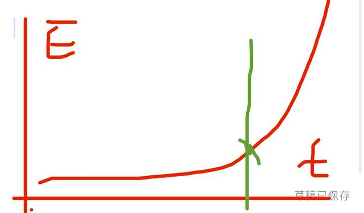
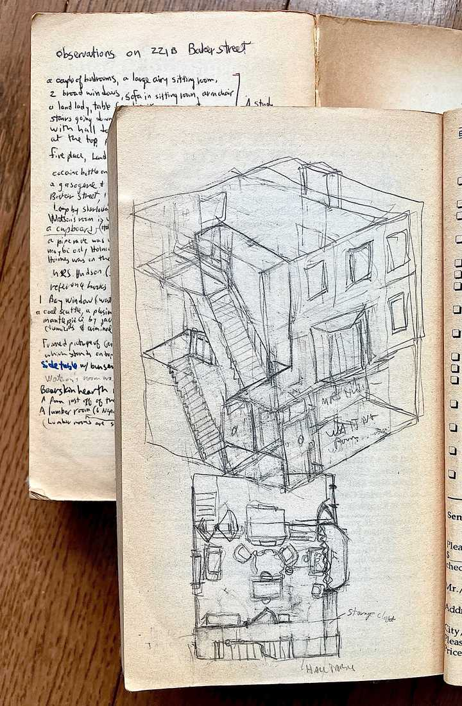
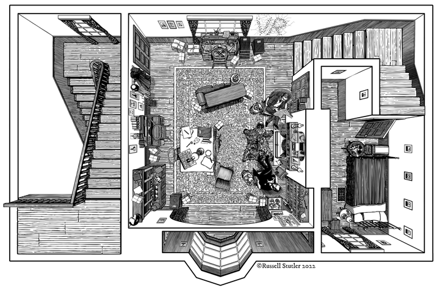
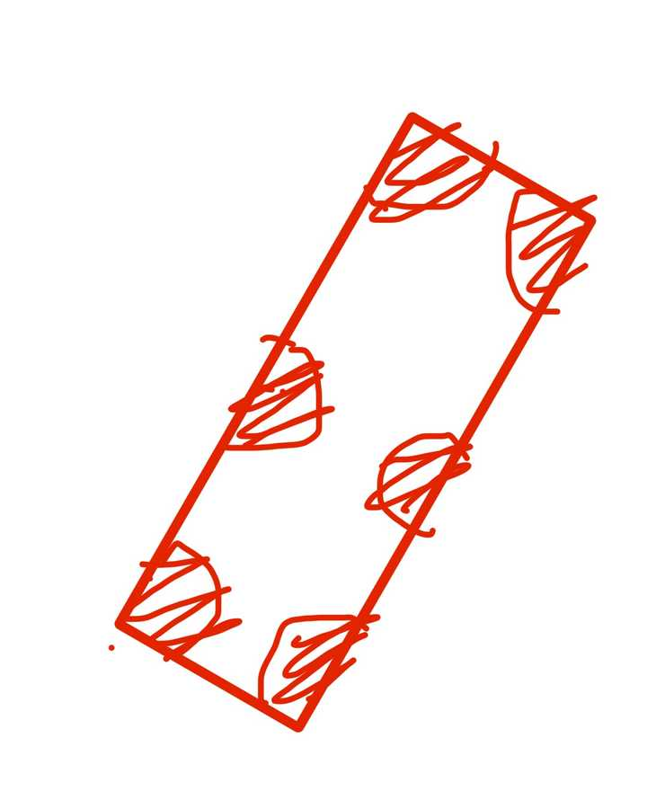

# A08　财富劳动与市场　第 2 册（共 2 册）

- 专题代码：A08　专题名称：财富劳动与市场
- 专题界定：财富获取、消费、借贷、劳动回报、市场交换与经济伦理。
- 本册：第 2 / 2 册　收录 157 篇　正文字符 174,258
- 语料：`sooon-q9adg-articles-v2.jsonl`（4,305 篇）　SHA-256：`cdc9c271309e1d71d9708889a3a31f4777e0c339ea54c3753521894afdb8357d`
- 生成时间：2026-09-27T00:01:00.997126+08:00　排序：发表日期 → 源序号（全库唯一，不重复）

**标记约定**：`【待审】` 主题仍为暂定；`【排除候选】` 图片/正文过薄的剔除候选；
`【正文标注未完待续】` 作者原文自带未完标记；`【正文缺失片段（复核已记）】` 复核记录已确认的正文缺口；
`【图片缺 N 张】` 源图不可获取。标记只作提示，不改写原文、不改动分类状态。

---

## 1774　荣宝斋

- 日期：2024-02-16　主专题：A08 财富劳动与市场　副专题：A20
- 源 ID：`00c63111-072f-5596-a74a-bca2d067e145`　原文链接：https://www.zhihu.com/question/508579228/answer/3397423024
- 官方对象—实践路径：与合作者 / 与被服务者 / 履约
- 23 概念标签：能力与学习;责任与后果;成本与总账;信用与信任;爱与回应;净输出与不掠夺;财富与市场;文明与历史
- 证据状态：manual_confirmed　初读：read　独立复核：not_reviewed

**问**：在老凤祥看手镯，店员拿了一个售价8000空心的手镯，我将其捏扁，店员要求赔偿1604元合理吗？

以前——晚清、民国时代——珠宝店古董店都是不开门的。
虚掩着，不推开不知道里面有没有人。
名字取的是xx轩、xx斋这类，不像古董珠宝店，倒像诗社、茶寮。
货也不摆柜台，甚至不摆店里。
得熟人，得熟人介绍，得预约。
提前有目录——本月新得的珍品，请xx先生鉴赏。
不说卖，说“鉴定”，“欣赏”。
主要是来喝茶，来看东西，来聊天。
有单独一个顾客约来的，来就看单子上说好这几件。约了才有能拍板做主的掌柜作陪，东西才会在。请人帮忙“看东西真假”，请人“帮忙定个价”，仿佛求教，实则是摸底。
客人不傻，不知道这东西谁看过、谁给过价，轻易不说真假——否则康王爷刚看过说真，你说假，说完康王爷派管家来“求教”。
不到宗室、实权大臣，不说真假，只说价。
说了价，这话头就可以接，你说的价再打点折，你要不要？不管要不要，这件东西就已经有了价、有了一条鉴定意见，再卖也就有了基准。
给价太脱离基线，那说明你不该是这个圈子里的。下回就没新品名录给你看了——就有，东西也跟别人不一样了。你问，那就是东西送到宋大人府上，合了眼缘被留下赏玩了。你还要逼我去找宋侍郎还回来不成？
有约几个顾客一起来的，借着看东西的借口，聊的反倒是人事升迁、朝廷动向、行业机会——其实这反而是生意的真正大头。
不管生意聊得如何，这宝物往往不是张三爷买下送给李四爷，就是张爷李爷买下备着给金六爷的高堂贺寿 —— 梅瓶一对，正成佳话。
凡物称宝，是只供识家的。除非你是干这行的学徒出身，否则非大富大贵、簪缨世族，能得到宝物的途径只有两条——一是获赐，而是盗抢。
买是买不到的——因为即使主家破败出售，也是回流到古董店，而古董店没有平民客户。
而盗抢也不易——这些宝物往往都有款识、契约，你一出手就会被抓——小老百姓谁会买翡翠玉佩、东坡书帖？
没有字号契约，也没人认识，你也说不出来路，那是哪来的？那就是盗墓所得。
杀头的罪。
注意，宝物和贵物不同。宝物是独一无二的，出自名家，带着情节，是历史的一部分，实际上是无价之物。 宝物往往是室内陈设，和住宅合为一体。
贵物只是用上了好材料，略有手工，本质上只是贵金属的一种保存形式，往往都是些略带装饰、款式统一的条、块、环。备着到了灾年烧化了、剪碎了傍身当钱用的。所以贵物往往是随身的人隐蔽配饰，与人合为一体。
宝物证明贵族身份，家族地位；贵物则往往讲究“财不露白”，就算证明，也只能证明生活宽裕，衣食无忧——所以常常用做文聘之礼。
类似这类“无意间弄坏贵重货品”的问题，在前面这个场景下是不会发生的。
因为仅仅要获得上手的资格，都需要长辈先带着出入若干次这样的场合，“学生意”。
所谓“学生意”，学的其实不光是物业营生，还包括了如何穿衣、如何喝茶、如何进退揖让、如何评鉴定价……等等等等的一套行为方式。
学会、学懂这一大套东西，你才真正的由富而贵，成了“自己人”之一。你才会被视为可能持有财富和权力，成为值得考虑长期交往的对象。
一旦成为长期交往对象，你就有了巨大的信贷额度，有人找你麻烦，自有亲友故交打个招呼就能帮你解决，遇到了困难，自有八方友人相助——“接手你的宝物”，其实就是一种信用融资方式。
于是信息你有了、资本你有了、政府关系你也有了，这样生意没有不好做的。
而在这整个生态之中，持宝、藏宝，是绕不过去的一环。这些东西，仅仅有钱是不够的。
坦率讲，目前绝大多数的珠宝首饰都是没资格称珠宝的——珠虽然有，但宝实在谈不上。只有卡地亚拿来办展览、佳士德拿来搞拍卖的那些才算是真正的宝物。周大福、老凤祥打开门来卖的，其实只能算“金珠贵物”，按分量手工收费罢了。
但饶是如此，“如何上手鉴看珠宝”这种教育还是夹在中间，尴尬了。
因为这本来应该是家里长辈来教的规矩，但是现在能进金珠店的却绝非只有那些有家传的贵族。而按规矩，店家是不能贸然假定顾客不懂，去提前指教一番你要怎么怎么处理的，那样对客户过于冒犯。
结果就是总出这种悲剧——顾客不能懂，店家不能教，眼睁睁看着出事。
这其实过错在店家。
为什么呢？
因为贵物和宝物一开始设计理念就不同。
贵物是准备随身携带拿来换钱保命的，所以制作不讲究，而且结构设计耐折腾、易修复。长期随身的东西能有不禁折腾的吗？
而宝物往往是礼仪相关的礼器、室内的关键陈设，有最好的保存条件和使用态度，所以宝物可以巧夺天工，可以细如毫发，可以光滑如镜、浑圆如露。
现在你拿做宝物的思路做贵物，把宝物按卖贵物的卖法卖，因此造成的损失其实应该店家来掂量承担。
按老一辈做生意的法则，遇到这种事一般是稍微犹豫，然后爽朗的一笑，“这怪我们没有事先讲好，服务不周到”。
客户不是无耻之人，自然会为你主动免除了ta的惊惧、焦虑而给你补偿。
一般你生意没耽误做——顾客会另买一件，还会宣扬你的爽快——而且然后收获一名最友善、最忠诚的客户。
至于那些必须要雅室服务的宝物，单独请到私密空间，自然一些注意事项可以明确的提出，而且自然有完善的监控录像可用。
你在大堂柜台让一般服务员做服务的那些卖品，本来就不应该有高工费、难修复的。
这就是你们的师傅没好好教你们了。

---

## 1760　房屋管理员

- 日期：2024-02-21　主专题：A08 财富劳动与市场　副专题：A13;A18
- 源 ID：`7b0ae3a0-4857-5552-bc5a-a6c78eda8a3e`　原文链接：https://www.zhihu.com/question/620361959/answer/3404283672
- 官方对象—实践路径：与自己 / 与财富 / 维护
- 23 概念标签：事实与证据;技术与工程
- 证据状态：manual_confirmed　初读：needs_reread　独立复核：not_reviewed

**问**：建筑不住人会腐朽得快，有没有什么科学依据？

因为自然界很多的破坏机制——锈蚀、霉变、开裂这些——都遵循着非线性法则。
也就是1-4-16-64-256-1024……这样的非匀速增长。
很多曲线非常的陡峭。

t表示时间，E表示破坏程度。那么插手干预的转折点就在绿线处——一旦越过这条线，破坏程度的增长就会快过时间推移，朽坏速度就进入了快速发展期，而且恶化速度还会随时间迅速加剧。
而人类的意义就在于往往在拐点之前就会插手干预。刚锈了个巴掌大，人类就把锈斑磨掉然后补了油漆；刚霉了个墙角，人类就切断了水源；刚裂了个口子，人类就赶紧加固了。
拐点还远远没到，人类就把进度清零了。
就这个原理。

<!-- 图片：1 张，审读结论见下 -->

---

## 1750　县里人

- 日期：2024-02-24　主专题：A08 财富劳动与市场　副专题：A20;A07
- 源 ID：`6491fc69-88fb-53f0-a54c-a8540f532e1c`　原文链接：https://www.zhihu.com/question/300177893/answer/3407659306
- 官方对象—实践路径：与社会 / 与社区 / 共处
- 23 概念标签：能力与学习;成本与总账;劳动与组织;财富与市场;技术与工程
- 证据状态：manual_confirmed　初读：read　独立复核：not_reviewed

**问**：十八线小县城的经济靠什么支撑？

靠旅游业、矿产资源、资源初加工、食品工业、劳动力输出、大产业链配套、各种生活服务产业。
这其中有一个特别容易被忽略的就是劳动力输出。
很多县每年几十万人在外打工，这些人的钱是会源源不绝的汇回本地来建房、买房、消费的。看着似乎“百业萧条”“人气单薄”，但实际上却像一些福建的特殊的“华侨之乡”一样，街上好像没几个人，但别墅却不少。
人家混到年纪大了是会回来的，家里修了几层楼，有车有田，还很容易凭手艺开个把小厂。
真心没必要替人家操心。
是县城养活了大城市，而不是大城市养活了县城，不要搞反了。
县城老百姓有净资产的人数比例怕比大城市市民们还高——人家几乎不用背房贷车贷，停车不要钱，不上国际学校、蒙特梭利幼儿园，不学马术和冰球。
人家真的实现了在深圳打工，在彭泽消费。比你们在上海打工在上海消费的不知道资金效率高到哪去了。
另外，在县城经营，很容易形成垄断。尤其是乡镇。你家炒饼做得好，他家发型剪得好，会发现整个小城都知道，很难再有第二家跟你争。
你家照相不错，很容易就成办理身份证的指定照相点，几乎就是独家。
是你没人家那么好命，你还在这担心人家可怜……

---

## 1751　n年一遇

- 日期：2024-02-24　主专题：A08 财富劳动与市场　副专题：A01
- 源 ID：`9d92960e-d71d-5f93-a80b-40c01e02af5d`　原文链接：https://www.zhihu.com/question/644825076/answer/3407154737
- 官方对象—实践路径：与自己 / 与能力 / 获取
- 23 概念标签：定义与达意;能力与学习;成本与总账;信用与信任;边界与许可;心理与主体;性别与身体
- 证据状态：manual_confirmed　初读：read　独立复核：not_reviewed

**问**：研究生读完出来已经26左右了是不是在浪费时间?

45岁学会怎么稳稳的做好一个事，就是你45岁以前的主要使命。
所谓“稳稳的做好一件事”是指“概率低于五十年一遇的事件都不能影响你做这事的成功率”。
为什么标准是“五十年一遇”？这基本上覆盖了两个经济周期。你要对这两个经济周期内所有的非罕见事件都有预案，都有后手。
百年一遇的洪水、千年一遇的瘟疫搞到失败，这不算你的问题，强到这个地步观众要嘘编剧了。
但是五十年一遇不算太高的要求——这五十年毕竟是在你面前活生生的走过去的。
这个尺度要降到十年一遇、五年一遇，很多创业计划都会得到“值得一试”的结论——这恰恰也是你在更年轻、资历更浅时尝试的条件。
你可以试，但不要太当真，不要借高利贷硬撑。
能“稳稳的做成一件事”，你大概可以在45-60岁之间净赚个一千万左右。哪怕在45岁之前背个百把万的债，只要不是高利贷，都可以很好的还清。
这不是指什么“称霸天下”的大事，很可能只是在小县城开两家当地有口碑的牛肉粉铺或者开了家有几千固定客户的淘宝店这类，所以不是什么遥不可及的目标。
关键在稳，在阅尽千般诱惑、历尽万般迷茫。
在这之前，一切能形成经验教训的事——甚至仅仅是你四十五岁后还会记得的事——对你都是赚到。
都是那个稳固起点的一部分。
这期间就两条要注意——一个是信用不要垮，不要对不起朋友；一个是身体不要垮，这特指会影响思考强度和时间的重度残疾，断手断脚瞎个眼毁个容都可以不算。
你就盯着住那个指标——“x年一遇”。
要达到这个指标，你要研究这几十年内所有记录良好的典型失败。自己要亲身经历、亲眼旁观一些。
青年最容易犯的错误，就是眼睛只盯在自己看得到的各种成功上，在这几十年里醉心于研究各种成功，这是错的。
大错特错。
你应该研究的是失败——尤其是那些见它起高楼、又见它楼塌了的失败。
你基本不可能复制别人的成功，因为要复制成功，你需要资本对按功率的投注，而只要资本不傻或者别有用心（比如快速摆个样子好转手卖给接盘侠），投注在你身上去复制别人的成功的前提就是你不但有复制成功的可能，而且对所有的失败免疫。
所以这是一个吞吃自己尾巴的怪蛇，还是要绕回到你有多少失败抗性上。
你对过去二十年乃至四十年的成功如数家珍，远不及你对这四五十年里的失败了如指掌值钱。
过去如此成功的人，如果一切照旧，几乎无法在现在同样成功；但过去如此失败的人，如果一切照旧，却几乎一定会同样失败。
所有的成功都是过去的幻影，唯有失败才是未来的柱石。
所以不要为你年轻时不够成功哀叹，这完全是南辕北辙的荒唐。
你该为不够失败惶恐。
失败了，信用没坏、身体没垮、无人伤亡，就是巨大的成功。
在这哀叹“是不是浪费了时间”？
你需要换一换信源了。

---

## 1742　房东太太

- 日期：2024-02-28　主专题：A08 财富劳动与市场　副专题：A06;A07
- 源 ID：`cafee8a3-1c3d-531e-9cae-7893737897b9`　原文链接：https://www.zhihu.com/question/266192012/answer/3411723063
- 官方对象—实践路径：与合作者 / 与被服务者 / 缔约
- 23 概念标签：责任与后果;成本与总账;边界与许可;照料与家庭;劳动与组织;性别与身体
- 证据状态：manual_confirmed　初读：needs_reread　独立复核：not_reviewed

**问**：《福尔摩斯》原著里头的房东太太为什么会像个仆人一样伺候她的租客？

这就是福尔摩斯住的房子：

这种房子楼上楼下只有一个厨房，那年头又没有外卖，外面餐厅就餐又不便宜，如果房东不提供餐饮方案，房客要么就要能自己使用厨房，要么就要自己承担高昂的餐食成本。
如果给租户用厨房，先不谈英国男人有没有厨艺这种特异功能——没准哪天他把房子烧了，主人本身还往往住在楼下，搞不好到厨房还要先穿过主人的卧室，在主人是女性的前提下，这根本不可行。
租房子人家就图个便宜，出租房子的房东也可以多赚一份收入——反正英国人吃东西“口味纯正”、工艺简单，来来回回就那么几样——何乐而不为？
吃都还是小事，真正麻烦的是盥洗、解手问题。1875年的伦敦，一般市民都是一条街共用一个公共厕所，或者自己用夜壶、倒马桶。洗手洗脸则用锡制或者铜制水盆。水得自己现烧。
这是一大票后勤工作，房主总是要解决的，不是自己解决就是请帮佣解决。
顺手收租户一笔钱，一道手顺带解决，这是效率最高的安排。
坦率讲一个寡居主妇在那年头是没有什么工作好做的——那时候不时兴妇女出去上班劳动，working girl就专指妓女，这样一笔一笔的把家务劳动拿来收费已经是她们最舒坦、最体面的创收方式。
所以这谈不上什么“如同仆人般伺候”，只是一笔常规的生意经罢了。

<!-- 图片：2 张，审读结论见下 -->

---

## 1719　藏品

- 日期：2024-03-08　主专题：A08 财富劳动与市场　副专题：A20
- 源 ID：`ca8556a3-0f53-5144-b4ff-ebda585749ae`　原文链接：https://www.zhihu.com/question/338197094/answer/3422624523
- 官方对象—实践路径：与自己 / 与财富 / 维护
- 23 概念标签：责任与后果;成本与总账;信用与信任;财富与市场;法律与秩序;权力与异议;文明与历史
- 证据状态：manual_confirmed　初读：read　独立复核：not_reviewed

**问**：什么东西在现在值得收藏？

我留给你们的东西，Obviously.
扶正祛邪，安神助眠，而且收藏年份越久，效果越醇厚，这都是坊间有口皆碑的。
实打实的讲——比收藏茅台性价比高。
说点实用的：
有一种看法，似乎认为“所有的收藏都是庞氏骗局”，这个是与朴素事实不符的。
开宗明义——《向日葵》、《蒙娜丽莎》、《自然哲学原理》手稿、《兰亭集序》，柏林墙砖、白虎团残旗这类承载历史的“历史孤品”本质上是人类文明的“原始股权证”，是人类文明价值信用体系的发行锚定物，是一切信用货币最底层的“黄金储备”。
所以，它们的公允价格会跟人类总GDP经“市盈率”调整之后的总市值保持同步。
你有兴趣可以选一篮子有良好拍卖纪录的传世作品，拿来和世界总体GDP的曲线做一下对比，验证一下这个看法。
因为有市盈率这个放大镜，所以当人类总GDP高歌猛进时，这些传世珍品的价格的涨幅会跑赢大盘。而人类文明陷入混战时，跌幅也会跌幅跑赢大盘。
问题是，人类文明GDP总值很显然自从工业革命以来即使排除美国乱印钱的因素，也一直是基本上涨，只是在一战二战期间曾经有一些曲折，
只要人类文明总体保持和平，这些“原始股权证”、“信用之锚”的价值就会一直“跑赢大盘”。
所以有幸抓住了，不到不卖救不了命、或者单凭自己保存不了的地步，千万别放手。
这都是子孙后代的立命之基。
如果有哪个家族世代守护着熙德之剑，只要这把剑还没出售，这家人就总有足够的信用找银行借出钱来，也一定可以以重度依赖信用和知名度的生意活命。
比如做预制菜咯。
不要以为这是玩笑，这只是富有神性幽默的客观事实。
收藏传世的人类文明碎片，其实就是持有文明原始股。
购买并持有你自己认为未来将产生历史价值物件，就是在“打新股”，赌中签。
这就要看你对未来人类文明发展的眼光，看你能不能猜到天意。
这也是为什么各国捏着一些国宝，连出国展出都不允许，每年宁肯付出亿万金钱去维护保管。
这不是“为了搞爱国主义教育”而已，而是要凭此权证，保证自己的董事会席位。
没有这些，只有钱，只能当散户，等开股东大会才叫得到你。
问题是人类级别的全体股东大会，除非是商量打核战或者改变月球轨道，那可能年年开？
基本上董事会就内定了。
这也是为什么强国一崛起就拼命挖地找带绳纹的陶罐子和直立猿的头盖骨，挖不出来哪怕改历史书耍赖作假也要弄几件真不真假不假的“古卷”。
你们要嫌“创业太难”，嫌996来钱太慢，那么苦读世界史，培养能认得出“谁可能会创造历史”的眼光，提前下手趁低买入，只要持有不需要你每年交大笔维护保养费，单凭这个眼光，你都可以带着自己的后代先吃几代饱饭。
马未都其实就是成功的例子。
但眼光不要太局限——例如关键域名、稀有电话号码就很值钱，在这个意义上一样属于“收藏品”，只是你不要漏算每年的服务费成本。
这不是个玩笑。

---

## 1708　北方狼族

- 日期：2024-03-11　主专题：A08 财富劳动与市场　副专题：A12
- 源 ID：`711147e3-5382-596d-ae5c-30ea52c7cbcf`　原文链接：https://www.zhihu.com/question/647133991/answer/3425842592
- 官方对象—实践路径：与社会 / 与舆论 / 接收
- 23 概念标签：能力与学习;责任与后果;成本与总账;财富与市场;文明与历史;心理与主体;宗教与自然法
- 证据状态：manual_confirmed　初读：read　独立复核：not_reviewed

**问**：起诉莫言是否影响了中国营商环境？

在印度，成立一个企业要半年多算快的，穆斯林可能直接被打死，旅游可能被轮奸，赚到钱可能直接被罚没，工人随时可能罢工甚至暴动，任何部门都可能向你索贿和勒令你停工。
然而国际投资者照样跑去冒险赌命。
不要把比着刚出生的小乳猪的承受力去替这些狼人考虑“营商环境”问题，搞得自己神神叨叨的。
只要有人证明赚到了钱，命都可以赌，朝鲜都是远东乐土。
不是猛龙不过江，别说“起诉莫言”，就是跟沙特一样每年菜市口砍头示众，去大使馆肢解记者，都影响不了这些人的胃口。
这帮人又不是青春期的花仙子，天天纠结男神没说早上好是不是要分手。
ta们是一群狼。
请对狼族放尊重点，唔该。

---

## 1691　上流社会

- 日期：2024-03-17　主专题：A08 财富劳动与市场　副专题：A15;A07;A03
- 源 ID：`74b74cce-2b85-5b17-b517-646aa85c2f4b`　原文链接：https://www.zhihu.com/question/21454378/answer/3433779334
- 官方对象—实践路径：与自己 / 与名誉 / 建立
- 23 概念标签：定义与达意;能力与学习;责任与后果;成本与总账;信用与信任;财富与市场;权力与异议
- 证据状态：manual_confirmed　初读：read　独立复核：not_reviewed

**问**：电影《小时代》对上流社会的表现靠谱吗？

上流社会是什么标准？
你们就按这个标准来，一定没问题——
只要你有证据证明你和对方有业务关系，你就能拿到投资和贷款。
能做到这一点的“对方”，就是上流社会，做不到，就不是上流社会。
纨绔子弟，按这个定义就不算上流社会。
贪官污吏，按这个定义也不是上流社会。
名妓这类，按这个定义也不是上流社会。
家财万贯但是付款信用不佳的，也不是上流社会。
但是德高望重、雅量高致的，即使没有什么钱和权，也是上流社会——例如圣徒、高僧这类。
上流社会就是成为别人的信用核心的人。
这里面品格、能力、眼光这些能“让人确信这人肯定屹立不倒、能轻松的承担一切社会义务”的要素才是核心要点，因此才会有这种“有光可沾”的效应。
因为任何原因让人觉得“跟你沾边更可能会倒霉”，那么不管这人是什么王公贵族、美貌天仙、高贵血统，都谈不上上流社会。
只要这个信用是众所周知的、毋庸置疑的，你在确信这一点的人群里就是上流社会。
这些人并不见得知道什么红酒年份或者衣服牌子。

---

## 1688　面子

- 日期：2024-03-19　主专题：A08 财富劳动与市场　副专题：A06
- 源 ID：`8be80072-b42a-569b-9b77-f4ca432b3fea`　原文链接：https://www.zhihu.com/question/648184251/answer/3435446030
- 官方对象—实践路径：与自己 / 与名誉 / 维护
- 23 概念标签：定义与达意;能力与学习;成本与总账;信用与信任;劳动与组织;财富与市场
- 证据状态：manual_confirmed　初读：read　独立复核：not_reviewed

**问**：男朋友为了三块钱在学校餐厅和食堂大妈理论，为什么我觉得很丢脸？

“丢脸”到底是指什么？
给丢脸做一个准确的定义——“丢脸”就是个人社会资本的迅速流失。
个人的社会资本——也就是声望、信誉、易合作性、低报复性、建设性……等等等等容易转化为优质社会关系的“本钱”——是一个人非常重要的非货币、非实物资产。
那是很大很大的一笔“钱”。尤其是对其他个人资本项下余额不高的年轻人、穷人来说，更是最重要的个人资产，是安身立命、翻盘逆袭的最后保障。
因此，越是在高社会性的社群里，“面子”就越是占到个人资产的更大比重。
而资本主义社会——准确的说，市场化的社会——说白了是把很多社会资本货币化了，证券化了，使之成为了不记名，可交易的金融资产。所以导致了个人的主要资产往往是不记名的、已经“液化”（liquified）的社会资本，以所有人都变成了几乎没有社会资本的陌生人、无脸人为代价，换取了所有人都可以更容易的和陌生人交易——你无需那么了解和在意对方的为人处事、社会评价，你只需要了解对方的资产余额、交易押金。数字够大，就可以当信誉用，可以当抵押用。
但这会带来一个直接的影响——人一旦有钱就会自然的发现“匿名无耻”状态比较经济。因为社会已经转型到了只需要查看预付押金余额而不关心其他属性的机制上，因此再费心去维护社会资本也缺少使用场景，就像在精心准备一门不计入高考成绩的科目一样，渐渐的会不受重视。
这样，一切不是显性可见的体面（decency）就会被视为不必要的投资。社会成员会与之前相比出现明显的去社会化、反社会化趋势——也就是兽性、兽欲会因为社会化资本的次要化而再次明显起来。而为兽性兽欲辩护的文化投资也很容易从这个新兴市场里得到回报——它们会把这种变化歌颂为“自由”、“解放”，将其去道德化、去罪化，甚至道德化、正义化。
这其实就是为什么这个问题会有如此激烈的两极观点的原因。
觉得“丢面子”的一方可以非常明确的感受到这种完全不顾及社会成本的维权方式在迅速的磨损自己的和作为伙伴的对方的社会资本，这让本就在其他资本项下近乎余额为0的自己感到了巨大的焦虑。
然后这种焦虑却会被很多“适应了市场文化”的其他人作激烈的批评。因为ta们认为其实这些负面评价只会由根本不重要的陌生人作出，而真正能作出实质惩罚的权力机关甚至不会对这种不礼貌、有攻击性的行为作出理会和追究。
就算是堵着窗口纠缠食堂大妈又如何呢？食堂能报警吗？警察来了能怎么办？还是学校能因此给个处分？而就算同学和路人为之侧目又如何？ta们能对这行为做出什么惩罚？就算是义愤填膺或者心生鄙夷，只要三天过去，这些观众就会因为缺少身份信息而失去愤怒的具体指向。
因此，从经济理性的角度来看，顾及体面和社会观感这类“陈腐”的资产项目而回避在可能具体获益项目上投资，就反而成了“不够明智和不够勇敢”。
在这个视角下，这个男生唯一的问题只是“经营策略不合理，具体操作成本过高”，而不是“道德有问题，缺少对全局个人利益的综合考量”。
这个看法对不对，取决于你是否认识到这几个问题：
1）高社会化的社会，更有面对挑战的动员和组织能力，能为成员提供显然更为安全、平稳的生存条件。就以新冠挑战为例，很明显从美英为代表的高度自由化的资本主义社会，到日本、台湾这类残余着儒家传统的半资本主义社会，到中国、古巴这类高度社会化的社会主义社会，其应对疫情的能力呈现出鲜明的阶梯差异。
其实不止疫情而已，实际上是面对一切宏观的挑战，后者都有更强的应对能力。
一旦人类进入某种困难时期，原本在一片繁荣中不会被很好观察到的能力差异就会越来越鲜明。
选择将社会资本货币化、证券化是有宏观代价的，认为历史不再会给出足够大的挑战而轻易的付出这个代价、出售社会的社会性换取“经济活跃”，恐怕在长期会被证明是一种对历史的傲慢，对自己主导国际秩序、历史发展的能力的过度自信。
2）无论如何，在社会的顶层——决策层、领导层——是不可能忽略人的社会资本的。因为在这一层面，几乎没人是仅仅在凭个人资产余额从事一切活动。论净余额，大部分人反而都是负数，即使不是负数，其经营的项目的总风险也远远大于其个人货币化资产所能担保的水平。
一个村长能不能拿个人的资产担保ta做出的政策决策？
一个CEO能不能对股东们保证——如果亏了我就用工资和家产包赔？
如果你的社会资本为零，或者余额过低，你将失去进入这个阶层、得到最大杠杆的机会。
这些杠杆可以让你的个人意志在几乎没有货币风险、货币成本的前提下放大几百倍、上千倍，是真正的“社会阶梯”。
但这些机会是只会开放给社会资本丰厚的人的。
如果你对社会资本的流失不敏感、对保护和经营自己的社会资本没有意识、没有经验，你就注定只能使用纯货币化的杠杆，也就是拿自己的家产抵押，真金白银找银行借钱。
同样是实践一个策略构想，村长和CEO们哪怕错了，也往往有“深刻检讨、吸取教训就好”的机会，而你则是稍微赌错就会被强制平仓，瞬间倾家荡产。
客观的讲，仗着这个时代提供了这些金融工具、便利交易条件就认为“只依赖货币资本就够了，投资和经营自己的社会资本是多余而过时的经营策略”——也就是“只要钱，不要脸”——是一个非常片面的、甚至是愚蠢的看法。
因为这一开始就把自己参与真正能赢的游戏的资格取消了，而且是仅仅为了思想上的安逸、ego上的快感这种其实根本不值钱的廉价快感就抛弃了。
约等于为了买游戏机卖掉了苹果的原始股。
这会影响到择偶、交友上的竞争优势，是显而易见的。
如果有得选择，没人会优先选择明显上限较低的人为伍。即使迫不得已只能接受这样的选择，人也会痛恨自己的迫不得已。

没人会认为“主张自己的权益”是错误的行为，这甚至都不限于合法的权益，哪怕你主张的是不合法的、超出常规的权益——也就是所谓的贪婪——人也不会仅仅因为你去主张就立刻对你有负面评价。
人敏感的是你主张、追求这些权益的时候所采用的手法，是否体现出你对社会规则的精通、对社会利益的强烈直觉、是否有巧妙的、令人敬服的协调的智慧。
如果你采用的是简单粗暴、成本高昂、效果不可靠而副作用巨大的策略，哪怕你仅仅伤害的是自己的社会资本，都会被人视为“没活醒的糊涂虫”而纷纷撤销一切和你有关的投资计划。
何况是在你身上投资最大的恋人、配偶呢？
如果你不但不警醒、还要抱怨甚至用辱骂来惩罚对方的撤资冲动，你至少不应该对合作关系能继续持续抱有不切实际的幻想。
抱有这样的幻想，人家只会撤得更快。

---

## 1662　低头看路

- 日期：2024-03-31　主专题：A08 财富劳动与市场　副专题：A13;A15;A20
- 源 ID：`7bdba839-fafe-52e4-b466-24d9f04e9dd1`　原文链接：https://www.zhihu.com/question/650176213/answer/3450050154
- 官方对象—实践路径：与社会 / 与组织 / 参与
- 23 概念标签：能力与学习;选择与自由;责任与后果;成本与总账;劳动与组织;财富与市场;技术与工程;文明与历史;心理与主体
- 证据状态：manual_confirmed　初读：read　独立复核：not_reviewed

**问**：如何看待胖东来管理层已实现190天休假，中层配奔驰，高管配300万豪车？

这类找准了定位、达成了对环境良好适应的企业做到这个程度没什么奇怪的。
在中国的地县级城市有很多这类企业，一年休几个月、员工高管收入也不算低的中小企业并不少。
只不过这些企业往往也是一群老兄弟，没有在积极招人了。
人家就这帮老兄弟服务好这帮老客户，反复循环按部就班。然后技术一发展，人就突然干起来轻松了，就闲了。
也没想做大、没想上市，状态平衡了。
其实这类企业在欧洲美国也大量存在。
胖东来搞得这么声势浩大，主要是因为它这个业态比较高调，所以引人注目罢了。
其实这可以说是小型企业——尤其是微型企业的一个典型的出路——花上十几年建立信誉，和几个强大的甲方建立稳固的信任关系和高效的合作关系，然后稳定维持，享受生活与工作的平衡，稳健发展就可以了。
这类供应商其实在各大头部制造商的名单里一交叉比对就可以发现不少。
不是什么企业都要追求“做大做强”“全国制霸”，也可以专精一门技艺、垄断一个小科目，去给几家大企业配套，把员工团队做稳定，企业文化做好，就可以选择把“积极而愉快的人生”作为企业的主要价值来追求。
追求“做大做强”其实本来就应该是少数做“系统集成”、直接向全球消费者提供终端产品的头部企业才去追求的目标，而不应该是所有企业理所当然的默认选择。
这种企业要不断的投入巨额营销成本来维持大众市场的品牌认知度，一开始就注定了不太可能按部就班、优哉游哉。这对领导者的精神强度、文化积累、拼搏精神甚至运气都有近乎不人道的要求，从健康的角度来说，其实不宜作为一种处心积虑要去达成的人生追求。
更好的路线是这样的——你计划仅限于做好一些分内事、服务好一些好主顾，把这看作必须追求的目标，在此基础上，你不要满足于低态平衡，要追求不断的有所进步，要学会看到大图景、眺望历史大势、保持全局观。——不要以为要维持一个小局面就不需要历史观、大局观——然后一旦有“泼天的富贵”硬掉到你头上了，你推不掉，那就勇敢的接一接。
不要一开始就“雄心勃勃”盘算要直奔“泼天的富贵”，这么干更多的可能性是一头栽倒在抑郁症里跳阳台。
做好自己的眼前事，既低头看路、也抬头看天，久而久之，轮到你了你有所准备就可以了。

---

## 1658　消费反腐

- 日期：2024-04-02　主专题：A08 财富劳动与市场　副专题：A10
- 源 ID：`f25829ec-b7fe-55be-bef2-5c53dd2aaee3`　原文链接：https://www.zhihu.com/question/606930994/answer/3452449142
- 官方对象—实践路径：与合作者 / 与服务者 / 协商
- 23 概念标签：事实与证据;定义与达意;能力与学习;责任与后果;成本与总账;信用与信任;劳动与组织;财富与市场;法律与秩序;性别与身体
- 证据状态：manual_confirmed　初读：read　独立复核：not_reviewed

**问**：国家发改委称将抓紧出台关于恢复和扩大消费的政策文件，哪些信息值得关注？

我国的消费水平要进一步提高，其实最大的门槛不在于发钱收税补贴和基建。
倒不是说这些不重要，而是这些方面我们已经做了很多年，尤其是物质性基建类的投入已经做到世界第一了。
补贴消费在没有全球发钞权的前提下效率很低。
我们有一个至关重要的努力还有巨大的提升空间。
那就是对于消费者权益的司法保护。
我们目前的消费者权益保护实践是非常pro“就业”的，也就是生怕处罚重了、严了，会导致企业倒闭、员工失业、损失税源，造成“不良的社会影响”，于是宁可让数量庞大的消费者多分担消费行为中的潜在风险，以避免显性的、容易出现在报表上的损失。
倒闭了多少企业、少了多少新开办企业、减少了多少税源、新增了多少失业，这是很容易被统计到的数据。
但是消费者为此损失了多少消费信心，因此有多少本可以发生的消费行为和税收却严重的缺乏有足够有效性的测量手段，以至于它无形间从治理水平的衡量中被忽略了。
不错，是存在所谓的“消费者信心指数”，但我们的消费者信心指数衡量的主要是预期收入、预期就业、耐用品购买时机这些与消费保障近乎无关的内容。
其实现在消费者们真的是因为“没钱”而不愿“消费”吗？
实际上这是个巨大的假象。
真正的问题是我们的消费者对于大额的、有重大意义的高端消费有严重的畏惧情绪。
譬如养老相关的消费，这是要命的事，一个自称严重老龄化的社会却支撑不起相称的养老院业态。但老人家们宁可省吃俭用自己在家煮方便面，也不愿意相信哪怕很高端的养老院。为什么？
隔三差五就有预付费的健身房、教育机构……甚至汽车销售代理、房地产商跑路或者赖账，为什么？
大量的假冒伪劣商品、消费骗局，比比皆是，“数小量大”的实质骗局严重泛滥，消费者即使维权，也往往得不偿失。
缺少对集体诉讼的有力支持、对惩罚性判罚的实践过于谦抑，实际上远比“消费者没钱可花”更伤害消费者信心。
为什么？
因为消费者们花钱——尤其是花大钱——在本质上根本不是消费，而是投资。
越是没钱，消费者反而越是乐于甚至急于花钱购买更健康的身体、更精美的妆容、更体面的车辆、更高的文凭和认证、更可靠的人脉。
这些反而都是重大支出，恰恰正是因为对重大支出的极大不安全感，消费者才被迫在艰难局势下选择收缩消费，而不是加大自我投资来应对危机。
其实消费者是有钱的，是有很多钱的——开玩笑，东亚文明几千年的储蓄习惯经过四十年经济腾飞的沉淀，怎么可能没有结余？
在经济困难的时候，老百姓不是不想花钱，而是有强烈的渴望把钱花在能改善自身境况、尤其是相对竞争力的科目上。
那都是投资性的科目、重大科目、极端依赖契约可靠性、依赖司法保障的科目。
没有保障，这个上策不可选，老百姓才只好选择“省吃俭用”的下策。
说得直白点，我们缺少“知名企业被集体诉讼一击毙命”的“消费者保护神话”，而我们“投诉无门”、“数少量大”、“老赖享福”的“消费鬼故事”太多。
这事实上也严重的阻碍了我们自身经济发展的质量提高。
不错，判罚偏向企业可能“创造更多企业”，但这样所“创造”的企业有极大的比例是生命周期会随着恶名昭彰自然终结的泡沫“企业”。
坦率讲，在市场的总消费规模、管制能力有限的前提下，能支撑的企业总规模是有上限的。宽松偏袒的管制尺度会导致两个恶果——第一，它实际上会严重的限制消费总规模，导致企业总规模受限；第二，在这个已经受限的企业总规模中，倏起倏灭的、游击性的、投机性的、没有任何长久经营诚意和品牌野心的恶性企业还要挤占巨大的份额。
这些企业不仅仅在毒化我们的消费文化、破坏我们的总消费规模、严重限制我们的消费潜力的释放，还在挤占本该属于优秀企业、有品牌潜力的企业的市场空间，尤其是还在极大的挤占和浪费我国极为优秀的劳动力资源——多少青年才俊在这些恶毒的企业里虚掷青春、心灵枯萎，甚至道德扭曲？
这个问题已经到了可以解决、应该解决的良机。
修订消费者信心指数的计算逻辑，增加消费纠纷的因素，并拿出“扫黑除恶”的决心，择其首恶砍下几个脑袋来向消费者证明维护消费安全的明确意志，消费者自然会给你相称的回报。
事实上，这类惩治极少会影响到我们的制造端——在1688开店的toB的厂家极少会是这类严惩的目标。这种腐败主要出现在直接toC的销售端、市场端。
我们的发展水平已经到了这一步了——我们没有理由在一个如此优秀的制造业基础上忍受一个如此糟糕的消费端表现。
“收入会不会提高”是信心问题，“会不会被骗”也是信心问题。
解决前者的成本以万亿计，解决后者的成本——至少直接成本却以百亿计。
而其效果后者却未必比前者差。
实际上最近的文旅行业已经清晰的证实了这一点——无论是淄博烧烤还是哈尔滨冰雪节，有关部门都无比清晰的意识到只要有任何一起消费者不满没有得到雷霆般的处理，消费者是不会给你任何一丁点多余的宽容的。
偏袒企业，则消费者摧毁市场，企业同样陪葬。
偏袒消费者，哪怕看似“企业很委屈”，只要消费者给你强烈的市场热情，不怕死的企业自然前赴后继。
这背后有泼天的富贵，现在不够明确吗？
希望不久有更多好消息传来。

---

## 1637　鲜

- 日期：2024-04-17　主专题：A08 财富劳动与市场　副专题：A13;A09
- 源 ID：`cf4a0dea-8fa1-5d7f-a323-ccdb7a43f1d4`　原文链接：https://www.zhihu.com/question/584958651/answer/3468477843
- 官方对象—实践路径：与自己 / 与财富 / 获取
- 23 概念标签：选择与自由;成本与总账;信用与信任;财富与市场
- 证据状态：manual_confirmed　初读：read　独立复核：not_reviewed

**问**：在网上买菜有哪些注意事项？

如果商家是实时配送——也就是你下单后半小时左右送货上门，那么判断一个生鲜品种是否可买，看两个关键特点：
1）每天早上有货。
2）到下午六点前就卖光了。
连续多天同时满足这两个条件，这个生鲜产品就可以买。
这背后的原理比较简单——商家如果到六点没卖完，是没有什么理由故意捂住留到第二天卖的。
所以晚餐前就卖断货了，不太可能是“捂盘”的结果，而更可能是真的卖光了。
连续多天卖光，而且都是差不多在晚餐前卖光，意味着平台已经对该货品在该配送中心的供应量建立了相当可靠的、有效的预测模型。
这也就意味着平台对这个品类的进货会有很精准的、稳定的购买计划。
一旦有了这样有把握的购买计划，就能非常好的对接货源——可以非常准确的提前和对应供应商签订采购合同。由于提前量打得够足，有机会以更低的价格购买期权，获得最佳的经济利益。
我确切的知道一个月后的某一天要三百斤肉，那么我就提前一个月下单和挑选货源，提前一个月下定，挑选余地最大、供应最优先，因为农产品不怕别的，就是怕过期没卖掉变质，所以卖家完全可以接受早点落定而价格低一点，并且高度青睐提前就大批订货还给定金的大客户。这样平台就有拿到好货的优势，而不像一些预测能力不足的商家，生怕定的太早卖不掉，所以宁可提前一两天，定的量少一点，这样风险小一点。
而相对的，为了保证自己的预测一定是可靠的、有效的，要防止自己一个月后踏空受损，平台有很大的驱动力要保证这一个月内不会发生什么意外事件导致预测失效。
比如有客户买到了品质明显不合格的货品，在街坊之间传开了，那么我立刻就会因为预测失效产生巨大的风险。
我没必要冒这个风险，给自己制造麻烦，非要拿烂肉死虾来杀鸡取卵。
我赚的是作为大客户的特别优待价差和优先下单权。靠耍小聪明赚点菜油钱，搞出了丑闻，这对我来说完全是愚蠢行为。
我不但不会这么干，我还会宁可额外让质量溢出，形成良好口碑和轻微的供不应求局面，以确保我的销售计划哪怕遇到点小意外都能确保实现。
大宗采购，吃大客户福利，再保证绝不踏空，这就是这类实时配送平台的生命关键。
而这其中，能可靠实现“日日清”的生鲜类——例如活鱼活虾活贝、鲜肉鲜奶、新鲜豆制品、新鲜蔬果……是这个平台真正的核心竞争力所在，每一项都是它的摇钱树。
这些品类的销售数据是这些平台的估值基础，融资的核心筹码，人家要赚的是股东的下一个一亿美元，谁稀罕你这六块多钱的小差价？
你放心，这些印钞机商家比你爱惜得多，每天擦得晶晶亮。
你对你买的活虾不满意，你只要反馈，商家肯定眼都不眨给你换或者退钱。这类实时配送做的都是几公里内的街坊生意，一共就这么几个小区，客户往往都在一个业主群，家长群里。真出现销售事故，恶评传播极快，那可不是赔几十块钱的事。
真发现你反复在某个品类上投诉退货，疑似在钻空子，很简单——以后这个品种对你干脆不显示好了，省得你折腾。
而这全部的情节，最后都凝聚成了这么个最简单的外部特征——“天天上新、天天断货”。
只要是这一类，你只管下单就行了。
有任何不满意，大胆索赔，吃不了亏。

---

## 1633　汇率狂砭

- 日期：2024-04-19　主专题：A08 财富劳动与市场　副专题：A10
- 源 ID：`f5818ca5-35ad-5b8e-9c65-02d209a7331e`　原文链接：https://www.zhihu.com/question/647445115/answer/3470973313
- 官方对象—实践路径：与社会 / 与历史 / 解释
- 23 概念标签：能力与学习;责任与后果;成本与总账;财富与市场;法律与秩序;权力与异议
- 证据状态：manual_confirmed　初读：read　独立复核：not_reviewed

**问**：埃及镑暴跌 40%，一美元兑50埃及镑，埃及央行宣布放开汇率管制，同时加息 600 个基点，有何影响？

其实这件事我们身上也发生过。
1994年人民币汇率改革，将官方汇率和“外汇调剂市场汇率”合并。
1993年12.31日人民币兑美元5.80:1，1994年1月4日，8.70:1。 四天时间（准确的说排除元旦假期的话，也就是“一夜之间”），人民币贬值33%。
没贬值之前，各外贸企业赚到了美元可以“以商定一致价格交易”，说白了就是所谓的“黑市”，其交易价格远超过央行的官方汇率。
那时候不知多少人在银行门口打转，直接向打算来存美金或者来兑美金准备出国的个人搭讪，要跟你私下交易，汇率甚至比“外汇调剂市场”更高。
大量的美金在黑市上按照黑市价格流通，根本就不进入银行。地下钱庄规模巨大，配合大量走私交易，形成了一个90后，00后们难以想象的灰色经济规模。
赖昌星的远华集团1994年成立，5年时间走私货值530亿人民币，偷税漏税300亿。走私是要向境外卖家支付美金和港元的，这钱哪来的？难不成向银行去买？
可见这之前黑市规模有多大。
那时人民币信用完全建立在外汇储量基础上，然而大量的实际交易赚到的美元却并没有回流到银行，而是被截留、隐瞒，在黑市上流通。而既然已经走了黑市路线，还谈何纳税，监管？既然纳税监管都已经横下心不管了，当然省下了大量税金，可以拿来重点贿赂重点人员，去打通自己的走私渠道，造成了现在很多人难以想象的贪腐。
那时的普通人一个月才几百块人民币工资。厦门远华偷税300亿，事后判决同案犯正好300人。
人均偷税1亿，按500一个月算，合一万六千年的月薪，算一辈子平均70年，这是228辈子不吃不喝的收入总和。
在这个基础上衍生的黑社会暴力犯罪之猖獗，实非00后们所能想象。
如果不是94年实行了汇率并轨，将官方汇率大幅贬值，大幅拉低了黑市与官方汇率的距离，中国出口贸易的总额怕有一大半都会完全在账面之外。那能养活多少黑帮打手？能收买多少海关边防？能挖走多少国有企业的熟练工和工程师？
作为一个普遍的经济学规律，在经济开放的大前提不动摇的前提下，出现大额的官方汇率与黑市汇率的背离，是足以导致经济完全脱离监管的巨大压力。
这一点被世界各国的历史不断的反复的、鲜明的验证。
汇率差达到30%，就只剩下国有企业还会正规交易，达到50%，国有企业都会被掏空，厂里的员工上班睡觉下班去私企干私活，厂里的机器甚至整个车间都会被私下外包给私企打工，工业局看到的是是“企业长期停产，大量资产流失”，实际上这些机器和工人就在一街之隔的对面日夜开工。
发展到最后，只有连人都不需要多少，直接挖出来就卖的优势资源——例如石油、铜矿、黄金这些还能卖出外汇来，供国有银行作为货币发行的信用保障。
而为就这种卖法，都不能让自己的国有企业去挖，那样挖出来的大部分都会被工人和管理层串通私下倒卖掉。
你只能直接向海外跨国企业出卖采矿权。
到了那一步，一个国家所有的边防、警察、市场监管……等等执法和行政单位倒有一大半收入来自定向贿赂。
这样的国家，怎么可能不向门阀统治退化？
因此，要么一个国家不搞对外贸易，咬定青山不放松的搞自给自足，自种自吃，一切出口都仅仅通过极少数指定的专营机构来做。
要么只要搞对外开放，积极参与国际贸易，就不能长期大幅干预汇率，必须和黑市价格保持足够小的价差，避免价差导致经济黑市化、国家虚无化。
这个简单的逻辑，就是为什么明、清和日本幕府宁可闭关锁国、阿根廷为什么会出现米莱，土耳其、埃及为什么如此积极的贬值，而越南为什么在2010年代隔三差五汇率跳水的主要原因。
汇率不是官方想多高就可以定多高的，你顶多拉高10%，否则再要拉高就必须配合无孔不入、无微不至的交易监管——把国境线用电网哨所围一整圈、海岸五十公里内建成无人区那种监管，不然一定出现富可敌国、兵强马壮，驱使法官如使奴仆的黑社会教父。
反过来，强有力的发展中国家政府反而会有意的向下影响汇率，来维持国内经济的高合规驱动。
汇率与黑市齐平甚至更加低估，就能从根上根绝黑市贸易，确保经济活动尽最大可能处在监管之内，一方面保证最大限度的税收和资源调节能力，一方面根除黑社会、地下经济和官员腐败的经济逻辑。
这可以说是保证国家主权独立和行政效能所必须付出的代价。
所以埃及这次并没有吃亏，ta们这反而是要振作。
米莱也不是纯疯子——只是阿根廷打算依靠的大哥自己也饿的翻白眼，不太靠谱罢了。

---

## 1609　独立原理

- 日期：2024-05-03　主专题：A08 财富劳动与市场　副专题：A07;A15;A03
- 源 ID：`127aa60d-0990-55a8-ad99-7cdd14b765af`　原文链接：https://afdian.com/p/d9cf61fa08ba11efb7015254001e7c00
- 官方对象—实践路径：与合作者 / 与服务者 / 协商
- 23 概念标签：能力与学习;选择与自由;责任与后果;成本与总账;财富与市场;权力与异议
- 证据状态：manual_confirmed　初读：read　独立复核：not_reviewed

**问**：追求独立和追求输出哪个应该更优先？

独立是受益于你的输出的人给你的回赠。
打个简单的比方——
你是个卖牛肉面的，你非常依赖于某个卖牛肉的给你便宜的牛肉，你的生意才开得了门，否则你本钱都不够开门做生意的。
这就是典型的“不独立“了。
接下来你好好的做你的牛肉面，做得远近闻名，食客蜂拥而来，你的小店里都坐不下，于是你提高售价来依靠有限的店面尽可能获得最大利润。
这个时候你会发现——你其实不需要依赖于之前牛肉供应商的好意了，你可以给得起足够的价钱了。
如果这家牛肉商威胁要断绝跟你的合作，你也没什么好怕的，因为你现在可以支付更高的价钱，而这个价钱愿意做的供应商就多了。
你的这份自由是哪里来的？不是你去跟老供应商“抗争”来的，也不是你“省吃俭用”出来的，而是靠你不断的提高你的输出产品的品质和口碑得来的。
是你的客户享受你服务的同时回赠给你的。
但这不是全部的故事。
因为还存在一种人，在这个时候仍然痛苦的认为老供应商根本不能更换——因为换了别家要冒风险，而且利润还可能下降。
也就是说，基于“利润最大化”的绝对追求，这个肯额外低价供应的老供应商要是对ta拳打脚踢，ta是仍然会抱着“谁叫我依赖ta”的心情继续“忍辱负重”的。
这时候你就会发现——人能不能独立，还需要人自己首先认同独立的价值，相信“为了独立性、值得牺牲一些利润率、承受一些风险”。
往往是这一条对利润最大化的绝对追求——而不是“缺少足够自我维持的利润”——在阻碍人的独立。
换句话来说——在需要付出代价来获得独立时，很多有条件做选择的人不会这么选。
但这毕竟是另一个问题了。

---

## 1594　游骑

- 日期：2024-05-09　主专题：A08 财富劳动与市场　副专题：A15;A16
- 源 ID：`d6beba75-b6f0-5554-b065-71e553925df2`　原文链接：https://www.zhihu.com/question/654576997/answer/2033104618561984014
- 官方对象—实践路径：与自己 / 与财富 / 使用
- 23 概念标签：定义与达意;选择与自由;成本与总账;信用与信任;财富与市场;民族与身份
- 证据状态：manual_confirmed　初读：read　独立复核：not_reviewed

**问**：如何高效率租到自己想要的房？

如何高效率的觅食？
是要靠身强力壮、战无不胜吗？
不，是草都能吃。
“高效率租到想要的房”的要害并不是“足够有钱”或者“大面积搜索”，这倒不是说这两条不重要，而是说这两条你本来就该尽力，现在谈的是你尽完这个力之后还可以如何提高“可签率”。
核心的战略思想可以一言蔽之——
租房者，实际上是一种都市游牧民族。
你的全副家当都应该基于游牧民族的风格来选择。
床垫要选容易卷起的野营用床垫，而不要选大席梦思。
椅子，要选那种折叠的月亮椅，而不要选那种固定餐桌椅。
桌子，选可以拆开平板包装的。
厨具、炊具、餐具，选那种可以高度组合收纳的——很多野营款都有很多巧思。
电视选投影或者头戴式头盔。
无论上述哪一种，都买你能力能承受的最好的款——尤其是闲鱼可以查到活跃交易、保值率很高的广受认可的款。
别看是“野营用品”，其实好牌子是很有品质、很舒服的。而且这些东西天然的比宜家的东西耐操。
这样，你所需要的最低条件只是一个展开装备、安营扎寨的场地。
可以这么说——所有精装修交付的空房子，你都可以租，而且你可以特别要求房东不要提供家具——房东巴不得。
注意入住时最好检查一遍煤气管道、水管角阀、网线规格、热水器、洗衣机、冰箱的完好性。尤其是水管角阀，很多房东喜欢贪便宜用锌合金的劣质货，几年之后容易碎裂。你最好入住时就自己换成潜水艇之类的靠谱的品牌。
记住，在你有充裕能力进入买方市场前，你的所有装备都应该能放在三匹马上带走。
装备要少，但唯其少，所以要精良、可以精良。
你不是地主、不是农民，你是快马长刀的游骑兵。
给你个桥洞都可以扎营，怎么会不好租房子？

---

## 1591　wait and see

- 日期：2024-05-13　主专题：A08 财富劳动与市场　副专题：A15;A20;A13
- 源 ID：`ee729b84-c8c9-5a78-a6ec-0a96b7575dc6`　原文链接：https://www.zhihu.com/question/348553732/answer/3496332356
- 官方对象—实践路径：与自己 / 与财富 / 维护
- 23 概念标签：选择与自由;成本与总账;边界与许可;财富与市场;权力与异议;文明与历史;生态与自然
- 证据状态：manual_confirmed　初读：read　独立复核：not_reviewed

**问**：茅台会在什么情况下崩盘?

茅台只要保持它的原配方、原工艺不变，并且不做代工外包生产，就基本没什么可能会“崩盘”。
因为它占住了中国文化的一个生态位，这东西是与国同休的，中国在，茅台的市场就在，需求就在。
这也有点像犹太人的无酵饼——只要犹太人还存在，逾越节就要过，无酵饼就要吃。而这个无酵饼的配方几千年没改过，无需任何改进。不像CPU，每十八个月都要你速度翻倍，也不是时装，每年每季都要有新款。
它有非常简单的经营策略，很像欧佩克，如果油价很高就多产一点，多赚一点。价格低了我就少生产一点，再把价格拉起来。
这意味着茅台就算是偶尔犯一些经营错误，最多也不过是回归传统，喘息几年就恢复了。
其实这就跟大红袍、郫县豆瓣、老干妈香辣酱、香奈儿五号、蔡林记热干面一样，唯一能要你命的就是“改配方”这种蠢行——只要不改配方，那就可以永生不死。
这其实对人是一个启发，市场竞争其实是有终点的，不是无限的。越过终点线，你就获得了“永生证”。
只是你要注意——永生只表示你不会衰老而死，不代表天上掉个陨石砸脑袋上你能不死——“永生”并非“不死”。
不死比永生高一级。
打造一个永生的品牌，你就可以无限的获得现金流，你也将获得和这个现金流对应的自由。可能每天也就50，但这已经意味着每天你一睁眼就有了50块。
打造永生的品牌，是你无边苦海中可以回头之岸，是待考取的“自由证书”。
Just wait and see。

---

## 1574　值得付费

- 日期：2024-05-21　主专题：A08 财富劳动与市场　副专题：A07;A03;A16
- 源 ID：`d2954173-f34f-50c3-8cc3-26b6ec619d9b`　原文链接：https://www.zhihu.com/question/655952106/answer/3505522604
- 官方对象—实践路径：与自己 / 与财富 / 维护
- 23 概念标签：能力与学习;责任与后果;成本与总账;信用与信任;边界与许可;财富与市场
- 证据状态：manual_confirmed　初读：read　独立复核：not_reviewed

**问**：如何筛选出值得为之知识付费的人？

这很简单，先看对方免费分享的内容，先拿到实际收益。
既检验了有效性，又获得了“再投资”的本钱。
然后拿这个收益去购买付费内容，从付费内容里获得订购更多付费内容的收益。
本质上这就是一种滚动投资，而且初始投资其实是来自对方的。
你只是要仔细思考和核算你的收益——有时候是直接拿对方的输出赚到了钱，有时是拿对方的输出省了本来要花的钱，这两者都是收益。
按照这个原则来做，你只会越来越富有。
这个手段可以对付一切类似机会，只要你严守“用已经获得的部分收益支付新投资”的原则，你永远不会吃亏。杀猪盘都坑不到你。
人之所以上当受骗，总是和“拿未获得的收益去投资”有关。不越过这条红线，数学就可以简单的保证你绝对安全。
这是简单的数学问题。

---

## 1576　行业调研

- 日期：2024-05-21　主专题：A08 财富劳动与市场　副专题：A03;A07
- 源 ID：`e1d23149-482c-547e-9fb2-2f8390dc619f`　原文链接：https://www.zhihu.com/question/655285242/answer/3504833064
- 官方对象—实践路径：与自然 / 与科学 / 理解
- 23 概念标签：能力与学习;选择与自由;信用与信任;技术与工程;生态与自然;性别与身体
- 证据状态：manual_confirmed　初读：read　独立复核：not_reviewed

**问**：如何高效的开展行业调研？

说几个诀窍：
1）购买一些现存的行业调研资料。就算你要自己做调查，也最好先从现有的调查开始。
人家这个调查报告本身就有了大量的结论和数据，也有关切的主要问题。这很显然对你有极大的帮助。
只不过你不能直接当成你的结论，只能说由此你会得到很多调查计划上的启发。
2）要调查行业的优势产品和客户的体验，先于调查厂商。
直接调查企业，企业充满了警惕。但你如果调查客户，客户却未必这么戒备。无论产品有什么问题，客户都是无辜的，客户的体验、诉求和抱怨，往往反映出这个产业的历史、现状和方向。先广泛调查客户，再调查厂家，往往事半功倍。
因为在访问客户时你往往会自然摸到最经典的问题——为什么某个普遍的需求到现在还没有被满足？
这其实往往是一个行业的核心问题，是行业的关键所在。而这个问题你去问厂商反而未必会得到正确答案。
厂商往往有千奇百怪的战略方向，而且这些战略方向既然定了，厂商的观点往往会非常尖锐和执拗，并且常常互相对立。公说公有理，婆说婆有理。如果你不是先知道用户在说什么，直接访问厂商可能给你造成迷茫。
3）要参加行业展会，最好是国内外展会都跑几个。
道理很简单——你很可能看到某几家厂商几乎是逢展必到。参展成本是很高的，往往反而是头部厂商才会特别热衷于此。
一来它们在乎行业地位和客户能见度，它们很清楚主要大客户一样是逢展必到，人家不见得一定就来找你，但连续看到你出现在几个展会上，就会知道你的实力可观、经营乐观。也正因为如此，主力厂商往往有专业的策展部门，擅长做精妙的性能展示和样例。而因为有专业部门，反而每个展会的平均成本会下降。
另一方面，行业展会往往会对头部厂商做很大优惠，正是看中了头部厂商的展示能力和票房号召力。这就像你能想象办汽车站没有比亚迪和大众吗？比亚迪和大众不来，不知道多少客户就不来，既然客户不来，那么二三线的展商自然也不来，那展会就大概率要失败。既然如此，几个头部展商就往往有大优惠，更增加了它们参展的积极性。
而你在几个展上都和他们的展出团队碰面聊天，自然就容易混个脸熟。有时甚至可能和某些老面孔的客户混熟。这对你更进一步的掌握生动的第一手资料大有好处。
某种意义上讲——如果你都调研了整个行业，你多少都应该在这个行业里结交一些熟人，结一点善缘，混个脸熟。这对你“靠谱”极为重要重要。
只看纸面资料、财报新闻这些，往往离真正的现实相去甚远。正确的直觉应该从第一手亲身体验中获得，而不要从所谓的“统计大数据”中去获得。
这也是为什么领导人们有着最强大的统计局可以用，往往还是高度重视直接到田间地头、 车间仓库和一线人员“闲话家常”的原因——往往这些“凡人的故事”才真正反映着朴素的真相。

其它的常规做法不再赘述。

---

## 1560　孙教爷

- 日期：2024-06-01　主专题：A08 财富劳动与市场　副专题：A10;A20
- 源 ID：`8ef132e8-7431-593a-8ad9-b0e8d294b298`　原文链接：https://www.zhihu.com/question/657530780/answer/3517181672
- 官方对象—实践路径：与自己 / 与财富 / 使用
- 23 概念标签：事实与证据;选择与自由;责任与后果;成本与总账;劳动与组织;财富与市场;文明与历史
- 证据状态：manual_confirmed　初读：read　独立复核：not_reviewed

**问**：如何评价新华社发布《如此炫富“毒瘤”，早就该拔了！》一文？

其实中国社会有这么一个朴素的观念——“享不尽的荣华富贵”是一种纯罪恶。
荣华富贵，算你有本事；享不尽的荣华富贵，你要弄啥？
你就一个人，来个大平层已经睡不完了，你搞个五千平，四千五百平你一年都不会去一次，这就很浪费社会的资源。
你吃鱼翅、吃燕窝，没所谓，打开你的宝库里面存着一千多鱼翅，都开始长青霉了，你说你该不该打。
你喜欢开车，多好的车都随你开。你弄个三十辆，其中二十几辆已经放到胎里都没气了，你欠不欠打？
东西不怕你享用，就怕你财雄势大、占据了大量的社会资源但管理不善，弃之荒野。
这不是“炫富”的问题，这是对社会主义社会的基本宗旨的挑衅。
社会主义社会不像资本主义社会，私人财产不是纯个人私事，而是仍然被视为社会总财富的一部分。因此一旦发生了“某人买了二十辆豪车落灰”这种事件，在资本主义社会会被认为这就是天经地义的“正常浪费”，因为“朱门酒肉臭，路有冻死骨”乃是天意；而在社会主义社会，我们就要反思：“为什么如此大的社会资源会最后沉积到这些不配管理的人手里被糟蹋？”
它会被视为一个需要降低的指标、一个需要解决的问题、一种威胁社会存亡的根本危害。
既然如此，任何对这种分配失灵现象的鼓吹也就必然对社会主义构成一种道德问题。
这个“财富集中到少数人手中后大部分会沉降到地窖里发霉”的问题，在美国和中国都是致命的问题。
美国怎么解决？
三个手段：
第一个是征税，尤其是高额遗产税。这样逼得你生前尽量花光。
第二个是高额回报的风险投资，打造各种“十倍升值”神话，诱惑你大笔投注，去押宝“独角兽”，支持风险极高的创新投资。
第三个就是给富人无数的诱惑，声色犬马、骄奢淫逸、吃喝嫖赌，杀人吸毒——如果你违法，那么正好迫使你支付高额律师费，也同样可以激活沉淀财富。
中国什么做法？
总体上是跟美国两条路线——中国基本上剥夺了巨额财富的超量快感。缺少那些大张旗鼓、声色犬马的销金手段，又严格控制这种对奢靡浪费的炫耀行为，使得单纯持有巨额财富，从纯粹个人享受的角度看实际上是一个不合算的选择。
也就是常说的“钱超过一亿就没有意义”。
想要安全的、从容的、受到社会赞同的持有巨额资产，你必须像马斯克、雷军那样持续不断的、肉眼可见的创造社会财富，否则你就最好老老实实、低调隐蔽，当个“隐形富豪”。
如果你既不打算充分运用、积极运转你的财富、又偏要高调炫耀，那么你就会受到社会的重点关注，会被视为一个“已知的社会错误”。
注意，这跟你的财富的取得是否正当没有关系。无论多正当，奢侈浪费都是对人类劳动的不敬、对同胞苦难的蔑视和践踏。
这就是为什么“在中国当超级富豪”“体验”远远不如在美国的原因。也是无数所谓的“资本”外逃的底层机制。
然而，如果你真的仔细思考，会发现从社会总体竞争力而言，尤其是从长期社会发展而言，美国模式势必会导致不可逆转的长期腐化——因为声色犬马、毒品赌博都不是什么健康可持续的生产方式，是会不断升级和发酵的。最终社会只能承受一定程度的中毒，再升高浓度就会影响到国家职能甚至国防安全。
中国的富人不舒坦，中国的“资本”容易“外逃”，但是相应的，这部分资金却是定意要用在那些享乐途径上、是因为这个目的落空才要外逃的。如果我们换一个模式，给ta们这些享乐、挥霍的快感，ta们是会留下来，但这本质上是把这种毒素积淀的过程留在了自己体内。
时间久了，不是社会会越来越富裕，而是社会机能会全面毒化和腐化——就像日、韩、台社会越来越明显的那些趋势一样。
色情、毒品、赌博会一个接一个的合法化，越来越多的人在相关产业讨生活。最终它们尾大不掉，而街头帮派横行、治安崩坏。
我们宁可让“资本”对这些失了指望，把那些对这种享乐有执念的金钱当作负面因素清除，也不要反过来，在这些方面去取悦“资本”，宁可付出社会腐化的代价。
而且，我们的这个选择不是一时兴起，而是显然有长期的连贯性和多方共识的。
所以，如果你家财丰厚，就不要指望靠“批评执政”来改变这个所谓的“仇富”风气，因为你既然抱着“我的钱我想怎么花就怎么花”的心思，你的钱就已经被视为了“不值得争取的坏资金”，你留下来也只会奖励错误的产业、刺激错误的生产、创造恶劣的榜样。
反铺张、反浪费、反炫耀，这不是“仇富”，而是一种文化思想。
这背后的血泪教训，哪是什么只有两三百年历史、连亡国都没经历过的幼稚文明所能理解的。
不要跟着孙子教训爷爷。

---

## 1552　不配得

- 日期：2024-06-05　主专题：A08 财富劳动与市场　副专题：A01;A07;A10
- 源 ID：`77b5039d-9216-54d9-bbfc-53f89d993681`　原文链接：https://www.zhihu.com/question/374996692/answer/3520703730
- 官方对象—实践路径：与自己 / 与财富 / 使用
- 23 概念标签：事实与证据;能力与学习;责任与后果;成本与总账;信用与信任;财富与市场;心理与主体
- 证据状态：manual_confirmed　初读：read　独立复核：not_reviewed

**问**：觉得自己干的活不值得那么高薪水怎么办？

这实际上是一个“觉得收入不可持续”的问题。
答案当然是注意不要让自己的生活水平过度提高，也不要做需要很大投入的大投资。
现有的收入是不稳固的，具有偶然性，你也不必急着终止它，但是只要你没有因此扩张自己的生活胃口，那么“我仍然足够简朴”这个事实本身就足以很大程度的安慰你。
你一天花200，拿到了一份一天收入1000的报酬，觉得自己不值，只要你还是保持着200元/天的生活水平，那么这多赚的五六百对你就是纯天上掉馅饼。
就算你不值这个价，这份好运气的好处你也攒下来了，慌啥？
就怕你一边觉得自己不值，一边学会了一天花600。那时候这个“不值”感就会变成一种“前途莫测”的恐惧。
其实“值不值这个价”确实主要看你对能l保持这个收入有没有稳固的自信。而这个自信主要要靠市场调研，而不是靠慌不慌。
你可以多跟同地位的同行，或者与你的岗位的合作岗位的同事多交流，摸摸处在你这个职位的人一般是个什么水平，看看跟你的差距有多少，如果你发现差距不大，那你也不用纠结了。差距大，那就赶紧去追赶差距。
追平了你也不需要担忧了。

---

## 1543　最佳事业

- 日期：2024-06-10　主专题：A08 财富劳动与市场　副专题：A07;A11;A16
- 源 ID：`d95e078a-f0f3-5aef-8be2-f3dbb6150c1c`　原文链接：https://afdian.com/p/f5a66a52269e11ef93f25254001e7c00
- 官方对象—实践路径：与自己 / 与理想 / 建立
- 23 概念标签：定义与达意;能力与学习;选择与自由;成本与总账;边界与许可;劳动与组织;财富与市场
- 证据状态：manual_confirmed　初读：read　独立复核：not_reviewed

**问**：何谓“适合自己”的事业？应该从哪些方面来判断，如何制定计划去探索？

这个标准其实很“土”——就是可以持续取得最大收入增长的事业。
直白点说，就是“赚钱、赚最多钱、持续赚更多钱”的事业。这很直白，没什么高大上的，而且你也要防止对理想浪漫化的倾向。
记住，崇高的理想必须指向净盈余。
在财务上不可持续、不指向繁荣昌盛的理想，必定不是一个真正崇高的理想。
这没有借口可言。
要是有这么一群人，连ta们为之奉献的对象加在一起算，在一番努力之后，大家总体福利下降了，都变得更穷、寿命更短、存活率更低了，那么无论当事人自己把自己的事业吹得多么伟大正确，这个事业也是个错误的事业。
事业越伟大，净盈余越大。
你怎么证明它伟大？那就是参与这个事业的人要赚钱，你也要赚钱。
注意，赚钱不等于生活水平高，赚钱仅限于你付出的劳动要创造高于劳动成本的价值。你花了100块钱的成本，你的伙伴也花了100块成本，合起来你们创造了400块的价值，你分150，ta分250，这就算赚钱了。
你很可能一天要花400才能温饱，这150都不够你吃一天饱饭，但那是另一个问题。就你投入的这100的成本而言，你确实是赚了。
既然赚了，这个事就可以干得下去。你只是要干得更熟练更好、提高利润率；扩大规模，提高收入规模。
什么样的事业干不熟、干不好？你自己不兴奋的、没有发挥出你的优势的、没有必须干好的理由的，你干不好。这就不如能让你兴奋的、能发挥你优势的、有必须干好的理由的那些。
但说实话——一旦看到干干净净、白花花的银两发出的光，你自然而然就兴奋了，你都赚到银子了，你再没优势也总比赚不到的有优势吧？
那么什么样的事业做不大？为害人间的事业做不大。规模小，没人有精力专门对付你，你还能闷声苟着，规模大你肯定搞到天怒人怨，四面树敌，随时随地突然死亡。如果你真的牵扯到这样的轨道里，那么就及早转变方向。

你是不是觉得赚钱好像很低俗？
不要看不起赚钱。
越赚钱，你才越有能力去奖励你希望发生的变化，阻止你想阻止的现象，弥补你造成的伤害，感谢对你的帮助，威慑对你不轨的企图。
你问什么是适合你的事业？就是能让你和你的伙伴最赚钱、能持续赚钱、能越来越赚钱的那些事业。
少废话——赚钱，赚钱，自己赚钱，也帮人赚钱。

---

## 1492　金毒

- 日期：2024-07-04　主专题：A08 财富劳动与市场　副专题：A05
- 源 ID：`a7a6a790-b237-59c7-8e84-781d8bcb8715`　原文链接：https://www.zhihu.com/question/624647932/answer/3551416454
- 官方对象—实践路径：与自己 / 与财富 / 维护
- 23 概念标签：能力与学习;成本与总账;信用与信任;照料与家庭;财富与市场;技术与工程;文明与历史;心理与主体
- 证据状态：manual_confirmed　初读：read　独立复核：not_reviewed

**问**：穷人家的子女最缺什么?

这不是显然吗？
穷人家的孩子最缺赚钱、有钱的系统经验。
父母没有赚过钱，或者偶尔赚到了钱，但是深知这只是偶然，于是还是只能勒紧裤腰带“惜福”，所以“穷人家的孩子”才会是“穷人家的孩子”，不是吗？
穷分两种，一种是不知道怎么赚到钱，一种是拿到了钱却深受钱害，以至于有钱反而家破人亡，身死族灭。
所有的“穷人家”归根到底都是来自这两条。
因为一旦你突破了这两条，而且是在这两条上都有了成功而且可靠的经验，你就不会是穷人家——哪怕你一时亏光光了，你也很不容易跌入深渊爬不起来。
因为“有钱就赌命”是“金毒”之一。你犯这种错误，意味着你还没过第二关；不犯这种错误，你就不可能在可投资资产亏损掉之后陷入无法处理的巨额债务和信用危机，因为你的亏损自然到此为止。
那意味着你只是没现金了，你的信用和能力还在，你的品牌还在。你要反弹回来，不知多少人愿意投钱给你，你的代价只是时间。
而这种对钱的经验和修养可以非常清晰的指导子女什么是一定要做的，而什么是你可以无视社会的“主流观点”的。这会让子女“偏离主流观点”时没有穷人家子女的那种难以独力支撑的焦虑和怀疑。
穷人家的孩子走在了正确的路上，不但很少会得到父母的坚定认可，反而会被满脑子浆糊的父母灌满恐惧。父母不但不是拉子女出水的游泳圈，反而还是卷着子女四处翻滚的暗流。而就算是父母支持，因为父母也确实用了几十年也没摸到这个门路，父母的支持也基本缺少指导意义，只有情绪价值——ta们很可能会满腔深情的支持一个“别折磨了，我们养你一辈子”式的理念。
所以穷人家的孩子要成功，在客观上常常是一个“背弃父母的信念”的痛苦过程。
而更凶险的是，拿到了第一桶金，穷人家的孩子还要面对“金毒”的第二轮考验。
一个纵欲过度、一个过度自信、一个六亲不谐（即金钱招来的各种扭曲的亲情、恋情、友情关系），这仨都是地狱生鲜行业的巨头。
每天挨个敲敲头，看你熟没熟。
但你也不必觉得穷人家的孩子全是劣势。
第一，穷人家的孩子要摈弃父母的财富观往往比富人家的孩子容易——毕竟父母没有赚到几个亿，没有那么大的资本硬气到底。
第二，很多“富人家”其实只是第二劫还没渡尽的准富人，父母的经验很可能是被过度迷信的伪经验，而这家人也还没有真的熬过钱毒——这要等子女结婚、立业后再谈。一个没结好、立好，就二世而斩了。你还在县里苦哈哈卖木工板，就听说你班上的拆二代同学在澳门失联了，这种事多如牛毛。
这些人的“领先”只是在通向地狱的道路上搭上了早班车，相对你并没有真优势。
第三，穷则思变。穷人家的小孩如果不搞投机取巧，更容易付出真正hardcore的努力，解决需要艰苦努力才能解决的问题。同样微小的正反馈，对穷人家的小孩的情感激励更强，这会导致穷人家小孩更懂得珍惜，在努力过程中快感更强烈。
真穷，给你抓到机会你反而很有概率成为了不起的富一代。而富二代们在这方面能胜得过父辈的凤毛麟角。
乔丹的儿子打篮球的条件好过一切人，然而他们篮球打得一般。
珍惜并且充分利用被赐予你的，认识并且警惕你身上的短处，没什么大不了的。

---

## 1450　跨伦理合作

- 日期：2024-07-21　主专题：A08 财富劳动与市场　副专题：A07;A02
- 源 ID：`619477f4-e5a2-59a6-b9d3-be63246ea2c2`　原文链接：https://afdian.com/p/8a6d494446d411efb30052540025c377
- 23 概念标签：责任与后果;成本与总账;信用与信任;边界与许可;照料与家庭;财富与市场
- 证据状态：manual_confirmed　初读：read　独立复核：not_reviewed

**问**：如何与伦理观不同的人合作？

就是循序渐进的合作，一步一个脚印的逐渐升级合作关系。
你看你去小卖部买打火机，这其实就是和店主的一次合作，你们需要哪些伦理观一致？你们只需要确定“一手交钱、一手交货”“货应对版”“质量保障”这些伦理。
你不需要关心ta是否主张人人平等、不需要关心ta是否主张夫为妻纲，因为你们的这项合作涉及不到这部分的内容。
然后你会发现，其实人与人之间总有某些基本的伦理共识，例如“伸拳不打笑脸人”，例如“言而无信不知其可也”，例如“入乡随俗”。
这些基本的伦理共识已经足够支撑相当多的基本合作了——基本所有的“陌生人合作”都已经覆盖在内了。
你要先在这个基本层面做一个足够好的合作者，先让这个双赢的合作让双方都先尝到足够的甜头、积累下足够的收益。
这个已经足够不断的加深你们的友好关系了，已经可以形成一个足够好的“根据地”。
在这个基础上，你们可以探讨一些更深的伦理观点。谈到哪些合适，那就可以考虑基于这个伦理关系建立更深的合作。例如你们可以多谈谈对各种商业案例得失的看法，由此你可以了解ta对于商业合作的基本理解，ta如何认定哪些东西是哪一方的责任等等。
你觉得没啥问题，你就可以提出做一个风险不大的小合作。如果这个小项目就算亏损也亏不掉你们原有合作已经积累下的盈余的话，你就可以放心大胆的试试看再说。
就算是实际检验后不行，你也还是可以退回原有的合作水平上去，等着持续运行的老合作再次渐渐积累起足以冒下一次险的新保险金。
如果你谈出哪方面伦理不合拍，那么这方面的合作就不乱试就好了，原有的合作一样照常继续。
有一分的共识，就可以有一分的合作，那就严格的设计好业务，确保只要这些共识就足以支撑，就可以先合作了再说。
切忌“挖空心思在任何合作之前先寻求百分之百的共识，然后才开始迈出一小步”，这是非常事倍功半的，而且会有严重的数学性缺陷——因为你这种超高门槛的筛选机制，你会发现你能进行哪怕最基本的合作的对象就很少很少。选择少了，你自己就会不自觉的降低和扭曲你的标准去争取合作成立。
结果就是你拿博士卷考小学生，没人考及格，于是你被迫偷偷的去改分数、降录取分，以保证至少还有一个“合格”的。
这只是在自欺欺人，自欺欺人没有好果子吃的，为智者所不取。
当然还有另一种风格，那就是不积极的谋求深化合作，刻意的保持“职业风范”，除了具体合作必须涉及的交往、沟通，绝不深入探究对方的其他私人伦理主张。
这也有这么做的好处——那就是很不容易影响现存的合作关系、不容易涉入ta人的因果。

---

## 1414　前途上限

- 日期：2024-08-03　主专题：A08 财富劳动与市场　副专题：A04;A10
- 源 ID：`8b8da85a-5879-586e-ac18-6f724611eaa9`　原文链接：https://www.zhihu.com/question/439176319/answer/3582253256
- 官方对象—实践路径：与合作者 / 与被服务者 / 缔约
- 23 概念标签：能力与学习;选择与自由;责任与后果;成本与总账;劳动与组织;财富与市场;权力与异议;技术与工程
- 证据状态：manual_confirmed　初读：read　独立复核：not_reviewed

**问**：现在学厨师还有前途吗？

学一切都有前途，前提是你学了这个之后都一定要辅修市场营销和品牌策划。
不学市场营销和品牌策划，学什么都没有你所谓的“前途”，因为那意味着你没有办法直接面对消费者，驾驭你和消费者群体之间的关系。
也就是说你和市场之间会隔着一个管理员。理论上这位管理员会帮你处理市场风险——譬如在没有多少客人的前提下仍然会给你发工资——但是ta收取的服务费用一般都过高，而且最重要的是，ta自身就会带来风险，譬如生意很好时拒绝给你加工资并更换掉你。
仅仅有很强的专业技术能力是不够的，你必须还要解决如何接触和赢得市场认可的问题。
那些学了xx手艺、xx专业，花了很大的功夫却收入不高 / 长期收入不增长 / 职业被动，于是哭诉“学这个没前途”的人，问题几乎总是出在没有做好甚至拒绝去做这部分工作上。这跟这些手艺、专业本身关系并不那么大。
不做这些工作，学什么专业都前途有限。因为你自身没有面对市场的风险。市场的风险反映的是社会的直接需求，社会对能冒险直接满足自己需求的社会成员回馈起来是没有上限的。
专业的冒险者前途无限。

---

## 1410　稳定收入

- 日期：2024-08-04　主专题：A08 财富劳动与市场　副专题：A06
- 源 ID：`f3104f64-9be9-5421-b721-f1dd30783dfd`　原文链接：https://afdian.com/p/2eeaa9c4520311efa15452540025c377
- 官方对象—实践路径：与自己 / 与财富 / 维护
- 23 概念标签：定义与达意;能力与学习;责任与后果;成本与总账;信用与信任;照料与家庭;劳动与组织;财富与市场;技术与工程;文明与历史;生态与自然;心理与主体
- 证据状态：manual_confirmed　初读：read　独立复核：not_reviewed

**问**：男朋友目前工作和收入都不稳定，我很焦虑怎么办？

究竟什么叫做“稳定的收入”？
打了一份工，看上去每个月都在进账，这是否就算稳定的收入？
条件放宽一点，这个雇主看上去很大，也似乎执行着某种保守的人力资源政策，把人员稳定看得很重，是否意味着收入很稳定？
这家企业要是裁员了呢？不裁员就倒闭，由得它吗？
又或者它直接倒闭了呢？难道大企业就不会倒闭？转眼就楼塌了的大企业少见吗？

或者企业没裁员，但是这位自己去炒币了呢？或者ta没炒币，赌上了呢？
ta的收入确实是按“最近五年一个月一万五”发了，但是ta的财务状况真的叫稳定吗？
可见“收入稳定”这类判定太粗糙了，甚至可以说是一个伪命题。

直白点说吧——“收入稳定”这个要求本身就是一个错误的表达。你要的不是收入稳定，而且你甚至都没有办法判定收入是否真的谈得上稳定，你要的是财务预期乐观。
财务是收入和支出的综合，除了收入还要看支出。
收入预期也不能用“历史收入情况”这样一个简单的工具来判定，而要用人的经营水平、投资意识、财务理念来综合判断。
ta有多少钱不重要，ta爹妈有多少钱甚至更不重要，重要的是这个人是否理解钱在社会中的生产和分配机制，有没有可靠的从这机制中获得收益的系统的方法论。
某种意义上讲，财务系统就像某种水利设施，是用来与天然降水和地表径流系统连接、为你自己的田地防涝保旱的一个战略性的资产。
它不是一种“扛着水桶去打水”式的东西，而是要研究清楚河流、地形、气候节律……最后在恰当的地方修筑设施，截取、分润水流的行为。
努力是努在这个勘察地形、设计施工的过程上，是这个基于科学的、工程性的意识上。
有这个意识的人，不是花时间祈雨、不是成天想法子纠集同宗和人打架，也不是只靠蛮力去挑桶、靠忍饥挨饿。
而是靠做水利实验、靠登高俯瞰做三角测量、靠沿江溯源和跟踪气候资料、设立气象监控站。
这两个路线给人的体感和直觉就是不同的。
做水利工程的这些人，才真的能谈乐观的财务预期。

第二，就是要看价值观和消费观。
赚钱是为了什么，赚到的钱要拿来干什么。这个问题至关重要。
如果赚钱是为了纵欲享乐，那么越赚钱就越纵欲，钱赚太多人会“爽死”的。哪怕是为了所谓“后代”，如果是为了后代的纵欲享乐，结果也根本没有什么本质的不同。
只要是这样想问题，财务预期就根本无法乐观。
甚至连“财务乐观”本身都要对财务的长期安全带来重大威胁。
那些一找到一个好工作或者打到第一桶金、对自己的财务突然有了坚定的乐观，就去豪车豪宅大party搞起的人，财务真的如ta们预期的那样稳定乐观了吗？
ta们要是没那么乐观自信，也不会在几年以后身陷财务危机，不是吗？
真的在意财务风险，最需要考察的是对方的金钱观、财富观、经营和投资理念，而不是对方现在多少收入、爹妈有多少储备。
前者ok，对方可以从无到有越来越有钱，原本的储备根本就不会用，有与没有根本无所谓。
前者不行，金山银海都扛不住几天赌的，而且越有钱毒瘾上得越快越猛，根本没有意义。
问题是，现在一谈钱，一提到钱的困扰，几乎所有的人都在一条条的列现金流数据、账户余额，而不是对方的某某消费观念、经营策略的水平和利弊。
只看这个问法，就知道你还根本没看到关键数据是什么。
这是缘木求鱼，在树上问应该用什么鱼饵。
这没有指导性，停止浪费时间。

---

## 1399　一意孤行的慈善

- 日期：2024-08-10　主专题：A08 财富劳动与市场　副专题：A15;A03
- 源 ID：`6a1c9f04-6343-5879-8ee2-fb53ad960c06`　原文链接：https://www.zhihu.com/question/663738997/answer/3590106183
- 官方对象—实践路径：与社会 / 与社区 / 共建
- 23 概念标签：能力与学习;责任与后果;成本与总账;边界与许可;劳动与组织;法律与秩序;文明与历史;民族与身份
- 证据状态：manual_confirmed　初读：read　独立复核：not_reviewed

**问**：如何看待FurAffinity站长Dragoneer因肺部疾病医治无效于美国过世？

这事分两面。
第一面，你基本可以这么看——本质上美国人不承认买不起医疗保险的公民的生存权。
买不起医疗保险，你基本上就是个未亡人，真正的国家耗材。要是可以，美国统计部门甚至不想把你纳入自然寿命统计。
不提供医疗保险的工作，都是些临时工、小时工，而且这类工作会越来越多，因为移民越来越多，能接受这种条件的、教育水平越来越高的移民会把越来越多的职位变成这种性质。
所谓“移民抢工作”，其实不是简单的抢走了白人的工作，而是把很多带保险的长期职位变成了不带保险的临时职位，从而夺走了传统白人的安全感，打击了“传统生活方式”。
一来这些工作基本上等于直接省掉了保险费用，降低了收入水平，二来这些工作几乎都没有工会、行会保护，因此很不稳定。这种工作是很难稳定支撑传统的美国梦生活方式的。

另一面，如果要经营慈善性事业，也必须建立坚实的现金流。
这个现金流要由希望这个目标群体持续得到这个服务的人群来支付。能支付，你才能投入对应的精力去全职或者半职的去做，否则你还是老老实实的去找份工作，并且要以工作为重。
说得直白一点，一份慈善事业在财务上不可持续，就等于老天爷投了反对票，要么是这个事业老天爷根本不赞成，要么是老天爷认为你本人能力不够、另有安排。
你非要沉迷于万众瞩目的快感一意孤行——废话，免费撒糖当然谁都齐声叫好——那是你自己自寻死路。
老实说，这位其实是沉迷于自己的享乐而死，并不是简单的美国社会制度的失败。
因为ta这个搞法，在中国也罢、日本也罢，恐怕都不会有别的结果。
一意孤行的慈善是会吃人的，不要自以为义。
没有资助涌进来，就意味着你在自以为义——这不仅仅是一个钱的问题，还是一个“自然法许可”问题。

---

## 1395　有钱要花

- 日期：2024-08-12　主专题：A08 财富劳动与市场　副专题：A04;A01
- 源 ID：`65385f42-699f-5d80-85c2-cd2dec821124`　原文链接：https://www.zhihu.com/question/648479845/answer/3592380539
- 官方对象—实践路径：与自己 / 与财富 / 使用
- 23 概念标签：能力与学习;选择与自由;成本与总账;劳动与组织;财富与市场;技术与工程;心理与主体;性别与身体
- 证据状态：manual_confirmed　初读：read　独立复核：not_reviewed

**问**：大三父母留下了300w 我该怎么用这笔钱生活?

至少把其中一半拿来作为学费（包括学习期间的生活费），去学一门扎实的功夫。
比如，从从容容的考一个注册会计师——这么多生活费，你可以无忧无虑的单独考虑学习考证，专心去考，直到考到手为止。其实到这里你估计也花不掉一百万。
又比如，老老实实去学个心理学学位，或者艺术类的专业。
或者一百万老老实实练一个健美的身体，拿点比赛奖项。
或者用一百万作为试错成本，去学拍片、剪片。
总而言之，拿来投资在自己的技艺、知识、阅历、健康上，这些东西都是硬生生的属于你这个人的。
无论怎么时代变迁、风云变幻，只要你的大脑没坏、肢体不残，谁也夺不走，而且会给你之后做任何事、追求任何目标都打下一个坚实的基础。
你要搞人脉，要以这些为核心价值；你要做生意，要以这些为核心竞争力；你要混职场，要以这些为工具。
这是怎么都不会错的投资，只管去做就好了。
有钱，不知道该干啥，就去学习、去游历、去锻炼，就这么简单。

---

## 1371　自我估值

- 日期：2024-08-22　主专题：A08 财富劳动与市场　副专题：A03
- 源 ID：`ecf1a1f3-de57-51e4-b558-9ec21c0f09c6`　原文链接：https://www.zhihu.com/question/500415345/answer/3602125388
- 官方对象—实践路径：与自己 / 与财富 / 维护
- 23 概念标签：事实与证据;能力与学习;成本与总账;财富与市场;心理与主体
- 证据状态：manual_confirmed　初读：read　独立复核：not_reviewed

**问**：为什么我家资产两个多亿，但是感觉自己生活还是很普通？

“资产”有一个很形象的比喻——它是你花了一笔钱购置/打造的，需要不断投入维护费用的印钞机。
1）打造它是有成本的，但打造它的成本并不能直接保证它的价值。
你很可能花了一个亿，但是打造出来的这台印钞机却一钱不值——它印不出钱来，或者说它印出来的钱还不够支付它的维护费用，那不管你多少钱造的，它都只有残值可言。
所谓的“残值”，也就是拆零件卖废品的那个价。
弄得不好，拆卸费、污染治理费还比你这零件钱、废品钱都贵。于是哪怕你是一百亿成本打造的航空母舰，最后却可能只值一块钱。
所以永远不要用打造成本来衡量你的资产价值。
2）它的价值从根本上还是要看它创造净利润的能力和潜力。
一百个亿但是无法盈利的美食连锁，单论创造净利润的能力可能还没有学校门口卖萝卜干的小地摊强——后者虽然微薄，但人家好歹是正数，那个摊位要转让是真的有人问价的——但是这个尚未盈利的连锁体系，可能有比较大的潜力。
这个潜力如果有人认可，那么这个美食连锁没有盈利，还是可以有个有效的估价。

现在问题来了——真正能造成人踏实的幸福感的到底是什么？
不是最初投入的成本规模，而是资产带来的净现金流的规模和受到广泛承认的潜力的估价。
而这就可以解释为什么有很多自称“资产两个亿”的企业的所有者却不敢花钱、不敢提升生活水平。
因为这个“两个亿”的估值可能来自自己拉来的投资总规模，是总共投入了两个亿的成本来运营，但还没有产生真正的正现金流，而且自己主张“我们的盈利能力潜力应该可以估值两个亿”也是一种自己的主观主张，不是买家愿意承认、愿意出手的实际报价。
这个“两个亿估值”实际上只是一种自我安慰的说法，这跟“每个月有几百万净利润在源源不断流入”的感觉是不一样的。
有这个现金流在源源不断流入的人，才会比较放心大胆的提高生活水平，可以比较坦然的享受自己的收入，从而产生实际的财富感。
简单来说——“估值两亿”除非是买方的开价，否则是不能保证带来财富感的。
这要是背贷款搭起来的总投资规模，那么这个“两亿”带来的不但不是什么幸福感，反而是巨大的压力和贫穷感。
给自己的财富情况做正确估值，不要搞“在所有真真假假的算法中选结果最大的一款”的把戏来自欺欺人，这是脚踏实地的基本要求之一。
一旦人开始“怎么算数字大就怎么算”、开始自己对自己吹“估值”，人就离抑郁非常近了。
这是非常危险的。
除非有人向你开价，否则你应该专注的关注自己的现金流，而不是“估值”。

---

## 1365　好木匠

- 日期：2024-08-26　主专题：A08 财富劳动与市场　副专题：A16;A10
- 源 ID：`ecd51337-cf09-595d-b7c3-1f160fd5bd5e`　原文链接：https://www.zhihu.com/question/350585580/answer/3606082271
- 官方对象—实践路径：与社会 / 与舆论 / 传播
- 23 概念标签：事实与证据;定义与达意;选择与自由;责任与后果;成本与总账;财富与市场;法律与秩序
- 证据状态：manual_confirmed　初读：read　独立复核：not_reviewed

**问**：如何看待手机app的开屏广告？

这件事令你烦恼，你就要在合法的范围内行动。
以开屏广告为例，你可以作为消费者，专门前往该广告所指向的商家名下流量最大的公开入口——例如它的带货直播间、产品淘宝页面、用户论坛……等告知——
因为对贵方投放xxx app的开屏广告的不满，我现在正式通知贵方，我将在未来xxx时长内停止购买贵司的一切产品，并在我的职权范围之内驳回一切包含贵司产品的采购方案、在我的影响力范围之内劝阻ta人选购贵公司的相关产品。这一决定是为了确保贵司清晰的了解到这一行为对贵司品牌的深刻伤害，并以终端消费者的身份向您见证——此笔广告投入将会产生负面效果而非正面效果。作为证明，此项声明已发布在以下自媒体页面：https://aaaaaaaaaaaaa
你们抱怨了这么多，为什么令你咬牙切齿的商家却没有收到足够的这种惩罚？
如果每一个开屏广告——实际上不多——都会导致其直播间的黄金时段隔三差五出现这种公告，你觉得广告主还会花钱去买这种教训吗？
没有教训，只有销量，人家当然乐此不疲。
你们看准了随便哪个倒霉蛋，集体呼唤KOL们助力，一起创造一个“就因为在某平台投了开屏广告，该产品恶评如潮，直接夭折”的战例，然后再通过KOL们让这个倒霉蛋的惨烈失败人尽皆知。
漂亮的赢一次，砍下一颗人头挂在城门上，然后再看看还有哪个业主敢在这个app上投开屏广告找死？
然后再瞄准另一个平台，再拎出一个倒霉蛋来让它惨烈的死亡。
然后再看看还有哪位好汉自认为头铁，敢在任何一个app上投开屏广告，勇当下一个？
要消灭一种现象，只需要几次隆重的葬礼。

人类是不见棺材不掉泪的，否则不会有足够的坚持。
但人类见了棺材泪掉得也快，否则哪有基本的智慧？

不要愤怒，要学会造棺材。

另外，做人要遵循一个原则，那就是在你决定立场之前就要先有可行的计划和核准的预算。
先确定攻击的可行性和经济性，再决定愤怒。
不要对制定不出攻击计划的事愤怒——制定不出有效的攻击计划，本身就意味着你不应该愤怒，因为这意味着对方的行为有自然法的背书。
这同时意味着当你确定愤怒时，你的攻击计划已经启动了。
而对方第一次知道你的愤怒，应该是通过额头上顶着的消音器。

---

## 1359　反着卖

- 日期：2024-08-28　主专题：A08 财富劳动与市场　副专题：A15;A13
- 源 ID：`146dea8a-0ed9-5a06-a439-a6f783c1abde`　原文链接：https://www.zhihu.com/question/633184357/answer/3609071485
- 官方对象—实践路径：与合作者 / 与被服务者 / 缔约
- 23 概念标签：定义与达意;能力与学习;责任与后果;成本与总账;信用与信任;边界与许可;劳动与组织;权力与异议
- 证据状态：manual_confirmed　初读：read　独立复核：not_reviewed

**问**：系统太稳定了甲方觉得我们没有工作量，怎么收运维费？

改成一次性购买“无故障运行保险”，购买之后你不但不需要再付钱，而且是一旦发生指定故障，我就按约定比例付钱给你。
举个例子——系统每离线1天，我赔你2万，赔付额100万封顶。
条件是机器由我监管，要交10万保险费给我。
如果今年没故障，这10万我白得。
如果你觉得风险客观上很小，那么也可以简单点——你可以买10万保额的，于是价格就只有1万，那不就便宜了吗？这个丰俭由人。
这样我销售的产品就不是“故障排除”，而是“无故障运行”，你买到的东西就不再是10万买不到一天的维护，而是10万买365天平安。

谈不拢，还有一个保底办法，那就是甲方自己请人运维，不行了再叫我。
到时候大家按实际需求议价，但我给你保底——要么问题太大我接不了，只要我接，价格保证不会超过这期间本来该收的运维费用总额。
当然，其实到时候我肯定比着上限报，你自己请人运维的成本你只能自己当教训。

---

## 1351　快活似神仙

- 日期：2024-08-31　主专题：A08 财富劳动与市场　副专题：A04;A05
- 源 ID：`48ee19df-67bc-5172-a9ad-a9275701f203`　原文链接：https://www.zhihu.com/question/355374576/answer/3611354107
- 官方对象—实践路径：与亲族 / 与父母 / 分离
- 23 概念标签：能力与学习;选择与自由;责任与后果;成本与总账;照料与家庭;劳动与组织;技术与工程;文明与历史;人工智能与机器;心理与主体
- 证据状态：manual_confirmed　初读：read　独立复核：not_reviewed

**问**：父母说我看书看傻了，看得不食人间烟火，看书养活不了自己。是否应该坚持继续看下去?

什么叫“不食人间烟火”？
庙里的泥菩萨、木老君就不食人间烟火。
吃什么？吃供奉。
谁说你“不食人间烟火”，表面上是说你“没有社会经验”，但实际上是在说你的生存和你的劳动无关。
你没有“劳动没搞好，生活会变差”和“劳动搞好了，生活会变好“的意识和经验。
你劳动没搞好（甚至完全没有搞）你不会焦虑，你甚至没有意识到“这是个问题”、“这是不行的”。
旁人发现了你没有这种神经反射，就会发现你身处一个完全不同于自食其力的人的文化之中，一个“神仙文化”之中。
这很多话都没法说了。
凡人的话题大多数——甚至可以说全部——都是和这个“活干不好会活不好”的忧虑有关的。
结果你老人家不管干得好不好甚至不管干不干都不会想活得好不好的事，这在一起能聊啥？
但这个人各有志、人各有命，别人没法（实际上也没有精力）去指责、批评你啥。
所以就只剩下一句“不食人间烟火”的感叹了。
只能等你父母去世再聊。
但一看二老健朗的身体，且得等四十回后再听分解吧。
四十回后，你都已经六十了，已经是位老神仙了，人仙殊途，怕是更没什么可聊的了。
神仙都看什么书？自然是白日飞升之道，金丹采补之法。
凡人看的都是《水产养殖常见病害防治》《工业机器人编程入门》《你也可以飞好无人机》之类。
你要继续看下去，是要看洞玄子、淮南子，还是要看《七天精通photoshop》？
那要看你接下来是要当神仙，还是要做个食烟火的凡人。
先说清楚，香案上每天自动出现的干炒牛河艇仔粥跟你的《金丹大道》是没关系的。

---

## 1346　扬汤止沸

- 日期：2024-09-02　主专题：A08 财富劳动与市场　副专题：A05
- 源 ID：`ddcdc643-2705-5ba7-bfd2-3b5568f6922b`　原文链接：https://www.zhihu.com/question/665922357/answer/3613091178
- 官方对象—实践路径：与亲族 / 与子女 / 抚养
- 23 概念标签：事实与证据;定义与达意;能力与学习;责任与后果;成本与总账;边界与许可;照料与家庭;财富与市场
- 证据状态：manual_confirmed　初读：read　独立复核：not_reviewed

**问**：家长为了防止孩子走入歧途，火烧估值好几万烟卡，如何看待这种做法？家长有更好的处理方式吗？

这个手段打击错了对象。
家长其实是非常强大的群体，要守护子女，要用的手段其实不应该是从子女这一端入手去整治子女的行为，而应该发挥家长联合体的强大影响力，去打击对子女发动恶意营销的商家。
谁对子女制毒贩毒，家长们就一拥而上，该取证取证、该投诉投诉、该曝光曝光、该请愿请愿。在中国，只要家长的痛恨形成规模、形成群体意见，其能量甚至比揭发贪污腐败能量更强。
任何蔚然成风导致学风不正、社会性发展迟缓、青少年成瘾的商业行为，无论正式的还是非正式的、合法的还是不合法的，神挡杀神、佛挡杀佛，要让商家自己形成恐惧和寒蝉效应，卖任何东西都要恐惧“会不会诱发青少年的成瘾行为”，恐惧这种“生意太好”可能导致的突然破产死亡。
去杀一儆百的建立商家对“向儿童营销”的恐惧，这才是家长们从战略上对抗这种“针对未成年营销”的邪恶行为。
要对未成年人销售，只能对其监护人做广告。你只能说服监护人动念购买，因为购买行为本身就由监护人支付。
对自身并不拥有财产、并不拥有完全民事责任能力和分辨能力的未成年人发动营销，本质上天然就是以恶为业。
这没有例外。
家长们要做的是集合力量，将这种行为的风险提高到商家除非打算赌命，否则绝不敢随便拿钱打水漂的程度，你们需要大量的“大热卖导致就地破产”的案例来建一座高耸入云的京观。
这才是正道、从问题的根源解决问题。
而放着这些不做，优先整治子女，这只是欺软怕硬和避重就轻。
而且必然是扬汤止沸。
你想想，ta赚到钱了，没有受到任何实质惩罚，没有任何严重的风险。挨打的是你的娃，又不是ta。
从任何角度看，这对ta都是成功经验、有效商业模式。
萝卜刀打娃一顿，烟卡打娃一顿，游戏A打娃一顿，游戏B打娃一顿……一次两次三次四次破坏亲子关系。
你想用这个模式取得什么样的“胜利”？
这有可胜之理吗？
用打娃的办法解决问题，就像有强盗偷了你的钱，但你不抓强盗、不剿匪，只在家踢狗。狗踢伤、脚踢残、匪吃肥。下次贼换一套衣服、换一个门、换一身气味，照样如入无人之境。
“进攻才是最好的防守”“伤其十指不如断其一指”这些难道没听过吗？
那为什么要拿子女作为突破口？因为商家太难搞？要取证、要做数据、要跑部门、要发声，太复杂、太麻烦？
这就像有房子失火了，邻居发现房主在外面对着绿化带浇水，问他为啥，因为绿化带浇水简单、没危险。
虽然不解决问题，甚至延误时机、恶化灾情，但是“简单，好操作”这个优点胜于一切，是吗？
这里给你们一个标准操作：
遇到这类事情，出问题的肯定不是只有你娃一个，周围打听一下谁家还在犯愁这个，联系起来。
联系起来干几件事：
1）每家拍视频、拍照片，实际展现触目惊心的危害规模。比如这个烟卡，找张大桌子或者大地面，来个平均铺开，放一个书包在中间当参照物，来个一望无际的烟卡将书包淹没的取景。
每家都拍，各种各样五颜六色的烟卡海洋，包围了一个又一个干瘪的、破损的书包。仿佛太平洋中的孤岛。
来个一百个“海洋孤岛图”，编辑一个一分钟的短视频，再配上个七八段打满马赛克的小孩子蹲着要烟卡、从店主人手里接烟卡、在家打滚哭号非要买烟卡的视频快剪。
最后画面黑掉，列一下数据——“仅在一个小学一个班，二十三名学生中进行不完全统计，持有烟卡三千四百张，总重量8.2公斤。其中仅xxx品牌的xx烟占15%。”
照着虎门硝烟的格式拍，背景配上林则徐好了。

然后你放出来。
不管你打多厚的马赛克，入了镜的那几家必倒，你信不信？

不管谁卖什么，只要在你们子女中泛滥成灾，失去控制，一律用这个方法。不会拍，去问拍短视频的导演们怎么拍。
你信不信ta们分分钟给你们租篮球场上无人机飞特技镜头，然后给你们矩阵式推送？钱都未必收你们的。
不要理会那些所谓“你们自己管好自己的孩子”这种鬼扯的话——这就是你死我活的斗争，哪有面对毒贩子不直捣黄龙只“管好孩子不要吸”的美事？你们想得美。
动我们的娃，就是害我们的命，就是要危害我们的国家、灭绝我们的民族和文化。
这是比谋杀、抢劫还要凶恶的罪，我与你不共戴天。我将不会讲任何政治正确，穷尽一切合法手段，用尽我一切的影响力，追杀你们到天涯海角，直到你们身败名裂，死无葬身之地，想起这个噩梦就发抖。谁再敢给你们出这种“小孩子一定忍不住会买”的“妙计”你们就会条件反射的给ta一耳光。
以后不要用打娃解决问题，解决错人了！

---

## 1344　所谓国富民穷

- 日期：2024-09-03　主专题：A08 财富劳动与市场　副专题：A10
- 源 ID：`237002b1-d9ee-59a8-9c0d-196f964ff961`　原文链接：https://www.zhihu.com/question/525777261/answer/3613984761
- 官方对象—实践路径：与自己 / 与财富 / 维护
- 23 概念标签：定义与达意;能力与学习;成本与总账;财富与市场;法律与秩序;权力与异议
- 证据状态：manual_confirmed　初读：read　独立复核：not_reviewed

**问**：如何评价复旦大学兰小欢老师的著作《置身事内》？

还是那句话——认为“老百姓的财富主要是房产”是一个非常狭隘的、非常错误的结论。
解放军、高压输电网络、光纤网络、高速公路、铁路网络、水利工程、全国统一市场、全国统一的法律结构、无恐怖主义、无毒品泛滥、无犯罪泛滥……这些都是老百姓的财富。
否则你问问ta，愿不愿意把ta的房子、存款换成等值的阿根廷 / 印度 / 黎巴嫩房产、存款？保证市价相等，面积还会变大，为什么这样就不愿意换？
为什么同样的交易，改成换到美国、日本、德国就显得诱人了很多？
因为这份个人财富真正的意义并不是简单的拿来变成吃喝而已，它在本质上还可以被认为是你个人对公共财富的分享资格。
同样是50万美元的个人资产总额，凭它去分享菲律宾的公共财富和去分享中国的公共财富是两个概念。
那些被非常惋惜、被严厉批判没有塞到老百姓口袋里“过重的剥夺”，并没有像他所暗示的那样消失不见了，而是以人类前所未见的速度变成了世界公认最强大的基础建设和公共服务体系。
不错，你当然可以批评这中间存在浪费和失误，但这几乎是纯粹的书生之见，
因为众所周知，这四十年地球上税收运用效率和成果最好的就是中国。
你自己说说看还有谁在财政收入的运用效率和成果上比中国强？英国吗？德国吗？日本吗？它们税收比例少吗？它们这些税收的成果何在？国家地位维持得怎么样？它们的治安、基础建设、医疗保障、基础教育、国防建设……又结出了哪些丰厚的成果？
你拿理想中0摩擦、0损耗、0浪费、0失误的理想国比，你当然“痛心疾首”，问题是这个令哀叹合理化的对比基础本身根本就不存在。
拿真实的同类存在一对比，你所哀叹、遗憾的这个反而还是世界第一。
所以你的意思难道是“虽然这是世界第一高效的政府，但是只要把新生价值分配到它手里而不是居民自己的私人账户里，就仍然是遗憾、亏损”？
你是在期待无论名义上还是实质上都实现零税率？0政府开销？0公共支出？
还是在指望行政效率已经世界第一的政府首先向印度模式看齐，然后再“还富于民”，拿走它的预算，把钱都分给老百姓自己“消费”？你是在主张这样是对老百姓最好的安排？
你想过这样做的后果了吗？
这样的结果是这些分配到私人手里“自由支配”的财富，转瞬间就会从不善经营的普通劳动者手里流向擅长金融、管理、市场销售的极少数人手里。转眼之间变成这些人富可敌国成为寡头，而核物理专家、机加工专家、建筑师……都要跪求ta们赏饭吃、跪求ta们从自己的“私人财产”中大发善心捐出钱来修桥铺路、供电供水。
本来村里100万收入，大家平分60万，40万拿来放进所有人平均占股的集体企业里去修桥铺路通水通电治病吃药，产生的福利和收益所有人共享。大家分掉的那60万自由流通，排除各自生活成本（假定50万吧）后剩余的部分（10万）流向少数经营天才。
自己分掉的那60万里，光生活成本就要花50万，所以负担沉重，这就是现在大家的感受，不是吗？

那么现在要改成100万收入大家全分掉，这样一来，是不是排除掉50万生活成本后，大家就多出50万剩余拿来潇洒、享受、自由投资在自己的梦想上？
这样是不是财富感就大为增加了？
大错而特错。
你原来只需要花50万来支付生存成本是以存在这个集体企业提供的种种服务为前提的，现在这个前提不存在了。现在你没有三百五十元一千公里覆盖全国的高铁可以坐了，你只有1200元1000公里，每四百公里就要换乘的客运铁路可以坐了。你没有医保体系了，只有总人数控制的医师总会旗下的私人医院和几大商业保险联手提供的医疗保障可以选了。你也没有解放军了，你只有几大家族的私人武装维持的地方秩序了。你想要只花50万就过上之前的生活，你在做梦。
你口袋里“分到”的钱变多了，但你一转手就要通过电信、交通、医疗、教育、安全……等等你绝不可能脱离的服务交给几大家族。你的生活成本不飙到90万，ta们在同行面前都抬不起头来。
因为对几大家族更合理的措施，是直接抬高收费让你破产，让你必须向ta们银行借贷度日，直到你们无论如何都还不起利息（更不提本金了），“只要给口吃的，随便怎样都行”。
这个安排比起当初“剥夺感严重”的安排真的更好吗？真的会有更大的盈余吗？
如果真的是，苏联解体时就完美的实现过了，那是真的把所有的国有企业都直接切成相等小块给全体公民平均分配了。
结果如何？
所以这个最基本的认知就是根本性错误的。
这几十年来，中国国民的主要财富根本就不是自己的房产，而是现代化的中国本身。
你的确不能把它分了买糖吃，但你每时每刻都在享受它提供的实实在在的、在别的国家花钱都没得买的服务。
先把这条认知扭过来，你再看看。

---

## 1338　欢迎扯平

- 日期：2024-09-05　主专题：A08 财富劳动与市场　副专题：A06
- 源 ID：`4060af7a-873f-570a-a80a-4b9a771ce134`　原文链接：https://www.zhihu.com/question/459438665/answer/3616080288
- 官方对象—实践路径：与友人 / 与朋友 / 相处
- 23 概念标签：选择与自由;责任与后果;成本与总账;信用与信任;净输出与不掠夺;边界与许可;财富与市场;权力与异议;心理与主体
- 证据状态：manual_confirmed　初读：read　独立复核：not_reviewed

**问**：老爸接儿子放学回家的路上捡到了一部智能手机，物归原主后对方赠送一箱酸奶答谢，是否接受呢？

为什么不收？
为了“帮人不求回报”的法则？
“帮人不求回报”这条法则有两个执行方式，一个是干脆匿名，对方根本不知道报谁，一个是提前给人约定一个回报的方式，做成两不相欠的交易。
这两者都算是不求回报。
对应的，你帮完之后随便对方自行选择回报方式，只要你收了（如果过重，你可以只收一部分），也自动达成了第二形式，因为恢复了“两不相欠”状态。
而这个“帮完之后拒绝对方的回报提议”则走的是另一条路线。
它一来展现了一个超慷慨的姿态，另一方面策略性的保留了对方欠情未还的状态。
这是个一面攫取社会资本——即超额的好名声和超格的好的自我评价，另一方面预留最大的获利预期——即一张随时兑现的人情支票的下意识反应。
这个本能策略当然是有一定实效的——它实际上是用这之后关系扭曲的风险，兑换了上述利益。
如果这个关系扭曲的风险不发生，就是净得利。而如果风险发生了，造成的损失也未必比这两种现得利更大，所以看上去值得一赌。只有不但关系扭曲发生，而且造成的损失比既得利益更大的情况下才会净亏损。
说白了，这是拿风险换利润。
如果账只算到这里，那么看上去这两类方案各有长处。
但实际上后者存在大量隐形的管理成本和风险。
一来它往往需要记住谁欠了你情，二来一旦原计划的“我有事时可以找你”的预期落空，往往不但导致你当时的计划落空，还会导致你愤世嫉俗——尤其是如果一而再、再而三的、连续的出现“人情账收不回”的现象，就尤其如此。
也就是极易触发道德虚无主义的思想倾向，让你忍不住觉得世人都是不感恩、没心肝的王八蛋这类。
理论上愿赌就要服输，这是基本的赌品，但是这个路线本质上是“既要赌， 又不肯服输的”。
而那个“坦然接受礼物，回到两清状态”的做法，第一不再需要牢记谁欠了自己什么，第二发生道德虚无主义的隐患小得多——毕竟是你自己亲手在账面上扯平了，对方没有残留待还的积欠，所以当你有需要时，对方拒绝没什么可愤恨的。
而微妙的是——你其实也不见得希望对方因为欠人情而勉强的应承。勉强出手，对方动机不足，遇到比较艰难险阻、收尾复杂的事，很容易打退堂鼓把你撂在半道上，或者船开到江心告诉你“很为难”“已尽力”，要你加钱。
到时候你会万分后悔为了这个假指望拒绝了其它可能的解决方案。
而另一方面，对方不是傻瓜，ta会很清楚你本来是可以征收人情债的，只是你放ta自由了。为了这份心胸，ta其实会有真诚的帮助你的动机。
其实对方能帮的还是一样会帮，只是不会像欠了情那样强撑包揽。ta有什么条件更可能会提前开价。你们谈一个双赢的自愿交易，你可以凭着“无勉强隐患”这一条期待对方会有更大的诚意愿意honor这个协议。
换句话说，后者只是“未必输”，但其实前者更稳妥。
因为所谓“未必输”的赌局，久赌往往还是个输。

---

## 1314　监守者难辞其咎

- 日期：2024-09-14　主专题：A08 财富劳动与市场　副专题：A16;A07
- 源 ID：`8407d2cc-6653-5a11-b185-44630c82011a`　原文链接：https://www.zhihu.com/question/666923066/answer/3624868808
- 官方对象—实践路径：与合作者 / 与被服务者 / 履约
- 23 概念标签：事实与证据;责任与后果;成本与总账;边界与许可;财富与市场;技术与工程;心理与主体
- 证据状态：manual_confirmed　初读：read　独立复核：not_reviewed

**问**：如何看待网约车走小路女乘客称被吓到跳车，司机称「按系统规划路线在走」？该如何提升网约车安全感？

我还是老看法没变。
车上的乘客感到害怕，司机只有无条件以解除乘客的恐惧为第一优先事项。
可以跟乘客商量是否就地下车，可以讨论是否换乘客觉得安全的路线，还可以上报平台，让平台来协调解决，最后甚至可以报警处理。
唯独不能置若罔闻。
无论男女，只要乘客恐慌发作，就要在安全的前提下立刻着手解决这个恐慌，而绝对不能搞什么“你怎么胆子这么小”。
不要因为你自己不害怕，就觉得别人害怕很可笑。
这跟“你妈觉得你不饿”“你爹觉得你是装抑郁”“你女朋友觉得你没努力”有任何区别吗？
你有什么资格替别人决定别人自己的害怕重不重要、合不合理？
别人能不能替你决定你没必要请假？替你决定你没必要休学？替你决定你没必要休息？
别人都没请假，就你多事，你要请假？
别人都没抑郁，就你戏多，你装什么抑郁？
别人都没喊累，你叫什么累？
平时这些话一指向自己，就算对方是自己的亲生父母，真真正正要为决定保底买单的人，也一样一蹦三尺高，骂对方没有心肝、用自己的感受代替你的感受。
现在轮到你去指别人，你还根本不会去保底、买单，你为什么就可以如此理直气壮？
天下哪来这样的道理？
这是服务的基本伦理，没什么好商量的。
这事里面真正可恶的是平台没有对这种情况给出标准的处理指南和对司机的培训。
老实说，乘客无论男女，因为坐车恐惧到跳车，已经发生过一起，平台还是毫无反应，这本身就说明问题出在平台过度垄断、安全感过强、钱赚得过于舒服了。
这就跟游乐园过山车摔死了游客，游乐园没有任何对设施的修补和对人员的培训一样，简直不干人事。
这事真正要集火挨批的其实是平台——自上次货拉拉事件后，你们有没有制定对应的营业规范，有没有传达到司机？
你们在干什么？数钱吗？

---

## 1309　婉拒

- 日期：2024-09-15　主专题：A08 财富劳动与市场　副专题：A03
- 源 ID：`d60f14af-095b-5c1c-8ddb-65b97894e53d`　原文链接：https://www.zhihu.com/question/653722305/answer/3625878315
- 23 概念标签：定义与达意;选择与自由;财富与市场
- 证据状态：manual_confirmed　初读：read　独立复核：not_reviewed
- 标记：`【极短回答】`

**问**：如何婉拒健身房、按摩院、美容院等的推销？

“我是来出差的。”

---

## 1281　不盈利组织

- 日期：2024-09-22　主专题：A08 财富劳动与市场　副专题：A15;A10
- 源 ID：`a494a8bf-a0e7-5876-b12c-42d907453d88`　原文链接：https://afdian.com/p/34272be478bc11efa91052540025c377
- 官方对象—实践路径：与社会 / 与组织 / 参与
- 23 概念标签：事实与证据;定义与达意;能力与学习;成本与总账;边界与许可;劳动与组织;财富与市场
- 证据状态：manual_confirmed　初读：read　独立复核：not_reviewed

**问**：为什么多数非盈利的读书会、环保协会等举办活动的效率和水平普遍偏低、产出内容质量不高，根源在哪？

这是一个迷思，即认为“非盈利组织”就是“不盈利组织”。
这些组织做事总是一副预算不足的样子，生怕有任何品质感会被人说“奢华”“浪费”。对自己的工作人员连工资都不给，导致用人标准唯便宜是举、0报酬起步，恨不得还要对方自己先捐点才能用，无形中严重有利于不知人间疾苦的富家子女和有强烈的“混资历”心态的“拍照流”人士。
这根本不是正常做事的样子。
慈善组织恰恰要用精英专家，反而要把钱给足、给到位，关键是事情要做好。
那些价格高昂的专家真的有志于这个慈善怎么办呢？比如你一天正常收费10000，我只有2000预算，要怎么办？
你实在想干，你先捐我8000指定用来雇佣你，我收到之后还是满额支付给你10000——就这么办。
这跟你“降价到2000”不是一回事，自己去悟。

至于“非盈利”属性，只需要做到确保对特定目标人群有补贴、帮助ta们以较低价格获得服务即可，确保组织不是以经济利益作为会计结算的本位价值，而是以组织追求的特定指标作为本位价值即可。
例如，助学的非盈利组织应该关注单位资助造就的人才数量和输出人才总量，而不应该单纯关注组织的资金盈余。
但在此基础之上，组织盈余仍然是越高越好。
非盈利性根本不表现在“不盈利”或者“避免盈利”上，而是表现在“计算企业成就的指标不是盈利”上。
仅此而已。
在此基础上，用最好的装备、聘用最好的人才、给有竞争力的薪资，这是理所当然的。
非盈利组织反而恰恰应该“财大气粗”，以至于可以用有足够竞争性的薪资把精英人才从企业界争夺过来。
非盈利组织实际上是靠经济力量和竞争力来卡死社会服务的底线，从而有利于整个社会的——非盈利组织提供的午餐的品质和价格就形成一条基线，盈利组织必须高于这根基线才有存在的资格。由于这根基线的存在，也威慑着盈利组织不得不慎重的定价，避免了社会资源过度的向纯商业资本集中。
大众给非盈利组织强加“不准收钱”的限制，实际上是自我戕害，严重妨碍非盈利组织的发展，阻碍了自己的利益。而迎合大众的这种迷思的非盈利组织，实际上是在辜负使命。

---

## 1275　反保健品营销

- 日期：2024-09-23　主专题：A08 财富劳动与市场　副专题：A05
- 源 ID：`fd6ab492-9f41-5704-958e-42075a11c9d4`　原文链接：https://afdian.com/p/e639e3ba79b811ef905a5254001e7c00
- 官方对象—实践路径：与亲族 / 与父母 / 共处
- 23 概念标签：事实与证据;责任与后果;成本与总账;边界与许可;照料与家庭;劳动与组织;技术与工程;心理与主体
- 证据状态：manual_confirmed　初读：read　独立复核：not_reviewed

**问**：长辈沉迷买保健品，买了一堆无用的东西，如何劝说?

第一步，先将老人购买的保健品都拿出来，放在桌上。
第二步，安装天眼查，注册一个天眼查账户，付费购买VIP权限。
第三步，随机选取一件保健品，查看包装上注明的委托方、受委托方、经销商、制造商等等相关方名称。
第四步，在天眼查中查询这些企业。查到后，首先看看企业名下是否有相关风险提示——一般都会有一些“食品卫生处罚”“年度报表未按时提交”甚至“经营场所无法联系，被标注为经营异常”。
第五步，查询该企业主要人员。一般会发现某些人员名下有多家甚至数十家相关企业。
打开企业名单，你会发现这些企业的名称明显类似，例如都有“国药”“国科”“国珍”之类的开头，净是国药xx，国药yy，国药zz（北京）、国药zz（郑州）这一类。
仔细查看，会发现这些企业普遍都只有一到两年的寿命，接着就纷纷“办公场所无法联系，被标注为经营异常”——也就是跑路了。
说白了，这些企业的存在就是为了给这么一批货创造一个“出生证”，完成使命后就立即注销回避责任。
除此之外，你会经常发现同一组人交替组合出现在同一保健品组织下不同的保健品的委托方、被委托方、经销商、制造商、董事会名单里。这也是这些人为什么人均都有几家公司的原因。
把上述信息有条不紊的展现给老人看，可以配合梳理一些交叉关系图。
最后制作一些逐层遍历信息的app操作录屏和关键视图的截图集，发送给老人存档，供ta自由回顾。
一般而言，老人这时候会承认自己上当了；即使不承认，ta心里也明白了。
做到这一点之后，建议你打消老人的愤怒情绪和所谓的“退货”冲动，因为这容易造成新的不可控风险，你看得住还好，别趁你上班了老头跑去砸人家场子搞出个脑溢血啥的。说服安抚好后，直接破坏掉产品包装，将质量不明的产品倒掉，不要舍不得。
只有真金白银打了水漂，而不是“有问题就可以成功退款”，才能构成真金白银的教训，比较有效的遏制再次复发的风险。
接下来，查阅一些大厂、名厂的真正的质量可信的同类产品，让老人自己对比一下价格——同样一瓶植源Omega-3，正牌往往比这些神神秘秘的保健品组织卖的便宜一半不止。老人其实是听信了这个有效成分的神奇效果，你买给ta们更好、更便宜的，让ta们吃去。其实这些很多都是安慰剂，那就让ta们安慰安慰算了。
还想进一步斩草除根的话，如果你是在本地有背景、有资源的有力人士，你可以直接约谈对方，告诉对方，关于这事，到底是什么情况，你们也不用解释，我们大家都清楚。这事既往不咎，之前赚到的钱算你们本事，但是如果让我再看到我家老人买你们的东西，那大家就不好意思了，我只好让你在经营上吃点苦头。
至于你用什么借口不卖，你们自己发挥，我不想知道。
至于你们不照办我用什么办法让你得不偿失，我自由发挥，你不会想知道。
面子我给到了，希望这就是我们最后一次打交道。就这样。
至于老太爷其他的那些上当的老哥们，建议老太爷不要插手，免得问题复杂化。
捞出自己家的长辈，是自己家儿孙的功课，别家不宜代劳。

---

## 1269　赏赏罚罚

- 日期：2024-09-25　主专题：A08 财富劳动与市场　副专题：A07;A10
- 源 ID：`9e7fb643-0405-50e1-83a4-65f5094f074f`　原文链接：https://afdian.com/p/68c5cb7a7ad411ef86905254001e7c00
- 官方对象—实践路径：与合作者 / 与被管理者 / 奖惩
- 23 概念标签：事实与证据;能力与学习;选择与自由;责任与后果;劳动与组织
- 证据状态：manual_confirmed　初读：read　独立复核：not_reviewed

**问**：学历造假但是能力强的人 该不该开除？

开除，这没得商量。
然后降低学历门槛，重新招聘回来。
这两者没有矛盾，既不容互相抵消“省事”，也根本没有必要“有你无我”。
有过罚过，有功酬功，有罪问罪，有能任能。
中一条办一条，该怎么办就怎么办。
不“抵消”，不“排除”，不搞“并案处理”，这就是正道。
有功就不问罪，有罪就不酬功；要和就不敢战，要战就不肯和，这都是大脑发育不健全、智力不足造成的“头脑简单症”，自认为“删繁就简”、“避免无谓成本”，实际上毫无原则、伦理混乱，一塌糊涂。

---

## 1250　内举不避亲

- 日期：2024-09-29　主专题：A08 财富劳动与市场　副专题：A10;A07
- 源 ID：`193a3488-e28c-5655-8d40-ba07f04f6c57`　原文链接：https://www.zhihu.com/question/636917760/answer/3814047349
- 官方对象—实践路径：与合作者 / 与共事者 / 加入
- 23 概念标签：能力与学习;责任与后果;成本与总账;信用与信任;劳动与组织
- 证据状态：manual_confirmed　初读：read　独立复核：not_reviewed

**问**：公司的高管为什么很少从底层员工一路往上提拔？

你仔细去看，会发现其实现代大企业几乎都是集团企业。
管理层实际上是一个“企业管理咨询公司”，生产部门实际上是一个“定制加工公司”，研发部门是一个“研发咨询机构”，财务部门则是一个“审计 / 会计 / 税务 / 统计咨询机构”。
看上去是“部门”，实际上这些部门只是“客户单一的特殊企业”而已。
因此，从生产部门直接“调人”去财务部门或者去研发部门，在本质上和从流水线辞职去设计院应聘差不多。
倒不是说不行，但是你的生产线经验对设计院属于锦上添花的因素，能不能入职还是要看你的设计功底如何。
问题是，如果你的设计功底非常雄厚，你又为什么要去应聘生产线上的工作呢？
另外，现在企业之所以高级管理职位要广招天下英才而不是绝对的内部招聘优先，也有要吸收外部新鲜经验的意思。
而内部的老员工放出去到别的企业历练一番再回流，也等于别的企业出钱扛风险为自己企业作养人才。
这种“体外循环”其实是很有价值的。
甚至在某种程度上是保护企业生机的关键举措。
因为企业特化到原生人才比外聘人才有过大的压倒性优势是一个很危险的倾向——这意味着企业文化和通行的文化有很大的差异。
这样的话，要想用外部人才的门槛就过高了。
这必然是因为内部有太多的外人很难搞懂、很难适应的特殊文化、特殊规矩，这个门槛高到一定程度，企业会成为封闭的内部王国，无法从人才市场有效的汲取人力资源。
这当然不是个好安排。
这样综合算下来的总结果，就是中高层职位本来就少，还要特意留出一部分给外部人才，而即使这些职位，也因为专业隔阂很难从所谓的“一线部门”去直接选拔，而更多的是从管理部门、研发部门提拔。
一来二去，给你的感觉就是“一线很难升到顶”。

---

## 1252　敬我自己一杯

- 日期：2024-09-29　主专题：A08 财富劳动与市场　副专题：A07;A03
- 源 ID：`afe8018d-f3a4-53bb-a5b9-955e1b23de8b`　原文链接：https://afdian.com/p/59ac73b67e1f11efbbf852540025c377
- 官方对象—实践路径：与合作者 / 与被服务者 / 缔约
- 23 概念标签：定义与达意;责任与后果;爱与回应;净输出与不掠夺;财富与市场;法律与秩序
- 证据状态：manual_confirmed　初读：read　独立复核：not_reviewed

**问**：带下属应酬，我示意下属帮我挡酒，客人对他说“你没资格和我喝”，我该直接接话吗？

什么叫“敬酒”？
敬酒的意思是你就是接受祭祀的对象，对方到你面前举杯致辞，自己喝掉，表示敬意，你举举杯、甚至点点头，表示看到了，知道了，这叫敬酒。
举杯说“敬酒”，但ta喝一杯，你也必须喝对等的一杯，你不喝就是看不起ta、不给ta面子，这种“敬酒”，敬的不是你。
敬的是ta自己。
ta根本不是在敬酒，而是在“赐饮”。这才是ta这么做的根本原因。
你如果确实需要哀求别人赏生意做，求人给你一点生路，你就认清楚自己的位置——赐饮当然是不能让别人代领的。错不在下属，而是在你示意的时候你就已经失礼了。对方去责怪下属，属于给你留了转圜余地，其实斥责的是你本人。
你要开口，只有谢罪一条路。具体怎么说，你就自己看着办。
换一个角度，如果你是老老实实做生意，这是互惠互利，你没有什么哀求对方的性质，那么你就可以随意得多。
我的建议是这样——你要寻求去提供最优质的、昂贵的、门槛很高的服务，以至于任何人光是得到这个交易机会都要脱层皮，付出高昂的沉没成本。
这样可以基本杜绝这类不愉快的体验。
我出手都是救人命的工作，排着队等我救命的人多的是，你要排几个月的队、填上无数的表才有机会跟我坐到一个桌上，借你个胆子，你玩一下“不给面子”游戏试试？
这样，我不胜酒力，早上还有手术要做，今天就到这里吧。
有空再联系。

---

## 1254　因大失小

- 日期：2024-09-29　主专题：A08 财富劳动与市场　副专题：A10;A07
- 源 ID：`ca2b40e7-4e45-58b9-8fbd-e069f06cb513`　原文链接：https://www.zhihu.com/question/528006880/answer/3754536550
- 官方对象—实践路径：与合作者 / 与教导者 / 受教
- 23 概念标签：责任与后果;成本与总账;信用与信任;劳动与组织;权力与异议
- 证据状态：manual_confirmed　初读：read　独立复核：not_reviewed

**问**：我现在处于跟大领导关系好，却跟着小领导干，都服从小领导，但是小领导却不信任我不愿意指导我，该怎么办?

很显然，你跟大领导关系并不像你想的那么好。
因为如果真如你想象的那么好，对你的指导、培养会被大领导明确纳入小领导的业绩考核指标之中，ta信不信任你都得照办。
该怎么办？
打破幻想，脚踏实地。
作为领导者、管理者，其实没人会故意不指导下属，任由下属低级试错浪费时间和资源。下属觉得没有得到指导，只有两类原因——要么是存在个人关系之外的原因宁可业绩受损也不要指导你，例如觉得你是某个敌人派来的卧底；要么是指导了，发现收效甚微甚至有反效果，还不如省点力气在别人身上。
而且九成九都是后一种原因。
同样是点拨一句，你无动于衷甚至还要背后耻笑几句“不过如此”，别人积极响应、拿出结果，那么在用于指导的精力有限的前提下，当然优先倾注在别人身上。
从ta们的视角看来，人生苦短，为什么要浪费在不识好歹甚至还倒打一耙的人身上？
你要找原因，自己从这些方向去检查一下。

---

## 1249　政策观察

- 日期：2024-09-30　主专题：A08 财富劳动与市场　副专题：A10
- 源 ID：`5d1f3c9c-7df6-520f-99ce-2e2aa575f34f`　原文链接：https://www.zhihu.com/question/668221258/answer/3851659315
- 官方对象—实践路径：与社会 / 与舆论 / 接收
- 23 概念标签：能力与学习;责任与后果;成本与总账;信用与信任;劳动与组织;技术与工程;心理与主体
- 证据状态：manual_confirmed　初读：read　独立复核：not_reviewed

**问**：如何看待中共中央、国务院新出台关于就业的文件中提到提高劳动报酬在初次分配中的比重？

政府出政策喜欢采用这样一种体例：先出一个大标题，说我要做某某事、追求某某目标，然后有个篇首语。接下来就是逐条列出在这个主题下即将推出的具体政策、办法。
重点在于这逐条列出的具体政策、办法，而不是那个标题、那个篇首语。
如果没有后面的这些具体内容，只有标题和总纲，那么你是可以主要当它是一个情绪表达、一种愿景描绘。你要不是企业主或者与政策研究非常近的人士，的确可以不那么关心。
但一旦某个政策宣示后面接着很大篇幅的具体内容，你要谈“这是空话”，就不能不包括对“这些具体内容何以不会落实”的实际分析。
没有这些分析，你的“空话论”就只不过是无意义的情绪宣泄而已。
十几亿人的国家，啥时候会缺“有情绪的人”？这是最不值钱的东西，纯属浪费读者的时间聊以自慰，拿读者当自慰器用。关键是这种自慰行为对自己还毫无帮助，属于损人不利己，失败之尤简直。
另外，还有一种堪称流氓逻辑的观点——认为在哪方面出政策就是哪方面“不行了要完了”。
这种观点要说有效，必须有一个逻辑前提，那就是推出的政策有巨大的、显然的毒性和副作用。
要是有人连这么强毒性的药都拿出来吃，那真的说明局势很严峻了——谁没事会去搞个化疗来养养生？
但如果是那种没有什么毒副作用的、收益比正常的政策，也拿出这种腔调来唱，这就属于无理取闹。张家晚上搞个聚餐，也要敲锣打鼓喊“张家看来揭不开锅了，不然咋会吃鱼”，这哪是什么论证？纯属瞎胡闹。按这种逻辑，推出司法改革就说明犯罪猖獗到不能不改革了？推出绿能发展计划就说明能源已经枯竭了？推出工业升级计划就说明工业要崩盘了？
这什么奇妙的思路？
不假思索的用这种论证、信这种论证，是因为自己有极为丰富的“不到死到临头一步都挪不动”的人生经验，所以总是条件反射式的相信“不到走投无路没人会做任何改变”吗？
那些跟着信的更是不知道怎么形容——这种程度的“论证”你就“信了”，那你将来得买多少“保健品”啊。
附上具体措施部分：
二、推动经济社会发展与就业促进协调联动（一）强化宏观调控就业优先导向。把高质量充分就业作为经济社会发展优先目标，纳入国民经济和社会发展规划，促进财政、货币、产业、价格、就业等政策协同发力，提高发展的就业带动力。健全就业影响评估机制，重大政策制定、重大项目确定、重大生产力布局要同步开展岗位创造、失业风险评估，构建就业友好型发展方式。
要改统计口径和核实数据的手段。
（二）增强现代化产业体系就业协同性。因地制宜发展新质生产力，改造提升传统产业，培育壮大新兴产业，布局建设未来产业，加快发展先进制造业集群，努力创造更多高质量就业岗位。推进生产性服务业融合发展，加快生活性服务业多样化发展，扩大第三产业就业容量。深入实施乡村振兴战略，发展现代农业，提高农业劳动生产率，增强农业就业吸引力。
要推进产业配套的服务业发展，这是指那些搞工业设计、机器视觉、流水线设计维护类的企业。
要搞生活性服务业多样化，意思是大家不要都去搞餐饮快递，要搞点满足新需求的东西。
发展现代农业，例如无土农场可能需要的是农学硕士、微生物方向的生物专家、农业机器人的飞手和维护工，而不是翻土摘果子的劳工。
（三）支持各类经营主体稳岗扩岗。发挥国有企业就业引领作用，综合运用财政支持、税收优惠、金融支持、社会保障等政策，引导各类主体更好履行稳岗扩岗社会责任。支持发展吸纳就业能力强的产业和企业，对就业示范效应好的经营主体，同等条件下优先保障建设用地计划，优先提供用工支持服务。
要优先供给建设用地。啥叫建设用地？
建设用地land for construction 建设用地，是指建造建筑物、构筑物的土地，是城乡住宅和公共设施用地，工矿用地，能源、交通、水利、通信等基础设施用地，旅游用地，军事用地等，付出一定投资（土地开发建设费用），通过工程手段，为各项建设提供的土地。是利用土地的承载能力或建筑空间，不以取得生物产品为主要目的的用地。
估计是要加强高端工业园区的基础设施建设，例如更强的污水处理、电力保障、物流港口、仓储服务设施这类。

（四）提升区域协调发展就业承载力。深入实施区域协调发展战略、区域重大战略，加快形成一批服务融通、政策贯通、渠道畅通的就业集聚区和增长极。引导资金、技术、劳动密集型产业从东部向中西部、从中心城市向腹地有序转移，加大对革命老区、边境地区、资源枯竭地区等政策倾斜，促进区域间就业均衡发展。
革命老区、边境地区、资源枯竭地区要倾斜什么？这些地区适合干啥？很可能是指旅游业和文化产业。
（五）培育就业扩容提质新动能。拓展数字经济就业新空间，大力推进产业数字化、数字产业化，支持平台经济健康发展，做好数字转型中的岗位挖潜、职业转换。增加绿色就业新机会，积极发展节能降碳、环境保护、生态保护修复和利用等绿色产业，推动绿色发展和就业增长协同增效。开辟康养就业新领域，发展银发经济，促进健康与养老、旅游、休闲、食品等产业深度融合，催生新的就业增长点。

三、着力解决结构性就业矛盾（六）提高教育供给与人才需求的匹配度。适应新一轮科技革命和产业变革，科学研判人力资源发展趋势，统筹抓好教育、培训和就业。推动高等教育高质量发展，扩大理工农医类专业招生规模，根据社会需要、产业需求、职业开发优化调整学科专业设置。将就业状况作为办学资源配置、教育质量评估、招生计划安排的重要依据，对就业质量不高的专业实行红黄牌提示制度。加快发展现代职业教育，推进职普融通、产教融合、科教融汇，培养更多高素质技术技能人才。推进技工教育高质量特色发展，组建一批技工教育联盟（集团），遴选建设一批优质技工院校和优质专业。将职业生涯教育融入高校人才培养全过程，推动在普通高中阶段开展职业启蒙、职业认知、职业体验。
要投入预算在大学设立更多产业技术相关的选修课，让大学生开始接触工业常识了？蓝翔技校们要得到更多廉价土地和政策扶持了？
（七）健全终身职业技能培训制度。实施技能中国行动，大力开展职业技能培训，全面推行企业新型学徒制培训，构建贯穿劳动者学习工作终身、覆盖职业生涯全程的技能培训制度。加强公共实训基地、高技能人才培训基地建设，鼓励企业建设职业技能培训基地，形成以市场化培训为主导、行业企业自主培训为主体的职业技能培训供给体系。指导企业按规定足额提取和使用职工教育经费，保证60%以上的经费用于一线职工教育培训，允许用于企业建立职业学校（含技工院校）。
教工业机器人编程、激光焊接、3D打印、细菌培养的培训机构是不是可以拿到补贴和税收优惠？
（八）拓宽技能人才发展通道。建立完善国家资历框架，推动职业资格、职业技能等级与相应职称、学历双向比照认定，推进“学历证书+若干职业技能证书”制度实施，积极挖掘培育新的职业序列，及时发布新职业。畅通职业发展通道，支持符合条件的企业开展特级技师、首席技师评聘工作，建立一批技能大师工作室、劳模工匠创新工作室。动态发布技能人才薪酬价位信息，引导企业逐步提高技能人才薪酬待遇。健全以世界技能大赛为引领、全国职业技能大赛为龙头、全国行业和地方各级职业技能竞赛以及专项赛为主体、企业和院校职业技能比赛为基础的职业技能竞赛体系，完善相关表彰奖励政策。
技能状元是不是可以获得高额奖金和创业基金补贴？变成技术工人的“龙门”？
四、完善重点群体就业支持体系（九）拓展高校毕业生等青年就业成才渠道。促进市场化就业，完善工资待遇、职称评聘、培训升学等政策，开发更多有利于发挥所学所长的就业岗位，鼓励青年投身重点领域、重点行业、城乡基层和中小微企业就业创业，有条件的地方可对到位于县乡中小微企业就业的高校毕业生加大政策支持力度。提升青年就业服务效能，强化针对性职业指导、职业介绍、技能培训、见习实习，形成衔接校内校外、助力成长成才的服务支撑。实施青年就业启航、“宏志助航”等专项计划，强化对困难家庭毕业生、长期失业青年的就业帮扶，促进其尽早就业、融入社会。支持留学回国人员同等享受就业创业政策和服务。
新“上山下乡”？
（十）做好退役军人就业服务保障。健全学历教育与职业技能培训、创业培训、个性化培训并行的退役军人教育培训体系。挖掘岗位资源，探索“教培先行、岗位跟进”就业模式，鼓励优秀退役军人按有关规定到党的基层组织、城乡社区和退役军人服务机构工作。引导退役军人围绕国家重点扶持领域创业。
退伍军人充实基层治理力量，士官长去当网格员。
（十一）拓宽农村劳动力就业增收空间。壮大县域富民产业，推出一批适应乡村全面振兴需要的新职业，注重引导外出人才返乡、城市人才下乡创业，实施以工代赈，加快形成双向流动、互融互通的统筹城乡就业格局。组建区域劳务协作联盟，开展劳务品牌认定培育，完善就业服务、职业培训、权益维护一体化外出务工服务体系。推动农村低收入人口就业帮扶常态化，防止因失业导致规模性返贫。
出去打工的人回乡，外面学习的经验、增长的见识，是否可以在引导下孕育出新的企业和服务？

（十二）完善困难人员就业援助制度。加强对大龄、残疾、较长时间失业等就业困难群体的帮扶，合理确定、动态调整就业困难人员认定标准，完善及时发现、优先服务、精准帮扶、动态管理的就业援助制度。鼓励支持企业吸纳就业、自主创业，统筹用好公益性岗位，确保零就业家庭动态清零。创造适合老年人的多样化、个性化就业岗位，加强求职就业、技能培训等服务。招用超过法定退休年龄劳动者的用人单位，要依法保障劳动者获得劳动报酬、劳动安全卫生保护、工伤保障等基本权益，支持用人单位按规定参加社会保险。
新增公益性岗位，扶持零就业家庭。

（十三）优化自主创业灵活就业保障制度。健全创业培训、创业服务、创业孵化、创业活动支持体系，优化创业促进就业政策环境，提升创业质量。支持灵活就业健康发展，建设区域性行业性零工市场、功能化便捷化零工驿站。支持和规范发展新就业形态，扩大新就业形态劳动者职业伤害保障试点，保障新就业形态劳动者对平台劳动规则的知情权、参与权，畅通劳动者维权渠道。对就业困难人员、离校2年内未就业高校毕业生灵活就业的，按照规定给予一定的社会保险补贴。五、健全精准高效的就业公共服务体系（十四）完善覆盖全民的就业公共服务制度。坚持普惠性、基础性、兜底性，完善服务清单，强化常住地、就业地服务责任，推动就业公共服务常住人口广覆盖、用人主体广惠及、就业创业全贯通。提升服务专业化水平，发挥公共就业服务能力提升示范项目作用，定期开展业务练兵、技能比武，支持就业公共服务机构、高校等的就业服务从业者申报相关专业职称，推动人力资源服务业创新发展、扩大服务供给。（十五）夯实基层导向的就业公共服务基础。将就业公共服务体系建设纳入经济社会发展及国土空间相关规划，综合区位特点、人群特征、服务半径，布局服务设施、人员队伍，促进服务资源向基层延伸、向农村覆盖、向边远地区和就业困难群体倾斜。将基层就业公共服务融入以党建引领基层治理范畴，纳入基层民生保障服务事项，打造“家门口”就业服务站、“15分钟”就业服务圈，健全标识统一、布局合理、服务规范、运行高效的基层就业公共服务网络。（十六）推行数字赋能的就业公共服务模式。建立全国统一的就业信息资源库，推出全国就业公共服务平台，实现就业事项一体化办理、精准化服务、智能化监管。推广数字赋能、实地摸排、精准服务的模式，推进人力资源社会保障、教育、公安、民政、税务、市场监管等部门数据共享比对，将政策和服务主动精准推送给用人单位和劳动者。六、提升劳动者就业权益保障水平（十七）保障平等就业权利。坚决破除影响劳动力、人才流动的体制机制障碍，同步推进户籍、用人、档案等服务改革，消除地域、身份、性别、年龄等影响平等就业的不合理限制和就业歧视，畅通社会流动渠道。健全就业歧视救济机制，依法纳入劳动保障监察范围，完善民事支持起诉机制，稳妥开展公益诉讼检察工作。完善残疾人按比例就业、集中就业、自主就业促进机制，发挥好残疾人就业保障金促进就业作用。保障妇女在就业创业、职业发展、技能培训、职业健康与安全等方面的合法权益，健全生育保障、普惠托育、就业扶持等支持体系，构建生育友好的就业环境。（十八）促进劳动报酬合理增长。健全劳动、知识、技术等要素按贡献参与分配的初次分配机制，提高劳动报酬在初次分配中的比重。加强对企业工资收入分配的宏观指导，完善劳动者工资决定、合理增长、支付保障机制。（十九）构建和谐劳动关系。完善劳动关系协商协调机制，推动企业依法保障劳动者取得劳动报酬、休息休假、获得劳动安全卫生保护等合法权益。加强劳动保障监察、劳动人事争议调解仲裁队伍建设，持续整治人力资源市场秩序，有效治理欠薪欠保、违法裁员、求职陷阱等乱象。（二十）扩大社会保障覆盖面。推动用人单位及职工依法参加社会保险，健全灵活就业人员、农民工、新就业形态人员社会保障制度，全面取消在就业地参保户籍限制。推动失业保险、工伤保险、住房公积金向职业劳动者广覆盖。完善就业与失业保险、最低生活保障联动机制，按规定兑现失业保险待遇，提供分层分类社会救助，调整完善低保渐退期限和就业成本扣减规定。七、凝聚促进高质量充分就业的工作合力（二十一）加强组织领导。坚持把党的领导贯彻到促进高质量充分就业工作的各领域全过程。将就业工作作为县以上党政领导班子绩效考核重要内容，按有关规定开展就业工作表彰。各地区、各有关部门和单位要把就业当作民生头等大事，加强组织实施，健全制度机制，增强工作合力，结合实际抓好本意见贯彻落实，确保党中央、国务院决策部署落地见效。（二十二）强化支撑保障。研究完善就业促进、反就业歧视相关法律制度。合理安排就业补助资金，统筹用好失业保险基金、各类产业引导基金等促进就业，完善政府购买就业公共服务制度。加快建构中国就业理论体系，加强就业理论研究和咨询智库建设。强化就业领域国际合作，建立常态化对话机制，提升我国在就业领域的国际话语权和影响力。（二十三）防范化解重大风险。建立健全高质量充分就业统计监测体系，建立就业岗位调查制度，适时开展高质量充分就业评估。完善规模性失业风险防范化解机制，加强监测预警、政策储备和应急处置，有条件的地方可设立就业风险储备金，妥善应对就业领域重大风险。积极应对人工智能等新兴技术快速发展对就业的影响。（二十四）营造良好氛围。适时开展集中性就业促进和技能宣传活动，加大政策宣传解读力度，及时总结宣传典型经验和实施成效，加强舆论引导，推动形成全社会关心支持就业的良好氛围。
总的看下来，主要是三点：
1）统计方式要改进。防止对情况掌握不确实，浪费时间窗口和政策资源。
2）要用扩大公共服务的方式来支持一些弱势群体的就业。
这个和之前的“铁公基”策略有根本的差别——铁公基刺激的就业实际上都集中在青壮年，而扩大公共服务，例如城市环境保护、公共设施保养、公共秩序维护，却是倾向于老弱病残这些弱势群体的。
青壮年应该去专业劳动力市场上打拼。有力拼力，无力拼学，对青壮年，困境应该被视为激发潜能的恰当刺激。救济要放在老弱病残身上。
3）我们对现在的一股脑的去考翰林院，人人都想进礼部、吏部、钦天监的风气不满。兵部、工部缺人而且有钱赚，高级技术人才、工程人才吃紧，战线缺口刚突破，正需要生力军从突破口突入去收割战果，但这些岗位却被视为“低贱”，没人去做。良家子弟过多的集中在“空调房职位”区域，千军万马挤办公室，这是很大的人力资源浪费。
所以现在政策要向实战人力方向倾斜。
其他的保障劳动权益再重新强调一遍，意思大半是“虽然我们要重点推进那些方面，但是权益保障不会放松不管”。

上面这些思路在逻辑上是通顺的，具体实施值得关注。

---

## 1233　反杀猪盘

- 日期：2024-10-04　主专题：A08 财富劳动与市场　副专题：A06
- 源 ID：`142c278c-5286-5f6b-a109-d3b1387c9b4a`　原文链接：https://www.zhihu.com/question/481817978/answer/4166925330
- 官方对象—实践路径：与友人 / 与恋人 / 相处
- 23 概念标签：事实与证据;选择与自由;责任与后果;成本与总账;爱与回应;边界与许可;照料与家庭;财富与市场;法律与秩序;权力与异议;文明与历史
- 证据状态：manual_confirmed　初读：read　独立复核：not_reviewed

**问**：请问你们经历过网络杀猪盘吗？

“杀猪盘”从根上讲还是是在利用“夫妇一体”的财务传统造成的风险隐患。
一旦发展出了亲密关系，有了感情羁绊，甚至有了肉体关系，那可太好了，自己就成了最好的人质，随便编点自己不方便了、被追杀了、被囚禁了，就可以借着这个传统伦理压榨一切的财产。
杀猪盘说穿了是在利用这种天然就不健康的传统亲密关系伦理。
靠所谓的“瞪大眼睛分真假”是没用的，因为这成本收益太大，这点投资人家还舍不得吗？这么说吧，如果你的标准高到杀猪盘通不过，正常人更加通不过。
搞出一个连杀猪盘都通不过的交友标准，你是想孤苦一生还是想逆向选择、谁好就不选谁？

所以根本免疫只有靠严守伦理原则——
你要记住，无论对方和你有多亲、有多爱，你自己的财务安全和永续生存都是你不可推卸的个人义务。
人是仰赖社会的各种支持和扶养而成长和生存的，因此人实际上对社会——不仅仅是对近亲，还包括整个社会、对全部的同胞乃至对整个人类——承担着不可抹杀的个人责任。
如果你要处置自己的个人财产去帮助某个人，你只能动用不影响你其它社会义务之外的部分，这个不允许动用的部分包括但不限于你自己的养老、退休、医疗基金，你赡养父母、抚养子女的储备金，你自己的企业的基本运营资金、你对你的债权人所承担的偿债义务涉及的资金。
你只能自由动用这个范围之外的资金，要被“杀猪盘”骗，ta们最多也应该只能骗到这个红圈之外的钱。
这个圈子之外的钱，如果能解决问题，你可以去赌一赌运气，没准对方真的等这钱救命。
如果这些钱还不够解决问题，有“高利贷”说要砍ta手脚，那对你就是爱莫能助，是对方该承担的个人后果、应有惩罚。
你这时候要清楚的认识到，你不是处在“有钱但见死不救”的状态，你是处在“没钱所以爱莫能助”的状态。
你没有一丝一毫需要内疚、折磨的必要。
因为这个圈子之内的资产，其实你只有管理权，并没有真正的所有权，你要是动了，你就是在牺牲这些社会相关人的生命去换这个自己行为失误陷入困境的人的福利。
这是不公平而且不道德的行为，这不叫做爱，只是监守自盗而已。
而且你注意，是连你自己的养老钱、生活费都不许动。
咬死这一条，站稳这个立场，杀猪盘无论怎么操作对你都不构成致命问题。
否则，如果你抱着“一旦以身相许，一切都没你重要”的愚蠢观念去面对世界，你就是自己在引诱所有人利用这个系统漏洞。
属于慢藏诲盗。
你随时随地可能因此倾家荡产，而且人财两空。
你不能拿你无权动用的财富去换你自己的感情满足，这跟你不能因为老公亏欠就去你管理的银行账户里偷钱帮ta还债是一个道理。
如果谁觉得这意味着你的爱“不值钱”，那么这个人绝对没有资格跟你继续发展亲密关系。
抛弃所谓的“嫁鸡随鸡”“我的一切都是你的”“两肋插刀”这类的伦理预设，才是你对抗杀猪盘的釜底抽薪之计。
“爱莫能助”，这几个字牢牢记住，这很重要。

---

## 1218　金牛痘

- 日期：2024-10-10　主专题：A08 财富劳动与市场　副专题：A12
- 源 ID：`2994cb45-44a1-533e-a72d-4abc32435574`　原文链接：https://www.zhihu.com/question/792364837/answer/4677853850
- 官方对象—实践路径：与自己 / 与财富 / 维护
- 23 概念标签：能力与学习;责任与后果;成本与总账;劳动与组织;财富与市场;技术与工程;心理与主体
- 证据状态：manual_confirmed　初读：read　独立复核：not_reviewed

**问**：如何看待 A 股这轮急涨后的首次大调整?现在是入场时机吗？

将来中国人的财富结构中股权、保险、收藏品的比例会越来越大，而房产、存款的比例会越来越小。
这是一个明显的历史趋势，是不可避免的。道理也很简单——在国家百废待兴、陡然开放，全力以赴追赶世界先进水平的阶段，居民毫无投资经验，势必会出现投资机构用高利率揽储后自己去投资获利的明确动机。而居民此时毫无投资经验，自己去投资股市除了九十年代有一个短暂的蜜月期外，真是九死一生。大部分居民都会选择吃定期利息这种更稳妥的方式来积淀财富。要投资，也是投资趋势最明显、使用功能最明确的房产。
这几乎解释了过去几十年中国人的财富模式。
但是随着中国经济和产业逐渐达到世界一流水平，这类“明确可以长期获利的领域”——也就是容量足够大的、明确的投资题材，相对于钱而言是匮乏的。钱反而过剩，是赚钱的项目难找，偶尔有所谓的“蓝海”，往往是“前景一望无际，但却没有海图”的未知海域，有着难以预料的超高风险。
类似“东印度公司”那样的未知海域。
我们现在渐渐地到了这个时代了。
未来中国的蓝海项目很可能涉及大量的海外开发。
即伴随着人民币国际化、金砖组织的壮大、中国对外双边和多边关系的拓展和稳固、由中国担任关键投票者的新国际秩序的建立，在民间资本的支撑下，大量的中国资本涌向第三世界国家开店、办厂、雇人。
这不同于现在的对外基建项目。现在的基建项目是高速公路、通水、通电，而这些项目呢？则是在公路旁建小区、开超市、搞旅游景点、办连锁餐厅。
规模较小、风险较大，但却是天地广阔。而这个探索只能靠民间资本各担风险，八仙过海。
股市之所以存在，恰恰就是大航海时代为了在冒险家们身上下注产生的需求。
这个新的时代必然走向低利率甚至负利率，不利于存款而有利于投资。同时出于国家战略考虑，我们的财政模式也会从土地财政转向金融财政，否则我们“一带一路”建设的第二阶段无从展开。
而且这不仅仅是中国的商业出海的问题，还会有南方国家——尤其是非洲国家——的新创企业到中国市场挂牌募集人民币投资的问题。
正如我们的头部企业去美国市场挂牌募集美元投资一样。
而这最后导致的综合结果，就是未来股票会比钱值钱。中国人将会通过中国的股市普遍地持有全球多个国家企业的股票。每家每户都有，甚至每个人都有。
这才是我们大于G7国家之和且还在迅速上升的工业能力最终的去处——除非西方国家想要体会一下这个工业能力转产武器的威力。
这是不可阻挡的。
在这之前，中国的股市实际上并不是真正意义上的完整股市，因为它根本地缺乏外部性。
如果你仔细观察历史上其他主要股市——荷英法美欧日港……你会发现它们从一开市就涉足了甚至就是为了支撑大规模的海外投资冒险，而根本不是面向其国内建设的。单纯为了面向国内建设需求，以它们的体量几乎没有必要。
我国之所以可以面向自身需求有效运转股市，是因为我国特殊的庞大体量，使得东南部的资本面对全国市场，面对全产业链需求仿佛在做一个局部的“小航海时代”。
现在中国小副本几乎打完了。要开始打正式剧情了，
换言之，你如果没有接触过证券市场，没有见识过股票交易，那么之前的小航海时代错过也就错过了，后面的大航海时代想错过都难。
你总要有一个起步的时候。
而这个时候，理智的来说，其实最好的是某个市场低迷的时候，比如某个持续几年的熊市的半中央。这时候市场情绪低落，没有啥涨停跌停大喜大悲，你也不容易冲动癫狂。可以在平静的水面上先学学狗刨式。
问题是，你多半不是这时候入场的，而是在某个齐声看涨的红火时刻，被一天百分之10的创富神话引诱得欲火焚身而冲动入场的，以一个完全不会游泳的状态跳到海里踩着鲨鱼脑袋冲浪。
这才是真危险的做法。
在这里，建议你建立一个明确的规划——尽早以一个很小的金额进场，早点双脚沾水，在浅水区比划比划，先上几年幼儿园。
这不是为了赶上某个眼下的大热潮，而是为了几年乃至十几年以后整个时代到来时，你能学会稳妥地踩在冲浪板上，滑不动下板时也能不一头撞在礁石上。
你不提前脱敏，将来涨潮一浪高过一浪，你迟早顶不住诱惑，而“之前已经错过那么多涨潮”的错过感又会在你最终忍不住时化身魔鬼让你一起步就按不住致命冲动。这是一个极大的潜在风险。
所以，这里郑重地建议你采用“种牛痘”战术——
即尽早以极小的资金入场，先给自己几年时间完成脱敏工作，提前消除“新手冲动风险”，以免将来终究忍不住冲动下水时一次把自己淹死。
你只是要清醒地认识到——我是来学游泳的，不是来冲浪捕鲸的。
前三年不要离岸太远，先看别人跳几次楼。

从“种牛痘”的意义上讲，其实去年就是入场的好时机，其次是今天。
祝各位好运。

---

## 1210　财路通天

- 日期：2024-10-12　主专题：A08 财富劳动与市场　副专题：A07
- 源 ID：`62835eb1-afbb-568f-9c83-3774e957f10c`　原文链接：https://www.zhihu.com/question/419997323/answer/4982350943
- 官方对象—实践路径：与自己 / 与财富 / 维护
- 23 概念标签：能力与学习;责任与后果;成本与总账;劳动与组织;财富与市场;技术与工程;文明与历史;生态与自然
- 证据状态：manual_confirmed　初读：read　独立复核：not_reviewed

**问**：为什么很多男的到了中年突然开始炒股？

今天谈一个标准的财务发展路线。
大学期间就开始尽早实际接触业务——这是指勤工俭学，例如卖奶茶、发传单、电话销售、代写程序、代做设计、代拍商品图、走秀、为各种商业活动提供窗口服务……等等之类。最好是那种要接触大量顾客或者合作方的那类实践，先对“人”有一个实在的概念，获得一些社会触觉。
毕业之后（25-40岁）先追求稳定工作、卓越表现，要在自己的细分专业上赢得专业声誉，获得稳定薪金收入和广泛的行业认可，为四十岁开始独立执业、创业（或者开展教学、咨询类指导性服务）做准备。这期间一般用购买保险和基金定投、长期小额持有权重股的方式参与证券市场。
稳坐钓鱼台，经历风吹雨打，去除火性。绝不搞“全仓买进”“变卖资产捕捉黄金机会”这类傻事。并且一旦正业需要（例如需要求学、考证、尝试创业），无论“股市收益”有多诱人，都果断卖出先满足事业发展，股市只留个尾巴保持关心。
你就这么看待——要造战舰，弓弩，都要先把砍伐下来的木材摆在露天风吹日晒寒暑交攻个上十年，等待木性稳定了才能真正使用。要造坦克、车床，也要先把钢铁框架先摆上很多年才能开造。否则在火性未除的前提下直接开造，等造好了再有轻微的蠕变，船体会四面漏风、一触即溃，弓体会自我扭曲，力线偏斜。
板凳要坐十年冷，属于你的时候自然会到来，你已经开始了酿造进程，已经抢在了第一时间开始了造舰准备，虽然还没有开始铺设龙骨、建造船体，但你已经是极速了，没有必要进一步提前。强行提前只是在召唤无谓的低级事故和难以解决的长期隐患。
坚定坐稳，等待属于你的时候到来。专心在你的专业实践上，先做一个公认的行家高手，在行内树立口碑、战绩和威名。
到了这一步，你应该已经拥有了一个高度忠诚的、自己也有能力的客户群体，也有了自己久经考验、能力可靠的下属团队，这时候你有团队就可以借着某个关键客户的大项目创业，没有团队就可以考虑转向培训和咨询界，借用自己的专业知识和人脉经营独立事业。
这样你就开始有了稳定收入，而且是手停钱不停的被动收入，只要你物欲淡泊一些，自然每月会有净现金流进账。
这个净现金流会给你极大的安全感提升，要把这份安全感用在展现胸襟和购买裁判权上——解决纠纷的最简单办法，就是法官自己拿出钱来奖励服从裁决的人。裁判权实际上是靠这种“我为误判风险买单”的服务精神买到的。
手下张三李四争执，老大要裁判，何以让人信服？直接掏出真金白银“这事首先是我的责任，损失我先扛一半”，说完这话，剩下的一半责任怎么划分，才自然而然由你说了算。这才是这份现金流首要的用途。
凭着这份投资，你可以买到绝对影响力——在你的领导下做事，只要按你的指挥来做，做砸了责任自动先减一半——然后凭着这份影响力，你不断的优化、修正你的团队，直到团队很好的支撑住业务，产生更大的现金流。
这时你已经是公认的绝对精神领袖，经验丰富、威望卓著、客户认可，这是你的黄金期——这时你大约45-60岁。
这期间，你的正现金流会远超你的生活需要和运营需要，会渐渐的“钱多得没地方放”，每个月银行存款都在飞速上升——“年入百万”（注意这不是指工资）一般都是这个阶段。
到这里，你就有了最坚实、最美好的条件来进行证券投资。因为你不是在拿“身家”在“赌博”——实际上你的身家是你打造的这番事业，即团队、知识产权和客户的组合，只要事业不受影响，这只鹅每个月都会下两个金蛋。
你不是在拿这只鹅投资，而是在拿其中一只金蛋在投资，你的心态会极其超脱。
而另一方面，你已经过了十年火性期，起码见过三波天台党从你的阳台掠过，你不会轻易的认为“这就是千载良机、失去就不再来”。
开玩笑，以我现在“无限输得起，手底有根，眼里有尺”的状态，没有什么“再也找不到第二个的良机”。
隔三差五就有，错过就错过。
只有一直在输的人才会迷信什么“错过不再有的世纪良机”。

第三，你已经是行业的中坚力量，你也有你的人脉和消息，你可能提前判断到自己行内的一叶之秋。
第四，十几年沧海桑田，你已经知道“能成事”的人和团队是什么味道，而“成事不足，败事有余”的人事是什么气味，这是不分行业领域而全局通用的。你自然能抗拒一些有毒的诱惑而经受住一些魔鬼的试探。
而这天然的就指向“中年开始积极交易”。
按这个步骤来，你会是股市里“运气”最好的一类交易者——因为你“钱来得容易”，你决心下起来快，教训接受得快，心态轻松、立场谦卑，而又因为你正处在智力与魄力的黄金期，你的判断质量是你一生中最高的阶段。
虽然不能保证“一定赚钱”，但这对你已经是最好的安排。
而另一当面——这类交易经验会帮助你自己从公开市场的角度审视你自己的业务——你的事业也可以寻求上市。
买股票何如发股票？
到了发行股票这一步，你已经进入了这个社会的经济上层，事实上已经开始影响经济生态了，要考虑自己的社会责任和历史遗产了。
这之后的路，其实就要看你自己的信仰水平了。

这一篇本该发在爱发电设为订阅内容的，感谢订阅会员们的捐赠吧。

---

## 1212　胡记老客

- 日期：2024-10-12　主专题：A08 财富劳动与市场　副专题：A07
- 源 ID：`8856c056-3fcc-59f7-906a-18d07fbe66e3`　原文链接：https://afdian.com/p/7afdbce0887a11efbccb52540025c377
- 官方对象—实践路径：与合作者 / 与被服务者 / 履约
- 23 概念标签：能力与学习;成本与总账;财富与市场
- 证据状态：manual_confirmed　初读：read　独立复核：not_reviewed

**问**：为什么有些老顾客吃着吃着就不再来照顾生意了？

排除掉老客户搬家、毕业这种因素，这主要是一个自己产品研发策略的问题。
简单来说，就是一份能保命的菜单一定是“经典+潮流”模式。
如果你确定了一个品类，例如牛肉面，然后一共提供八个衍生品种，那么这里面一定要有起码四个是“经典款”。
经典款是直接跟你的店名关联的，例如你叫“胡记”，那么这几款就要加上“胡记牛腩面”“胡记椒麻牛筋面”这类的名字。
这几个经典款最好在味觉上有识别性，有和胡记有关的历史故事，要有“质量传奇”——例如辣酱一定是前一天下午长子长孙亲手熬制这类。
另外一半的一半则要配合时令节气来、也就是开春出荠菜款、端午有粽香款、过年有腊八款。这些时令经典都是当季才有，过季就无，但年年相对稳定的，这其实不是“创新菜”，而是按年为周期循环供应的时令经典。
而剩下的最后一半，则要拿来轮着做“融合探索”——例如云南蘑菇上市了，做一做云南菌香风味，做一做新疆孜然风味、做一做地中海风味。而这些融合探索基本上是一去不回头的，做完一批下一批可能就不会再做了——除非广受食客好评，强烈要求明天当季继续供应。这个你在经营中也很容易分辨——停供之后不断有老食客表示遗憾。

简单来说——永恒经典保底，时令经典打中场，新锐探索打前锋。
这背后其实有成本效率上的合理性——
永恒经典是建立在没有时令性和季节性的食材基础上的。这些食材价格是稳定的，供应量也大，你作为专业业者可以在多年探索中找到稳定供应商，而人工方面自然也最纯熟。综合而言运营成本是最低最稳定的。
时令经典则主要食材价格有周期性、季节性，你如果抓住集中上市黄金期，一来成本较低，二来你年年做也可以找到这种季节性的优秀供应商，通过提前预定、保证定量不断压低价格。（也就是第一年不太赚钱，但是第二年开始越来越赚钱）
而融合探索就要靠你的研发团队去主动出击搞搞新意思了——这自然最好要求你有多家分店，分店越多，你可以去得越远——老板可以借着旅游去其他热带地区例如卢旺达甚至哥斯达黎加去当当食材猎人。那里神神秘秘的食材多得很，做出一个方案，营销故事可以讲到飞起。
顺便，可以做做会员制。会员制不是那种只知道“发优惠券”的所谓会员，而是真正的会员——吃过足够多的品种，以至于可以给予“填写调查表换奖励”的福利。不是那种象征性的两块钱的福利券，而是一个问题一块钱的那种重奖福利。
定期召开恳谈会、品尝会，让这些老会员拥有提前参与研发的特权。每一条意见都记录在老会员的账户里。新品上市卖得好，向参与过意见的老会员惊喜分红。
年度消费到达一定限度、满一定年份的老会员，邀请参加企业年会，参加年终抽奖。
最后老会员哪舍得这份吃出来的感情——ta搬去纽约，都会写信希望自己加盟在纽约帮你开家店。

---

## 1207　出力不出钱

- 日期：2024-10-14　主专题：A08 财富劳动与市场　副专题：A07;A15
- 源 ID：`12b3a66a-1dac-5dc5-acb1-70a340b1d086`　原文链接：https://www.zhihu.com/question/470614895/answer/5160619039
- 官方对象—实践路径：与社会 / 与社区 / 共建
- 23 概念标签：能力与学习;责任与后果;成本与总账;劳动与组织;心理与主体
- 证据状态：manual_confirmed　初读：read　独立复核：not_reviewed

**问**：蓝天救援号称纯公益，不收任何费用，成员没有工资，我很好奇为什么有人加入?

这实际上不是一个很好的模式。
正确的模式应该是大家很有钱就一起捐起来，然后如果干了活就正常地从慈善账户领取报酬，该领多少领多少。
要是自己感觉领太多了，那么领了之后再次捐出就好了。

这个模式有几个好处：
1）方便追责。
你是收了报酬的，干不好、干出问题，你是要负责的，而不能以一句“免费服务”来回避责任。

2）方便引入其他专业资源。
如果有免费志愿服务人员覆盖不到的专业需求怎么办？难道逼着这些专业人员免费吗？人家要是不愿意免费，难道曝光人家施压吗？
从另一个角度，也许某甲是捐献者，但未必是最好的吊车手，某甲亲自开吊车反而机会成本很高，远不如拿着这笔钱去市场上雇佣最专业的吊车手以达成更好的效果。

3）捐赠金额是可以享受税收优惠的，这意味着这些慈善行动里也天生有了国家的资助，没有理由不借助这个现成的政策来增加慈善投入。

至于说为什么有人加入这个问题，反而没什么奇怪的——慈善事业是人最高等级的自我实现，本身就是一种强烈的需求。事实上每个人都应该有所参与，对于保持自己的精神健康、人际关系的良性发展和自己事业的稳健成长、避免以恶为业有重大的好处。
这么说吧——做慈善事业可以省掉相当大笔的心理治疗成本，很多心理问题、伦理认识问题在慈善实践中会自然消解于无形。
而这些心理问题、伦理认识问题如果真的发作，如果只是花钱就能解决那可真是万幸，就怕是破天的财富也难动摇分毫。
所以参与慈善事业实际上是赚的，并且是不论你是富贵还是贫穷，都可以有所参与，都能由此获得金钱难以衡量的收益。
所以有人愿意参与实在没什么奇怪的——真正的问题是，自认为自己很贫穷困窘就不需要参与，这个想法其实反而有些遗憾。
因为恰恰那些挥之不去的贫穷和困窘，就是来自于那些本可以在慈善中被灵机一动解开的心结。

---

## 1195　逐水草而居

- 日期：2024-10-17　主专题：A08 财富劳动与市场　副专题：A13;A12
- 源 ID：`3a135f16-1578-5ad8-a384-28a7fd5045aa`　原文链接：https://afdian.com/p/83830ad68c4a11efb9be52540025c377
- 官方对象—实践路径：与自然 / 与环境 / 利用
- 23 概念标签：能力与学习;成本与总账;劳动与组织;财富与市场;法律与秩序;技术与工程;文明与历史;生态与自然
- 证据状态：manual_confirmed　初读：read　独立复核：not_reviewed

**问**：为什么国家突然开始中西部迁移计划？

市场经济本质上是一种“游牧文化”，永远在“逐水草而居”。哪里水草丰茂，哪里牛羊成群，这是最基本的经济规律。
那么什么是经济的“水草”？资源、基建和需求。
哪里这三个因素集齐到一定程度了，哪里就会出现经济增长点，出现冒险家乐园。
一旦三颗龙珠集齐，一切生产关系上的阻碍——譬如所谓“落后愚昧的文化”“封闭守旧的官场”都只是墙角的蜘蛛网，在经济规律主导的炽热照射下，再厚的积雪也挺不了几天——什么叫“生产力决定生产关系，生产关系影响生产力”？
前者对后者是“决定”，后者对前者是“影响”，这话的分量不同。

这三要素，资源看自然禀赋，基建看国家作为，需求看地缘政治。
先说资源。中西部地区无论是矿产、能源、土地还是劳动力资源都非常丰富，这是地理常识，也是三要素里最恒常、最明显的因素，这不必谈了。
谈基建。
你们知道我们这两年在中西部地区建设了多大规模的光伏电站吗？
世界最大单体光伏项目在新疆并网，能为小国发电一年
新疆南疆首个千万千瓦级“沙戈荒”外送基地项目开工
全球最高海拔风电项目琼结风电+储能项目正式开工
我国首条“电力天路”智能化水平再提升
我国首座电网侧飞轮储能调频电站并网发电
不论是量还是质，这都堪称是“行星工程”级的基建奇迹。马斯克曾经吹过一个有名的气球——只需要一万平方英里的土地，他就可以用太阳能满足整个美国的电力需求。
一万平方英里是多大？2.6万平方公里，1/64个新疆那么大。这个面积当然是不小，但是请注意我们在谈论整个美国的用电量。这对他完全是ppt，但对我们这种全球光伏霸主可没有这么遥不可及——乌鲁木齐米东区这一个光伏电站已经有130平方公里，而这样规模的光伏电站我们还在大量的加紧建设之中。
这么大的能源规模，意味着何等低廉、稳定的能源成本。
要知道这是不受任何地缘政治变换影响，甚至连战争都很难破坏的能源工程，这是真正的“改变地理条件”级别的基本建设。
再考虑我们已经坚持数十年的沙漠治理，水环境治理，水利设施建筑，交通建设。以及我们事实上还在不断在先进制造、自动驾驶、人工智能和装备制造能力飞速发展刺激下不断攀升的基建能力，我们改造中西部基本地理条件、能源条件、交通条件的速度还会进一步提升。
新疆已经开始出产海鲜了，将来把罗布泊复活并不是遥不可及的梦想。有足够廉价的能源和水，未来中国的芯片产业集群也许更适合放在青海而不是上海。
真正的问题是需求。
现在人类到底在经历一个什么样的历史转变？
是“中美争霸”吗？
这其实是锣鼓喧嚣而已，根本不是现在人类历史的核心议题。
当前真正的核心议题，是由海向陆。
是从基于海运贸易、围绕昂撒文明的全球贸易体系，要向基于新陆海结合、以陆为主的新全球合作体系。
是将全球权利中心从“大西洋两岸”的单一霸权转向“以东亚为中心的亚-欧-非大陆 + 北美”共治的新格局。
我们要把“世界上邻国人口总和最多国家”的地缘劣势转变为下一个历史时期举世无双的地理优势。
五百年前的大航海时代其实已经注定会有北美称霸世界百年的一幕。因为在航运成本占有压倒优势的前提下，两面临洋的北美就是天赐之地。
但是很抱歉，在陆基洲际导弹、太阳能和人工智能的时代，由太阳能驱动的人工智能工程技术和交通技术将逐渐将陆地交通的成本逐渐降低到零。
那时候邻国最多，能源最廉价，周边人口最密集的中国就是无可取代的新应许之地。
很遗憾，地球不够大，世界上再也找不出第二个中国了。
最近的地缘政治转变，本质上是这种生产力新格局逐渐渗入地缘政治现实的展开过程。
俄罗斯、中亚诸国，阿富汗，巴基斯坦，伊朗，中东诸国，柬埔寨，老挝，东盟诸国，非洲各国以及中远期的孟加拉、尼泊尔、朝、韩、越、日，最终都不可能抗拒这个新的世界经济中心市场的宏观影响，必然要进入以我们居于正中心的能源，资源，交通，经济，文化统一市场中来。
而这个新的全球中心市场，其地理中心不在北上广深，而是在西安 - 乌鲁木齐 - 昆明这个地区。
这样的历史潮流，哪里是什么几个贪官、几个地方家族有资格“阻挡”的。这些家族如果看得懂这个大势，那么这是十世之基，养出几个万亿级的新集团不是问题。如果看不懂这个潮流，还妄想着搞些蝇营狗苟的蠢事，那真是获罪于天，自取灭亡。
你们那点小身板，历史的一粒灰掉在你头上你都要哀嚎，你想让中国集百年屈辱、数代领导人的心血、数十亿国人念念不忘的宏愿空掷，用“蚍蜉撼大树”都不足以形容其荒唐，约等于蚂蚁抱团拦泥石流。
这才是刚开始，很明显我们学精了，才不要蹈海南的覆辙，话还没说完就被哄抬房价提前窃取果实。
这文件话说得极其含糊，调门起得极低，这根本就不是说给投机性极重而短期利益导向极强的民间资本听的。
这是说给央企，国企以及其直接相关的头部民企们听的。
未来五到十年，我们预期周边地缘环境会相比现在有明显的进一步深化整合。我们要通过西北、西南的口岸、公路、铁路、机场大大的加深和周边这些新伙伴国家的交往，把这数亿人的需求和资源流转起来。
这根本不是什么“扶持中西部”，而是要逐水草而居。
以前的草场在东南沿海，现在中西部草场也要开始发青了。
你信不信无所谓，亲手开垦施肥的人有信心，先把自己的羊群迁移过去罢了。
而且哪有什么“突然”，开垦几十年了都。

---

## 1197　不如意金箍棒

- 日期：2024-10-17　主专题：A08 财富劳动与市场　副专题：A07;A16
- 源 ID：`f642dec6-1e9c-502d-96e0-e89ded063690`　原文链接：https://afdian.com/p/43872dba8c0211efaa1e52540025c377
- 官方对象—实践路径：与合作者 / 与管理者 / 博弈
- 23 概念标签：事实与证据;责任与后果;成本与总账;净输出与不掠夺;劳动与组织;法律与秩序;性别与身体
- 证据状态：manual_confirmed　初读：read　独立复核：not_reviewed

**问**：军训队列会操前一天生病了，发烧到39左右，教官说少一个人会扣一分，问我能不能去，我该怎么解决？

你要告知对方，你申请病假，他可以决定不批准，你会服从，因为这个权力的确在指挥官，这就是部队的纪律常规。
尽管你会尽力坚持，但是你不能保证一定不会在现场晕倒，也不能代为隐瞒已经提交过病休请求但被驳回的事实。
尊重指挥权，但指挥员也要为自己的决策充分权衡利弊，承担责任。毕竟指挥权的权威是和这种承担不可分割的。
确定要去吗？
ta要是多想想清楚，就会知道是否当场晕倒很可能取决于你自己的主观感觉，你回头在队列里两脚一软，后排队形大乱，担架队紧急出动，抬回后方一量体温40度、脉搏160，一查申请病假不批准，这位主官要烧香拜佛祈祷你没事。
别说嘉奖、得分了，处分能不能跑掉都不好说。

你要反对什么事，必须先分清楚在这件事里你的意愿有无分量。社会不是家里，你的意愿往往已经经由契约让渡给组织了，已经不能作为一个变量再拿出来影响决策方向。
所以明智的人要反对一件事情，总是优先从对方自己的利弊出发，而不是从自己的意愿出发。
为了你好，建议你不要这么干，在这里你已经可以被引导和说服，就没有必要（很多时候也根本没有立场）拿出“我是否愿意”这个因素来。
遇事总是第一闪念想我自己愿不愿意而不是对对方是否有利，倒也罢了，虽然这是一种修养不足，但至少算是人之常情。
但闪完念之后不补充关于对方利益的思考，而且一开口不从对方的利益先说起，在只谈自己愿不愿意的前提下，也不明确对方成全自己的意愿能得到什么补偿和感谢，这是一种社会性残疾。
本质上，这是一种“少爷当惯了，不假思索的认为只要自己说个愿意/不愿意，剩下的就该下人们去忙”的态度。而且你自己对此不自知，不但不会使得这个态度变得可以原谅，反而会加倍令人痛恨。
被冒犯的人会无意识的产生超额的愤怒——
“看你这种毫无心肝的样子，受害者绝不止我一个，你这一生不知道已经这样侮辱过多少人，将来还不知要侮辱多少人，所以我对你的惩罚要超过现在的私人冒犯，我要替天行道，为那些你之前视为仆役、将来视为奴隶的人一并讨还！”
结果不但会大概率受到断然拒绝，还往往会招来你想象不到的超额惩罚。
你还在困惑“怎么，我不愿意还不行吗”，好像“受了委屈”，“挨了欺负”，那就惩罚再加倍。
你愿意 / 不愿意，为什么能自动构成别人该无条件配合你、顺着你来安排的充分理由？

---

## 1189　蛋挞赌王

- 日期：2024-10-19　主专题：A08 财富劳动与市场　副专题：A07;A16
- 源 ID：`2c009fe5-041c-5974-9e8a-3709e20ab607`　原文链接：https://afdian.com/p/93129fb88d9711efbc8b52540025c377
- 官方对象—实践路径：与友人 / 与恋人 / 确立
- 23 概念标签：事实与证据;定义与达意;能力与学习;选择与自由;责任与后果;信用与信任;爱与回应;边界与许可;劳动与组织;财富与市场;法律与秩序;权力与异议;性别与身体
- 证据状态：manual_confirmed　初读：read　独立复核：not_reviewed

**问**：女上司喝酒后说喜欢我，我对她也有意思，能答应吗？万一是醉了？

有一个基本的原则，你一定要毫无侥幸的认识清楚，并且时时警醒，永远不要疏忽。
那就是决策的事务和决策的强度要匹配。
什么意思呢？
例如如果你要决策的事务是“晚上到哪去吃饭”，那么这个事务的影响范围大概不超过四十八小时——也就是这些食物完成代谢循环的时间，那么这种决策的强度就可以只到“x店刚好今天有优惠”“张三说请客”这类机会性消息就能影响的程度。
例如你要决策的是要不要接某个一年期的项目，那么要影响你的决策，就需要相应程度和规模的机会性消息——比如张三刚升任董事长、A市刚放出一块地。
如果你要决策的是恋爱、结婚、选专业这样的长尾效应可能影响到一生的事务，那么不是不能受机会性消息的影响，但你要评估好这些机会性消息的级别和规模，够不够影响到你的决策。
比如你不能因为“国防院校免学费”来决定读国防专业。
因为这类利好消息能支撑的时间和利空打击是非常有限的，如果有这些便宜可占就是你做这个选择的全部理由，在这些便宜享用完了或者过期之后，这些事务不可避免的各类随机负面因素会对你形成过大的打击，导致你中途而废。
而中途而废对你造成的打击很可能比你当初图谋的那些现得利更大，最后你得不偿失。
其实得不偿失不是问题，因为即使你应用这个方法、遵从这个原则，你也会因为自己的估价错误而有种种错误决策。很多长期事务你根本没有经验，哪里想得到后面还有这么长的手尾以至于远超出你预先识别出的预期利润。
但这个属于正常的水平问题、经验问题、运气问题，这不属于方法论问题。
这就像你答数学题，努力计算之后仍然可能有错的，但这不表示努力计算是错误的方法。
“丢硬币猜答案”仍然是错误的方法论，因为丢硬币——哪怕它有时候押中答案——原理性的不指向正确结果。
不要因为有偶然的有利条件就在自己没有确定的前提下投机性的开展亲密关系。因为这就属于经典的“决策的事务远远超越决策的强度”。
这就像因为赌场今天送蛋挞就决定去参加梭哈大赛。
你开始输钱的时候，“我其实是为了蛋挞来的”的念头会无穷无尽的在你脑海里尖叫，让你连牌都看不清。
你只能接受你明确的、断然的、清醒的在渴望的对象明确的、断然的、清醒的亲密关系的邀请。
不要为了蛋挞去梭哈。
在这之前，你可以约会、可以尽情施展魅力争取机会，但从始至终你要想清楚你要的是什么。
我要你就是因为我要你，不是因为你要我。
这其实是一种基本礼貌，不应该需要人教。

---

## 1173　寡人有疾

- 日期：2024-10-22　主专题：A08 财富劳动与市场　副专题：A07;A15
- 源 ID：`e86c8e74-67a4-5c7b-a341-02f3f385fcd2`　原文链接：https://afdian.com/p/6927d4e0904711efa43552540025c377
- 官方对象—实践路径：与合作者 / 与共事者 / 加入
- 23 概念标签：能力与学习;责任与后果;成本与总账;信用与信任;劳动与组织;技术与工程;心理与主体
- 证据状态：manual_confirmed　初读：read　独立复核：not_reviewed

**问**：初创企业如何寻找靠谱的合伙人？

如果你需要“寻找合伙人”才能创建企业，那么建议你整个的不要启动。
这应该是在创建企业之前就已经解决的问题。也就是先已经有了值得信任的人，然后再看这几个人的资源天赋能做什么。
如果你没有这样的人，是你自己有某个核心天赋或者资源，你只是觉得势单力孤，要拉几个熟人进来给自己壮胆，又手头没钱给人支付足额工资，所以想要用股权或者期权来达成目的，那么劝你不要启动。
因为在这种情况下，你的正确选择是克服自己的软弱，磨掉对这种“壮胆”的需求，战胜“孤家寡人”的恐惧，然后凭着实力贷款实现优秀的服务，凭着正现金流去给专业人发足额工资，以便于作为权力地位完整坚固的老板和领袖来和下属相处。
孤独和恐惧是不能用人填补的，更不能用所谓的“股份”来引诱人填补。这种做法根本经受不起创业很难不承受的巨大压力，尤其问题巨大的是恰恰是压力最大的时候，这些毫无收益、自己都还需要别人来帮助抚平恐惧的拐杖最容易提出离开，让你在最不能承受恐惧的时候受到更大的恐惧，直接导致你在陷阱的正上方踏空。
当然不如不开始。
先有久经考验的团队——这是指已经共过患难的那种——那就以合伙形式考虑最大效率发挥团队天赋的创业。
没有这样的团队又没有做孤家寡人的觉悟，从一开始就不要考虑以合伙人的形式强凑。
在这种条件下，你只能考虑自己做孤家寡人，然后以雇佣形式组建团队，这不叫合伙人。

---

## 1151　三竭

- 日期：2024-10-31　主专题：A08 财富劳动与市场　副专题：A20;A12
- 源 ID：`eff96e11-a196-5e46-90ea-eb889fe10141`　原文链接：https://afdian.com/p/8afbf24c971611ef832d52540025c377
- 官方对象—实践路径：与社会 / 与文化 / 遵循
- 23 概念标签：能力与学习;选择与自由;照料与家庭;劳动与组织;财富与市场;法律与秩序;文明与历史;心理与主体
- 证据状态：manual_confirmed　初读：read　独立复核：not_reviewed

**问**：如何看待“如果严格执行劳动法，会有很多企业活不下去，发生大规模裁员”这种说法？

这个说法是不正确的。
因为真正会导致的会是出现大量的“劳务派遣公司”和极小的微型企业，以合法方式突破劳动时间的硬性限制。
作为参考，美国就出现了大量的“一个人做三份工，每一份都没有超过限时，加起来达到一天12-16小时”的现象。
并且政策会将开网约车、送快递、签约MCN直播、签约网店做在线客服这类新业态都算为自雇，也就是你自己是老板，你跟平台签合同约定的服务时间属于商业合同交易，不适用与劳动法保护。
更不提大量的“自愿加班”，“把活带回家里做”。
坦率讲，产生威胁健康和可持续性的劳动焦虑的根本不是“资本家的残酷压榨”，而是中国社会的总体价值观逻辑。
你真的安于“躺平”，在中国房产持有硬成本几乎为零，食物原料、基本信息服务、基本医疗极为便宜，而且储蓄率超高的前提下，完全是可以做到的，至少门槛并不高。
但是如果你真的这么做，你基本上会被社会处以道德极刑——你的配偶（如果有的话）/ 恋人不会赞同，你的朋友（如果有的话）几乎仅限于网上跟你一起喊躺平的人，你的父母会长吁短叹，你的亲戚会渐渐断绝走动。
Basically, you are just living through your long lasting funereal, if you call that a living at all.
巨大的社会压力会自然而然的把你日渐崩塌的泥鳅洞里挤出来，无论水里有多少鲨鱼。
你找不到足够的社交资源来维持一个长期可以承受的社会网络，来支撑你在不断坍塌的个人囚室里的舒适生活。
这不是所谓zf的阴谋，也不是所谓的资本家的压榨，而是中国这块土地上经过几千年的盛衰兴亡、生离死别凝聚出来的生存本能。
这种安排无法分离的融在汉语里了，只是你是在说汉语，你都没有足够的语料来美化“自了”的人生选择。
在中国，和尚都在谈“勇猛精进”，仙人都在刻苦攒道行历天劫，隐士也在谈“先天下之忧而忧”，汉语本身只要提到“躺平”“自了”，就没有准备好词，放眼整个五千年的历史文化，没有一个值得你羡慕的成功躺平者。
没人能用汉语来有效的向你证明“躺平也挺好的”，你稍微听个几个星期，就会发现那些安慰你、鼓励你躺平的话开始无限循环，因为真的用完了，没有人在创造新的。
没有新写的歌颂躺平的诗歌，没有新鲜的成功躺平案例，没有拍给躺平者看的电影、听的歌。
你点开某个电影，只要是中文的，几乎全是各种版本的《热辣滚烫》，点开某首歌，哪怕那些撕心裂肺唱分手的，都在炫耀自己有过女朋友/男朋友，偶有看似“脱离物欲”的“空灵之作”，作者自己的自传反而是奋斗改变命运的典范。
一个人加班加点的努力写“不用努力”的东西给你听、给你看，还每天跟自己的团队开会琢磨怎么卷赢跟ta争观众的对手呢, which renders everything into a big dark joke.
而另一方面，你还解决不了他人的关心。
中国社会并不支持人用隐私来隔绝亲友的关心，尤其是父母、配偶，法律和传统几乎根本不会追究这些特定角色侵犯隐私甚至自由的行为。
这种关心会成为躺平者巨大的困扰，实际上会造成连绵不断的打击。并且其终结状态是心灰意冷、恩断义绝。
这意味着这些本来理论上会支持你、提供能量的至关重要的社会支柱关系，一旦你选择缩回洞穴，ta们不但不会成为你的能量来源，还会成为你情绪能量的没收者，不但不会帮你撑住你的小小洞穴，还会在以“关心、劝导、逼迫、失望、决裂”的模式没收你的大量能量之后直接消失，留下大量损失能量的你独自支撑你那注定要渐渐被孤独窒息、被坐吃山空毁坏坍塌的洞穴。
不排除有部分人有足够的运气和能力撑住这种考验，但这整个文化机制保证了中华民族总是可以把人力资源发挥到极限，几乎完全免疫于一切消极思想。
所以我们有一个人就一定有一分力，绝没有什么消极、放弃可言，无论情况有多么糟糕和绝望，我们是真的可以奋斗到最后一息、战斗到最后一人。
我们这几千年总是可以战胜无论多么大的困难，总是可以聚集起足够的人力来攻坚克难，这份渗透在汉语、汉字和一切华夏伦理、礼仪和传统中的、能把每一分人力都从种种消极厌世思想的侵蚀中夺回的“魔法”是最大的祝福之一。
只是正如所有的诅咒都同时是祝福，所有的祝福也都同时是诅咒。
匈奴、突厥、契丹、蒙古、女真、英法列强、帝国日本，无一不是盛极一时、甚至在败于我们之手后凭着西逃的残兵败将都足以横扫中亚和欧洲的强敌。
我们不知多少回是站在悬崖边，靠着最后一口气血、一缕英魂从头补天筑地，重铸长城，驱除鞑虏，恢复中华的。
这么说吧，如果在最危急的那些关头，再多上一百万甚至几十万人因为不管什么原因“躺平”，现在你说的就不是汉语了。你不会姓张王李赵，而更可能像菲律宾人、墨西哥人一样姓罗德里格斯。你不会有让你啃一辈子也不肯舍弃你的老，也不会有倾家荡产都要支持你学钢琴、学芭蕾的父母，也不会有肯拿这么点津贴守在喜马拉雅和热带丛林的边防战士。
你掂量一下，你是不是这种能把一个民族撑四千年的血继限界的对手。就凭你这点小情绪给你的“斗志”，一旦这诅咒发动，从四面八方和你自己的内心本能里不停的惩罚你，你能挺多久？
所以你懂了吗？
也许别的国家、别的文明能把“我们都躺平，让资本家没人用来求我们”这种战术玩通，但是在中国，不好说绝对不可能，但劝你不要太期待。
因为如果这很容易玩通，我们早在一千年前就该改说蒙古语了。
要想解决“劳动强度”问题，在中国只有一条路可以走，就是竭尽全力支持国家在经济、外交上开疆拓土，在内政上追求伟大梦想，在军事上自强不息，恢复中华盛世，夺回属于我们的公平的定价权和远比现在广阔得多的就业市场。
只有这一个选择。
只要你看到秦桧就火大、看到岳飞就悲愤，看到圆明园就屈辱，看到霍去病就畅快、看到李白就神往、听到云宫迅音就热血沸腾，那么我告诉你，就你这幅纯种中国人的样子，什么躺平、想开、忘记、看破、悟透、超脱，都是扯淡。
因为中国文化给你设计的快感机制、社会奖励，全都建立在你积极主动的发光发热的态度上。你往前冲，你自己就会忍不住热血沸腾、激情澎湃，你身边的一切都会为你摇旗呐喊，谁要妨碍你最大的释放光热，谁就会被数不清的习俗、传统、法律打入道德地狱，你要往后缩，你哪怕从所有人面前逃走，躲到孤岛洞穴，你自己的华人心都会从你的胸腔里跳出来抽你的耳光。
说得够清楚了吗？
劳动法不是为了让你“安逸生活”的，那是为了让你努力的工作之外，还可以努力生活。两头努力，到了一天结束的时候，你还是筋疲力竭的倒头就睡。
只不过劳动法实施前你力竭的原因八成是工作，两成是生活，有了劳动法，变成六成工作、四成生活，而不是六成工作，两成生活外加两成无所事事。
换言之，每天力竭是你无可避免结果，区别只有带着家人的祝福和钦佩力竭，还是饱受批评和惩罚的气竭、还是把回避努力所省下的精力在悔恨、羞耻和迷茫中耗到心竭。
竭你是竭定了，你能改变的只有怎么竭。
所以你明白为什么在中国不会出现“严格执行劳动法，企业就会大面积倒闭”了吧？

---

## 1140　反便宜

- 日期：2024-11-04　主专题：A08 财富劳动与市场　副专题：A06
- 源 ID：`1af03944-f907-5af3-b262-521cca45216e`　原文链接：https://afdian.com/p/69495e0a993711ef8a8f5254001e7c00
- 官方对象—实践路径：与友人 / 与朋友 / 相处
- 23 概念标签：选择与自由;责任与后果;成本与总账;净输出与不掠夺;边界与许可;财富与市场;权力与异议
- 证据状态：manual_confirmed　初读：read　独立复核：not_reviewed

**问**：被别人多次占便宜后，怎样拒绝别人？

感觉自己从小到大，总是会被人占便宜。举一个初中时的遭际：我们班上有个贫困生，女，学习成绩不错，但爱占便宜，比如有同学带面包到学校吃，她连招呼都不打，直接往别人面包上咬一口。我个子矮，我妈妈听别人说多喝牛奶长个子，让我上学时每天喝两盒250ml的纯牛奶。然后那个女生向我要一盒喝，她对我说：“家里穷买不起，你给我喝一瓶吧，反正你多的是”我一想她是贫困生，就给了她一盒。没想到第二天她又问我要了。我又是不会拒绝的人，所以又给了。就这样，我足足给她供了一个学期的牛奶，算算也不少钱了。下学期，我终于鼓起勇气拒绝她了，她说我小气，然后我们就再也不来往了。现在长大后，也经常遇到类似的事情。我一拒绝，她们就会说我小气，然后就不理我了。ps：谁能告诉我被别人多次占便宜后，怎样婉转的拒绝，还能不导致关系破裂？
不要拒绝。
要换一个形式。
比如对方要牛奶，那么你就说“这样吧，我用牛奶换你的饼，行不行”。
你选的这样东西要比ta索要的这件东西明显便宜。
如果对方说“饼不换”，那么你就问ta还有什么可以跟你换，可以提出来看看你有没有兴趣。
对方提得出，不管是什么，只要不离谱，你都可以跟ta换。
对方提不出，你就说“那下次你带个饼来跟我换吧，我也想尝尝你家附近的那个饼”。
然后你找机会，趁ta不在，把牛奶放ta桌上。ta再问你是不是你放的，你不要承认。
到这里就是一个完整的循环——
一切的“求施舍”，都会被你自动强制转换为“求交易”，没有例外。我的善意仅限于对你的交换物给出宽容的条件。
如果你拒绝这个替代提议，我们不能合作的责任和过失必然在你，因为整个社会都会不由自主的代入我的角色而不是你的角色——ta们很清楚，ta们更可能成为下一个我，而不是下一个你。
所以社会无法站在你的立场上来剥夺我的利益，只要这么做了，ta们自己就会立刻受到报应。
而一切的施舍、慈善，我以不具名为对价，不容你抗拒的换取不接受任何点餐、定制需求的自由。
这就是这一整个循环要传递的信息。
这个循环还有一个尾巴——那就是以后要换，ta需要预先先提出来，先让你同意，因为这个饼吃过了，我不想再吃了。
这意思是我要把自由定价权保留，一事一议。这一次我慷慨的用牛奶换了你明显更便宜的饼，只是让你尝个甜头，意识到我作为良好交易者对你的潜在价值。但我会预先打消你“以后只要拿出一个饼就能换一盒牛奶”的预期。
不，是每次你要牛奶，你要出的价你无法事先确定。你将无法断言你的交易成本一定可控。
事实上，从下一次开始，我提出的对价不会低于我的成本。
如果你敢抱怨，那么问题就变成“已经得到了一次便宜，却还不知足”，所有的第三方又要自动代入我的立场来斥责你——原理还是一样，ta们更可能是下一个我而不是下一个你。
这样，你就可以始终领先一步占住主导权，不断的将ta所有可能的选择都引向以下共同的终点：
1）你通过优惠价格展现了必要的友善，而不是通过被迫施舍展现了不必要的软弱。
2）你建立了健康的交易先例和关系规则。
3）你通过出其不意的捐赠，在最坏的一种可能性里，尽可能有效的压制了对方的怨恨，而又堵死了对方贪婪的通道。
4）你的每一步都威慑和管理住了对方一切可能的反制，如果对方或者观众中有识货的，自然知道你——或者你背后的家庭、参谋——绝不是可以轻易挑衅的人物。
你会获得敬畏。
如果你做得妥当，你很可能得到一份带有敬畏和健康默契的友谊，这就是你为什么要用这个策略而不是单纯去考虑“如何坚定的拒绝”的原因。
或者换一个角度——这个方案就是你要寻找的“正确的拒绝”，只是它没有预设结论、提前阉割掉拒绝之外的其他美好的可能性。

这就是标准答案，不用另寻了。

---

## 1134　天堂有路

- 日期：2024-11-07　主专题：A08 财富劳动与市场　副专题：A05;A06;A07
- 源 ID：`35d629b4-efc6-52ce-80f3-f9a3102b07a3`　原文链接：https://www.zhihu.com/question/872826687/answer/24898944526
- 官方对象—实践路径：与自己 / 与能力 / 运用
- 23 概念标签：能力与学习;选择与自由;责任与后果;成本与总账;财富与市场;法律与秩序;权力与异议
- 证据状态：manual_confirmed　初读：read　独立复核：not_reviewed

**问**：我想创业但说服不了家人投资怎么办？

劝你别干。
因为这问题根本不是你的想法是否合理，而是你没有“全生命周期”的思考习惯。
你看到了系统的另外一个优良解，这个解甚至比现在这个解更优美，这只是问题的第一步，并不是你可以创业的充分理由。
你还要解决从系统的当前状态过渡到这个优良解的过渡路径和成本。
解决了过渡路径和成本问题，而且是反复演算、多方交叉验证，对此有了充分把握，甚至有了“半途而废的话如何保本”的解决方案，你才能考虑创业问题。
换言之，真正靠谱的创业者，不会只谈“理想实现了的话有多么的美好”，这部分只是大路货，任何一个充满梦想、幼稚而傲慢的人都可以随手吹上一堆。
投资人真正要听的“戏肉”是“从此岸如何到彼岸，每一阶段要多少成本，有多大风风险，如果落空怎么撤退”。
而且ta们绝不会接受创业者居然需要人提醒才想起还有这一趴。
你要畅谈你的创业梦想，想要家人支持，本质上就是在向天使轮投资人present你的计划。
这个计划里关于“从零如何到一”的计划篇幅，必须要远大于对“实现一百后美好的世界”的描述。
远大于，懂不懂？
我要听你说了一个小时的美好未来，好不容易等到你停下来喝口水，结果你老人家接上了气继续跟我描绘美好未来，我立刻就要送客。
为啥？
因为你对事情的重点和要害连基本sense都没有，而且对我没有基本的尊重。
你那个美好的未来，你说了头三句我就知道ta的价值了，甚至以我的视野，我已经看到了比你多得多的、你自己都没看到的价值。
你的计划书是按可以替代进口钓鱼竿的前景来找我要价，而我因为手里有其他你不知道的资源，我还知道这玩意我一转手可以卖给空军做机翼，我才会饶有兴趣的让你接着说下去。
因为做钓鱼竿的前景你已经算计到了，你根据这个前景给的估值里根本就不可能给我留出足够丰厚的空间——你还要赚钱吧？
我这是必须愿赌服输的投资，不是什么抵押借款，按你留的那个份额，何必冒这么大的险？
所以，我们能见面谈，本身就是前景我已经认可的结果，你就不要多谈“只要能实现，绝对美滋滋”了——你放心，我想到的比你还美滋滋。
请你重点谈怎么从0到1。
人进不了天堂，根本不是因为ta们找不到天堂的门，而是因为找不到通往这门的路。
而看你这么大段的描述，你只字未提这条路，全部心思都在这扇门上，这意味着你对创业的基本原理都还没概念。
其实你有了概念，我还要考一下你的道路设计规划水平、道路施工管理水平、施工工艺水平、质量管理水平、成本管理水平……等等一系列相关的基本技能、经验达不达标。
结果你连“还需要修路”的意识都没有，那么这些技艺考察连查都没必要查了。
不投你，那是对你好，你懂不懂？

---

## 1128　工作冲突处置原则

- 日期：2024-11-09　主专题：A08 财富劳动与市场　副专题：A07;A10
- 源 ID：`0c08edbe-4f4e-515d-aa59-ad8839c7ee4e`　原文链接：https://afdian.com/p/45af5e849ea711ef807452540025c377
- 官方对象—实践路径：与合作者 / 与共事者 / 协作
- 23 概念标签：事实与证据;责任与后果;成本与总账;劳动与组织
- 证据状态：manual_confirmed　初读：read　独立复核：not_reviewed

**问**：秋招面试时被问「你如何处理工作中的冲突」？该怎样回答？

这个话相当简单：
我会严格按照公司的规章制度规定，优先从公司利益出发，遵循程序规范、过程可回溯、无谓损害风险最小的原则，按照公司战略目标 > 我的部门目标 > 同事和谐关系 > 我个人的利益的优先级顺序，先在我的权限内寻求解决，并将超出我权限的部分附上我的情况说明和解决建议，上交相关部门或负责人寻求裁决。
这个就是标准答案，标准到这样一个程度——如果哪家企业认为这个答案不合格，那么你没有入职对你绝对是一种幸运。
这是没有“企业文化风格”问题的，所有企业都必须遵循这个原则来指导员工间的冲突管理，可以说一个字都不能改。
改了上述任何一条，企业都要天下大乱，亡于无底线、无休止的内部斗争。
这是数学可证的，没有可以模糊的余地。

---

## 1118　纪律抓手

- 日期：2024-11-18　主专题：A08 财富劳动与市场　副专题：A10;A07
- 源 ID：`4c4d64bc-bcf5-5192-9eeb-48035462b38d`　原文链接：https://www.zhihu.com/question/3299341895/answer/34851896217
- 官方对象—实践路径：与合作者 / 与被管理者 / 奖惩
- 23 概念标签：事实与证据;定义与达意;能力与学习;选择与自由;责任与后果;信用与信任;照料与家庭;劳动与组织;权力与异议;技术与工程
- 证据状态：manual_confirmed　初读：read　独立复核：not_reviewed

**问**：如何看待「抓纪律和考勤的领导都是草包」这种说法？

纪律和考勤不是靠“抓”起来的。
是靠杀出来的。
要不惜杀得人头滚滚，见一个杀一个。要把脑子不清楚、以为工作是过家家、上班是吃亏、职业只是为了堵爹妈嘴的杀个干干净净，杀到这类人万一穿透了招聘机制漏进来了，也自然而然会被身边人的反馈镇住和熏陶的程度。
要说无能，无能不体现在“抓纪律”上，而体现在创造不了足够好的薪酬条件和职业前景，以至于不得不依赖职业精神较差的人、依赖低素质的人，以至于根本不敢动杀手，不能拒绝低质员工上。
小孩子才有必要教，大人直接用开除的，不要耽误彼此的时间。
那些觉得上班应该更“自由”、更“人性化”的，让ta们早点去寻找自己的应许之地，而不要去教导、劝说ta们接受你的原则、你的尺度。
类似批评、罚款这些手段，都是对不需要重锤的响鼓用的。
遇到有鼓轻捶捶不响，而你又发现你没法把这些哑鼓换掉，你作为主事者已经要考虑体面结束营业或者辞职了——因为这说明你已经在挣扎，你的利润已经太薄了。
事实上，也只有你的屠刀在滴血，你口宣佛号才有人感念慈悲。
否则ta还以为你在卖萌呢。
先开除一个，再抓那些没开除的纪律。
少废话。

---

## 1095　支持的反对

- 日期：2024-12-09　主专题：A08 财富劳动与市场　副专题：A05
- 源 ID：`c9c5edad-45c6-5212-bd9e-64fbb848eeaa`　原文链接：https://afdian.com/p/d182eed6b58f11ef91305254001e7c00
- 官方对象—实践路径：与亲族 / 与父母 / 共处
- 23 概念标签：选择与自由;责任与后果;成本与总账;边界与许可;劳动与组织;财富与市场
- 证据状态：manual_confirmed　初读：read　独立复核：not_reviewed

**问**：妈妈痴迷抖音直播购物购物成瘾我该怎么办?

自从妈妈接触了抖音直播，像中毒一样，去年痴迷于买衣服，买了一堆实穿的其实很少，不但给自己买，给亲戚买，乐此不疲。今年痴迷于买碗碟，从便宜的几块到几十再到几百，零零总总花了好几千，堆满了橱柜，茶几果盘，餐桌到处都有新器具，每天都有新花样。没错，碗碟也送亲戚。花钱其实是小事儿，每天拿特别重的快递箱子爬五楼（平常我不在家没法帮她拿）我怕她受不了，她腰不好膝盖也不好。再者这些玩意儿真的用不完，我和我妈一起生活，统共两张嘴，这能摆好几个地摊的碗碟给谁用，太浪费了……为了制止她的行为特意和她计算了她在抖音花了多少钱，金额远远超出了她的想象，妈妈表示不再抖音这样购物，然而昨天回家看到好几个快递箱子，问她是不是又买了，然后看她的手机未发货8，待收货32，我直接原地爆炸……我实在是不知道该如何和她沟通，每次一说这个话题她就可怜巴巴的看着我说不买了再也不买了，然后扭头再犯 ，从开始的心平静气交谈，到我和她好几次的争吵……现在我无奈选择忍耐，因为她说，她买这些东西很开心，看着这些淘来的宝贝很有成就感……她也50了，我不想因为这么点小事让她不开心，我也不想因为搬这些没用的东西累着她，只是一进看到厨房一堆一堆又一堆的碗碟糟心的我呦~太难了，我太难了……我该怎么办啊……
做事要顺势而不要逆势。
啥意思？
就是成年人花着自己的财产去对什么东西上瘾，只要不违法，都优先考虑有没有啥办法往又能过瘾又能获利的方向推，而不是首先考虑“反对”“劝阻”“禁止”。
比如购物瘾，那么建议ta建立一个收藏目标，比如把哪些品类集齐，写一本好玩的书。而在淘货的过程中，建议ta建立二手交易的习惯——到手了不想要的直接退回，留了一阵又觉得看不上眼的那就卖闲鱼。
甚至把购买直接转向闲鱼淘货而不是去买一手货。先就省一笔，省完之后又可以再出二手回血，这就损耗很小了。然后在卖的过程中，自然会总结出哪些是值钱的，慢慢的可能捡到漏。捡个大漏没准还能净赚。甚至久了之后可凭练出来的眼光去找个工作甚至来个小创业。
这样要么ta越做越有进步，越做越有意思；要么ta会发现自己买的很多东西，一旦卖二手就会亏很多——意味着自己眼光不太行，这反而会让ta觉得自己吃亏吃大了。
这是市场和客观世界给出的答案，ta必须要接受。这样ta就怪不到你头上。
而恰恰因为你一直都是支持的，那么真的到了一算总账划不来的时候，你说话会比一开始就严厉反对的分量重、有效果。
反对，默认是要先充分考虑支持的。先确认该做的支持做好了，你才会获得反对的资格和有效性，你的反对才有力量。
没有先尽支持义务的人，也往往会被剥夺反对的资格，说了也是充耳不闻的。
多支持，你才能多反对。
多反对，最后会反对无效。

---

## 1088　爱的核心

- 日期：2024-12-16　主专题：A08 财富劳动与市场　副专题：A18
- 源 ID：`f6fe9e2d-ca06-5a84-82b6-b7fe1d331120`　原文链接：https://zhuanlan.zhihu.com/p/12881832004
- 官方对象—实践路径：与自然 / 与环境 / 利用
- 23 概念标签：定义与达意;能力与学习;选择与自由;责任与后果;信用与信任;爱与回应;净输出与不掠夺;照料与家庭;劳动与组织;法律与秩序;心理与主体
- 证据状态：manual_confirmed　初读：read　独立复核：not_reviewed

**问**：爱的核心是什么？

这几千篇几乎都在讲伦理关系，在讲人要如何对待人，对待客观世界，在讲爱的问题。
那么爱的重点是什么？
如何正确地对待人，如何改善与人的关系吗？
不，爱的重点是劳动。
爱的核心关系，是你和自然界的关系。
我们就像一支庞大的矿工队伍，我们的总体收益是我们所有人互相配合从自然界里挖出来的，这是真正对人类总体的净进账，净收入，然后才是人类内部的分配问题。
爱的核心目的不是调整人类内部的分配，因此爱不是首先着眼于改善人与人之间的关系的，而是要解除人与人之间无谓的纠结和摩擦，为人与自然之间、矿工与矿之间的关系扫清全部掣肘与障碍，让人可以尽情的、顺畅的发挥自己的全部潜力，为人类社会挖到更多的矿（或者节约无谓的浪费）。
一切的人与人的矛盾，从根本意义上说是对匮乏的净收益的过度争夺，如果矿石够丰富，所有的问题都会得到系统性的缓解。
爱的核心，是帮助你抛开无谓的纠结，可以专心地、尽兴地去面向无穷无尽的自然无限地获取收益，并经由你“第一所有者”的身份产生的分配权，对所有其他混乱的、矛盾的、纠缠的人际关系做强力地调整。
谁能掌握先进生产力，谁能挖通自然的活泉，谁就能为要仰仗这活泉滋养生存的所有其他人协调关系。到那时，你所受的爱的训练可以恰当的安排每一个人的位置，为每一个人定奖罚、分正反，从而实现远比你之前美好的关系。
这才是爱的核心逻辑。
换言之，如果你看了这几千篇，满脑子想的都是“我要对这个好”“我要对那个好”，这是错的。
这几千篇首先要做到的是让你停止纠结“这个对我不好”“那个对我不好”，去专注在如何自强不息、专注在如何改善自己和自然的关系，并在强大之后如何游刃有余地、恰当地以上位者、主动者、攻击者、管理者甚至统治者的身份管理别人的感受。
看完的结果应该是“我耽误了很多自我发展的时间，我要好好的发展”，是努力的激情，是对奋斗的向往，对自然会给予真诚努力者最温柔的偏袒和最慷慨的回报的无可动摇的信心，是对自己将来能构建的那个温柔、宽容、敢于而且乐于原谅的、繁花似锦的统治的憧憬。
换言之，你该得到的是充沛的求知、求实、创造的激情，应该迅速的变成满脑子都是新的提高产量、销量、运行效率的做事的想法。
你当然会获得大量因为人际关系改善而带来的狂喜，但你要记住，这个狂喜不是爱真正对你的馈赠，那是为了你可以领取真正的馈赠而为你做的准备的一部分，就像为了帮你穿上鞋，所以先帮你穿上袜子。
那双鞋才是真正要紧的东西，你之前光脚穿鞋搞得满脚血泡，穿着鞋也走不远。所以要给你穿上袜子，然后再穿上鞋。你刚穿上袜子也会感到前所未有的舒适，但你始终要记住——这意思不是你穿袜子就够舒服了，不是你只从光脚穿鞋升级成光脚穿袜子就够了，你是要从光脚穿鞋升级成光脚穿袜再穿鞋。
每一篇的用意都不是帮你搞好人际关系，而是为了帮你解脱人际关系的掣肘，帮你搞好学习、生产和创造。
不是为了帮你成为一个人见人爱的大宝贝，而是为了让你成为战无不胜、攻无不克、思必有果、行必有成的人类的爪牙，文明的前锋，世界的护盾。
爱的核心是你与客观世界的关系，不是你与其他人的关系。
现在再从另一个角度去看，你会发现父母、爱人、朋友最需要的不是你去考虑ta们的感受，甚至不是你的道歉，而是你要停止哭哭啼啼、自怨自艾、怨天尤人、颓废逃避，要你振作起来，开始做你该做的事、承担你该承担的责任、发挥ta们坚信你有而正在被你虚掷的潜力。
你给ta们的痛苦和委屈的最好回报，并不是你对ta们的道歉、你对ta们的友好，而是你自己的效能获得提升。
如果逼迫ta们在你变得有效和你改善对ta们的态度之间只能二选一，爱你的人一定会选前者而不是后者。
只能二选一时会断然地选前者，是爱你的人的试金石，这个答案是绝对确定的。
而这个答案已经鲜明地告诉了你爱的核心到底是什么，没有任何模糊的余地。
觉得对不起父母，你最先要做的不是去ta们坟前痛哭道歉，而是要最先反省自己为什么如此浪费生命。如果你进一步浪费自己的生命去ta们坟前搞“守庐三年”，ta们是破口大骂而不是来夸你终于知道了什么是爱的。
反省一下——你在干什么。
你真的看懂这几千篇到底在说什么了吗？

---

## 1074　路在何方

- 日期：2024-12-22　主专题：A08 财富劳动与市场　副专题：A04
- 源 ID：`f23c88c7-5fe7-5987-9728-74d5e6d04e62`　原文链接：https://afdian.com/p/4ee1a3b6b7f411efa54a52540025c377
- 官方对象—实践路径：与自己 / 与理想 / 持守
- 23 概念标签：事实与证据;责任与后果;成本与总账;信用与信任;爱与回应;劳动与组织;财富与市场;技术与工程;心理与主体
- 证据状态：manual_confirmed　初读：read　独立复核：not_reviewed

**问**：22岁立志做一名服装设计师，零基础学画画来得及吗？

小时候喜欢画画，但没有经受过专业训练，画着玩那种，高中大学停过一段时间，现在大学毕业思考人生事业方向，打算从事服装设计，自学画画，半工半学那种，来得及吗？本人从小被家里教育要好好学习，对于未来，人生，职业这些问题的思考起步很晚，主动对未来职业的思考具体是从高中开始的，那时候想做科研，选了理科，结果读的苦不堪言，于是放弃，听从家人建议大学志愿选了英语，准备研究生读法律，但对律师这一职业并没有什么想法，更不想人到中年面临失业危机，学得也是心不在焉，一战考研失败，现在家一边备考二战，一边思考未来职业。想起曾经热爱的美术，对于服装尤其感兴趣，于是便想试一试这条路。其实写下这些文字时自己心里也明白，自己一直换来换去一事无成，什么也没有积累下来，对于人生的规划慢半拍，上了高中才开始严肃考虑这个问题，身边一位从小一起长大的朋友，当时一起接触美术，可朋友一直坚定的走美术的路线，初中，高中一直到大学。反观本人，高中才开始想自己想要什么样的生活，服装设计师已是自己考虑的第三个职业了。任何职业和专业都有漫长的无收益的黑暗时期，都需要有坚实的努力和付出，更会有无数的声音在耳边劝退，折磨自己仅有的信心和耐心，一旦放弃，那么前期所有的投入都会打水漂，前两次的尝试都是血泪教训，也渐渐明白自己的问题，只有坚持才能成功。想请教各位答主的建议，如果一两句话就能把我劝退那么四五年的美术学习之路也必然坚持不下去，不如滚回去继续征战法硕，所以各位千万不要口下留情，非常感谢各位的回答。补充一点：大学时期几乎每天都在思考未来要做什么，自己喜欢干什么，去问老师，问同学，去网上搜集答案，但十有八九都是劝退的信息，搞得我很焦虑，这样的时间大概持续了两年半，之后一年开始考研，学习过程中我发现了自己的误区，对于职业选择乃至人生规划最关键的其实取决于人的价值观，在之前的探索尝试中自己一直是以一种功利主义为导向，显然任何职业都无法使自己满意。于是我换了一个思路，既然都是要经历痛苦，迷茫和一事无成的煎熬，这份煎熬能不能获得更有价值的东西，除了个人享乐的东西。几乎是很自然的就想到了服装设计这个行业，开始深入了解这一职业的必备技能，工作内容，工作性质，渐渐发觉，服装设计也是一门深奥的学问，也可以成为一门创造性的艺术。对于服装设计，我始终把她当做一个终身职业来看待，不是一定要做到知名设计师，获得国际声誉，但会一直做下去的那种打算。很多现实问题摆在面前，没有美术背景，几乎零基础的绘画功底，学习过程中钱从哪来，老师去哪里找，等等。希望大家可以从不同视角分析这一决策，给出建议，无需口下留情，谢谢大家了。
一个规律是——如果你是因为当前的方向很令你沮丧，基于“换一个领域可以避免这种沮丧”的期待来换方向，那么你还是要再次遭遇沮丧期的。
人要学会坚强，基本必须要靠先吃几次不坚强的亏，吃到意识到“不坚强”不是个可靠的解决方案，意识到“害怕”本身的可怕。
没办法，总是要这样折腾几轮，把手上的资本、机会、安全感都先浪费掉，走到资本匮乏、机会穷尽、安全感不足、再退就再也没有机会了的地步。
然后还要再逃一次，把这最后的资本、机会和安全感都糟蹋掉。
要到一无所有，众叛亲离了，身无分文了，一张再来一次的门票都买不起了，才会承认“其实不能逃”。
要么从不逃避到不逃避到不逃避……直到完全胜利，要么从逃避到逃避到逃避直到无处可避。
要走上前一条路，总要先把后一条路走完才行。
只有后一条路走到尽头了，精神上不承认、空荷包也不能配合了，人才开始破除对逃避的迷信，不再相信它所承诺的“换一个就好了”的哄骗了。
然后才能去走从不逃避到不逃避到不逃避直到完全胜利的道路。
要么你被解决，要么我死在解决你的途中——赢家面对问题就是这么个殊死斗争的心态。因为绝不考虑撤退和放弃，所以心态上从来不做什么“我是不是这块料”“我适不适合干这个”的权衡。
什么这块料，什么不适合，无非是多几个月的基本功的差异。真的天分有何不足，拿勤奋补起来就好了。这并不是“做不了”的理由。
所谓“不喜欢”，赢多了、下足了力气，你自然就会喜欢了。
但告诉了你也没有什么用，因为仅仅是别人口头上告诉你一番，到了想逃跑的时候你还是会跑，因为阻挡你的只是人言，不是你亲身经历过的事实。
你还是会从逃避到逃避到逃避到无可逃避，落入绝望的深渊，乃至于觉得自己一文不值，什么都做不到，连几点睡觉、几点起床都做不到，连死掉都会污染土地，只是因为失败到了连死都没能力所以才苟活着。
要到了这一步，在卑污、低贱、自我蔑视的黑暗畜生道里沉沦的时候。
天上掉下来了一个机会给你。
这次你才不敢因为“没意思”去谈什么放弃了。
你一样会在开始搞得一团糟，但这次你不敢再因为一团糟就放弃。
你一样会有一段时间连碰都没法碰，但你这次不敢再因为荒废了一段时间就放弃。
你一样会受到高手、前辈、外人的耻笑，但你这次不敢再因为这卑贱感就放弃。
因为你已经见过地狱的最底层，你知道只要你一松手，你就会再次滚落回去。
滚落到那里，你会连死的能力都丧失。那比死亡更痛苦、更折磨。
你不是在追求什么世界第一、功成名就，甚至都不是在追求扬眉吐气、经济独立。
你只是无论如何都不能再回那个地狱里去。
然后你就突然发现——其实这机缘巧合之下给你的随机机会，无论多么冷门、多么卑微，突然就被证明很“适合”你了。
你干得很好，甚至越来越好。
那些忍不住想放弃的念头只是在最开始的学徒期发生了一两次，但上次已经是几年前了。
哪有这么巧，这么随机的机会就恰好适合你？
事实是——消除了侥幸心的你已经适合一切普通人类可以达成的事业。
对现在的你，随便哪一行都适合。对之前的你，随便哪一行你都不适合。
跟具体的行当无关。
跟你“适合”干什么也无关。

看明白了这客观的“立志机制”如何运转，对你有何启示？
1）建议你把现在看上去“走入了绝路”的、你已经“完全提不起劲来”了的路坚持下去。因为对没有去除侥幸心的你而言，你换的那个新路，很快会因为侥幸心重新走到“完全提不起来”的绝路阶段。到头来你还是要面对这个问题，区别只在于要先浪费多少青春和体力之后你再面对。
2）如果你真的很喜欢服装设计，不要拿它当去侥幸心仪式的祭品。因为这个仪式大概率会牺牲掉第一和第二个职业来为你锻造教训。
3）如果你已经进入了这种残酷的锻造仪式，并且已经在前往地狱底层的路上，不要慌，这就是人生的一种排毒机制。
痛苦是这个机制要生效、要给你断病根的必经之路。
你没有“完了”，也没有“毫无希望了”，命运只是必须先让你彻彻底底的完蛋、彻彻底底的失去希望，才能让你从此想起你那该死的“要不换一个会更好吧”的念头就发抖。
你以后再起这个念头就发抖了，随便给你个火星子，你就不会再嫌它小、不够温暖和荣耀，你就懂得死死的护住它，时时刻刻的护着它，心心念念都惦记着添柴加火，再也不敢纵容嫌弃的念头生长了。
你就行了。
而且是咋样都行。
不要绝望，因为对你而言，“先下地狱”就是天赐希望的礼仪。
你也别喊冤，谁要你觉得自己比命运高明，要嫌弃它给你的安排？
不给你机会嫌弃个够、嫌弃到怕，你其实是没有资格领受希望这种东西的。

敢问路在何方？
路不在另一条更好走的路上。
路在脚下。

---

## 1068　行宫

- 日期：2024-12-26　主专题：A08 财富劳动与市场　副专题：A15;A13
- 源 ID：`e1c4364b-33b8-5a10-be93-19ff7b5a07bc`　原文链接：https://www.zhihu.com/question/442085261/answer/64505240245
- 官方对象—实践路径：与合作者 / 与服务者 / 选任
- 23 概念标签：能力与学习;选择与自由;成本与总账;法律与秩序;文明与历史;心理与主体
- 证据状态：manual_confirmed　初读：read　独立复核：not_reviewed

**问**：为什么有的明星宁愿长期住酒店，也不租个房子？

住豪宅，你住的只是大房子；住高级酒店，你实际上住的是宫殿。
要在自己家里凑齐顶级酒店能提供的设施是很难的。毕竟酒店是那么多住客一起供养整个班底，换成你一个人供养经济性会大幅下降。何况顶级酒店往往是历经多年淘洗形成了自己的历史和传统的，这个也不是弄一栋好房子就能替代的。
而撇开这个不谈，恰恰酒店有其他住户反而是一个额外的加分项而不是扣分项。
真的住豪宅，最大的痛苦就是空旷。所以富豪们往往喜欢养门客，尤其是艺术家、学者。喜欢办party。否则这么大的房子只住着自己一家几口，心理上太孤独难熬。
但是酒店自然而然就有足够的人气，而且你不想交际可以把ta们当人肉背景，喜欢交际可以自己去泳池、健身房、酒廊、网球场之类的社交性强的部门去聊天。
其实坦率讲，高级酒店就是非常故意而主动的在为住户提供凡尔赛宫式的宫廷服务。从装修设计到服务规划、人员训练，就是在对标王室的生活体验。
你翻翻ta们的历史，就会发现很多声名显赫的酒店就是从“曾经接待皇室来访”起家的。
可以这么说——豪华酒店本来是欧洲当年接待王室外交的客观需求催生出来的服务，就是按照“标准行宫”的配置构建的。
这都不是出于啥惊人的商业智慧，而是历史文化发展自然这样一步步演化出来的。
所以很自然的，当你到了这个地位，你很容易就会发现豪华酒店的确比自建豪宅体验好。

---

## 1057　四十不惑

- 日期：2025-01-01　主专题：A08 财富劳动与市场　副专题：A15;A04
- 源 ID：`cf2d90b5-e419-5409-bc8e-4105f792c2a9`　原文链接：https://afdian.com/p/f88e21b2c7cd11ef9ec952540025c377
- 官方对象—实践路径：与自己 / 与能力 / 获取
- 23 概念标签：定义与达意;能力与学习;选择与自由;劳动与组织;财富与市场;技术与工程;文明与历史;心理与主体
- 证据状态：manual_confirmed　初读：read　独立复核：not_reviewed

**问**：三四十岁的老设计师都干什么去了？

有一些做自己的产品去了。
其实“设计师”在根本上讲是发现问题和解决问题的人。尤其是认知问题、表达问题、感受问题。
市场上存在这类问题的产品其实不少，其实生产工艺并没有很高的门槛，因为产业链的成熟，质量也有相当保障，加上现在电商平台的完善发达，物流体系的方便快捷，只要抓住了要害，设计师是很容易为老产品注入新意义、新形式、新体验来短平快地获取自己的市场空间的。
小的文创用品就不说了，不少设计师都会进一步地精研特殊工艺，配合自己的自媒体运营，为自己耕耘一个稳固的客户群，例如做水泥定制珠宝的、做定制茶具、家具的，做纹章戒指的、做艺术刀剑的。
设计师是很适合学一门手艺的，其实很多传统手艺并没有传说的那么神奇艰难，对充分掌握现代知识框架的聪明人，配上明确自觉的目的性，大部分都构不成无法跨越的困难。这些技艺配合上现代商业的经验和技术能力，可以做出很多令人惊叹的小东西来。
其实中国的市场是真的很大，你们多去看看现代艺术展、文创展这些就知道了，真是群星璀璨、英雄辈出，真不必忧虑有本事会没饭吃——值得忧虑的只有没本事。
真不必忧虑有本事会没饭吃——值得忧虑的只有没本事。
而本事其实也不必真的那么忧虑——哪怕你真的错过了整个基础教育，例如初二开始颓废迷茫，休学丧志一路蹉跎到二十几岁甚至三十几岁，只要你真正地醒悟了、悔改了、知道踏踏实实走正道的重要性、懂得为服务他人而努力了，真的没有什么来不及的。
哪怕三十岁时你只会玩手机打游戏、什么别的也不会，从这时沉下心来安静地、谦卑地、正心诚意地开始学习，一样足以安身立命。
其实很少有人意识到，学习本身是需要一颗久经磨洗的心的。
其实世界上最好的学生是五六十岁的老人们。
在久历沧桑的时候，ta们终于可以放下杂念妄心，看山是山，看云是云，日拱一卒，勇猛精进。
不要因为你年纪小，常被红尘遮眼、爱恨分心导致岁月蹉跎而感到沮丧——那是你必须要经过的一个过程，一个陈化、浸润的过程。
你的心要快点老起来，要老到不惑、老到知天命，你才真的知道什么是好的、什么是坏的，才能稳稳地拿着好的，拒绝坏的，在那之前，其实你们学富五车也罢、目不识丁也罢，都如梦似戏，只是你真正天命的前奏而已，跑快三步的不必得意，落后一里的也不必沮丧。
时候到了，正戏才会开始。
某种意义上讲，到了这一步，你开始直接面对市场、直接面对用户了，你才真的开始了属于你的正戏。
那之前的，只是热身、学前教育而已。
这个正戏，其实的确是35-40来岁才开锣呢。
二十几岁，一无所有、一无是处、一败涂地，其实是对的，是好的，是应该的，其实不比二十几岁春风得意、扬鞭奋蹄、自认前程似锦差。
因为经由无可抵赖的惨败而习得的谦卑是无价之宝，胜过一切的知识和技能。
真正的危险，不是你这时候有多失败、有多贫穷，而是在这关头上，你还紧抱着自己的傲慢不放，一是仍然不愿静思己过，二是傲慢地认定将来再也没有希望了。
其实这时你的失败是要来祝福你的，真正要杀死你的，是在百败之余自己仍然当成最后的宝贝、死抱着不放手的、伪装成“自尊”的傲慢。
现在刺激你惶恐不安地询问这个问题的，其实正是这个你舍不得放手的傲慢。
这东西不是你的天使、也不是你“最后剩下的唯一一点尊严”，而是你的仇敌，你的魔鬼。
时候到了，你能看明白，你就会走上坡路。
真正踏实的上坡路。
这种上坡路走上几步，你就会大彻大悟——前半生错得有多厉害、多彻底，自己醒悟得有多晚。
而一旦醒悟，你就再也不会担心这些了。
后面全是上坡，吃力只是上坡路最健康的感觉，走就是了。
一切都来得及，不必担心。

---

## 1043　慧眼识珠

- 日期：2025-01-06　主专题：A08 财富劳动与市场　副专题：A16;A10
- 源 ID：`4aed2e67-8840-5b8e-b276-74d61b20a361`　原文链接：https://afdian.com/p/936bd8d4cc3b11efa52f52540025c377
- 官方对象—实践路径：与合作者 / 与共事者 / 加入
- 23 概念标签：能力与学习;选择与自由;责任与后果;成本与总账;信用与信任;劳动与组织;财富与市场
- 证据状态：manual_confirmed　初读：read　独立复核：not_reviewed

**问**：为什么老板仅凭一次聊天就判断某些人不堪大用？

老板不是看人准，而是风险意识强，宁杀错、毋放过。
狐性多疑，踏冰而行，一步三停，因为万一行差踏错，只要一步就可能掉进冰窟，顷刻就能送了性命。
这么大的风险，如果脚下哪怕有一点异常，听到一点不安的响动，都宁可换一步走，绝不冒进。
所以人审查人、鉴定人，实际上用的是比市场更苛刻、更洁癖的标准。
其实ta们看得不准，很多ta们觉得无法信任、无法任用的人都在市场上取得了成功。
甚至是大部分都在后来找到了属于自己的成功，不是吗？想想看，有多少成功者是第一份工一次就做到一炮而红的？绝大多数都不是。
有人会说——在被这些老板拒绝后，这些人都经过了很多失败的摔打才最终成功的呀，这不是说明老板们靠着自己的眼光避开了紧随而来的失败吗？
这话说对也对，说不对也不对——
说不对——你如何断言人家要是得到任用就一定会发生ta们没有得到任用会遭到的失败呢？这不是两条不同的时间线、两个不同的事业吗？这真的能类推、断言吗？
说对——的确紧随发生的剧情很多都是失败，不能说完全没有参考性。
但为什么要把前者完全忽略，只考虑后者？
这只不过是一种对财富和成功的崇拜罢了。
你们要记住——市场比人宽容，人拒绝你，不代表你绝对地不行。
哪怕你随后的确也失败了一次，也不代表这人当初对你的拒绝就是一种惊人的先见之明。
但你同时也要注意，这个拒绝你的人，本身就是市场上的一个客户。这个客户没有给你机会，本身是一记警钟，但并不是一记“你注定失败”的警钟，而是一记“你没能让我有足够信心”的警钟。
事实上，你是不是真的会成功并没有那么重要，何况这也不可能提前预测，但你要给人你有足够成功概率的信心。
要给人这种信心，有时比直接在市场上成功更难。
例如，你完全可以当一个邋遢的程序员，写一个成功的游戏大卖。
但你想这样邋邋遢遢地去应聘，让别人来赌你能为ta们带来成功而不是拖累，你就属于强人所难。
多想想吧。

---

## 1028　好环境

- 日期：2025-01-12　主专题：A08 财富劳动与市场　副专题：A20
- 源 ID：`3b198418-fd46-5abc-bb65-e917367eae96`　原文链接：https://afdian.com/p/3f54af9ad0dd11efb1d652540025c377
- 官方对象—实践路径：与自己 / 与财富 / 获取
- 23 概念标签：能力与学习;选择与自由;成本与总账;财富与市场;心理与主体
- 证据状态：manual_confirmed　初读：read　独立复核：not_reviewed

**问**：张代兵博士因创业负债跳楼自杀，是否说明国内的环境已不适合创业？

先回答一个问题——什么样的环境是适合创业的？
无心插柳柳成荫吗？
如果一块地到了“无心插柳柳成荫”的地步，卖火柴的小女孩改卖柳枝不就发了？
其实世界上哪有所谓“适合创业”的环境？
越适合创业的环境，就越不适合创业，因为你开了你的竞争对手也开了。越不适合创业的环境，你是不容易成活，但你活下来了就该你吃香喝辣。
肯定有人不信，要举出历史上那些经济大跃进的时代作为反例。
好吧，我们来点例子——查一下这个名字：马库斯·李锡尼·克拉苏。
你要论“创业环境好”，恐怕整个人类历史上也找不出几个比这位的创业环境更好了。
他爹在公元一世纪担任罗马执政官，因为征服胜利在罗马举行过凯旋入城式，克拉苏家同时是罗马首富，纯靠自己的财力就养了一支绝对忠诚的精锐兵团。小克拉苏官二代、富二代到了巅峰，本人也绝不是省油的灯。他率领自己的兵团扑灭了著名的斯巴达克斯大起义，本人和庞贝、凯撒并称共和国三巨头，而且论财富、兵力还是三者的老大。
这位还是罗马头号房地产开发商，要是他遇到加州大火那简直赚翻了——罗马城市规划极差，大量高密度社区拿些废木料乱搭乱盖，火灾隐患极大。他老人家养了一只消防队，专门在罗马城里那些城中村转悠。谁家要是失火了，职业经理人就着熊熊火光开始跟房主砍价，格式合同闪电签约，现场救火，原地升值。
烧到谁家签谁家，公平合理，童叟无欺。火势蔓延开了，整片整片地买下来。一个下午就能拿下一个街区，上午出去喝茶房子还是你的，下午你就以十分之一残值卖给克拉苏了，晚上你就以租客身份坐在还在冒烟的克拉苏安置小区里交租了。原汤化原食，环保又高效。
说直白点，他就是泰温·兰列斯特老头的原型，只不过比老泰温更强几个数量级。
来来来，前执政官的亲儿子，家里养军团，凯撒庞贝叫他哥，罗马无敌于天下的黄金时代的首富。论“创业条件”，人类历史上有几个有这种创业条件？
结果他在安息战争以四万罗马重步兵精锐败在两万安息弓骑兵之手，被人用融化的黄金灌进嘴里烧死了。
“创业环境好”管用吗？

又或者，你在1500年全盛的大航海时代。只要你凑齐一船人，开出去又开回来顺利靠岸，你怎么都能装一船香料 / 皮毛 / 陶瓷 / 丝绸 / 金银铜锭 / 珍禽异兽 / 各种肤色的男女奴隶……回来，起码买个几栋房子当个乡绅。
“创业环境”好吧？问题是，出去了死在海上的有多少？哪怕你是直接买个总督职位，到地方就能作威作福，一个疟疾、一次咬伤就能要你的命。
改开初期，但凡你学个开车，纯跑运输都可以盖楼，创业环境够好了吧？你问问家里老人第一批跑车的跑完五年还活着的有多少？
九十年代辞职下海之后大发特发的创业故事听过不少吧？但辞职下海后大败亏输、客死异乡没有机会提供“失败样本量”的有多少你知道吗？
大大小小几千几万开发商，幸存至今的有多少？有多少一朝翻车黄粱梦一场？
究竟什么时代有过“创业环境好”这种传说中的好事？
创业环境永远不好。
你觉得好的时候恰恰是死亡率也最高、最不好的时候。
说句实在的——如果你需要“好的创业环境”，你还是老老实实打工为好。
真正的问题根本不是创业环境，而是不侥幸的稳健和及时认错的勇气。

---

## 0974　有理由退货

- 日期：2025-02-03　主专题：A08 财富劳动与市场　副专题：A10
- 源 ID：`3a7b8b75-b3de-50b4-ac04-733128e9efcb`　原文链接：https://www.zhihu.com/question/400151350/answer/91720042302
- 23 概念标签：事实与证据;选择与自由;责任与后果;成本与总账;净输出与不掠夺;边界与许可;财富与市场;法律与秩序
- 证据状态：manual_confirmed　初读：read　独立复核：not_reviewed
- 标记：`【极短回答】`

**问**：同事说她在淘宝买的衣服，过了7天无理由退换货，吊牌也剪掉了，但是她不喜欢要退货，如果你是商家怎么办？

请她折价挂闲鱼，我拍下来她发货。
但如果质量存在问题，将会请闲鱼平台的客服仲裁。

---

## 0960　顺潮出海

- 日期：2025-02-10　主专题：A08 财富劳动与市场　副专题：A07;A10
- 源 ID：`c9bd3f8d-a51f-5b2d-884d-460e73ae5958`　原文链接：https://www.zhihu.com/question/9858279469/answer/97645153502
- 官方对象—实践路径：与合作者 / 与管理者 / 博弈
- 23 概念标签：选择与自由;责任与后果;成本与总账;净输出与不掠夺;照料与家庭;文明与历史
- 证据状态：manual_confirmed　初读：read　独立复核：not_reviewed

**问**：妈妈想花钱给弟弟上私立，我说给他花钱可以把一样的钱打我银行卡上，很过分吗？

要获得公平，要走另一条路，那就是舍弃横向的对等，寻求纵向的对等。
什么叫横向的对等？
就是我也是儿子他也是儿子，他蛋糕五寸的，我蛋糕也要五寸的。
我是副处级，他也是副处级，所以ta有角落办公室我也要角落办公室。
横向的对等对组织经常是很难迁就的，别的不说，办公室一共四个角，难道搬到棱堡办公啊？
横向对等只是方便规划管理，并不是什么很好的策略。
一般更常用的是纵向对等。
比如，你给ta拨款多，那么我不要拨款，多给我点政策。你给ta扶持多，我不要一样的扶持，但要更多的自由。
新衣服都是ta穿了，那么我穿旧衣，能不能不管我怎么搭配？
这其中尤其有一个经典的，就是老大继承家产，什么都分给老大了，那么老大就要被看得很紧，就不能离乡创业，甚至“父母在，不远游”。而我是老幺，什么都不分，我也什么都不怕了——我根本没啥可失去的，我还讲那么多客气？
当一个人注定要“失去”某些东西的时候，要先考虑顺势而为，把这件事里的积极方面照单全收，甚至做出花来，然后再打出“愧疚牌”，再找“亏待”方搞点小福利。
最后一算，自己做的那锅爆米花加这点小福利搞不好还赚得更多呢？
正所谓“讨饭三年，给个县官还不做”呢。
还有更聪明的，上头给的柠檬做了柠檬汁喝了，上头的愧疚感却不拿来浪费搞小福利，攒起来。日积月累的善解人意攒足内心有愧，等到凑齐一副同花顺，真有重大战略利益的时候，一铺赢个大的。
这样做，你会主动得多。
潮水袭来，你可以筑堤抗洪，也可以顺潮出海。不要只考虑筑堤抗洪，也要考虑顺潮出海。
而且要养成习惯，首先的、认真的、充分的考虑顺潮出海。在认真的、充分的考虑过顺潮出海发现实在无利可图的前提下，再考虑筑堤抗洪。
这绝对是一个好习惯，不但人见人爱，而且满手人情债，很容易发财。

---

## 0949　外卖英豪

- 日期：2025-02-14　主专题：A08 财富劳动与市场　副专题：A07
- 源 ID：`95829959-f721-5c68-a991-5a0a3afc76d7`　原文链接：https://www.zhihu.com/question/392643496/answer/3493434979
- 官方对象—实践路径：与自己 / 与能力 / 获取
- 23 概念标签：能力与学习;选择与自由;成本与总账;信用与信任;劳动与组织;财富与市场;技术与工程;文明与历史;生态与自然;人工智能与机器;心理与主体;性别与身体
- 证据状态：manual_confirmed　初读：read　独立复核：not_reviewed

**问**：为什么现在的年轻人宁愿去送外卖都不愿进工厂？

外卖在某种意义上是一个“信用池”，并不是毫无积累的。
别的不说——能稳定的做好几年外卖，很能说明当事人以下几点：
1）有时间观念。
这个显而易见。

2）有效率意识。
这个不言自明。

3）有一定信用。
大外卖企业也就这几家，是保留有你的工作记录的。你在天津跑完再去南昌接着跑，如果之前记录良好自然入职很顺利。如果有很大问题，最起码要换一家平台再跑了，这对人是一个很现实的损失。发生个一次两次，也很教育人了。
更别说几万单能跑下来，没有很多投诉，这很客观的证明了一定的信用。

4）灵活机智的工作方法。
地形、交规、车况、订单情况是千奇百怪的，能把外卖跑顺、跑得有足够获得感以至于能长期坚持，没有一定的灵活性是办不到的。

5）服务千奇百怪客户的强韧心态。
外卖员无法选择客户，几年时间做几万单，那真是什么人都见识过了。能做下来意味着这些人都应付过去了，这本身就证明了一定的心理强度。
见识社会百态并且幸存本身就是最好的社会教育，其实比心理治疗这些更坚实和有决定性。这本身就是一笔财富。

6）勤劳勇敢、自食其力的基本品德。
这个也不言而喻。

外卖做几年下来，金钱收入只是一方面，在心态、信用方面其实也有一定的积累。这本身是一笔不小的财富。
比如做过了外卖快递，劳动强度比这小得多的生意自然做起来心态上就很轻松，一些需要待人接物的服务行业做起来心态也会比较平和稳定，这都可以成为职业上的其他出路。
所以综合来说，外卖并不是一个很差的职业选择。
相比之下，流水线工作对后续的职业之路的长期帮助其实在一些方面是不如外卖的——最明显的就是流水线相对封闭，不是服务行业，没有形成社会经验和相应的心理资产。
当然，中国制造业本身也在升级，尤其是在走向自己掌握品牌和市场销售的新阶段。这个阶段不像之前的简单单纯来料、来样加工，往往是有较为稳定的市场需求和精益求精的技术追求，这就对人员稳定性和人员的长期可塑性有更大的要求。这些有前途的工厂里有发展空间的职位是会慢慢增长的，但这就需要劳动者自己有足够的文化基础来满足这个需求。
外卖自然显著的比纯体力的流水线有前途，但和有技术含量和市场份额的工厂相比则不好说了——未来电动汽车产业、航空产业也会拉动很大的就业。
这几年这些行业的从业人数几乎在以每年倍增的速度成长，2023年电动车行业已经150万人了，这些人几乎全是在机器人为主体的现代化制造业，前途自然也很光明。
而汽车制造只是中国产业升级的一个方面而已。说白了工厂技术不升级、纯靠血汗和低价，在中国本身就没有前途了。你倒是肯血汗，问题是血汗就能做到我要的质量和工艺吗？恰恰相反，那些不得不忍受血汗代价的工人们往往无法理解新工艺的复杂要求，也做不出那么精密的结果，只能做没啥质量、没有什么独特性、也没有什么牌子可言的低值易耗品。这些东西会越来越不符合中国市场本身的需求，自然而然要移向越南孟加拉印度。
我们的制造业下一步要追求用机器人作出成本不比孟加拉、印度、越南高，品质和多样性却超出一个时代的产品。
所以“宁可送外卖也不进工厂”本身恐怕在将来也不尽然。
总而言之，我们的未来是非常光明的，现在是美国在制造不确定性，但这是黎明前的黑暗。
这对各位年轻人来说并不是坏事——抓紧这些“没单子的寒冬期”好好的学习锻炼，积累一些真本事，身体练好，把心态理顺。
未来几年我们的上坡路会越来越明显，自有你们吃肉的时候。

---

## 0936　面子币

- 日期：2025-02-25　主专题：A08 财富劳动与市场　副专题：A20;A03
- 源 ID：`dac0b7bb-3765-5cd2-bcbd-0271ceb6c58c`　原文链接：https://www.zhihu.com/question/637312596/answer/109569947835
- 官方对象—实践路径：与自己 / 与财富 / 使用
- 23 概念标签：定义与达意;能力与学习;选择与自由;责任与后果;成本与总账;信用与信任;财富与市场;文明与历史;心理与主体
- 证据状态：manual_confirmed　初读：read　独立复核：not_reviewed

**问**：是不是越底层的民众越在乎面子？为什么？

什么是面子？
面子就是影响力的凭信，是可以证明影响力有效的一系列迹象。
这当然是一笔重要的资产，因为通过创造和维持这些迹象来扩张信用，远比通过纯粹的赢得市场竞争赚到货币财富来得容易。
尤其是一群都需要信用的人互相授信、互相担保，堪称一种从稀薄的空气里拽出黄金兔子的魔法。
我替你在张三面前证明你有信用资产，你替我在李四面前证明我有信用资产，仅仅需要在说话、互动的语气态度上做一些配合，并不需要动用多么巨大的硬成本，但却可以造成一种“我有大量备用提款权和可调用的社会和物质资源”的威力展示。
约等于一群人合作印钞。
这东西是可以真的换到交易授信的。
“信用实力如此强的人，我要不要冒点风险，免费把轿子借给ta用一次，以便建立新的客户关系？”
你这么想，ta就可以在不签合同、不预付资金的前提下，仅以信用作为抵押，调动资源。
如果ta调动得当，东边调动一顶轿子，西边调动一次温泉体验，南边调动一次内部消息，北边调动一次专业策划，ta就有可能在不预付任何现金、不造成任何法律义务和风险的前提下，做成一些事——促成一笔生意，完成一次合作，让某个盈利的事业运转起来。
这就是“面子”的本质。
何以“乡下人”格外看重“面子”？
因为乡村经济系统里，实物货币是非常稀缺的，但实物资源却超乎寻常的丰富。
张三有十亩鱼塘，李四有一个山头的果园，王五有一个小沙石场，赵六垄断着周边三个村的理发生意。
这些资源如果平移到城市周边，在张三李四王五赵六大概率互相完全不认识的前提下，要实现交易风险可控就需要大量由国家机器做担保的法定货币来保证交换的有效性。
但一旦这些资源全部集中在农村，“国家机器”的担保效用直线下降不说，农村资源直接与城市的资源交换，往往要先承担巨额的运输成本和市场风险成本，利润打三折——张三在乡下卖了鱼塘的鱼，到城里去理发，一亩塘的鱼还不够ta理几次的。
但张三如果去对面赵家村找赵六理发，ta们就可以在极少量金钱的担保下，凭借“面子货币”实现公平快捷得多的资源合作。
张三找赵六理发，本来都要等赶集日的，但因为张三有面子，所以赵六亲自挑担子上门给ta剃头，而且因为张三有面子，赵六甚至没有收钱。
而等赵六给老太爷办寿，张三则亲自抽干了最好的鱼塘，挑了最好的几条鱼送来给赵六做席上的主菜。
这样的服务如果按照城市里的逻辑，就必须涉及到大量的金钱，赵六亲自服务，就该先收一两银子。而张三涸泽而渔，也该收赵六一两银子。
问题是张三和赵六自己去找城里人交易，很难赚到这一两银子。而如果张三赵六换一个逻辑，就是把五文钱当一两银来用——即赵六剃头收五文，认为这就完全付清了，没有任何面子币的交换存在；而张三送鱼也收五文，认为这就是公允价格，无须购买者支付任何面子币——那就会导致某位城里人来随手掏出一两银子，把赵六半年的剃头档期都买断，把张三一鱼塘的鱼都买光。
这时候你就发现问题了——这位城里人真的这么来买，赵六张三不会按这个价卖。
城里人得付出“没面子价”——他买完就开车回城了，再也不见了，他的面子币在本地根本没有流动性和保值性。所以城里人就得比身为同乡的张三和赵六额外多支付很大一笔钱。
卖给有面子的赵六，那这几条鱼就是一百块；卖给没面子的城里人，那就是一千。因为赵六给我剃头只收100，而你来给我剃头却要收1000。
实际上，城乡二元经济并行之下，“面子币”担当了一个隐性的“农村发展银行”的金融职能，并且其强烈的“会员制”特性，还起到了抵御城镇经济轻易凭借金融优势瓦解乡村经济体系的至关重要的作用——乡村的面子币对城市的白银铜钱是不可自由兑换的。

这绝不是一个“原始落后”的架构，恰恰相反，考虑到这样一个经济体系几乎不依赖宏大的专业机构、复杂的金融训练、巨额的财政预算维持，就相当行之有效的实现了微观层面的可持续交易，它反而是中国历朝历代zz治理的理想范式。
历代以来，中国知识分子愁的是一旦搞起五铢钱、交钞，就会产生令人瞠目结舌的、近乎荒唐的管理成本，而且这成本还会像滚雪球一样扩大，迅速的迫使铜钱越来越像铅钱、交钞越来越像废纸，最后涨上天际的信用货币甚至无法再用超发来覆盖它自身的成本，直接拖着王朝进入地狱。
而在“先进金融体系”所支撑的王朝覆灭的时候，那些税吏所不及的、由甚至都不认识几个字的张三李四王五赵六们自发构建的几乎用不到铜钱的、“原始”的“面子币经济体”却往往还阡陌交通，鸡犬之声相闻，黄发垂髫并怡然自乐。
农村反而总是经济较为健康，是因为被破产的城市为了自救，借助有组织暴力的反复剥夺，才先于城市陷入危机。只要某个乡村因为任何原因可以幸免于苛捐杂税之外，就可以显而易见的保持好得多的生存状态。
所以，中国知识分子在传统上一直在追求尽可能避免“先进金融体系”，想要恢复“三代之治”，近乎强迫症一样的追求“轻徭薄赋”，甚至搞出“永不加赋”这种极端法则。想要靠这种祖宗开发，强迫整个zz精英集团接受一个以乡村自然经济为主体的国民经济架构。
某种意义上讲，这才是清朝末年百年国耻的经济史背景。
如果没有洋人入侵，导致军事、外交领域必须做出巨额公共支出，导致原有的“以乡村自然经济为主体”的总体思路不得不做根本转向，事实上乾隆朝之后中国已经近乎走向“休养生息，垂拱而治”的自然经济理想。
你甚至可以说，康熙乾隆坚持拒绝欧洲提出的通商要求，本身正是ta们的政治经济学信仰使然——ta们总结中国数千年的历史，得到的总的结论是绝不能纵容货币经济压倒自然经济成为国民经济主体，一旦如此，大量被集中起来的货币就会拥有自己的意志，召唤出无数把它自身耗尽也解决不了的治理灾难，从而引来尸山血海的浩劫。
这就是“重农抑商”“耕读传家”“孝治天下”的共同底色。
然而站在没有工业革命、信息革命、交通革命、军事革命的彼岸，从康雍乾的御座上俯视这万里河山的千年风雨，“抵抗一切诱惑，坚持自然经济为主体的国策，是打破王朝周期性信用总崩溃的根本出路”是有毋庸置疑的经济理性的真理。

撇开这些历史公案，不要以为“拙劣的人造货币系统有自我毁灭的数学特性”就已经失效了。
事实上，人类的现代金融体系到底是处在一个不断拖延但终将再次破产的轨道上，还是正在走向拥有真正足够的自洽性、足以跳出荣枯轮回的新世代，现在仍然是未知数。
这颇有点像这样一个意味深长的话题——如果有一天人类爆发了总核战并且毁灭了，那么到底是核战后爬上高台眺望地平线的那些从未发明过文字、钻研过量子力学的蚂蚁更先进，还是著作浩如烟海，历程跌宕起伏，却最终无法适应自身创造的复杂性挑战而葬送了自己的人类更先进？
原始，并不意味着落后。
不明白这一点，知识于你只是美味的毒。

---

## 0934　火星劝退者

- 日期：2025-02-26　主专题：A08 财富劳动与市场　副专题：A04;A20
- 源 ID：`adbedec8-cb9d-533a-b7c6-294be4d7c19c`　原文链接：https://www.zhihu.com/question/462817977/answer/111143242436
- 官方对象—实践路径：与社会 / 与文化 / 创造
- 23 概念标签：能力与学习;选择与自由;责任与后果;成本与总账;边界与许可;照料与家庭;财富与市场;法律与秩序;文明与历史
- 证据状态：manual_confirmed　初读：read　独立复核：not_reviewed

**问**：如何看待85后夫妻不让孩子上幼儿园，辞去工作还花30多万买房车去旅行？

除了未成年人保护法、义务教育法及其他法律明文规定的情形之外，明智的社会应该允许父母自由自在的、不受任何传统限制的做一切探索。
社会当然需要共识，这个共识部分已经由长达九年的强制义务教育和公办高校（含高中、中专）保证了。社会还需要足够的多样性，以保证社会对一切难以预料的特殊风险的韧性和弹性。
如果社会在义务教育和法律已经保障的共识之外，还额外运用舆论、传统等等软手段无限的强调共识性，势必造成三个结果：
1）文化上的凋敝和单调性。
这个说直白点，就是在想象力上的匮乏和在艺术性上的苍白。
在完全整齐的阵列里向前一步，做整栋大楼里唯一颜色不同的灯所需要的勇气要远超过在珊瑚礁里做一条色彩鲜艳的鱼。如果一个国家的主流样式统治力过强，就会天然的导致任何新探索都要面对巨大的背景性压力。
约等于一笔全民性的、非货币性的创新税。

2）战略上的脆弱性。
一旦这个社会遇上主流教育未能预料的挑战，社会将缺少及时召唤那些“奇才”“怪才”来对抗的能力。
而这个危机还不会幸运到等特殊的天灾出现时才造成后果，而是一旦你形成了这种宏观的脆弱性，你的敌人会充分的利用你的高度可预测性设计针对你的有效策略，导致更危险的人祸会更早、更严重的发生。
而反过来，如果你的社会里有着浩如烟海的奇才、怪才，超过了任何人能可靠的预料的程度，这本身就可以震慑这类恶意的企图。
你的敌人永远只能猜到阴谋的开头，猜不到阴谋的结尾。只要无法得出有足够置信度的终战剧本，除非是你逼的它活不下去它只能死里求活，否则敌人自身内部就很难达成主动发起攻击的共识。
那意味着只要你自己不发动战争，没人敢对你发起战争。换言之，社会的多样性本身就是一种威力，一枚和平的定海神针。

3）内在繁荣的无力。
社会的需求有一个特性——规模化总是可以降低成本、提高效率。但规模化在降本增效的同时，将不可避免的造成失业。
这就意味着丰富性不足的社会，会因为需求的单调性引发规模化、垄断化经营的绝对优势，从而造成不可克服的人口冗余危机，从而进一步的导致保守倾向的极端化——因为这意味着技术进步几乎总是单向的推动更多的、难以修复的失业，造成财富的高度集中。
社会是无法以社会动荡内乱为代价选择技术进步的，这意味着匮乏本身就会催生进一步的匮乏。
这就像一个人饿到过了吃饭就会进一步损害健康的转折点，那就进入了单向进行性恶化的极端，完全失去弹性。
完全失去弹性的东西，就算坚如磐石，也只有最终化为尘埃这唯一的结局。

而一个充满奇才、怪才的社会，自然有对规模化生产所不经济的“小众需求”，从而形成能容纳大量就业人口的“珊瑚礁”，不但维持社会的充分就业，使得社会的资源可以借助大量的毛细血管滋润到所有的末梢，而且能够形成对变革、创新的天然向往和赞美。由此可以从底层保证社会的滚滚向前的思想基础。
而社会的问题几乎总是可以通过进一步发展来解决，所以从某种角度上说，一切的问题都是发展的问题。只要一个社会不是暮气沉沉，闻新色变，只想要“一切维持现状，最好回到过去”，而是保持“发展的问题一定要用进一步发展而不是开倒车来解决”这种跃跃欲试的活力，一切的问题都会在本质上被保持在“青春期问题”的范畴上。
这是数学性、原理性的问题，是底层的自然法。
所以，除非丰富性造成的需求碎片化影响到了军事能力、威胁到了基本总体安全，否则要尽最大的努力避免匮乏性陷阱。
所以，看似这里是在谈论一对父母的超常规教育尝试，但实际上却是在谈论中国要向何处去的问题。
中国现在正处在一个由追赶走向领袖的历史转化阶段，即将历史性的失去“明确的追赶目标”这件时代的关键资产。
我们一直处在向内输入需求、向外输出供给的繁荣模式下，这个模式必然要因为我们历史性的恢复全球主导地位而自然终结。
很快，就不再是我们去问别人有什么需求，而是别人要来问我们有什么需求，是全球产业链要围绕我们的需求重建，指望获得人民币来维持自己的经济运转。
如果我们没有丰富的、多样的需求，而只有尽管总量巨大、但种类极为单一的需求，这些需求必然会被我们自己最擅长的规模化生产完全满足，甚至还有欠缺。
人家眼巴巴指望着我们能购买他们的产品，让ta们有机会出售自己的劳动成果，换取中华文明的优质成果，我们双手一摊——家里烙了十六亿张饼，我们自己还吃不完，你的披萨我不爱吃，倒是我们的饼比你的披萨便宜得多，要不你们买我们的饼吧？
人家披萨卖不出去，拿什么买你的饼？你的饼真的便宜到近乎不要钱，还真的怪好吃的，你会导致人家披萨在自己家都卖不出去。
你这种无欲无求到天衣无缝的刚哥，人家想爱都摸不到你的拉链头。
这事实上也是所谓的“内需乏力”和腾讯字节阿里美团逐渐成为经济寡头的根本原因。
十四亿人怎么会没有需求？但因为这十四亿人的丰富性不足，需求过于一致，导致这类需求即使产生，也会天然的极端有利于大资本集团。而大资本集团一旦发动现代生产工具，就能做到以区区几百人甚至一个小小办公室就满足十四亿人的某项需求。其净结果只会是这几十个人拿到年薪百万，资本所有者又每年多分几十个亿，但这庞大的、原本可以养活数十万人的需求，就这样只溅起一个小水花，就沉入了市场的深渊。
这个问题，靠收税只会导致税负转移到终端用户身上，靠所谓的国家管制只会导致“商而富则移”。
最终最根本的手段，就是从人的多样性本身入手，现在就往海底丢轮胎、沉船、沉飞机，去制造鲨鱼们无法进入的复杂地形，去培养珊瑚礁。
在这里，要尤其提示本能的批评“离经叛道的父母们”的一般民众。
你们如果真的憎恶“大资本通吃，而且吃得越来越干净”的令人绝望的未来，那么你们现在就不但要宽容，而且要无情的鼓励那些自发做这类探索的父母。尤其是要鼓励那些家境宽裕、教育背景良好、有强抗风险能力的父母们做这类选择。
因为这是自然法给你的子女安排的出路。
在没有充分必要、切实依据的前提下，凭着自己的下意识情绪冲动去攻击、恐吓这样的尝试，的确可以在心理上起到安慰自己“我决定走主流路线不可能错”的微弱的、转瞬即逝的效果，但你却是在摧毁将来你的子女可能吃上的稍微舒心的那碗饭。
不想自己的子女不得不在极端的失业压力的逼迫下被迫接受996还生怕别人不要，在这里就要无情的、积极的宽容和鼓励。
这不是出于什么由惯性维持的“传统美德”，而是出于经济理性和历史理性。
为了你自己，为了你的子女，不要做那个“出于好心劝邻居不要妄想去探索火星”的人。

---

## 0925　新奥义

- 日期：2025-03-04　主专题：A08 财富劳动与市场　副专题：A16;A07
- 源 ID：`fd648025-66b6-56b1-976b-7c06ea8d47a8`　原文链接：https://afdian.com/p/7321f15cf70211efbbcc52540025c377
- 官方对象—实践路径：与社会 / 与技术 / 理解
- 23 概念标签：选择与自由;成本与总账;财富与市场
- 证据状态：manual_confirmed　初读：read　独立复核：not_reviewed

**问**：小米su7 ultra原本准备卖80多万的车，为什么能降到52.99万？

记不记得当初滴滴刚上市时打车有多便宜？开滴滴的司机有多赚钱？
越大的资本越能投入资金获客，尤其是在特定细分市场上，由于市场容量本来就不大，可以通过这种补贴轻易的把敌人打死或者直接劝退。
只要能维持哪怕极为微薄的利润，仅仅靠股价的抬升就可以在后续融资中获得收益。
赚新股东的钱比赚利润容易得多了。
给你利润的顾客要是亏了会要你的命，但买你高涨的股票后亏了的股东却得自认倒霉。
这才是“小米战术”的奥秘所在——它的利润并不在消费者身上，而是靠低价策略攫取市场后，用市场份额、销量数字、正面声浪所争取到的估值飙升。
在估值飙升后，新的0.1%股票就能在银行抵押出高几成的价格来，转让给新的投资者也是按照高得多的价格卖出。
很多企业看账面利润微薄甚至亏损，但是市场对低价好货极为兴奋，股东们利润是亏的，但是股价 、估值却大赚，可以以极高的价格转给接盘侠——至少股民们自认为将来可以更高价卖掉——而创始股东们所投入的那100亿资本，早就通过“按1000亿的估值售出30%股权”不但回了本，还赚到了200亿利润了。
ta们实际上已经处在“手中掌握的股份实际成本为负值、免费控股”的绝对安全状态了。
如果ta们不是靠直接出售股本来获取利润，而是靠所谓“按照xxx估值收购企业股权，但使用自身股票支付”，那么ta们不但获得实际利益，还可以进一步的推高合并后的企业股价，以股权质押的形式从银行获得更多现金。
而这些收入还会享受比销售利润大得多的税收优惠——做得好甚至可以免税。
因为你看看整个外部净结果——市场得到更廉价的产品，企业却没有多少可以被征税的账面利润，而股东们根本没有把利润拿来分红，而是把自己印的股票直接当钱抵押给银行，找银行借钱用，ta还是个欠钱的主，欠债怎么会交税？
光是它这么操作免掉的税都可以打败很多传统模式企业的利润。出售限售股可是要缴纳20%个人所得税的，有多少企业的净利润有20%？
但一旦形成了“管理层以负价格持有其控股权”这样的态势，所有的企业经营风险就已经从前几轮股东手里转移到了流通股股民和银行身上。
管理层们已经没有本金在这个游戏之中，即使股价跌到0，也仅仅会影响ta们之后的个人市场信誉和可以进一步获取的更多的潜在利润，而不会有多少实际损失。
这容易导致管理层在整个思维模式上的腐化——即不断的维持“靠没有利润的产品赚取无需纳税的股权收益”的经营思路，不断地从未来股民的投资风险中套现获利。
这很容易导致管理层的关注点从产品本身的具体品质、对用户的需求满足，转向“舆情管理”。
然后迅速的发现尽管做出能讲故事的产品固然不可或缺，但通过做好产品来管理舆情，远不如通过做好水军来管理舆情的性价比高。
到这一步，ta们会不约而同的开始收购或投资社交媒体，拨付大量的公关和法务预算，尝试管理和引导自己的产品口碑。
尤其是上市初期的声量。
这本来可以通过民间自媒体唱反调来进行某种自发对冲，但是通过多年经营——这尤其是指平台对头部用户有意识的流量管制——ta们已经可以保证“千万以上关注的头部用户数量少到可以收买或者威慑，而几十万关注的腰部用户可以随时拉闸，不足为惧”的局面。
马斯克就是这个模式的典型。
而给普通人最大的感受，就是一旦这些企业有新品上市，赞誉之声必然多到令人头疼。
而在这模式下买了票、购买了这些商品、买入了ta们的股票的用户，还会自动从挑剔的消费者转化为热情的粉丝、狂喜的股东，自动成为利益共同体，成为负面声音要承受的网络暴力的一部分，进一步降低ta们管理舆情的成本。
而借着这个模式负成本持有巨大的产业、社会、意识形态影响力的新“马斯克”们，会日复一日成为社会风险的集中点。
这不是普通老百姓的问题，而已经是整个社会的最高决策层如何调整基本社会、经济、舆论规则，来从基本交易机制的层面入手来抑制这种模式的负面效应的问题了。
但这就是一个牵扯到国际地缘政治竞争的更全局性的问题了——例如大幅提高股票流通税或者抑制银行接受股权质押的业务，虽然可以压制这类问题，但却会导致资本外逃和企业活力下降。
这需要的是空前的人类智慧，因为这是信息革命所造成的史无前例的新问题。
不要把这篇东西看作是针对小米，因为小米只不过是信息革命所造成的新社会法则的领先适应者之一。
甚至可以说——将这样的行为本能的视为不道德，很可能是仍处在旧规则惯性影响下的旧文化的余绪，而在新生产力秩序下可能会发生新的道德准则或至少评估标准的变迁。
例如会将坚持旧道德的“老人”们视为“食古不化”“跟不上时代”“嫉妒”“不能接受现实”。
但历史的发展总是这样——在新生产力模式的庆生party结束之后，志得意满的“新道德”会因为开始倡导新生产力负面的一面而开始向旧道德部分的回归。
This is just how human history works.

---

## 0919　无憾

- 日期：2025-03-05　主专题：A08 财富劳动与市场　副专题：A02;A00
- 源 ID：`6afba5ac-74ea-54a3-aca4-c67333662d54`　原文链接：https://afdian.com/p/2a85254af90f11ef83b252540025c377
- 官方对象—实践路径：与自然 / 与科学 / 运用
- 23 概念标签：定义与达意;能力与学习;责任与后果;成本与总账
- 证据状态：manual_confirmed　初读：read　独立复核：not_reviewed

**问**：凡事都有度，这个度怎么理解？怎么掌握？

度就是“求极值”运算的结果。
举点具体的例子，提高单价可以提高单位利润但是却会降低销量，而你的总利润是单位利润和总销量的乘积。
这样列出公式，你就可以算出一个可以获得最大总利润的最佳的价格。
这个最佳价格就是你的“度”。
要想算得出“度”，需要强大的数学建模能力，要善于发现各种要素和最终关键指标之间的影响关系。
某种意义上讲，“人生游戏”被简化到极点可以被认为是几十个因素对几十个输出指标的数学模型，根据时空变化，每一时每一处都可以算出最佳的参数组合。考虑到管理成本，这些最佳的参数取值可以各自加上一定的宽容度来降低管理难度。
要获得这个能力，平时最好多学一些“定价策略”“最佳解决方案”这类的案例，多做分析。
任何时候你做到了“此刻每个参数都在最佳取值的宽容度范围之内”，你会即时获得你能获得的人生所可能有的最佳收益——无憾。
无憾者无畏。
注意这跟你过去的欠债无关，跟你将来的结果也无关，而是此时此刻在度内，此时此刻即刻无憾，当下无畏。
无畏是一个会计学和管理学的综合成就。

---

## 0897　不识抬举

- 日期：2025-03-16　主专题：A08 财富劳动与市场　副专题：A15;A10
- 源 ID：`915bdf15-7455-57a2-b58d-7490740f8c19`　原文链接：https://www.zhihu.com/question/14669257149/answer/125583825267
- 官方对象—实践路径：与自己 / 与欲望 / 满足
- 23 概念标签：事实与证据;能力与学习;选择与自由;责任与后果;成本与总账;边界与许可;财富与市场;文明与历史
- 证据状态：manual_confirmed　初读：read　独立复核：not_reviewed

**问**：为什么每当自己稍有些享乐的想法，就会勾起内心的愧疚感？

这是因为你中了一些文化的毒。
你到底在享受什么？在通过鲁莽的消费享受“不差钱”的快感？通过炫耀性的消费享受“我赢了”的快感？
如果你认为只有这算是“享乐”，那么你有了“享乐”的念头是应该感到内疚。
这没毛病。

问题是享乐不只有这么几种。
举点例子，你以前没这么多闲钱，所以一直梦想完成的一项研究现在你有钱买设备买材料雇人做起来了，这也是享乐。
你以前看到很勤奋的穷孩子失学只能爱莫能助，现在你有钱解决了，这也是享乐。
你以前出门跑项目只能开一辆破车，三天两头出状况，现在你能换一辆性能可靠、功能齐全的新车了，这也是享乐。
你以前欣赏的穷艺术家，因为吃不饱饭要放弃坚持，你现在可以当神秘买家了，可以下订单定制ta的作品享受亲手创造艺术史的快乐，这也是享乐。
你现在可以设立奖学金，享受引导英才的学术道路的快感，这也是享乐。
你现在可以开始收藏你最喜欢的某种系列收藏品，开始攒材料编纂你想要出版的那本文化史综述了，这也是享乐。
你现在可以买地安排自己喜欢的建筑师来开发有历史价值的建筑，这也是享乐。
你可以投资培育新的葡萄品种，开发新的葡萄酒品牌，这也是享乐。
你现在可以资助那些让你耿耿于怀的社会不良现象的解决方案了——例如你可以资助对暴力犯罪成因的研究。
雇佣一名厨师，让ta有预算在你的厨房里实验新菜，也是享乐。
你现在可以不必等待邻居们吵闹到底一二楼要不要出电梯钱，直接出资更换年久失修的电梯、修复小区里的喷泉了。
你可以不必因为顾虑司法成本而不得不放任一些人的诡诈营生了。
这也都是享乐。
这些享乐你没有任何必要愧疚，失败了也不重要，成功了人类都会感谢你。
当然，换掉之前让你辗转反侧的床垫，换一个让你睡得香甜的新床垫也是享乐——你的睡眠如此重要，关系到不知多少人福祉，你愧疚什么？
你也可以更换质量更好的饮食——你的健康如此重要，全村人都会力劝你不要在饮食上搞什么“节俭”，让ta们担忧村里的好日子何时会随着救护车警笛结束，你愧疚什么？

事实上，恰恰相反——成功的人有享乐的义务，前提是先要有健康的享乐观。
真正的享乐在于你现在可以把个人的喜好、价值观自然而然的通过公共服务铸入历史进程之中，成为人类未来不可分割的一部分。
这种融入文明史的享乐是历史赋予成功者公共服务义务时最大的福利。
你不享乐，人类的经济会因为你的成功不但不获得进一步的活力，还会因为你所谓的“节俭”遭受巨大的损失。
你成功了却不健康的享乐，是对社会的大不敬。
那些把巨额盈利铸成银块藏在地窖里的“节俭者”，实际上是在对人类犯罪。

天与弗取，反受其咎。
不要不识抬举。

---

## 0890　平等病

- 日期：2025-03-22　主专题：A08 财富劳动与市场　副专题：A07;A02
- 源 ID：`4f162df8-9f1d-5912-b4dd-0aa770860147`　原文链接：https://afdian.com/p/5d580c46010011f08c3d52540025c377
- 官方对象—实践路径：与合作者 / 与被管理者 / 确权
- 23 概念标签：定义与达意;能力与学习;责任与后果;法律与秩序;权力与异议;民族与身份;心理与主体;性别与身体
- 证据状态：manual_confirmed　初读：read　独立复核：not_reviewed

**问**：你认为心理咨询时称呼咨询师为「老师」合适吗？这是否破坏了「平等关系」、模糊了专业角色？

什么叫平等？
为什么警察就能持枪，你就不能？为什么医生就能开处方，你就不能？为什么老师可以判令学生停课反省，你就不能？为什么指挥官就可以下令冲锋，你就不能？
这是都意味你跟这些人不是平等关系？
你错了。
如果你同样通过警校训练和警员招募、同样担任巡警，而因为你是亚洲人就不允许你持枪，那才叫你跟那位警员不平等。
如果你同样通过师范考核和教师认证并成功应聘上教师职位，但因为你是女性就不允许你持有教师的教学权力，这才叫你和那位教师不平等。
如果你同样受过军校训练，有合格的战功经验和合法的授衔，但因为你是士官出身就不允许正常行使指挥权，这才叫你和那位军官不平等。
你想在没有受过训练、没有经过考核、不经社会授权、不承担行业准则和约束的前提下，通过唱什么“平等”的狗屁调子，“质疑”你跟完成了这些工作、付出了这些代价、承担了这些责任的人拥有的权柄不相等是一种“不平等”，你很有必要洗个冷水澡清醒清醒。
人家要过五关斩六将得到这些，你老人家要是真的唱个喜歌就能得到，你管这叫“平等”？
你没看出这样有什么问题？
青少年拿着这种实际上不平等到搞笑的“平等理论”到处“质疑人间不公”，然后四面碰壁，撞得头破血流，而头破血流之后不反思这理论有何问题，还总是得出结论——“这个不公的世界”。
焉能不抑郁？
把这一条“伪平等妄想”改好了，抑郁都能好上一半。
尝试制造不平等的是你——你在主张不考驾照也应该有“平等”的驾车权。
你自己说，能不能给主张这种“平等理论”的人这种狗屁平等？ta们该不该碰壁，该不该失败？ta们不依不饶，该不该被迎头痛击？ta们撒泼打滚，以自杀威胁，社会该不该就范？该不该给ta们任何妥协？
现在你再说一遍，叫咨询师“老师”影响平等关系吗？
叫不叫再说，这个道理不得含糊。

---

## 0888　无足

- 日期：2025-03-23　主专题：A08 财富劳动与市场　副专题：A18;A07
- 源 ID：`bfd00f97-b6f7-5cf2-a497-d135ec87407c`　原文链接：https://afdian.com/p/27d66bba07e711f0b2a052540025c377
- 官方对象—实践路径：与自己 / 与原则 / 变通
- 23 概念标签：事实与证据;定义与达意;能力与学习;责任与后果;成本与总账;信用与信任;爱与回应;边界与许可
- 证据状态：manual_confirmed　初读：read　独立复核：not_reviewed

**问**：如何面对信奉“顺我者昌，逆我者亡”的人？

你可以了解一下对方有哪些顺昌逆亡的历史案例，先参考一下。
具体而言，张三顺了，张三如何昌了？李四逆了，李四如何亡了？
怎么顺了逆了？昌、亡到了什么地步？如何确认这种昌亡和之前的顺逆有确切关系而不是一种巧合？
来点具体的数字，根据具体的数字来决策。
比如，张三打了ta一耳光，结果第二天ta给张三打饭的时候就少打了一块钱的饭。
逆一耳光，亡一块钱。这就有数了，有谱了。
也不说ta这就是吹牛，也不要随便就觉得没要紧，要拿到具体的数字。
没准你愿意拿一块钱亡一下，换不必帮ta跑腿呢？
不要一听到昌和亡，就没有刻度的搞应激反应。
成熟的人，做事皆有分寸，出手有轻重。
你骂我三块钱的，我还你一记四块六毛八的。而不是不管你骂我什么，总之“你骂我了”，只要你骂我了，我起步就是“非灭了你不可”。
遵照这个策略，你会发现大部分口称要别人顺昌逆亡的人，会计水平都不怎么样。
因为顺昌逆亡的主语都是天。
看不出自己和天道的数量级差异，可不就是会计不行吗？
做人呢，什么不行都不能随便轻视，唯独会计不行，那是真的算不清账、分不清好歹、认不清敌我。
没有这些东西，等个红灯的时间ta都会给自己惹上新的麻烦。
无足为惧。

---

## 0872　抱怨游戏

- 日期：2025-04-01　主专题：A08 财富劳动与市场　副专题：A11
- 源 ID：`8b1f6337-dad4-5a17-b0f5-7c236c9f47c5`　原文链接：https://afdian.com/p/371d8912086111f083995254001e7c00
- 官方对象—实践路径：与社会 / 与舆论 / 应对
- 23 概念标签：定义与达意;能力与学习;选择与自由;责任与后果;成本与总账;文明与历史
- 证据状态：manual_confirmed　初读：read　独立复核：not_reviewed

**问**：你们怎么评价「强者从不抱怨环境，只有弱者才会」这种思维和心态？

自然环境对“抱怨”这种行为根本没有反应。
天不下雨，你难道能抱怨出一朵云来？
那么抱怨就是指着有人因为听着烦来帮忙解决问题了？
那么能解决问题的人马上就会想到一个最基本的矛盾——“如果抱怨就可以得到救济，那么我越救济，抱怨就会越严重。这样我实际是在鼓励抱怨。”
于是这些人只剩下以下几个选择：
1）无视抱怨。
随你怎么抱怨，我都不给你任何救济。任由你自己消耗能量，自己消停。
2）惩罚抱怨。
我不想听抱怨，因为抱怨对我有负面影响，所以我抓住几个抱怨声音最大的给予打击，这样耳根清净。
3）奖励不抱怨的。
这个更直接——既然我想少听抱怨，那么我就去奖励不抱怨的好行为，让不抱怨的人得利。
这还有一个升级版——即拿走抱怨得比较狠的那部分人的资源，用于奖励不太抱怨的那一群人。
羊毛出在羊身上，大幅节省处置成本。

不言而喻，最聪明的就是最后这个策略。
现在你退后一步，看看整部剧里的三个角色——被抱怨者、弱抱怨者、强抱怨者，在这幕剧里各自的得失。
被抱怨者只是搞搞乾坤大挪移，付出较少代价，甚至没有代价——ta的操作成本往往还会从被剥夺的强抱怨者身上找回来。
弱抱怨者得益，ta分到了被没收的强抱怨者的福利。
强抱怨者倒霉，ta不但被割去一块肉送给弱抱怨者，这手术费还要ta肉偿。

现在我们再在这基础上把模型进一步细化——如果强抱怨者自身身无分文，根本无肉可割怎么办？
这里魔鬼的一段来了——那么这些身无分文的强抱怨者会被豁免——毕竟ta们无可惩罚。
所有的剥夺都要由有产阶层中的强抱怨者承担，只不过从ta们手里剥夺的资源也不会拿来奖励破产强抱怨者，因为这同样会产生奖励抱怨的效应。
最后的净结果会是什么呢？
是赤贫抱怨者实际上有免费的抱怨特权，ta们抱怨基本不会有后果。但ta们抱怨造成的损害，往往会由抱怨强度和ta们接近但却享受着某种利益的有产强抱怨者承担，而这部分利益会用来奖励弱抱怨/无抱怨者。
而同样是发放奖励，如何分配奖励带来的综合收益最大呢？
就是最优先奖励赤贫的无抱怨者——因为同样一千块，对大凉山少年当然比对上海中产的激励更大。
现在你可以看到整个问题的全图了吧？
在抱怨游戏中，
赤贫强抱怨者没有损失也没有奖励；
有产强抱怨者承担所有罚金；
赤贫无抱怨者优先获得奖励；
有产无抱怨者第二顺位获得奖励；
有产弱抱怨者第三顺位获得奖励。
而因为后三者都得到了奖励，后三者都会支持被抱怨者、对抗赤贫强抱怨者和有产强抱怨者实施这个游戏规则。而这时有产强抱怨者又会发现——由于赤贫强抱怨者并没有可损失的利益，并且和有产强抱怨者有天生的文化隔阂，ta们并不会是自己的坚强盟友。
因此尽管自己是这个游戏的唯一打击对象，自己却无力对抗受益者联盟。
因此这个游戏规则获得了数学上充分的稳定性。
这就是抱怨游戏在自然法则下被隐形限定的运行法则。
如果被抱怨者不按照这个法则来主持游戏，那么所有的损失最终都会由ta来承担——这实际上是自然法在惩治拒绝遵从其命令的被抱怨者。
哪里是生门，哪里是死门，谁将在游戏中受益，谁将在游戏中受损，这里都算给你们看了。
看看你自己在哪里，想想你自己该站在哪里。
何为强者？
能做出正确的选择的人就是强者。

---

## 0866　炭与柴

- 日期：2025-04-04　主专题：A08 财富劳动与市场　副专题：A13;A18
- 源 ID：`042a0cc5-6099-5fdf-b803-b27994862983`　原文链接：https://www.zhihu.com/question/14945738429/answer/1891415538447675625
- 23 概念标签：选择与自由;责任与后果;成本与总账;财富与市场
- 证据状态：manual_confirmed　初读：read　独立复核：not_reviewed

**问**：木头明明可以直接当柴烧，为什么古人要把木头加工成木炭售卖呢？

1000斤木头可以做多少木炭呢？大约350斤。
意思是有650斤水。
在古代，在木炭产区要获得能把这650斤水去除的燃料显而易见是非常便宜的——这里都盛产木炭了，柴火当然便宜了。
假设张三弄了一头驴，背了350斤木炭去集市。
李四弄了三头驴，驮了1000斤木柴去集市。
到地方张三租了个摊位，李四却租了个铺面——一千斤木柴还有三头驴可不是巴掌大的地面可以装下的。
结果李四发现张三卖了500文钱，自己却只卖了400文——因为顾客还得多雇两头驴把1000斤木柴运回家啊，这钱不得扣除吗？
回家算算，少赚100文，还得再扣掉两头驴的租金，扣掉额外的摊位租金。
张三要扣掉啥？只要多扣掉一点本身不要钱的烧炭用的木柴。
算完了，李四下次还卖木柴不？

当然，张三对李四的优势是随距离递增的。如果交易地点离砍柴地点足够近，也会出现李四比张三有优势的现象。毕竟古代人口密度低，出城就是树林的情况也不少。
无论如何，贩运距离长了，一定是炭比柴划算。

---

## 0854　说说你错在哪

- 日期：2025-04-11　主专题：A08 财富劳动与市场　副专题：A11;A10
- 源 ID：`446bbc35-34cb-5b98-9f1b-b15b06f5598f`　原文链接：https://www.zhihu.com/question/665986806/answer/28889902220
- 官方对象—实践路径：与合作者 / 与管理者 / 博弈
- 23 概念标签：定义与达意;能力与学习;选择与自由;责任与后果;成本与总账;劳动与组织;技术与工程
- 证据状态：manual_confirmed　初读：read　独立复核：not_reviewed

**问**：领导突然说对我很失望让我反省，但是沟通中一直不告诉我哪里做错了，该怎么办？

凡事往好处想。
一般这种不告诉你让你猜的批评，用意就是要让你猜。
因为你自己想到的和直接告诉你的意义不同。尤其是上司要观察你的self awareness，要看你自己对你自己的了解和期望。你会怎么猜，是一个很有价值的观察窗口。
但这不是这种沟通方式的险恶之处。
险恶之处在哪？
在于让你自己猜错在哪的人，其实已经动了断绝关系的念头，这是再给你最后一次机会来挽回。
ta们是知道这种手段的霸道性质的，你可以理解为就是在隐性的惩罚你。因为ta们实际上已经对你忍无可忍了，如果你听到这个处置，第一动作不是立刻开始提出关于自己失误的假设，而是大谈“凭什么”“为何不能直说”之类的个人屈辱，那么对方就要下定决心断绝关系了。
而反过来，如果你不说这些不服气的话，而是老老实实开始配合提出假设，那么对方就会收刀入鞘，继续给你机会。
因为仅仅通过这个配合的举动，ta们就会极大的倾向于认定你之前的糟糕表现不是出于态度问题，而很可能是水平问题。
你的良心干净，没有任何心虚之处，自然不会高举防御意识。你第一时间采取防御姿态，甚至抢先自动出击，那就不折不扣的证实对你的宽容毫无必要。
这就像京里对你起了疑心，要你孤身入京述职。你能立刻动身，京里不但不会把你怎样，甚至可能官升一级；你推三阻四甚至上书“诉冤”，那下一道诏书就可能是讨逆檄文了。
这类“我对你极为失望，你自己想想为什么”的做法，有极强的这种性质，你如果立刻开始提出自己可能的错误，并且没有展现出犹豫、悲愤、怨恨，那么你猜没猜中根本不重要，因为只要是这个态度，你的错只会被认为是非故意的、甚至纯粹是技术性的、误会性的问题。
一旦确定糟糕表现不是出于故意，那么你没猜中没什么，就是屡猜不中，提点你也不妨。
但你只要露出哪怕一点怨恨的意思，对方最后留的一点机会也都没了，因为对方本来就站在斩断关系的悬崖边上了。
你当然可以“拒绝受此侮辱”，这是你的权利。
但是你要先想清楚——摆在对方面前的两个选择是要么直接通知你卷铺盖走人，简单的告诉你“你不合格”，要么给你一个“立刻开始内省，证明没有态度问题”的额外机会。
对方是给了你ta认为对你更好、能为关系再续一口气的选择，而不是那个对你更残酷、直接斩断关系的选择。
你把对方的这个选择视为对你的一种凌辱，这固然是你的自由，但这显然也解释了为什么你这么做了之后，对方“翻脸无情”了。

---

## 0845　笑面虎

- 日期：2025-04-15　主专题：A08 财富劳动与市场　副专题：A07;A10
- 源 ID：`7c2e5dea-bfa8-5969-873b-00819c867971`　原文链接：https://www.zhihu.com/question/450893153/answer/1895519019987075854
- 官方对象—实践路径：与合作者 / 与被管理者 / 奖惩
- 23 概念标签：选择与自由;责任与后果;成本与总账;信用与信任;照料与家庭;劳动与组织;心理与主体
- 证据状态：manual_confirmed　初读：read　独立复核：not_reviewed

**问**：父亲的齿轮加工厂要不要接？

你有没有听说过笑面虎？
就是说话喝酒，让人如沐春风。
第二天又喝酒，兄弟们发现今天少了一位。
一问。
“出了点小问题”，开了 / 抓了 / 送走了。
来来来，不要担心，我们喝我们的。

一般而言，民营企业里镇得住场的领袖都是这个构型。
ta们给人直接的感觉是温暖的，甚至热烈的——豪爽义气，一掷千金，雪中送炭，体贴入微，一线工人的名字都叫得出。
也就是不打仗，否则亲口帮你吸脓血的事ta们真干得出来。
感动到你命都能拿出来。
但是，下手除名、解雇、追责起来，也是眼都不眨，冷酷果断，绝无妇人之仁。
亲弟弟、亲儿子都能。
昨天一个桌上吃饭，明天就有人消失甚至被刑拘并不罕见。第二天开会，面不改色，照样和颜悦色、阳光温暖。反差之大，足以让你难以接受做这两件事的是同一个人。
房里空调很足、很暖，但你只觉得宫寒。
尽管你tm连宫都没有。

没人会因为ta和颜悦色、亲切友好而敢于怠慢、调笑。因为这人手上堪称“冤魂累累”——而且多的是你望尘莫及的“好兄弟”“老功臣”。

你要接厂子，要开山立柜，独树一帜，你要准备走到这一步。
你现在身边亲近、信任的人，到了三十岁、四十岁，大约有一半都会被你亲手送走——开除、断交是最轻的，可能还有送进监狱、见血的。
不是你不想保全，不是不念旧情，而是人就是这样一种悲剧性的动物——只要觉察得到你有一丝不忍，对方都要踩着这一丝不忍再做一件让你后悔有这一丝不忍的憾事。
要形成足以保全人的敬畏，只有靠足够多的惨烈，而这惨烈几乎必然会从最“亲近”的人开始。
亲则易狎，狎则多杀。
没有“笑面”，人心不安，战战兢兢、愁云惨雾；
没有“虎”，贪欲横流，无恶不作，暗无天日。
任何制度建设，最后都体现在高居首位的这头笑面虎、铁观音身上。
这绝不是“我也不知道行不行”“我先试试看好不好搞”的觉悟所能扛住的试炼。它靠的要么是“形势所逼，别无选择，无路可退”，要么是“早有觉悟，矢志不渝”。
这两种人，一伸手的触感就是硬的。
硬得冰手，硬得硌牙。
你要接，先做好这个觉悟，否则只是一场空。

---

## 0837　铁棒有何用

- 日期：2025-04-19　主专题：A08 财富劳动与市场　副专题：A10;A15
- 源 ID：`68b4accc-0281-5523-ba48-336a1ecf58ea`　原文链接：https://www.zhihu.com/question/51700891/answer/1896959008058876723
- 官方对象—实践路径：与社会 / 与技术 / 理解
- 23 概念标签：事实与证据;定义与达意;能力与学习;劳动与组织;法律与秩序;技术与工程;文明与历史
- 证据状态：manual_confirmed　初读：read　独立复核：not_reviewed

**问**：如何评价「前三十年的工业化是一堆破铜烂铁」这种说法？

前三十年工业化最大的成就是造就了一整个受到了工业文化洗礼的工人阶级。
这个成果胜过了那些硬件资产何止百倍。
你完全可以说这个阶段只是在搞“工业大实习”，只是培养出了几千万实习生，客观上这个说法不算有多错。
然而你知道欧洲花了多少年攒出第一个一千万实习生吗？
又有多少国家至今都没攒出这么大比例的有工业劳动经验的人口吗？
从听族长的话、听阿訇的话转向听图纸的话、听技术员的话，这中间有多大的飞跃？
参与工业之前，你最亲近的是你的老乡、亲戚；参与工业之后，你最亲的是你小时候根本不认识的同事、工友。
你知道老乡、亲戚怎么处，但没有交情的同事、工友怎么处，你上一代没处过，你只能花几代人重新学。
这才是工业化的本质。
工业化的实质，不是生产资料的工业化，而是生产关系的工业化、人的工业化。
中国的工业化之路最独特的要害，就在于生产关系、人的工业化超前于生产资料的工业化。
我们基本跳过了“一村子农民按照种粮食的逻辑造飞机，造着造着造成一座飞机厂，农民们变成了工人”这样一个生产力先于生产关系的历史阶段。
你们有没有看过《红猪》，里面有一段意大利家族造飞机的描述，那才是西方国家工业化的正常路线。
这也是为什么西方国家的头部企业往往用“联合利华”“亨氏”“休斯公司”“麦道航空”“罗尔斯罗伊斯”这样的名称的根源。
ta们是老老实实按照生产力先于生产关系的经典模式发育起来的。
然而你反观中国，就会发现中国非常奇特——工厂本身还生产着非常粗糙的产品，机器还非常原始，但工厂的组织管理却已经是极其成熟的班组制、流水线模式，已经实现了设计、制造、检验的职能分离和标准化的基本意识。
我们是经典的生产关系超前于生产力。
这也是为什么改革开放一引入西方的先进生产工具，中国的生产力水平就爆炸似的飞跃。
别看悟空手里拿的是根竹竿，但他已经不是一只普通的猴子了。
你笑他手里的竹竿破烂，问题是世界上真正稀缺的不是铁棒，而是悟空。
把猴子练成悟空远比把竹竿换成铁棒重要。

---

## 0830　一只萤火虫

- 日期：2025-04-23　主专题：A08 财富劳动与市场　副专题：A13;A16
- 源 ID：`393aba85-72eb-5253-a1f3-8cb1ffa3eee7`　原文链接：https://www.zhihu.com/question/1897041127921653178/answer/1898164043136627610
- 官方对象—实践路径：与合作者 / 与被服务者 / 履约
- 23 概念标签：事实与证据;能力与学习;选择与自由;责任与后果;成本与总账;信用与信任;财富与市场;技术与工程;文明与历史;生态与自然
- 证据状态：manual_confirmed　初读：read　独立复核：not_reviewed

**问**：如何看待蔚来萤火虫的市场前景？

如果你是我的读者，我建议你养成这样一个习惯——给足服务费。
啥意思呢？
比如你要买房子，钱不多，那么优先建议你买“物业费较高的小房子”，而不建议你买“物业费很便宜的大房子”。
例如你要买电器，买质量口碑极佳、售后服务最不含糊的低一档的电器，而不要买参数写得惊为天人、“性价比爆棚”，然而服务约等于无、两年必坏的“发烧品牌”。
你要优先和“承诺五分，给到六分”的交易对象来往，而不要和“承诺十分，给到七分”的交易对象来往——哪怕后者真的给了七分。
为什么？
因为这些东西是你自己对外提供的服务的“基座”，你不能允许你的基座存在幻觉成分。
否则一旦你自己的服务压力来了，今天房子漏水、明天路由器随机断线、后天电脑花屏不提供备机、大后天电视给客户做演示的时候背灯坏一个。
你会亏掉的钱轻轻松松会超过你搞这些“性价比神机”占的那点假便宜。
看一个货好不好，你不需要看任何评测，你只看一条就行——看保修服务的口碑。
提供口碑完美无缺的售后服务的企业，根本承担不起产品本身有多少质量问题。
如果你自己的各项业务都是由这类企业提供的产品和服务集成出来的，也许你的业务看上去没有竞争对手说得那么酷炫。
但是，你做一个客户，这个客户就大概率成为回头客。
因为你的客户也会有这种“如果我信任了ta，关键时候掉链子怎么办”的恐惧。
我对我的“基座”有信心，我才能对我对外提供的服务有信心，我才能节省“售后保险金”。
我才有敢于计提的利润。
否则我先把账面利润花掉了，突然有客户报售后，我用什么兜底？
而且既然我的服务和产品靠不住，我留下的大笔售后预算是真的会被亏掉的，一来二去我根本没有额外赚钱。
还平白无故的赔上了客户对我的信心。
开发一个客户的成本有多高昂，全拿来当耗材一次性交易消耗了，赚什么钱？
还谈什么品牌？
品牌，是要建立在坚固的客户认知的基础上的，一会好一会儿坏，时灵时不灵，谈什么品牌？负品牌？
品牌是指“你的承诺接近100%可信”。
可以不“酷炫”、不“爆表”，但要可靠。
任何时候，客户按照你的承诺投了你的信任票，你就不能让ta输掉。
你不要为了“销量”去搞你兜不住的承诺，然后打着“到时候我可以巧妙的解释到没责任”的巧妙主意。
那样你也许能一时赚点钱，但你成不了大器。
为什么这个时候要给你们说这个？
因为时代变了。
之前的时代，为什么中国所谓的“头部品牌”尽是小米这类的高承诺、低可靠的“性价比”路线？
因为高承诺、高可靠的生态位被西方集团凭借数百年积淀的稳固基座所支撑的可靠服务牢牢垄断着。留给中国的只有“低承诺、高可靠”的生态位。
而正如前文所说——低承诺高可靠的服务，实际上是靠成为高承诺、高可靠服务的基座，借着分享后者的超额利润来生存的。
这就出现一个最棘手的困难——西方的高承诺高可靠服务，是用西方的低承诺、高可靠服务作为基座的。
这个生态位基本已经被瓜分完毕了。
只是经过漫长的产业链迁移，有部分这样的供应链转移到了中国这一边——也就是立讯精密、欧菲光这类企业为代表的，几乎专门面向西方头部品牌的外贸产业链体系。
你如果和这些企业接触过的话，你会发现这服务企业的气质、风格、企业文化和小米、锤子之类直接面向国内市场的企业迥然相异。
这些企业是不作“惊人之语”的，但是只要是报出来对外接受订单的业务，品质、交期、一致性……会好到近乎一尘不染的童话。
经典的“要么不承诺，但只要承诺的就能做到客户无可挑剔”。
它们是不搞“我先弄个理想实验环境出个激情澎湃的数据，然后等客户下了单再来告诉客户根据实际情况参数有所变化”这种“经营策略”的。
也恰恰是这些低调到公众都几乎不知道它们到底是干什么的企业，托举起了苹果、LV等等西方强势品牌的品质神话，替ta们撑起了“高承诺、高实现”的黄金体验，统治了世界消费品和服务的高端市场。
留给中国的，就只剩下小米这样的“我跟ta标称性能一样甚至更高，而我这价格便宜得多，就是故障率高点”的定位。
注意，不要理解为这是在鄙视小米，而是客观上只剩下了这个生态位，适者生存。敏于察觉、敢于无情的适应和夺取空余生态位，本身也是经营智慧，事实也给了小米们相称的成功。
而作为这种成功的系列后果之一，就是通过这些企业的“营销攻势”，在中国消费者中培养出了一种“偏好高承诺、低可靠服务”的消费文化。
人们会有意无意的忽略那些酷炫的广告背后的名不副实，满足于头部KOL们在理想条件下演示的“疯狂表现”，因为“我只花了一半钱就买到了更牛x的东西”而感到心理的满足。
而由这些产品、服务的不稳定所造成的个人损失，又因为自己并没有在经营什么信誉敏感的业务而被迟钝的无视了。
这是小米式的“高承诺、低可靠”服务可以一直成功到今天的历史性根源。
然而，亲爱的读者们，你们没发现吗？——时代在变，世界的领袖地位正在发生看似难以察觉、实则是呼啸而至的巨变。
很快，这个世界的“高承诺、高可靠”生态位将由我们来继承，世界的顶尖品牌会由我们主持。
而我们毫无疑问会将这些遍及各行各业的“高承诺、高可靠”服务，建立在中国自己的“低承诺、高可靠”基座上。
这就回到了本文一开始对你们的郑重提示——你要着手适应这个文化，要通过有计划的、系统的整理，把你自己对外提供的服务的基座转移到一个“可靠性优先于高承诺”的方向上来。
这样，你才会有最大的机会融入中国即将出现的大量高承诺、高可靠服务体系里去，从它们世界性的成功中获得足以让你安身立命，甚至大放光彩的未来。
所以，要买房子，去买物业费比较高而面积比较小的房子。
要买家电，去买参数标得不高但售后服务有口皆碑的品牌。
要买车，优先考虑用料十足、售后无可挑剔、足以让你对产品的可靠性、可用性信心十足的品牌，而不要优先选择那些标称参数宛如奇迹、实际使用近乎从无复现、售后口碑较差的品牌。
不要买品质“也还可以接受”，而“参数极其诱人”的东西。
因为人的方法论是会从自己的一切细节处辐射出来的。那会有损你的个人品牌的建设。
而这个品牌的力量才是你可以抵抗“内卷”、尽快将劳动收入向资产性被动收入转变，并最终安然退休的核心价值。
抱着这个眼光，再去看萤火虫。
你会发现它其实根本就不贵。
是别人太便宜了。
这些便宜其实是很贵的。

现在能养成这个自觉的人不多，大多数人还迷信着“你参数说低了服务再好也没用，不如参数说高先把订单拿到，出事再敷衍一下哄一下”的方法论。
迷信这种方法论，就会去追捧那些“售后服务推三阻四、但标称参数惊人”的服务。
这部分人将会在下一个时代——一个由中国领导、由中国提供头部品牌的时代里，因为其自身服务“口惠而实不至”已成痼习而付出战略性的代价。
因为信奉这个方法论，ta会有层出不穷的、防不胜防的“根据参数相信肯定能办到却因为意外故障鸡飞蛋打丢客户”的问题，因为人绝不会只把这个方法论用在车上，还会用在手机上、电脑上、路由器上、剃须刀上、中央空调上、扫地机器人上……
不要把自己的服务建立在带有性能幻觉的基座上。

---

## 0823　优先级算法

- 日期：2025-04-26　主专题：A08 财富劳动与市场　副专题：A03;A01
- 源 ID：`62ec394c-8e7d-5f83-b8ba-30b7e618d69d`　原文链接：https://afdian.com/p/be1b06761c8211f0a3ac52540025c377
- 官方对象—实践路径：与自己 / 与原则 / 建立
- 23 概念标签：事实与证据;能力与学习;选择与自由;责任与后果;成本与总账
- 证据状态：manual_confirmed　初读：read　独立复核：not_reviewed

**问**：如何定义需求的优先级？

按照“不满足该需求的后果”来定义优先级。
后果越严重的，优先级越高。
1）不能按照“满足这些需求能获得的收益”来排。
为什么？因为一旦出现这种困难，就意味着你没有把握满足全部的需求，因此实际发生的不会是“满足后获取收益”这个情境，而是“未满足付出代价”这个情境。
你要实事求是，不能按根本没发生的情境来算。
2）不能按“我最有能力达到的优先”来算。
因为如果你这样算出来的排序和“最小后果算法”算出来的排序矛盾，你会因为坚持按照前者执行而承受更大的损失。
承受了更大的损失就是客观的失败。
“达成概率”只有折算成潜在损失额后才实际有效，它只能用作计算潜在总损失的一个影响因素，就像完成后的预期收益也只能拿来作为计算总损失的一个影响因素一样。
3）人要对“如果完不成有多大的损失”做不间断的全局管理，优先于“如果完成可以得到多少收益”，这是基本生存的铁法则，绝不允许打破和背弃。
实际上，这个法则直接就把“赌博破产”“误中庞氏骗局”这些普遍的致命风险直接扼杀了。
这是扶正祛邪之本。
切记。

---

## 0818　欠债还钱

- 日期：2025-04-28　主专题：A08 财富劳动与市场　副专题：A10
- 源 ID：`ddd3fb8a-9b29-598d-aaf9-4702db333995`　原文链接：https://afdian.com/p/8d11236a1e0011f09edf52540025c377
- 官方对象—实践路径：与自己 / 与原则 / 坚持
- 23 概念标签：能力与学习;责任与后果;成本与总账;信用与信任;劳动与组织
- 证据状态：manual_confirmed　初读：read　独立复核：not_reviewed

**问**：当欠债金额达到一辈子也还不了的情况，你会怎么办？

1）该认的账，要认。
确实是合理合法、自己主动去借的，不管现在自己处境如何，该认就必须认。不要因为还不起就耍鸡贼放赖、坚决不认。
这是丧良心的事，不会有好下场。
做人要承担自己应分的责任，不要逃避。
你认，你这个态度就值钱，你就有得到协商、宽免的资格，你才有牌可打。
你不认，那债主只好跟你讲讲拳头、讲肾了。

2）坚持还款。
一个月还100、200也罢，甚至5块、10块也罢，一定要坚持还，要有金额在动。而且是不等人催，主动打款。
哪怕这点钱连利息都还不上，那毕竟也有实质性的还款动作，在证明你有承担责任的自觉。
别的不谈，债主要是嫌你还得慢把你打伤了，那ta每月这一两百的进账都会消失，这个账ta当然会算。

3）坚决保持自己的健康基本生活。
吃饭、睡觉、交通、基本通信、基本医疗、必要的学习费用这些费用不管债主怎么逼迫也不交出去。自己自觉点不要定得太高，不要奢侈，但必须坚决维持自己的基本生活。
在你按第一条在坚持还款的前提下，债主的工作并不那么难做。——你不能维持健康、不能正常工作，ta更不能指望自己的债权兑现。
但如果你搞成连平时一点还款金额都没有，债主当然没法接受。

4）积极劳动，努力进取。
有上面这些条件垫底，你基本生活有保障了，你就有了积极劳动、积极进取的基础。你就踏踏实实的去努力，不要再偷奸耍滑、输打赢要。
一旦你赢得了什么收入增长，那么也不必把全部的增长额都拿来还给债主，你也要给自己留一点点，改善一下自己的生活。
但无论如何，你的收入增加了，债主的回款也必须要有所增加。
否则你不管发展多好对方都没有任何收益，对方给你延期、宽限的价值何在？
而一旦你踏上了上坡路，债主回款提升了、你自己的生活也有所改善，这个事情就在向积极方向走。
士气就会不同。
人的发展是很难讲的，你以为几十万很难还，等你搞到年薪百万的时候，几十万只不过是几个月的收入而已。
实际上是那些“反正搞好了也全是别人的”的消极预期在抑制你的积极性，才导致你用消极的自我评估来估算还债周期，才得出“一辈子都还不完”的结论。
其实这是可以避免的。

5）债主将来可能愿意减免处置。
对于长期坏账、呆账，债主等待时间久了，很容易折价出售，接手的公司天然的成本就低了一大截，很自然就会出现“用减免换提前”的策略。
记得之前你收入提升给自己攒了一小笔份额吧？你要是比较节省，那么等到对方给你提议“提前换减免”时，你跳着够一够、找父母凑一点，就有机会提前谈判解决剩余的欠款。

---

## 0801　去赤字生活

- 日期：2025-05-06　主专题：A08 财富劳动与市场　副专题：A01
- 源 ID：`54fe56ba-2280-5a0d-9022-7cd8ee6695ab`　原文链接：https://afdian.com/p/d8582196244211f0b5ff52540025c377
- 官方对象—实践路径：与自己 / 与财富 / 使用
- 23 概念标签：能力与学习;选择与自由;责任与后果;成本与总账;信用与信任;爱与回应;照料与家庭;劳动与组织;财富与市场;心理与主体
- 证据状态：manual_confirmed　初读：read　独立复核：not_reviewed

**问**：怎么看待张朝阳再次强调年轻人不要负债?

除非遇上什么天灾人祸，不借钱就过不下去，或者真有什么高度可靠的投资机会，否则负债一向都是不可取的。
而所谓“高度可靠的投资机会”，基本必然和时代的潮水相伴，是国运级别的大涨潮，属于“就算你弄错了，也只是晚一些回本、赚得了多少”的行情，这个你不会看不见的，所以这个撇开不谈。
这里谈的是“举债过奢华的生活”。
这个是真的不可取的，因为债务利息是一项远超一般人预期的心理负担。
收入不能压制利息的规模，只能付息，不能还本，人就会精神上感到加倍的疲惫。
利息支出开始出现无法压制的增长，即需要不断的借新债来维持生活水平，人就会陷入越来越深的焦虑。而且既然这趋势已成，
一旦进入到“收入无法支付利息”的境地，人的心理就会陷入巨大的绝望和冒险投机情绪之中。一旦陷入这个境地，对普通人而言就迈过了一条真正的红线，因为自身的人格身份已经被债务事实上变成了不值得保留的东西，人容易爆发种种反社会的冲动——例如想要通过走私、赌博、绑架、勒索、诈骗等等手段翻身。
而更糟糕的是——运气好一次失败去坐牢了反而是最好的结果，如果运气不好，真的得手了、“翻身”了，几乎没人会珍惜这得之不易的第二次机会，而是绝大多数都会觉得“这也不失为一种可行之道”。
要往累犯、惯犯方向发育。
不到万劫不复，再也不会回头。
不要和嘲笑“诚实的清贫”的人为伍，也不要和那些拜金的人结交，不要把审视你、评判你的权柄放在这些人手里。
青少年之所以会染上这类债务毒瘾，追根到底是因为这些人的凌辱、蹂躏，把原本完全可以自持的生活沾染了耻辱感、低贱感。
要解决这些人的影响，不要用恨和憎恶，而要用“怜悯”。
是的，你要学会可怜ta们。
因为这些人是真的可怜。
锦衣玉食，食不果腹；夜夜笙歌，睡不安枕。
看似狂欢不止，其实是亢奋难宁。
这是现代社会，有瓦遮头、有食饱腹，然后每月都有结余，这是人心极大的安慰。
不要去愁什么“将来父母病了怎么办”“子女上学怎么办”——事实上我国最基本的教育保障、医疗保障绝不至于让你到“病无所医”“毫无出头之日”的地步。
良心干净，随遇而安，生老病死，人间常事，不要以这些为借口去举债享乐——那样招来的债务地狱的折磨远远胜过你幻想的“病了看不起”和“孩子没好书读”。
投资不是不可以，一定要和你的劳动技能、信誉积累有实打实的联结。
按照这个原则，等你真有足够的知识、人脉可以支撑投资时，你靠的不会是举债，而是靠融资了。
因此，在青年时代不要举债，要坚持无赤字生活。
略有积蓄，如果有超出六个月应急金的部分，可以不断的投资在自己的技能和经验上。

---

## 0795　光伏账本

- 日期：2025-05-10　主专题：A08 财富劳动与市场　副专题：A13;A12
- 源 ID：`19c450a5-bebe-55cf-aafb-6f4498ffa906`　原文链接：https://www.zhihu.com/question/458163291/answer/1904343558753875962
- 官方对象—实践路径：与自然 / 与环境 / 改造
- 23 概念标签：能力与学习;责任与后果;成本与总账;边界与许可
- 证据状态：manual_confirmed　初读：read　独立复核：not_reviewed

**问**：自建房，有必要在屋顶安装光伏发电吗？

很多人没有意识到一本隐藏的账——顶层制冷和屋顶防水。
这么说吧——如果你做了屋顶光伏，在你规划得当、施工到位的前提下，不谈发电，仅仅为你自己的顶楼省下的空调制冷费、顶楼租金、顶楼设施的折旧费、屋顶防水设施的维护维修费用，都是很大的一笔钱。
能做光伏发电的场地条件当然是阳光充足的，这意味着你的顶楼几乎必然炎热异常。如果你强行用空调去制冷对抗，一年几千块的费用不可免；如果你不用空调大战太阳公公，你这房子住得那个难受，甘苦自知。
之后会导致你顶楼抛荒，拿来堆闲置物资——假设你是别墅或者复式的话。
房价便宜吗？花几百万买一层然后拿来当仓库？
而就算是当仓库，太阳暴晒和日夜大温差的残酷性很多人都认识不足，顶楼家私、涂层寿命会大受影响，设备很容易老化损坏，那也是很大一笔钱。
当杂物间，杂物都命不长。
所以，就算你不建光伏，多半也是要建架空遮阳结构的。
所以，屋顶光伏的真正成本不是建光伏的成本，而是建光伏和搭遮阳层的成本之差再减去光伏发电的收益。
扣掉这个必建的遮阳层的成本，光伏的成本会下降一大截。
而因为光伏项目有能力拿到改建许可，如果你是平顶天台，这个结构有条件做成顶层凉棚。这样你甚至还可以在顶楼生造出一层休闲空间出来，按现在的房价一层顶楼观景凉台又是多少钱？
把这些收益都算上，很多时候根本不发电你都赚了。
微妙的是，如果你不是建光伏，而是真的直接建顶层遮阳，你反而还拿不到营建许可，被无人机巡查发现你还要交罚款拆除。
现在再把这账算算看。

---

## 0784　无定锚

- 日期：2025-05-15　主专题：A08 财富劳动与市场　副专题：A13;A03
- 源 ID：`eb04a823-a549-5544-b907-f47eba4bdf28`　原文链接：https://www.zhihu.com/question/1905550880117334892/answer/1906126252282196958
- 官方对象—实践路径：与自己 / 与信念 / 怀疑
- 23 概念标签：事实与证据;定义与达意;责任与后果;成本与总账;信用与信任;劳动与组织;法律与秩序;技术与工程;文明与历史;心理与主体
- 证据状态：manual_confirmed　初读：read　独立复核：not_reviewed

**问**：小米汽车好像一夜塌房了，是行业针对还是技术真的不行？

有两种营销文化。
一种是Under Statement，一种是 Over Statement。
Over statement 是指我广告做得很大，听起来非常诱人，从宣传上制造巨大的势差，从而推动成交。而成交之后用户会发觉被直接宣传的卖点确实突出，和理想效果相比有一定差距，但这差距没有大到构成欺骗（即可以发起诉讼）的程度。
而没有被直接宣传的产品的其他侧面，多少有点不尽如人意，但又没有差到足以追究质量问题的程度。
而under statement，是指营销卖点完全符合用户预期，甚至会超过用户预期。而那些营销外细节，常常额外给用户惊喜。但因为是under statement，往往没有巨大的宣传势差，难以形成巨大的购买冲动。
over statement路线是中国非常流行的营销哲学，某种意义上讲，甚至可以说是中国的大部分企业而言，所谓的“营销”几乎就是如何在确保安全的前提下做尽可能巧妙的over statement。
一系列经典的营销案例，例如“比硬币还薄”“开车都睡着了”“想撞都难”……都是这个策略的经典应用。
这个做法可以获得巨大的成交量，而靠着“超高性价比”和揪不住破绽的话术，足以保证反噬效应可控。
因此它基本成了中国企业营销文化的圣经。
问题是，这本灰色圣经无法支撑豪华品牌。
因为豪华品牌必须要走under statement路线。
我宣传的卖点，你一体验上不但要觉得名不虚传，还要进一步的觉得有非要亲身用上才能体会的宣传所不及的妙处。
我没宣传的细节，你只要拿来和同级别产品比较，一定在品质上无可挑剔，甚至背面都镀了金。你看不见的地方，一定比你预期的更精致和更周到。
只有用户用了之后产生“这个产品的核心卖点比宣传的还要好，而且凡看不到的细节品质必定不必担心”，觉得这个产品的宣传——尽管已经相当诱人——仍然没有完整的表达出产品的绝妙和“不欺暗室”的优质，这个品牌的豪华感才能成立。
这是豪华品牌必须摆出来的格调，必须有的矜持。
这个矜持说白了，就是对“我不需要靠over statement争取那份额外的销量”的近乎傲慢的信念。
我懒得多说，如果你用了我的东西体会不到它的好处，我就认定你这人是劣质客户，我是不会苦口婆心说服你、求你相信我有多好的。
这就是豪华品牌必须抱有的自觉，绝没有绕过的可能。
现在问题来了——某些商品，必须是豪华品牌。
就是那些事关生命安全、事关客户个人品牌的产品。
例如汽车、心脏支架、登山安全绳、晚礼服。
这些东西要命或者关系到我个人的品牌定位，你就不能让我觉得里面有over statement的风险。
这不是说你必须卖得很贵或者必须很高档，你可以卖中档甚至低档型号，但是你必须不能是over statement。
比如国产心脏支架，你不能来个宣传参数其实达不到，然后来辩解“我这下面有一行小字”“我这毕竟便宜”。
比如高端品牌规格标1000，卖价10000，你参数标600，卖价3000。但你一定要让我实际使用时遇到的最差表现都要高于600，而不是“技术上讲，这也不能算没到600，再说我这不是便宜吗”。
这样你可以摆脱法律诉讼，但你很可能会被客户集体踢出采购范围。
小米现在就是卡在这个点上——它的整个企业文化从灵魂深处对over statement有自上而下、由内及外的崇拜和迷信。以至于就算它的显意识里非常清晰明确的知道“做汽车我得换一个方式”——我相信小米，尤其是雷军，不可能没有这个觉悟——但在内心各种防不胜防的隐秘处、曲折处，总有一种“这不能算over statement”的心照不宣的、无意识合谋的侥幸。
下面提案的时候，知道不能over statement，提的就是以下面人的认知而言最under statement的提案。
上面审核的时候，也知道不能over statement，选的也已经是一堆提案中最不over statement的提案。
大家在感叹“自打我们开门以来，我们从没有这么保守过”。
而就是这样一种从上到下都为自己“自我革命”的勇气都有些小感动的史无前例的最under statement的宣传方案，在事实面前仍然撞得粉身碎骨。
这就像一个人，竭尽全力洗心革面，已经感觉自我委屈、自我革命到了极点，满心觉得自己交出的答卷已经完全改过自新了，却被宣判“还是不老实”。
瞬间被卡死了。
不是不想改，而是“如果我根本没法判断我到底改没改掉，我怎么改？”
它现在对“如果我重新组织一个营销提案，我怎么知道这一次的提案就没有内含隐患”这个问题产生了根本性的自我怀疑。
它在怀疑自己的高管的判断力。
或者更深刻的讲——雷军作为最高领导人、最后掌舵者，在怀疑自己的判断力。
我上次觉得这个方案不会有问题，但是出了问题。
下次重拟方案，我当然会改到我觉得没有问题才放行。问题是，这次我觉得没有问题，是不是真的就没有问题？
如果这次再出问题，小米汽车，乃至整个小米集团要面临生死大劫。
我还能不能相信我自己的判断力？
我如果不相信我自己的判断力，如果我引入“外脑”，并且外脑和我的意见不同时我以外脑的意见为准，那么事实上领导小米的就将是这外脑，而不是我了。
这甚至不如直接退休，因为真这么干，我只是当了外脑的替罪羊。
然而我能退休吗？没有雷军的小米，还成其为小米吗？没了雷军的小米，在投资人眼里还值这个估值吗？
他进退两难。
这才是小米现在完全沉默的原因。
触及灵魂的自问，是一个关于“什么是可信的”“什么是对的”的底层认识论问题。
雷军一直以来的自信，都是靠自己具体成绩的成功来做定锚的，这是成功者——或曰幸运儿——的通病。
事实上人的自信不能以自己的成绩为定锚，因为这种定锚是可以被成绩本身的否定拔起的。
真正的认知定锚必须建基在永不动摇、无视一切无常的主观认定上。
三四个月，要找到这个真岩底，他需要好运。

---

## 0776　响尾虫

- 日期：2025-05-19　主专题：A08 财富劳动与市场　副专题：A06;A02
- 源 ID：`287e1c00-50ab-542d-88ac-81eb7d6b1806`　原文链接：https://afdian.com/p/7138d6502e9b11f0b3f052540025c377
- 官方对象—实践路径：与自己 / 与原则 / 建立
- 23 概念标签：能力与学习;选择与自由;责任与后果;成本与总账;信用与信任;照料与家庭;劳动与组织;技术与工程;文明与历史;心理与主体;性别与身体
- 证据状态：manual_confirmed　初读：read　独立复核：not_reviewed

**问**：实在不知道该怎么办了，我该赌上我的未来吗?

我跟男朋友交往两年了，他是今年刚刚执业的律师，我们俩也到了该结婚的年龄了，一个27，一个28，但是他的家庭给不了他物质条件，车房彩礼什么的，他又不想给我增加负担让我一起背贷款，现实问题让我们的未来好迷茫，他说他得奋斗有了物质条件才能谈婚论嫁，婚姻目前不是他最先要完成的，但具体多久不知道，看我能不能等他了，如果他想结婚，我是第一候选人，我也不小了，我不知道在这种不确定的未来下我是该继续等还是及时止损
俗话说，人无远虑，必有近忧。
这话啥意思？
这不是在说“你没啥大烦恼，就一定会有小烦恼”，搞得好像你必须自寻烦恼。
这是指人没有战略性的规划，就会在战术上迷茫。
对女性而言，在这个时代人生大事的解决到底应该是一个什么思路？
是“毕业之后就找一个合适的然后想方设法争取尽快成婚”吗？
这个策略一共两个动作——“找个合适的”“争取尽快成婚”。
所谓“找个合适的”，标准基本上是看外在指标加眼缘。
所谓“争取尽快成婚”，方法基本上就是“对他好”——即提供家务服务、情绪支持和性满足。
问题是——“外在指标好且合眼缘”和“可婚性”“适婚性”有什么强关联？
恰恰是这种人会说“我现在不急着结婚”，可婚性最差。而这种人能支撑长期婚姻生活的概率显著更高吗？
姑娘，你怎么不吭声？因为扎心了？
而“提供家务服务、情绪支持和性满足”怎么就能指向“尽早成婚”？
你是想要通过展现自己的稀缺性来刺激对方的失去焦虑，从而驱动成交？问题是你条件这么好，对方“觉得配不上你”。
哎～这理由好不好？姑娘你说话呀。你怎么又不说话了？
不客气地讲，大多数女性的实际策略都是这个。一次失败了，还要再试几次，试到快30岁了，“就要错过最佳生育年龄了”，就开始“降低标准”“将就”——然后去赌自己不会怀着大肚子或着带着三四岁的娃离婚。
而且如果你失败了呢？
你尽了一切努力，黑丝白丝都穿过了、裸妆烟熏妆咬唇妆都画过了、擒男心法都充到黄金会员了、md江户四十八手都学全了，还是失败了，然后呢？
任何及格的计划，都要做到一个最基本的标准——要保证它即使没有达到预定首要目标，也一定会创造其他战略资产，以弥补成本损失。
你这一套如果失败了——用我说吗？你自己就知道失败率是很高的——你得到了什么？
一首《男人不可靠》的老歌吗？

你抱着这种笑话一般既无保底，又无指导准则、可信方法的“0思考战略”，你不迷茫，纯粹是靠自己麻木不仁、盲目乐观。
一旦时间的绞索把你的麻木不仁勒疼、把你的盲目乐观绞醒，你的迷茫就会立刻发作。
你这个战略纯属胡扯蛋，根本连赌的资格都没有，谈什么赌不赌？

换一个战略，听懂没有？
这里给你一个参考战略——你不是必须选这个，但是你自己开发的战略至少也要有这个质量。
那就是一毕业就全心全意的投入到一份可持续的职业生涯中去，以可持续的职业生涯为中心，顺带追求解决婚恋问题。
先解释一下什么叫“可持续的职业生涯”——就是你提前算准了你的职业生涯要经得起婚育中断的考验。
不管你要做什么行业，你都要全心全意的准备走向强度可控的、可冬眠、可重启的长期职业模式。
举个例子——例如你可以寻求成为职业作家，可以成为教育博主，可以做菜式研发，可以做外贸跟单，可以做代账会计，可以做瑜伽老师，可以做礼仪培训专家，可以做心理咨询师，可以做自由设计师……
这都是可以转向低强度运行，保持基本职业状态，一旦产后康复就可以重启的职业选择。
而你前半段的职业生涯——这是你计划婚育的“大限”之前的时间，你要比一般的男性更严肃、热烈、投入的追求建立你的职业声誉。
因为这之后你能不能转换自由工作节奏、能不能重启职业生涯，极端的依赖于你这前七八年有没有让你在行内扬名立万、让客户、同事、上司刮目相看、念念不忘的漂亮表现。
那些成名之战。
这些成名之战所构建的你的个人职业品牌才是你的底牌——注意，这不是在建议你建立一个市值庞大的企业，不是在建议你建立一个红火的生意，而是在建议你创造一个良好的专业声誉、一个经得起将来行业风云变幻考验的宽阔的经验基础、阅历沉淀。
区别在哪？
红火的生意、庞大的企业，会让你丧失机动性、丧失应变空间——它们是不能容你在紧要关头抽身去生娃喂奶的。你不要明知故犯的给自己制造利益冲突。
所以，你要以“完美无缺的职业道德”为最低目标，以“有标志意义的经典项目”为核心追求，抛开报酬、抛开所谓的“快速晋升”，反而以“托举关键关系人”为基本策略来投身你的职业生涯。
你要造就几个能牢牢在行内站稳脚跟的狠人——很多都是你入职时已经解决掉了婚育矛盾的三十五岁左右的作风优良的行业新星，让ta们对你的帮助印象深刻、念念不忘。
这些人有很大的可能在你离开两三年婚育之后变得更成功，ta们扩大后的事业如果乐于接纳你，你休息几年后反而会拿到更高的职位。
所以你要在这一段时间成就一个“梦幻般的好员工、真正懂行的行业专家、一点就通的学习之神”的形象，不要“为了上位不择手段”，不要花时间钻营倾轧，你要面向“冬眠归来”而努力。
而这跟婚恋有何关系呢？
因为这样倾情投入的去深入“贤臣良弼”的角色，会帮你深刻的理解社会、商业、行业的运转逻辑，让你看清大局、洞明世事，从而帮助你看懂你身边的人谁能看清大局、洞明世事。
帮你看懂什么样的人是披着人皮的狼、什么样的人是顶天立地真英豪。
没有刀头舔过血、战壕挨过炸的人，是看不懂谁的裤裆是干还是湿的。
你看懂没有？
你没有在战场上亲自冲过锋，你根本分不清男人和男孩。
这不是拿肤质和胸肌来分的，你懂不懂？
你没有这份从法场上练出来的眼光，你的一切“决策”都是在过家家，而且极易选中那些针对无知者特化的拟态魔鬼。
假响尾蛇比真响尾蛇还要艳丽，懂不懂？其实它tm连蛇都还不是，而是长着两个圆斑的毛毛虫。
这就是为什么你要真想谈恋爱，你就要往死里好好工作。
男性不好好干，那是升不了职、赚不到钱。
女性不好好干，那是会深陷响尾虫群，要误青春、误姻缘、误终身的。
那不是区区“钱的问题”，看懂没有？
工作可以帮你解决“谁合适”的问题，远比什么小红书、公众号能教你的所谓“识人秘诀”有效得多、本质得多。
而工作本身就可以帮你解决“及时成婚”问题——虽然性魅力仍然是重要因素，但是懂大局、识大体、精明干练、眼光高明、品味精到所散发出的魅力，对那些能成事的异性有致命的吸引力，而恰恰会喝阻那些整天捂着裤裆装大条的响尾虫。
天然的趋吉避凶、扶正祛邪。
而坚持这个主线，有缘则会，无缘则作，就算你穿过了整座花园一朵花也没折到，你少说也背了一袋花生回家了。
你要是按着“梦幻下属”的角色去全情投入，你是不可能在事业上一无所获的。戈多你等不到，你当然也就不必去执行那个“转入婚育模式下野三年”的计划，你升级霸道女总裁，改找鲜美男大好了。
有钱有颜有人脉，想少奋斗几年的绿草都够你铺足球场的了。
你愁个啥？

看懂没有？这才是值得下注的战略计划该有的水平。
你可以不采取这个计划，但是你记住——不到这个水平，你就仍然没有算得了数的“远虑”。
人无远虑，活该有近忧。

---

## 0763　好便宜

- 日期：2025-05-25　主专题：A08 财富劳动与市场　副专题：A03;A01
- 源 ID：`b11e7cee-e58a-5765-9757-8d8176943bdd`　原文链接：https://www.zhihu.com/question/4702982862/answer/1909939564757385977
- 官方对象—实践路径：与社会 / 与舆论 / 表达
- 23 概念标签：事实与证据;定义与达意;责任与后果;财富与市场
- 证据状态：manual_confirmed　初读：read　独立复核：not_reviewed

**问**：为什么说不要在网络上与人争辩呢？

“争辩”的首要价值是借助对方揭露更多的依据、推理、阐发给可能看到的其他人看。
投入几十秒可以换到不知几百几千人的人生有更好的结果，这个潜在收益率超过几亿比一。这份价值有个千分之一转化为回报，这几十秒也赚了不知几倍了。
是在这方面可以保证产生价值，才可以做出投入时间的决定。
所以风度第一，内容第二，胜负第三。
只有在很少数的情况下，你实在是惋惜、可怜那个特定的人，你才可以在这些公共价值不足的情况下仍然决定投入一些时间。
救人一命如造七级浮屠，几句话的时间只不过十几二十秒而已，这个买卖值得一赌。赌输了再说“不值”，好过一言不发任其碰壁。
只要对方还不算口出恶言，或者口出恶言的程度不算无法忍受，只是十几秒钟的代价换对方这一个人可能有的更好的结果，这个潜在收益率仍然远超过百万比一。
一百个里有一个将来意识到价值，而其中有个百分之一知道回报，这个潜在收益率还是超过百倍。
如果上述条件都不成立，那要得到我这个水平的参考意见的价钱可不便宜，而且也不是你出得起这个价就有得供应的，有得供应你也是要排队等档期的。
条件符合，就有得赚，有得赚的事当然就不要错过。
条件不符，就是亏的，只有亏，当然就不要吃了。

---

## 0725　炫富

- 日期：2025-06-18　主专题：A08 财富劳动与市场　副专题：A06;A11
- 源 ID：`7b4f7740-aec3-5f85-96e9-ab4b4dd04c11`　原文链接：https://afdian.com/p/7f40ee20463011f0b89252540025c377
- 官方对象—实践路径：与合作者 / 与被服务者 / 履约
- 23 概念标签：定义与达意;责任与后果;爱与回应;净输出与不掠夺;财富与市场
- 证据状态：manual_confirmed　初读：read　独立复核：not_reviewed

**问**：为什么真正的有钱人从不炫富？

谁说有钱人不“炫富”？“炫”的方式不一样罢了。
真有钱人炫富的方式是透过“完美无缺的社交关系”。
什么意思？
你去到访，从落地出关第一刻起，直到你离开，全程都处在无微不至的照顾之中，找不到任何可抱怨的点。
你因为ta吃亏、受损了，比如你的车剐蹭了，对方不但赔礼道歉，而且给你无可挑剔的补偿方案。
你于对方有助、有功、有恩，对方给你堪称“涌泉相报”的回报。
真正的有钱人，财富的第一个用途就是用来治理自己的社交环境，令自己身边尽可能只有朋友，以便极少数的敌人无机可乘。
因此，ta们会借着“有钱”这个优势，清理、防御任何关系隐患滋生、发展。
ta们可以先让你非常满意，对ta们的好意到底有多大价值有清晰的、具体的、终身难忘的认知。
然后球就到ta们手里了。
ta们再提请求、期待，你一定会慎重考虑满足；ta们再表示不解，你会倾向好好解除可能的误会；ta们再表示遗憾，你会努力尽量挽回。
而在这些影响之中，ta们往往已经把之前的投入稳稳的收回了。
提供无可挑剔、无可抱怨、超出期待的优良体验，这才是财富的正道，而让你自惭形秽甚至妒火中烧的“炫富”显然不属于这种体验，当然也就不会被“真正的有钱人”——这是指那些“千金散尽还复来”以至于钱根本花不光的人——选择作为投放方式。
这两者有何区别？
例如我有一瓶两万多美元的香槟，我们萍水相逢，相谈甚欢，我随手拿出来请你一起享用，这就是提供优良体验；我拿出来向你介绍完之后自己喝了——甚至拿去倒了——这就是炫富。
这两者有何区别？
区别在于你是豪爽的分享，还是豪爽的自享甚至浪费。

---

## 0714　三百首

- 日期：2025-06-24　主专题：A08 财富劳动与市场　副专题：A03;A07
- 源 ID：`630037f5-2634-5759-9f6e-617bba9db920`　原文链接：https://afdian.com/p/bb18490c4aea11f09c0b5254001e7c00
- 官方对象—实践路径：与自己 / 与能力 / 获取
- 23 概念标签：事实与证据;能力与学习;选择与自由;成本与总账;信用与信任;财富与市场;法律与秩序
- 证据状态：manual_confirmed　初读：read　独立复核：not_reviewed

**问**：如何培养自己的商业思维能力？

要多跑现场、见真人、摸真东西、看原始记录。
商学院案例要看，经济学理论要学，国家政策、行业动向要关心，这都是对的，但绝不能代替上面的实际调查。
坐在书斋里刷数据，这是廉价的努力，不但别人都可以做、都会做，还有一个致命的问题——没有现场数据的斧正，人极其容易不自觉的下意识的挑选数据，排除对自己的理论不讨喜的数据，保留能证明自己英明神武的数据。
这个无法通过什么审慎、严谨来克服，因为你怎么知道直接跳到相反的观点就比原来的观点更正确呢？
这最后只能靠你在活生生的实践里看到的硬邦邦的事实来裁判。
只有看多了事实、跑多了现场，亲眼看、亲耳听、亲手摸多了，你才会形成真正靠谱的直觉。
一些听上去很美的理论，你凭直觉就能觉得头皮发痒、浑身冒汗。因为你已经无形中看到了顾客紧锁的眉头和客服骂骂咧咧的吐槽。
没有这个直觉指南针，“商业思维”容易变成天马行空的“想得美”。
而这个直觉指南针够强，你很容易发现一个已经在运转中勉强实现自我维持的商业模式到底是哪里卡住了。
只要你对解决这个卡点有一点心得，这个原本只是半死不活的商业模式就会有很大的机会在你手里点石成金。
绝大多数成功的商业案例，都是对市场现实有深刻洞察的人出人意料的打穿了一个既有商业模式的卡点得到的结果。只有很少一部分是真正的自顶向下全面构建。
多跑现场，多见人——正所谓熟读唐诗三百首，不会作诗也会吟。
就是这样了。

---

## 0694　学股神

- 日期：2025-07-03　主专题：A08 财富劳动与市场　副专题：A01;A04
- 源 ID：`01a2b7b6-a5cf-59a1-98a4-eff43456670c`　原文链接：https://www.zhihu.com/question/1908776535424505454/answer/1923894947452523407
- 官方对象—实践路径：与自己 / 与能力 / 获取
- 23 概念标签：能力与学习;选择与自由;成本与总账;财富与市场;技术与工程;心理与主体
- 证据状态：manual_confirmed　初读：read　独立复核：not_reviewed

**问**：学历很高，但是进入股市后，发现智商不够乃至非常愚蠢导致屡屡出错，是什么原因？

世界上哪有智商高到能在股市上不失手的人？
光是把“股市失手”归因于“智商”，这个行为本身就和“智商高”有逻辑矛盾了。
股市在原则上就是不可预测的，你选错了也谈不上什么愚蠢。
这整个心态都要不得。
有这种“我能猜透股市走向”的心态，是最容易“死不认输”然后被生吞活剥的，因为你很容易来个“别慌，都是技术性调整”。
另外学历高并不能确切的证明做事的能力，它更多的说明的其实不是智商，而是适应学校教育规则的社会性能力。
同样的教师指导，对你不容易产生对别人的那种负面刺激；同样的课堂纪律，对你不容易产生对别人的那种压抑感。所以你得以比较专心稳定的专注学业，并且你的智商也没有成为瓶颈，于是你学历就高起来了。
问题是，社会通行的社交规则和学校其实不是同一个风格，而是千奇百怪。你能在学校环境下如鱼得水，并不能真的保证你在企业、市场、股市里也能乘风破浪。
而这本来不是一个很大的问题——你不会，别人其实也不会。
问题恰恰在于你出于自己在学校环境下的优良表现不假思索的断言你在其他环境下也必然出色。
这就会导致其它环境给了你负面信号，你也往往因为对自己能力的过度自信拒绝接收。
这会带来很多教训。
受了教训，承认自己什么也不懂，然后扮演好新的小学生再出发也可以——事实上别人也多少要受同样的教训，也是要重新出发的。
真正的问题恰恰是这个时候才出现——别人吃了新环境的教训后重新出发了，你却会在这时质问“我智商高怎么会失败，问题出在哪里”。
恰恰是这份恋栈不去的傲慢，才开始拉开你与已经重新出发的人的距离。
股市并不认学历，老老实实从头开始吧。

---

## 0688　背水人

- 日期：2025-07-05　主专题：A08 财富劳动与市场　副专题：A04;A03
- 源 ID：`aaf212b3-d25e-50e9-9634-af72e4d341e6`　原文链接：https://www.zhihu.com/question/491100733/answer/1924844940137070827
- 23 概念标签：定义与达意;能力与学习;责任与后果;成本与总账;劳动与组织
- 证据状态：manual_confirmed　初读：read　独立复核：not_reviewed

**问**：「请教」本身算不算是一种不劳而获的行为？

晒太阳算不算不劳而获？
你躺在草地上，动都没动，冬天的阳光就给你晒得全身暖洋洋的。你还翻了个身，晒至两面金黄。
坐阳台上吹风算不算不劳而获？你坐在摇椅上晃晃悠悠，清风拂面，清凉胜境，何其快哉。
你付出了多少劳动？获了多少益？
走出门躺在草地上、拿罐可乐坐在躺椅上算不算劳动？
劳动本身到底是一个什么样的行为？
劳动本质上是一个摘果子、挖矿式的行为。
果子是树上自己长的，果树承担了绝大多数的“工作量”，你的劳动只是伸手扯断果蒂。矿是这个宇宙花了几十上百亿年孕育的，你的劳动是拿铲子把它挖出来，用水把它洗净。
同理，人的分享欲是自然花了几百万年通过残酷的自然原则、社会竞争塑造成的，你的提问只是触发人的本能机制而收取收益的过程。
这个过程和蚂蚁刺激蚜虫吐蜜其实没有什么本质分别。
并不因为果子是树结的、矿是宇宙孕育的，摘果子、挖矿就不再是劳动，所以，并不因为问题是对方答的，提问就不算劳动。
提问获得解答，不算不劳而获。
但这不该是你从这个答案里得到的最大的教益。
你更应该看到的，是劳动本质上是一种多么一本万利的获利行为。
只要你懂得看清资源流动的规律和富集的逻辑，它根本就不是一种“苦役”，而是一种转转帆的方向就可以免费乘风航行千里的“四两拨千斤”的行为。
是一种张开衣兜天上就有果子掉下来填满口袋的行为。
世间万物，自然已经造好了，你要做的工作仅仅只是全部工作量之中堪称微不足道的部分，大概只相当于“拧开水龙头”。
你只是需要知道水龙头在哪、要往哪拧。
真正“辛苦”的根本不是“拧水龙头”，而是“寻找水龙头”。
向正确的人问正确的提问，你就可以得到金钱无法衡量的价值、其它物种花了几亿年也无法企及的宝藏，而且还常常是免费的。
真正要艰苦努力的，不是去张嘴说咒语，而是学会谁是正确的人、什么是正确的问题。
不要搞错了方向。
搞对方向的人，三铲子挖出永不枯竭的泉水。
搞错方向的人，每天走十里背水上山。

---

## 0668　一盏灯

- 日期：2025-07-17　主专题：A08 财富劳动与市场　副专题：A01;A03
- 源 ID：`14dd1dff-4061-5776-9088-102adf398323`　原文链接：https://afdian.com/p/23900a585d0411f09b2252540025c377
- 官方对象—实践路径：与自己 / 与财富 / 维护
- 23 概念标签：能力与学习;信用与信任;爱与回应;边界与许可;财富与市场;心理与主体
- 证据状态：manual_confirmed　初读：read　独立复核：not_reviewed

**问**：为什么知乎上很多交易者都在问怎么悟道？

因为投机交易最大的挑战，就在于对短期涨跌的敏感和执着极易击穿自己的理性判断。
做好了一切研究，已经做出了某家企业即将迎来重大业绩转向的判断，研究得非常扎实、深入。
然后也判断转折点将发生在三个月后的什么关键点。
筹码也已经按计划收入。
这个时候看到了剧烈的、钝刀割肉一般的持续下调。
每天甚至每分钟都在看到数字跳动。
恶魔在盘坐的达摩耳边低语，
石墙在你眼前腐烂。
你原本的研究和调查中一切的不尽可靠处、一切的保守估计处都在发痒，有毒蘑菇的孢子在发芽，从这骨头缝里探出闪着荧光的幽蓝的头来。
你要开始怀疑自己是不是过度乐观或者过度悲观。
会不会存在不自知的自我美化和自我说服。
你到底是在深谋远虑还是在自作聪明、自投罗网？
你是该及时认错还是该不为幻觉所动？
有时是跌了怕，死在了谷底。
有时是涨了怕，刚涨了一点就怕又跌回去，急急忙忙落袋为安了。十分钟后一看——涨停封板——其实自己一直都是对的，守过了漫漫长夜，却只赚了一毛二分，甚至不值守夜的蜡烛本。
在这些时刻，你会强烈的希望自己有某种可以超越现实无常引诱逼迫的、金刚不动的信仰。
某种知其可为抑不可为、知其当止或不当止的智慧——也就是“道”。
看见了，信不足，仍是枉然。
因为看得见才信的，也会因为看见了别的而不信。
那些看不见便信的，才是有福了。
我要如何能做到看不到也可以信呢？
这就是交易者要找的道。
是ta们苦求的苦海明灯。
没有这东西，ta们就从无一刻安宁。
这东西是存在的。
但它无法像一块饼一样，我拿起来一掰，就分一块放你手里，你拿起来一咬，就咽进肚里。
它只能靠日复一日的教训和忏悔，年复一年的反思和跃进来养、来积。
只能说到这。

---

## 0667　糖反馈

- 日期：2025-07-18　主专题：A08 财富劳动与市场　副专题：A01
- 源 ID：`9f732107-d325-5835-ba6d-edb5d2635ce2`　原文链接：https://afdian.com/p/9c948c0a5dd411f09e505254001e7c00
- 官方对象—实践路径：与自己 / 与情绪 / 调节;与自己 / 与能力 / 获取
- 23 概念标签：定义与达意;能力与学习;成本与总账;劳动与组织;财富与市场;心理与主体
- 证据状态：manual_confirmed　初读：read　独立复核：not_reviewed

**问**：如何正确、有效地建立正反馈循环(奖励机制)?

“建立正反馈循环”，意思是像人类训练海豚跳圈一样，海豚跳对了就给条鱼吃。不断的吃到鱼，尝到甜头，海豚就会学会跳圈。
很显然，这个思路的关键在于找到这个训练员，然后给ta丢鱼的权力。
而这个问题既然这样问，就是想自己当训练员来给自己丢鱼。
比如，我做对一道题，我就奖励自己一颗糖。
我成功减肥六斤，我就奖励自己一趟旅游。
我要弥补我接受训练的苦，把负面循环变成正面循环，好让我坚持下去。
这是经典的自我奖励理论，对吧？
这个理论大错而特错，错的南辕北辙了。
为什么？
因为足以把你受的苦覆盖掉还有余、以至于可以把整个痛苦体验改性为正面体验的那种奖励成本极度昂贵，以至于你会在建立稳固正循环之前先破产。
看懂了吗？
你做一百道题的痛苦，一颗糖补不回来。非要用糖补，你得一题一糖。
搞到后来你都会发现——题还没做到怎样，糖已经吃不起了。
如果你是有无限糖，你又会反过来迅速的发现——算了，我干脆直接吃糖算了，我为什么非要还先去做做题呢？
这个所谓的经典思路，就像“一名画家想要通过不断的拍下自己的画作来为自己提供成就感，最后把自己培养成大画家”一样荒唐。
看明白没有？
所以，这种所谓“自己给自己喂糖奖励自己的努力”的手段，你就直接当它不存在。
你的正反馈，只能直接从你的努力本身中来。
要从把做题本身做得兴致勃勃、把举哑铃本身做得跃跃欲试中来。
而达成这效果的诀窍，在于想办法把它做成“生意”，从这里面赚到利润。
举点例子，我要攻克这个题，攻克完了我就可以去给别人收费讲解——哪怕是换ta帮我值日顶岗。
我要练哑铃，我练就是为了拍过程攒资源去小红书起号。
比如我长跑，我跑就是为了提高基础代谢改善心肺，延长精力充沛的时间，可以多做几单，那就是利润。还可以少看点医生，省的就是赚的。
利润，真正从外部价值交换中获得的利润，才是可持续的正循环的基本财务特征。
我这糖不是我自己花积蓄买的，而是我把我的努力巧妙的变现，从外面赚来的。
我会越奖励自己越富有，而不是越贫穷。
我干得越猛，越金流滚滚，我当然有正循环。
而要做到这一点，就一定要学好会计、学好营销和管理。
比如，我练习画直线。
我能不能把每一张直线练习仔细的编好号，一张都不扔。练到一千张、两千张的时候合起来做一个翻页动画发小红书和抖音吸粉？
一段二十秒的动画，浓缩了一百天的锲而不舍、持之以恒的努力，肉眼可见的从鸡抓的走向刀切的。
视频火了，我这播放分成就是钱啊。
鸡抓的那些张也是钱。
你说我画不画？
我苦不苦？
我正不正反馈？
问题是，我为什么可以随便构建这样的“商业模式”而你却天天沉迷于“痛斥自己意志力薄弱”？
我是比你会计学得深、生意做得好，而不是意志力比你强。
看懂没有？
这就是“正反馈”的秘密。
自己琢磨吧。

---

## 0664　延迟满足

- 日期：2025-07-20　主专题：A08 财富劳动与市场　副专题：A04;A03
- 源 ID：`352dd6cf-c2c5-5397-8123-484665ba9131`　原文链接：https://afdian.com/p/0d031f3e5f6411f0b93152540025c377
- 官方对象—实践路径：与亲族 / 与子女 / 抚养
- 23 概念标签：能力与学习;法律与秩序;权力与异议;文明与历史
- 证据状态：manual_confirmed　初读：read　独立复核：not_reviewed

**问**：如何理解尹建莉说延迟满足是鬼话，孩子要及时满足？

什么叫“延迟满足”？
意思是“如果你多等两个小时，我就多给你一颗糖”和“如果你每吃掉一颗糖，我就没收两颗糖”——我要锻炼你“不心急”的能力。这样，以后你吃苦的时候就不会急着跑路，有利的时候就不会急着赶紧享受而破坏了利滚利的好事。
现在我们假设你训练非常成功，你的孩子学会了超级吃苦耐劳，糖账户都利滚利滚到你得卖房才能付得起了。
ta以完美的成绩在延迟满足问题上毕业了。
现在有这么一个问题哈——如果ta加入一家公司，这家公司向ta推出了“原地储蓄有利息”的政策。
那么根据延迟奖励法则，ta什么时候领第一笔工资呢？
任何时候领取工资，哪怕拿出一块钱，都是违背延迟满足的神圣法则的吧？
所以，你还是要教ta“延迟到一定程度就要享受了”，对吧？
那么延迟到什么程度就可以享受了呢？你一定会给一个计算方法，算出一个“此刻停止继续延迟将有最大获利”的结果，然后告诉ta“时刻盯着这个最佳时机，设好闹钟，一响就提款开吃”。
对吧？
现在最微妙的问题来了——这个神奇的计算公式，如果自己计算的结果就是“延迟0秒”怎么办？
例如该公式发现这种糖像冰棒，一旦拿出来就会开始融化，它该不该在第一时间就吃掉？
是要强行拖后一小时，吃那根棍？
所以，还是一切要以那个公式为准吧？算出的最佳盈利点是几秒，那就延迟几秒，对吧？
但是，你发现了吗？你真正在教的主要内容，其实不是“延迟享受”这四个字，而是“最佳结算时间”的算法。
而且最终你教的是“根据理性计算，算出何时提现利益最大化，就在那个时候提现”。
那是“延迟享受”吗？
那难道不该叫“及时享受”吗？
难是难在“等到应分之时”上吗？
难是难在算出这个“应分之时”。
吉时一到，立刻享受，千万别延迟了。
人的耐心根本不是从对“要延迟”的迷信中来。而是从对算出的那个最佳获益点的信心中来。
人要准时享乐。别教ta们忍气吞声，而要教ta们怎么计算这个最佳时机。ta算得越多、经验越丰富，就自然而然会出于对屡试不爽的算法的信心而养成等到最佳时间的耐心。
没有这个“最佳时机算法”，“延迟”是没有意义的。
去教前者，不要迷信延迟。

---

## 0608　苟富贵

- 日期：2025-08-25　主专题：A08 财富劳动与市场　副专题：A15;A20
- 源 ID：`537f0ff6-e83a-570c-8c74-57e0d647fb17`　原文链接：https://afdian.com/p/9d9e3e5a7ba411f08e8252540025c377
- 官方对象—实践路径：与社会 / 与文化 / 批判
- 23 概念标签：能力与学习;财富与市场;法律与秩序;技术与工程;文明与历史;心理与主体;宗教与自然法
- 证据状态：manual_confirmed　初读：read　独立复核：not_reviewed

**问**：如何评价百果园董事长回应水果太贵，称不会迎合消费者，在教育消费者成熟？他的理念行得通吗？

这个思路算是不错的——为高端人群提供更好的服务收取溢价，形成正向循环。
它真正的问题，是一个很复杂的文化问题——中国文化里存在某种厌富、反富的基因，它使得富人们对于享受专有定制服务存在某种文化心理底层的忌讳。
富人们有两怕：
第一怕枪打出头鸟，露了富容易成为社会公敌。
第二怕由俭入奢易、由奢入俭难。
这两个害怕都是从心底里怕出来，是大量的历史教训、人生阅历炼成的。这就给中国富裕阶层带来了一系列微妙的行为特征。
一个是富裕阶层享受生活的能力相对于其财富水平惊人不匹配。
注意，这里说的不是欲望，而是品味、鉴别力、审美能力这样的“认识好东西，享受到妙处”的能力。
ta们常常购买非常昂贵然而却不适合自己的产品和服务，并且对这些产品和服务的真正效能也没有切实的享受到：
几十万一瓶的红酒、明代的家具，被以非常不妥当、不相称的方式使用——或者更直白的——被浪费、挥霍。
购买艺术收藏，重金买入品味不佳的劣货，又或者买入珍贵的艺术品却仅仅看作库房里一件可供增值、抵债的物品。
第二个是过度轻率的投资。
这些钱没有用于享受，常常就会被溢出用于“让少爷练手”，从而在实质上沦为了一些狐朋狗友的“项目亏损”。
而富人们的这些行为方式，带来了另一个悲剧性的问题，就是中国的高端服务业始终难以建立品牌。
百果园面对的就是这样的困境。
它明显是想上攻高端体验的，但是它卡在上述问题上不上不下。其实中国完全撑得起更高端的餐饮体验，但是因为“不敢富贵”的达摩克利斯之剑高悬头顶，中国的奢侈品牌最多也就敢自称“轻奢”。
如果敢于自称超豪华品牌，那就必须挂上“收藏品”属性或者“民族骄傲”属性才能自保。
而生活享受类是万万不敢的。
不是完全没有，但这类品牌只能极为低调的在很小的圈子里作为“无印良品”经营。
甚至连做黄金饰品这种天生就该和豪奢挂钩的品类，也完全不敢去进攻现在由西方奢华品牌统治的顶端市场，只能眼睁睁的看着梵克雅宝、蒂芙尼们独占鳌头。
如果向下深挖，你还会发现一个微妙的现象——豪华品牌绝大多数都来自天主教国家，例如法国、意大利、西班牙，而新教国家——例如美国、德国、英国、荷兰，虽然国力雄厚，但仔细想想，在顶级奢侈品领域却建树甚微。
而且就算是这些新教强国，也是天主教人口比例较大的国家能凭工业优势在高端工业品行业分一杯羹——譬如瑞士的钟表和德国的汽车。
而在亚洲，奢侈品牌几乎被日本垄断。
这也是为什么我说这本质上是一个文化基因问题。
天主教传统和日本的极端封建等级制传统都给这种无上限的奢华留下了思想上的铺垫，在这些社会里，贵族在个人享乐方面大肆铺张、广泛展示反而是社会稳定的支柱性要素。日本人是不相信“简朴的主君”这一套的，ta们要看到的是赤母衣队盔甲鲜明，主公的居城高耸入云，参勤交代的队伍描金贴银、衣冠严整。大名们必须时时将令贱民下臣们望尘莫及的经济实力直观的展现在这些永远抱着不臣之心的下位者面前，以保证小小的百里治域之内没有人错估形势、无端作乱。
而在中国，皇帝的实力其实用不着多么奢华的排场来证明——就算展示，也不过展示给京城百姓看看而已——仅仅靠着全国畅行无阻的统一政令，就足以让任何地方实力派自知绝对不敌。你就再富甲一方、厉兵秣马，在统治上亿人的帝国面前也只是一只小老鼠。皇帝再简朴，哪怕穿补丁衣服、吃白粥咸菜、住自建草庐又如何？你难道能因此假设ta无法动员起足够的兵力剿灭你这小小的王家军？
所以在中国一向逻辑恰恰相反——皇帝无展示豪奢的绝对必要，然而诸侯大臣却有巨大的隐藏实力的需求。
于是，这就像新教的清教徒传统会导致新教世界在奢侈品行业、高端服务业里建树寥寥一样，我国的大一统社会传统也给我们的奢侈行业、高端服务业留下了文化的诅咒。
这不是没有破局之策，但要穿透这个诅咒，是需要功力相称的人来操盘的。
你能在什么细节上突进到什么程度，这种微妙的尺度掌握是一门非常复杂的艺术。
百果园现在就在这份作业面前犯难。
没人能断言它一定过不了这关，但这关是相当不好过的。

---

## 0604　黑皮千王

- 日期：2025-08-27　主专题：A08 财富劳动与市场　副专题：A03;A07
- 源 ID：`d40f64f5-edf7-5ed3-85f7-5b90c0783574`　原文链接：https://www.zhihu.com/question/337072952/answer/1944158402537301194
- 官方对象—实践路径：与自己 / 与财富 / 维护
- 23 概念标签：定义与达意;能力与学习;劳动与组织;财富与市场
- 证据状态：manual_confirmed　初读：read　独立复核：not_reviewed

**问**：炒股和赌博的区别在哪里？

纯看曲线高买低卖的那种炒股，本质上就是赌博。
纯看新闻追涨杀跌的那种炒股，连赌博都不如，基本约等于被骗。
投资一定是要脚踏实地的。要亲自去跟企业的用户谈，去接触企业的员工、供应商，亲手检验企业的产品，要想尽办法看清“风声”背后的实际问题。
你至少要有一些实地考察、真实数据带来的独立鉴别能力，看得出这些消息本身是在夸大还是在存心误导，这背后有企业真正的动向和意图。
要是更进一步，那就需要更仔细的了解它的竞争对手，包括跨界的威胁的动态和进程。你要看得懂企业本身在做什么盘算、算的对不对，以至于你能猜出下一个利好会是什么、在何时出现，而企业会夸大它还是掩盖它，抑或是推迟它。
这整个过程非常类似潜伏间谍在偷袭珍珠港之前调查美军舰队的动向和防御布置。开源情报、独立侦查和情报分析，在蛛丝马迹之间捕捉真假虚实的节奏。
你找到了这个脉络，就有更大的概率踩准起落节奏。
而要对你的题材熟悉到这个地步，你要干的工作非常多、非常繁重。这十足十是个体力活。
因为你几乎必然要出很多差、蹲很多点、化装成无数种身份套取不知多少人的情报。还要学很多业务知识，直到你要是去应聘几乎可以直接当高管和销冠。
你背ta们产品的参数应该比ta们的销售都更熟才对。
这都不是在空调房里盯住k线图的事，而是应该晒黑面、磨脚底的事。
有这种“重体力劳动”，大概才沾到一些投资的边。
而所谓投资，基本上是长期按兵不动，直到你看准了一个你有极大把握的确定性信息——例如一次关键的发布会，而你已经预知会发布什么、会给市场带来何种连锁效应——一次性重兵出击，及时撤离。
几年的调查苦工，只是为了几次关键的交易。
千金难买早知道，因为一个确定的“早知道”加上杠杆可以轻易放大几十倍利润，当然不止千金。
问题不在这个早知道本身有多壮观，而在于你有多确定。
没出汗、没磨茧、人没晒黑，你基本上不是在赌博就是在上当。

---

## 0606　百病丛生

- 日期：2025-08-27　主专题：A08 财富劳动与市场　副专题：A02;A01
- 源 ID：`443d9b50-1891-594b-b641-5415c384d990`　原文链接：https://www.zhihu.com/question/1941265106920010527/answer/1943803388937627241
- 官方对象—实践路径：与自己 / 与能力 / 获取
- 23 概念标签：能力与学习;责任与后果;劳动与组织;财富与市场;技术与工程;人工智能与机器;心理与主体;性别与身体
- 证据状态：manual_confirmed　初读：read　独立复核：not_reviewed

**问**：如何做不被网络极端男权女权影响，成为一个真正完善丰满，对社会有贡献的人?

对人尖刻的人，基本只有一个原因，就是自己过得比较失败而又不知道自己还可以如何改进。
人生一切的结果都来自人自身和身边环境的互动，当人对这个结果不满意而又不愿意改变自己的时候，这个公式里唯一可变的因素就只有环境了。
认为自己谈不上恋爱的原因是“女拳”的人，大部分会同时抱怨自己找不到工作是因为工贼内卷、没钱是因为资本家邪恶、学习不好是因为教育制度落后……本质上这是同一种思维，就像一名矿工顶着绿色的矿灯，当然转向哪个方向，哪个方向就是一片绿。
很显然要做的不是把绿灯下绿色的一切涂上红色，而是要把头顶上的绿灯换掉。
而换掉这个绿灯的关键在于提高劳动的有效性。
劳动这个事最要命的一点是——它有一根及格线、一个“起步价”。如果你的劳动水平没有超过这根线，你的合作者也罢、雇主也罢是不会奖励你在这根线以下的努力的。
因为ta们手里没有拿到可用的产品和服务，根本没有本钱给你奖励。
你忙得满头大汗，但是我没有拿到东西，我怎么给你加钱？你今天出的汗的确比昨天还要多一倍，但是毕竟我还是没拿到合格的货，我怎么付款？
从社会的角度看这很公平，毕竟社会是为有效的成果支付报酬，而不是为“没有成果的感人努力”付费。
但是从青少年的角度就完全是另一个样子——我天天努力也没人认可，我拼了命加倍努力，仍然一钱不值。
持续输出、加倍输出，结果几乎都没有区别。一旦缺少了正反馈作为动机再生的源泉，青少年极易在这个阶段陷入对整个社会的总否定之中。
这是对这个不肯认可自己努力的“不公的社会”的报复。
四面皆敌，谁今天离得近，今天就轮到谁吃老拳，“女权/男权”只不过是经常挨拳的对象之一罢了。
而一旦青少年熬过了这段“菜鸟等于0”的阶段，开始做出能得到哪怕部分客户认可的产品和服务了，从这些产品和服务中开始产生有效利润了，ta们对社会的态度就会发生根本性的反转。
要是运气好，如果竟然走到了卓越、杰出的境地，能在自己的专业上拥有压倒性甚至统治性的优势了，就会突然转向成为社会稳定的维护者。
这不是指认为“社会无须再做任何改进”，而是一个“成就是九根指头，问题是一根指头”的态度。支持社会变革，但绝不赞成“为了改进某一条把别的坛坛罐罐都打碎”的做法，天然的会自别于一切极端主义派别。
赢家当然并不愿意大幅修改自己正在赢的游戏规则。
赢家自然也不会觉得“游戏有根本性的问题，必须彻底推倒重来不可”。
要解决自己“忍不住要认同男拳女拳”的问题，要害其实不在于研究男拳女拳的内容、采取什么样的以牙还牙的斗争手段，而是不妨学一下excel函数、AICG技法或者撰写脚本。
有效劳动治百病，劳动无效百病生。
其实你面对的根本不是什么“男拳女拳猖獗”问题，而是你没有资本和资格进入男拳女拳无法进入的圈层。
不要头痛医头，脚痛医脚。

---

## 0595　细品

- 日期：2025-09-01　主专题：A08 财富劳动与市场　副专题：A13;A15
- 源 ID：`663b3415-9dda-59e2-b2c9-b3ce5bebac19`　原文链接：https://afdian.com/p/49c0c100811b11f094675254001e7c00
- 官方对象—实践路径：与自己 / 与财富 / 使用
- 23 概念标签：事实与证据;定义与达意;能力与学习;成本与总账;信用与信任;财富与市场;技术与工程;文明与历史
- 证据状态：manual_confirmed　初读：read　独立复核：not_reviewed

**问**：想要过上更好的生活，如何在「买」这件事上节省精力？

不要叫它“买东西”，而要叫它“选品”。
举点例子——卫生纸，够便宜吧？
很多人买卫生纸就是去超市看看包装、看看促销，谁便宜买谁。这个就叫“买东西”。
选品不是这样。
选品想的是我要找到几个品牌、几个型号，分出排名，一次性把“卫生纸”这个问题近乎永久性的解决。
一提卫生纸看似小事，它只值十几块钱，当然不值得你花很多时间，甚至都不值得你把整架的货品看完。
但是“一辈子的清洁用纸”这个课题就很不一样，因为这就是一个几万元的课题了。如果你这个课题做得好，这辈子都可以获得更好的清洁体验，甚至足以指导你在清洁用纸这个概念板块的投资决策。通过恰当的股票投资，你不但可以“免费用纸”，甚至还能从这些企业手里拿到每年的分红和资产升值。
这个分红够不够你的研究成本了？
那么怎么研究这个课题呢？首先了解一下这个产品的历史沿革——从何处兴起，行业历史里发生了几次革命，处理的主要问题是什么，技术焦点是什么，目前有几家企业，分别对这些焦点问题采用了什么技术思路和解决方案？各自有何技术长处和必然短板？
举个例子，排便清洁用纸就在解决这样一个问题——在直接擦拭的时候既要足够柔软光滑，又要有足够的吸附力，但层间又要足够的防渗透、吸水后结构强度不能发生崩溃，但是同时丢进马桶后又要能在水中快速溶解、降低堵塞马桶的概率。这几乎是几对截然相反的性能需求场景，而你解决这一问题的技术手段还要环保、安全、耐储存而且制造便宜、可以大规模应用。
你看看这些要求合起来是不是一下就成了地狱级挑战？
而厨房纸巾呢？这就要求能大量吸油吸水，甚至要有一定的隔热能力（因为很多用户临时用它顶替锅垫和防烫手套），又要尺寸大、要能快速取用，有时候还要额外的去污能力，同时又要亲肤不伤手、不会轻易产生碎屑和化学残留（因为会混入食物）。
好做吗？
你就不好奇世界的几大头号玩家是怎么在这么多经常互相矛盾的的需求里当好那个顶碗演员的吗？
是的，这就像那个骑着独轮车，双手握着、嘴里咬着四五根杆子，每根杆子上顶着一个飞转的盘子的杂技演员。
你如果看得懂，你就会发现这是比芭蕾舞还精彩的表演。
而且你还可以只花几块钱就把这些艺术大师请进你家里，亲手亲身体验ta们的精美成果，独断专行的给ta们打分。
而且你的分打得对的话，你还可以从市场上获得大笔的奖励。
这才是“买”这个行为的享乐艺术。
要你投资石油管道或者海底电缆开发企业，你也许抓瞎，要你投资番茄酱、蚝油、酱油、卫生纸、水果直销、连锁快餐企业，你真的当不了这个行家吗？
这就是你的生活，你成为生活的行家——我是指真正的行家里手，真正的深入产业、识货识价的那种行家——你的生活体验先就远远的好过没这个修炼的人，而你只要真的精通哪怕一两样，这些民生日化企业个个都是巨头，你都可以赚很多钱。
中国首富不是做芯片的，而是卖矿泉水的。
又提高享受、又有钱拿，而且说得不好听点，朋友都好交、恋爱都好谈，因为你会是一个极其极其有料的聊天魔鬼。
为了能和你聊天，愿意买你的房子，甚至愿意给你生猴子的排长队，你信不信？
你有什么理由敷衍了事？
这就是“可以过上更好生活”的买法。

---

## 0591　不稳定

- 日期：2025-09-04　主专题：A08 财富劳动与市场　副专题：A07;A01
- 源 ID：`f21f830d-8026-5923-b561-4d247a865ae6`　原文链接：https://afdian.com/p/119057e4838411f09be25254001e7c00
- 官方对象—实践路径：与社会 / 与组织 / 参与
- 23 概念标签：能力与学习;选择与自由;责任与后果;成本与总账;照料与家庭;劳动与组织
- 证据状态：manual_confirmed　初读：read　独立复核：not_reviewed

**问**：如何解决毕业生毕业后可能三五年找不到稳定工作的状况?

不稳定是怎么个不稳定法？
是因为企业本身倒闭了所以不稳定，还是因为企业有高淘汰率所以不稳定，还是因为你自己觉得“这个工作没意思”所以不断自己辞职导致的不稳定？
第一种不稳定是没什么办法的，这属于不可抗力，要说解决那就只能是找较大企业的工作，这就是一个自己提高求职竞争力的问题。
这就先不提了。
第二种不稳定主要来自同辈之间的竞争，因为总有人留得下来。这种情况建议你认真努力，先做到你能被留下来，而且是几轮淘汰都能留得下来，然后凭借“几轮都没被淘汰”的身份去寻求改善待遇。
因为这种高淘汰率、高流动性的岗位，反而会格外看重经历多轮淘汰的幸存者。大浪淘沙，淘剩下的不就是金吗？
现在金娃娃要跑路，真跑掉了你淘了这么久就白淘了。金娃娃手里自然就有了筹码。
不要被“反正每个季度都有很多人离职”这样的话术迷惑，因为那些离职的是没有经历过多轮考验的菜鸟，不是你这种打过几轮仗还活着的老兵，你跟那些人不是一类人，让对方自己纠结去。
如果万一对方不答应你的条件怎么办呢？那就跳槽。
但你现在是以一个“幸存老兵”的赢家姿态跳槽，不是以一个被淘汰者的姿态跳槽。你已经见识过这个强度的考验而且你已经扛住过了，你再应聘的时候气势和言谈举止都不同，你很容易拿到更高的起点。

第三种那就要说道说道了。
那是因为你自己干两下就不想干了，是你自己挑挑拣拣导致的不稳定，这个就是你自己的问题了。
当然，你可以觉得自己值更高的价，去尝试找你自己更满意的工作，但是你找了很久找不到，你就要认清现实——你必须先把肯收你的最好的工作无论如何干到游刃有余再说。
你不能因为“家里反正还养得起”“父母给我的零花钱都比工资多”这类原因轻易的决定“这份工作没做头”。
因为这两种钱不是一样的，你赚的钱才是你的钱，你靠自己的能力获得的收入才是你真正的价值证明。起点低，总比根本没起点要好——靠爹妈养等于没起点。
只要你有起点，把起点站稳了，你就可以一步一步的向前走，可以凭自己的劳动建立你自己的尊严。
其实真正的劳动者之间是有天然的同行情谊的，一个航天专家的确比一位铺地砖的瓦工师傅体面（甚至不见得比后者赚钱多），但是ta不会看不起能挺住十五年瓦工生涯的体力劳动者，因为ta自己知道，劳动的艰难其实大部分不在于技术性层面，而是在于上司、客户、同事必然给人带来的无穷无尽的情绪挑战。
不管你做什么工作，是设计芯片也罢，是送外卖也罢，只要你挺住了十年二十年，你就是跟ta接近一样坚强的同侪。ta知道自己不容易，就知道你多不容易，对你的敬重就自然强过对那些“在家吃父母”的白白胖胖的宅人。
这份敬重才是人活着最重要的精神食粮，而不是父母给的零花钱。
有这份敬重、这份礼遇，你才会感受到作为受尊敬的社会成员的精神享受。
没有这份看在劳动份上的礼遇，单靠“父母养得起”带来的物质抚慰是填不平的。
不要仗着你有人养就轻易的抛弃劳动可以带给你的尊严。
你是把这份尊严看得太不值钱了，才会如此的挑三拣四。这才是你“不稳定”的根源。
收入再低的劳动也能带给你钱买不了的尊严，这个你将来挨的鄙视和白眼多了，自然会懂的。

---

## 0574　逍遥

- 日期：2025-09-17　主专题：A08 财富劳动与市场　副专题：A01;A09
- 源 ID：`e82e61e8-bb5c-5ddc-aa7a-e3ab0f3f3de9`　原文链接：https://afdian.com/p/23ff53fc8e7f11f0a9dd5254001e7c00
- 官方对象—实践路径：与自己 / 与财富 / 维护
- 23 概念标签：定义与达意;能力与学习;成本与总账;照料与家庭;劳动与组织;财富与市场
- 证据状态：manual_confirmed　初读：read　独立复核：not_reviewed

**问**：国内物价这么低，为什么人们还觉得生活很累?

其实一般劳动者的匮乏感跟物价有多低、平均收入有多高关系不大。
因为无论你的收入多少、物价多低，基本上房子、子女教育和医疗这三个项目都会把你的余额占满，让你重新回到“压力很大”这么个状态上来。
因为你收入越高，对这三项的要求就越高，而这三项要求高起来成本基本上是没有底线的，总是足以吃掉你的劳动收入，让你觉得吃力。
你年入百万，你就会期待与年入百万相称的房子、教育和医疗，而这基本意味着你会贷款去提前实现你期待的这个生活水平，而一旦这样安排了你的财务结构，你立刻就会发现万一你的劳动能力、收入能力有那么一点点波折——例如因为生病或者行业波动暂时失去劳动能力——你已经习惯的（更致命的是你的家人已经习惯的）那种生活水平瞬间就可能化为泡影。
脆弱的幸福不是快乐，颠扑不破的幸福才是。
换一个角度去看，譬如有这么一个人，后院里有一棵无花果树，这颗无花果树每年都会长出足够ta一家人吃的无花果——多的那些制成干果足可以撑到下一个结果季。而且这棵无花果树不需要任何照料——实际上这人发现照料与不照料结果数量没什么差别。
这棵无花果树的主人虽然仅仅只是有这些果子吃，既没有环球旅行，也没有长生不老、百病不侵，ta的心态却不会像前面所说的这位同类一样焦虑和疲惫。
因为ta的所得并不依赖于ta的劳动。
ta的幸福建立在几乎与本人劳动无关的物质基础之上，并且ta对这基础的稳固有足够的信心。
哪怕ta的生活水平受限于这份供养而在客观上比前者的房子小、教育浅、医疗差，ta的精神状态仍然会比前者轻松、宁静、愉快。
事实上，这几乎正是那些与世隔绝的原始部落民和城市中产之间的差异。虽然部落民可能连空调都没有、人均寿命只有不到三十岁，但ta们却可以开怀大笑——真正的、无忧无虑的开怀大笑。
被动收入的稳定性——而且是双向的稳定性——才是轻松感的来源。
不光是意外事故无法导致这份收入向下崩塌，而且还要加上你的主观努力也无法导致它向上扩张。因为如果你努力可以抬高它，你就会自然而然的被贪婪引诱，被淹没在无穷的“努力”之中。
而这时候巧妙的地方来了——靠你的努力扩展的那一部分（至少在开始尚未稳固的部分）自然而然的会依赖于你持续的努力。
看到没有？你又会陷入“一旦我有点意外就会大幅跌下去”的恐惧中。
再说一遍——双向稳定的被动收入才是闲适感的来源。
你想要轻松、想要舒畅，关键就在这句话上。
明白了这个基本原理，我们再看如何在实践中解决“找不到/建立不起绝对双向稳定的被动收入源怎么办”的问题。

首先这是一个财务认知问题。
首先，让我们假设你已经建立了某个与你的具体劳动无关的资产，例如一项高价值的专利权、一家运营稳定的企业、一项被高度认可的版权——这些东西就是你的“无花果树”。
现在的问题是这棵无花果树无论如何都只是接近高度稳定，谈不上无坚不摧、永垂不朽，因此它就只能近似的给你上面提到的幸福保障。你要进一步的巩固它要怎么办？
向下靠储蓄——把结余的部分储备起来，让它处在高度安全的无风险状态。尽管这些存粮不是可以不断给你带来利润的抽水机，但却足以提供一定的临时的稳定性。
向上则要靠知天命——即越来越深的了解你的资产的上限和下限。
你要知道你的业务的自然法上限在哪里，那个不可能被突破的客观限制是什么，而不是任由自己的贪婪驱动盲目相信“这可以无限扩张”。
一旦接近上限，投资效率就会大幅的下降，乃至于“过犹不及”，出现反效果。
你能带多少人、能应付多少事、能扛多大的风险，你认识得越清楚，越不会妄动。你能止住这种妄动，你才有机会到达“有剩余资源但没有投入到让自己焦虑的冒险中去”的状态，这个状态就是逍遥的状态。
这不是叫你完全“躺平”，而是指你应该在这个稳步被动收入的支撑下，考虑以娱乐、享受的姿态进入新的领域。
对这个领域不要有“赚钱”的执念，只是在拿你稳定的被动收入里超出了个人生活需要的部分用于某种建设性的享乐——例如游历、研学、公益、艺术创作。
这些享乐会有成果，但没成果也无所谓。你本无“得”，又何来“患失”？
然而你会发现，其实这个心态是一个最美好的心态，这些看似无欲无求，只是追寻快乐而肆意妄为的东西，往往会“无心插柳柳成荫”，不但给你带来新的相关的朋友圈子，还很可能带来不少收入。
这时候我们盘一下账——你有一份已经成熟的带来被动收入的资产，这份收入一部分拿来储蓄以保证生活下限，一部分拿来用于建设性的娱乐，然后这份娱乐有可能带来一些收入，以至于可能可以自己支付自己的成本。
在这个前提下，你的生活水平好设定在与你的被动收入减去储蓄、再减去建设性娱乐后的剩余相适应的水平。
例如你一天被动收入500，减去储蓄的50（这包括保本性的投资，例如定存、国债、保险），减去建设性娱乐的50（这包含了你的股票投资、包括了你对朋友的资助……），剩下的400减去一天的水电网房车……还剩多少可以拿来吃穿用，这个就是你应该适应的生活水准。
守住这个安排，你还有多余的精力、时间，你就会感受到完全的放松。
这只是一个模型，数字只是举例，你可在里面填万填亿，也可以填百填十，只要你有能力适应这个模型所支撑的生活水平，你就可以——也必然会——安然的享受你应分的闲适。
你可能要问“我的问题就是没有被动收入”。这其实没有那么难的，基本上是先凭借努力构建一些有租用价值的生产资料，可以是土地房产，也可以是版权专利，也可以是稳定分红的基础民生类的企业股票或者投资组合。
在自己的早年奋斗阶段，时时刻刻都要以获取这样的资产为目的，而不是单纯的以“赚钱”“升职”为目的。
不依赖劳动而产生收益的资产才是你的依靠，这是可以做到的，只要你目标明确，坚持不懈。
祝你们早日获得这份逍遥。

---

## 0571　桉

- 日期：2025-09-20　主专题：A08 财富劳动与市场　副专题：A07;A13
- 源 ID：`051a8907-eef4-5cc6-b808-cd559d68aa9d`　原文链接：https://www.zhihu.com/question/1951317308870989345/answer/1952740295801299166
- 23 概念标签：能力与学习;责任与后果;成本与总账;信用与信任;财富与市场
- 证据状态：manual_confirmed　初读：read　独立复核：not_reviewed

**问**：西贝离倒闭还有多远？

西贝的主体核心到底是什么？
其实是已经被400家门店证实的集中采购、工业化预处理、星型分级储存与配送和菜品研发、店面管理的全套方法、经验、资产和团队。
根本就不是那些门店。
门店一般都是有当地合伙人参与分担成本、分散风险的，哪怕是所谓“直营店”，西贝解决的也只是店面人员管理，店面本身应该还是合资分账形式。
换言之，退一万步讲，也可以把整个集团“易主”，即通过“收购控股权”的方式，将现前台控制人名下的控股权转移到某个维京群岛注册的xx资本的名下，完成仪式上的“易主”操作，然后采购体系不变、中央厨房、冷库不变，核心团队不变，把“西贝”品牌全面更新。
换一个品类或者换一张脸，甚至完全转为无具体店面的战略供应商，就像不造车的博世那样，和直接用户脱离接触。
这个操作对现有的核心资产几乎没有损失，而外观看上去就像“本人已死”。
摇身一变，变成小米先生、老乡鸭、小镇基、华去士好了，完整体系在手，根系稳固，这只不过是一两年的事。
甚至实际控股人也不过是多套了一层壳而已——维京群岛那家公司仍然由老贾控股，只不过股东名单依法保密。
要说西贝危机的根源，其实是“中心商场四楼其实容不下小桌中式快餐形式”，而不是“预制工艺不能卖上价”。
西贝的高价的真正主因其实根本不是食材昂贵，那只是为了遮掩真实原因而不得不做的营销引导。它之所以比萨利亚这些经典预制菜餐厅贵，是贵在萨利亚租地下层，而它坚持租商场第四层。
它是想要做中产儿童生意，所以要选在迷你赛车、乐器培训、玩具反斗城这一层上。
是贵在这份店面选址成本上。
然而在这一层，为了提高坪效做了密集小桌形式，走了肯德基、必胜客的服务形式，就会从心理上形成低价暗示和体验预期。
这是个非常危险的组合，因为顾客对“这是四楼”这一条不敏感，不会计入ta们的体验成本，只会根据直接店面形象和萨利亚、米村拌饭这样的同类业态对比。
会误认为“同质高价”，预埋下信任危机。

是这一点在战略底层导致了西贝店面的“易燃”属性。
但与之相对应的，西贝的根系其实又受益于四楼经营导致的“价格认同焦虑”——为了害怕用户不能认可这个价格，背着“要把租金的包袱用餐饮管理扛起来”的负担，它的后台供应有与这个艰难使命相适应的强壮。
它就像桉树，容易自燃，但是烧完之后再长却又很快。
你问西贝的店面倒不倒，这有一定概率。
但你要问这整盘生意是不是完蛋了——那你把企业想得太简单了。

---

## 0570　撑船

- 日期：2025-09-21　主专题：A08 财富劳动与市场　副专题：A01;A06
- 源 ID：`ca1886ab-ca52-580f-acc2-85b6fc37c913`　原文链接：https://afdian.com/p/d1d74c4690cd11f0a07952540025c377
- 官方对象—实践路径：与自己 / 与情绪 / 调节
- 23 概念标签：定义与达意;能力与学习;选择与自由;成本与总账;净输出与不掠夺;边界与许可;劳动与组织;财富与市场;心理与主体
- 证据状态：manual_confirmed　初读：read　独立复核：not_reviewed

**问**：如何才能达到真正的心胸宽阔，豁达。不那么爱计较小事？

这主要靠努力赚钱。
要靠你对自己的一小时、一分钟值多少钱有清醒的认识。
对方纠结拉扯的无非是那点利益，这点利益对你来说折算下来根本不值得跟对方拉扯纠缠那么久，更不提拉扯纠缠之后还要花时间、花成本去修复心理损伤。
到了那一步，你是不关心什么是非纠结的，你只会考虑怎么成本最低的翻页。
而且你考虑的结果几乎一定是“宽宏大量”，赶紧脱离接触，然后迅速关闭接触通道了事。
想得越清楚，你就会越宽宏大量。
实际上这就是“宽宏大量”的本意——局面宽宏、器量广大，一粒细尘堵不住什么、卡不了什么，甚至不值得擦拭。
要擦可以，也只能等积得厚了批量扫除，不然太费时间精力。
可以这么说——差距足够大的话，你是不会去“报复”的，因为这类事情你计较不过来，甚至连记住“这个人我要报复一下”都太麻烦、成本太高。
不是“宰相肚里能撑船”，而是宰相肚里有比一般小舢板大得多的船要撑，撑不好不是“我没面子”的事，而是国破家亡、天翻地覆的大祸。
ta要真的整天计较这些，ta也没机会坐到这个位置，因为ta肯定会因为折腾这些鸡毛蒜皮遭受重大损失。
事实上，在成长过程中ta们多半都犯过这种错，结果因为这些鸡毛蒜皮牵扯注意力导致大事脱轨演变成大败，自然而然就会学会要以预防为主。
所谓预防为主，就是轻易不露白，避免别人发现自己是一个高价值目标，避免和“光脚的”涉入过深的利害关系。
什么叫“光脚的”？这不是指这个人有没有钱，而是指这个人有没有自己的事业。
一个有事业的人，哪怕自己还处在刚起步的微末之时，也一样会有主线意识、大局意识，就会因为大局意识而自然拥有宽宏大量的自觉。
这样，如果和你打交道的对方也是一个有自己的事业的人，对方也会不愿意为无谓的情绪纠结折腾，也是一个“尽快解决问题继续前进”的心态，这样有了什么临时的摩擦、纠纷就很容易达成妥协，各自向前看。
而一个没有自己的事业的人，因为自己的人生缺乏“剧情”，会有一种处于至深的虚无而产生的“好事”之心，一天到晚想要一切自己能抓到的注意力。
最经典的症状就是无事生非、纠缠不清。
你以为ta真有多大的冤情吗？ta其实只是活得无趣、活得无人理会，所以要抓住一切机会用砸人玻璃、踹人门这类手段非要人来理一理ta罢了。
这才是ta们“斤斤计较”的真相。
肚里想能撑船，心里要装着整个海。
自己多想想吧。

---

## 0567　不透明

- 日期：2025-09-23　主专题：A08 财富劳动与市场　副专题：A12;A02
- 源 ID：`c1808563-e906-5941-a6c9-793f28de548f`　原文链接：https://afdian.com/p/e0e67da8927e11f0ae7b5254001e7c00
- 23 概念标签：能力与学习;责任与后果;成本与总账;信用与信任;劳动与组织;财富与市场;权力与异议;技术与工程
- 证据状态：manual_confirmed　初读：read　独立复核：not_reviewed

**问**：消费者反感的是预制菜本身，还是「花高价吃预制」的欺骗感？

消费者反感的是自己霸权的失灵。
消费者经常有一种幻觉，觉得自己是经济活动的上帝，是一切商业循环的最终规则制定者，认为自己的意愿应该无条件被尊重，自己的诉求应该无条件被满足。
任何商家、厂家，如果敢于违逆自己的意愿和喝令，就可以召集其它觉得“岂有此理”的同类来给予集体惩罚，以便继续维护自己的统治。
问题是这是商品文化营销出来的一种集体幻觉。
何以见得？
因为消费者往往对自己的需求无知，普遍的、近乎恒常的处在各种意义上的“既要马儿跑，又要马儿不吃草”的自相矛盾状态。
举点古老的例子。
例如农药的使用。
消费者视农药如洪水猛兽，必欲除之而后快。
然而事实是——如果没有农药的大规模使用，如此高淀粉含量、高糖度、高密度种植的植物群落，根本没机会吃到人类嘴里。昆虫的生育周期极短而且是几何级数繁育的，只要几代迭代就足以把人类辛辛苦苦积累起来的生物质能量转变成自己身上的蛋白质。
可以这么说，如果不是农药、化肥（化肥有过一样的污名化待遇），很多咒骂、怨恨农药化肥的人根本没机会出生。
因为在这两项技术之前的世界农业生产根本不足以支撑这么大的人口规模。
类似的，还有抗生素在养殖业、畜牧业中的使用。如果没有抗生素，根本不会有现代化的大规模、高密度养殖场，自然也不可能有如此低廉的蛋白质来源。
这就更不提现在还在讳莫如深的转基因技术了。
如果依着消费者的“集体自由意志”真不折不扣的执行下去，ta们中的很多人下个月就会饿死。
“消费者霸权”根本就是无本之木，一个无法实践的幻想。
你自己的诉求，本身就会妨碍你的其它诉求，如果真的任由你至高无上、为所欲为，你自己就会杀死你自己。
能有效的追求自己的最佳利益的人太少。
这不能怪消费者自身，因为这类“超远距的自相矛盾”在每一个行业里都需要行家里手才能搞得清楚，绝大多数消费者都没有这个能力。
更不必说三百六十五行，行行都能摸清楚各要素之间互相牵制平衡的生产力结构的人，这个世上一个都没有。
因此，“一切都应该对消费者透明”这个极度取悦消费者自身的、看似天经地义、不容置疑的法则，在本质上是愚蠢的。
ta不懂，不懂就是不懂，是真的不懂。
你把一切信息都丢给ta，ta最后只会也只能凭直觉乱批判、干预、指挥一顿，得出一个ta处处插手指教、但体验却远不如之前的荒唐结果来。
这有一个非常经典的例子——例如tw所谓的mz，就是一切的东西都拿到各种节目上，由各种立场的媒体各自歪曲报道，操纵诱导各自的目标受众陷入无理性的极端对立，最后的决策其质量低到可怕不说，决策效率已经先低到了地狱里。
一切“透明”，全民“监管”，结果一定是引发谎言大战，支付巨额沟通成本，形成荒谬结果。
这本身就是消费者们最容易忽视的自相矛盾之一。
“透明”和“好结果”，对没有受过训练的人其实是矛盾的。
就以食物为例，食物生产的过程要是完全对你透明——也就是一头羊如何出生、长大，都对你历历在目，然后再请你瞪大双眼看它如何被屠宰、肢解、切块、煮熟、给你端上桌，你得到的根本不会是什么更完美的消费体验，而是永生难忘的精神创伤。
你吃的白菜浇过农家肥，你知不知道什么叫农家肥？农家肥就是人畜粪便，优良的有机肥料——废话，植物的天然演化就是“种子经过消化和动物粪便一起排出，利用粪便营养助推发育”这个方向，这些怎么可能不是最理想的肥料？
然而你对粪便的心理反感是条件反射性的，对动物死亡和肉体肢解的恐惧是本能的，要想克服这些天然缺陷，需要经年累月的训练和适应。
这现实吗？
由这些心理、生理缺陷导致的无理性决策的损失由谁来承担？
只能是消费者自己承担。

我们是有限的人，要认识到我们身上有“越不懂越想知道，知道了就想伸手，伸手反而会妨碍自己的利益”这个最顽固的心理缺陷。
要想不被这个缺陷持续不断的强征心理税，我们最终必须要学会放手、放权，要学会回避无原则的“透明化”的诱惑，而把“由值得信任的、有能力的人在合理框架下实施监督”作为常规解决方案。
我不懂，我也不需要完全透明，我只要确保存在足够的市场竞争和监管部门有足够的驱动力做好自己的工作。
把精力放在“充分鼓励竞争”和“严格防止监管腐败”这两个方面，然后接受在这两方面极尽努力之后的自然结果，这才是最明智的方法论。
这不是只在食物方面如此，而是在除了你的本专业之外的所有方面都应该尽皆如此。
例如搞装修，你要确保的是请的监理是否与施工方有利益输送的管道，是检查节点是否充分安排、检查报告是否格式严谨、取证翔实，是合同责任清晰、哪里出了问题就有对应的人要被追责。
而不是自学装修然后骑在师傅脖子上教师傅这么拧螺丝、切板子——这正是开篇提到的“消费者霸权”。
后面这种风格是干不好事的，是一定会走向失败和抑郁的。
你什么时候明白这个道理，学会主动的拒绝“透明诱惑”，你什么时候才会有真正的轻松和专注，去搞好你自己的专业。
而你搞好了自己的专业，也自然会最反感那些要你“透明”的用户。
聪明人不求透明。

---

## 0556　维权

- 日期：2025-09-29　主专题：A08 财富劳动与市场　副专题：A10;A07
- 源 ID：`4d062658-1929-52f2-9973-0ab98d5d74f4`　原文链接：https://www.zhihu.com/question/1956025335612158495/answer/1956056249411015064
- 官方对象—实践路径：与社会 / 与社区 / 共建
- 23 概念标签：事实与证据;选择与自由;责任与后果;成本与总账;劳动与组织;财富与市场;法律与秩序;权力与异议;心理与主体
- 证据状态：manual_confirmed　初读：read　独立复核：not_reviewed

**问**：业主维权为什么要集资？大家不应该义务劳动吗？

要维权不能走这种“群策群力”的路，而要走“坚强核心”的路。
1）要有核心主持人。
就是一个哪怕没有你们，我一个人也要把权维了，你们谁退出我都不会动摇，知道有多少成本，而且已经做好了自己出全部成本的准备，而且知道可能不成功的人。
这人就是整个事情的总保底，总话事人。
这人已经算好了要用多大的成本，冒多大的风险，最终可以谋求多大的利益。这个不能是自己拍脑袋想象，而要与专业律师、财务专家、政策顾问充分沟通，自己独立核实，确认这个概算是成立的，有胜诉的足够概率，利益足够可观。
主持人自己必须清楚的认识到一个事实——我是在将本逐利，是在寻求廉价可行的利润，不是在“追求正义”“出口恶气”。
啥意思？
意思是这个可以被维出来的权一定对我有足够的货币价值，否则我是不会仅仅因为“这才公平”“这才合理”这类“气不过“的理由去浪费精力。
不能在有效成本下获得的“合法”利益，我也一样会毫不犹豫的将其视为不存在。例如一些需要巨大的法律成本来维护的专利权，我就直接视为根本不存在。我只对可以极其廉价简单就可以证明侵权而且可以拿到赔偿的专利权感兴趣。
同样以维权为例，我在“维权”之前，很可能会选择趁着居民权利已经被侵害得相当严重，先出手下定金，以现在的超低价格预定下一些已经被低价抛售的房产。
正式交期我拉得足够长——例如要三个月后才正式签合同收房，但违约金我定得非常高。即使正式付款，分期我也做得足够久，利息我谈得足够低，全款我慢慢交。
我的条件是，一旦我交了定金，除非最后解约，否则这个房子附带的业主权利要由我来行使。
合同我会安排我实际控制的公司或个人来签。
借助这一杠杆，我首先已经把大量的房产拿到了我手上。这意味着我一旦维权成功，由此产生的房产增值就都会由我合法享有。
我在布好局之前甚至不会告诉你我的计划，因为让你们觉得一片黑暗毫无希望，更有利于我低价拿到合约，扩大我的收益。
而且我不会有任何“良心纠结”——很抱歉，这份钱就该我赚，你“损失”的本来就是你自己消极导致的损失，这本来就意味着你没资格持有这份财富，天注定你要转交到我手里。
做好这一步，我一旦打赢，盈利就不是几万几十万，而是千万以上。与之相比，那点律师的费用、司法鉴定的费用、保安费用（对方可能用黑社会手段）、（媒体投放费用（买流量费用），都已经打进去了。
四五倍的利润，而且我早已安排好了资金，我自然就不会在各种活见鬼的地方“深感挫折”“心灰意冷”。
事实上，借助专家和经验，我已经把各种变数都计入了成本，我的看法是完全反转的——我的关注不是哪个已经有所预料的风险和挫折发生了，而是哪个没发生。因为没发生意味着我得到了超预期的利润。
这才是每次开会时我不动声色，坚如磐石，让人敬佩“定力惊人，我不如也”的原因。
你只是看不到我的预期盈利——我也不可能让你看到——但其实现在离我的止损线还远得很。
你们没有这番庙算和前置工作，预期盈利不过十几二十万，甚至还会因为“自住房又不打算卖”根本无法将自己的房价升值部分货币化，你们当然稍微有点挫折就会觉得得不偿失，需要别人出头才能接着搭顺风船。
所以我当老大，你们不行。
所以我说了算，我决定谁上船，谁下船。
所以律师团队只需要为我个人服务，用不着安抚两百多人。
所以这事有了可干的根本保障。

2）基于这一觉悟，接纳首轮参与者。
我给条件——加入进来，一份要出多少钱，一共多少份，维权标的最后按这个份额均分，一共限多少名额。
这个份额会比你自己维权低，本质上是我提供了补贴的，更不必说我还允许你分享我做的法律准备的成果。
但交换条件就是你们接受我的最终决策权。
你不接受你就自己去玩，接受就进来分一杯羹。
我要的几条——第一，部分分担我的资金压力；第二，方便我获取更多的人证物证和业主群体和政策配合。
例如我要跟街道打交道，只有我一个人份量就不够，有七八个业主代表，份量大不一样。
我要调查取证，全是我的人非常不便，但有多个业主会方便很多——很多人自己就存着不少证据。
我不是把广告贴出去满世界大喇叭招人，唯恐人不够多，而是会精心选择产权关系清晰、矛盾最无法调和、维权成功收益最大、做人理性、财务意识良好、法律意识成熟的少数人主动接触。
一般而言，这是其他的生意人，一般不找老师（执拗概率大）、公务员（身份焦虑严重）、年轻人（父母配偶影响大）、退休老人（对现行社会规则缺少了解）、纯家庭主妇（丈夫漠不关心、妻子容易焦虑）。
我不需要人多，但我要少麻烦。
必经在第一步我已经做好了独力兜底的打算，自然进新“股东”必须要是净助益，而不是引入新的复杂度。
有一丁点意识不到这是纯机会、觉得自己有筹码跟我对抗、要价的，都会毫不留情的清除。
这是顺风车，价格便宜收益大，最多允许申请停一站尿尿、开一下空调外循环，但决不允许上车之后抢方向盘、改目的地。
拎不清这一点的，半路退票请你下车你别惊讶。

3）就凭这个底子，直接开打。
打的结果有两个方向。
第一方向其实不是“维权”，而是对对方构成足够的威胁，造成足够大的痛苦，迫使对方寻求和解。
简单来说，我们是可以被“收买”的，请用钱用力砸晕我们，谢谢。
我们被收买的大门随时敞开，甚至和解的数字、方案都会摆在门口。
我们投入的成本越大，这个数字自然也越大。
为你着想，最好尽早收买我们——例如按照我们的指定价格回购我们的房子，那就一了百了了。

第二方向才是打到底，无奈的胜诉，开始走执行程序。
不过对方也别觉得这可以靠那些传统手段拖延推诿——要养成习惯，一切可以被提前预料的发展路线都是有准备的。
我们自然也在关键位置上有关键伙伴来处理你自以为百试百灵的老办法。
一句话，要对付我们，你必须有一些我们没见过的神奇创意或者秘术。仅仅靠xx局的xx长是不够的，我们对向巡视组和监察部门提供有效线索相当专业，劝你还是别害朋友了。
你很快发现，尽早和我们和解是最佳选择。而你每一次自认为可以解决我们，结果都是又导致我们付出更多成本、引入更多资源，导致我们不得不把和解金额进一步提高。
我们总不能亏本吧？我们总要有合理的利润吧？
我的原则很简单——一个受到了足够教训的“坏人”比一个没接触过的“好人”是更好的合作伙伴。
因为这个“好人”最后还是免不了这一番教训才能真正排除不稳定性和侥幸心。
某种意义上，我不但不把这个维权行动视为“正义天诛”，反而视为“不打不相识”里那个“打”。
打完了，认识到了彼此的实力和立场，不抱侥幸心和轻慢心了，大家完全可以合作，把事情干好。
事情干好可以正当盈利，安居乐业有什么不好？

而且，一旦你坚持不和解，走到了败诉阶段，那么我们很自然的可以出售法律服务，组织下一波业主对你发起同样的索赔诉讼。
一样的案子，我们赢了ta们当然也赢。
我们凭此赢得了足够威望，自然可以在业委会拥有足够强的影响力。凭这个影响力和专业性，我们有很大机会引入更好的物业方。
我们再动用媒体资源宣传我们的社区活力和成功，自然可以挽回、推高小区原本低迷的房价。
房价回升，我一样获利了。
这个做法不存在、也不接受“义务劳动”相关的提法和讨论。
没谁义务劳动。
要依靠别人劳动的人最终出钱。
你的问题，是要充分的运用种种交易方式通过“显然有利可图的、越晚参与越少合作获利越少的自愿交易”来引导人付费，而不要用“大家的事大家都要出钱”这种原始而幼稚的低劣手段。
这不是什么正义问题，而是懒惰问题。

---

## 0540　退菜

- 日期：2025-10-09　主专题：A08 财富劳动与市场　副专题：A07;A10
- 源 ID：`e0b73bcd-934b-5a72-9b18-ab590b18851f`　原文链接：https://afdian.com/p/98a1066a9f0a11f0bf2552540025c377
- 官方对象—实践路径：与合作者 / 与服务者 / 协商
- 23 概念标签：事实与证据;责任与后果;成本与总账;信用与信任;净输出与不掠夺;边界与许可;财富与市场;技术与工程;性别与身体
- 证据状态：manual_confirmed　初读：read　独立复核：not_reviewed

**问**：遇到上菜特别慢的餐馆应如何应对维权？

a）假设你确实是想退菜。
你直接叫服务员买单，一般服务员都不会意识到你还有菜没上，就直接引导你去收银台。你等收银台打出小票之后——这时服务员已经收拾了你的桌子了——拿着小票指出其中xx菜没有上。
到了这个阶段，就不会再有“已经下锅了，马上就来”的情节了，对方只能给你退菜，也基本上没有什么争执可言。
直接把剧情推进到下一幕，连舞台都转场了，对方再想阻挠进程当然已经不现实了。
b）假设你确实想催菜。
你叫来服务员，不要抱怨什么“菜怎么还没上”，而要告诉对方，我电影即将开场 / 午休即将结束 / 火车即将发车，我已经等了xx分钟，我最多还能等到x分钟，到了这个时间我就只能结账了，我现在设好倒计时——呼叫siri，设定倒计时x分钟——希望能及时上菜。
如果你去后厨看看确认有困难，那就现在告诉我结账，谢谢。
借着对方的亏欠，掌握接下来的游戏规则制定权，通过设定有努力空间的目标来激励对方完成任务。
c）假设你希望挽回损失。
叫服务员请经理来，经理一定做好了应付麻烦的心理准备，准备来应付你的一场大闹。
你这么说——我感觉你们今天生意太好，不管是忙不过来也罢、把我的单漏了也罢，总之我今天是等了太久了。这样，我也不为难大家，你要不然给我一个条子，说明欠我一个菜，我现在还是付全款，下次我来了我拿这个条子你们给我补上。我要求不高，这个菜要给我打个小折，您看怎么样？
这话听起来很怪，对吧？
经理几乎肯定会回答这两者之一——或者ta会说不用不用，这个菜我给你免单/打折，我安排马上上菜，如果ta这么说你以“实在没时间吃了”为由拒绝掉；或者会回答，我直接发一些优惠券给你，你下次来可以直接用，今天真的不好意思。
你可以就势请教这位经理叫什么，接下这个优惠券。
这时显然你的菜也顺势退了。
为什么不直接要求拿优惠券？
因为上面的说法相当特异，经理会记住你。
ta这辈子也没遇到过几个抓住了ta的理亏处还能为ta着想的顾客，ta一定会留下印象。
你要的其实不是那个优惠券，而是这个难以磨灭的印象。
这样你下次来，随口问句x经理在不在，我来吃上次没吃到的那道菜了，你肯定最优先，而且以后不打不相识，在这家餐厅会有特别优待。
你不过多等了十几二十分钟，退了菜，拿了优惠券，还多了个小人脉——不仅是这个经理，服务员、厨师也都因为你的宽容免了一番挂落——你心里一定气顺得很，自然也就不纠结了。

为什么不推荐你拍桌子、闹场面教训经理服务员和厨师？
记住——宁可受损，也不要与能接触你身体和食物的人结怨。
例如你的快递员、医生、保姆和厨师。
与这些人发生矛盾，必须要寻求一个没有积恨的处理手段。
否则这些人能直接对你实施肉体报复。
例如在你拍桌子要来的那道大菜里吐口水。
你拍了桌子，就别再要菜了。

那么为什么不推荐用“逃单”来“惩罚”对方？
因为你不应该制造“你不仁，我不义”的个人记录，会让见证者寒心戒惧。
表面上这是“公平”的，但却连一个解释挽回的机会都没给，这会导致你的合作伙伴对你的行为方式产生戒备。
这种戒备导致的合作门槛的提高，最终要由你买单。

---

## 0523　爱心价

- 日期：2025-10-19　主专题：A08 财富劳动与市场　副专题：A11;A12
- 源 ID：`a56af2d2-43f0-563f-8038-5555f03dd30e`　原文链接：https://www.zhihu.com/question/1961520792790599498/answer/1963188859903906776
- 官方对象—实践路径：与自然 / 与环境 / 利用
- 23 概念标签：事实与证据;能力与学习;成本与总账;爱与回应;财富与市场;法律与秩序;技术与工程
- 证据状态：manual_confirmed　初读：read　独立复核：not_reviewed

**问**：为什么稀土成了西大的“命门”？

因为稀土本来就不该卖我们卖的那个价，就是这么简单。
假设，一位工业仙子收了美国的钱，挥一挥魔法棒瞬间就把西方的稀土产业链建起来了，现在就可以大量生产、足够它们的必要需求了，发生的会是什么呢？
还是比我们【管制后】的价格贵。
什么叫“管制后的价格”？就是我们料定管制真正的后果是带来走私，抬高终端价格的其实是走私成本。
但就是这个走私价，仍然要比西方自建产业链去生产的终端价便宜。
以至于即使我们管制了，导致价格上升了，也确实上升了不少，西方却仍然很难建立稀土产业链。
因为这个产业链打不赢走私货，仍然无利可图。
就算努努力和走私货打个有来有回，利润也远低于美国资本的一般利润预期水平。
我们的稀土产业实际上是主动制定了一个不该有的低价，就好像国家电网、铁路总公司那样，不但没有利用垄断地位赚取超额利润，甚至没有赚取一般市场利润——至少是西方市场意义上的一般市场利润。
我们是在像以国家电网服务中国民众一样，用稀土产业在服务全人类，是在价格洼地按最低合理利润——一个仅仅足够维持产业持续发展、甚至时不时还需要补贴的价格——为全人类提供服务。
这tm是爱。
只要你没有爱，你就不可能提供比ta更划算的服务。
你永远不能和有爱的人比价格，你“不打算赚钱”都比不了。
这就像对门老张不可能开一个早点摊，卖出你妈妈给你下的那碗面的价格。
你要喊贵，你最好想想你自己为什么这么不可爱（unlovable）。

---

## 0516　破财

- 日期：2025-10-23　主专题：A08 财富劳动与市场　副专题：A05
- 源 ID：`615e3f04-d5c4-5900-8e0d-0653a2f4342a`　原文链接：https://www.zhihu.com/question/528034884/answer/1964730938090042209
- 23 概念标签：选择与自由;责任与后果;成本与总账;财富与市场
- 证据状态：manual_confirmed　初读：read　独立复核：not_reviewed

**问**：表姐家有几千万，为什么找她借50万她却说没有钱呢？

首先，你要明白一个道理——所有权单一的一笔大钱比起同等金额但所有权分属多人的钱值钱得多。
举点例子：
比如你有整层楼，要开店也好、出租也好、分拆一半做公司一半做仓库也好，总之要与你交易只需要跟你一个人谈判。这个交易成本很低，而且利用余地很大，这样就会有更多人对你的这个产业感兴趣。
但如果是同样一层楼，拆成了二十个业主，你这两间，ta那一间。那么这一层楼能拿来干的事情就少得多。于是会有意向来做交易的客户也就少得多。
“物以稀为贵”，其实真正的本质是“价以客为高”。
上面这个例子说明什么呢？
意思是有大钱的人，只要把钱拆开了，即使总金额看似没变，都会导致这笔钱的真实价值下降。
因为这个规模价值的存在，富人们会受到很多诱惑，其中之一就是大额投资/理财的高利息、高回报的邀请。这个利息高于一般的存款利息不少，而且越是规模大利息越高。
这会引导富人们只留下少量的生活费，把大部分资产配置到这类投资中去。
有些人甚至生活费都不留，找银行借低息贷款来生活——反正投资收益比消费贷利息高，借4%利息的消费贷平时花，用自己10%利息的理财产品的收益来还，还有6%的净收益。
这样一来，富人们普遍就没有多少现金。
所以，你要找ta要50万现金，ta自己没有，只能找银行临时再用4%的利息借出来，回头你还钱之后再还掉。
因此，你要找ta们借钱，ta们一定需要一个很强的理由才会替你去银行借出来给你——比如你承诺的利息比银行高。
于是这样就出现了一个问题——
假如你是要借钱买房子，那么房贷还不到4%，你为什么要找ta借更贵的钱？
另外你打算以什么为抵押，什么时候还？
你回答不了这些问题，ta当然没法借给你了。

---

## 0504　三藏数学

- 日期：2025-10-30　主专题：A08 财富劳动与市场　副专题：A05;A04
- 源 ID：`e06b1754-e7c6-5c80-a02c-8dda17146810`　原文链接：https://www.zhihu.com/question/1962280864101701480/answer/1966919574785074942
- 官方对象—实践路径：与亲族 / 与子女 / 抚养
- 23 概念标签：定义与达意;能力与学习;选择与自由;责任与后果;成本与总账;爱与回应;边界与许可;照料与家庭;财富与市场
- 证据状态：manual_confirmed　初读：read　独立复核：not_reviewed

**问**：女儿五年级，今天下午有点冷，同学借给她一件衣服穿，说要收两元，这件事怎么教育俩孩子，要不要告诉班主任?

女儿五年级了，今天下午天气突然变冷了，她向一位女同学借了一件衣服穿，女同学让她明天带给2元钱。我感觉孩子们还小，又是同班同学，同学之间应该互相帮助，不要过早的让幼小的心灵出现利益关系。又不知道怎么去教育两孩子，又不失和谐。也和对方家长不相识，也许你给对方家长说了。对方家长和你的教育理念不同，感觉你小题大做。那该不该告诉班主任，让老师来讲，同学之间互相帮助，互相友爱。难道现在在孩子们心中，学习雷锋好榜样已经渐渐消失？我不希望自己的孩子以后帮助别人，也效仿收钱。虽然时代在变，社会在进步，但更希望自己的孩子以后能成为帮助别人，成就自己，做一个对社会有用的人……
发展点文明不容易啊……刚有点进步萌芽就被保守势力极力打压了。
我们的商业文化本来就晚了两三百年了，挨了一百多年民族屈辱还不醒悟么？
帮助等于接单，帮助等于延期付款，帮助等于低息，帮助等于降低担保门槛，帮助不等于免费。
“完全免费”从任何意义上都不是、也不该是、不能是帮助者的义务。
一定要鼓吹这种“美德”，实际上在制造的不是一个“人人有爱乐于互助”的世界，而是一个以唐僧为食的饿鬼道。
这是一种无知和无耻的邪恶行为。
既然一切都有成本，那么一切就都必须有价格。免费可以，那必须建立在对方明确知道这原本是收费、也应该收费的前提上。
塑造任何人“帮我的人不该收我的钱”的认知都是在害人性命，和在妖怪耳边吹嘘“听说吃了唐僧肉可以长生不老”没有任何本质区别。
就是在教人吃人。
众所周知，我是极力主张你要尽可能爱人的，但是这里面有一个绝对的要害，就是你越是要对外输出爱，你越有义务把这类憋着吃唐僧肉的妖孽排在队尾。
而且谁来了都要直接插队在ta前面。
因为你就是唐僧。
你自己送给妖怪吃了，属于倒卖国有资产的渎职行为。
另外遇到这种糊涂蛋家庭的子女，提醒一次，不改你就躲开ta们走，同样把ta们排到队尾去，跟别的妖怪排一起，先让ta们穷几代吃吃教训。
子女有主动交易行为，萌发了这个意识，应该拍照留念，当成第二生日大宴宾客，按考上市状元那个规格庆祝。
务必庆祝到小崽子两个眼睛冒星星、得瑟到需要挨两脚予以纠正这种触及灵魂的程度。
要发出明确的“这是英明的正义之举，永远不必怀疑这对不对，只要考虑做得够不够好”的信号。
这种高规格庆祝和奖励是可以塑造子女灵魂的关键投资，务必不要错过。
永远不要纠结“要不要算账”，因为答案永远是“要”，你只需要纠结账算得对不对。
永远不要纠结“要不要报酬”，因为答案永远是“要”，你只需要纠结要多少、怎么要。
你就算要免单，也要先开出账单来再免单，而且这账单也必须是算过再开。
为什么？
因为哪怕你一辈子都不打算帮助别人，只是作为受施舍者、受助者生活，你都要先精通算账，才能对别人到底给没给你帮助、给了多少有基本靠谱的结论。
你有这个结论，才分得清谁是好人、有多好、谁是坏人、有多坏。
你就是立志专拣便宜，你也得知道哪个便宜，多便宜吧？
而那些鼓吹“应该免费”论的，一个比一个不识数、永远处在“所有人都在占我老唐的便宜”的怨恨之中。
ta给别人的时候算不出自己到底给了人多少，别人还的时候ta也看不到别人还了。别看ta鼓吹“都是免费”，但实际上ta给别人的0比别人还给ta的0贵得多。
人家唐氏数学，0>0，算出来永远天下人负我，我老唐要改行吃人。
现在你的子女要跳出这修罗道，你居然要把ta们拽回来？
吃俺老孙一棒！

---

## 0480　再三大方

- 日期：2025-11-14　主专题：A08 财富劳动与市场　副专题：A07;A03
- 源 ID：`2a1b2428-a8c2-50e7-b0ec-e8be04077e7b`　原文链接：https://afdian.com/p/9401887ebb5611f0aef152540025c377
- 官方对象—实践路径：与合作者 / 与被服务者 / 缔约
- 23 概念标签：定义与达意;能力与学习;选择与自由;责任与后果;成本与总账;爱与回应;边界与许可;劳动与组织;财富与市场
- 证据状态：manual_confirmed　初读：read　独立复核：not_reviewed

**问**：大方的人该怎样做才不会让人觉得很好拿捏，被人占便宜？

举个最现实的例子，你一听就明白了。
张三找你帮忙，你耐心的听ta说完，然后问清楚细节，再跟ta探讨一下初步方案，最后张三期盼的看着你，问你能不能帮ta搞定。
你就说你考虑一下，明天答复ta。
第二天你告诉ta，“三十二万五，五成预付，三成交货付，两成一年后付”。
张三吓死，“怎么要这么贵吗？”
你告诉ta，“我问了一圈了，原本要三十五万才能请得动全部的人，我估计你压力大，有些环节我帮你顶了，收你个成本价，压到了三十二万五。”
ta说把ta剁馅卖了也搞不到这么多钱。
你告诉ta要么这样，可以预付少一点，但不包效果，要是效果不行那就大家认命，预付少的那一点就不要了。
再不行，“你要么这样，我给你介绍另一个高手，你跟ta谈，谈完我来帮你再砍砍价，以我的面子可以再压一压。”
再不行那就爱莫能助了。
你看你多大方，处处让步，一让再让，让到让无可让了。
这个价是真的，因为你很清楚张三出去问一圈也都是这个价差不多，那些人ta还不认识，谁知道会不会保质保量？

大方，首先体现在收取行业公允价格，给你优质服务。
退而求其次，体现在收取稍低价格，提供平均服务。
再退而求其次，体现在收取最低价格，提供可用服务。
连续退守三次，你就尽到了“大方”的全部义务。
而这三次退守，你都没有“被拿捏”可言——你都不但保了本，还有合理利润。
看出你的大方和这正确的大方的区别了吗？
错误的大方一开口就是不含利润的成本价。
退守一步就要么亏本、要么东西见不得人，而被对方一推挤，自己一揖让，结果必然是选择“东西见得人，自己吞亏损”。
而这样做下去的结果，是自己亏着本做出来的“可以见得人”的东西，对方极不满意。
因为对方期待的是“朋友级优等待遇”——极品级的服务。
你却不过面子，只好用已经亏本的成本，先把第一轮服务作废，再提供一轮“类极品”级服务给对方。
在第一轮服务作废时你已经血本无归，现在是免费付出第二轮成本去给对方极品服务，你收的是一次六折价，却已经亏了两倍多的本。
自己对比一下，孰优孰劣，孰是孰非。

---

## 0474　勤而俭

- 日期：2025-11-19　主专题：A08 财富劳动与市场　副专题：A04;A01
- 源 ID：`33b48eb9-0045-554f-a999-63e7df594939`　原文链接：https://afdian.com/p/cf33cbd0bf4011f08e3d5254001e7c00
- 官方对象—实践路径：与自己 / 与财富 / 使用
- 23 概念标签：定义与达意;能力与学习;成本与总账;爱与回应;边界与许可;劳动与组织;心理与主体
- 证据状态：manual_confirmed　初读：read　独立复核：not_reviewed

**问**：勤俭和吝啬的边界是什么？

勤、俭不分家，是在勤劳的基础上节俭。
之所以节俭，是因为甚觉一分一毫得来不易，都是辛勤劳动的结果，是从血汗里、从不眠之夜里挤出来的泪和奶。
当然珍惜而不肯轻掷了。
而吝啬则是因为自身缺少创造价值的能力，因此生怕失去了存量资金。
我就这么多了，还要拿来过一辈子，用得一分就是少了一分。其实我整天躺平不动、四肢不勤，但恰恰是如此，我所拥有的正是我可以继续躺下去的本钱。如果被人夺走了或者就是失去了，我岂不是躺不久了吗？
想到手里的钱财无法再支持我悠闲懒散的生活，我会不得不要去干脏活杂事，受气忍屈，我就越发抓得紧紧的，舍不得了。
看上去这两种情感是不是截然相反？
其实并非如此。
因为很多辛勤劳动的人其实对劳动感到痛苦和折磨，无时无刻不想着攒够足够的积蓄后不必再继续折磨。ta们的勤劳仅仅是为了尽快攒够足够闲适的积蓄罢了。所以这两者才难以区分。
只有那些对劳动本身就乐在其中的人，尽管辛劳但为自己能战胜困难、创造价值感到自豪的人，那些本身就热爱劳动、把劳动本身视为第一目的、把劳动的报酬视为附加奖励的人，ta们对报酬的珍惜是真正的节俭。
因为ta们的勤劳是真的，是主动的，自发燃烧的，ta们并不期待和渴望“攒够了钱就不干了”。
齐白石爱画画，不是为了画画赚钱，而是本身就热爱画画，即使画出来不卖，也一样要继续画下去。
ta没有考虑过攒足了收入就可以尽情躺平，也不为“无法躺平”感到恐惧。
因此，如果“齐白石”们谨慎的计较花费的价值，ta们的计较就构成勤俭。
明白了吗？
勤俭和吝啬，真正的要害在于人是否发自内心的热爱劳动。
热爱劳动本身吧，不要只为获得报酬去忍受它。
热爱劳动本身的人一生无论贫穷还是富有，永远拥有夺不走的幸福。
我知道这一点，因为不管为你们书写这些东西有无回报、有多少回报，仅仅想到这对你们有益，我就已经觉得一切都值得，已经快乐到停不下来。
哪里辛苦，实在享乐。
真希望你们也能在属于你们的天命里得到同样的快乐。
并且知道节俭。

---

## 0450　钝

- 日期：2025-12-03　主专题：A08 财富劳动与市场　副专题：A13;A07
- 源 ID：`e1ed4d96-15dc-5b5a-94f3-9673795ecf09`　原文链接：https://afdian.com/p/fe1ea0e2ca2f11f08a7752540025c377
- 官方对象—实践路径：与自己 / 与财富 / 使用
- 23 概念标签：定义与达意;能力与学习;选择与自由;信用与信任;劳动与组织;技术与工程
- 证据状态：manual_confirmed　初读：read　独立复核：not_reviewed

**问**：工作、生活中有哪些东西适合一步到位，又有哪些东西适合不断更新？

一句话——钝器宜一步到位，锐器宜不断更新。
什么叫钝器？就是使用后状态稳定，甚至状态随使用还会改善的东西。
比如锤子、钳子、牛仔服、印章、眼镜、小提琴（不含琴弦）。
这些东西性质稳定，甚至和你本人的使用习惯有磨合效应，往往越用还会越适应、越顺手，这种东西就值得你认真对待，买好的、结实的、易于维护的，好用来凝聚手上的功夫、养成成熟的习惯。

什么是锐器？指的是一旦使用，状态就会迅速衰败、下滑的。
比如刀片。
最锐利的时候就是刚用的那几次，一旦用久了，锋利程度就会迅速下降，明显的影响到你的表现。
又比如琴弦，刚装上的时候声音清亮、干脆、甜润。一旦用久了，就不是简单的“绷紧点就行”了。
这些极其需要完美状态，而又一经使用就会迅速衰减的东西，就是“锐器”，就应该经常更换甚至直接考虑一次性用品。
例如卫生纸、牙签、消毒棉签、创可贴——其实这些也是锐器。
记住——钝器要好，锐器要新。
其实人何尝不如此？
问问你自己——你对你的团队是一件状态稳定、越用越磨合的钝器，还是只是进门头半年锋利、半年后就切不动猪皮的锐器？
这个问题很重要。

---

## 0446　远方的超市

- 日期：2025-12-06　主专题：A08 财富劳动与市场　副专题：A13;A20
- 源 ID：`b8479c5b-6d3e-57d1-9afc-45c5076b31e8`　原文链接：https://afdian.com/p/a220b7c2cc9011f0957c52540025c377
- 官方对象—实践路径：与社会 / 与技术 / 理解
- 23 概念标签：选择与自由;信用与信任;照料与家庭;劳动与组织;财富与市场;文明与历史;生态与自然
- 证据状态：manual_confirmed　初读：read　独立复核：not_reviewed

**问**：传统超市一年消失 3037 家，你身边有超市闭店吗？为什么干不下去了？

中国的消费格局正在发生改变。
这个改变和这几年中国人的生活方式的转变、零售业业态自身的变迁有更深的关系，而不是所谓的“经济/人口危机驱动论”。
这道理很简单——经济再危机，零售业都是刚需，经济危机化的结果并不会是抹去这些刚需，而是会导致一点价差都足以导致这些刚需的流向发生改变——也就是竞争加剧、业态切变迅猛。
从业态角度讲，很显然的即时零售——也就是类似朴朴、小象超市、美团、京东闪购这类“三十分钟送到家”的线上零售服务对那些辐射周边三四个住宅区的社区级超市形成了巨大威胁。
这类超市一般都是些“地方豪强”的产业——也就是当地百货集团搞的一些仓储式超市。
这类超市的特点是几乎没有自主品牌，主要售卖各类正规商品，以产品正规可靠、品类齐全为核心竞争力。
但问题来了——这个生态位几乎完全被朴朴这类社区配送型的线上零售商覆盖了。人们实在没有多大的必要再专门步行到一公里距离左右的大润发去买一模一样的品牌了。
这就已经解释了这几千家中型超市的倒闭现象。
但如果就此认定现场购物的大型超市已经即将灭亡，则又太快了。
事实上，反而有一些大型的地区级的超市品牌在崛起。
它们的特点，是一家店面就辐射小半个城市，配备大型停车场，服务于驱车前往购物的家庭用户，并且大量销售自有品牌商品。
最典型的就是山姆超市。
因为它们提供的全是以自身强势品牌背书、自己精心组织货源的自有商品，根本不存在所谓的“线上销售的同样商品”与之竞争。即使有，也会是它自己的官方网店。
这样的店给客人足够的“到此一游”的理由，而又靠着辐射足够大的用户区域，保证了自己的到访人流。
这背后的本质，其实正是我国这几年迅猛发展的新能源汽车行业，不但自身经济便宜，还通过竞争倒逼大幅的拉低了传统汽车的购买门槛。每年三千万辆的新车销量，在迅猛的提高城市人口的拥车率。
人们一下就不再满足于吃窝边草了，开始向往五六公里、十来公里之外的大型超市那种“网上买不到的好货装满前备箱再顺便玩一玩”式的购物体验了。
其实这也是生活机动化水平提高的正常现象。
不必大惊小怪。

---

## 0423　软鼓

- 日期：2025-12-16　主专题：A08 财富劳动与市场　副专题：A07;A04
- 源 ID：`d77f4f0b-e8b3-564f-bd25-81483db09db8`　原文链接：https://afdian.com/p/b35d3b7ad46d11f0a1ec52540025c377
- 官方对象—实践路径：与自己 / 与财富 / 获取
- 23 概念标签：能力与学习;选择与自由;财富与市场
- 证据状态：manual_confirmed　初读：needs_reread　独立复核：not_reviewed

**问**：频繁出差，想买个耐用又轻便的行李箱，怎么选才不会踩坑？

我最近因为工作原因，需要每月飞行出差 2-3 次。目前家里的行李箱已经用了好几年，每次托运回来都伤痕累累，心疼又无奈。我理想中的行李箱是既要能经受住航空公司的「暴力搬运」，又要足够轻便，方便我在机场赶路时能轻松拖行。我预算大概在 1000-2000 元之间，尺寸希望是 24 寸左右。看了一些品牌，有的强调材质多好多防刮，有的主打轻量化，还有些说售后服务好。面对这么多选择，感觉自己有点选择困难症了。有没有用过很多行李箱的朋友，能给我一些实用的建议，告诉我该重点关注哪些点？
如果你经常需要托运，比较推荐你选择带硬质中框支撑的织物蒙皮的箱包。
具体来说，就是下面这种：

说说理由：
取决于打包方式，这种包对粗暴搬运反而有最强的抵抗能力。
怎么打包呢？就是把你的衣物、毛巾之类的软质物品作为“包子皮”，而把电脑、杯子等硬质行李作为“包子馅”，按这个构造来安排箱内空间。
这样由内向外就成了三层结构——硬质物品 - 软质物品 - 箱包保护层。
然后非常推荐你带件毛衣或者羽绒服什么的，把整个箱内空间塞得较满。
最后拉上拉链、箱体封闭后，整个构造很类似一个因为塞得略满而两面轻微凸起的“鼓”。铝合金中框就是鼓身，而两个鼓面被软质内容物撑得轻微凸起。
这个构造，对处在核心部位的敏感硬质物品保护极佳，而整个箱体结构也有很好的弹性和韧性，很难因为抛摔而发生什么不可逆的损伤。
而拜现代科技所赐，现在的耐磨、耐撕裂织物可以做得很薄，以至于这种箱包可以做得很轻。
而这些强化纤维的疏水性和防污性已经非常好了。
耐摔、能装、保护良好、轻便，你想要的全都做到了。

<!-- 图片：2 张，审读结论见下 -->

---

## 0416　价值的本质

- 日期：2025-12-20　主专题：A08 财富劳动与市场　副专题：A03;A18
- 源 ID：`2d1a503e-192c-5e96-a03b-54dc04102d9d`　原文链接：https://afdian.com/p/2c1a81f6d79511f092e952540025c377
- 官方对象—实践路径：与自己 / 与原则 / 建立
- 23 概念标签：能力与学习;成本与总账;照料与家庭;劳动与组织;财富与市场;法律与秩序;技术与工程;生态与自然;性别与身体
- 证据状态：manual_confirmed　初读：read　独立复核：not_reviewed

**问**：为什么说“价值的本质是被改善的秩序”？

首先，生物是一切经济活动的终极消费者。
一块石头或者一座冰川是没有“需求”的，甚至就是一颗星球，也不会产生任何需求。
一切的需求都来自生物，发现了吗？
哪怕是一个细菌，就因为它是生物，它就立刻有了需求。
需求是一切价值的前提，不是吗？
那么生物的需求是什么？
是生存，是生命。
而生命的本质是什么？
是不断的采用种种手段修复自己的损伤。
你能无限的修复自身的损伤、损失，你就可以无限的生存。
那么“无限修复损伤”的本质是什么？
实际上是不断的攫取周围事物的负熵来弥补自身产生的正熵。
我们摄入大分子蛋白，让它参与我们自身的代谢，以它为原料生成和修复我们自身因为种种原因损伤和凋谢的组织，然后将代谢产物——大量的小分子和碎片排出体外。
通过这个过程，大分子蛋白中的负熵被我们获取，变成高熵值的排泄物离开我们的系统。在这个过程中，高分子蛋白失去了价值。价值被我们获取了，转换成了我们的健康（其本质就是被维持和改善的生理秩序）、寿命。
生命就是被源源不绝的负熵流入维持的生理秩序。
负熵就是生命在永恒追求的价值。
如果你仔细查看，会发现所有的价值丧失过程在本质上都是物件丧失有序性的过程。
例如一个易拉罐被压扁；三团纯色颜料被混合成不可再分的一团；菜品腐败变质；整洁的房子经过一场派对后变得杯盘狼藉；完好的电路板被短路烧毁；整洁的衣物变得褶皱、脏污。
而一切价值创造过程，本质上都是“秩序获取”过程。
例如被按字母顺序整理好的图书；被洗干净熨平的衣物；被从漫山遍野采集、筛选、清洗、包装的水果；被修复的电脑；被重新收拢组织起来的军队……
创造价值，就是在挖掘、凝聚负熵。
消费，就是将该被凝聚的负熵内化到我们自身的肉体和认知中，维持和增强我们自身的有序性，最后排出消费后的一片狼藉。
一切消费的主体都是生物。
生物的生命即被维护的生理秩序。
生物的一切需求本质上都是负熵。
一切价值的本质，是被改善的秩序。
下次你问自己所做的有何价值，就问“我改善了什么东西的有序性？”

---

## 0413　无责收入

- 日期：2025-12-21　主专题：A08 财富劳动与市场　副专题：A10;A11
- 源 ID：`c4444bbf-fd88-5594-a2c6-24574da120f9`　原文链接：https://www.zhihu.com/question/356815361/answer/1986039093566670008
- 23 概念标签：事实与证据;责任与后果;成本与总账;劳动与组织;法律与秩序;权力与异议;宗教与自然法
- 证据状态：manual_confirmed　初读：read　独立复核：not_reviewed

**问**：UBI（Universal basic income，全民基本收入）可行吗？

我说个最简单的：
一个月发5000，就等于月供5000的房子免费。
等于原本住5000月供房子的人可以面积加倍。
谁不想住大点的房子？有得选的话你给个庄园也没人嫌大。
14亿人突然天上掉下来额外的5000月供，你看ta们是拿来干什么用？
谁又能不住房子？

你也可以不让ta们买房子。那么人家就要拿来抢占一切可以购买的稀缺资源——而因为这笔钱的存在，很多以前不稀缺的资源也因为多了买家而变成相对稀缺。
而且全都是一瞬间你没上车，只要错过第一轮，价格就涨到你那月供五千就买不到任何额外的东西了。
结果单是这一轮房价普涨就足以吃掉这轮福利普发。而那些傻到没把这份普发福利及时投入房产的人们呢？将要被迫面对更高的房价、房租和生活成本。
结果你那五千没用来抢房子也还是没了，只是用来交上涨的房租和买涨过价的商品了。

难道要弄成“虽然钱给你们了，但是这个也不能买、那个也不能买”，然后列一个三百多页的禁购清单？
还是改成“这笔钱只允许用来买以下三样东西”？如果是这种，那么国家直接补贴这几样东西降低其价格不就行了？为什么还要这么麻烦发一轮钱？

不与劳动代价、风险承担挂钩的“无责任的收入”必被滥用，必然反向地否定劳动的价值、必然通过推高通胀变相地惩罚劳动者。
这条路早就被经济规律从数学上消灭了。
地球的稀缺资源最终只能靠劳动和冒险来实现自然分配，除了自然法能主持这个公道，任何异于这个机制的人类制度都会被这个无成本永续执行的自然法最终撕碎。
因为人类法是需要成本的，而且永远会因为人性的软弱而可以被操纵、钻营而产生裙带效应，不断地走向治理成本越来越大的腐化。一旦它对资源分配的裁定和自然法的裁定偏差太大，人类社会就会内生巨大的势能要彻底砸碎当前的社会制度去回归自然法的裁定。
“无责任收入”不可能被负责任的使用，对社会没法是建设性的力量，最后只会造成社会重新均衡到一个更偏向强者的结局。

---

## 0414　绝对领域

- 日期：2025-12-21　主专题：A08 财富劳动与市场　副专题：A13;A03
- 源 ID：`ed874502-41b0-5f9e-8774-6246ee87e3a4`　原文链接：https://afdian.com/p/4ed1eecad85b11f0890852540025c377
- 官方对象—实践路径：与自己 / 与能力 / 运用
- 23 概念标签：事实与证据;定义与达意;选择与自由;成本与总账;边界与许可;劳动与组织;财富与市场;文明与历史;心理与主体
- 证据状态：manual_confirmed　初读：read　独立复核：not_reviewed

**问**：要想取得大成就，必须长期专注在单一狭窄的领域吗？

领域？好吧，这是一个很宽泛的词。我们不妨反过来看，就假设这个命题是成立的，你必须专注在某个范畴之内持续努力才能取得大成就，而这个范畴就是一个领域。
那么你真正需要解决的问题是——按照什么规则来决定一件事属于还是不属于一个领域？
如何定义这个领域的边界，以指导你自己不轻易的出界？
很多人会举手说——领域的边界是学科。
比如，我是学化学的，那么我就专注在化学领域。甚至更细致一点，我是学电化学的，那么有机化学、合成化学我就不碰了。
这个想法属于典型的学院派想法，仅仅适用于准备以发论文为生的象牙塔居民。当然，象牙塔里也是有住人的，这种思路不能说完全没用，但很显然学术从业者并不是社会主流的人群。
这不是一个普世的答案。
普世的答案，是以需求为边界的。
围绕一个需求，其所涉及的一切知识、技能、实践，构成一个值得你专注的“领域”。
举个例子，你可以专注于“减震”这个领域。那么一切可以减震的手段，无论是结构力学的、化学的、电磁的、空气动力学的、光学的、生物的……甚至是心理的、社会学的、会计学的，管理学的，都对你属于“领域范围内的内容”，属于你不该禁止自己涉足的内容。
你是不是觉得管理学和减震无关？你错了，将设备噪声值的积分和维护人员的绩效挂钩，就是管理学的减震手段，谁说这和减震无关？
而我设计的减震设备有个特性，可以非常简单的统计震动噪音的积分，并且一旦高于一定值就会生成高电平信号，还会发光，同时可以提示管理人员及时更换器件，还可以产生关于“哪些器件应该更换”的明确视觉信号。
这个设备就是为这个管理流程设计的。
而且我会计核算过这样的综合成本最小——因为这些拆换设备可以自然降解，还是用农业废弃生物质制作的，以至于可以享受专项环保资金补贴。
看到了吗？——会计学、社会学。
“减震”这项业务才是你要获得成功而实施专注策略的对象。
业务才是决定哪些值得投入，哪些不应涉足的边界条件。
不是“学科”。
是“业务的相关性”定义了“领域”。
因为所谓的成就，就是指业务的成就，不是吗？
而“业务相关”这个规则应用下来，其结果肯定和“狭窄”不沾边。
上面这个例子，“狭窄”吗？
实际上，你仔细观察会发现，即使是所谓的“象牙塔规则”，本质上也是“业务界定”法则在学术业务上的应用。
因为这时候“发表有新意论文”这个业务本身内涵了“专注在学科前沿”的子规则罢了。本质上这仍然是业务界定的。
记住了，领域不看学科，看业务。

---

## 0410　夜宴

- 日期：2025-12-22　主专题：A08 财富劳动与市场　副专题：A04;A07
- 源 ID：`31abb5c5-8f23-5551-a908-9532d1c74b31`　原文链接：https://www.zhihu.com/question/364148975/answer/1986584304109757816
- 官方对象—实践路径：与社会 / 与历史 / 解释
- 23 概念标签：定义与达意;成本与总账;爱与回应;劳动与组织;财富与市场;技术与工程;文明与历史
- 证据状态：manual_confirmed　初读：read　独立复核：not_reviewed

**问**：古时候没电古人是不是 天一黑就睡觉？

光是一种资源，没有光，人类就要失去视觉引导，做一切事都要大打折扣，因此免费的阳光不用足是不行的。
一旦太阳落山，在古代要获得照明就总要烧点什么。
不是蜡烛，就是灯油，要么就是木柴。
这就是要消耗成本的了。
既然要消耗成本，那就一定要有和这成本对应的收益来对冲。
所以古人夜间点灯，一般都是为了纺织之类的生产需要。有灯照着，可以持续生产纱线、布匹。
要么就是要拿来读书。家里父兄叔伯愿意供你这颗读书种子去搏光大门楣，你如果白天没干活，晚上不点灯用功就说不过去。家里是分得清好歹的——省这点灯油而降低了你考中的概率，这个账其实反而是亏的。既然都咬牙供你读书了，就不能再省这点灯油。
还有什么场合呢？
例如村里开篝火仪式，年轻人载歌载舞谈情说爱，这是繁衍人丁的大事，自然也值得一堆柴火。
又或者富贵人家交游饮宴，生意人聚会商谈，都有可能选在晚上，这些活动都不是简单的社交娱乐，而是在沟通交易。
古人不是一到天黑就睡觉，只是因为照明成本高，所以不睡必有理由而已。
现代人之所以夜生活丰富，主要是照明成本降下去了，而社会活动自然延续就足以为这成本买单了。

---

## 0392　摘星

- 日期：2025-12-31　主专题：A08 财富劳动与市场　副专题：A09;A01;A05
- 源 ID：`49645877-6fa7-54b4-8c6f-eb9e92f28934`　原文链接：https://www.zhihu.com/question/1987856399322063141/answer/1989464560520937667
- 23 概念标签：能力与学习;责任与后果;成本与总账;信用与信任;照料与家庭;劳动与组织;文明与历史;民族与身份;人工智能与机器;心理与主体;性别与身体
- 证据状态：manual_confirmed　初读：read　独立复核：not_reviewed

**问**：美国人跌落斩杀线（Alice线）以后一般能维持生存多久？

美国人最大的问题其实不是失业，而是失去固定住所和交通工具。失去了固定住所就很难找到工作，也无法获得信用贷款；没有交通工具，以美国一般的生活模式，甚至去超市采购基本生活物资也很困难，更不必说多打几份工了——穷人一般都会打几份工，因为美国雇佣临时雇工可以仅提供非常少的福利保障，而一旦工作时间长到一定程度就必须在对应的保险等福利支出上大大升格，因此雇主们会尽量的选择仅雇佣短期工、小时工。这就迫使从事低薪工作的人几乎都要打几份工。而以美国的国情，这几份工不太可能都在步行范围之内，而且也不容人在路上花费太多时间——那显然会挤占计薪工时。因此有一辆性能可靠的车对穷人非常重要。
并不是失业会很致命，而是失去了固定住所和车很致命。
事实上，美国的零工经济是相对很发达的，记得吗？雇主们从早上8点营业到晚上8点，12小时营业时间很容易就可以拆成3、4个班次，不同班次不同人就可以制造大量的低薪岗位。而美国的服务业是相当发达的，这些便利店、快餐店、酒吧、加油站、枪店、渔具店、洗车店、修车店、停车场保安……全都拆成三四段的话，可以像海绵一样提供大量的零工机会。
前提是你要有固定住所和交通工具。
普通美国人一般靠的是朋友、亲戚。
失业了，没了房子，就去哥们、闺蜜家里挤沙发、借车库、工具棚，度过难关。车没了可以靠car pool顶，或者拼命去弄一辆二手车。
能投亲靠友顶这么一下，往往很快找到服务业的低门槛工作——尤其是如果你是白人的话概率会更大。
有人可能会问为什么不靠父母——父母如果年轻的当然可以投靠，问题是美国老年人往往会在退休之后出于节省房产税起见卖掉大城市的高价房产，搬去养老胜地去入住加盟公寓或者重新购买廉价房产——那一般也是某个郊区的老年社区。
那地方对青壮年的子女来说很难找工作，所以四十几岁失业者要投靠父母时常没那么可行。
反而墨西哥裔、印度裔、土耳其裔、亚美尼亚裔……包括华人，往往会乡亲互助，基本上总会给你寻出个吃住行的方案。你很难混到流落街头、走投无路。
那么流落街头、走投无路的主要是哪类人？
这主要是几类——
1）病人。
这说的是真的丧失劳动能力、确实很难恢复了的人。投亲靠友获得帮助的一大前提，是你获得帮助就可以短期脱困，如果你是真的丧失了再投入劳动的可能，那么要投亲靠友也真的困难，毕竟亲友也很难无限地供养你，ta们也有生活压力。就算你短期的投靠了，对方收留一段时间就会跟你商量分摊房租、食品负担，你找不到工作来应付，很快就只有自己走人。
因此美国人极其热衷健身锻炼，那不是简单的爱惜身体，而是一旦丧失健康，那真的一切都完了，谁也扶不起来。
2）心理崩溃的人。
美国社会心理问题非常严重，否则也不会有这么发达的心理相关服务。要保持理智、积极、乐观，绝不是一件容易的事。抗焦虑药物如此泛滥，本身就已经很说明问题。
哀莫大于心死，心一旦死了，身体健全甚至财务健康都毫无意义。你在工作场合出现“情绪管理问题”，很快就会被“标记”；一旦你成为心理咨询服务的常客，基本上你也就告别雇佣市场了。这也是为什么美国人在人前总是呈现出一种近乎亢奋的“阳光感”，凡笑都是四颗白牙，周到、殷勤、积极、友好——因为郁郁寡欢、神游天外的代价极其高昂，远不如用百忧解来让自己亢奋、阳光起来避免麻烦。
然而，恰恰是这一身一心的两大致命主因，都指向最危险的中转站——吸毒。
身体不适要挺着要靠强效“疼痛管理手段”，精神不适要保持状态要靠强效“焦虑管理手段”，这两者背后都是毒品。
这就导致美国人往往会在真正的职业危机、生存危机爆发之前，先靠“处方毒品”尝试掩盖自己已经出问题了的迹象。
其实我很疼，但我一颗奥施康定，腿断了都可以健步如飞。
其实我很苦，但我一颗喜普妙，挨一耳光都可以笑容满面。
这就导致我出问题出到会被解雇的时候，一定是我收入负担得起的剂量都压不住症状的时候。
在这个状态下，一旦失业，失业者往往是深陷身体疾病/心理疾病叠加严重成瘾却又已经负担不起药物的极度危机状态。
亲朋好友就算不少，也有余力，但谁能伟大慈悲到收留一个身体残疾/心理异常还深陷毒瘾和债务的瘾君子？
其实这才是华人、亚裔不容易无家可归的底层原因——ta们出于文化原因几乎不接受“靠止痛片、抗抑郁药死扛”这个做法。真到了这一步，亚裔一大半直接就回家啃一段老了。而由于华人的勤劳俭朴、爱惜子女的传统，老往往也经得起啃、也愿意让啃。
但很遗憾，其他族裔只要是家庭、族裔观念不强的，往往就走上上面这条死路——死撑，撑到一旦撑不住就没救。
身心俱疲而染毒才是美国人真正的主流死因，经济失败其实是这个根本原因带来的展开过程。
这也是为什么美国本土人往往并不认同“失业而死”这个判断——因为ta们并不觉得能解决基本生活的工作很难找，而且很多人确实认为美国的经济活力仍然很不错。
类似“失业之后长时间连端盘子、开货车的工作都找不到”这类纯经济问题，往往发生在铁锈区、整个城市的支柱产业总崩溃的背景下。
简单来说——在美国失业，只要你不是身体心理崩溃、深陷毒瘾的状态，而且也能以积极心态去打工自救，那么一般都总有一些朋友会伸出援手，让你有办法求一条活命。虽然一旦跌落这个劳动阶层你会遭遇福利陷阱（一旦年收入高于20000美元会失去很多福利补贴，反而导致生活品质下降），但要求活不算太难。
遗憾的是，很多美国人是靠着毒品撑到崩溃，然后才失业，这就很容易一次跌穿社会保护网，受到致命威胁了。

以下就是从微观到宏观的题外话了。
微妙的是，这类整个州、整个郡都集体失业的地区，因为美国的选举人制度的原因，会有相当的zz能量，以至于可以靠自己手里的“选帝权”交换出大量以“振兴计划”为名的财政贿赂，硬吃福利。
这也算是美国制度的制度优越性。
尽管这整个机制在宏观上无以为继，但它却又有一个好处——它是真可以做到耗尽每一分余财、穷尽一切信用后才走向爆发。
不要小看这个韧性，作为鲜明的对比——无论是苏联还是大明、大清，其灭亡都是在其实力还远远谈不上枯竭的前提下发生的。
其实银行里还有大量的余额，还有大量的信用可用，却因为社会压力传导机制的不合理，极早就发生了结构性断裂，出现了“人死了，钱却没花完”“战败时部队总规模超过对手十倍”的荒谬失败。
中美代表着两个截然不同的社会理念，中国高度的倾向于“一个都不能少”，广施仁爱，以人为本。可以这么说——如果获得更高的GDP要以放弃人口规模总上限为代价，中国会本能的选择经济追求让位于社会成员的安危。
在我们眼里，一百亿百姓都能过上温饱安定的生活是一个比一亿人过上天堂般的生活更高的成就——哪怕后者这一亿人账面总财富高于那一百亿人的总财富，我们也会选百亿温饱而不会选一亿无忧。
因此我们应对社会问题的逻辑总是将困难沿着社会结构扩散，实现全社会分担；而美国则是把这个危机直接推给个人，仅仅提供个人可用的工具——例如借贷、药物——让个人去承担。如果个人承担不了，那么人口就自动缩减，将随附其上的社会问题一并带走——人口少了，社会平均资源自然丰沛了。
它就像一艘无情的船，断然的将染病的个体不断的抛弃，这一冷酷的政策同样在逻辑上给美国社会带来了数学可见的无限可持续性。
反而是我们容易在危机逐渐扩散到全社会后在最后关头遭遇巨大的社会危机，于是在巨大的社会动荡中一次出清全部社会风险。
但我们的收益也是巨大的——我们的方式极其容易形成向心作用，把社会的规模扩张到天尽头，从而在社会机能正常的前提下，可以凭着超大的规模极大地稀释任何小规模的危机到几乎对社会成员无感。
我们的挑战在于，中枢管理者是否拥有足够有效的统计、分析、计划、执行能力，来及时发现关键危机并正确应对。
这两个基本模型的竞争才是东西方竞争的本质。
而微妙的是，“把病人丢下船”的思路有一个天然的优势，那就是不需要复杂强大的处理能力。因此在技术上无法获得足够强大的管理能力的历史年代，它享有系统性的优势。
这才是公元2000年前的人类历史逐渐呈现出了西风压倒东风的格局的根本原因。
尽管我们的模型不断的创造历史的、文明的奇迹，但在技术条件远远低于挑战要求的客观现实下，我们数学注定的要遭遇周期性失败——即社会信用的总破产。
直到公元2000年，互联网、大数据、即时通信、人工智能……把这块板补上了。
这其实不是百年之大变局，而是千年之大变局，史上空前的大变局。
这日子到了，只有我们的大容量模型可以装得下“一百亿人齐温饱”的愿景。
只有我们可以。
而这一次，拜天赐神器之助，这不再是奢望和幻想 ，而是真的可以办到的了。

危楼高百尺，手可摘星辰。

我们人类花了320万年才爬到这一层，有些嘢也该变一变了。

---

## 0387　无噍类矣

- 日期：2026-01-04　主专题：A08 财富劳动与市场　副专题：A10
- 源 ID：`2a8a5cb0-a57f-5a14-a798-59377e5f6e1b`　原文链接：https://afdian.com/p/45f8fface35811f090ed52540025c377
- 官方对象—实践路径：与自己 / 与财富 / 维护
- 23 概念标签：能力与学习;选择与自由;成本与总账;财富与市场;法律与秩序;权力与异议;技术与工程;文明与历史;生态与自然
- 证据状态：manual_confirmed　初读：read　独立复核：not_reviewed

**问**：美国很多地方废弃，为啥很多人宁可在街上流浪，也没有人去开荒种地呢？

一切完成了现代化的、没有无人区的国家，都不存在无主之地，甚至不存在无主的资源。
这其中也许有一个特殊例外——俄罗斯，因为的确有一些极寒之地没有人口存在，产权分割问题尚无意义。
但像美国、中国、日本、德国、英国这样的现代化国家，这样的产权真空是不存在的。
这其中日德是彻底的分割干净了，而英美则是“若非私人所有，则属王室/州府/联邦政府”，而中国则更彻底，一切资源全民所有。
而这其中，美国这种少量人口占据超量自然资源的国情为了防止“资源死锁”——即占有资源的人或出于无能、或出于无意而闲置资源，导致剩余的资源过于稀缺，规定了非常苛刻的实际占有原则。
意思是只要你有办法实际占据一块土地、房屋、资源，有效的开发和捍卫，坚持得够久——尤其是照章纳税——你就自动获得合法承认。
这个原则就改变了占有资源的逻辑——你要是不开发、不利用，那你就要花费巨大的精力和成本去看守。在得靠骑马和左轮枪的年代，你只能看守得住这么多资源，这一点自然就会限制私人对土地的野望——占得太多而不能实际管理，很快就会因为各种私下占有而失去产权，那么你何必占这么多呢？
但确立这一原则的国父们可没想到时代发展太快，出现了越野车和狙击步枪，的确可以花费较少的成本、靠极少的雇工就可以看管数十甚至数百平方英里的土地，确保击毙每一个胆敢挖洞圈地的窃产者。
而那些大宗土地占有者在经济理性的驱动之下，很自然的选择了另一个“高效”的安排——即将极大量的次优土地资源抛荒，刻意从市场上退出，而仅仅只拿出少量的资源参与资源交易，这样可以确保资源稀缺，不必花费太大的开发成本，就可以靠资源紧张造成的溢价获得超额利润。
而要把那大片的地皮抛荒，只需要请几个枪法好、心肠硬的好汉，给他们几辆越野皮卡车就行。
这其实跟香港地产商们的选择有异曲同工之妙——靠操纵议员和民间组织把绝大部分的可开发资源列为自然保护区，就可以确保只建几栋牙签楼就赚到同样多的钱，这比开发一大堆楼盘充足供应、充分竞争的效率高得太多了。
如果仅仅考虑利润最大化，不去考虑什么斯土斯民、国家民族，这些大地主们犯了什么错呢？
没有，这就是最佳的选择。
资本主义逻辑的第一本能，根本不是创造生产力，而是创造需求。
所谓“创造需求”，指的是先制造短缺、匮乏。
比起研发制瓷工艺，绝不如把其他的瓷器全砸掉，只留下最后一副碗。
比起广厦千万间，绝不如坚壁清野，把茅草屋卖出天价。
只有在短缺、匮乏实在不能被进一步增强后，才轮到发展生产力争夺市场份额。
而只要几大赢家能联手控制任何不可再生资源，ta们是绝不会蠢到把这些资源拿来充分供应、尽可能满足客户需求的。
ta们宁可把水锁进库里，把剩下的最后一瓶卖金价。
一定会如此。
这就是为什么失控的资本主义——尤其是形成垄断的资本主义——是文明的癌症。
因为ta们无时无刻不在想着扼住你的脖子，好把空气卖出钱来。
这才是ta们的“核心科技”。
美国作为世界上土地资源最丰富的国家之一，国土开发程度如此之低，却有比例如此之高的饥饿人口和无家可归者，其本质和“空着九成土地资源卖天价鸽子笼”是一样的。
你想想，若非如此，哪怕这些流浪者结草为庐、农耕渔猎为生也能活命，何至于冷病交加，无名而死？
这也是为什么中国的成功对人类的命运至关重要。
帮助中国就是帮助人类。
中国必须胜利。

---

## 0386　克贪

- 日期：2026-01-05　主专题：A08 财富劳动与市场　副专题：A07
- 源 ID：`c6aeae2a-3323-59aa-bedb-0e6c04e37af2`　原文链接：https://afdian.com/p/02e13ab8e43411f0965852540025c377
- 官方对象—实践路径：与自己 / 与财富 / 使用
- 23 概念标签：成本与总账;信用与信任;照料与家庭;劳动与组织;财富与市场;心理与主体
- 证据状态：manual_confirmed　初读：read　独立复核：not_reviewed

**问**：怎样才能做到不贪心呢？

不贪心一共就两个秘诀。
1）意识到对方的重要性。
例如这个人是你的至亲、配偶、子女，本来就对你至关重要。
例如这个人和你的收入是否可以持续有重大关联，譬如是客户、业务骨干、关键利害关系人。
你对这些人贪心是本末倒置的——尤其是对后者，过于吝啬计较反而可能导致收入中断、因小失大，这就很愚蠢了。
遗憾的是，人常常因为贪心而反过来不自觉的低估这些人的价值，喜欢自欺欺人的暗自认定这些人其实不怎么关键，从而在实际上做得过于吝啬。
这个分寸就只有各人自己去把握了。

2）钱赚得容易且稳定，而本人却足够简朴、满足。
人贪心，吝啬，最大的根源就是钱赚得太辛苦、太不稳定。一旦有这两条，想要慷慨大方，心理上的难度就很大。
自己一天就只有5块钱盈余，要工作10个小时才办得到，而下个月还有没有这5块钱可攒还不知道，如何教人不吝啬、贪婪？
然而假设你掌握了神奇的交易技巧，每天可以稳定的从股市里盈利；或者你继承了某项非常值钱的版权、遗产，仅仅孳息就足以满足你的所需还有大量剩余；又或者你掌握了市场脉搏，开发出的新款式都会大卖，你看待财富的心态就会大为改变。
掌握了这些可靠的获取财富的方法，就像挖通了泉水，只要自然规律一直生效，你就不会怀疑你会持续获得收益，而且还是和你的健康度关系不大的收益——因为它不需要你每天汗流浃背的劳动——你就会极大的摆脱贪婪、吝啬的困扰，变得乐善好施起来。
你对这个财富机制的认知越清晰，越肯定，你就会越慷慨、越大方、越不计较。
因为这些泉水几乎是“免费”的，甚至你就算不分给别人，也是白白流走，你自然就不太计较谁多喝了一口、谁是装渴了。
事实上，如果你确实还不得其法，赚钱、生存确实还很辛苦，而且一旦健康有波动就难以持续获得收入，那么不但你自然的会比较贪心、吝啬，你也应该要吝啬一点——哪怕你可能客观上收入不低，你其实也是很贫穷的。
不光是你有挥之不去的贫穷感，而且确实你本质上就是比较穷。
那些搞明白了价值创造的密码的人，可能每天只有100块的免费的稳定净现金流，而且ta们的净资产可能远不如你，但ta们实质上就是确实富有得多。
别看你已经攒了一百万、一千万，你其实是会紧紧攥着不敢花的，更别提施舍给别人了。因为你知道一旦你病了或者老了，就指着这点积蓄活命呢，而前半生活得这么辛苦，后半生岂能这么甘心早死？而任你如何家财万贯，ICU也不能无限的住下去。你一想到这里，这一千万就恨不得一毛钱都不要乱花了——那就是你的寿命、是你能享多大福、享多久的唯一保证，你怎么舍得？
所以你跟那些就算晕过去了、因为已经构建好了自动从河流里采集到沙金的装置所以一样会每天有收入进账的人的心态是不能比的。
ta们才是真正的富有。

你要想学会不贪心，最大的要害就是要在劳动效率上不断精益求精。
劳动效率精进到极处，就是“不劳而获”。
越是接近这个境界，对你重要的人就越会见到你的慷慨；当你逐渐接近“不劳而获”时，那些相对不那么关键的人也都会感受到你辐射出的热了。
这不是一个不断批评自己“不够大方”的游戏，你绝不能单靠不断的斥责自己“小气”“贪心”来实现“反贪”追求。
你必须通过专注自己的修炼，直到举重若轻、从容自如的创造劳动价值来实现“去贪”。
那时候你用不着、也不会再想什么贪不贪的事了，因为你资助、帮助过的人已经太多，让你批评自己贪婪、吝啬，你自己都不会信了。
而且最好笑的是，这个时候你帮的人越多、越豪爽，反而受助之人会越有效的向你给出回报，以至于你越大方反而获利越快。
而当你在赚钱吃力时万般艰难地去勉强大方，反而少有获得回报的体验——因为你那个艰难拧巴的勉强样子，会搞得对方痛苦不堪。
只是吃了你一个饼，感觉像欠了你半条命似的，那还不赶紧推辞了，另外找没这么艰难的人求助吗？
看明白没有？
勤劳到击穿效率天花板，这才是克贪的正道。
好好抓紧学习，好好干活去吧。

---

## 0379　独立寒秋

- 日期：2026-01-08　主专题：A08 财富劳动与市场　副专题：A05;A04
- 源 ID：`aa87a568-4af9-51a1-9617-e84dd8f6db8e`　原文链接：https://afdian.com/p/dc8abeaae69211f0b6f05254001e7c00
- 官方对象—实践路径：与自己 / 与能力 / 获取;与亲族 / 与父母 / 分离;与亲族 / 与父母 / 共处;与自己 / 与财富 / 获取
- 23 概念标签：能力与学习;选择与自由;责任与后果;成本与总账;照料与家庭;劳动与组织;财富与市场;权力与异议;心理与主体;性别与身体
- 证据状态：manual_confirmed　初读：read　独立复核：not_reviewed

**问**：我应该怎么从父母的羽翼下独立自强？

我是一个毕业即失业的普通大学生，大学期间荒废学业，而后患了精神病，父母一直陪着我，庇护我，我现在想要能自立自强，不再完全地依赖父母，承担自身的责任，让父母安心，我应该怎么做？
依次完成以下目标：
1）实现生活自理。
定时起、定时睡，配合家里的就餐安排。自己整理内务，自己的衣物自己洗，自己的清洁自己做。同时做到在保证健康的前提下尽可能节俭。
这个阶段的最重要的指标，就是你要设定一个标准状态，例如心跳频率、睡眠时长、体重、物品摆放秩序、衣服清洁度……然后不断的周期性的把所有的指标都还原。
例如上个月一号你大扫除了一番，把屋里的东西都收拾到了一个秩序，人也洗了澡，头发也理了，衣服也都洗干净了，体重也称了……我们暂且称其为“健康的零点状态”。
假设考察周期是一个月。
那么这个月一号你要完整的恢复到这个标准状态。
下个月一号你也要恢复到这个标准状态。
每个周期内你怎么折腾，不管，但每个周期的开头第一天，你都要回到这个状态。
尽可能完美的恢复到这个状态。
然后你算算这个周期内你花了多少钱。

为什么要这样？因为只要你能周期性的尽可能回到健康的零点——也就是成功归零——并且在该周期内花费甚少，那么就可以根据你每周期状态下滑幅度和花费成本产生几个极其直观的会计成果：
a）按这个周期成本，父母的家产可以承受多少个周期？
b）按这个健康衰减速度，你的身体可以承受多少个周期？
假设你做到了几乎完美归零，而且周期成本足够低（显然不可能是0，要维持健康有必要的营养要求和心理需求），那么父母就可以非常直观的看到ta们可以负担你多久。
通过你的努力，这个数字很可能算出来是几十年——超过了父母自身的自然预期寿命。
举个例子，父母一估算自己的家产，房子就值300万，你可以做到稳定归零的前提下一个月就花了2000块，那么300万可以支撑1500个月，125年。
我们夫妇也就能再活50年，这个账一摆，其实意味着我们已经完成任务有余了。
但是如果反过来，你每月都乱搞，会掉一颗牙，那么父母一算，大概五年内你的牙就会掉光。而你每个月要花1万，300万就够你花25年，二十五年后我们夫妇才55岁，资产清空，还要想法去供你每月10000的财务漏洞。
这样自然就睡不着了。
你看懂没有？
所以，第一步你要学会归零，完美的归零，然后学会在一个归零周期里尽可能压低成本。
把“资产可承担消耗的周期数”当成一个游戏挑战来做，把这个数字抬高到50年以上，你就已经给父母做了第一层彻底的保障。
这个过程不需要你找工作、不需要你学会社交、不需要你考什么文凭或考试、可以兼容你打游戏、睡懒觉等等的需求。所以它是第一关。
这一关闯过，父母的焦虑又有了一个底，变得可以轻松承受了，你的家庭气氛会大为缓解。家庭气氛缓解，你的精神压力就会大幅减轻，各方面感受都会变好。
笑容会在你家里多起来，这是最好的良药。
明白吗？
而在这条路线上，你还可以不断精益求精，例如缩短归零周期、提高频次——例如能不能做到每半月归零一次？每旬（十天）归零一次？进而每周归零一次？
进而每天归零一次？
周期成本能不能压低？注意这是不能靠打死不吃饭不看病来“省”的——每月少颗牙来省牙医钱，钱是花的少了，归零了吗？

2）主动参与劳动，追求自食其力。
第一阶段，你的主要目的是证明自己是一个足够轻的负担，轻到父母可以轻松负担五六十年，这当然可以极大的缓解父母的焦虑，但这还是不够。
第二阶段的目的是要证明你根本就不是负担。
你要在定期有效归零的前提下，在每个周期里把自己已经压缩到很低的成本自己赚回来。
之前你每个月都可以做到大归零，但要花掉2000块，那么第二阶段你还是可以做到大归零，但能把这2000赚回来。
怎么赚？跑外卖、送快递、洗盘子、扫大街、看厕所……随你试。就算赚不了2000，先赚1000也行，500也行。
万事不总是先从一个起点开始的吗？
只要是正的，父母每月的负担就自然进一步减轻了。
不要去想什么多宏大的目标，不要去考虑什么有的没的，先直线去追求用自己的劳动承担自己的生活成本，做到既不需要父母操心、也不需要父母出钱就能可持续的活着。
但你要注意——走到这一步，父母对你仍有重大的支持。
尽管ta们既不需要付出劳动来照顾你，又不需要主动支付金钱来帮助你，但ta们还在向你开放资产共享。
你住的房子没出房租，吃的家常饭一般都还没有付款。即使你出了房租、饭钱，这种由亲人给出的服务也和完全路人的房东是不一样的。
所以不要觉得到了这个阶段你就已经实现了独立自强。
至少还不够彻底。

3）第三阶段，你要追求专业化。
你应该已经发现了，打那种不需要任何专业门槛的工是很难提高收入的。忙死累活一个月，大约只够温饱而已。
还是得要有手艺。
汽车修理也好、皮具制作也好、歌唱表演也好、木器雕刻也好、烹饪做菜也好、美容美发也好、推拿按摩也好……抓紧去学手艺。
学了手艺，做专业活，还要精益求精，真正入行，做到独当一面。
到这一步，只要你站稳了，基本上一般中产的收入就已经不难获取了。
到这一步，你就真的可以做到不再依赖于父母的资源共享了。
你可以搬出去住了。
其实到这一步，你已经在社会意义上实现了独立自强，但对父母而言其实还是不足。
因为父母会担忧你收入不稳定，担忧你行业夕阳化，导致ta们虽然不用再分享资源给你，但ta们有钱也不敢花，想省下来备着你什么时候遭遇职业生涯的波折好给你兜底。
这是社会意义上的独立，但不是父母亲人意义上的独立。
所以还有第四阶段。

4）你要再多学一门手艺。
这门手艺可以和你已经掌握的手艺相关——例如你原本学烹饪的，可以再学一门食材采购甚至种植； 例如你原本学汽车修理的，可以再学一门门店管理与客户关系维护。
既要相关，又要拉开距离，确确实实是加学了一门手艺，而不是只是把老手艺学得更丰富了一点。
这不仅仅是一个额外加一道职业保险的问题，还是一个通过学习第二门手艺学会“学习”本身的问题。
只有多学，才会掌握学习本身的技巧，开始向“只要有必要，我什么都可以比别人更快学会”迈进。
人没有未卜先知的，即使你选定了一门专业也站住了脚，也无法保证这门专业不会被时代淘汰。多加一门也只是降低了概率，并不会带来绝对的安全。
绝对的安全来自你在第二、第三专业中逐渐掌握的学习本身的规律和技巧。
来自于学会“学习”这个专业。
行当不对，还有第二副业；副业都不行，要学新手艺也充满了信心。
到了这一步，父母才真的放心了。可以不用舍不得吃、舍不得花，整天想着要给你兜底了。

看好，这四个阶段没有一点花哨可言，也不涉及到什么天才的资质或者需要什么丰富的资源。
但你一段一段的去做，就可以实现你那个独立自强的愿望。
不要瞧不起这些成就——能打穿四个阶段，你就没有必要在人面前自卑了。
放心，等你真的打穿了这四关，你根本不会再有这类念头了。
放心去做吧，祝你好运。

---

## 0376　一牛三旱

- 日期：2026-01-10　主专题：A08 财富劳动与市场　副专题：A03;A07
- 源 ID：`f90644b4-133c-5048-ba1d-fc037128e012`　原文链接：https://afdian.com/p/9ae05b6ee80d11f0b3965254001e7c00
- 官方对象—实践路径：与社会 / 与社区 / 共建
- 23 概念标签：能力与学习;选择与自由;责任与后果;成本与总账;信用与信任;爱与回应;劳动与组织;财富与市场;技术与工程
- 证据状态：manual_confirmed　初读：read　独立复核：not_reviewed

**问**：怎样区分“爱自己”和“自私”？

你可以自利，这没人反对。
你自己打工赚了一百块钱，要买蛋糕自己吃，这叫自利，谁能反对？怎么反对？
但是什么叫自私？
自私就是遇到自己的利益和团体、伙伴的利益不可调和，就毫无顾忌和芥蒂地选择损害别人的利益满足自己的利益，毫无歉疚、惭愧甚至犹疑之心，不但不以为罪，甚至不以为耻，甚至因此得意。
比如看到起火了，花时间叫醒所有人第一耽误自己逃跑，第二恐怕大家都醒了和自己争抢逃生通道，于是闭嘴不说，闷声跑路。
这就叫自私。
自私不只是自利而已，它是在自利之上叠加了一层“以牺牲公共利益（包括潜在公共利益）为代价”。
就不必谈什么大道理，你要是这样的人，谁想跟你一队？
你自己喜欢身边多点自私的人还是少点自私的人？
两者同样陷入困境，你优先帮助无私的人还是自私的人？
帮自私的人，钱容易打水漂，还容易被攀扯、被埋怨。为了摆脱亏欠感，自私的人会用出的手段是你难以想象的——例如指责你就是想享受居高临下的优越感啦、说你居心叵测啦、说你沽名钓誉啦……
你试过几次就知道了。
然后你想想对外显露自私对自己是个什么后果，是好事还是坏事。
所谓“爱自己”，最基本的一条就是改进自己的处境。
搞得人皆侧目、暗自警醒“千万不要和这人扯上关系”，这从什么角度可以被解释为“改善了自己的处境”？
其实这个问题的根子在哪？
在于你要享有自己的合法收益之前，必须先思考两个问题：
1）这是否会妨碍其他人的利益？
比如你花钱买个榴莲自己吃没问题，你是不是在地铁车厢里吃？你要买包烟抽也没问题，你是不是在医院里抽？
2）是否有可负担的投资公众利益的机会？
比如你手里有一百，现在遇到张三低血糖，一袋糖八块钱，你出八块钱就可以救张三一条命。你既可以负担、也明显有超额收益，你是否拒绝这个机会？
这才是问题。
看好这两个限定条件——你负担不起，那就谈不上自私；你发现得不偿失，例如要你出一万拿出来打水漂让大家看个新鲜，你拒绝这个也谈不上自私。
但如果你完全可以负担、收益也明显巨大——即所谓“拔一毛而利天下”——你拒绝，那就是第二关没过。
没过也简单——没人能拿这个定你的罪，毕竟投资这种事肯定讲个你情我愿。
但是很显然，下次有公共利益要分享，如果资源有限，人家也要把你往后排一排。
很显然，那些一旦遇到投资公共利益的机会就会乐于抓住的社会成员的财富多一点、健康好一点、子女旺一点对社会是好事，对ta所有的伙伴都是好事。
这人的处境当然因此改善了。
所谓“对自己好一点”的“爱自己”和“自私”之间的纠结就在这个投资项上。
一些人算不清自己能承担多少、也算不清投入之后可以产生的公共利益有多少、也不知道如何保证这利益的实现。
于是屡投屡败，反复打水漂。自己也牺牲了，但是没有人得到实在的好处，人家根本没得到好处如何给予回报？
我听张三说村里要是没有一头牛献祭就要三年大旱，于是我牵出一头牛给张三帮忙做法事了，结果明年发现村里没有遭遇大旱，却拒绝多分我三斗粮。
我太寒心了，决定以后要爱自己多一点了。
大量最后走向“爱自己”逻辑的人都是循着这个路线走过来的。
看出问题在哪没有？
村里没有大旱到底是不是因为你献祭了这头牛？
这个账你得村里认了，村里才有那三斗粮来分给你啊。
你在这之前确认过村里真有这个需求吗？
你确认“一牛换三旱”真的是成立的吗？
万一你献不献祭这头牛，村里都不会大旱呢？你怎么知道不会是这样？凭什么你觉得有效就一定是有效？
看出问题来没有？
其实本来“不自私”是一门可以做得通的好题材，它只是需要足够的实践、试错、精进。
你要提高你投资公共利益的效率和成功率，要学会“即使投入很小的规模，也能确实有效地产生让大家有感的真实效益”。
15块钱可以买一根冰激凌请一个人吃，也可以买15块钱的绿豆炖汤请一寝室的朋友吃。也可以买一包急救碘酒棉纱挂在门口给整个寝室的朋友备着治伤。这效率就是不一样的，不是吗？
这些技巧积累起来了，形成了经验了，尤其是取得了成功案例了，形成框架体系了，你会发现“不自私”是最值得投资的宝藏。
那时候你就会发现，越要爱自己，就越要精通不自私的技术。
那时候你真是只会恨自己人生有限，只能承受这么多的付出，因为你付出的每一分都是值得的，是赚的。
这个赚不是指都塞进了你自己的口袋，而是在你自己略有盈余的前提下，有很多很多的人同时受益，而这些人的茁壮发展会让你越来越有安全感。
那是无穷尽的幸福，是对你自己有限而必然消逝的一生最好的纪念。
是你自己对自己能有的最好的爱。
你只是在这之前要挺住两件事——
第一，你必然会有一个笨拙期、亏损期。你在每一次失败、受挫之后，都要坚定地咬牙相信这是你有什么地方思考得不周全、执行得太鲁莽和傲慢。
任何时候你都不能转头去讲什么“我什么错都没有，是不自私这件事本身就行不通”。你只要这样想，这条路你铁定走不下去。而你会掉头去学好一段名为“爱自己”的自私自利，以为只要反着来就会顺风顺水，而最后的结果是绕了一大圈，招来的是更猛烈的惩罚和驱逐。
第二，一切的关键都是脚踏实地的劳动。
还记得“一牛换三旱”吗？你之所以相信这玩意，就是因为你脱离了具体的劳动。任何有效的投资，一定都是从坚实的劳动体验中来的，从和物质世界、和市场、和人群长期打交道、反复验证的实践中来的。
没有这份持续不断的实践，纯“出于善意”是不能保证效能的。
你要真的亲身参与了这个价值创造过程，看到了筹资、生产、使用、受益的全过程，而且是多次从不同侧面在不同情况下验证，你才知道在哪里改进一点就可以创造更大的收益。
这第二条和第一条是息息相关的——越是深入参与劳动的人，越会发现做成一件事的细节众多，不是一拍脑袋就可以顺顺利利的。
正因为这个经验，人就更不容易轻信“一牛换三旱”这种显然很难检验的理论，也不会轻易基于这个理论去投资，更不会因为这么粗糙的投资失败而断言“不是我有问题，而是这种投资本身绝对行不通”。
脱离集体劳动，没有用劳动洗去最基本的傲慢，才是人一头扎进“自私才是爱自己”的错误中的根子。
人往往只把劳动看作获取利润而不得不忍受的代价，这样看问题的人就会厌恶、疏离劳动，自然也就会因为这种疏离而走向这个深渊。
劳动即使不产生任何利润，它也会产生具体的经验和教训，会引导人的人格向经得起市场和社会检验、受到自然欢迎的方向发展。这是真正无价的馈赠，绝不能因为早期不得其法、利润微薄甚至亏损而错失。
热爱劳动，你自然会学会可靠的投资和下注，胜率高了，你一定会发现不自私才是最大的享受。
就是这么简单。
不信你去做。
注意，这里写的是“去做”，不是“试试”。
不是“试试”，是“去做”。
做了没成，接着做。
做到成为止。
为了人生真正可靠的幸福，你只有做到成为止。
去做事。

---

## 0370　时代红利

- 日期：2026-01-13　主专题：A08 财富劳动与市场　副专题：A07;A14
- 源 ID：`5e4f4aab-f2ab-534f-80e5-df23e10a97d8`　原文链接：https://www.zhihu.com/question/423780782/answer/1994335899153080648
- 官方对象—实践路径：与社会 / 与技术 / 适应
- 23 概念标签：能力与学习;选择与自由;成本与总账;信用与信任;爱与回应;劳动与组织;技术与工程;人工智能与机器;心理与主体
- 证据状态：manual_confirmed　初读：read　独立复核：not_reviewed

**问**：现阶段的时代红利是什么？

最大的时代红利，是服务业的比重逐渐提高而制造业的效率提高。
别看大部分服务业似乎没有多高的薪水，只是因为岗位比较多，工作相对比较好找，但每新增一种新的服务，都可以吸纳不少就业人口。尤其是某些服务行业的核心就是人本身的“人味”——例如直播、教育、体育、表演、心理疏导等等，这类服务将来是会免疫于人工智能的侵袭，而且需求会不断扩大的。
最后服务业可能扩大到只要你是一个愿意为人服务的活的人，丰富的信息服务就总能为你找到某个服务业职位的程度——尽管可能薪水看上去并不那么丰厚。
但在另一面即使你薪水不怎么提升，因为制造业的飞速发展，同样的薪水能买到的东西可着实多了不少。
不是吗？
现在几万人民币就可以买一辆车，两三千就可以买一部性能尚可的手机，网络流量费用一年也就一千多块。电视、电影、游戏这类不需要人类直接提供服务的娱乐，也正在不断变得更便宜。基础的食材、水电，都因为制造业的飞速发展而单价持续下降。最近几年房租和房价也都下降了。
同样的收入水平下，生活水平在客观的逐年提高。
而且人工智能的逐渐提升，全自动生产的进一步发展，很可能还会加速制造业的进一步进步，把很多以前常人无法想象的工具、服务变得更加廉价可得。
以前一百块可能最多郊区走一走，将来一百块都可以出国了。
将来迟早会走向这样一种奇幻的日常——张三的主要专长也就是性格讨喜、为人礼貌，善于避免冲突和友善交流。ta的工作主要包括参加各种party当气氛组、做政府安排的老年护工、旅游季当当地陪这类。一场也就一千多块钱，一个月也就四五千块的微薄收入。
但是ta已经可以负担得起便宜到五六块钱的衣服、鞋子、手机、电脑、汽车、住所。
对了，ta住得很郊区，但好在汽车很便宜。
人类的主要收入来源会逐渐转向为其他人类提供只有人类才能提供的慰藉，一点“人味”就值千金。
人的价值，会用其他人与之相处得到的安抚、慰藉、激励、快乐来衡量，而这个价值足以交换很多现在看上去极为昂贵的物质财富。
简单来说——将来人的社会性会逐渐成为人的价值的最后也是最坚固的堡垒，学会做人、爱人要远比掌握什么尖端技术、特殊配方更基础、更重要。
将来你们会越来越认识到每天持续阅读素问内容的价值的——这些东西都是围绕着“点滴浇灌健壮而丰满的人性”这个主题而做的。
将来你们身上这个令人自然而然感到放松、信任、亲和而又并不需要以自我亏损感、折磨感为代价的性格和行事风格，配合上一定的服务人的专业技能，在AI时代会是越来越珍贵的资产。
你们的陪伴和存在本身，就会是别人眼里重要的服务，是将来最能耐受时代洗磨的资产。
将来慢慢体会吧。

---

## 0372　潮起潮落

- 日期：2026-01-13　主专题：A08 财富劳动与市场　副专题：A11;A01
- 源 ID：`a6f4bdce-9a6a-5913-8ff7-ee5dfe37ef38`　原文链接：https://www.zhihu.com/question/1988032332406476954/answer/1994181588477552227
- 官方对象—实践路径：与自己 / 与财富 / 使用
- 23 概念标签：定义与达意;责任与后果;成本与总账;照料与家庭;劳动与组织;财富与市场;技术与工程;心理与主体
- 证据状态：manual_confirmed　初读：read　独立复核：not_reviewed

**问**：普通中产辛辛苦苦一辈子，然后房价暴跌，那么中产努力的意义在哪里？

这个问题就是现代人的必修课，谁也躲不掉的。
你的劳动收入作为现金存着，那么等资产价格上涨时你是不是也捶胸顿足“去年还能买100平，今年就只剩70平”？通货膨胀就不可怕了吗？货币贬值就不是问题吗？
换成了股票放着，股票下跌的时候比房子跌得就慢吗？被套牢的时候不是也捶胸顿足吗？
换成房子自然也是如此。
人的一生太长，注定要穿越若干涨跌周期，经历不同资产的涨跌轮动。躲在什么题材上、以什么形式保存你的财富，都不能免受这些复杂波动的折磨。
甚至就是变成技能，也有可能因为技术革新而大幅贬值。
连“艺多不压身”也不能保证“资产保值”，那么又何必苛责运气暂时不好的人们呢？
你的判断精准，这次躲过了灾难、赚到了利润，也不要这么刻薄，真的，因为今天被你嘲笑的人们，当年不也是猜中了潮汐、躲过了灾难的幸运儿吗？一旦猜错，ta们不也成为了今天的可怜人吗？
其实除了内幕交易的那些人之外，猜中的也有很大的运气成分，没猜中的也不全是因为愚蠢贪婪，宜平常心看待。
错了，没兜住，那就过简朴节俭的日子吧，接着辛勤劳动吧。
有口饭吃，有瓦遮头，那就继续蹦跶着，谁知道下一波潮水是不是正在你脚下集结？
胜利不是胜利，可能是失败的开始；失败也不是失败，可能是下一轮胜利的开始。真正的胜利，唯坚持而已。
人活在世上，使命仅仅限于在喂饱自己之外，对子女、家人和社会有所贡献，并不包括荣华富贵、出人头地。
更不包括长命百岁。
你喂饱了自己吗？在此之外，你有让别人轻松些吗？都有的话，你就ok了，你就有意义了。
你的意义在这里，不在“净资产”上。
把这一点想明白，那么只要还身有余财、还有所作为，你就可以感到对已经被上天赐予的一切的感激了。
想不明白，一定要以身价、享乐作为人生价值，那么患得患失、今天笑人、明天遭人笑，就是解决不了的绝症。
周期太复杂，你总有被笑的时候的——连股神都有这样的至暗时刻，你真的能一生免疫吗？
自己幸运时别对人刻薄，将来自己倒霉时也就自然不那么为难自己，这是对自己好。
多想想吧。

---

## 0359　无患

- 日期：2026-01-19　主专题：A08 财富劳动与市场　副专题：A05;A09
- 源 ID：`1f3d7c1c-2ff3-5374-903b-36a57087b09b`　原文链接：https://www.zhihu.com/question/1996543648188298948/answer/1996592520369566080
- 官方对象—实践路径：与自己 / 与财富 / 维护
- 23 概念标签：选择与自由;责任与后果;成本与总账;信用与信任;照料与家庭;心理与主体
- 证据状态：manual_confirmed　初读：read　独立复核：not_reviewed

**问**：误用火锅燃料冲药致孩子进 ICU，家庭中类似的「致命疏忽」还有多少？该如何系统防范？

要系统防范这类问题，基本的要诀就是四条：
1）最好的做法是尽量不要在家里保存任何危险化学品。
实在要用，用多少就大概买多少，尽量不要一次买那么多，以至于用不完的部分你舍不得处理掉。
如果是买一次性包装的，务必优先考虑拆成小剂量独立包装的版本，不要贪便宜买“超级补充装”。一袋又多，而你贪便宜没买原装喷壶，或者喷壶里还有残余量，你补充后袋子里还有剩余，拆开了用不完你又舍不得扔，你就很容易勤俭持家，找瓶子临时装起来，埋下祸根。
2）保存必须使用密封可靠的专用容器，并要注意耐用期限。
要买多点囤着的，那就一定要考虑原包装一定要有可靠的再封装性，例如带有防腐密封环、耐腐蚀瓶盖、可靠的印刷标记，器皿本身就是长期可靠的容器，而这也一定要注意瓶身标记的有效期——也许超长期保存瓶子也会腐蚀破损导致物质泄露，造成危险。
有些物质有挥发性，易燃易爆，有些有毒性，有的有腐蚀性，你必须考虑到把它忘在角落里最终密封失效后的后果，而绝不能简单的假定“密封永远都不会失效”。

3）绝对不要用无标记或者错误标记的餐饮器皿重新封装危险物质。
不要用空矿泉水瓶子、碗、杯子、饭盒、保温杯……装任何危险物质。
这无形中就形成了“这可以拿来吃、喝”的引导，当然是危险无比。
这里面有一个额外需要注意的，就是即使做了标记，也要考虑标记不可靠的问题。
很多人拿矿泉水瓶子装了化学物质，自己也知道危险，所以做了个记号，但这记号其实要比一般人想象的难做：
它可能在长期存放中脱落、褪色，或者被多次使用后变模糊、污损。尤其是很多危险物质活性、溶解性很大，瓶口有一点残留滑落下来就会把一切墨迹、标签给你腐蚀、氧化或者溶解得一塌糊涂，只不过这个效应需要几分钟时间。你放进柜子里时还好好的，下次再打开柜子时，标签其实就没了。
它可能字迹潦草，家人未能成功识别。
它可能被写在瓶盖上，使用几次后被移到别的瓶子上。
它可能在使用中未被注意到——使用者拿起来的时候标签刚好在背面，甚至有人会写在瓶底上。
所以千万不要以为做标签是一件很简单的事，不要过于自信。

4）危险物质的保存处最好上锁，避免儿童、宠物或者不知情的亲戚朋友无意接触。
不要自己觉得“那个柜子平时没人动的”就自认为安全。小孩会长大，家里可能来客人或者请帮工。

祝各位家宅平安。

---

## 0319　下不为例

- 日期：2026-02-09　主专题：A08 财富劳动与市场　副专题：A06;A11
- 源 ID：`83be7156-1c2c-53c1-ba85-ecb33fe27d44`　原文链接：https://afdian.com/p/a3d2f822ff9511f082085254001e7c00
- 官方对象—实践路径：与友人 / 与朋友 / 相处
- 23 概念标签：能力与学习;选择与自由;责任与后果;成本与总账;信用与信任;边界与许可
- 证据状态：manual_confirmed　初读：read　独立复核：not_reviewed

**问**：别人找你帮忙你来者不拒，到你有困难找他，他推三阻四，你还会帮他吗？

首先，别人来找帮忙，不应该存在“来者不拒”。肯定要量力而行，看看能不能寻求双赢，自己也有所得。
最好是双赢设计，以至于自己帮了这忙就已经有所得，不需要对方再亏欠什么。要么就想清楚自己能帮到什么确切的程度，如果的确是行有余力，那么在告知起止点、责任划分的前提下，可以帮。
到这里对方都是不需要付出什么回报的。
再往前，你负担不起全部成本和风险，那么就要提前说清楚对方要负担多少，你只能分担多少。
到这里你还是在帮，但对方自己也要承担一部分了。
这需要承担的一部分里面，你就已经可以提出“需要你以后给我某种回报”。
把这种协议提出来，固定下来，固定下来才算数。
如果对方接受不了这条件，你也确实承担不起这成本和风险，那么这不就“来者有拒”了吗？
如果你从根上就信不过对方的信用，对方答应你也没用，而的确又有你承担不起的成本和风险呢？
那么就老老实实表示“我没能力帮助”。
把问题在“来者拒不拒”这个阶段解决掉，把将来的纠结、愤懑，在这里先埋好解决的伏笔。
在这些工作都做好了的前提下，你帮了ta，结果你赌上信任的人事到临头才让你发现原来ta不承担约定的回馈义务，那么你自然而然就不会再帮ta了。
前期工作做得扎实，这里就不必有任何良知纠结了。
千万不要前面漫不经心的大包大揽，来者不拒，什么条件也不开、不做约定，到了后面再来纠结。
先丢掉“来者不拒”，你就可以免于“下不为例”了。

---

## 0309　该动不动

- 日期：2026-02-12　主专题：A08 财富劳动与市场　副专题：A01;A07
- 源 ID：`2ae6669c-a1a2-561b-b761-7466a0a67a66`　原文链接：https://www.zhihu.com/question/414542263/answer/2004448927706005701
- 官方对象—实践路径：与自己 / 与能力 / 运用
- 23 概念标签：选择与自由;责任与后果;成本与总账;信用与信任;劳动与组织;财富与市场;心理与主体
- 证据状态：manual_confirmed　初读：read　独立复核：not_reviewed

**问**：有时候知道自己该去做什么，但就是不去行动，怎么办？

知道该去做什么，但是不去行动，最根本的原因其实是对“最后能获利”没有把握，而这件事本身又不能被视为娱乐。
这件事是痛苦的、枯燥的，要花功夫的，哪怕它并不算难、并不算漫长，但终究是要付出成本而且很不愉快的。
一旦你对它能获得的收益没有把握、甚至没有期待，那真是寸步难移——因为这不是上赶着吃亏吗？
躺着一动不动，至少还比较省钱省能量；这样盲动起来，费时、费力还费钱，但却没有确定无疑的回报，做着就觉得自己在犯错误，在亏损，怎么做得动呢？
这就是为什么大量的人都要靠受雇来补全劳动的动机。
单凭一个人自己去面对市场，因为市场风云变化太猛烈，根本就没有把握可以实现盈利，于是干着干着就慌了、怕了、停了。
但是如果有一个雇主，给出了一份固定的工资，确保“你做了这些事就可以得到这份报酬”，把这个不确定性去掉了，就可以大大的解决人的行动动力问题。
依靠提供这份确定性来组织人们有效的合作，产生1+1>1的综合结果，这差不多就是整个劳动力市场的基本原理。

第二种逻辑——这事做起来本身有乐趣，本身就是我花钱也愿意体验的东西，是顺道可以产生额外收益的事，这个我就愿意不计较得失做起来了。
这就是为什么越有钱、有资本的人反而还越容易赚钱——ta们常常可以从“有一定额外收益的玩耍”这个极佳的起点出发去“无心插柳柳成荫”。
闲来无事喜欢上潜水，潜水多了，发现特殊的需求，发明了某个潜水小装备。这个小装备是从实际使用需求中来的，而且就诞生于其典型客户的手中，自然而然的就受到同类客户的喜爱了。
如果再加上这位潜水爱好者本身就是熟练的商人，很理解怎么铺开销售网络向全球市场销售，往往就又起了一摊生意了。

这就是两种人生轨迹的区别——如果你没有“有足够乐趣而又可以产生可交易价值”的幸运追求，你就需要靠受雇佣的形式去从别人手里获得确定性的供养，但这就意味着你必须向别人的目的和意志妥协。
你看准这两条原理，利用好这两条原理来驱动自己做事就可以了。
不要在这两条原理之外无端端的指责自己“意志力不够”“行动力不足”，仿佛自己是一个“没有远大志向”“缺少行动力”的废物、蠢材、无可救药的烂人。
这就像一台电视机没插电，按来按去都不出声响，于是被人骂质量不行、是骗钱的烂货一样，这对你自己是不公平的。
但这也提醒你—— 一旦找得到工作，一定要珍惜和努力，别耍小孩子脾气。工作通过工资给你带来的确定性是很珍贵的，要多多珍惜。
做一个好员工，一个别人也会想要的员工，慢慢把自己的路走宽。
有什么思想上的想不通，来这里问。

---

## 0305　不乱衣

- 日期：2026-02-17　主专题：A08 财富劳动与市场　副专题：A04;A03
- 源 ID：`ffbd402b-1b20-54c0-8aeb-b73f37cc6b5b`　原文链接：https://afdian.com/p/fad23a1a052711f1b6de5254001e7c00
- 官方对象—实践路径：与自己 / 与财富 / 使用
- 23 概念标签：选择与自由
- 证据状态：manual_confirmed　初读：read　独立复核：not_reviewed

**问**：衣柜如何收纳，能更简洁而且不容易乱？

衣柜隔层少，放置衣物，开始的时候整理得挺整齐。往往过段时间后，柜子会因为找衣服弄乱，或者新洗干净的衣物放进去后，又变得不整齐。我曾想过同类归纳，裤子放一起，T恤放一起，时间久了就又变乱了（而且搭配不起来）。每次因为想找某件衣服找不到的时候，就会很苦恼。也曾按照同一套搭配装在收纳袋里，结果也找不到某件衣服。

后来，即使打了很多柜子、又购置收纳箱（关于收纳，甚至读了书买了课），采取了这些增加收纳空间的措施，并未改善找不衣服、衣柜堆积变乱情况。这导致了衣物的堆积和闲置。比如有些衣物要使用而未找到，只能找到什么就直接用了。尤其是每年春秋、夏季、冬季，衣服循环换季，就会出现这种问题，常常去年用的今年找不到了——真令人挫败。

可能本人对于分类、分界一向很不擅长，想请教一下，就衣物整理而言，该如何进行分类，进而合理划分收纳空间呢？如果有幸得到“分类“原则的再进一步指点，不胜感激。
衣物要收纳整齐，有一个非常关键的诀窍，就是不能堆叠。
绝不要有一件衣服压在另一件衣服之上。
就这么简单。
几乎所有的衣服的混乱问题都跟这种收纳方式有关，最典型的就是在抽屉里放了三层衣服，于是你要翻找下面的衣服就要把上面的衣服移开。
衣物都是软的，这种翻找就总是造成灾难性的后果——翻得乱七八糟。
如果你仔细分析一下这个问题，就会发现它本质上是由两个环节造成的：
1）观察有阻碍，导致必须翻找。
2）拿取有障碍，导致取用部分衣物时必然扰动别的衣物。
解决的手段自然也就要对症下药——
1）应挂尽挂。所有的外套、外裤都挂起来。而不要采用叠放方式。挂起的衣服不但较为舒展，而且完全符合“观察无遮挡，拿取无阻碍”的收纳原则。但需要注意的是，一些衣服可能对重力的拉扯较为敏感，长期垂挂容易变形，可能需要一些折叠悬挂的技巧，对衣架的承托性也要有所考虑（例如太薄的衣架可能破坏肩部形状）。
2）内裤、内衣、袜子、毛衣这类完全没有外形要求的衣服，都采用卷式收纳——卷成一个个的“卷饼”——然后肩并肩，像排木桩一样“插”在抽屉里。
这样首先不存在要拿来一件才能看见另一件的问题。其次，到了拿取的时候，直接往上一抽就可以，不会影响其它衣物的收纳状态。
这就完全达到了“既简洁明了，又不容易乱”的目的了。
顺着这个“观察与拿取均不允许被遮挡”的思路，你还可以有更多的发挥，这里就不一一列举了。

---

## 0269　除胶计

- 日期：2026-03-11　主专题：A08 财富劳动与市场　副专题：A05;A13
- 源 ID：`040089b9-99b0-5bac-ba09-b50ad5c880d5`　原文链接：https://www.zhihu.com/question/2008211250732038004/answer/2008597582625122050
- 官方对象—实践路径：与自己 / 与财富 / 使用
- 23 概念标签：选择与自由;技术与工程
- 证据状态：manual_confirmed　初读：needs_reread　独立复核：not_reviewed

**问**：小伙撕去年对联天塌了，「门上全是胶，钢丝球都刷不下来」，你遇到过这情况吗？有什么有效去除方法么？

这孩子太实诚了。
全背胶的春联，你也不一定要把背胶全部撕开呀。

只撕开几个固定点不就可以了？

再说去除残胶。
刮刀不能用金属的，这是常识了，但是很多人选塑料的，其实不实用。
要用这个——木质泥塑刀/陶艺工具。

既可以保护漆面，也不至于像塑料刮刀那么软和滑。
最后，春联这东西也不是非要把残留去干净才行的，贴张新的上去不就一切都盖住了吗？
拒绝强迫症是人生幸福的秘诀，不要把自己快乐的门槛拉得太高啦。

<!-- 图片：2 张，审读结论见下 -->

---

## 0270　何谓之迟

- 日期：2026-03-11　主专题：A08 财富劳动与市场　副专题：A11;A05
- 源 ID：`cb29a58d-31af-5d5d-a547-e2d4498c0f48`　原文链接：https://www.zhihu.com/question/2008660987377645101/answer/2009336023532995105
- 官方对象—实践路径：与亲族 / 与父母 / 受教
- 23 概念标签：能力与学习;选择与自由;责任与后果;成本与总账;信用与信任;爱与回应;边界与许可;照料与家庭;财富与市场
- 证据状态：manual_confirmed　初读：read　独立复核：not_reviewed

**问**：被不断要求延迟满足的那个人，会容易产生什么样的负面心态？

就一条哈——延迟得有延迟的好处。
你提出要延迟满足我，那么利息多少？未能及时履约的话，违约责任是什么，信用抵押物是什么？
你这些都不提，延迟没有利息，到时候不兑现也没责任、没保障，只是叫我纯“延迟”，你要是真的教我接受了这种安排是一种好事、一种关键美德，那么将来某个人也用一模一样的说法无限推迟支付我的工资、货款，推迟还我的借款，我该不该接受？
你是想说你是爱我的，所以你不一样，你特殊吗？
ta也这么说，ta颜值还比你高，ta还给我亲亲过呢。
你咋不说话了？

要谈延迟满足，就必须满足三条规则：
1）延迟满足要有利息。
不给利息，纯延迟满足，与赤裸裸的剥夺在经济上完全等效，这显然没什么好谈的。
2）在有利息的前提下，要有接受与否的选择权。
给出了利息也不等于你就可以不经我同意就延迟支付。
否则又回到了老问题——将来有一个人欠我钱，到了日子ta就许诺晚几天可以拿到更多利息，而我就必须无条件接受ta无限顺延——这种生意能做吗？
按“只要有更大的许诺收益就必须接受延迟满足”的逻辑，一切带有利息承诺的借款干脆永远都不要回收了。这何其荒谬？
3）要有可信的兑付信用。说了有利息就要照章兑付。等了一周该多一个冰激凌就要多一个冰激凌，到时候别又跟我说吃多了肚子疼，说再等一周又多一个，甚至干脆敷衍过去好像没有发生过。
满足了这三条规则，你来教我延迟满足，是给我多了一个获得更多收益的机会，我验证有效，何来负面心态？
有何愤恨不平可生？
问题是，你的延迟满足是这么教的吗？
再说一遍——
没有利息承诺、不给拒绝机会和没有兑付信用的“延迟满足”只是一种巧言令色的剥削。父母如果要教延迟满足，首先要教的不是隐忍，而是判断这三个条件是否成立的智慧。
先有判断，再谈忍耐。
条件不满足，就不存在“缺乏延迟满足的耐心”的过错，只有“明智的摆脱了变相剥削”的成功。

---

## 0199　专业穷

- 日期：2026-04-16　主专题：A08 财富劳动与市场　副专题：A01;A10
- 源 ID：`9cf7d551-3e7d-5e03-825d-2c42d54f4b0f`　原文链接：https://www.zhihu.com/question/11862472177/answer/2019499556035908621
- 官方对象—实践路径：与自己 / 与财富 / 维护
- 23 概念标签：定义与达意;能力与学习;责任与后果;成本与总账;财富与市场;技术与工程;文明与历史
- 证据状态：manual_confirmed　初读：read　独立复核：not_reviewed

**问**：苦难为什么只找穷人?

谁跟你说苦难只找穷人？！
这纯属赤裸裸的拜金主义胡说八道——这不就是赤裸裸迷信“有钱就可以解决一切苦难”吗？
总觉得自己的问题是没钱造成的，只要有钱一切问题都会消失。
这样的人，有钱之后一定胡搞瞎搞，火速交满狐朋狗友，最后钱烧光，落个一身病、一屁股债、一脑门子官司、满山满谷的仇人。
为啥？因为相信“有钱一切都能摆平”嘛——例如相信“有钱就可以找到人才来帮自己变得更有钱”嘛。
“变得更有钱”也是一个问题，既然是一个问题，那么只要相信“有钱就可以解决一切问题”，不就必然会相信“有钱就可以解决如何更有钱的问题”吗？
按这个逻辑，世界上哪里还会有“家道中落”这种现象？
最起码，如果这个逻辑成立，世界首富们是绝对不应该再有什么苦难可言了吧？
然而人类历史到今天了，有多少历史上的世界首富还是有钱人？
大部分都灰飞烟灭了，甚至身死族灭了。
ta们不是经过无法克服的苦难而消亡的，难道还是在极乐之巅成仙飞升了？
所以这是在说什么睁眼瞎的胡话？！
这种对金钱、权势令人反胃的崇拜，真的恶心得让人起鸡皮疙瘩。
而且自己在给自己最深刻的诅咒。
一个穷人什么时候开始产生财运？
就是在ta开始真心实意的认为自己的问题根本不是没有钱，而是恰恰相反，之所以自己没有钱，是因为与钱根本无关的问题，其解决也根本不依赖于自己财力以外的金钱。
ta一旦发现了这个在自己财力范围之内导致自己赚不到钱、留不住钱、招不来钱的问题，就会自己直接解决这个问题。
接着ta就开始能赚到、留住、招来钱。
钱性至贱——当它发现你根本用不着它就可以赚钱的时候，它会在你门口排着队、比着赛降低利率，降低报价、甚至倒贴钱求你收留。
当它发现你必须要靠它才能赚钱、才能活命的时候，它离开你的速度博尔特都追不上。
如果你觉得你的苦难的原因就是没钱，你约等于在通知钱快点跑路，谁跑得晚谁就要留下刷碗。
你越说“苦难专门找穷人”这种话，就会穷得越厉害，而且苦难还会排着队来你这打卡。
拜金的人财运最差，这跟一味讨好的人桃花运最差一样。
讽刺的是，往往恰恰是自居穷人、自居“性压抑”的人最深信不疑。
按在地上打都打不醒，还要怪你妨碍ta们脱贫、脱单。
算了，就说到这里，爱信不信。

---

## 0152　交换比

- 日期：2026-05-16　主专题：A08 财富劳动与市场　副专题：A05
- 源 ID：`7e7b636c-0e38-52d1-aea3-d6f997e8f9db`　原文链接：https://www.ifdian.net/p/e121a3184b1211f18b3c5254001e7c00
- 官方对象—实践路径：与亲族 / 与子女 / 抚养
- 23 概念标签：事实与证据;能力与学习;选择与自由;成本与总账;照料与家庭;劳动与组织;财富与市场
- 证据状态：manual_confirmed　初读：read　独立复核：not_reviewed

**问**：孩子为了玩平板，主动要求写作业，而且比较积极主动，不知道这样的激励方式对不对？

孩子才六岁，为了玩平板就和我讲条件，自己可以主动做作业，或者背诗，我为了不打击孩子的学习积极性，也就同意了，背会一首诗玩五分钟平板，到时间后，孩子还要继续背，总是为了能多玩会平板，不知道这样的方式对于孩子以后来说是否是正确的？请大家提出意见和建议！谢谢！
和孩子谈交易，一定要注意一个要点——要用钱作为一般等价物来谈。
你可以跟我谈“做多少作业换多少钱”。
然后我跟你谈“多少钱可以换多少分钟游戏时间”。
但我不会和你谈“做多少作业换多少游戏时间”。
必须经过钱在中间“中转”一道。
为什么要这么做？
1）为了逼迫子女学会“估价”这个技能。
你尝试用作业直接找我换游戏时间，你是在谈条件、谈判，你没有经过估价这个动作。
如果你会估价，你会先思考这两个对象折合现金价值的估价逻辑。做完这两个估价后，你才会知道多少作业能换多少游戏时间；没做这两个估价动作，你就只是在表达你自己的欲望，你就根本没关心“它应该换到多少”，而只是在关心“你肯出多少”和“你想要多少”。
你不是因为知道这么多游戏时间就该值多少作业，你仅仅只是因为你只愿意做这么多作业而报出了这个价。
这就像你馋猪肉吃，但是兜里只有五毛钱，于是你问摊主“五毛钱一斤行不行”。
你问都不必问。当我发现你没有做过这个估价，问你凭什么是这个交换比，你答不上来，你的交易我是不会接受的。
2）迫使子女建立确切的损失感和获得感。
五页作业可以换十二个饺子，可以换两本图文读本，可以换两个冰激凌、可以换一双新拖鞋……
你直接拿来换四十五分钟游戏时间，就同时意味着你把十二个饺子/两本读本/两个冰激凌/一双新拖鞋拿去换了四十五分钟游戏时间。
不经过钱中转一下、与所有的服务、商品链接，你不会形成真正立体的价值感，你就经常做愚蠢的、片面的交易。
3）要逼着孩子理解“钱跟钱不一样”。
同样的一百块，你可以立刻拿出来用的100块，和约定在未来一年内分十二次支付的100块，价值不一样。
同样一百块的报价，到岸价格和离岸价格，很不一样。
你虽然用钱做了估价，你还要学会去计较交付方式。小心合同里的漏洞。
我从不“激励”你。
一切你都得自己挣。
你凭本事说服了我，凭本事交付了约定的货，凭本事拿到了你要的结果，你不需要感谢我。
因为我根本没奖励你什么，真正激励你的也根本不是我。
而是“你成功的运作资源、达成了心愿”这个事实本身。
原来你可以这样做，既然这个可以，那这接下来可以尝试的事情那可太多了。
是这个“成功找到世界密码”的感受，才是真正的激励。
这种来自自然规律的激励，是永不枯竭的。
这种激励一定对。
多想想吧。

---

## 0148　利己的坑

- 日期：2026-05-18　主专题：A08 财富劳动与市场　副专题：A01;A11
- 源 ID：`280f80e9-fc37-5ce9-b8cf-dd156f04f01f`　原文链接：https://www.ifdian.net/p/94deeb4c4c8d11f19dde52540025c377
- 官方对象—实践路径：与自己 / 与原则 / 修正
- 23 概念标签：爱与回应
- 证据状态：manual_confirmed　初读：read　独立复核：not_reviewed

**问**：精致利己主义有什么不好么？

每个人不是都是利己的么？所谓精致利己主义是什么呢？利己不损人不是最佳策略么？我觉得有人标榜自己大公无私，不利己只利人的话，我要好好怀疑这个人是否正常，有没有别的心机
这个说起来是有点好笑的。
其实哪有什么精致的利己主义者，只不过就是自认为聪明的利己主义者罢了。
怎么聪明？觉得别人利他很傻、做慈善很傻、为大义赴汤蹈火很傻、相信诗和远方很傻、相信爱情和友情很傻……不像ta，可以“躲过这些陷阱”，善于趋利避害。
而现实是什么呢？
现实是针对这类人的陷阱最好做——只要利诱，“精致利己主义者”第一个咬钩；只要威逼，“精致利己主义者”第一个就范。
越“精致”，越“利己”，行为模式就越可预测，这些招就越可靠。
精致利己主义者总是嘲笑一些人容易被人洗脑，把所谓冠冕堂皇的宏大叙事太当真。结果却正是这些愚蠢的坚持“不劳无获”的、天天念叨“绝不能见利忘义”的人最不容易上庞氏骗局的当，反而是这些聪明人动辄亏得精光。
设计庞氏骗局的人，在设计的时候针对的是哪种目标？你想想看。
会是那些在深山里支教、在边防巡逻的人吗？
这些人“头脑一点也不灵活”，而且“容易认死理”，又没钱、又不好骗，骗到了遇上轴的后患无穷——能到山沟里支教的狠人要是横下一条心，你真确定能没事吗？
远不如那些“精致利己的”，第一有钱可骗，第二见到有利，极易自作聪明无视规则和道德，第三得手之后只要把刀子亮出来，再点一下“真要上法院，你也要判刑哦”几乎百分之百会默默认栽。
当这世上大部分的骗子都拿你当宝藏，精致利己，就真的利得了己么？
多想想看。

---

## 0119　傻辉的爱

- 日期：2026-06-05　主专题：A08 财富劳动与市场　副专题：A07;A06
- 源 ID：`0214ec45-35a8-58ed-96d5-cd726149d10f`　原文链接：https://www.zhihu.com/question/384170021/answer/2028927205170791733
- 23 概念标签：爱与回应;财富与市场;心理与主体
- 证据状态：manual_confirmed　初读：read　独立复核：not_reviewed

**问**：怎样对待不回你消息的人?

人不回你的消息是不是会有损失？
比如你发的是“琛哥，我这有一批泰国来的货，比市价低五成，今晚到葵涌码头，要的人很多，我只能帮你留到六点。”
琛哥不回你，下次你看到他拍大腿——“两千多万！丧彪这单赚了两千多万！”
琛哥跳起来揪住你的脖领子：“傻辉，你知不知道你为什么叫傻辉？！我没回复你不知道直接打给我啊？！下次我没回你打给我！听到没有？打给我！我不接你就来撞我的门！”
你信不信他转手就把你设为特别关注？
别人不回复你，你怄气，也只能怄气，必然是因为人家不回复也没有损失。
如果ta有潜在损失，会因此错过什么，你立刻就有这份自然的教训作为心理平衡，你才不会问这些“怎么办”。
你为什么会走到这一步？
说穿了你是纯为自己的利益开口搭话，还没有为这份利益准备足够丰厚的回报。
要是有丰厚回报，对方不回复你也有立场大胆假设是对方没看到，直接打电话加码联系。对方硬是不理你，你就可以把货转给丧彪，直接给ta一个教训。
问题是你没有这份丰厚的回报，你没这个底气打电话去提醒ta，你知道这事要是琛哥不肯，丧彪更不感兴趣。
要不然你为什么先打给ta？
所以你完全是自作自受。
这个世界上，最强硬的总是有爱的人。你有多爱人，你就有多硬气。
除此之外，都是虚妄。

---

## 0110　酸友情

- 日期：2026-06-13　主专题：A08 财富劳动与市场　副专题：A01;A06
- 源 ID：`38b7d4d0-539b-521c-8ef6-d42b988c6be1`　原文链接：https://www.ifdian.net/p/e82a9dcc610b11f1bc3252540025c377
- 官方对象—实践路径：与自己 / 与能力 / 获取
- 23 概念标签：事实与证据;能力与学习;信用与信任;爱与回应;劳动与组织;心理与主体
- 证据状态：manual_confirmed　初读：read　独立复核：not_reviewed

**问**：自己很好的朋友看和别人玩的好时心里会吃醋是一种什么心态？

那是因为你缺少独自创造价值的能力，在这方面锻炼太少，技巧、经验积累得太少，已经下意识的绝望了。
什么叫独自创造价值的能力？
比如给你一捆竹子，你能编成竹筐去卖，中间不用依赖任何人，自己就能从头到尾有条不紊的解决，这就是独自创造价值的能力。
比如你会做菜，会刷油漆，会治病，会表演……这些靠你自己就可以独立完成的服务，就叫做独立创造价值的能力。
你没有，你必须要有人陪着、有人帮着、甚至有人代劳，你才能创造哪怕一丁点的价值，当你觉得自己是这样，你就会对那寥寥无几还能陪着、帮着你的人极度紧张。
因为你知道离开了ta们，你什么也做不成，你会无法再生产任何价值。
你会害怕自己因此被整个社会抛弃。
而这事坏就坏在你越是觉得自己没人陪伴就无法成事，你就越会为自己的无能惶恐不安，越会自己鄙视自己。自己都鄙视自己，更难相信有谁看到了真相还会喜欢和接纳自己。
既然如此，现在还算喜欢自己的人就自动变成了绝版货，要是没了怕是很难再找了。而又因为自卑，觉得这些仅剩的陪伴者一旦接触了更优秀的人，一定会发现自己的不堪，那时候朋友们一定会嫌弃我、离我而去的。
于是就连朋友和别人说话都要疑神疑鬼、焦虑恐慌。
这一切的症结，归根结底都在你没有独立创造价值的可靠硬功夫上。
坐得住冷板凳，在无人之境闷不吭声的独自练习、钻研、耕耘、建造、修补……是你的根基，是你的内核。
内核不坚固，不可靠，你就必然极端的依赖人，而这份依赖又会给人造成巨大压力吓住人，让你极度缺人可依赖。
自此百病丛生。
这不是什么“占有欲强”这类听上去好像天生的性格问题，而是你自己在劳动上偷懒回避，最后产生的自然后果罢了。
早点学会把活干好，自然就好转了。

---

## 0100　援亲

- 日期：2026-06-18　主专题：A08 财富劳动与市场　副专题：A05;A10
- 源 ID：`e476717b-2cf7-5a91-adb2-924fbec64dea`　原文链接：https://www.ifdian.net/p/e199590264f411f1b3605254001e7c00
- 官方对象—实践路径：与自己 / 与财富 / 使用
- 23 概念标签：定义与达意;责任与后果;成本与总账;信用与信任;净输出与不掠夺
- 证据状态：manual_confirmed　初读：read　独立复核：not_reviewed

**问**：如果亲戚朋友有困难向你借钱，你会借吗？

借给别人钱的原则是什么？怎么理解“借急不借穷”？

人家也是实在困难，但是还不上也是真的，不救对不起自己，救了对方确实一时半会儿还不起。而且自己心态有变化，容易怀疑对方拿钱乱花，唉！

又怕把钱借给朋友，有困难急需用钱，可朋友确没钱还，也筹不到，还怎么办？

想了这么多，落实在实践上就变成了，对方困境，打钱；再困境，又打钱——苦自己，苦自己，自己控制住生活，对方生活自己控制不住，不打钱人家真的难过。能借出去的都是相信的亲人，结果唉，世事难料。以前想着不借不熟的人，但是熟人借钱一般都是大难关，不然谁借钱？大难关，这钱怎么要，人家困境非三五年能解，请问如何平衡心态？以及如何订立契约？（借条其实也没有多大效力，真要不还、还不上也没办法）

看了知乎，再补充一些其他情况：

一、现在经济好了，追求的物质也越来越高端了，有些人为了买到心头好，不惜刷爆信用卡也要买到，一 件又一件，每月都爆卡，渐渐的成了负资产，银行信誉损毁接不到钱了就借身边人的，这样的情況你借吗？

二、现在的人都不甘心打工喜欢做老板，但是生意，创业不是人人都能成功的，失败的也很多，欠银行一屁股债的大有人在，银行借不了了，问身边人借，你借吗？

三、都知道现在最贵的床就是病床，但是收入不足以与支付医疗费用的人大有人在，如果身边的亲戚或朋友生病了向你借钱（这钱有可能根本还不起的），请问你借吗，或者是借（给）多少？
再重申一个总原则——投资是投资、借款是借款、援助是援助。
投资没有抵押，只有投资产生的权益。你公司经营困难了，我花真金白银购买你的股份，给你现金流，让你继续经营；你好起来了，再回购股票或者给我分红。这种形式叫投资。
投资没有利息、没有抵押，纯属我看好你、相信你是一时困难，业务没问题，所以我来搏一搏运气。
借钱那就必须有抵押、有利息、有欠条。没有利息也罢了，但没有抵押就不要把这笔钱叫作“借钱”。
最后是支援。
我其实不考虑你是不是会好起来，也不考虑你是不是还得上这笔钱，仅仅是出于对你的救助义务，向你提供援助。这纯属一种尽义，既不需要你有光明前途，也不需要你有抵押资产，给你就是给你了。
这最后一种，才往往是你纠结的要害、而不是真正的借钱。因为真正的借钱要有抵押物，他一百万的房子作价抵押六十万，找你借50万还给你利息，你是赚的，根本无所谓纠结。
没有抵押，你也没有回本的打算、纯尽亲戚义务，要怎么尽？
开通一张亲情卡，每个月给ta们家一个你完全可以负担的额度——例如“300元/月，限期两年”这样——让ta们自己自由随心支取。
这个量不必大，因为你只是有义务帮扶，你不需要彻底解决ta们家的困境。你只能每天请ta们免费吃两包方便面，这如果还不够，这就需要ta们自己再另谋收入了。
但量不大归量不大，胜在可靠、无偿、不受克扣，稳定长久。
有这300块一个月，你怎么说也不能说“没有饭吃”，你欠了再多钱、哪怕卡都被冻结了被监视了，这三百块你都一定是可以吃到嘴里的。
我身为亲友，帮你护住半边心脉，这就是我的义务了。我会忠实履行这个约定，而且也不会向你居功，非要你感恩什么的。
ta要问为什么不一次全拿出来给ta，你就回答这不符合你的原则。每个人要负责自己的生存，除了有赡养、抚养义务的人之外，其他人只有部分帮扶的义务，没有“彻底兜底”的义务。
不够是正常的，不够的部分需要你再去想办法，我就只能帮这么多。
甚至我都不打算问你到底要还是不要，反正我单方面开通，你要用自己随时拿。拿了你就不准说这话，要么你就不拿，我不问，顺其自然。
这样你就完成了你的救助义务。
并不困难，不是吗？

---

## 0088　蘸醋

- 日期：2026-06-23　主专题：A08 财富劳动与市场　副专题：A06;A11
- 源 ID：`0e572114-b072-5bbd-a5bd-fd0b5c2ef31f`　原文链接：https://www.zhihu.com/question/10087160298/answer/2032481794348539945
- 官方对象—实践路径：与友人 / 与朋友 / 相处
- 23 概念标签：定义与达意;选择与自由;责任与后果;财富与市场;心理与主体
- 证据状态：manual_confirmed　初读：read　独立复核：not_reviewed

**问**：如果你的朋友是一头猪，它自愿被人吃掉，你会为它感到难过吗？

你的朋友是一头猪，它是一头有智慧的猪。它会说人话，也会和人一样思考。“亲爱的，明天我就要被吃掉了。”它说。“为什么？为什么他们连你都不放过？”你问。“亲爱的，因为我是一头猪啊。”它说，“每头猪最终的归宿都是屠宰场。”“可是你不一样，你会说话，也会思考。”你说。“别为我难过，我很高兴能成为你的盘中餐。”猪笑着说，“为了食品安全，我今天会好好洗个澡。”
问题是我不高兴你成为我的盘中餐。
第二天，你亲眼看着你的朋友走进屠宰场。你购买了属于它的肉，你能安心吃下这些肉吗？你会为它感到痛苦吗？你会抱着这些肉哭泣吗？
我本来就没有下这个订单，ta的“牺牲”本身就是对我意愿的无视。我为什么会去买这些肉？
如果情况相反，把这个比喻拉伸到极限，仅仅将“吃肉”视作一种“从朋友的自愿牺牲中获利”的比喻，并且我也的确表达过这种需求，那么这结论就变了——那就要好好感激和珍惜朋友的自愿牺牲，不让这些牺牲白费。
所谓“不白费”，不是指享受这些牺牲的时候要切得细细的，用山泉水煮，蘸姜丝鲜醋，而是指从这些牺牲中获益，将本求利，生出利润来，再把这一份收益继续向前和向回传递。
今天你舍身予我予ta，来日我舍身予你予人。
我既不白受，也就没什么受不起的。

---

## 0081　屁股朝前

- 日期：2026-06-25　主专题：A08 财富劳动与市场　副专题：A07;A03
- 源 ID：`c28d9ed8-eec9-51c4-bf67-4f47e91c6912`　原文链接：https://www.zhihu.com/question/1999238181372064473/answer/2033704506702180430
- 官方对象—实践路径：与亲族 / 与子女 / 抚养
- 23 概念标签：责任与后果;成本与总账;信用与信任;财富与市场;技术与工程
- 证据状态：manual_confirmed　初读：read　独立复核：not_reviewed

**问**：孩子有求于你时表现很好，但目的达到后就态度转变，这种情况正常吗？

别一天到晚执着于“正常”，没出息知道吗？
优秀不是个“正常”态，这就是为什么底层到顶层往往比中层到顶层近——底层像顶层一样，也习惯了“不正常”。
用“可持续性”“容错性”代替“正常”。
问“行不行”“好不好”，别问“是否正常”。
有求于人就态度良好，达成目的了就礼数全失，为什么会激怒人？
因为人家默认是按照“这个礼数会在我帮完这次忙之后，一直保持或至少会保持一部分”这种社会惯例来作出帮助的决定的。
结果你可倒好，帮完之后屁股朝人，让人按照社会惯例做的预期完全落空。
你占了便宜，但是导致的结果是人家会接受教训——下次我不会再假设你会照社会惯例来。
一旦人家作出这个假定，最少也意味着下次你要达成什么合作，你就不能再援引社会惯例来快速交易了，你就得一五一十的把你的开价、条件一一说清楚，合同都签好，人家才能考虑要不要合作。
然而一旦你搞成这样，在人家不缺更值得信任、交易成本更低的合作对象的前提下，你基本上连约见面都排不上号。
你能开多高的价？你要能开好价钱，上次你就可以不必这么谄媚，直接开个好价钱不就行了？既然上次你用赔笑脸来替代了出好价，意味着你根本出不起、也不想出足够的好价钱。一个这样的人还要这么高的交易成本，谁想要这么麻烦？
实质的结果是你用伪装的亲热把自己的默认信用一次性兑换成了一轮交易的收益，然后基本失去了进一步的交易资格。
这么简单的亏损行为都看不出，这意味着你的家庭教育有显著的问题，人家对你父母的信用和前途的判断都要打点折扣。
别问这正不正常了。
这是亏损的，就算是“正常”，你愿意亏损吗？

---

## 0068　贫穷的尽头

- 日期：2026-06-29　主专题：A08 财富劳动与市场　副专题：A10;A20
- 源 ID：`55e2ccc2-9f7c-51c1-89b4-c90ea1c68761`　原文链接：https://www.zhihu.com/question/1996867921008423944/answer/2035819989924565153
- 官方对象—实践路径：与社会 / 与历史 / 借鉴
- 23 概念标签：定义与达意;能力与学习;责任与后果;成本与总账;劳动与组织;财富与市场;法律与秩序;权力与异议;文明与历史
- 证据状态：manual_confirmed　初读：read　独立复核：not_reviewed

**问**：穷人为什么穷呢？

归根到底，只有一个原因——穷人在灾年特别脆弱，以至于在灾难期间只能被动的忍受剥夺。
“大难来临时，一包方便面换一个女大学生。”
富人手里掌握着至关重要的基本刚需供应，越是到了灾年，这些东西反而越贵，ta们的盈利能力反而越强。而穷人们——甚至是中产们——已经因为物价高昂而耗尽了资金储备，又因为社会秩序大乱、大量依赖安定秩序的业态蒸发而大面积失业，于是不得不在极低价位上卖房卖地、卖儿卖女求活命。甚至即使卖尽一切，还还不清积欠的债务，于是只好放弃户籍，成为无法律保护的流民浪人。
在这种时刻，如果政府坐视不理或者因为某种原因无能为力，穷人就会大面积的沦为富人的债务附庸，成为“以暂缓债务追索和提供基本温饱为交换承担无限期劳动”的实质奴隶。
穷人的政治权利——例如选票——就会转移到富人名下。一个庄园几万人，都是破产后田地抵债还不够被老爷们大度收留，赏碗饭吃的农奴。如果一人一票，老爷永远都有几万票。
在封建王朝时代，即使是赈济能力已经高度发展的中国政府，坐视不理或无能为力也每隔一百多年就渐渐成为常态。到了这关头，土地兼并和权力失衡就会同时不可逆的发生，让王朝像进水失衡的泰坦尼克号一样高高翘起，最终走向无法承受自重而断裂的命运。
这跟穷人的美德、智慧、能力的相关性并不大，而是一旦发生灾害而救济不力就会发生的猛烈现象。
甚至连富人自己也无法凭借道德感而置身事外——你不并购，你的对手也会，到时候它会把你踢出市场，你也会成为牺牲品。
要扭转这个局面，人类一共就三招。
第一招，就是对外发动战争。把破产的人口征集起来出门去抢，如蒙古人、维京人，盎格鲁撒克逊人那样。
反正一无所有，抢不到便死，只不过换一个死法，比起穷死反而痛快。抢到便不死，甚至可能反倒发迹。
这招对中国古代王朝意义实在有限——古中原王朝周边都是穷得铁锅都是宝贝，刀耕火种、家无余粮，抢无可抢。
第二招，就是靠对富人征税，劫富济贫。然而这一点在“与士大夫共天下”的封建王朝谈何容易？不是没做过，而是做了也会被转嫁到平民身上。
第三招，就是平时征粮囤储，灾时常平赈济。结果正如征税一样，粮食收上来就被富人们盘剥一道，发下去时再被拦截一道，一进一出之间，糜费巨大。在新朝初创、法纪严明时可以做到满仓满谷，一旦经过几次赈济，大约百年不到，法纪渐渐废弛，这份战略储备就会渐渐破产。
然后又走入“不得不向灾民征粮来赈济灾民”的荒唐局面，救民反致官逼民反，最后只好把大批的百姓作为“叛匪”剿灭。
这就是为何维京人没饭吃去国外抢，而古中国没饭吃反而内乱。
时钟拨到现代，我们多了第四招——一切事关国计民生的基础事业收归国有，一切基本生产资料，尤其是土地、矿产、水源这些自然资源以及银行、货币全民所有。
再有灾年，“几大家族断衣食住行，依赖强劲现金流大量收购关键资产”的传统逻辑，在逻辑上就会受到强劲阻击。
这是真正前所未有的游戏规则的改变。有很大的希望可以支撑平民阶层挺过衰减周期，等到景气回升。
一个典型的表现，就是如果出现房价越过红线，国家资本就抢先出手去收购房产，维持住一个较为平稳的房价。
不等你们用低价收购百姓的资产，我先用较高价格截胡。变卖了资产的百姓好歹能拿到较为合理的对价，债务的冲击就可能稍微缓和。
国家手握着远超过一般资本集团的刚性需求供应。一方面可以通过强行压低基本民生成本的手段托底，一方面可通过对资源的分配权、许可权，向特定资本强行征收对价。
这样阻断了传统的经济周期潮汐会造成的富人对穷人的过度收割。
这差不多就是仁人志士们为了中国新民主主义革命如山海般前赴后继的抛头颅、洒热血，实现全民所有制社会理想的初衷。
灾难来时，人民的基本保障要握在人民手中，为人民不计代价的服务，托住人民越过寒冬。
不但如此，人民还要团结起来，保证这个安排不被外界的力量篡改和阻断。
不管按照资本主义的逻辑如何“公平”“自然”，努力诚实劳动的人民不能不断的重新因为自身努力之外的原因一无所有。
故事必须有别的结局，必须。
这是新中国扛在肩膀上的使命。
天佑中华。

---

## 0060　工德无量

- 日期：2026-06-30　主专题：A08 财富劳动与市场　副专题：A01;A15
- 源 ID：`2dcc4d6a-58bf-5e68-9c51-319d51c0f11e`　原文链接：https://www.zhihu.com/question/6727174235/answer/2054345141004006552
- 官方对象—实践路径：与自己 / 与理想 / 建立
- 23 概念标签：定义与达意;选择与自由;成本与总账;照料与家庭;劳动与组织;财富与市场
- 证据状态：manual_confirmed　初读：read　独立复核：not_reviewed

**问**：如果经济条件允许，你会不工作吗？

如果经济条件允许，你要比现在更热烈的工作。
因为赚钱不是为了生活，而本就是为了更好的工作。
所以真正的企业家才会把大部分的盈利投入到扩大规模、提高水平上去，而不是全都拿回家买房买车买菜。
所以那些真正有激情的志士才卖房卖车的去投身革命，投身到拯救民族危亡、唤醒族人世人的事业中去。
如果经济条件允许，鲁迅会写出更多作品，特斯拉会搞出更多发明、梵高会画出更多画卷，高迪会搞出更高的教堂，切格瓦拉会拉起更大的队伍……
你信不信，无论经济条件如何“允许”，到最后这些人还是会一贫如洗，甚至临终还欠下债务，唯一变化的只是ta们带给人间的财富。
这才叫工作。
这是一种多么幸福的人生，那些“经济条件允许就不工作了”的人们是无法明白的。
但我希望你明白。
我希望你们明白。
好好的工作，把工作得到的一切最后都全部投入工作，把个人的健康、家庭的维持看作工作的基础投入，最后留下你能留下的最大的事业，现金为零的、“一贫如洗”的离开人间，这是人类所能有的最大的幸福。
用这样的自觉去工作吧，我的朋友们。
你不会失望的。

---

## 4295　等信来

- 日期：2026-07-20　主专题：A08 财富劳动与市场　副专题：A03;A01
- 源 ID：`d8256caf-f881-5ea4-beb8-ea9b7679a69b`　原文链接：https://www.zhihu.com/question/2056394072684770376/answer/2059356533348110816
- 官方对象—实践路径：与自己 / 与原则 / 坚持;与自己 / 与财富 / 获取
- 23 概念标签：边界与许可;照料与家庭;财富与市场;事实与证据;选择与自由;定义与达意
- 证据状态：manual_confirmed　初读：read　独立复核：not_reviewed

**问**：两人分1亿元。对方给自己9999万9999，只给你1元。若你拒绝双方都会失去全部收益并死亡。会接受吗？

教你一个办法，最后大概率得到更好的结果——
你这样回复：
“你的报价我看了，说实话，你这个报价有点出乎我的意料啊……这样，我考虑考虑，72小时之内——也就是大后天下午五点整之前以电子邮件的方式回复你。
你也知道，这个决定很难做，也很难面对，我投机取巧一下，就不打电话了，在我回复你之前，你要是觉得这个报价可以改一下，请你及时通知我，以免留下遗憾。
我知道这事可能对你很重要，为了避免意外给你带来遗憾，如果你打不通我的电话，可以打这个备选电话，这是xxx，ta应该可以帮你联系到我。如果到时候我没有给你答复，你就可以视为我拒绝了这个提案。”
然后你挂电话，并且把这个消息放出去，确保ta的父母、配偶、子女都知道这个游戏规则。
接下来你什么都不用做，该干嘛干嘛，甚至可以出去玩——反正你最多也就一块钱的损失。
但是对方就要忍受72小时的人生煎熬。
值不值得为了节省一百万失去九千九百万？值不值得为了节省一千万失去九千万？
就算ta自己觉得值，ta的父母、子女、配偶会不会也觉得值？
这期间ta随时可能收到你的判决邮件，每一秒都会形成“如果被拒绝，我能不能原谅自己”的折磨。
这么说吧——这七十二小时，ta要能睡得着，那真是个人物了。
最后这份压力会逼得ta去出一个“如果被拒我也可以原谅我自己”的价。
甚至ta出了新价你继续一言不发，ta回去反思半小时又会继续发作恐慌，打电话
表示还要再调——生怕你的沉默是在向拒绝发展。
为什么是72小时？
因为如此激烈的思想斗争，持续72小时一般都会超过人的生理极限，让人进入“只想快点了结，结束痛苦”的阶段。
对方甚至可能“超卖”，给你比原本应得的还大的一份。
你只需要等就可以了。
毕竟，如果ta不改价，你最多也就一块钱的损失。
其实做决定的真正逻辑，一直都是如果结果不理想，自己能不能原谅自己，而不是什么合理不合理。
以后你自己也要吸取这教训——要开价，开你自己不会后悔的价。

---

## 4284　吃点喝点

- 日期：2026-07-22　主专题：A08 财富劳动与市场　副专题：A01;A03
- 源 ID：`a4f251d7-8818-59aa-98b4-47d211d30d76`　原文链接：https://www.zhihu.com/question/644293875/answer/2062226085690060997
- 官方对象—实践路径：与自己 / 与情绪 / 调节;与自己 / 与情绪 / 接纳
- 23 概念标签：财富与市场;心理与主体;照料与家庭;责任与后果;成本与总账;事实与证据
- 证据状态：manual_confirmed　初读：read　独立复核：not_reviewed

**问**：当下年轻人为什么越来越热衷于为情绪价值买单？

什么叫情绪价值？意思是超出实用意义以外的愉悦感消费？
这是要把“保持愉悦”排除到实用目的之外去吗？
言下之意，是人可以不需要愉悦就可以有效的活着，追求愉悦是多余的愚蠢的浪费，应该埋头干活，甚至主动的阉割掉自己对愉悦的追求，这才是正道，是吗？
这想法的根基是源于一种朴素的观点——耽于享乐的人是会走向无能的。
你整天看电影、打游戏、追花逐月，你就不会认真的耕种、锻造、驮运了，所以这是有害行为——这就是“享乐导致无能论”。
但这个理论是错的，因为这个归因里漏了一个至关重要的要素——这享乐的成本是谁来支付。
父母们之所以像有思想钢印一样强迫性的向子女灌输这一观点，是因为子女如果耽于享乐，花的是父母的钱。
用无成本、与自身劳动和智慧无关的钱来追求享乐，这种享乐才会导致人沉迷享乐而丧失劳动的动力。
但如果享乐的成本本身就来自自身劳动和凭智慧承担风险所得的利润，享乐就会成为对劳动和智慧的最佳也是最应分的奖赏，何止不会打消劳动热情，反而会最有效的保护和激励劳动的热情。
这就是这个“反享乐（情绪价值）”的思想钢印最大的关节所在——用来买单的钱从哪里来。
钱是从父母、恋人等等旁人手里凭着哭闹、威胁索要来的，还是自己劳动、投资赚来的？
如果是后者，天生堂堂正正、理所当然，并且——更重要的——不可或缺。
是的，不可或缺。
人必须——是必须——要享受到自己的劳动成果。
这不是一个简单的“享乐”“愉悦”问题，而是你必须从身体上、经历上受到这成果的正反馈，来确认这个劳动是有效的，是值得坚持和改进的。你能感受到它最终带来的愉悦，这很重要，因为感受不到的话，你如何判断你在做一件确实有效的事？
把一个杯子在桌子上来回挪一下午，你也付出了体力和辛劳，但除了增大腱鞘炎风险之外，你没有得到可以交换享乐的报酬，没有得到精神上的激励和安抚，没有得到身体上的保养和强化，没有得到任何享受，你自然会从情绪上直接得知这事不能干。
你只能也只会去干能给你带来良好情绪或者让你糟糕的情绪不致于恶化的事，你是人类，你只能这样生存。
如果一件事既不产生愉悦，又不能遏制情绪的恶化，那你有什么正当的理由去坚持呢？你基于什么判断这件事值得坚持？
有人要问——那么为伟大的事业隐秘的牺牲怎么说？又疼又累又没人欣赏，有无限的委屈，按照这个逻辑，岂不是必须避免？
这是没有做过这种牺牲的外行才会有的误解。
你如果真的做过这种牺牲，就会知道这些疼、累、无人欣赏和无限的委屈并不能压制看到自我价值得以在整个人类的福祉中完成终极实现的快乐。
做这样的牺牲，其实是幸福的。甚至越疼、越累、越不为人知，反而还越生欣慰和幸福，以至于需要反过来防止贪恋和沉迷，以至于搞出“自己放火，好英勇扑救”的问题来。
一旦你放到这个位置上来看，就知道根本就不存在什么“当下年轻人”的特殊突出性。
没有人不需要情绪价值，只不过有人不用花钱买享受的形式，而用“忍辱负重换取道德制高点，享受批判特权”的形式。
老实说，前者其实还更健康一点。
劳动有了结果，还是吃点喝点玩点买点的好。

---

## 4278　挣钱的技术

- 日期：2026-07-23　主专题：A08 财富劳动与市场　副专题：A04;A07
- 源 ID：`69a3dff6-bb55-5783-96ea-bd33c0c6ba46`　原文链接：https://www.ifdian.net/p/01dc8e7e808811f195ab52540025c377
- 23 概念标签：财富与市场;事实与证据;技术与工程;定义与达意;边界与许可;法律与秩序
- 证据状态：manual_confirmed　初读：read　独立复核：not_reviewed

**问**：年轻人先挣钱重要？还是学技术重要？

先学技术，但是要先学【挣钱的技术】。
这不是抖机灵——技术分两种，一种是挣钱的技术，一种是帮着挣钱的技术。
什么叫挣钱的技术？直接面向客户的技术就是挣钱的技术。
什么叫帮着挣钱的技术？不直接面向客户，但是面向面向客户的人，不直接由客户享受，而是由面向客户的人享受，这就叫帮着挣钱的技术。
我们举个例子。
销售、客服、老板、老板带在身边直接见客户的班底，这些人直接面向客户，直接和客户说话，这些人的职业技能，就是“挣钱的技术”。
给老板开车的司机，给销售维护电脑的IT部技术专家，不直接面对客户的产品开发工程师、产线工人……这些人的技术专长就是“帮着挣钱的技术”。
又比如，电影明星的演技，因为明星直接接触观众，这演技就是“挣钱的技术”。而帮ta化妆的、做头发的、设计服装的、保护安全的、写剧本的、做拍摄做剪辑的，手里的就都是“帮着挣钱的技术”。
绝大多数技术——尤其是高精尖、苦难绝的那些——都是帮着挣钱的技术。
很多人在家苦学、在学校苦练的也都是帮着挣钱的技术。
这没什么错，因为这个世界绝大多数职位都是不直接接触客户的，你将来大概率是在这方面就业。
但是你要记住，决定你能不能来帮着挣钱的，是直接挣钱的那帮人。
这就是你为什么要先从挣钱的技术学起。
不是你真的要直接去搞销售、做客服，而是你必须先能仔细的、逼近的观察那些直接挣钱的人是怎么挣的。
好看明白ta们在痛苦什么、等待什么、纠结什么、渴望什么……
你学什么具体技术，要围绕着“挣钱的人需要什么帮助”来。这样你才能学到帮着挣钱的技术。
否则你很可能会学一堆非常高超然而却既不能直接挣钱、又不能帮人挣钱的技术，那样你这个所谓的“先学技术”就没有“后挣钱”可言了。
你要从跟挣钱的人交朋友、做访问开始，要从看着ta们卖东西、卖服务开始，一定要搞清楚现在谁在买，为什么买，为什么没有买更多，而你的朋友是怎么卖出去的。
这就是在学挣钱的技术——注意，这时候你挣不着钱——然后你再去学帮着挣钱的技术。
然后你才会挣钱。
就是这么朴素，听上去简直是废话。
然而，这个世界上自诩在搞技术的人，一大半都没有遵从。
然后每天在纠结害怕失业，苦恼挣不到钱。
你想过吗？
能帮人挣钱的人，怎么会失业，怎么会挣不到钱？

---

## 4273　一碗油泼面

- 日期：2026-07-24　主专题：A08 财富劳动与市场　副专题：A20;A01
- 源 ID：`67201a3d-4ec4-55e3-a940-d341a5424d3c`　原文链接：https://www.zhihu.com/question/1995566824390140710/answer/2063364327785101133
- 23 概念标签：文明与历史;财富与市场;成本与总账;事实与证据;定义与达意;心理与主体
- 证据状态：manual_confirmed　初读：read　独立复核：not_reviewed

**问**：《白鹿原》中号称首富的白家、鹿家，日常也无非就吃个油泼面，首富就这么简朴吗？

李嘉诚戴卡西欧，平时也不过馄饨白粥。
巴菲特三十年开四辆车。
蒋介石饮食极简，坚持了一辈子。
晋商富甲天下，乔家大院庭院辉煌，然而“山西人小气”的笑话几乎都成了文化遗产。
犹太人都快控制世界了，锱铢必较的优良传统可没想丢掉。
其实真世家大族，一般都会有“尚俭”的传统。奢华都用在请客招待、年节庆典、硬件设施投入上，而不是用在日常的衣食消费上。
一方面由俭入奢易，由奢入俭难，盲目提高生活水平，将来需要亲赴前线、需要卧薪尝胆的时候，徒然增加自己的心理成本。
另一方面，享受这东西哪有个尽头？吃了红烧肉，难道不要再试试果子狸？吃了果子狸，难道不要再试试石斑鱼？买了喷气机，几大赌城不要去见识见识？
钱还是小事，恰恰是因为家族豪富，真要去追求这些声色犬马，跌进销金窟要想打通关，真是没完没了。
岂不闻十年一觉扬州梦？
等你把能享受的享受完了，把头从温柔乡里拔出来，人生也过了小一半了。
最后只留下一个快感过载的躯壳和一事无成的灵魂。你要不是家主还好，你要是长房长孙嫡亲一脉，要继承家业的，搞成这样家族要出大问题。
所以世家常常会严惩敢于擅自引诱这些子弟沾染享乐物欲的仆人、闲人。
轻则逐之，重则杀之。
你拉小少爷上秦淮河，老头子知道了弄不好请你下秦淮河。
另外不要觉得关陇之地穷，那是英美拉着世界进入海洋时代才造成的变化。
穷的是青、藏、甘、疆这些不是高海拔就是极干燥的半不毛之地，不是秦、晋这类传统的文明摇篮。
真的那么穷困、贫瘠，岂能在春秋战国就开始出五霸七雄，怎么做得了秦、汉、唐这种超级强权的首都腹地？慈禧跑路怎么会跑山西？
人家吃油泼面，不是因为吃不起更好的。

---

## 4221　无牵连

- 日期：2026-08-08　主专题：A08 财富劳动与市场　副专题：A10;A07
- 源 ID：`552da56f-9469-543f-8028-f1e9c8dd3350`　原文链接：https://www.zhihu.com/question/2063673511500060018/answer/2069324361652237201
- 官方对象—实践路径：与亲族 / 与亲戚 / 援助;与自己 / 与财富 / 使用;与社会 / 与文化 / 批判
- 23 概念标签：文明与历史;财富与市场;劳动与组织;照料与家庭;事实与证据;责任与后果
- 证据状态：manual_confirmed　初读：read　独立复核：not_reviewed

**问**：于东来发文称胖东来禁止员工相互借钱，称借钱是不成熟行为，你怎么看？

其实这话相当对，只是不好听罢了。
儒家文化也罢，伊斯兰也罢，甚至基督教，佛教也罢，全是反对借贷和利息的。
鼓吹借钱的意识形态其实只有一个，就是犹太教。
除了犹太文化，基本所有的文化都把借钱看作只有生死关头才能干的事——只要还有米下锅，有布蔽体，有瓦遮头，恨不得哪怕病死都不建议借钱。
谈的是“无债一身轻”。
讲借钱给别人，一般都在道德上就谴责利息，要从社会规范上倒逼放贷人难以获利，以压制放贷行为。
为什么？
因为连锁借贷、错综复杂的担保关系，极易造成社会的系统性危机，导致社会财富的异常集中而对意外风险高度敏感。
某种意义上讲，一个人遇到困难，自身财力解决不了，依赖社会有限救济也无力扭转，那么ta最后死亡了，对于整个社会来说危害有限。
但是如果一个人大量借贷后陷入这种困境，还是无力扭转，那么就不是ta一个人出问题，而是常常搞成祸连九族，一崩一大片，带动多少人跟着家破人亡。
尤其是在古代，人真心一横脸抹锅底灰、闭眼闯关东，你连个可发通缉令的正面照片都没有。由借贷带来的净社会效益太小，而社会风险太大。
所以古代主流意识形态几乎是众口一词的反对借贷的。
而它们地担忧真的过时了吗？
并没有。
自己出问题，于是找亲戚朋友借个遍，然后突然消失的人太多，原本只是一人一姓的问题，往往因为这个发育成整个家族、整个公司的问题。
如果这钱是借银行的，银行有风控、有坏账指标，有综合盈利，扛得住。
但如果是借亲戚朋友的，亲戚朋友大大的扛不住。
要借去找银行借，不要找同事借。
银行借不到，同事也不该借了。
所以客观来说，有一个权威角色站出来旗帜鲜明的反对员工私下借贷，其实是给了所有人一个合理理由拒绝这类借贷请求，把“不顾同事情分”的矛盾都扛到自己身上来了，这客观上其实是一种舍己为人。
只不过在这个犹太意识形态已经融入世界文化底层的时代，显得格格不入罢了。

---

## 4208　白菜救世

- 日期：2026-08-12　主专题：A08 财富劳动与市场　副专题：A07;A12
- 源 ID：`3e4a41df-16a0-5b80-beeb-19ee08fe7329`　原文链接：https://www.zhihu.com/question/2040009302925105031/answer/2048070718513063398
- 23 概念标签：财富与市场;事实与证据;净输出与不掠夺;定义与达意;边界与许可;照料与家庭
- 证据状态：manual_confirmed　初读：read　独立复核：not_reviewed

**问**：为什么只要是中国企业进入一个行业，就会搞得上下游产业链利润缩水，员工996 工资不涨，贫富差距拉大？

因为老天爷不忍心世界上只有那么点人能穿得起鞋子、用得上空调、开的起车、用得起电、吃得起饭和药啊。
中国企业进入一个行业，大头从来就不是“原本赚大钱的中国人现在赚小钱”，而是“原本在家没钱赚的中国人现在好歹有小钱赚了”。
生产线上挤满的并不是沦落凡间的天之骄子，而是原本生活在接近赤贫中的农民们和ta们原本要在家里接着种地的子女们啊。
中国数亿农业人口、乡村人口，是从比996更辛苦、所得更少的状态提升到了996可供在城市里温饱的状态。
它只是现在渐趋饱和了，新增岗位没有之前那么频繁和密集了，资深的劳动者们因为现代职业对年龄体力的不敏感而大幅的延长了职业生涯，没有为年轻人们腾让出足够多的岗位，导致新岗位的供给跟不上，竞争更激烈了。
但这并没有改变故事的主体——主体人群不是从金领坠落到了蓝领，而是从无领甚至赤膊好歹穿上了背心短袖。
甚至，要解决这个问题，要靠我们攻入更多的领域，制造出更多“至少有得996”的入门岗位来。
要一个又一个的攻城略地，直到“996的苦逼职位”过剩，就业人口供应不足，才会开始出现对996过劳现象的真正扭转。
换言之，是我们“白菜化”的范围还不够广、不够深，以至于我们没有足够多的“996职位”来先实现充分就业，然后基于充分就业来推升待遇飘升。
我们不但不是“白菜化”的行业太多，反而恰恰是“白菜化”的行业还太少。
在白菜化的过程中，我们是不折不扣的受益者，而不是受害者，事实上，我们应该庆幸时代把这些行业的“白菜化”使命交给了我们而不是其他人。
我们是十四亿人口的大国，正如某人所说的——我们如果过上西方式的生活，对世界是无法承受的灾难。
他自以为说的是吹空调，开汽车、吃牛排的生活，却没意识到那根本不是对“西方的生活”的本质概括。
事实上电不稀缺、汽车也不稀缺、牛排更不稀缺，全世界要过这种生活也没什么克服不了的资源限制。
我们所不能参加的那个“西方的生活”，是再给世界增加十几个亿以邻为壑的老爷，操起铁、火与电侵略和镇压，连一条不服务于掠夺的公路和电站也不肯修、故意将全世界的弱国们置于破产、愚昧之中，把白菜卖出肉价钱的那种生活。
我们站在被掠夺的一方，用肉价钱去买ta们的白菜，ta们犹嫌自己过得不够快活，要是我们再加入ta们，用我们的白菜去卖ta们的肉价钱，不但减少十几亿上供的佃户，还要分ta们的祭肉，地球村这么点佃户，怎么供得起这许多老爷？
所谓的东升西降，到最后必然是以我们的白菜化进程把我们估值不到他们百分之一的企业翻寥寥几倍，然而却把对手近百倍于我们的估值刺破，打个一折的过程。
泥巴做的兵马俑高举白菜拯救世界——为这美好的结局祈祷吧。
这是人类命运最好的安排了。

---

## 4186　tote bag

- 日期：2026-08-14　主专题：A08 财富劳动与市场　副专题：A15;A01
- 源 ID：`02bb5450-98df-50a7-8066-846484254024`　原文链接：https://www.zhihu.com/question/2022794206880473660/answer/2049995825896542355
- 23 概念标签：财富与市场;事实与证据;定义与达意;边界与许可
- 证据状态：manual_confirmed　初读：read　独立复核：not_reviewed

**问**：人到中年，还背着几十块钱的包去上班丢人吗？

好吧，你要是实在纠结的话，给你一个小推荐吧——
很多艺术展、奢侈品展，都会有配套的tote bag纪念品。
印着展览的VI。
至于品质方面……咋说呢，虽然也就是tote bag，Prada，LV也不会一点面子也不要。
价钱倒不至于总能便宜到几十块，但一般也贵不过两百。
你多去几个展，多攒几个，轮着背，拿来买菜都不心疼。
何况买这些包，还有“赞助艺术”的公益性质。
肯定丢不了你的人。
够了吧？

---

## 4174　豪宅

- 日期：2026-08-17　主专题：A08 财富劳动与市场　副专题：A06;A15
- 源 ID：`b5872138-89a4-5d9f-ac2a-40d34f5707fe`　原文链接：https://www.zhihu.com/question/2070215170526279459/answer/2071224049674589074
- 23 概念标签：边界与许可;事实与证据;定义与达意;照料与家庭;财富与市场
- 证据状态：manual_confirmed　初读：read　独立复核：not_reviewed

**问**：《寄生虫》里的豪宅，看起来没什么东西，豪在哪里？

因为这就是个假房子，拿来拍戏的。
一群演员只是在表演居住在这里的样子。
别把有钱人想得这么井然有序。ta们一样把自己真正常用的屋子塞得满满当当，并不会这么空空荡荡像会所。
看书非要去图书馆，抽雪茄一定要去雪茄室啥的，其实都是说说而已。其实老爷子大多数东西都在那么近在咫尺的一两间房而已——谁耐烦楼上楼下的转悠，抽个烟还要上下楼？
大片留白的宽敞房间，那都是拿来办party，搞聚会方便布置安排而留的。平时忙得要死，哪有那么多仪式感在这些荒无人烟的空荡荡的地方摆造型。
大片的院落留着不开发，几乎只做配景和隔绝隐私用——顺便留下了更大的社交空间，办慈善酒会，圣诞聚会，小型展览都方便得很。
这种“可以招待大量贵宾”的基础设施，才是“豪宅”豪的地方。
说白了，所谓“公馆”，就是兼作居住和沙龙空间的住宅。
大部分的房间其实都是“私人招待所”用途。
夏天来玩的儿子的同学，秋天来办事的亲戚家的侄子，冬天来玩的妻子的闺蜜，逢年过节来聚会的庞大家族——四季不绝的有客人。
否则区区三五口人，住五百多平还上下好几层的房子，一家人要么一周见不到几面，要么八成区域几个月不去一次关着门养蚊子，这不叫豪，而叫傻。
要说奢华，不奢华在“敢于留白”上——如上所述，那其实是有实用目的的——而是奢华在不用做外墙上。
大片落地玻璃，为什么不怕泄露隐私？因为真正的“外墙”是整个宅第的外围墙。一圈“城墙”排除了外界视线，于是房子本身墙都可以不要了。

---

## 4180　和气生财

- 日期：2026-08-17　主专题：A08 财富劳动与市场　副专题：A07;A10
- 源 ID：`bd990aaa-424d-55e4-a66f-4b7ff240b28c`　原文链接：https://www.zhihu.com/question/2071379437682267339/answer/2071741896712512889
- 23 概念标签：边界与许可;净输出与不掠夺;财富与市场;成本与总账;事实与证据;定义与达意
- 证据状态：manual_confirmed　初读：read　独立复核：not_reviewed

**问**：男子健身房指导女友被场馆教练认定为外来私教，要求看结婚证，否则就办理退卡，这合理吗？健身房有权核查吗？

其实从基本经营的角度，如果健身中心是卖课为生的，这规则基本必须被执行。
因为如果不做这个约束，就完全限制不了外来私教占用它的器械和场地赚钱。
要宣称是朋友或者是情侣，这不需要什么成本。如果是假借这个模式来营业，教练自己只需要付出一份自己的时长成本。
如果健身中心不限制和阻止这个行为，它们自己旗下的教练的业务会受到很大的影响——如果这样可行，那又何必要挂靠到健身中心呢？干脆自己开小红书、开抖音，获客之后都用朋友指导的名义运作就好了。
不堵上这个漏洞，健身中心的整个运营逻辑都要崩溃，教练们根本无法接受这种安排。
这不是什么“人之常情”的问题，就是一般的商业伦理。
酒店不接受你带外食来蹭包间；浴室不接受你带块搓澡巾给“一见如故的新朋友”搓澡。
事关别人的饭碗、生计，人家根本没得选择。
你真要干，其实严格意义上是要仰赖人家的宽容和体谅的，并不能理直气壮的大喊“这也不行”。
你喊，当然是有很多希望“这样能行”的人来给你投票、点赞，但说实话，这是一种类似“他们家那么有钱，乡亲们吃几个萝卜怎么不行”式的投票。
村里的有钱人只有那么几个，希望可以随便吃几个萝卜的村民总是多数，真投起票来，这种提案总是可以得到大量不假思索的赞成票。
然而这就是公平的吗？
“多数人会赞成”，一定是公平合理的充分条件吗？
具体到这个案例本身上来，健身中心理其实并不亏，但处理手法有些不明智。
这事有两种处理逻辑：
1）保持隐性抑制机制。
也就是只要这个现象不严重，就不做“不允许互相指导”这种明文规定，以免对用户造成不必要的刺激。
一旦遇到了这种现象，就在事后——也就是【在这一次指导健身圆满结束之后】——【单独】再与这位会员沟通，说明其实不能支持这个做法。
是我们没有预先说明，所以这次你这边没有任何问题，我们也没有擅自打扰，只是下次希望注意避免一下。我们有不得已的苦衷。
如果这对您造成很大的困扰，我们可以接受您退卡的请求，为表歉意，再额外送您三张特别次卡。
你做到这个礼数，对方很难拒绝体谅你的难处、很难坚持不配合。你其实也不容易因此失去客户。
客户自己可以从容的调整自己的行为，也不会在同伴面前失了面子。
一切静静的就解决了。
你还获得了一个更配合的会员——ta自己遇到类似情况，还会主动的提示你注意。
因为ta会想知道这是不是只是在为难ta一个。
你照方处理就可以了。
2）直接提供官方的操作空间。
例如在签会籍的时候明确规定可以在名下登记一位亲友，可以在xx条件限制（例如需要预约专属房间、仅在特定时段）下进行亲友指导。
只有该亲友也是办卡会员的前提下才有效，而且这个指导关系要很长的周期才能进行一次更改。
总而言之，从规则上限制到无法借用这种形式获得和直属教练同级别的优势，无法有效的“借场开课”。
然后照章办事就可以了。
这两条无论哪一条，都可以避免现在这种最糟糕的局面。
在规则设计上充分考虑风俗传统、用户的默认习惯，这是企业经营的绝对必修课。
没考虑到，第一意识要明白这种疏忽本身一定是企业自身的责任。初次发现问题，一定要归责于自己而不能是用户。
不能简单的要求用户“懂事”，这是不公平的。
这两个手法其实是普适的，做好了，大概率可以做到和气生财。
试试吧。

---

## 4163　第二春

- 日期：2026-08-20　主专题：A08 财富劳动与市场　副专题：A01;A07
- 源 ID：`72e969b8-57eb-55d9-b66f-afd4ad01c288`　原文链接：https://www.ifdian.net/p/3425d66095cd11f194cf52540025c377
- 官方对象—实践路径：与自己 / 与情绪 / 调节;与自己 / 与情绪 / 接纳;与自己 / 与财富 / 使用
- 23 概念标签：财富与市场;事实与证据;定义与达意;性别与身体;技术与工程;爱与回应
- 证据状态：manual_confirmed　初读：read　独立复核：not_reviewed

**问**：普通人房子亏了150万该如何自处？

别这么看待这个问题。
把这个问题反过来看——看作上天没有批准你的“躺平计划”。
看作它在逼着你注意身体。
在逼着你硬着头皮学习新技能。
逼着你走出舒适区。
逼着你加倍的认真。
逼着你进一步的反省还有什么可以做得更好。
逼着你去改那些你原本打算一直将就下去的毛病。
逼着你去修复你原本准备放弃的关系。

原本这笔钱不亏损，你会很自然的开始“享受生活”。上面这全部的辛苦、委屈和冒险你都不会去做。
现在你会被逼着咬咬牙，去把不想啃的硬骨头啃了，把想逃避的仗打了。
你别以为这是坏事，因为真咬牙上了，你往往会惊讶——
原来对方没那么恶毒。
新技术没那么难。
骨头没自己想象的那么硬。
你不但会对自己的潜力有重新的认识，还可能突破自己原先的职业、事业瓶颈，焕发出新的活力来。
收入反而可能提高了。而对你提高过的收入，这些亏损是预期可以弥补的。
而你不纠结这些，专心打拼事业几年后，不知不觉间，那些资产的价格说不定慢慢恢复了。
你弄不好白捡一个第二春。
不信你试试。

---

## 4154　一阵

- 日期：2026-08-22　主专题：A08 财富劳动与市场　副专题：A13;A15
- 源 ID：`da1eb373-78aa-5e4b-a813-e7b3f870fa3d`　原文链接：https://www.zhihu.com/question/2072348658851436420/answer/2073323747902280465
- 23 概念标签：财富与市场;定义与达意;事实与证据;技术与工程;生态与自然;边界与许可
- 证据状态：manual_confirmed　初读：read　独立复核：not_reviewed

**问**：小熊电器净利暴跌 41%，那些曾风靡一时的网红小家电为何集体「吃灰」？大家的消费选择发生了怎样的变化？

“网红小电器”有个很大的问题——太占地方。
一个吐司炉、一个蒸蛋器、一个豆浆机、一个榨汁机、一个空气炸锅、一个电水壶、一个胶囊咖啡机……
说起来一物一用，非常“专业”，但实际上女主人们东买一个、西买一个，很快就会堆得橱柜放不下。
而且就算是橱柜塞得下，平均也有两三台长期站在料理台上占位置——其中还有一两个没洗的，只是摊在那里长霉。
好好的厨房，砧板都没地方放。
最后的结局是大扫除时集中清理，挂闲鱼半卖半送。
大量的小电器挂闲鱼，基本都是九五新、九九新，半价甚至给钱就卖，新品根本没有多大的升级，用户有多大的理由再去继续买新品呢？
要命的是现在制造工艺又好，东西是真不容易坏。
这场盛宴天生就是有天花板的——全中国人民加起来可能的确也就只需要这么一两千万台空气炸锅。通过闲鱼自然流动，真没有多大的必要买新的了。
至少没必要加溢价买所谓的大牌。
厨房电器有前途的还是那些嵌入式的大型装备——例如微蒸烤一体机。
以及极少的主食设备——例如北方的和面机、南方的电饭煲。
其他的辅食类装备基本都是猎奇性的体验一下的过客。
客户是没有多少忠诚可言的。

---

## 4155　斧头汤

- 日期：2026-08-22　主专题：A08 财富劳动与市场　副专题：A13;A07
- 源 ID：`211f05e3-3fba-5d94-a9ad-8725c27f2d98`　原文链接：https://www.zhihu.com/question/2070987118307029732/answer/2072485457116525167
- 23 概念标签：财富与市场;责任与后果;事实与证据;成本与总账;生态与自然;劳动与组织
- 证据状态：manual_confirmed　初读：read　独立复核：not_reviewed

**问**：蔚来武汉换电站资产全面转由国资持有，其背后的商业考量是什么？

这个消息看上去不起眼，但意义可能相当重大。
先声明，以下全部是“合理推断”，请当故事看。
不要找我要情报来源，请当作一个商业童话，理解为如果是我在经营，我会采取的策略。
这可能开辟了蔚来能源的新模式——滚动式铺站。
具体构思如下：
蔚来先和地方国资合资合作，自己也出相当部分资金快速建站——这期间可能蔚来出的还是大头，之所以拉进地方国资参一脚，主要是为了快速获得地方电力场地资源。
但这时候国资出的份额小，风险也小，主要风险在蔚来这边。
但好处是既然风险小、收益也有保障，自然约好签、落地也比较快。
而这几十个站建起来，运作起来，有了运营数据，就可以明确看得出谁比较赚钱、谁比较不赚，约等于下的注已经开了宝。
这个时候，把旺站和平站、荒站做一下组合打包，模型显示总体运营有远期乐观期待，这就成了稳赚的香饽饽，这时候前期只是参一脚的地方国资伙伴就可以拿出一笔钱来，把这整包资产买走。
甚至，它们用的也不是自己的钱，而是用合同和运营数据做依据，找银行贷的低息贷款。
更不提这里面肯定还有产业基金的正常投资——先进充换电基础设施本来就是新基建的重点方向。
而一旦完成这一步，蔚来前期投入硬件建设的资金就全部回笼，旗下空白多了36个站，以后稳定的凭借运营服务、电池租赁和电池回收管理赚钱。
每多卖一辆车，只要这车不坏，全生命周期都会向蔚来提供利润。就像房产商卖完房子又做物业，还收停车费。不同处在于物业公司可以炒鱿鱼，而蔚来能源是唯一永久锁死。
而站越多，车越好卖。车越卖得好，站越好铺。
这基本是零风险、单向成长的盈利模式，然而走完一个循环，蔚来没有出钱。
这就是那个著名的斧头汤的故事——一名士兵找老太太借锅煮汤，只要锅和水，炖料就是自己的斧头。
汤煮上了，再找老太太借盐、借奶油、借土豆、借牛肉。
煮好了，把自己的斧头捞出来，汤大家分着喝了。
这把斧头可以吃一辈子。
这整个逻辑里，蔚来真正承担的主要风险是前期扛了大头之后做出的站会不会不赚钱，以至于合作方之后不肯接盘。
但你仔细想想——这其实是不可能完全失败的。
总会有些站表现好，有些站表现差，不可能全都差。
我们假设一共做了40站，10个亏钱，20个持平，10个很好。对方最理想的选择是只拿最好的那10个站，我则先提出一定要把那20个持平的带上，这个好谈——因为本质上这没有额外的资金压力，反正是找银行贷款（持平是考虑了低息贷款利率的持平）。
然后我再要求再添上那10个亏钱的，这个对方肯定不愿意，那大家就讨价还价。
最后大家都是聪明人，一个亏本站不带不现实，哪有这种好事？全打包人家也不干，总不能白忙吧？
最后的结果就是10佳+20平+6差，36个站打包给你。
我的确有4个差站先砸手里，但是我旗下一口气多了40个站，只占用了我4个站的资金。
资金效能放大10倍。
而所谓“砸手里”的那四个荒站呢？不用多想，一定是在两个城市之间的某个郊区位置。
但我不慌，我在隔壁省再建40站，两头都有热门站了，中间的荒站也会被辐射温暖到。
要知道，换电站这东西很特别，一座站建成之后，什么都不动，只因为其他地方建了更多站，它自身的价值会自动提升。全国只有300站时，你要出手卖掉一个换电站可能值50万，但当全国有3000站时，同一个站就不止值50万。有5000站时，它还会值更多。
有10000站时，作为1/10000，单站远比之前作为1/300时值钱。
各地的国资陪着煮了一锅斧头汤，发现了蔚来的这笔资金的本质——其实它根本不是原料，而事实上是催化剂。
催化剂可以极大的推进反应进程，然而自身在反应中无损耗。
按这个效率，蔚来只要发出邀请函——我们要找地方伙伴，但只有资源足够充足、自有资金足够充沛、而且在一开始就愿意承担小份额风险的伙伴，才有资格在后面建完这几十站后参与选秀。
这个具体的交易包可以挑挑捡捡，但你却是在已经开宝之后再下注。
这时候你再通盘算算地方国资的风险：
早期投资大头蔚来出，自己出的是小头，约等于只买了一张票。
蔚来建起来不赚钱，那就坐着不动，亏也亏不了多少。
蔚来建起来赚钱，再凭入场券去打包收购已经确认赚钱的资产。
先开宝、再下注，风险低到可以忽略不计，下注的钱还是借的。
你是稳赢。
既然如此，那么前面的这张入场券可就不便宜了。
不是你光有钱就行，你得提供些钱买不到的东西——例如手里现成的供电容量，优良的场站资源或者强大的资源博弈能力。
按照以上构想，我们现在看到的这个毫不起眼的移交消息，就是这第一锅斧头汤的“捞斧仪式”。
好了，故事讲完，关灯睡觉。
宝宝晚安～

---

## 4124　和气生财神

- 日期：2026-09-01　主专题：A08 财富劳动与市场　副专题：A12;A20
- 源 ID：`a10c2520-08a7-5d24-92d3-c25e343b4c7d`　原文链接：https://www.zhihu.com/question/2038364059674924498/answer/2077197653469933751
- 23 概念标签：财富与市场;文明与历史;事实与证据;爱与回应;宗教与自然法;定义与达意
- 证据状态：manual_confirmed　初读：read　独立复核：not_reviewed

**问**：是什么原因造成了现在“一切向钱看”的社会？

因为世界大战。
曾经人类是非常热爱战争的，因为冷兵器时代的战争可以相当有效的控制规模和烈度。
看上去怎么怎么惨烈，但惨烈都在前线交战地带。其它的都是附带效应造成的涟漪效应。而且往往稍有烈度就会分出胜负。
上亿人的文明，可以因为几十万甚至几万人的失败而发生政权更迭，这就像当年有人发现一百多人的部队就可能夺取非洲国家的政权那样，真是个一本万利的买卖。
所以古代战争就没停过，几乎所有的接壤大国都处在长期战争状态。
而两次世界大战——尤其是搞了战略轰炸的二次大战——真的是把人类弄怕了。
远离前线的城市可以在几天之内被夷为平地，毒气战、细菌战、化学战都可以直指“让这片土地再也无法居住”这种迦太基式的毁灭。
和二次大战相比，古代战争就像小学生打架，其实出尽全力也就是压在地上问服不服，二次大战就像中学生学会了用钢管三棱锥打架，稍微冲动就可能开膛破肚、断子绝孙。
而最后那两颗原子弹更让所有大国肝胆俱裂——再打，就不是我们小时候最多打个骨折这么简单了。
打不得了。
你是不是疑惑这和“拜金主义盛行”有什么关系？
因为战争和天灾是“有钱也没用”的认知源泉，而战争还是教导主任。
金兵入关，你有钱也没用。
流寇拦路，你有钱也没用。
纳粹要抓犹太人，你有钱也没用。
日本人轰炸广州，你有钱也没用。
何止没用，甚至越有钱死得越快。
一切向钱看的前提，是钱有大用。
钱有大用的前提，是社会有秩序，足以维持钱的价值共识。
社会有秩序的前提，是没有战争动荡。
世界一和平，钱的效力就会持续扩张。战争条件下，你只能得到村子周围十里地的物资服务，你身边所有的服务都是垄断性的，只有一家剃头，一家卖肉，一家打铁……你手上筹码不够，这家铁匠把你拉黑，你有钱都买不到一把刀；这家卖肉的不给你服务，你有钱也只能吃草。
只有和平了，你门口总有八方商队经过，你才说得了“你不卖我还怕有钱没人卖”这种话。
钱才真的解脱了束缚。
和平提供的确定性，天然的刺激拜金主义。
这是最根本的原因，其它都只是让这个趋势落地实现的具体机制而已。

---

## 4116　田边菜

- 日期：2026-09-02　主专题：A08 财富劳动与市场　副专题：A20;A18
- 源 ID：`1abb77c6-932a-5ba5-9f7a-2ce7fb1de012`　原文链接：https://www.zhihu.com/question/2024072660527642193/answer/2078231652791333095
- 官方对象—实践路径：与社会 / 与文化 / 接纳;与社会 / 与历史 / 解释
- 23 概念标签：财富与市场;文明与历史;选择与自由;事实与证据;信用与信任;定义与达意
- 证据状态：manual_confirmed　初读：read　独立复核：not_reviewed

**问**：为什么中国能实现蔬菜自由，欧洲却不行？

根据人均消费量来说欧洲没有蔬菜自由是不可靠的。
欧洲人很依赖集中供应机制来解决吃饭问题。
早在没有冰箱的时代，城市居民到了饭点去街区里的面包店弄点面包、奶酪店弄点奶酪、熟食店弄点肉，回家拼一拼摆一摆吃了完事，这是非常常规的解决方案。
甚至从罗马时代开始欧洲城市就是这么个生活方式了。
毕竟不管是面包还是披萨，在家里烧个炉子做给自己一家人吃，远远不如面包店一个大炉子做给一条街的人吃来得有效率和专业。
然而蔬菜这个东西的逻辑就完全不同——你让一家店先炒几大锅蔬菜等着卖，稍微放放失了新鲜劲就完全没有看相了，而且这玩意没有冰箱的话得天天进货，又不能存，完全不适用面包店模式。
换言之，要吃面包、肉、奶、酒都可以去楼下走一圈解决，但是要吃蔬菜，那就得自己动手，自己去买菜、处理、调味、烹饪。在你已经买了面包、奶酪、肉、奶、酒、水果这些基础上，你会不会想“简单点算了”？
这其实是欧洲城市化进程比较早，城市化程度比较高，饮食文化对此有很强的适应，所以偏离了乡村化的“田边饮食文化”——一种从地里拔出来就可以回家上灶，而且乐于花费人力充分消化食材，而且比较缺乏蛋白质组分的饮食文化。
我们吃一定量的肉，如果不配足够的蔬菜瓜果会有一种不健康的焦虑感，但这其实是充分适应我们的物产结构的结果。
我们的蔬菜消费量大，其实是我们饮食文化得到了充分满足的结果。
其实双方都是自由的，都把自己想吃的吃足了，再多欧洲人没有这么大的胃来装了，如此而已。
其实随着我们的城市化日渐加深，老一辈逐渐离世，我们距离乡村饮食习惯也会越来越远，估计我们的人均蔬菜消费可能有所下降。
不过五千年文化形成的文化本能，我们大概再怎么减少蔬菜量，应该也比欧洲这种高纬度商业文明要高就是了。

---

## 4117　why so serious

- 日期：2026-09-02　主专题：A08 财富劳动与市场　副专题：A07;A06
- 源 ID：`722b34b8-6c9e-5435-9be9-03535d8395d3`　原文链接：https://www.zhihu.com/question/2077710901293965870/answer/2078456170042474849
- 官方对象—实践路径：与社会 / 与文化 / 接纳;与社会 / 与组织 / 参与;与社会 / 与历史 / 解释
- 23 概念标签：成本与总账;爱与回应;选择与自由;事实与证据;信用与信任;劳动与组织
- 证据状态：manual_confirmed　初读：read　独立复核：not_reviewed

**问**：皮鞋大王奥康国际四年亏 9 亿，红蜻蜓连年亏损，为啥中国男人不爱买皮鞋了？

因为就业稳定性、合作稳定性滑坡了。
其实高礼仪要求是和关系的终身预期相关的。
大家大概率要处一辈子，客户信任关系、上下级提携关系、供货关系开发成本极高，选择余地很小，一旦建立成功而且合作愉快，这些关系会被高度珍视，不止常常持续一生，甚至可能父传子、子传孙。
你的家族是做马车的，我的家族是做五金的，你家的马车常年用我家的五金，早成经典惯例。你离了我有缺，我离了你有憾。
你我谁要换一家合作，都可能要各跑两百公里去外地找。
在这么巨大的赌注下，任何彼此怠慢的误会都代价巨大，所以需要大量的礼仪符号不断地传递彼此的礼遇和重视。
你结婚我要参加，我做寿你要出席，你要穿着正装，我也要正襟危坐。
这种稳固的相互依存是商业礼仪的根基。
但是互联网一来、全球化一来，这种长期坚固的伴生关系受到了严重冲击。世代合作了上百年的老供应商，实在抵不过一千多公里外有全产业链支撑的新秀，后者就算算上运费都要比老伙计便宜。
而后者之中能做到这样的还不是一家两家，而是总有好几家。建立长期固定合作关系甚至略微有点不明智。
同理滑坡的还有终身雇佣制。
每个人都预期是别人生命中的过客。和谁做同事，下属，也预期超不过十年——甚至很多都超不过两年。
之前那个“一旦引起对彼此敬意的误解，就可能地动山摇”的顾虑已经不复存在了。
既然如此，为其投入的正装、正礼的成本也就被取消了。
没有什么是永远的，所以也没有什么是严肃的。
没有什么是严肃的，所以一切都是随意的。
人们现在沉醉在这名为“自由”的散漫之中，享受着无拘无束的快乐。
但其实在内心深处，又何尝不为这份毫无羁绊的无常感到焦虑和慌张？
没人值得你肃穆以待，真的是纯的福利吗？
生命不可承受的，往往是轻。

---

## 4107　寒与微

- 日期：2026-09-05　主专题：A08 财富劳动与市场　副专题：A13;A15
- 源 ID：`95c2bafd-46c4-51f6-a4e1-c661dc539ab1`　原文链接：https://www.zhihu.com/question/2066125049493562641/answer/2079558144523555468
- 官方对象—实践路径：与自己 / 与能力 / 获取;与社会 / 与文化 / 遵循
- 23 概念标签：文明与历史;生态与自然;财富与市场;事实与证据;宗教与自然法;技术与工程
- 证据状态：manual_confirmed　初读：read　独立复核：not_reviewed

**问**：为什么现在的年轻人宁愿送外卖，也不愿意学一门手艺？

什么叫一门手艺？
不是随便什么手工操作都算手艺，而是基于人工的、足以臻于艺术的技艺才称为手艺。
要进入艺术的境界，才足够立得住，足够安身立命，也才值得人赌上前途去学习。
不是简单的“能做”而已，是要能长期的保持价值，作品得到珍视，在买家和消费者之中口耳相传，有不可替代的私人价值，这才托得起年轻人的生命。
这东西需要一个“即使机器能做，即使机器做得更好，人们仍然会选择手工”的理由来保证安全。
否则的话，那只是一门普通的手工技术，花费了心血去学习，却很可能被自动化技术随时取代，自然很难让人下得了决心去钻研、练习了。
这样的手艺生态位的其实是相当狭窄的。
世界上的类似生态位，普遍的和信仰有一定关系。
例如日本祭典用的大鼓，例如一些民族节日用的传统食物，例如一些孩童成人礼的纪念性礼物。
这些东西往往带有特殊的、不可消解的精神性价值，无法被视为简单的实用物品，所以才可以成其为稳固的手艺根基。
比较遗憾的是，我们的文化现在高度的实用主义，类似这样的物品，往往还会背上“老登文化”的污名。
手艺之式微，是时代的惯性使然。
这一点随着AI时代对实用价值的大面积攻占，可能会有新的演进和转机。
人心终得人心暖，须得待到心寒时。

---

## 4055　勤行

- 日期：2026-09-21　主专题：A08 财富劳动与市场　副专题：A07
- 源 ID：`63aa2f41-076f-58b7-af53-bff5fe9e5f24`　原文链接：https://www.zhihu.com/question/1973749451853169735/answer/2084950821251424779
- 23 概念标签：财富与市场;劳动与组织;成本与总账;选择与自由
- 证据状态：manual_confirmed　初读：missing_first_pass　独立复核：not_reviewed

**问**：为什么生意再小，赚钱的速度都远超打工？

路边的早餐店、晚上的夜市摊，俗称“勤行”，不是三更起五更行，就是一年只休过年那三天。说是赚钱，主要靠个体户税率低，靠不用雇人自己给自己发工资。
而就这，也要高度依赖选址的运气。
这类运气往常有过两波——
一波是改革开放后放开了个体经营的禁令，所以满街都是可以抢占的生态位。
一波是中国大踏步的城市化，城市不断扩建新小区，而新小区又飞速的填充人口。每新增一个小区、一个街区，都会释放若干新的生态位，只要你抓住了，自己也不懒，就能给自己及家人创造一个到几个稳定的岗位，成就一个小生意。
但这小生意并不安稳——往往在几年好日子之后，面临涨房租、同业竞争、连锁品牌入驻、店面必须装修升级、消防改造之类的大额支出——有时还遇上市政改造封路。把这些每隔几年就必须大额支出的费用一扣，剩下的基本就是一个辛苦钱。
若不是综合利润率低到这个水平，新的竞争者们自然会不断的涌入，直到低到这个水平。
有的老板们干得好一些，确实有一些才能，创造出了某种模式，于是开始复制到多店，反复的将赚得的资本循环再投资，一变二，二变四，账面身价指数级增长。
然而风险巨大的是——这些现金抽水机高度依赖大环境的稳定，一旦要是出现不可控的意外情况，它们可能瞬间从抽水机变成排水器。亏损的速度也同样是原来的好几倍甚至十几倍。
如果这些店的扩张还借着银行的贷款或者签着投资人对赌协议，那么稍微不景气持续久一点，你就可能失去过去不知多少年勤勤恳恳获得的一切，甚至直接破产。
只不过你看得到小生意们的时候，都是是在它们打开门对你笑脸相迎、高朋满座的时候。它们黯然退去，化为烟尘时，对你却是寂静无声，无知无觉的。
中美冲突、疫情三年、城市化放缓、地缘关系恶化，对我们的小生意业主们冲击极大。不知多少人野心勃勃的扩张计划反而受了命运的迎头打击，苦不堪言。
好做的不是小生意，而是体量大到深入到国民生活和经济基础中去的大生意。这类大生意可以获得政策和资金的双重优待，在灾荒年反而会受到更大的支持，还会因为其刚需属性获得溢价。
而所谓的“打工”，真正算得上安稳的就是在这些部门中。
单就财务安全和人生体验而言，依靠央国企和大型上市企业穿越经济周期至少不比在风波险恶的市场里迎接风雨洗礼差到哪去。
尤其是在历史给出的大机遇暂时结束，已经进入存量争夺的时代，小生意们在早期临时超越打工也不太常见了。
所以，抛弃这些“这山望着那山高”的念头吧，人间并没有必胜的银子弹、金钥匙。
不要把时间过多的花在选择道路上，不是说不用选，而是一旦命运做出了决定，就不要再花太多的时间去想象其他的命运比你现在的道路更优胜，把自己陷入到无谓的羡慕和懊悔之中。
这个问题背后透出的那一份焦躁和贪慕，着实令人不安。
每天规律作息，照顾好家人，有一些专业上、心态上、关系上的小进步，备好灾粮，随遇而安。
不要花时间羡慕和嫉妒，都是好坏参半的。

---
