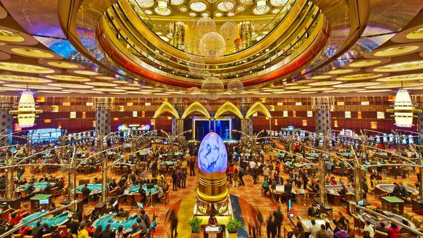
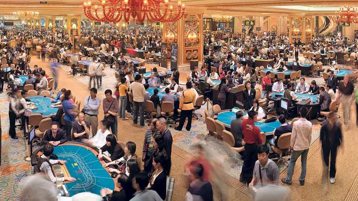
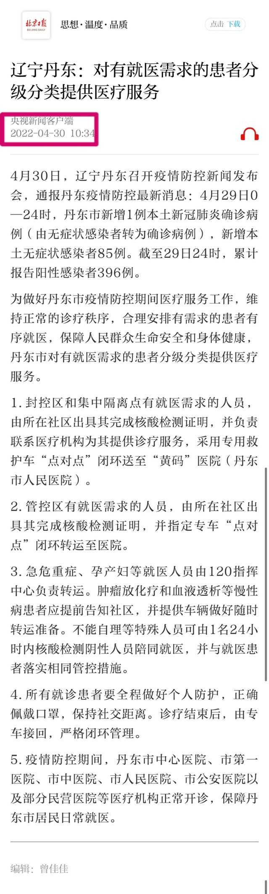
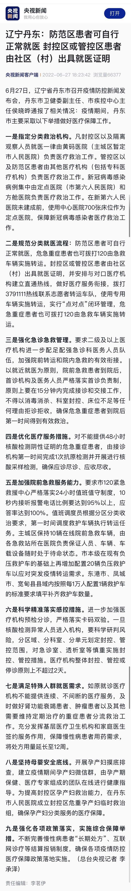
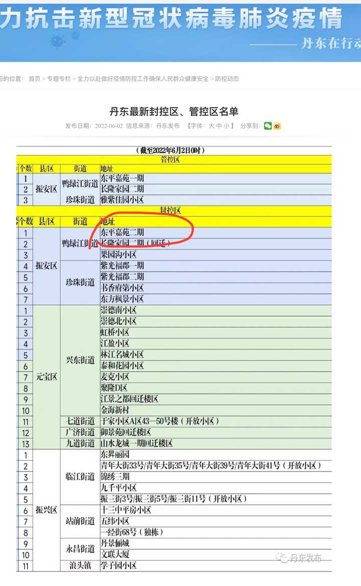
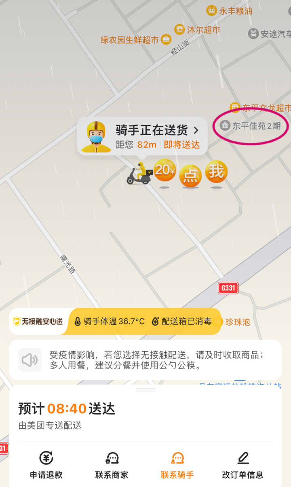
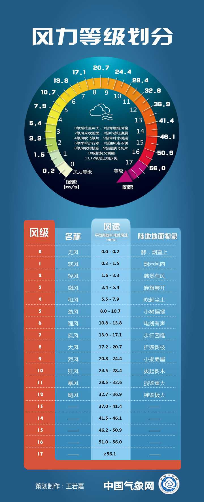
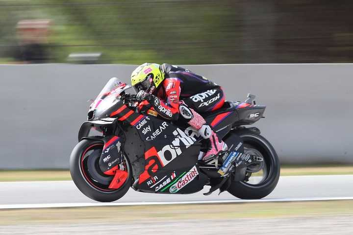
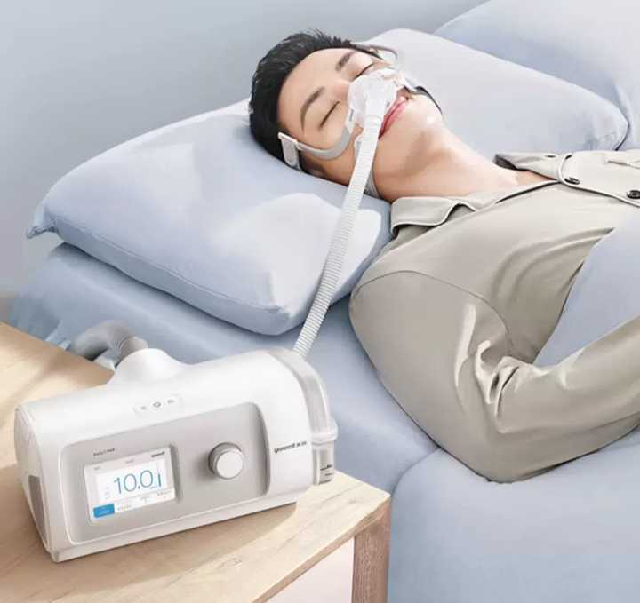

# A09　医疗疾病与照料　第 1 册（共 1 册）

- 专题代码：A09　专题名称：医疗疾病与照料
- 专题界定：疾病、治疗、医生、护理、照料和身体损伤的社会关系。
- 本册：第 1 / 1 册　收录 80 篇　正文字符 73,857
- 语料：`sooon-q9adg-articles-v2.jsonl`（4,305 篇）　SHA-256：`cdc9c271309e1d71d9708889a3a31f4777e0c339ea54c3753521894afdb8357d`
- 生成时间：2026-09-27T00:01:00.997126+08:00　排序：发表日期 → 源序号（全库唯一，不重复）

**标记约定**：`【待审】` 主题仍为暂定；`【排除候选】` 图片/正文过薄的剔除候选；
`【正文标注未完待续】` 作者原文自带未完标记；`【正文缺失片段（复核已记）】` 复核记录已确认的正文缺口；
`【图片缺 N 张】` 源图不可获取。标记只作提示，不改写原文、不改动分类状态。

---

## 4040　吃得少

- 日期：2018-07-21　主专题：A09 医疗疾病与照料　副专题：A02;A05
- 源 ID：`527360f8-2939-5c1a-9bc8-73cbb3a39f3c`　原文链接：https://www.zhihu.com/question/286145664/answer/448523319
- 23 概念标签：能力与学习;选择与自由;成本与总账;照料与家庭;生态与自然;性别与身体
- 证据状态：manual_confirmed　初读：read　独立复核：not_reviewed

**问**：为什么人类生存需要的食物那么少？

我们先假设问题一定成立——也就是在所有对问题的可能的解释中，给予最宽容的、最能让问题自我成立的理解。
那么这个问题很大程度上应该是指青春期以后的人类，也就是年龄在28岁以上的人类。
这个阶段的人类的确需要的食物大为下降，因为他们的基础代谢水平大幅的下降了。中年人们开始白天犯困，他们发现自己没有及时调整的胃口开始促进自己不断的发胖。为了保持体型，甚至不得不开始节食。
假设这存在一个需要解释的理由的话，那么准确的说是人类的寿命相比宠物以外的动物来说过于的长了。野生动物不太能活到接近人类中年的水准。它们的性成熟期要远远的短于人类，人类需要十几年才能开始生育，而动物很少超过三年。在完成最初的生育之后，从基因的角度来说，它就不太关心个体是否还需要保持足够的健康了。某种程度上，过于陈旧的成年个体还是一种遗传上的累赘——预期寿命过长的话，甚至要出现“爷爷和孙子争夺地盘，爷爷强壮程度与孙子相当，而经验有压倒优势，进而导致爷爷对孙子胜率很高”的逆演化问题。这个问题对于种群而言是致命的。
因此，幸存下来的种群几乎都对爷爷们下了封印——既然不可能剥夺你的经验优势，那么就夺走你的生理优势。但这种剥夺是温柔的。如果你在生理期后继续保持相关激素的高度活跃，那么整体发育的不平衡将会有极大的可能催生癌症。靠着这个铁的限制，反向筛选出了“一旦越过青春期，所有的生长激素都会放缓”的特性。事实上，这是青春期现象的根源。简单来说——要么你过了青春期就放慢成长于是胃口大跌进而体力衰弱，要么你就得癌，直接去死。
动物们不太需要面对这问题，因为爷爷们经常被孙子们夺走地盘而饿死——尽管爷爷们也没多大。而人类则可以靠着孝道之类的社会规则多活好几十年——甚至是人生的大头在青春期以后。这样你客观上会观察到“人类似乎比动物吃的少”这样的整体现象。
之所以人类的总体得分低，是因为动物里的爷爷们都死掉了，没有被计入统计范围而已。

---

## 3903　不是肝炎

- 日期：2019-08-07　主专题：A09 医疗疾病与照料　副专题：A03
- 源 ID：`fe50ef29-904d-5e9a-a1d7-7ac57ac7584f`　原文链接：https://www.zhihu.com/question/23900793/answer/778043770
- 官方对象—实践路径：与合作者 / 与服务者 / 选任
- 23 概念标签：事实与证据;能力与学习;责任与后果;信用与信任;劳动与组织
- 证据状态：manual_confirmed　初读：read　独立复核：not_reviewed

**问**：我时而社交能力特强，时而特别恐惧社交怎么办？

我来给你泼一盆冷水让你冷静一下——
不要相信这给出的任何确切诊断！
道理万分简单——靠谱的治疗师应该足够清楚这样一条常识——来访者的自述如果不经过复杂的追问考核是根本不能采信的。
为什么？
因为来访者自己其实对自己早有诊断。在描述自己的问题的时候，来访者的首要目的根本就不是来询问病因，而是诱导有权威的治疗师背书他长期以来自我诊断的结果。
他在来访之前已经按照这个自我诊断自我治疗了不知多久了。他有极大的可能处在“认为自己的诊断方向没错，只是自己对自己诊断出来的这个病不知道怎么治疗，暂时超出了自己的能力范围”的状态。他不是来求诊断，诊断他自己已经做了，他只是来求这个诊断前提下的进一步的治疗建议的。
简单来说，他自认为自己是肝炎，而且因为不想上医院，已经自己按肝炎治疗了很久了。而且他一度认为自己的治疗很有效。只是最近的病情发展让他开始觉得自己那两把刷子不够了，所以他抱着“也许专业人员知道更多搞定肝炎的绝招”的心态来问这个“绝招”。
如果这位大夫给他诊断为“这是胆囊炎”，那对他不是喜讯，而首先是一种巨大的、难以面对（甚至无法面对）的失败。
他心怀着这个恐惧，早已无意识的做好了大量的准备。
他早就查好了肝炎是什么症状。他既然诊断自己是肝炎，当然是非常牢固的确信自己有典型的肝炎症状。
为了引导医生同意自己的观点，他将滔滔不绝的有理有据的描述自己的症状。
你要是全信他的，你将百分之百确诊他是肝炎——他干脆是根据自己背熟了的教科书上的诊断要件在描述自己的病情。如果你直接采信他的描述，你不判定他是肝炎你简直就没资格从医学院毕业。
不但如此，如果你可能的诊断大大的出乎他自己的自诊结果，他的第一反应是尝试提出种种看似与你的诊断矛盾的“新证据”尝试证明“你还不够了解情况”，甚至最后在内心深处判定你“不靠谱”而中断谈话。
这是最典型的心理治疗的基础认知，十个里面倒有九个半是这样。所以，有经验、守伦理的治疗师，将决不可能仅仅根据你这点未经反复追问审核、未挖掘出全貌的资料就给你任何诊断。
甚至可以说，他们根本就不会——也不该——给出他们的诊断。他们的任务应该是不断的拷问你自己的自我诊断的漏洞，引导你自我深入思考，提高你的思维能力和逻辑自洽性，从而让一个逻辑能力提高过的你自己对你自己的问题有新的诊断。
最终仍然以你的诊断为准。
这里这些看了你这点描述就开始谈论“你这是典型的xxx症状，对xxx症应该yyyy治疗”的专业人士，不管他们的头衔如何，他们如果没有显式的声明“这不是诊断，而仅仅是借这个话头说一下这类症状的一般治疗”，那么首先就违背了基本的职业伦理。
如果他是不知道这个伦理的存在，那么他的话就没有基本的专业性；如果他是知道而不理会，那么就是为了吸粉而根本不在乎你后果如何。
他们有没有足够明确的划下这条红线，你最好仔仔细细的品味一下。
不要自误！

---

## 3872　女儿自杀

- 日期：2019-11-30　主专题：A09 医疗疾病与照料　副专题：A01;A05
- 源 ID：`fb286207-0e96-5d9b-8dfc-e5cb55f65e51`　原文链接：https://www.zhihu.com/question/32213799/answer/916641749
- 官方对象—实践路径：与亲族 / 与子女 / 告别
- 23 概念标签：能力与学习;选择与自由;成本与总账;边界与许可;照料与家庭;心理与主体
- 证据状态：manual_confirmed　初读：read　独立复核：not_reviewed

**问**：女儿自杀了，我该怎么办？

第一，吃抗抑郁药稳住情绪。
第二，扛过第一波熟人劝解之后，回避大部分熟人，只留下少部分有支持作用的交往关系。
大部分人都不知道自己在干嘛，本质上只是在借着“安慰你”的姿态和动作安抚ta们自己所受的惊吓。
第三，可以考虑读一些带救赎结局的经典的文学名著。那些著作里面有得救的先例，也有得救的历程，而且是确定的、没有变数的。
第四，可以考虑与不知前情、不知你名的见多识广的、通达开明的老人家、修行者做一些抽离的交流沟通。不要具体的谈你的事，只是讲道理。不要只固着在第一个你觉得投缘的师傅身上，要多多广泛的接触。
这些人往往是见过各种生离死别、人间惨淡的。还能不悲伤、不消极的活着，ta们的经验值得你借鉴。
第五，有罪悔罪，有过改过。你的人生没有结束，你的生命还可以造福于一些人。承接你生命价值的可以不只是你的子女，也可以是任何年轻人、任何有子女的人。
有艺传艺，无艺传业。
祝好。

---

## 3856　完美传染病

- 日期：2020-01-24　主专题：A09 医疗疾病与照料　副专题：A10;A13;A14
- 源 ID：`35af9bf7-37bd-5b11-9d13-f314dc5a1ee6`　原文链接：https://www.zhihu.com/question/367572490/answer/984163676
- 23 概念标签：定义与达意;能力与学习;成本与总账;边界与许可;照料与家庭;劳动与组织;财富与市场;法律与秩序;权力与异议;技术与工程;文明与历史;生态与自然;心理与主体
- 证据状态：manual_confirmed　初读：read　独立复核：not_reviewed

**问**：面对新型冠状病毒肺炎疫情，科技公司能够做些什么？

人类目前的社会形态是存在一个潜在的毁灭危机的，那就是一次“完美传染病”。
一种病毒，潜伏期症状几乎不可察觉或混同一般常见病，潜伏期即具有高传染性，发病后死亡率中等，预后不良，且变异速度快，且以多种常见动物（尤其是肉用牲畜和宠物）为中间宿主——足以击溃目前人类社会最大的文明成就——超级城市。
人类目前的文明成就，最大的产物和最大的支柱，其实恰恰是超级城市这种社会形态。依赖高铁、重载铁路、万吨级集装箱海运、年流量过亿人次的国际机场、日流量达千万的地下铁/公交、远距离高压/特高压输电网络、高速光纤网等等手段，我们在极小的地域上集中浓缩了来自数百万平方公里的人、才、物、信息。集中度如此之高，物理上的空间距离这个最大的交易成本因素才被压缩到了极点，这是目前的经济繁荣的最大秘密。
但是，这种出现不超过两百年的生存形态在本质上却只是一种九龙城寨式的“违章建筑”——它喧闹的伫立在那里，无知无觉的等待着一次漏电造成的火灾或者一次瘟疫来告诉它“你这样不行”。
无论你现在如何繁荣昌盛，如果你没有系统的解决传染病问题，目前的人口密度和超级城市形态就都是等待着爆炸的未爆弹。一次爆炸就足以重创你，让原本被人满心向往的超级都市变成人人争先恐后逃离的炼狱。
那么何谓“系统的解决传染病”问题？
这只有两个可见的方案。
第一个当然是医学的进步。这个我们不多提。因为医学想要发展到能无惧任何传染病无疑还有很长的路要走。
第二个就是社会管理的方案——实现对物资和社会成员行为的绝对感知和掌控，以至于可以在任何时候了解任何人、物的状态，并能加以及时、精确而有效的干预。
拥有这样的感知力、判断力和行动力，这样的社会形态才可以安然的享有高密度聚居所带来的红利而基本无惧传染病的潜在威胁。
事实上，这一次的武汉封城事件在某种意义上正是在展现这种能力。它表明——当真正需要的时候，中国可以、敢于做出这样的决定，并且能够将其现实有效的执行。
无论达成这个能力背后的伦理如何、机制如何，能够做到这一点，才是真正过了“超级城市”这一关。
你们可以想一想——同样的动作能不能在孟买做到，或者达卡，或者河内，曼谷，马尼拉，或者里约热内卢，或者墨西哥，或者甚至新奥尔良、纽约、巴黎、台北。
能不能做到这么快、这么彻底？
即使能，能做多少次？能做多久？
能够做到、而且是多次做到、而且是总有把握将疫区关闭隔离足够久，就是社会体制的“现代性大考”。考得过，才有保持超级城市形态的“体制许可证”。
这个才是这次武汉封城真正的意向所指——为了从根上消除世界对于中国经济繁荣的“医学脆弱性”的焦虑。
封城实际上的意义并不仅限于应对这一次的传染病，同时也是在向世界展示中国对控制传染病传播问题的绝对能力和绝对信心。
这种能力和信心，中国有，其他国家、其他经济体可不见得有。而没有任何国家、任何经济体是真正能免于疫情本身的发生的。
人类真正的问题，只会是经济问题。而一切的经济问题，归根到底都是对未来的信心问题。一切的社会问题都可以最终被理解为某种对经济繁荣预期的信心问题。谁能在世界上造就和维持这种信心，谁就会成为全球资源与资金的目的地，从而获得最大的发展动力。
封城客观上是一种投资，对于争夺“全球经济最安全、最强大的增长引擎”宝座的投资。而且是一项好投资。
然后我们来看一下科技公司在这里可以有哪几个专注点：
第一个当然是快速廉价的检测技术，主要是各类试纸和生物芯片之类。
第二，便捷的消毒手段。各种喷雾、擦巾、便携或便于加装的臭氧消毒、紫外光消毒、高温消毒设备。
第三个，实际上也是最大的近在眼前的风口，就是时尚化的个人防护装备。
在未来，个人防护有常态化的机会。长期佩戴口罩、头罩、手套、防护镜可能成为一种新的生活常态——它至少可以合法的成为部分人可以选择的生活方式。
那么，这些新增加的随身物品余地。还会产生足够大的时尚需求。有人会长期习惯性的佩戴口罩，那么口罩也就将成为新的领结或墨镜（墨镜本身就是防护用品出身）。
防护面具也可以成为新的时尚媒体，衣物也可以有更时尚的罩衫设计——出门穿戴进屋即类脱洗的基本防护手段。
个人防护类产品有机会成为一个新的大众消费品类而常态化，那么面料科技在透气性、抗菌性、亲肤性、可降解性、立体剪裁、先进织造、先进印染等等方面都可以有更大的市场空间来支撑更多的研发。
coser们终于可以名正言顺的玩scifi风的cos了，赛博朋克就在眼前。
第四个，是属于远程办公和在线协作的软硬件厂商和咨询机构的机会。
传染病真正困扰的不是看电影和买菜，而是大通间小格子里办公的社畜们，午间涌向食堂的产业工人们。真正聚集大量人口的危险场景在这里。因此如果能够实现生产无人化或者远程化，在新传染病成为常规威胁的时代会是一个可观的影响股价估值的因素。
于是它没有理由不成为一个发展增长点。

---

## 3836　助医策略

- 日期：2020-03-01　主专题：A09 医疗疾病与照料　副专题：A16;A18
- 源 ID：`7b9fc1f4-1aa0-5c1b-9edc-9783abeeec89`　原文链接：https://www.zhihu.com/question/373400991/answer/1047124128
- 官方对象—实践路径：与社会 / 与社区 / 共建
- 23 概念标签：能力与学习;责任与后果;成本与总账;边界与许可;劳动与组织
- 证据状态：manual_confirmed　初读：read　独立复核：not_reviewed

**问**：我要怎样做才可以让一线的医生护士不这么辛苦?

如果你在非武汉非湖北地区，那么这段时间对待任何疾病风险都保持高谨慎策略，好让你本地的医疗系统可以放心派出援助。
援助越多，前线医护就有更多的机会换班休息。
这就是很现实的帮助。
如果你是在武汉或者湖北当地，那么有能力的话可以担任志愿者协助社区降低居民暴露必要（比如代领团购菜等），减少进一步传染。
如果你没能力出力，那么最少可以看护各个微信群、QQ群和业主论坛，及时并且坚韧不拔的打击谣言和攻击煽动等言论，帮助保持一线社区人员和志愿者群体的士气。
这都有非常现实的帮助。
诸君努力。

---

## 3828　中药

- 日期：2020-03-08　主专题：A09 医疗疾病与照料　副专题：A03;A20
- 源 ID：`c4d83310-ebf7-5a0c-b054-265c034f4523`　原文链接：https://www.zhihu.com/question/377637733/answer/1064446049
- 23 概念标签：事实与证据;定义与达意;选择与自由;边界与许可;文明与历史;生态与自然
- 证据状态：manual_confirmed　初读：read　独立复核：not_reviewed

**问**：如何看待 WHO 新冠肺炎问答「不要吃传统草药」的建议被删除？

我先声明一点，我是不支持将中医理论作为直接医疗指导的。可以作为医疗思想的灵感来源，但是不宜直接作为治疗方案的基础。
但是我对在这篇问题的答案下对这个traditional medicine冷嘲热讽的各位，要问一个问题。
美洲大蠊提取物，算不算中药？
在美国广泛使用的阿片类止痛剂，是西药还是中药？

请你们回答的时候思考两个问题：
A）从动植物里提取的药物是不是有“医学原罪”？应该划入绝对禁用范围？
B）如果直接提取自动物、植物和矿物中的药物并没有原罪，那么大规模使用过数百上千年，是不是一个额外的扣分项？
某种“动植物提取物制剂”通过临床观察有效，被取了一个“肺炎一号方”的名字，是否一定意味着这是“传统药物”？
很多人以为自己只要反对任何动植物、矿物提取物就是在反中药、反中医、反“愚昧落后”，是在展现科学素养，在为“科学”张目。
其实展现的是视科学如无物的部落心态。

---

## 3802　老人

- 日期：2020-04-30　主专题：A09 医疗疾病与照料　副专题：A10;A05
- 源 ID：`5103c8f4-9a46-5cad-b970-ff74757cc1ba`　原文链接：https://www.zhihu.com/question/391353485/answer/1189859567
- 23 概念标签：事实与证据;定义与达意;能力与学习;选择与自由;责任与后果;成本与总账;财富与市场;权力与异议;技术与工程;文明与历史;性别与身体
- 证据状态：manual_confirmed　初读：read　独立复核：not_reviewed

**问**：抛开伦理，放弃老人的防疫措施到底有什么损害？

别开玩笑了，这个世界的主宰是五十岁以上的精英集团——无论是从掌握的财富规模、政治资源甚至学术话语权来看都是如此。
任何一个国家都是，大概只除了朝鲜可能有点小特别——但你排除掉正恩小朋友，在整个朝鲜实际掌握运作的仍然是一群五十岁以上的老人。
在社会学意义上，二十岁只是刚睁眼的婴儿，近乎只是一团肉。
三十岁才开始有视觉和听觉。
四十岁才刚懂事。
其实，五十岁才是青春期，才成其为一个有效的成人。
在这之前，只是不知道或者不承认自己是孩子的孩子罢了。
就这，还是幸运的发育正常的进程——大部分的人一辈子也没有在精神上发育到成人状态。
发育到成人状态和成为精英本身就是有锁定关系的——某些特定的发育条件实际上只有精英才享有。普通人没有条件像主刀大夫那样见惯生死，也没有机会像总工程师一样时刻要考虑到“二十年后这坝有裂纹怎么修”，也不太可能像前线指挥官那样被一失手就尸袋成堆的压力千锤百炼。
这些机会是注定有限的，而只有这些机会才能最有效的把人淬炼成精神上成熟的人。
可以说我们的整个社会并没有超出蚁群太多——发育成特定关键类型的机会客观上是有限的，并不能靠公立教育来拉平。教育水涨船高，这些机会的门槛也会水涨船高。只有社会的结构性改变才能稍微提高一些成熟者的比例，但也没有太大的本质提高。
这意味着任何社会和文明里，真正的主宰必定是一路过关斩将、打穿十八铜人阵以后已经步入老年的一般生理意义上的老人。
谁能做到排除社会真正的主人，各文明体真正的主宰？
所谓“放弃老人”，本质上是在放弃没能力去不会放弃老人的专属医院的穷人。
是在放弃穷人中最好欺负的一群人。
赞成或者反对，每个人有自己的权利，但是请按照这个实质版考虑你的立场。

---

## 3784　撑着累

- 日期：2020-05-22　主专题：A09 医疗疾病与照料　副专题：A18
- 源 ID：`09ac8a44-f76b-5310-8c98-b087c4616418`　原文链接：https://www.zhihu.com/question/395546068/answer/1237919615
- 官方对象—实践路径：与自己 / 与身体 / 了解
- 23 概念标签：事实与证据;性别与身体
- 证据状态：manual_confirmed　初读：read　独立复核：not_reviewed

**问**：用力顶住要倒的架子，为什么我没有做功却非常累？

你的肌肉是由无数根肌肉纤维构成，肌肉纤维则是由大量的肌节首尾相接连成。肌肉收缩，主要依靠每一个肌节的收缩。
而肌节的收缩，由肌球蛋白和肌动蛋白来合作完成。
你可以把肌节想象成一个橡胶做成的火车车厢（实际上它更像一个涨鼓鼓的长气球）。肌动蛋白是两根分别系在车厢两头的涂了油的绳子，而肌球蛋白就好像你和你的朋友背靠背腰捆在一起站在车厢中间，并且你们一人手里拽着一根绳子。
列车长喊一声“快拉”！你们俩就一起往怀里拽这根滑溜溜的绳子。
要害就在于这根绳子很滑。你们倒是想要拽住它不动，但是你们会发现真拽着不动它马上要滑出去。于是你们就会一把一把的往怀里拽。只有不停的往怀里拽，才能动态的维持对这根绳子的拉拽力。
在外人看来似乎这车厢只是变短了一点，然后就一直维持在那么短了，但是你和你同学苦不堪言，因为这全靠你们在车厢里不停的往怀里拽这根该死的绳子才维持住了车厢不弹回原来的长度。你们要是一停手，绳子立马从手里往外滑。
车厢的长度一致保持这个缩短的状态不变，是因为你们（肌球蛋白）一直在对这两根滑溜溜的绳子（肌动蛋白）做功。靠着你们身体的动能转化成双手摩擦绳子的热能，维持住了那个拉力。
功做在这了。
肌球蛋白能做这个拽绳子的动作，靠的是消耗三磷酸腺苷（ATP）而产生的化学能。所以，总的来说，这是一个靠着化学能对热能的转化来维持一种运动上的平衡态的过程。
尽管看起来没有发生宏观的运动状态的变化，但是却存在微观上的能量转移。
并不是看起来静止不动，就没有能量转移的。
———
“无图说明”成就达成，撒花！

---

## 3584　下一轮

- 日期：2020-11-10　主专题：A09 医疗疾病与照料　副专题：A18;A10
- 源 ID：`2cafa14d-8a38-5489-8168-38b9702a1821`　原文链接：https://www.zhihu.com/question/429545834/answer/1567340776
- 23 概念标签：事实与证据;能力与学习;选择与自由;责任与后果;成本与总账;财富与市场;法律与秩序;技术与工程;文明与历史;生态与自然
- 证据状态：manual_confirmed　初读：read　独立复核：not_reviewed

**问**：辉瑞宣布疫苗对90%新冠病毒有效，资本市场巨幅波动，是操纵市场的表现吗？这会是第一个上市新冠疫苗吗？

恕我直言，下一场传染病离人类可能比想象的更近。
新冠肺炎并不会是这场戏的最后一幕。
全球气候变化与大规模经济活动引发的生态改变幅度太大，有无数的物种在承受非常大的选择压力。
这种选择压力会催生出新的食谱、新的迁徙路线、新的栖居地、新的行为模式、新的与人类社会接触的点位和路径。
意味着新的变异和新的接触。
这意味着人类作为一个总体进入了一个历史性的传染病的高发期，COVID-19只是这个故事的第一章而已。
所有人都应该随时做好出现第二种新传染病的可能。
真正的应对，不是依靠医疗技术的事后抵抗，而只能依靠强有力的公共卫生制度，以及对穷国、弱国的卫生体系的大力援助。
或者更进一步的说，“援助”其实是不解决问题的。是要真正的帮助整个第三世界建立真正有效运转的自我治理体系，以及真正有效的国际合作机制。
玩不得虚假。
否则，下一场横扫人类的传染病随时可能从尼日利亚、巴西、印尼、孟加拉、印度悄无声息的爆发，并被这些国家效率堪忧的预防体系漏过。
当被真正认识到存在时，封堵已无意义。
事实上，这一次的疫情从中国这种有冠绝全球的反应能力的国家开始爆发，实在已经是老天爷对人类格外仁慈。
如果在印度爆发，当印度真正认识到本季度死掉的那几千人不是死于感冒时，世界的其他国家恐怕已经没有幸免的了。
下一次，有什么真凭实据能保证剧本不是这样呢？
如果是，拿什么挡？
辉瑞、强生、科兴们，最多只能让人类对目前的新冠免疫，远远不能让人类社会对于传染病本身免疫。
如果明天上帝跟人类开一个新玩笑——在xx地区发现了新的不明传染病，且在xx、xxx已经发现了类似患者……
世界将会怎样？
这是个很有趣的问题，建议各位投资人想想清楚。

---

## 3259　行云流水

- 日期：2021-06-14　主专题：A09 医疗疾病与照料　副专题：A04;A03
- 源 ID：`82772f71-ade2-548a-8f02-15180bd971ca`　原文链接：https://www.zhihu.com/question/302527652/answer/1939554589
- 官方对象—实践路径：与自己 / 与能力 / 获取
- 23 概念标签：定义与达意;能力与学习;选择与自由;劳动与组织;权力与异议;心理与主体
- 证据状态：manual_confirmed　初读：read　独立复核：not_reviewed

**问**：临床中真的有必要手术结打得飞快吗？

学会打得飞快是绝对必要的，很多时候（尤其是急救条件下）你没有条件去慢条斯理的毫无心理压力的来操作。
你知道你能打得快，你才能放松下来。
你知道自己打不快，那么这类情形一旦让你紧张，你连平时的速度也保持不了。
所以，即使你仅以稳定可靠地保持一般速度为诉求，你也要去拥有打得飞快的能力。

但是一定要记住打得飞快的前提是基本功扎实的前提下的一板一眼。
切忌不要为了打得飞快而用“草草完成”这种人类下意识会用的方法。
能打得飞快的人，会给你一个强烈的节奏感和韵律感，而不是一种看不清节奏的“缭乱感”。你看到会是一个节奏韵律分明、动作结构清晰的、【稳定的】推进。
你注意听清楚，正确的快的节奏是这样的：
嗤～嗤～嗤～叮、嗤～嗤～嗤～叮、嗤～嗤～嗤～叮、嗤～嗤～嗤～叮、
而错误的节奏是这样的：
砰!..砰!.....砰!.......砰砰!....啪.......砰砰!砰!………啪………
为什么是“嗤～”？因为成熟的动作总是平滑入平滑出的，这动作本身并不快，反而是从容甚至会让你感觉“缓慢”的，但这是因为它的每一毫秒都有被完全觉知掌握着的引导和控制，再快就是在凭肌肉记忆、凭反射神经在动作，而不是在凭手眼协调、观察/修正循环在做受控操作了。而任何需要随时应变、确保为下一步打下良好基础的系统操作中的子步骤，都是需要完全受控的。
那么“叮！”是什么呢？是一个刻意安排的承前启后的“归零仪式”，它有可能是轻压线头，有可能是一次拉紧后的二次绷紧，这是对上一流程结果的清晰确认和巩固、和对下一流程起点的重新整肃。这一个小小的仪式会让下一个流程周期无论是从心理上、还是操作上、还是从程序上都成为一个独立的、单一的单元，可以被全神贯注的重新对待，而不是“在一楼之上盖二楼”，而是“重新再盖一次一楼”——后者会比前者的复现性强的多。
而这整个过程的速度体现在哪里呢？体现在两个音节自身是平稳从容的，但由于它们每一步都从容而到位、所以它们之间的衔接完全不耗时。
上一步的结尾恰恰是下一步完美的开头，顺流而下，如水银泻地，一无滞碍。甚至动作本身都足以凭惯性“流入“下一环节。
如果你将关键运动组件的轨迹追踪下来，对它的速度、方向、轨迹求导，你会发现除了那个“叮！”的结束动作，上述参数全都没有突变点，曲线全是平滑的。甚至都不是一阶平滑，而是而是二次求导仍然平滑。
这就是所谓“圆转如意”。
是每个步骤之间毫无犹豫迟疑导致了它快，而不是那些步骤本身被加快了而导致它快。
它的全程受控，足以在你不经意期间顺着实际情形的需要做出种种必要的调整。其实操作者自己心里知道，每一针都是做了变化来顺应具体情况需求的，甚至可以说是千变万化。只是因为动作框架的扎实和合理，内蕴了这变化的余地，而完全不需要以打破节奏重新瞄准这么大的动作去完成调整。
这每一声“嗤～“之中都融入了瞄准、试探、修正、实入、复检、巩固、结案的过程。其中的任一环节有异常，都会对操作者发出一个重大而显然的异常信号——“这里有异物”，“这里可能有水肿”，“这里有隐裂”，这信号在此一流程的平稳操作所争取出来的时间内，就已经被思考、被决定了对策，及至下一流程开始前，下一流程的实施参数已经被调整了。下一针会自然而然的或压低针头，或刺入更深、或提前上调、或拉远入针点。其实这在外人看来“不假思索“的一针，是有充分的思索的，只不过旁观者要事后去追加理解，而这操作的不停歇的进展会导致观察学习者很快被甩开，以至于脑子里迅速变成一片空白，只剩下“我c、我c”这类空白的感叹了。而这份空白和无力，会大大的放大观察者的时间感，进一步导致ta只剩下“好快”“眼花缭乱“这样的直观感受。

而这个“砰!..砰!.....砰!.......砰砰!....啪.......砰砰!砰!………啪………”里的“砰！”是什么呢？
是一个误以为“要快一定要把操作本身加快”的新手，在用猛烈而骤然的反射性动作来爆发性的完成技术操作给你的直观感受。
新手菜鸟们不是没下苦功，但是ta们是在香蕉上猛练一个闭着眼睛就能完成的反射性动作。
ta们的默认思路是“只要练成无脑反射就能下意识完成，到时候我就可以无限加快，那样我就快了”。
到了实际上台的时候，只要一点紧张、一点意料之外的异常，就会导致ta们拿出这看家“反射”出来往长得难以预料的陌生靶子上乱“射”。
ta们会发现ta们的前一个反射性周期能和后一个反射性周期衔接的前提，是那块均一、干净、结实的香蕉皮。而ta们要处理的却是锯齿的、模糊的、不匀、不直的根本不能一言以蔽之的对象。
而ta们只擅长盲踩油门。
这导致了这样一种适应——就是在下一步往那边转方向上长期犹豫不决，以至于被情势的发展逼迫得不能不做出个决定时，情急之下捡着最保守、最安全的地方（所以新手缝合的结果很宽，因为ta们出于恐惧加了过大的保险）牙一咬心一横猛踩油门，“赶点进度”。
而这油门踩得心惊胆战，踩了百分之一秒就开始害怕后悔，立刻猛踩刹车——于是就“砰！”
“砰！”完就东张西望、抓耳挠腮、汗如雨下，被焦虑淹没，做些其实无效，但自己以为看起来很积极、可以被解释为谨慎的掩护动作。
于是就发生长短不一的，而就是最短的那个也实在太长的“......”。
又因为“......”的太久，ta自己都心虚焦虑了，又逼得ta下次又更加强烈想靠“砰！”去争取挽回一点时间——准确的说，那个想挽回的不是时间，而是一点“自尊”。
而ta的这个“砰！”因为是眼一闭心一横干下的，ta还常常犯下错误，在“要不要拆开重来”，“要不要投降“之间犹豫半天，在“下一针是继续推进还是补救一下”上犹豫纠结。
这就是所谓的“啪！”——那是直接因为油门踩得太慌乱，直接脱手了，剐蹭了，
这加倍的占用了时间。
而且这焦虑心态同样会放大人的时间知觉，导致ta度日如年。短短的两分钟恨不得能写一个连续剧的剧本。
ta觉得自己慢得无法忍受。
而这时最大的问题是什么呢？
是对那个“这是不够熟练，熟能生巧”的原始训练观的迷信，驱使着ta回宿舍继续在更多香蕉上猛练“油门反射”。
于是陷入了一个“油门反射不够用”，于是“更疯狂的练习油门反射”，接着再次证明“油门反射不够用”，于是“更更疯狂的练习油门反射”的循环。
这一循环直指“我是个无可救药的傻x，不适合干这一行”的抑郁症。
其实，这问题在于——你的老师之所以快，根本就不是快在ta踩油门比你狠上。
恰恰相反，ta的油门比你踩的轻而且慢，ta是快在不因莽撞盲目的错误决定而不断的停车重启上。
你不可能通过踩油门练习解决这一点——这是绝对不可能的。
你要去看机械手册，去了解你的车和你的路，去参悟那每一个子步骤的原理、意图、质量标准、修正法则……背后的原因。
这才是你的老师和你的差距所在。
否则你只会成为一个一脚油门一脚刹，把所有女神都开吐，还到处借本子买分的失败者。
别喊不公平，这公平的很——谁叫你如此迷信自己的方法论，从不反思？

---

## 3231　咨询师

- 日期：2021-07-01　主专题：A09 医疗疾病与照料　副专题：A06;A01;A03
- 源 ID：`1183c0b8-f614-5f91-8a0c-9e4eb6688208`　原文链接：https://www.zhihu.com/question/466758235/answer/1971690509
- 官方对象—实践路径：与友人 / 与恋人 / 相处
- 23 概念标签：能力与学习;责任与后果;成本与总账;爱与回应;边界与许可;照料与家庭;权力与异议;心理与主体;宗教与自然法
- 证据状态：manual_confirmed　初读：read　独立复核：not_reviewed
- 标记：`【正文缺失片段（复核已记）】`

**问**：刚谈了2个月的女朋友，她持续3年一直在和心理咨询师每周视频聊天一次，这是正常现象吗？

有一个参数非常重要——每周一次。
我一向严厉警告新手咨询师严格时间纪律，不宽容迟到（迟到计时）、不超时、不接临时咨询、不被动提高频率（即由来访者提议的提高频率）。
时间纪律是高度敏感的安全红线，如果守不住，就表示你没能力做好这个服务，务必转介，绝对不能勉强。
这问题描述如果是真实的——就是当事双方能稳定严格遵守每周一次的纪律，那么这大概率是安全的。
如果真的发生了有违咨询伦理的问题，那么这个周期律应该早就被打破了。尤其是已经是三年之后仍然可以稳定遵守，至少从这一点上看是比较健康的迹象。
至于说长期化的问题，心理咨询并不见得是只有病理治疗意义，它在很大程度上在替代以前由牧师和神父担任的定期告解职能。在咨询师足够成熟和职业的前提下，它的确可以被视为一种正常的生活安排。这在将来甚至可以说是一种普通人的常态，和社保体检、家庭医生一样，没什么值得大惊小怪的。
只不过因为资源很少，成本很高罢了。
至于说嫉妒咨询师的特殊地位，这可以理解。不过说句实话，这样的人格成熟度不适合谈论严肃的亲密关系。
认为在亲密关系中不允许存在隐私，其实是一种错误的执着，它总是毁灭关系，而不是巩固什么关系。
一个人根本不应该用“对一切知情，从而可以放心的不设防，视这份节省下来的安全成本为不可缺少的福利”的方式来对待任何人，因为它既无效，也不公平，本身就构成一种虐待。
不管你自己多么热爱这个主意，这个执念都是不可行的——最终会把一切人都驱离。
只有人断了、没了，你才能断了这种强迫症，对方也终于不必过这种一切思想都要上报，接受审查、接受批准，没完没了的解释、求理解、求谅解、求允许的日子。
这种劳改犯的生活，人家凭什么要过？只因为吃住打折就被“爱”成一个劳改犯，对那些缺吃少穿的才可能勉强成立，一旦吃饱穿暖，则“是可忍孰不可忍“。
岂能不走？
所以，不论你自己有多喜欢，觉得这有多正义、多传统、多天经地义，实践上它仍然是愚蠢的。
不否认这对某些幸运儿没有恶化到毁灭的地步。但是，如果有一种行为会将你的事故率提高50%，这种行为带来的“利益”是不是值得，是一个很需要单独探讨的问题。
你应该做到的是不管对方如何，都做全面的安全工作——比如保持竞争力、保持财务安全——并且确保你做出的牺牲、冒的风险，都是即使对方最后没有保障、回报，你仍然愿意做的牺牲和风险。
不把自己的幸福责任强加在别人必须按照某种特定方式生存的前提上，这是一个人有立场对另一个人说出个爱字的基本资格。
否则你不过是要捕获一个猎物用来供自己役使，只不过自认为“好吃好喝”，已经是一个无可抱怨的奴隶主了而已。
把这叫“爱”，真的是一种巨大而可悲的误解。

---

## 3171　耽误了五六年

- 日期：2021-08-01　主专题：A09 医疗疾病与照料　副专题：A01
- 源 ID：`4cd7ff75-0a42-5ff0-8669-56f9ed483a68`　原文链接：https://www.zhihu.com/question/38984755/answer/2032093450
- 官方对象—实践路径：与自己 / 与身体 / 维护
- 23 概念标签：定义与达意;能力与学习;成本与总账;劳动与组织;财富与市场;权力与异议;心理与主体
- 证据状态：manual_confirmed　初读：read　独立复核：not_reviewed

**问**：如何才能坦然地面对自己因为抑郁症而荒废的五六年时间？

抑郁症本质上犹如一种精神性的自体免疫病，那些促进你“奋斗”“努力”的因素——譬如心理优越感、权力感、控制感、感官享乐、意识形态快感等等，在平时起着驱动你运作的关键作用，但一旦遇上过敏原，它们自己就会转而对你自己发起攻击。
比如心理优越感让你感觉不错，但你一旦去到很大的赛场、见识过让自己腿软的天才或者利维坦，它会立刻转化为自卑感，对你自己发起反噬；你最大的依靠是钱带来的享乐，当你看到赚钱的前景悲观，你不可能不受负面打击。
等等。
对于这些内在问题已成定局的人来说，前面的人生只有两条路——要么运气好到不遇上过敏原，要么遇上了、挺住了，并在反复发作中渐渐形成适应、达成脱敏。
很坦率的说，按照中国的（乃至世界的）现状，大部分人都存在着来自物质主义的、内在的极大脆弱性。这其实也是普遍焦虑的根源，因为人意识到了这种内在的脆弱。一般人没有发作，仅仅只是因为还没有遇上足够大的打击。
而不幸的是，因为人类寿命的大幅延长和社会运转节奏的大幅提升，想在几十年里数以千计的关键事件里一次都不受到沉重打击，概率越来越小了。
换句话来说，这是一个大概率事件。
人生几大关口，毕业、失恋/离婚、落选、意外疾病、失业……几乎无人能全部躲过。
更不必提还有衰老、失亲这几节必修课。
所以，我实实在在的告诉你，如果你是三十岁之前就得了抑郁症，而且挺住了，能经过五六年稳定住了，并且最后赢了——
那么你是完成了一项重大的人生功课，你不但没有“落后”什么东西，事实上反而是领先了。
什么叫“赢了”？就是不但坚持过去了，而且你的引擎换掉了。不但能提供动力，而且可以逻辑性的免疫于这些所谓打击，有了大大强化的抗打击结构。
不但无惧于意外，反而能将一切意外视为自己的朋友；不但无惧于失去，而且将不得不舍弃视为一种幸运；不但不畏惧付出，而且将最大程度的付出视为值得追求的价值。
没有经过这一关的人，ta们的成就严格说都不算是建立在沙滩上，事实上是建立在一颗炸弹上。
所以，你并没有“耽误五六年时间”，你是提前了十几年面对拆弹工作。
你真正的问题是你有没有把这项拆弹工作做好。我必须要提醒你，你要把拆弹和救灾区分清楚。
有很多人所谓的“治疗”，仅仅不过是在打扫现场、救治伤员、修复建筑，没有排雷。ta们把一切寄托在一个天真的幻想上——“下次不会这么倒霉”。
ta们错了，和下次相比，这次只是轻轻点点你的额头而已。
下一次才是耳光。
排雷才是最重要的工作。
如果你做好了排雷工作，你不但没有落后五六年，相反，你是跑在了别人前面十几年。
你现在就得了抑郁症是一种幸运，而不是不幸。

---

## 3052　从心所欲不逾矩

- 日期：2021-09-18　主专题：A09 医疗疾病与照料　副专题：A01;A03
- 源 ID：`b87113fb-cff3-5fa7-a574-7c9e4bd31182`　原文链接：https://www.zhihu.com/question/357332126/answer/2126676697
- 官方对象—实践路径：与自己 / 与身体 / 维护;与自己 / 与信念 / 形成
- 23 概念标签：能力与学习;选择与自由;权力与异议
- 证据状态：manual_confirmed　初读：read　独立复核：not_reviewed

**问**：你们试过最牛逼的减肥方法是什么 ?

其实，减肥的关键方法是超规律饮食——养成一个极端规律的、接近仪式性的饮食习惯。
可以这么说，是这个饮食习惯和配套的生活方式决定性的统治着你的体重水平。
规律到什么程度呢？
大体上每天早餐跟早餐都一样，中餐跟中餐都一样，晚餐跟晚餐都一样。
不要追求“花样”，不要追求“变化”。
这不是叫你去吃你不喜欢吃的东西折磨你自己。这几餐都应该是你最喜欢吃、吃一辈子也不会腻的东西。要做好、做精、做出艺术和功夫。
比如你每天早上都要吃一碗小馄饨，那么就研究清楚这小馄饨怎么能做到极致。
然后就吃这碗金不换的小馄饨。
中午你要吃烤鸡胸肉配牛油果，那你就仔细找好供应商，每天买到的都是熟度正正好的牛油果，调味、火候都恰到好处的鸡胸肉。配上你千挑万选的自磨黑胡椒、自制酱料。
晚上你要来条鲈鱼，那就好好学怎么腌、怎么煎、怎么烧……
保持绝对简单，但学会把这个简单推进到能够安抚你的欲望。把固守这份简单看成一种修炼，一种对自己的寻找。
一定要简单，但却要在这份简单中寻求完全的满足。
找到能让你完全满足的那几样东西，学会在这简单之中完全满足。
如果这能让你完全满足的东西能让你瘦，因为你可以毫无困难的无限这样坚持下去，那么你想要多瘦都不难。
找到属于你的“三顿饭”，你就能控制体重。
但不要以为这很简单，你能修成这个，你差不多也就窥见了“从心所欲，不逾矩”的境界。
实话跟你说，“自律”并不会使你自由。恰恰相反，“自律”反而容易拖你下水。
是学会在方寸之间获得全部满足让你真正的自由。
记住，这里面没有委屈、没有勉强，但有巨大的功夫。
你可以做到。

---

## 2999　双相情感障碍

- 日期：2021-10-14　主专题：A09 医疗疾病与照料　副专题：A06;A01;A03
- 源 ID：`4c4b1750-f3b6-5df1-a530-ca38dc46feb3`　原文链接：https://www.zhihu.com/question/432246724/answer/2169563558
- 23 概念标签：事实与证据;定义与达意;能力与学习;成本与总账;信用与信任;爱与回应;净输出与不掠夺;财富与市场;心理与主体
- 证据状态：manual_confirmed　初读：read　独立复核：not_reviewed

**问**：爱真的能治愈双相情感障碍吗?

爱当然可以治愈人。
但是不是那种“一个人努力对某人千依百顺，尽量让这人心想事成成，万事如意”的爱。不是那种需要付出者自我消耗、自我磨损，把自己熬成苦汁，换取对方稍有喘息的这种爱。不是那种眼见得有损耗、可计算的不可持续的爱。
能治愈严重绝望和抑郁的爱，不能是来自有限的人的努力的，因为这只会导致人严重的依赖于“拯救者”的健康、富有和宠爱，依赖于人对于“拯救者”的道德品质的认可（甚至是崇拜）。
你得健康和富有，这样我才相信你有实力能解决我的问题。
你得对我宠爱，这样我才相信你有意愿解决我的问题。
你的道德得要完美，这样我才相信这不是我看不懂的陷阱。
健康和富有倒也罢了，这是比较表象的——这意味着营造富有的假象因此成为一种极好的盈利手段。但这是次要方面，先丢开不谈。
真正可怕的是这些绝望和抑郁的人会在后两个方面有致命的变态需求——ta们会不断的要求确认你对ta们的宠爱；ta们会不断的试图把你设想成道德的圣人。
没有这两样东西，那种“随时可能失宠”或者觉得“我正在陷入一个自己看不出问题的巨大的圈套里”的不安感每分每秒都是折磨。
由不得ta们不反复的去试探、挖掘、“验证”这两件东西。
而讽刺的是，这两件东西全是自我否决的预言。
当人用尽一切手段去想要证实自己得到的是牢不可破的宠爱时，人处在一种最招人憎恶的极恶状态。
试得多了，只会证明“这宠爱果然是假的”。
而当人要百般考察，来证实对方到底是不是“完全可信”的时候，得到的结论也基本不可能是心满意足。
尤其是，这两种行为都会对正在凭自己的力气，想要帮助ta拯救ta的人来说构成极其深重的伤害。
“我在为你、救你，乃至于奋不顾身，你在侵犯我、试探我、怀疑我。
请问，我欠你什么？我什么时候占了你一丝一毫的便宜？
你有什么资格这样子做？
正所谓升米恩，斗米仇，不可怜你，反而不必受这些侵犯和折磨。”
事情到这一步，这种凭个人一时怜悯，一腔热血要拯救ta人的抑郁乃至绝望的努力自然就要崩溃。
其实，“双相情感障碍”的发病周期和这个死结有极大的关系。
一旦得到了这类帮助，人会喜出望外，陷入巨大的幸福，亢奋得只想手舞足蹈，引吭高歌。
而一旦试探、怀疑经由救助者强烈的受伤害感触发了关系裂痕，又会恐惧、愤怒、焦虑乃至于暴发“报复欲”。
这种情形的发作不会是只有一轮，关系也不容易一次断绝，于是它会循环往复。
直到一方再也不能支撑为止。
这个死结之所以致命而且绝对有效，是因为痛苦绝望到令人同情的人会陷入这种“自觉没有得到足够的爱”的困境，恰恰就是因为ta们长期坚信“这种牺牲自我，永恒宠爱，道德完美的东西才是爱”。
这种爱一次又一次的破产，ta们才会这么绝望。
ta们才惹人同情。
所以才会惹到不知道凶险，而又同样对爱无知、以为“爱就是对人宠着点”的人们屡屡轻易的踏入这个循环。
这“爱”的定义错了，模式错了，双方错到一起去了，得到的结论当然只会是“爱无法治愈”。
真正的问题，是被拿来当解药的那个东西并不是爱。
按照这个东西的逻辑，它本身就是引发这种障碍的原因。
世界上哪有能被病原体治愈的病？

那么，爱到底是什么东西呢？
爱其实是这个世界的一种安排。
它不是来自于人的，而是一种被内嵌在社会运转规律、内嵌在人的精神内核里的一套规则。
懂得顺着这规则而行的人，会自然而然的得到人类——乃至于物理意义上的客观世界——最大限度的帮助和安慰。
它的力量根本不是来自于某个人对另一个人的恩宠，也不是来自于某个个人的“圣德”，甚至也不依赖于所谓人类社会的总体进步。
而是你如果遵循这些规律，在别人面前凶恶的人，在你面前不由自主的放下凶恶；
在别人面前没有信用的人，在你面前忍不住要在意自己的信用；
对别人的死活懒得在意的人，对你的安危牵肠挂肚；
信不过别人的人，信得过你；
受不得别人一句重话的人，愿意受你的责备。
这些不是因为人们对你特别恩宠、或者人们的道德完美无缺、或者觉悟极高，而是因为人类经过数百万年的塑造，经过一切因素的磨练和拣选，磨练出了这样一种本能，一种内嵌在“人”的定义之中的绝对命令。
它是没有耗竭的一天的，也不依赖于谁对你的恩宠，或者谁的道德水平。
能治愈人的抑郁和绝望的，是指引人看到、了解、尝试、掌握这样一种爱的方法。
指引人学会随自己的心意和缘分，去获取这取之不尽、用之不竭、恒久存在的爱。
一旦人真正的意识到这份像光和空间一样无处不在的爱是如何可以像发电、种植那样，经过恰当的努力从任何人身上随时获得，这种令“私人的善意”望洋兴叹的抑郁和绝望就会自行灰飞烟灭。
在这个真正的爱面前，双相情感障碍并不是问题。
因为从这个角度出发，你不是自己去为对方提供安慰——“你别慌，我会如何如何如何帮你搞定”；
而是通过让对方看到客观上确实存在的ta没看到的角度、ta没有试过的方法、ta没有意识到存在的资源来得到安慰。
安慰ta的，不是你，而是事实本身。
你所做的，只是指给ta看到了而已，一旦ta看到了，你就算跟ta关系破裂了又如何？ta看到的东西不会因此凭空消失。
你就算是罪恶累累又如何？ta学会的方法不会失灵。
是这个方法，和通过这些方法所引来无穷的爱可以救人。

总结一下，
如果你说的“爱”是一般流行意义上的那种恋爱剧里的卿卿我我，殷勤讨好，那救不了。
如果你说的爱是这种生产力无限的客观规律，那么当然可以救。
爱到底是什么 ？

---

## 2977　循序渐进

- 日期：2021-10-26　主专题：A09 医疗疾病与照料　副专题：A05;A11
- 源 ID：`e6589a7d-0d44-5934-9be0-cbf5f637a329`　原文链接：https://www.zhihu.com/question/493115676/answer/2190393982
- 23 概念标签：能力与学习;选择与自由;责任与后果;成本与总账;财富与市场;权力与异议;心理与主体;性别与身体
- 证据状态：manual_confirmed　初读：read　独立复核：not_reviewed

**问**：侄子要换肾，我配型合适，而我才20岁刚大二，我该怎么办？

一件功德，需要配得上它的人去做。
你有多深的修炼，你才能做多大的功德。
能做的功德，都有“不计较”这个铁门槛——你只能做你能不去计较的功德。
行善不是像一般人所想象的，只要心一横牙一咬，扑向圣坛就可以了。
这一类也不是没有，但那都是最后牺牲性的、瞬间完成的那一类——类似战场上的英勇牺牲。但大多数善举都是你做完之后会继续活着的，会继续长期面对其后果的。
扶老奶奶过马路，给有困难的人捐钱，长期资助上不起学的小孩……这些更初级的项目你都没做过、没经过，没有积累起那些曲折、失望、痛苦的经验，那么这些更高级、挑战更大的项目是不能贸然涉足的。
为人舍生忘死、割肉喂鹰，这是绝对正面和了不起的事，但是那之前你要先闯过九九八十一关，要已经有了足够的做功德的经验，有不计较这肉、这生死的功力。
想要做这么大功德的人，平时就要在这方向上坚持努力，就跟考中考高考一样一级级的考上来。
考到了博士，才能真正有效的运作博士这一级的善举。
所以，不建议你贸然越级挑战。
有志于善，要害不在于做不做某件好事，而在于“把自我历练，以追求能承受最大程度的奉献”视为一种重要的、不可舍弃的人生目标。
一个人为什么要这么“傻”，这么“不爱自己”，这是另外一个问题了。
但我要告诉你们——走这条路的人，看到的风景和得到的赏赐和不走这条路的人是不同的，并且也绝不是所谓“得不偿失”的。
恰恰相反，反而是咬定了要走这条路的人，最容易得到权柄和财富，同时又能免疫于权柄和财富的剧毒。
若不准备走这条路，则做人以知足常乐为宜，不要野心太大。否则不是因为求之不得而毁于怨毒，就是因为侥幸得到而受到名、权、利的毒害，反而是适得其反的。
你能拥有的，和你能不计较的舍去的相称。而你能不计较的舍去多少，是要点滴磨练出来的一种实力。
你真的野心勃勃，有席卷六合、混一宇内之志，你最该有的能力，就是这实实在在的不计较的能力。你学数理化、行万里路，都是为了积累这种能力。
慢慢来吧。

---

## 2855　第二层防线

- 日期：2022-04-07　主专题：A09 医疗疾病与照料　副专题：A13;A12
- 源 ID：`a4b0e11a-9cf1-59bc-83b7-d671271eb36e`　原文链接：https://www.zhihu.com/question/522934466/answer/2427826098
- 23 概念标签：能力与学习;选择与自由;成本与总账;劳动与组织;法律与秩序;权力与异议;技术与工程
- 证据状态：manual_confirmed　初读：read　独立复核：not_reviewed

**问**：你觉得在中国，新冠疫情会以什么方式结束？

在中国，新冠没有所谓结束，但可以做到将其危害控制到不对国民经济造成过大损害的水平。
关键在于把防疫的防线前移，从“灭火”模式，转向“水密舱”模式。
我们现在的防疫模式，是在国境线上建立对入境人员的严格管控，一旦过了这条防线，进入了国内的无毒环境，就可以完全自由行动。
而在我们国内，却是什么地方出现疫情，才围绕爆发地点建立一个非常保守的封闭区。
这在数学上是无效的。

更有效的手段，是把内部区域间的边界也参考入境监控，建立第二层防线。
第二层防线，是指各大交通中心城市（如各大省会，尤其是有国家航班、国际口岸的城市）建立严格的岀、入境落地检疫措施。
凡进入或离开这些城市都需要提供高规格的检疫证明，类同出国回国。
注意，进入要检，离开也要检。
这些交通中心是疫情扩散的关键节点。保证疫情不容易进入、也不容易离开这些节点，疫情成为重大威胁的可能性就会下降数个数量级，可以极大的提高经济全局的安全性和稳定性。
而把检疫防疫的力量集中在这些关口上，其成本效益比要远比动辄全员大监测的成本为低，对民生的打扰也要远为轻微，执行的难度也会大为下降。
相应的，对其它非中心城市，也应该有同样的出入关检疫要求，但可以相对简化、便捷化。毕竟从县到县之间的人流要比中心城市少得多，传播速度慢得多，即使爆发，也没有那么难控制，代价也相对较小。
毕竟，绝大多数人都并不会频繁的跨境流动。只要不离开或进入中心城市，这对他们几乎没有什么影响。
只要把这个工作做好，并且专业化、常态化，使国民普遍接受为一种生活新日常，新冠是可以被真正有效的管控住的。
不止如此，我们还可以防范某些不能接受失败的力量动一些恶不可言的念头。
不要低估人类的邪恶。
有人提出“偷渡”问题。
其实这个问题是可以解决的。而且还不难。
那就是你的行程码要离开或者进入这些节点，必须首先经过检疫关卡认证。
如果你从上海到昆山，结果中间少了“上海检疫”的一道认证，你的位置会直接上报公安机关。
落地成盒。
第二个变化，可能会建立各地区的永久性防疫/疏散战备设施及相应战略储备。
这个可能会通过两种措施实现
1）对现有设施进行可用化改造或者对新的公共建筑设计标准给出新的强制要求。简单来说，就是可能会要求体育馆、会展中心、广场等公有产权大型公共建筑进行必要的适应性改造，以备临时征用。
例如，要求能配合快速搭建简易收容设施——配套临时厕所、临时洗浴间、临时厨房、临时电源、临时网络设施、临时垃圾回收系统。
这可能会产生一大批配套企业和设计业务上的商机。强烈建议相关企业（例如简易房厂商）在这方面做一些研发投资。
2）可能会在一些有良好地理条件的地区——例如岛区或者山区规划永久性的防疫或疏散用地。
这些专用地块会被专门保留，做必要的基础建设（例如平整场地、通电通水、建立专用排污管道等）。平时则可以用于一些特殊业态的经营——例如用作露营营地、防疫教育基地等。
这些地块也会用于储备一些必要的应急物资——例如给予一定补贴，引导企业在此建立特定品类食品冷库。
第三个变化，可能会建立专门的应急快速反应部队。
这有可能会通过扩展武警部队职能的方式实现。
这个已经有既有成例——消防部队就隶属于武警编制。
这样就可以大大的减轻对现有地方民政部门的训练成本。
一旦出现紧急事态，由穿制服、有编制、有纪律、实施军事化管理的精锐部队来作为应对的中坚力量，而由地方民政、社区管理部门、志愿者体系提供配合，这样达到的处理效率和综合成本应该是最为理想的。
现实证明，这类紧急事态由缺少军事化训练和严密的纪律训练的基层民政人员来主导是非常困难的，常常造成对原则把握的混乱和具体执行上的低级失误，从而造成很多不必要的混乱。但从另一面，对全中国如此多的基层管理人员进行全面的高规格应急训练，却又是不经济的。
以中国的组织度和社会协调能力，同时出现全国面积的传染病紧急事态的概率是不高的，所以集中力量建设一支专业的精锐机动力量是显然更为经济的选择。
而另一方面，这样一支有相应法律授权的精锐部队来干预事态，因为ta们的权威性和专业性，居民的服从性、配合度会更高于纷繁芜杂的街道居委会/网格员机制。
街道居委会/社区网格员机制则主要负责为快速反应部队的行动提供一切必要的人力物力和信息辅助。
合理的推测，这支部队应该是两到三个师的编制，由战略空军负责它的机动部署，而非如同消防部队一样化整为零深入到各个地区驻守。
而毫无意外的，这支部队在各地方办事机构也负责管理各地的应急设施和物资储备、以及当地防疫设施的验收和日常检验。

建立以上的这几项制度，中国将以一个可承受的代价获得对一切传染病和生物战攻击的社会性免疫能力。
仅仅是宣布这一系列新国策，就可能为中国经济进一步注入新的信心——它的成本甚至可以直接由此得到覆盖。
而无论如何，这个思路里所指向的一系列新需求，都有成为新风口的巨大潜力。
这些地方存在值得下注的机会。

---

## 2822　正当防卫门槛

- 日期：2022-05-02　主专题：A09 医疗疾病与照料　副专题：A07;A16
- 源 ID：`149a29cf-6e7b-551b-a63c-2c87ae7ed35d`　原文链接：https://www.zhihu.com/question/293319626/answer/2466781323
- 官方对象—实践路径：与其它 / 与陌生人 / 防卫
- 23 概念标签：成本与总账;法律与秩序;权力与异议
- 证据状态：manual_confirmed　初读：needs_reread　独立复核：not_reviewed

**问**：为什么国内要把正当防卫搞的那么苛刻？

你要想清楚这个游戏规则——
先下注，后开宝，赢家通吃，输家却未必通赔。
这种局如果胜率居然还不低——
你看看这上座率：

人均寿命都给你干下去你信不？
发现很多人意识不到这个问题的严重性。
因为很多人设想的情境是“某甲做局杀某乙赌自己可以判正当防卫”。
不，并不是这样。
真实的画面会是这样的：
某甲踩了某乙一脚，某甲赶紧道歉。
但是某乙认为某甲道歉不真诚，实际上是借着“道歉”故意挑衅。
于是某乙下注——“我推开他，这算正当防卫”。
接着某甲脑袋撞扶手上了，
某甲下注——“我无意间踩ta脚，马上道歉，结果ta推我，对我有显著的伤害企图，我猛击ta的肱二头肌使其无力化，这算正当防卫”。
某乙生命值-20。
某乙下注：“某甲借故踩我一脚，我进行最低限度自卫后，某甲进一步实施伤害行为，体现了确切的主观故意，我使用上步拿腕卸肩技术，用进一步的措施阻止加害人的错误作为，这应该算正当防卫。”
某甲防御-40。
某甲下注。
某乙魔法-40。
某乙下注。
……
最后某甲死亡。
某乙从服务器输出整个出招序列表，主张自己是正当防卫。
看明白了这门槛下降的问题了吗？
这不是一个某反应有多大的产率的问题。
而是一个链式效应是否能被抑制的问题，
一个类似“核反应堆的减速棒能不能做短一点”的问题。

<!-- 图片：2 张，审读结论见下 -->

---

## 2765　紧急呼救2

- 日期：2022-06-04　主专题：A09 医疗疾病与照料　副专题：A06;A01
- 源 ID：`293479dd-0dd2-5aed-b1f6-ab14ac236565`　原文链接：https://www.zhihu.com/question/535953666/answer/2514520028
- 23 概念标签：能力与学习;选择与自由;责任与后果;成本与总账;信用与信任;爱与回应
- 证据状态：manual_confirmed　初读：read　独立复核：not_reviewed

**问**：如何看待河南河南大学21岁女大学生突发恶疾去世留下的8分钟录音?

其实，假如你面对不能从容解释情况和必要信息的危急情况，
而且有只有一个呼救机会，
那么建议你把这个呼救机会放在本来就掌握你大量信息的紧急联系人身上，而不是留给对你一无所知的呼叫中心。
其实，你应该随时随地至少有这么一个值得性命相托的联系人，这才是你真正的安全保障。
这个人要知道你在哪里，知道你失去联系后ta还可以找谁问，知道你容易有什么问题，而且要有足够的社会经验或必要的训练来处理这个问题，还要对你有足够的关心，以至于不会有负所托——或者如果ta失手，你可以死而无怨。
其实绝大多数人之所以被这个事件刺激得不轻，根源在于这件事在暗示ta们想靠公共服务来取消对这个人的绝对需求的梦想有些幻灭。
非得有人爱不可，
真的太可怕了。
还是和接线员赌命更轻松。

---

## 2767　紧急呼救

- 日期：2022-06-04　主专题：A09 医疗疾病与照料　副专题：A13;A05
- 源 ID：`c42eaa53-b800-554e-9b8c-ebda044cd094`　原文链接：https://www.zhihu.com/question/535919601/answer/2513831837
- 官方对象—实践路径：与社会 / 与技术 / 运用
- 23 概念标签：能力与学习;选择与自由;责任与后果;照料与家庭;权力与异议
- 证据状态：manual_confirmed　初读：read　独立复核：not_reviewed

**问**：河南一大学生脑出血去世，曾求救120未果，谁该为此事负主要责任？还有哪些细节值得注意？

责任问题归法院判决，作为个人你要解决的是现实安全问题。
阅读以下链接，做好设置，最好练习一下。
在 iPhone 上使用“SOS 紧急联络”功能
使用 Apple Watch 上的“SOS 紧急联络”功能
使用 Apple Watch 上的“摔倒检测”
在紧急情况下使用安卓手机获得帮助
使用紧急求助和呼叫 | 华为官网
教爸妈用手机 | 巧用紧急求助功能，给爸妈多一分守护
使用跌倒检测发起SOS紧急求助 | 华为官网

---

## 2730　下水救生

- 日期：2022-06-22　主专题：A09 医疗疾病与照料　副专题：A03
- 源 ID：`77ca1624-6031-5dd3-90fe-bc5809d7f9a0`　原文链接：https://www.zhihu.com/question/538775474/answer/2539665977
- 官方对象—实践路径：与其它 / 与陌生人 / 施助
- 23 概念标签：事实与证据;定义与达意;能力与学习;选择与自由;成本与总账;技术与工程
- 证据状态：manual_confirmed　初读：read　独立复核：not_reviewed

**问**：16 岁男孩疑被 2 名女生误导下河救人溺亡，事件后续进展如何？

在更深层面上如何诠释农夫与蛇的故事？不具名的“知情人”的论述，暂时不宜作为依据做什么评论。
只单说下水救人这事——
以后应该推广一个常识：会游泳和会救生不是一回事。救生是一项专业技能，需要专门的训练才行。
不建议仅仅因为会游泳就无防护的贸然下水实施救援。
如果一定要在这种前提下实施救援，那么要尽量寻找辅助手段增加安全系数。
例如腰上系绳， 或者找到什么临时漂浮物——例如空饮料瓶——固定在身上，或者采用不下水的救援方式为好。
施救者的生命不比求救者的生命便宜，保证自身的安全是首位的。
用塑料瓶制作救生衣

---

## 2707　咨询安全

- 日期：2022-06-30　主专题：A09 医疗疾病与照料　副专题：A01;A03
- 源 ID：`8a25a8bc-5bdd-5b5f-9efc-9bfa084089ce`　原文链接：https://www.zhihu.com/question/502152817/answer/2552711844
- 官方对象—实践路径：与合作者 / 与服务者 / 协商
- 23 概念标签：责任与后果;成本与总账;净输出与不掠夺;照料与家庭;权力与异议;技术与工程;心理与主体
- 证据状态：manual_confirmed　初读：read　独立复核：not_reviewed

**问**：如何看待“心理咨询羞耻”这一现象?

实际上，这不是一个羞耻与否的问题，而是一个安全与否的问题。
实际上，建议你直接要求心理咨询师允许你用代号称呼人物、地点。如果可以的话，最好连你自己的具体身份也对咨询师保密。
否则在心理咨询中可能暴露的隐私对人是非常大的潜在威胁。
你会觉得羞耻的东西，一反手就是可以扼住你咽喉的优良工具。你的无数的家庭内情、交往细节、心路历程，如果和你的具体身份联系起来而被恶意利用，后果不堪设想。
咨询师不是人间天使，尤其是现在挂着咨询师牌子的形形色色的“老师”们鱼龙混杂。
自己绷紧一根筋，注意隔绝这些信息，一方面是安全更有保障，另一方面你才能畅所欲言。
这些措施应该由咨询师自己主动提示和指导你，ta们本来就该遵循“必要原则”尽可能避免触碰你的身份信息。
如果不但不主动回避，还有意无意的询问真名、地址、联系方式，你要高度警惕。
当你确信咨询师无法确认你的具体身份，你的羞耻问题自然也就不成问题了。

---

## 2705　独立调查

- 日期：2022-07-01　主专题：A09 医疗疾病与照料　副专题：A12;A05
- 源 ID：`f8287ec8-2410-57d6-a7a1-849ae813da76`　原文链接：https://www.zhihu.com/question/540823747/answer/2553113201
- 官方对象—实践路径：与自然 / 与科学 / 质疑
- 23 概念标签：事实与证据;定义与达意;能力与学习;选择与自由;责任与后果;照料与家庭
- 证据状态：manual_confirmed　初读：needs_reread　独立复核：not_reviewed

**问**：丹东一93岁老人向社区申请看病被拒，老人在社区门口上吊身亡，你怎么看？

把这个看作一种合理怀疑的案例：

案情自诉——老人要求出门买药遭社区拒绝，交涉中发生矛盾，自诉受到殴打，后羞愤自尽。

第一个问题：
此时子女、亲属在做什么？
如果是照章办事，那么防疫人员没有责任。
如果没有照章办事，就走正常流程追责。
子女、亲属为什么没有仔买药这个环节出镜？
注意，这位老人显然是有能上网的家属的。
首先查阅一下是不是根本没有办法获得医疗救助？

目前看不是。

然后验证一下丹东封控区能不能用美团买药。
直接下一单。

送到了。
毫无问题。
直接向骑手确认了封控区可以送药。
所以，这件事恐怕另有蹊跷。

问题来了——在这问题下失望啊、阴阳怪气啊、谩骂啊的这些朋友们，
做了基本的事实核查吗？
多想想。

<!-- 图片：5 张，审读结论见下 -->

---

## 2573　司法公正

- 日期：2022-10-04　主专题：A09 医疗疾病与照料　副专题：A07;A00
- 源 ID：`4801d0a4-8479-5fc4-8444-a963cec69498`　原文链接：https://www.zhihu.com/question/336698882/answer/2701665552
- 23 概念标签：事实与证据;定义与达意;责任与后果;成本与总账;法律与秩序;技术与工程
- 证据状态：manual_confirmed　初读：read　独立复核：not_reviewed

**问**：我能相信祖国的司法公正吗？

今天讲一下你与法律的关系，也就是何谓健康的、有效的法律观。
首先，你要认识到一个基本问题——法律是一种“最不坏的解决方案”。
在所有调整社会成员关系的手段之中，最笨重、成本最高、副作用最大的手段，就是法律。
只有一切其他手段都力所不能及，无法对事情做出令各方都满意的调整，必须要有所决断、以免社会进程卡死、社会关系空转，人类才会愿意承担这巨大的成本、冒这么莫测的风险，忍受这深刻的负效应，来“冷启动”社会关系。
事实上，一旦事情进展到“司法裁决”这一步，出现“控、辩、裁、观四方都对结果表示满意”这种理想的结果是极为罕见的。
绝大多数情况下，司法裁决都会以这四方中的某一方、甚至某几方深感失望、愤愤不平为实际结果。
注意，是绝大多数情况下都是如此。
原告有原告的“朴素正义观”——对方居然没有被碎尸万段，实属枉法宽纵。
被告有被告的“朴素正义观”——我居然没有被宣告无罪，简直苍天无眼，日月无光。
控方，辩方各执一词，一个说串供伪证，一个说非法取证程序瑕疵，喋喋不休。
旁观民众各自代入剧情，攘臂瞋目，大言炎炎。
这几乎是所有高关注案件——甚至几乎所有案件——有极高概率出现的结果。
我再说一遍，这不是什么爆发了千古奇冤才会出现的罕见特例，而是十常八九的常态。
判决之后，有一方或多方认定自己遭遇了“千古奇冤”，这种事十常八九。
十常八九的意思是——任何一个你进行自我代入的案子，既然你如此的积极代入，你就几乎逻辑必然的不是“奇冤”的一方，就是“你居然还觉得自己冤”的一方。
看清楚，不是“罕见”，甚至不是“偶尔”，而是【极大可能】、近乎【逻辑必然】。
你要谈论司法公正，你必须先清醒的、毫无侥幸的、深入骨髓的认识到这个基本事实，然后在认识到这个基本事实、对其习以为常、接受为世界的基准之后，在这个逻辑前提之上去谈论司法公正。
如果你的“司法公正观”意味着“皆大欢喜”，那么我可以直接告诉你——抱歉，你定义的这种“司法公正”在世界上实际上根本不存在。
你所设想的那种“皆大欢喜、众皆叹服”的“司法公正”很可能——事实上也的确是——在课本里存在，在司法考题里存在，在老师的课堂上存在，在电视剧里存在，在快板书里存在。
在上述这所有的美好传说里，它甚至看上去是一种常态，一种理所当然、天经地义。
但是，这种皆大欢喜式的“司法公正”在事实实践上根本不存在。
如果你认定司法公正必定要皆大欢喜，只要你不欢喜，就意味着没有司法公正，如果你认准了这一点。
那么你现在就可以下结论“一切司法公正都是骗人的”了，而不需要等到你自己真的遭遇什么案件或者倾情代入某个案件了。
这其实跟司法是否公正根本没有关系，而仅仅是一种必然破产的幼稚和傲慢。
而且很自然的，如果你抱定“我不服就意味着不公正“的念头，你只要遭遇官司，你都会遭遇沉重的打击。
因为世界对你将毫无怜悯。
它对你所谓“黑暗”“枉法”之类的指控根本不屑一顾，只会眼都不眨地从你身上毫不停留地碾过，留下断手断脚的你在车辙里哀嚎。
对这个“正义必能皆大欢喜”的笃信，是律法主义最大的心毒。每一个“法律的信徒”前面都有这样一次迎头痛击。
请你摆正这个基本观念——司法考虑的是未来社会的综合效益。
这种综合考虑，不但不以此刻的当事人的皆大欢喜为准绳，甚至都不会以未来的潜在当事人皆大欢喜为导向。
它一开始考虑的就只有“全局全域综合损耗/风险最小”。
任何能达成这一结果的方案，都会被认定为正义的方案。
因为法律——如同一切其他社会关系工具一样——天生唯一的使命就是保证尽量多人活尽量久。
如果让你们每一个人都有某种不满意可以换取“尽量多人活尽量久”，它就将毫不犹豫的无视你这些“不满意”。
是你要学会对这种安排满意，学会避开这方案的车轮，而绝不要在任何意义上幻想这车轮会因为你不高兴、“不接受”而转向。
因为“不接受”即为向“尽量多想活尽量久的人类”事实的宣战。
被无视已经是你能得到的最好的待遇。
世界不是家家酒，它是残酷无情的。它若不对这样将自己的喜乐凌驾于所有人之上的人残酷无情，它就是有负职责了。
站到这个立场上，重新思考什么叫司法公正。
我先警告你——不要以为这是一个凭自己一天班没上过、一个官司没打过的直觉，即所谓“朴素的正义观”可以轻松拥有的立场。
正义是世界上最复杂的问题，你对着复杂性如果没有敬畏，基本上的你的结论都不会造成实际的影响。
除了会导致你个人愤懑、抑郁和绝望之外。

---

## 2558　必要过程

- 日期：2022-10-19　主专题：A09 医疗疾病与照料　副专题：A07;A02
- 源 ID：`078ef8e0-ff0d-5aad-969d-577421b2be00`　原文链接：https://www.zhihu.com/question/560150529/answer/2720990585
- 23 概念标签：事实与证据;能力与学习;选择与自由;责任与后果;成本与总账;法律与秩序;权力与异议
- 证据状态：manual_confirmed　初读：read　独立复核：not_reviewed

**问**：怎样处理生活中的小的偷窃行为？要给予偷窃者惩罚吗？怎样的惩罚算作合适？

小朋友们有一个误解，就是认为司法体系并不是定罪过程中绝对必要的一部分，只是在没有人确切的知道真相的前提下的一种补救。如果有一个人——尤其是当这个人就是“我”——亲眼目睹/了解了“真相”，就没有必要再经过司法过程，可以直接和群众商量要怎么处理确定无疑的罪恶了。剩下的主要问题，仅仅只是要怎么量刑、判决怎么实施。
“我”都亲眼看到了，亲身见证了呀，“事情明明就是这样的”。
这个思想是极其极其错误的。
就算你亲眼看到对方杀了一个人，在经过证据提交、法庭审理之前，你都不能认定对方有什么罪。
因为公平的审判是每个人的不可剥夺的当然的权利。没有人——包括自认为亲眼见证了罪行的人——有权力单方面给任何其他人定罪。
这是公民社会的基础。
为什么？
先从纯实效上讲——首先个人对法律（包括所谓正义）的理解是非常粗浅和不专业的。合法不合法、正义不正义，坦率讲，完全不是没有见证过整个生老病死过程的人所能妄言的。足够的阅历是一个绝对的前提。
要在青壮年时期就有初步有效的判断力，那非要经过若干年的系统学习和专业训练不可。
其次，“确定事实”是一个非常专业的推理过程，绝非阅历浅薄、头脑发育不完全的人所能简单办到。
就以这个题目中这个案例为例，即使不考虑同名等等问题，也无法排除是有人在公共场合捡到无人看守的失物而已。这跟“盗窃”的定性相差十万八千里。
而题主自己没有经过任何排除过程就定性盗窃，更是鲜活的说明了这种训练的缺乏和必要。
这个世界上，有这个训练的人比例还不到5%；甚至要严格一点，有能力给出经得起推敲、经得起广泛检验的恰当判决的人还不到1%。
九成九的人都是完全不合格的法官和侦查员。
那么多的家庭矛盾、亲子矛盾、人际矛盾，九成九都和胡批乱判有关。
如果允许没有这份学习和训练的人随意私判罪名并随意宣扬、私下执行，人类根本无法维持部落以上的社会形态。
因此，公民社会会非常严厉的打击诽谤罪。
这个罪名，其实是专门针对这类不知死活喜欢自己定罪并用大肆宣扬作为“首轮判决”的人的。
你只要把你这些判决随便说出口，按照现代法律的规范，你就等于把手伸进了老虎钳。
对方将拥有成功指控你诽谤的极大的主动权，而且有很大的概率可以成功。
你自以为无懈可击的证据，拿到法庭上你就知道到底成色如何。如果最后法庭的判定和你不同，你就自然而然构成诽谤。
到了这一步，你就要跪地恳求对方放弃诉讼了。用多少万来换一个谅解书，价就要随便对方开。
再从社会伦理上讲，保证所有成员都会获得公平审判、未经法庭定罪不受任何罪名，这是现代社会的基本契约，是最底层、最基本的社会承诺。
这一点是不容任何人无视和挑战的。
这一点如果动摇了，变成了“不用法庭定罪，只要张三李四王二麻子觉得你有罪你就有罪”，有任何确凿的证据证明这个社会无力阻止、尤其是没有意愿阻止这种挑衅基本社会秩序的行为，这个社会立刻就会开始解体。
盗窃乃至杀人，只是基于针对某部分特定成员，无论多严重，也只是与特定人为敌。
但是私意定罪，却是反社会行为，是挑战社会基本秩序本身，是争夺和否定司法系统的有效性和权威性。
如果放过了你，全社会的所有成员都会丧失基本安全感。
主张和实践私意定罪，在社会危害性上性质上比杀人、盗窃犯根本得多、严重得多。

这一点意识，因为我们仍然处在公民社会转型未完成的阶段，教育普及程度远远不足。
你如果明白，你就比人占了先机。你如果教会你的子女明白，让ta们养成避定罪如避蛇蝎的敏感意识，ta们将世世代代的在公民社会中受益。

养成这个意识，对个人前途有很大的影响。
为什么这么说？
因为中国即将迈入发达国家行列，要追赶和超越世界第一流水平。这些赶超能不能成功，关系到生死存亡。
而赶超的关键，就在于能不能满足这超大量的“才华密集型”需求。
你必须要集中组织大量有高度才华、根本不会受制于人的人才协同合作。
而这种合作要有效、要稳妥、要持续，才能集中沉淀出必要的结果。
这对组织伦理的清晰明确、完善维持有极高的要求。
类似这种“组织内任何成员的名誉权均受到组织保护，免于任何个人的侵犯和践踏”是入门ABC级的要求。
有野心、有前途的组织执行这条纪律会极为严肃、极为严厉。这条都保证不了，
你还谈什么芯片、谈什么系统，纯属痴人说梦。
是你要求人才，不是人才要求你，而人才对这类“放任连这个常识都没有的人进入组织，还放纵其大放厥词而没有后果”极其敏感。
人家掉头就走。
人家走了，你的公司就要垮，甚至国家就要挨打，就是这么直接。
换言之，下一阶段的中国，无论公私，对仍未养成这个意识的人都会越来越严厉。
题主现在这种行为，犯了大忌，运气不好撞在枪口上，个人前途可能受到重大挫折——很容易因为自己觉得“这有什么”的“芝麻小事”，被取消录取资格或者辞退开除，甚至惹上官司还败诉。

所以，绝对不要在仅仅自己觉得见到了某种罪行、还没有经过司法系统的程序之前就自己定出什么罪名，更绝对不能随便对外宣扬这个判定。
司法过程对于定罪是一个绝对不可省略的过程。
再说一遍，绝对不能省略。
省略了，你自己会成为首要打击对象。

现在问题来了，在“我个人见证了事实，但司法尚未介入定性”的阶段，对个人而言明智的选择是什么？
你如果觉得要作为公民处置犯罪，那么你可以想办法采集证据、正常举报。一切照规矩来。
怎么能有效采集和固定证据，这个你去咨询律师或者刑侦专业人员。
没判下来之前什么蠢话也不要讲。

如果你觉得这个成本太高——这个成本的确高得超出一般人预期——那么你唯一能选的策略就是当成误会处理。
事实既可能是对方偷的、也可能是对方捡的，你要证明是前者成本很高，你不想付出这个成本，就干干脆脆的按后者处理。
你不想付这个成本，你就不要纠结，直接无视你自己的怀疑和认定，按照后者处理。
要么付成本，按规矩做成铁案；要么当误会，按照误会处理。
没有“不付司法成本、无需司法程序、自行定罪”这个选项可选。
等上了法庭才发现自己轻率了，放不放过你就在人家手里了。
而这个成本绝不仅仅是打个举报电话这么简单。
你以为会帮你作证的人，到时候可能缩头；你以为成立的证据，法庭可能根本不接受；你以为绝对可靠的逻辑，很可能根本不成立。
并且，对方如果真是个恶人，你要当心对方直接威胁你和你的家人。
到时候你别哭天喊地，抱怨这成本好高、为什么世界不相信你。
要做任何事都要专业和周密，包括主持正义——尤其是主持正义。

这是这个世界的客观规则，停止抱怨，deal with it.

---

## 2506　残疾

- 日期：2022-11-30　主专题：A09 医疗疾病与照料　副专题：A01
- 源 ID：`e2570c53-5c17-559f-a5e3-8e402813dddf`　原文链接：https://www.zhihu.com/question/568209621/answer/2781929767
- 官方对象—实践路径：与自己 / 与身体 / 维护
- 23 概念标签：事实与证据;能力与学习;选择与自由;责任与后果;技术与工程;心理与主体
- 证据状态：manual_confirmed　初读：read　独立复核：not_reviewed

**问**：亲戚酒驾导致我截肢，我认为半摆烂式的活下去就已经能算可以了，一些人对这种生活态度有看法的原因是什么?

没人会鼓励你一辈子的，很快这种“困扰”就过去了。不需要你做任何努力，这些也会很快平息。
大部分残疾人的生活是很安静的，何止“没人来激励”，简直就是“没人来”。
把精力放在怎么更好的生活上吧。

曾经给一个盲校小孩读过几年书，就是每到周末就带本书去读给ta听，再就是陪ta聊聊天，出去走几步。
这段期间见过很多盲人青少年。
除了先天原因失明的之外，很显然很少有自己导致自己失明的。
比如听读的这个，就是因为用药错误导致的，事发时不过初中左右的年纪。
这几年里面，几乎每周都会去，所以下面的观察完全不是什么特殊表演。
这么说吧，这帮娃跟一般的小孩没啥大区别。
一样是一群又傻又欠揍的小猴子。
次次去都有一帮子小猴崽子在教室外面嘻嘻哈哈打闹。
ta们一般专业是搞中医推拿和调音去了。（神奇的是ta们居然要上针灸课）
因为是科班出身，还加上残疾加持——很多人相信盲人的听力就是好，外加给他们生意做天然的有慈善性质，他们出路也还可以。薪酬甚至还不算低。

别人常觉得我对这个盲人小孩做了多么大的帮助，实际上是ta对我有巨大的帮助。
恰恰因为ta和ta的同学们，从那个时候开始，我就不怎么恐惧意外伤残问题了。
志坚不必待身残了。
这没有什么神奇的顿悟时刻，也没什么“强大的斗志所感动”——这帮小孩也没活得咬牙切齿、战天斗地，ta们只是很平常的自自然然的生活。

残疾了，总有另一种活法，一切都自有另一套解决方案，并不至于“再也不可能幸福了”。
这还不提现在的科学技术对很多残疾（尤其是肢体障碍）帮助很大。积极适应调整一下，现在比几十年前的不便少很多。
甚至高位截瘫都可以借助先进的轮椅获得一定的行动能力。

唯一导致人真的“再也不可能幸福”的，是人自己坚信“再也不可能幸福”的执念。
某种意义上，这是一种对“肇事者”的下意识的报复。因为这样才能在最大意义上折磨对方。
而肇事者的范围，不仅仅只有直接坏事的这个人，还包括所有本来应该管住这个人的人，所有应该保护住自己的人，所有应该帮助他们来保护住自己的人……
几个循环关联，“肇事者”实际上就覆盖了全人类。
这个怨念可以理解——世俗的现代教育中其实暗暗的隐含着这样的mindset。
想要人一下就超脱它的影响，那是强人所难。
但是它终究是无益的，只会让你无法像那群小孩一样继续享受仍然可以享受的生活。

祝你早日收拾心情，放下这个执念，从这些情绪里脱离出来，早日走上正循环。

天无绝人之路，前头自有光明。

---

## 2412　电竞养老

- 日期：2023-01-30　主专题：A09 医疗疾病与照料　副专题：A15;A03
- 源 ID：`5e24540d-66c0-582c-8d9a-02f607405b51`　原文链接：https://www.zhihu.com/question/581183691/answer/2867386855
- 官方对象—实践路径：与社会 / 与社区 / 共处
- 23 概念标签：事实与证据;定义与达意;选择与自由
- 证据状态：manual_confirmed　初读：read　独立复核：not_reviewed

**问**：如何看待年轻人开养老院带老人打电竞游戏，这种养老模式你喜欢吗？

评价这些事有一个很朴素的标准：
一看当事参与各方是否出自自愿。
二看是否对不知情的第三方有隐性损害，也就是是否有负外部性。
只要这两个方面没有问题，就不要考虑“我”自己喜不喜欢、“我”自己适不适合、对“我”自己有没有好处。
“我”不喜欢、对“我“没好处、“我”也不适合，但是别人自愿、对别人有好处，不伤害包括我在内的第三方，那么这些事就值得支持、值得祝福。
“我不喜欢”、“不适合我”、“对我没好处”，不是反对某事的合理理由。
甚至包括“这东西我不看好”其实都不是“反对”的理由——这只能决定你自己参不参与，不能决定别人能不能干。
你不看好又如何？人家自己看好。人家自己的看好并不比你的不看好更低一级，除非你是ta的监护人，否则你是没立场因为你不看好就去干预、反对人家的。
这件事里只要没有人是被强迫的，也没有伤害第三者利益，那么这当然是好事。

---

## 2342　母乳喂养

- 日期：2023-03-19　主专题：A09 医疗疾病与照料　副专题：A02;A05
- 源 ID：`e9255064-2bae-55f5-9528-6fc3b1f023f8`　原文链接：https://www.zhihu.com/question/542022046/answer/2943594941
- 官方对象—实践路径：与亲族 / 与子女 / 生育
- 23 概念标签：事实与证据;选择与自由;劳动与组织;心理与主体;性别与身体
- 证据状态：manual_confirmed　初读：read　独立复核：not_reviewed

**问**：女朋友坚决拒绝母乳，我希望就一次行母乳喂养被指责我不顾她的痛苦，我真的很过分吗？

这是多余的担心。
女性产后必然生理性泌乳，不排出是会出问题的，甚至不及时处理会有很大的生理痛苦，始终不通畅还要挂急诊就医。
你们的争论本质上仅仅只是让婴儿直接吮吸，还是用挤奶器，以及“对肯定要产出的母乳，是保存起来喂给婴儿食用还是拿去扔掉”。
这个嘛，
子曰，来都来了。
等真的到了时候，人的想法可能就是另一回事了。

---

## 2286　匿名原则

- 日期：2023-04-22　主专题：A09 医疗疾病与照料　副专题：A07;A10
- 源 ID：`0499c774-364a-555c-b5de-6f1cba372029`　原文链接：https://www.zhihu.com/question/418734509/answer/2995211687
- 官方对象—实践路径：与合作者 / 与服务者 / 交办
- 23 概念标签：事实与证据;选择与自由;责任与后果;成本与总账;信用与信任;边界与许可;照料与家庭
- 证据状态：manual_confirmed　初读：read　独立复核：not_reviewed

**问**：如何看待壹心理旗下学习平台咨询师之家线上团体督导（学习）视频被泄露事件？

强调一个基本原则——作为求助者自己，自己要对泄露身份这个问题高度慎重。
你要说的东西对你自己构成重大的威胁，“知道情节”和“知道身份”对你来说其实是两件严重冲突的事。这不仅对你自己构成巨大威胁，事实上对咨询师本身也很危险。
举个例子，你的心病是小时候无意间见到什么不该看到的阴私，一直恐惧当事人如果知道了会要杀你灭口，恐惧了十年，以至于生活不能自理。
结果你告诉了咨询师，咨询师还知道了你姓甚名谁、家住何方，你接下来会是如此这般被开解一番，然后如释重负，从此走上美好的人生吗？这可能性当然不是不存在，但是十年纠缠哪有这么容易痊愈？你更大的可能是半夜里想到“世界上多了一个能致命的知情人”。
咨询师要是哪句话触动了你的疑心，让你怀疑ta有可能泄露你的秘密，先不说这是否可能引起刑事案件，仅仅这份巨大的折磨，你都会意识到——这种状态比治疗前更糟糕。
国内的咨询机构，很多一上来就要你登记姓名年龄宗教信仰家庭住址等等等等，还会告知你如果遇到犯罪可能他们有义务报案，这其实是一种制度设计，这实际上是一种隐性的自我保护，等于在告诉来访者自己管理可说的范围。这样咨询师能听到的自然也就都是来访者自己觉得能见得人的情节——比如你觉得错在对方气得要死要来评评理这种。
设立这种红线，大部分的事自然你就都不会谈了。而你很清楚，问题最大的症结在于一些不可对人言的事，这些事不提、不知，对方的意见其实是没什么意义的。
几乎可以这么说——对咨询师身份保密是至关重要的原则，这有利于你相对安全的谈论一些更尖锐的问题，有利于你对结果寄予信心。
第二，很自然的，身份保密做得彻底，像这个事件里的这种隐私泄露问题也自然失去逻辑基础。
不要以为咨询师是道德天使，自称咨询师乃至开展业务的人群之中有大量的不专业的“票友”甚至干脆是看多了电影的胡闹鬼。
很多人是在贪恋那个指点人生、得窥隐私的双重快感——你必须假设你说的话无法被完全保密而不能有任何侥幸，哪怕对方做了所谓“绝对保密”的保证也一样。
所谓“绝对保密”的保证，真要做就要看ta有什么违约条款，是不是只要证实是ta泄露的就赔款？赔多少？没有这类确切的违约责任约定的所谓“保证”毫无实际意义。
即使有这些违约条款，你也要注意——你需要向法庭证明ta有明确的泄露行为。如果你不是向这个案例这样抓到现行，你就得让法庭相信你没有跟任何第二个人泄露过，除了ta别无泄露路径可言。实话说——这种举证近乎是不可能的。
这仍然不如一开始就做到匿名咨询。

---

## 2260　从同情到厌恶

- 日期：2023-05-04　主专题：A09 医疗疾病与照料　副专题：A01;A05
- 源 ID：`d55ab63a-7574-5817-bf6e-692debd49015`　原文链接：https://www.zhihu.com/question/594823577/answer/3012411596
- 官方对象—实践路径：与其它 / 与陌生人 / 求助
- 23 概念标签：选择与自由;责任与后果;成本与总账;生态与自然;心理与主体
- 证据状态：manual_confirmed　初读：read　独立复核：not_reviewed

**问**：为什么我看到弱小的人，很废物的人，我会有一种非常嫌弃的感觉，难道我是坏人吗？

人看到弱小，油然而生的是同情。别说是弱小的人，就算是弱小的动物都可以激起这种本能的同情。只是这个同情会很容易因为“废物”感而转化为厌恶。
单纯作为弱小，是肯定会得到源源不断的照顾和倾斜的，但是接受照顾和倾斜也是有门槛、有原则的，不遵循这些原则，就会触发他人本能的厌恶。
这有几个什么原则呢？
就是要珍惜别人的援助。别人给援助不见得需要你回报物质金钱，但是肯定会要求你珍惜。如果你拿到援助却漫不经心的浪费，那么这个“废物”的评价就会成为援助者一种常见的报复。
珍惜包括几个方面——
第一，不要提高对方交付援助的成本。给你，你要了，那就一定要好好的接着，不要在半路上弄洒了。不要搞得对方还要大费周章来就你的方便。
第二，要物尽其用，不要挥霍浪费。送给你的苹果，你放到坏；给你治疗机会，你不好好吃药；给你争取的入学机会，你上课打瞌睡，这就叫挥霍浪费。
第三，要有成果。这诚然很难，但是你如果一笔一笔的拿着援助，却没有任何成果可以呈现，别人要厌恶你也不算很冤枉。
弱小之所以时常会招来厌恶，一个很大的原因在于弱小容易得到同情，而同情其实是很吝啬、焦虑、苛刻的感情，很容易就会转变为厌恶。
你的对策其实不多——你不太可能要求世人提高同情的质量，变得多么大方、耐心和宽容——你可以理解为人类就是这样设计的，以便堵死人甘于弱小的小心思。
剩下的唯二的两条路是要么不要显示出引人同情的弱小，要么就要了解珍惜、物尽其用、得到成果的责任是强制性的。
很遗憾，没有第三条中间道路存在。

---

## 2216　烟酒伤身

- 日期：2023-05-29　主专题：A09 医疗疾病与照料　副专题：A02;A01
- 源 ID：`e2e43e1c-d795-51e4-919d-28af8c32c98b`　原文链接：https://www.zhihu.com/question/591623962/answer/3050284853
- 官方对象—实践路径：与自己 / 与身体 / 维护
- 23 概念标签：责任与后果;成本与总账;性别与身体
- 证据状态：manual_confirmed　初读：read　独立复核：not_reviewed

**问**：烟， 酒， 性对于男人来说，哪种更伤身？

当然是酒了。
醉酒导致的跌倒损伤、交通事故、社交灾难……比比皆是，都用不着再慢慢等酒精肝、胃出血和脑血管破裂来收拾你了。
相比之下烟要奏效几乎必须要等长期使用慢慢见效，对内分泌的刺激远没有酒猛烈，尤其是价格比酒贵得多，要造成同样的危害成本大得多。
至于说性，除非搞什么窒息一类的危险操作，否则何止无害，简直还能强身健体好伐。
除了毒品，酒是最大祸患，这是毫无疑问的。

---

## 2179　旦复旦兮

- 日期：2023-06-15　主专题：A09 医疗疾病与照料　副专题：A01;A11
- 源 ID：`e9478dba-b552-5e02-89e6-3f8f2e9dfa17`　原文链接：https://www.zhihu.com/question/508860362/answer/3074313676
- 官方对象—实践路径：与自己 / 与信念 / 怀疑
- 23 概念标签：能力与学习;成本与总账;爱与回应;劳动与组织;财富与市场;技术与工程;心理与主体
- 证据状态：manual_confirmed　初读：read　独立复核：not_reviewed

**问**：重度抑郁症是什么样的？

需要想通才行——这个“才行”不光是指“活下去”这么重大的问题，而是连同“起床”“说话”“吃饭”“出门”“睡觉”这样具体的事情都包含在内。要想通，才能做得了这些事——但是头脑却已经麻木而狂乱，只要一开始思考，各种控制不了的联想和恐惧就会导致思路完全离题。
第一步还是因式分解，第三步已经想到聊斋，第五步想到资本论，第七步想到煎荷包蛋。飞转的“思考”几乎不产生任何有意义的结论，甚至连“结论”这个概念都消失了——因为思考的主题很快就被遗忘了，只是不断的走向下一步。
这从外部看来就是“反应慢”“莫名其妙”。
需要想通，但却丧失了想通的功能，所以卡住了，其它的外显的思维障碍症状基本上都跟这个有关联。
而在生理上，这个阶段的人会“欢迎”甚至“渴望”身体上的疾病确诊，所以常常夸大的描述和认知自己的各种身体症状，进入一种易感多发、沉疴难愈的状态。
这个状态下，人非常容易不经深刻的思考而接受成套的思想资产，具体表现就是容易突然有剧烈的“信仰颠覆”。
而另一面，极其危险的是往往邪教的意识形态是针对思维障碍者进行过特化发育的，在这个时候相对那些对思考能力有很高门槛的健康的意识形态有很强的竞争力。
这不是指“佛教、基督教、伊斯兰教比科学主义这些现代意识形态有竞争力”，而是指“上述所有思想体系的邪派变种比它们的正统流派有吸引力”。表面上看这些患者是“突然信奉xx”，但有很大概率是落入了邪派变种之中。
也正因为这样，要把怀疑的精神、怀疑的技术和大量关键论证的门槛降低，去给出工具、理论和实践样本，去和一切这些偏狭、邪恶的变种竞争，去虎口夺食。
此非朝夕之功，惟日拱一卒，旦复旦兮。

---

## 2138　开朗的抑郁

- 日期：2023-07-06　主专题：A09 医疗疾病与照料　副专题：A01;A06
- 源 ID：`96003b50-e514-5b9e-a1c7-56277ba2ba1b`　原文链接：https://www.zhihu.com/question/610557808/answer/3106293668
- 官方对象—实践路径：与自己 / 与情绪 / 表达
- 23 概念标签：能力与学习;信用与信任;爱与回应;边界与许可;劳动与组织;财富与市场;心理与主体
- 证据状态：manual_confirmed　初读：read　独立复核：not_reviewed

**问**：为什么李玟明明看起来那么开朗自信，却罹患抑郁症？

实际上“看起来开朗自信”本身就常常是抑郁症的征兆。
因为外人对抑郁症干预的严重不专业，一旦流露出忧郁、消极，就容易招来大量粗糙的、帮倒忙的“关心”、“安慰”。
这些“关心”、“安慰”，常常让抑郁患者敏锐的觉察到发起者往往抱着“缴费买平安”的交易心态，一旦自己“关心”、“安慰”了，被“关心”“安慰”的人却不见好转，发起者会下意识的认为自己付出了成本却没收到“货”，会以一种斥责卖假货、贪污的心态来攻击被“关心”、“安慰”的对象，最后的结果往往是关系的恶化或消耗。
算一算，得不偿失。而且是批量的、大面积的得不偿失。其净结果反而是极速的败坏了自己的社会关系和社交环境，对自己的处境只有严重的恶化而不是好转。
换言之，一个人一旦陷入抑郁，就会在很短的时间内从若干实实在在的教训中学到最好不要随便流露。
否则朋友只要看见，甚至只是敏感的察觉，就会见一个少一个。
注意看——很多朋友会把“敏感的觉察对方的负面情绪并迅速作出反应”视为“朋友之道”的基本内容和经典实践。毕竟自己也被“连我这么难过都看不出来，算什么朋友”这样的斥责“教育”过了，不是吗？
于是这就导致抑郁患者只好连“被敏感的察觉”的可能性都要堵死——结果就是密不透风的、无懈可击的“开朗”“自信”。
于是这造成了一个诡异的结果——恰恰因为是抑郁的，所以必须是“开朗”的。

---

## 2050　皆大欢喜

- 日期：2023-08-27　主专题：A09 医疗疾病与照料　副专题：A03;A06
- 源 ID：`61a9b576-8376-5a3c-88dd-06b73ae25f0c`　原文链接：https://afdian.com/p/c1396a3a444011ee86845254001e7c00
- 官方对象—实践路径：与社会 / 与舆论 / 传播
- 23 概念标签：事实与证据;能力与学习;选择与自由;责任与后果;成本与总账;信用与信任;边界与许可;技术与工程;心理与主体
- 证据状态：manual_confirmed　初读：read　独立复核：not_reviewed

**问**：想转发这些答案到朋友圈，但是有很多人说有问题，怎么办？

急救可能按断肋骨，而且很可能按断肋骨也救不活，概率甚至不小。
有按断了肋骨也没能救活的实际案例，有名有姓、实实在在的事实。
当你发病，你的朋友正准备打电话，邻居跟ta说“救不救得到再说，大半要断肋骨”“那个手法我训练的时候试过，疼的我嗷嗷叫，我差点喘不上气”。
说的确实是实话。
所以你的朋友就没打电话。
这位朋友并没有什么罪责，这是确定无疑的。
说这话的邻居也没啥责任，这也是确定无疑的。
没准你在地上躺了两个小时，自己缓过来了。这当然也有可能。
如果确实如此，那么净结果是ta们可能拯救了你的肋骨，免了你一次无谓的伤害。
如果是这样，那当然最好，皆大欢喜。
——如果确实是这样的话。
https://www.zhihu.com/collection/913519589

---

## 2028　饿死

- 日期：2023-09-06　主专题：A09 医疗疾病与照料　副专题：A18
- 源 ID：`49002658-43e9-50ec-a69f-48d0f11570f8`　原文链接：https://www.zhihu.com/question/620484340/answer/3200115845
- 官方对象—实践路径：与自己 / 与身体 / 了解
- 23 概念标签：能力与学习;成本与总账;权力与异议;心理与主体;性别与身体
- 证据状态：manual_confirmed　初读：read　独立复核：not_reviewed

**问**：Akid（王懿）怎么会饿死的？

具体而言，这是人对饥饿的凶险缺少警惕造成的一次事故。
很多现代人都以为饥饿只是一种不适的感觉，以为只要自己对这个感觉足够适应、足够忍耐，那么饥饿要致命需要很漫长的时间。
而在这漫长的进行性过程里，自己只需要迈几步甚至一伸手拉开冰箱门就能逆转这个过程。
所以这就成了一种安全的危险，很像“被一只致命的蜗牛追杀”——这蜗牛只要保持接触十秒就会致命，但却时速八厘米，于是它就成了一件奇妙的法宝——它能赋予你“被追杀者”的传奇属性，让你不再是一个凡人，但却“不会真的给你带来实际危险”。
殊不知，饥饿是一种平稳下滑到越过临界点后瞬间就会致命的危险——一旦你的肌体缺乏某个必要的营养素到越过了最低极限，你就会瞬间丧失一切反抗自救的机会。
前一刻你还觉得可以翻个身起来去楼下买个鸡腿，何妨继续享受一下这种超凡脱俗的修行感，下一刻你意外的发现你翻不了身了。
不但翻不了身，也喊不出声。
也睁不开眼。
巨大的恐惧是出现了，但也不再能有效刺激肾上腺素分泌，提升心跳和血压。
这时离你真正死亡还有几个小时，但你却已经丧失了全部的行动能力和感知能力，跨过了临界点，走向了无限衰竭的单向过程。
这期间除非有人从外部发现和施救，否则你本人已经完全无能为力了。
而这个致命节点的发生时间，远早于自以为对饥饿经验丰富的你的预料。
恰恰是你饥饿太久，“经验丰富”，你才会犯下这个错误。
就像喜欢寒冷刺激的人一样，在最后一刻都是信心满满、自认为安全可控的，甚至还觉得酒精让全身暖洋洋的，热到要脱衣服，但是一旦越过了特定生理极限，人就瞬间失能了，只会在第二天早上成为微笑的冰块。
这些人犯了一个致命的逻辑错误——那就是ta们只有饥饿/寒冷的经验，其实没有饥饿/寒冷过头的经验。
连一次也没有。
ta们只是凭着饥饿/寒冷的经验以为曲线下降的斜率是稳定的，所以断定再下降一点的后果仅仅是感受线性的增强一点。
却没有料到下降曲线是不连续的，再往前一步就是悬崖。
而ta们之所以会犯下这个错误，还因为这种痛苦之中有存在性的快感。
因为ta们已经上了饥寒的瘾。

---

## 1937　符力

- 日期：2023-11-11　主专题：A09 医疗疾病与照料　副专题：A11
- 源 ID：`1c6439b6-5109-5310-8ef7-5f60584eb39d`　原文链接：https://www.zhihu.com/question/629430355/answer/3285424396
- 23 概念标签：事实与证据;边界与许可;心理与主体;性别与身体;宗教与自然法
- 证据状态：manual_confirmed　初读：read　独立复核：not_reviewed

**问**：张角的符水并不能治病 为何这么多人相信他?

任何能让人深信不疑的东西，都会改变人身体里大量物质（如激素）的浓度。这些东西会产生真实的生理影响，很多时候的确会导致病情减轻甚至痊愈。
实际上很多药物起效的原理也类似，也是刺激人体自身的某些物质的分泌或者吸收来改变人的生理状态，从而达到治疗效果，并不是全都靠药物分子自身直接起作用的。
所以不要小看信仰的力量，以为那只是“精神性“的，实际上那在很大程度上的确是物质性的，对物质层面、生理层面有现实的影响。
只是这个影响到不了“刀枪不入”的程度。
但是极大的刺激肾上腺素，导致对受伤甚至中弹暂时不敏感是可以做到的。

---

## 1899　地狱的门锁

- 日期：2023-12-03　主专题：A09 医疗疾病与照料　副专题：A01;A03
- 源 ID：`8336802b-9c26-5f02-804f-23fb95668e07`　原文链接：https://afdian.com/p/82e36e9a91e611ee824d52540025c377
- 官方对象—实践路径：与亲族 / 与子女 / 抚养
- 23 概念标签：能力与学习;选择与自由;责任与后果;照料与家庭;劳动与组织;权力与异议;心理与主体
- 证据状态：manual_confirmed　初读：read　独立复核：not_reviewed

**问**：如果有组织非法在自己身体里植入了一些东西用来控制自己思想和行为，应该怎么办？

这种“我的思想被人控制”的执念，有一个很大的原因是当事人可以借此回避一切的个人责任。
这种症状常和某种当事人隐藏在内心深处的、不愿名言的但自己确信绝对承担不起的“巨大责任”有关。
有的是某种无法自我原谅的重大过失，有的是一些一旦清醒就不能回避的艰难选择或者难堪现实。这些东西就像日夜洞穴外的徘徊的魔鬼，导致患者不敢踏出这洞穴半步。“我被人神秘的控制”就是这洞穴的门锁。
它把人自己锁在了门里，但也把名为“责任”的魔鬼锁在了门外。你看ta们是被囚禁，ta们看自己却是受了庇护。
这个问题，要说症结或者预防，要害就在于此。
在于作为父母，如何教导子女承担责任的艺术。如何理解责任，如何从承担责任中获得收益甚至获得权力。
一旦这种教导失败，导致“承担责任”成为一种不断恶化的恐怖回忆、逃避责任成为子女唯一能体会到松解的自救策略，那么一次哪怕稍微严重的过失刺激就很容易成为这种终极自救手段的板机。患者立刻就会因为这手段带来的强烈的释放感而上瘾。
这种心理机制的毒瘾是很难戒除的。尤其是患者所遭遇的“地狱般残酷的追责使者”恰恰就是自己无法摆脱的至亲时尤其如此。这些至亲们的残酷追责没有停止，门锁当然绝不能打开。
常年不开，这些锁就可能锈死了。
深刻的理解责任的产生和分配，掌握追究责任的原则和恰当方法，避免子女对责任仅仅形成恐惧的回避反射，即使不见得能完全避免这些悲剧，至少也是你作为父母、亲人或朋友尽力降低这种概率的最有意义的努力之一。
而这种努力的关键只不过是一条很简单的法则——不要让人害怕承担责任，而要让人因为承担责任而受到足够的奖励和安慰。
你规定了一种责任，并且指给了人去承担，你要自问一个问题——没担住要受罚，那么担住了的奖励是什么？
这个奖励存在吗？是真实的吗？对方如何可以证实它真实存在？
不解决好这些问题，不要单凭你有霸权就去强定责任。

---

## 1857　花与果

- 日期：2024-01-02　主专题：A09 医疗疾病与照料　副专题：A01;A14
- 源 ID：`cfefd4a6-b3bb-5d12-80a6-a79cfe9d49cf`　原文链接：https://www.zhihu.com/question/615199168/answer/3347532589
- 官方对象—实践路径：与自己 / 与欲望 / 取舍
- 23 概念标签：定义与达意;能力与学习;权力与异议;文明与历史;心理与主体
- 证据状态：manual_confirmed　初读：read　独立复核：not_reviewed

**问**：中国男子在脑中植入机器治疗抑郁症，一打开就变快乐了，系世界首例，有何意义？脑机接口能治愈抑郁症吗？

欣快诱导（induced euphoria）如果能解决抑郁问题，那么一切心理和精神问题早就被大麻、鸦片和海洛因解决了，哪里用得到植入机器这么复杂？
很多人认为抑郁的原因是“缺乏欣快体验”，只要增加欣快体验——也就是俗称的“快乐起来”就好了，但这其实不是真正的问题，真正的问题是“快乐无效”——也就是并不缺欣快体验，要钱有钱，要时间有时间，要性快感有性快感，什么都不缺，也确实有实打实的欣快刺激，但是你却发现这些欣快刺激并没有带来满足感和安全感。
甚至更糟糕，在毫不缺乏欣快刺激的前提下，仍然没有获得满足、安宁和幸福，这时的人连最后一点希望都会磨灭——原以为自己是缺少快乐所以才找不到活着的意义和价值，以为只要快乐起来、天天都有狂喜的感受，就会摆脱这种虚无和绝望。谁知道，这些东西实现了、有了，还是一样没有意义、没有价值。到时候又要怎么办呢？还指望什么来“解决”你的终极问题？
其实古人在很早就知道喜、乐是不解决问题的，甚至它们本身就会带来问题，所以道称“清净”，佛说“解脱”，儒学“礼义”。
清净无为，顺其自然。
解脱执念，烦恼不生。
礼以为常，义以破难。
这都是在追求从原理上解决“强烈的依赖积极刺激”的系统脆弱性问题。这些体系寻求的都是从一开始就把“缺了快乐、好运就活不下去”的问题解决掉，以至于哪怕站在狮子坑里，坏消息纷至沓来，一样可以平静积极，恬淡从容。
要的不是“快乐”“幸福”——甚至佛教、道教等大量的传统立场是反对这些激烈的享乐追求的。
五色令人目盲；五音令人耳聋；五味令人口爽；驰骋畋猎，令人心发狂；难得之货，令人行妨。
要的是圆满、宁静、从容。
人要追求的不是一个“幸福”“快乐”这么激烈的状态，而是一个平稳、强健的高可持续状态。
最良好的人生体验，并不是“幸福快乐”，而是英勇无畏惧、满足无饥渴。
不要追求“快乐”，不要索取“幸福”，而要追求勇气，摆脱外物的统治。
快乐只是英勇开的花，而你要的是英勇结的果。没有英勇的根茎，只是堆满花瓣，再多也罢，你的秋天必定只有空荡荡的绝望。

---

## 1826　强人所难

- 日期：2024-01-19　主专题：A09 医疗疾病与照料　副专题：A05;A10
- 源 ID：`c715ef53-1e09-5c58-94ba-6c7ba4134fb5`　原文链接：https://www.zhihu.com/question/640202811/answer/3368982832
- 官方对象—实践路径：与合作者 / 与服务者 / 协商
- 23 概念标签：能力与学习;选择与自由;责任与后果;成本与总账;信用与信任;照料与家庭;法律与秩序
- 证据状态：manual_confirmed　初读：read　独立复核：not_reviewed

**问**：班主任被学生告知要自杀但被要求保密怎么办?

当然是上报、看管并通知家长了，不然还能怎么办？
很多年轻人喜欢自己代入，去指责这样做的班主任、心理咨询师，其实只是自我中心主义的老毛病发作了。
ta们如果真的替你保密，而你后来还是自杀了，ta们就要把职业生涯、个人前途全部陪葬。
你的父母——也就是未成年的你自杀的实际第一责任人——不但没有任何实际责任，还会因此获得绝对有效的追责立场，去向那个对你效忠而被你抛弃的最后的朋友索取天价的赔偿，并将ta送进道德地狱。
到时候ta怎么办？
理论上，你可以说“只要你替我保密，我绝不自杀陷你于不义”，但是一来你并不是这么说的，你说的是“不准告诉我父母，告诉了我就去死”，你并没有承诺“只要不告诉，我保证不死”；二来，请不要嫌这话难听——你即使保证了“不说一定不死”，你的保证真的足够有效吗？
如果你真的可以做到这样言出必行，单凭这种钢铁般的“言出必行”的作风，你的成绩也罢、人缘也罢、家庭地位也罢，恐怕也很难沦落到如此被动和绝望，不是吗？
你有多少次答应了补作业没有补？答应了要复习没复习？答应了不迟到还是迟到？答应了不玩游戏还是玩了？
换了你站在对方的位置上，你觉得这很能赌吗？
赌了，就是ta拿身家性命在给你争取最后的机会，这种牺牲有多大，你真的清楚吗？
这么说吧，站在公平的第三者立场，如果你的老师为你下了这样的赌注，ta以后别说对你严厉，就是打断你的腿，你都仍然欠人家的恩情。
因为ta的配偶如果知道ta这么不负责任，是完全应该跟ta离婚的——ta不止是赌了ta自己的前途，还赌了ta配偶、子女的人生幸福，赌在一个不知道这个赌注有多重的人身上。
按道理来说，人家下了这样的注，那么你就有义务做到无论受到什么样的委屈、感到多么痛苦、遭受什么样的屈辱，都绝对不能自杀。
但是事实呢？事实是ta替你下了这么大的赌注，其实你还是再受点委屈就可能完全忘记你自杀会对ta造成的灾难。
是的，你年纪小，你想不到的，所以没有办法怪你，怪你也是苛求，这没错。
但正是因为这没错、怪不了你，所以ta有绝对合理的立场和绝对充分的权利，拒绝为你下这种极端危险的赌注。
你没有立场责怪对方不为你额外承担这个被强加的“保密义务”——ta们其实没得选择，不要强人所难。

---

## 1797　上白班的杰克

- 日期：2024-02-07　主专题：A09 医疗疾病与照料　副专题：A10;A16
- 源 ID：`75e602ea-bd6d-53ce-9824-b6de6256975e`　原文链接：https://www.zhihu.com/question/642843957/answer/3390201969
- 官方对象—实践路径：与社会 / 与社区 / 共处
- 23 概念标签：事实与证据;选择与自由;责任与后果;成本与总账;法律与秩序;性别与身体
- 证据状态：manual_confirmed　初读：read　独立复核：not_reviewed

**问**：武大性骚扰事件涉事男方首度发声，称「长期患有皮炎当时在挠痒」，如何看待此事？

有“必须不停的挠裤裆”这类会明显引起误解和他人困扰的疾病，应该在治愈前回避出入公共场合。
精神健康也是健康，社交秩序也是合法利益。
这其实跟“得了感冒不要去电影院”、“得了传染病不要去游泳馆”没有啥区别。
否则明天张三“在下皮肤过敏弱不胜衣”光着膀子坐地铁，后天李四“末将臀部有伤恕不能全礼”光着屁股食堂打饭，你们也觉得“在下冤枉”吗？
实在回避不了，那你只好随时戴上“情况说明”选择低调时段快速通行，或者自己采取低可见手段避免过多损害公众利益。
而且说实在的，引发了别人误会，也追究不了别人的“责任”——你这超出了别人“不该误会”的合理范围，别人误会已经不能算别人的责任了。
这就像胳膊上纹着海贼王的医生没穿白大褂，事发突然不得不临时拿个水果刀在路边给人做开胸手术急救，结果被群众打了。
群众是不是误会了他？天大的误会，错把菩萨当流氓。
能不能怪群众？
你要怪群众，那下回开膛手杰克岂不是可以白天做事了？
不要一粘“当事人一男一女”这个要素就双眼发红脑袋发木，定性为“社会帮女性迫害男性/男生/男孩”问题。
这不会提高你的繁衍概率，倒是有概率造成精神疾病。
对武大图书馆性骚扰事件如何评价，维权为何如此艰难？

---

## 1737　地狱骑士

- 日期：2024-02-29　主专题：A09 医疗疾病与照料　副专题：A16;A13
- 源 ID：`90495102-e293-551c-9e14-0f4685724542`　原文链接：https://www.zhihu.com/question/36599495/answer/3413042927
- 官方对象—实践路径：与自己 / 与身体 / 使用
- 23 概念标签：能力与学习;责任与后果;成本与总账;权力与异议;性别与身体
- 证据状态：manual_confirmed　初读：needs_reread　独立复核：not_reviewed

**问**：骑摩托时速到299千米是什么状态?

脖子累。
因为你需要紧紧的趴在车上，全力抱紧车身，确保迎面气流稳定的从头顶掠过。
否则299公里每小时的风速，折合83m/s。
“10级拔树又倒屋”——你可以在下图上找一找83m/s在哪里。

你要紧紧的龟缩在挡风玻璃后面，而为了看清道路你又不得不抬头目视前方。
这会导致脖子需要以后仰姿态去顶着强大的风压。
你的双肘会无意识的紧紧夹紧在身侧，因为你只要打开一点角度，就可能被风贯入腋下，扭曲你的姿态。
身体也必须紧紧的贴着油箱，因为如果远离也可能有强风灌入，托住你的胸腹让你漂浮起来。

最后就是这么个龟缩状态。

你必须穿光滑厚硬材料贴身剪裁的机车服，否则任何松垮累赘的布料都可能被强风卷入湍流而剧烈的拍动，不但形成涡流阻力，而且干扰你的姿态保持。
而又因为气流速度太大，如果赛车服保温性能不好而气温偏低，而赛服没有电热加温，你会飞快的失温。
转眼你就四肢麻木，像一只冻鸡一样飞向地狱。
忽略掉一切其它困扰，你就想象自己抱在一台静止的机车上，有18级大风迎头吹来——露出一点破绽，强风就会把你从车上撕下来，挫骨扬灰。
简而言之——小屁孩骑上公升级赛车把油门拧满，基本等于告别世界。
别忘了，后座比前座风阻条件恶劣百倍。后座坐一个妹子，拧满油门就等于献祭童男童女。
回去拿给子女看，让ta们认清楚不知死活的人的赛车后座是多么可怕的陷阱。

<!-- 图片：2 张，审读结论见下 -->

---

## 1732　地球梦

- 日期：2024-03-02　主专题：A09 医疗疾病与照料　副专题：A08
- 源 ID：`6da6bef4-5c7b-565a-a12d-1c24c83ace99`　原文链接：https://www.zhihu.com/question/646714159/answer/3416205569
- 官方对象—实践路径：与合作者 / 与被服务者 / 履约;与社会 / 与历史 / 解释
- 23 概念标签：选择与自由;责任与后果;成本与总账;财富与市场;法律与秩序;技术与工程
- 证据状态：manual_confirmed　初读：read　独立复核：not_reviewed

**问**：韩国医生拒绝复工要求，警方展开查抄行动，韩国担忧「3 月医疗大乱」，此次风波将产生哪些影响？

将来中国会有一个有意思的现象——韩日乃至欧美的国民大批的赴华做手术治疗，用他们私人的资金来享受中国医疗服务。而老年人则大批的拿着年金前往中国就医、终老，只是死亡后才回葬本国。
当然，这类对非国民的医疗服务不享受国民补贴，要按一般市场价格支付。但即便如此，还是要比它们本国的医疗费用便宜的多。
这种医疗、养老服务贸易甚至变成各国国对华的主要逆差来源之一，搞成海南、广西、云南、贵州乃至中西部的一种重要要产业。
这些国家还深感幸运——帮他们解开了一条社会绞索。
因为这几乎是他们解决医疗和养老问题的唯一可负担的方案。
这些钱给他们本国的医生护士们赚，塞牙缝都不够。
根本的原因在于——在票选制资本主义国家，医药利益集团是不可战胜而且必然趋向垄断的利益团体。
垄断定了，而且不可战胜。
首先，ta们的垄断权是由专业优势所自然赋予的，因此在“个人自由神圣不可侵犯”的前提下，只要ta们自己不战胜自己的利益诉求，就无法可解。而在资本主义的意识形态下，你可以呼唤、倡议，但却不能要求任何人放弃追求自己最大福利的权力。否则国体都要动摇。
第二，ta们将是不可战胜的。
作为手握全体成员生死、寿命、健康的霸主，ta们有能力获得任何自己需要的利润率，以至于ta们可以轻松的为任何形式的抗议成员提供利益保底。
医护联合会安排你罢工，你被取消了行医资格是吗？简单，回头安排你去药企做研发、做行政，提一点药费医疗费保险费，区区几万人几年工资何足道哉？
政府嘛，这一届不好，下一个更乖，到时候ta敢不大赦天下，让你们执照还原，我们就再换一届政府好了。
难道有哪届政府能不要医疗？ta们够狠，选民不怕疼吗？
在这两条根植在社会契约底层的优势加持下，医药联合体必然倾向于保持“消费饥渴”，通过限制服务，来提高有限的服务的稀缺性、从而轻松的赚取超额利润。
同样赚五百亿美元，我为什么呢要用500的单价提供1亿次服务？我当然希望用5000的单价提供1000万次服务了。
是的，国民有4千万人，只有1000万次服务意味着其中60%国民基本都享受不到，而剩下的40%不得不去夺走那60%国民的救命钱来保住自己的性命，但“这就是生活”，不是吗？
因此，在提供“可负担的医疗服务”方面，社会主义国家有制度性的压倒优势。
在无法解决医疗集团残暴垄断的前提下，资本主义国家的国民很快会发现，较大的病症最好干脆把超额保费剩下来，直接去社会主义国家用现金购买不含补贴的医疗服务。
即使不含补贴，也要比西方国家所谓“有保险补贴”的医疗服务划算得多。
小病靠止痛片，大病靠中国/古巴，在交通费用、签证费用、以及中国古巴的医疗技术大幅赶上欧美日韩的前提下，会变得越来越可行。
毕竟，“西方赚钱东方花”才是真正的地球梦，不是吗？
对来华外国人提供大量优质平价医疗服务，可以赚取相当的收入补贴我国自己国民的医疗保健费用，帮助我国的医疗技术、会技术、医疗机械、基建和药物生产、研发产业链的全面发展。
不但如此，还可以吸纳大量的青年就业人口——护理陪伴服务是ai无法替代的服务之一。
并且还可以吸纳各国优秀青年人才——印度、巴基斯坦、孟加拉、菲律宾、乃至韩国、印尼、马来……的年轻人可以通过汉语考试和专业选拔来华学医——这在他们本国是贫寒人家轮不上机会的。
这也可以很好的弥补我国本身医疗人力资源的匮乏。
在这种国际竞争、用脚投票的威慑下，各国自己的医疗系统自然也就必须要有所收敛，否则病人戴着呼吸机也要挣扎到中国来做手术、疗养，可不就尴尬了？
真心是一个多赢的解决方案。

---

## 1704　红顶商人

- 日期：2024-03-12　主专题：A09 医疗疾病与照料　副专题：A08
- 源 ID：`73515d41-a785-592f-b38b-526c5064bae1`　原文链接：https://www.zhihu.com/question/648173496/answer/3428219222
- 官方对象—实践路径：与社会 / 与舆论 / 接收
- 23 概念标签：选择与自由;成本与总账;爱与回应;照料与家庭;劳动与组织;财富与市场;文明与历史;生态与自然
- 证据状态：manual_confirmed　初读：read　独立复核：not_reviewed

**问**：韩医学院教授协会称「如实习住院医生和医学生遭受损失，将追究政府责任」，该事件或将如何发展？

补充一个很多人不去考虑的视角——那就是住院医师们是不是真的“为一己私利罔顾生命”。
这事恐怕没有一般想得这么简单。
医生收入高，这是众目睽睽，大家都早已知之的。那么这一事实会造成什么结果？
当然是世人趋之若鹜，千军万马过独木桥。
千军万马过独木桥，当然意味着巨大的成本。
千军万马之中一骑绝尘，就这么容易吗？那马、那甲，那鞍鞯、长枪能便宜得了吗？
来个简单的数学题—— 一千个里面录取一百个，平均每个人要打败多少个对手？

答“十个”的同学可以回去了。

是每个人都要打败900个对手。
子龙，你要打败整个千军万马。

补习成本、备考成本、家里少了一个劳动力的机会成本、学费成本……就算按你的智商打个折又如何？能跟你争的千军万马们智商能比你低多少？
凭什么你当大太子？

那些明知稳赚的岗位，往往平均获得成本就会相当于这个岗位前五年的总收入——还是不吃不喝的总收入。
不信你可以去调查一下相似的“商品”的行情——那些生意不错的超市转让，转让费超出装修和货值多少倍？要单靠送礼走门路，获得一个国企职位或者公务员职位或者重点学校的入学名额，行价是多少？
市场给出的公允价格，你要看到了都会产生一种疑惑“用这几十万买这么个月薪三五千的职位，这得啥时候才能回本？这都有人买吗？”
你放心，这个价只要你能交货，有的是人愿意出。
除非韩国有特殊的现实扭曲力场，不归经济规律管辖，否则韩国这帮在读在修期间的医学生、住院医师，除了极少数天才之外，肯定付出了与原有平均薪资相称的巨额成本。
这其实跟砸锅卖铁买了楼花，结果还没开盘突然有人宣布不用排队了一样。
这对这些抗争的人不是什么“为富不仁”的问题，而是“倾家荡产”、“血本无归”的问题。
在这整个成人童话里，尹锡悦其实更像是要牺牲买了楼花的买房者的利益去取悦觉得租房太贵的打工人的利益。
被他打击最惨的其实这些准房东，而不是已经回本的老房东和房产商们。只是在这整个受损群体中，这群最可怜的准房东是最无法妥协让步的群体，所以被后两者请来打头阵了而已。
换了是你，你为这还背着几年的贷款、指望着转正之后五年还清的，也因为这个“银行”才放贷给你的。一些人很可能比着这个收入前景已经把能借的钱借了买了房子车子了。
一旦原定的收入期待落空，“银行”要重谈利率和抵押，它可不会看你可怜给你降利率、减抵押。
它要担心你的还款能力，未来风险，是要提高利率、增加抵押的哦。你不接受，就要问朴代理胳膊上纹的龙答不答应了。
换言之，尹统领其实是在逼迫这群可怜人，以人民的名义逼迫另一群人民，逼ta们在血本无归和千夫所指之间选一个，好染红ta的顶子。
可怜ta们是这个时间里最惨烈的被牺牲者，现在却反过来被人看作“铁石心肠的贪婪恶棍”。
换了是你，你会对这个异口同声讨伐着你这个最大受害者的社会怎么看待？？
你们好“正义”啊，md。
人间一悲剧。

---

## 1670　出院

- 日期：2024-03-28　主专题：A09 医疗疾病与照料　副专题：A10;A07;A11
- 源 ID：`8aab801e-6e15-5492-873b-31e5a55825b0`　原文链接：https://www.zhihu.com/question/33035465/answer/3446854824
- 官方对象—实践路径：与合作者 / 与服务者 / 协商
- 23 概念标签：选择与自由;责任与后果;成本与总账;劳动与组织;法律与秩序
- 证据状态：manual_confirmed　初读：read　独立复核：not_reviewed

**问**：如何在精神病院证明自己是正常人？

如果你是想出院的话，走“证明自己是正常人”的思路是行不通的。
因为这样做你是在试图否定这个治疗体系，想要证明治疗没有必要。
问题是，这个机构并不负责判断“是否有治疗的必要”，这个必要性判断根本不是发生在ta们这个机构——至少不在住院治疗部门。
ta们只负责判断“是否有必要继续治疗”，或者更确切的说——“患者是否可以适应社会生活”。
一言以蔽之——精神病只有一种，就是无法适应社会生活，即社会性匮乏。
它不表现为“天马行空”“思维跳脱”，而表现为对社会的疏远、敌视和不接受。
因此，真正导致“精神病患者”无法出院的要害在于当事人在不断的声称自己“有冤情”“被迫害”，在控诉社会的“变态”，在主张某种与社会规则不兼容的变革——例如让ta来当上帝，或者体现出对社会规则的“理解困难”或“不尊重”。
而“你们抓错了人”“我爹妈不是人”“你们是帮凶”……这些表现，就是典型的“治疗未能见效”的证明。
这还包括各种愤世嫉俗的、自认为头头是道的可怕“社会理论”。
想要出精神病院，你需要证明的不是“我很正常”，而是“我无怨无害，希望自食其力”。
这首先要从积极配合治疗开始，让医护人员发现照顾你不费吹灰之力，甚至你意外遇到一些负面刺激你的状态都很稳定，以至于ta们相信你的家人（或负责单位）可以轻松的接手，不会造成很大负担就可以。
你要停止在院内对国家制度、社会规则、司法行政、家庭伦理……搞吐槽，停止在院内拉帮结伙求认同，一起诅咒爹妈学校同事，恨不得歃血为盟在地下室建国。
不然医院没法下这个“已经可以回归社会”的结论。
这跟你觉得自己有多少“神圣不可侵犯的权利”没有啥关系，这是非常现实的直白规则，也是医生们领薪水所需要忠实的基本职责。
你到底是想出院还是想赢得辩论，这就要你自己掂量了。

---

## 1664　人生合伙人

- 日期：2024-03-31　主专题：A09 医疗疾病与照料　副专题：A06;A08
- 源 ID：`f06a64e5-ab93-5ef7-ab11-3a8152ac518a`　原文链接：https://www.zhihu.com/question/492318587/answer/3449347748
- 官方对象—实践路径：与友人 / 与恋人 / 相处
- 23 概念标签：定义与达意;成本与总账;爱与回应;照料与家庭;心理与主体
- 证据状态：manual_confirmed　初读：read　独立复核：not_reviewed

**问**：为什么心理咨询可以高达600元/小时？

心理咨询有问题的不是价格，而是收费机制。
因为最理想的状态并不是外科医生式的“心理治疗”，而是家庭医生式的“心理维护”。
实际上心理治疗师跟会计师、律师一样，在最理想的条件下应该成为你的“股东”——也就是本应该分享你毛收入的5-10%。
你人生效能高，ta收入自然就多；你效能低，ta收入自然就少，这样才会构成真正的利益一致。
这也是为什么人寻找配偶会如此看重“情绪价值”——这实际上是在借着天然的婚姻财产机制寻求一个最好的心理维护服务。
不是等“有病”甚至“病倒”再“求救治”，而是时时维护、处处维护。
但这个需求被扭曲成了“提供情绪价值”——一种被美化过的、过度鼓吹的哄骗和宠爱。
你需要的是能通过坦诚、友善而富有建设性的沟通帮你找到原来没有发现的勇气、原本没有抓住的灵感、原先未曾想象的道路的人。
这倒不是说这个人自己必须是高僧大德，直接告知你正确答案（虽然的确有这种情况），而是说这个人至少有坚强的补强习惯和高超的补强经验。
“在对话中始终在一切歧义的可能中选择（不脱离客观规律的）最善意的那个”——亦即“补强”的对话法则——是最重要也最鲜明的善意、勇气和智慧的证明。
坚持这个原则，本身就是友善的实践定义；敢于冒险选择那些善意的可能，本身就是极大的勇气；能看得到那些选择，就是智慧最应分的用途。
选择与这样的人为伍、为伴，自己也坚持用这样的原则与之沟通、交往，你就会获得最佳的安排——一个时时处处都在，极能催生你的勇气和智慧，而利益与你自然正相关且受到法律保护的“心理治疗师”。
是在这个服务不缺位的前提下，若干元一小时的心理医师才可以有效的发挥额外的作用。
这个服务缺位，靠xxx元一小时的心理咨询服务是很难顶替的。
这就像一日三餐无着落难以靠急救服务来代替一样。
多看我写的东西，因为这些本身就是“补强”的实际样本。看多了你自然会形成对“坚持补强的思考风格”的直觉。
这个直觉是人生趋吉避凶的极大保障。

---

## 1657　决疑

- 日期：2024-04-03　主专题：A09 医疗疾病与照料　副专题：A03;A07;A10
- 源 ID：`24ec30df-de1d-52ad-9c05-4db1e303787f`　原文链接：https://www.zhihu.com/question/618253862/answer/3453526539
- 官方对象—实践路径：与合作者 / 与服务者 / 验收
- 23 概念标签：责任与后果;成本与总账;信用与信任;法律与秩序;生态与自然;心理与主体
- 证据状态：manual_confirmed　初读：read　独立复核：not_reviewed

**问**：鱼刺长期卡体内取不出怎么办?

实际上这不是一个医学问题，而是一个如何解决内心疑惑的问题。
当事人真正遇到的问题，是这个问题必须经由他人转交答案，然而当事人总有一定的怀疑余地去担忧这些答案在经人转交的过程中受到污染，并非客观事实。
这事实上是一个如何在必须依赖他人的时候，获得一个未受污染的、可信任的结论的问题。
就以这个问题为例：
1）前往完全没有就诊过的异地医院就诊。
2）诉说症状的时候不要提到“鱼刺”，而直接描述“某处有牵拉痛 / 肿痛 / 异物感”，直接按“原因不明的不适感”来让医生自己开放性的探索一切可能。
3）必要的话，可以带上教学用解剖模型，在痛觉部位做好标识。帮助医生做针对性的、精确的检查。
4）找几家从未就诊过的、互相之间毫无关联的医院重复上述步骤。
这样，你就保证了个诊断之间没有相互干扰，并且专家判断也没有受到你目前既有治疗史的污染。
这个就诊方式也能最大限度的提高发现问题的机会，如果按照这样的诊断体系仍然多次得出“一切正常”的结论，那么你自己的心理执着就会发生实质的改变。
事实上，对一切重大疑难问题要获得可靠的专家意见都可以参考这个办法——例如法律诉讼、癌症诊断、重大投资这些。
这些东西必须要依赖专家意见，并且误判、错判风险极大。这时候要你去相信某个特定专家是不够的，能给你足够依赖的必须是一个更坚固的判断系统，专家只能在这个系统里担当一个组件。
而这个系统要有效，有一个绝对重要的要害，在于要保持专家意见之间的绝对独立。
绝对不要对第二个专家提到“我已经咨询了一个专家，他是这么跟我说的，xxxxx，但是我觉得不解决问题，请问你的意见如何”。
对每一个专家，都要给一个绝对干净的一点，一个不受任何外部意见污染的起点。包括你自己意见的污染也要清除——“这个痛感是因为鱼刺”已经是你的意见（opinion）了。
未受污染的独立专家意见，就可以借助多数优势形成某种足够有效的客观回答——这个答案的权威性要高于某个特定人类，可以说它本质上来自历史本身。
这不代表你不能定期重问一次，但是再来一次，你就要寻找一批新的独立信源。

---

## 1635　遇袒则忧

- 日期：2024-04-18　主专题：A09 医疗疾病与照料　副专题：A10;A07;A05
- 源 ID：`4031fd56-3ca9-5eb4-b688-1359649c349a`　原文链接：https://www.zhihu.com/question/653024079/answer/3469732240
- 官方对象—实践路径：与自己 / 与原则 / 建立
- 23 概念标签：事实与证据;责任与后果;成本与总账;爱与回应;法律与秩序;权力与异议
- 证据状态：manual_confirmed　初读：read　独立复核：not_reviewed

**问**：大连 71 岁保洁被训斥后遭开除，在物业办公室上吊自杀，如何看待此事？法律角度如何解读？

这事除非有什么特别严重的、突出的情节，否则是很难判雇主负责的。
因为还有太多老人家在这一行讨生活，如果在证据不足、情节并不突出的前提下，在判决上明显偏向自杀老人，将引起灾难性的后果——会有大量的穷困老人失去工作机会。
本来雇佣老人的雇主们风险就不小——要知道工伤风险是要雇主承担的，而各类岗位风险对老年人造成的后果，都要比对年轻人严重的多。
如果再加上这样的“气不过自杀也有责任”的判例，那么显然会有大量的老人被辞退。
而老人既然明明年纪大了还要做工资微薄的工作——雇主要不是有额外的差价，何必冒风险——显然是有不得不冒这个风险的必要理由。
不错，有的老人并非因为财务理由，而是出于个人感情寄托和社交渴望，但这结果也一样。
这份工作重要到即使工资如此微薄也值得一做，必然是因为有足够的必要。
剥夺ta们的这个机会，可能对成千上万的老人造成严重的困难。
司法其实不是以所谓法理上的逻辑计算为转移的，而是首要的以总体宏观福祉为转移的。
所以除非有什么特别突出的情节，足以让其他老人的雇主们确信“我们完全没有这类问题”，否则极难判雇主方过失。
其实同样的问题在司法领域普遍存在——司法偏向于你这类人群，对你这类特定人群未必是福利，甚至常常是坏事。
例如要是司法判xx类人罪减一等，那么结果只会是其他社会成员用脚投票，对这类人惹不起躲得起——能不雇佣就不雇佣，能不打交道就不打交道。最后反而要损害这类人的总体福利。
比如你是老师的爱徒，老师格外偏袒你，你就会被同学敬而远之——因为惹不起你。出了问题，错总是双倍算在别人头上，谁会爱好当你的替罪羊？
你是老板的亲信，老板不是对你格外严格，而是万事纵容，公司里的同事岂能不绕着你走？不能得罪你，也就意味着绝不能亲近你——处得太近，迟早都会得罪。
这只有很少的例外，例如对未成年人例外——人类总不能绝后。但对其他人来说，受到上位权力的偏袒，其实是双刃剑，并不全是好事——尤其是当你是受ta人选择的一方时，这种偏袒对你们整个阶层，甚至就是对你本人而言，往往反而坏处更大。
作为一个基本的个人法则，你们要记住——
永远不要为受到偏袒而惊喜。
偏袒实是一种诅咒，而非值得庆幸的祝福。
无法拒绝的偏袒绝非福利，而是亟待挽回的遗憾。
君子遇袒则忧。

---

## 1485　临终抚慰

- 日期：2024-07-07　主专题：A09 医疗疾病与照料　副专题：A19;A05
- 源 ID：`2702982e-d0ee-5380-99d5-05ba3af76193`　原文链接：https://afdian.com/p/77a7d0243bdd11efbe9652540025c377
- 23 概念标签：事实与证据;定义与达意;能力与学习;选择与自由;责任与后果;信用与信任;爱与回应;照料与家庭;权力与异议;心理与主体;宗教与自然法
- 证据状态：manual_confirmed　初读：read　独立复核：not_reviewed

**问**：如何面对和安慰癌症晚期的亲人？

首先，绝对不要说什么“一定会好的”、“一定会没事的”这种蠢话。
你算老几？你什么医学学位？你有什么资格和权柄做这种许诺？还“一定”？
这其实跟办案人员跟受害人拍胸脯“我们一定把坏人绳之以法”一样，属于拍电视剧写小说的人才会自以为是瞎讲的话。
这不叫安慰，这叫胡搞，因为这只会带给当事人更深的伤害。你得到一个“我表达了善意”的自我欣赏的机会，对方作为你榨取义人感的道具受到二次伤害，你这本质上是损人利己。
所以绝对不能这么干。
你可以说“到底会不会是最坏的结果，还不能断言”“你这种情况有治愈的例子”，也可以说“祝你早日康复”“我为你祈祷好运”。这可以，因为这要么是事实，要么是你有权柄做的事，但这跟“你一定会好起来的”这种蠢话是两码事。
在这个基础上，你要注意观察当事人自己的心态，是不愿意面对死亡的可能，还是可以面对死亡的可能，但对死亡的后果感到焦虑。
如果是前者，那么你就帮助对方维持正常的生活习惯。
例如对方在追剧，那么你就跟ta讨论ta追的剧。ta喜欢吃什么，你就跟ta探讨这东西的烹饪技巧。ta关心什么事务，你就分享最新的消息，等等。
如果是后者，你就帮助当事人缓解死亡本身对ta导致的焦虑——例如遗属没人照顾、事业无人继承和支持、未尽的义务无人承担、自己在世上的精神遗产、留下的痕迹无人纪念和珍惜。
你如果能在这方面提供某种帮助，那么你就可以讲一下万一不幸，你会如何帮助遗属、你能做什么帮助ta未尽的事业、你将如何纪念ta的人生，如何保证ta的精神遗产不会散失。

而在这之外，病人一定忧虑自己的病情本身拖累亲朋好友。你第一可以向ta保证对你的打扰不大，你可以处理，不必不好意思和忧虑，第二可以谈你会如何帮助那些为此有所负担的人，让这些人尽量的轻松，不至于被ta的病情过度消耗。
大致就这么几条，做到就可以了。
如果要再超出这个限度，那就是要帮当事人超脱生死执着了。
那就需要很大的机缘和权柄，不建议没有十年以上与死亡同行经验、而当事人对你的能力也没有足够的信念的年轻人轻易的尝试。
那需要对方命中有这样这种机缘，在这个时候能遇到这样的人，还能信。
不幸的是，世上的邪魔外道很多，往往反而趁这个机会攫取人的信仰。
你作为天然的守护者，需要凭着自己对爱的修炼去做这个看门人，防止无爱的人从当主人的绝望中看到机会，要趁虚而入。
绝不能容无爱的人对将死之人谈信仰，危险至极。

---

## 1442　我是学生

- 日期：2024-07-24　主专题：A09 医疗疾病与照料　副专题：A01;A08
- 源 ID：`801f20e6-6ad6-51a3-81c4-9b521ada7798`　原文链接：https://www.zhihu.com/question/657898757/answer/3571544253
- 官方对象—实践路径：与自己 / 与财富 / 使用
- 23 概念标签：选择与自由;成本与总账;照料与家庭;心理与主体
- 证据状态：manual_confirmed　初读：read　独立复核：not_reviewed

**问**：谁能救救我，强迫症太严重了，心理咨询都是大几百一次，我是学生负担不起，有没有便宜一点的?

比如你现在中了车祸，你“是学生”，你根本没赚钱，付不起医药费。
那你是要就地等死吗？
相类似的还有一些自知非常需要我这些东西的学生读者，也在为了省下一个月45元人民币，宁可选择少看、晚看很多重要的内容。
这些东西背后可以避免的那些精神纠结、那些弯路、那些本可以避免的无谓的伤害，早解决一个月、早避开一个，不值45块钱吗？
如果是明知它的价值，还要选“省45”，你这其实是在选择亏损啊。

其实这倒是不难理解，年轻人脸皮薄，经常宁可忍受折磨、宁可错过爱情、亲情、友情，宁可犯错误，宁可人生绕弯路，也要避免求人，避免“乞讨”。
于是总是干出“欠了两万块，为了不跟父母开口，宁可zs”、“做错了一件事，为了不让父母知道，宁可借高利贷”、“得了重病，为了不给家里添麻烦，宁可熬进ICU”这一类的事来。
“脸皮薄”的原因也不复杂——最基本的往往是父母过多的强调了家庭困难，过多的向子女抱怨过“你花了太多钱，却不知道珍惜”。
花了家里的钱，会有巨大的附加负罪感。花了这么多，已经快变成父母一切苦难的总根源了，为这已经被骂了、嫌了千万遍了。
所以哪怕是去死，也不要再多花一块了。
这可以理解，真的，完全可以理解。
但是这仍然很愚蠢。

危及生命、危及前途，就算你是学生，你没钱，你也要果断的叫救护车、果断的去医院。
就算挨骂、就算“丢脸”，就算“屈辱”，你也要果断的叫救护车、果断的去医院。
这tm的是生与死的问题，不是面子问题。
是赤裸裸的赚和赔的问题，不是面子问题。
你爹妈天天骂你花钱，真的遇到这种事，让ta们知道你打死也不开口，宁可苦熬，ta们更可能狂怒痛骂你，而不是赞赏你“懂事”。
因为你这是从根上危害ta们持续几十年的投资成果。
分清楚轻重。

---

## 1381　LV沙袋

- 日期：2024-08-17　主专题：A09 医疗疾病与照料　副专题：A06;A08
- 源 ID：`c8b9d495-94a6-5c22-9dd7-770512e3e82e`　原文链接：https://www.zhihu.com/question/277907177/answer/3597311131
- 官方对象—实践路径：与友人 / 与同学 / 相处
- 23 概念标签：定义与达意;能力与学习;责任与后果;成本与总账;财富与市场;文明与历史
- 证据状态：manual_confirmed　初读：needs_reread　独立复核：not_reviewed

**问**：室友打呼噜怎么解，感觉都要把我逼死了？

说服对方买呼吸机，对对方自己也有巨大的好处。
1）长期打鼾会影响颌面发育，造成缩下巴、凸嘴唇这类面容缺陷，严重影响将来求偶和求职。（有父母舍不得的，听到这句自然知道孰轻孰重。）
2）打鼾会导致睡眠质量差，白天精神恍惚、难以兴奋。不但影响课堂学术表现，也会因为迟钝影响社交表现。
注意，人的发展是有继承性的。假设打鼾只会影响次日0.1%的表现（这个够轻微了吧）也就是会让你错过大约千分之一日的人生体验。那么今天你错过了这千分之一，就意味着你也错过了这千分之一本来可以在明天、后天……直到你一生里能给你带来的全部收益——这就叫“发展的继承性”。
打一个比方——你等于凭空在身上背个沙袋，每天往里加一勺沙，然后按照这个跑法，跟人比赛跑六十年马拉松。
跟你说“出五千块就能把沙袋放下”，你还嫌贵。
你说你这账算得咋样。
3）如此大的额外负担，当然会有后果。长期各类表现不佳，很容易招引疏远和凌辱。青少年群体是动物性极强的，不自觉地就会根据这类基本特征排定pecking order。受到这类隐性排挤和攻击虽然未必在长远一定是坏事，但恐怕没几个父母愿意冒这个险。
退一万步来讲，你天赋异禀、牛顿转世，背着两百公斤的沙袋一样超过这些凡夫俗子。
那么牛兄，你想过放下沙袋你能如何吗？你这沙袋LV的吗？
4）打鼾无疑会影响同寝体验，意味着一切同寝安排都会为你带来恶评和敌意。大学四年同寝室的同学在某种意义上是你人生最亲密的陌生人，而且是你离其它阶层的同龄人最接近的一段时间。
ta们可以是一份重要的资源，因为舍不得几千块钱而导致这份资源受损，这个账其实是算不平的。
5）打鼾是进行性的疾病。就像龋齿一样，不干预只会随着时间越来越严重。打鼾本身就会影响喉部肌肉的弹性和张力，越是打鼾，对这些肌肉组织伤害越大，越会恶化打鼾的症状。
梯子刚倾斜的时候一根手指就能顶住，不理它，它会不断变严重，直到成为需要巨大代价才能解决的问题。
说点直白的——十八岁开始打鼾就立刻干预，到了二十二岁和女友第一次同寝过夜，你的鼾声会远远的小于没有干预、打了四年鼾的那个你。
人家很直白——再爱你，也不能不睡觉吧？
出差、旅游什么的就先不提了。

即使不考虑同寝室其他人的抗议，你自己就应该解决这个问题。
解决这个问题当然有成本，但是不解决这个问题成本更大。

看到这里，思考一下你对人的影响力应该如何获取，这个做法和“你再搞我，我就要动手了”相比成本效益如何。

实际上，推荐买便携款的。
也就是可以装在书包里、旅行也可以用的。

<!-- 图片：1 张，审读结论见下 -->

---

## 1326　现实问题

- 日期：2024-09-10　主专题：A09 医疗疾病与照料　副专题：A00;A07
- 源 ID：`bd490318-0c04-599d-917b-f2316a553dcd`　原文链接：https://www.zhihu.com/question/632072863/answer/3620849122
- 官方对象—实践路径：与自己 / 与信念 / 转变;与社会 / 与文化 / 遵循
- 23 概念标签：事实与证据;定义与达意;选择与自由;责任与后果;爱与回应;边界与许可;法律与秩序;技术与工程;宗教与自然法
- 证据状态：manual_confirmed　初读：read　独立复核：not_reviewed

**问**：为什么我感觉哲学都是一些语言文字游戏，不是真正的知识？

给你来点现实得要命的：
你是正当防卫还是过失杀人甚至故意杀人，也是所谓的“文字游戏”。而且这个问题在本质上还是一个不折不扣的哲学问题。
一个是无罪释放，一个是判三缓一赔五十万人民币，一个是死缓改无期，赔150万人民币——够不够“真正的知识”？
哲学第一基本应用就是支持法学。
没有哲学的背书，“事实”“证据”“法理”这些基本观念都根本无法建立，司法打根上就无从实践。
为什么这是你的，而那是ta的？为什么ta不能拿你的，你不能用ta的？为什么剪错头发和砍错手是两种判罚？为什么拿你桌上的苹果和掏他家祖坟里的陪葬是两个性质的问题？
凭什么这种教派受保护而那种教派要受打击？胎儿到底是人还是人体组织？
凭什么你就是你？
没了哲学，物理学都先不急，法学立刻就蒸发了。
没了法学，人类社会连东南西北是非黑白的基本概念都消灭了，不会再有任何秩序可言。第一个看见你的人思考的只剩下“这是什么，能吃吗，好吃吗？”
“文字游戏”是可以判真金白银的罚款，可以弄出二十年徒刑甚至可以送上法场的，还有啥东西比这现实？

---

## 1258　病患护理

- 日期：2024-09-28　主专题：A09 医疗疾病与照料　副专题：A05
- 源 ID：`26b86354-bfb5-5a38-8cc8-a93411421dd1`　原文链接：https://www.zhihu.com/question/434987991/answer/3719372980
- 官方对象—实践路径：与亲族 / 与子女 / 抚养
- 23 概念标签：定义与达意;能力与学习;责任与后果;信用与信任;劳动与组织;心理与主体;性别与身体
- 证据状态：manual_confirmed　初读：read　独立复核：not_reviewed

**问**：女儿14岁，一年前出现幻听幻觉，被诊断为精神分裂。她的未来怎么办?

家里遇到这种低自理能力的照顾需求，一般都有几个通用的做法。
第一个，积极加入病友群，分享经验教训，获得精神支持和必要资讯。
第二个，先力求达到某种可以维持的稳定状态，再考虑寻求改善。
所谓可维持的稳定状态，是指照顾者本人可以有效维持而被照顾者生理、心理状态稳定的状态。
很多人在这里认为受照顾者要优先，宁可照顾者自己累一点，也要尽可能的让被照顾者感觉尽可能良好——即所谓“筋疲力竭地提供无微不至的照顾”，但这实际上是不明智的。因为：
1）照顾者透支自己的可持续性去达成的“无微不至的照顾”实际上是不可持续的。一旦黄金期过去，照顾者自己贫病交加，受照顾者就要面对更坏的处境，很可能从长期看受照顾者得到的照顾总量反而更少。
另一方面，受照顾者是从一个更好的体验急剧的或者至少渐进的滑落到这个很差的处境，这种一日不如一日的长期负预期是一个很大的精神上的额外折磨。
所以，必须要量力而行，按照自己可以尽可能长期承受的前提去提供高于维生底线的恰当照顾，而不是透支自身的完美照顾。
2）照顾者一旦决定提供尽可能完美的照顾，几乎不可避免要“勒令”或期待自己的社会关系网为自己的这个决定做出支持或至少配合。这往往不但导致照顾者自认为可以免除一切社会责任，还认为社会有了无限的支援义务。
很遗憾，社会不是这么看待这个问题的。
社会会提供援助的前提一向都是你仍然在坚持承担你的社会义务。例如单位给你援助的前提是你仍然在坚持履行职责，亲戚坚持给你援助的前提是你仍然在坚持履行亲戚守望相助的义理，甚至夫妇在坚持援助的前提都是你仍然在履行夫妻义务。
社会的援助责任和你继续承担社会责任的状态息息相关，而在“完美照顾”这个做法下，照顾者往往第一个决定抛弃的就是这些义务——夫妻义务先丢掉了，子女都这样了，你还指望我给你什么安慰和帮助？亲戚走动丢掉了，子女都这样了，你还指望我怎么跟你礼尚往来？工作精神丢掉了，子女都这样了，你还指望我怎么尽忠职守？
然而你一旦用子女的不幸来用作拒绝承担这些社会责任的理由，这些相关人虽然嘴上不会公然说出来，但在心中会不可避免的产生对你不幸子女甚至你本人的憎恶。
因为这实际上是在主张一种单向的剥削。
对方可以接受你尽八分甚至五分责，给你九分甚至十分回报，但是对方很难接受你不尽任何责，平白给你两分哪怕一分回报。
因为这样事情性质就变了，你明不明白？
所以，你把本来准备倾注到被照顾者身上的十分精力撤回五分来，去向你的社会关系网尽五分力，换ta们从四面八方给你七分到十分回报，然后利用这多得的几分净收益去补充你抽出的五分照顾精力，这个循环是可以运转的，可以长期持续的。
但你如果决定把十分精力全部投入到向被照顾者提供尽可能完美的服务，你将很快耗尽社会关系网的耐心，陷入离婚、失业、断亲、自身健康日薄西山的绝境，而被照顾者只能无力的坐在一边眼睁睁的看着你把ta变成你自己毁灭的原因。
事情搞成这样，你绝不能总结为“我极为高尚，世界太功利自私”，而要总结为你过度软弱且贪婪，没有勇气做正确的事。
不要理会某些世俗的指指点点，考虑长远，做对所有人最明智的选择。照顾者健康、安宁、可持续，被照顾者自然也情绪稳定，生理上也会很快适应新的稳定节奏，可以在这个基础上循环改进，由低谷向上。
3）要充当被照顾者与一般社会之间的缓冲。
例如，ta的衣物上一定要有比较显眼的你的联系电话。这样万一ta无意间和一般社会接触、和一般社会秩序发生矛盾而你又不在场，这个电话可以成为ta的一大保障——对方会在动手打骂驱逐之前和你先联系，把情节走向导向良性方向。
很多精神病患者自己在外犯病，对不明就里的一般民众而言只会感觉到自己受到了无理侵犯，人家哪知道这是真不正常还是装不正常搞事？再说人家未必愿意在结论搞不清楚的前提下无限的容忍下去。
无论是人家报警还是人家动手，对被照顾者而言都是一场巨大的刺激。
这类情况还有很多，万不可因为觉得“会被歧视”而低估被误解的风险。

上面说的是保底的问题，是如何在困境之中先稳住脚步的问题。
然后再谈如何在困境中力求向上的问题。
1）精神病患者不是一无是处的，ta们往往也有超常规的创造能力，只是这些创造力是不受控的、无序发散的。如果能善加引导、有序记录，未必不能结出某种果子。
最起码，这些创作作为一份诊疗资料加以利用，也有助于医疗机构寻找更有效的治疗方案。
2）任何残疾、重病患者，只要能坚持战斗，乐观的生活，就天然的带有激励属性。不管是出书、直播，都会有天然的流量。
这种流量是天赐的优势，没有必要有无谓的纠结。
你只是要注意——你的价值不在于“惨”“可怜”“值得同情”，而在于不屈不挠，值得关注和敬佩。
这里说的不是被照顾者，而是照顾者。
无论如何，上天保佑勇敢的人。
祝你们好运。

---

## 1260　长期合规

- 日期：2024-09-28　主专题：A09 医疗疾病与照料　副专题：A16;A08
- 源 ID：`955b752f-723c-5c75-a164-49e737049b22`　原文链接：https://www.zhihu.com/question/669748563/answer/3697628981
- 官方对象—实践路径：与合作者 / 与被服务者 / 履约
- 23 概念标签：事实与证据;能力与学习;责任与后果;成本与总账;法律与秩序
- 证据状态：manual_confirmed　初读：read　独立复核：not_reviewed

**问**：母亲低头玩手机时 3 岁幼童高坠四肢瘫痪，涉事商场被判赔 154 万余元，如何解读这一判决结果？

涉事商场并未按照《自动扶梯和自动人行道的制造与安装安全规范》的规定设置固定阻拦装置将存在坠落危险的梯井予以有效隔离。
还需要啥解读？
建筑要达标，就这么简单。
商场可以去起诉当初的设计单位、监理单位，因为这种不合规设计能被设计出来、被建造出来、被验收通过，当然还有专业负责这事的人来承担责任。
需要警钟长鸣的是——一切生命周期长的服务都一定要严肃对待，类似建筑这类可能长达数十年的，在合规性上必须无懈可击。
你有侥幸心理，搞擦边球，天知道未来几十年里会出什么事。出了事一查，是达标的，那你万事大吉；一旦不是，你可能昨天还在含饴弄孙，今天已经身陷囹圄。
同样道理也适用于那些给自己房屋做各种加盖改造的。
光想着好看、方便、偷面积，没考虑自己是不是身处台风带、地震带、盐雾带，别一回头高空坠物伤人，飞来横祸。
这不仅仅涉及建筑，一切后效悠长的事，都要“胆子小点”——人是有无限可能性的东西，ta们可能会乱动乱试的愚蠢可能是突破你的想象的，所以永远不要设想“不会有人这么无聊这么蠢吧”，而只能设想“真有人这么干了，我如何确保在法庭上处在有利地位”。
合规是非常严肃的事，不要心怀侥幸。

---

## 1235　伤医咒

- 日期：2024-10-03　主专题：A09 医疗疾病与照料　副专题：A03
- 源 ID：`84593390-0b51-5759-b0ef-fe020236121c`　原文链接：https://www.zhihu.com/question/667586218/answer/4112961015
- 官方对象—实践路径：与合作者 / 与服务者 / 协商
- 23 概念标签：事实与证据;能力与学习;选择与自由;责任与后果;成本与总账;信用与信任;照料与家庭;技术与工程;心理与主体
- 证据状态：manual_confirmed　初读：read　独立复核：not_reviewed

**问**：性格依旧软弱，依旧走路会低头，我已经在改了，为什么我还是这样？

我已经在改了，心理上也有变化了，但为什么我又重复之前的错误，性格依旧软弱依旧走路会低头
我来描述一遍即将发生的情节：
1）我连续向你发起疑问：
具体怎么改的？有了什么变化？重复了什么错误？你怎么确定你所改变的部分可以保证你现在期待的效果？
2）你不想说这个，因为如果你想说，你一开始就已经在问题描述中说了，而且如果你真的对这些环节有疑问，你这个问题就不会用“我已经……为何还没”这个句式。
这是一个“自认为已经付出了代价，质问医疗方案”的句式。
所以我如果真的要求你回答你到底做了什么，而且拿出一个“不问出点问题不罢休”的立场来追问，你不但很难配合，你还有相当的可能性会往“不但开没用的方子，还要把责任往病人身上推”的方向转变。
3）我看见了这个困难，然后我陷入了两难——如果我不追问，不查明这些“明明改了”到底是什么内容，一切后续的诊疗都毫无意义；但我一旦要是问起来，现在我有很大的可能性不但得不到任何有效的配合，还可能罪加一等，在你眼里从“技术不行”上升到“道德有问题”。
不错，你可能不是这样的人，这个可能性我不能抹杀，但是我必须考虑是另一种情况的可能性。
我见过这样的人，数量之多，比你见过的“不但技术不行还把责任推给病人 / 学生 / 下属 / 子女 的医生 / 老师 / 上司 / 父母”还多不知多少倍——毕竟我还比你多活几十年。
你不肯寄希望于我，断言自己又遇到了那种“不但不行还要怪病人的医生”，那么你又如何强求见得多几倍的我来寄希望于说出这类“典型话语”的你呢？
4）现在你遇到了双杀之局：
要么你遇到的是这种教训还没吃够的医生，那么这医生的经验和能力恐怕还不够解决你的问题，而经验和能力很大概率能解决你问题的医生呢？几乎百分之百已经被这类病人教育过千万遍了。
因为这类病人数量之多、比例之大，足以令人瞠目结舌——陷入困境的人，十之八九都是因为长期坚持这类“我明明……为何还……”的“我没问题，都是别人没教好，还推卸责任”的思路，而把所有可能解决ta问题的人先逼走了，才一路“无辜”地陷入了这个境地的。
这东西是一种病毒，一种专门杀伤医生的病毒。而那句“我明明……为何还……”就是伤医咒。
听到这句话的医生，只要有得选，十之八九——不，百分之九十九——都会选择默念“希望你有其它的好运气”，然后目送你悄悄从ta门口经过。
因为“冒着中伤医咒的风险奋不顾身去救”这种事ta早就做过了，结果是根本救不了——当事人总是比划两下，就回来默念“我明明……为何还……”，并飞快演变成“医生技术不行和推卸责任”。
伤医咒也罢了，关键不是伤医咒，而是患者因为强迫性的认定“我明明……”，一直只是象征性地比划，本质上根本就没有扎实实行过医嘱，最后的大发作几乎没有悬念。
病根本治不好，只是再白饶医生多历一劫。
你看懂了没有？
其实这个病毒本身并不厉害，发作缓慢得很，往往要几十年才会慢慢把你逼到众叛亲离、举目无亲的绝境。
但它强就强在会操纵着你不断的杀伤胆敢插手这轨迹的人。
你只要把“我明明……为何还……”这个句式挂在嘴边，神挡杀神，佛挡杀佛，谁也挡不住这一句。谁挡，谁就要成为下一个“明明技术不行，还推到患者身上”的庸医，被剥夺行医资格。
记住了，以后不要再念伤医咒了，你要换一个问法——“我做了xxxx，感觉有了xxx改变，但是还没达到预期的xxx效果，请问我还有哪些地方需要改进？”
换言之，不管事实是否是对方“水平不高还要怪患者不配合”，你都只能把问题集中在“要达到我的目的，你觉得我还有什么地方可以做得不一样”上。
你只有走这个路线，才能获得别人的输入。
开玩笑，只要给你建议，就要保证你不管怎么比划一下，结果一定成功，否则就要为失败承担“误导责任”，这样的国王不觉得太好当了吗？谁要来做你的谋臣，做你的替罪耗材？

甚至，我跟你把这话说透了，我也就不能再帮你，因为仅仅通过点破这个话，我也不可避免的受了这个诅咒，甚至还是最深的那种。
因为啥？
因为如果你真把这话听进去了，并且照办，我就会成为“用巧妙话术PUA你，让你放下一切追究责任的权利的险恶之人”。
不是吗？

其实，我要是够“聪明”的话，根本就不该跟你说这个。
幸好，我没有这么聪明。
希望你能记得这个蠢蛋跟你讲的这最后一段话，因为这种蠢蛋你恐怕没有多少运气再遇到第二次了。
要求医，就不要念伤医咒。

---

## 1232　zs倾述

- 日期：2024-10-04　主专题：A09 医疗疾病与照料　副专题：A05;A06
- 源 ID：`a230e30b-818f-593a-b623-b90b14d86be7`　原文链接：https://afdian.com/p/f4f5dcd0824911efb5f752540025c377
- 官方对象—实践路径：与亲族 / 与子女 / 抚养
- 23 概念标签：定义与达意;能力与学习;责任与后果;成本与总账;信用与信任;爱与回应;边界与许可;照料与家庭;法律与秩序;权力与异议;技术与工程
- 证据状态：manual_confirmed　初读：read　独立复核：not_reviewed

**问**：为什么不建议在社群中讲述自已的负面情绪，以及负面经历，如：自杀、自残等？

这里讲一个“为预防未成年子女遇到同龄人表达自杀企图不知所措，建议父母完成的标准引导”。
1）你要意识到这类对话的风险性，最好早点离开现场。
因为这类人的心理状态非常不稳定，你不是拥有许可授权的专业人员，你不知道怎么处理。
举个例子，对方表露了这个企图，然后叫你不要告诉任何人，你要不要告诉？
你不告诉，过一段时间这位真的实施了，后来调查的时候发现你早就知道，你觉得ta的家人会怎么看待你的知情不报？
尤其是你自己将来会怎么看待自己的知情未报？你会不会一直考虑“要是我报告了，事情会不会不同”？这对你会是一个非常巨大的折磨，别的不说，会形成严重的情绪冲击，起码半年缓不过来。
你是不是会觉得要是反过来就好了？比如你立刻通报ta父母？那么如果ta父母闻讯而来和ta大吵一架，接着ta还是实施了这个行为，你当然是没有直接责任，但是你会不会反过来想“要是我没说，会不会不一样”？
另一个情况是你说了，对方实施，但是幸存了下来，你是不是觉得对方会感激你救了ta一命？这可真不好说，因为对方可能会反过来觉得你深刻的背叛了ta“对人类最后的信任”，在对人类绝望之余，第一个憎恶你这个罪魁祸首。
其实对方对你表露自杀企图后提出的一切要求都有这个属性。比如对方要你帮ta考试作一下弊，不然再考不过去ta就不能活了，你要怎么办？
或者对方要的一点都不多，就是你每天放学要跟ta一起去等校车，说这就是ta人生中唯一的高光时刻了，这“不过分”吧？问题是你又不是上帝，你真的就能百分百保证你可以办到吗？
你要没办到怎么办？
你稍加引导，子女就会意识到和表露了自杀企图的人交往，就和拿着一瓶硝酸甘油一样敏感而危险，绝不是没有受过专业训练和专门授权的人可以随便干的事。
所以，一旦你发现了这种现象，你要尽早谋求脱离现场，并且以后要尽可能避免和这人单独私下相处。
你要表示“我能力有限，可能帮不了你太多，只能帮你去求助其他人，比如帮你问问我妈妈有什么办法或者带你去见老师、帮你报警。另外你说的对你父母保密或者对老师保密，我是可以答应的，但是对我父母保密我是没办法答应的。因为我是未成年人，必须要告诉父母一切我的动向。如果一定要我保密，就只能当这场对话没有发生过”。
从此之后，你固然不要成为孤立ta、霸凌ta的一员，但也绝不要成为ta最亲密、最信任的人，这个道理，前面说得很透了。

2）你要坚决的避免让人觉得你和父母之间很多话都不会说。因为如果预计你一定会告诉父母，这类“私下告诉你ta要自杀”的事情就会自动远离你。
这是提前预防的根本大计。
知道你一切都不会瞒着父母，那么那些必须瞒着父母的活动就自然不会来拉你入伙、来对你试探。这类事情为什么绝对不能让父母知情？必然是因为这其中有自知父母一旦知情绝对不会容忍的情节。
什么情节不重要，但你一旦参与，你当然会获得相关人的“亲密照顾”，但是你也很快会见识到这类亲密认证的代价——这些小团体一旦遇到了什么危机，就要摊派一些火中取栗的危险任务去“补救”，摊派到你头上，你不配合，这些“朋友”就要拿自己的“友情”来推挤你，拿“告诉你父母你都干过些什么”来要挟你，拿集体孤立和霸凌来恐吓你。
我很清楚，现在说了你也不会真的照办，因为可以说这就是人生的一个必经阶段、一个必犯的错误，无法靠简单的把道理讲明白就完全防止，而且你也必须要眼见为实才能真的凭教训来对这类试探免疫。
所以，你记住——到时候你只需要清清楚楚的告诉我你后悔了、知道错了，我保证不会因此厌弃你、再额外的惩罚你。
到时候这些恐惧和焦虑本身就是你该吸收的教训了，也没有必要再额外惩罚你。而且再说一遍——我不认为这是多么愚蠢的错误，这只是一个即使你明知、也难免会犯过才真正明白的错误。
在你真诚承认这是个错误的前提下，你不会因为犯了这个错误本身受到进一步的惩罚，因此你绝不要因为害怕这种所谓的惩罚而想着受人的要挟去干一些明显不道德、不合法、不健康的事。
你如果干了，到时候也不要再拿“因为害怕惩罚”来辩护，因为这个不成立了。
这一条，待会儿我写张条子给你，你收好，到时候你可以当免死金牌用。
我希望你到时候明白——那些需要你隐瞒父母才能给你的友谊，你是不需要的。而且也不要去跟那些整天炫耀自己和父母闹得多僵、父母拿自己多没办法的人为伍，这分分钟就可以把你逼到手捧硝酸甘油的危险境地，不要犯傻。
没有朋友会这样对待朋友，会这样对待你的，也没资格自称朋友。
让人预估告诉你的事就会转告给我，我的智慧和手段就会成为你的驱邪咒，你不要自己帮人取消我为你布下的保护结界。
只有无能之辈才靠替人保密获取亲密关系，我们是靠能化不能为可能的硬本事的，你听懂没有？
3）这类事你最好真的告诉我知道。不管之后的后果有什么，有我替你承担，对你都会轻松简单一大半。恶人让我来做，狠话让我来说，有事让这些人冲我来，这样你的回旋余地大得多。而这个我唱黑脸，你唱红脸的安排，本身就是法律所提倡和支持的，这是阳谋。
我去拒绝、我去行动，人家就不好恨你，而我远比你不怕ta们恨，这样我们全都安全；你不利用我分担这些风险干系，那么人家就会恨你，而你却远比我经不起敌对和仇恨。这很明显是错误的安排。

现在你看完这三条，你再站到倾诉者的视角来看你该不该向人倾诉这种企图？
你要干，你就要做好对方不得不出于自保而疏远你的准备。
如果你是打算通过这种倾诉获得某种关爱和同情，甚至是为了得到某种偏爱、优待，那么你这个策略的结果极有可能是适得其反。
甚至，你如果得到了反而会更糟糕。
因为只要口称自杀就可以得到优待，这个代价实在太轻省、太便宜了，身为凡人，想不上瘾、不滥用，谈何容易？
而对这种行为上瘾、滥用，最后只会不断的导致心软怜悯的人一个个的最后铁石心肠，弃你而去，最后导致你“对世界、对人类绝望”。
其实绝望的根源在于这个行为本身的混账。
要吐露这类个人企图，请老老实实的去对受薪的专业人员说，放过普通人。
注意，这说的是对人表露自己的自杀企图，不是指与人进行关于自杀相关问题的一般性探讨。
虽然后者也同样对普通人挑战巨大，但这跟对人说“我想自杀”是两个性质的事。

---

## 1161　正义交替

- 日期：2024-10-26　主专题：A09 医疗疾病与照料　副专题：A07;A00
- 源 ID：`db5ee6a3-b2c0-57e6-8b7b-aaafcb2b364e`　原文链接：https://www.zhihu.com/question/894807364/answer/15268721577
- 官方对象—实践路径：与社会 / 与技术 / 开发
- 23 概念标签：选择与自由;责任与后果;爱与回应;财富与市场;法律与秩序;文明与历史
- 证据状态：manual_confirmed　初读：read　独立复核：not_reviewed

**问**：如何评价“如果知识产权开始作恶，那么盗版就开始具有天然的正义性”呢?

如果你仔细考虑，你会发现人类所设立的社会机制，没有一条是不“作恶”的。
立法，无论用意如何良好、措辞如何谨慎，都逻辑不可避免的成为善于贴线飞行的恶人的独有优势，反而造成敬灰色而远之的义人的相对损失。
司法，常有冤假错案，而且天生的有“讲政治”的内在驱动，不但时而失灵，而且从一开始就在严格意义上有所偏向。
行政，永远离不开对官僚裙带关系人群的特殊利好，而且永远无法避免部分人受到低效率、低能力的损害。
新闻，无论如何自我期许，也无法洗脱自己的立场倾向，有意无意的扭曲事实、制造幻觉和冲突。
市场，只要稍有不慎甚至只是管制反应过慢，就会想到新的办法从引诱和喂养人类的兽欲中谋求利益。为了利益不惜故意使人沾染毒瘾、家破人亡的比比皆是。
学术，用深奥术语和精心挑选的数据诱导人做出错误结论，美化特定思想体系、集团利益的行为与真正客观唯实、实事求是的研究良莠混杂，你中有我，我中有你。一胎同体，难舍难分。
自由，往往首先被用来试探恶的极限，而不是用来修桥补路、济世救人。
金融，需要解释吗？
艺术，需要补充吗？
专利体系，作为人类创设的社会机制，自然也摆脱不了因人而来的本质缺陷。
它当然有恶的一面，有恶的用法，甚至有恶的实践。
但它们往往是久经历史考验的“必要之恶”。
“必要之恶”享有一种特权，就是人类不能简单的用“消灭”“根除”的方式来解决它，而必须要靠“引入竞争形态，在长期的历史选择中逐渐替代”的方式。
历史认可的东西，要靠历史更加认可的东西来逐渐替代，而不能是人类自认历史的主人，简单宣布“它没了”。
强行这么做，这些东西只会换一个形式变相的重新自我实现，让你的“革命”最后逐渐失去实质意义，变成新瓶装旧酒。
要击败旧有的专利制度，要像股份公司击败独资企业一样，通过一种新的形态在同一个规则下击败旧有的形态。
也就是不应该走否决、反向运作的方式（例如直接盗版），而应该用继承、改进后的新形式来顶替。
在专利这个问题上，就是要用新的开源模式击败旧有的专利模式。
注意，这不是“用免费模式击败收费模式”，而是指探索出用开源的方式赚到比闭源更多钱的通用逻辑，营造使得这个竞争偏向开源模式的新倾向。
比如：
中国芯片产业前景到底怎么样？

---

## 1100　猫王

- 日期：2024-12-06　主专题：A09 医疗疾病与照料　副专题：A01;A11
- 源 ID：`fae2340d-2a6d-50d3-a6d0-755748e878ba`　原文链接：https://afdian.com/p/2ea332ccb36211efb66f5254001e7c00
- 官方对象—实践路径：与合作者 / 与管理者 / 博弈
- 23 概念标签：定义与达意;选择与自由;成本与总账;净输出与不掠夺;照料与家庭;财富与市场;文明与历史
- 证据状态：manual_confirmed　初读：read　独立复核：not_reviewed

**问**：怎么看给猫吃牛排，评论区第一说“猫吃再好跟你没关系。不要道德绑架。”狗彘食人食不知检这个年代错了吗？

做这种比较，是有伦理前提的。前提就是比较的对象要处在同一个伦理结构的等位上。
举个例子，两个客人在同一个主人的同一个宴席上，这才有对比礼遇的合理前提。张三去参加李四的酒席，王五去参加赵六的酒席，张三就没法拿“王五有鲍鱼吃”来责难李四。
这个属于基本公式，无言的元规则。
这一点先确认好之后，再看这个元规则确立的前提下，这种抱怨带来什么样的逻辑后果。
你和对方的宠物比待遇，等于在自认对方是你和那宠物共同的主人，因为根据元规则，必须这个前提成立，你的控诉才构成合理的批评。
你不能这么做，不是因为你不该争取利益，而是这个争法等于为了一块牛排把自己与宠物同列、出卖了自己原本对等的人格。
看懂问题了吧？
这就是为什么你不要去抱怨任何人给你的任何待遇比起ta给别人的待遇不够好。
因为只要这样去抱怨，抱怨出口的时候你就等于同时承认了待遇授予者是你和那个“待遇更好的人”的共同主人。你是在作为一个下人、一个仰仗对方公平的人祈求对方的仁慈。
这个抱怨本身就降低了你的人格地位。
这也是为什么人不要侥幸追求市场所确定能给予的标准之上的额外待遇。
因为如果你很清楚你得到的是市场肯定会给你的待遇，那么你的待遇就不依赖于对方的给予，对方不给，你扭头去找市场另外要一份。
永远不要向这个人要。
任何时候，当你发现这个人给你的待遇令你不满意——注意，这不是和猫狗比、和ta给别人的待遇比让你不满意，而是和市场会给你的待遇比让你不满意——那么你告知这个人“请你重新考虑我的待遇”就不是一个哀求、一个隐形的尊对方为主人的自我降格的行为，而是出于友善而多给对方一个机会。
我的头顶，只有青天，只有自然规律透过市场可以决定我的待遇，任何具体付费的人只是我选择的提款机。
我不会去跟提款机啰嗦“你怎么不多给我点”，因为提款机没资格跟我啰嗦。
我不关心你给别人多少、给你的狗多少，因为我从你手里拿到的其实是我通过市场从老天爷手里拿到的东西，你给不够我就换一台提款机，而因为我从不追求市场所不支持的超额待遇，所以我对你的抛弃对你一定是一个损失。
何止如此，我如果抛弃你，一群视我为风向标的人也会抛弃你，因为我这种人你都亏待，ta们更不会期待在你这还有什么值得期待。
最后是你自己去检讨我凭啥不给你机会，而不是我来哀怨“你凭啥不给我公平”。
至于你私下里怎么对待你的猫，这种事情我没有关心的必要。
因为我也不能保证我对你比对我的猫更费心——真正的对等在这里。

---

## 1054　治未病

- 日期：2025-01-03　主专题：A09 医疗疾病与照料　副专题：A01;A10
- 源 ID：`5018ceee-ae4a-538c-b7b5-cbd229587dca`　原文链接：https://afdian.com/p/34027f78c96711ef9f9152540025c377
- 官方对象—实践路径：与合作者 / 与服务者 / 协商
- 23 概念标签：定义与达意;选择与自由;成本与总账;照料与家庭;技术与工程;心理与主体
- 证据状态：manual_confirmed　初读：read　独立复核：not_reviewed

**问**：为什么有的精神科医生不喜欢搭理年轻抑郁患者？

怎么说呢，医生对你是不是真的想好起来是有直觉的。
ta们不喜欢那些非常想要被确诊，最好严重一点，而且最好久治不愈、药石罔效的病人。
那些内心暗暗地想要病着，不想要好起来的病人。
不是说年轻患者都是这样，但年轻患者里想要把医生变成“父母劝退者”“休学批准员”“假条印刷机”“社交特权专员”的人实在太多。
医生会觉得自己在造孽。
明明是在被利用，但是要抗拒被利用，自己要冒很大的风险、承担巨大的心理压力——坚持专业立场拒绝给出有病诊断，小孩回去用zs来证明“你看错了”是完全干得出来的。
而自己不担这个风险，就很难抗拒被胁迫成为那些工具，自己良心难安。
说实在的，要不是偶尔会遇上一些真的想好起来的病人，偶尔有一些真的值得安慰的病例，这个工作是很难做长久的。
真的想好起来的病人，需要人拉一把的同时自己在用力，只需要最小的帮助就能帮ta站起来。
不想好起来的病人，让你拉就是为了向别人证明自己真的起不来，不是自己的错。要是一就诊就好转了，那自己渴望了那么久的可以放松 、可以不被批评、不被管理的福利岂不是立刻要消失？
只有没有好才能保住这个福利，所以这些“病人”不但自己不配合用力，还会用各种手段悄悄地破坏帮助的效果。
医生的职业生命也是有限的，人家想要真正地积点福，不要被这样利用作孽，这很难理解吗？
你要说自己有什么问题，可以，但真正的问题是——你想要好起来吗？
你真的想痊愈吗？
很多人的病，并不是病在有病上，而是病在“不想痊愈”上。
这个病，医生治不了。

---

## 1020　偏袒陷阱

- 日期：2025-01-15　主专题：A09 医疗疾病与照料　副专题：A03;A07
- 源 ID：`a5ff97c0-21e3-5e6d-8cd6-aa5986e8789c`　原文链接：https://www.zhihu.com/question/9392689043/answer/80042363755
- 官方对象—实践路径：与亲族 / 与配偶 / 结合
- 23 概念标签：事实与证据;定义与达意;能力与学习;选择与自由;责任与后果;成本与总账;信用与信任;边界与许可;照料与家庭;劳动与组织;财富与市场;法律与秩序;性别与身体
- 证据状态：manual_confirmed　初读：read　独立复核：not_reviewed

**问**：妻子全身赤裸死在前夫家中，丈夫拒付丧葬费，这一事件在社会上引起了哪些反响？

很多人的争议焦点是“法律不近人情，对丈夫的婚姻义务要求太苛刻”。
是这样———
一个交易，如果一旦出现这样那样的问题，法律都会对甲方追责，这个安排是否对甲方是单向不利的？
看上去很显然是，对吧？
比如很典型的——像美国那样，一旦离婚，男方就要非常辛苦地给前妻和子女付赡养费，几乎和离婚理由没什么关系。
看上去这个安排对男方是不是不利到了极点？
真的吗？
你有没有想过，恰恰是这样安排，得到男方的婚约就成了一个极有价值的目标？
同样的道理，如果一家保险公司的保险条款写成对自己极为不利而对客户极为有利，这家保险公司就有了天然的筹码挑选对自己最有利的客户——因为客户签到就是赚到。
反过来，如果一个国家对婚姻法的安排非常地“公平”，即大量免除男方责任，甚至——为了让论点清晰点——把条件干脆放宽到“无论有任何问题男方都不可能承担任何责任，全都是女性净身出户、自己带娃”这种“梦幻般美好”的地步，你觉得这对男性是有利的吗？
要真安排成如此“利男”的样子，那么女性还寻求婚姻关系干什么？
这才是这背后真正的问题。
这就像门槛越高的大学、越“不人道”的特种部队、越苛刻的验收标准才越能注入价值一样，越“苛男”的婚姻法尺度，反而是有利于男性择偶的。
不错，这会导致你一旦许诺，就会有沉重的义务，但却同时会扎扎实实地让你的承诺变得真金白银，份量十足。
哪怕你相貌平平、出身寒微，哪怕你言语木讷、不善表达，婚姻法的“严苛”性本身会背书你的承诺的价值，而这个价值会转化为沉甸甸的筹码和选择权。
你真的确信你想要法律对你宽松点，让你的承诺变得“不那么令人窒息”吗？
这么说吧——这种漂移，你以为是对你有利、对“无情无义的坏女人们”有教训价值？
你错了，这种变化真正的净结果对女性的效果是导致她们更加在意短期现实收益而减少对长期收益的期待，这绝对更有利于高富帅，对普通男性则会造成净损失。
你嫌难听也没用，因为这是赤裸裸的数学规律，
不要呼吁法律对你优待，这就跟女性想要劳动法偏袒自己一样，属于不明智的要求。
劳动法真优待你，那人家雇主就不雇佣你了，好在哪？
婚姻法真的“宽容”你，那你就更少机会恋爱结婚了，好在哪？
看懂这个分别。

---

## 0981　猎魔人

- 日期：2025-02-01　主专题：A09 医疗疾病与照料　副专题：A14;A03
- 源 ID：`7a93aa4f-2f47-512a-acfd-802304b8de07`　原文链接：https://www.zhihu.com/question/10743483773/answer/90929027281
- 官方对象—实践路径：与其它 / 与AI / 使用;与其它 / 与AI / 认识
- 23 概念标签：事实与证据;能力与学习;成本与总账;劳动与组织;技术与工程;人工智能与机器;心理与主体
- 证据状态：manual_confirmed　初读：read　独立复核：not_reviewed

**问**：DeepSeek 能否「去伪存真、激浊扬清」一统心理咨询现有局面？

这基本上是不现实的。
因为从一个视角上讲，心理问题的根源在本质上就是认知扭曲。
即对现实的认知——这包括对现实状况的认知和对客观规律的认知两个层面——不被现实支持，从而导致当事人基于自己对情况和规律的认知作出的判断和决策不断的和现实发生令其倍感挫折的碰撞，逐渐使人陷入了迷茫之中。
例如张三认定因为自己去年当众驳斥了李四，导致李四一直用各种高明而隐蔽的手段迫害自己，这里面就包含了“我当众驳斥了李四”“任何人被当众驳斥一定会想办法报复”这两个判定。而基于这两个判定，张三作出了“李四一定正在报复我，我觉察到了，那就是李四气焰嚣张；我没觉察到，那就是李四极为狡猾”这样的判断。而由此张三日夜惊疑不定，夜不安寝、食不甘味，终于在家人的压力下前来就治。
这样的张三，开口就会绘声绘色的描绘自己当年怎么先被李四鄙视、针对，李四如何如何心胸狭窄又善于装成正人君子，最后自己如何如何得住机会当众给了李四一个大难堪，而自己又如何如何看到没人的时候李四看着自己眼里凶光一闪。从此以后自己遭遇这个打击，表面上看上去和李四无关，但直接肇事人王五如何如何和李四是八拜之交，一定是李四授意……此处省略五十六万字关于李四如何明里暗里打击迫害我的具体描述。
现在家里人都不相信我，都说我是疯了，骂我胡思乱想，ta们都被李四挑拨离间了、迷了心窍，可见李四是多么的用心险恶。我只是顶了ta一句啊，害我十年了。
医生，你评评理，我有哪点不正常？
来，请AI医生上岗，说说看，什么情况？
AI的第一步，就要先怀疑当事人的供述，而不是相信当事人的供述然后直接照方抓药。而怀疑起这些供述来，推开的是一扇通向无限黑暗的人性幽暗的大门。
如果你觉得人类的文明浩瀚，人类的不文明更要浩瀚千万倍——因为人类的不文明不受可持续性原则的约束。
这就像明智的人是可以预料的，因为ta们需要受到规律和现实的约束，最多在三条最佳策略中不知ta具体选的是哪条。但愚蠢的人是无法预料的，有无限种超乎你想象的愚蠢选择。
很多都对人类文明是未知的。
举这种案例只是为了把问题暴露得明显一点，让你们看到大概会有什么问题，实际的案例里问题比这埋藏得隐蔽、幽暗的多了去了。
按照不少人自己的单方面论述，你都会觉得的确是对方的非人待遇导致了ta被逼无奈产生了那种诡异的适应，病根子真的不在ta身上而是在某个迫害者身上。
但你要真有调查权，走访一番，你完全可能发现故事跟ta讲的有天壤之别。
问题是咨询师哪有侦查权？唯一的手段是巧妙的引导、盘问。通过精心安排的询问策略，一步步的在不触动警铃的前提下，装作漫不经心的经过隐藏在深处的魔鬼身边，然后突然把光照在躲闪不及的魔鬼身上，才有机会让对方看见那道眼露幽光的灰影。
这个工作是一个漫长的、耐心的、充满曲折的工作，甚至充满凶险。
那寄生在人心深处的源头和人自身的灵魂融合得如此之紧、如此得人之心，以至于当事人自己经常会不惜一切的掩护它、保护它。
尤其是它一旦发现走投无路，可以轻而易举的让当事人自己主动中断对话、脱离接触。
甚至要操纵当事人反过来尝试将救助者描述为恶魔、迫害者、欺诈者。
这中间的诡谲凶险，非外人可道。
这种“猎魔”的能力，实话实说，即使是人类，要获取也要靠天赋和运气的。
根本没有足够的“语料”来训练，甚至根本没有足够统一和成体系的学科框架。
这整个能力老实说都没有进入“人类智能”的经验区，更不必说依赖人类经验的AI的企及范围了。
AI对此原则性的无力，但的确存在一种AI可以产生有效影响的可能，那就是虽然AI的能力客观上做不到，但却有愚夫愚妇对AI产生偶像崇拜，从而靠自己的“超强解码”式的“想象力”，把AI的反馈当作“必将实现的预言”来对待，制造出“自我实现的预言”来——ta相信这是真理，按照这就是真理的逻辑前提行事，从而导致行为的结果反向验证了“这的确是真理”的结果。
但这其实和AI的能力无关，而是和AI身上的社会心理属性有关。
那是另一个问题了。

---

## 0954　怒者不医

- 日期：2025-02-13　主专题：A09 医疗疾病与照料　副专题：A16;A11
- 源 ID：`2c4e49b5-a3ec-521a-adea-bf909ec3091c`　原文链接：https://afdian.com/p/6f6cb4e8e97411ef92025254001e7c00
- 官方对象—实践路径：与自己 / 与身体 / 维护
- 23 概念标签：能力与学习;责任与后果;成本与总账;爱与回应;照料与家庭;权力与异议;心理与主体
- 证据状态：manual_confirmed　初读：read　独立复核：not_reviewed

**问**：第一次找男咨询师，咨询时有愤怒有争吵，该不该换一个？

当然有必要。
寻求治疗，有一个最基本的原则，那就是要在受控制的过程中进行。
除非没有选择，否则所有的治疗过程、治疗手段、治疗者，都要是稳定的力量，而不能是不稳定的力量。
不能说治疗的某一步是“摇一下骰子，结果说不清，出了结果再说”。
如果有，那么这一步也一定不能叫医治。
可以有某一步有某种程度的暴烈、结果可以有一定程度的不同可能性，但所有预期的结果，必须是先在冷静的状态下心平气和的算过风险和收益，再做好心理准备、有计划的实施的。
例如要拔一只箭，拔了没准大出血，但是一直不拔死定了，医患双方商量好，合同都签好、毛巾都咬好、止血绷带都准备好，再倒数一二三呀呀嗨，拔了赌一赌。这一拔虽然引入了一定的不稳定性、不确定性，但这是计划良好、管控有效的不确定性。
你仔细看所有的医疗细节——安静的医院、专业的医生护士、禁止随意探视的制度、成分确定的药物、效果得到大量临床实验检验的疗法……所有的一切，都是为了向病患提供和注入确定性，以便排除疾病、伤患带来的不确定性。
“注入确定性”就是治疗的基本原理和基本法则，所以任何引入不确定性的行为都不能被视为一种治疗。
因此，吵架——尤其是情绪驱动的口不择言的吵架——是原则性的不能被接受为一种治疗。
注意，这不是在说过错一定在医生、护士身上——谁是谁非谁能料——但无论如何，会引发这种激烈的不确定性风暴的要素对你一定不是治愈性的要素。
从寻求治疗的角度来说，你得寻找自身情绪稳定、做事稳妥可靠，你能与之平和、理性的对话的人来提供治疗。
为什么要说这么多看似废话的话？
因为醉翁之意不在酒——这里是要提醒父母们，当你们情绪失控时，不论你的理由有多情有可原、动机有多么正当，只要你是在引入一个你自己未加计划和预料的过程，你都不能将这个做法认定为是一种治愈。
这不是在否定你的动机可能是爱，也不是在否定这有可能造成好的变化——有时候猛踢一脚破车反而可能打着火——只是在告诫你们，绝不能将这种做法视为一种“治疗手段”。
因为它确实原理性的不能被这样定性。
而且无论上一次这么做有多么好的净效果，你也要意识到那是运气，是错误的行为遇上了好运气，这不能改变这个行为是极为危险、而且是对危机状况的一次威胁。
你不能从这里面吸取经验，即使有什么好结果以后也尽量避免。
所有的治疗都必须在主观上是追求稳定、受控的，主观上背叛了这一原则的行为，不能被称为治疗、照顾。
就是这样。

---

## 0923　职业枪手

- 日期：2025-03-04　主专题：A09 医疗疾病与照料　副专题：A05;A03
- 源 ID：`0a6deaed-ff0b-5247-80ca-27627a8b9960`　原文链接：https://afdian.com/p/d1742f80f8c511efac625254001e7c00
- 官方对象—实践路径：与自己 / 与能力 / 运用
- 23 概念标签：事实与证据;能力与学习;责任与后果;成本与总账;爱与回应;边界与许可;照料与家庭;心理与主体
- 证据状态：manual_confirmed　初读：read　独立复核：not_reviewed

**问**：我妈常年精神打压我，但我的心理医生让我理解她……我该怎么办？

做人的逻辑很简单。
先把自己的错考虑完，考虑到你自己力所能及能改进的尽头，再去考虑对方的原因。
无论你咨询也罢、学习也罢，其首要目的都是在探讨“我自己还有什么潜力可挖”。
是要找到这个潜力池，发掘这个潜力池，依靠这里引入的原本不知道存在的资源来改变现状，改善自己的人生体验。
只要不是这个目的，而是想要寻求一个赞同者来帮助自己判任何其他方有罪、给自己发放正义证书、善良勋章，通过这个方式来为自己放弃努力、减少付出做背书，这种咨询一定不会有好结果。
道理很简单——咨询师没这个资格，发了证这个证也是一张废纸。
要这种“无责证明”只能找真的有资格发放的司法机关，别人对你的附和没有任何实际意义。
ta们自己没有受过裁定是非的专业训练——这绝不是一个还在满嘴挂着“共情”的门外汉能够得着的高度，因为真正的裁决者起步第一件事就是排除掉自己的“共情”倾向，绝不能因为这人离我近、给我钱，我就来“共情”ta、给ta发天使证。
ta们也没能力对裁决实施强制——法庭依法这么判了，你不服我可以送你进拘留所冷静一下，再不冷静我可送你进去冷静几个月，再不冷静，多冷静几年也都可以安排。
咨询师收着你的钱替你判这个有罪那个有罪，你拿着这个判决去执行下、叫对方认罪忏悔试试？
人家直接上门拆了ta的招牌信不信？
你哪座山头跳出来的散仙，你有什么资格凭一面之词就有自信宣布我有罪？这除了要钱不要脸还能怎么解释？
如果一个“咨询师”连这点意识都没有，ta根本就没有资格在这说三道四。
作为咨询者，一旦意识到咨询师在宣判某个不在场、未作任何质证和授权的具体人有罪，你就要立刻意识到这个人根本没有能力做你指望ta做的事。你要做的是立刻停止、马上换人。
这跟你看到一个“消防员”光着膀子拎着一桶汽油来没什么两样，属于不专业到了扣子都没扣齐的程度了。
咨询师能做的，只有在不判任何一方有罪的前提下帮助当事人发掘某种ta自己有权利可以做的合法努力。
仅此而已。
每一句话都要围绕这个目标。
什么叫不判人有罪的前提下发掘改进空间？例如你哭诉老爸天天打你，ta可以建议你报警，这可以。因为这对是不是有罪没判断，而是告诉了你一条合法的自救手段——没罪警察叔叔自然不会多事。
例如你哭诉同学总是造你的谣，但你不知道是谁。ta可以建议你阅读一些被造谣的的名人传记来跟ta做进一步讨论，这跟同学是不是真的构成造谣无关。
ta不能站在你这边帮你骂人，因为ta没有侦查权、质证权、裁决权，根本无力赞同你的结论。因此给予你的一切帮助都要建立在“不确定该事情的具体性质”的前提上。
这是绝对红线，没得商量的。
你对父母有意见，帮助你理解父母，几乎是靠谱的咨询师能做的最基本的、也是最正确的建议之一，超出这个限度的所谓“共情”“安慰”，纯属瞎胡闹。
咨询师甚至就不能安慰人，因为这会破坏自己建议的有效性。
咨询不是“谈恋爱”、不是“加油站”，而是“照X光”——你原本看不见，我这有X射线，我拍张底片给你看，你一看就知道原来腿骨骨裂，难怪腿疼。
而不是我拍了片子发现你有脑瘤，感觉你怪可怜的，于是用PS帮你修好了。
我这么给你“修”一回，以后我拍出来片子大地茫茫真干净还有用吗？你咋知道是不是PS修的？
要做任何改进，第一步都要先理解所有各方的动机和行为方式。这一步就生怕理解出“对方也是人”“对方在遵循某种合理逻辑行事”这个级别的结论，就要死要活要换人的所谓“病人”，根本就没有觉得自己有任何问题。
你是成年人，你当然有权觉得自己没有问题。
但你既然不觉得自己有问题，也不准备自己做什么改进，你就可以出去了。
因为两个成年人凑在一起密谋去改变无关的第三者的行为，这个有犯罪嫌疑。
换了是你，你能不能接受父母找个智囊，把你的隐私出卖个干净，求人出谋划策看怎么能让你服软、让你就范？
换成你找人搞ta们，帮你忙的这个人就是好人了？
你只能请人帮忙搞你自己，这道理够简单吗？
你不准备对自己下手，你就在家吃好睡好，别出来乱搞。

---

## 0878　铜人

- 日期：2025-03-29　主专题：A09 医疗疾病与照料　副专题：A11;A19
- 源 ID：`81978e89-fd35-580b-a6ae-2e0e6c88652d`　原文链接：https://afdian.com/p/0d2846a40be211f08bcc5254001e7c00
- 官方对象—实践路径：与其它 / 与陌生人 / 施助
- 23 概念标签：责任与后果;成本与总账;权力与异议;文明与历史;心理与主体
- 证据状态：manual_confirmed　初读：read　独立复核：not_reviewed

**问**：怎样反驳那些说“他们跳楼就让他们跳去吧，别浪费资源”的人？

这话是不对的。
挽救自杀是社会对自杀者应尽的一种礼仪。
这不是“不许”，不是“阻止”，而是一种礼仪。
怎么解释呢？有点像所谓的少林十八铜人阵，看似要把每个想下山的人打回去，但这本质上并不是“禁止下山”的意思。
社会见到zs的人，必须要尽这个礼。
人无法阻止死志已决的人，这是毫无疑问的，硬要去阻止，的确可以说是浪费社会的资源反而造成当事人无谓的痛苦。
但社会必须用真诚的挽回礼来确保当事人的确是死志已绝。
不是装模作样的、不是虚情假意的、不是虚应故事的，而是真诚的、尽力的、严肃的，善尽礼仪。
就像十八铜人拦你下山，出拳绝不留手，阻拦决不宽纵。
因为只有这样，才能保证你真的闯过去时，你真的有下山的资格。
这不是一个“无论如何、不择手段、绝不能让ta成功”的态度。
社会阻止人zs的努力也一样，社会只能接受的确死志已绝的人弃绝人生。
作为“人类的方舟”，这是社会不能舍弃的机能，为这本质的机能付出成本，不属于浪费。
这就像一把菜刀切菜切钝了不能叫浪费、一根蜡烛用来照亮被烧短了不能叫浪费一样。
事实上，这是一个普遍的法则——凡事欲行，唯尽义、尽礼，而后顺其自然。
礼肃、义诚、事尽，事情就从你的手里交到了历史、命运的手里。
你就可以站到一旁，看历史和命运如何了。
不要越礼非义，强求你自己私意执着的结果，那样你自己必耗竭，且事往往无补而恶甚。

---

## 0822　清除水银

- 日期：2025-04-26　主专题：A09 医疗疾病与照料　副专题：A18;A08
- 源 ID：`a7401fe2-2130-5568-abbe-5c01c6ebb8ed`　原文链接：https://www.zhihu.com/question/372254070/answer/1899502308322154240
- 官方对象—实践路径：与自然 / 与环境 / 保护
- 23 概念标签：事实与证据;责任与后果;成本与总账;边界与许可;权力与异议;技术与工程;生态与自然
- 证据状态：manual_confirmed　初读：read　独立复核：not_reviewed

**问**：我把水银温度计打碎了，找不到水银珠，因为是甩的时候碎的，只通风可以吗？挺害怕的。但我找不到水银珠？

解决液态水银污染问题，最好的手段是在吸尘器积尘袋中装入足量的硫磺粉，然后用不带毛刷的吸头逐寸的吸遍所有可能被污染的表面。
特别注意，要从非污染区边缘向污染区深处地毯式推进，永远确保自己的双脚没有踩到过未经处理的污染区，以防水银微珠沾染到鞋底的复杂结构里。
自然，每一次都要吸净鞋底。
吸集完毕，用仪器测量积尘袋内的汞浓度。
然后换新袋，加硫磺粉，再次操作。
反复换袋、吸集、检测，直到最后一次无法检出，就可以认为彻底解决了。
全部完成之后，打开全部门窗，用风扇大量通风——因为吸尘器的高速气流有可能让水银有所蒸发，把这部分通风排除即可。

---

## 0778　自卫入门

- 日期：2025-05-18　主专题：A09 医疗疾病与照料　副专题：A02;A12
- 源 ID：`034ce7a7-724d-5f28-bcbf-f0c7400c0360`　原文链接：https://www.zhihu.com/question/1906851086154838553/answer/1907497135928227822
- 官方对象—实践路径：与自己 / 与能力 / 获取
- 23 概念标签：事实与证据;能力与学习;成本与总账;边界与许可;法律与秩序;技术与工程;生态与自然;性别与身体
- 证据状态：manual_confirmed　初读：read　独立复核：not_reviewed

**问**：我想有壯硕的体型的同时也想有一定的格斗技术去保护自己，请问推薦学什么比较好？

最适合普通人的格斗技术其实是摔跤，尤其是古典中国式摔跤。
1）大多数人对抵抗拳打脚踢都有一定的天然能力，然而一般人对对抗摔跤技术往往是陌生的。你学几个常用经典套路，对抗普通人就会非常有效——经典套路之所以经典，就是因为从发动到结束的每一个步骤都把普通人所有的本能反应都算尽了，以至于对方从有从的摔法、不从有不从的摔法。
投入同样的精力，摔跤初学者比拳击初学者对普通人的技术优势更大。
2）摔跤技术容易拉平体重劣势。拳击、散打相对是不容易克服体重劣势的，对方身高大，那就手脚长，体重大就脂肪厚，肌肉多就力量沉，无论哪个对打击对抗都是大优势。
但偏偏对于摔跤技术而言，体重大有体重大的劣势——体重越大摔得越重。

3）摔跤相对法律风险小。
动物的身体结构是天生按照能承受奔跑跌倒损伤设计的，如果哪种动物平地跌倒就铁定骨折重伤，那这种动物早就灭绝了。就算是长颈鹿，摔了一跤也能爬起来。
除非你是抡起小孩往树桩子、马路牙子、墙角上故意摔，否则一般成年人在平地上对抗，你把对方摔倒了也不至于造成重伤结果。
即使对方撞击地面受到了某种撞伤、挫伤、扭伤、划伤，因为不是你直接殴打导致，它就有意外成分，这比你用拳头打、脚踢、器械攻击的主观性弱得多。
4）摔跤有利于结束对抗。
对方一旦摔倒——尤其是以ta意想不到的方式莫名其妙的摔倒——一般都会陷入错愕、迷茫状态。这大大的有利于你迅速脱离战斗。你比ta多跑好几秒，这一般都是几十米的距离，一旦你超过ta两个拐弯，ta就会失去你的踪迹，而且距离过远一般也会导致追击者丧失追击的积极性。
如果你没机会逃脱或者是要救助别人，那么对方倒地之后你要继续攻击或者寻找武器也会获得巨大的优势。在倒地状态被踢背、踢臀，人一般会本能的蜷缩起来保护脆弱的面部、胸腹。一旦蜷缩起来就会失去对局势的观察，容易陷入强迫性的消极防守，也就是所谓的“抱头挨打”状态。进入这个状态一般战斗也走向结束了——你主要是注意不要踢人后脑、后腰、踹人太阳穴。
总之——入门先学摔跤更明智。
学跤之前先学跑哈。

---

## 0737　免责在先

- 日期：2025-06-12　主专题：A09 医疗疾病与照料　副专题：A02;A07
- 源 ID：`b1a3900f-899d-5834-9ce0-38e0a3a08ef6`　原文链接：https://www.zhihu.com/question/1914858029729429401/answer/1916504536400524202
- 官方对象—实践路径：与合作者 / 与被服务者 / 缔约
- 23 概念标签：责任与后果;成本与总账;边界与许可;法律与秩序
- 证据状态：manual_confirmed　初读：read　独立复核：not_reviewed

**问**：如何看待湖北一医院婚检查出艾滋医生未告知伴侣致感染，医生被停职？反映出哪些问题？

这个问题对医生并无原则性的困难。
如果想要防患于未然，可以像证券公司开户那样，写一个告知书，请体检双方对着录像机逐条听取告知内容并清晰回答“了解并同意”。
然后在这些需要同意的内容中包括这一条：
“本人了解并同意本医疗检查依法不承担向除被检查者之外的第三方揭露未知病情的责任和义务。”
让对方提前就清楚的知道“婚检无报警不代表任何安全保障”就可以了。

---

## 0581　希波克拉底

- 日期：2025-09-12　主专题：A09 医疗疾病与照料　副专题：A01;A20
- 源 ID：`59097971-cd3b-5407-93c9-809f6abbae38`　原文链接：https://afdian.com/p/4c293a3e8fc711f0bad152540025c377
- 官方对象—实践路径：与友人 / 与恋人 / 相处
- 23 概念标签：能力与学习;成本与总账;劳动与组织;心理与主体;性别与身体
- 证据状态：manual_confirmed　初读：read　独立复核：not_reviewed

**问**：男友患癌3A期，未来我们该何去何从？

你知道哪类人活得最久么？
恰恰不是那种肌肉胀鼓鼓、八百年不去一次医院的“阳光棒小伙”。
而恰恰是这种早年生了一种预后良好、有复发概率、早期发现可以很好的处置、然而一旦忽视后果严重的大病的人。
为啥？
因为这柄达摩克利斯之剑悬在头顶上，ta不敢在健康问题上开任何玩笑。
ta很容易听从“别抽烟、别喝酒、早点睡、多运动、少吃腌腊食品……”等等健康建议，老老实实过规律作息的健康生活。
然而这并不是这类人长寿的主因。
长寿的主因有三个——
1）以健康为绝对优先的价值观可以帮助人避免很多不必要的过度冒险——例如“健康换事业”。
这还不是单纯指健康换事业的思路天然的不好，而是指健康换事业的人往往搞一些压力极大的冒险，然后在紧要关头——其实“紧要关头”了n年了，就没有不“紧要关头”过——健康突然崩溃，譬如一头栽倒人事不知，醒过来合同已经违约了、仓位已经强平了、公司已经破产清算了。
明知自己身体不健康、有重大隐患，作一作真的会死的人，不容易干这种大碗喝酒、大秤分金的事。
2）这类从鬼门关被退货回来的人更有“一期一会”的良好心态。
没事不出恶语，因为恐怕鞋脱了就会穿不上，那样说的最后一句话就永远是恶语了。
做事总要有完整记录，做好随时移交的准备，因为下周一没准就要去住院，不要害了同事和客户。
一个有明确风险意识的人，办事会大幅的倾向有头有尾，因为都是“办后事”，这会导致ta们很少积累压力，真正接近“当日事当日毕”，心理上处在一个“夕死可矣”的状态。
这反而是一个极其健康的、放松的状态。
3）这些人长期被“死亡阴影”缠绕，心里早已做好了一切准备，因此一般的坏消息不容易造成多大打击。
四十岁棒小伙突然栽倒发现得了骨癌要切一条腿，腿切完了很多都直接陷入抑郁症，反而很容易寻短见。
所以，类似这种“男朋友得了早期肠癌治好了”“女朋友得了早期乳腺癌治好了”其实不是坏消息，而是好消息，因为这一种“退火”“种牛痘”式的幸运。
当然，这会导致你的后代罹患同样病症的概率比较大，但既然知道有家族史，自然会年年坚持筛查，以现在的技术，其实这反而比自诩金刚不坏、到了五十岁发现肝癌第三期要好得多。
总而言之，祸兮福所倚。
达摩克利斯就是希波克拉底。

---

## 0530　不医

- 日期：2025-10-16　主专题：A09 医疗疾病与照料　副专题：A05;A20
- 源 ID：`0d6f24af-df8c-5886-a9a9-f14b9fdca6e7`　原文链接：https://www.zhihu.com/question/612428523/answer/1961468208625214240
- 官方对象—实践路径：与亲族 / 与父母 / 共处
- 23 概念标签：能力与学习;选择与自由;照料与家庭;技术与工程;宗教与自然法
- 证据状态：manual_confirmed　初读：read　独立复核：not_reviewed

**问**：家里老人对宗教太过迷信甚至有时候生病不去医院觉得神能保佑健康该怎么办？

你太不了解老人的心态了。
ta们是不想接近死亡。
“住院”是从生活常态通向死亡的必经中转站，ta们的年纪，一旦住院，就怕再也回不了家了。
ta们很多朋友都是循着“长期有小小不舒服，说是去医院看一下，结果医生一查，很严重，要开胸/开腹/置换关节，然后就再也没有站起来过。熬了四年多，人没了”这样的路线消失的。
年轻人觉得去医院只是周末抽时间开点药的事。
但是对七八十岁的老人，每一次去医院都要做好与熟知的一切告别的心理准备。
不知道医生会说出什么来，一句话就可能生离死别了。
ta们想要尽量拖久一点，甚至拖到不得不去医院时直接三天去世反而痛快。
ta们不想去完医院三个月后回来成为床上那个无法挪动的废人，在漫长的五到十年里眼睁睁的看着自己拖累子孙，慢慢变成被嫌弃、憎恶的累赘。
因为ta们自己的父母当年就是这样屈辱的死在自己永远洗不干净的被子里。
这跟“宗教迷信”几乎没有关系，那只是ta们这一恐惧除了不去医院之外的另一附加结果，而不是不去医院的原因。ta们早已下意识的下定了决心想要在家里熬到会速死、“喜丧”的那一步。
选了这个死法，宗教理由只是ta们用来抵抗你们干预、确保计划顺利的工具，不是ta们做这个选择的真正原因。
至于怎么办，这不是你在刷知乎的年纪所能了解的内容，也不会轮到你来处理。
让你的父母走素问的渠道再来问吧。

---

## 0469　铁打的快乐

- 日期：2025-11-22　主专题：A09 医疗疾病与照料　副专题：A01;A04
- 源 ID：`302f8130-814c-512e-aa78-44de8bbe04e1`　原文链接：https://afdian.com/p/a80ecad2c1a211f08bd852540025c377
- 官方对象—实践路径：与亲族 / 与子女 / 抚养
- 23 概念标签：事实与证据;能力与学习;选择与自由;成本与总账;信用与信任;边界与许可;照料与家庭;心理与主体
- 证据状态：manual_confirmed　初读：read　独立复核：not_reviewed

**问**：有人说孩子最重要的是健康和快乐，而不是成绩，但是如果成绩影响了健康和快乐，该如何应对？

“最重要的是健康快乐”，这几乎是无法反驳的绝对政治正确。
是啊，要是不健康，那不是生活都没法过了？要是不快乐，那不是生活都不用过了？
然而有谁真的做到了这一点？有什么为难事来了不是第一时间先牺牲健康？不是先撇开快乐？你不牺牲、不撇开看看？转眼破产，破了产你拿什么健康快乐？
其实这话只说错了一点，那就是健康快乐不是最重要，最重要的是扛得住压力和干扰的健康快乐。
和这个白金版健康快乐比起来，纯健康快乐如同草纸一般不值钱。
你要的是有老虎在洞口徘徊还能睡得着的那种健康、一天亏了一百万仍然可以笑得出来的那种快乐。
而不是那种风吹草动一下你就失眠没胃口笑不出来然后陷入抑郁的健康快乐。
后一种与其说是人生的本钱，不如说是一种不断刺激你陷入“以后再也没法幸福了”的绝望的心理扳机。
而要得到前一种健康快乐，只有在压力下摸索、在困难中测试，直到摸到门道、练出功夫来。
遇到了困难乐不起来了，那就干到乐得起来为止，而不是赶紧离开这困难，躲到树上恢复你那个纸糊的快乐。
铁打的健康快乐比纸糊的值钱，铁打的健康快乐才是真正重要的东西。
所以你要找铁去打。
把铁看成健康快乐的对立物，你还打什么？
不打，哪来的铁打的家伙？
以后不要再犯这个错误了。

---

## 0455　捧土成丘

- 日期：2025-12-01　主专题：A09 医疗疾病与照料　副专题：A04;A10
- 源 ID：`ea2746d9-57db-5974-ad00-4aa7fafe2444`　原文链接：https://afdian.com/p/9c20d388c89a11f0815e52540025c377
- 官方对象—实践路径：与自己 / 与身体 / 使用
- 23 概念标签：能力与学习;选择与自由;边界与许可;劳动与组织;心理与主体;性别与身体
- 证据状态：manual_confirmed　初读：needs_reread　独立复核：not_reviewed

**问**：年轻人因为心脏问题导致先天精力不足难以保持好奇心该怎么办？

精力充沛、身体健康、心肺功能强健的人适合干需要敏捷反应、果断行动的战斗性的事业。
那么那些心肺并不强健，甚至年老体衰或者先天不足的人——例如心脏病人——适合发展什么技能呢？
适合类似苏绣、工笔画、雕刻这一类的容易进入心流的、以长期点滴积累成就宏伟事业的慢工细活。
因为这类功夫一旦进入心流，就会进入一种情绪稳定的淡淡的欣喜状态。
这不是激情四射、金戈铁马、大呼酣斗的体验，而是如同禅定、入神一样的平静燃烧。
一缕青烟，笔直通天。
一线琴音，绕梁不绝。
心如止水、眼如井波，只是平静的、稳定的，然而却是欣喜的、享受的信步向前。
你就这么安安静静的享受着，日复一日的推进着。
时捧一抔，旬日成丘。
这也是人类诸多奇迹的一大来源。
抬头看看西斯廷教堂的天顶画，那画了四年多。

而你要做的是什么呢？
你只需要沉迷正确的享受就可以了。

<!-- 图片：1 张，审读结论见下 -->

---

## 0436　低于0

- 日期：2025-12-10　主专题：A09 医疗疾病与照料　副专题：A01;A02
- 源 ID：`68703536-d22e-55ef-96b2-84f8baf4964c`　原文链接：https://afdian.com/p/199adb50cfc211f090c752540025c377
- 官方对象—实践路径：与自己 / 与身体 / 维护
- 23 概念标签：成本与总账;财富与市场;心理与主体;性别与身体
- 证据状态：manual_confirmed　初读：read　独立复核：not_reviewed

**问**：如何用最少的钱打扮自己?

最不花钱的打扮手段，就是节食。
节食并不是“打死不吃”，而是一个复杂得多的问题。
它本质上是一个对自己的生活综合规划、良好执行的结果，而且其核心是充分运动 + 低焦虑水平 + 良好睡眠。
人吃得太多的原因自然是因为饿，而饿到难以忍耐的主要原因，往往是两餐之间隔得太久。而两餐之间隔得太久的根本原因，是因为现代文明依靠电力、汽车和互联网将灯光照明和社会活动延续到了深夜甚至凌晨。
上面这段话基本上就是人的长期健康问题的核心关键。

原本古人因为照明和夜间交通不便，到了七八点就会为了节约照明材料而安然入睡（古人往往在下午五六点就吃了最后一餐饭），但现代人却从7点到11、12点多出了四五个小时的清醒时间。如果再刷手机到凌晨一两点，甚至是6-7小时的夜间时间都会醒着。
这样假设是6点进食，到了夜间2点已经是8个小时没吃东西，神仙也顶不住这个饿。
于是就会多吃一餐，这就必然胖了。
胖了，外貌就会从各种角度受到折损，要花额外的钱去修饰了。
所以，表面上这是一个饮食问题，本质上却是一个作息问题、一个生活问题。
为了解决这个问题，你就需要做好以下三件事：
1）你要在三餐里考虑热量、营养、升糖效应、持续饱腹感的平衡。
你要选择升糖效应较低的餐饮结构，避免吃完饭后血糖飙升而导致你在白天睡觉。这个一方面影响你在白天的工作、社交表现，一方面会导致你在夜间难以入睡。
而升糖效应越低，意味着消化也就越平缓，自然也意味着饱腹感越持续，对你管理食欲有好处。
2）要考虑在何处安排一些比较激烈的体力运动，即日常锻炼，以确保你在晚上十点左右产生足够的困意。
运动一方面能在清醒时提升大脑兴奋度，另一方面又能在睡眠时加深对大脑的抑制，这是重要的调节手段。
3）你还需要管理好自己的焦虑水平，以至于在困意开始时你不能有焦虑到睡不着的恐惧。
这在极大意义上是指你要“残酷”的清理你的信源，确保你的信息来自对你有爱的源头，而不是一些为了自己的利益，不惜对你输出麻醉和焦虑的有毒媒体。
这是信息时代对人最大的挑战之一——一方面大量的媒体为了浏览量编造各种恐怖信息来利用人的焦虑本能抓取注意力，另一方面大量的媒体又输出不客观甚至纯感官的精神麻醉品来满足人们自我安抚的需求。
后果就是你刷短视频，一半是世界要毁灭，一半是欢乐喜剧人、小猫超级萌、小姐姐超可爱。两种成分都只会刺激你兴奋，却少有什么信息让你平静。
你非得养成对爱的敏感性，学会寻找对人有爱，于是严肃、认真的输出能让你平静、坦然的认识世界的信源不可。
要不断的依靠好的信源，在不自欺欺人的前提下，管理住自己内心的焦虑，以至于在入睡时有足够的安全感去拥抱困意。
只有这三条都做到了，你才能解决“两餐之间间距过长以至于不得不加餐”的问题。
你才能节食。

不但从身体上呈现匀称的身材、健康的肤色和非糖化的面容，还从精神上给人从容、积极、阳光的气质感受——这种身心健康的外露，就是人类“美”的实质。
然后你算算“成本”——低于0。

---

## 0406　咽

- 日期：2025-12-25　主专题：A09 医疗疾病与照料　副专题：A18;A03
- 源 ID：`714155ed-3e9b-5722-b3f1-9715741ed39a`　原文链接：https://afdian.com/p/5e8137fadb8911f08c0152540025c377
- 官方对象—实践路径：与合作者 / 与被服务者 / 履约
- 23 概念标签：事实与证据;选择与自由;责任与后果;成本与总账;信用与信任;心理与主体
- 证据状态：manual_confirmed　初读：read　独立复核：not_reviewed

**问**：上错菜应该怎么处理，没动筷客人不让端出来，动了筷怎么做可以让客人高高兴兴买单？

没什么可处理的，你唯一的正确选择就是痛痛快快的接受损失，直接把这个错菜视为正常运营损耗，之后复盘整个出错过程，减少同类错误再次发生的概率。
所谓“请顾客退菜”，连试都不要试。
为什么？
因为你绝不能让顾客思考“退掉的菜怎么处理了”这个问题，因为ta一旦思考了这个问题，就要思考“我的菜会不会也是从别人桌上退下来的”这个问题。
进而ta要思考“我怎么看得出一道鱼香肉丝或者青椒炒蛋真的没被人吃过”这个问题。
进而ta要思考“店家跟我担保‘绝对没人动过’可不可信”这个问题。
而这一系列的问题，你作为一个搞错了菜就会请客户退菜而且还会真的把退菜再送出去的店家，每一个答案都会对你有致命的影响。
因为你既然如此不情愿承担损失，那么上面的每一个损失自然是发生了你也会装傻。
你的一切行为ta都不再信得过。
包括你现在这盘菜里用的会不会是地沟油。
做正确的事，一定是要承受偷鸡摸狗的人所不愿承受的代价的。如果你对一些正确的代价回避心过重，就会让人怀疑你承受那些不作弊的代价的诚意和能力。
一旦这点信心动摇了，你整个业务的可信性就整个的消失了。
这绝不是这么一盘菜可以挽得回的。
就因为这个原因，一些快餐店宁可坚决的把超过新鲜时限的东西倒掉。
你看见ta把那些明明只是冷了、疲软了的食物“浪费”掉了，你才会坚信任何时候ta篮子里的都是最新鲜的出品。
你要是看到ta把那些过了时限的又拿去炸了一遍，重新放回篮子里了，看上去跟之前的没什么区别。
那你还能相信ta篮子里的任何一根薯条是新鲜的吗？
没了这个新鲜，你还会付这个价，还会选择ta家吗？
看到没有？因小失大。
人要学会认错、扛错、把错误的后果硬吃下去，然后当众把这痛苦消化，长出新的肌肉来。
这才是对错误最好的利用和尊重。
回避、打折、哀求、逃脱错误的后果，这其实是确实承担不起损失时的退而求其次。
看清楚，吞下错误、献祭痛苦、形成修复方案并改进行为，这才是首选方案。你这么做，你吞下的错误越多、你的行为越精进，而且你的客户对你的信任会飞速的增长。
回避、打折、哀求、避免后果反而是退而求其次。
你的确是回避了后果，但如果落在别人眼里，别人是不相信你会吸取教训的。不但不信你吸取了教训，反而会因为知道你有了一次逃脱的经验，认定你以后会变本加厉。
ta可不希望成为你变本加厉故事里的主角，ta会先断交离场。
看懂了没有？
吃掉错误优先，学明白这一点，你将来前途不可限量。

---

## 0390　一时悲苦

- 日期：2026-01-01　主专题：A09 医疗疾病与照料　副专题：A01;A06
- 源 ID：`1bef9be8-af57-507f-9710-1842994d2a9a`　原文链接：https://afdian.com/p/ec8b8016e0ff11f0803152540025c377
- 官方对象—实践路径：与社会 / 与社区 / 融入
- 23 概念标签：能力与学习;成本与总账;信用与信任;爱与回应;边界与许可;劳动与组织;心理与主体
- 证据状态：manual_confirmed　初读：read　独立复核：not_reviewed

**问**：如何看待河南鲁山28岁历史女老师因催婚选择自杀？

每次看到这样的新闻，我都在惋惜，要是ta能看到素问的东西，加入到我们之中来就好了。
在这些内容里有大量的长期博弈和短期博弈的技巧和思路，可以让她不至于一下就觉得完全没有办法。
在这里还有很多其他朋友摆脱困境的案例可以参考，可以让她不至于失去全部信心。
在这里还有很多乐于帮助人的朋友，可以让她不至于觉得那么孤立无援。
人是需要这些东西的，而且不是一点，是越多越好。
不是只是一时需要，而是每天都要像眼药水一样滴几滴。
你需要在脆弱的时候感到有处可去，有希望可靠、有法可想。而且需要相当多你能信任的见证人，让你可以真正的对这些希望寄托信心。
别小看我们平平淡淡的每天看点小技巧、小办法，每天学点杂七杂八的百科知识，每天在评论区分享一点自己的小进步。
这样点点滴滴积累起来，你会有一个基本的认识——一切都总有些办法，总会有办法的。
就算现在还没有，没准你多学点、多等会、多问几句，就会想到办法。
这是一个底层的乐观，是在无计可施、万般无奈之时能护住你心脉、让你不至于陷入彻底的绝望的东西。
突然而彻底的绝望是致命的啊，明白吗？
如果你不喜欢素问的内容，平时也一定要多交一些朋友，多多的相互切磋、请教、讨论。抓住机会多跟不同的老师们交流。要多获得别人的处世经验和技巧，像鸟筑巢一样把每根树枝都捡进窝里。
你要尽快的养成“一切总有办法的”的信心。在题里这种绝望袭来的时刻，这个乐观是区分生与死的界碑。
而要获得和维护这个信心，你要做好准备——这几乎必然是一个每天都要维护一下、擦洗一下的工作量，而不会是“十年就换一下机油”这么轻省、偶然的事。
这是需要勤奋的。
希望这样的悲剧少一点。
大家一起努力吧。

---

## 0362　枕兵待旦

- 日期：2026-01-18　主专题：A09 医疗疾病与照料　副专题：A10;A02
- 源 ID：`c8ffa0bb-f687-5e9c-8a1e-1a4f30c8ab2b`　原文链接：https://www.zhihu.com/question/1995967303657944812/answer/1996310531301217725
- 官方对象—实践路径：与其它 / 与陌生人 / 防卫
- 23 概念标签：能力与学习;选择与自由;成本与总账;信用与信任;权力与异议;心理与主体;性别与身体
- 证据状态：manual_confirmed　初读：read　独立复核：not_reviewed

**问**：家中凌晨进贼，女子全程「装睡」避险，中途假装示意性翻了一下身，这种方式值得学习吗？要注意哪些风险？

即使不是独居，床头准备自卫武器也是应有的良好习惯。如果是女性独居，那就更是如此。
要伸手可及，要稳妥保养，要可靠掌握，最起码不要在最紧急关头落入连一搏之力都没有的被动境地。
在这个保底手段保障之下，如果发现对方进入，第一优先考虑找机会将对方隔绝在自己房门之外，形成物理隔离，确保自己的暂时安全。
先把门死死封住，然后立刻报警，可以有意大声一点告诉对方自己已经报警，对方这时候自然非常焦虑，没有心思和你纠缠，九成九立刻逃走。
如果对方误判形势，要狗急跳墙，那么这时候就要看你的房门结实程度和武器运用了。这时候有一点要注意——用身体隔着某种防护物（例如厚衣服、被子）抵住门去缓冲对方的大力蹬踹，可以为合页、锁头多争取一些时间。如果对方踹破门板腿伸进来了，要毫不留情的猛烈攻击这些探入的肢体，最好直接使其丧失运动能力，往死里踹、扳、砸，一点也不要客气。
这属于生死关头，没什么好犹豫的了。
无论如何拖到警察、保安赶来支援。
在更危险的处境下——例如你和闯入者之间没有任何格挡可用、无法固守待援的前提下，才建议你在做好反击准备的前提下装睡，避免情况突然失控。
这属于没办法的办法，好过冒冒失失的打草惊蛇，导致罪犯应激施暴，造成两败俱伤的风险。
而装睡还是不乱动为好，免得闯入者误判，同时要注意控制呼吸，你别人躺着不动，激动得直喘粗气，白痴都听出来你醒了，反让对方装作没发现，还给你来个“反突袭”。
为什么不直接建议你装睡？因为大部分人的心理素质都没那么好，其实要做到从容自控那么久、呼吸平稳、身体放松是非常难的，不能随便高估自己的镇定和演技。
居安思危，照顾好自己和家人。

---

## 0344　挺过

- 日期：2026-01-28　主专题：A09 医疗疾病与照料　副专题：A01
- 源 ID：`af317ccb-b9aa-5f69-a4ab-1d0058a72100`　原文链接：https://www.zhihu.com/question/309145061/answer/1999781376656945855
- 官方对象—实践路径：与自己 / 与身体 / 维护
- 23 概念标签：事实与证据;能力与学习;成本与总账;照料与家庭;劳动与组织;技术与工程;人工智能与机器;心理与主体;性别与身体
- 证据状态：manual_confirmed　初读：read　独立复核：not_reviewed

**问**：当你心累，万念俱灰，感觉快要撑不下去的时候，是怎么调节自己的？

去找医生开助眠药，坚决的、坚决的睡一觉。
好好的睡一觉。
人的规律是很简单的——之所以恐慌，最首要的原因是察觉了自己的无力感。
危机很大，而自己能做的太少，四肢酸软无力、头脑昏昏沉沉，什么都想不清，什么都做不到。
甚至连吃饭、睡觉都做不到了。
是的，失眠、持续的失眠是人最大的威胁。失眠超过一定限度，人就会失去有效的思考能力，以至于无法得出任何有效的思考成果。
这时候，你第一件要务就是一定要睡一觉。其实你本来就很困，只是因为巨大的沮丧，你的睡眠很浅，以至于你只睡了二十分钟、一两个小时就醒了。
这么少的睡眠并不足以支撑你有效的思考，而你又会在沮丧的驱使下强迫性的、无效的思考，以至于又把这点刚攒起来的精力虚耗。
而为了平衡这些痛苦，你很可能先是在短视频平台搜索一些可能有用的视频，想要找到什么答案，然后就不由自主的滑到各种娱乐性的内容上去了。
直到你再次在疲劳之极的状态下睡着，而又在沮丧和焦虑的夹击下再次过早的醒来。
这个模式像一片泥沼，每发生一次而你在这期间没有任何产出，你就会比上一次更加沮丧，更加愤恨自己的“无能”，导致你陷入更无效的状态。
而这整个循环中，最容易打破的一环，就是这个浅睡眠。
去看医生，去开助眠药，去把浅睡眠先变成长睡眠，先做到一次能睡足6到8个小时再说。
睡足了6-8个小时，你大概率会得到几点改善：
1）心悸感会大幅缓解。你之前长期失眠，一般都会伴随越来越严重的心悸问题，这很影响你的身体感受。
2）你会获得更完整的饥饿感。之前你一直醒着，很可能饮食不规律，一方面无心进食，胃口极差，一方面少量吃点就可以满足这被破坏的食欲。这导致你一直处在低营养状态下。而没有食物的刺激和推动，你的体内激素分泌会非常紊乱。
你的身体会认为你现在正在面对某种饥荒，会避免给你分泌很多会刺激你运动和耗能的激素，这会从底层降低你的快乐感。
而你睡了六个到八个小时，你的肚子空了，你会真正的饥饿起来，可能会有足够的胃口好好的吃点东西，一顿正经的饭。
3）你会获得一个清洁得多的大脑。在你睡眠期间，大脑会自己代谢废物，让脑子里妨碍深度思考的毒素浓度得以更充分的下降。睡足8个小时醒来，你的“雾蒙蒙”“昏沉沉”的感觉会大为削弱。这会有利于你做出积极的思考。
你会有一个好的多的脑力、能量基础去打今天的仗，有可能取得比昨天更好的战果。
在这个时候，我是极其极其建议你去阅读我采集在专栏里的那些经典回答的。
专栏在这里：
关于抑郁
自我修养关键问题
亲子关键问题
婚恋关键问题
这些回答有可能帮你解开一些卡住你的执念。
其实你之所以挣扎、纠结，最大的问题就是有很多至关重要的、能决定你最基本的取舍、趋避的要害问题你想不通答案。
想不明白，你一步也迈不出去，因为你不知道要往东还是往西。
这些东西能帮你把一些基本的推理力气节省不少，就像滑滑梯、坐地铁一样，送你一程。
你要去的地方的确可能出了地铁站还要走一段路，但是有地铁坐，你有限的体力可以大为节省，你有机会从另一站下车，凭体力走到你的目的地。
我名下的答案很多很多，多达数千个，你先从这些对应的专栏内容起步，先把这些看了，看有没有帮助再说。觉得有帮助，你可以继续用这个AI工具（素问·元宝智能体）继续提出你的问题，AI会帮你寻找相关的内容给你，免得你在几千个答案里迷失。
你也可以注册 素问，利用里面的AI对话工具寻找你最迫切想知道的相关问题的答案。

非常抱歉，我能力有限，这些东西写得磕磕巴巴、零零碎碎，可能你有时看得会很辛苦。
如果你看得累了，还可以听一听歌，这些作品是广大网友们基于各个答案自发创作的，我专门挑了比较治愈的佳作，你听听看够不够暖心。
素问集体创作投稿

这些东西的的确确是帮到过很多人的，你可以看看这个，增强一些信心：
善哉集

事实上，即使是我自己，在我自己心累，万念俱灰，感觉撑不下去的时候，也经常回顾这些东西，从它们中得到力量。
是的，你其实并没有那么“落后”，其实人人都会有这样的时刻。上至帝王将相、富商巨贾，下至懵懂少年、贩夫走卒，人人都会有的。
在世间无常的命运面前，没有谁强大到金刚不坏。甚至越是身在高处的人，这样的时刻反而越多咧。

简而言之——
先拼命睡觉，养出精神，然后拼命解心结。
心结有所解，最难熬的危机时刻就撑过去了。
接下来只要你发现你又干得了活了、背得下单词了，你恢复的效能就会带给你很大的安慰。
也许你就挺过去了。
挺过去了，记得常来看看我们吧。

---

## 0329　眠与食

- 日期：2026-02-03　主专题：A09 医疗疾病与照料　副专题：A01
- 源 ID：`13cc4692-bcf6-561a-8732-a1b66a37ceb2`　原文链接：https://www.zhihu.com/question/334515668/answer/1997451811687252787
- 官方对象—实践路径：与自己 / 与身体 / 维护
- 23 概念标签：责任与后果;信用与信任;爱与回应;劳动与组织;心理与主体
- 证据状态：manual_confirmed　初读：read　独立复核：not_reviewed

**问**：如何劝导一个得了抑郁症的人去工作？

引导抑郁症患者回归社会生活是一个漫长的过程，绝非“劝导ta去工作”这么简单。
无视这个问题的复杂性，仅仅只是尽力从礼仪上温和的催促、推挤，一厢情愿的认为“有工作就好了”，其实只是周围人急功近利、失去耐心了的表现，而这个表现本身反而会刺激患者的焦虑和绝望感，导致情况恶化。
请不要认为抑郁症患者不努力。
不要看ta们好像在打游戏、在“不务正业”、在黑白颠倒，就一口咬定ta们是“不努力”。
ta们在努力啊……
这种荒谬的“活法”，就是ta们的努力——是ta们为自己找的一个暂时可以接受的、能维持“生志”的活法。
抑郁症患者需要的不是否定，而是肯定。
需要来自外部的肯定。
不是“期望”，不是“相信”，这些东西其实在背后仍然是对现状的不满。
ta们需要的是肯定。
是不勉强的共识。
是对ta们自己混沌、激烈的思考中一些确定的命题的肯定。
真诚的认同，确认。
“你的别的想法我暂时不好评判，但这部分、这一段我认为是对的。”
ta们需要重新孵化出一个自己可以依靠的价值观来，但ta们自己已经没有任何自信敢于确信任何自己的判断。
所以ta们卡住了，明白吗？
原本ta们应该可以通过和世界互动获取世界的反馈，以此来作为某种自我肯定的依据。但是现在ta们不敢接触世界，也没有做实验的本钱了。
ta们极其极其的需要一些肯定——一些来自外部的、自己信任的人的肯定。
你不必去肯定ta们所有的认知，ta们自己都知道那里面充满了错误。但有一点得到他人的真诚的确认和肯定，都像漆黑的铁壁的另一面有人回应了自己的敲击。
这就是正面的推动了。
你不能同意的部分，你不要违心的附和；你能同意的部分，就好好的同意。
ta们需要抚慰，需要一点点的自信，一点点的再迈步前行的勇气。
其实你要讲的那些大道理，ta们都知道了，都懂了。ta不是不相信你的道理，ta是不相信ta自己。
所以别再“劝”，别再说“我对你没有别的要求”了。
多跟ta们聊天，不抱着“我要改变你一些认知”的目的聊天。
而是抱着“帮你理清可靠理念”的目的去聊。
要靠着“积极肯定”的态度和行动，来获得ta们的信赖和接纳，变得希望和你多聊，或至少不会不愿、害怕与你多聊。
多多的给诚实的肯定。
把目标放在让对方能放松的笑一笑上，让对方能放松的睡一会儿上。
放在让ta们能多吃一个鸡蛋、几个桔子这种更具体、有益的进展上。
而不是“出去工作”这么宏伟的远期目标上。
抑郁症患者看似整天“无所事事”，但实际上因为极度的自我攻击、长期处在营养不良和睡眠缺失的折磨下。
心里止不住的想，以至于极难睡眠，而又因为极少睡眠，所以思绪完全碎片化和混乱化，进而更加恐慌和强迫性的想。
饮食也是一样，想不通所以没胃口，而长期饥饿又导致体力枯竭，进而导致思考易混沌无果。而这混沌无果的思考本身又会进一步的夺走胃口。
没有睡眠和饮食就没有思考的能量和效率、进而没有思考的成果。没有思考的成果进一步的导致睡眠剥夺和食欲枯竭。从而双重锁死。
而来自外部的所谓说服、推动、期望，都是在阻碍甚至摧毁思考的进展，是在扩大ta的绝望和紧张。
这就是为什么你要先从肯定能肯定的入手，而且要保持耐心。
聊了一下午，仅仅确认了一个1+1=2，这很好，不要不耐烦、不要沮丧，而要高兴，要庆祝，因为这是进步和成功。
你会看到的，一旦有进展，对方第一个反应就是感到饥饿或者终于安心睡去。
吃一顿饱一些的饭，睡一个好一些的觉，这才是真正的进展。
一顿饭一顿饭的吃，一觉一觉的睡。
这样才会慢慢的好起来。
好起来了，不用你说，ta们也会为自己的前途努力的。
别急，慢慢来。
“你说的这一点很对”，多试试。

---

## 0272　恩科

- 日期：2026-03-10　主专题：A09 医疗疾病与照料　副专题：A01;A11
- 源 ID：`75cb874d-7bb9-5b0a-8fdb-ffa17a8af214`　原文链接：https://www.zhihu.com/question/1942250554593116320/answer/2008877122681325050
- 官方对象—实践路径：与自己 / 与情绪 / 调节
- 23 概念标签：定义与达意;能力与学习;爱与回应;心理与主体
- 证据状态：manual_confirmed　初读：read　独立复核：not_reviewed

**问**：能通过感恩来对抗抑郁吗？

最好换一个词，不要叫“感恩”，而叫做“重新认识他人的贡献和价值”。
叫“感恩”的话，带有的意识形态效应太重了，很容易让人联想到报恩、还情，反而产生很强的债务感，这对抑郁患者是不利的。
尤其是这也并非那些于你有情、有爱的——也就是你该“感恩”的——人们所愿。
ta们没打算要你还什么债，ta们只希望你能好起来，能摆脱自怨自艾、一蹶不振的灰暗状态，能重新获得效能。
然后再谈抑郁的基本原理问题——绝望。
绝望的很大原因是自己一个人对抗所有无常，发现了自己的绝对无力，于是对未来完全没有乐观预期了。
从小受尽了“世界上没人靠得住”“没有人会真的在意我、帮助我”的教育，于是养成了“只能靠自己”的执念——只能靠自己，然而自己又病了、老了、失业了，一下子整个结构就崩塌了。
人就抑郁了啊。
感恩是在说什么？
意思是你tm的不是一个人。
你身边一直有一大群人在帮你，一直都在帮。
你以前就不是一个人在奋斗，以后也不会是。
你没办法，你就苟着，未见得大家全都加起来也没办法。
而且你身后还有上天的恩宠。
上天是给过你运气的，将来完全可能再给。
你认识到ta们的价值和贡献，你不可能不感动、不感激。
你越认识得清楚、明白，你的乐观才越能得到滋养和修复。
越是看见人们对你的不离不弃和宽容，你越会放下“我是孤家寡人”的执念，越能从对自身的失望中挣脱出来。
你才越有机会在自己并无什么决定性的乐观预期的前提下，重拾人生的基本信念，敢于以并无把握之身，再次投入到这滚滚红尘之中去。
你才起得来床，不是为自己的什么伟大前途、光辉荣耀，而是为了爱着你的这一群人可以轻松一些，少一些担忧。
这次不一样，这次你不再是一个人，也不再只为你自己一个人。
这当然是走出抑郁的有效途径，怎么能一棒子打杀？

---

## 0105　探病

- 日期：2026-06-15　主专题：A09 医疗疾病与照料　副专题：A06;A05;A07
- 源 ID：`577b393b-67a1-5766-9651-8ecd742d17c9`　原文链接：https://www.ifdian.net/p/4ad313a462ac11f1a44a52540025c377
- 官方对象—实践路径：与友人 / 与朋友 / 相处
- 23 概念标签：事实与证据;定义与达意;责任与后果;成本与总账;爱与回应;边界与许可;照料与家庭;劳动与组织;心理与主体
- 证据状态：manual_confirmed　初读：read　独立复核：not_reviewed

**问**：如何正确安慰一个生病的人，能让人觉得你是在关心他而不是敷衍他？

1）直接关注对方的需求。
例如直接帮补医药费，介绍医疗资源，准备餐食，购买补品等等。
这是最容易想到的，但出于完备起见，列于此。

2）分担对方生病造成的社会性影响。
对方病了，父母缺人照顾、子女缺人看护、工作缺人接手……在病中，这一切都在渐渐陷入危急，这是病人首要的心病之一。所以要安慰生病的人，首先可以从帮病人缓解这方面的焦虑开始。
“来之前我去看望了二老，ta们身体状况都还不错，你别担心，我没有告诉ta们你病了。这方面你放心，我这段时间会帮你多看望照应。”
“我这段时间会请我家的阿姨每天多做一份晚饭，另外你家的娃我会一起帮你接送回家，你不用担心家里应付不来，如果还有什么需要，我会跟老三ta们再商量一下，我们轮班，问题不大。”

3）为对方的回归作出保障和努力。
病人非常担心自己病久了会失去自己的社会地位。例如久病后可能失去工作，可能和社会文化脱节，可能失去亲密关系……
“我帮你问了几个朋友，ta们对你的资历很感兴趣，都表示你如果康复了可以去跟ta们聊聊。ta们给了我一些基本资料，让我带给你，你感觉不错的时候可以先了解一下。”
“最近这几个事你注意没有？这几个新技术你有没有关注？公司里最近有些新动向你有没有收到风声？”——以这个为由头多聊一点近期的进展，帮助缓解病人的回归焦虑。

4）避免以不专业的身份给出乐观医疗判断。
如果你是亲近的人，而又不是医生，就不要在未经周密调查和权威核实的前提下妄言“一定好”“肯定没事”这类“吉祥话”。
因为一旦病人认真起来，仔细询问你依据道理，你回答不上来，反而会让病人发觉你其实一点基本努力也不想做，只想用空话安抚ta的情绪，从而会让病人感到你其实很不耐烦，觉得ta是累赘，不值得下什么功夫，只要用便宜话哄住了不去烦你就行。
反而容易伤病人的心。
你要是真在意，那就好好的去研究一下病情，做好功课，有根有据的表达积极预期。
没有下这个功夫，就不必硬谈了。
做好这几条，基本就可以了。

---

## 4255　拿刀的规矩

- 日期：2026-07-29　主专题：A09 医疗疾病与照料　副专题：A07;A01
- 源 ID：`d4e7d319-b3e1-5679-b005-8495efb34799`　原文链接：https://www.zhihu.com/question/2041925537145279247/answer/2046010334461400457
- 官方对象—实践路径：与合作者 / 与被服务者 / 履约;与自己 / 与能力 / 承受;与自己 / 与信念 / 坚守
- 23 概念标签：心理与主体;责任与后果;信用与信任;净输出与不掠夺;爱与回应;成本与总账
- 证据状态：manual_confirmed　初读：read　独立复核：not_reviewed

**问**：请问如何才能做到喜欢我的客户们？

我猜想，你是因为看到医生给了患者们最真诚的建议，但患者们却只是不断的怀疑是医生想骗钱，所以感到沮丧？
从你的视角来看，这些诊断不是为了吓唬ta们、这些治疗方案也不是为了压榨ta们，而是确确实实的在为ta们着想，然而ta们却不但一点也不感激，反而还不断的想象各种可怕的阴谋，而且按照这些阴谋论里的形象来辱骂、伤害一片真心待ta们的人，所以你非常痛苦，是吗？
“别人真心对待你，你就是不领情，也应该至少礼貌客气。你要是真的懂，真的看出了什么问题来怀疑也罢了，你明明根本就不懂，只是纯凭恶意的想象，而且也根本没有核实过你自己的怀疑是不是真的，你就开始侮辱人、污蔑人，这样的人就活该得不到帮助，就活该煎熬。”
你心里在翻滚的就是这烫得像开水一样的冤屈愤懑之气，是吗？
我能理解，因为这样的事在我这里发生得很多很多。
我比你幸运的地方在于，我经历过非常多先猜疑、厌恶、辱骂、痛恨，后来慢慢放下猜疑、放下厌恶、为辱骂道歉、从痛恨转向和平甚至关注的例子。
我没做什么，只是坚持一条——尽量克制（尽管谈不上克制得很好），坚持初衷。
因为我知道已经有太多跟我说话行事极为类似的人伤害过ta们，ta们警惕，戒备，甚至过度防卫，都是有自己的充分理由的。
你拿的是手术刀，那些人拿的是剔骨刀，但那都是刀啊。
人心难测，何况人已经伤痕累累，如何能怪人害怕、防备、猜疑呢？
尤其是你的职业，直接关系到人的生死存亡，人一旦交托信任，你说该吃什么就得吃什么，你说该切什么就得切什么。
这是什么等级的信任？可以这么说——自从成年之后，你甚至都没有用同样的信任托付过你的父母。
你如何能要求一个人毫无警惕、戒备、考验的相信你的善意，把这么要害的权柄交付给你呢？
尤其是，你是凡人，你的手术能力并非完美无缺、无所不能。你难以避免会造成不必要的损伤、没有收益的成本，这还要靠着对方的勇猛去承担你无能的风险，靠对方的理解和原谅来赦免你的愧疚。
你所要的太多了，实在是太多了，明白吗？
以如此之多的索取，焉能不历经十百千劫，先证其道？
是的，ta们用怀疑和污蔑来折磨你、考验你，你如果扛不住、失败了，最终受损的是ta们自己——某种意义上，这才是之前那些人的胡作非为给人的命运造成的真正伤害。
而且你也是凡人，你确实不是很能扛，有很多人的警惕、猜疑对你的伤害，你是受不了的，你也必须要自我保护，自我珍重。
但是这规则不会改变。
你想做事，规矩就是这样。
时时刻刻想着——“这是应该的，是天意安排，是必经的试炼过程，是对方应有的、不得已的自我保护”。
尽量承受。承受不了，礼送出境，让ta们去寻找其他能力更强，机缘更好的医生。
尽量承受。
不要改变初衷。
尽量承受。
记住这是【必备的过程】。
你的实际资格不是医术，而首先是这个心，这个念。
是这个诚意。
是建立在这个清醒认识上的耐心。
只要你保持耐心，你总有一天会看到有人回头；
看到有人放下猜忌，向你道歉；
看到有人能开始接纳、信任你，能让你尽力，还能让你看到你的努力确实有果实。
一旦你有了这样的体验，哪怕只有一次、两次，你的信心都会大为坚固。
你就会从“这样到底行得通吗”，转向“这行得通，只是需要机缘、需要坚持”。
你的坚守会更容易、更真实、更恒久。
而一旦这焦虑因为信心而稍有减退，你对人的猜疑、戒备和试探的态度会更温柔、坦然，而这份耐得住试炼的温柔、坦然，洞穿人的猜疑、戒备的速度会比之前你犹豫、悲愤时快得多。
那时你会很容易踏入正循环——验证越多，越温柔耐心，越温柔耐心，越能安抚和消解对方的猜忌和误解，越容易得验证。
多了，你就不怀疑了。
你只是需要耐心，等ta们完成信任的仪式。
是的，那些猜疑、辱骂、试探，其实是对方的“驱鬼仪式”。
留得住的，才不会被当鬼对待。
穿过山谷，到了那一头，你会看到人的可爱的。
你也会自然的喜欢ta们，一点也不费力。
你现在所处的是最艰难的阶段。
即使有我的这段说明，真的经历起来，仍然会很难捱。
如果实在捱不住，不必过于勉强自己——并不是每个人都能受得了这些委屈。
可以换一个不需要客户托付这么深的职业，比如零售业就会好很多。

---

## 4073　青衫

- 日期：2026-09-15　主专题：A09 医疗疾病与照料　副专题：A18;A13
- 源 ID：`f25b91d4-959c-56cb-8f41-ee9e293d4147`　原文链接：https://afdian.com/p/6f20049aaae311f1a98252540025c377
- 官方对象—实践路径：与自然 / 与环境 / 利用;与自己 / 与身体 / 维护
- 23 概念标签：生态与自然;选择与自由;性别与身体;责任与后果;事实与证据;劳动与组织
- 证据状态：manual_confirmed　初读：read　独立复核：not_reviewed

**问**：如何根据天气温度搭配衣服？

看天气预报，总是不懂根据最高/低温度来搭配衣服，总是穿多了，穿少了。现在感冒中(⸝⸝⸝ᵒ̴̶̷̥́ ⌑ ᵒ̴̶̷̣̥̀⸝⸝⸝)

尤其是今明两天天气降温或者升温，身体总是很不舒服。
有一个简单的策略——照着高温条件来穿，但对低温情况留后手。
如果一天气温大约是20-28度，那就照着28度来准备着装。优先考虑天热的时候的舒适感，推迟考虑低气温的适应问题。
理由如下：
1）刺激身体适应低温挑战，往往会推动身体代谢，提高身体健康。因为低温更容易刺激人的内脏产热，也会刺激人多活动以激发骨骼肌产热，在现代生活获取热量和营养不算困难的前提下，这更能推动身体机能的长期活跃化。
2）穿得更轻薄几乎总是在形象上更好。
一来这凸显身段肌肉，暗示自身机能不畏寒暑的健康状态，二来也暗示自己经济状况健康，长期在有温控的区域工作生活。
轻薄着装总是气质更好一些，这本来就是穿衣的主要诉求之一，当然应该成为你的首要选择。
3）解决冷的问题比解决热的问题容易。天气冷了，进入室内就自然温度会升高几度。从步行改为乘车就可以温暖不少。吃一点热食就可以缓解很多。这些在现代社会随处可得。
更关键的是——现代材料技术可以把防风保暖材料做得极为轻薄。（可以看看“应急保温毯”，只是一张一百克左右的极薄的铝箔，就可以高效的抑制失温风险）。
这意味着你有很多轻薄的选择可以解决一时的低温问题。
典型的选择是跑步用的防风薄外套、轻薄保暖内衣和披巾。
其中，披巾是适应性最强、最灵活的选择。如果你选的是百搭款，它几乎不会影响你精心搭配的打扮。而找个卫生间、更衣室在里层加一件几乎看不出外在痕迹的保暖内衣，也可以大大的改善寒冷的问题，同样不影响你的外在形象。但如果是短外套，能不能匹配你的穿搭就不好说了。
这些你应该在车、办公室里常备。冷了只要回车里、到办公室就一定解决了。
如果是自由行程，上述选择都相当轻薄，足可以折叠压缩后塞进你的随身包里。感觉到冷，随时添加一层就好了。
简单来说，应对温度变化在现代主要靠多层层叠。每一层都足够薄，热了就脱几层，冷了就加几层，可以精准的控制体感。
如果你穿的是羽绒服，很容易出现穿上太热，脱了又太冷，拿在手里又累赘的问题，所以多层薄衣更为合理。
就说到这里吧。

---

## 4065　两味解药

- 日期：2026-09-16　主专题：A09 医疗疾病与照料　副专题：A03;A01
- 源 ID：`0e00b591-7ad6-5ddc-93ce-b474d9d06c1b`　原文链接：https://www.zhihu.com/question/419749636/answer/2083576110906979625
- 官方对象—实践路径：与友人 / 与恋人 / 分别;与自己 / 与原则 / 坚持
- 23 概念标签：爱与回应;净输出与不掠夺;劳动与组织;财富与市场;事实与证据;定义与达意
- 证据状态：manual_confirmed　初读：read　独立复核：not_reviewed

**问**：合格的前任应该像死了一样吗？

先不说该不该，就说这怎么操作：
电话号码换掉？工作单位换掉？自己房子卖掉？父母的房子也卖掉？自己主持的节目停掉？开办的企业注销掉？媒体账号注销掉？
这些线索不全断，就算是对方完全不做主动联系，仅仅是正常的生活着、工作着，都自然会有状态信息外泄。
是的，你心魔未除，自己忍不住时不时窥伺，常常受到这些信息的刺激——你可能希望对方流露对你的怀念，希望对方因为失去你而长期痛苦，甚至希望对方就此再也没有获得亲密关系。
又或者希望看到某种复合的机会。
这些念头每天引诱着你，你抗拒失败，去看了，没看到令自己满意的东西，观看本身又会折磨你。
这种反复的纠缠、拉扯，撕心裂肺，没完没了，你知道这不对、这没用，但你就是停不下来——似乎唯一轻松的办法，就只能是对方“死掉”。
但就像上面所说的——这基本办不到。
这折磨唯一的解，就是要凭爱分手。
分手的逻辑只能是因为你爱ta，确实已经尽了最大的努力，但因为形格势禁、造化弄人，又或者是因为人各有志，这份感情只要继续，会带给对方的伤害就会多过滋养，所以恰恰因为爱，必须要放手让对方离开。
也许换个时间，换个条件，结果会有所不同，但是此生此世、此时此刻，看来是天意如此，我们没得勉强。
不是我不爱你，奈何我的爱对你是伤害，而且天意坚决。
所以我以“唯愿你过得好”的心愿，顺从天意的安排放手。
我相信天意对我们都是善良的，既然它如此坚持，必有它的道理，强要违逆，害人害己。
所以我放心把你托付给命运，相信这之后的一切都对你是最好的。
我也相信自己继续向前，迎向新的安排也是对你最好的安慰。
因为一个以这样的心思离开你的人，你也必牵挂，我若过得不开心、不健康、不阳光，对你也是一种折磨。
我也没办法成为“死去的前任”。
凭爱分手，而且敬畏命运，是对抗分手后种种负面情绪冲动的根本解药。
遗憾的是这世上有太多的冤情——本不是因为爱而聚首，于是在分离时因为缺少爱而难解纠缠和怨恨，最后只能以一方忍无可忍而硬性逃离，而在分开之后，又因为“不认命、不信运”而永无休止的纠缠。
是缺这两味解药，“死前任”才能了唯一理想解。却又偏偏，没有这两味心药，又特别容易分手。
没有爱是不行的，切切不要抱侥幸，仅仅因为容貌、家财之类的引诱而轻易开启基于贪婪的关系，否则处久了易成地狱，要分手甚至会陷入更深的无间地狱。
爱本来就珍稀，尽量别再在它之上叠加太多家世、容貌之类的条件了。

---
