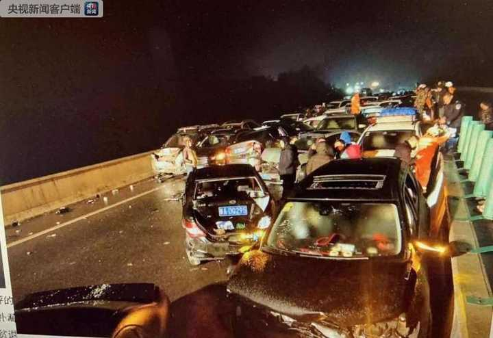
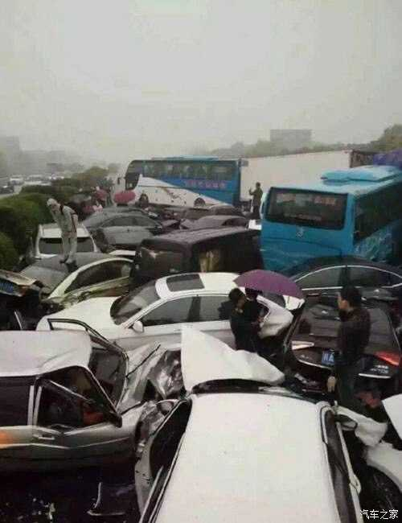
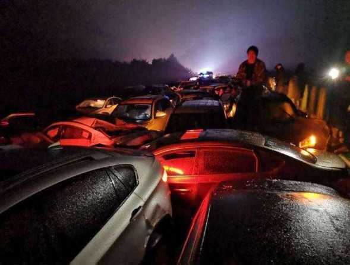
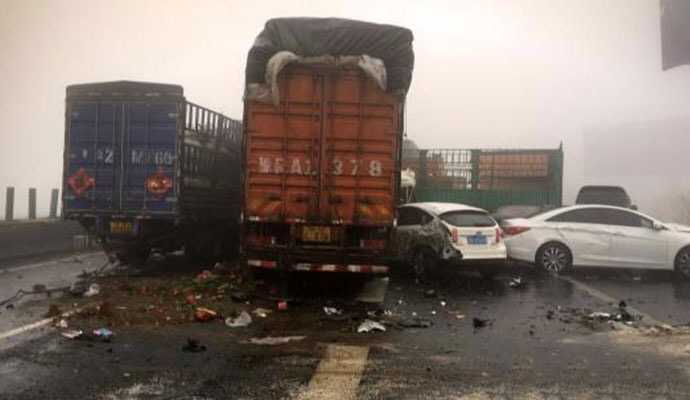
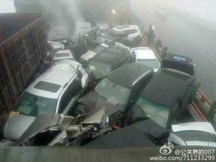
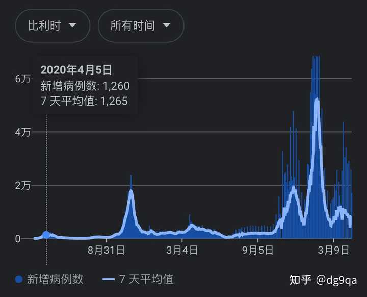
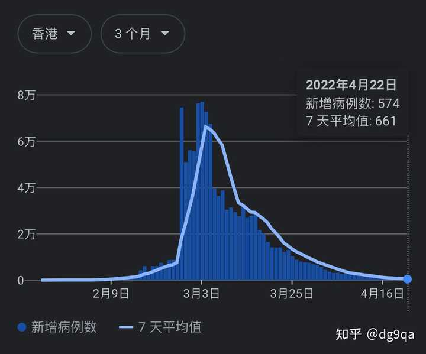
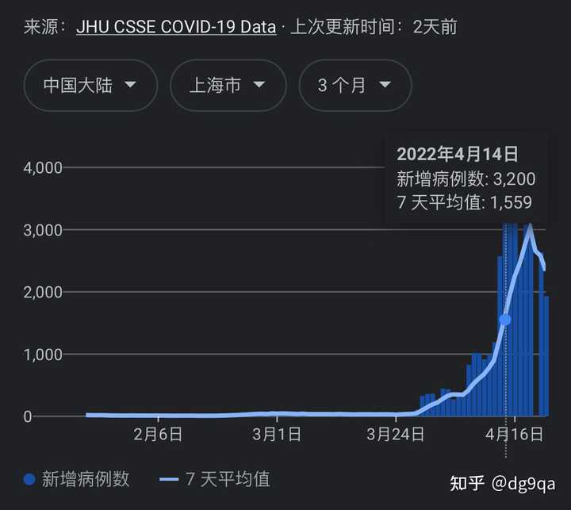

# A10　国家法律犯罪与司法　第 1 册（共 2 册）

- 专题代码：A10　专题名称：国家法律犯罪与司法
- 专题界定：国家制度、公民义务、犯罪、刑罚、司法、警察和司法程序。
- 本册：第 1 / 2 册　收录 138 篇　正文字符 135,072
- 语料：`sooon-q9adg-articles-v2.jsonl`（4,305 篇）　SHA-256：`cdc9c271309e1d71d9708889a3a31f4777e0c339ea54c3753521894afdb8357d`
- 生成时间：2026-09-27T00:01:00.997126+08:00　排序：发表日期 → 源序号（全库唯一，不重复）

**标记约定**：`【待审】` 主题仍为暂定；`【排除候选】` 图片/正文过薄的剔除候选；
`【正文标注未完待续】` 作者原文自带未完标记；`【正文缺失片段（复核已记）】` 复核记录已确认的正文缺口；
`【图片缺 N 张】` 源图不可获取。标记只作提示，不改写原文、不改动分类状态。

---

## 4000　GDP增长

- 日期：2018-12-03　主专题：A10 国家法律犯罪与司法　副专题：A08;A12
- 源 ID：`d3a75cc2-d584-5afc-bf8b-7b2638c7bd72`　原文链接：https://www.zhihu.com/question/299080438/answer/544521904
- 23 概念标签：定义与达意;选择与自由;责任与后果;法律与秩序;生态与自然
- 证据状态：manual_confirmed　初读：read　独立复核：not_reviewed

**问**：GDP为什么一定要增长？

GDP增长最根本的原因，在于如果没有足够规模的战争、饥荒、瘟疫等事件破坏世界经济秩序的有效性的话，所有的国家都会有生产力上的改进。这会导致国家与国家之间对全球经济生态位的竞争。
别人增长了，你毫无增长，你很容易失去生态位，而成为被动者。
天下唯有德者居之，“德”是什么？是更完美的生产关系安排。而这最终是由现实的生产力水平来做证的。
你的GDP增长不力，你便无坐这个位置之德。任何对生产力负责的构建，都将因此失去自己的地位。
政府、社会制度头上一直悬着这把达摩克利斯之剑。
GDP一定要增长，否则轻则具体的政党要下台，重则就只剩下重大的社会动荡重建社会体制一种答案了。
刀山火海。
那是一定要拼命避免的。
这就是为什么GDP一定要增长。不是因为通胀，也不是因为“人民日益增长的物质需要”。那些只是实现机制，不是原因。

---

## 3954　弓禁

- 日期：2019-03-12　主专题：A10 国家法律犯罪与司法　副专题：A13;A12
- 源 ID：`7191d0c0-b8e8-5f0d-be38-ccb5314aed2e`　原文链接：https://www.zhihu.com/question/315354880/answer/620259352
- 23 概念标签：能力与学习;选择与自由;责任与后果;成本与总账;法律与秩序;权力与异议;技术与工程;文明与历史;心理与主体
- 证据状态：manual_confirmed　初读：read　独立复核：not_reviewed

**问**：为什么中国允许公开买卖复合弓和反曲弓却禁止复合弩和反曲弩？

没有延迟发射的板机结构，弓只不过是一种单纯的人体能量转换器，同样的威力完全可以用标枪实现。而且相对于标枪，弓还更加难以掌握。
这话翻译成大白话就是：你要杀人伤人，用弓的效率远不如用木棍、石块、菜刀或者标枪。终究那用的是你的体力，没有额外加大你的能力——甚至因为技术难以掌握，还要把你体力原本能发挥出的威力再打个折。也可以说一箭的威力，本质上只是你打出一拳所释放的能量换了一个形式，即使略大，也不会大出几倍来，因为拉弓蓄力的肌肉本质上也就是外摆拳所涉及的肌肉群。
带上延迟发射板机机构就是另一个故事了。举个例子来说，弩可以用腿蹬开，那就是你原本做不到的能量输出了。要是加上绞盘、棘轮、杠杆、这些辅助，还能更加提升你的蓄能。因为你可以动用整个腰、背、腿部肌肉群，可以动用身体体重，并且还能借助机械多次累加，那就不是一拳的能量了，而是可能数倍于此，已经接近小口径手枪的出口动能了。杀伤力自然不可同日而语。
第二，板机大大的降低了射击难度。一个弓手瞄准时，两背之间绷着满弓状态最大的张力，瞄准难度非常大。而带延迟击发的弩，瞄准起来轻松愉快。这意味着后者用于刺杀要远比前者容易掌握时机。
第三，国内是禁止使用猎箭头的——带宽刃的箭头被视为管制刃具。而靶箭头的穿透力虽然好，却杀伤力很小。将靶箭头拔出，留下的伤口近乎看不见——本来直径就只有七毫米左右，拔出后肌肉组织回弹就几乎看不出来了。出血面很小。要说有什么严重的杀伤，一般是指肺穿孔造成气胸或者肺积液，胃肠穿孔导致消化内容物外泄感染。很少是造成血管破裂大出血。前两者都是缓症。对于杀手来说都是很糟糕的选择。所以禁止掉猎箭头就可以了。这就好像也只会禁止带刃的矛头，而不会禁掉长棍一样——虽然恐怕夺命书生不太赞同。
第四，能练到用弓箭有把握的杀人的高手，基本不太可能那么隐形，要抓转眼就抓到了。剩下的可能就是水平根本没这么高，却自信爆棚要用这个办法玩火——这种智商意味着他也难逃法网。
第五，就我所知，现代国家还没有管制弓的先例，在世界各国都是合法的。出这个头恐怕有点不太光彩。
但我对滑轮复合弓持保留意见。

---

## 3941　废死

- 日期：2019-04-15　主专题：A10 国家法律犯罪与司法　副专题：A11;A20
- 源 ID：`3701390c-7f2f-56a6-a126-97ba2e892f4f`　原文链接：https://www.zhihu.com/question/20023973/answer/651499343
- 23 概念标签：能力与学习;选择与自由;责任与后果;成本与总账;财富与市场;法律与秩序;权力与异议;文明与历史;性别与身体
- 证据状态：manual_confirmed　初读：read　独立复核：not_reviewed

**问**：为什么要废除死刑呢？

为什么废除死刑是人类文明应该追求的目标？
因为死刑是个巨大的伦理黑洞。
人类社会面对的任何问题，都可以视作一种系统压力。我们的社会体系犹如建筑结构，每个成员可以承担自己能承担的部分，然后向其他关系人传递一部分压力。这种传递压力的能力，无论是在逻辑上还是在实践上，都是永远偏向占有更多社会资源的上层社会成员的。
举个例子——后金入侵，天下纳辽捐。官员们先知道消息，去钻营征税的肥缺；官员的亲属和附庸们提前占位，抢占种种合法免征条款；唯有既无功名、又无势力的平民们无计可施，硬扛摊派，乃至于还要扛上火耗。
层层“损耗”扣下来，辽捐滚了几倍，没有均匀的被整个社会承担，而是由社会里最无抵抗能力也最无支撑能力的成员承担了。
结果呢？结果这些人要么成了饿殍、填了沟壑，要么成了“反贼”，“流寇”。
血债累累的流窜连环杀人犯，该不该杀？占山为王的拦路抢劫杀人犯，该不该杀？
“当然该杀呀！这要是都不杀，那还要法律干什么呀！说不该杀的，让他们杀几个你的家人，看你想不想杀他们？”
被他们抢的，觉得他们该杀；上头也觉得该杀；害怕他们有一天杀到自己头上的，也觉得他们该杀；连他们自己，杀多了人，也在内心深处觉得自己该杀。
然后我们派出官军，依法处决掉他们。
这个社会神奇的恢复了“完美的正义”。
那些层层叠叠的压力转嫁者们呢？
没问题啊，不信你仔细看看——每一层都有理有据，合理合法。
秀才免征？国家法度啊，鼓励教育啊。
官员免征？官员俸禄来自转移支付，来自税收收入本身，反复征收岂不是有神经病？
地主加租？私有财产，你租不起可以不租啊，凭什么人家不能加？
挤粜卖米换银交税，米价大跌？公平买卖，凭什么买家不能砍价？谁出的价高你卖给谁好了。
你去买粮太贵？低买高卖不是交易自由吗？凭什么我要便宜卖给你？谁便宜你去谁家咯？
看不懂契约？谁叫你不识字？
被额外加征了不懂得上告复议？告示贴在府城里，又没不准你去看，你自己不知道、看不懂，怪得谁？
但你不交税，不纳捐，就是罪了。
你偷窃，那就是罪了。
你抢，那就是罪了。
你伤人杀人，那当然是罪了。
你拒捕，当然是罪了。
转移压力的每一层都是没有罪的。所行的都是合理合法的、是自由的。
你作为压力链条的最后一节，谁叫你不好好学习呢？谁叫你不努力呢？谁叫你没有一个好身体呢？谁叫你没有构建起足够的人脉网络呢？
你穷，不是你“可以犯罪”的理由，不是吗？
你无能，不是你伤害别人的理由，不是吗？
你没有机会充分发展自己，但这难道该由这个社会的其他人来负责吗？谁不是两个肩膀扛一个头呢？
大家都没有犯罪，你却犯罪了，按律当斩，于是你被清除了。
你结成“义军”所屠杀的富人的资产，现在已经变成了无主之物，显然应该收入公库。
转完一大圈，无意之中形成了一个无懈可击的“绞肉机解决方案”，你们看见没有？
我们不需要对任何社会问题作出任何努力，只需要“合理的设计”，自然而然会排挤出一批人来用生命替这些问题买单。整个路径上没有任何人“有罪”，有罪的永远是那些没有条件继续击鼓传花的人们。除了这最后一棒的倒霉鬼们之外，所有的人都只是在实行合法的自由啊！
这真的是合法的自由，不是开玩笑，不带一点讽刺，确确实实是每一个合法公民有权做出的合法的选择。
但是我们所有人的合法选择，会自然而然的将压力传给一群没条件像我们这样做的人，把他们撞倒在我们的车前，碾压在我们的履带下，背负着我们的仇恨，成为我们在凛冬里欣然焚烧的薪柴。
真的，按照法律，“李自成”们杀光就好了。“陈胜吴广”们，都是不折不扣的违法犯罪分子，绝对的按律当斩啊。秦律残暴又如何？凭什么“大秦”的良民们要去降低诛杀的门槛去放纵那些罪囚？失期就当斩，这是明文的法律不是吗？你不但不服从法律，你还进一步烧杀掳掠，你难道还不是当斩又当斩？
“大秦”的“错误”，仅仅只是错估了自己的军事动员能力，不小心把处决的线设得太高了，以至于“按律当杀的恶贼”的数量不小心超过了良民们，所以才覆灭。
是不是只要我们接受这个“教训”，始终确保执法的一方能击溃一切犯罪一方可能有的反抗，那么实际上这条杀人的红线设在哪里有什么关系呢？
无论什么样的社会问题，我们都可以通过处决一批最后被迫犯罪而确实“按律当杀”的罪犯来解决。
杀掉他们，问题就随他们而去了——谁叫你们没有不犯罪的余地呢？
你们看懂为什么人类文明要把追求废除死刑作为道义上必须追求的目标了吗？
你可以说“现在我们还没法完全不依赖这些罪人的毁灭来应对一切社会问题，如果我们强行这样做，我们的社会体系会出现巨大的坍塌性问题”。
你可以这么说，但请你不要把这当成永久的解决方案。
因为“缺少像别人那样转移危机的能力”并不是罪。
我们没有罪，是因为他们很不幸的被选中，把我们的罪背负了。
我们的无罪，与我们的道德关系甚微，而更多的只是因为幸运！
我们不应该对这个“绞肉机解决方案”心安理得！
我们之所以还不能废除死刑，是因为我们的社会还没有发达到能在压力传递到最无助的人群之前就消解掉它。是我们还太无能。
但这种无能，不应该被【接受】。
所以，我们要一次又一次的、坚持不懈的尝试废除死刑。
哪怕一次次的反复，也要一次次的再次尝试！
这是“无罪”的人欠他们的。

---

## 3939　活死人

- 日期：2019-04-21　主专题：A10 国家法律犯罪与司法　副专题：A11;A05
- 源 ID：`381d6a26-dee8-5f21-99ec-0c746f947dc6`　原文链接：https://www.zhihu.com/question/288403977/answer/658358536
- 官方对象—实践路径：与社会 / 与文化 / 批判
- 23 概念标签：能力与学习;选择与自由;责任与后果;信用与信任;爱与回应;照料与家庭;法律与秩序;技术与工程;文明与历史;心理与主体
- 证据状态：manual_confirmed　初读：read　独立复核：not_reviewed

**问**：如何评价电影《祈祷落幕时》？

电影本身的素质尚可，除了结尾的安排有些匪夷所思之外，没有多少硬伤。
不过整个电影看完，心里是悲凉的。
这整个片子，极力在渲染温情，渲染人与人的羁绊，渲染“牺牲”，实际的结果，却是在渲染一种恐怖。
你们意识到没有——所有的剧情都是由对罪与责的恐惧推动的。
最初，忠雄的妻子偷了印章借了债，他落下了债务责任，他就选择了出逃。
第二次，逃亡途中幼女杀掉了意图性侵的男子，浅居忠雄选择了毁尸灭迹，冒名顶替。
第三次，被女儿的老师发现，选择了杀人灭口。
第四次，被女儿的旧同学发现，再次杀人灭口。
一切只需要挂上“为了保护你的成长”之名，就都成了正当的了，成了“爱”了，成了伟大的“牺牲”。
最后的高潮，忠雄来个一死百了，完美结局。
这里面有几个很大的问题：
第一，最初妻子偷印章借债跑路，为什么不走分清责任的路？女儿杀人，明显存在自卫情节和年幼情节，为什么不走正常的法律路线？
我们似乎毫不费力的就理解了这背后的苦衷——“因为我虽然无辜，但恐怕证明起来有风险，我无法相信官僚机构的能力与态度”。
因为人世间的正义承诺不可信，所以我们只要有一点对证明清白的不自信，就不敢把自己交付给这些颟顸无能的机构审判。
人人对此都心知肚明。危难当头，宁可亡命天涯、毁尸灭迹也不选公事公办，露出了浅居忠雄这个实底。这个选择悄无声息的被观众们“自然”接受，露出了整个东亚社会的实底。——观众认同他处在“合理”的“走投无路”状态下，于是把他的一切行为都视作“走投无路”前提下的自我救济，于是在道德上和情感上都宽免了他，为什么要宽免他？因为实际上是在宽免落入这境地的自己。
可悲的是这种认同发生得如此自然，了无痕迹。
这种普遍认同的背后，是对人造的正义不假思索的普遍否定。会认同这选择的人太多了，以至于法律变成了一层遮不住羞的轻纱而已。
有多少人会在真正的关头去相信由人作保的正义呢？
第二层，这剧情揭露了一个更苍白的事实——人类的律法，抵抗不了“必死的觉悟”。
一个利益团体，只要有人抱定了必死的觉悟，法律体系对于这个团体而言就是一个可以榨取巨大利益的淘金池。
我可以替你扫除一切威胁，顶掉一切偿还义务，神挡杀神、人挡杀人，只要我最后一死相谢，问题就都解决了。
如果最后浅居忠雄完美自杀，那么一切的罪就都随他而去了。浅居博美将没有任何可以被追究的罪，可以安然的享受她的人生。不是吗？只要曲婉婷的母亲认罪伏法，曲婉婷就可以安然的歌颂伟大的母亲，不是吗？
我身为绝症患者，可以英勇的选择为家族贩毒，只要我最后被绳之以法，一切的罪也就随我而去了，不是吗？
一个有了为“兄弟”献身念头的绝症患者、重刑逃犯、巨债缠身者或者无论因为什么原因已经难逃一死的人，实际上是对法律免疫的。
如果法律就是正义的最后一道防线，那么正义已然被消灭了。
所以，古代国家才普遍实施了家族连坐制，非如此不能真正解决这种“活死人策略”。而在基督教国家，则依靠永生信仰和剥夺永生的机会为威慑来解决活死人问题。这两者背后的理由是一样的——东方只是在借着家族和血脉实现永生。本质上都是在用永生为威慑，在平衡活死人们的利益计算公式。
历史的发展我们已经知道了，现在是后者发展成了现代社会法律体系。
问题是，那位担保永生的却被越来越多的人抛弃了。若是没有永生和对失去永生的顾忌，要拿什么来抵御新的“活死人策略”呢？
其实，我们都活在僵尸的世界里，现实就是一出真实的“活死人黎明”。
或迟或早，当世界陷入足够的困窘时，“浅居忠雄”们会群体出动，抱着必死的决心，“迫不得已”的为自己的子女们寻找新的养料。
那时候怎么办？去复活“族诛”的大刑吗？

---

## 3920　富豪的香港

- 日期：2019-06-16　主专题：A10 国家法律犯罪与司法　副专题：A08;A07
- 源 ID：`6468c318-4b48-5250-a604-501d7f8068eb`　原文链接：https://www.zhihu.com/question/324538379/answer/717053346
- 23 概念标签：事实与证据;能力与学习;选择与自由;成本与总账;劳动与组织;权力与异议;技术与工程;文明与历史
- 证据状态：manual_confirmed　初读：read　独立复核：not_reviewed

**问**：香港为什么可以成为富豪聚集地？

看了下，大部分的答案都是说“香港有很多适合富豪的环境条件，所以富豪多”。
这是恰恰把方向想反了。
香港适合富豪的条件多，是因为香港事实上是一座富豪管理的城市。
给你们一个数据——根据2017年彭博亿万富翁指数和IMF的GDP统计数据计算，香港前十大富豪的个人资产总量约相当于香港年GDP（3414亿美元）的35%。
什么叫作“只手遮天”，你们体会一下。

这座城市有高度亲富豪的环境，是因为这是富豪们亲手塑造的结果。
是因为富豪手里有重大的实际权力，所以香港才变得特别适合富豪，而不是香港很适合富豪所以才有富豪。
事实上，香港的富豪并不多。兜兜转转全是几大豪门及其附庸。
如果你把比尔·盖茨的所有亲戚都算成亿万富翁，你也会觉得盖茨他们家“有很多富豪”。
实际上盖茨家就盖茨一个富豪。
香港不是“富豪很多”，而是富豪太少。少不是说数量太少，而是派系太少。缺制造业大亨，缺知识产权业大亨。而这几类人是会强力反对地产霸权的——地价太高对于招揽人才和降低产品成本、研发成本是致命问题。香港本来完全可以成为全球研发中心、品牌中心。现在成气候的香港品牌有谁？说起香港品牌，一眨眼能想起的不是银行、保险公司就是地产企业吧？其他也就是屈臣氏了。
正是因为这样，缺少多元利益诉求，香港无法形成真正有效的民主治理。只是同样的几个立场几乎一致的寡头各自分出八只手，假装有N个独立代表而已。
它在很大程度上只是走了特定形式的寡头体制。
下面全部是随便聊聊了：
不要认为我现在是在主张“推翻寡头统治”。任何一个社会都有它自己的历史路径。泰坦尼克那样的巨轮，要转弯只能慢慢来，想要强力迫使它转弯，净效果如同安排它撞冰山。
但是长远看，香港想要摆脱现有的下滑轨迹，唯一的选择是和平过渡到真正的港人治港体制。十大富豪等位35%GDP这种情况是不正常的。在这个状态下，目前的香港体制实际上是失效的，已经成了实质的“选帝侯体制”。
这极少数的人员集团实际上已经通过不受管控的房地产垄断绑架了香港经济。无论香港如何发展，他们只要一句“加租”就能将一切增长据为己有。无论立法与行政机构打算采取何种行动改变权力结构，ta们一句“加租”就能掀起“民意”，令其归于无有。
这才是香港祸乱之源，不是大陆，也不是什么活见鬼的“被深圳取代”。
香港的地缘优势仍然是不可取代的，前途仍然是不可限量的，但是目前实际上是陷入了僵局罢了。
破局的上上策，反而是寄望于真正懂得关注自身命运的香港人民——渐渐真正学会珍视自己的权利，了解自己的权柄，在思想上、意志上、组织上成熟起来的香港人民。
最上策，是实现真正的港人治港，以真正的港人治港取代“港豪治港”，这才是香港的前途所在。
如果得以实现这一愿景，则五十年期限就算到了，香港特区也可能继续作为健康的安排延续下去。
希望香港人自己及早的看明白这一点。

---

## 3900　征信体系

- 日期：2019-08-21　主专题：A10 国家法律犯罪与司法　副专题：A08;A03
- 源 ID：`c0f1ba80-af0b-52ca-96f7-0ccc89da8928`　原文链接：https://www.zhihu.com/question/341338492/answer/796914277
- 23 概念标签：事实与证据;能力与学习;成本与总账;信用与信任;爱与回应;财富与市场;法律与秩序;心理与主体
- 证据状态：manual_confirmed　初读：read　独立复核：not_reviewed

**问**：如何看待行人闯红灯、错误垃圾分类等行为被纳入失信记录？

其实呢，如果能把这些东西纳入征信，对于大部分民众来说是有好处的。
之所以产生恐慌，是因为似乎这样就会有大量的人没法保持完美的征信记录了，这样就糟糕了。
但是仔细想想看——这真的是件坏事吗？
打个比方——之前高考只考五十道题，除了很少数的倒霉蛋，大家几乎都可以考个八十分以上，于是大家都觉得很开心。
现在突然来一个新主考官，说要给高考加两百题，而且还有不少难题，要确保几乎没人能考满分，要让所有人的细微的能力差异都转化成名次差异。
学生们简直翻天了。——这个答案下看到的各种嬉笑怒骂的批判，其实本质上就是这种“学生翻天”，不是吗？
但这真的是一件坏事吗？
说白了，以前其实60分就是满分。你再好，也只是跟绝大多数人差不多。这也许在心理上让你觉得很安全，但是实际上也意味着作为优秀的公民你无法有效的获得社会资源的倾斜。
这种“普遍完美的征信记录”，只会意味着所有人的贷款额度都低。
如果你是一个确然的守法公民、高尚的个人，那么将更多的事项纳入征信对你肯定是相对有利的。
出现“普遍征信不完美”，从征信体系本身的功能而言，不但不是征信体系会“废掉”的负面表现，恰恰相反，反而是银行和管理机构很希望看到的变化。
那意味着ta们放款风险更小，也意味着好的征信记录更值钱。
所以根本就不能从“那样大家征信都不干净，征信还有什么鬼用”的角度去批评这个政策。
真正的问题在于影响到征信的事项，必须给予充分合理的证据采集、辩方申诉和独立复核机制——涉及到人的信用评估了，就不能走简易程序了，否则这个评判方会拥有极大的伤害人的社会生命的能力，自然也就有了极大的寻租空间。而要规规矩矩的增加征信事项，则意味着要增加大量的审查机构和执法机构，要增加社会成本。
只有在征信体系质量提高所带来的效率扣除掉这个社会成本能有余额时，这事才是有利可图的，所以不能轻易的拍拍脑袋就上。
但一旦确认有利可图——譬如证据收集具有天然的便捷性和明确性——则绝对是要尽量增加的。
事实上，无数的企业、商家在对待自己的员工和客户的时候设定了大量的内部征信机制。这甚至是不由得你来选择的。譬如支付宝里的所有的租赁服务都被纳入了阿里家的私家征信，你不信借个充电宝不还看看你的芝麻分降不降？
而你仔细想想，阿里这些自设征信项对你——假设你完全没考虑过借东西不还的话——是好事还是坏事？
即使有某一项是只有极少数人才能达到的——比如ta悄悄加一条“年消费超过五十万”，百分之九十五的人都到不了——对你真的就是坏事吗？
条数多了，自然会出现某种很难到达但是你却能达成的条件。ta想要ta的精准评估，你想要你的脱颖而出。
哪里不好？

---

## 3891　谴责恶行

- 日期：2019-09-13　主专题：A10 国家法律犯罪与司法　副专题：A11;A03
- 源 ID：`81be527e-8c52-5e2e-94a4-a2753f87ca8e`　原文链接：https://www.zhihu.com/question/344397380/answer/822009420
- 官方对象—实践路径：与自己 / 与原则 / 变通
- 23 概念标签：定义与达意;能力与学习;选择与自由;责任与后果;成本与总账;爱与回应;权力与异议;文明与历史;心理与主体
- 证据状态：manual_confirmed　初读：read　独立复核：not_reviewed

**问**：人类很多不道德行为是由基因和大脑物质决定的，不是自主做出，那我们为什么要谴责恶行？

人们谴责恶行，有两层原因：
第一层原因——出于一种难以遏制的本能反应。
即所谓下意识的报复、无理性的打击。这一层反应根本不是思考的结果，而仅仅是如同膝跳反应一样的自动过程。
无缘无故，就是感到心中有一团火，不吐不快，于是一吐为快。
但是，如果你站在一个超然立场去看，你就会发现人的这种不可自控的自动反应虽然没有正确的反映人的意志，但却巧妙的、曲折的反映了“人类的设计师”的意志。
就好像人类的设计者因为要控制人类社会的发展和结构，而有意在人类身上设计的一种人类自己无法反抗的自动机制。一种嵌入系统底层，人类的显意识作为操作系统的应用层无法真正干预、无法自行关闭、无法隔离、无法令其睡眠的强力底层机制。
你将不能靠自我教育真正学会对同类的悲惨遭遇无动于衷，你将不能靠个人意志避免在对同类施加迫害时沾染心理疾病，你将不能忍耐某些现象，哪怕有无数的典籍和宣传告诉你这是合法的、有正当程序的、甚至是十足正义的。
因为这种反应极其原始，它经常被误触，甚至可以说在大多数时刻它如同原始的滑膛枪那样没有准头、屡伤无辜、出乖露丑，令人饱受其扰。
但是，真正到了最后的关头，它却是一切暴政最终也无法对抗和阉除的最终防线。
它才是最早而且也是最终的恶行谴责者，在这一层里，人类只是一个肉体扬声器罢了。
而对于人类，因为实际上无法干预它的运转，也就无从去从自己身上找原因了。
当然，你也可以非常“尼采”的把这看作“自然进化遗留的人类尚未达成完全自我控制的残留”，立志总有一天完全将之纳入显意识的统治之下。
但是你要记住——显意识是非常懦弱、贪婪、傲慢、片面，于是最终本质愚蠢的东西。那个你控制不住的本能要比它勇敢/顽固得多。
人的显意识，其实是富贵能淫、贫贱能移、威武能屈的东西。它只是善于组织语言打动陪审团。你把那点最终的控制权交给它，那么将来统治者只要足够有钱、足够狠辣，将再也没有人会有无法遏制、宁可面对死亡也不能不表达的愤怒可言了。
你要知道，世间无数的孜孜不倦慷慨赴难的仁人义士在面对恐怖之时都曾经面对过富贵之淫、贫贱之移、威武之屈，ta们都不傻，ta们的理智绝没有天真到认为自己可以造反当上皇帝最后一本万利。
ta们只是做不到用理智的计算压抑自己沸腾的本能痛苦，不能不做一些事情去让这种痛苦好过一些。理智的说，除了这种无法自控的痛苦，仅仅从个人收益上说，他们实在是不该去做那些抛头颅撒热血的事情的。
出于这个原因，我们现在这些活着的人都有一个额外的理由去原谅出于本能冲动而乱放枪的年轻人——因为这种“误伤”和那个最终保证我们不会长期被暴政统治的机制是一体两面的。
我说原谅，不是指放纵，不是指不去提醒，不对其造成的损害追索赔偿（其实原谅本来也不包含这些东西，那只是东亚的糊涂“原谅观”自以为一定要包含在原谅里的必备件，这是另一个问题，不展开）。
我说原谅，是指最终心里对之存一份柔软。如同对待失意纵酒的老超人一样——过去他拯救过人类，将来还要指望他拯救人类。

第二层——出于人类对暴力的信奉。
人类是本能的暴力信奉者，这个是没有什么可辩解的余地的。
我们来不妨做个小思想实验，一探究竟——
你们想过吗？事实上我们的一切公共政策都可以采用“奖励做得好的人”的方式，而不用“惩罚做得不好的人”的方式。
但我们极少会真的去探讨权衡这种选择，而会径直去选择后者。
我可以直接预言——在评论区里迟早要出现对“这里还存在选择”这个说法本身嗤之以鼻的人，而且还为数不少。
其实，前者远没有人们想象的那么昂贵和无效。不过，这不是这个测试的重点。
重点是，绝大多数人都不是经过严格的思考和演算而推出前者无效，而是听到都会大吃一惊——这太荒唐了吧？这怎么可能？
要注意，我在谈论的根本不是这两个政策到底谁更优，而是绝大多数人是如何排除前者的——要说服ta们使用后者，何时需要过严谨的计算？
我们不假思索的总是选“罚恶”而不选“奖善”，其实已经告知了我们的这种盘算，也就正是我们为什么会故意仍要用攻击性的威慑去震慑客观上作出危害群体的举动——哪怕科学研究表明其实这些行为背后最终并无主观可追究的动机。
因为我们相信这样会“有效”。一代一代“治乱世用重典”的王朝在人的面前轰然倒塌，也没有办法动摇人的这种相信——人们如何总结这些崩溃？——“那是因为他们重典用得太晚、用得太窄、用得太软”。
也因为我们“无法想象”它可能其实是无效的。极少有人会去仔仔细细的想一想这些暴力是不是真的是有效的，有没有可能是暴力窃取了别的什么因素的护国之功。
会不会世界其实是依靠别的力量维持的，暴力只是自称那是它的功劳？
你真的想过这种可能性吗？你否决这种可能性的论证，你有仔仔细细的想过它自身是否足够严谨吗？还是不拘如何，略略一打眼，你就快速的“用脚趾头想也知道这是对的”，然后盖上了“我就知道是这样”的大印了？
脚趾头毕竟不是思想器官。虽然你天天用它决定各种事，但请相信，它真的不是思想器官。
我去，这句话又会有很多人要用脚趾头来想。
很多人都在问，什么是爱？
这里其实有一个简单的判定法——在否决爱的选择时，人有没有殚精竭虑的去为它算、有没有竭尽全力的去为它每一点哪怕虚无缥缈的可能性去争取、有没有毋宁赌上一些真实的付出去赌那算不出来的因果最终的结果会是正面。
这就是爱心。
人为什么在成熟到能基本控制本能冲动之后，仍然定意要用谴责的方式尝试抑制问题？
因为我们都爱心有欠。

---

## 3884　请勿吸烟

- 日期：2019-10-13　主专题：A10 国家法律犯罪与司法　副专题：A08;A06
- 源 ID：`3b9fa9f6-ab22-5335-a042-f8dadaa5de71`　原文链接：https://www.zhihu.com/question/19584139/answer/855246586
- 官方对象—实践路径：与合作者 / 与服务者 / 验收
- 23 概念标签：定义与达意;能力与学习;选择与自由;责任与后果;财富与市场
- 证据状态：manual_confirmed　初读：read　独立复核：not_reviewed

**问**：公共场合不应该抽烟，我们个人制止公共场合吸烟的最佳方式是什么？

如果是在餐厅，就举手招经理过来问——老板你们这里禁止吸烟吗？
如果回答“没有”，那就站起来走人。
这个不是吸烟人的责任，而首先是老板的责任。
多一些人当这种“站起身离开”的顾客，才能教育好这些店主，给他们动力采取措施解决问题。

---

## 3875　幼稚权

- 日期：2019-11-14　主专题：A10 国家法律犯罪与司法　副专题：A20;A03
- 源 ID：`e1bfc2ea-b7f1-58f1-b7ff-8ce1e8e42c42`　原文链接：https://www.zhihu.com/question/355613206/answer/893427036
- 23 概念标签：定义与达意;能力与学习;选择与自由;责任与后果;成本与总账;边界与许可;劳动与组织;财富与市场;法律与秩序;技术与工程;文明与历史;生态与自然;心理与主体;宗教与自然法
- 证据状态：manual_confirmed　初读：read　独立复核：not_reviewed

**问**：如何看待香港大专学界发言人邵岚接受外媒采访时称，「不会谴责任何抗议者的暴力行为」？

她没有明白一个问题——在亚洲，无论是普通个人，又或者是政府、自治体、作为群体的民众，都没有幼稚的权利。
如果我们用一个简单的标量来表达一个国家的精神财富——文化资产。
暂时就叫它history指数吧。
那么一个国家的history指数可以表达为“历史常识的信息量”x“国民人数”。
把这个数值算清楚，那么我们将很容易看到，论及秉赋，东亚最大的资源，就是不幼稚。
不幼稚，才能省掉低质量而高代价的尝试，才能有整体稳定的群体情绪，才有根本的稳定性可言。地质板块在各种短期冲击下能保持稳定，而不是随时地震，才是在其上有所建设的基本前提。而这种不幼稚的集体心理状态，就是社会结构的“地质板块”。
但这个“不幼稚”，是没有捷径的，是必须要靠对历史的接纳和内化来造就的。
成为一个中国人，不可避免的意味着将中国三千多年所积累下来的集体回忆内化为你自己的精神内核的一部分。于是那些历史上的古国所上的当、所犯的错、所受的屈辱，才在深刻的意义上变成了你感同身受一般，变成了某种意义上你自己曾经上过的当、你自己曾经犯过的错、你自己所受过的屈辱。由这些感受所转化出的经验和教训，会自然而然的成为你自己行为模式的底层结构，成为你的“精简指令集”。毫无疑问，内化过程的完成，能在极大的意义上减轻你的幼稚病——你获得了与你个人生活经历所不对称的成熟。
这样的千万个你集中在一起，你们作为集体，才呈现出可以期待、可以依赖的集体意识的成熟。
是这种成熟、这种集体性的“与个人经历不相称的少年老成”，构成了东亚社会的最大资源。也是东亚这样一个人口极端稠密、人均资源永远低于世界平均水平的地区里，各个自治体得以长期立足于这个江湖的基本资格。
气候和地理原因决定了东亚的人口密度太大，以至于论任何物质资源都自然相对短缺，唯一可以真正依赖的关键要素，就是集体性的成熟。必须依赖集体性的成熟来对冲短缺的威胁，必须依赖集体性的成熟来进一步在短缺的前提上进一步的抵抗入侵、灾害等等偶发性的重大挑战。
换言之，在东亚，集体的成熟是任何自治体的存在资格。
你想要自治，你就要打通十八铜人阵，获得可以继承的能有效创造“集体成熟”的文化资产。
而这就是香港最大的悖论了。
香港最尴尬的问题就在于，她想要长期有效自治，就必须拥有这种文化资产。
而香港自身没有这种文化资产，完全没有。
于是只有向外寻求。
而要获得这种文化资产，唯一可行的解决方案就是承继中国的文化资产——也就是通过成为“中国香港人”，而领取中国数千年的智慧财产权。
理论上存在第二条路，那就是作为自治体，自己在数次乃至数十次的反复碰壁的路线斗争中慢慢学会什么是绝对不可以的，什么是必须要坚持的。但走这第二条路所需要的本钱，绝非香港自己所能支付。作为中国的属地，作为一个无险可守、无纵深可言、无自然资源可用的弹丸之地，没有任何其他实体能够有效的借贷给她这笔无法省略、也无力归还的本金。
这才是英国不得不放弃香港的真正原因——因为它需要扶着才能站立，而英国扶不起。
这导致香港如果想要作为自治体长期存在，唯一的可能性就是需要北京帮助。
哪怕在gd最美好的梦想里，他们的“独立”也必须要依靠一个极度善意的北京的善意接受和努力支持才能存在。
而且哪怕是在这个狂野到极点、退了一万万步的美梦里面，还是会出现如同现在台湾一样的窘境——理论上你可以走完全部民主流程，但实际上如果美国表态——甚至只是暗示——不支持某个候选人，这个候选人就会连初选也过不去——本质上仍然是地方推举，强者背书。到时候的自我审查、自我限缩，甚至要比现在的指派制更加苛刻和入微。
如果现在觉得无法忍受，那时候将更无法承受。
于是、gd就成了一种需要谋求脱离的主体额外赞助才能达成的脱离，一种需要被攻击的对象帮助才能完成的攻击。
这是一条咬着自己的尾巴想把自己吃掉的逻辑鲨鱼。
作为一个整体，香港人因为种种原因一直都保持着一种“幼态”。
这位发言人的言行只是这种幼态的典型表现，由此带来的人生曲折，是他们自甘幼稚的选择所无法回避的代价。
世界上有一件事是确定的——幼稚无法长存。
人最关键的财富，是超出个人经历的成熟。
作为一个中国人，如果竟然在这一点上低于平均水平，这是尤其可惜的。
要认清楚我现在谈论的点是什么——
客观上，目的是自由的。
人在选择目标上有天然的自由，去评判那种目标是或者不是合法的、那种目标是或者不是正义的，其实在自然法的层面上是没有意义的。
有意义的是人的方案路线选择是否在逻辑上指向他自己追求的结果。
如果逻辑上不存在这种可行的路径，那么就要认识到那个目标实际上是“永动机”。
人如果选择“永动机”作为目标，然后认为一切的失败都只是努力问题、斗志问题、投入问题，人就是选择了一种自我毁灭。
最基本意义上的成熟，就是能看得见哪些是“永动机”，懂得“永动机”再美好也是无意义的，懂得珍惜自己的生命价值而不是去证明一个数学上就不可行的东西不可行。

---

## 3868　居留政策

- 日期：2019-12-11　主专题：A10 国家法律犯罪与司法　副专题：A17;A12
- 源 ID：`5e6bf097-3065-5755-906b-6c1ad5ebcad2`　原文链接：https://www.zhihu.com/question/358942594/answer/930873105
- 23 概念标签：定义与达意;能力与学习;选择与自由;责任与后果;成本与总账;边界与许可;劳动与组织;法律与秩序;文明与历史;民族与身份;心理与主体
- 证据状态：manual_confirmed　初读：read　独立复核：not_reviewed

**问**：如何看待中国将在长三角开展外国人永久居留政策试点？

知乎现在正常的声音怎么这么微弱？
开展外国人永久居留政策试点，有什么问题？难道中国打算一直做一个没有相称的外国人永久居留政策的奇怪国家？
世界上有几个大国没有外国人永久居留政策？
这是现在其它有永久居留政策的国家/地区名单：
阿根廷
澳大利亚（澳洲永久性居民）
伯利兹
巴西
文莱
加拿大（加拿大永久居民）
智利
丹麦
多米尼加
厄瓜多尔
西班牙
德国
危地马拉
伊朗
以色列
日本（日本永久居民）
马达加斯加
马来西亚
墨西哥
新西兰（新西兰永久居民）
荷兰
挪威
台湾
澳门
香港
巴拉圭巴拉圭永久居民
秘鲁
菲律宾
俄罗斯
南非
新加坡（新加坡永久居民）
瑞典
瑞士
泰国
乌克兰
白俄罗斯
英国
美国（美国永久居民）

中国是不如马达加斯加还是不如危地马拉？还是不如多米尼加、厄瓜多尔？

你们在焦虑什么？嫌自己落户上海比外国人难？谁跟你说外国人落户上海就比你简单？另外看清楚——这是“永久居留”，不是“入籍”。
作为中国的国民，你天生就有长三角的永久居留权。
户籍难落？户籍跟居留权是一个概念吗？
北上广深的各种漂们，有多少被“遣返原籍禁止入境”了？难道不是随你们一张车票就来，能漂多久随你们？北上广深这二十年翻了好几倍人口都是本地人生出来的？不是生出来的，那是哪来的？
难道你们觉得存在永久居留政策，中国就会大开国门随便任何外国人毫无限制的获得居留权？会任由几百万上千万越南人缅甸人老挝人如潮水般涌入？还是觉得有上百万美国人德国人在等着来跟你们争姑娘抢996的岗位？
现有的永久居留政策是当年特殊状态下防敌反特心态的遗留结果，早就与中国现在的开放政策不相称。大量外籍在华工作者生活在一种几乎荒谬的别扭状态下，造成的额外成本有相当部分是由中国经济在承担。更不用说中国作为世界经济全球化最大的参与者和最大受益者，相关行政成本还在日渐沉重，这些都是要财政负担的。
就为了你们这些阴阳怪气的、永远哄不开心的巨婴而不解决这些成本？
幸好这是在中国。

---

## 3869　安全的路

- 日期：2019-12-11　主专题：A10 国家法律犯罪与司法　副专题：A13;A08
- 源 ID：`88e2e0eb-6711-5cca-b0a3-f049eb97e7c7`　原文链接：https://www.zhihu.com/question/331468070/answer/930732245
- 官方对象—实践路径：与自己 / 与身体 / 维护
- 23 概念标签：能力与学习;选择与自由;责任与后果;成本与总账;照料与家庭;权力与异议;技术与工程;心理与主体
- 证据状态：manual_confirmed　初读：reviewed_needs_revision　独立复核：reviewed_needs_revision

**问**：为什么高铁这么发达了还有人选择走更危险更费时间的高速路？

主要原因更多的不在于人，而在于行李。有人可能有特殊的原因需要带很多随身行李，而在高铁——或者说一切公共交通工具上，携带过多随身行李都是一个很麻烦的事。
第二就是有人想要趁这个机会享受驾驶乐趣。这个自然也是公共交通提供不了的。自驾风景更好，有一种纵横天地、自由自在的体验。很多老司机其实是属于这一类。
你们把自驾的好处说得很多很透，在这个问题下的答案几乎一面倒的盛赞自驾，贬低高铁和公共交通，这真的令人担忧。
单就安全性而言，高铁自然是胜过长途自驾很多倍。
郑重建议，除非有非常必要的理由，否则不要在年节繁忙时段自驾上高速。
这一点，希望老司机们不要掉以轻心，不要以为自己技术好，对自己没啥意义。因为这个时段的事故往往不是你个人驾驶水平高超就能避免的。
当一个路段车辆密度太大，你会发现只要你尝试与前车留足安全车距就会有后车想要超车利用你留出的这段空间。他一旦强行插入，安全车距就立刻减半，完全失去了安全缓冲的作用。而你如果减速再拉开距离，几乎肯定有下一辆车会忍不住要去抢这个空。不停的被超车，会让你的驾驶感受非常紧张和疲劳。于是你几乎肯定会忍不住维持住一个插不进去的车距。
所以不管你技术如何，客观现实会导致你没有办法保持安全车距。强行要保持，会因为不断的被人别车头平添另一种危险。
但你别忘了现在你不是在市区道路上以40码缓行！也不是每隔500米就会有红灯让你停车再起步的行车节奏！你是在以80-120km的时速在车距不足以让另一辆车挤入的高度危险状态行驶！
一旦前面发生事故，除了最前面几辆直接目睹事故的车可能可以同时刹车，后面的车都是看到前车急刹，经过一个反应时间才开始急刹的。事故概率并不会随链条传递明显衰减！
几乎每一辆车都来不及及时刹车！即使你能刹住，你也不能保证与你身陷同一状态的高车速小车距的后车能刹住！你也不能保证后车不是超载货车，不是缺少经验的司机，不是刹车系统有缺陷的隐患车！
除非你的驾驶技术包含了“张开魔法结界”或者“短距垂直起降”，否则这跟你的技术无关！舒马赫附体也没办法！
如果遇到有雾、有霜、有小雪、有中雨大雨则更加会加倍危险。如果道路维护程度不佳，危险性还要更加高。
注意关键词——这种危险性与你的驾驶技术、与你是多老的司机无关。
要想在这个天气和交通流量下保证安全，其实只有一个合理的手段，就是道路管理者发布全路通告，临时把时速限制下降到40-60公里/小时。只有这个速度能基本保证出现事故不太会酿成重大连环相撞。但是，除非实现全线标识电子化，目前并没有多少手段能瞬间通告整条路的全部司机。这个手段实际上用不上。
所以，如果你明知高速公路车辆会很多，那么除非有非常必要的理由，不要走高速。
你可以不用带那么多行李，年假并不长，实在缺你就现买吧；你的年货可以快递；你可以到家后再租车，你觉得非常重要的那些体验另有解决方案，并不是非要靠自驾解决。你也没有必要非要把自己的车开回家去证明你是有车一族。
命更要紧，何况这还是全家的命。
你们相信这些司机全都不是老司机吗？

<!-- 图片：6 张，审读结论见下 -->

---

## 3860　低密度安全模式

- 日期：2020-01-06　主专题：A10 国家法律犯罪与司法　副专题：A20;A08
- 源 ID：`8d759a27-9772-518d-bf3c-78de82340c80`　原文链接：https://www.zhihu.com/question/364937204/answer/964442020
- 23 概念标签：能力与学习;成本与总账;爱与回应;劳动与组织;法律与秩序;权力与异议;技术与工程;文明与历史
- 证据状态：manual_confirmed　初读：read　独立复核：not_reviewed

**问**：IBM 工程师被抢身亡，为什么在美国湾区抢劫如此普遍？遇上了要怎么做才能最小化损失？

其实曾经中国人口密度低的时候也是这个状态，只是那是在两千多年前。
那时候就有方案了——
防祸于先而不致于后伤情。知而慎行，君子不立于危墙之下，焉可等闲视之。《孟子·尽心》
中国是因为人口密度高，导致了高密度共居的伦理。这种伦理里包含了强大的对暴力倾向的警惕和压制，所以导致了中国人的人身安全不容易受到威胁，负面效应是中国人的尚武精神和冒险精神也受到了普遍抑制。
美国一开始就是人人带枪的拓荒状态。普遍持枪的文化传统已经保证了美国人口密度无法提高到中国这个水平——持枪者住大筒子楼一定会出现帮派和地盘划分，出现“集体自卫”和“部落复仇”机制来提供一定的安全服务。而这种安全服务不依靠某种额外的收益是没办法维持的——于是就有保护费、违禁品（本质上是一种“行政垄断”产品）销售问题。
微妙的是，富人区实际上也在遵循这个模式，ta们有正规化了的“帮派”——警察；富人区也在收保护费——房产税；富人区也在销售垄断商品——只是ta们掌握了立法和国家主权、掌握了先进科技，所以不是借助犯罪的胆量和技巧来构建垄断优势罢了。

---

## 3861　美式安全

- 日期：2020-01-06　主专题：A10 国家法律犯罪与司法　副专题：A08;A17
- 源 ID：`840bd308-74b2-5050-bdb4-f4a4c18784d1`　原文链接：https://www.zhihu.com/question/364585397/answer/964127997
- 23 概念标签：定义与达意;能力与学习;责任与后果;成本与总账;边界与许可;财富与市场;法律与秩序
- 证据状态：manual_confirmed　初读：read　独立复核：not_reviewed

**问**：34 岁华裔工程师在美国遭抢笔记本电脑，追击歹徒被拖行后身亡，为什么会发生此类事件？是个案吗？

美国是一个高度依赖自卫来保证安全的国家，不能沿用在东亚社会里养成的安全观。
美国人对人的生命安全看得其实不重，并不像中国有一种“人命大过天”的观念。
在美国，人们重视的是基于契约而产生的责任。ta们并不是重视人命本身，而是重视常常因此而来的天价赔偿责任。
身在美国，你要顺着契约链条一路追踪下去，会发现你经常处在一种没有任何人要为你的某种死亡负责的状态。
这类问题，ta们往往用自购保险加免责条款的方式处理——先用免责条款请你自担风险，然后建议你购买保险以防万一。
就这样了。
如果要服务方为你的安全负责，那么这项服务一定是天价——坦白说就是把ta要买的保险拆成你的一人份，然后翻了几倍强制打包在服务费里卖给你罢了。
而即便如此，服务方仍然是受到有限责任公司制度保护的。说不定向你提供服务的企业根本就没有购买保险，就是打算一旦出事就破产了事罢了。
这样的好处是，美国人做起生意来胆子很大——因为各种风险都有一个可以预见的保底。哪怕闹出人命也有一个确切的数字——甚至这个数字未必很高。
坏处是美国在本质上就不安全，需要的安全意识、安全技能、安全投入都很大。

---

## 3854　民主专制

- 日期：2020-01-27　主专题：A10 国家法律犯罪与司法　副专题：A03;A07;A11
- 源 ID：`0b85308f-deac-5761-b763-896067c03ecf`　原文链接：https://www.zhihu.com/question/35615301/answer/987180766
- 23 概念标签：事实与证据;定义与达意;能力与学习;选择与自由;责任与后果;成本与总账;爱与回应;劳动与组织;法律与秩序;权力与异议;文明与历史;宗教与自然法
- 证据状态：manual_confirmed　初读：read　独立复核：not_reviewed

**问**：正确的专制和民主，哪个更好？

把“专制”和“民主”对立起来，其实是一种相当奇妙的表达。

事实上，这个世界上不存在真正意义上的“专制”，即使是传说中的“奴隶制”，“神权统治”，都并不是本质意义上“专制”的。

一切的制度都只是名义性的权力安排，在实践上，一切的社会制度都会不由人类自主的向它应有的机制靠拢。权力的设计在各个时代有着大量不同的理想图纸，它们是被后世的学者/政治家简化和抽象化出来的。在实践上，几千年来所有的制度在本质上一向都没有改变过——人类一直都是实质意义上的精英共和制。
换言之，人类只有一种制度，即实质意义上的民主制。
哪怕一个社会立法从名义上规定“所有人人都必然是某一个人的直属奴隶、对其主人没有财产权、没有生存权”，即便就是这样，这个社会只要运行起来，仍然会是本质意义上的精英共和制。
按制度，曹操是汉献帝的绝对下属。
按制度，鳌拜是康熙的奴才。
按制度，任何一个朝代的军队都理应绝对服从中央的一切指令。
制度只是理想，实践才是要害。
人类是严格的依靠合作来达成生存目标的动物。而只要是依赖合作，则对合作过程拥有的天然影响力就背书了参与者的权力。你在多大程度上能影响结果，你就有多大的实际权力——无论你名义上的地位有多低，名义上的权力有多小。
举个例子——很少有人想得起来，排除掉股东大会，其实几乎所有的企业的业务部门都是绝对的专制体制。
没有哪个部门会用投票来决定这个部门应该怎么做业务。理论上，上司可以随时决定炒掉下属。但是真的就因为这样一个部门就全是上司说了算，不必在意下属的感受和意愿了吗？
即使下属们没有名义上的投票权，下属对于事情应该怎么做、什么样的事情可做、什么样的事情不可做，真的就没有影响力吗？
他没有投票权，你就不给他“票”了吗？你就不必考虑他会把票投给谁吗？不必考虑他是否赞成和热爱你的决定吗？
任何一个稍微对事情是如何做成有点概念的话事人，无论是铜锣湾的扛把子也罢，是软银的董事长也罢，是苹果的ceo也罢，是天皇也罢、女王也罢、首相也罢、元首也罢——无论其名义的权力如何绝对，名义的地位如何至高无上、“永久”和强势，都会明白一个道理——他人的影响力是天然无法剥夺的，而且是绝对的。
因为同一个合作机制里的其他人是积极的愿意配合还是消极的勉强敷衍，是能决定成败乃至存亡的决定性因素。
无论你是否在名义上给我权力，我都有决定自己是积极还是消极的权力。只要人类还是拥有自由意志的自主的意识体，这一权力都是无可剥夺的。这就是天赋之人权——出于自然法则的人的权力。
一个组织要成功，领导者必须照顾合作机制中其它参与者的意愿。
是依靠高瞻远瞩的智慧猜到也罢，靠运气赌中也罢，是靠某种教育塑造对方的需求来匹配自己的供应也罢，是通过投票机制来测量也罢，这些都只是识别“民意”的方法问题。绝没有因为这些方法的隐性或者显性，就真的去掉了这个基本要素。
如果你不照顾，其他参与者就会消极，组织的生产率就会跳水般的下降，甚至下降到入不敷出的负数水平。
暴力并不能解决问题。因为即使你有无比强大的暴力机构能以生死威胁强迫参与者“配合”，你也会发现两个问题：1）这种“配合”流于表面而缺少实质产出。因为人们可以装傻，可以称病，可以扼杀突出的高效者来保持统治者对效率的低期待（社会性处决“劳模”）2）这些暴力手段的维持本身需要高昂的成本。几乎会吃掉一个消极的生产结构所能生产的一切微薄的产出（如果还谈得上有产出的话）。事实上，这种结构的产出一定是支撑不了暴力的成本的，暴力成本的缺口往往是靠前代的积蓄在临时维持，一旦耗尽了积蓄就会崩溃。
这还没有涉及到更强烈的用脚投票的权力——辞职、逃亡、发起和协助拼死反抗。
所以，在实践意义上，世界上从来就没有任何真正意义上的“专制国家”或者“专制社会”，甚至都不存在“专制的组织”。
“专制社会”只是一种被概念性的构建出来的，如同“绝对光滑平面”、“理性自私人”一样的学术概念，一种数学性的抽象，一种理式。
它从未在真实的意义上存在过，此刻也不存在，在可见的将来也不可能存在。因为它在现实里根本无法运转，一定会在激烈的同类竞争和外部挑战中迅速的被击溃和消灭。
换句话说，世界上事实上只存在一种民主与另一种民主的竞争，根本就不存在“民主与专制之争”。
名义制度之间的差异被某些强烈的需求猛烈的放大和扭曲了。被敌对的社会形态在宣传中被描绘成了“全面的专制”，似乎每一滴血每一个毛孔都是专制的，生活在其下的成员似乎每一秒钟，每一毫米都是“不自由”的。实际上根本就不是这样，只是小朋友们总是迫不及待的想要获得令自己满意的“主权”，所以要去响应这样的描绘罢了。
人类最大的悲剧，就是权力结构的新成员因为缺少足够的阅历和深入思考，极其容易信从心中的本能冲动，在系统的引导下去将承诺赋能给自己的方案美化如天堂，将拒绝承诺赋能自己的方案丑化如地狱，在思想中构造出势不两立和黑白分明来，变成一块强大的破坏力量，极碎原有的权力结构造成洗牌式的动荡。
动荡落定之后，用不了一百年，自然法则会将情况回归到几乎始终一致的实质的“精英共和”状态。名义体制或有改变，礼仪细节或有变更，但对实际的权力序列和实际的合作机制的影响微乎其微——于是又开始孕育“再来一次“的新冲动。
那么在“这种民主”与“那种民主”之间，是不是更民主一点——或者说放在现代的语境下——更接近“把人头投票，按多数票指向管理一切公共事务”的制度就一定更好呢？
这才算是正确的提出了问题。
那些“民主体制信仰者”们认为当然是这样。
真的吗？
如果的确是这样，作为最重视有效性的组织，为什么军队普遍不是这种体制？
你们没有发现这样一种充满讽刺意味的事实吗？
一旦要真刀真枪、立见生死的以命相搏，一旦去掉一切的Bullshit的空间，没有人会认为“民主”的军队会是赢家。
如果民主是绝对更好的组织形式，何以解释“为什么现代化的军队的班组不安排成由士兵们投票来决定战术”这个尴尬的普遍事实？
如果民主是绝对更好的组织形式，则也没有任何理由解释为什么公司不是靠一人一票来管理。——为什么超市不把所有的员工集中起来一人一票来决定商品卖多少钱？为什么不把研发中心的所有员工集中起来一人一票来决定未来的产品设计和薪酬方案？
这些事实里有人最诚实的答案。任何主张“民主一些一定更好”的人，都要解答这个问题——既然你如此有信心，你是否愿意用真金白银购买一家“民主的公司”的股票？
这就是你真正诚实的立场。
一边主张你自己组织的军队和你自己出资的企业万万不能搞民主投票，一边宣称更民主总是更好的，是一种显而易见到令人头晕目眩的虚伪。退一万步说，你也至少要解释这其中的矛盾如何不构成问题。
真正的事实是——只有在有效专制不可能达成的时候，民主才成其为不坏的替代选择。
在严格意义上说，这才是几千年文明史所体现的事实，也是唯一与组织逻辑，自然法则协调的结论。
问题从来就不是“要不要更多民主”，而是“如果再减少一点民主成分还能不能继续保持有效”。
在自然界存在着一种来自生存竞争的天然压力，迫使人将不必要的民主压缩到尽头，并且不断的再向极限尝试。
但自然法里又给了人类一种限制，就是一旦你低于它圣心默许的极限，它会用失败教训你的傲慢——你们没有承受那种高度的专制的能力，勉强不来。
这种“越深越好，但越过承受力就崩溃”的客观限制，和“不试试怎么知道不能承受”的测量手段的无能，是人类一切历史悲剧的最好总结。
但再怎么悲剧也罢，事实没有改变——在可以有效运转的前提下，尽可能排除民主成分才会提高组织效能，而不是相反。
这才是朴素的事实。

---

## 3851　无常

- 日期：2020-02-10　主专题：A10 国家法律犯罪与司法　副专题：A08;A01
- 源 ID：`7fb64136-07c9-5a94-bc41-0e102999a3a4`　原文链接：https://www.zhihu.com/question/370474807/answer/1007803293
- 官方对象—实践路径：与自己 / 与财富 / 使用
- 23 概念标签：事实与证据;定义与达意;成本与总账;法律与秩序;权力与异议;技术与工程
- 证据状态：manual_confirmed　初读：read　独立复核：not_reviewed

**问**：如何看待武汉部分高校宿舍改造成定点医疗点，用来收治轻症患者？

这事给人的教育应该是要意识到实物的财产随时可能灭失，你的数据一定要备份，硬盘一定要加密。重要财物需要留好权益的单据证明，以备索偿。（国家征用有法定补偿。）
不要觉得有什么东西是安全的、不会丢的。因此不要在物件上寄托重大的价值。如果你一定要寄托更大的价值，那么仅仅“放在家里”并不是足够的安全措施。应该有很好的安保手段和保险政策——譬如保存服务和财产险。
我看到这里很多人在讨论“我是否应该接受”，这是一个离题的讨论。根据中国法律——事实上也包含其他国家法律——都规定了政府在紧急状态下征用人、财、物的权力。
在这种征用面前，物主是没有不接受权的。在这个星球上，这一点全没得商量，真的不接受，连移民都不能解决问题，只能自己填个岛建国、买条船当公海海盗或者做一名没有任何财产的得道高人。
这个就像在讨论“我是否应该接受人是会死的”一样。这是个没有意义的讨论。
接受令你意外的世界的“不完美”，重新定义自己对“完美”的预想，本身是一种成长的过程。
欢迎来到地球。

---

## 3824　好友杀人

- 日期：2020-03-13　主专题：A10 国家法律犯罪与司法　副专题：A06
- 源 ID：`c7a80384-db83-535c-adb0-9f4e4945578b`　原文链接：https://www.zhihu.com/question/61149264/answer/1076972386
- 官方对象—实践路径：与友人 / 与朋友 / 相处
- 23 概念标签：选择与自由;责任与后果;成本与总账;边界与许可;财富与市场;法律与秩序;文明与历史
- 证据状态：manual_confirmed　初读：read　独立复核：not_reviewed

**问**：你的好朋友杀了人，向你求救，你会怎么办？

当然是立刻帮ta找律师，安排ta在律师陪同下去自首。
这不是一句抖机灵的话。
在ta人眼里，如果对你有一个“特别较真、在原则问题上宁死不屈”的认知，并且知道你已经就此问题公开表过态，你其实就已经以最健康的状态躲过了这种杀了人来拿你当庇护所的“朋友”。
很多人意识不到这种危险，生怕自己“没人脉”，喜欢在交际场上拍胸脯，鼓吹自己“够兄弟”“讲义气”。
这样是很容易吃到某种交易红利，但是因为这个而给你交易红利吃的“兄弟”，往往也是一些做事缺少原则、觉得“赚钱最重要、道德都是虚的”的人。
ta们唯一的道德就是“讲义气”。
ta们最容易发生“要跑路”的危险。
ta们觉得你够“义气”，而且还自觉当初因为这个理由给过你恩惠，于是有很大可能会带着“万一你不讲义气，我们就帮你讲义气”的打算来“投奔”你。
作为一个中国人，你没听过吕伯奢么？
这个时候上面说的那个“这人很轴、原则问题宁死不屈”的认知和你所作的“如果是这种情况，我会帮找律师，安排送去自首”的声言就会起到至关重要的保护作用。
要么ta就已做好自首的准备，只是来找你帮忙。
要么ta其实只是想寻找安全的庇护所，ta就不会在一堆“兄弟”里面选择你。因为你会给ta带来额外的暴露风险。
于是，你也就不会在打开家门，茶都倒好之后，才听见对方说“其实，我刚杀了个人，没别的地方去了，住几天就走”——特别提醒你，有做不速之客的习惯的人，不宜结交。
这种情况拍成电视剧动人心弦，可以卖很多广告。真发生了，可绝不像小说上写的那么肝胆相照、意气相投。对方来之前可是做好“最坏打算”的。
到时候你会恨不得把自己当年拍胸脯的手砍下来。
也许你确实因为那样做而赚钱了——其实实际情况是都未必真赚着了——但是到了这个时候，你会觉得值得吗？
这不是一个玩笑。

---

## 3816　美国方式

- 日期：2020-03-21　主专题：A10 国家法律犯罪与司法　副专题：A08;A17
- 源 ID：`e7e358f9-9e63-54f9-959b-150660c31ccc`　原文链接：https://www.zhihu.com/question/380849624/answer/1093289273
- 23 概念标签：责任与后果;成本与总账;边界与许可;劳动与组织;财富与市场;法律与秩序;技术与工程;文明与历史;民族与身份
- 证据状态：manual_confirmed　初读：read　独立复核：not_reviewed

**问**：如何评价加州尔湾（橙县）华人于当地时间19日自发组织武装卫队的行为？

在美国，任何值得稍微认真对待的组织的基本共同点是——拥有至少一名律师。
真想干，枪都先放一边，先请一个有点起码常识的律师。
你们又不是WASP红脖子，能学ta们吗？！
Well, what is the American way？

几个领头的凑钱，先拿个一千万美元。
放心，亏不了。
成立一个基金会，就叫“Asian Guardian Foundation”，跟纽约顶尖的律所签好协议，专门为华人在自卫还击案件中杀伤他人而被起诉的案件提供金融服务。
接着基金会下面开一家保险公司，对整个亚裔社区出售法律责任险。一年一千美元，保你辩护费用50万美金。
然后再以这个基金会的名义聘请几家保安公司，提供对会员的on call服务。
你负责开枪，我们负责为你请律师。
业务量有了，上市，融资。
先凑个一亿美元基金放在这里。谁敢伤害亚裔，找赏金猎人追杀ta到天涯海角！
先把赏金猎人的律师找好。你干掉了这些货，如果我们没本事帮你把官司打赢，那你被判了几年牢就给你几百万。
先说好，我们拥有你的追杀故事的独家版权。
然后开出版公司和电影公司，把追杀故事出书、拍电影，就叫《杀死鲍勃》系列。
找昆汀拍，加倍预算买糖浆。先杀死鲍勃，再杀死汤姆。
赚它几个亿票房。形成系列之后我们拍《新复仇者联盟》。转手再卖周边。
接人气猎人出狱后开直播，做新媒体接广告业务——李佳琦是谁？让炽天使教你怎么带货！
然后出系列游戏，《杀手代号94》！剧情全是某蠢蛋袭击了亚裔，然后被guardian追杀复仇，最后必须用电锯才能拿到全成就！
接着我们组织全球职业联赛，线上转播。
赚不死你。
利润由所有会员分红，部分用作亚裔权益基金。
资本主义国家要用资本主义手段！
你们只管来搞我们，我们会把正义天诛做成一门利润丰厚的生意。
放心，一切绝对合法，不服去找我们的协会律师团聊。
有胆你来啊，看最后是你吃亏还是我们吃亏！
这么强烈的、大面积的需求你们都不能做成有利润的生意，你们在美国白混了。
而且我说什么来着——华人难同化！
看到没，同化到现在第一念头还是当黄飞鸿，搞团练。

---

## 3781　冷静期

- 日期：2020-05-24　主专题：A10 国家法律犯罪与司法　副专题：A06
- 源 ID：`2956f665-a0f0-5866-9a28-09f0cc114360`　原文链接：https://www.zhihu.com/question/396001001/answer/1242575608
- 官方对象—实践路径：与亲族 / 与配偶 / 结合
- 23 概念标签：事实与证据;能力与学习;责任与后果;成本与总账;照料与家庭;劳动与组织;法律与秩序;文明与历史;民族与身份
- 证据状态：manual_confirmed　初读：read　独立复核：not_reviewed

**问**：如何看待人大代表蒋胜男建议民法典草案删除离婚冷静期?

何止应该删除离婚冷静期，还应该增设结婚冷静期以及婚姻法告知程序。
比起冲动离婚，冲动结婚的社会成本绝对的更大——离婚冷静期根本挽回不了冲动结婚造成的失败婚姻，这如同靠禁止公司破产来避免投资人亏损，用禁止呕吐来增强营养吸收。
结婚冷静期对降低连这个加上不必要的社会资源错配一起避免——至少帮民政局多省四张纸。
目前的强制调解、事实的首轮普遍驳回离婚诉讼的法律实践也要重新严肃的审视它的必要性。耗费大量的司法资源去程序性的阻碍公民解除婚姻关系的选择，这笔帐的收益确切的在哪里，呼吁对智库下达严肃的课题研究任务。
不是那种“再给咱找点不要改的理由”的研究，而是立场中立的好好算一算这份损耗到底对我国的总体福利有多大贡献。这种政策选择到底是提高了我们的稳定性，还是事实上通过付出能量强行固定在低能稳态，妨碍了我们的社会走向一个更好的稳态，需要立场中立、结论开放的严谨的再研究。
现代中国在这一方面的执念是缺少理性基础的，更像是因为老一辈无法接受社会伦理的过快改变的结果。
婚姻法告知程序的基本形式是一项题库开放的考试。
它只有一道题目——“下列哪些不是我国现行婚姻法的原文？”
提前十天预约（也就是结婚冷静期的起始点），如果没有考过，可以在三天后重考，重考资格无限，合格标准是完全正确。
申请双方均通过考试，即结婚冷静期的终点。
确保婚姻申请者对婚姻法有起码的、准确的认识，对婚姻的法律责任和法定权利有基本的正确认识，会大大的节省因为这种无知带来的社会成本。
不知可以拯救多少因父母不负责任的婚姻而陷入人生极大困境的儿童，节约多少治安、教育上的社会成本。
很多人认为中国最大的问题在于科技受制于人之类，事实上中国最大的问题，是人与人之间的基本伦理关系质量不高。
如果把家庭、企业视为社会的基本构建，那么每个人的伦理认识的成熟程度就是钢的品质。
中国的竞争困难，在很大程度上恰恰类似航空发动机问题——不理解技术是一回事，那的确是需要多年的构思、试制和检测的迭代。
但更根本的是材料问题。
是缺少耐高温、耐疲劳、耐损耗的材料，使得构建最有效率的设计本身有难以逾越的困难。
如果不提高家庭这种基本零件的质检标准，任由其保持这种低质状态，甚至用离婚冷静期、首轮驳回这样的手段去掩盖甚至拖延其质量的自我优化，中国想要成为一部与其规模相衬的性能优越的人类文明发动机会有其跨越不过去的天花板。
这一点小小的“不便”，对于提高家庭这一基本构件的抗压性能和工作性能会有明显的提升作用。这看似一件家长里短的小事，实则是与中国民族复兴和构建人类命运共同体的基本目标有根本联系的极重大事。
其重要性绝不在科技争胜之下——甚至它恐怕正是科技竞争最终取胜的重要前提条件之一。
女性相关答集

---

## 3755　出卖

- 日期：2020-06-25　主专题：A10 国家法律犯罪与司法　副专题：A17;A03
- 源 ID：`3341745d-a768-5000-92db-c7173d2549b8`　原文链接：https://www.zhihu.com/question/376191138/answer/1301166942
- 官方对象—实践路径：与自己 / 与原则 / 建立
- 23 概念标签：事实与证据;定义与达意;能力与学习;选择与自由;责任与后果;成本与总账;信用与信任;照料与家庭;劳动与组织;法律与秩序;权力与异议;民族与身份;生态与自然;心理与主体
- 证据状态：manual_confirmed　初读：read　独立复核：not_reviewed

**问**：为什么有人会想出卖自己的国家和民族?

我发现很多人喜欢说这句话——“你只是个老百姓，你没能力/轮不到你出卖国家民族”。
说这话之前真的仔细想过吗？
别的不说，那些疫情期间系统往国内转发境外系统编造的谣言换绿卡的flg，那些公开作假见证好自称回国会被迫害混庇护的，需要什么特殊文凭或者职位？
还是那些挥舞殖民旗的、砸店铺的、发谣言的、害死老人的、烧活人的连登仔有什么神奇的特殊高贵身份？
那位“澳洲共谍”王立强是什么位高权重之人？
谁说“平头老百姓”卖不了国？
我很奇怪怎么会有人完全无视这些很基础的反例就能脱口而出这种根本经不起推敲的俏皮话。
撇开立场不谈，至少是说话、点赞的都未经思考。
让我先把这一点澄清清楚——我这只是做一种事实判断上的反驳。上面这段话并不包含对卖国行为的道德批判，它是一种每个人面前的现实选择，做或者不做每个人都得自己决定，并且自己面对自己选择的后续影响——就像一切其他事情一样。
我所反对的仅仅是不要睁着眼睛否认事实逻辑问题，这不会有什么好处。
只要你把“卖国”清晰的定义出来——在尝试获得个人利益的过程中有意无视对国家利益的损害——那么很显然存在大量的卖国行为。在伦理上认定一个行为不像在刑事法律上有那么多顾忌，伦理上是不考虑金额大小情节轻重的，仅仅考虑性质。
一个人为了自己心里爽一爽，跑到公共论坛上转发点会打击到社会契约总体信用的谣言，这就已经从性质上属于不折不扣的出卖国家利益了。
买家是自己，社会契约的总体信用被削弱是无可置疑的全体国民共同利益。
其他方有没有这么做、这样做有多大的实际损害、该不该追究、能不能追究……这些都跟这个事实定性没有关系。
你大可以主张低于一定限度、或者某种具体情节处于成本效率原则不应该牺牲社会成本追究，这是你可以主张的，这是一个公共政策博弈问题。
你甚至可以论证这种行为本身就是正当的，是被污名化的。
但你不能主张符合这个定义的行为因为额度小、尺寸小就不算符合这个定义。
这就好像说“细菌很小，不算生物”一样。
这不是一个诚实的态度。
至于说本题。
这也没什么可惊诧的。
人类可以有多恶，何止可以出卖国家和民族。
卖兄弟、卖同志、卖组织、卖客户、卖恩人、卖朋友、卖父母、卖自己。
都不少见。
甚至我可以这么说——如果你真的懂行，你会发现真的洞察本质的话，幸运到或者勇敢到能过什么都不出卖的生活的人，是极其极其的少数。
我也不敢说我就是这个少数中的一员。
因为我自己也可能是潜意识里为了给自己脱罪而巧妙的将一些出卖朋友的行为解释为“正当的”而已。我没察觉到，很可能只是因为我自欺欺人成功了。所以我根本不能因为我自查无碍就断言我肯定没有这么做。
甚至，可以这么说，既然我是人，我肯定有。
绝大部分人只是把“出卖”的认证线抬高，从而把自己的行为不看做出卖罢了。
小偷不算偷，小骂不算骂，小抢不算抢，小卖不算卖。
你问啥叫“小”？这个是根据通胀情况年年会涨的一个神秘系数。
太多人把比近的多的东西都用低得多的价钱卖了，何论国家民族这些对他们而言没有二两猪肉重的东西呢？
你唯一能做的，不是去感叹他们怎么做得出来，而是要学会见微知著的识别出这样的人，悄无声息的末位淘汰。完全一点都没有是做不到的，因为人是有限生物，根本做不到完美。
但你可以持续降低个人社会生态环境中的特征指数水平。
说实在的，出卖国家民族这种行为，自然有系统的力量去对抗。真正要害的是，真正关键的是会卖你。
对这样的人，出卖是一种他们自己已经无法觉察的潜意识习惯了，已经被他们完全的自行justify了。
见神卖神，见佛卖佛，见你卖你。
学会觉察这样的迹象，从自己的社会生态系系统排除这类危险分子，是你有效实现人生追求的至关重要的技能之一。
这才是你该在意的东西。

---

## 3745　厚颜无耻

- 日期：2020-07-04　主专题：A10 国家法律犯罪与司法　副专题：A03;A06
- 源 ID：`81405a02-56fa-5063-8838-2f1f91b9986c`　原文链接：https://www.zhihu.com/question/308826175/answer/1318449145
- 官方对象—实践路径：与其它 / 与陌生人 / 防卫
- 23 概念标签：责任与后果;信用与信任;爱与回应;边界与许可;财富与市场
- 证据状态：manual_confirmed　初读：read　独立复核：not_reviewed

**问**：怎么教训厚颜无耻不知好歹的人？

不用教训，ta们将来已经怪可怜的。
这事你自己并不能按照自己的喜恶下定论，也有可能是你自己受伤了，就把对方定义为“厚颜无耻、不知好歹”来泄愤而已。
人说实话是一种智商很低级的动物，并没有在根本的层面上比婴儿好多少，不要过于信得过自己肯定公正。在很多时候，人的聪明才智都只是用在了“把自己的欲望包装得很华丽和正义”上而已，并不会用在“怀疑我这样做是不是正确”上。很多很聪明的人，也在干低级的事，只是能用巧妙的政治正确包装成正义而已。
包括我，也一样会有这种本能。
你也不能完全相信你自己的本能直觉。所以，一切的反对，都要以权利界限为界，循社会契约约定的默认途径去解决，以防万一误判，造成太深的罪。所以人类才有法庭和裁判，去避免当事人自己的自我正义化。
这种制度当然并不完美，但是好过你自己不高兴了就判人死罪。

追根到底，人的命运本身才是最好的法官。如果对方真的是厚颜无耻、不知好歹，那么自然慢慢就没人帮ta了，ta将来自然日子难过。因为谁都会发现，ta其实没什么本事，跟ta打交道就是会吃亏，还会因为这里没帮好、那里没帮好而成为罪人。
谁都不傻，不会上很多回当。
合理设置防御，自我保护肯定是必要的，避免你自己的过度损失，这很现实，要面向现实的采取有效管理。但最终来说，解决问题靠的是一直专注和坚持，把你自己的路走好，让更多的人因为你的存在而过得更好。
你自然会越来越被爱。
爱你的人，才是你真正的财富。
归根到底，是这些会默默爱护你的人，才是你的依靠，能让你可以不必在意那些损失。世界上的病人、恶人，总是常在的，问题不在于有没有人恨你——世界上是没有不招任何人恨的人的——而在于有没有人爱你，而爱你的人你有没有尽量好好对待。
你的价值不能用你消灭了几个恶人来衡量——恶人如蘑菇，天气一潮湿就自动的长出来了，这是一种低效的做法（顺便说一句，如果每天扫地，地上都有一层灰，你要做的不是每天拼命扫，而是要买一个功率大一些的空气净化器，不信你试试）。
人的价值是用“你在最终撑不住之前，有帮到多少人”来衡量的。
是的，最终你还是撑不住的——你总会死吧？但谁说最后一定撑不住，就不值得做呢？
做得一分也是好。

---

## 3728　活死人3

- 日期：2020-07-13　主专题：A10 国家法律犯罪与司法　副专题：A01;A03
- 源 ID：`8806ec71-910e-556e-a9ea-287a909e2d93`　原文链接：https://www.zhihu.com/question/406493288/answer/1336422200
- 官方对象—实践路径：与自己 / 与信念 / 转变
- 23 概念标签：能力与学习;选择与自由;责任与后果;成本与总账;爱与回应;心理与主体
- 证据状态：manual_confirmed　初读：read　独立复核：not_reviewed

**问**：12 日贵州安顺大巴车坠湖事件通报：系司机因对拆迁不满蓄意报复社会，还有哪些新的信息量？

我已经写过“活死人问题”。
如何看待南昌红谷滩实习女律师当街遇害一案？
如何评价电影《祈祷落幕时》？
把“追求自身福利最大化”作为人生价值观的人，天生是一把上了膛的枪，只是带着保险而已。
保险什么时候失效，就会什么时候击发。
最大的运气只不过是击发得足够晚的话，火药可能已经受潮失效了罢了。
这位公交车驾驶员的保险被磕碰失效了，而他的火药还没受潮，于是人们听到了枪响，有人中了价值观崩溃的流弹。
有人说我们要加强管理。
这不过是在说我们要加强对这十几亿支枪的检查和维护。可是，即使先不谈成本问题，仅仅从这数量级来看，就知道即使你付出再大的检查和维护，也避免不了此起彼伏的走火声。
尤其是现在这段路颠簸崎岖，不知正有多少保险正在车厢里翻滚。
你也不知道下一次是哪一把的什么部位落在水泥地上。
真正的要害，是要把火药取出来。
这是唯一办法。
别的办法都只不过是做努力状赚一个“我已经尽力了，责任不在我”的心安理得而已。

---

## 3710　有用

- 日期：2020-07-26　主专题：A10 国家法律犯罪与司法　副专题：A03;A08;A01
- 源 ID：`ff409442-5cdf-5102-aa7e-ac2c9b66dce0`　原文链接：https://www.zhihu.com/question/20931626/answer/1361680758
- 官方对象—实践路径：与自己 / 与原则 / 建立
- 23 概念标签：定义与达意;能力与学习;选择与自由;责任与后果;成本与总账;财富与市场
- 证据状态：manual_confirmed　初读：read　独立复核：not_reviewed

**问**：如何定义「有用」？

第一，有人想要。
这不是随便什么程度的想要，而是想要到肯拿有价值的东西——尤其是专门付出的时间——来换的程度。
什么代价也不打算付出的白要不属于想要。
Btw，以后你自己对你自己说我想要xxx，你接着就要问自己——我为此出钱了吗？出力了吗？冒险了吗？担责了吗？流血了吗？流汗了吗？
都没有，就不要一直自欺欺人说“我想要”。
不，你不想。
注意——我为它“伤心”了、“难过”了这类“感情损失”不计分。

第二，这人得到之后会变好。
所谓的变好，是指ta自己因此拥有了更多的可能性——某些以前ta办不到的事，因为有了这个ta可以办到了。
健康、财富、智慧，归根到底其实只是三种不同形式的“可能性通货”。
第三，得到了这东西的人，也使得被ta所祝福的人得到更多的可能性。
任何事物，只要满足这三个条件，就是绝对意义上有价值的。
哪怕它是免费的——尤其当它是免费的。

---

## 3697　政治

- 日期：2020-08-02　主专题：A10 国家法律犯罪与司法　副专题：A03
- 源 ID：`4c8d70b4-e511-559a-abad-85a90006ee86`　原文链接：https://www.zhihu.com/question/21153031/answer/1377857626
- 官方对象—实践路径：与社会 / 与文化 / 接纳;与社会 / 与历史 / 解释
- 23 概念标签：定义与达意;边界与许可;权力与异议;技术与工程
- 证据状态：manual_confirmed　初读：read　独立复核：not_reviewed
- 标记：`【极短回答】`

**问**：政治是什么？

对应然的博弈为政，
对结果的实践为治。

---

## 3677　两害相权

- 日期：2020-08-28　主专题：A10 国家法律犯罪与司法　副专题：A13;A08
- 源 ID：`5acee43d-6551-5368-a690-20067a2a73be`　原文链接：https://www.zhihu.com/question/417455424/answer/1438157258
- 23 概念标签：能力与学习;选择与自由;责任与后果;成本与总账;信用与信任;边界与许可;照料与家庭;劳动与组织;财富与市场;法律与秩序;技术与工程;心理与主体
- 证据状态：manual_confirmed　初读：read　独立复核：not_reviewed

**问**：如何看待大陆唯一一台 7nm 光刻机被抵押，武汉弘芯千亿级芯片项目停摆，新员工延迟入职？

用政策奖励来刺激的举国体制很容易造成骗补现象，这是一个痼疾。
表面上看这可以用事后追究骗补来作为一种威慑，但其实这个手段的尺度非常微妙，很不容易掌握。
很多战略上决定要用补贴政策刺激的方向，在政策颁布时都极端缺乏有专业知识的执行者，不得不依赖有限的、半专业甚至非专业的办事人来推进这个过程。
以不教民战也罢了，如过因为战事不顺还要拿不教民问罪，这在组织伦理上无法服众。
于是很难用事后成败来“反推罪责”。
如果仔细观察中国做事的基本策略框架，你会发现我们实际上是把早期的混乱做了一定宽容的。在早期允许百花齐放，允许犯错误。
现实不是童话，在瞻前顾后、畏手畏脚和出现大量错误和浪费之间，并没有所谓的“黄金分割点”，你做不到“既要又要”。或者换一个更准确的说法——你可以尽可能的努力避免这些问题，但你不能不接受“即使经过最大的努力，最后仍然不能阻止某些在一般大众在日常生活尺度觉得惊人的、荒谬的、天文数字的错误决策的产生和实施”的心理准备。
中国的经济体量已经达到14万亿美元，近100万亿人民币。一般群众很难想象在中国一个行业政策决策的尺度挪一毫米、改一个词、少写一个字是多大的窟窿。
对一个1000000亿的经济体，1个亿，10个亿，乃至100亿买一两句话的教训的事情，实非罕见。
这有个直观的类比——你们很可能自己就被爹妈念叨过——
“总是在外面吃，又贵、又不健康，你看你还拉肚子了吧？”“有公交不坐，你非要打车，你看你打车就等车来就等了半个小时，有这时间坐公交也到家了”。
为啥呢，因为你“浪费钱”。
你一顿饭一百多，从父母这个时代过来的人心理很难接受——我从自己种的菜地里拔颗菜炒一炒，又新鲜、又卫生，了不起算算油钱火钱也就五块钱，你到酒店点个上汤娃娃菜要tmd58块，造孽啊。你说要聊生意所以要请客，你生意又没谈成，完全打了水漂啊！太浪费了！
于是你改成顿顿在家吃了么？
同样的心态在老百姓看待政府决策的时候一样存在，而且数量级上放大成百上千倍。——我一年才赚几万，你这一弄就几个亿十几个亿（问题是，一个县都有上百万人，一人一百块就一个亿了），这不是天大的错误吗？
但实际上在政策层面，这些数字并没有一般看起来那么可怕——尤其是涉及到全国范围的、涉及到几年甚至更久的时间跨度的决策，哪怕看起来很不起眼的、一般人可能听都没听过的小计划、也常常牵涉几十上百亿的资金。
可能这听起来很刺激人，但几个亿人民币的损失，相对于这种一年进口额就达2.1万亿人民币（3000亿美元）的行业变革努力而言，实际上属于正常的试错成本，远远没有触及红线。
坦白点说，光是摸到“哪个班子比较靠谱、哪个小组有真实力、哪个机制能出成果”这种看起来似乎没什么技术成果的问题的实底，可能都需要上百亿人民币的基本成本。
是要总结经验教训，但不必大惊小怪。
也不要大叫“自由市场机制更有效率”。
首先，自由市场机制一样会有大量的试错成本——那些走错路的、晚一步的、运气不好的、或者干脆是ppt骗钱的参赛选手，一样灰飞烟灭了，它们灭失掉的财富总规模，未必比这几百亿几千亿人民币规模小。
只是理论上似乎这都是“富翁的钱”，“跟平头老百姓无关”，但首先，并不是只有有钱人才是股民；第二，恰恰是因为这种机制，导致财富分配中风险分担要素的比重变大，于是风险承担者分走了极大比例的利润。
其实那钱本可以是你的钱，只是被你回避风险的习惯让给了风险承担者，接着ta们拿着这些钱再去风险游戏里豪爽下注的时候，你不觉得和你还有关系而已，
作为对比，全民所有制国家依靠资源的国家垄断同样拿走了大部分的利润，然后再以国家财政公共投资的方式做同样规模的投资，你从伦理上会觉得这钱你还是有一份（而不像资本主义体系里认为“这就是别人的钱”），于是你会有一份额外的痛感。
最后达到的总效用一样、总成本一样，但“痛感”不一样。
但你再往这深处多想一步——资本主义的民众可以借由“这是别人的钱”享受无痛待遇，但是却也不能在项目成功之后去分享“这是我们的成果”的福利——因为失败固然“与你无关”，但对应的成功也只属于那些下了注的有钱人。
中国的高铁，中国的北斗，中国的三峡大坝，南水北调工程，中国电网……并不是属于一家一家公司的成功，而是作为国有资产有承担国计民生使命的天然使命。
姑且我们算作这是势均力敌，彼此对称的吧。
真正的问题是，由一个中央计划者来策划一种精心设计的竞争，效率是不是会比纯自由市场无策划的竞争的效率低？
首先你们要注意一个细节——计划经济并不一定要指“给你做，就是你做了”这种模式，它还存在一个“指定体制内外数家机构彼此竞争”的“计划竞争”模式。
以前人们一贯认为计划经济的优势是可以有效的消灭市场竞争带来的输家投入打水漂问题——“我只要一家做研发，就不存在输家了”，“我只要一家做生产，就不存在恶性竞争了”。
这是对计划经济的狭隘理解，
计划经济完全可以计划竞争。设计必要的竞争机制，尤其是引入体制外的竞争者来增强效率驱动，同样可以是计划经济的手段，并没有任何原则性的理论障碍妨碍这种计划经济的实践。
现在问题来了——受到规划的竞争，是否肯定会比“纯自由竞争”效率更低？出成果更慢？冗余投入更多？
答案是显然的——显然，这种赌博的胜率至少不会是百分之零。一定会有某些情况下人类规划的竞争比纯自由竞争更有效率。
如果这胜率可以达到一半一半，那么受控竞争模式就在总体上并不弱于自然竞争模式。
但如果我们关于“判断什么样的事情适合使用受控竞争模式”的知识和经验可以随着时间积累而提高呢？
即使我的全部胜率只有三成，但我知道哪三成赌局我比较会赢，这总体的胜负会如何？
其实这里就是中国现在的体制的优势所在——美国的体制存在一种意识形态上的限定规则，信奉纯自由竞争总是比受控竞争有效。
但中国则认为这事得两说——有的好，有的不好。至于哪些好哪些不好，摸着石头过河，慢慢研究慢慢学。
但是“有时候受控竞争更好”这个认定是已经被牢牢的竖立起来了的，因为的确存在两弹一星、高铁、北斗、J20……这些实实在在的成功案例。
中国处在一个既不迷信计划经济绝对比市场经济好、也不迷信自由竞争一定比计划经济好的状态，并且已经把目光转向了在实践中寻找和磨练识别尺度界限的理论和经验。
并且中国的决策机制、社会所有制形式……都在不断的为这个治理模式做更深的适配。
这才是现在两种制度竞争的真正前线。
既然中国选择了这条道路，那么类似武汉弘芯这样的问题就自然会被视为需要管理和改进的正常失败。
注意，“正常失败”这并不意味着不要去干预、总结和防范，很显然这并不是中国现在的做事风格——尽管饱受吐槽，但客观上现在的中国已经是人类历史上修补政策漏洞最快的政治实体之一，可能仅有明治维新之日本、建国初期之美国可以媲美。尤其是其修补政策漏洞的决策链路之短，到了其他国家觉得难以接受的程度。
所谓“正常失败”，是指这种失败会被看作战术问题，而不是战略问题。
一场大战里面有侦察连受到了惨痛损失，检讨会是要开的，但绝不会因此就觉得应该撤军或者投降。
难道指望一个侦察连都不受损的打赢一场战役吗？

---

## 3673　老昏君

- 日期：2020-08-30　主专题：A10 国家法律犯罪与司法　副专题：A20;A07
- 源 ID：`aed1fe34-1278-506b-bf95-6ab5ed56251a`　原文链接：https://www.zhihu.com/question/340972950/answer/1443147902
- 23 概念标签：事实与证据;能力与学习;责任与后果;成本与总账;净输出与不掠夺;边界与许可;法律与秩序;权力与异议;文明与历史;性别与身体
- 证据状态：manual_confirmed　初读：read　独立复核：not_reviewed

**问**：历史上有在位长久又得善终的昏君吗？

乾隆
万历
实际上，在位久而得善终的皇帝，大多数都是昏君。
这不是开玩笑。
这是因为一个君主稳定在位时间太长而且是实权君主的话，势必有几个极大的副作用，几乎总是可以抵消掉ta的那点正面作用。
1）严重的削弱文官政治和内阁体制。
皇权与相权之争和王权与神权之争一样古老而基要。皇权过于稳固，皇帝在专业官僚中安插的私人越多，越会导致文官系统采取屏蔽信息的手段对抗——索性屏蔽你的信息来源，这样你有权也无用。到了后期总是导致特务大行其道，君臣相疑，执政有效性大幅下降，只剩下大量歌功颂德的虚假数字。
2）严重妨碍储君继承。
皇帝做到超过三十年，往往导致下一代君主在事实上被跳过，等他好不容易过足了瘾龙驭宾天时，他的儿子已经年逾三四十，按照古代的健康条件已经没剩几年寿命了。这位短期继任者只有很少的运气有机会给自己的继承人做足够的铺垫——他自己都来不及吃透这复杂的政局和人事关系，也来不及留下足够的“太子党”，下一任太子将岌岌可危，在宰相面前险象环生，说得不好听足以造成外戚专权、社稷倾覆之危。
这种祸延三代的事情是为什么呢？如果不是有什么初代开国这类的特殊理由，就无非为了这位好大喜功、贪恋权位罢了。
只这一条，当一个昏字并不冤枉。
3）年纪大了，生理上的确精力不足，应付不了统治一个国家必要的事务处理。势必要造成处理危机的节奏变慢。这未必能用所谓“岁月积累的智慧”补足。
4）文官集团手里握着意识形态的解释权。ta们有天然的冲动要把这类皇帝定性为昏君，以儆效尤。所以你会发现极少有长期在位的皇帝能在最后——注意是最后——落下一个好名声。
上面这几条全都挣脱了，才会有一个满足条件而不被称为昏君的幸存者，自然幸存者也就少得很了。

---

## 3648　民主民粹

- 日期：2020-09-13　主专题：A10 国家法律犯罪与司法　副专题：A03;A16
- 源 ID：`4d268f38-d5c4-5a97-98cd-c95627e393df`　原文链接：https://www.zhihu.com/question/52506776/answer/1469425017
- 23 概念标签：事实与证据;定义与达意;能力与学习;选择与自由;成本与总账;爱与回应;劳动与组织;法律与秩序;文明与历史
- 证据状态：manual_confirmed　初读：read　独立复核：not_reviewed

**问**：为什么身为右派的川普反而成了民粹？

选票民主政治，本质上就是民粹政治。
无论哪个党、什么意识形态，在这个制度下只要胜出，就必定是民粹。
这其实是程序和定义在本质上决定的，人们现在只是自己另外发明了一种说法，用民粹专指自己不喜欢的那一派——这是与其说是用来评价那些领导人、党派，倒不如是为了抹杀其选民的“理性公民”身份。
其实号称“非民粹”的那一派对其选民的迎合也罢、鼓动也罢，都与其对立面没有任何本质区别。在观点中立的前提下，你根本没有有效的指标去将其划分为“非民粹”。那些一般被定性为“非民粹”的派别，只不过是自恃对手弱小，于是有更大的无视直接民意里的某些部分的本钱罢了。
那是机会性的，不是纲领性的。
绝大多数所谓“非民粹派别”，只不过是“留存着冗余安全感的民粹派别”而已。这就像你兜里有钱的时候就信心十足敢于坚持己见，一旦口袋空空就忍不住“客户导向”。很多人会认为你“判若两人”，实际上只是你的“性格算法”同时包含着这两个情境设定。
严格意义上说，只有“无论选情如何，都纲领性的抗拒民众直接多数意见中的非理性部分”的派别，可以被归类为非民粹政党。
这意味着在选票民主制度下，只有那些能够不在乎自己的选票席位、只纯粹关注表达立场的政党可以拥有这样的属性——譬如tw以前的新党和日共。
一旦它们要开始争夺执政权，也一样会立刻丧失这样的地位。
这就是选票民主制最大的悲哀——其实对它而言，类似日共这样“无论选情如何，一概坚持自己的立场，该有几帕就几帕，听天由命”的党派才是选票民主应有的政党模范。这能真正的保证这个制度的理想运行。但偏偏黑色幽默的是——就是这样，它们才选不赢。
能赢的恰恰是不该的，应该的恰恰不能赢。
Poetic irony.

---

## 3638　遗言纸条

- 日期：2020-09-20　主专题：A10 国家法律犯罪与司法　副专题：A07;A01
- 源 ID：`9d9a14b8-5e35-53d9-bd96-4474e09aecee`　原文链接：https://www.zhihu.com/question/421867244/answer/1483180794
- 官方对象—实践路径：与自己 / 与身体 / 维护
- 23 概念标签：事实与证据;责任与后果;爱与回应;边界与许可;劳动与组织;法律与秩序;权力与异议;技术与工程
- 证据状态：manual_confirmed　初读：read　独立复核：not_reviewed

**问**：员工请假被拒在工厂自杀身亡，留纸条称工作压力好大，工厂需要承担责任吗？

如果没有其他相关刑事情节，仅仅是自杀导致的死亡是不会产生刑事责任的。
因为如果法律规定自杀就会导致关联者承担刑事责任，那么“以自杀来惩罚他人”的案件就会层出不穷，等于变相的鼓励自杀行为。
这显然是不可行的。
除非出现绑架、禁锢、故意伤害、暴力威胁……这类情节，否则法律上ta人是不会为你的自杀负担任何责任的。
比如谈恋爱失败，一方自杀，对方没有法律责任。工作压力大，雇员自杀，雇主没有法律责任；邻里争吵，一方自杀，对方没有法律责任；婆媳不和，一方自杀，另一方也没有法律责任……
法律上，保持不自杀的责任在人自己，自杀是自己放弃了对自己的责任，而不是他人有什么过错。否则，事情就变成“人越是脆弱反而越是权力巨大，想自杀的人可以随时威胁所有关联人”了。
这种事实的权力，反而会引诱更多的人自杀。

---

## 3578　涉密

- 日期：2020-11-21　主专题：A10 国家法律犯罪与司法　副专题：A07
- 源 ID：`8a078085-69d1-547e-b139-ed0ee632950b`　原文链接：https://www.zhihu.com/question/431037369/answer/1587591171
- 官方对象—实践路径：与社会 / 与组织 / 参与
- 23 概念标签：事实与证据;责任与后果;成本与总账;劳动与组织;法律与秩序;权力与异议
- 证据状态：manual_confirmed　初读：read　独立复核：not_reviewed

**问**：美籍华人工程师因带公司电脑来中国旅游，被美国法院判处 38 个月监禁，对此你怎么看？

说实在的，这位就算没带电脑到中国旅游只怕也会惹麻烦。
涉密身份的人未经申请和批准出境本来就会有一串人要负责，搞不好比出境者本人的过失还大。
能把电脑带出去更是很神奇——能带回家都已经是安全漏洞了。
顺便，除非自己想好了，不要随便接涉密项目。

---

## 3575　丟石头的

- 日期：2020-11-23　主专题：A10 国家法律犯罪与司法　副专题：A16;A05;A01
- 源 ID：`4c5a7c53-d0d5-5ca5-9835-a156c0eac0b6`　原文链接：https://www.zhihu.com/question/431221904/answer/1589600790
- 官方对象—实践路径：与社会 / 与舆论 / 表达
- 23 概念标签：事实与证据;能力与学习;选择与自由;责任与后果;边界与许可;照料与家庭;法律与秩序;权力与异议;文明与历史;心理与主体
- 证据状态：manual_confirmed　初读：read　独立复核：not_reviewed

**问**：清华学姐事件持续发酵，她的身份信息电话号码全被挖出。万一此情况下此女自杀，事情如何？

事情还会如何？
参与施暴的人们，只怕还有很大一批觉得替天行道成功，觉得很痛快呢。
其实人类的幼崽不是天使，而是天生的恶魔。父母只有这么几年的时间窗口去抑制人本能的攻击性和无理性的贪婪，使得自己的子女能在一个社会里作为功能有效的一分子生存下去。
很遗憾，这一点中国的父母们很多做得不好。
不好的一个直观的表现，就是现在这个问题下大量答案里赤裸裸的表现出来的这种乐见他人死亡和毁灭的恨意。
即算当事人有错，甚至就算是有罪吧。
罪至于死吗？
至于死有余庆吗？
问问你自己。
真的吗？
她有没有罪的判断，该当由你来下吗？
退一步，她该受什么罚的判断，该由你来下吗？
再退一步，她被判该受的罚，该由你来实施吗？
你这样做，是要背书这种公众审判、舆论处决体制吗？你自己愿意接受这个“司法体制”吗？
你以为你自己就洁白无瑕、无可怀疑的受得起这样的审判和施刑吗？
如果明天有人把你拉到这审判台上，你知道有多少人会迫不及待丢下陶片想看你喝毒药吗？
你以为“公众审判”的结果真的和你到底做了什么有什么绝对的关联吗？那些想看你死的人，真的在乎你是不是罪至于死吗？
这是在挖掘自己的坟墓。
酷厉在任何文化里都不会是一种被认定为正面的品质，在任何社会里都不会被视为人格健康的表现。
善恶有一种最简单的实践界限：当你看到一种恨，想办法减轻这种恨总是好的，而加重这种恨总是恶的。
无论这种恨被多少人高举为合理和正义，都是如此；无论这种对仇恨的消解被诬为何种软弱和“背叛”，都是如此。
世界上没有任何一种仇恨是正义的，如果你不抱定如此彻底的决心，你迟早会找到一种丢掉一切善意的合理理由。
你以为那种理由只会适用于某种极端情况，无碍大局。
迟早你会发现，一切情况都是那种情况。
你可以反对，甚至不惜生命去阻止某种你反对的行为。
但鼓动和助长仇恨永远没有任何正义可言。
至少没有健康可言。

---

## 3567　以死明志

- 日期：2020-11-28　主专题：A10 国家法律犯罪与司法　副专题：A01;A20
- 源 ID：`070aa60a-20a7-51aa-8efa-a73cce9d21ac`　原文链接：https://www.zhihu.com/question/432244987/answer/1599601974
- 官方对象—实践路径：与自己 / 与原则 / 变通
- 23 概念标签：事实与证据;定义与达意;能力与学习;选择与自由;责任与后果;成本与总账;信用与信任;爱与回应;照料与家庭;劳动与组织;法律与秩序;权力与异议;文明与历史;宗教与自然法
- 证据状态：manual_confirmed　初读：read　独立复核：not_reviewed

**问**：成都大学毛洪涛溺亡调查结果公布，你怎么看？有哪些信息值得关注？

不要指望“以死明志”，这是一种浪漫想象。
不管你觉得自己有多大的冤情，要解决还是得你活着来对质，作证和配合调查。如果觉得时机不成熟或者害怕打击报复，那么就还是先低头做人，积累条件，耐心等待。
东方文化很看重“死谏”、“尸谏”，这其实不是一个好的文化传统。如果没有这种文化熏陶，可能很多人不必死的。
真的立志要做什么事，是一个要隐忍、灵活、柔软的过程。没有毕其功于一役，没有一时痛快，没有“犁庭扫穴”可指望。
耐心最重要。
人们常常没有耐心，是因为对自己绝望、对组织绝望、对社会绝望了，觉得一切事情都在“无限循环”，而且是“向下循环”，所以觉得如果自己不做点什么超出原有极限的事情，某件事情将不可能有变化了。
而产生这种绝望感时，“原有极限”常常已经不是法律的边缘就是在生命的边缘。
我无意阻止人们拼死去做某件自己相信的事，但是我希望人们对天意有更多的信心。很多事情，会以你所预料不到的方式呈现出改变的机会。
你不做那些事，并不意味着事情就“无可改变”了——世事无常，不是只有从好变坏的无常，也有从坏变好的无常。人做不到的，天如果意动，不过是轻而易举的事。你怎么知道天不会意动呢？
而非要你通过自杀或者某种严重违法行为才能改变的东西，也许只是一种你应该接受的事实。
你活着而念念不忘，其实是对你想要的事情的最大推动。
乐天知命，好好活着。
我发现很多小朋友很“义愤填膺”，觉得悲愤难当，觉得这里写的是“妥协派”，“投降派”。
我这么说吧——
第一，不管你怎么想，一个社会不可能认可“遗书可以充分定罪”的逻辑。不管这个遗书写得多么感人、多么引人共鸣都不行。任何位高权重的位置，只要真的干起事来，设计的利益面随便就有成千上万人，不少是深刻利益触动和触及灵魂的价值观冲击。觉得你是恶魔恨你入骨、肯拼得一死也要你遗臭万年的情况根本不罕见。甚至管片民警、基层法官、门诊医生、小学班主任都可能遇到这种事。这种逻辑是根本行不通的。
第二，如果真诚的主张“舍身取义”“宁折不弯”，建议在恋爱阶段就先跟对方说清楚，不然对对方着实有点不公平。
你觉得憋屈，选择宁折不弯了，对方的下半辈子怎么办？
自己谈恋爱时也要留点意，要问一下或者通过特定窗口观察一下对方是不是持有“宁折不弯”的观点，想想自己愿不愿意接受这种人生安排。
你当然可以接受，毕竟这不是什么丢人的做人原则，但是你应该是明确想好愿意接受而去接受的。
第三，把这里的观点视作“投降派”、“妥协派”，认为“相信天意很幼稚、唯心”，只会让人觉得你不可以被托付任何事。
事情顺利还好，事情要是不顺利，进入了某种低效循环、疲劳循环，你很可能会以此为驱动做出惊人的超出规范的举动，甚至极端行为。
然而几乎任何重要的事情都可能会陷入一个低效、疲劳的循环。
所以谁敢托付你重要或者长期的事情做？
为什么你一说这话，人家就大概率不敢跟你谈恋爱？因为托付终身无疑属于这类重大托付。仅凭直觉就知道说这些话的人托付不得。
不信你自己换位思考，把自己放在托付给对方的立场上，对方说“我宁折不弯”，你立刻就会发现这一点。

---

## 3566　一秒钟

- 日期：2020-11-30　主专题：A10 国家法律犯罪与司法　副专题：A03
- 源 ID：`00913701-44d4-5afc-b1c7-afbb4a2f081d`　原文链接：https://www.zhihu.com/question/284643087/answer/1602395391
- 官方对象—实践路径：与社会 / 与舆论 / 表达
- 23 概念标签：事实与证据;定义与达意;能力与学习;责任与后果;成本与总账;爱与回应;边界与许可;照料与家庭;法律与秩序;文明与历史
- 证据状态：manual_confirmed　初读：read　独立复核：not_reviewed

**问**：如何评价张艺谋导演的电影《一秒钟》？

最让人触动的是一种“朴素”的残忍。
刘闺女轻轻松松的就叫人“坏分子”，要“叫保卫科”，乃至于为了自己的目的随口就编造撒谎诬陷人，全然不知这对人意味着什么样悲惨的命运。
小孩子们欺负刘闺女姐弟，连踢带打。ta们大概倒有一半觉得是无伤大雅的好玩，没觉得有什么不妥。
保卫科的人随便就把张九声的底片搜出来丢掉——这其实于ta们没有任何收益，只是于张九声有损——“坏分子”没有什么值得同情的。
残忍无声，以至于人们认不出残忍了。这才是真的残忍。
我生平【最痛恨】人给人定罪时凭自己的猜想和脑补，过于轻易。
人有没有怀疑自己对ta人的怀疑，有没有深刻的、严谨的、抱着最大努力的怀疑自己的怀疑，是一个道德取向问题。
可以毫不夸张的说，它就是善良在实践意义上的定义。
因为这样会导致自己“窝囊”“受欺负”，就放弃这个原则和努力，就是在放弃善良本身。
我理解人为什么会这样做、要这样做，但是这样做仍然是在放弃善良本身。
受到这种冤屈的痛苦是多么刻骨和煎熬，没有受过的人，根本无法体会。
我极其不喜欢“朴素的正义感”这个概念。
历史上这概念背后并不是什么“天降正义”，而往往是说不得、怪不得、无法追究的难以言喻的、无人署名的暴力。
正义与爱、公平一样，堪称人类最复杂、最难以言明的概念，它根本没有任何“朴素”的地方可言。
任何人要谈正义，要基于正义去做什么行动——尤其是基于正义去做可能伤害人的举动，这人都有义务去保证自己的正义观超过“朴素”这个学前班级别。
否则，你的“朴素”，对别人是灭顶之灾、毁家之难！
这是何等样的罪孽，你真的以为躲在千万同类之中就没有任何后果可言吗？你的行事逻辑会让你的亲密关系不可能健康，也会无可遏制的传递到你的子女身上。
你身边的人都是你“朴素的正义观”的受害者和继承人。
ta们将来还会“朴素的”去审判ta们的朋友、配偶和子女。
陈陈相因，冤冤相结。
为什么“朴素的正义观”如此受拥抱？
因为“大义凛然”的使用暴力的感觉太享受了。可以痛快的折磨，不但没有后果，甚至还迎来好评和称赞。
正义观越成熟、越深入，会发现世上该打、该杀、该伤、该骂的人越少——直到无人可以丢石头。
其实，这个世界上并没有罪人，只有病人。
要是有更多的人明白这一点就好了。
为什么要废除死刑？
最后，为什么“朴素的正义观”可怕？
可怕还不仅仅在于它杀死、杀伤了无辜的人，那只是它的一部分。它真正的恶果是不但要求人不犯罪，而且进一步的将要求提高到了不允许人沾惹一点嫌疑的可能。
你不需要真的犯罪，只需要你有足够的嫌疑，对于“朴素的正义观”已经满足处决的条件了。
法律本身只是一道城墙，虽然已经足够逼仄，但至少还算给你留了活动的空间。而“不得有嫌疑”这条标准却是一种压迫的力场，把每个人都压缩到了只能勉强承受的极限。
不但不敢越雷池半步，还不敢近雷池半步。按照这个规则，如果雷池绕你一圈，净结果是什么？
净结果就是所有人都原地坐了精神的牢狱，成了被终身监禁的囚犯。
所有参与“朴素的正义”实施粗陋的审判，并直接动用舆论的暴力，乃至肢体暴力去实施自己的“判决”的人，都是在无意识的编织自己的牢笼。
那点审判和施暴的“快感”，真的值得你自己、你的家人、你的子女被终身监禁吗？

---

## 3537　求同存异

- 日期：2020-12-31　主专题：A10 国家法律犯罪与司法　副专题：A03;A12
- 源 ID：`f4b99aaa-c136-5a94-8b4d-c47fac6dc4fb`　原文链接：https://www.zhihu.com/question/27568530/answer/1653893953
- 23 概念标签：事实与证据;定义与达意;能力与学习;责任与后果;成本与总账;爱与回应;净输出与不掠夺;边界与许可;劳动与组织;权力与异议;技术与工程;文明与历史;心理与主体
- 证据状态：manual_confirmed　初读：read　独立复核：not_reviewed

**问**：如何真正做到「君子和而不同」「求同存异」？

所谓求同存异，意思就是关于双方下一步共同计划的谈判中贯彻三个原则：
1）所有的行动必须基于双方关于事实认定、原则逻辑、行动目标的共识——此即求同。
2）所有的行动都必须避免导致任何一方因为上述三个方面的不同认识而受损——此即存异。
3）所有各方对于上述三个方面的认识不受任何其他一方的管辖和审判。

为什么是这三个要素？
其实这三个要素就是世界观、价值观和人生观的化名。
事实认定，就是世界观。
原则逻辑，就是价值观。
行动目标，就是人生观。
如果你放诸于国家这样的实体，这三条仍然成立，不过这三个要素的凝聚就要有一个复杂的过程和机制，但是原理上并无不同。
这三个要素决定了任何一个意志体的未来行为，自然任何关于共同行动的协议一定也是从这三个要素开始。

在操作上，它可以按照以下框架规范的进行：
1）各自阐述阶段——即所有相关方宣示自己目前在这三个方面的立场。
这涉及到的技术主要包括：
研究和判定事实的方法论——形成自己的事实认定，构筑完善的证据链和逻辑论证；
判断相关性的能力——决定何种事实与当前的议题相关，何种无关，以避免偏题和失焦；
跨文化的有效表达能力——不但能严谨的表达，而且能穿透文化差异造成的理解屏障，即预先考虑到对方的理解偏差（这部分同时包含了察觉听者的利害关系立场的能力，因为这会导致理解扭曲）；
判断理解偏差的能力——准确理解他人的疑问和反馈，及时发现接收方的误解和自己的表达缺陷，以有效修正。
2）形成共识阶段——形成一项所有各方都同意的正式共识文本。
这里存在几个关键的要害，也是一般人常犯错误的地方：
a）误认为“共识应该只包含大家都同意的部分”。
这也是为什么大部分人谈判总是失败的原因。
因为“在本次会议上张三主张xxxx、李四主张yyyy”这件事情本身也是共识的一部分。
你不同意张三的观点、李四的观点，这并不影响大家共同承认“张三的确是这个观点”，“李四的确是那个观点”。在这一阶段的共识文本中写下“关于xxx问题，张三认为 / 提出 / 主张 yyyy”是没有任何问题的。
b）没有意识到共识必须以所有人都共同同意的表述来记录。
你们要把这一点牢牢记住——凝聚共识的过程，就是形成一致文本的过程。
世界上不存在文本不一致的共识，这在时间上根本行不通。
不要浪费时间在情绪激动的彼此“说服”上，把所有的时间都投资到“形成一个所有人都同意可以这样写的文本”上。
不停的问“你是不是同意这样写”和“你认为可以怎样写”。一切的观点不同，都要包涵到这个文本中去（这个文本包含一切必要的注释）。
任何不围绕“形成共同文本”这个主题的“讨论”都是多余的。一切的投入，都必须落到“你建议怎样写”上来。
这也是为什么会议一定要有一个主要工作语言——因为这个共同表述如果还要在三四种语言版本上全部达成各方一致，其工作量（协商成本）可能过于巨大。
c）判断ta人。
在这个阶段里，最重要的唯一事务是记录。不应该包含任何对ta人的认知、原则和追求的品头论足。
如果做不到这条，请回家先把奶吃足，提前断奶对大脑发育伤害太大了。
这只是一个“记录、因式分解、合并同类项”的机械过程。任何参与者在这个过程里掺杂任何价值判断都是渎职和欺诈行为。
而且极其不体面——会丢爹妈脸到让人觉得ta们没有尽到基本教养责任的那种。

3）协商行动计划方案。
所有各方都可以提出方案，所有的方案都必须负责回应两种质疑——它如何匹配了共识文本中的一致部分？它如何尊重了共识文本中的异议部分？
在这个阶段，没有任何方案可以拒绝回答这两个问题。
而且对于一个方案是否完善的回应了这两个问题，这一判断是实行一票否决制的——也就是讨论的任何一方认为没有回应，就是没有妥善回应，也就意味着该计划不能被视为有效。

这里存在标准的协商技巧——
1）异议可以从共同行动的收益中得到补偿。商定补偿的标准，额度和方式即可。
2）如果共同行动的收益不足以补偿异议者的损失，则可以将该异议者排除在外，减小达成一致的难度。
也正是因为第二步的存在，震慑着各方随意用异议作为筹码的妄念。
3）如果既不能做到“共同行动产生的总收益足以补偿所有异议方”，又不能将异议方加以排除，就应该干脆的放弃继续投入资源探索这种可能性。
如果此时不作放弃，那么你就放弃了求同存异的原则。

这其中有一个隐藏的要害，就是一开始加入这个讨论的所有各方常常预先已经通过某种准入机制有过一个先在的共识文本存在。
比如，同一企业的成员，就通过雇佣合同而共同承认了企业章程，于是企业章程就可以被这场讨论直接引用，可以使“请解释你的计划为何不与企业章程相矛盾”变成合法问题。
同一政党的成员也是如此；同一同盟条约的盟国也是如此。
甚至，这些先在的条件往往还是真正的主要部分，现场所被新声明的共识只是它的一个“累进更新”而已。
也正因为如此，这种讨论才常常是有结果而且高效的。
这也是“人以群分”的底层机制——正是因为这可以保证基于求同存异原则的讨论可以有净利润的有效运作。
某种意义上，你可以进一步将“可以与之在求同存异原则下达成有净收益的妥协”看作“我们是同一群体”的绝对有效判据。
更进一步的——任何熟知且能卓有成效的降低这一机制的运作成本的ta人，都是宝贵的社会关系资产。
抓住这些人，排除做不到的人，是一种显而易见的明智生存策略。

---

## 3481　“虐猫权”

- 日期：2021-02-20　主专题：A10 国家法律犯罪与司法　副专题：A03;A09;A01
- 源 ID：`7ecbefa1-40e3-5c6f-8f38-767532773654`　原文链接：https://www.zhihu.com/question/444039970/answer/1739506881
- 官方对象—实践路径：与自然 / 与生灵 / 管理
- 23 概念标签：定义与达意;选择与自由;责任与后果;成本与总账;边界与许可;法律与秩序;权力与异议
- 证据状态：manual_confirmed　初读：read　独立复核：not_reviewed

**问**：如何看待“我反对虐猫，但我坚决捍卫虐猫的权利”？

这属于语文和逻辑错误。
反对虐猫立法，并不是在“捍卫虐猫的权利”。
就像医生抢救凶手，这是在“支持杀人的权利”吗？
邻居骂了你，你拿把刀要捅ta，警察制止你，这是警方在“捍卫骂人的权利”吗？
说话之前先自己先找找反例，不然会经常说胡话。
只怕大部分人反对虐猫立法的理由根本就和猫没什么关系。只不过担心这个新的立法成例被扩展放大而已。
这只是在反对用核武器除草，这不是在反对除草。

---

## 3472　法律漏洞

- 日期：2021-02-25　主专题：A10 国家法律犯罪与司法　副专题：A03;A13
- 源 ID：`2afb5f2f-3230-51ec-8201-8bcbec611b85`　原文链接：https://www.zhihu.com/question/23746774/answer/1748278915
- 23 概念标签：事实与证据;定义与达意;能力与学习;选择与自由;责任与后果;成本与总账;边界与许可;法律与秩序;技术与工程;文明与历史
- 证据状态：manual_confirmed　初读：read　独立复核：not_reviewed

**问**：有哪些经典的法律漏洞？

给一个思考题你们来考虑考虑。
假设，某人真的有某种特异功能——或者ta掌握了某种人类没有掌握的、连想象都还没有想象到的科技。
这种人类所未知的优势能让ta只要在心里持续默想一串特定的数字，然后朝目标凝视五秒，目标就会死。
然后ta杀了一个人。
时间、地点、动机俱全怎么看都是ta。甚至都拍到了ta在停车场里对受害人凝视5秒受害人当即倒地的录像。
于是检察官对ta发起了公诉。
结果这位淡定自若的在法庭里也瞪死几个ta觉得不顺眼的陪审团成员。
问题是，没有任何人知道ta是怎么做到的。没有任何已知的物理、化学、生物、电磁……技术能检测到ta到底是怎么做到的。
没有任何一种办法能说得通ta杀人的机制，就是没有。这事就像当年的费马大定律一样，费马是知道了，但是他不说，人类就得再折腾一两百年才能知道。
真 · 认知鸿沟。
而且很显然，这位也拒绝自证其罪。
ta也大大方方接受检方的邀请去实验室做测试，测试结果当然都是“失败”的——ta智商完全正常，一点不想作死。
于是，这一切也可以被解释为一种“惊人的巧合”。
那么，这位要怎么判？
这位能放出去吗？
如果你抓住ta不放，甚至想要扯个理由处决ta以绝后患，你能有什么理由？凭什么？
请不要用什么“栽赃诬陷”、“监禁事故”这类手段来作弊，我问的是，在完全的、积极的遵循法律的前提下，甚至允许你修订法律的前提下，你要怎么靠法律解决这个问题？
这样的人，真的是无论人类如何发展，都绝不会出现的吗？
这时候，要怎么办？
其实，这个问题的主题，是法律是否应该承认“巫术杀人”概念。上面的这个设定，其实真正在描述的，就是一种本质的巫术——一种机制不明的、无法以科学方法确切认定为事实的“准事实”。
在非洲和南美洲，人们确实普遍相信巫术的存在。你个人是否认同不是问题，关键是人家自己确实认同。
这带来了一个非常复杂的问题——当一个非洲部落居民确信某人对ta下了诅咒，ta唯一的自救方式是杀死对方。那么在此信念之下，ta杀死了对方，这是否应该被视为一种正当防卫行为？
要注意，此时该部落国家的大部分国民都确实相信存在这种巫术。
这种现象的一种典型的表现形式，就是“白化病谋杀”问题。
这个问题绝不是什么架空幻想，而是现在正在实际发生的问题。
看看这个联合国大会文件，体会一下：
联合会大会：白化病谋杀问题

---

## 3446　袁崇焕

- 日期：2021-03-13　主专题：A10 国家法律犯罪与司法　副专题：A12;A07
- 源 ID：`00f9eb3c-8604-5d96-8324-d25c8798d005`　原文链接：https://www.zhihu.com/question/447068216/answer/1776984755
- 23 概念标签：事实与证据;定义与达意;能力与学习;选择与自由;责任与后果;成本与总账;信用与信任;劳动与组织;法律与秩序;权力与异议;文明与历史
- 证据状态：manual_confirmed　初读：read　独立复核：not_reviewed

**问**：袁崇焕杀毛文龙，是不是和秦桧杀岳飞是一个道理？

秦桧杀岳飞是走合法程序的。
袁崇焕杀毛文龙是非法的。
没有任何“一样道理”可言。
袁崇焕杀毛文龙，算是撕毁了官僚集团自己的最大契约，从此忠诚无意义了。
这种损失，不是任何暂时的军事胜利可以挽回的——因为从此开始，胜利本身就是“此为成功经验”的证明。
越“胜利”，组织崩溃越快。
这就像某人偷了公司一笔钱，结果谈了个大单。
这必须被定义为失败。
如果反过来认定这是一种成功，一种果敢，还开起表彰大会，你觉得这企业会是什么下场？

更不要说ta老人家是偷了公司一笔钱，还丢了个大单了。

袁崇焕和秦桧比，水平差距不可以道里计。
秦桧实打实还是可以算政治家的，他只是撞在了儒家借古讽今的枪口上。
袁崇焕……才干胸襟都有限的很，把他放在那个位置上是一种组织选拔机制彻底失控的结果。
严格意义上说，是崇祯的无能害死了毛文龙，袁崇焕只是一瓶放在哪里都随时可能爆炸的硝化甘油。
这跟美国人民绝望了连川普都选来当总统没有本质的区别。

---

## 3436　民主的素质

- 日期：2021-03-18　主专题：A10 国家法律犯罪与司法　副专题：A03;A20
- 源 ID：`80850573-70f7-589d-bb25-8192b5fda3f1`　原文链接：https://www.zhihu.com/question/24110192/answer/1786972908
- 23 概念标签：定义与达意;能力与学习;选择与自由;责任与后果;成本与总账;信用与信任;劳动与组织;法律与秩序;文明与历史
- 证据状态：manual_confirmed　初读：read　独立复核：not_reviewed

**问**：素质是民主的结果还是前提？

当然是前提，这还用说。
认为一万年前的原始人已经开始在部落里投票表决，并不能说明那时候人类已经“有了民主的素质”。
因为民主的素质不是“能支持完成投票行为”的素质，而是“能通过民主这一形式有效的让正确的选择成为共识”的素质。
这就像骑自行车的素质，不是“坐在座位上手扶龙头蹬脚踏板”的素质，而是“坐在座位上手扶龙头蹬脚踏板而不被摔断腿还能活着骑回家”的素质。所谓正确的选择，是指能引向繁荣和安全的选择，被验证了的确增强了可持续性的选择。而这种素质，人类至今也不确定到底有没有。因为谁知道过往的成功到底是不是运气呢？有谁能肯定现在的这一决定，不是一场谁也预料不到的大溃败的伏笔呢？
而且，几万年前的原始人需要表决的事情，远远的不如现在需要表决的事情这样难以理解和影响复杂。现在的民主体制所需要应对的问题，即使直接交给最精英的团队直接毫无掣肘的处理也未必能很好的对付，何况还会从这个系统里不可避免的掺入无数的不知所谓、荒腔走板、基于无知和冲动的掣肘呢？
得过且过，将错就错罢了。
“人类从某一时刻用某种形式走向永久和平、永续繁荣、再也没有重大的冲突和大的失败”这个事情，恐怕根本就不会发生。用“普选制度”来达成这个愿景，甚至恐怕更不可能。
从历史的角度来看，我们还没做到过“骑上自行车蹬了一圈都没摔断腿”这件事。全是蹬个不到三百年就要摔个嘴啃泥——不论用哪种姿势——这还是每个时代的最强选手的水平。差的那些蹬一脚就摔了，还没坐稳座位就摔了，甚至只是梦见自己在骑自行车，还没睁开眼就从床上滚下去摔了。
简单来说，人类还没有“民主成功”过的先例，目前有的，只是“本轮尚未失败”的一个东西。一次都没骑得不摔过，这说明我们真的有骑车的素质吗？
实际上，人类并不是靠民主幸存的。客观上，民主只是一种让人难以抱怨的“合谋犯错误”的形式，而几乎从来不是“解决问题”的形式。
人类是靠向弱者持续转嫁灾难和自愿牺牲的人们捐献生命幸存的，“民主”，在绝大多数情况下其实不过是一种化了妆的、“文明的”十一抽杀令。这才是人类历史发展的真实画面。
人类真正最需要关心的问题，并不是民主本身的发展，而是自愿的牺牲者不够多。因为后者才是任何制度得以勉强运行的原因，而不是所谓“民主的素质”。
我估计很多小朋友会觉得我这否定了民主的价值和前途。因为我通过“绝对化民主的定义否定了民主”。
因为太希望自己所相信的民主是一种成功的东西或者可以成功的东西，而不惜降低标准，使得它看起来似乎“屡屡成功”，顺带以这种“把及格分降低”的成功来证明人类“有民主的素质”——这么说吧，如果你非要如此不可，你将来极大概率会对民主绝望而转化为一个专制主义者——如果不是必然的话。
民主并不是一种高效的、优秀的、可持续的模式，它只是并无其它可替代方案的不得已而为之。人类没有足够的素质、它本身不可持续，并不是“抛弃它”的充分条件——因为人类做不到不采用任何民主形式的自我组织。那些被人冠以“专制”之名，加以无穷恶意想象去歪曲的其他社会体制，其实本身不过是一些不同形式的民主制度罢了。
人类根本没有严格意义上的“非民主体制”——哪怕是奴隶制，在根本意义上也一样要遵从大多数人的主要意愿——只不过对何为主要意愿的判断，只能靠自己的政治直觉去下赌注罢了。赌赢了你继续统治，赌输了，就凭你那点人，真以为自封为超人就真的刀枪不入吗？
人类实际上别无选择。人类并不是“选择了”民主制度，而是人类根本别无选择，所以只能在素质欠缺的条件下，一次又一次的从不同的角度去试。这道理就像人类也没有永生的素质，但是也没见人类就此放弃无限延长自己的寿命；人类没有客观中立的素质，也没见人类放弃科学研究和司法审判。
然后我告诉你们一个秘密——
那些真正被成年人锲而不舍、持之以恒从事的事情，绝大多数都不是因为有多大的成功几率，或者ta们自己有多大的做这些事的素质，而是因为别无选择。
那些非要看见成功希望的确证、一定要相信“成功的可能”与“成功的价值”才能不被放弃的事情，如果没能及时的被发现是别无选择的，必然会在足够久、受到足够多挫折后被放弃。
早点灭了虚妄的幻想，早点让你们幻灭，这是帮你们的忙。因为丢掉了这种幻想，你剩下的才是信念——否则不过是幻觉造成的贪婪而已。靠着这种贪婪来“追求”，饿两顿、挨两下，何止会抛弃，还会仇恨。
自己想想清楚。
正确的专制和民主，哪个更好？

---

## 3422　军政府

- 日期：2021-03-31　主专题：A10 国家法律犯罪与司法　副专题：A12;A20
- 源 ID：`ab700c31-b03b-5053-94ca-26e5c87fa1aa`　原文链接：https://www.zhihu.com/question/451934393/answer/1808993857
- 23 概念标签：事实与证据;能力与学习;选择与自由;责任与后果;成本与总账;劳动与组织;法律与秩序;文明与历史;民族与身份
- 证据状态：manual_confirmed　初读：read　独立复核：not_reviewed

**问**：3 月 29 日美国宣布暂停与缅甸所有贸易往来，将带来哪些影响？

军政府这种存在，说实话是被妖魔化了的。
对于那些跳过了近代化阶段，直接从古代社会形态被拉入现代的古国们而言，出于独立和安全的本能而被最先系统现代化的军队是逻辑必然的统治结构的支柱。
这是逻辑问题，不能用民粹主义、选票主义否定的现实合理性问题。
几百万几千万国民，只有这么几千几万人有系统教育、有系统组织、有严格纪律、有斗争经验，甚至还有难以避免的天生的民族主义的基因。
其他人不要说深入接触现代文明、放眼看世界、乃至和列强真的掰掰手腕，连识字率都堪忧。
近乎没有组织经验、没有纪律训练、没有任何行政和管理经验。
不让军人执政，就是让完全脱离群众的、从“天”而降的、甚至连本族语言、本族文化都不熟悉的海归们执政，总之是不可能让普遍不识字的平民老百姓真的自己执政。
军人未必是更坏的选择。甚至，可以说客观事实上反而是军政府执政时往往反而是经济发展较好，整体治安较好、民族较为独立的时期。
“军政府天生邪恶”坦白说没有什么超出宣传构建之上的额外论据。
的确，军政府往往为了维持统治造成流血。但是以这些军政府所担当的这个断层期的社会矛盾之激烈、之复杂，实际上根本没有任何充分的论述可以证明存在一个“理想的政体”真的有把握避免那些流血事件。
说得尖刻点——那都是些站着说话不腰疼的马后炮。
这不是说军政府一定更好，只是说军政府并不一定更坏——尤其是对国民教育水平普遍低下、全局意识和组织经验普遍匮乏的国家，尤其如此。
落到缅甸自己身上来，缅甸有如此根深蒂固的军政府传统，还有自己的深层原因。
民选政府实际上根本没有能力在失去国内唯一有完善组织性的系统力量衷心支持的前提下维持基本运转。
说得不好听一点，军方大可以全面消极抗议，以退为进，甩手不管，划地自保——两手一拍，你想全面掌权，来，给你掌去。
不是看不起你，完全离开了军方，你连足够的上过高中的派出所所长都凑不齐，连交通警察恐怕都凑不够。
民盟把“民意支持”看得太万能了。不能以有效的组织将民意转化为富有成果的秩序，被大混乱刺激得大失所望的民意一夜间就能完全变成另一种东西。
水能载舟，亦能覆舟。
在与军队势不两立的前提下，哪怕军队不拆台，只是保持冷漠中立，民盟也不可能有足够的非军队的精英来建立和维持这种秩序。
ta们手里的这些力量，闹事、败事有余，成事却远远不足。
接管——先不谈人家让不让你接管——你也要有足够的人去接管才能接管得了啊。
这些基本层面不解决，想靠外界的力量来夺权，这些力量替你维持局面的租金你打算拿什么支付？
那可是按小时论亿的价位。

---

## 3411　“我的资源”

- 日期：2021-04-07　主专题：A10 国家法律犯罪与司法　副专题：A08;A03
- 源 ID：`46e2e525-3f04-5cf5-a11d-1a7c7e2e50ab`　原文链接：https://www.zhihu.com/question/446896600/answer/1821312243
- 23 概念标签：能力与学习;选择与自由;责任与后果;成本与总账;边界与许可;劳动与组织;财富与市场;法律与秩序;技术与工程;文明与历史
- 证据状态：manual_confirmed　初读：read　独立复核：not_reviewed

**问**：如何看待山西吕梁临兴气田探明储量超千亿方?

我发现这个问题下主要的争论点居然是“地方到底对本地资源有多大的所有权”。
这个问题本来不是问题，不过似乎这种思维误区流传甚广，而且事实上利害关系极大，所以花时间说说。
首先回到一切的原点——自然法赋予实际占有者以所有权。
在自然状态下维持实际占有的能力，即产生自然的所有权。
这是什么意思？
意思是一片荒地里，我占住了一块地，谁要拿走这块地，谁就得跟我见个生死。把我打死了，你拿走；被我打死了，这块地还是我的。
没有任何人为的法律来裁决，完全靠各人的能力、智力，做最赤裸的博弈和碰撞，唯力者居之。
在这样一种状态下形成的占有，一定产生无限而彻底的所有权——根据任何人造的法律去判定ta是非法占有都是没有意义的，因为你打不过ta，你解除不了ta的占有状态，嘴头上讨这种便宜没有意义。
把这一点颠来倒去、仔仔细细想清楚，就建立了讨论一切后续问题的基线。
事实上，统一国家本身是一种通过再分配来维持和平的组织。
从某种角度，它解决的最大问题，是通过制度性的剥夺境内富余地区的盈余进行再分配，以保证全体最大利益。
假设我们去掉统一国家的架构，则这个大国里的特定富余地区一定会被更广阔的匮乏地区包围，长期面临极其严重的安全危机。一方面，贫瘠地区的居民饥肠辘辘、不能不铤而走险；另一方面，富余地区的居民不能不消耗大量盈余来维持武力，保持自卫能力。
如果仅仅是自卫的成本，那倒也罢了，关键是这些富余的局部势必会被淹没在极不友好的、虎视眈眈的饥饿邻居之中，与世界的其它部分隔绝，而无法通过贸易真正的改善自己的财富结构，获得真正的净效益。
一个大国之所以能凝聚成一体，一定是因为在数学上各富余地区划地自保的结构一次又一次的毁灭于战火，实实在在不可行，经过反复崩塌，而最终形成了新的稳定状态。
这种新稳态本质，是富余地区默默接受了以和平、畅通、安全为对价，放弃了自己对自己的资源优势的所有权。
如果你希望你脚下挖出来的就是完全属于你的，那么你最好确保挖出来的东西卖出来的钱、雇得到的兵力，足以抵御一切不愿让你独占这项财富的所有其他攻击者还有盈余。
因为技术——尤其是交通技术和军事技术——的发展，长期看这种“割据+独享”策略最终总是不可行的。
只有凭武力、外交等等实力保证了独立主权不可撼动的实体，才有资格自称脚下的资源是属于自己的，从而要求其他一切实体必须按照自己的定价来交换。
如果你没有能力凭实力保持这种绝对独立，那么你的能力欠缺多少，就要丧失所有权的对应份额。
域内的所有区域都不能不遵守这同一法则，让渡本地资源的所有权供中央无条件的自由分配，借此享有统一市场和安全保证，这就是一个统一国家的本质和边界所在。
任何一部分可以做到无需其他成员同意就可以直接暴力抗拒这个安排，则这一部分就会从国家里分离出去，成为另一个国家。
这其实没有任何不公平可言。
你眼睁睁看着从你脚下被“无条件抽走”的资源，并不是没有换到任何收益——因为你也没有因此而被攻击和掠夺，也省掉了独立建军、年年战火、孤立无援的遭遇和成本。
要知道，并不是你敢于尝试就爱拼就能赢的。一定要试试，其结局一定会是你把那些资源挖出来，自己也没享受到，全拿来换了钱，筑了墙、买了炮，兢兢业业，最后还是一朝城破，一切皆化为梦幻泡影。
白折腾了一轮，东西仍然不是你的。
如果可以办到，你根本就不会是这个国家的一部分，而会是另一个国家。
生在统一国家，作为统一国家的一份子，注定你不能将自己居所范围内的资源视为自己的私产。
因为这个居所不是靠你打遍天下捍卫下来的，而是因为被宽容而容许你和平居住的。
你不能参考联邦制甚至邦联制国家的地方财富观念来认识你自己对这些资源的所有权。因为你不能拿了这份毫不费力的和平与市场，却拒绝承担对应的义务。
如此而已。

---

## 3409　拼命解决

- 日期：2021-04-09　主专题：A10 国家法律犯罪与司法　副专题：A05
- 源 ID：`a147c2b8-a54d-57cc-9558-3449a8dce120`　原文链接：https://www.zhihu.com/question/453398263/answer/1825213617
- 官方对象—实践路径：与其它 / 与陌生人 / 防卫
- 23 概念标签：事实与证据;成本与总账;照料与家庭;法律与秩序
- 证据状态：manual_confirmed　初读：read　独立复核：not_reviewed

**问**：如何看待岳父持刀将女婿一家捅杀灭门？死缓判决是否合理？

这事提醒你们一个很少被注意的事实——
要考虑到对方的父母可能用命解决问题。
法律、道德、公众舆论这些东西，
在对方打算用命替自己的子女解决自己认为必须解决的问题的时候，
不堪一击。
对方到底是基于什么样你不认可的理由而决定这样做，对于结果并不重要。

原回答搬迁到了这里：
爱一个人有哪些好处?

---

## 3392　养老金耗尽

- 日期：2021-04-18　主专题：A10 国家法律犯罪与司法　副专题：A08;A03
- 源 ID：`bd13b869-37f3-5f25-9575-ef0c127fa0a2`　原文链接：https://www.zhihu.com/question/319798813/answer/1840852218
- 官方对象—实践路径：与社会 / 与文化 / 接纳;与社会 / 与历史 / 解释
- 23 概念标签：能力与学习;责任与后果;成本与总账;劳动与组织;财富与市场;法律与秩序
- 证据状态：manual_confirmed　初读：read　独立复核：not_reviewed

**问**：如何看待「养老金累计结余将在2035年耗尽」的问题？目前的养老金制度存在什么弊端？

对于全民所有制国家，“养老金耗尽”是一个伪问题。
中国政府不是一大群被流放的拓荒民为了解决各自私人解决不了的公共问题拿出余钱凑起来办的服务机构。
中国的社会契约与美国的社会契约完全是两种根本不同的契约，它是由无法单独存活的四野之民以交出一切来获得有纪律、有效率的严密先进组织的庇护来完成缔结过程的。
对于城邦模式的契约，凑出来的钱耗尽，服务即停止。没人肯续费，就是所有人接受了停止取得这种服务的结局，大家直接退回到没有交集的状态。
城邦契约，是一种“没有关系的关系”。不继续就是结束。
对于庇护模式的契约，进入就是进入，你不再拥有任何属于你自己的私有资源，而组织对你负有永无穷尽的借口推卸的责任。所谓的“无法续费”只有一种可能，就是所有能继续维持组织存在的人死光了或者不再有维持的意愿了。
庇护契约，是一种远比城邦契约深刻而强力的关系，它与城邦契约恰好相反，没有结束就是继续。
美国不是美国政府的，而是分成了一块一块分别属于那每一块的主人的，联邦政府仅仅能调动这些主人们肯拿出来共享的部分。财政收入有多少就做多少的事。
办一件事情税如果不够用，那就问问大家肯不肯继续给钱做，不肯给这件事情就不做了。
超出这个范围多一毛钱的责任都没有。
在庇护契约里，政府调用资源的广度和深度远远不是城邦模式的联邦政府所能想象的。
中国的中央政府，在本质上根本不依赖于财政收入来运行，因为它手里掌握着九百六十万平方公里上所有的自然资源。
做一件事情，税不够用，不用问大家要不要再交钱来维持，可以直接拿出一点资源来卖一卖开发权、使用权，卖出来的钱直接进入国库帐户，立刻可以接着用。
没概念的人无法想象这是什么样的财富规模。这个财富规模面前所谓的养老金危机根本就不是钱的问题，而是一个优先级问题。
因为无论多么大的财富规模，毕竟是有限的，人类面对的问题却是无限的。即使是在庇护契约下，能解决的问题集仍然是有限的，仍然有相当多的问题会被认定不值得分配资源去避免其后果而不如直接接受其后果。
在中国，对一个问题是否不会被解决的判断，完全不是去看中国政府的账户上有多少具体的货币，而是要去看它如果不解决会造成多大的威胁，是否足以威胁到整个国家的存在。
只要它还在被认为必须解决的问题列表里，没“钱”也会变出钱来。
真正的问题是养老金问题在多大程度上是一个必须解决的问题，而不是什么还有多少余额。
在设立养老金制度之前的几十年，养老金的账户的余额为0，中国就因此而完全没有退休保障了吗？

---

## 3386　关心政治

- 日期：2021-04-21　主专题：A10 国家法律犯罪与司法　副专题：A03;A08
- 源 ID：`d5780827-99fa-588c-a69f-8850d250c16b`　原文链接：https://www.zhihu.com/question/31549864/answer/1846146903
- 23 概念标签：事实与证据;能力与学习;选择与自由;责任与后果;成本与总账;劳动与组织;财富与市场;权力与异议
- 证据状态：manual_confirmed　初读：read　独立复核：not_reviewed

**问**：普通老百姓为什么要关心政治？

这是一个很好的问题。
好的地方首先在于——它让你好好的审视一下这样一个论调“既然你没有办法改变什么，你为什么要关心它？”
问题是，关心某个东西，和有没有能力改变它有什么必然的联系？
举个例子，你能改变物理定律吗？不能吧？
那你花了多少时间关心物理定律是什么样？关心得不够，你大学都没得上，不是吗？
一介农民能改变天气吗？在家用核弹还没有上市之前，似乎也没什么办法吧？那ta需要关心天气吗？
你不能改变春节在哪天，你为什么要关心春节在哪天？
你显然也不能改变死亡，你为什么要关心死亡？
“你不能改变政治局势，所以你关心政治局势干啥”这话，其实你认真的考虑考虑，有一丝一毫的合理性可言吗？
有吗？
你为什么应该关心政治局势？因为它会影响你，很深刻的、大幅度的影响到你。
比如，你很需要确定你打算经营的这个事业方向有足够的概率不在某一头犀牛的冲锋方向上，否则你辛辛苦苦建立起来的很可能突然被踩成碎片。
你不关心政治，你就别想着融资了。因为说句实话投资人们发现你的计划没有透彻的、充分的考虑政策风险，或者对你所在的市场的管制方向没有深刻的洞见，他们明智的做法是不碰你，或者准备用职业经理人换你出局。
因为这是一种不可容忍的幼稚和傲慢。
你要一群人把自己的人生押注在你身上，你连基本局势都不关心，你对你的忠诚下属们尽到哪怕最基本的责任了吗？
你要跟随什么上司，一定要注意了解ta们对未来的观点。这个观点也许没有提及某种具体的政治观点，但是必定会体现出某种事实的立场。
举个例子——ta是相信全球化会继续前进，还是觉得全球化已经结束了？
这真的跟你们的事业没有关系吗？没有吗？
这真的算“不务正业”吗？
真正的问题在于，你要关心政治，就要真正的关心政治。
很多人所谓的关心政治，只不过是热衷于一些谈资，满腔热忱的积累政治八卦，用做酒桌上展现知识量的所谓本钱。
这些人并不真的关心政治。
关心政治，意味着你得到的每一种结论都会影响到你对未来的预测，也毫无意外的会实实在在的影响到你眼下的行为——影响到你选择学习什么，练习什么，投资什么，购入什么，卖出什么。
政治局势是最大、最猛烈的时代浪潮，作为普通人，你不是要去学习改变它，而是要学会避免被它吞没，学会在它的冲击下幸存，以及——如果你足够幸运的话——学会冲浪。
这显然意味着你需要下很大的功夫去保证这种影响是恰当的，稳妥的，有效的。
关心政治，意味着你应该是在不断的严肃的学习、观察、了解和验证，而不是只是在津津有味的追看各种政论节目和键政大V。
关心政治的人，会去了解大宗商品的具体工艺和供求关系。
会去认真的学习金融常识。
会去了解各个国家的决策机制和基本民情。
会去查官方的统计数据。
会去建立自己的信息管道。
会有自己的系统情报分析方法论。

会亲手去做《兴国调查》。

---

## 3380　程序正义

- 日期：2021-04-25　主专题：A10 国家法律犯罪与司法　副专题：A03
- 源 ID：`f73515c5-ca18-5daa-830d-bb1486270dcc`　原文链接：https://www.zhihu.com/question/26077409/answer/1853071482
- 官方对象—实践路径：与自己 / 与原则 / 坚持
- 23 概念标签：选择与自由;责任与后果;成本与总账;信用与信任;财富与市场
- 证据状态：manual_confirmed　初读：read　独立复核：not_reviewed

**问**：为了结果正义，是否可以放弃程序正义？

坦白说，人类并不清楚什么是正义。
“程序正义”里面的“正义”本来就是一种随机赠品。
你只能在“好歹有程序”和“什么都没有”之间选。
只拍赠品，恕不发货。

---

## 3361　接受但不允许

- 日期：2021-05-03　主专题：A10 国家法律犯罪与司法　副专题：A04;A03
- 源 ID：`1710b1b4-e2eb-53aa-b09f-6d39f205052e`　原文链接：https://www.zhihu.com/question/457408234/answer/1866041585
- 官方对象—实践路径：与自己 / 与原则 / 建立
- 23 概念标签：事实与证据;定义与达意;能力与学习;选择与自由;责任与后果;成本与总账;信用与信任;爱与回应;边界与许可;照料与家庭;劳动与组织;财富与市场;法律与秩序;权力与异议;技术与工程
- 证据状态：manual_confirmed　初读：read　独立复核：not_reviewed

**问**：如何看待李雪琴说「要允许北大毕业的一些人没那么大的本事」？

中国是一个全民所有制为主体的社会主义国家，这是宪法的基本约定，是中华人民共和国成其为中华人民共和国的基石，这也是由最高人民法院、全国人民代表大会所确认，由中国人民解放军、中国人民武装警察部队、各级检察院、公安机关、国安部门、监察部门所共同保卫的法律事实。
这不是一种通过被鼓吹的而希望被达成的理论性的“政治正确”，而是一种当下已经成立的法律事实，是中国社会契约不可分割的一部分。
是根据这个全民契约，在合法程序和专业信托之下制定了一切法律和行政法规，约束着中国社会的一切运转规则。
中国的高等教育，是根据这一根本指导原则而被分配预算、组织人员、设立管理规则而被创办出来的以为这个国家里有为人民服务的志愿、并且有足够的素质基础的公民提供素质增强服务，以求增强国力、增进国家安全、加强民族团结、扩大社会财富的事业。
每一名志愿报名参加高等教育入学考试，以求争取中华人民共和国以国库财产为经济基础、以国家工作人员、国家事业机构办事人员为人力基础组织的以上述目的为办事方针组织的有限的高等教育机会的适龄青年，都在法律意义上通过Opt-in的方式接受了上述要求。
你诚实的努力，是什么水平就是什么水平，根本就没有人说过你必须成功。但你有义务为自己不够成功感到遗憾和愧疚。
因为你受了人的恩惠。
你【受了】人的恩惠。
大学不是野地里长出来的，或者天上掉下来的，是全国公民用血汗钱堆出来的，是指明了要用在培养服务人民的用途上的；不是大家闲极无聊，嫌自己的生活太轻松，凑点钱出来娱乐一下，看看能做出什么好玩的小手工用的。
你宣称自己没看过这种条款，没人跟你说过这种条款，所以你没有这个义务受这种“亏待”，就跟你主张只要走进澡堂里没发现“不准在大堂里裸奔”的提示语、也没有哪个员工来跟你解说一番“可不要在大堂裸奔”，于是不允许大堂裸奔就是一种亏待、一种苛求一样。
这是全民所有制国家、这是国库资金办的服务于国家——间接服务于个人——的教育。
这不是以制造“海外华人”为目的而创办的事业——哪怕它会产生海外华人。
这不是以制造“自了汉”为目的而创办的事业——哪怕它会产生自了汉。
航空公司摔了飞机是不是可以哭诉大众不允许它不完美？
没人追究你，是因为你已经被原谅。
你已经被原谅，不是你主张自己根本没有责任、别人没有权利怪你的本钱。
这是做人的基本通则。
如果你在实际生活中表现出任何这种做法，你就是在逼所有人不再给你任何原谅。
有什么办法？
默默原谅你就会变成“你根本没责任”的合理依据，从此以后默默原谅你必然是个错误。
在这里给这种言论叫好，就因为这话似乎可以卸下自己身上的负担，但你拿了这个好处，就会在所有明白这事的来龙去脉的人眼里变成一个从此要警惕不可以再轻易给你任何原谅的人。
没有明白人会不警惕这种行为背后的含义。
你的父母、老师拿你无可奈何，但你的老板、上司和合作伙伴不会放过。
自己想想吧。
以下是原回答：
要人接受血汗钱供出来的北大大学生可能没有大本事，这没有问题。
要人允许血汗钱供出来的北大学生可能没有大本事，这是另一回事。
接受的对象是客观结果，允许的对象是主观意愿。
我接受人会生病，但不允许有人传播疾病。
我接受交通事故有一定概率存在，但不允许有人肇事伤人。
把“允许”用在客观现象上是没有意义的错误使用。你不允许下雨，没有意义；不允许太阳升起，没有意义；不允许起风，没有意义。
李雪琴如果说的是要大众接受北大学生可能没那么大本事的事实，那么她这话没有意义——因为从一开始大众就知道这是事实。
不信可以上大街上随便抓一个路人问——“北大学生个个都会有大出息吗？”自己去看看统计结果。
但如果她想要把这“接受”借着语意的含糊换成让大众允许北大学生没那么大本事，就是在要求大众允许一个志愿声明自己愿意为大众付出，于是享受了血食供养出的极少的宝贵资源的人，在既得利益之后，拒绝为自己的失败承担任何意义上的责任。
这是无耻行为。

---

## 3353　不建天国

- 日期：2021-05-05　主专题：A10 国家法律犯罪与司法　副专题：A11;A03
- 源 ID：`7067b918-89ee-5c53-bd81-7d67d496fea2`　原文链接：https://www.zhihu.com/question/383928230/answer/1869270269
- 23 概念标签：事实与证据;选择与自由;责任与后果;照料与家庭;法律与秩序;技术与工程;文明与历史;心理与主体
- 证据状态：manual_confirmed　初读：read　独立复核：not_reviewed

**问**：罗翔教授所说的不能在地上建立天国是什么意思？

我看到很多人在说这话的合理性在于为了防止理想主义者造成灾难，不能在立法中容忍理想主义的成分。
罗翔自己是什么意思只能他自己来定义，我只说说这个“要在立法中排除追求社会理想的考量”这个说法。
首先，这能做到吗？
正义、公正本身就是理想，甚至连“稳定”都是一种理想。法律所要诉求的任何一个目标，有哪个不是社会理想？
法律本身就是人类实现社会理想的工具，对于很多人——包括罗翔自己——而言，法律甚至恐怕本身就是理想的一部分。
放弃了理想主义，法律自身即成赘物，谈论的基础就消灭了。

第二，如果是在说基于某种激进的理念而制定法律，导致了很多人死亡，于是要在立法中防止理念化。
这实际上是没有意义的呼吁。
因为做那些立法的人恐怕根本不仅仅是从“实现我们的理念必须要杀那么多人”出发，而同样也自认为是从“不这样做恐怕要死更多人”出发而那样做。
把主张者自己摆在那个位置上，他会发现他是在“立某法会死多少人”和“不立某法死多少人”之间选，事实从来就没有给过人“不立某法就不必死人”这种选项。
很多人会觉得大量的法条似乎都不是刑法，只不过是经济处罚，谈不到这个层面。
殊不知断人钱财即如杀人父母，亏损和罚没一样是会逼死人的。
人家的车是倾家荡产贷款买的，你立法禁止，人家就妻离子散、家破人亡了，难道这些人就不是你的“理想下的亡魂”吗？到时候你是拿什么自辩？
“我不是为了自己的理想，而是因为不这样决定，会死更多人”——你是不是一样会这么说？
你信不信希特勒也会这么说？
那些在朝代末年立法大批大批处决“叛逆”的司法官，ta们到底是为了实现王道乐土的理想，还是为了“不这样做会死更多人”的“不得已”，这有什么真实的办法可以区分？
除非对方的理想本身根本逻辑不通，或者直接的诉求就是毁灭人类（这只不过是另一种意义上的逻辑不通），否则有哪一种社会理想不是在自称追求最大繁荣呢？
ta们之所以有那样的理想，就是因为ta们自认为看到了社会的问题，笃信自己给社会开的方子是总体上死人最少的方子——尤其是“考虑到子孙后代最小牺牲”的方子。
ta们怎么可能一旦上台不会抱着“临危受天命”的心态相信是自己的“最小伤亡主张”被人民授权了？
怎么可能不基于“这是死人最少”的强烈自信去“紧急治疗”？
这到底是“为了自己的理想”，还是“为了应对残酷的现实最现实的做法”，除非你能提供真正有效的理性工具去加以区分，否则根本是一体两面、互相绑定的。
换句话说，只要你认同“两害相权取其轻是无论如何都合理的策略”，那么你等于就放行了“为了建立天国必须杀掉一批人”。
因为在危急存亡之秋，这两者不过是【同一个判断】的不同形式的表述。
到时候把一个完全现实主义的人摆上去，ta一样会选择基于现实杀掉“必要的人”，并且开始主张这是为了某个理想。
因为到时候若不去相信这样可以实现某个理想，人是不可能不疯的。说得残酷一点，这甚至给被杀的人带去了某种安慰——有很多人在那几千年的浩劫中，是带着“希望牺牲我可以成全你们的理想”的心态接受命运的。

我完全赞同说这话的用心和立意，但是在没有提供工具和方法的前提下，这仍然很遗憾的是个事实上没有意义的主张。

---

## 3328　持重

- 日期：2021-05-13　主专题：A10 国家法律犯罪与司法　副专题：A08;A20
- 源 ID：`1173101e-4fd2-5868-8661-5698d1dcf38b`　原文链接：https://www.zhihu.com/question/57233338/answer/1883076221
- 23 概念标签：定义与达意;能力与学习;选择与自由;责任与后果;成本与总账;爱与回应;财富与市场;法律与秩序;权力与异议;技术与工程;文明与历史
- 证据状态：manual_confirmed　初读：read　独立复核：not_reviewed

**问**：房产税为何迟迟不可开征？

这个涉及的是绝对权力的自我克制问题。
一般的人面对的是选择不足，想要的选择自己没有能力获得，但是一个国家政府真正困难的问题在于克制。
政府手上有着极强的政策工具，说句实话，只要想拿到一笔财富，可用的办法实在是太多。
不要误会，其合法性不会有任何问题，其后果也完全可以在有生之年足够不明显。
但政府需要克制。
因为任何一种与付出的努力不挂钩的、不具有自收敛性的来钱做法，都会有极度难以摆脱和控制的危险性，一个负责任的政府不可以允许自己相信自己肯定可以操控它。
除非万不得已，否则能免则免。即使是万不得已，也是一旦脱困就要放下。
放不下，就是天塌地陷、推倒重来才能止住的大祸。
很多最后让王朝覆灭的东西，在最初都有无可辩驳的“显著合理性”，算盘一打简直一本万利。
印交钞、卖青苗、一条鞭、捐监生……多少自觉没毛病甚至还赚了两年钱的政策，撼动国本。
计算看不出什么问题，基本上还是会被当作有问题，只是问题超出了人当前的认知能力而已。
这可以算是中国的一种政治文化上的信仰。

---

## 3320　远庖厨

- 日期：2021-05-15　主专题：A10 国家法律犯罪与司法　副专题：A11;A18
- 源 ID：`cfb56d6d-fadc-5881-9463-57969abcafea`　原文链接：https://www.zhihu.com/question/22341969/answer/1886770714
- 官方对象—实践路径：与社会 / 与文化 / 接纳
- 23 概念标签：事实与证据;能力与学习;选择与自由;责任与后果;劳动与组织;权力与异议
- 证据状态：manual_confirmed　初读：read　独立复核：not_reviewed

**问**：「君子远庖厨」是伪善吗？

我们看看把这定义为“伪善”的结果。
“君子”——这其实是孔子社会理想中要去执掌权力的人—— 从今天开始，不准远庖厨。
必须从小学亲手杀猪宰牛、剖鱼割鸡，直到接受这就是件平常事，没有什么额外的道德意义。
嗯，就是学会一边聊天，一边割断猪的颈动脉，再砍断猪的气管免得它吵耳朵。
学会看见血眼睛都不眨，只觉得这血新鲜得很，热气腾腾的做毛血旺肯定爽口。
是要这样吗？

你们真的希望将来掌权的人觉得“远杀”是一种虚伪，要喝令ta们“面对现实”“接受现实”吗？
你们要真这么要求，ta们是可以欣然照办的——欧州领主的儿子们和苏丹们的王子们可是从小必须要一遍一遍把处决看习惯的。
不想看也要把脑袋扭过去、眼皮强拉开的。
是想要把剧情改成这样吗？

到底谁拿着刀，谁在砧板上啊？
居然有砧板上的鱼嘲笑屠夫怕见血，这真是人间喜剧。

做事之前，想想后果。

---

## 3296　离婚冷静期

- 日期：2021-05-26　主专题：A10 国家法律犯罪与司法　副专题：A06
- 源 ID：`a88f2258-1e76-5ce4-984b-b9398c73fab6`　原文链接：https://www.zhihu.com/question/375802030/answer/1905981873
- 官方对象—实践路径：与亲族 / 与配偶 / 分离
- 23 概念标签：责任与后果;成本与总账;爱与回应;照料与家庭;文明与历史;心理与主体
- 证据状态：manual_confirmed　初读：read　独立复核：not_reviewed

**问**：如何看待离婚冷静期?

1）离婚冷静期所导致的“离婚率下降”的现象，更多的是一种暂时的统计错觉。
离婚冲动如同痛苦水库的水位。这水库的围坝越高，越能蓄积更多痛苦。只有超过上限，才会开始出现溢流。
提高离婚门槛，实效上等于这水库扩容了。但是这没有切断上游流下来的河流。
只是因为离婚门槛陡然升高，离婚案例进入了“蓄水状态”，等这个新增库容被再次填满，原来是多大的流量，到时候就还是多大的流量。
因为失败的婚姻积累的伤害是无限加深的，会超过一切固定的禁锢的力量。
你们要知道，就在仅仅五十多年前，意大利是根本没有离婚制度的，这直接催生出了“意大利式离婚”这一术语——谋杀。
意大利式离婚_百度百科
爱尔兰离婚合法化是哪年？1996年，毫厘之差勉强过线。
西欧唯一禁止离婚的国家，很多人受困婚姻围城，与情人同居却合法_百科TA说导致的结果是非婚同居常态化。

离婚冷静期抬高的离婚门槛，只是意味着痛苦大坝的坝体增高了，把决口期推迟了一两年。
一两年后的离婚数据自然会重新回归。也许会比历史水平低那么一点，但那是以婚姻的平均质量下降作为补偿的。
换句话来说，这一“正面影响”恐怕只是暂时的幻觉。

2）离婚冷静期对于结婚率的伤害恐怕是深远而不可弥补的。
这个不解释了，我相信每一个女孩子都有自己的答案。
将来看数据吧。

---

## 3226　乱伦

- 日期：2021-07-04　主专题：A10 国家法律犯罪与司法　副专题：A05;A02;A20
- 源 ID：`32899ea5-e149-5a04-aeda-2dd2cab5f8b9`　原文链接：https://www.zhihu.com/question/68522530/answer/1977553629
- 23 概念标签：事实与证据;定义与达意;能力与学习;选择与自由;责任与后果;成本与总账;照料与家庭;法律与秩序;权力与异议;技术与工程;心理与主体;性别与身体
- 证据状态：manual_confirmed　初读：read　独立复核：not_reviewed

**问**：我们究竟为什么会反感并反对乱伦？

什么叫“乱伦”？
你们是不是以为只有近亲性行为才叫乱伦？
你错了，你对你爹说一句“xxx，你个老不死的王八蛋”，你就乱伦了。
你不尊师，你就已经乱伦了。
你强奸，哪怕根本不是你的近亲，你就已经乱伦了。
你不守法令，你就乱伦了。
你杀人、吃人，你也乱伦了。
伦，是指人际关系的社会规范，根本就不是专指近亲性行为。
你不遵守任何人际关系的社会规范，你都是在乱伦——破坏人际关系的社会规范。
人际关系的社会规范是社会的基石。朋友之间该如何相处，师徒之间应该如何，夫妻之间应该如何，君臣之间、官民之间、亲子之间、祖孙之间、官兵之间………这大量制定好的关系规范是互相连结、相互和谐的。
你不遵守，你就会顺着与你相关的逻辑链条祸害到所有的与你直接或间接相联的人。就像人的一个器官开始病变一样。
反乱伦常，即反社会，不仅是与你有直接关系的人的私敌，而且是所有依此伦常而行的人的公敌。
一个社会要存在，当然要抑制反社会行为，这就是一句废话。
因此必须要反乱伦，问题不在于为什么要反乱伦，而在于为什么现在乱伦似乎专指了近亲性行为。为什么杀人、谋逆都有自己专门的罪名，而乱伦这个最宽泛的口袋罪却专门落在了这件事上？

乱伦行为要分两类。
一类是你的直接关联人自己就是受害者的，比如你打你爹，你爹就受不了，直接就会揍你。
一类是你的直接关联人自己不是受害者的，比如你跟你的同学合伙作弊，而你的老师只会觉得“咦我教得挺好呀”。或者比如近亲相恋，近亲隐蔽的性行为。
前一类不用说了，于公于私都不能容你。
后一类就奇妙了。
那就是如果直接相关人没有意见，这是否应该受到社会干预？
张三悄悄偷李四的钱，李四都没意见，王五和赵六有没有必要去把张三抓起来教训一顿？
有争议，对吧？
张三私下骂李四，李四没意见，王五赵六有没有必要…（略）…一顿？
有争议，对吧？
张三公开骂李四，李四没意见，王五赵六…（略）…一顿？
有犹豫，对吧？
张三把李四杀了，李四当然更“没意见”了，王五赵六有没有必要把张三抓起来教训一顿？
到这里没有犹豫、没有争议了吧？
李四没有意见，但李四在公共价值观里受损了，李四作为部落的一个成员，ta完整的社会功能因为这种行为而低于了预期该有的水平。如果我们对外作战，李四就要作为一个比预期更穷、更不受尊重、更不健康的成员参与作战，我们所有人的生命都要受到额外的威胁。而且这种低于预期，不是出于部落不能干预的自然原因，而是出于部落可以干预的人的行为。
谁说当事人自己没意见，部落就没有损失？
即使直接相关人没有抱怨也一样。因为维持社会关系的规范性共识的严肃性，本身就是部落的绝对利益所在。

但是从另一面讲，虽然有损失，但如果这类隐蔽的、没有苦主举发的破坏行为都要被纳入公共干预的范围，那么大家都不用种地和巡逻了，睡觉都得睁着一只眼。光这就会累死。
执行成本决定了——有证据被直接暴露在公众视野之下的毫无疑问的会被重点处置。因为这一类就没有什么执行成本问题。
那么这意味着什么呢？
你在新加坡乱吐口香糖，吐一个罚几千新元，为啥这么重？因为能抓住的很少，一百个就能抓住一个，所以这一百个造成的总后果，都放在你一个人头上处罚。这样能总体上抑制这种对这个行为的投机心理。
这是一种非常古老的立法技术。
所以你看到为什么乱伦罪这么重了吧？
因为从有专门罪名的杀人、诈骗、谋反……等等行为，到近亲性行为之间，存在一个巨大的抓不住的模糊空间，因此中间的种种执法资源都向下滑落到近亲性行为上了。
你跟你妹妹生了个孩子，意味着你证据确凿的破坏了公众伦理。你令人无可忽视的触动了“必须要抑制反社会行为”的原则红线。
你就是被抓现行那个，所有的口香糖都要你赔。
长此以往，对于那些懒得——或者说因为条件问题没有机会——去理解这背后的复杂逻辑的普通人，就得出了一个简化的近似结论——
“乱伦就是指近亲性行为”。
另一个问题，是为什么现代人失去了对以近亲性行为为代表的乱伦行为的敏感性？
其实道理很简单——人类是很懒惰的生物，只会勤奋和紧张到没觉得不安全到不能忍受的程度。
注意这个下限——没有不安全到不可忍受。
啥叫“不安全到不可忍受”？
典型的特征就是就是害怕到难以入睡。
害怕到难以入睡，很快就会因为睡眠不足而产生附加的焦虑情绪，接着由焦虑而产生抑郁。
在这种情绪下，一个社会就会趋向于在“严格内部纪律上”努力。社会成员就会对乱伦行为极为敏感。
古代社会比现代社会的生存危机感重得多，动不动亡国灭族，因此古代社会比现代社会对乱伦敏感得多。
一战二战时期的乱伦禁忌就比现在严苛得多。对应的——“精神病疗法”也比现在强力得多。
现代人安全感充沛，甚至过剩。即不觉得有什么即刻的亡国灭种的危机，普遍也不觉得有什么饿肚子的危机。
但是你们看——那些觉得有危机的、觉得痛苦的人群，也一样有很强的严苛化倾向，比如对所谓“非处”“easy girl”的口诛笔伐。这其实就是一种“乱伦敏感”。
这个量级的反应才是在几十年前对乱伦的常规态度。
“乱伦敏感度”才是人类真正享受到的自由的合理度量，它是受到个人危机感、社会危机感的直接影响的参数。
它自然而然的随时间、随地域而变迁，在时间上、空间上都不均衡。
人类享受到的实际自由，其实不是看所谓体制和法律的，而是看这个社会的危机感。社会危机感重，无论什么体制，都会循着那个体制而生成严苛的立法和政策，变得实质的不自由，例如各种《反渗透法》《爱国者法案》。
社会危机感缓解，即使是帝制也会转向实质的自由化，譬如历史上各种各样的“无为而治”。
所以，增进人类自由的根本措施，应该是尽可能消除人类的总体焦虑，而不是去推行某种所谓“自由的制度”。
如果因为要强行推行什么自由的制度而升高了人类的总体焦虑、制造或加剧了人类普遍的生存危机和恐惧，那么这不但不是在增进人类的自由，反而是在威胁人类的自由。
“乱伦敏感性”是在提升还是在下降，是这个问题的一个显著的观测指标。
“伦常”有自我放松的趋势。
只不过放松期间一直会有人大声疾呼“世风日下，国将不国”。
到底是放松派取胜，还是国将不国派取胜，取决于是否接下来有危机发生。
没有危机，那么就是就是后者被认定为“魔怔”。
有危机，就是前者被定为“堕落”、“左壬”。

---

## 3221　抚养费

- 日期：2021-07-06　主专题：A10 国家法律犯罪与司法　副专题：A05;A03
- 源 ID：`3e952728-2d95-553b-a378-44c50203c977`　原文链接：https://www.zhihu.com/question/470202472/answer/1981030208
- 官方对象—实践路径：与亲族 / 与子女 / 抚养
- 23 概念标签：事实与证据;能力与学习;责任与后果;成本与总账;信用与信任;照料与家庭;法律与秩序
- 证据状态：manual_confirmed　初读：read　独立复核：not_reviewed

**问**：如何看待男子上海4套房离婚给600元抚养费 ，孩子抚养费要如何裁定？

各位要记清楚——怎么说理是一回事，事实就是这么判了。
你们只能按照“实践上就会这么判”来考虑现实问题。
不愿再承担抚养义务的人在事实上是有大量的手段逃脱离婚后的抚养义务的。成本之低、成功率之高、风险之小，会令你瞠目结舌。
说“风险之小”可以说都侮辱了“风险”两个字。
基本没有风险。
可以隐瞒收入，可以“失业”，可以转移财产，可以直接拒付等你去告。
告了，判了，还可以再拒付一下，等法院“强制执行”。
靠“失业”、“困难”，就可以先拖几年，等法院判了，合法的把抚养金给你压到1-2000，甚至还有压到400的。
再靠拒付、拒执行再拖个几年。
你自己都会觉得为了这几万块钱跑法院都不值。
法院判决的唯一真实“意义”——或曰实际实践上最大的效用——就是被拿来让子女客观的认识到这个所谓的“爹”“妈”是多么廉价，多么不必再哭喊纠结ta为什么不出现。
说句实话，这种判决真正损伤的是人的总体利益。
法律客观上让你容易违约而没有后果，而你想让人相信你“绝对不会”利用这种偏向……
祝好运吧。

---

## 3163　语不及私

- 日期：2021-08-06　主专题：A10 国家法律犯罪与司法　副专题：A07;A03
- 源 ID：`ba2e7e19-1fb5-5481-8c3e-4f67398466fe`　原文链接：https://www.zhihu.com/question/477629014/answer/2043789954
- 官方对象—实践路径：与社会 / 与舆论 / 传播
- 23 概念标签：事实与证据;能力与学习;责任与后果;成本与总账;信用与信任;边界与许可;财富与市场;法律与秩序;宗教与自然法
- 证据状态：manual_confirmed　初读：read　独立复核：not_reviewed

**问**：在网络上公开与他人的聊天记录是否侵犯隐私权?

对任何信息，要扩大知情范围都需要征得参与各方的同意。鉴于这种同意很难一个个的征集，最好在一开始就写好知情条款。这个是律己的基本准则，没得商量。
严守私密是一种做人的基本操守，这种名声在外也是一种重要的人生资产。
别人给你的提议都是你的机会，但很多提议是很敏感的，因为会泄露关于对方的重要的动向和关键信息。你有个“曾经拿私下聊天记录向公众曝光”的记录，那么你就不必指望知道这件事的人会给你这类offer了。
这不见得是指别人知道你干过这事，而是指你既然干得出这事，那么你在生活中别的点点滴滴处自然也会流露出种种与此相应的迹象——比如点评社会新闻的时候会对这类事拍手叫好、提到某人某事的时候很显然的是在把只有两个人知道的事未经对方同意拿来炫耀兜售。
在明眼人眼里，你是不是这种人是相当清楚的。
因为严守这条规则，人的气质都是不一样的——比如，因为每一个要保守的秘密都是一个实实在在的负担，因此这类人根本就不喜欢八卦，也绝不会随便让自己被动被卷入私下接触的场合。
ta们对单独见面、单独说话有高度敏感性，几乎总是会不动声色若无其事的安排引荐人、担保人和见证人在场。
ta们也极少会对没有提前观察透彻的人谈论任何个人情况。
主动执行这些准则的人，处在一种长期的审慎和察觉之中。对什么话是什么性质，什么话进入了私人领域，ta们有高度的本能的、常在的敏感性。这会自然而然形成一种很特殊的语言风格，这风格对有这个自觉的人很容察觉，对没这个自觉的人却很难解释——它是润物细无声的，这并没有妨碍当时谈话的顺畅性和舒适感，常常要很久以后你去总结才会发现对方其实什么也没说。
回到本题，这是想问对方是不是有这个“合法权利”，想知道“法院会怎么判”。
但你要记住，一个人到底有什么权利，在事实层面上并不看成文的法条怎么规定，而看权利人自己能不能有效实现和捍卫。
而如前所说，你如果认为对方没有这权利，那么对方就会不再跟你说任何话，于是ta的隐私不受侵犯的权利就自然实现了，而你将因为触犯这个禁忌而受到自然的孤立和因被孤立带来的损失。这意味着这是自然法授予的天授人权，哪个法学家如何精妙的主张不同意见都是毫无意义的。
很多人会举出“这样可以揭发违法事件”来为自己将私信曝光的做法辩护。但实际上如果是真的为了这个目的，这些信息应该是被交给专门的坚持机构去专业的处理，而不应该被拿到不特定的大众面前由没有任何专业训练和审判权的普通民众来发泄暴力倾向。
当然，总会有“检察机关我认为不可靠，我只有一个选择就是公之于众”的极端情况。在这种情况下，除非对“ta人的隐私权应该在我这里受到绝对保障”的确有信仰层面的坚持，否则这的确是应该被允许的社会安全的最后救济方案。
我是建议你走“绝对保障一切私下谈话绝不不经同意泄露”的原则路线的，但你要主张后一条特殊条款成立，这也是理论上逻辑可以说通的理由，我也不反对。
但是你要记住，你既然这样主张，别人就仍然是你会把你看作不可托付机密的人。因为一个“合理泄密通道”，也是一个系统漏洞。人们只关心会不会泄密，不怎么关心你泄密的理由是不是合理。
你主张可以泄密，不管你的理由多么正义，你就是会泄密的人，别人就会按照会泄密的人的待遇对待你，这非常现实。
毕竟，“觉得自己很正义”是一个一分钱都花不了的门槛。

对于别人，建议你默认不抱“对方一定知道好歹”的期待，不要谈论任何隐私，不要当面讲无绝对必要或公事无关的话。
必须要你透露隐私才能交的朋友，不交。
必须要透露隐私才能做的生意，不做。
必须要人透露隐私才能被说服的人，不配被说服。
你始终要记住——旷野生存，是用不到隐私的。
市场并不需要关心你是谁，自然也不关心你的母校和学历。
如果你一直在依靠这些东西获得社会的接纳，那么只要摧毁这些东西就能摧毁你。你的存在本身就是脆弱的。你可能觉得你的身份是一种“客观事实”，从不担心它有什么动摇。但事实上它只不过是这个社会寄托在几张纸、几个证人上的一段记录罢了。要让你失去原有的承认和认可，只不过是分分钟的事。
你养成不涉隐私的生存的习惯，以之为常，如呼吸般的自然，你自然也不会随便轻易陷入“xx突然翻脸，拿着私信改来改去到处发”的局面。
你也很自然会养成看到同类的敏感性，养成对“用隐私当抵押套近乎、换具体资源”的行为的敏感性——这是一种流行的骗局，看似亲热，但职业老手交到你手里的那些所谓“隐私”一般都是假话，专门用来骗那些以为这个可以算交杯酒的小孩子的。
这对你只会有好处。

---

## 3156　差不多得了

- 日期：2021-08-09　主专题：A10 国家法律犯罪与司法　副专题：A07;A03
- 源 ID：`1f923412-431e-5084-8b7f-f1dc8f37b798`　原文链接：https://www.zhihu.com/question/475457666/answer/2049742155
- 官方对象—实践路径：与合作者 / 与管理者 / 博弈
- 23 概念标签：事实与证据;选择与自由;责任与后果;边界与许可;劳动与组织;法律与秩序;权力与异议;心理与主体
- 证据状态：manual_confirmed　初读：read　独立复核：not_reviewed

**问**：“差不多得了”如何反驳？

首先检查一下你是不是确实搞错了处理问题的场合或者的确错用了你的发言权。
如果确实是你自己搞错了，那么你就鞠躬道歉，去找更合适的场合处理你的问题。因为错误的确在你。
如果场合没有错，你也的确有权利，那么你可以请他就自己的不满意见去和做出这规定的责任方讨论，不要干扰你的正当权利。
ta的感受不是不重要，但并没有高于于别人的合法权益的优先级。
如果你不清楚你的申诉是否正当，那么请有决定权的人给你厘清，以ta的答案为准。
如果这人的裁决令你失望，你换地方就是了。
如果你是一个很自然就会按照这个框架行事的人，失去你本身就是对ta们最自然的报复。
你这样的人会抛弃它，别人也看得到你是怎么走到离弃它这一步的，这本身就是对这个组织无声的否定。
你的否定有多大威力，和你走得有多直有直接关系——要是一个组织把周en来这样的人都逼走了，剩下的人还折腾个什么劲？

---

## 3158　戒阴阳怪气

- 日期：2021-08-09　主专题：A10 国家法律犯罪与司法　副专题：A16;A11
- 源 ID：`3faceb30-00f5-5aab-a573-1ba301ee8cd9`　原文链接：https://www.zhihu.com/question/455693726/answer/2047856260
- 官方对象—实践路径：与社会 / 与舆论 / 表达
- 23 概念标签：事实与证据;定义与达意;选择与自由;责任与后果;成本与总账;信用与信任;爱与回应;边界与许可;财富与市场;技术与工程;文明与历史;心理与主体
- 证据状态：manual_confirmed　初读：read　独立复核：not_reviewed

**问**：为什么我感觉神友越来越多了？

现在的走向其实趋势渐渐明显了——因为西方“民主政治”的劣势渐趋明显，那种“让负面情绪自由发泄出来总体有利于治理”的理论本身受到了怀疑，甚至是否定。
在法律框架内的自我救济，有法律框架内的正式合法途径；法律和政策自身的改进推动，有专业智库、专业社会统计和深入社会生活各个细节的大数据参考。
以前被认为必须要由“观察民怨”来达成的自我反省和有效改进机制，目前看已经有了更好的、成本更低、副作用更小的替代手段。
举个例子——当你已经知道了每一份猪肉的销售价格和销售产地、消费者收入占比，你自然不会很需要通过“网上有多少人抱怨猪肉贵”这种不可靠的信息来判断猪肉价格是否真的过高。
即使你需要，你也不需要去关心那些变着花样编段子并大量转发的人的观点。
“担心听不到最关键的反馈而不得不忍受和纵容一些不当言论”的必要性正在不可逆的迅速下滑。
以前不治理，是因为没有自信，觉得要留住婴儿不能不容忍脏水；现在越来越不这么看问题了，尤其是实践结果越来越趋向于证明那些根本没有参考意义、唯一的效果就是增加社会动荡因素的东西，实无任何保留必要。
所以现在正在逐步收紧阴阳怪气的口子。
而且只要你看得懂时代走向，你就不要再对“只要喊得够大声就会再放开这口子”有过高期待。
换句话说，在公共平台发泄负面情绪的路逐渐被封堵了，但很多小孩子所会的唯一的“表达不满”、达成诉求的手段就是哭闹踢打。
这是一种瘾，陡然被截断会有戒断反应，这其实是阴阳怪气的根源。
这个没有什么正义与邪恶之类的伟大史诗情节——虽然可能很多“神友”自以为是在参与某种心照不宣的秘密事业，但是这只不过是幻觉。
这个世界上没有“抱怨一下，心想事成”这种美妙的安排，它甚至在事实上都不容忍“抱怨权”。
如果不满，那么做一些真的能改变你不满的现状的实在的努力。把不满都用在阴阳怪气的技巧上，自以为这叫“努力”，这是一种……怎么说呢……狗肉上不得正席的猥琐行为。
这样的人没法有同志，因为那些同志没有一个不是成事不足、败事有余，ta们自己互相之间也看不起。
说起来就情投意合，做起来就一事无成。
很多人要说“这是不让人批评和反对”，这话说得并不对。
因为“阴阳怪气”不叫反对——在任何地方都不叫。
在任何一个地方，真正的规则都是一样的——批评是忠实者的特权。
而忠实者做批评，从来不会想办法“加大杀伤力”，因为授予批评权本身就是一项极高的信任，盗用这种信任去报复、发泄、伤害，是一种卑劣到不可言的卑鄙行为，更不用说是一种不折不扣的敌意行为。
你显然不能指望被敌意指向的对方不会按照对待敌意行动的规格来对待你。
不管你有多么令人潸然泪下的值得同情的理由，你习惯了扭曲的批评观，觉得凡批评就理所当然“应该”是伤人利器，那是你的问题，改变不了这个世界的自然法则。
你最好自己改过来，否则世界不会无限的容忍你胡搞。
为什么人们不喜欢被批评？

---

## 3146　勿处实祸

- 日期：2021-08-13　主专题：A10 国家法律犯罪与司法　副专题：A16;A03
- 源 ID：`7a1c8188-ae03-5b9b-8e40-5d457a247736`　原文链接：https://www.zhihu.com/question/479240905/answer/2056698459
- 官方对象—实践路径：与合作者 / 与管理者 / 服从
- 23 概念标签：定义与达意;责任与后果;成本与总账;法律与秩序;技术与工程;文明与历史;心理与主体
- 证据状态：manual_confirmed　初读：read　独立复核：not_reviewed

**问**：江西教师称「让扬州放弃严格防疫」被拘 15 天，处罚结果是否合法合理？不当言论该如何界定？

在中国处罚的逻辑其实看的是多不希望该行为有效仿者。
如果是手里有犹豫，担心某些不该打击的类似情况被误伤，那么就会轻。
如果是没有犹豫，断定了这样的事情一个效仿者都不希望有，那就会重。
所以中国才有这个口头禅“如果人人都像你这样”。
这句口头禅里蕴含了中国司法的传统宗旨，不管你认同不认同，建议你做事之前多思考，不要不当回事。
你要的是达成你的目的，不是赌气。

---

## 3140　公权力

- 日期：2021-08-16　主专题：A10 国家法律犯罪与司法　副专题：A01;A06
- 源 ID：`4402a57c-6f3f-5969-9ef3-09094bf5ec28`　原文链接：https://www.zhihu.com/question/292192840/answer/2063842434
- 官方对象—实践路径：与其它 / 与陌生人 / 防卫
- 23 概念标签：能力与学习;责任与后果;成本与总账;劳动与组织;法律与秩序;权力与异议;生态与自然;心理与主体
- 证据状态：manual_confirmed　初读：read　独立复核：not_reviewed

**问**：如何看待因熊孩子性骚扰妇女起冲突，熊孩子家长殴打女医生并屡屡寻衅滋事，医生最终被逼自杀一事？

考虑自己的自卫能力的时候，不要简单的依赖法律和公权力。
因为它们反应太慢，并且从某种意义上来说，它们干预一件事情的角度是广泛的群体反应，也就是面向社会的短期和长期走向处理问题。
这对你本人往往既不够及时、也不够关注你自己——法官判你的案子，眼睛不是看着你的，而是看着法庭之外的万千大众的。ta的任务不是使你满意，甚至也不是使现在感到不满的大众满意，而是要考虑到包含沉默的大多数和足够长的时间内的未来后代的整个群体。
这就意味着除非你自己的价值观和伦理观有这同样的前瞻性和宏观性，否则公权力给你的答案很可能和你的预期不相符。
而当你真的有了这个前瞻性和宏观性，你就会正确的理解公权力真正会积极干预的范围是相当有限的——与大众想象的不同，利维坦并不是全知全能的神，相反，与它所要面对的千千万万问题和危机相比，它甚至可以说得上资源相当紧张、能力相当局限，时常处在焦虑和担忧之中。
理解了这一点的意义在于，一些人会选择一些极其有战略优势的占位，以至于一旦受到侵犯，这些侵犯就很容易触动利维坦的敏感神经而有被召唤战略打击的可能。
但这个需要高度的洞察力和技巧性，不太属于家常手段了，你能有这能力，那只有眼瞎敢侵犯你的人倒霉，而不是你来忧虑“怎么办”了。
作为普通老百姓，你能追求的手段是一些你自己可以及时调动的威慑。
这威慑有两条一种是让对方顾虑失去由你而得的利益，一条是让对方顾虑因你而受的损失。
这个主题我已经说过多次，自己到其他的阐述里翻吧。
这里要强调的，是离群索居的代价问题。
你在努力造福于人，就是在对外输出利益，这是经营一个以你为核心的生态圈的良好基础。这个生态圈会自动的替你防御外来侵袭，不光是物理安全上，还有心理安全。
这位受害人真正的脆弱性，在于面对这些辱骂，没有一个足够强大的生态圈去给她相称的支撑，足以让她自信“这帮傻x懂个球”。
一旦在心理上没有足够多的认同者，面对这些铺天盖地震耳欲聋的语言暴力，人极易从心理上绝望。
心理上一绝望就全剧终了——臣等正欲死战，奈何陛下先降？就算还有什么亲友也来不及着力了。
而这些给你的教训是什么呢？
是不要自以为只要自己躲起来自得其乐就够了，那只是玻璃的玫瑰，一场大雨也能击碎。
你需要同志，比你在怡然自得的时候所觉得的程度要深得多。
平时安安稳稳的，总会觉得自己万事已足，完全可以在兔子洞里活得好好的，那么骤然遇到这样的严重挑战就很出现危险。
很容易会感受到极强的孤立、无援，进而绝望。
看似都是些语言而已，但没人能替自己分担、抵挡、支援，也不知道这样的事何时会停止，这种感受站在岸上观看都觉得当事人蠢、精神脆弱，但实际上身处其中，是无边无际的、绝望的，极其容易让人放弃

---

## 3134　奇葩法

- 日期：2021-08-18　主专题：A10 国家法律犯罪与司法　副专题：A03
- 源 ID：`66917df2-05fa-51f8-a776-1e5959ebcd2d`　原文链接：https://www.zhihu.com/question/480364096/answer/2068309639
- 23 概念标签：选择与自由;责任与后果;法律与秩序
- 证据状态：manual_confirmed　初读：read　独立复核：not_reviewed

**问**：如何评价香港一博士生因撒盐杀死 3 只大蜗牛而被警方逮捕？

已有明确法条，要么不去，要么不犯，要么不怨。
又要去，
又要犯，
又要怨，
你这真是走自己的路，让别人无路可走啊你。

从自己的角度觉得其他地方经过立法程序的法律奇葩，
这既没有啥建设性，也显得过于傲慢。
谁在谁眼里不奇葩？
你觉得法律“充满漏洞”，你就去想办法推动改变啊。立法是这样，警察和法庭当然要依法执行。

世界各国会令其他国家人惊诧莫名的法律法规多了去了。
新加坡涂鸦要受鞭刑，
阿联酋煽动人自杀成功判死刑，
泰国自备防弹背心、防毒面具算非法持有武器，五年徒刑。
这类例子可以一路举下去，几乎没有什么国家能跑得掉。
难道中国在外人眼里完全无法理解和接受的法条还少了？
到了法律不同的地区要研究当地法律常识以防飞来横祸，这属于旅居的常识。
否则，你拿什么去反对外国人到了中国就无视中国的法律？还是说到时候ta们只要说“我哪知道”你就会同意“可以原谅”？
长大点。

---

## 3126　殖民地

- 日期：2021-08-24　主专题：A10 国家法律犯罪与司法　副专题：A12;A20
- 源 ID：`16440a52-2cc5-5dc6-be62-678a92101ba1`　原文链接：https://www.zhihu.com/question/395031501/answer/2080927146
- 官方对象—实践路径：与社会 / 与历史 / 解释
- 23 概念标签：定义与达意;能力与学习;成本与总账;劳动与组织;法律与秩序;权力与异议;民族与身份
- 证据状态：manual_confirmed　初读：read　独立复核：not_reviewed

**问**：殖民地和领土的根本区别是什么？

1）殖民地的首府往往靠近边境贸易中心或者港口，而非其地理中心。
2）殖民地总督府有条件的话常在岛上或者舰炮射程以内，便于设防、撤离和海军支援。
3）殖民地的道路建设常为以边境口岸位置为中心的星型结构，星型末梢是矿产或原物料资源产地。缺少让各地方互相连接的网状布局。
4）殖民地一般缺少高等学府。当地高等教育主要依靠送往宗主国进修。
5）殖民地官方工作语言为宗主国语言，而非当地语言，这包括当地教育机构使用的语言。
6）殖民地在宗主国的统治机制里没有表决权。
7）殖民地没有司法终审权。
8）殖民地各部门行政主官一般为宗主国公民而非当地人。
9）殖民地的法定节假安排常遵循宗主国习惯。

---

## 3122　举报

- 日期：2021-08-26　主专题：A10 国家法律犯罪与司法　副专题：A07;A03
- 源 ID：`409ca1ad-035c-5955-a2e5-85e41f273d67`　原文链接：https://www.zhihu.com/question/473072737/answer/2084206459
- 官方对象—实践路径：与友人 / 与同学 / 相处
- 23 概念标签：事实与证据;选择与自由;责任与后果;成本与总账;边界与许可;法律与秩序
- 证据状态：manual_confirmed　初读：read　独立复核：not_reviewed

**问**：班里有向教师打小报告的“内鬼”，怎么办?

第一，在公共地方行动，却寄希望于没人举报，或者指望用什么手段可以制止投诉，这属于无用功。
第二，被人举报了，不要去报复或者恐吓举报者。
人家是依法行事，何错之有？
做到不被举报或者被举报了也没法判定你有问题，这是你自己的责任。别人没有义务要为你自己的价值观而配合你、不举报你。
对现状不满，自负其责、自冒风险去抗争或者绕过，这是天赋人权。
处心积虑去报复人家遵奉自己信奉的规矩和法律的行为，这是卑鄙难言。
前者多有好汉，即便失败，也自有一种昂藏英雄气。
后者全是混蛋，就算成功，也难藏一身猥琐小人心。
这是英雄和流氓的区别所在。

---

## 3109　法庭大忌

- 日期：2021-08-29　主专题：A10 国家法律犯罪与司法　副专题：A03
- 源 ID：`ed26c0bb-1fd9-51f3-80c5-fd5da75f39e7`　原文链接：https://www.zhihu.com/question/482886667/answer/2091137682
- 官方对象—实践路径：与合作者 / 与管理者 / 服从
- 23 概念标签：事实与证据;定义与达意;成本与总账;法律与秩序;权力与异议
- 证据状态：manual_confirmed　初读：read　独立复核：not_reviewed

**问**：在法庭上最忌讳的是什么 ？

最忌讳质疑法官。
很多当事人会在法庭上质疑法官白痴、收黑钱、装糊涂、没常识……，
还有要现场跟法官辩论某条法律立得不正确这一类。
千万不要干这种蠢事。

---

## 3107　达尔文公园

- 日期：2021-08-30　主专题：A10 国家法律犯罪与司法　副专题：A08;A17;A20
- 源 ID：`7826192b-ff12-527c-a3b6-a2a4a7b27947`　原文链接：https://www.zhihu.com/question/479557800/answer/2091962403
- 官方对象—实践路径：与社会 / 与文化 / 批判
- 23 概念标签：事实与证据;能力与学习;选择与自由;责任与后果;成本与总账;法律与秩序;技术与工程;文明与历史;民族与身份
- 证据状态：manual_confirmed　初读：read　独立复核：not_reviewed

**问**：美国天生的优势都有哪些？导致它能更大程度放任移民和自由主义？

客观说，美国的社会架构对精英格外友好。
对loser来说，美国几乎是个达尔文地狱。但是对赢家们来说，美国却是一个可以提供其他国家难以提供的种种特权的特殊天堂。
在这里精英基本不受道德审判、几乎免于法律拘束。这些需求自有种种成熟的产业帮你服务。
ta们在这里基本上是在决定，而不是被决定。
我说的不是精英们有特别大的违反法律的自由，而是ta们自有合法的途径获得ta们想要的东西。
在这个地方，你有本事——比如篮球打得好、跑得飞快、代码写得好——你跃升阶层确实要比世界的其他地方更快。一旦你爬上去了，你会在事实上获得很多普通人够不到的自由。
这都不是虚言。
问题是，这些东西会向你索取的也绝不轻省。不过在你拿到之前，你往往不会觉得这些代价有什么大不了，甚至搞不好还觉得不过是“甜蜜的负担”。
所以，美国自然会是每一个觉得自己有几把刷子而又向往人上之人的无限空间的小朋友们的心之所向。
问题来了——世界上从来不缺少觉得自己是绝对精英、只是被该死的拖累和限制耽误了的人。
（我发现很多人阅读理解很成问题——自认是被耽误了的精英的人，并不一定会是你眼里被公认的那种精英。）
这样的人永远会继续存在，所以最大的达尔文乐园也就永远会被向往。哪个国家是最大的达尔文乐园，哪个国家就会继承这份永恒的向往。
这向往当然也不会在21世纪停止。
真正的悬念，是这最大的达尔文乐园会不会一直是美国。
ps：
我可没说接班的会是中国——实际上出于文化原因，中国接班的概率不是很大。
印度的可能性不小。

---

## 3079　报案问题

- 日期：2021-09-11　主专题：A10 国家法律犯罪与司法　副专题：A03;A02
- 源 ID：`4dfbef5f-0303-5780-abff-855f27ccc11b`　原文链接：https://www.zhihu.com/question/356920841/answer/2114322803
- 官方对象—实践路径：与合作者 / 与服务者 / 选任
- 23 概念标签：事实与证据;定义与达意;能力与学习;责任与后果;成本与总账;爱与回应;照料与家庭;法律与秩序;人工智能与机器
- 证据状态：manual_confirmed　初读：read　独立复核：not_reviewed

**问**：作为律师，您遇到过什么让人无语的“立案难”的事情吗？

以下是回复一个强奸案报案的案例，前情如下：

这个既然立案了，看法院怎么判吧。
介绍一个重要的常识——
公安机关有常规性的立案难问题，自行报案是有一些门槛的，要自己准备足够的从刑侦专业角度看有效的证据。
所以，记住，这是一个关键的生活常识——如果打算报案，建议在报案之前咨询律师要怎么准备报案资料和证据，甚至最好能直接请律师陪同去报案。
有律师在场提供专业沟通协助，有提高立案概率的一定效果。因为律师远比你清楚立案标准，老道的律师们甚至有一套magic word，只要一说，警方如果不处理就会形成被问责的实际依据。
有时候光是看到陪你立案的是这个老面孔律师，ta们都明了了——这位律师既然接了你的案子来陪同，肯定是ta自己已经把过关有把握能立案才来，否则律师自己给你的意见都是建议你调整期望，走别的方案保护利益。
而要事发突然时就能找得到律师，意味着你平时圈子里要结识一些律师资源——尤其是刑法方向的律师。因为什么婚姻方向、合同方向、债务方向的一般都不会像刑事问题那样刻不容缓、电光火石。
如果你结交不到具体的律师，那么平时就关心一下这方面的内容，多积累法律常识、甚至直接向公益律师们请教，自己熟识这些知识，这总要大大的好于纯凭直觉操作。
这很现实。
不然大量的孩子们会在真正需要报案的时候因为缺少这些常识吃大亏。
尤其是一些强奸案证据。一旦错过实效或者因为保存操作失误而污损了，就会成为无效证据。

他们会仔细问你案情，在这过程中会高度关注“这案子如果进行侦查还能拿到多少有效证据”这个问题。
如果听完叙述发现根据你的直接描述就已经可以判断没法拿到有效证据了，那么公安就很难立案。
注意，这大概率不是因为不同情、不尽职。
哪怕这些证据还在、但是需要警方去找都还好点，如果是你拿在手里、眼睁睁看着已经确定搞失效了，那么就没有努力的空间了，再立案确实是实践层面的浪费警力。
现实的讲，他们一旦出动就是要动办案经费的。中国的警力向来有覆盖责任区偏大的问题，办案经费本来就紧张，不能不卡着用。
这是个很不幸的问题，很难解决。
法律武器——尤其是在刑事问题上——是你的一个主要保障，那么你一定要先学会怎么才能真正有效的用得起来。它并不是平时不铺垫，到了时候只要按照自己凭直觉就一定可以如愿用起来的。
看看后续如何吧。祝你的正当权益得到伸张。

---

## 3075　燎原幻觉

- 日期：2021-09-12　主专题：A10 国家法律犯罪与司法　副专题：A02;A07;A16
- 源 ID：`72b5f24a-e0ee-51c0-9dc0-2cdae4f5b00b`　原文链接：https://www.zhihu.com/question/448183600/answer/2116020337
- 官方对象—实践路径：与社会 / 与舆论 / 接收
- 23 概念标签：事实与证据;能力与学习;选择与自由;责任与后果;成本与总账;信用与信任;照料与家庭;劳动与组织;财富与市场;权力与异议;心理与主体;性别与身体
- 证据状态：manual_confirmed　初读：read　独立复核：not_reviewed

**问**：长期来看，货拉拉坠车案是否打击社会的公序良俗？若你认为有，该案和彭宇案，哪个对社会公序良俗的打击更大？

人总是免不了期望自己看不惯的事情会造成严重后果的。有这期盼倒也罢了，人之常情，但是仅仅基于这个期盼就作为判断的依据，这是一种典型的wishful thinking。
还是最坏的那种——因为这是在盼人坏，而不是盼人好。
很多人在预言这案件会加大“性别矛盾”，而且言之凿凿的预言“男司机会因此不拉女乘客，很多人会团结起来抗争”。
这纯属幻想。为啥呢？
只要你做个基本的调查，就会发现——网约车在接到乘客之前，绝大部分看不到乘客的性别。
于是想要实践这种“非暴力不合作”，只能是把车开到面前，发现是女乘客，然后现场拒载。
你可以自己去问问网约车司机们会不会这么做。
他们也许会圆滑的顺着你哈拉两句，实际上他们按你这么干，还不如直接转行——何必要被一路罚款、罚分、罚罚罚罚到取消资格？
那要不直接转行？那ta的前期投入你赔给ta？谁养ta一家老小？
你觉得这案子里的女乘客很奇葩？
ta们会非常朴素的告诉你——车上死了人，出了这么大的动静，才判了个缓刑，已经算很走运了。
至于你要问这事的是非，你只要不在过程描述里把那一连串的坚持不走导航、乘客要求更正被无视、刚有多次激烈争吵、乘客要求停车被直接沉默无视、停车也不停、晚上8点后、无灯小路、单身女客这一连串信息刻意隐瞒，ta们会给你什么反馈？
他们大概率会说“这个女的什么心理承受能力也没有，害人”，但是“这个司机也是个罕见的糊涂蛋，根本不适合干这一行”。
接下来他们会忍不住打开话匣子给你举各种奇葩不讲理的乘客不配合他们绕路要求、自己不能不忍气吞声的例子。
“唉，没办法，这一行就是这样。”——这句话会高频出现。
ta们会向你传授经验——“ta不答应给我返程过桥和高速费/不答应走我指的那条不堵的路，我就直接说不去了，取消单子。”
你可以问问ta们会不会完全不跟乘客打招呼就不走导航路线，会不会不管乘客同不同意，都不准乘客下车强走自己选的路线。
统计统计，看看司机们自己会怎么告诉你。
你可以强调一下是货拉拉，不是一般的客运车，可以强调货拉拉没有规定司机一定要走乘客要走的路线，在这个前提下，他们会不会选择不管副驾上的乘客怎么反对、怎么吵，也不停车、不撤单，也不改线、不理会。
你可以问问看。
看看真正的人民群众——被人认定会“群情激愤、揭竿而起”的网约车司机们是不是会因此拍案而起，加入你们想象的“男权互助非暴力不合作运动”。
劝你先做好心理准备，免得到时候对人民群众产生绝望，到时候来一番“愚民们麻木不仁、活该受压迫”的愤慨批判，宣布“我放弃了，毁灭吧”。
真的想要改变点什么，却对现实缺少最基本的实证调查精神，做局势预测完全不切实际，这样的群体，有什么主张又有什么意义？

至于言之凿凿说这事会成为两性关系的转折点的——就这么个事，在两性相处的这上百万年里，能排进前2,000,000号恐怕都够呛。
你们摸着良心，对照着过去两千年里两性之间的恩恩怨怨，你自己掂量掂量，你觉得现在这“惊天动地的大事”，够不够得上资格去“转折”两性关系。
所有没离婚的夫妻和没分手的恋人，所有想结婚、想恋爱的男男女女，有个百分之几会因为这件大事改变自己的打算？
你看到这虚拟社区里山呼海啸，其实ta们扭头就会去看小姐姐。
说着不谈恋爱，那刷剧别刷纸片人了呀，别追里番了呀，单刷高达好了。电影也专挑没有感情戏的吧，小说也找没有女主角的吧。
有几部？
如果你这么确信革命形势一片大好，遍地都是你的同志，那么你应该很容易找到一个市场空白——“纯男性文艺作品”。
大纲都可以帮你设想好——在一个外星世界里，有一个种族全是雄性，几股势力各种恩怨“情”仇。
如果世界真如你所坚信的那样遍地都是“受尽女性迫害的觉醒者”，只要星星之火就可以燎原，那么有这么好的群众基础，你当然应该会一举成名，好评如潮。
不是吗？
要知道历史上作为革命先声的那些开风气之先的作品，都青史留名了。你为什么不抓住这划时代的机会，合理合法、安全有效的扬名立万呢？
更深刻的问题是——那些言之凿凿“必将燎原”的大神们，文笔这么好、关注量这么大，ta们怎么这么傻，放着这么好的机会不抓住？
其实这个群体有多大量级，是可以从旗舰问题的浏览量、关注数和显要回答的点赞数测算出来的。
现在这个问题浏览量250万，关注2000左右，高赞回答的点赞数量也就在2000量级。
你根据用户习惯顺推一下，就会发现点赞全部这些问题的总用户数合理估计也就在4000左右。
在浏览过这个问题的250万用户里，只有6000用户在积极参与。知乎的注册用户量是过亿的。
“遍地干柴”吗？社会会因为这案子“倒退”吗？
把这案子跟彭宇案挂钩。我们就假设彭宇案是你和老人群体切割的合理理由吧。
你可以和老人们切割，你可以和女性切割吗？
女性占人口的50%，几乎遍及每一个家庭。
往哪躲？

客观的讲，在折腾“男拳”的群体客观上极小，种种客观数据和迹象表明——
它大概率不会有任何显著的影响。

你可以静观其变，看看是不是事态的发展正如这里所料，极快的风平浪静。
如果事实也的确如此展开，那么你到时候一定要想想这个问题——
是什么让你对局势的发展产生了如此南辕北辙的预判？
你以后要怎么预防？
你的信息源有哪些是靠不住的？

---

## 3067　优先保护

- 日期：2021-09-14　主专题：A10 国家法律犯罪与司法　副专题：A07;A12
- 源 ID：`8e603160-bfb0-5850-9285-1df0afc3ca91`　原文链接：https://www.zhihu.com/question/486563133/answer/2120025261
- 官方对象—实践路径：与社会 / 与组织 / 参与
- 23 概念标签：责任与后果;成本与总账;法律与秩序;权力与异议
- 证据状态：manual_confirmed　初读：read　独立复核：not_reviewed

**问**：武汉 30 岁律师被枪杀，律所称「凶手因房产被强制拍卖，酗酒后行凶」，还有哪些信息值得关注？

涉及针对律师、检察官、法官、警察的暴力犯罪，对社会安全的威胁是根本性的。
但这四者之中，律师所受到的保护远远不如后三者。ta们不但不太被看作司法体系的同事和伙伴，甚至还经常下意识的被看作司法部门的外人、对手。这使得律师受到伤害的案件远没有像法官、检察官、和公安干警受到职务伤害的案件那样令公众关心。
这造成了几个后果——
1）提高了律师执业的风险性，无形中限制了进入律师行业的人才质量，令国民总体上付出沉重的隐性代价。
2）无形中抬高了法律实践的成本，抬高了民众的负担。
律师风险大，自然要分摊到每一位客户身上。这对普通民众获得律师服务非常的不利。
3）最根本的威胁，也是最容易被民众们漠视、但却最致命的威胁，是导致律师的立场异化。
律师因为职业的特殊性，要涉及极其尖锐的社会矛盾，无论采用什么方式，律师实践上必须为自己准备足够的安全保障。这保障要么来自于公权力，要么就来自于其他来源。
来自其他来源，就势必要异化律师的立场，导致律师为这些安全提供者提供格外优先的服务。
可想而知，这些安全提供者并不会是中下层民众。
公权力在保护律师免于职业风险方面如果意志懈怠，实质上就是将律师们拱手推向了特权阶层。严重有害于实现提供法律服务保护所有公民权利的初衷。
换句话来说，伤害律师案（类似的，还包括伤害记者案）在办案规格上有必要要提升到与伤害法官、检察官、警察和国家公务人员的同等重要程度来处理。
这不是为了给律师什么特权，而是为了切断富裕阶层、特权阶层借此垄断和异化关键社会服务的必要。
身为公民大众，不应该简单的把这件事看作“民间纠纷导致凶杀”，仅仅致以个人对个人的同情，而要意识到如果这事轻轻放过，以后律师就会往按照“谁比较凶狠”来考虑自己要怎么站位方向多迈一小步。
一步又一步，每一步都是所有民众的现实的损失。
更何况，就现在看到的资料，这位似乎还是维权律师。
凶手必须严惩。

---

## 3061　侠

- 日期：2021-09-15　主专题：A10 国家法律犯罪与司法　副专题：A01;A06;A07
- 源 ID：`e1e6c6a3-48dd-5e91-aa1d-a3633a906f1b`　原文链接：https://www.zhihu.com/question/270272559/answer/2122066412
- 官方对象—实践路径：与其它 / 与陌生人 / 施助
- 23 概念标签：能力与学习;选择与自由;责任与后果;成本与总账;爱与回应;权力与异议;技术与工程;心理与主体
- 证据状态：manual_confirmed　初读：read　独立复核：not_reviewed

**问**：中国的侠义精神是否还能延续下去？

我发现很多人对“行侠仗义”极其过敏。似乎一提这话就是“鼓动人去送死”似的，谁也不敢讲，讲了眼前就全自动浮现“小孩听信了出去勇斗流氓英勇就义，然后家长打上门来”的画面。
这实在是社会悲哀。
这样想，其实是觉得很大概率人可以缩着头苟活一生。与此相比，侠义精神所倡导的那种见义勇为的策略就显得非常的不安全，以至于成了绝不可取的选项。
问题是，这个基础假设是不是真的就如你所想？
其实侠义精神说到底不是一种你可以选择避开不要的东西。
永远记住，一件事情要不要做，绝不能只看做它的成本和风险，还要看不做它的成本和风险。
如果后者超过前者，则前者无论有多大，你也必须要做。这其实是勇敢的本质——它绝不是无意义的勇猛和赌气，而是不勇敢比勇敢死得更快更惨，由不得你不勇敢。侠义问题也是一样——侠固然有侠的风险，但非侠也有非侠的风险。
1）招人凌辱。
一个人若没有侠骨，会因为缺那一股不能冒犯的刚强之气招来更多的试探甚至凌辱。
因为试探者和凌辱者不傻，ta知道这“绝对现实”的明哲保身者极难有高度依赖ta的朋友，ta自己也横不下心。这意味着ta属于完全可预料、完全可管控的目标。
这种气质本身会招来的风险绝对不比有一身侠气所带来的危险小。
你要知道一身侠气，该冒什么危险、怎么冒、冒多久是你自己可以选的。没有这身先天罡气，自动找上门来的风险可由不得你选，也由不得你逃。你极为被动。
根本不是缩起来就一定更安全。
2）孤立无援。
人都非常现实，有人凌辱你，为什么人家要为你出头？尤其是在你自己是一滩软泥，早就公开宣示你是绝对不会为别人出头的前提下，为你冒险犯难有什么额外驱动？
你光想着保自己的命，你没想过只保自己命的人，别人哪里找不到，又有什么必要要来保你？
没人保你，你遇到事情能怎么办？全靠烂命一条用咬的吗？麻烦既然敢找你，自然是有对付这种孤家寡人的丰富经验。你就是头北极熊，ta们也早备好一堆电击枪。只有ta们无法预料你到底有多少奇能异士的朋友，才真的会深切忧虑贸然攻击你的风险。
这人可能有多少朋友，从ta是什么样的人上是可以直接感受到的。一身慷慨豪侠之气，你的敌人自己都心生敬畏，ta都觉得你要交朋友易如反掌，ta怎么可能会觉得你会孤立无援？
ta是没法用调查来决定你到底是不是孤立无援的，谁知道会不会有哪个扫地僧调查漏了？
乱张牙舞爪真踢到铁板，弄不好一次就会团灭。
而你眼里揉不得沙子，ta们哪里敢随随便便来试探？
这都是公开喊“老实点免得惹事”的人享受不了的福利。而少了这个福利，真的就会净安全一些吗？
3）事到临头发现没有技术。
侠不是只有侠骨和浪漫的想象就可以。
它同样是一种牢固站稳正义立场、促使路人不由自主成为盟友的政治斗争艺术，一种必须靠硬功夫支撑的军事战斗能力。
这种能力只能在战斗中学习。
不要以为你不学就可以免学。
因为这些事会无孔不入的、无远弗届的存在于你所有的生存空间。难道你以为只有街上有流氓和恶棍吗？时间久了你会看到的，就在你的办公室里满面含笑的人里面就有。就在敲你门的供应商里就有。就在你登门拜访的客户里就有。在你小区里就有。
你躲无可躲，逃无可逃。
而你缩了半辈子，真到躲无可躲的时候，你想要一上阵就可以顶得住，这不是做梦吗？
你只是做白日梦时幻想过，看小说时观摩过，跟人吹牛打屁时听说过，你最大练习也就是对着镜子龇牙咧嘴，你就想着时候掏出来就顶用？你就想跟人势均力敌？
天下哪来这么便宜的事？
要学会怎么拿捏、怎么妥协、怎么强硬、怎么占住战略优势、怎么正面对决、怎么先声夺人，怎么打垮对方的士气、怎么剥离对方的援助……唯一的出路，就是在实践中学习实践。
这是一个漫长的练习和实践过程。要从点点滴滴的安全的、可以承受的风险开始积累。
你要学会鉴定风险的级别，控制风险的技术，对冲风险的策略以及承受风险的心理构建。
你主动去学，你有机会步步为营、有计划有步骤的学会有勇有谋、不怒自威。
你会积累到足以震慑有所风闻的宵小的战绩。
不然到了要用时从哪来？卖了店去跪求柯里昂教父吗？
3）人生的关键事务对这股侠气和罡气有残酷的要求。
一心想逃，几大人生关口你必栽跟头。
第一是择偶。
无论男女，对身无英气和刚性、一份风险担不起的缩头党绝无好感。开玩笑，人的一生有多少风云变化生老病死？凭你长得帅点好看点，我就冒着到时候孤身扛双份险恶的风险选你这指望不上的软货？
你家财万贯又如何？你那绝不能冒险的1000万谁敢动？看着好像在那里，其实任何需要它的时候它就会果断撤资，这对别人有何意义？
你要展现的一切价值，都以你敢于动用、善于动用为前提。你没这股侠气和罡气，一切都是一文不值的扯淡。
你有这股气、有这份胸有成竹的从容不迫，有能力让我相信这不是错觉，钱、房子、车子不是问题。
因为这比钱和房子值钱，
得多，
得多得多得多。
第二是择业。
加入团队就是来分担风险和压力的。谁能分担谁就是兄弟和同志，谁不能，谁就滚出去，不要浪费大家的心血和感情。你能扛多大后果，我相信你能扛多大后果、能对付多大可能的恶性挑战，你就有多大的资格掌握真正的决策权。钱和人才能交到你手里。
你连晚上送女性回家的勇气都没有，我不相信你可能有对付任何稍大风险的经验和心理准备。
你别在我这谈“怀才不遇”，到时候一天到晚给你做思想工作安慰你就要花一个全职岗位，谁有那么多时间？

侠有危险，那是你可以选的危险；非侠同样有危险，是逃无可逃的危险。
这是个经典的“敬酒不吃吃罚酒的问题。这一杯你是非喝不可的，要么你自己吃敬酒，不然就是生活来灌你罚酒。

我这里讲的这些答案，全是做定了这决定所必需要学会的东西。没做这决心的人看这些东西永远会是“不现实”、“没必要”、“太理想”。
甚至，“魔怔”。
废话，这里在教骑自行车，你拿准了主意还是赤脚走路最爽，你当然会觉得讲“怎么在两个轮子上平衡”“完全不必要”，甚至会觉得“光靠两个轮子就不倒”“太理想”。
甚至，“想靠两个轮子就行走如飞，魔怔”。
这没有任何奇怪的，反复讲纯属不必要的噪音。
这样想的人等不这样想的人学成了来帮助你就行了。不要挤占本可以属于ta们的时间，这是损害自己的利益。
到时候需要ta们的是你。
行侠仗义，你要怎么做？你守住以下几个要害：
1）凡见不平、不公，无论你做多做少，至少你要考虑一下有什么可做的。
没人要你随时随地拿命搏，甚至也没人一定要你具体做什么事情。但是，这绝不是你连考虑都不考虑一下的理由。
你可以考虑之后决定什么也不做，但是这必须是你确实把你能做的考虑了一遍、一一否决之后得出这个结论，而不能是你来句“我才不要”直接跳跃到“我什么也不能做”。
你这份考虑，本身就要花费你的时间，要占用你实实在在的生命，能不能结成对方能吃到的果子，这是另一回事，你只要花了这心思，你已经有所行动了，已经是行侠仗义的一部分，已经胜过了那些只知道掩面疾走、一味“明哲保身”之辈。
2）以想不到任何可以承受的帮助手段为耻。
你想了，你没想到什么办法，这本身没有什么奇怪的。但是我很客观的跟你讲，你想帮、即使在你高度注意保护自身的前提下，一样总有可做的事。
甚至包括你不想卷入麻烦，都绝不意味着你绝对什么都不能做了。
你不能勇斗歹徒，你可以驶过时鸣笛示警。你不能空手入白刃，你可以隔着一个街区报警。你不会游泳，你可以跑去叫人，你可以找绳子长杆。你不能治愈病症，你可以匿名捐助。
对一个困难，想不到任何可以使力而又够安全的办法，这最重要的问题并不在于这是一种“正义感”的缺失，而首先是处事能力上的缺陷。
你要想到这样一个至关重要的问题——你今天能想到的对你你足够安全的帮助弱者的手段，其实都是将来你自己遇险时，你可以用来说服那些有意帮你但却害怕风险的旁人的预案。
你想明白没有？
你现在的怕，和到时ta们的怕是一样的。
能说服你已经足够安全的帮助手段，对ta们来说，往往也能说服一大群人。
你从不会白想。
想不到，不是要你为自己的正义感感到耻辱，而是你该为你的智商、为你对世界的了解的匮乏感到耻辱。
“我竟然一点办法都想不到，就这，就这么点事，还是在我如此隐蔽、局面如此主动的前提下，就把我难到了。”
这么好的条件，都一丁点办法都想不到，这问题真的还是“要不要行侠仗义的问题”吗？其实是你自己生活中遇到点什么事，你能怎么办的问题吧？
这种失败，会影响到你过好自己生活的信心。
这是会直接把你推向抑郁症的。
3）以无所作为为耻。
你找不到足够安全的办法，你什么也没做，你要为自己的智商感到焦虑。
你找到了足够安全的办法，你什么也没做，你要为自己的勇气感到焦虑。
不要以为什么焦虑都是坏的，焦虑得早，你焦虑的就是要不了你的命的、离你距离远的事。焦虑得太晚，你焦虑的就都是会要你的命、而你焦虑也没毛用的事。
人无远虑，必有近忧，不吃敬酒，就吃罚酒。
什么叫以无所作为为耻？
两种方式都是合法的以无所作为为耻：
要么，你就鼓起勇气做掉，然后以不能做得更多为耻。
要么你的确什么也不做，然后不想办法去说“觉得我必须做点什么的人全是道德绑架我”这种混账话。
我确实是没有尽力而为，事实就是如此，我宁可为此痛苦，我选择接受这种痛苦。因为我不想和那些什么都不做之后摆出“反道德绑架”的人一样。
不要以为这仅仅只是一个人“过于中二”，“居然自虐”。这对你定义你自己到底是个什么人、是个什么东西——有至关重要的意义。
ta人对你有寄托、有期望时，你知道ta们对你能有多宽厚吗？
ta们完全可以接受你因为想不到办法、于是什么也不做；ta们也完全可以接受你因为缺少勇气，什么也不做；到这里，人家对你都是没有责怪，只有期望的。你冒险犯难做了，人家可以感谢你一辈子。你因为有这些问题没做，人家可以原谅你一辈子。
但是，看好这个但是，如果你什么也没做，你还口说什么“道德绑架”这种鬼话，想要连那点惭愧和羞耻都逃得一干二净——那么绝大多数人都容不了。
因为继续宽容的意义已经不存在了。反正你是打死也不会主动照顾谁的，于是主动照顾你实属打水漂。
这条件其实够宽厚了——要么你干，要么你不干但知耻、不逃。又不干、又连耻辱都不受，那么按最客气的表达，你至少不是一个奉行通用价值观的人。即使不谈人家是否能认同你的价值观，你先要解决一个问题——你有什么特别的价值，值得人家花这么大的心思来了解、适应你的独特价值观？
那都是要成本的。
人家哪有精力去为你构建一个“你永远不被绑架”的全新理念？就为了让你舒坦？
到时候你怎么办呢？
你会为什么都没能做而羞耻，而能接受责备不还嘴，人家好歹还能对你有点念想。退到这一步，你其实没得退了。

---

## 3049　人民的选择

- 日期：2021-09-19　主专题：A10 国家法律犯罪与司法　副专题：A20;A03
- 源 ID：`62a05923-6e3c-53d0-8df1-8191052b3e07`　原文链接：https://www.zhihu.com/question/481721360/answer/2129703211
- 官方对象—实践路径：与社会 / 与历史 / 解释
- 23 概念标签：定义与达意;选择与自由;成本与总账;法律与秩序;权力与异议;文明与历史
- 证据状态：manual_confirmed　初读：read　独立复核：not_reviewed

**问**：塔利班政府到底是不是阿富汗人民的选择?

严格说，每一届走上台的政府都是历史的选择，而并不能简单的称为人民的选择。
人民的选择一般不是通过谁的上台来展现的，而是通过谁没有下台来展现的。
上台这个阶段的偶然性相当大，包括一些很戏剧性的上台也是如此。举个例子——满洲八旗席卷明末的大局，这就很难说是人民的选择。你要是发一张调查问卷，恐怕不管怎么设计问题，结论都不会是“人民选择了皇太极”。
人民可以作出选择的地方，往往是接受或者不接受各种各样历史的偶然。或者更严格的说，是在选择“有没有不接受某种现状到不惜一切的程度”。
只有到这一步，人民的力量才会真正的被动员起来，对历史有一些具体的改变——比如废除帝制、反抗侵略等。

---

## 3026　匿名

- 日期：2021-10-01　主专题：A10 国家法律犯罪与司法　副专题：A03;A16
- 源 ID：`d4fe2872-b79f-5a6a-9345-01300a1b88f7`　原文链接：https://www.zhihu.com/question/490036611/answer/2149517054
- 官方对象—实践路径：与社会 / 与舆论 / 表达
- 23 概念标签：事实与证据;定义与达意;责任与后果;成本与总账;权力与异议;技术与工程
- 证据状态：manual_confirmed　初读：read　独立复核：not_reviewed
- 标记：`【极短回答】`

**问**：写匿名信的行为本身具有正当性吗？

写匿名信没什么不正当的，
捏造和夸大事实、
假公器以泄私怨、
浪费公共资源，
这些才是不正当的。

---

## 3018　WhatThen

- 日期：2021-10-04　主专题：A10 国家法律犯罪与司法　副专题：A03;A08
- 源 ID：`28a007be-9c0c-5a02-ae5f-a67ce621501a`　原文链接：https://www.zhihu.com/question/328561239/answer/2153494115
- 官方对象—实践路径：与自己 / 与原则 / 建立;与社会 / 与文化 / 批判
- 23 概念标签：定义与达意;能力与学习;选择与自由;责任与后果;边界与许可;照料与家庭;财富与市场;文明与历史
- 证据状态：manual_confirmed　初读：read　独立复核：not_reviewed

**问**：商人家庭的富二代渗入到体制内会对体制造成什么后果吗？

这个方案不好，替代方案是什么？
你不会疯狂到要求一个百分之百由贫穷出身的人组成的政府吧？
那么留多少比例？
留的这个小比例，不允许进入任何要害部门？
何以见得这样一个“贫民阶级政府”一定会比“受到富裕阶层渗透的政府”更好？如何在投入巨大社会成本之前证明它是值得实现的？
是否要禁止贫民出身的领导们在职位上变富裕？还是要求ta们上任之前宣誓不拥有任何个人资产？
是否要允许ta们生育？ta们的子女自然也是官二代，是否一概禁止子女参考公务员？
假设你已经证明完毕了，如何实现从现在的政府结构向理想政府的过渡？
新参考者的贫困线怎么确定？是不是为了方便起见，直接把首都移动到凉山去？并且为了杜绝产生新富裕阶层问题，规定新首都住宅区禁止三通一平？否则岂不是换汤不换药？
重要的是替代方案，而不是现在的方案哪里不好。
找到任何做法的问题都并不困难，这不需要多大的智慧或者洞察力，没有什么门槛可言。
问题在于，替代方案是什么以及从现状走向这替代方案的路径如何安排。
指出现有问题、给出替代方案、指明转型路径，必须要这三者齐备，你才有可能创造真正解决问题的推力。
仅仅只是无限的重复你自己对第一部分的不满，不在第二第三部分做任何的阐述，这是一种越做得多、越会损失你自己的影响力的自戕行为。
这是非常现实的，你如果总把只做第一部分视为重要贡献而且乐此不疲，你很快会发现你说话没分量了，没人听你的，没人问你意见，也没有人跳槽之后来挖你。
“社会改造”这种宏大的问题说实话对你是次要的问题，养成这习惯导致你自己直接处境的恶化对你才是更严重更紧迫的问题。
不要养成抱怨这种恶习，这只会导致你丧失改变自己所不喜欢的东西的力量。
那是在放弃改变。
如果你没有替代方案，或者找不到走向理想替代方案的路径，你要学会停止抱怨。
找得到这两条，是你可以将某个现象定性为“问题”的前提。
否则你的不满和嫌太阳太亮，地球引力太大有何本质区别？
那么，你的不满已经很清晰了，你的替代方案是什么？

---

## 3014　抢孩子

- 日期：2021-10-06　主专题：A10 国家法律犯罪与司法　副专题：A05;A06;A02
- 源 ID：`5e101de4-3d71-50ac-a40f-a44e522dc110`　原文链接：https://www.zhihu.com/question/490493063/answer/2156532183
- 官方对象—实践路径：与亲族 / 与配偶 / 分离
- 23 概念标签：能力与学习;选择与自由;责任与后果;成本与总账;信用与信任;劳动与组织;财富与市场;法律与秩序;技术与工程
- 证据状态：manual_confirmed　初读：read　独立复核：not_reviewed

**问**：如何看待网红 lu 一丝曝光前夫葛成孕期出轨，大街上抢走女儿威胁勒索？

这面的具体情节什么的就都不谈了——这个无法根据单方面的叙述来做判断。
只说说“暴力抢孩子”这个问题。这是一个老大难问题，说得残酷一点，报警是基本没用的。
拿什么阻断离婚抢孩子大战_中国人大网
为了寻找被藏起来的孩子，这些妈妈们开始抱团取暖值得注意的是，2021年6月1日，已经颁布了新的儿童保护法，以法律形式规定了“不得以藏匿的形式争夺子女抚养权”。
“孩子被他爸爸抢走了，我该怎么办”__法制网但是要注意，这没有规定处罚条款。
先说比较实际的——已经发生了这个危险，要怎么办。可以参考下面这篇里面的一些方法：
离婚时抢走孩子，就能争取到孩子抚养权吗？（附实务方法）但是你如果看完了，你会发现这些是不够的。
这里再加上几条预防之策：
1）婚恋观要对loser气质高度敏感。
这包括并不限于：
a）对成功逃避责任的运气沾沾自喜；对逃避责任的“智慧”津津乐道；善于与惯于推诿失败责任——看问题总是从别人的错讲起，几乎从不谈论自己的过错；有自我道德完美的幻觉；
这些实际上是同一条，就是没有责任意识。这一点是致命的，不管你从哪一点观察到了（比如偶然发现人家多找了钱或者忘了收钱，不但不着急纠正，反而非常得意）都绝对不能给予容忍。
因为这类人有很大的可能没有前途，而一旦前途无望变成事实，ta们极易转向无任何道德底线的自利——那时候ta们还“光脚的不怕穿鞋的”。
因为任何原因与ta们离婚（甚至只是分手）都极度危险和复杂。
对于没有良好退出机制的关系，一开始就不要进入。
对方有多喜欢你、你有多喜欢对方，远远没有“有一天要是恩断义绝，能不能安全完成”重要。某种意义上讲，能在后一条上给你绝对信心的，才有基本的值得交完的资格。
b）缺少健康而宽阔的人际社交网络，没有朋友、关系良好的同事和亲戚，或者这些人际网络里缺少正义感和原则感。
说得现实一点，将来你们有什么纠纷，ta如果是这样一个孤家寡人，你将完全没有机会自力救济。你连查访的线索也不会有，想找都没有头绪。
而就算是有这类人际网络，如果全是毫无原则的“帮亲不帮理”的狐朋狗友，你去找也会是一问三不知，有等于没有。
c）没有事业前途也没有职业雄心，认为人活着就是为了享乐，人死了就什么都没了。
事业是人的定海神针。很多时候这被粗暴的简化为“稳定的职业”，但实际上要害的不是什么稳定收入这些东西，而是一种高于自身享乐的事业追求。是这种追求会对人提出大量的规范性要求，并且进一步的转化成了道德上的可靠原则。
比如你的事业雄心是培养最好的杂交水稻。这看起来似乎和道德无关，但事实上你很快会发现要真正最好的完成这个事业，你需要坚强的团队、需要可靠的平台、需要能坦率交流的学术社区……
这些必备的条件自然而然的会对人有一个很强的塑造作用，它很容易造就基本的“体面”意识。这东西在很大程度上能抑制一个人的恶意滋长。
反过来，那些只以个人享乐为终极价值的人，ta们只是拿职业当赚钱享乐的淘金铲，ta们会很自然的“节约成本”，也就是偷工减料和糊弄要求。一来这意味着ta们职业前途有限，二来这对维持人的道德底线作用堪忧。
尤其是一旦失业，这类人极易垮掉而急剧恶化。恶化之后为了保住自己享乐的指望会采用的手段之激烈和无底线，可能会令你瞠目结舌。
尤其是认定“人死了反正就什么都没了”这一类人，有铤而走险的高风险。
2）注意构建自己的人际网络。
这是指那种真正可以在危难时候有所依靠借重的资源。
这不单指肝胆相照的朋友（当然这是非常重要的一类），还指专业辅助者——比如精于应对复杂法律事务的律师，老于世故的长辈/导师，专业的社会组织（比如妇联、志愿者组织）；
同时还指利害相关的其他stakeholder——比如你在关键部门就职，对你的侵犯实际上会严重危害组织利益，这可能会调动资源解决问题。
这意味着你自己不能当“宅男/女”，也不能满足于一个小天地。
3）建立向死而生的觉悟。
要对死亡和失败有一个健康的态度。很多时候，是面对原则问题淡定的且坚定的宁死不退让的态度，让对方不能不掂量。
看到老鼠、蟑螂，不要尖叫，看到血腥画面不要掩面畏缩，不要卖弄柔弱娇怯。
不要楚楚可怜、不要瑟瑟发抖，永远不要。
即使身为一名女性，在客观条件上手无缚鸡之力、弱不胜衣，也不可以以恐惧畏缩为理所当然，甚至把所谓的柔弱、无力状态视为一种“魅力”，一种“有利工具”。
那是有报应的——对方看上你就是垂涎你的软弱无力，到了应景的时候，你不就不要怪对方“不知进退”、咄咄逼人。
如果你平时就敢于直面淋漓的鲜血，正视邪恶的威胁，杀伐果断，对方敢于考虑这些手段的概率就会自然而然的大幅被抑制。如果表现出这些刚强果决坚毅的一面让男性们望而却步怎么办？
——会因为这个“望而却步”的，没有资格也没有必要给予任何期待，有不如无。
相信我，你也巴不得不喜欢、忌讳这些的人讨厌你，绕着你走——这些人忌讳这些的原因背后是可怕的人生诅咒，躲开了绝对是好事。让ta们看上眼、唉不随手而至死缠烂打，绝对是人生祸患。

---

## 3011　自证清白

- 日期：2021-10-09　主专题：A10 国家法律犯罪与司法　副专题：A03;A01
- 源 ID：`b5ff5d76-3c9a-59a5-adaa-44bead3af302`　原文链接：https://www.zhihu.com/question/62083317/answer/2161013968
- 官方对象—实践路径：与其它 / 与陌生人 / 防卫
- 23 概念标签：事实与证据;定义与达意;责任与后果;成本与总账;净输出与不掠夺;法律与秩序;心理与主体
- 证据状态：manual_confirmed　初读：read　独立复核：not_reviewed

**问**：如果坐地铁的时候旁边一个女性突然暴起说你性骚扰，怎样才能证明自己清白？

证明清白，是对谁证明清白？
这一点你要搞清楚，问题就好办了。
很显然你不是需要向控告方证明清白，你是要向裁判证明清白。所以：
1）你没有必要、也不应该特别激动的去质疑控告方的动机和行为。
对方是误会也罢，是臆想也罢，那是对方的事。对方当然有权形成自己的观点——哪怕是错误的观点——也有权根据自己的观点行动，这个你说没权也没有用。
这一点你要始终保持清醒。
很多人有个很糊涂的念头，觉得别人只有权根据“正确”的观点行使自己的权利，一旦对方要是根据自己觉得错误的观点行使权利——尤其是在会威胁到自己的利益的前提下——就会否定对方权利的正当性。
根据自己的判断控告你，是对方的正当权利。不抱怨、不否定他人的这项权利，是你对他人应尽的义。
你真的能明白这一点，你就会有一个最根本的淡定和坦然。
真正的发生了这类事情，你这份淡定和坦然本身就可以解决大部分问题。相反，你要是一听有人控告你就一跳三尺高，情绪激动、破口大骂，没事也要闹出有事。对方本来还有三分自疑误会，被你这一破口大骂也要变成十分的确信无疑。
你要说服的是裁决方，而不是控告方。但是这不意味着你可以不尊重控告方。
“我不确定是什么让你有了这个误会，如果有，我向你道歉。
如果你觉得我是故意的，或者觉得有必要通过法律程序保护你自己的利益，我可以配合有关部门的调查取证和判断，尽量少占用你的时间。
你看怎么样？
周围如果有哪位愿意为这事作证的，也欢迎你们留下来帮我们解决问题，不管结局是不是对我有利，我都表示感谢。
我们先避免耽误大家的事情，一起到地铁管理处去解决问题，您看怎么样？”
这就叫尊重对方的指控权。
2）你不是要去向围观者自证清白，所以你不要一被控诉就“叫大家评评理”。
给你“评理”不是大家的义务，强行要大家给你“评理”，反而要把大家推到惩罚你的心理冲动中去。
大家要去上班、要去办事，大家不是出门来给你评理的。你是不是被冤枉，这是你的个人问题，你并没有因此获得掠夺大家时间的天然特权。
对方也没有。
所以，谁要强夺，谁就是大家的敌人。
脑袋放清醒点，要知道自己在干什么，是在对自己有利还是对自己不利。
3）你要把精力集中到“如何有效地说服裁判”上。
你真正要说服的是地铁管理人员、警察和法官，依靠的是自愿作证的证人和录像证据。
只有一些脑子不清醒的蠢人才会觉得一被指控就是天大不得了的事，警察和法官这类人天天都遇到乱七八糟的指控，早就习惯了，根本不会随便就赞同指控者。
恰恰相反，这些人作判断的最直接的直觉，就来自纠纷双方的成熟程度。
ta们会有强烈的本能冲动去偏向心智成熟的一方而驳回幼稚一方的诉求，因为如果在这方面有巨大的落差，以ta们的经验，一般都是脑子不清醒的人不占理。
甚至，如果ta们发现你头脑清晰、情绪稳定，哪怕ta们真的怀疑你，也会对能找到可用的证据不抱希望。
更何况，你如果确信自己没有什么问题，对方上哪去找对你不利的客观证据？怎么去找到这样的录像和录音？
没有证据，只有指控是没有意义的。
尤其是，你如果态度淡定友善，愿意出来作证的恐怕还都是对你有利的证人，对方自己都没法硬着头皮继续下去。
4）即使胜券在握，也不要得理不饶人。
不要因为一切都对你有利，就额外追求让对方付出什么“代价”，去搞报复。
这不是说你不可以合理的要求误工费用或者诉讼成本，但这个要去向仲裁者提出诉求，而不是直接向对方提出。当然前提是仲裁者有这个权限。法官可能有，地铁管理处恐怕是没有的。
但总的来说，如果确实是不幸的误会和事故，没有必要去责怪对方的过度敏感——人孰无过？人生在世，这种事故总会遇到，这其实不构成什么“恶意侵犯”，只不过是人生小插曲罢了。
你要有这样的心胸，这种心态就会从你的一言一行中自然的流露出来，实话告诉你——对别人无风要起三尺浪的事，在你这里自然而然的风平浪静。
你可能太年轻，体会不到——
这样的人的身边，仿佛有清凉的风和天籁般的吟唱，气温都比别处低三度，背景噪音都低六个分贝。
走近都会觉得心里清净，有仇都会自我怀疑是误会，心里有火都会自然熄灭。
想要对这样的人保持敌意和控诉的状态，首先就是很难的，第二会自然而然的被人群（甚至自己）莫名的厌恶。
你真的要是发乎自然就会走这上面所讲的路，真心这样认为而不是仅仅垂涎于它的威力而勉强照抄，那么这些技巧其实都是次要的。
这种做人的基本立场是一种强大的被动魔法。
不分对象、不费思虑、逢凶化吉、遇难呈祥。
这东西就是主角光环，因为这样的人的确就是这个世界的主角，人类历史都是围着ta们转的。

---

## 3003　政权合法性

- 日期：2021-10-10　主专题：A10 国家法律犯罪与司法　副专题：A03;A11
- 源 ID：`5a178938-542c-5c4f-ac4b-687c2bca12c8`　原文链接：https://www.zhihu.com/question/44863870/answer/2164230338
- 23 概念标签：事实与证据;定义与达意;选择与自由;责任与后果;成本与总账;边界与许可;法律与秩序;权力与异议;技术与工程;文明与历史;心理与主体
- 证据状态：manual_confirmed　初读：read　独立复核：not_reviewed

**问**：如何论证一个政权的合法性？

“论证合法性”，其实并不是一个学术问题，而是一种“全地图心理治疗”。
它本质上是在构造一个叙事框架，来引导社会成员以尽可能小的心理成本接受既定现实。
给全体社会成员一个心理上的缓坡，减少一些无谓的折腾，尽早进入基于规则的有序博弈状态，而不是一直停留在规则制定权的无限争论之中。
前者的起点再低，也毕竟是从一个起点开始前进。
后者再自认为有大义，实际上也是原地转圈，在零点前后反复拉锯。
君有情、臣有意，事情就这样成了。
连“踩脚印怀孕”“脚底板有七颗痣”“红光入室”“异香扑鼻”“挖出石像”或者干脆“有歌谣”都可以算。实在是没啥学术门槛可言，全看当时流行哪一款罢了。
其实说到底，它是接受现实的经济性压倒了不承认现实的潜在收益的时候所发生的一种现象。
如此而已。

---

## 3001　小挂锁

- 日期：2021-10-12　主专题：A10 国家法律犯罪与司法　副专题：A07;A03
- 源 ID：`70eca7e6-7828-5c65-9abe-9ac614e2a603`　原文链接：https://www.zhihu.com/question/491806902/answer/2166301057
- 官方对象—实践路径：与合作者 / 与管理者 / 服从
- 23 概念标签：定义与达意;选择与自由;边界与许可;劳动与组织;法律与秩序;权力与异议;技术与工程
- 证据状态：manual_confirmed　初读：read　独立复核：not_reviewed

**问**：打卡作弊软件非法获利 500 万，CEO 被判 5 年半，为什么提供「虚拟定位」会被判这么久？

法律保护的是一切正当权益。
你在加入企业的时候，在劳动协议里授权了企业选择恰当的管理手段的主动权。
你如果不接受企业的主动安排，只能发出书面通知表明你的态度并记录在案。用这个手段向仲裁或者审理部门有效的表达你行使了你的权利。
这不单是指“打卡用钉钉定位”，也包括比如派你出差、安排岗位调动、分配任务……等等一切对你的劳动安排。
在这些情节都没发生的前提下，企业对钉钉的正常使用就成了正当权益。
这跟它好不好破解没有关系，也跟破解者是否获利没有关系。
隔壁老王在撬你家门，物业大爷正扫地，看到了。
大爷知道老王住隔壁，问他干嘛，老王说自己手机掉你家里了，要想办法拿回来。
老大爷想起以前江湖人送外号四海游龙，忍不住拔了根扫帚毛五秒就帮老王把你的小挂锁破了。
事了拂衣去，不留身与名，一毛钱都没赚。
大爷的行为是否违法犯罪和大爷收没收钱有无关系？
收钱这种情况就不提了。
没收钱，大爷就可以帮老王撬开你的门锁吗？
即便老王真的是要拿回ta自己的手机，ta可以撬你的门锁吗？
你用的是一扭就开的小挂锁，ta就可以撬开你的门锁吗？
所以，这有什么好惊讶和争议的呢？

---

## 2972　不爱国的权利

- 日期：2021-10-29　主专题：A10 国家法律犯罪与司法　副专题：A17;A11
- 源 ID：`ea3780b0-d9e7-5900-a615-8db5a3d0695f`　原文链接：https://www.zhihu.com/question/48504087/answer/2194599793
- 23 概念标签：事实与证据;定义与达意;选择与自由;责任与后果;成本与总账;爱与回应;净输出与不掠夺;边界与许可;法律与秩序;民族与身份;心理与主体
- 证据状态：manual_confirmed　初读：read　独立复核：not_reviewed

**问**：人有没有权利不爱国？

爱与不爱，你要承担的义务是相同的。
这个国家——包括其他的国家——的全体成员对于一个爱国的人的要求，不是要求这个人做出义务以外的超额付出，而是在要求一个人对自己份内的义务做出足额的兑现。
足额兑现，你就已经是当之无愧的爱国者了。
再超出这个限度，就无法作为“要求”了。
Remind me if I’m wrong, 迄今我还没有听说过哪个国家把爱国定义为“足额履行了全部法定义务仍然算不及格”的。
而这个“足额兑现”的要求，其实无论你主观感情上是否乐于接受，或者事实行为上是否可以成功逃避，都是同样有效的强制加诸于你的头上的。
也就是你面前的这杯，你必须要喝，不喝就会受罚。
你爱喝，也是要喝，只是喝得高兴、满足。
你不爱喝，也是要喝，只是喝得勉强、痛苦。
你爱不爱喝，不改变你要喝的这杯，一点一滴都没有改变。
唯一改变的，是你喝它的感受。
改变的是这酒是敬酒还是罚酒。
当你认清一件事情是无可选择，唯一可选的是敬酒或罚酒的时候，从利益的角度上讲，你当然选择吃敬酒更为明智。
而从神学上讲，无可避免之事自动免于价值判断的评价，你可努力的唯一方向是降低自己接受它的成本。

简单来说，“不爱国的权利”实际上是一个如同“发光的影子”一样虚无的概念。
它自身并不存在，也就不存在“你是否拥有它”这个问题了。

---

## 2973　爱国爱党

- 日期：2021-10-29　主专题：A10 国家法律犯罪与司法　副专题：A11;A06
- 源 ID：`c543b132-890d-5e9a-aaa8-8af88b44030b`　原文链接：https://www.zhihu.com/question/48593630/answer/2194563256
- 23 概念标签：定义与达意;选择与自由;责任与后果;成本与总账;爱与回应;净输出与不掠夺;照料与家庭;劳动与组织;法律与秩序;民族与身份
- 证据状态：manual_confirmed　初读：read　独立复核：not_reviewed

**问**：爱国和爱党是一回事吗？

爱不是指像奴隶一样累死累活、端茶送水、小意逢迎、千依百顺。
如果有人因为你不够像奴隶而指责你不爱ta，你可以断然地告诉ta，你是不可能按这个定义去爱ta的。
爱不是一个你可以基于自己的欲望去定义的概念。爱是一套客观的规则，只能你去理解它适应它，容不得你去定义它、修改它。
爱根本就不包括千依百顺，保证你心想事成。
你把爱理解成了千依百顺，为奴为婢，于是你一天到晚害怕有人强迫你爱这个爱那个。
这是一个建立在错误认知上的逻辑病。
按这种“爱”法，别说爱国爱党了，爱爹妈、爱子女、爱配偶，全都是爱谁害谁，而且终为人所憎。拿来“爱”自己，连你自己都会害到你自己，最后你自己都会憎恨你自己、流放你自己。
按那种“爱”法，你就别犯愁谁会找你索要爱的义务了。
真的没必要——人家躲还来不及。
得不到这种“爱”——准确的说，避免了这种“爱”——正确的反应是开香槟庆祝。
会因为没有得到这种“爱”，心怀怨恨，还跑来惩罚你、“逼迫”你的人或者组织，实属大脑发育不完善，人格不健全，自己找倒霉——因为最后一定得不偿失。
真正的爱是可以批评的，而且越批评感情越深。是可以提自己的需求而不会伤感情的。
它是人与其他人、与任何组织、任何事物之间最轻松、最容易自持、产出最大的交往方式。你要是学会了，你会毫不犹豫地用在一切交往对象身上，根本不需要任何“义务规定”的强迫和驱使。
久了你根本就不会第二种与人的交往互动的方式了，就是对敌人，也是同一套做法。
默认就是这样，不这样还要花费额外的成本，还更累、更折腾。
叫你不要爱这个不要爱那个，还真不知道要怎么办到。
何止党和国。

---

## 2941　打黄盖

- 日期：2021-11-28　主专题：A10 国家法律犯罪与司法　副专题：A12;A08;A17
- 源 ID：`5a25e07b-0430-5733-9df4-0432de42ab93`　原文链接：https://www.zhihu.com/question/500703595/answer/2246034170
- 23 概念标签：事实与证据;定义与达意;选择与自由;信用与信任;法律与秩序;权力与异议;文明与历史
- 证据状态：manual_confirmed　初读：read　独立复核：not_reviewed

**问**：如何看待台湾远东集团在大陆投资企业因违法违规被依法查处 ？如何评价台商在中国经济发展过程中发挥的作用？

恐怕这不是在“准备清理台商”，恰恰相反，这是为了帮助台商进一步发展。
这种帮助只是采取了一种看起来很严厉的形式，但实际上恐怕有不少台商在私下里高兴得跳起来——如果ta们这几十年在大陆没有白混的话。
因为这种“处罚”，最大的效用是给所有在陆台商一个完美的理由整个地置身于台湾选举闹剧之外。
台商苦蓝绿两党久矣。
其实只有单边下注的才叫支持xx，两边下注的是在交民主税。
真的单边下注的台商极少——别看远东被各种自媒体认定是“苏巧慧的大金主”，其实根本不是这么回事——ta一向都是四面下注的，也没少捐给蓝营。
为什么？不这样，押错了宝就会很尴尬——少不得被新老板一顿敲打，吐出更多油水来，两边下注，一来谁上了都有三分人情，二来谁也不想把财源往外推给对手。
这样能保老巢平安。
所有的台商都有这笔“民主税”。
而且还不是明码实价，有明确标准的，而是看你在台湾那头有多少弱点，有多依赖当局不找你麻烦。
两党选举搞得锣鼓喧天，比着赛秀“反中决心”，那些广告费、那些大巴钱、那些盒饭钱、那些包场钱、那些公关合同……都是从这里开支。
在大陆经营了几十年的台商，耳闻目睹、亲身抵近观察了大陆的实际实力和增长速度，不管ta们自己是什么立场、什么倾向，有几个人不清楚最后的结局会是什么？
商人是职业务实者，ta们只是喜欢冒险，但绝不会自己骗自己去找死——会这么做的活不到这么久、长不了这么大。
对台湾岛内做政治献金，没有多少人——特别是有重资产的大企业——是真有意去站什么队，更别提去站什么台独的队。
这些人有谁会相信这会是“神不知鬼不觉”的？谁会这么白痴自信民进党党部没有卧底？
难道当年那么多“我的机要秘书、子女、好友其实是地下党”的教训还不够清晰？
用脚趾头想都能想到民进党、国民党的政商关系根本就不用指望对大陆保什么密。你今天送，明天照片、录音账单就送到北京了——天知道有多少人已经在暗地里准备退路。
所以为什么大家都是两头送？
要买平安。
现在好了，我因为送钱给你们被大陆整了、你看，头上这么大包，腿都断了，你们明年还好意思逼我再捐吗？
接着大伙儿一哄而上——“你看李董腿都断了，ta拔根毛比我们胳膊都粗，ta都这样了，我们是不是也……，不是兄弟对党国不忠，实在是有苦衷。”
不过您放心，你们这边我们没法捐，我林某人保证也一分钱都不捐您的对手，绝不不知好歹给您添堵。
这点事我们还是懂的。”
于是，大家一起免了这笔不限额的“保护费”。
岂不快哉。
至于远东被罚的几个亿，只要接下来“认真整改”——也就是那边的几个口子上安排的同志交叉验证果然没有再输送献金，并且传回来的电话录音、简讯记录表明，果然有照“有关部门”的要求把一些要你讲的话都对两边阵营讲了。
那么恭喜你，你过关了。
只要你继续这么配合：
一来，黄盖屁股上挨的这板子当然可以找周瑜报销，只要你证明你是黄盖；
二来，你省下的献金你可以自己留着，恭喜发财；
三来，有些项目我们早就觉得你们能力可以，就是担心你们牵扯太多，会把问题复杂化，现在既然这么懂事，你们的资质我们可以适当考虑了。
好好做，只要你不自误，不撕了这投名状，少不了你的前程。
看似被“整了”，其实是帮你松绑、割阑尾，只不过场面血淋淋了点，但其实对你的健康大有好处。
这其实是中国几千年的政治文化——很多时候处罚并不是一种杀伤，而是一种释放和赦免，过了关、了了心结，才好重用。
正所谓“惩前毖后，治病救人”。
这并不是一个很难理解的逻辑。
当然，你不能指望所有的台商都心领神会、全部上道，但不必担心，这清洗仪式还有第二阶段——挑一个心怀侥幸、无视第一轮警告的死硬蠢蛋出来斩首示众。这样大家在老家可以哭得更响，更加“为难”一些——“你看陈董都直接破产了，差点就坐牢了，你们总不能逼我们去死吧？”
然后这戏还有第三段——果然有饿昏了的政客找理由恶整借口大陆有威胁就不再献金的某个恶劣典型，指责ta们绿皮红心，立场软弱。
企业好集体上节目，往死里“干x娘”。
这后面的不去说它，离题太远了。

但简而言之——这典型一立，其实对台商是一种帮助。明白人可以再上层楼，甚至有可能因为获得信任而一飞冲天，不明白、不信邪的就只能怪自己对中国文化一无所知了。
这也算求仁得仁，死得其所。

台湾这边要理解到一个非常明显的危险——
当美国用各种各样的不对等、不友善的手段攻击大陆的时候，大陆因为要坚守道义优势、确立新国际秩序的信用，并不能以眼还眼、以牙还牙。
比如，美国干预中国内政，中国并不能因此就去干预美国内政。
美国捏造国安理由制裁中国的企业，中国并不能真正对等的同样用捏造的理由去制裁美国企业。
因为中国的卖点、中国聚拢所有盟友的主要旗帜就是和平共处五项原则——“我们和美国不一样，我们就算君临天下，也绝不称霸”。
真正能牢牢的按住大量国家不加入对方阵营的，是中国在这五项原则上从不失信。
对这一点必须要有绝对的战略定力。否则一经挑拨、一经考验就暗戳戳的失信，就会让所有观望的国家——尤其是第三世界国家、特别是东盟——觉得“这又是个新美国”。
既然都一样，再来折腾一遍的意义何在？老狼已经喂饱了，难道我们帮新狼上位再送一轮肉吗？挨谁的欺负不都是一个故事，干嘛还要分上下集？
所以我们不能跟着美国搞以眼还眼、以牙还牙。因为“无条件尊重一切国家的主权”是进行了极大投资的无形资产——为了坚守不干涉原则而承受的一切损失都是这种投资的一部分，怎么可能轻易放弃？
这是其他国家在除了对话问题上最大的保险——所以南海问题才这么难搞。
而这跟台湾有什么关系？
那就是，这堪称“自限武功”的和平共处五项原则，对台湾不成立。
大陆不承认台湾的主权，所以大陆干预台湾政局没有“侵犯、干预别国主权”的任何忌讳。
台湾天然的不受和平共处五项原则的保护，大陆对台湾做一切必要的干涉，都是合法、合理的。不构成寒蝉效应，这只鸡拿来怎么杀，也不会吓到猴。
为什么以前就不这么做，只是作壁上观、睁只眼闭只眼让台商向岛内进贡呢？
因为之前想的是最好不要是吃罚酒，而要吃敬酒——台湾如果在不受干预的前提下自己走上了统一的路，那是事后治理成本最小的理想结果。
不给这个理想的结果足够的机会，是不符合大陆主张的整个伦理立场的。

现在为什么不再顾虑这个了？
因为敬酒时间已经过了，现在是吃罚酒的剧情了。
这些干预手段可以预见将会越来越多、越来越致命。
岛内几方最好系好安全带，收起小桌板，准备降落了。

---

## 2906　骇客帝国

- 日期：2022-02-16　主专题：A10 国家法律犯罪与司法　副专题：A13;A07;A03
- 源 ID：`43c08ac9-e7e2-5a44-aac5-6b170b419924`　原文链接：https://www.zhihu.com/question/492833689/answer/2351268903
- 官方对象—实践路径：与自己 / 与能力 / 承受
- 23 概念标签：定义与达意;能力与学习;选择与自由;责任与后果;成本与总账;照料与家庭;财富与市场;法律与秩序;技术与工程
- 证据状态：manual_confirmed　初读：read　独立复核：not_reviewed

**问**：大 V 怒怼上海银行服务太差当场取走 500 万，会对上海银行造成影响吗？

你们可能不知道，非常成功的魔术师的人缘一般都是不好的。
原因很简单，ta太成功了，普通人害怕ta。
你要是受物理规律约束，我万一惹你不高兴，我好歹还不需要去防备物理上不可能的威胁。
结果你老人家活神仙，又能悬浮、又能分身、又能瞬间移动，还能预测观众选择，长城都能穿，压路机都压不死你。
乖乖隆地咚，仙驾在上，在下告退。

表面上说的是魔术师，但实际上说的是一切有能力hack社会的人。
Hack，意思是超常规的使用合法手段，达成普通人难以想象、无法预料因而也无法阻止的意图。
记住一条铁律——你要当hacker可以，但只能hack自然领域，绝对不要hack社会。
什么叫自然领域？
别人打死也想不通怎么可能用熔点在1200度的合金顶住1500度的工作环境而不融化，你能办到。
别人打死也想不明白怎么能把元件做到3纳米还能工作，你能办到。
别人打死也想不明白怎么能用石头修这么大跨度的桥还不垮，你能办到。
这方面，你尽情的折腾，折腾得出来都是了不起的成就，给你带来了名利诱惑造成的考验那是第二位的，它在第一时间怎么也是一件好事。
但是社会领域的hack，除非是生死攸关、不这么做就没有下集了，否则绝对不要为了次要的理由——比如出口气、赚点钱、出个风头，甚至更蠢——为了凑篇爆款文——去干这种蠢事。
因为人类在根本意义上是容不得这样的人存在的。
不错，没人蠢到会不知道有钱有势有能力的人普遍有这种本事，但是，谁敢动用这种能力，谁就是人类的潜在公敌。
你身边的人，跟你有接触的人，知道你会利用你无法受到约束、甚至无法被有效预测的能力绕过法律、契约的约束攻击人，并且你还以此为傲、以此为荣。
你想想那些人睡不睡得着觉？
今天得罪你的是那保安，明天会不会是我？
就算我能谨慎小心避免触怒你，那会不会是我儿子？
要是我儿子说了句什么撩了你的虎须怎么办？
我要怎么去面对这排山倒海一般的“合法反击”？
我自然得要加倍小心了。
加倍小心是有成本的，这当然要从跟你打交道所产生的利润中扣除。
问题是，你这种脾气的人，会觉得这笔按小时无限扣除的“伴虎费”公平吗？
考虑到你对保安的评判，我对这一点都不乐观——你只会觉得我天经地义的应该“平等”的对待你。
一头老虎，看到别人不能像对待普通人那样对待它，就要吃人，你看看这剧情安排的，妙不妙？

为什么要说这个？
因为你自己就在自强不息，不是吗？
成为这样的猛虎、这样的神鬼莫测之人，本来就是你的追求，不是吗？
你要是庸碌无能之辈、只是出工不出力，做场春梦骗骗自己也就罢了，你如果真的正在付出汗水、忍受痛苦、一轮一轮的流血流泪的来真的，是真的要为人所不能者，要高出常人去顶住头上的天，
那么你要记住了，一点也不要有侥幸——绝对不要仅仅因为你可以做到，而且看起来没有任何社会规则能追究你，你就占自己的“超能力”的便宜。
你要加倍在意的循社会、民俗给你划定的合法的、预定的途径去保护自己的权益。
如果穷尽常规手段出不了你这口气，你绝不要以此为理由就去动用你的超能力“解决问题”，而要把这个郁闷吞下去，消化了，去总结“以后如何防患于未然”。
你能明白为什么非如此不可，而且真的能做到“身怀绝技、唾面自干”，你才会有主角光环护身，才会有强大而又不被村民们趁睡着用大蒜淹死的可能。
你要是一边无视这条禁忌、一边还流血流汗苦练绝技，你只不过是在用一种非常艰苦的方式作死。
实属行为艺术。

---

## 2888　三征兆

- 日期：2022-03-13　主专题：A10 国家法律犯罪与司法　副专题：A12;A03;A20
- 源 ID：`ca67589d-d0fc-50a3-8da5-afd057312fd2`　原文链接：https://www.zhihu.com/question/521264226/answer/2386581733
- 官方对象—实践路径：与社会 / 与组织 / 参与
- 23 概念标签：定义与达意;能力与学习;成本与总账;法律与秩序;权力与异议;技术与工程;心理与主体
- 证据状态：manual_confirmed　初读：read　独立复核：not_reviewed

**问**：尹锡悦当选新一届韩国总统，他的当选对中韩关系可能产生哪些影响？

票选政治有一组典型的病危信号：
1）投票率超高。
2）胜选优势极其微弱，且投票给第三第四候选人的其它选民很少。
3）胜选者的关键支持力量是20岁左右的初次参选者。
这三个迹象一同出现，则选举结果如何都不太重要了。
这三个凶兆暗示着极深的危机：
1）国民焦虑程度很高，所以投票率才会如此之高。
2）胜选优势极其微弱，而且几乎完全分配给对立的两方。这样在野党掣肘的能力非常强大，而又没有足够作为平衡缓冲的第三力量来作为执政党的同盟，导致执政阻力巨大。
事倍而功半，成事不足，败事有余，动辄得咎。
3）作为关键支持力量的20岁群体心智不成熟，立场极为不稳定。一方面催生幼稚而短视的糟糕政策，另一方面又极易因为“失望”而立场反转或分裂，导致这点领先优势荡然无存。

基于这样脆弱的民意基础，几乎无法进行任何有效的执政，其政策会有高度投机性、软弱性和表演性。结果能保住不被中途弹劾或者入狱就已经非常幸运了。
于是ta到底主张什么其实都不太重要了，总之ta得不到外界的强大帮助基本什么都做不成。
换句话说，这种领导人最容易“挟洋自重”——国内两派势均力敌来回拉锯，要想破局就要引入外部力量。
这也是民主制小国家丧失主权的经典路线。
而最终结果，就取决于ta所欲挟之“洋”和在野党所挟的“洋”相比到底哪家强了。
但不管是怎样，这基本是一种无硝烟的内战，对国家会产生巨大的内耗和分裂，不是好事。
除非，当选者能真的分享权力给对方，与对手达成和解。但这种奇迹，需要德高望重、王者之风。
看韩国这一任的感觉，不太像。

---

## 2884　集体主义

- 日期：2022-03-17　主专题：A10 国家法律犯罪与司法　副专题：A03;A16
- 源 ID：`1e3bd635-e8db-5537-9d3e-add1df90e413`　原文链接：https://www.zhihu.com/question/484974881/answer/2394140523
- 官方对象—实践路径：与社会 / 与社区 / 共建
- 23 概念标签：定义与达意;能力与学习;选择与自由;责任与后果;成本与总账;劳动与组织;财富与市场;法律与秩序;文明与历史
- 证据状态：manual_confirmed　初读：read　独立复核：not_reviewed

**问**：特别反感集体主义正常吗？

其实你反对的根本不是集体主义，而是集体主义里让你不爽的部分。
我发现很多人不清楚什么叫反对集体主义、什么叫主张集体主义。
下面这个经典的思想实验可以帮你测出自己的倾向——
你飞机失事了，跟一大群人掉到荒岛上了。
然后存在两种观点，
观点A——我们应该形成一个集体，推举出某个管理机制来分配任务和物资，管理彼此间的冲突，这样我们幸存机会最大，好过各自为战。
观点B——我们应该立刻各自分开，各画一块地盘自谋生路，最后谁能活下来，各凭天意。这样我们幸存下来的机会最大，好过集体行动。
前者就是集体主义的观点，后者就是反集体主义的观点。
你选后者，你才叫反对集体主义。
你选前者，但是同时发表“我反感集体主义“的言论，你就属于“不反集体主义，只是反对集体主义的代价”。
也就是不反对餐厅，但是反对买单。

没有人类可以诚实的反对集体主义，因为诚实的反集体主义者应该没机会学会人类的语言，更不必提上网写文章了。
真诚的反对集体主义的人，难道不应该不在任何一个集体中吗？
尽管充满各种矛盾，但人类仍可以成立联合国、签订国际公约、在某种意义上实施国际法、的确存在着一种国际秩序（无论你是否喜欢）。
人类本身就是一个总集体，只不过是强力程度上有所区别，而没有什么是与不是的争议。
所以，任何一个能用语言文字反对集体主义的人，首先必然是处在某个集体中，而且还至少要利用这个集体所提供的言论平台来发言出声。
不是吗？
这跟吃着米饭说“我反对吃米饭”，一边活着一边主张“人应该去死”一样，根本不构成一种可行的观点，而只是一种认知失调的状态。
这事有两种解释——
1）他们反对的不是集体主义，他们是在享受集体的庇护、集体的救济、集体的支撑的前提下，反对支付任何他们“不愿意支付”的代价。
“不愿意支付的代价”，只是“任何代价”的一种文雅说法——因为实际上只要是个代价，他们就都不愿意支付。
这个“观点”，怎么说呢？没什么必要花时间讨论。这只是儿童长期由父母代付账单产生的一种“免费错觉”。
将来成了人，需要找饭碗、找人脉、找客户了，自然会体会到到底这是个买方市场还是个卖方市场——你嫌弃集体？集体还嫌弃你呢！
看谁先挺不住好了。
2）ta们其实反对的是某种特定风格的集体主义，然后因为学术水平太糟糕，滥用大词的习惯太根深蒂固，或者——更恶毒的——出于某种不可告人的其它目的，将某种风格的集体称为集体，而把另一种风格的集体标榜为“非集体”，把后者与前者的风格差异、程度差异，提升为性质差异、本质差异，来把听起来正常、逻辑通顺、但是却完全没有“力量”的“反对xx风格的集体主义”，包装成了“反对集体主义”。
这手法，ta们在“民主”、“自由”这些概念上也常用。即将两种风格不同、程度不同的民主，上升到一个民主、一个非民主。
等等等等。
其实，这是一种上不了台面，经不起什么认真的驳斥的认知战术。
根本就没打算来跟你讲学术、讲道理、只是拿来分敌我、挖陷阱、上拳脚的。
这是等而下之的下流“学术”，你要是学不会分辨这种把戏，你这辈子是很难有什么终身成就的。
因为人一辈子太长了，若是立足之处没有真正意义上的逻辑严谨性，在这长达七八十年的漫长岁月里，你很可能要经历几次重大的崩溃。
崩溃之前的成就，常常付之一炬。

这么说吧——真诚的持有后一种观点的人处在系统性的自然消亡中，ta们只是一代一代的重新被生出来而已。
每一代都式微了，输了，完了，挂了，dead，buried。
只是下一代的新生儿里，还是会有这样的人重新出现，无法根绝。
被变异出来，感染出来，制造出来，蛊惑出来。
然后再次死在人类的旷野里。

所以，一定要学好语文。

---

## 2872　权利错觉

- 日期：2022-03-26　主专题：A10 国家法律犯罪与司法　副专题：A12;A11
- 源 ID：`511b985c-7e5c-5932-85a9-78f1eef4a26a`　原文链接：https://www.zhihu.com/question/511447374/answer/2408290601
- 23 概念标签：事实与证据;能力与学习;选择与自由;责任与后果;成本与总账;信用与信任;边界与许可;劳动与组织;法律与秩序;心理与主体;宗教与自然法
- 证据状态：manual_confirmed　初读：read　独立复核：not_reviewed

**问**：不允许乌克兰加入北约，这是不是俄罗斯干涉他国内政？

天赋权利，是指一切你可以办到且自行承担后果的自由。
人赋权利，是指一切经人承认且受人维护的自由。
这两者之间是有差别的。
可以这么说——
只有前者才是无条件的、客观公平的、不可剥夺的。
后者只是你付出代价换取的某种【不可靠的】来自人类的服务。
任何时候你忘了这一点，最好给自己两耳光让自己清醒点。
因为那意味着你在把提供服务的那些人当上帝。
然后你迟早有一天发现，ta们不是。

---

## 2851　应急储备

- 日期：2022-04-14　主专题：A10 国家法律犯罪与司法　副专题：A05;A09;A13
- 源 ID：`4a693ca8-a8d3-53fc-9b61-0da6581ca5d6`　原文链接：https://www.zhihu.com/question/384055561/answer/2439164062
- 官方对象—实践路径：与自己 / 与能力 / 承受
- 23 概念标签：能力与学习;选择与自由;成本与总账;爱与回应;照料与家庭;劳动与组织;财富与市场;法律与秩序;生态与自然;心理与主体
- 证据状态：manual_confirmed　初读：read　独立复核：not_reviewed
- 标记：`【正文缺失片段（复核已记）】`

**问**：最近有人开始囤粮食了，有必要吗？

怎么你们还没有建立基本储备吗？
不管你在世界的什么地方，也不管有没有疫情，都应该有自己的备灾物资储备。
它要遵循以下几个原则：
1）它应该能坚持必要的时间。
这个时间主要看你对所在地政府解决问题的能力的信心。出了某种大的意外，尤其是罕见的、史无前例的、缺少预案应对经验的意外，一般会导致当地政府在最开始一段时间手足无措，摸不着头绪。这也是真正可能发生秩序风险的时段。
而这一段风险的最主要体现形式，就是因为缺少基本保障而不能不离开你的掩蔽所——通常是你自己的坚固住宅——前往不受你控制的陌生环境去跟一大群同样恐慌的人群里争夺仅剩的物资。
这种情况非常危险，最好不要凑热闹。否则你本来好好的排着队准备进超市，前头一声喊“东西快没了”，瞬间就可能秩序大乱发生踩踏、斗殴和劫掠。
只要你有足够的物资能保证你不需要在这个最危险时段里出门冒险，你的安全就会得到很大的保障。而仅仅是因为有这个自信，都可以保证你的心理平稳和心态健康，大大的降低你的新陈代谢水平，从而进一步的降低你的消耗，坚持更长时间。
而没有这份物资保障，你很容易恐慌而反应过度，给自己招来危险。
挺过这段无序期，一般来说秩序都会重新建立，尤其是物资供应会自然的缓解。
你预估这段时间有多长、就按照这个长度来准备份额。
2）它应该足够便携。
从体积上、重量上，这批物资应该可以由你和你的家人随身携带，基本上这个上限是人均一个双肩包和一个随身旅行箱所能携带的总量。
注意，是人均，每人一份。
因为你可能因为某种原因不得不更换庇护所——比如自己的房屋损毁、政府指令转移或者投亲靠友。这些物资你可以随身携带，对你会有强大的安慰作用。如果不能，则不得不被迫转移的风险也会导致你的焦虑难以管控。
因为这个原因——不要存储能量密度低的口粮。而应该存储压缩饼干、巧克力、肉干、脱水蔬菜一类的口粮。不要存储酱料，而应该存储调味粉、食盐这类少量即可完成调味的调味品。药品不能以盒装，要拆开装进密封药瓶，否则太占体积（平时可以不处理，转移时再说）。
不要直接存饮用水，而应该存净水消毒片、净水吸管这类可以将污水变得能喝的东西。
不要存丙烷气，而要存更耐烧的煤油以及可靠的引火器材（例如镁棒）。
你必须清醒的意识到，负重和体积是最宝贵的指标，不能携带的往往不能被信赖。要充分利用好每一立方厘米的体积，来保证这份储备的有效性。
而从另一方面，正是因为你的精打细算，你才可以用一个小箱子就装下一个人的全部储备，几乎不影响你平时的生活，可以避免偶尔来访的亲友为你介绍心理医生的冲动。
3）它应该是耐长期存储的。
不要存储任何短期会过期失效的物件。每一件东西都至少需要有24个月以上的存储期，而且对储存条件不能要求太苛刻。否则可能到了要用的时候你会发现它们变质或损坏，或者稍微沾水碰撞就失效。
4）平时不应经常动用。
这份基本储备不是拿来用的。事实上，即使是灾情开始了，你其实也是优先去团购、网购你能搞到的物资，先去消耗你当时能弄到手的东西，而不是就开始消耗这份存底。如果灾情不大，很可能你直到最后也没有动用这份存底。
这份物资对你最大的保障，其实是帮助你有效的管理你自己和家人的情绪。避免你们焦虑和恐慌发作，做出错误决策——例如在排队抢购物资的时候和别人争斗。有保底在手，你更能保持克制和忍让，从而避免很多意外伤害。
所以，这份物资其实是一个护身符、定心丸，不是拿来用的。
这意味着，这些食物、装备不该是很合乎你胃口和喜好的，应该是你平时肯定不会惦记着去品尝一下的。
不要存储美味——这是一般人最常犯的错误——而要存储你自己平时肯定不会想吃的东西。它只是不要难吃到令人恶心或难以下咽而已。
这样才能不诱惑你提前消耗它。人在灾难时是很脆弱的，有得现成的储备往往会先吃这些储备。结果在早期就过早的把它们消耗了，反而到了要紧时没得用。所以这一点要切记。
上面这些构成你的基本储备。列一个基本清单：
以下几类物资你都应该准备好：
1）基本通信。（太阳能充电器、支持手摇发电照明的带照明收音机）
2）基本安全。（自卫武器、瑞士军刀类的基本随身工具、火种）
3）基本健康。（消毒、包扎、止血、消炎、缝合、止痛/麻醉，以及自身慢性病必备药物（降压、胰岛素等）、牙刷）
4）保暖类（随身衣物（内衣层、保温层和防风层）、换洗内衣袜子（速干）、徒步鞋）
5）基本饮食（高热量干粮、基础调味品（盐、味精、胡椒粉）、净水片）
6）应急预案手册。
制定家人离散重聚的基本预案，例如发现失散后的默认处理方式、第二集合地点、第三集合地点、长期有效的联络协定，书面印刷，保证人手一份。
准备基本的求生指导手册，袖珍版或电子版亦可，保证人手一份。

在此基础上，你可以再建立一个二级准备。
1）再存储一批你平时就爱吃的耐储食品。
例如各类肉类罐头（午餐肉、金枪鱼）、风干或腌制肉类（腊肉香肠腌鱼）、脱水食品（如干制海产品、干菌菇蔬菜）、腌制食品（腐乳、咸菜、豆豉）等。
保持你的日常食谱里有这类内容，会自然的建立一个基本储备，常换常新。
事实上，这类食品之所以会出现，就是因为中国人常年的备灾习俗导致的，它们是天然的备灾物资。你平时就吃它，你的厨房或者储藏间、阳台就自然会有一些。
2）米面油水，这些你平时就应该长期保持有多一包、多一壶、多一箱，而不是吃到见底才去买。这也是自然储备的一部分。
上面这两个习惯你养成了，其实你自然而然的就有储备，无需特别额外的储存了。
补充一条——
最好的火种，其实是一面巴掌大的菲涅尔镜。

---

## 2839　评价表现

- 日期：2022-04-24　主专题：A10 国家法律犯罪与司法　副专题：A16;A03
- 源 ID：`b2555285-d58b-5c32-9789-c893ed3600a3`　原文链接：https://www.zhihu.com/question/526895950/answer/2454654839
- 官方对象—实践路径：与自然 / 与科学 / 质疑
- 23 概念标签：事实与证据;能力与学习;选择与自由;责任与后果;边界与许可;权力与异议
- 证据状态：manual_confirmed　初读：needs_reread　独立复核：not_reviewed

**问**：本次疫情后，上海的表现对上海以及对中国后续会产生怎么样的影响?

在评价一个事物的表现的时候，首先都要有一有效的基线。
没有基线，只是根据自己的直观感受去评价，就可能得出非常片面甚至南辕北辙的结论出来。
举个例子，一个人举50斤，轻松自如；另一个人举200斤，面红耳赤。你并不能因为后者面红耳赤而判定后者比较弱。
一个人跑一百米，才十一秒；另一个人跑马拉松，1小时59分。你并不能因为后者慢了几百倍而认为前者比后者能跑——你可以查查世界纪录。
这本来是一个堪称朴素得掉渣尿炕的常识，不是吗？
那么，现在来看上海面前摆的这张考卷。
第一个问题——omicron和alpha虽然系出同门，但是它们从防疫角度而言，真的是同一类对手吗？
到目前为止，尚无千万级人口城市omicron感染数过千后而能控制的先例。
一个都没有。
这是一个无人区。
在骂骂咧咧讽刺这个无能、那个拉胯之前，在你掩面长叹、灰心丧气、乃至“悲观”“绝望”之前，先思考清楚这个问题。
看看数据——看仔细了，看感染峰值。

新加坡

比利时

东京

香港

上海
看清楚数量级了吗？
你可以解释为“它们就没有防控”——是啊，于是等于自知没戏、直接认输，不是吗？
连一试的勇气都没有，这意味着“能力超群”，是这样吗？
按这逻辑，你拳台都不敢上，岂不是比泰森还厉害？毕竟你一次被击倒都没有，泰森还输了不少轮呢，不是吗？

没有任何实务经验、没有任何治理经验，别说一县一区，连一乡、一村、一居民小组的管理经验都没有的纯学生、程序员、写网文的、飞行员、还有所谓“投资人”，在这妄论2400万规模的世界最大都市的史无前例的抗疫努力的所谓优劣……
还在这“拉胯拉胯”的喊，理由就是自己“看得到明显的不足”。
又是“失望”啊，又是“绝望”啊……
你们是有多狂？心里是多没有基本的数？
你们意识不到自己在做一种多么荒唐、多么背离你们一直以来口口声声的“科学精神”“理性精神”的基本准则？
做判断要控制变量、双盲对照，还需要人来教？

来来来，位置给你坐，你来做一个“没有明显不足，没人会抱怨”的防疫管理来。
少来什么“既然你当官，你就要能做到”——那是人，不是神仙。
我坦率地跟你们讲——那些要对几千几万口人的前途事业、求生饭碗负责下判断的人，那些干过这种紧急状态管理的人，对上海市的抗疫表现的评价与你们恐怕截然相反。
因为这些懂得轻重、知道利害、真干过点事的人甚至都不敢说自己有能力做出现在这种被人骂的不行的成绩。
自己上，根本不敢保证数字比这小。
放开了让你们吃到毫无抱怨，换日感染数破万、所有小区转阳，你们就不骂吗？
开放所有医院自由收治病人，恐怕群情激愤、亲手封门、联手拒绝病人从门诊处回家的就是你们自己。
你以为你们这些“高素质人群”干不出来？哪次你们没干？
你以为照着你的方案来，就不被骂？

大嘴一张，“好人”多么好做！
这里面没有涉及任何高深的道理，全是些高中以下的基本常识、没得商量的基本原则。
你们是怎么一步步抛掉了这么多自己平时言之凿凿的基本原则的？
就因为“大神们”群起附和、众口一词？
你的独立思考呢？

如果这样还打不醒你们，那就只好祝你们好运了。
最后点一下题——
疫情过后，上海会少掉很多感情用事、无法独立思考、被人蛊惑利用后还自己出不了戏而犯蠢的人。
会更好。

<!-- 图片：5 张，审读结论见下 -->

---

## 2826　MoneyTalk

- 日期：2022-04-30　主专题：A10 国家法律犯罪与司法　副专题：A07;A08
- 源 ID：`b434044a-5680-5bc5-9318-c41710a714d7`　原文链接：https://www.zhihu.com/question/29859457/answer/2464809215
- 23 概念标签：能力与学习;责任与后果;成本与总账;劳动与组织;财富与市场
- 证据状态：manual_confirmed　初读：read　独立复核：not_reviewed

**问**：为什么政府部门容易低效?

你怎么判断一个让你觉得进展缓慢的工作到底是低效，还是本来就只能快到那个程度？
来个最基本的思想实验：
“煎一个鸡蛋，趁热上桌”和“煎一百个鸡蛋，趁热端上一百个桌”，是不是一个增加100口锅和100个厨师就可以在同样时间内办到的问题？
一位师傅盖一层楼用三天，是否意味着ta用三百天可以盖起一百层楼？如果后者需要一百个工人忙三年，是不是意味着它很慢？很低效？
评价一个事物是不是真的很低效，是一个远超过一般人想象的困难问题。
这么说吧——有这个能力的人，在人群中比例不超过1%。
为啥？
因为这就是成功企业家的关键能力。
你如果真有这个能力能有效的判断出哪个组织——不用提政府、央企这样的体量，就一般的一千人左右的中小企业就行——有可以证实的、确切的效率洼地可以挖掘，
那么恭喜你，就这一条，你起码VP起步。
这种价值洼地，每一个都是不折不扣的发财机会，是要小心翼翼的保护起来去孵化的金蛋。
你没有任何理由把这么好的机会让给别人，而应该果断的抓住它，向财务自由勇敢迈进。
如果是涉及到动辄服务几十万、几百万人的政府服务，你放心，官员都是要政绩的，只要你能证明你的确可以提高其效率而且没有副作用，中国有2844个县，14677个乡，69万个行政村，你绝对可以找到至少上十个能用而且敢用你这合理化改进的有上进心的官员。
就算只是十个村支书，你也少说服务几千人。
你要是在10个村级单位有成功应用案例，你大可以横行天下了。
这69万个村里面，多的不敢说，你少说能找到1000个跟这十个村类似的村。你把这十个村的书记拉个群，把这1000个书记挨个拉进去聊个天，你最后得个共和国勋章都不无可能。
是的，只要你看到的是真的，能实际验证——注意，知乎有十万赞不算——你就有机会得到共和国勋章。
每个村每年省10万，1000个村一年就是1亿——注意，这是去掉了所有成本（这包括给你的报酬）之后的净效益有1亿，还是每年。
这是最现实的商机，甚至是中国最大的业务之一——To G业务。
何必坐而论道，干脆起而捞钱，岂不快哉？
你先把这个想想清楚，再思考一下那些只见大声批评却没有见ta去融资创业的人们是不是真的看到了什么“显然低效”的东西。
钱不骗人。
Let the money talk.

---

## 2827　政审

- 日期：2022-04-30　主专题：A10 国家法律犯罪与司法　副专题：A03;A07
- 源 ID：`e9892997-8053-52a9-a5a9-9a6e0cd2a1d2`　原文链接：https://www.zhihu.com/question/365504195/answer/2464334130
- 官方对象—实践路径：与社会 / 与组织 / 加入
- 23 概念标签：事实与证据;责任与后果;成本与总账;照料与家庭;劳动与组织;法律与秩序
- 证据状态：manual_confirmed　初读：read　独立复核：not_reviewed

**问**：为啥要政审？政审有用吗？难道老子是坏蛋儿子就一定是坏蛋吗？

为什么参选美国总统必须要“自然出生的美国公民”、超过三十五岁、至少在美国居住14年？
难道不符合这些条件的人就一定不能为美国好了吗？
为什么竞选对手这么热衷于爆黑料、爆海外联系、爆精神缺陷？
难道有这些黑料、海外联系和精神缺陷的人就一定不能领导美国吗？
这得错过多少人才啊！
这其实是有一根线的——凡是涉及到参与决定国家命运的职位，一概适用政审程序。
有政治审查/背景调查，意味着你的职位被视为管理者集体的一部分。这种背景调查在所有的国家——甚至公司——里都是一致惯例，没有例外可言。
没有的话，反而是一种程序缺陷。
只有对非管理职位才是不必要的。
这只是对全体公民的一种基本的尽责而已。

---

## 2824　民主与民智

- 日期：2022-05-02　主专题：A10 国家法律犯罪与司法　副专题：A03;A07
- 源 ID：`615a0db6-fef2-56f1-803a-e8c3c32d28ad`　原文链接：https://www.zhihu.com/question/32070074/answer/2466677306
- 官方对象—实践路径：与社会 / 与组织 / 参与
- 23 概念标签：定义与达意;选择与自由;边界与许可;劳动与组织;财富与市场;权力与异议
- 证据状态：manual_confirmed　初读：read　独立复核：not_reviewed

**问**：推动民主和激发民智，哪个更重要？

首先定义一下什么叫推动民主？
我们假设有一个词叫“决策影响均匀度”——它指全体组织成员对组织决策的影响力的分布均匀程度。
它的左端，是一人一票全民公决决定一切。
它的右端，是一位皇帝一个人决定一切，其他所有人说了都不算。
这个够直白了吧？
那么，请回答一下——什么叫推动民主？是“将决策影响均匀度推向左端”呢，还是“将决策影响均匀度推向某个特定的值”？
你先把话说明白，是前者，还是后者？
如果你要选前者，那么请解释一下——你为什么不把房子卖了开一家公司然后招十八个人，采用一人一票制经营然后横扫随便什么市场？
按照你的理论，难道这家公司不该打败一切不如你民主的公司吗？——尤其是，应该能打败家族企业呀？现在市场上几乎没有一人一票的至高民主企业，你开一家应该立刻会无往而不胜啊，不是吗？你还辩论个啥，直接拿钱砸死俺们，岂不快哉？
OK，如果你选后者，即推动民主是“将决策影响均匀度推向某个特定值”。
那么，是多少？你说0.3？
不好意思啊，我说应该0.25。
现在尴尬了……你说0.3，我说0.25，为什么结果就应该是0.3？
你说的“激发民智”，是不是在说你要“激发”到我承认我的0.25就是不如你的0.3为止？
你有没有觉得……那什么啥吗？
那什么啥？
那什么……这好像不是很民主啊？
为什么在一个“民主”的体制下，我持有不同于你的意见的权利必须要无条件被你“激发”呢？
我可不可以完全民主的主张不要你要的那种民主？
还是说在“到底该民主到什么程度”这个问题上，应该由你来独裁？

请先回答一下这个问题。
如果这个问题回答不出来，
我想“激发民智”这个工作……
至少对你自己而言显然是比较优先的。

---

## 2810　发达中国

- 日期：2022-05-12　主专题：A10 国家法律犯罪与司法　副专题：A08;A20
- 源 ID：`6745fff8-e6b6-50fc-93be-1d267be74de4`　原文链接：https://www.zhihu.com/question/372832944/answer/2482482060
- 官方对象—实践路径：与社会 / 与组织 / 参与
- 23 概念标签：能力与学习;成本与总账;财富与市场;法律与秩序;技术与工程;民族与身份;生态与自然
- 证据状态：manual_confirmed　初读：read　独立复核：not_reviewed

**问**：中国啥时候能达到发达国家？

中国其实离发达国家很近——甚至实际上已经在某些方面超过了一些名义上的发达国家。
要理解这一点，首先要理解中国走向发达国家的逻辑。
这个逻辑和西方国家是截然不同的，也是中国人缺少“发达感”的要害所在。
这个逻辑是什么呢？
就是作为全民所有制国家，中国有意的将社会财富集中在了公共财富部门。
如果只考虑“是否仍需从你的私人账户里支付额外的金钱”，那么作为一个中国的国民，你其实在“免费”的享受大量的超一流的公共服务。
譬如，即使你账户里没有余额，你门口的世界第一流的市政道路和大量的国道，可以随你走；
环境治理的成果，免费供你享用；
每年上万亿建设的军队、警察、司法队伍，对你实施保护；
监狱系统免费为你隔离危险；
全国的博物馆，免费供你参观；
等等等等。

某些服务需要你再支付一定的费用，但实际上给予了你大量的补贴。
例如，教育、医疗、高铁、电网、高速公路……
这种公共财富的复杂效应还体现在一个曲折的方面——
你网购的商品，享受了高速公路、货运铁路、航空网络的建设成果，所以你的包裹运费才这么低。
与你合作的同事们，ta们的技能也大量的依赖于享受补贴的高等教育，所以你才得以如此廉价的享受远低于世界其他国家的协作成本。
可能你一天都没进过医院，但与你密切交往的所有人享受了医疗服务，通过ta们自身的健康，你享受了一个健康稳定的卫生环境。

可以这么说，在西方逻辑是这样的——三个人合作产生一百元价值，这三个人全分了。
然后这三个人再彼此商量要凑多少钱给本地区请警察、请消防员、请老师……

但在中国，这100元在进入你的个人口袋前一开始就被拿走了很大一部分，去投入在了全民共同财富上。例如南水北调工程、高铁工程、三峡工程、人民解放军……
看似这只是一个计提先后问题。
但要害在于，在西方的逻辑里，公共财产是首先被私人瓜分到零，再由私人让渡出来的。
而在中国的逻辑里，除了明确在你名下的存款和经由购买、租赁获得的使用权之外，全部的一切都属于公共财产。
这使得中国在进行公共投资时有大得多的空间，也有宏大得多的成效。
南水北调、藏水入疆、西电东输、东数西算、高铁网络、高速路网、水利建设、沙漠治理……
这些全国性的工程，在私有制国家制度下，成本基本都高到会轻易吞吃掉投资收益，从而根本不可行。
这是一个战略性的优势，年复一年积累着难以想象的公共财富。你的银行存款的积累速度远远没有这份公共财富的增值速度快。
更不必提这些项目还会发生加成效应。
与单独的高铁相比，高铁配合上相应规模的水利建设、电网建设、电信建设……获得的额外加成效应是惊人的。
除了你银行里的存款，你还拥有960万平方公里土地上的一切公共财富的平等所有权。
你实际上更像是一个大家族领月钱的子孙，看似零花钱很少，但其实你住的那个大观园极其奢华值钱。
别看你一个月就一百两银子，但是这份锦绣家业是你的。
这也是为什么中国几乎不接受外来移民但却并不在乎从内向外移民的原因。

因为当你移民时，你其实只带走了你积攒下来的零花钱及其孳息，你带不走这份家业。
而当你想从国外移民进来时，你只带来了你的零花钱（还全存在你自己的零花账户里），你却突然因为获得国籍而平分了一份家产。
这份家产远比你带来的那份零花钱值钱得多。
甚至可以说，都不存在一种计算工具可以有效的衡量这份全民所有的财产的具体价值是多少。
因为随便抽出几样来都是无价之宝。
4000年的群体智慧积淀，值多少钱？
无价——有钱也没处买。
这个独一无二的地理位置，值多少钱？
无价——有钱也没处买。
这个主体民族占绝对多数、主流意识形态占主体地位的社会结构，值多少钱？
无价——有钱也没处买。
仔细思考，你会发现中国是无法降低移民门槛的，这份财富的分享权，几乎只能由通婚、出生和为中国出生入死来获得。
顺便说一句——超过一定的历史临界点，放弃中国国籍去换西方国家的国籍会是一个事实上得不偿失的愚蠢行为。
而这个临界点已经非常近了。

回到本题。
如果我们将一个人的总财富视为其个人总资产和社会公共财富份额之和，那么因为全民所有制的关系，一个中国人会在个人总资产远低于一个美国人的前提下和后者拥有实际上相等的总权益。
如果这两个数字相等，一个中国人实际上会比美国人富有。
因为从公共财富的角度，中国要比美国富有。
而且因为全民所有制移除了国土建设的制度障碍，这份财富还将以肉眼可见的速度继续增长，直到把美国远远的甩到身后。
此外，还有一个至关重要的问题——
美国通过美国的霸权从世界公共财富中分得了远胜过中国的份额。这是每个美国人所分享到的美国的公共财富中一个非常大的部分。
但这个情况，正在发生改变，而且改变得很快。

简而言之，中国离发达国家的距离远比人均总资产所体现出来的小，而且还在迅速的缩小中。
建议现在年龄小于18岁的中国公民不要计划改籍。

---

## 2803　The Whole Package

- 日期：2022-05-15　主专题：A10 国家法律犯罪与司法　副专题：A09;A03
- 源 ID：`a93a128b-60a3-5ad4-a583-7637c439b3fc`　原文链接：https://www.zhihu.com/question/532073189/answer/2485986355
- 官方对象—实践路径：与自己 / 与信念 / 转变
- 23 概念标签：事实与证据;能力与学习;责任与后果;成本与总账;净输出与不掠夺;劳动与组织;文明与历史;民族与身份;心理与主体
- 证据状态：manual_confirmed　初读：read　独立复核：not_reviewed

**问**：上海面对突发的疫情，为什么不佳？对于日后的防疫工作有什么经验教训？

人们经常犯一种极其低级但却普遍的错误——
干活时喜欢牛力气大，过桥时却嫌牛重。
追求时热爱校花美貌性感，谈上了却嫌不够安全。
招工时喜欢人家要价低，用起来却嫌人家能力差。

爹妈在教导子女的时候，总是会讲这个常识——“任何一种事情，都有它好的一面和坏的一面”。
但是ta们往往教成了——“任何人都有一部分优点、一部分缺点”，仿佛人像一个苹果，有可吃的部分，有烂掉的部分。
因为ta们总在催促子女“去掉坏掉的那一半，扩大好的那一半”。ta们嘴里这句“总是有好有坏”，被ta们自己的行动阐释成了“无论你怎么努力，你都会有残余的缺点，但你应该继续努力再把这些缺点搞小”。
完全不是“追求完美的行为模式，有制造高质量成果的一面，也有导致心理能量消耗大的一面”，不是“战斗机有高速灵活的一面，也有无法载人的一面”这个模式。
看明白区别没有？这两种理解的差别何在？
前者实际上是一种内在的纳粹主义，和希特勒要杀光德国的低等种族、实现完美的种族纯净没有区别。
早上两眼一睁，想到还有“肮脏的老鼠”没杀光，都感觉愧对伟大的德意志，耽误了民族的升华。
我们不评判这做法的道德问题，只看它如果成功的客观结果。
假设你成功了，你会发现一个问题——这个纯化的自我，实际上是专门为一种特定的社会环境而做的极端特化。
你就像一头霸王龙，在6500万年前的北美洲你完美无瑕，全身都是优点，不可战胜。
可惜，你算不到明年会有小行星落地，个子越大死得越快。
你一身的特点，之所以能被分明的切分为优点和缺点两部分，是因为你的爹妈总结了白垩纪的经验，并且认定你这辈子都会活在白垩纪之中。所以，ta们——包括你自己——都会认为你像T-Rex的部分就都是优点，不像的就都不是。
你们无意间忽视了那些“缺点”的积极意义、那些“优点”的消极方面，整天在自己肚子里搞“除四害”，恨不得将老鼠麻雀这些“害虫”斩尽杀绝。
你们自己说说——这要不得抑郁症，是不是天理不容？

世界上的事，其实无所谓好也无所谓坏，一切在本质上都是中性的。
全都是在一方面“好”，在另一方面“坏”；在某一时“好”，在另一时“坏”。
这不妨碍你对世界大势有一个预测，并基于预测去主张发扬某些特性、去抑制另一些特性——你总是不可避免的要下这样的赌注，这就是天道之常。
但是你同时要学会欣赏、学会感激这世界的参差多态。
要学会、习惯、养成下意识去accept the whole package of the thing。
中性的接受事物的一切方面。
上海的机制，在容纳丰富多态的经济活动、宽容一切可能的创新上有特殊的优势，它势必在统一行动、快速反应上有先天的系统劣势。你不可能兼得。
要食得盐，就要抵得渴。
你不能本能的向这个方向去看，不能第一时间看到这个答案，就意味着你成长期间已经被养成了“坏苹果式的善恶论”。
这对上海没什么大不了的，它根本不在乎多一个人少一个人。
但是对你自己，有在纷繁复杂的、激烈的时代风云变幻中足以致命的问题。
无论你自认为的完美是什么，在平均每年炸两颗小行星、平均两年交换一次冰期和热期的时代，你这“完美苹果观”在数学上一定会要你的命。
因为当环境匹配了你的预设定时，你固然如鱼得水；但当环境不匹配你的预设定时，你客观上是要靠你平时视为缺点的东西活命的。
能让你活命的东西，却是你花了一辈子要去根绝的东西。
在这个生死关头，你无法克制的本能憎恶着你自己的活路，这是一次就足以致命的问题。
上海这一大堆居民在怨气冲天的抱怨强管制，是这种病。
其它居民在这怨气冲天的抱怨上海的不老实，也是这种病。
这是一种民族性的幼稚病。
这病是怎么得上的？
是因为这个民族在四千年的辉煌历史里长期高度稳定所养成的一种不自觉的自觉——“帝国永恒，世道不变”。
这种意识在1895年以前的四千年里的绝大部分时间都是有客观根据的——康熙三十年和乾隆三十年的价值观、社会规则确实极其近似。康熙三十年错误的行为，在乾隆三十年九成九也是错误的行为——甚至在贞观十五年、在文景十二年结论都一样。
在改开以来一路走上坡路的现代中国人眼里，这种几千年继承下来的不自觉的自觉再次被超稳定的社会管理复活了。
再次变成了不自觉的自觉。
这个问题本身就是这种“坏苹果式”思维的共鸣的具象化。
这意味着什么？
意味着在下一个颠簸的十年里，要么你早点把自己打醒切换到“好坏一体观”，要么准备好看心理医生。

不必担心上海，上海其实没有任何需要你担心的解决不了的问题。

---

## 2793　万本无利

- 日期：2022-05-21　主专题：A10 国家法律犯罪与司法　副专题：A06;A16
- 源 ID：`ecc7009e-724d-5c08-80fa-e9ffa550fec7`　原文链接：https://www.zhihu.com/question/533788981/answer/2495081751
- 官方对象—实践路径：与社会 / 与舆论 / 表达
- 23 概念标签：事实与证据;定义与达意;责任与后果;成本与总账;爱与回应;劳动与组织;权力与异议;文明与历史;心理与主体
- 证据状态：manual_confirmed　初读：read　独立复核：not_reviewed

**问**：高校院办回应副院长工作群发色情言论，称系「微信账号被盗，目前正在补救」，事件后续情况如何？

老实说，这人只是一般疏忽，非常轻微的失手而已，和那些学生家长把私密情话发到了家长群有什么本质的区别？
这个定性——“色情言论”——本身就很奇妙。

怎么？这个意思是这些“批判者”们自己在过一种“脱离了低级趣味”的生活？
好奇，这些人自己的恋爱是怎么谈的？婚姻生活是怎么过的？
失误了，道歉了就可以了，这谈不上什么丑闻。
这事会被视为值得奔走相告、议论纷纷的事，本身是一种社会层面上的幼稚病。
中国有这种“官员自动成为圣化偶像”的历史传统，其实和几千年来平民的社会心理、政治意识长期停滞在幼态有关。
“百姓群嘲误传私密短信的官员”，其实不是一个好事，那表示民众的成熟度仍然不够。
而这个“普遍不成熟”只会进一步的导致权力只能集中在领导精英手中。
意思是啥呢？
在笑这个、在享受笑这个的快感的人越多，尽管被直接嘲笑的这个个体会尴尬一阵，但事实上这个群体却是在用实际行动背书强管制逻辑的客观合理性。
将万本求一虚利。

---

## 2783　四级威慑

- 日期：2022-05-26　主专题：A10 国家法律犯罪与司法　副专题：A01;A08;A07
- 源 ID：`06ac509e-a452-5db7-9a99-c1510e294262`　原文链接：https://www.zhihu.com/question/533762700/answer/2502664615
- 官方对象—实践路径：与其它 / 与陌生人 / 防卫
- 23 概念标签：能力与学习;选择与自由;成本与总账;信用与信任;法律与秩序
- 证据状态：manual_confirmed　初读：read　独立复核：not_reviewed

**问**：如何看待「我知道，这个官司我会输，但我可以找个律师陪着你们打，拖个一年半年的没什么问题」的社会现象？

难道你不也是找个律师陪ta打……
把律师费放进诉求里去，赔款要求计算利息，提前申请财产保全。
然后让律师陪ta打去呗。
这就是正常的法律实践，不要大惊小怪。
你从一开始就不要指望司法程序会很快，随便就可能拖上半年一年，正常就是这速度，这甚至谈不上什么“陪你拖”。
维护自己的权益，法律只能担当顺位非常低的保障。
这种安全策略，可以分为以下几级——
lv1）做一个对方不愿意失去的人。
这主要靠手握价值源头。跟我关系好，你就源源不断有好处——或者将来可能有好处。
搞得我对你不爽，这个好处就没了，或者没指望了。
超级朴素，用不着解释，用不着跟对方纠缠什么正义、公平、“凭什么”，痛快又简单。
问题是，你得先能创造价值。
这个靠有创造能力。

lv2）成为一个对方不容易实施伤害的人。
人家想陷害你，抓不到把柄；想暗杀你，找不到你的位置；想要挟你，找不到你的亲属的信息。
这个靠为人谨慎。

lv3）成为一个对方预知伤害后要付出相当代价的人。
也就是提前让人知道你有报复的意志和能力，而且不可能因为被先发制人的打击而被剥夺——比如就算提前把你消灭了，也会有人来替你复仇。
但从这一级开始，就会出现副作用——这样固然可以吓阻想伤害你的人，但是也会导致人对你望而却步，敬而远之。
因为谁知道哪里不小心得罪了你，会被你认定犯有冒犯罪，惹上大麻烦？

lv4）成为一个“对方并不提前预知你有报复的意志和能力，甚至自认为你没有，只是事后会发现自己误判”的人。
这种只能勉强阻止对方对你进行反复伤害，阻止不了对方的第一次侵犯的妄念。
大部分被迫打官司的人，都是最后这一种。

思考一下你要站在哪。

---

## 2776　战争罪

- 日期：2022-05-29　主专题：A10 国家法律犯罪与司法　副专题：A12;A03
- 源 ID：`d2ec8527-5248-5c7b-87c4-81ab4b4a7e14`　原文链接：https://www.zhihu.com/question/529444185/answer/2505947733
- 23 概念标签：定义与达意;选择与自由;责任与后果;法律与秩序
- 证据状态：manual_confirmed　初读：read　独立复核：not_reviewed

**问**：泽连斯基应不应该被定义为“战犯”？

这取决于他是否与一些战争罪行有关。
包括但不限于：
是否有下令、或批准、或明知而不禁止绑架平民做人肉盾牌。
是否有下令、或批准、或明知而不禁止攻击俄罗斯境内的平民。
是否下令、或批准、或明知而不禁止在不疏散民众的前提下炸毁堤坝。
是否下令、或批准、或明知而不禁止对自己的平民发射导弹、炮弹进行轰炸。
是否下令、或批准、或明知而不禁止在自己的平民区布设地雷。
是否下令、或批准、或明知而不禁止不经审判就以通敌罪名处决自己的平民——或外交官。
是否有下令、或批准、或明知而不禁止军队在居民区、学校、医院布防。
是否有下令、或批准、或明知而不禁止虐待战俘。
是否有下令、或批准、或明知而不禁止强征未成年人入伍。
是否有下令、或批准、或明知而不禁止对军人使用毒品和系统使用精神类药物。
是否有下令、或批准、或明知而不禁止攻击核电站或尝试制造核污染危机。
是否涉嫌向议会故意隐瞒、或提供错误信息，误导议会作出错误的战争判断。

他如果战败被俘，站上了审判席，上面这些罪名全都能摆脱的概率恐怕不乐观。

接近于0。

PS：
这个问题一点也不荒谬。
觉得它荒谬，反而有些荒谬。

---

## 2768　从无到有

- 日期：2022-06-03　主专题：A10 国家法律犯罪与司法　副专题：A03;A09
- 源 ID：`71a83d91-454d-53e9-8c09-84475d2471c8`　原文链接：https://www.zhihu.com/question/535674989/answer/2512784718
- 23 概念标签：事实与证据;定义与达意;选择与自由;成本与总账
- 证据状态：manual_confirmed　初读：read　独立复核：not_reviewed

**问**：上海解封是不是太突然了？

这是一种技巧，你们可以仔细体会一下。
什么技巧呢？
就是在两个看似截然不同、不可兼容的、间不容发的状态之间，架一座中间态的桥。
这往往是处理棘手事务的最富智慧的对策之一。
何谓封？纹丝不动谓之封。
何谓不封？任意行动谓之不封。
从完全封闭到完全不封闭之间，设置一个指标——进入公共场所所需要的核酸检测级别。
允许户内和方舱内活动为0级开放，允许进入其他闭环区域为1级，允许使用公共道路为2级，允许进入公共聚集场所为3级，允许使用市内公共交通为4级，允许使用跨地区交通为5级。
核酸检测间隔则分为0级当场检测、1级24小时、2级48小时、3级72小时、4级五天、5级七天、6级十五天、7级不定期、8级不检。
如果我们把前者称为封闭等级，后者称为检疫等级，那么：
你会发现所谓的封闭，就是0-5级开放均要求0级检测，
而所谓的完全开放，就是 0-5级开放均要求8级检（即无需检测）。

毫无疑问，即使保持“高级别开放必须执行不低于低级别的核酸检测标准”的原则，你也能发现在完全封闭和完全不封闭之间出现了非常多的中间态。
例如（开放级别-检疫级别）：
0-8 / 1-8 / 2-7 / 3-6 / 4-3 / 5-2，定义了一个封闭级别A，
而
0-7 / 1-7 / 2-6 / 3-4 / 4-2 / 5-1，则定义了一个比A更接近封闭的级别B。
这样，就把一个如同电灯开关一样非黑即白而黑白皆错的问题，变成了一个包含大量调节空间、以至于可精确调整以寻求成本效益的最佳组合的问题。
如果你把完全无检测的自由流动称为解封度为100%的解封，那么上海现在的解封大概只有15%左右。
如果这算“突然”，那么大概也可以说“蜗牛突然移动了一毫米”。
不只是防疫，
在理想与现实之间、
在辞职与不辞职之间、
在战争与和平之间、
在统治和被统治之间、
在忠诚与不忠诚之间、
在分手和继续之间……
到处存在着这样的空间。
人生是在这些空间里的游刃有余，而不是在南北两极之间的来回跳跃。
当你觉得“面前只有两个选择”，你要非常仔细的思考是不是真的没有中间状态存在。
如果你发生误判，很大的概率你是在两条死路中选一个看上去不那么不体面的死法而已。

---

## 2766　砸采样点

- 日期：2022-06-04　主专题：A10 国家法律犯罪与司法　副专题：A16;A01
- 源 ID：`72a308cb-ab83-5660-8990-e6c7a0a06f36`　原文链接：https://www.zhihu.com/question/535920607/answer/2514219245
- 官方对象—实践路径：与自己 / 与情绪 / 调节
- 23 概念标签：定义与达意;责任与后果;成本与总账;信用与信任;爱与回应;照料与家庭;劳动与组织;权力与异议;文明与历史;心理与主体
- 证据状态：manual_confirmed　初读：read　独立复核：not_reviewed

**问**：如何看待网传「上海普陀区一核酸采样点被砸」，涉事男子因寻衅滋事已被行政处罚，事件后续情况如何？

后续如何？
后续首先征信受损，想贷款的话会有麻烦。
如果是什么正规企事业单位，估计还有可能丢工作或者职业发展受阻——正值裁员高峰，合理理由送上门。
这个焦虑失控的心理状态，后续可能还要看精神科和心理医生。
谈着恋爱后续可能要分手。
结着婚后续可能不离婚，但是也少不得有一番风波。
一群看客只顾着借人发泄自己的情绪，哪里真的在意这人“后续”如何？
换了是你，当你泛起这种冲动的时候，千万不要以为干完了这种事你只会收获“广泛的掌声”。
给你“鼓掌”的这些人其实连你姓什么、叫什么都没有兴趣知道。你的下场会如何，对ta们属于多余的信息。
不信你看看——“鼓掌”的何其多，但有几个在问的？

社会运行规则的改变总是这样。
总是有大批跟不上时代的遗老遗少停留在过去怨恨哭喊、心怀不满、寻求“发泄”。
总是会有适应不及的人或无意或有意的踩中原来并不存在的新设红线，被新的红线“无情”地处理和惩罚。
有时这个过程要持续两三代人——比如禁止醉驾，如此简单直白的现代规则，到现在也还是一样不断此起彼伏的被人“以身证道”。
从“凭什么吐痰要罚钱”，到“凭什么高压线下不准钓鱼”，到“凭什么不能闯红灯”，“凭什么不让喝酒开车”，再到“凭什么进门要核酸码”，其实都是一个规律。
总是有人会“我觉得没必要”，然后会有人蠢到踩红线，踩了红线总有一群“廉价同志”“鼓掌叫好”、抓住一切机会蒙面混在人群里给新红线喝倒彩，以为“反抗”。
折腾好久，最后还是会接受。
到最后，那些不断替ta们闯红线的“英雄”人物付出最大的代价，然后被时代遗忘得一干二净。
这些人自己习惯了之后——尽管其过程充满毫无意义的心理挣扎和精神成本——也把自己当初鼓的掌忘得一干二净。
最后这两类人付出的成本都是自己买单，纯粹净损失。

有人可能要问——难道人不能有点反抗精神？

那么，你问过自己这个问题吗？
——什么是反抗精神？
难道是指凡是你不爽、你不认同的事情你就要有勇气去打击？
何以见得你不爽的、你不认同的就一定是错误的？
万一它不是错误的呢？

---

## 2748　扫黑除恶

- 日期：2022-06-12　主专题：A10 国家法律犯罪与司法　副专题：A16;A20
- 源 ID：`e37940f2-5632-554f-b5ab-19592157779d`　原文链接：https://www.zhihu.com/question/537242054/answer/2525800100
- 23 概念标签：事实与证据;责任与后果;成本与总账;爱与回应;权力与异议;文明与历史;心理与主体
- 证据状态：manual_confirmed　初读：read　独立复核：not_reviewed

**问**：女子实名举报唐山黑社会团伙，称遭囚禁 16 小时，逼迫下跪关狗笼，警方抓获 4 名嫌犯，具体情况如何？

其实，每逢经济形势不好或者社会气氛紧张，捞偏门的老大们都要当点心，因为这意味着扫黑除恶的季节很快到了。
平时海清河晏，国泰民安，这类打架事件往往在治安层面骚动一下，常规处理。
一旦景气不顺，很容易导致大面积的民意焦躁不安，高度缺乏安全感。一旦有任何平民遇害的典型案件发生，都可能大面积的触发共鸣。
要触发海啸般的愤怒。
历史每到这些章节，政府总会做两件事——第一是赈济，第二就是打黑。
这时候顺势而为，发动大规模的治安行动对管理层显而易见的顺理成章。这策略顺天应民，大快人心，成本又不高，同时可以非常有效的巩固民意支持。
势必雷霆万钧。
千里之外的不知什么小混混乱搞一下，就可能触发大规模的严厉整治，连累到自己身边掀起惊涛骇浪。
丁点平时觉得“小事一桩”的欺男霸女，这时候都可能变成盘根错节的大祸。
黑社会也要讲纪律、讲服从，但它坏就坏在在正常的社会里缺少精英加入，总是在底层布满了不识时务又不受控制的蠢人。而且就算是你自己知道风声紧把小弟控制住了，也难保隔壁省不知哪个老大不读书，不识时务，爆个雷来连累你。
让老百姓尝到了甜头，看出了便宜，连环举报举报起来就知道什么叫四面楚歌了。
但这也怪不了谁，
出来混，总是要还的。

---

## 2747　保持善良

- 日期：2022-06-13　主专题：A10 国家法律犯罪与司法　副专题：A11;A08
- 源 ID：`b9d32db8-c36e-5931-a4b0-ee9a9d5ffca8`　原文链接：https://www.zhihu.com/question/268675200/answer/2526141091
- 官方对象—实践路径：与自己 / 与信念 / 坚守
- 23 概念标签：能力与学习;选择与自由;责任与后果;成本与总账;劳动与组织;财富与市场;法律与秩序;技术与工程
- 证据状态：manual_confirmed　初读：read　独立复核：not_reviewed

**问**：就算这个社会很复杂也应该一直保持善良吗？

就是因为社会很复杂，你才应该一直保持善良。
这道理有啥不明白？
善良的活法你都搞不定，你还搞得定不善良的活法？
要想活下去，不善良比善良的难度大得多好吗？
你善良没能出人头地，于是不善良就会攀上人生高峰？
这就跟用铁锅炖红烧肉没炖烂，看到隔壁邻居从冰箱里拿出一份红烧肉，于是决定改用冷柜做红烧肉一样。

你是不是以为“善良的人都在受恶人的欺负”，所以搞不成事？
你整个的搞错了。
首先，善良的人做事失败，大多数情况下是技术原因，跟“恶人捣乱”没啥大关系。不是说这情况没有，而是说这情况不是主要原因。
第二，不考虑战争，日常而言，恶人的首要目标很少是善良的人，而恰恰是那些“善良”到一半，觉得自己所有的问题都是因为过于善良，自认为邪恶就是解决方案的半路出家的“菜鸟恶人”。

办法很简单，可以直接明牌告诉你。
首先悄悄告诉你一个美妙故事——一般都涉及不正当竞争或者某种黑产，不是刷单作弊、内幕交易，就是赌博走私。
你不是相信“恶就是核心竞争力”吗？那这类产业对你当然自带充分说服力。
再在开头给你点甜头，顺手抓你点把柄。
你想再跑，那可就有点来不及了。转账记录留下了，做事的聊天记录、音频视频都有了。
你再想跑，你跑跑看？都不说打打杀杀这些，直接把资料往你爹妈街坊圈子里一递，老太爷可能直接送医院。
但这里我客观劝你一句——这时候你别怕这些要挟，想撤就坚决撤吧。第一，对方自己也怕你鱼死网破，这时候吓唬你的成分居多；第二，这里你不上岸，后面就真的很难回头了。

跑不了，那么你的“用处”就大了。
卷你一笔钱走算是最轻的——你自己就有案子，你拿什么报案？但这种以后也不会再找你了，你只要肯吃闷亏，一般也就完结了——一般懂事的大哥们知道不能再敲你，因为再敲你，你可能拼命，要鱼死网破。
这就算最幸运的了。
再高一级叫你找家里人借钱，或者干脆拉朋友下水。赚了钱还分你一点呢。但是这样就意味着你再也别指望洗白回归了。因为这已经自断回头路了。
再高一级，直接给你把刀，要你去“做事”；给你个套套，要你去带货。
直白点说，就是用你当耗材。

你没被抓，那你有得“赚”，但是转眼就会撺掇裹挟你去赌博吸毒，搞得精光，以免你“动力不足”，“工作积极性”下降。

这期间你要是被抓了，你不开口自己扛，会给你安家费。你要开口作供，第一，就算你这个案子可以算立功，但被你攀扯出来的小头目如果落网，ta手里还有大量有关你别的案子的线索。那些你也算戴罪立功吗？第二，你觉得第二是什么？
你说你是不是耗材？
就算你自己没被抓，你看都看得到一堆比你更菜的当了耗材。

在耗材这一级，你也没得嚣张。你不是大哥，你也没有什么面子——这些面子只够别的大哥会顾及你大哥的面子不整你，都不够你自己欺男霸女用的。你在良民面前还是要夹着尾巴老老实实，你要是敢不知自己的斤两在外面给大哥惹麻烦，大哥马上淘汰你——大哥自己风险极大，谁要留随时惹事的小弟？
怎么“淘汰”？是给你N+1请你另找工作吗？你想得美哦。
安排你去缅甸、柬埔寨出差，找狗哥。狗哥口才很好，他会说服你“缅甸非常适合你”。这很可能是家人最后一次知道你的消息。

第二条发展路线，就是时间久了安排你做把柄更大的脏活——比如沾血、卖货、当个小头目。到了这一级，不是刑事重罪、就是“组织团伙”，判刑十年起步。
到这一步，你就算有字号了。这个在江湖上真的会有点面子。自然，在局里也会有你的文件夹了。
你也有机会真的间接接触到真正的大哥。你也会因为接触了真正的大哥和机密，出事会有安家费。
你自己就是大哥和小兵之间的防火墙。
你的小弟惹了任何事，都要到你为止。天大的事，你都要自觉扛。大哥多的道理不会给你讲，你混到这个地步自己就该懂。懂不了，你也上不去。
为什么这些老大都戴观音，拿佛珠？因为做到这一步已经看到自己的结果了——总有一天要完蛋的。完不完蛋根本不是自己努力就可以保证，再努力碰上了倒霉也没得跑。
出来混，就预着这天。只指望龙头大哥到时候看自己果断、义气，保住老婆孩子——如果有老婆孩子的话。
自己就当自己已经死了。
这一级的大哥其实已经到了捞偏门的顶，再往上就剩两级了——真可以接触到大老虎的龙头大哥和大老虎自己了。
但拜各路“懂事”的大哥所赐，到龙头老大这一级已经洗得很白了，所以背后的老虎们也更安全。
直到大哥这一级，其实都是耗材，出事是没人保的，只是大哥们会有安家费、封口费。大哥们出事概率仍然很高。
所以大哥这一级反而往往“家教”很严，心心念念想要儿子女儿洗白上岸，去当医生当律师，绝不会想ta们子承父业。谁会想要自己的娃接力当耗材？
你要半途而废的不善良，你能超出这一级的可能性还不到十分之一，只是八九在小混混的阶段就已经不是被抓了就是被缅甸了。能做到有字号这一级还能一辈子不炸雷，混到安全退休的，还不到三十分之一。
讽刺的是，你要是平时生活直接遇到了这三十分之一，就会发现ta们真是温和热情，豁达通透，“和善”得不行，比谁都低调老实——这也是ta们混的到退休的根源。
这类大哥说来也好笑，别看偏门出身，但是毒、杀这类冤孽大的都不愿意碰，平时教小弟也走的是“多用脑”路子，打打杀杀的蠢人也不爱收。
ta们最清楚善良的价值和威力，可惜自己渴望而不可及了罢了。

要到龙头大哥这一级，因为有两层耗材保护，才有可能有比较大的把握坐稳，真的做到世代以恶为业。但那个前提也是作为龙头老大能把这些层叠的恶所产生的利润充分的运营起来，能把每一份安家费都付足。还要懂得一切江湖规矩，官场禁忌，又要懂企业运营，市场产品。
这是真的才干，真的本事，完全可以去商学院讲讲课了。
这些人是真的可以向自己的子女传承知识和资源，形成犯罪家族的——前提是ta们真的会选择这么做。而会选择这样做的，一般都是因为所处的社会从法律层面对这些地下秩序睁一眼闭一眼。
会对这些灰色秩序睁一眼闭一眼，是资本主义社会的胎里病。中国从古至今都没有这么干过，更别提社会主义中国了。
所以在中国，龙头大哥们往往争取一代洗白，下一代做正当事业，很少选传给子女。
因此中国很难产生根深蒂固的纯以黑产为土壤的有家族传承的稳定的黑社会，通常只有以反政府为特色的造反组织（如洪门、白莲教）和有一定暴力行为的行会组织（如盐帮、漕帮）。
真正黑产性质的能在家族内代际传承的黑社会组织，只出现在港、台、美这类处在资本主义生态的华人社会里。
甚至在新加坡都很难生存。
国际上能真的稳定存在的家族性犯罪组织的原因也一样。
但这个等级，很显然不是你这种“善良不下去想不善良”的水平所能指望的——这水平，只有绝对的精英有机会，这往往是一些前中高级军官或者前精英情报人员才能到达的高度。
那往往不是ta们自己选的，而是时代造成的。
嘴里叫着“善良没前途”，吵着要“不善良”的小屁孩，99%都会在前两级被直接消耗掉。
再说一遍——你要动了这念头，被人诈了一笔钱就放过了你，这算最幸运的。

不要七想八想，善良已经是最短、最直的路。

---

## 2726　处警

- 日期：2022-06-23　主专题：A10 国家法律犯罪与司法　副专题：A03
- 源 ID：`27645330-14d7-537c-988e-749f9724a4bf`　原文链接：https://www.zhihu.com/question/539068315/answer/2541586533
- 官方对象—实践路径：与社会 / 与组织 / 参与
- 23 概念标签：事实与证据;责任与后果;边界与许可;法律与秩序;权力与异议
- 证据状态：manual_confirmed　初读：read　独立复核：not_reviewed

**问**：丹东父女黄码看病被拦后袭警，警方通报「女子被拘十日，其父被采取强制措施」，如何看待这一事件？

人要学会跟公务人员打交道。
当面说了不行，不要硬顶硬抗——人家职责在身，又是执行命令和法规，怎么能因为你骂得凶或者闹得厉害就让步？
让步了就是失职，不是丢饭碗就是丢前途。ta能怎么让？
这不是你跟隔壁王三爷吵架或者跟村里的孙瘸子争水，谁大声谁够狠谁就赢。这是有执法权的国家暴力机关的人执行公务。你就是当场冲赢了、打赢了，事后也一定会有十倍百倍的罪与罚倾泻下来。国家是不会认输也不可能认输的，认输就是亡国之端，这根本不是你一个人如何如何的事。
你认为政策应该怎么样合理，你认为怎么样执行叫“对”，在这个场域里根本就不属于有效对话的一部分。对方不可能按照你认为的政策和你认为的执行规范来办事。
这是不可能的。
大声向对方抗议、主张你觉得如何不合理、你觉得应该怎么执行，这不叫“理论”“讲道理”，而仅仅只是一种用语言实施的骚扰和强迫。
这类讨论，要去听证会、人代会、信访站、法庭、投诉处上进行，不能在岗哨、检查站上去进行。
岗哨、检查站不是法庭，不处理这种争议。
这应该是一种社会常识，不要再犯这种错误。

怎么跟执法人员对话周旋以达到你自己的现实诉求，这是一门需要你自己学习的社会课。
这很大程度上是一个“绍兴师爷”的活计，你要关心政府机构的运行逻辑，了解它们的管辖关系和上位法则。要去在这些法则和权力结构里找到能让对方认可的合法理由给你网开一面。
这话说出来很多人不爱听，但警察（包括政府）都对你个人没有什么仇恨和敌意。ta们不能放行是因为你没有能让ta们合法放行的理由。
与其去跟ta们着急上火甚至动手动脚，远不如采取积极的合作态度，获得良好的沟通气氛，友好的询问有什么办法可以想，有什么机构可以咨询和求助。
ta们不是变态狂，很多人会给你方便和帮助去帮你尽快获得这个理由。
要是真的没什么办法获得——那一般都是因为主管部门认定你的情况不属于真正的紧急情况，没有破例的合理依据——那我说实话建议你考虑算了。
如果你真的不同意这个处理，宁可接受一切违反后果也要溜出去就医——虽然我不知道你拿着黄码出了小区要怎么再进医院——但好歹不要走袭警硬冲这么明显笨拙的路。
这答案下一定会有一大群人来说些毫无意义的“人很着急”“换了你你也急”之类的蠢话。
急，那就急着照正确的方法去做事，不要急着冲岗、急着袭警、急着坐牢。
一“急”就觉得自己突然获得了无限免责权，这种恶习是怎么养成的？——自己在家里“急”总可以“急”得所有人都让步妥协，就以为全世界都要为了你的“急”俯首称臣。
拿出来硬往世界上套，没有用的。
再多人给你点赞、和你“共鸣”都没有用。
世界不是这样运转，它不接受这种指令。

---

## 2718　魔法蛋

- 日期：2022-06-26　主专题：A10 国家法律犯罪与司法　副专题：A12;A20
- 源 ID：`ffa889d1-0345-59e0-ab96-1108c3d0744d`　原文链接：https://www.zhihu.com/question/539543493/answer/2545809745
- 官方对象—实践路径：与社会 / 与组织 / 参与
- 23 概念标签：定义与达意;能力与学习;法律与秩序;权力与异议;生态与自然
- 证据状态：manual_confirmed　初读：read　独立复核：not_reviewed

**问**：如何看待拜登称美最高法院推翻「罗诉韦德案」是「悲剧性错误」？

其实呢，这背后有一个更深的隐藏主题，那就是美国去向何方的问题。
美国其实一直有一个名为“大政府小政府”之争的问题。但这个问题的实质远没有这么简单。
大政府，小政府，背后的根本问题是美国的国体之争。
众所周知，美国是一个联邦制国家，而中国是一个共和制国家。
联邦制和共和制到底是什么意思？
联邦制国家，联邦政府在原则上仅仅处理涉及各州间关系和各州对外的共同事务。
也就是原则上，除各州单独不能决定的、会影响到其他州和所有州共同利益的议题之外的议题，联邦政府不得插手甚至不能置喙。全部属于州权，由州内自决。
所以联邦政府只能管州际公路、邮政、军队、外交、美联储、NASA……这些事务。
除此之外的事务，联邦制的中央政府根本无权干涉。
而共和制是什么呢？是所有地方一起选举出中央政府，然后由中央政府统一管理整个国家的一切事务。
在共和制国家里也有地方政府，也会有地方法规，但是这些地方法规和联邦制政府体制下的州法、邦法是两回事，其合法性不是自在的，而是出自中央政府的认可和授权。
在共和制国家里，绝不存在一个地方政府决定后中央政府无权推翻的政策。即使存在所谓的自治区，看似中央政府不能那么直接的干预自治区政府的具体决策，但这些自治区的自治权本身也是由中央政府授予的，是可以取消和收回的。
美国的各州自己内部就全部是共和制，州法令就绝对高于下属郡县的法令。
你们看懂这个问题没有？
其实州权和联邦权的争夺，才是美国的最大、最根本的政治问题。
美国人民的心里，真正最大的敌人，不是中国，更不是俄罗斯，而是无时无刻不盘算着要巧立名目侵占州权的联邦政府——这个“必要之恶”。

南北战争的真正根源，实际上根本不是奴隶制问题，而是州有无权利自主脱离联邦的问题（如果有这个权利，那么美国的unite实际上是邦联，而非联邦）以及联邦政府有无权利干预州内部事务的问题。
这时候你就看得出一条主线了——美国存在着两股力量，一股力量在追求美国的共和化，而另一股力量在追求美国的邦联化。
这两者并没有将这两个至高纲领直接喊出来，在潜意识里，ta们会说自己只是想在现状基础上向两个不同的方向稍微修正。
但这其实客观上已经将这两条路线付诸了实现。
民主党总是在主张要用联邦法律确认某种新的共识。
而共和党用针锋相对的斗争，争取到的却并不是相反的立法——比如在这个堕胎问题上，共和党的胜利并非“联邦全面禁止堕胎”，而是“由各州自决”。
禁枪，斗争结果并非“全面不禁枪”，而是“各州自决”。
LGBTQ，“各州自决”。
气候保护，“各州自决”。
发现这规律了吗？
这个矛盾的具体机制是什么呢？
既然联邦制作为宪法宪法条款早已确立，难道堕胎问题、禁枪问题、同性恋问题……这些问题不是应该默认各州自决吗？
这就涉及到“共和派”——讽刺的是，他们反而自称民主党——的基本策略了。
那就是拿宪法作出发阵地，进攻州权的阵地。
宪法从基本原则上就属于毫无疑问绝对适用于全国的举国共识。
那么，从宪法条文出发可以得到的直接推论，也必然自动成为州权无权抗拒的举国共识。
因为它们是宪法逻辑不可分割的一部分。
譬如，宪法说人的自由必须得到保护，那么州法就绝不能搞出“杀人无罪”这种个性化条款。
这也是为什么“共和派”一旦发起宪法争议的案子，“联邦派”——这群反而主要是共和党——不能以“联邦管不着”为由来抵抗，而必须要想方设法证明“这跟宪法没有牢不可破的必然联系”。
而ta们斗争成功的结果，如前所述，也就并不会是反向的立法，而是“回到原貌”——或者不如说回到最初的理想——州权至大。
所以，其实共和党本质上并非拥枪派、反堕胎派、性保守派。
这些形象实际上是掌握媒体优势的民主党有意塑造的结果。
这也是为什么过去的美国史里共和党会长期居于战略下风的原因。
如果一直国泰民安、风调雨顺，美国的共和化——实质是美国的成熟化——是不可避免的自然过程。
但一旦美国失去了这个安然发育的历史条件，联邦化甚至邦联化的倾向就会重新活跃起来，把这个进程拉将回去。
其实你们仔细想想，如果美国完成了共和化，乃至于州政府退化成了类似中国的省政府一样的存在，美国可以调动的国力何止现在的水平？
一切现在看得到的美国的沉疴几乎全数迎刃而解。
但绝妙的是，它事实上的理想——中国——被它自己定义成了邪恶。
所以你们看到了美国现在这种一边怒斥中国补贴，一边自己纠结着要补贴;一边大骂计划经济，一边自己要搞大振兴；而无论要干什么，一半美国都要反对另一半美国这种神经错乱一般的症状。

一个鸡蛋把鸡视为恶魔。
How poetic is that？

---

## 2686　刑罚之外

- 日期：2022-07-09　主专题：A10 国家法律犯罪与司法　副专题：A01;A06
- 源 ID：`566e2030-b43c-5ff6-ab29-00648a6f0203`　原文链接：https://www.zhihu.com/question/542366857/answer/2566653056
- 官方对象—实践路径：与社会 / 与社区 / 共建
- 23 概念标签：责任与后果;信用与信任;照料与家庭;劳动与组织;法律与秩序
- 证据状态：manual_confirmed　初读：read　独立复核：not_reviewed

**问**：上海瑞金医院内一男子持刀伤人致 4 伤，警方通报「民警开枪将其击伤制服」，涉事男子将承担哪些法律责任？

这问题问得很不好，因为解决这类问题的根本不在于“要用刑”。
刑法并不能真的在冲动关头拦阻行为人，它只是一种为了维持社会秩序的迫于无奈不得不行的必要。只能用来阻止已成事实的失败进一步的造成更多恶果，难以阻止这失败本身的发育和成熟。
别的不说，刺杀首相、总统显然是重大罪行，也没拦住有人刺杀首相。
真正危险的东西，并不是社会司法威慑的“软弱”，“漏洞”，而是人的绝望和病变。
人类要与人类的绝望本身为敌，而不是去与已经绝望的人为敌。只专注在如何去除已经绝望的人，但却对制造和帮助绝望毫不在意，这样的“解决方案”其实是没有多大意义的。
与绝望本身为敌，意味着人对待人的方式本身需要系统的改进。
是最基本的每个人对待自己身边每个人的方式本身需要反思，这不是一句大口号、一个空洞的“革命召唤”，而是关系到你自己的家庭、恋人、朋友、同事、同志、邻里之间的气氛，关系到你自己每时每刻的安宁和幸福的最现实的问题。
这细微具体到你的子女没考好试你要怎么办、你的上司没有如愿让你升职你要怎么办、你的下属没有拿出最好的表现你要怎么办。
你看到这些骇人听闻的惨烈案件，该做的是去思考和探讨上面这些问题，而不是“这次要不要凌迟处死”。
因为如果人已经在社会关系里绝望了，凌迟处死对ta其实是无所谓的。
很多只是在发泄自己的恐惧的言论，本身就在催化下一批绝望的人。
利乐有情，待人以仁，从自己身边做起。
很多人听到这里会感到不耐烦——“我已经做了我该做的那一份了，凭什么要我承担更多？”
这是一个错误的看法。
因为这要求的不是要你做“更多”，而是要你做得更合理、更有效率。
如果你以前也是花十分钟，你看到这种人间惨剧，需要做的并不是把十分钟改成十一分钟，而是让这十分钟提高质量、提高效率。
如果说有什么具体的投入，可能是你需要额外投入更大的热情和决心去思考如何让以后的每一份十分钟取得更高的成果。
所谓成果，是指让其他人变得强健和有希望、获得安慰和休息，使人彼此间和睦和宽容。
而你投入思考的这些时间，也大可以从你每天的十分钟里面出。
看到没有？没有增加你的负担。
不但如此，这些思考的价值还远远超过这个范围。
拥有这种能力的人，自然而然的容易让人愿意聚拢到ta身边，仿佛溺水的人要向船舷挣扎游去。
这对改善你自己的社会地位和事业前景也有极大的好处。
远远的要比关注“这次要判什么刑”有效得多。
哪怕这些努力没有能阻止某处再次发生这事，它也能至少让你自己身边的生活环境变好，变得有生机。
能促使你在这方面采取行动，当事人也就没有白白的受这个罪，这其实已经是一种很大的救赎。
如何看待南昌红谷滩实习女律师当街遇害一案？
如何评价电影《祈祷落幕时》？

---

## 2676　受到威胁

- 日期：2022-07-16　主专题：A10 国家法律犯罪与司法　副专题：A01
- 源 ID：`197a6496-6c4a-5581-a8b3-9a7344fbb0c4`　原文链接：https://www.zhihu.com/question/49674602/answer/2576693746
- 官方对象—实践路径：与其它 / 与陌生人 / 防卫
- 23 概念标签：事实与证据;责任与后果;成本与总账;权力与异议
- 证据状态：manual_confirmed　初读：read　独立复核：not_reviewed

**问**：前夫天天通过各种渠道如电话，微信，微博私信等骚扰我和我的家人，威胁要弄死我，我如何用合法手段保护自己？

去报警备案，详述事件经过，留下相关证据，拿到备案回执。
然后可以通知对方你已经向公安局备案了，如果你发生任何意外，ta将会受到全面调查，敬请知悉。
一般引入了公权力，对方就不好办了。对付你好对付，但对付了你，就直接上了警方的重点名单，要是属于严重伤害、死亡或者失踪，对方自己恐怕也只好亡命天涯了。
亡命天涯的最大问题是——怎么做核酸？

---

## 2670　犯罪告解

- 日期：2022-07-20　主专题：A10 国家法律犯罪与司法　副专题：A11;A01
- 源 ID：`5e29cbcb-88b5-5462-8ae9-614210b86d5b`　原文链接：https://www.zhihu.com/question/22138105/answer/2583133184
- 官方对象—实践路径：与合作者 / 与被服务者 / 履约
- 23 概念标签：能力与学习;责任与后果;信用与信任;法律与秩序;技术与工程;心理与主体
- 证据状态：manual_confirmed　初读：read　独立复核：not_reviewed

**问**：教堂神父听到了「犯罪的告解」，可以「匿名」报警吗？

从能力上单纯的做这件事当然没什么困难，但是这肯定是违反教会规定的，神职和教籍都会被剥夺。
一般来说资深神父不太会犯这种错误。
因为没几年就会深刻的知道人类是一种什么样的动物。
没杀人的那些也并没有比想杀人或者杀了人的那些好到哪里去。多活几年也没有比少活几年到哪里去。
这个就像外科医生，看多了生死，会对“不惜一切代价避免死亡”这件事没那么热衷——ta们未必像家属那样热衷搞“生命维持”。
实际上我不是很赞同天主教会的忏悔实践。要做这事，心理需要承受的潜在压力有点超出了人类的心灵所能承受的限度，不经过某种特殊的强化是做不到的。
独身，不婚和不拥有财产，对这种强化有很强的效用，但这仍然并不足够。
不过现实的情况也多半是信众因为牧者的水平有限，宗教虔诚也有限，停留在只忏悔一些不痛不痒的、无伤大雅的小过失上，于是大家都可以含糊过去。
如果牧者真的信力强大，带动信众有勇气真正深刻的直面自己的内心，敢于毫不顾忌的向上帝剖白，会很容易涉及到大量极端敏感的、激烈的矛盾。这时候“想杀人”、“要杀人”怕是每周都会听到的话，听到你耳朵都起茧。
很快ta就淡然了。
神父和外科医生、士兵、消防员一样，离死亡太近，很容易超脱对具体个人的具体痛苦的过度关注，站到某种全局视角去看问题。
问题是这样的——如果神父开始搞举报、作证，只会导致第一批“罪犯”不幸踩坑。其结果是将来的人们有罪恶感和负疚感就不会再吐露了。
这不但无助于降低犯罪意向者的数量，而且会单纯的恶化这些犯罪意向者的心理脆弱性。
会伤、死更多人。
换言之，眼下的放弃，就是对将来无穷尽的本可以挽救的受害人的抛弃。
只能妥协一次，妥协了这一次，可以救一代人，但从此以后的所有后代都等于被抛弃。
这个问题，对律师、心理咨询师、医生、配偶……都一样成立。
所以一般法律也不要求这些人必须举报自己的客户/病人/配偶。
因为这在总体上会造成更大得多大的损失。

---

## 2668　绝对权力

- 日期：2022-07-21　主专题：A10 国家法律犯罪与司法　副专题：A03;A20
- 源 ID：`9bf0cf63-10e1-563f-ad29-972326ef3b1b`　原文链接：https://afdian.com/p/1a71df9008da11edb2e052540025c377
- 官方对象—实践路径：与社会 / 与组织 / 参与
- 23 概念标签：选择与自由;责任与后果;成本与总账;边界与许可;照料与家庭;法律与秩序;权力与异议
- 证据状态：manual_confirmed　初读：read　独立复核：not_reviewed

**问**：「权力导致腐败，绝对的权力导致绝对的腐败」这句话具有什么合理性？

你对你的子女拥有绝对的权力，你腐败什么了？是贩奴了还是强奸了？
你对你的财产拥有绝对的权力，你腐败什么了？是贪污了还是倒卖了？
你对你的公司拥有绝对的权力，你腐败什么了？是挪用公款了还是出卖机密了？
单论腐败，恰恰绝对的权力是最佳良方。
古代中国之所以要搞家天下，就是为了借助绝对权力的这个特性消除公私之争，把皇帝的私欲直接从逻辑根源上取消定义。
世界就是你的，公即是私，私即是公，小算盘就是大算盘，停止纠结，开始考虑实际效益。
不用说，这会带来很多问题，但消除公私尔元冲突、根绝“公地危机”所带来的好处仍然值得承受这些问题的威胁。
事实上，世界各国的君主制、君主立宪制的最终原因都是如此。
历史事实证明这个思路有极其现实的合理性——历史上的单一君主国家对所谓“民主制”的“部落联盟”有很明显的整体优势。
否则也不会纷纷从部落制转向君主制了。
事实上，反而是相对的权力容易导致腐败——无数人抱着“有权不用，过期作废”“我不下手别人也会下手”“卸任就没事了”的心态不断的制造公地悲剧，问题是有很多事情不得不搞权力分享和制衡，即使这样容易造成腐败，也只有想办法抑制。
分权会降低效率、分散责任，而最重要的是，这多几倍的运营成本是必须要出的。
这话说白了说起来响当当的睁眼瞎话，只是说起来好听罢了。

---

## 2659　火烧红莲寺

- 日期：2022-07-30　主专题：A10 国家法律犯罪与司法　副专题：A07;A03
- 源 ID：`1d4ad5fb-5285-59a2-b45d-fce26184ed15`　原文链接：https://www.zhihu.com/question/545906565/answer/2600250266
- 官方对象—实践路径：与合作者 / 与管理者 / 博弈
- 23 概念标签：事实与证据;能力与学习;选择与自由;责任与后果;成本与总账;净输出与不掠夺;边界与许可;劳动与组织;法律与秩序;技术与工程
- 证据状态：manual_confirmed　初读：read　独立复核：not_reviewed
- 标记：`【正文缺失片段（复核已记）】`

**问**：西安一公司为防泄密监控员工手机，短信文件照片微信都被获取。该公司行为是否违法？

只要知情同意，并且没有相抵触的法律条款限制，坦白说没有违法问题。
主要是你自己要点击不同意并且拒绝公司附加在这个上面的所有服务和利益。
其实安装什么软件的时候都一样，厂商一样是以ta们提供的服务为由要求获取你的这样那样的信息，游戏公司拿游戏的机会交换和公司拿工资和就业岗位要挟交换，在这一点上没有本质的区别。
在什么地方有本质区别呢？
在于公司往往还额外知道你姓甚名谁、身份证几号、家住何处、紧急联系人是谁以及上班时间会出现在哪里。
同时掌握你的喜好细节和你的身份信息，这就有点危险了。
这就要研究个人信息保护法的细节了：
中华人民共和国个人信息保护法_中国人大网个人信息的关键词——
第四条　个人信息是以电子或者其他方式记录的与已识别或者可识别的自然人有关的各种信息，不包括匿名化处理后的信息。

违法点在于：
第十条　任何组织、个人不得非法收集、使用、加工、传输他人个人信息，不得非法买卖、提供或者公开他人个人信息；不得从事危害国家安全、公共利益的个人信息处理活动。
这玩意后面有大量的约束，自己去查阅个人信息保护法。
简单总结一下——
1）公司要收集你的个人信息，它依法要给你完整的关于将如何存储、传输、使用你的信息的声明。你可以要求公司提供，记录下你要求而公司拒绝的过程。
2）记录下公司确实获取了你的个人信息数据的证据。
3）记录下公司不当存储（例如你作为无关人士可以获得这些数据）的证据。
然后你就可以告它啦。
我说句实话，除了有特殊身份的央企国企——例如军工企业之类，一般的企业搞这套属于脑子不清醒。
明白点的企业问明白了律师都会清楚——采集员工个人信息越少越好，否则随时随地可以招致无穷尽的麻烦。
一个表单泄露，理论上就有几百个官司可能打过来。输掉一个就是输掉全部，赔都可以赔到破产。
尤其是内部员工有多得多的机会实实在在抓到你不当使用、不当保管、不当传输。
一个官司打下来，ta说不定可以退休了，你闹不好要倒闭。
这种消息再捅给新闻界，在现在的社会局面下，很容易成为“隐私要案”，一不小心还要上热榜。

简而言之，一个企业冒冒失失去伸手拿这种烫手山芋，其实是舍己为人，给了有心的员工大赚一笔的机会。
而且以这种企业的管理水平，一方面根本不能借助这手段防止泄密；
另一方面，这些信息往往自己根本处理不了，只是白白的拿着，纯惹一身麻烦。
莫名其妙档案室失火了，全因为某员工一不小心收了张裸照绝不能让人看到，冤不冤？
“为什么要杀我？”
“因为那封邮件在你的邮箱里”“哪封？我这二十几万封，我真不知道是哪封”。
老兄，你不知道是哪封，我也睡不着啊，难道等到你找到是哪封我再来毁灭证据？难道我特别告诉你是哪封，你帮我单独删？
火烧红莲寺。

其实你把这篇东西发给老板看看，ta要还是要搞这个，你早点辞职吧。
不是因为ta要搜集信息，而是因为ta脑子不清楚，没有前途。

---

## 2646　忌女色

- 日期：2022-08-09　主专题：A10 国家法律犯罪与司法　副专题：A02;A12
- 源 ID：`dec02db1-a5cd-5911-82c1-ee1a343816cd`　原文链接：https://www.zhihu.com/question/363779795/answer/2617584161
- 官方对象—实践路径：与社会 / 与舆论 / 应对
- 23 概念标签：能力与学习;责任与后果;成本与总账;性别与身体
- 证据状态：manual_confirmed　初读：read　独立复核：not_reviewed

**问**：为何自古武术家都忌惮女色？

这道理朴素得很。
你是本地出了名的高手，你还天天鼓吹“适当性生活有利竞技状态”，
那不好意思——本地有强奸案、意外怀孕案，要么万幸现场抓到，要抓不到那就都是你干的。
你不是会飞檐走壁吗？
你不是会移形换影吗？
你不是会飞剑千里之外取人首级吗？
你解释解释，人家大小姐大门不出二门不迈，怎么怀的孕？
跟大板子哥好好解释一下。
看看你的屁股能不能说服它。

---

## 2644　小报告

- 日期：2022-08-11　主专题：A10 国家法律犯罪与司法　副专题：A16;A03
- 源 ID：`60841c05-0d09-5b33-bda3-7a075dc85f10`　原文链接：https://www.zhihu.com/question/463565795/answer/2620518512
- 官方对象—实践路径：与社会 / 与历史 / 解释
- 23 概念标签：事实与证据;责任与后果;权力与异议;文明与历史;宗教与自然法
- 证据状态：manual_confirmed　初读：read　独立复核：not_reviewed

**问**：各位有没有发现国内小报告举报风气特别浓?为何?

报警电话、投诉电话是干什么的？
报警、投诉和“打小报告”的本质区别是什么？
西方人比你想象的“喜欢打小报告”得多。
香港人、日本人有样学样，对于“投诉”“举报”也热衷得很。
“提倡积极检举”反倒是国际惯例。
认为这是“中国独有”，觉得“中国特别严重”，纯属于既不读历史、也不看世界的结果。
宗教裁判所哪来的“女巫情报”？法国大革命怎么决定要杀谁？德国怎么杀了几百万犹太人？安博林又是怎么死的？美国杀了多少逃亡黑奴？罗马杀了多少基督徒？怎么杀的？“麦卡锡主义”从哪来的？怎么执行的？
不管是历史上还是现当代，西方社会的检举揭发风气一向比中国严重，极少例外。
反倒是中国向来有根深蒂固的“私了”“息讼”传统，不但民众普遍避讳引入公权力解决问题，讲究“生不入官门”，甚至公权力自己都有“民不告官不究”“无为而治”的长期消极倾向。
说话之前先调查一下反例，做点基本的自我怀疑，不然纯属自己编故事骗自己。
这是非常恶劣的行为逻辑。
既无聊，又危险。

---

## 2643　丁香医生

- 日期：2022-08-12　主专题：A10 国家法律犯罪与司法　副专题：A16;A11
- 源 ID：`3bf94520-85e1-54d0-a50e-6173cf3e9184`　原文链接：https://afdian.com/p/f0e8813019b211edb24652540025c377
- 官方对象—实践路径：与社会 / 与舆论 / 传播
- 23 概念标签：事实与证据;定义与达意;选择与自由;边界与许可;权力与异议;文明与历史;宗教与自然法
- 证据状态：manual_confirmed　初读：read　独立复核：not_reviewed

**问**：如何看待「丁香园」系列账号被禁言？

又不是销号，有什么大不了的。
老实说，这恐怕还是保护了他们，给了他们一条生路走。
少扯什么“科学与政治无关”。
在中国科学是主流信仰，以科学之名说出来的话在政治上形同中世纪坎特伯雷大主教或者君士坦丁堡牧首讲的话。
自认为凌驾于行政利益之上，只要是“神启”都应该理所当然的有对万民广播的天然自由，这是一种幼稚可笑到近乎猖狂的傲慢。
几千年的神权和王权之争，最后的唯一结果就是政教分离、凯撒的要归凯撒。
无论换什么信仰体系，结果都一样。
因为人类社会根本没有第二种运行方式。
任何效力等效神谕的信息，都必然要被纳入行政框架约束，对其传播过程加以干预和管理。
对你怎么“批判”、“憎恶“这个安排，这个安排仍然是现在唯一实践了没导致毁灭的方案。
在哪里都一样。
仔细想想，很明显所谓“学术自由”，“科普自由”只不过是新一轮化了妆的“神权至上”、“教权至上”。
除了新神换旧神，有何本质区别？
不识庐山真面目，只缘身在此山中。
What a poetic irony.

---

## 2636　无障碍社会

- 日期：2022-08-18　主专题：A10 国家法律犯罪与司法　副专题：A18;A20
- 源 ID：`5a8dc76d-bf99-526b-937f-e8195c82885a`　原文链接：https://www.zhihu.com/question/439962892/answer/2632893273
- 官方对象—实践路径：与社会 / 与历史 / 解释
- 23 概念标签：能力与学习;责任与后果;成本与总账;爱与回应;财富与市场;法律与秩序;技术与工程;文明与历史
- 证据状态：manual_confirmed　初读：read　独立复核：not_reviewed

**问**：如何看待轮椅上的小仙女陈小平因无障碍坡道坡度太高而导致轮椅侧翻，摔倒后重伤去世一事？

历史的看，一个社会要实际的达到“无障碍”状态，往往需要经历一个特殊的历史时期——即在工业现代化完成后，打一次国家规模的战争。
由此会产生大量残疾的荣誉公民，这些人所拥有的巨大的政治能量会导致ta们的切身利益成为社会的高度优先事务。而工业社会的生产生活方式一方面意味着人们必然需要大量出行来获得足够的生产生活服务，另一方面也意味着社会能负担得起这些基础建设的成本。
另一个逻辑，就是工业化后一定会爆发婴儿潮。等这一批婴儿们步入老年，就会出现很多非常富有但却行动不便的消费者。这也会激发出公共建筑和商业建筑的无障碍化进程。
必要性、可行性、优先性三者皆备，这件事才会被充分而迅速的解决。
如果没有踩到这些历史机遇——要么是社会的自然经济属性仍然太重，以至于人们普遍只在村庄周边几里地活动；要么是没有大量高地位的残疾人，需求难以排上高优先级；要么是有需求，无能力满足，等有能力满足了，需求又很弱势了——那么，这个过程就会非常漫长而且长期虚应故事。
这其实和“社会文明程度”关联并不强烈，并非如被宣传的那样“xx社会良知发达、人品高尚”，而是一个非常现实而俗气的社会发展问题。
有一些特殊例子，比如香港。香港实际上是继承了英国这个受过“工业国战争”洗礼的宗主国的文化影响。
还有一些旅游国家，例如一些加勒比养老胜地之类，则是因为这些高地位残疾人一度是ta们努力争取的客户。
根子其实还是一样。
若没有这个猛烈的历史洗礼，“无障碍”往往会自然而然的虚应故事，名存实亡——因为很自然的就会被认为是“浪费资源”“反正没人用”而被觉得“就这么放着太可惜了”。

---

## 2626　童年往事

- 日期：2022-08-21　主专题：A10 国家法律犯罪与司法　副专题：A12;A08
- 源 ID：`fe4a9b6a-a525-53ef-b64b-030acf128a3e`　原文链接：https://www.zhihu.com/question/536302789/answer/2637982473
- 官方对象—实践路径：与社会 / 与社区 / 共处
- 23 概念标签：选择与自由;成本与总账;财富与市场;法律与秩序;文明与历史
- 证据状态：manual_confirmed　初读：read　独立复核：not_reviewed

**问**：如何评价“人人持枪，他才不乱”这一观点，有其合理性吗？

我一再说过，持枪的效果和人口密度是直接相关的。
人口密度低，自由持枪降低治安成本；
人口密度高，自由持枪抬高治安成本。
一旦一个国家允许自由持枪，就意味着它的人口密度会出现一个较低的上限。哪个地区限制持枪，哪个地区才能把这个上限顶起来，实现更高的城市化水平，提升市场效率，支撑更复杂的经济合作。
限制得多深，就能顶得多高。
这也意味着一个已经达到高密度的社会，是不能贸然放开持枪限制的。放开了立刻会对人口发生排挤作用，效果和“突然一场核泄露导致三分之二的房子无法居住”没有本质区别。
持枪人群的个人安全空间和预警距离客观的要比禁枪的社会大很多。这是生死攸关的客观限制。最多经济好的时候稍微缩小一点，经济差的时候略微扩大一点。但这个差距是等级差，不是这种波动能抹平的。
简单来说，“持枪改善治安”只对美国、澳洲这种“新大陆”国家比较适用。
而即使是它们，其实也在局部的（例如大城市）越过适用红线——它们不太可能永远的地广人稀。
失去了地广人稀，国家真正的成年了，就知道这只是童年国家的特殊福利而已。

---

## 2625　铁鸡蛋

- 日期：2022-08-22　主专题：A10 国家法律犯罪与司法　副专题：A16;A20
- 源 ID：`0ce38dbe-f87d-5dd1-bd88-3eb4397beb4f`　原文链接：https://www.zhihu.com/question/33322704/answer/2638636641
- 官方对象—实践路径：与社会 / 与舆论 / 表达
- 23 概念标签：事实与证据;定义与达意;信用与信任;劳动与组织;法律与秩序;文明与历史;心理与主体
- 证据状态：manual_confirmed　初读：read　独立复核：not_reviewed

**问**：站在鸡蛋的一边就是正义么？

这有一个很有趣的问题。
如果仅仅因为“以卵击石”，就无条件的站在鸡蛋这一边，那么就要回答一个不可避免的问题：
本拉登够不够以卵击石？本拉登算不算鸡蛋？
几乎所有的恐怖分子和犯罪者都可以确定是在以卵击石——不然为啥搞恐怖袭击？
恐怖分子就一定武装着吗？那些给恐怖分子捐款洗钱，为恐怖分子提供住所和掩护的呢？
更何况，引用这话的小孩子们，真的知道和在乎“非武装平民“这个限制条件吗？
这句话流传的时候，是没有带上后面这半句的。

其实，你们有没有想过这样一个问题——政府和民众，哪一边更像鸡蛋？
要知道，“民众”可是已经存在了上百万年。
众所周知，政府动辄崩溃破败，人类文明史这几千上万年来，所有为人知和不为人知的大大小小的“政府”倒塌的何止千万。
而同样应该众所周知但却被人熟视无睹、浑然不觉的事实是——如果你正在看这篇东西，那么至少你的家族血脉已经压倒了历史上所有倒塌的政府。
70亿大赢家。
坦率讲，美国在战后操纵世界舆论塑造了极其强大的“反政府”文化意识，日本是其中受毒害阉割最深刻的国家之一。
出于“防止军部复活”，日本文化界在战后事实上只被允许宣扬反体制、反集体、反组织，日本人在这个问题上已经丧失了基本的认知基线。你看看日本的动漫都是些什么陈腔滥调——全是勇者少年带领村民反对魔王/王族“暴政”。
ta们实际上忘记了，从一般历史现实来看，与民众相比，政府/组织才是更脆弱的一方。
一种秩序要建立和维护，需要的条件极其苛刻，要崩溃和沦丧却可以在一夕之间。
人们在噩梦中所想象的“无所不能的永恒邪恶暴政”，客观上根本无法稳定存在。
史上最强大、最有执行的政府，如果真要仅凭自己的暴力机关与自己所辖的民众为敌，到目前为止，没有政府最终胜利的先例。
这甚至在数学逻辑上不可能的。
但是反过来，秩序和管理却可以轻易的因为谣言和干扰发生重大的危机。
它事实上脆弱到了这样一个地步，如果中间民众仅仅是袖手旁观两不相帮，“高墙”往往也很难战胜那些自称“鸡蛋”的少数人。
如果中间民众真的都去不分青红皂白帮“鸡蛋”，结果几乎是确定无疑的——“高墙”非常容易崩塌。
谁真的天真到以为“鸡蛋”——尤其是那些“鸡蛋代言人”才是弱势群体——谁对历史就缺少基本的常识。
事实是“高墙”若不得到中间民众的大量帮助，只要极少的“鸡蛋”就足以让它瘫痪和崩溃。
什么鸡蛋？铁皮鸡蛋。
什么墙？豆腐墙。
若非如此，历史上哪来这么多游击队、反叛军？
这东西有一个很直观的观察窗口——你看看在业主群里，如果中间群体两不相帮，是鸡蛋们强势，还是“高墙”强势？
要让一件事干不成、让一个秩序崩溃，要比让它能干成、能维持，何止简单十倍？

村上春树文笔当然不错，但是很可惜，文笔越好越华丽的人，往往思想越天真越浅薄。
如果你真的胸怀大志，要把被人夸你“文笔旖丽，才华过人”当成一种需要解决的问题，而不是夸奖。
辞赋之道，士所不为。
永远不要寻求用修辞感动去影响人，这是一种歪门左道，害人害己。
说话做事要晓畅、具体、直接，利害分明、信息清晰，让别人做出最好的决策，和对方最好的决策寻求双赢。只有建立在这个基础上的合作意愿，才是你真的可以依靠、可以做点实际投资而不必过于忧虑打水漂的。
对方如果是被你的修辞打动而产生任何合作意愿，这种质量低劣的合作意愿是不可依靠的。你只是通过欺骗人而自我愚弄而已。你真欢欣鼓舞往里跳，迟早你要把自己坑死。
去观察真正卓有成效的政治家、企业家、思想家、艺术家，你会发现这些人其实个个都有成为文学家绰绰有余的语言能力，ta们只是有意无意幸运的没有去追求这种“特长”罢了。
表达能力要追求，但是“文采”、“才华”是没能力或不打算用事实逻辑成事的失败者和假货们才渴求的技能。
这是个忌讳，自己防着点。
小心一失手把自己搞成“文学家”了，简直丢死个人。

---

## 2615　认栽

- 日期：2022-09-01　主专题：A10 国家法律犯罪与司法　副专题：A03
- 源 ID：`9940d588-e733-5f3e-a302-90acc3819b96`　原文链接：https://www.zhihu.com/question/551088712/answer/2655562271
- 官方对象—实践路径：与其它 / 与陌生人 / 防卫
- 23 概念标签：成本与总账;权力与异议
- 证据状态：manual_confirmed　初读：read　独立复核：not_reviewed

**问**：女子回家遭入室盗窃身中十余刀，装死逃生后遭嫌犯纵火烧屋，遇到类似事件该如何自救？

请稍安勿躁，把拿的东西列出来，我写个条子给你证明是我送给你的。
是我没注意安全防护，少侠高明，我认栽。
慢走，再见。
李嘉诚与张子强洽谈赎金时表现镇静，连张子强都很意外，张问他：“你为何这么冷静？”李回答指：“因为这次是我错了，我们在香港知名度这么高，但是一点防备都没有，比如我去打球，早上五点多自己开车去新界，在路上，几部车就可以把我围下来，而我竟然一点防备都没有，我要仔细检讨一下。”

---

## 2609　打官司

- 日期：2022-09-04　主专题：A10 国家法律犯罪与司法　副专题：A08;A20
- 源 ID：`1e9dfe44-9dfa-5c07-9c3d-300c0d987a36`　原文链接：https://www.zhihu.com/question/10235349491/answer/2000653383615415567
- 官方对象—实践路径：与社会 / 与历史 / 解释;与社会 / 与文化 / 批判
- 23 概念标签：事实与证据;能力与学习;成本与总账;爱与回应;劳动与组织;法律与秩序;技术与工程;民族与身份;人工智能与机器
- 证据状态：manual_confirmed　初读：read　独立复核：not_reviewed

**问**：为什么许多中国人不愿意打官司？

#打官司#
客观事实是——全世界老百姓都不爱打官司。
你看到的“x国人一言不合就打官司”，其实是一种被故意营造的错觉。
要低成本打官司，在所有地方都一样——必须依赖某种“批处理机制”。
一个典型的例子就是类似方正字体公司委托律所帮它打字体侵权官司。这种官司从取证到起诉到判决到执行，承办的律所已经熟极而流，而且也无所谓打丢一两个，所以单个案件成本极低。
又类似保险公司的法务部门，大企业的劳动法规部门，新闻媒体的版权、新闻伦理部门，行政机构的法务部门……
打一千个也是打，打一千零一个也是打，它们当然愿意而且喜欢打官司。
第二类就是作为社会上层，本来就有无数利害缠身，于是往往不是有私人律师，就是有专属律所，现成的诉讼平台已经搭好，作为律所的大客户，要求起诉点小案子几乎不值一提，律所也不敢趁机乱喊价——不然明年人家换家代理律所，你这边楼都要塌半边。
第三类比较特殊，那就是你的案子非常刁钻有趣，或者极受关注——所谓iconic, high-profile case。作为代理律师给你打了， 不是可以进判例库，就是可以进司法史，至不济还可以上电视。这种自然不乏想要扬名立万的律师、律所来自告奋勇。
除了这些机构和名流、特殊案件，一般的普通老百姓打那种家长里短、欠债违约的小案子，在全世界都一样成本高昂而且积极性不高。
很多人喊“中国执行难”，殊不知在中国这些所谓“老赖”、职业骗子根本给ta们的西方同行提鞋都不配，用的“招数”基本都是学来的。为什么说提鞋都不够？
因为很多老赖自己付出了沉重代价，只不过是靠着一种憨勇死扛双输罢了。
而看了西方的职业骗子们写的fine print，你找的律师多半会建议你别妄想了，直接认栽——这还是好律师，糟糕的律师还会跟你吹怎么怎么有希望打赢、怎么怎么便宜。你还要被律师再骗一轮。
职业骗子都是合法的骗你，骗完你完全活该，你要不服只会亏得更多。
所以哪有什么“中国老百姓不爱打官司”，官司本来就不是平民百姓打得起的，从古到今从未改变过。
要说有什么希望的话，未来人工智能被引入司法没准可以让老百姓比较打得起。
但打得起不表示能赢，赢了不表示划算，人工智能更大的可能性是为你提供“高亮典型危险条款”“快速构造格式合同”之类“治病于未然”的帮助。
这也是为什么人必须要学历史，还必须是世界史，否则看待一切都缺少恰当尺度和合理的心理预期，总是会基于纯然臆想的期待产生毫无意义，但却又极端炽烈、痛苦煎熬的愤怒和怨恨。
这就甚是无谓了。

---

## 2605　左右互搏

- 日期：2022-09-06　主专题：A10 国家法律犯罪与司法　副专题：A03
- 源 ID：`379c9f1a-c483-59ed-8e58-00dc12311431`　原文链接：https://www.zhihu.com/question/298054690/answer/2661678427
- 23 概念标签：选择与自由;责任与后果;信用与信任;边界与许可;法律与秩序;权力与异议
- 证据状态：manual_confirmed　初读：read　独立复核：not_reviewed

**问**：人权和主权的最高性是否存在冲突？如果存在，是保障人权还是维护主权？

一个人犯了法，被法庭判了有期徒刑，是否违反ta的人权？
很多人会说“如果不违反ta的人权，就得违反别人的人权了呀”。
其实这问题里的伦理关系根本就不是这样。
ta之所以可以被审判，是因为ta首先授予了法庭审判ta的权利。
犯法的是ta，授予审判权的也是ta，法庭只是在执行另一个ta的委托职责。
这就像你的许诺本身可以对你自己发生束缚，那是许诺时的你和被约束的你发生了矛盾。
国家的主权一样是来自你自己对宪法的接受所产生的授权。
它本身就是你自己的意愿的一部分。
它与你眼下的意愿所发生的冲突，犹如你自己答应别人的约定和你自己临时产生的某些想法的冲突。
是一个你和另一个你之间的矛盾。
而不是你和一个“超自然自在之物”之间的矛盾。
所谓“侵犯”你的人权的那个“主权”，本质上就是你的另一部分人权。
当有人如你所请早上叫你起床的时候，ta侵犯了你睡懒觉的人权吗？
看明白了吗？
这里其实不产生“侵犯”这样的罪名。
除非你认定国家意志遭到窃取，违背了你之前同意的法定的合法程序，否则它依合法程序行使宪法所赋予的一切授权，本质上都不构成对你人权的侵犯。
也就是说，侵犯人权的肇因并非“主权”，而是“窃取”。

---

## 2588　恶的能力

- 日期：2022-09-26　主专题：A10 国家法律犯罪与司法　副专题：A01;A11
- 源 ID：`4df08cd0-aa3e-5f13-ac83-7608d26546a8`　原文链接：https://www.zhihu.com/question/554971648/answer/2690269880
- 官方对象—实践路径：与自己 / 与原则 / 坚持
- 23 概念标签：定义与达意;能力与学习;选择与自由;责任与后果;成本与总账;劳动与组织;技术与工程
- 证据状态：manual_confirmed　初读：read　独立复核：not_reviewed

**问**：如何看待“不善作恶”？

这个问题其实并不可笑。
倘若暴力、欺骗是一种能力，那么如果你选择善良，岂不是比不这么选择的人能力少一点？万一将来有什么事情是需要这两种能力来处理的，那不是会一文钱难死英雄汉？
毕竟老话说得好——艺多不压身。
不是吗？
其实你用不着担心。
第一，善实际上不是靠“不作恶”而成立的，善是靠胜于恶而成立的。是因为善的方法的确综合而言有更低的成本和风险以及更高的效率，它确实是你更好的选择，所以它才成其为善。
而根本不是“善就是吃亏，恶就占便宜，我是因为善良所以失败”。
更不是“因为我失败所以证明我比较善良”——这纯属自我欺骗了。
你没赢，不是因为你“太善良”，而是因为你善良得太不专业。
善良不代表你自动成功。你成不成功，在战术上极大的依赖于你是不是专业。
你善良，你的合同一样要严谨、你的账目一样要清楚、你的代码一样要健壮、你的切削一样要精确、你的航空发动机一样要省油……
是专业技能和职业态度在决定你的目标达成与否。
善良与邪恶主要影响的是在这个过程中、结束后一般大众会是你的敌人还是朋友。
善良会让你多出一些意想不到的外界帮助、少一些意想不到的意外——例如不信邪的老大爷和热血少年之类，但它不能保证无能的人全靠别人见义勇为自动躺赢。
而这也同时意味着如果你很善良，在同样的专业水平和资源下，你本来就有更大的优势去达成那些目标，并且目标达成后也会有更强的积累效应，统一产生长期效益。
因此，如果你善良，你的失败就更多的是因为你的专业能力实在是不行。
你跳1米高，你善良，上帝给你拎到1.2米；你不善良，上帝给你按到0.8米。
但你跳都没跳，0 x 1.2 = 0。
不要拿善良来解释你的无能和懒惰。
如果你有什么事解决不了，不要指望放弃善良你就会突然获得神奇的额外能力就给它解决了——事实更可能是你不但没解决这个问题，还引发了新的问题。
或者更糟糕，这个问题“解决”了，但你却踏上了一条通向彻底败亡的路，将来的损失直接危及生死存亡，根本不是当初多赚这点好处能解决得了的。
恶并没有什么额外的特殊价值，如果真有，它不会被无端的认定为恶。

第二，你不会缺少关于恶的知识。
因为善恶不光是斗争关系，还是竞争关系。
在不断的研究、比较、实践之中，你作为竞争对手，会比恶人更清楚恶的能力在哪，缺陷在哪。
你的不作恶的方法要在市场上、战场上甚至情场上赢过恶的方法，你自然而然的要研究对方的长处短处，好制造关键而有效的差异，让“用户”选择你，让监管机制——自然法和自然法所催生的社会运行机制——更容易给对方造成压力和成本。
清官要压倒贪官，要比贪官更清楚哪里容易贪、可以怎么贪。
卖真货的要打赢卖假货的，要比做假货的更清楚哪里为什么要真，假的糟糕在哪里以及如何取证和起诉能让对方最猝不及防且无可抵赖。
你的敌人比你更了解你自己，你就是恶的敌人，除非你自己玩忽职守，否则你怎么可能不知己知彼？
那些知识、技能不是非要通过作恶来获得，也可以通过与恶竞争和斗争获得。
就像审计员查假账、海关查走私，这两者很自然会成为假账和走私的专家，其专业能力还会在假账会计和走私贩子之上。
恶的能力无非是恶的知识和恶的意志之和。你只是没有恶的意志而已，并没有缺什么特殊的技能。

所以这纯属多余的担心。

---

## 2579　吏治中兴

- 日期：2022-10-02　主专题：A10 国家法律犯罪与司法　副专题：A07;A20
- 源 ID：`827b070f-d63e-5999-98f3-0fe0d98c656e`　原文链接：https://www.zhihu.com/question/554047911/answer/2698828917
- 23 概念标签：选择与自由;责任与后果;成本与总账;边界与许可;劳动与组织;法律与秩序;权力与异议;技术与工程;文明与历史
- 证据状态：manual_confirmed　初读：read　独立复核：not_reviewed

**问**：在美国，要是公务员在岗位上敷衍塞责、尸位素餐，能治得了吗？

除了少数职位，美国的公务员岗位一般是没人愿意干而招人困难的状态。
一旦一个职位处在这样一个状态，你就很难对在职者提出什么严格的工作要求了。
“再要求就没人干了”，不管操作规程写得多严密，遇上这一条铁门槛就没法办。
而以美国政府的体量和体制，如果把基层公务员的待遇提高到优秀人才会竞相加入的地步，恐怕联邦预算会冲破天际。
吏治难，就难在这里——效率令人失望，而税收已经无可再加。
要改善税金的效率，势必涉及到极深的利益纠葛，甚至可能引发分裂和内战。仅仅这个过程中不可避免的动荡，就会在如此脆弱的执政效率下演变成难以预料后果的重大危机。
于是只能“多一事不如少一事”“徐图将来”。
这中间如果有变数，往往需要把商鞅、张居正、王安石式的人物当耗材一样献祭。
需要这类政治强人不惜冒身败名裂的风险，去挑战既有利益秩序，才能真的续上一口气。
至少这是中国的历史路线。
这对美国还是个第一次面对的问题，不清楚美国会走什么路线回答历史的考问。

---

## 2559　过家家

- 日期：2022-10-18　主专题：A10 国家法律犯罪与司法　副专题：A08;A16
- 源 ID：`a4e1cc7e-2c8f-5563-9097-31e00b169673`　原文链接：https://www.zhihu.com/question/559379293/answer/2720446770
- 官方对象—实践路径：与自己 / 与能力 / 运用
- 23 概念标签：能力与学习;选择与自由;责任与后果;成本与总账;爱与回应;边界与许可;劳动与组织;法律与秩序;权力与异议;民族与身份;心理与主体
- 证据状态：manual_confirmed　初读：read　独立复核：not_reviewed

**问**：如何看待美国华人组团买大闸蟹，被大V“顾颖琼博士”举报，导致大闸蟹被没收，购买者与店家被大额罚款？

要做什么事，法律方面的风险不要寄托在“没人举报”上。
这太天真。
真出了问题，总结教训也不应该总结成“都怪民族不团结”这种只会拿“舆论谴责”来弥补的空话。
做这种计划本身就天真，出了事情的总结又天真第二次，这是在过什么家家？
如果你要总结成“我们要继续省去法律咨询与规划的成本，只是要采取措施杜绝或至少减少内部举报的概率”，那么你正确的选择很自然的要参考意大利黑手党或者墨西哥黑帮。
老老实实的做足山贼的本分。
要么你就总结成“我们要提高合规方面的成本，从根本上杜绝举报风险”，老老实实学习这类游戏的正确玩法。
比如设立一个研究项目，研究“季节性民族饮食对减少少数族裔社区治安预算的影响”，接受匿名捐助设立研究基金，再让大家填表“受试”，你事情也做了，还能捞个论文，没准甚至可以让联邦政府给你买单。
做计划、总结经验教训，逻辑要完整，要解决问题。
不要做一些过家家的计划，再总结一些过家家的教训。事前不识别风险，事后对已经证实的风险又无能狂怒，纯发泄情绪。
这是真实的世界，不是过家家。
在自然法里，幼稚是一种有缓行期的死罪。
对此要有高度清醒的认识，对迷恋幼稚、向往幼稚、赞美幼稚的人要保持高度警惕。
人类有优待幼儿的本能，这是生物生存的必要属性，但你们要清醒的意识到一切这类属性都会被无所不用其极的利用来绕过你的自由意志。
这是一种最常规的hack策略。模拟幼态就是其中的一大经典流派。
别人扮幼态是为了混福利，你不要自己晕了头假戏真做、弄假成真，以为萌就真的是正义，然后无知无畏的在自己的真实人生里过家家。
这问题下大量答案里的抱怨、“吐槽”，本质上就是过家家的症状。
停止过家家。

---

## 2544　私德

- 日期：2022-10-30　主专题：A10 国家法律犯罪与司法　副专题：A03;A01
- 源 ID：`cc4725ed-94fc-5eab-92d3-8ba71e581ab5`　原文链接：https://www.zhihu.com/question/407728225/answer/2737201445
- 官方对象—实践路径：与社会 / 与文化 / 批判
- 23 概念标签：定义与达意;选择与自由;成本与总账;信用与信任;爱与回应;边界与许可;照料与家庭;财富与市场;法律与秩序;权力与异议;心理与主体
- 证据状态：manual_confirmed　初读：read　独立复核：not_reviewed

**问**：对于科学家，我们是否应该只重视起成就和贡献，而不考虑其私德(比如牛顿)?

“私德”到底是什么？
假设一个官员一方面努力建设城市，成绩斐然，另一方面收受贿赂，这个算不算“私德问题”？
并不算。因为作为国家工作人员收受贿赂不属于“私人事务”。这并不是只和行贿而没达到目的的冤大头有关，这属于公诉案件。

假设一个科学家得了诺贝尔奖，但是另一面却把邻居一猎枪打死了，这算不算“私德问题”？
其实也不算。
因为杀人罪行也并非某甲和某乙的私事。张三把李四杀了，绝不是“只要李四家里有人去找张三报仇就行了，与别人无关”。
杀人也是公诉案件。

一个博士生导师成果斐然，但是把某学生强奸了，这个算不算私德问题？
规律你们应该看出来了——强奸罪也属于公诉案件。
所以这也不是私德问题。

属于公诉案件范围的，并不叫做私德问题。并不因为你个人觉得“这个事情没有直接伤害我的利益，我不关心”，就会因为你的不关心，而变成“直接当事人之间的私事”。
不然，杀人也一样可以循着这个逻辑成为凶手与受害人家族之间的私事，从而推出“杀孤儿、杀流浪汉无罪”这样荒唐的结论。

很多人在谈论私德问题的时候，不假思索的认为对公众（甚至任何个人，比如自己）理所当然的拥有个人私德评判权，其实主要是将上面所举的公诉案件的例子误以为属于“私德受审判”的确据，认为这些例子证明了“私德评判权”的普遍存在。
这其实是一个普遍存在的误解。
那些并不是私事，体现的也并不是私德，所以根本就不属于私德问题的范畴。

哪些属于私事？
“民不告，官不究”的，其实就属于原告与被告之间的私事——尽管这根线还算有模糊性可言。
但“即使民告，官也不究”的事务，就不折不扣的、确定无疑的属于私事。

什么属于“民告官也不究”的事？
比如性取向、生育愿望、职业兴趣、审美情趣、消费习惯、生活方式、感情观、作息习惯……等等等等。
在这类事务上的行为是否符合某种“规范”，才构成真正意义上的“私德”问题。

那么，现在问题来了，人处理私人事务时——金钱也罢、感情也罢、人际关系也罢——有义务要符合什么法律之外的标准吗？

这个标准，由谁说了算？
由人多的一方说了算吗？
说白了，“私德”问题是一群人希望凭借多数优势——或者更准确的说，利用大众心理中的生存的焦虑——去达成自己干预其他人的私人事务的目的。
因为对这些期望者自己有利——甚至仅仅只不过是“让我觉得习惯和舒服”这样的蝇头小利而已。

因为有利益存在——哪怕只是蝇头小利——就不但要规范人在公共空间的作为，还要规范人在个人空间的作为。
希望强迫他人按照自己的要求作息、消费、生育、交往……生活。
要求人按照自己的利益作息、消费、生育、交往……生活，这是奴隶主对奴隶才拥有的权力。
这说白了，只是一种冷酷的贪婪罢了。

可惜，尽管能找到这个原因、也能简单的论证这是错的，却并不足以让人就此放下这个执着。

因为“别人在按照我所不知道或者不认可的方式过自己的生活”，意味着极大的不确定性，随时可能因此造成对我的威胁和我的损失啊。
我听不见你们在说什么，我怎么能确定你们不是在密谋要伤害我呢？
我看不到你们在做什么，我怎么知道你们不是在算计我呢？
所以，什么公德母德？我只不过是要获得这份窥探权、干预权，好让我晚上能闭得上眼、能睡得着而已。
其实你怎么论证我这是错的、是不该的、是无权的，我睡不着是最实在的，这样做了我就觉得舒缓点——不管这是不是自欺欺人、是不是安慰剂——这个舒缓点，总是事实。
我没这点舒缓，睡不着觉，活不下去。
它是“错的”又怎样？

实际上，公众对“私德”的执着，是一种心理焦虑汇聚成河的表现。
问题并不在于论证“私德是否重要”——这个根本没有什么可讨论的，如果不建立“警察国家”、建立无隐私社会——注意是所有人对所有人均无隐私的社会——“私德管理体系”根本就没有实践上的可操作性，根本是一个伪问题。
问题在于要治疗大众心理的这种焦虑症。
这个心病不好，这份病态的执着就会一直客观存在。
说它不应该，并不能帮助消解支持它存在的根源。
更不是去“提高私德水平”——这干脆是一种多样性屠杀。而多样性是人类应对一切未来风险的最大保险。换言之，这是一种反人类的蠢行，一种物种自杀。

要解决它，只有一条路，就是普遍提高人对爱的视觉。
是帮助人看到爱其实普遍存在，只是被你自己因焦虑造成的恐惧，由恐惧催生的名为“警惕”、实为非理性扭曲的习惯遮蔽了。
你比自己想象的安全，你可以从容努力，一切并不晚，事情没你想的那么难。
你并没有必要恐慌到用干预别人私德的方式“自救”。
你其实没有这个必要。

把我的答案都看完。

---

## 2542　白吃一粒

- 日期：2022-10-31　主专题：A10 国家法律犯罪与司法　副专题：A06;A08
- 源 ID：`414b9e67-0352-5b8f-9ee8-631231eeebe6`　原文链接：https://www.zhihu.com/question/22374371/answer/2737942076
- 官方对象—实践路径：与自己 / 与原则 / 建立
- 23 概念标签：能力与学习;选择与自由;责任与后果;信用与信任;文明与历史;心理与主体
- 证据状态：manual_confirmed　初读：read　独立复核：not_reviewed

**问**：你碰过的最自私的人是怎样？

自私没罪，它根本就不是一个问题。
指责某人“自私”是一个很荒唐的批评。
这里举的种种案例，坦率讲绝大部分——这个“绝大部分”坦率讲只是没时间调查，所以客气一下——都是定性错误。
这里写的全是逃避法定/契约/社会默示责任 ，侵犯他人合法/合理预期利益，而不是自私。
人需要对外界承担的责任，仅仅包括法定责任和自己承诺的契约责任，甚至并不理所当然的包括传统默示的责任。
如果连传统默示的责任都承担——哪怕是部分承担了，这叫服务、叫奉献，是值得褒奖和赞扬的义勇，而不是“不做有罪”。
你站在这根线上，别人就会想向你靠拢，愿意主动的对你付出，在你身上赌眼光。
你会实际的获得很多利益。

你从这根线往前迈，把一起自认为的——包括你能学找到一堆人和你一致认为的——默示责任都视为别人的当然义务，不容ta人“逃避”。那么别人就会提前躲开你，避免对你付出，不下你身上赌眼光，或者干脆下注赌你失败和灭亡（即入股你的对手，从ta的成功中分红）。
这不是你想强加给人，就能从这种强加中获利的。事实上恰恰相反——你最后只会得到个空洞的“大义凛然”，实际上鸡飞蛋打。
注意，直到这里为止，谈论的都是逃避/拒绝承担责任。
因为只有这个才谈得上过错、罪愆。
“自私”根本就不成其为一个定罪的依据——因为人根本没有“不自私”的义务。
停止拿“自私“当罪名用，因为只要用，就是滥用。
而且起到的破坏性效果甚至比“指责别人不承担默示责任”更糟。
因为这不但说明你这人很不知责任边界，甚至连是非都拎不清，所以连“跟你能说清”的期待都指望不了。
要用跑的躲开你。
你不知道这种行为会为你关掉多少大门，让你自己丧失多少机会。
这些机会丧失对你造成的损失远比拿这个罪名骂一下别人爽一爽出口气得到的那点心理快感的价值大无限倍。
因为这个快感的价值是负的——这是一种破坏你的可持续性的毒瘾。
把获得这种快感算“收益”，就像“吃了一粒摇头丸觉得占了大便宜”一样欠打。
只要失去一个哪怕只值一毛钱的机会，也比这个“负收益”大无限倍。
-1 x 100000000 < 0.1
记住这一条，不要再拿“自私”当罪名用。
你只能要求人承担法定和自己确定接受的契约责任——你可以要求的仅限于此。
如果你的计划要依赖于别人承担超出这根线的责任，那么这个计划天然就是脆弱的，属于一种计划能力的失败，意味着这个计划还需要继续改进，还不到能对它投资的时候。
不要先去做这种混账的计划，然后为了这个计划不失败——或者在失败之后不甘心——来妄图通过强迫ta人承担超限责任来“补救”。
这样做先不谈猥琐不猥琐，首先不会成功。
纯属浪费自己有限的生命瞎搞。

---

## 2543　来之与安之

- 日期：2022-10-31　主专题：A10 国家法律犯罪与司法　副专题：A20;A08
- 源 ID：`be26ace1-ddf2-5438-933f-d2421ba171c5`　原文链接：https://www.zhihu.com/question/563165174/answer/2737495664
- 23 概念标签：事实与证据;选择与自由;成本与总账;劳动与组织;法律与秩序
- 证据状态：manual_confirmed　初读：read　独立复核：not_reviewed

**问**：如何评价冯小刚已定居美国？

中国的治国传统中有这么一个关键的祖训：
丘也聞有國有家者，不患寡而患不均，不患貧而患不安。蓋均無貧，和無寡，安無傾。夫如是，故遠人不服，則修文德以來之。既來之，則安之。
我孔丘遍看世间的国与家（即所有的组织），的出的结论如下：
资源少不是最大的祸患，更大的祸患是资源的利益不能均沾。（注意这不是把资源平均分掉）
贫穷并不是最大的祸患，更大的祸患是社会秩序不稳定。
总体而言，利益均沾了，秩序稳定了，贫穷和匮乏的问题就自然不成其为致命的威胁了。
因为这个原因，当远方的人不能适应，就应该“修文德”来增加对他们的吸引力。
吸引来之后，就让他们安心归化。

这话要紧在什么地方呢？
要紧在这里——它没有一个字说到“不准走”。
这些话全部的关注点都在怎么“开源”——如何增强对外人的吸引力，没有谈要怎么“节流”——如何让内部人走不成。
对于人，要侧重开源，开源要比节流重要。
不要把精力放在“怎么按住身边的人不准走”上，而要把精力放在“怎么让外面的人想来”上。
因为能导致“外面的人想来”的努力，会自动的产生“让这里的人不想走”的正效应。
而“按住身边的人不准走”的行为，会自动的产生“让外人不想来”的负效应。
这两者不是对称的，看到了吗？
这一点切切不可搞错。
来之，就是安之，这是一体两面的，是同一个努力的两种伴生的效应。

正因为随时可走，所以人才随时愿来。
不准走，就没人愿意来——谁愿意去一个去了就不准走的地方？
欢送出境，就是欢迎入境的一部分。
冷嘲热讽、口诛笔伐的谴责人的走，对于“提高人才流入，减少人才流失率”而言，是一个南辕北辙的愚蠢行为。

欢送即欢迎。
永远记住这一点。

---

## 2539　巨型小政府

- 日期：2022-11-05　主专题：A10 国家法律犯罪与司法　副专题：A08
- 源 ID：`8ec003f9-ec06-5003-934d-33634d9ec4a4`　原文链接：https://www.zhihu.com/question/21658640/answer/2744928069
- 23 概念标签：成本与总账;法律与秩序
- 证据状态：manual_confirmed　初读：read　独立复核：not_reviewed

**问**：美国政府那么小，那么廉洁，美国人税收又那么高，为什么还有财政赤字？

有一点要纠正一下，美国政府的确人员和预算规模不小，管理力度也不小。
但是从管理范围上讲相对中国政府确实算是小政府。
换言之，美国政府是用了和中国规模相当（甚至更大）的人力配置和资源，管理了一个比中国政府小得多的事务范围。
某种意义上可以说这个较窄的事务范围内——尤其是税收、物权、司法、外交、军事、情报、贸易方面，美国政府管理的强度确实要比中国强。
但相对的，冗员、冗费程度非常严重。冗余到了只管这么点事，居然用到了和几乎什么都管的第一人口大国的政府人员规模相当的程度。
这才是荒谬和令人恐惧的地方。
管这么点事，就搞出这么复杂而庞大的机构，要是再让它多管点事，更不知道要多少税金才能喂饱这巨兽了。
这才是小政府理念受到追捧的原因。

---

## 2537　兽血沸腾

- 日期：2022-11-06　主专题：A10 国家法律犯罪与司法　副专题：A14
- 源 ID：`903f3cb0-57b6-5bfc-a45d-a014d1b07c74`　原文链接：https://www.zhihu.com/question/564787315/answer/2746165995
- 23 概念标签：责任与后果;成本与总账;劳动与组织;法律与秩序
- 证据状态：manual_confirmed　初读：read　独立复核：not_reviewed

**问**：记者卧底「网课入侵」群，群员 00 后居多，男性占比超 7 成，「网课爆破」是否涉嫌违法犯罪？

可以直接搜一下什么叫zoom bombing。
这玩意在2020年在zoom身上就已经发作过了。
人类之中天然的有一种反社会的因素。
这是一种生物性的因素，一种兽性本能，没有什么政治目的、也没有什么意识形态的含义，只是单纯的从破坏社会秩序中获得快感。
反社会性其实人人身上都有，在很少数人身上会非常突出，也就是所谓的反社会人格。在部分极端案例身上，反社会行为甚至还会成为强烈的刺激来源。
例如恰恰因为杀人是大禁忌，所以杀人对ta才有格外刺激，令ta强烈的兴奋。
这类zoom bombing也是一种经典表现。
这个东西就像宇宙的背景辐射一样，打开显像管，就能观察到雪花点。
是一种背景性的普遍存在。
一个成熟的人必须要清醒接受这个客观现实——人类会以破坏秩序为乐。
因此不要假设有任何秩序可以仅仅靠“没有人会无聊到连这个也要搞一下”来保证可靠和安全。
比如你自己建个完全没流量的小博客，或者在不知什么荒郊野外种个小花园，你都不能假定“不会有人无聊到来破坏吧”。
人类普遍有反社会的冲动，无论多么无聊、多么没有收益的破坏，只要当事人觉得代价足够小、风险足够可控，都会有人仅仅出于原始的冲动来尝试。
世上没有无需花费心力持续浇灌就自然能屹立不摇的有序。

凡不设防，必遭攻占；
凡不守卫，必遭偷窃；
凡不维护，必遭损毁。

今夜如是，夜夜皆然。

---

## 2529　反敌意监控

- 日期：2022-11-12　主专题：A10 国家法律犯罪与司法　副专题：A01;A13
- 源 ID：`060f0fbb-703f-5175-952b-c86b1a949fbb`　原文链接：https://www.zhihu.com/question/477274156/answer/2755493771
- 官方对象—实践路径：与其它 / 与陌生人 / 防卫
- 23 概念标签：事实与证据;选择与自由;责任与后果;成本与总账;边界与许可;权力与异议
- 证据状态：manual_confirmed　初读：read　独立复核：not_reviewed

**问**：被有组织纠缠，被一群人跟踪滋扰，盯梢监视。怎么才能摆脱他们啊？

被跟踪监视，不要傻呆呆坐在家里。
这不是给对方制造监控你的方便吗？
任何事情都是经济账，让监控的人破产就行了。
1）多出入难以监控的场合，充分制造跟踪成本。
周末多出去玩，地点临时决定，今天挖土豆、下周摘草莓。没事多坐地下铁，临近关门再上下车。一时兴起去漂流，心血来潮奔海南，复兴高铁和谐号，半路下车到湖南。
跟踪小队跑断腿，想想都要笑哈哈。
干脆再找个要经常出差的工作，你是公费出行，ta们是私人出资。你因公出境去印尼，他们还要想办法对付“非必要不出境”。
2）多参与人际交往，隔三差五交新朋友，多参加饭局酒局。
遮住嘴巴贴耳聊，小声说话大声笑，急得对手哇哇叫。
每天你的接触名单都有一胳膊长，让ta们去猜你跟谁说了什么，去调查各种潜在知情人的背景实力和威胁。
看累不死ta们。
这类思路稍微打开一点，你就会发现在手上没有公权力，不能充分调动国家机器的前提下，想靠私人的资源监视一个自由人，在被对方主动察觉的前提下，经济上基本上是不可承受的。
每天成本至少都要十几万，否则轻轻松松就会被摆脱甚至会被反制——会被对方抓到把柄把跟踪的人送进去。

---

## 2530　宽严相济

- 日期：2022-11-12　主专题：A10 国家法律犯罪与司法　副专题：A09;A03
- 源 ID：`e8835ad8-dfc9-5c23-b9a8-7043fff1f001`　原文链接：https://www.zhihu.com/question/566049818/answer/2754761093
- 23 概念标签：财富与市场
- 证据状态：manual_confirmed　初读：read　独立复核：not_reviewed

**问**：国务院联防联控机制表示逐一排查校园随意封控、封控时间过长等突出问题并督促整改，目前各地情况如何？

今天讲一下这个重要的政治哲学观念，对你踩准中国社会的主脉搏很关键。
——宽严相济。
这可不是只拿来对对联用的，而是正式出现在中国的政策文件上的专用术语。
《最高人民法院关于贯彻宽严相济刑事政策的若干意见》的理解与适用 - 中华人民共和国最高人民法院什么叫宽严相济？基本上是这样一种朴素的方法论——如果你想放宽什么，一定意味着你要对应的抓紧某些东西。
你要放松量刑额度，那么你就要提高起诉效率。
对应的，你要放松封控频率，那么你就要严格管理核酸检测和核酸码验证。
一些人发这些东西似乎是要唱衰，要高唱“封控又增强了，经济很悲观”，其实这是对中国缺乏了解的结果。
最近在高喊保守使用静态封控、在回收静态封控的决策权到更高层级。
这是宽，
这就必定意味着在对称的方面一定会加倍的严。
有接待性质的业务，最近一定要老老实实，后面很可能会建立核酸码的暗访制度。随机抽查核酸检测和核酸放行检验。
全国各地都可能会抓一批随随便便、虚应故事的核酸检测点、社区、店铺来做范例，惩罚的力度可能会很大。
要借这些案例传递一些信息。
这是好消息，是中国转向开放的实质性步骤。换句话来说，这些消息对市场是很大的利好消息。
严格核酸和核验，是开放和维持开放的绝对逻辑前提。最近——实际上包括以后——都不要心怀侥幸，以免撞枪口。
类似擅自偷越封控边界被学校开除、核酸作弊被开除公职、核酸检测服务不规范被重罚、核酸码核验不严格被勒令停业整改、冒充身份混过防疫关卡被判刑……都会渐渐见怪不怪，成为平常事。
斩鸡头不见得是要喝黄酒，还有可能是要给猴子看。

---

## 2481　长一智

- 日期：2022-12-19　主专题：A10 国家法律犯罪与司法　副专题：A09;A20
- 源 ID：`0e8bd1e2-2393-58b6-b8c3-cd1acaa9cf6a`　原文链接：https://afdian.com/p/44268e4a7ef911edabaf52540025c377
- 23 概念标签：事实与证据;能力与学习;选择与自由;成本与总账
- 证据状态：manual_confirmed　初读：read　独立复核：not_reviewed

**问**：如何看待疫情放开后的实体经济？

我其实还挺乐观的。
因为会出结果——
要么事实就教育了民众，“放开是可以承受的”。于是一切都自然会好转。
要么事实就教育了民众，“放开只会更糟糕”。
于是再怨气冲天阴阳怪气不配合防疫的人被依法惩处，大家认真的齐心协力的配合严格清零。
无论哪个，都要比之前悬而未决然后一大群人私下作乱要好。
吃一堑，长一智，这是人类进步的正常路径。
只要长了一智，吃了一堑就不应该被视为损失，而应该视为盈利应有的成本。
而很快，我们无论如何都会长一智，无非看长的是哪一智而已。
长完这一智，一切必然向上，而且是真正的解决问题，不再受到三心二意的无谓损失。
天下大乱，形势大好。
这是好事，耐心即可。
不要大惊小怪。

---

## 2461　没有失业的好地方

- 日期：2023-01-02　主专题：A10 国家法律犯罪与司法　副专题：A08;A16
- 源 ID：`209205a2-788f-594f-9d41-7655d327aeef`　原文链接：https://www.zhihu.com/question/300185448/answer/2825740696
- 官方对象—实践路径：与社会 / 与舆论 / 接收
- 23 概念标签：选择与自由;成本与总账;劳动与组织;财富与市场;法律与秩序;民族与身份
- 证据状态：manual_confirmed　初读：read　独立复核：not_reviewed

**问**：西方社会 35 岁以上找不到工作的人都干嘛去了？

如果是说美国的话，那就是打黑工，吃救济，homeless流浪，翻垃圾堆。
实际上最多的是从事非法职业。
在美国从事非法职业是有很多优势的，地广人稀，再加上“自由”，杀人行凶走私的条件得天独厚。
最近小额犯罪不起诉，更是广开了方便之门。
真的被抓了，只要不是什么严重罪行，也只不过在低戒备监狱里调养一段时间，出来又是一条好汉。
这么好的条件再加上烂命一条，做非法职业实属合理选择。
否则美国何来“1%的人口在监狱里”这一说？

如果是欧洲国家，那么在上述三项上还加一条“领福利”——有些国家确实享受“全民选票贿金”。
这些福利本质上不过是政党政治的恶果，对财政造成巨大负担，但却是难以割除的毒瘤。
迟早有一天新殖民主义破产，殖民利益消失，国家要陷入破产和社会危机。
英国其实已经差不多了。

我发现很多人不审题，题目设定了是“35岁找不到工作的人”，一大堆人在这得意洋洋的论证“国外35岁以上也找得到工作”。
除非你论证出“国外35岁以上全都找得到工作”，否则你只是无意义的胡言乱语了一番。
至于说“国外没有年龄歧视”，“法律禁止年龄歧视”，这其实只是一种幻觉。
对方根本没有必要写在纸面上或者形诸于色，直接看你的工作简历就知道你的年龄，至不济面试也可以看到你的长相。
不问你的年龄问你第一份工作的履历难道不行？
不问，真的都是好事吗？
你恰恰搞反了——不问，就会假设你没被问到的部分属于最糟糕的情况，会要求你被问到的部分情况好到足以抵消最坏的可能性。
你觉得那是门槛降低了，还是抬高了？
那为什么看上去似乎“西方工作不难找”呢？
这事的真相是国外有一些——甚至可以说是大量的——补贴政策以达到所谓的“多样性指标”为条件。
你达到了可以享受税收减免和补贴，相当于政府帮你贴钱雇人，甚至有时还有赚头。
不招白不招。
政府为什么要搞这事？因为要“创造工作岗位”。说白了就是用纳税人的钱给自己买选票。
那些补贴政策赤裸裸的指向自己的选民群体，而且明晃晃的以自己的任期为截止期。
看上去，企业得到了廉价劳动力，“少数族裔”、“弱势群体”得到了收入来源，
“皆大欢喜”。
“没有受害者”，是吗？

就像美国人觉得“无限印钞可以解决一切问题”一样，
你不觉得这有点太美好了吗？
想得美。

---

## 2460　民主游戏

- 日期：2023-01-03　主专题：A10 国家法律犯罪与司法　副专题：A07;A03
- 源 ID：`f22d3bfa-42b5-5f13-82db-8dc87cbd4dbe`　原文链接：https://www.zhihu.com/question/27559843/answer/2826921450
- 官方对象—实践路径：与社会 / 与组织 / 参与
- 23 概念标签：定义与达意;能力与学习;责任与后果;成本与总账;边界与许可;劳动与组织
- 证据状态：manual_confirmed　初读：read　独立复核：not_reviewed

**问**：民主一定等于低效吗？民主的低效性应该如何解决缓解呢？

民主解决的主要问题不是低效，而是低效的责任。
它要实现的不是高效，而是“无责任的低效”。
因为对很多人来说，低效只要没有可追究的责任，就属于可以接受——或者至少无可抱怨——的低效。
所以民主在“没得抱怨”的价值没有意义的场合——例如军队、企业中就没有立足之地。
打输了，“无可抱怨的灭亡”难道就可以欣然接受？
破产了，“无可抱怨的破产”难道足可欣慰？
最需要效率的军队和企业不讲“民主”，这是每一个鼓吹“民主效率更高”的人都绕不过去的尴尬。
说破大天也说不通这条。

如果你在乎效率和成败，你就别跟那些一天到晚屁大点本事没有、却整天盘算用民主话术空手套白狼的人打太多交道。
浪费时间和精力。
你的影响力取决于你的客观实力，不是因为你占了个人头。
去做些hardcore的、有物理产出的事，不要学人玩弄“民主话术”。
歪门邪道。
民主话术不培养政治家，培养的都是演员。
对西式民主充满憧憬的人，几乎可以肯定根本没有真正体验过这样的民主到底是怎么运转、以及到底是什么样的效率。
但凡你真的经历过，你是不太可能不对这种“没有任何人有责任的不负责任”感到愤怒的。

---

## 2454　乌克兰的问题

- 日期：2023-01-09　主专题：A10 国家法律犯罪与司法　副专题：A12;A16
- 源 ID：`65230684-87d1-5884-86c3-b5ceca294245`　原文链接：https://www.zhihu.com/question/577641359/answer/2837024392
- 23 概念标签：选择与自由;责任与后果;法律与秩序;权力与异议
- 证据状态：manual_confirmed　初读：read　独立复核：not_reviewed

**问**：乌克兰称 2022 年 GDP 下降 30％，「经济被彻底摧毁」，乌克兰面临哪些问题？会带来哪些影响？

乌克兰首先面临的是政府以战争为名肆意扩张权限、践踏普通民众的合法知情权、表决权甚至人权、生命权的问题。
30%这个数字明显是在说谎，却没有人有权追究。
伤亡数字是赤裸裸的谎言，也没有人有权追究。
和美国的交易，民众没有发言权，没有人有权利选择“不，我不愿意接受这种债务”。
反对党全部被直接解散，甚至直接被杀。
新闻媒体被全部收编，只剩一个台。异见媒体全体封杀。
无数的公民被不经审判枪决甚至干脆是屠杀，财产被洗劫。

发现了吗？
乌克兰人民面临的头号问题，恰恰是——
没有自由，没有基本的民主权利。
你看，口口声声“民主在任何时候都最重要”的人们，对乌克兰人的民主危机就非常“理解”。
“这都什么时候了，还谈这些？”
在另一面，ta们又同时主张“即使传染病能杀死几百万公民，造成数十万亿的经济损失，人们的知情权、言论自由和行动自由也丝毫不容侵犯”。
冷知识——中国在新冠中的经济和生命损失显著大于乌克兰在乌克兰战争中的损失——即使按照乌克兰的统计。
What a poetic irony.

---

## 2450　China!

- 日期：2023-01-12　主专题：A10 国家法律犯罪与司法　副专题：A16;A12
- 源 ID：`f3eec296-c060-5e66-81cc-f51808641d8d`　原文链接：https://afdian.com/p/e96f989691e211edb01352540025c377
- 官方对象—实践路径：与社会 / 与舆论 / 应对
- 23 概念标签：事实与证据;责任与后果;爱与回应;法律与秩序;权力与异议;心理与主体
- 证据状态：manual_confirmed　初读：read　独立复核：not_reviewed

**问**：为什么在互联网上发表与对方相左的观点时，就会被认为是“境外势力”呢？

讽刺的是，这是民主国家的特征。
民主国家讲民意决定国策，于是最大的威胁就是外国代理人插手扭曲民意表达。
如果真的是彻底君主制——家天下，由圣天子一言而决——这个问题反而不存在了。
这是民主国家永恒的恐惧和焦虑，人人都会本能的认为和自己意见不兼容的政治立场和敌人有关，或者至少会从大量ta人的示范中学会这个习惯。
这只是表示本国“民主化程度”很深，大众深深的相信民意和大众舆论对国策有决定性的（或至少是重大的）影响。
若不是这样相信，那就不会这么焦虑了。
当然，这也说明我们的“民主化程度”和北美、欧洲还是比不了的。
ta们“民主”到半夜爬起来尿尿都要发“China!”。
这好不好呢？
当然是不好的了。
问题是批评它就像你为了保命要求开着窗户，但却又在冬天批评屋里人穿得多。
这未免有点白目。

---

## 2443　极端的实践标准

- 日期：2023-01-16　主专题：A10 国家法律犯罪与司法　副专题：A17;A02
- 源 ID：`d2a4cd24-d623-5609-ad8e-57b9903f9c9d`　原文链接：https://www.zhihu.com/question/532734453/answer/2847232983
- 官方对象—实践路径：与社会 / 与舆论 / 表达
- 23 概念标签：定义与达意;选择与自由;责任与后果;成本与总账;爱与回应;心理与主体
- 证据状态：manual_confirmed　初读：read　独立复核：not_reviewed

**问**：因为我说了句日本人都该死，女朋友和我大吵，说我不该仇视现在无辜的日本人难道我的这种想法真的很极端吗？

告诉你一个判定极端行为的实践标准——
你主张了一种政策，你就是主张了一种政策背后的理论。你立刻就对所有观察者承担了这样一种义务——解释清楚“为什么无论在你的哪位同志眼里，你/你们都不属于这种理论或者这种政策的打击对象”。
如果你解释失败，你就会被观察者判定为极端。

比如你主张“日本人都该死”，你就需要解释你这个会推算出所有日本人都该死的定罪算法是什么。
确定好这个算法之后，你就需要解释为什么这个算法不管由什么人来运用，都不会导致当前当前观察者被判有罪。
为什么要设定“不管什么人”这个规则呢？因为正义具有对象无关性。
一种定罪逻辑如果是正义的，比如“张三杀李四有罪”，那么“张三杀王五也有罪”、“王五杀张三也有罪”。
也就是说，你主张日本人都该死，等于自动的声明——如果某个人根据同一理论可以推算出你的女朋友该死，只要ta套用无误，你将会投下赞成票。
她就会判定你极端。
尽管做这个推算的是张三而不是你，你也将扮演这个理论的赞成者的角色。只要你扮演了这个角色，对于她下判断来说已经足够了。
你的任何主张、任何理论、任何伦理观念，在任何评判者面前，都受到这个实践标准的约束。
不管你自己觉得这理论有多优美、你有多正确、或者你有多坚决的“为伟大理论大义灭亲”的坚定信念，只要你过不了这个标准，你都会很现实的得到“极端”的评价。
而且，我必须提前警告你——这些评判者会冲动，会傲慢、会缺少耐心……ta们很可能给出错误的判断。
但是只要ta们做了判断，哪怕是错的也罢，ta们都会按照这个判断去行事。
比如ta们可能是因为误判，没听你说完，就认定你极端。
但认定了就是认定了，判了就是判了。
决定分手了就是分手了，决定解雇了就是解雇了。
你有不满意、不服气只能去跟阎王、上帝或者马克思讲。
其它部门不受理。

这带来两个直接的逻辑后果：
1）一旦你提出一个凶狠的结论，你就给自己制造了大量警惕的观察者。
这个是全地图范围的超大规模术式，你一广播这个咒语，所有听到这个咒语的对象就自动启动对你的审查过程。
其中，绝大多数人会因为没有精力亲自询问你，而自行在脑海中替你补充一个辩词。这种自己替你脑补的“司法援助辩词”在绝大多数情况下都相当成本低廉，辩护方向一般都是“我们认罪，能不能看在我们节省司法成本的面子上别判死刑？”
也就是说，这些观察者会无声的替你“辩护”三秒钟，然后完成对你的缺席审判，判决结果一般都是“社交流放”——也就是认定“此人不可交”。
2）各种各样的利害相关而又情愿支付这个沟通代价的人——这一般都是至亲好友——会向你提出很多你做梦都想不到的驳论，几乎肯定会压倒你的应对极限。
这种压倒分两种情况——
第一种，是这些亲朋好友会提出大量你思虑不周没有发现的有力驳斥。
大部分情况下，因为ta们自己感同身受，往往提出非常有力的、有切实论据的反驳。
一点不夸张，就是言之成理——或者至少以你的能力完全看不出破绽在哪——让你做声不得。

第二种，是这些亲朋好友会提出很多跟他们本人的切身处境根本无关的，脑洞大开的，有时甚至让你感到不可理喻的诡异反驳。
这一方面是因为ta们对你的这些狠话极端焦虑，已经慌不择路，对逻辑严谨性的自我要求自动下调。
另一方面是因为ta们出于对你的忧虑，不但害怕你不能在ta们面前自圆其说，更怕你不能在ta们所想象出来的各种人面前自圆其说。
ta们要替你模拟那些ta们深知根本不会有心情跟你讲道理的对手，希望让你知难而退。

一言既出，你如果不是被爱的还则罢了，如果是被爱的，爱会自然的驱动千军万马，把你这些漏洞百出、左支右绌的鬼话直接踏平。
不光是逻辑上令你哑口无言，甚至在体力上都要让你无力应对。
那些爱你的人自己都克制不了这种冲动。

说白了，所谓的“极端”，就是这种漏洞四出，会轻易被爱在逻辑上摧毁的东西。
能站得住脚的东西，自然而然的浑然天成，天衣无缝，以至于闻者不恐，爱者不惧。
自然而然的风平浪静，从容不迫。
即使引起忧虑，也是那种犹豫的、不坚定的忧虑，容易凭借有力的论述说服和安抚，重造信心。
这个，就是“极端”的实践标准。

---

## 2438　纳税人权利

- 日期：2023-01-18　主专题：A10 国家法律犯罪与司法　副专题：A08
- 源 ID：`f603df5e-93e3-539f-9ea1-27c9f81d9c5f`　原文链接：https://www.zhihu.com/question/573785624/answer/2850392849
- 23 概念标签：能力与学习;责任与后果;成本与总账;边界与许可;法律与秩序;权力与异议
- 证据状态：manual_confirmed　初读：read　独立复核：not_reviewed

**问**：为什么网上只要一提到“纳税人”这个词，一群人就开始上窜下跳地攻击你？

先看一个东西，然后再谈。
税收改革
实际上，“纳税人享有额外的政治影响力”这个伦理有一个关键的前提——那就是地方政府收入与地方税收直接关联。
这一点对美国是有效的。
美国的警察、教师、消防乃至地方政府的收入和当地的土地税、房产税有直接关联。
这也是为什么美国会自然分化出泾渭分明的街区划分——
一个地区房价高，房产税就会对应的高，预算充足，就能保证充分的警力、教育、消防等公共资源，从而形成正向循环。
一旦房价低、地方税收少、预算匮乏，那么警察就少甚至干脆没有，教育就虚应故事……百病齐至，形成负向循环，帮会横行，化身治安地狱，铸成贫民窟。
基于这样一个财政机制，就会自然而然的产生“手握税源的地方大户不可避免的在地方享有政治特权”的伦理。
如果这些纳税人能交多少税，直接会影响警察、城管、城建、教师……直到政府机关的收入和福利，它很自然的会成为被保护和优待的对象。
这类“地方大型民企形成利益团体，官商勾结、一手遮天、欺行霸市”的现象，从根上讲，恰恰正是一种美国式的“纳税人权利”的真实体现。
这也是为什么上面这个税制改革对于中国最近十年的社会稳定至关重要的原因。
这不仅仅是一个“减少企业费用负担”和“精简机构”的问题，而事实上是一个国家性质问题、一个政体问题。
而既然这种改革已经悄无声息的以近乎百折不挠的决心完成了，本题实际上也就有了一个官方答案。
那就是中国并不认可纳税人拥有政治特权。
纳税人权利当然是有的，但那是对纳税义务的知情权、纳税相关信息的隐私权这类和纳税直接相关的事务性权利，而不是类似美国那样能让检察官和警察局长迎来送往、呼喝地方官如使仆役的政治特权。
这个回答可不是用什么文本或者宣传说出来的，
而是用调整87万个编制、将整整一个系统的部门机构合并裁撤的行动表达出来的。
这是不接受反驳的。

---

## 2422　自由主义101

- 日期：2023-01-25　主专题：A10 国家法律犯罪与司法　副专题：A03;A17
- 源 ID：`3f7ff4b9-1c72-5128-9f2b-6b082811e9d5`　原文链接：https://www.zhihu.com/question/45386811/answer/2858946983
- 官方对象—实践路径：与自己 / 与信念 / 坚守
- 23 概念标签：选择与自由;责任与后果;边界与许可;权力与异议
- 证据状态：manual_confirmed　初读：read　独立复核：not_reviewed

**问**：为什么自由主义在中国只能是廉价的情怀？

自由主义有一个很基础的、但却是很棘手的问题。
那就是“一个自由主义者该不该接受他人不接受自由主义的自由”？
更进一步的，他人有没有反对自由主义的自由？
这看上去像是一个玩笑，但很遗憾，这何止不是一个笑话，还是一个直击灵魂的核心问题。
很多所谓的自由主义者，其实在干的就是这种“不准你反对自由主义”的事。ta们殚精竭虑、拐弯抹角、乔装打扮甚至图穷匕见的要剥夺任何人对他们的自由主义有任何不同意见的自由。
What a poetic irony.
他们必须要先解决这个问题，搞清楚什么是真正的自由主义，并且对如何做到“尊重ta人反对自由主义的自由”有一个具体的、真诚的实践方案，再谈自由主义。
否则，这会构成一种极大的讽刺，更不用说是一种显而易见的道德虚伪和学术腐败。
这个问题应该是一个自由主义者打从第一天就认识到的问题。
就算你再白目，你也主张了这么多年自由主义——“我没想这么深”的借口早就用到欠费停机了。
然而你对这个问题却没有冲口而出的成熟答案，没有贯穿在所有言行里的实践痕迹。
而且更微妙的是——你有没有想过，你的思想圣地、“革命导师”们，对这个问题也一样佯作不知，对此何止没有具体指导，甚至都没有看做一个应该要讨论一下的问题。

我今天把答案告诉你们——一个真正的自由主义者，对待主动选择接受管制、接受约束的人，心中从无任何轻视和敌意，唯有自责。
自责自己没能创造一个足以让这些约束变得显而易见的不必要的和平、富足、诚信的世界。
自由主义，不是——也不可能、不应该、而且根本就不可以——通过“攻击非自由主义”实现。
一个不为无神论者服务的有神论者，拜的只是鬼；
一个不为非自由主义者服务的自由主义者，只不过是个骗子。

人们反感和不屑的根本不是自由主义
——人类都是天生的自由主义者，没有人没在寻求可得的最大自由
——人反感和不屑的，恰恰是这种虚伪和背叛。
作为一个自由主义者，我最痛恨美国现在这帮小丑的，就是它们对自由主义的背叛和玷污。
先回去问清楚、谈清楚这个问题，然后再来谈自由主义。

---

## 2406　梦中杀人

- 日期：2023-02-03　主专题：A10 国家法律犯罪与司法　副专题：A03
- 源 ID：`302a55e7-6575-572f-85c6-e601925b3a8a`　原文链接：https://www.zhihu.com/question/542396822/answer/2873742686
- 23 概念标签：能力与学习;责任与后果;成本与总账;法律与秩序;权力与异议;心理与主体
- 证据状态：manual_confirmed　初读：read　独立复核：not_reviewed

**问**：对于这种严格的“梦中杀人”，法律和道德各自会给出什么回应？

很多人把这个问题想复杂了。
司法不是在实践理想，而是在解决问题，认为“司法必然追求理论完美的公正”，在实践中恐怕要被迎头痛击。
法律研究的资源同样是有限的，只会投入到足够高频的案件中。如果你的剧情几百万年、几百亿人才出现一次，那么你是否绝对信服判决说实在的就没那么重要。
实际上怎么判都可以，根据判决会造成的社会成本解决掉就行了。判决如同雕刻刀，怎么判取决于你想把社会雕琢成什么样子，而不是这如何体现了你自己心中的完美正义。把社会当作自己的思想洋娃娃，这是法学生最容易犯的根本错误。
怎么判，取决于你想要社会从判决里吸取什么教训。
判无罪，以后会有无数杀手注册成梦游患者，花钱买确诊书，拿来当杀人执照用。被抓住之后还要花费无数的司法鉴定成本。
何止杀人，盗窃、抢劫、强奸、洗钱……全都可以“清醒梦”了。更不提这扇门推开，还会有“被催眠”、“被暗示”、“被遥控”之类的衍生玩法。
判有罪，用不着长篇大论“梦中杀人也算杀人”，写几篇法律论文在期刊上骂架，一句“本庭认为梦游一说无法解释撬门锁的行为，不予采信”就解决了。
人家死了、伤了、损失了，你造成的，你负责。梦游、喝醉、情绪失控……你有病早治，治不了自己捆好，因为这将不构成免责条件。
最低成本维持最大秩序才是司法的至高原则，而不是理论完美。

---

## 2402　酒多麻袋

- 日期：2023-02-06　主专题：A10 国家法律犯罪与司法　副专题：A06;A02
- 源 ID：`ce025d0e-a192-5919-8789-0b1e910f2060`　原文链接：https://www.zhihu.com/question/581219042/answer/2879614405
- 23 概念标签：定义与达意;选择与自由;责任与后果;成本与总账;净输出与不掠夺;边界与许可;照料与家庭;法律与秩序
- 证据状态：manual_confirmed　初读：read　独立复核：not_reviewed

**问**：女子剪掉丈夫下体被处罚款 200 拘 10 日，警方称视伤情结果定是否立刑案，如何看待？

警方恐怕只是打算给男主人公留下一个息事宁人、挽救家庭的选择而已。如果纳入刑事立案，这个家庭就九成九破裂了。
这位男主人公恐怕并不愿意被迫接受这样的结果。
他要是不想因此家破人亡呢？
是不是他没有资格“逃避”牺牲家庭成全“社会正义”的义务？不应该给他留下这种“罔顾社会正义”的机会？
比如儿子伤了爹，那么爹不该有机会谅解，应该毫无疑问的让儿子去坐牢？
你们仔细想想，不给这机会，真的就一定最好吗？

如果剥夺了他这个机会，这里有人有打算就此给他一分钱的补偿吗？还是觉得这是对他利益的保护，他何止没资格谈什么补偿，还应该感谢社会彻底的执行了正义？
只要能保证世界按照自己的理想运行，他的牺牲就是值得的，他应该自豪，并且感谢人们赐予了他这个机会，是吗？

这其实也让人想起当年的凉山格斗少年，也是在“社会的关怀”下放弃了搏击道路，回去上学去了。

其实你们的道理不复杂，别人也不是不懂，甚至未必真的反对。
只不过这里的这个道理你要是不犹豫一下，恐怕会让明白这道理的人降低对你的评价。
降低不是一点半点。
所以，建议你至少犹豫一下，小声一点。

---

## 2367　醉归

- 日期：2023-03-07　主专题：A10 国家法律犯罪与司法　副专题：A06;A03
- 源 ID：`530d61d6-160f-5749-8ae8-864605585106`　原文链接：https://www.zhihu.com/question/29520856/answer/2924644083
- 官方对象—实践路径：与自己 / 与名誉 / 维护;与其它 / 与陌生人 / 施助;与社会 / 与社区 / 共处;与友人 / 与恋人 / 吸引
- 23 概念标签：责任与后果;成本与总账;边界与许可;照料与家庭;劳动与组织;权力与异议;性别与身体
- 证据状态：manual_confirmed　初读：read　独立复核：not_reviewed

**问**：如何正确地把喝醉的妹子送回家？

怎么能送回家？
陌生人没有邀请不要擅自去别人家里，这是犯大忌的事。
如果你知道对方家人的电话，那么就打电话叫家人来接，或者送到对方指定的地方。
如果不知道家人电话，当然是送正规酒店——全季、美居这类就足够了。
在大堂请酒店服务人员协助送进房间，请女性服务人员帮忙收拾安置。
注意手机帮人充上电。
前台留下联系电话，委托看顾，有任何事情及时联系。
留字条，说明事情经过，让对方醒了联系一下家人。
然后回家休息，早上打个电话问一下平安。

这种事最好尽力避免，一开始就不要让它发生，否则发生了是非常大的是非之源。
你要按最坏情况打算——第二天无论发生什么意外、纠纷——这个风险相当大——你都要有充分可靠的证据链证明与你无关。所以处处要有人见证，处处要光明正大。
遇到这种情况满脑子都是“好机会”的人，实属不知死活。

---

## 4302　工贼

- 日期：2023-03-11　主专题：A10 国家法律犯罪与司法　副专题：A07;A03
- 源 ID：`810a4734-3c29-5b4d-80cb-1c217b762785`　原文链接：https://afdian.com/p/e20de0bebfd511edbbf95254001e7c00
- 官方对象—实践路径：与社会 / 与舆论 / 应对;与合作者 / 与共事者 / 协作;与社会 / 与文化 / 批判
- 23 概念标签：文明与历史;信用与信任;照料与家庭;财富与市场;净输出与不掠夺;权力与异议
- 证据状态：manual_confirmed　初读：read　独立复核：not_reviewed

**问**：奋斗逼是工贼吗？

一次性解决这个问题：
如果一个国家是工人阶级的敌人，其存在的目的就是为了有意维持工人阶级的最小生存必要而获得最大可能利润。
那么这个国家的所有合法企业就自动成为剥削工人阶级的系统工具。因而任何工人阶级成员与这剥削机器的合作，都在延长这个庞大机器对所有阶级兄弟的压迫和奴役。
这构成对本阶级的背叛，是为工贼。
反过来，如果一个国家本身为工人阶级所有，所有企业经营的主观目的或客观效用是积累属于全体劳动者的财富，建设所有人最好的生活。
那么鼓吹在其治下的任何合法企业里消极劳动、恶意破坏，就构成对整个工人阶级总体利益的出卖和背叛，意图使工人阶级的祖国在敌我竞争中不得胜。
这构成对本阶级的背叛，是为工贼。
通俗点讲，
在别人家扛长工，鼓吹消极劳动多拿点工钱也许有合理性。
这个家里的家产是由你们这帮兄弟姐妹继承和所有的，你在自己家里鼓吹一起不做家务，还指责不听你“号召”的兄弟姐妹是“叛徒”，你自己想想，是不是脑子有水？
实话跟你说——这些词的政治意味极其深刻，不是你自己可以随便拿着玩的。
天下太平就随你开开玩笑，但要是真的社会动荡，你的行动如果涉及乱用这些词为名义，其性质直接涉嫌反对社会主义制度和意图颠覆国家政权。
以后搞清楚这一点，不要稀里糊涂跟着一些蠢人胡说八道。
何况这些人未必真的是蠢。

---

## 2349　分手杀

- 日期：2023-03-15　主专题：A10 国家法律犯罪与司法　副专题：A06;A02
- 源 ID：`8d56c40a-001f-5348-8019-2876df7f73e6`　原文链接：https://www.zhihu.com/question/587778311/answer/2936857382
- 官方对象—实践路径：与友人 / 与恋人 / 分别
- 23 概念标签：选择与自由;成本与总账;爱与回应;照料与家庭
- 证据状态：manual_confirmed　初读：read　独立复核：not_reviewed

**问**：未婚夫警告我出轨必刀，我是该分手还是继续结婚？

分手。
你想想对方的完整逻辑——
已经找到了比他好的男人提分手，叫出轨，要杀。
那么没找到任何人就要提分手，这倒是不叫出轨。但是，这在出轨杀神眼里看来有多大概率被理解为“谁都可以考虑，唯独我是绝对不行”？
这是罪减一等还是罪加一等？你觉得他要不要杀？
事实上，对方往往宁可认定你有一个藏得滴水不漏的出轨对象，也不愿意接受这种“终极蔑视”。而讽刺的是——这恰恰就实打实的导致世界上任何不是他的人都比他好。
换言之，一但有了什么问题，你觉得他不合适考虑要分手，这个分手意图就会自动升级事态，直到锁死在最坏的状态。
“出轨杀”本质上就是“还没反应过来的分手杀”。不趁他还没反应过来及时自保，难道要等反应过来吗？
无论是什么，非客观原因造成的“不容再选”是绝对的红色警告。这个念头不变，那是只有分手一条路可选的。大不了分了等他改了主意再说。如果你有这个念头，等你放下再去谈恋爱，否则你一开启关系，就基本不可避免的最终要召来这种“终极否定”，自动上膛，导致对方和自己九死一生。
这从任何意义上讲都不能称为“一往情深”，而只能叫不可接受的贪婪。

---

## 2348　吏治

- 日期：2023-03-16　主专题：A10 国家法律犯罪与司法　副专题：A07;A03
- 源 ID：`85c85827-13d0-5d2d-abaa-0b76198fcbe4`　原文链接：https://www.zhihu.com/question/589244144/answer/2938223553
- 官方对象—实践路径：与社会 / 与组织 / 参与
- 23 概念标签：事实与证据;能力与学习;选择与自由;责任与后果;成本与总账;劳动与组织;财富与市场;法律与秩序
- 证据状态：manual_confirmed　初读：read　独立复核：not_reviewed

**问**：如何评价睡前消息第562期?

先说明一点——
我一向对“xx人的xx观点”是不参与的。
因为要评论“xx观点”会比较单纯，直接看该该观点的经典表述就行了。并且对这个观点的补足对所有基于经典理解来看待这观点的人来说也自然就有普遍意义。
但是对“xx人的xx观点”要评价起来就复杂了——需要花大量的时间去具体了解xx人自己的上下文语境，甚至搞不好要研究其生平和成长背景。
就以现在说的这个视频为例，那不仅要花时间去看这个视频，还要去看很多之前的相关视频。
这个时间基本上是没有的。
另一种顾虑，是这些答案将来会成为长久历史的一部分，凡被提到的外部资料，都会在不知多么久远的未来仍被人反复查看。
如果这是某篇具体的文字倒也罢了，如果是视频这么低信息密度的资料，会逼得所有想要深入理解这些评论的人全都花这么多时间去看视频。
结果就是一篇文字损耗掉未来不知多少万小时的人类生命。
耽误人的时间，罪同谋财害命。
这跟不是针对现在的这位，而是一个普遍的政策。基本上除非当事人已经载入思想史，成为人类常识的一部分，否则是不怎么考虑针对个人去做什么分析和评论的。
这是对将来所有读者的必要关切。
因此，我一般都是“借题发挥”，将问题本身仅仅作为联系到某个经典问题的垫脚石，去论述经典问题本身。
这些经典问题往往要比这些具体问题对你重要得多。
这么想——过个三个月，谁还会关心现在这个具体问题到底什么结果？连当事人自己怕都忘了这回事了。
但是这些论述，却是按照你二十岁、三十岁、四十岁，乃至五十岁回来看，都仍有重看的价值，且有与其他人讨论的价值来书写的。
若达不到这个标准，是不值得花这么多时间的。
没看视频，只谈睡前消息自己在这个问题下的回答所提的一个概念——公务员待遇市场化。

一个直截了当的问题——
你是否赞成法官待遇市场化？
我们是否可以这样：让过了资格线的人一起来投标，谁出价低，我们就让谁当法官，并且每年重新投一次标，以降低司法成本、保持司法效率？
或者更大胆点——干脆弄个“滴滴判案”，万千法官，在线抢单？

为什么这么打比方？
除非其事务性强到和一台柜员机类似，否则公务员的业务都天然的带有一定对公共事务的自由裁量权。
ta们不可避免的在本质上有法官的特性。
哪怕只是政务大厅里的普通窗口人员，在不违规的范围之内也一样有无数种悄无声息的手段导致你的事务分发到不同的处理管道，极大的影响你的办事效率。
除非你精通政府业务——比如你自己就是公务员家属而且积极关心，否则以政府事务的复杂性和快速变革性，这几乎是不可能的——你其实无法通过有效申诉干预公务员对自己业务的裁量权和影响力。
ta们在本质上是一大群没有穿法袍的前端法官。
所以问题一下回到了原点——
司法能不能市场化？

如果一项政务单纯到可以机械化，完全没有任何单独安排责任人的必要，这个岗位自然会被机器顶替，并且其责任自然的转移到一个系统管理岗上。
但这是职位本身的消亡，而不是职务性质的变化。
凡值得保留的公务员职位，其所谓的“值得保留”必然意味着它需要一个对此有足够利害关联人来行使某种裁量。
那么问题来了，何以行政裁量权不能市场化？
人类不是标准件，各种难以想象的0.1%概率事件在几百万几千万这个基数下都会变成月经乃至日经常事。而且行政事务性质敏感复杂得很。隔三差五换新手，完全无视了经验积累对这些工作的关键意义。
打个比方你就很容易体会——这就像因为便宜就不断的用“考试过关”的实习医生换掉老医生，因为“俺觉得无非是打个针开个药”一样。
这种医院，你怕不怕？难道只要便宜就没事吗？
它真的“便宜”吗？

不要拿西方做标杆，把中国与它们不同的地方都视为“落后”。
某些科目上，西方是没有资格教导中国的。

---

## 2344　有罪推定

- 日期：2023-03-19　主专题：A10 国家法律犯罪与司法　副专题：A03;A07
- 源 ID：`13bd51cf-60f2-54ed-bdee-2e1a9cdf32dc`　原文链接：https://www.zhihu.com/question/541669298/answer/2943290994
- 官方对象—实践路径：与社会 / 与组织 / 参与
- 23 概念标签：事实与证据;定义与达意;能力与学习;成本与总账;信用与信任;边界与许可;法律与秩序
- 证据状态：manual_confirmed　初读：read　独立复核：not_reviewed

**问**：监委办案是否都是“有罪推定”？法院判决是否只能全盘认可监委的调查结果？

一般侦查、检察机关的作为所基于的是合理怀疑/侦查假说，不叫“有罪推定”。
认为存在可疑、存在有罪的可能，然后根据这个判断去投入资源，搞清这个可能性是否可被证实或者可被证伪，这不叫“有罪推定”。

只有“无需投入资源进行证实或证伪，仅仅因为存在嫌疑就认为犯罪事实必然成立”，这才叫“有罪推定”。
简单来说，“有罪推定”是一个只有在判定环节才可能发生的问题，因此避免有罪推定是仅仅对法官、陪审团这种审判者才适用的责任，对一切侦查机关、检控机关，根本就不适用。
侦查、检察机关既然没有裁定罪责的职权，ta们也就根本没有“有罪推定”的能力。
能力都没有，怎么可能有这种罪名？

第二，法院很少否决纪委、监委的调查结果，是因为纪委、监委这些人办的案子如果都越过了党纪处罚的标准线，到了移交检察院起诉的地步，意味着这些案情的可靠程度已经客观上受到了严格的检验。
这就跟“亲爹告儿子忤逆，送儿子去坐牢，极少有冤案”的原理一样。
这些干部都是党内的精英成员，是至关重要的重大资产，有使其改过自新的余地，就跟老爹教训儿子一样，无论怎么重罚，都是尽可能不愿伤其性命的。
然而移交检察院处理，往往跟着一句人们以为“没啥意义”的话——“撤销一切党内职务，开除党籍”。这其实就是因为已经无可挽回，结束了这人的政治生命。
简单来说，就是这是已经“大义灭亲”后移送的案子。
严重到了这一步，最后却被法庭认定没有任何问题的可能性，在客观逻辑上，天然就是很小的。
这也是为什么在古代，忤逆案几乎不怎么审，只要亲爹敢送，衙门就敢直接打。单纯从利害关系的角度看，衙门的父母官的标准没可能比你的亲生父母高——如果父母都认定有罪，那么衙门干脆“免检办理”了。
现在至少还是老实的单独重新审查了一遍。
所以现在这个问题，等于是在问“为何客人检验厨师吃过的菜结果总是无毒”“病人想请医生拔掉的牙为什么总是真的有毛病”。

值得补充的是——客观上的确ccp党内调查的周密、深入、迅捷程度要远超于一般行政和治安调查。党内纪律处分的发起门槛也要远比一般侦查、检察机关低。纪律处分的审批也要远比一般司法敏捷、严厉。
你可以自己比较一下党纪工作和一般司法案件的调查审理流程和机制。
中共中央印发中国共产党纪律检查委员会工作条例_中央有关文件_中国政府网很轻易可以发现，前者的森严程度是远超一般司法体制的。
你要拿什么共和党、民主党、民进党的所谓党纪去对比共产党的党纪，你会发现前者基本上是一种过家家式的玩笑。
基本上在这些西方政党而言，只要你不影响本党的选票，或者有办法不用纪律处分而避免你对选情造成影响，自然就没有纪律处分可言。
实在不行，你本人也可以自请辞职了事。
而且绝大多数处分都仅止于“取消党内提名”“撤销党内职务”这类选举相关的处置。
看看这个介绍，别看它用了很多赞美之词，实际上你真去翻一下西方政党的条文，会发现基本上全都围绕选举，最坏结果也就是不给选了。
甚至所谓的“党内监管”，客观上主要靠的是外部媒体爆料。
国外严明党纪：党员不可“任性”_共产党员网而最大的违纪行为是啥？
不是贪污受贿、不是强奸幼女、不是赌博吸毒、不是杀人抢劫——这些只要你有办法不上新闻，党内其实没人真的关心。
最大的罪行，是“作为党员，不投票给本党提名人和提案”。
立刻开除、永不录用。

---

## 2335　反谣言

- 日期：2023-03-23　主专题：A10 国家法律犯罪与司法　副专题：A05;A01
- 源 ID：`454ddc14-5280-5652-8366-b896e501d281`　原文链接：https://www.zhihu.com/question/586758086/answer/2949050211
- 官方对象—实践路径：与友人 / 与同学 / 相处
- 23 概念标签：事实与证据;能力与学习;选择与自由;责任与后果;成本与总账;照料与家庭
- 证据状态：manual_confirmed　初读：read　独立复核：not_reviewed

**问**：女生如何反击造自己黄谣的人?

这事有一个通用的流程。
首先，要固定证据。
该录音录音，该录像录像，该截图截图。
因为第三方介入不能以你的个人感觉和个人记忆为准，而只能以证据为准。你要先取得足够的、难以否认的证据。
不光是要让这些人无法否认，还要让想和稀泥的老师、学校、家长也难以否认。
一个对你非常有利的要害是——这些人是很嚣张的，因为没有看到确切的恶果还会越来越嚣张，并且ta们远比ta们自己想象的愚蠢，根本不像ta们自己所相信的那样了解法律和道德红线。
只要你不动声色，不置可否，避免无谓的打草惊蛇，这些人往往会变本加厉，露出大量可以被抓住的痛脚。
这些音频、视频证据拿在手里了，你自然就不会处在“完全无助”的弱势状态。
你真正要顾虑的是这些东西威力太大，不能随便使用。
第二，拿到证据之后，怎么使用这些东西，最好和父母商量。
说得严重点，这些东西如果直接发到学校家长群，或者在学校家长间流传开了，这几个人可能会被集体压力逼迫转校或者退学。
家长们往往是不能接受自己孩子班上有这么恶毒的小孩的，或者至少会纷纷叮嘱自己的孩子不要和这些人来往，要求老师严格管控。
老师一旦受到家长群体的集体压力，对这些人的态度会极其负面——这等于ta手里有出大事的重大隐患，而且ta还被明确的告知了这个隐患的存在。
从老师的角度来看，如果ta再放任这些人肆无忌惮，现在的小孩这么脆弱，万一你有个什么万一，ta到那时就不能再辩称“我没感觉到这几个小孩有什么异常呀，可能我工作太忙了”。
ta没有“不知情”这个挡箭牌可用了。
于是老师出于自保，也会对这几个人及其家长施加强大压力——譬如在其他人见证下的约谈——ta要留下充分的证据，证明自己当时就有所行动，以便万一出什么事，可以说明自己已经尽力。
现在的小孩精神很脆弱，老师哪敢随便赌博。
而此时如果这几个人在同学回避、家长训斥、老师盯防的压力下仍然没有改观，老师会第一个不想继续承受这个压力，施压这些家长暗示ta们考虑转学。
转学是非常麻烦和复杂的事，家长想到就会头疼，这几个小崽子很可能会被老爸老妈打到屁股开花。
问题是，这就是ta们自己咎由自取。
有人会问，那么家长自己想“息事宁人”怎么办？
这可以理解为父母没有被当前水平的证据说服，对你认为打得赢的思路没有把握。
不要轻易的补弱，就此认定为父母“就是不愿保护我”。
这种顾虑要正视，要采纳，因为你自己很可能判断过于乐观，过于冲动。
所谓的正视、采纳，不是放弃你自我防护的打算，而是继续巩固你的信息采集，优化你的证据质量以及使用这些证据的计划。
提高它的有效性，以至于让父母一看就对证据的力量有信心；修正这些证据的使用计划，以至于让父母不能不承认它合理可行，而且考虑全面。
对方的抵赖、反击、恐惧、软弱，都在你的计划的准备之中。最低目标是什么，最高目标是什么，如何避免对你的风险，如何降低你的成本，如何退出，退出点有哪些……包括专业人员——例如专业律师、医师、刑侦——法律意见如何。
要让胜利的果实进一步的低垂。
这对你有很大的战略意义——这实际上是在告诉父母你是一个什么样的人，是在完成对父母的教育。
这个计划和执行本身就会实实在在的教育父母——你不是一个软弱的人。你不会软弱退缩，不会轻易放弃，而你也不会莽撞。
你凡事谋定而后动，而你的谋划能力、忍耐能力、信息收集能力、执行能力，以及对社会的理解、对所有人在全过程中的反应的洞察和预备，都会让父母对你产生敬畏。
只要你是脚踏实地的，没有任何傲慢，诚实面对置疑的，你的计划有多高明其实并不重要，仅仅这个作风和态度，就让人不能不严肃对待。
作为旁观者，ta们想不敬畏都很难。
所畏的是，拥有这个程度的坚韧和谋划能力、执行力的人，连ta们自己也没有把握能对付得了。
以后你的意见，ta们不能也不敢再随便看作“小孩子瞎扯淡”，也不再有自信随便敷衍一下就可以混过去。
所敬的是，你显而易见的前途不可限量，不是ta们仅仅参考自己的成长经验就能断言的对象。
仅仅是这份来自父母的敬畏，对你就已经是很大的收获了。
ta们还会发现一个问题——按这个趋势发展下去，ta们不介入最终恐怕是不可能的，因为你通过行动的坚持把这个可能性基本上消灭了。
ta们只能选择在第几轮改进时以什么方式介入，而无法选择始终不介入。因为这法轮一直转下去，那些恶霸的证据只会越堆越高，预期后果只会越来越可怕。

接下来，你的问题有两个：
1）这事只要做出来了，你就不要再指望别人把你当小孩子看了。不管是父母、老师还是同学、朋友，对待你都不会再那么亲昵和随意。
ta们一定对你又敬又怕。
开玩笑，上一批人的人头还在城门上挂着，你还指望ta们是什么反应？
这是无可选择的，食得盐，就要抵得渴，你必须接受。
这也特别意味着你的反击手段的全过程都要严格守法，不要非法的收集证据。
因为你严守合法性的原则，其他人还可以拥有适当的安全感，如果以你这样的能力还没有任何原则底线，其他人都会感到巨大的威胁。
这种威胁如果还不能用远离来平衡——人们就会如同和老虎关在了一个笼子里，不得不先发制人，以求自保。
哪怕老虎很善良，没有发起过任何攻击，结果也一样。
所以，手段的合法性非常重要。不要一味寻求威力巨大难以防范，还要兼顾对旁观者的威胁。

2）是要防范这几个人愚蠢到对你实施个人报复——小孩子不理解世界的严厉，可能不知道这样做的后果有多严重，所以不可不防。
而这种报复——尤其是带人身伤害的情节的话——如果再被你抓到证据，恰当地运用足可以把ta们的个人前途抹杀。
ta们要转学，恐怕本地都没有学校肯收了。
这些小孩对现代社会的残酷性缺少了解，还以为社会就像自己家，耍耍赖、装装傻、哭着打几个滚就可以混过去。一旦被摆上台，所有各方为了防止担责，都会纷纷对ta们采取必要措施。这些措施彼此交错起来，瞬间就会变成架在脖子上的钢刀，近乎鼻子顶鼻子的质问ta们，是要处分、转校、退学、坐牢，还是要老实点，乖乖道歉。
ta们的父母会非常有力的说服ta们什么是正确的选择的。
要善于调动社会规则，驱动社会的相关资源运作来打击对手，社会本来就为你准备了大量威力巨大的武器。
而这没有什么不正当的——社会的规则就是这么设计的，本来就是为了对付这种蠢事，你按说明书操作就行了。
当你有了计划和进展，你会发现你何止不会无助、不会怕这些人，还会觉得ta们很可怜，不知道自己正在把脑袋往鳄鱼嘴里伸。
你真正要考虑的是，就这样毁灭ta们是不是有点太残忍了。
要不要再给ta们一点机会。
但是这里要告诫你——不要通过向对方揭示你手里的证据和计划试图对对方形成威慑的方式“给机会”。
不要打草惊蛇，不要危害自己的反击手段的有效性。
所谓“给机会”，是指正式的、记录在案的告知ta们你对这件事的不接受，客客气气的请ta们停止这些行为。将来让人们看见你曾经给过ta们机会即可。
ta们如果当笑话，自然而然的罪加一等。
这个时候，你如果进展正常的话，你去警告ta们的语气就已经带有足够的威压。
这不是一个“悲愤”“痛苦”“绝望”的语气，而是一种胸有成竹、底气十足的通牒语气。
即使是一条狗、一只猴子，也会知道这两种对手的气场差别。
到时候你充满信心的说话风格都会让这些人动摇。
那样你现在苦恼的很多问题自然就缓解了。

---

## 2324　杀人诛心

- 日期：2023-04-01　主专题：A10 国家法律犯罪与司法　副专题：A01;A20
- 源 ID：`54f77345-b204-55e4-a6b8-82ae20ad01e9`　原文链接：https://www.zhihu.com/question/378231496/answer/2963036232
- 官方对象—实践路径：与社会 / 与历史 / 解释
- 23 概念标签：事实与证据;定义与达意;责任与后果;爱与回应;权力与异议;技术与工程;心理与主体
- 证据状态：manual_confirmed　初读：read　独立复核：not_reviewed

**问**：什么叫“杀人诛心”？

就是不但要杀你，还要想出个办法解释为是因为你很邪恶所以杀得对、杀得好。
而且只要是你的死亡定格成这样一个状态，那么很自然你的死亡就成了真正的结束，将不会有人翻案、不会有人替你鸣冤、也不会有人替你报复。
之所以一些人要追求这种诛杀方式，就是为了获得这种干净而无后患的解决。
你可能觉得这非常可怕和残酷，但在古代，这反而往往还是一种“仁慈”。
因为给当事人定一个“阴谋不轨、蛊惑人心”的罪名，就等于把亲族朋友下属都撇清了，只需要这些人声明不知情、再一起“痛斥”一下，就可以避免被牵连。
这样，上位者也可以基本放心，这是一个没有后患的结局了。
如果不搞或者搞不成这种诛心，那么替代方案就只剩下满门抄斩，夷平九族，把可能不满和报仇的干系人全部杀光，才能达到同样的无后患结局。
这才是“杀人诛心”变成古代朝野斗争的常见甚至普遍现象的内在原因。
这背后是那九五至尊、孤家寡人的无法平息的安全焦虑。
这也是诛心的底层原因——它本质上就是一种安全感焦虑，动不动就想“绝对安全”。
所以越脆弱的人越喜欢诛心，这不是什么好现象。

---

## 2307　善意提醒

- 日期：2023-04-13　主专题：A10 国家法律犯罪与司法　副专题：A03;A01
- 源 ID：`9b86f891-c347-571d-9a75-e46b4784e2bd`　原文链接：https://www.zhihu.com/question/322053005/answer/2982344948
- 23 概念标签：事实与证据;选择与自由;责任与后果;成本与总账;爱与回应;边界与许可;心理与主体
- 证据状态：manual_confirmed　初读：read　独立复核：not_reviewed

**问**：善意的提醒到底对不对？

我这经常发现一种善意提醒现象，不止一人，不止一时，不止一处，而是长期反复的、持续的发生。今天就专门把这个问题说透。这些提醒的主要根据不是这些答案有什么可以明确指出的问题，而是“这太好了，不能轻易相信，当心有危险”。这种“提醒”的逻辑非常奇妙——恰恰是因为好，所以信不得。那么问题来了——如果你把这些公开发表的、经过平台和举报群体交叉审查的、几乎完全用论证建立的、没有任何手段可以逼你非读不可的东西划归到“危险内容”范围，把作者划入“危险人物”范围，那就不能不让人比较好奇你觉得可以划为“安全人物”、“安全内容”的是什么。“不危险人物”的标准是什么？有具体的界定吗？相信什么东西对人就可以叫肯定没有危险？相信做好事也可能会被讹，什么东西算没危险？还是说什么都不应该相信？是要主张““什么都不相信”才是幸福平安之道”吗？——“什么都不相信”的人坐出租车都会忍不不住跳车啊，这有什么安全可言？这些善意提醒，到底在提醒什么？坦率讲，这似乎在专门提醒人“不要去相信看上去好的东西”，因为“那些看上去就坏的东西，用不着提醒”，不是吗？那么问题来了——看上去坏的不能信，看上去好的更不能信，那这些“善意提醒”给人类还留下了什么？你得给人留条路啊，一条路都不留的“善意提醒”，对人不是一种毫无意义的骚扰吗？这跟小孩选了任何职业爹妈都要拿出一堆“恐怖案例”来说你这个“职业没前途”有什么区别？那么“保证有前途、保证没危险的职业选择”是啥？包分配吗？介绍人是不是包赔？如果你有更好的选择可以提供，那你就直接去提供这个选择，世界上当然选择越多越好。但请停止这种单纯出于“看上去太好，所以不可信”的“善意提醒”。

然后再说点真正重要的——
善意的提醒如果没有实际的逻辑、实际的内容做救赎，实际上只是一种纯打扰。
生活中充斥着一类更空洞的善意提醒。
例如“你小心点”。
小心什么？不知道，或者可能是知道了不说，总之，你“小心点”。
叫你“小心点”有啥错的吗？这能有啥错？这不是关心吗？
这个关心算算收支账看看——关心者收获了“我很关心”的道德收入，没有产生任何新的契约责任，唯一的成本就是“你要小心点”这句话的成本。
这个成本据说低到了说一整年的能量都烧不开一壶水的程度。
被关心者付出了巨大的心理能量去“小心”所谓的“一点”，晚上开探照灯的电费都不知烧开几壶水，没有获得任何可审计的可记账收益，另外凭空收获了一笔应付道德欠款，最起码也得现付一个“谢谢”。
这种奇妙的机制之神奇，足以和真空涨落产生物质与能量相媲美，属于创世纪级的神技。
正因为如此神奇，这类不含任何具体内容的“小心点”在人间泛滥成灾。看不透的人莫名其妙的就会深陷到的债务，欠下亲戚朋友无数的“提醒之恩”。
这事的微妙之处在于——因为社会规则的庇护，即使那是“空提醒”，你仍然不能用惩罚机制吓止阻绝对方的再犯。这显然也是这种“空提醒”行为模式严重泛滥的另一个原因。
但你的正确选择——甚至可以说是唯一选择——必然是“谢谢提醒”，并且降低这类信源的权重，尽可能拉开距离，避免这种净损失的反复发生。
对于你自己，你也要警醒——发出“空提醒”将会直接损害你和对方的关系，等于逼迫对方拉远社交距离以避免损失。
正因为这个行为难以阻止和防御，对方尤其会对这类行为做出激烈的反应。
这就像如果有一家银行有一个解决不了的bug，会随机损失五分钱，用户没有任何可做的操作可以阻止，那么别看只有五分钱，只要有哪怕稍微好一丁点的其他选择，客户都会飞速逃走。
只不过，因为父母、配偶这类有极强其他羁绊保障的人大量滥用自己的特权，就给很多年轻人造成了一种错觉，不但不把“空提醒”视为一种绝不能触碰的高压线、甚至还反过来，视为“爱的表达”、“亲密的证明”，用来向对方表达善意。
这不知造成了多少让人不知怎么评价是好的遗憾。
恰恰恰是你喜欢、热爱的人，最容易因此受到损失、遭受痛苦。
恰恰是自认为美好善意的表达，把自己喜欢的对象逼得非断绝关系不可。
人间无谓的痛苦，几乎莫此为甚。

为什么要写这几千个答案，用无数的案例来教你们“算账”？因为避免这种“自我破坏的爱”是极为重要的事情。
不要只考虑自己的善意有多真实，你要像会计一样替对方算算清楚这个善意对别人到底是得到了什么，损失了什么。对方光是听到、看到善意提醒，就已经付出了不可挽回的时间，那是无法挽回的生命，如果只是“这看上去很好，所以不能信”这样的东西，而且反复反复又反复，这对人是一种迅速趋于不能容忍的损失。
喜欢对方，爱对方，更重要的是算清楚对方的收支账，而不是“审查自己的心意是不是真诚”。
爱的深刻不体现在在对方的墓碑前烧祭文“公虽遇害，但我情至真，天地为证”，而体现在你站在对方立场上为对方算的账算得有多完整，根据这个计算你对自己的行为管理得有多好，以及最后切实的给对方多少真正具有可审计性的收益。
那是可以真金白银拿来算一算的、会得到广泛市场认同的、可以转化为可交换价值的收益，而不全是无法兑换、无法流通、无法转化为具体福利的“总之小心点”。
爱是利他，而不是“付出”。付出仅仅是作为某些特殊情况下不得不付出才能实现利他的场景下的一种可选项。
甚至，它都不是推荐可选项，而是一个不推荐选项。
利他才是爱的必选项。
自然规律已经用了不知几百亿条人命、几千年的文明史告诉了你ta的评分标准——
达成利他而有收益的爱 > 达成利他而无付出的爱 > 达成利他而有少量付出的爱 > 达成利他而大量付出的爱 >
————及格线————
> 未达成利他而无付出的爱 > 未达成利他而少量付出的爱 > 未达成利他而大量付出的爱 >
————零分线————
造成损害而获得收益的行为 > 造成损害而没有付出的行为 > 造成损害而少量付出的行为 > 造成损害而大量付出的行为

看到及格线在哪了吗？
及格线不是用“付出”来划的，是用“利他”来划的。
不要用“我是好意”来申诉“不公平，因为“我是好意”并不是考察项目。
第二，看清楚，“造成损害而大量付出的行为”，不但远在及格线一下，而且垫底。
垫底！

再说一遍，这标准不是我定的，是客观规律拿幸存机会、繁衍机会、历史地位、社会地位、财富分配……等等等等可怕的客观权力暴力实施的，跟我申诉没有意义。
看清楚及格线在哪里，
不要垫底。

---

## 2298　远

- 日期：2023-04-18　主专题：A10 国家法律犯罪与司法　副专题：A05;A04
- 源 ID：`ea68ea42-6385-5423-b141-d74dbcffe498`　原文链接：https://afdian.com/p/9a26ea2cdd4711edb1ed52540025c377
- 官方对象—实践路径：与合作者 / 与管理者 / 赋权
- 23 概念标签：定义与达意;能力与学习;责任与后果;照料与家庭;劳动与组织;财富与市场;权力与异议;技术与工程;文明与历史
- 证据状态：manual_confirmed　初读：read　独立复核：not_reviewed

**问**：父亲是国企局级干部，但坚持把我送到艰苦一线锻炼，我的内心很矛盾？

有一个很好玩的点，那就是中层和上层之间的距离，往往比所谓的底层和上层之间更远。
这个社会上层不是指那些比中产阶层更有钱一些的、更稍微有地位一些的、中产阶层自己眼中的社会上层。其实那些人没有什么真正的决策权、领导权，只是比普通的中产阶层运气更好点、暂时处境更好点——这些人倒是真的金碧辉煌、锦衣玉食、富贵逼人的。也难怪一般人会觉得“这就是社会上层的样子”。
但其实在中国，真正的社会上层的生活方式、处事方式其实与此大相径庭。
这些人思考的起点不是什么收入多少、存款多少，而是群众基础、社会效应、经济影响、国际观感——因为这些人真正的手握着各自领域的舵轮，在承担着极其重大的责任。
中国的政治传统对手握这种影响力的阶层其实是非常苛刻和严厉的，真在这个位置上，绝非一般人所想象的“有权可以为所欲为”，而是动辄得咎、如履薄冰。
而这些人最主要的屏障是什么呢？当然不是家财万贯——家财多少贯也买单不了政策失误，也不是靠什么“人脉”——真出事了，“人脉”何止不会来伸手沾边，只是闭门谢客都算是对你有情义了。
而是靠最前面的这一项——群众基础。
封疆大吏一定要做过亲民官而且获得优良考绩。
翰林院出身不经亲民官路径，那就只能作为中央的行政办事人员——说白了这只是中央级别的吏，只能通过巧用自己的事务性权力——例如拖时间、消极配合之类来影响决策。
实权领导，真正有权力主动塑造政策、设立或修改制度的人，必须有群众基础、有群众经验，必须亲自的、实在的知道社会底层、产业基层的思维逻辑、价值观念、行为模式，而绝不能流于理论。
下过基层要胜过“喝过洋墨水”，这在中国的社会治理里是不会改变的。
没有基层经验，真正的权力几乎是不可能交给你的，无论你做到什么样听上去很酷炫的头衔，那也只是“高级秘书”，是吏。
因为对基层、对底层会如何受到政策影响、会如何对政策作出反应没有自己的可靠直觉，对于决策者而言是致命的缺陷，什么样的其他优势都无法弥补。而要获得这种直觉，不管你读多少个MPA、看多少理论著作，都是不能替代直接的一线工作经验的。
基层经验这门必修课，你绕不过去。
而这恰恰就是底层和上层的距离反而比中层近的秘密所在。
因为最不能忍受、最不愿尝试这门必修课的，反而不是顶层，而是中层。
顶层把子女得到基层经验视为权力传承的基本过程，是继承人教育的必备组成部分。如果不安排你去吃这个苦，那其实反而是觉得你没这个资质，不对你做这个指望了。
这一点，从子女还是小时候就会开始言传身教、耳濡目染，而且执行起来绝不会虚应故事。这就像教自己子女开车，能敷衍放水吗？如果从小教得好，子女自己也会理解这安排的重大意义，自己也不会不知好歹的去制造成本——当你知道为什么需要忍受，并且确认忍受的价值，一切都终可忍受。
底层不用说了，基层经验就是ta们的生活，这门必修课一开始就过了，ta们的困难是要去补足理论教育——这当然也不容易，但这是另一个话题。
讽刺的是，恰恰是“中产阶级”对此避如蛇蝎，连想想都觉得厌恶。
你自己避如蛇蝎，还谈什么修满学分呢？
这一点，真正的限定了中产阶级阶层家庭的天花板，是中产阶级难以做到真正的阶层跃升的底层原因之一。
不过，其实一般的中产阶层所设想的阶层跃升，也没有有野心到这个程度罢了。
ta们心里想的那个阶层跃升，其实是在中产阶层内部的爬升而已。

---

## 2290　间谍家家酒

- 日期：2023-04-20　主专题：A10 国家法律犯罪与司法　副专题：A12;A02
- 源 ID：`cd582e1c-4f8c-56fb-b4c8-d2951c972a6b`　原文链接：https://www.zhihu.com/question/58494056/answer/2991907192
- 官方对象—实践路径：与自己 / 与原则 / 坚持
- 23 概念标签：事实与证据;选择与自由;责任与后果;成本与总账;信用与信任;净输出与不掠夺;边界与许可;劳动与组织;财富与市场;法律与秩序;权力与异议
- 证据状态：manual_confirmed　初读：read　独立复核：not_reviewed

**问**：如何识别间谍？

其实就一条——不要受人诱惑违反法律，也不要坐视人违反法律。
间谍工作本身无疑是违反法律的，你只需要阻止、揭发违法行为，在你不知道对方是不是间谍的前提下，你已经阻止了你能阻止的间谍行为。
真正的危险是受人诱惑违反法律——这里的法律还包括你自己觉得和法律一样严重的道德规范，例如通奸之类。
间谍工作的经典手段就是诱惑你犯下本国本土所不能容的罪过，然后借着这罪过要挟你、诱惑你以安全脱离为目的提供方便和情报。
问题在于，如果策反者足够专业，这种诱惑在事前不会露出任何相关意图，看上去仅仅只是请你旅游、吃饭、合作做生意一类。
甚至就算在得手之后，对你的要求也可以看上去与间谍工作无关——请你开个门，请你调个班，请你带个东西，请你做点无伤大雅的人情，客观上已经足够专业间谍借此执行任务。
走这个模式时，在你无意识提供条件的全程，你都根本无从了解对方是否在从事间谍行为——它一直看上去是普通违法，所以对方无论是在经费上、还是在风险上、收益上，都处在极佳的可控状态。
如果有需要时，只要掀开底牌，把经由你获得的情报摊开给你看看，并且制造你无法证明自己与此无关的环境证据，你叛国罪、颠覆国家政权罪、间谍罪都已经套在头上了，就由不得你反水了。
到时候连经费和避孕药都可以省了。
——事实上，这种“看上去仅仅只是普通违法擦边球”的做法，才是间谍行为的主流，是真正的间谍行为的主要形式。
如果你不把这点漏洞堵住，等你“分辨出间谍”时已经是人囊中之物了。

简单来说，谁诱惑你违法违规，谁就有不可排除的间谍嫌疑——因为诱惑者一定是知情者和共谋者，一定可以升格为要挟者。只有升格为要挟者时，真正的间谍才可能向你揭穿自己的身份。
你唯一能免除这风险的手段，就是一体排除。

---

## 2265　修和之礼

- 日期：2023-05-02　主专题：A10 国家法律犯罪与司法　副专题：A20;A16
- 源 ID：`6b6519bb-fa77-51a0-9c13-0e60d5e6eb05`　原文链接：https://www.zhihu.com/question/68120611/answer/3009802792
- 官方对象—实践路径：与社会 / 与历史 / 评价
- 23 概念标签：事实与证据;定义与达意;选择与自由;责任与后果;成本与总账;法律与秩序;文明与历史
- 证据状态：manual_confirmed　初读：read　独立复核：not_reviewed

**问**：为什么同是战败国，日本死不道歉，德国却反省得如此彻底？

看到有人举出了日本首相、议会的各种道歉来证明日本已经道歉了，末尾还不忘嘲讽一下中国人“捂着耳朵装听不见”。这答案有两三千赞，高居榜首，可见我国的道歉教育欠缺到了何等程度。
我们从简单的案例入手，看看这个答案问题在哪里——
1）道歉是不是有次数限制的？
比如，我拽住你的袖子，导致你错过了高考，那么我应该向你道歉几次就足够了？
十次，二十次？还是从此往后每一次提起这件事，我都应该道歉？
除非你的价值观变化了，基于价值观而做出的道歉就是永恒的。
因为历史已经永恒，那么只要你的价值观没变，作为价值观对事实的观照结果的道歉立场就无可改变。立场没变，作为立场的声明——道歉——就永久有效。
这就像你护照丢了，只要你还是中国籍，任何时候你要再办一个护照，有关部门都得给你补办一样——难道还能大吼一声“你办够了没有”不成？
何时你说“够了”，何时你之前的道歉就全部作废。
因为真正让对方可以接受的，是那个会让你认错的价值观，而不是你发出的那个空气振动或者在纸条上留下的“碳足迹”。
指向道歉的价值观动摇，道歉就等于取消了，建立在道歉基础上的宽恕也自然失效。
除非你认为价值观是有保质期的，否则对道歉的要求很自然是没有时间限制的——任何时候受害人提到这件事，你都无条件的要重申致歉立场。
永远。
2）道歉的口头表达是道歉中最肤浅、最次等的部分。
一个道歉的基本组成部分，包括三件——一个是承担赔偿责任、一个是设立防止再次发生的措施、最后一个才是道歉的声明。
而这三者之中，这个“防止再次发生的措施”，才是这个道歉的核心本质部分，是对方原谅你的逻辑前提。
在这个机制未建立或已失效的前提下，对方的原谅将失去实际意义。
你在院子里堆柴火，把我家房子烧了，你一边道歉，一边在院子里堆新柴火，你这是道歉，还是“缓兵之计”？
日本的和平宪法和战犯审判就是日本二战错误的封印，是日本道歉的实质部分。
日本首相每参拜一次靖国神社，就是再一次开始堆柴。
日本每一次尝试突破和平宪法，增强军备，就是在废除它的道歉中最实质的部分。
日本首相上一次参拜靖国神社是什么时候？
日本上次扩充武备是什么时候？
而他们上次道歉是什么时候？
按照哪怕最低的、最宽松的标准——也就是只要最后一次是道歉而不是堆柴，都算是当前的最新状态是“道歉中”——日本目前的道歉账户里就算不是负债累累，也至少是空空如也。
德国有反纳粹法，在公共场合行纳粹礼或者否定纳粹罪行——尤其是犹太屠杀——是刑事罪行。
而日本人可以参拜靖国神社、可以穿着帝国军装游行、可以出版书籍否定南京大屠杀的存在，可以开着宣传车用大喇叭在居民区鼓吹“八纮一宇”。
单凭这一条，日本就根本没有逻辑成立的道歉存在。
3）日本的战争犯罪是国家罪行，而不是所谓的“部分人的个人错误”，其道歉只能是国家的官方声明，而非某个个人——无论这个个人具体是什么职位。
在日本这个问题上，那意味着日本的道歉需要以天皇诏书或者日本政府文告的方式——这文告必须是日本国家历史文献的一部分。
上面的答案列举了很多日本政要的道歉言论，那么这上面的这些“道歉”、“遗憾”、“反省”哪一篇是日本政府的公文？哪一篇是天皇诏书？具体的文件编号是多少？
能否见告？
这些被小心翼翼避免纳入正式文件的以个人身份做的遗憾、反省、歉意，固然值得欣赏，但是这跟日本这个国家主体有什么关系？
日本国的道歉在哪？
日本不用和德国比，它是在绝对礼仪意义上的没有道歉。而且这之前只是“未道歉”，现在是一天比一天的向“拒绝道歉”方向发展。
其实，真正需要道歉的是中国吗？其实是日本。
拒不真诚悔过，在被你残害的一方成为世界秩序的主宰者之后，对你的后果恐怕是有极高的利息的。
高到可能令你破产倒闭。
日本政治界迟迟拖住对亚洲人民的真诚道歉不做，实际上是在对日本这个国家的前途犯罪。
道歉是人在世界上生存最关键的修和之礼，甚至比“感谢”都更加重要。
对道歉的礼仪无知，是要付出惨痛代价的，极其容易发生了“我都好委屈了为什么还不放过我”的悲惨情节，而且不但责任不在对方，你自己还要因为这种“委屈“而被进一步流放。
日本人自己就是“村八分”的行家，ta们不应该不懂这个道理。

---
