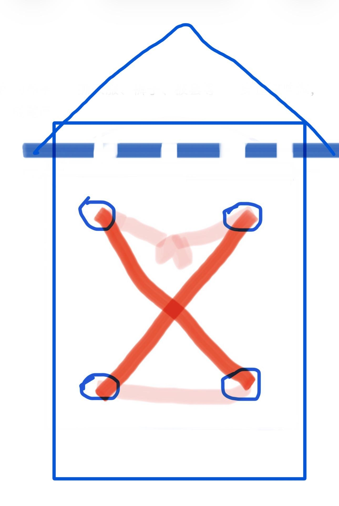
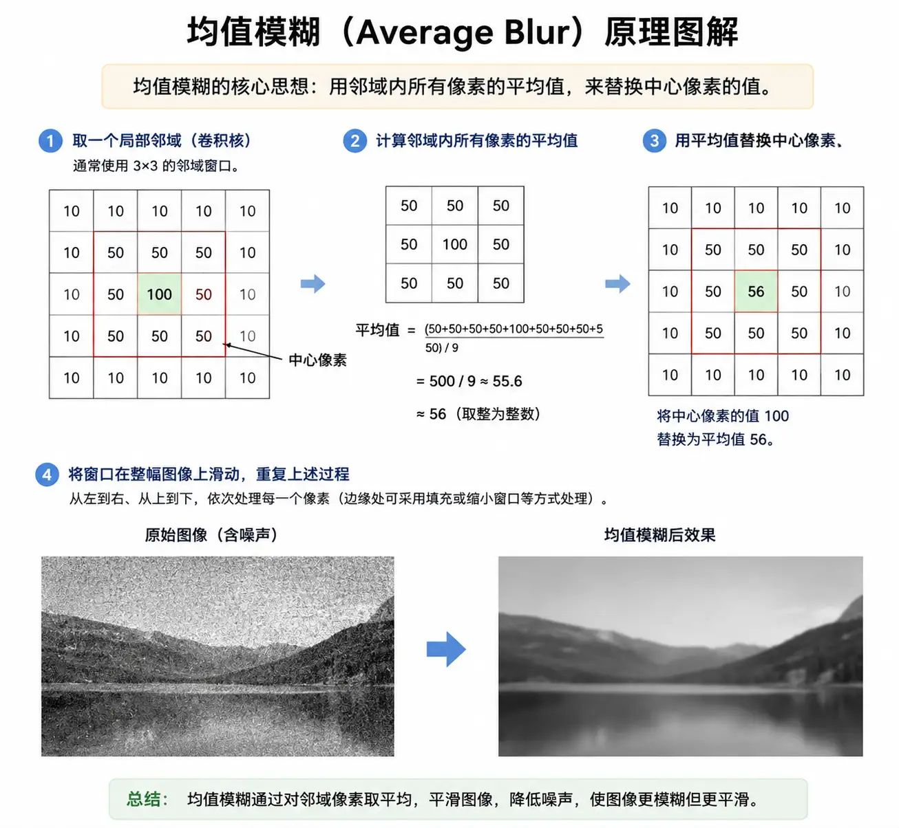

# A10　国家法律犯罪与司法　第 2 册（共 2 册）

- 专题代码：A10　专题名称：国家法律犯罪与司法
- 专题界定：国家制度、公民义务、犯罪、刑罚、司法、警察和司法程序。
- 本册：第 2 / 2 册　收录 137 篇　正文字符 136,358
- 语料：`sooon-q9adg-articles-v2.jsonl`（4,305 篇）　SHA-256：`cdc9c271309e1d71d9708889a3a31f4777e0c339ea54c3753521894afdb8357d`
- 生成时间：2026-09-27T00:01:00.997126+08:00　排序：发表日期 → 源序号（全库唯一，不重复）

**标记约定**：`【待审】` 主题仍为暂定；`【排除候选】` 图片/正文过薄的剔除候选；
`【正文标注未完待续】` 作者原文自带未完标记；`【正文缺失片段（复核已记）】` 复核记录已确认的正文缺口；
`【图片缺 N 张】` 源图不可获取。标记只作提示，不改写原文、不改动分类状态。

---

## 2259　贫民窟

- 日期：2023-05-04　主专题：A10 国家法律犯罪与司法　副专题：A08
- 源 ID：`79dc9ade-f984-596e-a5e0-0c727dc236c3`　原文链接：https://www.zhihu.com/question/19938192/answer/2054137917518374430
- 官方对象—实践路径：与社会 / 与社区 / 共处
- 23 概念标签：定义与达意;责任与后果;成本与总账;净输出与不掠夺;边界与许可;劳动与组织;财富与市场;法律与秩序;权力与异议;生态与自然
- 证据状态：manual_confirmed　初读：read　独立复核：not_reviewed

**问**：中国有类似于印度贫民窟一样的区域吗？

贫民窟有几个特征，实际上是互相关联的。
第一个特征，就是产权模糊而混乱。
贫民窟是没有门牌号码的，贫民窟建筑没有规划图、没有注册手续、没有归属登记，甚至在官方记录上根本就不存在——谁知道你怎么搭的？
第二个特征，就是贫民窟的秩序基本依赖地下帮派。
你想想，最基本的一条，这些私自营建的房子、窝棚根本没有门牌号，没有产权证，你用什么证明这个房子是你的？你想过没有，你们全家出去旅游，回来发现屋里住了另一帮人，声称这个房子是ta们的，你要靠谁来保卫你的产权？报警吗？警察来一查，你根本没有房产证明，警察要帮谁把谁赶走？
就算你有人在家留守，人家冲进来直接把留守成员揍一顿扔出去，你要怎么办？
你很自然的只能靠邻里守望相助——你帮我防御，换我帮你防御——那么邻居要是受伤致残怎么办？
这势必要求更强力的伦理纽带来保证相互的补偿责任。这纽带不是什么“苍天在上”之类的义气相投，在本质上必须要构建足以强制执行的暴力手段。
因此，哪怕仅仅为了保证对自己劳动成果的基本占有，贫民窟里也一定会通过互保关系和对互保机制的执行需求，自然诞生帮派。
而且还一定会形成几个帮派，各划一区或者各分一行。
第三个特征，就是贫民窟的持续存在必然要伴随政府腐败和违规。
因为贫民窟经济存在两大优势——第一是不需要交税，第二是不需要合规。这两大法宝会给非贫民区经济带来相当大的影响——你想想，你的竞争对手不需要交税、不需要守法，你争不争得赢ta？
比如，贫民窟出产一次性纸杯，便宜到不行，是不是全城都自然要用这种纸杯？更不提不用的搞不好会死于非命给别人当榜样，警察追查到底抓到一个身份证都没有的去坐牢又如何，对这位简直和度假差不多。
这两个优势一定会打破当地的商业生态平衡，这就势必意味着当地的政府必须和贫民窟的首领们达成某种共识和妥协——以某种默认换取贫民窟势力守住某条界限，适可而止。
有人要问：“那为什么不痛下决心，直接推平贫民窟呢？”
其实症结在一开始就说明了——这些产权都是没有登记的，所以官方很难用“补偿搬迁”手段去分化贫民窟的团结。难道强行给连产权证都没有的人发拆迁补偿？如果张三刚领完，李四跳出来说：“这房子根本不是张三的，而是我李四的，你不信来参观，是不是我全家都住这？”问隔壁邻居，邻居异口同声说“就是就是”，这跟上回你问张三时的台词完全相同。
那这钱要再给一遍吗？给到什么时候是个头？
如果你不给补偿，强攻拆平，那就是直接要威胁贫民窟人民的生存了，贫民们很快会让你知道什么叫“超高密度居住区”。
更何况，正如刚才所列举的，贫民窟的生意可绝不仅限于贫民窟，而是凭借其产品和服务伸向整个城市的各个角落、甚至可以上通朝堂，下通乡野的——这些人往往是另一个地方的老乡，一代代的被带出来“到大城市闯荡”，乡下还有不知多庞大的一个家族乡亲网络。
这在票选制国家，是足以让城头变换大王旗的。
所以，持续存在的贫民窟是吃软不吃硬的，谋求某种妥协已经是可以现实寻求的最好结果。
而恰恰是达成了这样的平衡，贫民窟的选票往往极为稳定的支持已经达成了默契的本地政治世家——否则一旦换了新人，这些默契可能又要消耗不少人命才能重新达成，这都是无谓的成本。
而这些政治世家往往根本就是贫民窟势力的股东——如果不干脆就是老板的话。
其实说到这里，中国为什么只有城中村、没有贫民窟的秘密已经揭露出来了。
首先，中国坚持所有的房产都必须做户籍登记、对居住人口用籍贯制度，暂住证制度做管理，没有的话就会立刻处理，避免了出现这样积重难返的利益团体，从根上避免了给地下帮派生长的土壤。你登了记的房产，再破再烂，你也可以找警察保护，帮派存在的最大理由就自然消失了。
第二，中国实施的是“流官制度”——即主官不能由当地人担任，而要由上级指派，并且坚持定期轮换。这就从根上排除了“地方政治世家”这样的事物。这就导致地方帮派难成大气候，而且一旦过度发育，往往反而会一夜被荡平，迫使它们不能不维持低调和足够的合规性。
其实你细数下去会发现，对城市贫民窟生态的整个生命周期的各个阶段，中国都存在着针对性的处理机制，所以中国很难出现稳定的贫民窟，即使出现类似迹象的苗头，也很难撑过一两次地方领导班子换届。
而在所谓的票选民主制国家，这类问题是一个难以摆脱的痼疾——哪怕现在看上去没有或者不严重，也很可能会随着某种经济危机而诞生出来，而且一旦成了气候就非常难以去除。
贫民窟是有选票的，很多很多的选票。成了气候，谁也惹不起。

---

## 2252　近亲犯罪

- 日期：2023-05-09　主专题：A10 国家法律犯罪与司法　副专题：A05;A03
- 源 ID：`30cde74d-1069-5581-a536-ccb3abd24b88`　原文链接：https://www.zhihu.com/question/577080525/answer/3019253923
- 官方对象—实践路径：与亲族 / 与父母 / 分离
- 23 概念标签：事实与证据;定义与达意;选择与自由;责任与后果;成本与总账;照料与家庭;法律与秩序;权力与异议
- 证据状态：manual_confirmed　初读：read　独立复核：not_reviewed

**问**：发现亲生父亲行贿受贿怎么办？

这个问题，其实各国法律基本上有一个共同立场——被告人的配偶、子女、父母以及一定级别内的亲属不能被强制传唤。有时这个范围甚至扩大到未婚夫/妻、前夫/妻以及监护人也有权拒绝作证。
经人民法院通知，证人没有正当理由不出庭作证的，人民法院可以强制其到庭，但是被告人的配偶、父母、子女除外。——《刑事诉讼法》
换句话来说，子女对父母实际上没有举报犯罪的义务。
所以，当你作为子女了解到父母的犯罪事实，你有几个标准的原则可以考虑：
1）不要参与和帮助犯罪行为。一旦你成为犯罪行为的参与者，你自己的心态会很快发生扭曲——因为你会丧失基本安全感和对未来的乐观期望。不管何等荣华富贵，一旦事发都会瞬间灰飞烟灭。而恰恰是享受了这荣华富贵，更加会恐惧灰飞烟灭，那几乎必然会今朝有酒今朝醉。而今朝有酒今朝醉，极易发展为今朝有毒今朝吸。
更不用说这个心态的人几乎无法与人建立一切健康稳定的关系——越是爱对方，越会恐惧自己万一有一天事发会把对方连带毁灭。
2）尽快实现经济独立，避免从犯罪收益中得利。这也包括避免借助非金钱的软影响——例如利用亲属的“威名”成事。因为一旦与犯罪收益建立经济依赖，当犯罪行为受到威胁时，你会有强烈的动机去提供帮助，从而被卷入犯罪行为中。
3）不要打探犯罪细节，也最好明确表示不希望知道这些细节，以免被动卷入犯罪行为中。一旦你卷入犯罪行为，你就会并列被列为被告，到时候你就会面对囚徒困境——控方只是不能强制你作证，但是你自己为了争取轻判而主动作证法庭是不会拒绝的。
4）如果可能，最好劝诫亲属弃恶向善。但这无法勉强，只能尽力而为。
5）如果你要举报，这是你的自由，但你要慎重考虑这样一个问题——你可能是ta们希望世界能继续健康运转下去的唯一理由。如果你破坏掉这个理由，可能会对ta们的世界观和价值观产生颠覆性的打击，这是否一定会导致事态走向良性，值得斟酌。
ta们对你有爱，你的愿望和理想对ta们会有不容忽视的影响，保住并充分的利用这个影响力，也不失为一个可以考虑的选择。
一般人往往劝你“大义灭亲”，这有很大的原因在于ta们是被危害的社会中的一员。这当然可以理解，但是从社会的宏观视角来看，在微观层面上保护每一个人——哪怕是犯罪者——的最基本的伦理关系的希望，让任何人都不至于与良善绝对绝缘，是对社会更加有效的安排。
这也是为什么各国法律都不约而同的认为近亲伦理要优先于司法效率。
这并不是“姑息犯罪”，因为怜悯和拯救才是对犯罪最好的压制。
要知道，没有了任何指望的罪人，是没有任何法律可以威慑的。

---

## 2245　依法办事

- 日期：2023-05-13　主专题：A10 国家法律犯罪与司法　副专题：A07
- 源 ID：`21527c1c-d41a-54ca-8a1d-a0ee1fd6a93e`　原文链接：https://www.zhihu.com/question/596691759/answer/3025795084
- 官方对象—实践路径：与其它 / 与陌生人 / 防卫
- 23 概念标签：事实与证据;选择与自由;责任与后果;边界与许可;法律与秩序
- 证据状态：manual_confirmed　初读：read　独立复核：not_reviewed

**问**：路边抢救了一个人，心肺复苏人活了，肋骨断了，家属闹事怎么办？

郑重建议ta们拿起法律武器主张自己的权利。
法院怎么判，我怎么办。
很抱歉本人没有时间处理这些事情，也没有义务接待任何不想接待的人。
你要强闯，无论是强闯办公场所，还是私宅，还是拦路妨碍行动自由，都是违法犯罪行为，那是要另案处理的。
你们不用说服我我有什么罪，你们是要说服法官我有什么罪。

---

## 2246　疯子

- 日期：2023-05-13　主专题：A10 国家法律犯罪与司法　副专题：A01;A12
- 源 ID：`5a1acdf6-83db-553b-b822-7742e358a7e3`　原文链接：https://www.zhihu.com/question/596140536/answer/3025596535
- 官方对象—实践路径：与自己 / 与原则 / 坚持
- 23 概念标签：能力与学习;责任与后果;成本与总账;信用与信任;技术与工程
- 证据状态：manual_confirmed　初读：read　独立复核：not_reviewed

**问**：如何看待「发疯」正成为年轻人的社交策略？「胡说八道」可以有多爽？

你发一发看，看看你爽完之后是什么下场？
总是有这种“当好人不行，当坏人就好了”的坑人指导在世上择人而噬，而又总有一些头脑简单的人自愿献祭。
“当好人不行”，问题出在你好人当得不专业，而不是出在“好人不该当”。
从“水平稀烂的好人”出发，如果你不是去往“水平不稀烂的好人”，而是向“水平稀烂的坏人”前进，你就是在自取灭亡。
这就是“发疯论”背后的险恶之处——因为这就是“向恶生长”的宣言。
你可能在幻想“同志纷纷团结在我周围”，现实是人人侧目和台面下各种野心家想要拎起你这准备破摔的破罐子，装上各种污物，拿来丢向自己的敌人。
真正的革命者要改变现状，行动看上去或许是暴烈的，但是计划和执行一定是充分冷静、理性和富有纪律的。
发疯的人，根本没有革命的资格，只能进精神病院。
人类对罪犯都常有很大的宽容和理解，但是对精神病迹象是毫无幽默感的。建议你不要用自己的生命去验证——一旦贴上“精神可能不正常”的标签，极少有人有耐心和胆量去分辨你是不是冤枉。
物理定律说的，你有意见，自己憋着。

---

## 2241　无气节

- 日期：2023-05-15　主专题：A10 国家法律犯罪与司法　副专题：A20;A08
- 源 ID：`6bf392f1-afb8-512f-9d6c-b16a8269f16c`　原文链接：https://www.zhihu.com/question/597844459/answer/3029297989
- 官方对象—实践路径：与社会 / 与组织 / 参与
- 23 概念标签：选择与自由;成本与总账;信用与信任;法律与秩序;权力与异议
- 证据状态：manual_confirmed　初读：read　独立复核：not_reviewed

**问**：为什么中国比其他国家更强调气节？

一个小村子，是很容易实现“权责平衡”的——因为一个村子的公共利益很小，可出卖的额度也就那么三瓜俩枣，大可以和人的收益挂钩。如果你出卖大家的利益，那就让你丧失收入和前途，让你在村子里当孤儿，你算一算就知道划不来。
一个大国家，大到了你活一辈子也不可能认识百分之一人口、甚至连贵族你都不可能全认识的地步，只要出卖一下公共利益，就是几辈子吃穿不尽的荣华富贵，足以让你提着脑袋玩命。
如果在这个条件下不讲气节、讲“利益平衡”，意味着只有富可敌国的人才有可能有足够的机会成本去平衡ta的投机风险。即使富可敌国的人实在找不到，那好歹也是有钱一分可靠一分——至少有庄园可没收、有九族可诛的，总比“一介布衣”的孤家寡人在数学上更可信。
你想想，要是你咬死了“气节都是骗人的”，你自己会选谁当大法官？你倒是想选你儿子，但你想得美——张三就不想选他儿子？不讲气节，最后一定是张百万的儿子当大法官。
所以为什么中国比其他国家更讲气节？

不讲气节，在数学上就只剩下“按资产分配权力”这个“最不坏的方案”。
气节观是平民阶级分享、执掌社会权力——注意是权力，不是权利——的价值观基础。
自认穷人，却嘲讽气节，主张“气节虚无论”，你自己说，这叫什么？

---

## 2239　不可侵犯

- 日期：2023-05-18　主专题：A10 国家法律犯罪与司法　副专题：A11;A03
- 源 ID：`87aadde7-d696-5d5f-8e62-d3b177b16129`　原文链接：https://www.zhihu.com/question/601459372/answer/3033811254
- 官方对象—实践路径：与自己 / 与原则 / 建立
- 23 概念标签：能力与学习;选择与自由;成本与总账;边界与许可;法律与秩序;宗教与自然法
- 证据状态：manual_confirmed　初读：read　独立复核：not_reviewed

**问**：北京市文旅局依法查处「笑果脱口秀」涉案公司及个人，罚没 1467.9 万元，该事件具有哪些警示意义？

其实现代人有一种自由的“理想”，大概可以表达为——否决一切“神圣不可侵犯”。
这个理想和“否定一切形式的政府”一起，一个否定价值观的约束、一个否定实践的约束，一文一武，堪称双璧。
这是“自由”这个概念一诞生就内含在定义里的理想。其实这两个追求的理由倒是非常直白和简洁——很有点“1千克的物体受1牛顿力1亿秒后速度为1亿米/秒”或者“一尺之棰，日取其半，万世不竭”一样显然而简洁的数学美感。
何谓“神圣不可侵犯”？这和“不可侵犯”的区别在哪？
“不可侵犯”是指你侵犯一次罚一次，再侵犯再罚。存在一个定格惩罚，你如果受得住，实际上你可以一直侵犯下去。这的确仍然是“不许侵犯”的，但是这个“不许”不是无限的、绝对的，而是有限的、有一个价格的。
而“神圣不可侵犯”，则是第一次犯就会重罚，罚到你不敢再干第二次。而即使是这种重罚，也已经是念在无知，姑且饶恕了。如果再犯第二次，往往就是绝罚——这倒不见得是指剥夺生命，而是指会剥夺你再次犯错的可能性，约等于吊销驾驶执照、开除、注销许可证这一类。
简单来说，“神圣不可侵犯”是不允许你一再重复侵犯的——被抓住两三次几乎肯定把你送走。
尤其是如果你的行为证明只剩下“剥夺生命”这唯一的手段能真正停止你的再次侵犯，那么为了保护“神圣不可侵犯”的价值，是可以支持死刑的。
这就是“不可侵犯”和“神圣不可侵犯”之间的差别。

剩下的问题是，是否“没有任何神圣不可侵犯的价值的社会”一定会好于“存在神圣禁忌的社会”？
换一个角度，是否解放思想、增进自由就应该以“消灭一切神圣”为理所当然的目标？
如果你的答案是肯定的，那么你自然会站在这些喜剧演员一边。但你要当心你的选择——那意味着你在够钱交罚款的人面前也没有任何“绝不可被侵犯”的东西可言了，因为社会不再会抱定不容妥协的立场去无条件的替你阻挡了。
如果你认为不是，那么“这根线应该在哪”就立刻要成为一个问题。你的线画在哪，其实区分了你的敌人和朋友。
而更重要的是，无论你的线画在哪，线内不能一无所有。

其实，这个问题只是虚晃一枪，客观世界实际上是不容你选择“消灭一切神圣”的。正如刚才那两个例子所遗憾的展示的那样——真理固然简洁，但简洁和简单并不相等。
“日取其半，万世不竭”“无限匀加速”是简单，而不是简洁。“消灭一切神圣”的自由，只是简单，而非简洁。
还是早点抛开这种过于简化的社会理想为好。

---

## 2236　路有朱门

- 日期：2023-05-20　主专题：A10 国家法律犯罪与司法　副专题：A03;A20
- 源 ID：`7bd32b4c-4914-541f-bdcd-d68425f8d1c0`　原文链接：https://www.zhihu.com/question/564779251/answer/3036049423
- 官方对象—实践路径：与合作者 / 与被管理者 / 沟通
- 23 概念标签：事实与证据;定义与达意;能力与学习;选择与自由;责任与后果;劳动与组织;权力与异议;技术与工程
- 证据状态：manual_confirmed　初读：read　独立复核：not_reviewed

**问**：如何破解欺上瞒下的问题？

欺上瞒下谈何容易？
都不傻，都知道是罪，都知道一戳就破，所以除了一些把柄在别人手里、不能不配合欺瞒的官员之外，“欺上瞒下”最典型的做法是说话含糊。
利用语言中一些含糊表达的自由解释空间，说一些往下解释可以是路有冻死骨、往上解释可以是朱门酒肉臭的“黑话”。
这样你听了这话以为情况一片大好，朱门酒肉臭，给我升官发财，下基层一看，哇呀呀路有冻死骨，想来给我斩首示众，那你可就不好下手了，因为是你自己“误解了我的意思”，这时你已经有了一份领导责任，不能——至少是不能完全——说是我的责任了，看懂没有？
一旦到了这一步，这位领导为了顾忌自己的责任，往往自己也开始向上讲“黑话”，而且越说越“宏观”，可覆盖的空间越大。
甚至直接提交的数字也可以有黑话艺术——因为统计口径的认定也是可以灵活掌握的。
所以你始终不能简单的说ta就是撒谎，很难直接定一条罪说ta是欺上瞒下。

这就是为什么中国非常反对空降领导人，而近乎固执的要求必须先从田间调查起步，走完乡、县、市、省整个基本履历的原因——在很大程度上就是为了让你务必学会这种“黑话”。

始终注意——这些黑话原则上不能叫“欺上瞒下”，因为真的要是被发现你的报告有硬伤，有可以实实在在证明造假的东西，哪怕是一个字、一个词、一个小数点，报告人的前途也是绝对的到头了。所以到出现这种情况，一定是连黑话都不够用了、而责任也无法推卸，这一般都意味着存在特别的利益输送或者个人腐败，被人拿住了把柄，所以必须铤而走险——但这种情况，几乎只会出现在没有经验传承的新官员身上。如果是几代都在公务系统生存的世家子弟，自然会懂得掌握这种分寸，始终把问题控制在合理解释范围之内。
所以，现在有一个新的、大量出现在纪委监委判定中的专业术语，叫“对组织不老实”。这实际上是把这种“讲黑话”的灰色行为进一步的罪化了。
看上去是一句不起眼、甚至有点“老土”的话，但实际上却是几千年来一次空前的组织管理创新。
以前懂黑话的上司听了下属的黑话报告，只能对下属的不老实程度心照不宣，因为不老实还不能算欺骗，至少判不了刑。现在则多了“不老实”这种新工具，可以直接通过组织纪律惩罚这种行为，这对下级的威慑是史无前例的。
简单来说，反制欺上瞒下，除了自己要实际调查之外，还要理解组织规律，学会听懂“黑话”。这是身在上位逃避不了的基本素养，自己老老实实去体会磨练。你如果只知道抱怨，你也没什么资格去担当这个责任了——因为这个操作空间是客观规律保留的，只要人类还在通过语言交流，你就别指望可以不用做这个作业。

---

## 2222　强势回应

- 日期：2023-05-25　主专题：A10 国家法律犯罪与司法　副专题：A07;A03
- 源 ID：`07a65784-5aa1-5f48-9fc7-77e4f2bd8531`　原文链接：https://www.zhihu.com/question/435643935/answer/3043287839
- 官方对象—实践路径：与其它 / 与陌生人 / 防卫
- 23 概念标签：定义与达意;能力与学习;选择与自由;责任与后果;成本与总账;爱与回应;边界与许可;法律与秩序
- 证据状态：manual_confirmed　初读：read　独立复核：not_reviewed

**问**：如何让自己在为人处世上变得强势？

大哥，强硬的从来就不是我，能成全的我都已经成全了你，问题是物理定律、法律和其他人的权利不归我说了算。
我没权利放过你、没能力更多的满足你的要求，对此我只感到遗憾，甚至没有立场抱歉。
能帮你的已经帮了，你看到的已经是最佳服务和最大让步了，你对我不满没有意义、施压没有作用，我不可能为你渎职或者损害另一个人的利益，也没有理由认为你的利益优先于我自己不打算让步的利益——实际上我所愿意让出的利益也是出于我的兴趣爱好，不是出于对你的恐惧。
你只是在浪费你自己的时间和金钱，而且还在推动我从中立转向与你敌对的冲动。
不是吓唬你，你不会喜欢我作为敌人的感觉。建议你还是不要自己为难自己。
真心实意的建议你，你现在最好的选择是去做xxx和找xxx，继续把时间花在我这里，对你其实是一种损失。

这很“强势”吗？
明明温柔又可爱。

---

## 2220　甲必丹

- 日期：2023-05-27　主专题：A10 国家法律犯罪与司法　副专题：A12
- 源 ID：`39a9dac2-d22e-5bf0-89bd-c90bcbb27ecd`　原文链接：https://www.zhihu.com/question/602052644/answer/3047267504
- 官方对象—实践路径：与合作者 / 与管理者 / 服从
- 23 概念标签：责任与后果;法律与秩序;技术与工程;文明与历史
- 证据状态：manual_confirmed　初读：read　独立复核：not_reviewed

**问**：如何看待威海飞北京航班上军民两用机场起降禁止打开遮光板，一男子拒不配合与空乘产生争执？

在飞机、船只、高铁这类与人类世界互相隔绝的区域，机长/船长/车长和乘务组的命令是绝对的。
不论ta们的命令有多么“离谱”，你个人觉得有多么“奇葩”，你要做任何申诉、处理，都只能等到机降落、船靠岸、车入站再说。
中国没有大航海时代，人民缺少这种历史经历，所以对这个感到很陌生。其实这对经历了大航海时代的国家来说属于基本常识。
上了船、飞机这类不能随便靠岸、乱操作会导致全体死亡的交通工具，和上了小汽车或者公交车是完全不同的概念，在本质上是进入了一个临时的“主权国家”。
至今航空器和船只都像大使馆一样被视为某种程度的“特殊领土”，船长、机长在法律上几乎被视为一种特殊的“领主”。无论是从社交礼仪上还是社会地位上，这些人——尤其是大船的船长——都是受到Lord、Father这一级的尊重的。
因为一旦出海远航，ta就客观上拥有了主宰人生死的权威，而且有强烈的独裁属性。
这也是为什么出现船员闹事、不服从命令，甚至仅仅是对上级不礼貌，往往不会被归为争执、纠纷、冲突，而是常常被定性为“叛变”。
下次记住，除非你真有生命威胁，到了“亡亦死，举大事亦死”的地步，绝对不要因为别的原因跟机组或者船员组硬怼。
否则不但要吃眼前亏——挨擒拿拳、辣椒水、电击枪、一铐一路——落地之后你还想着兴师问罪，结果很可能是你不但得不到自己想要的“公道”，还要再面对罚款、拘留甚至判刑——到时候你为了减免惩罚还要自己抢着写悔过书。
因为各国的海事法律，基本上都是按照大航海时代的海事传统继承顺延下来的。在这种案例里面，法官甚至都不会去多问船长、机长下令有什么合理性或者依据，更不会如你想象的那样找一堆飞航专家来鉴定机长、船长的指令合不合理。
ta只问你听到没有、你有什么危及生命的理由不能执行。你答不上来，或者答得不能证据确凿、让人心服口服，就是你倒霉。

---

## 2198　福清帮

- 日期：2023-06-05　主专题：A10 国家法律犯罪与司法　副专题：A17;A07
- 源 ID：`381efa61-c021-555f-82a4-8fb6f3e231a0`　原文链接：https://www.zhihu.com/question/602849667/answer/3060068698
- 23 概念标签：能力与学习;责任与后果;成本与总账;边界与许可;劳动与组织;法律与秩序;民族与身份;生态与自然;心理与主体
- 证据状态：manual_confirmed　初读：read　独立复核：not_reviewed

**问**：大头鹰直播对线新润人是对润人群体的抹黑吗？

其实你旁观这次的“黑工举报老板”事件，有没有觉得奇怪——这种事难道现在才有？以前的老板就不知道用黑工可能会被举报吗？以前的黑工就想不到举报老板吗？
说个冷知识——为什么中国成规模偷渡比较成功的是福清长乐？其实跟福清帮这类地下组织有很大关系。这关系主要体现在福清帮不但在对岸建立了完整的移民流水线，还提供了“包办初级工作”这样的服务。
类似“自己打黑工然后翻脸举报老板”这样的事件，在福清帮安排的工作中是可能遭遇暴力报复的。福清帮手下专门有一批老板会使用福清帮介绍的黑工，这些黑工本身是老乡，老板也自然有某种乡党关系。老板违约，帮派不见得完全偏向老板——因为打工的也是自己的远亲同乡，更关键还是下一批客户的近亲；但是黑工有纠纷直接反口举报老板，帮派也不会客气。这就导致“有纠纷，找帮派”，由帮派担任了这个仲裁工作。
而等到移民站稳脚跟，自己创业，自己也往往成为帮派的事业的一部分，也可以从黑工中受益。这样整个生态就拥有了整体的可持续性。
类似这几个华人老板被黑工举报、碍事，在很大程度上是自己超出了这个生态习性操作的结果。一旦没了帮派的庇护，没有暴力手段保驾护航，被举报就是大概率事件，这次的事件只不过是万千教训之一。
偷渡已经几百年历史了，这种案例早就发生过了。黑工体系也早就有了对策，这只是超出了这个体系的覆盖所展现出的失败案例而已。
类似的现象其实不止在华人中存在，在拉丁裔、意大利裔、俄罗斯裔等等移民群体中普遍存在，堪称行业通行经验。不仅在美国存在，在欧洲、拉美、日本、东南亚也都存在。
某种程度上，这才是这类移民黑帮真正的生存基础。
自己步行穿越边界，要对这有心理准备。

---

## 2191　法网柔情

- 日期：2023-06-09　主专题：A10 国家法律犯罪与司法　副专题：A07;A03
- 源 ID：`1a4e052b-67bb-5495-9af8-1878d5a5df5b`　原文链接：https://www.zhihu.com/question/538342207/answer/3066820427
- 官方对象—实践路径：与合作者 / 与服务者 / 交办
- 23 概念标签：事实与证据;能力与学习;责任与后果;成本与总账;信用与信任;爱与回应;边界与许可;法律与秩序;技术与工程;心理与主体
- 证据状态：manual_confirmed　初读：read　独立复核：not_reviewed

**问**：我跟同学嬉戏，不小心把他十几万的机械表的圈环弄了个1mm的凹口，他说要换这个环所以要赔偿一千，合理吗?

遇到你清楚自己没有法律责任而对方不清楚的时候，记住这个标准答案——
“让你的人联系我的人，让他们去搞出个结果来。我们接着玩。”
然后给ta你的律师的名片。
如果你不清楚自己有没有责任，在线法律咨询资源多得很，自己去问问清楚好了。

让他的律师去找你的律师，这类事情“我不懂，也一向不自己处理，也没精力处理，更没必要伤了我们的和气”。
脏活让别人——专业的人——领着你的工资去干，干得不好，这一千块从ta的佣金里出啊。

你是不是要说“我怎么请得起私人律师”？
第一，“私人律师”没你想的这么贵——ta又不是只做你的生意，这不是“专属私人律师”。你这点事占得了ta几分钟？你放出了这个话，结果一般是连对方律师的电话都收不到，小时费用为零——因为对方的律师只要有一丁点法律常识，自己就会告诉ta“这官司打不赢”。
换言之，真正干脏活的是对方自己的律师，甚至都不是你的律师。你这边连电话都接不到，你能有多少费用？
第二，早点通过一些不痛不痒的案子获得和律师打交道的经验，就像早点获得和会计师、职业经理人打交道的经验一样，是你将来建立一些正经的（decent）事业的必备经验。从这么小的案子起步都可以算“天赐良缘”了。
你要将相关的成本视为你接机“接触法律实践”的“实习费用”，这点费用就安全的过了一把当被告的瘾，你甚至有必要请对方吃一顿感谢ta给你启蒙的机会。
你甚至可以建议ta都来“破个处”，大家合作走个法律程序，看看走这个程序要干些啥，打一个世界上最和谐的官司。光凭这个行为艺术，都不够你们毕业时吹的。
打完之后，手表什么的怕是都不记得了，大家就记得穿西装结伴出庭cos“law and order”的美好回忆了。
将来这点意识、这些经历，在你的职业履历上绝对是一个亮点。最后给你带来的收益，别说赔ta个表圈，赔ta几块表都有得多。
以后记住了，一切扯皮的事，一概默认走律师代办。觉得贵，就学会怎么可以花最少的钱得到管用的服务，而不要“节省”。
放诸一生，熟知如何使用法律武器的人绝不会悔恨这些学费。不花这个钱，不早点寻求这种天经验，这么说吧，你第一次创业时有很大可能要为缺少基本常识（以及缺少有足够信任的法律方面的人力资源）付出千倍、万倍的代价。
时间代价、机会成本还不算。
不用担心律师搞砸。律师说话不中听，当然该律师背锅，你转圜余地大得很——律师“嘴太毒”，你事先又不知情。
“但是话又说回来，话糙理不糙啊。”

---

## 2190　稳妥处置

- 日期：2023-06-10　主专题：A10 国家法律犯罪与司法　副专题：A07;A04
- 源 ID：`7146f1bb-2181-5417-b4e5-28777d7a06b9`　原文链接：https://www.zhihu.com/question/605654836/answer/3066983421
- 官方对象—实践路径：与社会 / 与组织 / 参与
- 23 概念标签：事实与证据;能力与学习;责任与后果;成本与总账;法律与秩序;心理与主体
- 证据状态：manual_confirmed　初读：read　独立复核：not_reviewed

**问**：初中男生被泼热水毁容，知情人称「泼水者怀疑遭他举报上课玩手机」，校方回应「在沟通解决」，如何看待此事？

这个事，要先告学校对危险隐患管理不良造成学生伤亡，先把官司打起来。然后再跟学校讨论怎么调解。调解费用，基本标准150万起吧。
对肇事者，在首先要在家长群中强调肇事者的精神不稳定和攻击性行为模式对所有人子女的潜在威胁——这个往家长群发几篇青少年犯罪的现实案例即可——然后邀请各位家长请愿让学校做出有效处理。
这倒不一定是退学转学，但肯定要让大家能放心这类事情不会再发生。你仅仅来个“我以后不供应开水了”，我们肯定不会满意——因为你们还有楼梯啊，被推下楼梯咋办？你还有桌椅板凳啊，被人抡起板凳打中头什么办？
对肇事者家长，发起民事赔偿诉讼，求偿医疗费、修复手术费用、误学/复读/补课费用、（家长）误工费用、律师诉讼费用和精神损失费，具体金额听律师推荐——跟律师收入挂钩。
如果在诉讼期间再次发生加害人在学校威胁恐吓的情节，那么就及时留取证据，增加求偿标的。
这些价格当然都可以接受讨价还价，但是能讨价还价多少，当然要看各方调解的态度和拿出的其他条件。
从学校的角度，这个官司只要在打，他们的招生就会受到影响。你要的就是他们必须在招生季开始前完美解决问题的焦虑。
你想解决，很容易，我提什么条件你照办就行。办得好我甚至可以给你一封谅解信。但我只会提要求，不会提方案，方案你们来提。比如我希望你们拿出方案来保证我子女的后续学习绝对不会再受这类威胁。我可没说过要你们开除对方的孩子，你们有其他我可以放心而又不用开除ta的方案，我当然也可以接受，但你们不要指望我放水。
如果是你们自己决定要开除或劝退，而对方家长要来找我闹，我就让他们去找你们。你们如果敢往我身上推说是我逼你们让ta小孩退学，那么不好意思，我会以减免对方家长一定赔偿额为条件，要求对方家长作证，不但取消之前和你们的调解协议，还要对你们额外加上一条新诉讼。
这条会写在调解协议里面。另外不要指望我会对你们的违约沉默寡言，我肯定不会免费沉默寡言。有句话你们应该听过——沉默是金。
我再说一遍，这件事要废掉你们几个招生季轻而易举，希望你们思考清楚，不要做愚蠢的选择。实在是做了愚蠢的选择，我也爱莫能助。毕竟我必须维护我的合法权利，不可能为了避免无谓的伤害而放弃我的合法权益，否则以我的原则，这其实是为虎作伥，以实际行动鼓励人作恶和失职。
从家长的角度，要重建对学校的信任，其实只有一条途径，就是学校因为这件事赔得足够惨、对肇事者处理足够严厉。只有学校真的赔得很惨，处置得足够严厉，你那些“环境无害化”、“反校园暴力”的措施，我们家长才有可能相信会有足够的诚意、会坚持足够久，而不是应付两天，躲躲风头。
这不是我“故意要把事情闹大”，而是你不信可以问问家长们是不是这么个看法——这就是客观规律、客观事实，我不提醒各位各位也装不了糊涂的事实。
所以，学校不要跟我争取一分钱不赔——学校不赔个几十万是不行的，这不是为我好，其实是为你们学校自己好。你们要是回避了这个赔偿责任，造成的对招生的影响就纯属咎由自取。你们是要办学成绩还是要省这几十万，孰轻孰重，自己要思考清楚。
实际上我告你们而以接受你们的赔偿、给你们一封谅解信的形式结案，这是帮你们以最优雅、彻底的形式解脱赔偿责任，这是在帮你们的忙，不要好心当成驴肝肺，要珍惜我现在基于极端善意和高度克制给你们伸出的橄榄枝。
你们应该见识到了我的行为能力和谋略风格，你们需要思考清楚我如果放开这个极端善意和高度克制，对你们是不是个好消息。如果你们觉得我现在这些叫惩罚，那么你们搞错了——叫你们赔几十万、道歉和整改，这叫宽恕和原谅。
我保留惩罚之后再原谅的选项——你们不会希望知道惩罚意味着什么。

对于对方家长，有什么事请跟我的律师沟通，我也不是神仙，起码最近几个月见面可能引起我的强烈情绪，只会对你们造成更大的和解成本。你们有什么想说的可以以书面形式通过律师转达，这样大家方便。
你们放心，我现在的态度是在解决我的疑虑的前提下尽可能避免一切无谓的伤害，但何谓“疑虑已被解决”，则完全取决于我。我建议你们不要违背我的意愿蛮干，比如我说了不要见面非要跑来围堵我这类。你真这样来了只会导致多一条骚扰恐吓罪，赔偿金额又上升。
你能减少赔偿额的措施，我相信我的律师都告诉你们了，甚至连道歉信都替你们写好了，你们只要简单的照办就能获得大幅减免。只不过最低额度是非赔不可的，这个不准备做的话，那么那些优惠也就别折腾了，大家法庭上碰运气、各安天命就行了。
这些话我都没什么紧张激动的，因为都不会是我来跟你们说，而是我的代表律师跟你们说。我没时间见你们，我这人心善，看不得人坐牢赔钱，所以还是让律师来。
这全程我都不会搞什么“悲愤控诉”这类蠢事——我有啥好悲愤的，是你们这些踢到铁板的小白兔即将悲愤。
我对你们只有同情和怜悯。

---

## 2180　纵容

- 日期：2023-06-14　主专题：A10 国家法律犯罪与司法　副专题：A01
- 源 ID：`bd4c657e-9816-5e2c-8084-70d9cd2a72fe`　原文链接：https://www.zhihu.com/question/606044944/answer/3073767701
- 23 概念标签：事实与证据;定义与达意;责任与后果;成本与总账;爱与回应;法律与秩序
- 证据状态：manual_confirmed　初读：read　独立复核：not_reviewed

**问**：如何评价四川大学新闻学研究生张薇造谣生事污蔑他人事件中，女主人公的道歉文？

“既然你已经知道错了，那么被开除、被起诉和赔偿损失，你只需要承担其中之一就可以了。
记得说谢谢。”
记住，原谅不需要附带“完全宽恕”。
再说一遍，原谅从来就不需要绑定“完全宽恕”。
而且恰恰相反，原谅不应该附带“完全宽恕”。
更确切的讲，宽恕永远不能是“完全宽恕”，无论如何都必须保留一定有痛感的赔偿。
一切“完全宽恕”都是纵容和教唆，没有任何例外。
对一切过犯，永远要抱着原谅的态度，但是永远不要考虑“完全宽恕”——看好关键词，“一切”“永远”“永远不”。

---

## 2162　法定叛国

- 日期：2023-06-21　主专题：A10 国家法律犯罪与司法　副专题：A12;A17
- 源 ID：`7b58e331-f6d8-5def-bf9a-314f026dff8f`　原文链接：https://www.zhihu.com/question/444782032/answer/3083099726
- 官方对象—实践路径：与社会 / 与组织 / 退出
- 23 概念标签：事实与证据;选择与自由;责任与后果;成本与总账;爱与回应;法律与秩序;民族与身份
- 证据状态：manual_confirmed　初读：read　独立复核：not_reviewed

**问**：入籍算不算叛国？

算不算要问法官，问知乎的小孩子是没有意义的。
比如认为“没有宣誓效忠就不存在叛国问题”，就是典型的错误认识。
不要自认为你可以用不爱国、不忠于自己的祖国来“惩罚”你的国家。大概率你只是在把自己的社会地位和前途过于轻易的葬送掉了而已。
因为奉行“集体必须让我心满意足，我才会赏赐给它我的赞扬/服从/忠诚”这种逻辑的人，真正的问题是永远找不到这种集体。
世界上哪有伺候得了你的理想国？
即使ta自认为找到了，过了狂热期也要同样回归到这个原点。
更可悲也更大的可能性，是你所想象的那个配得到你的忠诚的完美团体反过来会觉得你不够资格。
自己在的地方自己看不上，自己看得上的看不上自己。
两头不靠，无枝可依。

---

## 2146　马鹿头

- 日期：2023-07-02　主专题：A10 国家法律犯罪与司法　副专题：A07
- 源 ID：`b69fb823-54f9-5a2a-a6ee-0f8d141bc7c3`　原文链接：https://www.zhihu.com/question/555208211/answer/3100401002
- 官方对象—实践路径：与自己 / 与原则 / 坚持
- 23 概念标签：事实与证据;选择与自由;责任与后果;成本与总账;信用与信任;边界与许可;财富与市场;法律与秩序
- 证据状态：manual_confirmed　初读：read　独立复核：not_reviewed

**问**：我是班长，舍友没做核酸，并且想让我帮忙隐瞒，但是我还是上报了，现在关系很僵怎么办？

跟这样的人关系僵是好事。
徇私枉法最大的问题是啥？是极其容易被反噬。
你在这好心帮忙徇私枉法，接下来对方一反手威胁要举报你，你就轻而易举被对方控制了。
你记住了，一旦你作为公务人员松手了，对方作为老百姓比你罪轻得多。对方甚至可以装傻，说你是主动提出、是你误导的，只要你没证据，就是你背全部黑锅。而对方作为被管辖人，不但天然责任轻，而且至不济还可以算戴罪立功，主动举报，有从轻情节。
不但如此，以ta这种危险的行为方式，落到走投无路的概率远大过你，到时候ta永远是光脚的吃你穿鞋的。而这还算轻的，头脑简单的。
头脑更精明的，会在你帮完忙之后大礼相谢，哄得你心花怒放——这“朋友”就算交上了，这就建立起“交易信用”了。下次找你再帮别的忙，你上次都没拒，而且还体验良好，这一次你拒绝的概率多大？
多体验良好几次，下次叫你去火中取栗，你就会知道厉害了。
你去不去？兄弟这次过得去就是荣华富贵，肯定少不了你一份，这次兄弟要是过不去，大哥你是了解我的，不到走投无路，我能来求您吗？不过，呵呵，你放心，要出了事我“绝对不会把你供出来的”。ta还加重音，给你赌咒发誓呢。
问题是你要想清楚，你去，才有所谓的“绝对不会把你供出来”，你要是不去呢？那“兄弟过得去”吗？兄弟既然过不去，还是“你不去”造成的，你觉得还有所谓“绝对不供出来”吗？
那么你去了，要是东窗事发了，你觉得所谓的“绝对不把你供出来”真的有效吗？
一共三年减刑额度，谁先交代谁减刑，你觉得一个一开始就盘算着走歪门邪道的人会比你犹豫更久吗？
公门之中好修行，你不是不能帮忙，但你不能帮任何被举报后会导致渎职罪成立的忙，你一帮就等于把脑袋伸进了鳄鱼嘴。
做公务员，怎么把原则之内可帮的忙切得薄薄的，少量多次，做得富有获得感，让亲戚朋友的耐心和决心不至于击穿这个合法帮助极限，是一种基本功课。
做得好，你可以最大限度的兼顾亲戚朋友的好感。
但是如果你努力了还是做得不好，那就去tnd，就当没这种不知好歹的亲戚朋友。因为一个人如果这样再三紧逼，早就已经自己把那点资格消耗干净了。
自己做好这个准备——“亲戚朋友最后觉得我不好说话、不好惹，这是大概率的、正常的”。
这不是一种损失，这只是帮助你把精力集中到那些知道分寸、能和你的事业兼容的真正的朋友身上——那些不需要别人帮ta违法、为ta渎职就能活着的朋友身上。
让那些没人帮ta违法就活不下去的人早点活不下去，去领救济、去自己回炉。别去渴望这些人的“崇敬”、“称赞”。一个不靠别人渎职就会走投无路的人的称赞有什么可稀罕的？还值得你用事业生命去赢得？你是不是不识数？
至于说这类人达不到目的要在背后作怪什么的——这么理解，你的职业生涯迟早需要这么一颗人头拿来辟邪。
这么说吧，要担任公职，“在亲戚朋友中公认不好说话、不好惹”不但不是一种损失，还是一种有必要达成的成就。
谁不开眼要插标卖首，你就拣做人最失败、倒霉最多人叫好、完蛋最没人想念——往往也是自己最死缠烂打、最逼得你无法和平拒绝的一个，公事公办到底，正好过了这一关。
借了这颗马鹿头挂在办公室墙上，让亲戚“朋友”提前都知道为什么要找你帮忙有底线，过了底线会反过来被最严苛的公事公办，你好做人得多。
你需要的是完全不认识你的人的称赞，不是这种所谓“朋友”的好评。

---

## 2139　立正

- 日期：2023-07-05　主专题：A10 国家法律犯罪与司法　副专题：A07;A16
- 源 ID：`e87545d0-6dca-551a-add4-1891bcd09330`　原文链接：https://www.zhihu.com/question/610370583/answer/3105233745
- 官方对象—实践路径：与社会 / 与组织 / 参与
- 23 概念标签：事实与证据;能力与学习;成本与总账;信用与信任;法律与秩序;权力与异议;心理与主体;性别与身体
- 证据状态：manual_confirmed　初读：read　独立复核：not_reviewed

**问**：如何看待北京政法职业学院李敬言疑似退学？

信息太少，没什么可看。
不过要做事要拿起法律武器，不要拿起舆论武器。
现在看上去这个退学是指当事人自己自愿退学，那就没什么可谈的了。你如果真不服，不妨坚持立场不申请退学，等着学校给你行政处分。
有行政处分的文件，那么你就可以依法质疑学校拟定的事由，要求学校提供这样处罚的依据。这个处置如果是勉强的，那么它的依据必然也不堪一击，到时候学校的舆论危机自然有凭有据的越闹越大，甚至把校长书记折腾下台也有可能。但是你如果顶不住各种压力，自己走了“自愿申请退学”这条路，那就没什么好说的了。
这样在程序正义的角度讲就没什么可帮你的了。至于外界各种社会经验不足的人的“义愤填膺”，以及以阴阳怪气评论这类形式给你的“声援”，只不过顶多热闹两天就会自然烟消云散，几乎毫无实际意义。
要想斗争，那就要坚守斗争的觉悟。随你怎么逼我，不该签的东西我不签。你要伤我、杀我，那你别指望吓唬我然后我自伤、自杀，你得自己找杀手来伤、来杀。你要徇私枉法冤枉我，那由得你，那就请你办好所有手续，别指望我自己写认罪书。你要严刑逼供，那就请你动手，我如果挺不住，自有人让你的人脱不了身；我挺住了，那你们自然也别想跑掉。
简单来说，你要害我，你就必须做完全部加害的动作，不要指望我因为屈服于你的恐吓来自我伤害，帮你免了麻烦。
我要提醒你——如果你派的杀手被我抓住、你做手脚的文件被我察觉，那么你就做好承担后果的心理准备。
我这些话既然当你面说出来了，你就应该想到我每天都吃饱睡足、穿着防弹衣、开着行车记录仪和云录音。你最好不要有加害还能完全逃脱的侥幸，你要先准备好你请的杀手把你供出来的可能性，你的文件、手续被复核的准备。
你觉得你有把握搏一搏，我没立场不让你试，那就大家各安天命，看你会不会得不偿失。
你想要主持正义，这是你提前就要有的觉悟，不然你基本上最后肯定会屈服，而且常常会以写自白书认罪的方式屈服。
不要喊“凭什么正义这么难”——正义从古到今一直这么难，真正的问题是你为什么会认为它没这么难。

---

## 2137　先民特权

- 日期：2023-07-06　主专题：A10 国家法律犯罪与司法　副专题：A20;A17
- 源 ID：`a2105975-029d-5216-9d57-6d0e99d86730`　原文链接：https://www.zhihu.com/question/605341693/answer/3106449162
- 官方对象—实践路径：与社会 / 与历史 / 解释
- 23 概念标签：选择与自由;爱与回应;边界与许可;照料与家庭;财富与市场;法律与秩序;权力与异议;文明与历史
- 证据状态：manual_confirmed　初读：read　独立复核：not_reviewed

**问**：“你生孩子，经过孩子同意了吗？”怎么回答？

就算要经过你同意，那要如何操作？没有可操作性的主张是没有意义的。
并非别人的一切权利都要来自你的授予，这是有例外的。
历史的先到者有一些特权——ta们可以决定后来者要面对的历史现实。
你的出生与否就是这种“先民特权”的一种体现。
除此之外，在公，ta们还决定了你要面对的法律体系、社会现状甚至国家边界；在私，ta们决定了你的家乡、校友和家庭环境。
权柄天授，不受妄议。
你对你之后的人也有这特权，不给你，你又怎么活呢？

---

## 2130　指定幻觉

- 日期：2023-07-10　主专题：A10 国家法律犯罪与司法　副专题：A08;A03
- 源 ID：`38d04268-465e-5d9d-bbbf-3cf7d471bc1a`　原文链接：https://www.zhihu.com/question/460616431/answer/3111361260
- 官方对象—实践路径：与自己 / 与财富 / 维护
- 23 概念标签：事实与证据;定义与达意;责任与后果;成本与总账;边界与许可;财富与市场;法律与秩序;心理与主体
- 证据状态：manual_confirmed　初读：read　独立复核：not_reviewed

**问**：好多专家都呼吁取消公摊面积，但就是执行不了，阻力来自哪里？

取消公摊面积，那么公共区域和公共设施的产权如何归属？是仍然归开发商吗？那么如果开发商开始在小区道路上设立收费站，收取道路通行费，如何界定这种收费的性质？
恕我直言，这是一种仅具形式意义然而却有巨大的会计成本的操作，就像强行要求会计们把一笔费用另外取一个名字，放在另一个科目下，总额保持不变，只是要搞出大量的会计操作。问题是会计的工资也是要人付的啊，会计的工资谁来付？这是否可以称其为“改进”，殊为可疑。
“公摊面积”问题，其实只是一个认知问题、表述问题，而不是一个实质问题。其实本质上房产就是一套一价的，谈不上什么“面积单价”。
其实按面积、重量、体积、个数买东西，只能适用于大宗商品或者标准工业产品，比如水泥、黄沙、粮食、化肥、手机、电视这类。
拿来往房产上套，仅仅是中国前几十年大规模现代化建设、历史性补课的结果。那时候需求太猛烈，销售都是大规模批量销售，制定一些简单的价格策略有利于降低消费者的理解门槛。但那只是特殊时代的特殊现象，而不是一个真正的长期稳态。
一旦该买的都买的差不多了，房产交易就会自然的回归到“一房一价”的逻辑。房子的配置、装修、环境、朝向、位置、物业、配套……无数的要素和在一起，会造成每一套房产都要单独定价。面积单价只是一个“折合值”，根本就不是真实的价格机制的反映。
在大部分的成熟房产市场，真实的数据其实只有房子的全面数据 + 房子的总价这两个数据，根本就没有什么“每平米报价”——因为你根本就没有选择“照这个价再给我多来50平米”这个选择。
这就像梵高的《向日葵》你当然理论上可以把价格折合成平方尺单价，但你根本不可能再多掏六尺的价格去叫梵高给你“再加六尺”。因此这个“xxxxxxx美元/平方尺向日葵”的价格在本质上就没有什么实际意义，仅有心理安慰的作用。
这就像把航空母舰折成“每吨单价”一样，其实只是一种价格幻觉。
而坚持要人给自己提供指定的幻觉，只是一种人格发育不完善的表现。

---

## 2083　我上，我负责

- 日期：2023-08-08　主专题：A10 国家法律犯罪与司法　副专题：A07;A12
- 源 ID：`b3d4dc2e-1f8a-5756-b437-1f506bba7933`　原文链接：https://afdian.com/p/4451da4635ab11eeb98552540025c377
- 官方对象—实践路径：与社会 / 与组织 / 参与
- 23 概念标签：事实与证据;能力与学习;选择与自由;责任与后果;成本与总账;边界与许可;劳动与组织;法律与秩序;文明与历史;民族与身份;生态与自然
- 证据状态：manual_confirmed　初读：read　独立复核：not_reviewed

**问**：怎样看待在京津冀洪水期间，K1178次列车上成立临时党支部带领群众组织自救？

gcd的自组织性是非常厉害的，否则也不会创造出“小米加步枪，解放全中国”的奇迹了。
各种章程、纪律、传统、历史决议其实是一套无形的“合作协议”，就TCP/IP通信协议一样，只要支持这个协议的终端，自然而然的就可以组网。这使得它的成员可以像小磁针一样，一旦遇到磁场变化就可以自动就地找到自己的位置，形成有序的结构。
而这个素质只是一方面，另一方面还有一个重大的优势——就是先锋队、主人翁意识。
也就是遇到事了，gcd不会考虑“让别人先上”、“让别人负责”。
在中国，没有这个“别人”存在。
在“民主国家”，两个党都有精英，精英都厉害，但是一遇到这个任务吃力不讨好，我们就最好装傻，让不知利害深浅的对手去吃瘪扛雷，我们站在边上出他们的丑。
人要长本事，这个“必须我上，必须我负责”的精神是一个关键因素。这个因素，gcd从诞生的早期纠结一阵之后就没有再犹豫怀疑过。早期领导人很是考虑过一阵让国民党负责，自己只是从旁协助。
直到后来，每一个有指望负责的别人都被证明解决不了中华民族的问题，只剩下自己是唯一阻止毁灭的希望了，gcd才真的踏上了成长、成熟的道路。这个不是谁想学就能学，代价和风险太大，不是历史把你逼成这样，基本上很难有人主动的去做到这样。
这就是GCD是现在世界上最强大的组织的关键秘密。

---

## 2080　八行书

- 日期：2023-08-13　主专题：A10 国家法律犯罪与司法　副专题：A07;A20
- 源 ID：`bc0f0bf1-db25-5945-abf4-493e9636f126`　原文链接：https://www.zhihu.com/question/419386261/answer/3162782981
- 官方对象—实践路径：与自己 / 与名誉 / 运用
- 23 概念标签：事实与证据;责任与后果;边界与许可;文明与历史
- 证据状态：manual_confirmed　初读：read　独立复核：not_reviewed

**问**：教授给了一封很正面但非常短的推荐信怎么办？

这种东西在中国有过一个外号，叫“八行书”。
也就是古早的信纸按惯例用红色竖线分割版面，把一张纸分成八竖行。
右首一行写抬头，左手最后一行写落款，也就是还剩六行。你琢磨下一般毛笔行书的字号大小，够不够写150字。
这么说吧，这种信写长了都丢脸。这种信一般是朝中大佬写给地方督抚甚至府县官员这些门生，里面写字主要是要让人鉴定一下笔迹是不是本人，内容根本就不重要，重要的其实是那个信封和落款。
别说正文极短，连落款都喜欢用些什么“石翁”、“愚斋”之类的隐号。这有时甚至简化到“三寸长一个条子”，反而效力远大过“等因奉此”的公文。
如果这信没用，那不是这收信人有什么别的巨变，就是写信人在信中留了预先沟通好的隐语，但绝不会是因为“信不够长”——难道你打算让石翁写一千八百字来求你给个面子？
一千八百字的也有，祭文一千八——问题你得先死一死。

没面子的人，总觉得面子是求来的，一天到晚把“我的面子你都不给”，“求你给我个面子”挂在嘴边。
殊不知这是大错而特错——有面子的人，说的是“我给你个给我面子的机会，看你知不知道感激”。
面子可以争、可以给，唯独不能求。

---

## 2072　辞旧迎新

- 日期：2023-08-17　主专题：A10 国家法律犯罪与司法　副专题：A12;A08
- 源 ID：`41d0fb90-867a-589a-8cb6-29f2959d30fb`　原文链接：https://www.zhihu.com/question/617528351/answer/3169407176
- 23 概念标签：成本与总账;信用与信任;劳动与组织;财富与市场;法律与秩序;文明与历史;性别与身体
- 证据状态：manual_confirmed　初读：read　独立复核：not_reviewed

**问**：如何看待印度不再从中国进口手机这一事件？

不要太拿“民主国家”的话当真。
这些人“口才”太好，回头把“进口”换个名字，改成比如“类进口”、“移转”、“国安豁免”之类的，既实现了“承诺”，又不耽误实际，只不过让亲信卡住模式转换期和新的贸易路径收一轮好处，壮大本党实力而已。
最终结果只不过是老百姓听到个新名词，替代掉了被唾弃的旧名词，为一样的东西付出更高的成本；本党的人当上了“国安豁免办公室”主任，代表本派把这块多出来的税收收入囊中。而企业为了拿到“豁免状”维持生产，不得不放弃对对手的赞助来捐钱给主事的党派买平安，而这帮人既打击了对手、又拿到了现实利益，还搞出了“辞旧迎新”的“政绩”。
这是票选制民主国家的普遍行为方式，你甚至很难说这到底是“一年四季都在发烧流鼻涕”，还是“这种生物就是体温较高鼻腔分泌比较旺盛”。你想说“这不正常”，但你寻遍它的同类，全都是这样。那么这到底是“症状”，还是“生理机制”呢？这是个深刻的哲学问题。
专心提升自己的实力，实力在手，对方无论怎么折腾最终成本都还是对方自己承担，你的产品哪怕是被走私，都会自然维持相当大的销量。至于这些被神秘现金买走的货怎么摇身一变变成对方的本地制造，自有人仙家不传之密。
禁毒都禁不住，还禁得住日用百货吗？
君不见当年明禁海、美禁酒，那都是抓住要杀头的禁法，结果一个禁出史上最强“海商”集团，一个禁出史上最大黑帮。那不过一个禁的是丝茶瓷铜，一个禁的是酒而已。
要是禁就可止，人类历史根本不会是现在这个样子。

---

## 2062　项羽说书

- 日期：2023-08-24　主专题：A10 国家法律犯罪与司法　副专题：A20;A12
- 源 ID：`49b210cd-fd17-5feb-9041-e14f695ec2f2`　原文链接：https://www.zhihu.com/question/558184382/answer/3179742545
- 23 概念标签：能力与学习;选择与自由;责任与后果;成本与总账;信用与信任;劳动与组织;财富与市场;法律与秩序;文明与历史;生态与自然
- 证据状态：manual_confirmed　初读：read　独立复核：not_reviewed

**问**：如果我是一个民警，每次出警，我都要把矛盾双方的是非对错弄得清清楚楚，绝不和稀泥，这个目标难达成吗？

说点直白的，古往今来得到最多历史事实验证的最“高效”的“基层治理”其实就两个——一个是宗族，一个是黑帮。
没什么法不法，你不听话就杀了你。我只需要“讲道理”到大部分人觉得我至少比二哥脾气好点、杀人慢点就行了。
要高于这个水平，必须先改变国民财富结构，使得ta们的财富主要是存在银行里、政府记录里的登记信用凭证，而不能是ta们凭武力占有的摊档、田地、矿藏以及凭直接劳动力获取的实物产品。
在财富没有信用化之前，“讲清楚是非”以求“心服口服”，在实际上是操作不了的。
如果这是可以有效的操作的，那么世界各国这几千年的古代史就完全不会是这个面貌——人类的大脑构造在这两千年里并没有很大的变化。你把李白穿越到现代来学微积分，一样可以211。只要存在这种可靠的方法，这个方法的成本和效率都要显著的高过“暴力统治”，暴力统治是不可能在整个古代史都成为所有国家基层治理的普遍现实的。
所以，“靠说清道理调解矛盾”，主要看一条，就是这个基层的财富结构如何。如果是家无余财、手种口吃的地方，那么不要期望太高，基本上一切看肉眼可见的实力——即你的权威来自你展现的武力和使用武力的意志，对方的服从主要是由这些武力的威慑驱动。
表面上是“讲道理讲通了”，其实那只是形式，你所说的“道理”，在对方听过去其实差不多是千言万语化为一句话——“我如果不接受这个裁决，ta就会让我付出惨痛代价”。
所以，基层建设的重中之重其实不是“普法”，而是先建立法治的基础——要先通过经济生态的改变，革新居民的财富形式，让ta们的财富和无犯罪记录、信用记录高度相关起来。
那时候法律的观点才会起到决定性作用。

---

## 2044　先生赴死

- 日期：2023-08-31　主专题：A10 国家法律犯罪与司法　副专题：A02;A16
- 源 ID：`70fb9845-3cfe-5499-92ac-0e565bb01bc6`　原文链接：https://www.zhihu.com/question/618815361/answer/3190319037
- 官方对象—实践路径：与社会 / 与舆论 / 接收
- 23 概念标签：事实与证据;能力与学习;责任与后果;边界与许可;照料与家庭;法律与秩序;文明与历史;性别与身体
- 证据状态：manual_confirmed　初读：read　独立复核：not_reviewed

**问**：如何看待“请先生赴死”的言论?

目前除了各种各样的阴阳怪气，老实说没有看到“绝对不存在强奸”的确切证据。如果是我漏掉了，可以在评论区提醒我——但到目前为止，关于强奸的具体情节，似乎只看到了男方自己的供述承认。
网友似乎是自己认定“给了彩礼约等于购买了性交权，已经不可能产生强奸罪，如果有，一定是法官变态、政府黑暗”这种“真相”了，普遍在焦急男方不够有街头智慧，不知道咬死不认，让对方无法抓住把柄。
先不讨论幕后推手想推的这个信息战是多么险恶，只说和你自己切身相关的一点教训：
你们所大惊失色的这个“风险”，并不是从这个案子才开始存在，而是从法律写成这样时就已经存在了。
很多人对待法律的态度是极其不严肃的，看待法条抱着一种漠不关心的想当然态度，直到根据那个法条判出了自己“意料之外”的结果，才要开始魂飞魄散。
比如“掏了几窝小鸟就被判十年”“杀蜗牛被判刑案”，还有美国的“擅闯私人领地被击杀案”“警察截停伸手拿驾照被击毙案”“小偷摔伤告屋主意外伤害案”“警察无义务保护公民案”不是也让人大跌眼镜、难以想象？所以这全都是“黑心法官糊涂判，社会好黑暗”吗？
这不正是你们在盼星星盼月亮的法治社会吗？
难道说只有0意外的才叫法治社会，让我意外就是末法世界？
有人想要利用你们的傲慢来植入“黑暗社会”的想象，离间你们和自己所处的整个社会的关系，这目的绝不是想要你“人生幸福，事业有成”，你看不懂吗？
ta们是想要喂养你的傲慢和偏狭，用虚无的正确感、正义感，让你和社会割裂，甚至和现代文明割裂，让你成为社会的失能部分，成为社会的问题而不是社会的支撑。
ta们是为了什么，你们真的不明白？
这个案子，无非是在谈论一个很一般的问题而已——“给了彩礼、定了婚、在婚房——甚至哪怕结了婚，这些条件都并不足以理所当然的给你绝对性权利”。
这没什么好惊奇的，甚至在2023年的今天，全球几乎都找不到多少国家的法律是做相反的主张的，这是非常明确的历史潮流。
婚内强奸定性研究- 智库建设-中国刑事法律网这些讨论指的还是“婚内强奸”问题，“订婚而未结婚还是否存在强奸”甚至都没有值得讨论的争议可言。
注意，这里并没有谈论这个案子本身的具体情节是否存在所谓的“诱供”“逼供”“曲解供述”，这里只是在谈论“这里面一定存在诱供等等黑幕”这种都不依赖具体供词情节的铁口直断。
能这么铁口直断，前提必须是你认定“交了彩礼强奸都合法”，不然你怎么可能做到不用看供词、案情，直接断言“必有黑幕”？
现在直接鼻子对鼻子、眼睛对眼睛的问你一句——你是要主张“交了彩礼就可以强奸”吗？
是，还是不是？
先不论你这主张本身是否合法，我们就假设作为个人的立场，你打算不惜代价的坚持这一立场，甚至进一步假设这个主张真的成为了有判例支持的现实，那么这个坚持给你自己带来的净结果会是什么呢？
会是“女方从此不收彩礼了”，还是“女方收了彩礼就自动躺平任由处置了”吗？
还是会变成“登记当天，现场现金交割”？
这真的就是你要实现的“更理想的未来”吗？

现在问题来了——这都不是什么需要高深的学问就能简单顺推的法律常识、基本人情事故，无论按哪个，无论你的主张的成败，顺推下去都是对你不利的结果，你想想你在人前大声坚持这样的观点，拿这嬉笑怒骂，在人家当面嘻嘻哈哈的背后，实际上会给你什么评价？
真的会是“代表正义的使者”吗？
还是“既不理解，也不接受历史发展趋势，又不能有效计算自身利害”？
达不能指你能兼济天下，穷不能信你能独善其身，你身边的人会因此加大对你的投资吗？还是会考虑撤资？
先生自己似乎正在赴死的路上，如少年般飞驰。

---

## 1998　接受加班

- 日期：2023-09-30　主专题：A10 国家法律犯罪与司法　副专题：A07
- 源 ID：`b28bb5ef-2357-5ab0-af0b-cab09619925d`　原文链接：https://www.zhihu.com/question/622555713/answer/3231633169
- 官方对象—实践路径：与合作者 / 与管理者 / 博弈
- 23 概念标签：事实与证据;定义与达意;责任与后果;成本与总账;信用与信任;爱与回应;净输出与不掠夺;边界与许可;劳动与组织;法律与秩序
- 证据状态：manual_confirmed　初读：read　独立复核：not_reviewed

**问**：面试被问是否接受加班时，可以直接回答「不接受每天加班，偶尔加班能接受」这种话吗？

这问题太天真了，当然是痛快的回答“接受”。
因为超越劳动法法定范围的加班，你的“接受”是自动无效的，并不会免除对方的违法责任，你没有必要自己再做特别的保留。
到时候ta很惊讶“非法延长劳动时间”官司为啥会输掉，那是ta们和ta们的律师之间的事，和你没有关系。
这么说吧，只要对方在法庭上惊讶的喊出“ta都自己答应了呀”这种话，法官立刻就知道这又是个天真而傲慢的法盲。
让事实去教育尚未理解文明社会全部含义的人去，学习法律是各人自己的义务，没有理解到对方的许诺根本无法覆盖违法约定，这是自己懈怠学习义务的正常后果。
也就是俗称的活该。
有人问这算不算骗人——当然不算。
你不加修饰，我当然认定你是在问我合法的加班接不接受啊，我哪知道你会在里面塞入非法的加班？
我咋能自己设想你在问非法加班，我有义务按照你是守法企业的前提来思考问题呀。
爱不思恶，你没听说过吗？

怎么，你觉得我是“故意装糊涂”？
你这思想太肮脏了，怎么净把人往坏处想？
爱不思恶，你没听说过吗？

---

## 1992　可维之权

- 日期：2023-10-02　主专题：A10 国家法律犯罪与司法　副专题：A07
- 源 ID：`5157a879-1bff-5ee6-a149-99f832ef1ab3`　原文链接：https://www.zhihu.com/question/623985027/answer/3233692782
- 官方对象—实践路径：与合作者 / 与服务者 / 协商
- 23 概念标签：事实与证据;选择与自由;责任与后果;边界与许可;法律与秩序;心理与主体
- 证据状态：manual_confirmed　初读：read　独立复核：not_reviewed

**问**：物业违规安装信号发射器，母亲为什么阻止我维权，叫我事不关己高高挂起？

物业报告的对象并不是具体的业主，那只是它的服务对象。物业只对业主委员会直接负责，而且负责范围仅限合同约定。这意味着并非任何一个业主心生不满，就等于物业“违规”。
如果一个业主希望物业做某种整改，有两个途径——
一个是直接提出建议，希望物业采纳。建议之中必须包含基于物业自身利益的考量，说明何以这样做对物业本身更为有利可图。建议也不具有强制性，物业并没有采纳的义务——甚至都没有回复的义务。
另一个是对业委会提出动议，发起连署驱动业委会对物业下达整改要求。但要注意查看业委会和物业签订的物业合同里是否约定了这种直接干预的条款或机制。不过即使没有，也不表示业委会对物业就没有足够的影响力——因为毕竟业委会手里掌握着解约权，只不过受到提前解约的违约金一类条件限制而已。物业并不太会仅仅因为有合同保护就完全无视业委会的诉求，没有谁这么头铁。
但无论如何，并不存在单个业主感到不爽就可以“维权”这回事——因为并非只要你不爽就意味着你的“权利”一定受到了侵犯。
人并没有“包爽权”，哪怕你付了钱，也一样没有。任何人都只能对服务合同本身负责，合乎合同约定的服务能不能让你完全满意，这不在约定范围之内。
“维权”的前提是存在对合法权益的侵害，而合法权益本身存在非常专业的定义，绝不是“我不高兴”就算的。
不能逻辑通顺的根据合同和法律关系来论证权益损失，一旦被询问就只会描述自己如何愤怒、对方如何“冷漠”、“无礼”的人，旁人一看就知道在精神上还没有发育成熟。
好心的——或者说鸡贼的——就哄一哄，扮一下鬼脸哄哄你，要么就想法子把你推给别家去慢慢磨。
因为你根本没有有效依据，一切的动力不过是情绪，只要熬你几周，你自然会泄气放弃。
更直接的就是直接不理会你，你跳脚也没用、大喊“警察不作为”“黑幕”甚至“官商勾结”都没用。
你没有有效的依据，不依照法定程序，你就没有法律上可维之权。
先把这些东西搞清楚。

---

## 1978　Billions

- 日期：2023-10-11　主专题：A10 国家法律犯罪与司法　副专题：A20;A17
- 源 ID：`b06603b8-a9c6-51c6-b98f-d197bc7ef407`　原文链接：https://www.zhihu.com/question/625433269/answer/3244814726
- 官方对象—实践路径：与自己 / 与财富 / 获取
- 23 概念标签：事实与证据;定义与达意;责任与后果;成本与总账;信用与信任;照料与家庭;劳动与组织;财富与市场;法律与秩序
- 证据状态：manual_confirmed　初读：read　独立复核：not_reviewed

**问**：官方通报北极鲶鱼事件，深圳市原交通局货运管理分局局长被开除党籍并收缴其违纪违法所得，哪些信息值得关注？

如果你了解监察部门的行事逻辑，你就知道现在的结果绝不是一些不懂行的人想的所谓的“轻描淡写”。
按现在这种明发定性，这整个家族在中国能力所及范围内的财产、企业、职权，估计已经哀鸿遍野了。
啥叫“对组织不老实，多次串供”？意思是组织认为“这背后还有没查清的可能”。没查清，涉案人员名单就没关闭。
涉案人员名单没关闭，意味着什么？
国有企业、事业单位的风声很灵的，你爹被调查且定性，而且涉案名单未关闭，你的各种进行中的投标流产还是轻的，很多现有业务的回款、续签都基本完蛋。
谈不上故意要整你，我只是要自查一下这些业务是不是足够合规。延期付款，你不能接受，我们很诚恳的愿意承担责任，你去告我，判下来了，我肯定按违约金全额支付，但我还是必须要做彻底的合规审查——合规审查，还是“彻底的”，这要多久？
就算是私营企业，只要是上市企业或者有头有脸的，都会严肃考虑要不要再跟你沾边。
You are radioactive，不拿铅板挡起来，我怕我要得癌症。
问题是这算是“集体迫害你”吗？这只不过是人家最正当的自我保护、趋利避害而已好吗？咋的，难道你不许人家考虑自己的企业品牌和经营安全？你在美国卷入巨大敏感争议还不是一样？
而且这些效应还等不到你被定性，你一进去，就已经开始生效了。眼见得业务急剧萎缩、股价跳水、流动资金迅速枯竭、银行信贷完全停顿。
这就是全部吗？可能进入“涉案人员名单”的人会通过各种渠道给你提醒一下——说话当心，别以为你们家跑到澳洲我们就够不着。你就算跑到北极，我们也能请到爱斯基摩人来敲你门。
这些人不会蠢到打电话，你们家买的外卖盒子里多张不署名的纸条，子女在海外出门遛娃遇到小孩送信，你就知道什么意思。
哪里用得到国安局？你自己的“老朋友们”会顾忌你跑到哪里了？
这哪是几百万、上千万就能解决的问题。
要是只要自己坐牢就能立马解决问题，老爷子只怕马上就愿意写申请书去坐牢了；要是交罚款就能“算了”，人可以把签字栏都签穿。
问题是人家要的是“退赃”“老实交代问题”。交钱本身就会导致被定性，还有一个“这钱是亏掉划算还是交掉划算”的纠结势必要权衡辗转几个月甚至一两年。这期间“老朋友们”还在“亲切问候”。
这个过程，不需要再增加任何其他措施，就会形成让你终身难忘的体验。这种传递到全家族每一个人每一次呼吸的压力，绝不是什么“我润到国外了”就可以嬉笑以对的。
否则现在不是当事人已经“移民”了吗？难道还怕我们学印度派特工去刺杀不成？但你看ta们有继续在外网叫嚣吗？
所谓“逃到海外”，对这种家族来说跟“流亡待死”没什么本质区别。光有钱，没有本地的根基，这些钱只是当地律师、医生、理财、瑜伽、心灵等各路“大师”们的肉菜。人生存靠的不是钱，而是社会根基。社会根基就像一个桶，钱只是桶里装的水。有了桶，接雨水你也渴不死；没有这个桶，首先你手里的水你就捧不住要哗啦流一地。然后你想再攒雨水去换一个桶，那就要看你还有没有上次那么好的运气了。
这么说吧，你要是马斯克这种靠本事发家的，净身出户也能很快重新崛起。问题是你是吗？你是被风吹上天的那啥，你现在再蹲个风口看看，你看这回出来的是风还是火？
这就完了吗？存不存在一种可能性，就是老头子在国内受死，家里人在国外尽享富贵，每年上香？
中国是在不断发展和强大的，速度超过一般人的想象。哪一天中国雄鸡一唱天下白了，你猜猜万邦来朝会带些什么贺礼？
这些流亡海外的红名单上的人都是人家不花钱的大礼包，过手还可以收包装费好吗？哪怕ta们入了籍都没用。中国政府依法追讨非法所得，你要跟我保持友好关系，我的追讨令你不接，你有几千亿的基础项目在建，是这些东西的竣工时间和贷款额度——也就是你当选连任的底气——重要，还是这些在逃贪官的那点所谓家财对你重要？你是聪明人，你算算。
别的不说，当地报纸一登“中国追讨非法财产被州长拒绝”，本州等着高铁通车、发电厂通电、港口通航、医院开诊、学校开学、打工创业来活命的老百姓们会让你见识一下什么叫“大国崛起和小民尊严孰轻孰重”。
为什么这些人在海外拼命反华、脑补“中国即将崩溃”到脱离物理现实？因为ta们知道，即便是澳洲这样的国家，到了那一天也未必靠得住。
哪怕是美国，在蜜月期也是协助移交过红通人员的。
赖昌星本人都跑出去了，带走的钱财岂是这些小角色可比？ta什么结局？
郭xx跟前总统幕僚亲到睡一间屋，已经算混到流亡者短期能企及的天花板了，如今什么状态？

所以说，当官不要贪，贪了就只好把整个家族所有涉及的人都教会“低调做人”，而且是谁不懂事打断腿那种教法。这种情况不是没有，但那是百年以上沉浮，几代人血泪教训，侥幸存活下来才有的运气，就这，幸存到最后也会承认——与其教会所有子弟不乱说话，不如另一头老实点，做事有分寸，从根上不要埋雷。
我们家又没穷到差这几十万几百万，为这点钱天天做噩梦，这是愚蠢行为。
问题是，如果你家是第一代发迹，就算知道这种“小屁孩乱说话可能惹出泼天大祸”的威胁，你要想百分百全部按住，做到的概率也低得可怕。这些钱堆里长大的小崽子，不知天高地厚的狂妄是打娘胎里带出来的，而且满脑子“反父权”的“英勇不屈”，小jj都敢自己切了，还怕你所谓“打断腿”？
你只有“隔三差五做噩梦、没事突然出一身冷汗”这一个活法。你自己心里清楚，其实和珅不快乐。只是事已至此，后悔已迟，小车不倒只有推罢了。

这些处置信息，其实只是不明白厉害的平民老百姓和小朋友们看着不过瘾而已，ta们想看的是祖国人眼射激光切成八块。
多看Billions，少看Bad Boys。
前者才是真狠人，祖国人心理年龄才八岁。

不要打着靠贪污发家的主意，那后面的折磨，不比流汗打工来得少。那些恐惧落到你头上，你会知道什么“抑郁症”纯属过家家。
否则寺庙、道观何以香火如此鼎盛呢？

---

## 1958　中国中央

- 日期：2023-10-29　主专题：A10 国家法律犯罪与司法　副专题：A16;A03
- 源 ID：`6c191ec5-8365-5424-a874-916ee8e0a45c`　原文链接：https://www.zhihu.com/question/628139717/answer/3269044367
- 23 概念标签：劳动与组织;法律与秩序;文明与历史
- 证据状态：manual_confirmed　初读：read　独立复核：not_reviewed

**问**：为什么我国最大的电视台当时要叫做「中央电视台」，而不是「中国电视台」？

如果这个实体在该国只有一个，那么国别就可以作为属地前缀加上去用，如中国篮球代表队、中国电信、日本索尼、日本NHK电视台。
又如“中国铁路第十三建设公司”——别看叫十三，但是“铁建第十三公司”在中国同样只有一个，同样有资格在前面加“中国”前缀。
那么问题来了，为什么一般公司都只能加本地名，比如“郑州亚细亚”“海南椰树”？ 这是因为工商审核权下放到了各地，地方注册公司的时候只需要审核本地有无重名就可以批准——这在另一方面也是为了方便注册者，免得要跟全国人民争名字。一个好名字没准就被一个非常小的地方企业开玩笑一样的注册了，全国其他地方那个就绝不能再用了，那么如果这家企业做得半死不活，这个名字就永远被占用了。按这个做法，中国的企业名称很快就会用尽，导致品牌难产。名字是品牌的种子，而汉字是有限的、汉字的组合也是有限的、汉字的优美组合尽管非常浩瀚，但仍然是有限的。要知道我们有十四亿人口，所以这也不仅仅是行政管理成本的遗留问题，同样是一种深思熟虑后的慎重选择。
也正因为如此，带省前缀、国家前缀的企业名才格外荣耀了起来，才产生了这种疑问。
转回本题——如果直接叫“中国电视台”，则将会成为一个“中国的所有电视台”的总称，一个类别名，如“北京卫视是一家中国电视台”或“中国电视台并不比美国电视台数量少”。
加上“中央”，代表的是在同类之中具有中心地位。
中国电视台中具有中心地位的只有一家，所以称为中国中央电视台。
中国表属地、中央表地位，两者是各司其职的并立关系，不可互相替换，更不能简单的认为没有必要。

---

## 1948　敲锣打鼓

- 日期：2023-11-04　主专题：A10 国家法律犯罪与司法　副专题：A16;A03
- 源 ID：`20b79adf-9830-546c-8971-890297fd8ee7`　原文链接：https://afdian.com/p/3d4c9bde7afa11eeaca652540025c377
- 23 概念标签：事实与证据;定义与达意;能力与学习;成本与总账;边界与许可;劳动与组织;法律与秩序;文明与历史;心理与主体
- 证据状态：manual_confirmed　初读：read　独立复核：not_reviewed

**问**：怎么看上海万圣节年轻人“发疯”？

没什么可看的，都是些几千年来的老抱怨。抱怨完了不解决任何问题。
世界缺的是方案和实际的投入，而不是不满。
很多年轻人的改造社会的理论重心搞错了——即把这个重心放在了“使现在掌权的老人们立刻改变”，觉得唯一的问题是如何制造压力，使得现在的老人们不得不屈服于自己的意志和诉求。于是满脑子都是怎么搞行为艺术，怎么制造舆论和轰动。
这完全是不过脑子的愚蠢。
社会架构是受到千锤百炼的东西，绝不是什么吹吹风就会倒的草席棚子。社会的绝大多数人都懂得“把不满意的东西推翻并不等于会满意”这种最基本的道理——社会现状本来就只是“最不坏的结果”而已。你再怎么花样百出的抱怨这个“最不坏的结果”如何让你讨厌有什么用？
没有人无聊到平白无故要苛待谁，这不是一个良知问题或者道德问题，而是苛待本身就是有成本、有风险的。不是因为有重大的、不得不付出这成本、承受这风险的理由，没人闲得无聊去吃力不讨好。
你不解决这些理由，不对这些挑战拿出更好的方案，只知道cosplay，你最后的结果只会是被人鄙弃。
不信你看这些人谁把自己cosplay的结果发到自己的社交账户或者公司群里去？ta们自己很清楚发了很可能被解雇、被分手。
年轻人要改造社会，力气要用在说服自己这一群中的精英们身上，因为ta们马上就会接老人们的班。“现状难以改变”的根本机制根本不是“老人们不听我们说话”，而是你们自己中即将接班的精英们一旦真正走上社会的中坚地位，自己就会发现最佳方案几乎仍然如此。
是“一代代的新人一旦上位面对现实问题就会得出同样的结论”而不是“老人非常顽固”在维持社会的稳定。
没有足够的新方案、新数据来说服这些接班的人，只是对老人们发泄不满，这除了导致社会性自毁的净结果之外，几乎是毫无意义的。
问题是，你有这个方案吗？你有什么办法能证明你这个方案更好？你能证明，你就可以名正言顺的改变现状。
敲锣打鼓是无效的。

---

## 1940　冤枉权

- 日期：2023-11-07　主专题：A10 国家法律犯罪与司法　副专题：A03;A01
- 源 ID：`10be9f2b-0b4e-5c0a-bcd9-875c1ff39fc3`　原文链接：https://www.zhihu.com/question/55789868/answer/3279373948
- 23 概念标签：事实与证据;选择与自由;成本与总账;信用与信任;边界与许可;法律与秩序;技术与工程
- 证据状态：manual_confirmed　初读：read　独立复核：not_reviewed

**问**：被人冤枉时，该怎样表现才能让人知道你是被冤枉的？

在没有什么硬性证据和规范程序的前提下，你没有办法让人确信你是被冤枉的，但好在你也没有必要追求这个目标。
凭借一己之念判定人的善恶，这是任何人都可以有的天赋权利，这跟对方判断是否正确没有关系。事实上，反躬自省，难道我们自己每一个人不都是在遵循同样的方法在判断人的善恶？我们自己又拿什么来断言我们自己没有冤枉人？
举个最简单的例子——我们为啥不敢前往危险地区夜游？我们难道不该等到对方犯了罪再判断对方真的会犯罪吗？为什么一看对方的肤色神情，就要躲到街对面去？我们有充分证据认定对方是一个抢劫犯或者杀人犯吗？
如果我们自己的这个权利是正当的、不能缺少的，那么别人的这个权利为什么不是正当的、不能缺少的？
当我自己作为被对方躲闪的对象，我当然会心头不快，更会为因此带来的我的损失感到沮丧和痛苦，但是，这是别人的正当权利。
只要对方不是掏出枪来打我，或者拿着广播对第三者指称我如何如何，那么仅仅是躲避、是ta自己的企业不雇佣我、自己的业务不给我做，这都是对方的自由权利。
我为我可以做到甘愿承受着沮丧和局限也能保持对对方的自由权利的尊重感到无比自豪。因为这是我对全人类自由作出的一份实实在在的贡献。
增加人类的总体自由，这永远是善行，是有价值因而值得付出代价的。这不是看在谁的面子上，也不是畏惧谁的所谓威力，而是看在全人类的面子上，基于我自己的原则。
你冤枉我，只要不涉及侵犯我的合法权益，我会尊重你冤枉我的权利，因为其实我也在“冤枉”别人。我也没有那么多精力对所有人做到完全公平，很多人也是因为我武断的、粗糙的、自私的判断失去了ta们的机会。
我不能承诺不冤枉人，只能努力去尝试严守权利边界，不越界。
同理，只有你越界才会引发我的行动和处理，你的“冤枉”本身是不会的。
这看上去似乎跟“如何处理别人的冤枉”无关，但其实不但有关，而且有根本的决定性关联。
因为正是我有这样一个钢铁般的基本立场，可以最大限度地消除别人坚持冤枉我的根本动力，可以从根本动机上消除对方继续这么做的冲动。
因为冤枉这个行为的真正微妙之处在于它的动力是双重的、二段制的。
最开始，人的“冤枉”只是来自自保的本能触发的“宁可信其有”的防御机制。说穿了那只是一种为求自身安全而作出的假设。就像你看不清黑暗里有什么，只好假设可能有大灰狼。
但一旦这样的“冤枉”受到激烈的反击和报复——尤其是在仅仅只是做了一对一的表达而并未付诸任何实施的情况下——问题就一下提升到了“捍卫冤枉权”的高度。
正如刚才所说的——“冤枉权”其实是生存的必需，既然是生存的必需，就自然是生存权不可分割的一部分。
ta只是行使了自己的生存权里不可分割的一部分，而你却因此对ta发动了攻击和报复，并且力主对方“没有权利这样怀疑”，这就立刻将问题的性质转变成了你不允许对方享有维持生存所必需享有的权利。
简而言之，你为了你的名声好听，为了你不受任何可能的损失，要废除对方的核心生存工具。
对方的第二段“冤枉”和之前的第一段“宁可信其有”的那个原始的冤枉的性质完全不同——那实际上是以“坚持你的疑似罪名”这种思考成本最低、操作程序成本最小的形式实施的对你侵犯ta生存权的暴烈反击，是对你侵犯的报复。
你要注意，这触发的是生存权的捍卫机制，其暴烈程度是无上限的，会为此投入的资源也是无上限的——尽管在无关的局外人看来这客观上很愚蠢，甚至当事人自己事后反思也觉得愚蠢，都不会改变在触发这种“捍卫生存的基本权利”的本能战斗机制时对方的暴烈性。
而如果你持有毫不动摇的“你有权在你自己的权利范围内冤枉我”的立场，可以非常有效的把事态系统性的遏制在第一阶段。
其实这不光可以将第二阶段扼杀在摇篮中，而且因为人遇到这种“被冤枉仍能尊重冤枉权”的人太少，势必会因为这个几乎完全在意料之外的反馈被引入“意外处理状态”。
面对意外，没有人会第一时间张牙舞爪，哪怕是头狮子是头熊，遇到反抗也许会更加发狂，遇到逃跑也许会更加兴奋，但是遇到了意外，一定是立刻激活一切理智和谨慎，在戒备状态下先终止计划暂停观察。而所谓的观察，往往会本能的去观察“是否可以安全的撤退”，而不是“是否可以成功的攻击”。
世界上没有任何一种动物遇到了意外会不本能倾向暂时退却、宁可回避，这几十亿年进化史不是在白混时间。
你是例外，你就几乎总可以先浇灭对方的攻击欲望。这种欲望如果只是一时冲动，那么这个暂时退却往往就意味着再也不会有下次了。
只有被明确的巨大利益驱使的理性敌对行为可以超越这种意外之墙的一次性抵挡。
但这种蓄意敌对的人，自有法律武器和各种ta意想不到然而却是天赐的手段在等着ta。
换言之，这个“尊重冤枉权”的立场本身还附赠了“首次攻击自动退却”的随机防御魔法，概率还很高。
而且它还是个被动属性，不需要你发送任何主动操作，不耗魔法点数、不耗血、不花金币、不减武器耐久度。
你不用这个被动魔法，非要进入战斗状态，首先给对方加个狂怒变成望月赛亚巨猿，然后用你的新手基本套装跟对方的舍身攻击对攻……
你这样新手村都出不去的。

---

## 1909　龙王丸

- 日期：2023-11-26　主专题：A10 国家法律犯罪与司法　副专题：A07;A01;A03
- 源 ID：`51c8d5ab-1407-5589-9ec4-96750e135a97`　原文链接：https://www.zhihu.com/question/38546098/answer/3303267111
- 官方对象—实践路径：与自己 / 与名誉 / 修复
- 23 概念标签：事实与证据;定义与达意;能力与学习;选择与自由;责任与后果;成本与总账;边界与许可;劳动与组织;权力与异议
- 证据状态：manual_confirmed　初读：read　独立复核：not_reviewed

**问**：怎样对付挑拨离间的人？

你的excel，illustrator，blender，figma这些东西学得怎么样？你的编程水平怎么样？你的科研水平怎么样？你的英语、中文的文案水平怎么样？你的客户关系管理得怎么样？你的厨艺如何？手艺如何？是运动员的话，成绩怎样？你每个月创造得了多少无懈可击的文档、周密稳健的计划安排？能构建和维护多少关系？能完成多少销量？
对付挑拨离间的手段不是花很大的功夫去解释为什么这些人在撒谎，而是哪个不开眼的要去相信挑拨离间的人，你就把谁踢出你的受益者名单。这人自然要找挑拨离间的人买单赔偿。
老实说，我不管别人对你说了什么，甚至不关心这些人说的是不是真话，只要你因为任何原因让我觉得留你让我很烦，我就抹了你。你去找那些人、找你自己算账。算不过来，找那些人、找你自己赔。
就是这么简单。
让那些听信挑拨离间的自动吃亏，让那些挑拨离间的自己惹上这么一大堆债主，ta们不服，那就自己填平失去我的好意的损失或者自己去找替代品。
别开玩笑了，以我提供的服务之强之罕见，你这辈子能找到替代品的可能性微乎其微。你找得到，我没话说。你觉得没有我这个服务也行，我也没意见。
但无论如何，你要听信这些东西，你就要付出听信这些的代价。这很直白，也很自然。
就是这么赤裸裸。
专注在自己的专业上，做出真正会让人惊叹、上瘾、难以割舍的价值来。
然后谁信挑拨，拉黑谁。任其在门外哀嚎、自己去和挑拨者算账火并。
等一切尘埃落定了，再去残局上捡个破头盔、断手断脚什么的，做成标本，办个展，以后就没有傻鸟凑这种热闹了。
不把精力投入到把手里的功夫上，而投入到这些七大姑八大姨的解释、辩白……之类的无聊拉锯上，完全是抱薪救火、缘木求鱼。
要想打败挑拨离间，最好的办法就是严惩第一个轻信的蠢蛋。
你没本钱令轻信的人遭受刻骨铭心的损失，你就去反省自己为什么没这个能力，要知道耻辱。化这份耻辱为钻研专业、打磨技能的熊熊动力，而不要盘算着怎么巧言善辩、八面玲珑。
盘算“巧言善辩，八面玲珑”，是没有成功的手握绝技的人的不得已、是ta们无可选择的“退而求其次”。
这是错误的。因为这份屈辱和痛苦如果化为学习和努力的动力，他们本来可以走龙王的路——没人能挑拨人与龙王的关系，人人都要喝水。
有人挑拨离间？
把你做的报表拿来我看看，你的代码拿来看看，你的画拿来我看看。
嗯，这个水平，难怪。
这个水平，你不把接下来的时间用在这上面，要用在挨家挨户辩解你很冤枉上面？
这是在浪费生命。
这么说吧——你的产品本身就有证明清白、震慑怀疑的功能。
你要把东西做到对方一听那些玩意儿就会立刻想到两个问题——“做得出这种东西的人有没有可能去干那些无聊事”和“如果我听信了那些说法，这么好的东西我就不好用了”。
搞好你的正业， 直接解决问题。
龙王爷，下好你的雨！

---

## 1903　不贰过

- 日期：2023-11-30　主专题：A10 国家法律犯罪与司法　副专题：A03;A19
- 源 ID：`e5dd0424-f1f0-5874-aab9-f9a4dd7fed75`　原文链接：https://www.zhihu.com/question/598417297/answer/3308508492
- 官方对象—实践路径：与自己 / 与原则 / 建立
- 23 概念标签：能力与学习;选择与自由;责任与后果;成本与总账;净输出与不掠夺;财富与市场;心理与主体
- 证据状态：manual_confirmed　初读：read　独立复核：not_reviewed

**问**：我一直感觉母亲是由于我的过错而去世的，内心痛苦怎么办？

对任何不可挽回的过失最好的补偿永远都是同一个——
尽量让将来的人不必再遭受同样的损害。
这是一个治疗一切伤痛、遗憾的统一公式，不必有任何其他探索了。
人遭受苦难的首要意义——或者说首位的价值——就是驱动幸存者、负疚者去做出降低同样的事件再次发生的概率的努力。这可以说是内疚感、负罪感最基本的、最要害的社会学意义。
一个社会里的成员，受到打击后会选择这条路的越多，这个社会就会自然的更加强大和成熟，可以更好的庇护自己的成员。因此，所有的社会都会不由自主的奖励这种行为方式，导致做这种选择的人更容易得到社会资源、繁育后代或获得精神的传承者，从而进一步的导致这样的性状和价值观会得到精神奖励和遗传优势。
可以这么说，这是社会竞争的一条暗线。哪个社会向这个方向去推动成员的后续行为越成功，哪个社会就会越有竞争力，越能主导身边的秩序，越能控制更多的资源为自身的发展服务。
其实，“复仇冲动”本身就可以被认为是这个性质的行为，只是还比较原始、用的是一种代价很高的手段在“降低复现度”而已。
所以这个原理绝不是空口安慰你，而是你只要顺着这个方向去处理你的一切悔恨和遗憾，前面就自然有大量的社会认可、资源倾斜、自我接纳和情感舒缓会被赐予给你。
你就是按这个蓝图被设计出来的社会动物，社会就是沿着这个原则生出来的。
同时你要注意，一旦你经由这种痛苦领受了这个使命，你的健康和富有就是这个使命的资产，自然法是不容你随意挥霍的——包括挥霍在“自我折磨”去榨取义人感上。
一个人辜负了人，拿刀把自己零切碎剮以为自圣，这只不过是一种对过错的二次消费，是对受难圣事最可耻的亵渎、对受害者最大的辜负之一，这跟奋发图强、戒骄戒躁、全力以赴的努力避免后来人再次遭遇这苦难相比，判若云泥。
可惜，古往今来不知多少的痛苦和磨难被人浪费和亵渎了。
你们不可以这样，听到没有？

---

## 1893　介错

- 日期：2023-12-07　主专题：A10 国家法律犯罪与司法　副专题：A19;A20
- 源 ID：`2b459ce0-f604-532e-876c-12c3c6ed9a54`　原文链接：https://www.zhihu.com/question/62078518/answer/3317116100
- 官方对象—实践路径：与社会 / 与历史 / 解释
- 23 概念标签：选择与自由;责任与后果;文明与历史;心理与主体
- 证据状态：manual_confirmed　初读：read　独立复核：not_reviewed

**问**：为什么部分日本人切腹时要找人介错？

很多人觉得斩首是很残酷的刑罚，殊不知这在古代是“仁刑”。因为斩首几乎没有痛苦和折磨，属于swift death。
古代的刑罚一般都以折磨和恐吓为目的，用意就是要制造大规模的心理阴影。
和那些反人类、反文明行为相比，确实这其中斩首算是非常轻的了。
坦率讲，如果你在古代难逃一死，死刑任你选，真心只推荐你选跌落绞刑和斩首。别的死刑谈都不要谈，甚至都不能跟你描述，描述了这篇肯定没了。
换句话来说，非死不可的时候，斩首被认为是一种宽容、一种仁慈，而不是什么折磨和侮辱。
换到介错问题上也是一样的。
这属于文化错位导致的疑惑，其实本身是个伪问题。

---

## 1862　大人参

- 日期：2023-12-30　主专题：A10 国家法律犯罪与司法　副专题：A12;A08
- 源 ID：`b1640e33-6e40-5923-abd2-27b0fb8d6a4e`　原文链接：https://www.zhihu.com/question/616941624/answer/3344001969
- 官方对象—实践路径：与社会 / 与历史 / 解释
- 23 概念标签：事实与证据;能力与学习;责任与后果;成本与总账;爱与回应;劳动与组织;财富与市场;法律与秩序;权力与异议;文明与历史
- 证据状态：manual_confirmed　初读：read　独立复核：not_reviewed

**问**：袁崇焕杀掉毛文龙操作我实在看不懂，有大佬解惑吗?

袁崇焕的行政、军事、财务甚至沟通能力都非常的差，唯一的“优点”就是迎合了崇祯皇帝夺取内阁和传统文官集团权力的诉求。
他的防务政策说到底是财务不可持续的——他的基本战略必须长期维持一个庞大的防线来保证实施，而帝国的实际财务效率根本就不可能支撑他的整个构想。
以他的资历、教育背景，他在平步青云之前对帝国的财政实践和预算使用效率不可能有全面深入的认识。
他在升迁之前甚至都没有自己的幕僚班底，连个能给他靠谱参考的人都没有，完全是面带憨厚的微笑拿纯真的梦想当作现实。
等他自己到了前线，开始和这些单位真的打起交道来，才见识到自己原来幻想的那本是多么的不现实。
你觉得五万银子打一仗，一个人头五千两，算算打掉女真一万精锐，弄个三五千万两差不离了——死伤一半的部队自己就得涣散呢。
殊不知到前线一看，五万银子连让部队不自行溃散都不够，再发五万部队才肯配合出去武装行军，还要限一百里以内，不包含接敌迎战。如果被动遇袭还要报销抚恤金，并且原饷照领。
如果都督大人真的希望主动出击一次，一口价，两百万两起，可以前出二百里。
开玩笑，离营二百里要是稍遇挫折，被一路追杀返营可是要伤筋动骨的，是真的可能死亲兵、要“只身逃脱”的，我得按“满员重建”计价啊，还得要预付才行。
至于“斩获首级”，麻烦验收标准不要这么较真。就算真有杀伤，撤退一方也没机会去收获首级，收获了被追杀时也会丢，反正我是不指望的，远不如一路杀几个流民重新涂装做旧一下有性价比。
在“按重建收费”这个预设下，全军覆没我只能保本。那么其实我的盈利要按我打完了还剩多少兵来算——袁都督，你觉得兄弟我会不会把我的利润拿来给你拼掉？
袁都督到任三四个月，就应该明白自己如果按这个搞下去就是个满门抄斩的命。
必须出奇策。
“开源”是千难万难的了——崇祯皇帝都穿补丁衣服了，宫里伙食标准都降了，后方都暴力抗税、遍地造反了，你说要再加税你还有没有点基本的做人sense？
当然首重“节流”。
节流有三策，第一，重新核定兵员，减少吃空饷。这个袁大人只要不是疯子，就知道各地将领顶多给个面子，拿一些“合理统计误差”范围内的、不可能被解释为“故意瞒报”的微小额度来“积极配合”。
核减百分之五就算你面子大了，这已经是“允许统计误差”的上限了、比这再大就不是末将等们不给面子，而是都督有点不体恤下情艰难了。先不说寒了众将的心，下面的儿郎们如果得知，都是些不知大义的粗人，若是鼓噪起来，恐有大祸。
意思是小袁你最好知道好歹，不然我们马上回去安排士兵哗变，我含泪弹压杀几个新提拔的棋牌官在上书请罪，朝廷最多申叱一下叫我戴罪立功，你袁都督却要落一个“操之过切，激起兵变”的不知实务的罪名。
以你吹的那种天大的牛，如果这个结论下定，你一样满门抄斩。
结果呢？核兵最多减额5%，但大家配合你按顶格摊派指标，袁都督你是不是也要表示一下？几个嘉奖、犒赏不算过分吧？
回头奖金一发，大家今年也没赔个啥。
至于明年？明年“战事吃紧”，跪请扩军“实边”，还怕朝廷敢不从不成？如果小皇帝不知好歹，我们是很可以“不支后撤”的。
第二就是裁撤部队了。
核兵是横切，大家平均出血，但这个顶多刮点毛、剪剪指甲。
裁撤部队就是纵切了。
纵切就是“末位淘汰”，问题在于末尾按什么排。
先按配合度排——如果你服从性最高，你就安全，服从性越低，黑名单上排名越靠前。
坦率讲，袁都督基本没觉得任何一支部队的服从度谈得上及格。开玩笑，服从就要带头减编，越听话损失越大，能怎么服从？大家都没法服从，所谓得分只是在比谁不服从的姿势比较好看、谁表达得比较委婉。
都是不听话，张三远在千里之外写封道歉信，捎两斤人参，李四却是当面伏地痛哭失声，以子侄礼哀求发誓绝对感恩。好歹后者要加点态度分吧？
服从都不及格，就看谁的对抗能力、报复能力强了。
这个嘛，我百年将门、三代忠烈。军人压力大，女儿生得多，朝中阁老侍郎的公子一半都是我家女婿。逼急了我造反，朝廷要诛九族，得一路杀到阁老的嫡孙儿媳。你要是来逼我，暴起把我杀了，你必须得给我按个足以解释这种谋杀的大罪吧？按这个罪，阁老孙子一样要陪葬，阁老一样要自请下台。你觉得朝堂诸公能不能让你编的这故事落地？你能不能落得了好？能不能善终得了？
但是，都督这个方案也不是完全没有可行性。不过这个末将身份地位，见识短浅，不好多嘴。
来来来，下个月初三就是都督小妾的生日，末将等也不是天天能来，这次特地准备了一份贺礼——献上上好东江百年老参一支。虽然这几年东江这几年技术突破，搞出了海水参新品种，产量甚大，但这种百年级别的精品还是难得一见的。我们这些边鄙粗人哪里弄得到这种珍品？
好教都督得知，这枚参乃是东江遣人专送兵部何老大人的秘宝，因为知道都督为平辽殚精竭虑，红牛喝了都没用，特意嘱咐下官转赠。
大人说了，其中妙处，都督用后自知。
来来来，大家一起举杯，祝都督武运长久，宏图大展！
到这才两策。第三策呢？
第三策是跟皇太极打好商量——如果能稳住女真不进攻，我不就降低运营成本了吗？过几年我宁锦防线大成，数万关宁铁骑，粮足兵精，优势大好。
时间在我一边，所以我完全可以花小钱购买时间。
换到皇太极这边来看，实在是天上掉馅饼。
咋地，袁都督的意思是，只要我不进攻，就可以平价购买粮食？还可以保证不被骚扰挑衅？
你的意思是，在我备战期间，你们准备给我贸易优惠而且保证不来打我？
我当然答应啊！
我洪太当然没打算改变进攻计划，但我显然不介意在我下次进攻前把备战时间拿出来凭空换一笔钱粮，何况还可以免去那些小打小闹，专心在家练兵。
不愧是袁都督，双赢天才了属于是。

---

## 1861　败相

- 日期：2023-12-31　主专题：A10 国家法律犯罪与司法　副专题：A03
- 源 ID：`5d3f78dc-d867-58ee-956f-9ebe1d539bba`　原文链接：https://www.zhihu.com/question/636423508/answer/3344506347
- 官方对象—实践路径：与社会 / 与舆论 / 接收
- 23 概念标签：事实与证据;定义与达意;责任与后果;成本与总账;信用与信任;边界与许可;法律与秩序;技术与工程;文明与历史;心理与主体
- 证据状态：manual_confirmed　初读：read　独立复核：not_reviewed

**问**：朱令去世了，普通人可以从铊毒案中得到什么启示？

不要跟人搞什么“网络神探”“高层阴谋”论。
因为这过于简单的排除了其它可能性——根本不是投毒的可能性、凶手另有其人的可能性、纯属侦查技术不发达的可能性，甚至纯属侦查机关运气不好的可能性。
别的不谈，想要毒死人，在能接触铊盐的前提下，同一个药品库可选的、更不容易追查的普通毒剂还有不知多少。一个懂得用铊盐的人不可能没有这点常识。何况朱之前还已经中过一次毒，如果是有人故意，说明已经失过一次手，这得要什么样的智商还非要再用同样手法加大剂量再来一次？
这为什么不可能是朱之前的行动范围内有未知的铊源会被她无意间接触？这远比“愚蠢的偏执狂杀手”更能解释剧情，仅仅一句“别的同学都没有”是不能排除这种可能性的。
第二，司法是人在做，这不是什么完美无缺的神迹，并不需要“一定有人在背后搞鬼”才会导致侦查无结果或者缺少足够证据。
“命案必破”表达的是一种重视的决心、一种对谋杀企图的震慑，那意思是命案绝不会被放过，会被最高优先级的无限追查。但这不表示命案一定会破。
在法律上要有效证明侵害事实是一个非常复杂和麻烦的挑战，可能出问题的环节经常超过没有受过法律训练的人的意料。说的不好听点，白纸黑字、事实似乎显而易见的“难以证明你妈是你妈”的事多得要命。
这不是因为司法无效，而恰恰是因为司法是有效的，司法才注定是有限的。
如果你喜欢那种“只要常识说得路人觉得靠谱就判”的司法，这么说吧，就是你自己，也随时随地可能被几篇帖子满门抄斩。
这样的世界将被大V直接统治——那些深知民众的不安全感扳机所在，并且技巧圆熟的人将拥有比你强大得多的实践意义上的暴力能力，可以随时随地用舆论处决你，你无论怎么自辩都有办法给你描绘成“善于狡辩和表演”。
你以为轮到你被V字仇杀队摆上台，你会比孙看上去更纯洁无辜吗？两个热搜就能逼得你父母羞愤崩溃、你自己绝望自尽。
司法存在的首要意义就是制止这种集体情绪凌驾于一切社会秩序的反文明灾难。
何以谓之文明？高于本能冲动才谓之文明。所以文明是注定会在某个时候、某个场合让你的本能情绪不甘不满的，这是文明的本质所决定的。
所以，作为文明的藩篱，司法不可以也不可能“有效”到让“强烈相信凶手就是张三”的人总能“痛快”的程度。
因为如果它“有效”到这个程度，先变成羔羊的恰恰正是笨嘴拙舌、无权无势的你。你跟那些有权势的、更狡猾的面对面，你嫌ta们碍眼，ta们嫌你碍事，现在你们双方都被免除“必须拿出硬证据”的限制，都只需要做到“让旁观者足够怀疑对方就是真凶”就能把对方送进监狱，你觉得这种对决谁赢面更大？会是你吗？
那是为了保护你，司法才变得没这么“犀利”的，是为了你，你懂不懂？
分清楚利弊、好歹，不要为自己猛敲丧钟。
这一点你毫无侥幸的理解了，你就要明白一个道理——虽然你的确不是生活在毫无法纪的丛林，但你绝不能简单的认为司法一定可以百分之百救济你的损害。
不要以为“杀人会判死刑”就意味着你可以随便怎么嚣张都没事，不要以为合同写了应该那样赔偿就认为可以高枕无忧、坐等收钱。
尽管有法律承诺救济，仍然要注意安全、仍然要尽量避免ta人的敌意、仍然要构建良性友善的社会关系。尽管有法律承诺保护，仍然要注意激发ta人积极履约的热情，保证ta人不至于无利可图。
法律是来给你一些帮助的，不是来给你把社会简化成幼儿园的，不是来免除你成长为成人的必要功课和磨难的。不要因为发现法律承担不了——甚至根本不打算承担——“让世界变得像书上写的一样简单”的责任而惊慌失措。
为什么有这么多人一定要往“权势干预司法”上靠？因为ta们觉得司法应该已经是自己想象的那种让世界变成绝对光滑平面、保证预测运动轨迹时可以忽略摩擦和随机缺陷、一旦发生偏离计算的结果就会有人上门赔钱道歉的神迹。
如果发生了偏离预期的结果，只能有“一定是有人搞鬼”这一种解释，而绝不能是“司法本来就不能、也无意保证这种完美”。因为如果是后者，那这个世界“太可怕了”“活着太累了”。这才是孙成为这些舆论炮火几十年仇恨焦点的根本原因——很多人对“世界比设想的更复杂”这件事无法接受。
因为即使是符合设想的这个版本已经都让我精疲力竭了，如果真实情况甚至比我设想的更复杂、更不确定，我什么时候才能学到胜多败少、稳定生存？
对“神通广大的孙家人”的想象，其实是一种对生活恐慌之下的下意识自我抚慰，还是一种“因为害怕悬崖，于是宁可去证明悬崖不存在”式的抚慰。
不要这样做，因为这是一副败相。
败相本身就会使胜利离你更远。

---

## 1859　邮政

- 日期：2024-01-02　主专题：A10 国家法律犯罪与司法　副专题：A07;A13
- 源 ID：`964c1de1-d214-524a-9203-6c65d0b2be5f`　原文链接：https://www.zhihu.com/question/353602231/answer/3346328231
- 官方对象—实践路径：与社会 / 与技术 / 理解
- 23 概念标签：责任与后果;成本与总账;信用与信任;财富与市场;法律与秩序;生态与自然
- 证据状态：manual_confirmed　初读：read　独立复核：not_reviewed

**问**：中国邮政是不是要凉了？

中央部委的公文硬拷贝寄到陕西省用啥？走顺丰？保价多少？丢了怎么赔？五倍快递费封顶，赔150块钱？还是文件丢失的代价是“开除当事快递员”？
公文安全必须要靠一个人的整个职业生涯作保，否则是压不住秤的。
所以除非整个国家实现无纸化行政，否则仅仅为了公文传递这个职能，就必须保留邮政系统。变数只在于要不要让这个系统多承担点别的职能，进一步摊薄成本。
问题是，一个国家是否可以彻底无纸化管理？
这么说吧——核大国都不会冒这个险。
否则一旦出现什么极端情况全国停电，就会出现“凭什么说现任省长是您”的问题。

---

## 1853　武松们

- 日期：2024-01-04　主专题：A10 国家法律犯罪与司法　副专题：A16;A03
- 源 ID：`97cb678a-3a5e-5167-867a-f31c31a1b52f`　原文链接：https://www.zhihu.com/question/637433290/answer/3348953259
- 官方对象—实践路径：与社会 / 与舆论 / 表达
- 23 概念标签：事实与证据;能力与学习;选择与自由;边界与许可;照料与家庭;法律与秩序;权力与异议
- 证据状态：manual_confirmed　初读：read　独立复核：not_reviewed

**问**：如何评价贝志城？

一个人做了好事就可以获得私自审判别人的权利吗？
哪怕你是李时珍，你没权利做的事情也一样没权利做。这貌似一句废话，但很显然不是人人都懂。
在没有审判资格的前提下，绕过正当程序利用自己的名气公开污损ta人的名誉，这是人所能做的最邪恶的事情之一。因为这不但是公然作恶，还是以恶沽名。
这类行为不被视为下流而被鄙弃，反而被吹捧、崇拜，这其实反映出了中国的公民社会意识、法律意识的成熟还任重道远。
小孩子不懂事，以此为“侠肝义胆”“快意恩仇”，家庭教育需要严肃的检讨。这种事小孩子自己不吃大亏、不成为受害人很难自己明白，因为任何能带来义人感、身份感的行径都是幼稚者的渊薮。
ta们很容易支持李逵、武松式的“正义”，却全然不想在真实的故事中，自己不是李逵、武松，而是被李逵们排头砍将去的路人、被武松们一刀一个的丫鬟。
肯定一堆人不服，那我们现在就来个硬碰硬——
我就做过好事，按你的理论，我有权公开审判你，我说你道德败坏，你就是败坏。
你不服、你抗议，你就是在用实际行动支持“人即使行过善也不能在不经合法程序的前提下公开审判ta人”，从而证明你完全赞同这个基本的原则。
你看——当你是受害人，你立刻就知道该站在哪，不是吗？
那你“不服”什么东西？
你赞同，你就是赞同；你反对，就是用行动赞同。
上面这些话，不容你反驳。

---

## 1849　有争议的合法实践

- 日期：2024-01-06　主专题：A10 国家法律犯罪与司法　副专题：A03;A16
- 源 ID：`4aaa1d23-42d7-5678-be90-b461b7128852`　原文链接：https://www.zhihu.com/question/637571285/answer/3351777372
- 官方对象—实践路径：与社会 / 与舆论 / 表达
- 23 概念标签：定义与达意;能力与学习;选择与自由;责任与后果;成本与总账;边界与许可;法律与秩序;权力与异议;技术与工程;文明与历史;心理与主体
- 证据状态：manual_confirmed　初读：read　独立复核：not_reviewed

**问**：如何评价纯女漫展（只允许女性参加的漫展）？

海报做得有点小问题，除此之外挺好的。
好的要害在于——中国需要更多“存在争议的合法实践”来启示民众思考空间可以有多大。
这是“有争议的合法实践”最珍贵的价值。
当一条法律被颁布或者修改，由此而来的社会实践空间的改变实际上对老百姓是未知的，甚至等到出现了各种判例，常常也仅对专业的法律圈和当事人有启示意义。
社会大众知道这个新边界，往往要靠这类“有争议但法律的反应却出人意料”来启示。
这些东西一方面是大案、要案——比如昆山“龙哥”案；
另一方面就是这类很有争议，但却经过了审批，成功落地、或落地后舆论哗然但法律却并不干预的公共事件（Public Event）。
法律和政策是领导社会的基本工具，而舆论只是仪表盘。当你超低空飞行或者爬升到超越升限，仪表盘会尖叫闪灯是正常的，但并不意味着你应该引入“一切会让仪表盘报警的操作都从底层设计为自动取消”这样的机制。
因为按这个法则来设计的工具将会“安全”“稳定”得像自由落体，所有的轨迹都在所有人的预料之中——包括敌人——最后毫无意外的撞死在设计时没想过的高山上和强风下。
公众自己要习惯一件事——一件有争议而且特别让你自己看不惯的事发生了，尽管你在“特别看不惯”这个问题上受了情绪损失，但在另一面，这也为你自己和你的子孙、家人推开了一扇大门。
这个情绪损失往往不如这份刚被启示的自由价值大。
否则在当年法律确立了离婚权时，如果每一个选择离婚的人仍然被汹涌的“破鞋”白眼翻到不得好死，那么法律给了权利又有何实际意义？
自由的边界总要有一些人去趟，这是在为你开辟你自己不愿、不敢、不会去试探的道路，你本身就是受益人。
你在批评的时候，也要考虑到你自己的利益损失。

---

## 1840　见义勇为的福利

- 日期：2024-01-11　主专题：A10 国家法律犯罪与司法　副专题：A01;A19
- 源 ID：`be500387-4996-5312-afe9-91a86cd40965`　原文链接：https://www.zhihu.com/question/329837267/answer/3358716260
- 官方对象—实践路径：与其它 / 与陌生人 / 施助
- 23 概念标签：能力与学习;选择与自由;成本与总账;信用与信任;心理与主体
- 证据状态：manual_confirmed　初读：read　独立复核：not_reviewed

**问**：如果我见义勇为，被杀了，我能得到什么？

你将得到我以及我的同类的祝福、感谢和帮助。
凡见到，必有所帮助。
我只是说我、我们只要有缘遇上，确实知晓，不会无动于衷，不会任由你的牺牲不被纪念，被视为毫无价值。
这不见得会令你满意，也不见得能满足你的所有愿望，因此你仍然可以觉得“这不够”而决定不见义勇为。
且不谈“见义勇为而死”这样的终极牺牲并没有足以对偿的赎价，即便有，也不是人类所能承诺的。因为那样一来，见义勇为就会实质的变为看在丰厚收益份上的“利欲熏心”。
所以它将一直会、也只能是在物质期望上得不偿失的，即使有我们这样的人存在也一样，这是社会规律决定好的。
也正因为如此，见义勇为才始终当得起一个义字，对人类的感激受之无愧。
明了其中的代价，对“没有足够的物质回报”毫无侥幸，而仍然不改初衷、敢于坚持的人，如果能学会不幼稚、不冲动、不凭情绪轻易的自我浪费，而是学会有序的、有效的缓慢燃烧，灵巧和坚韧的计划和执行，将会得到这种决心给予的难为外人道的祝福。
这样的人，给人的触感就是不一样的，稍有社会经验的人一碰就莫名其妙的知道这样的人不能轻侮、不能轻易伤害和辜负。因为这背后有一些决绝、勇猛、不可动摇、不受侵犯的东西，不是既贪婪又软弱的自己仅凭势力就能惹得起的。
行义之人，不怒自威，诸邪避让，托付有效。
富贵不能淫，贫贱不能移，威武不能屈。虽着白衣，也同卿相，不必在任何人面前自卑，也没有那么多恐惧和怀疑的焦虑。
你只想到ta们如果无策略的冲动行事可能会有多么悲惨，你却没有想过如果ta们不冲动的有策略的行事可能会有多么——不说幸福吧——和你不一样的人生？
你所恐惧的，人家没你这么恐惧，真的没有。
你所逃避的，人家没你这么逃避，真的没有。
不是凭人家比你家大业大、权强势雄，而就是单凭一颗不一样的心。
你觉得你占了“不会一时冲动就死翘翘”的便宜，问题是人家只要不随便把脑袋伸出窗外，同样根本不会吃这个亏，但人家那一班车的风景比你好的多。
要搭哪班车，你想好。

---

## 1807　犯属

- 日期：2024-01-30　主专题：A10 国家法律犯罪与司法　副专题：A05;A11
- 源 ID：`f1446e25-3cc8-5823-917f-4fe1991a4e72`　原文链接：https://www.zhihu.com/question/613459857/answer/3381229403
- 23 概念标签：事实与证据;定义与达意;能力与学习;选择与自由;责任与后果;成本与总账;信用与信任;边界与许可;照料与家庭;劳动与组织;财富与市场;法律与秩序;心理与主体
- 证据状态：manual_confirmed　初读：read　独立复核：not_reviewed

**问**：爸爸被留置两个多月了，妈妈也被带走，我该怎么办?

第一，清醒的认识到贪污受贿、贪赃枉法得来的所谓“财富”本来就是不该你得的，没有什么痛惜、纠结、保护的必要。
这都是孽债，早点清偿没什么不好。
第二，罪不及无辜。既然你不知情、未牵涉，你自己的自由是没什么可担心的，你的劳动机会也受不了什么实质影响——只不过不必指望党、政、军方向的职业生涯了。你完全可以继续踏踏实实的靠自己的努力劳动过一个正常、健康的人生。
你在，父母的事最终就只不过是你们家族的如烟往事。每一个活在世界上的人都有不知多少代先祖，比这更严重得多的事不知发生过多少，你作为后代连听说都没听说，一无所知，这说明了什么？
说明这些事没有那么大不了，过了就过了。
第三，要认识到这是你家脱离恶业的机会。
以恶为业是一条通向地狱的路，“东窗事发”其实是死里逃生的好事，不是什么“倒霉”“灾难”。
这事早发生远好过晚发生——发生得太晚，很容易粉身碎骨，株连九族，万劫不复。
这事落地了，你就不用害怕半夜鬼敲门了，不用再去面对那些“不容拒绝的开价”。
第四，经历这些大起大落，大是大非，其实是一种可遇而不可求的个人精神财富。你接得住，消化得好，对你将来思想成熟、做事靠谱、策略周详有极大的帮助，远胜过没有这种历练的人。
过个几十年，你回首往事，很可能发现其实这件事对你们家族是一件幸事，得亏那时候“下船”了，否则你们会跟着那破船一起葬身海底。

---

## 1803　宁十勿一

- 日期：2024-02-03　主专题：A10 国家法律犯罪与司法　副专题：A07;A01
- 源 ID：`f2ce6676-3f8c-59fb-b482-fa6ee90a9854`　原文链接：https://www.zhihu.com/question/635979082/answer/3385871141
- 官方对象—实践路径：与合作者 / 与管理者 / 服从
- 23 概念标签：能力与学习;责任与后果;成本与总账;信用与信任;净输出与不掠夺;照料与家庭;法律与秩序;心理与主体
- 证据状态：manual_confirmed　初读：read　独立复核：not_reviewed

**问**：如何看待“宁交十个祁同伟，也不交一个侯亮平”的说法？

因为中的邪毒太深，只见贼吃肉、没见贼挨打呗。
靠着这种关系上去了，你会在某个风和日丽、百无聊赖的日子莫名其妙的被开除——因为你是这么进来的，老大倒了，你也要被清理。
这都算运气了，因为只是意外失个业而已。比这糟糕的结果多的是：
比如，随时随地接到电话，要你帮一个能帮进监狱的忙。
你不帮试试？你觉得人家为什么要给你这碗饭？你把饭吃了，事情来了你想缩头？你是不是老酒吃多了？
你帮了试试？帮完了，你就有致命的把柄落在人手里，下次要你帮，你要更出力。你是不是以为虽然陷进去了，但肯定也会被看作自己人，总有一份钱粮可拿？
你想错了——第一，你这份工不是还打着的吗？你这不是拿着“报酬”吗？第二，没把柄尚且不必给你报酬，有了把柄反而要给你更多报酬？你自己掂量一下，这个道理说得通吗？
这就完了吗？
等到老大自己被调查，那些帮ta干脏活的，ta第一时间考虑灭口。
你活着，你对ta就不安全。你以为ta有多少钱安排手下跑路去国外？
让你失踪远比安排你跑路便宜。
关键是，你老大作风越是招摇激进、急切焦虑，你这些灾难就越是难以避免，越是近在眼前。
这就完了吗？
你亲手参与了这些贪赃枉法、草菅人命的勾当，你自己当然再也保持不了“人间还有公平正义”的天真。没了这些天真，你觉得自己“成熟”了，但事实其实是你将陷入远超客观限度的偏执。
因为你自己亲手害了个人暂时没有后果，你就会觉得全世界的人都是你这种暗地害人但外表看不出来的人——因为你自己亲身见证了这种案例，你自己就是案例嘛。
你既然干了这事现在活得好好的，那么隔壁老王整天笑眯眯、喜滋滋的，ta为什么不可能和你一样？
从此你看人间界就是畜牲道，再也回不来了。
其实隔壁老王完全可能是知足常乐而已，但是你受到自己亲身经历的影响，受到自我心理安慰的强烈需求的驱使，你就克制不住会往畜牲道偏。
你自己会亲手摧毁你自己在人间的安全感。你的坐标没有变，但你的参考系歪了。
不必等到东窗事发，你看到每一个人都像鬼变的，你还会这样去教你的子女“当心点”，神神秘秘把ta们也教成精神病——你没法跟子女说你都干过些什么，能不神秘吗？

还宁十勿一……
脑子瓦特了吧？

---

## 1791　道歉机会

- 日期：2024-02-08　主专题：A10 国家法律犯罪与司法　副专题：A06;A01
- 源 ID：`26fccf78-e439-57af-b325-4dfb4e8bf1a6`　原文链接：https://www.zhihu.com/question/643471388/answer/3390722136
- 官方对象—实践路径：与其它 / 与陌生人 / 防卫
- 23 概念标签：事实与证据;选择与自由;责任与后果;爱与回应;净输出与不掠夺;边界与许可;技术与工程
- 证据状态：manual_confirmed　初读：read　独立复核：not_reviewed

**问**：霍启刚再度发声，称梅西和球队在日本的表现是「在香港球迷伤口上撒盐」，希望给公众一个交代，如何评价此事？

是这样的——
如果在事实没有争议的前提下，你只能给予一次“如果你想道歉，现在是你的机会”的提示。
对方不理会这个机会，那么这事就可以不必按照“道歉”“宽免”的路线推进了。
实际上，连这一次道歉机会的提示都不必做，应该把“不经提醒就主动诚挚道歉”的机会留给对方。你的礼仪仅限于留一点适当的时间，以免对方没有机会开口而已。
注意前提——双方对事实本身没有争议。
为避免不必要的误会，你可以把你对事实的认知跟对方对一对账，给对方机会补全/修订有争议的部分。
一旦事实没有争议，那么你就已经有了基于这个事实做任何自由处置的完全立场，不需要犹豫什么了。
如果你认定这是不可接受的，那么就直接切断交往、撤回支持就行了。
不必批评，因为批评是建立在特殊的友好关切关系基础上的，是一种不该被人浪费的礼物。
尤其不要“再三要求道歉”。
注意，上面说的那个是“提醒道歉机会点存在”，那不是“要求道歉”。
永远不要要求道歉，永远只给道歉机会。
“给道歉的机会”和实施惩戒、撤除支持之间没有任何冲突。
等待个二十四小时或四十八小时，然后直接进入“后果”部分。
在明确知道有道歉机会的前提下不加利用，对方实际上是选择了接受后果，并认为这对ta是更好的选择。
出于爱，你当然要满足ta的追求，而不是强求ta接受那个对ta次好、只是对你最好的选择。
这也是一种舍己为人、成人之美——这不是反话。

---

## 1772　忠诚的卧底

- 日期：2024-02-17　主专题：A10 国家法律犯罪与司法　副专题：A07;A01
- 源 ID：`dc62fdb6-b884-5326-b741-d0e5ee245635`　原文链接：https://www.zhihu.com/question/288833681/answer/3398407268
- 官方对象—实践路径：与自己 / 与原则 / 坚持
- 23 概念标签：选择与自由;成本与总账
- 证据状态：manual_confirmed　初读：read　独立复核：not_reviewed

**问**：为什么卧底警察在卧底了很多年后不叛变？

这实在容易解释——因为ta亲眼见证了“一代又一代的黑社会没有好下场”。
如果这些黑社会没有发现ta，ta们下场能好得了吗？ta自己不就是“黑社会下场好不了”的直接见证吗？如果能发现ta，ta也没什么好叛变的了，直接就牺牲了。
抛开这些不说，只说纯以公平视角、以见证人的身份去看待黑社会成员的人生，也会发现ta们活得根本不风光。
东躲西藏、疑神疑鬼、色厉内荏、有钱都不敢随便花。
隔三差五不是进去一个，就是躺下一个。
要不是身上有血债、有案子、没有手艺，其实内心深处都是想重新开始的，多想穿越回小时候把嘴边挂着“读书无用”的自己抓住头发往墙上撞、把拉着自己入伙的混混们索性打死。
可惜没有后悔药，就算这是条黑道，也只有这条道可走了。
卧底身上却暗藏着这个所有“兄弟”们可望而不可及的“重新做人”的机会。就在口袋里、嘴边上，一伸手、一动嘴就能领回来。
ta为啥要放弃这个，去过老鼠般自我麻醉的、朝不保夕的可悲生活？
根本不划算啊。

---

## 1756　纯不勇

- 日期：2024-02-23　主专题：A10 国家法律犯罪与司法　副专题：A01;A07
- 源 ID：`218c667a-937f-51c3-9a58-f258c50ba32b`　原文链接：https://www.zhihu.com/question/645020777/answer/3405863282
- 官方对象—实践路径：与其它 / 与陌生人 / 施助
- 23 概念标签：定义与达意;能力与学习;选择与自由;责任与后果;成本与总账;边界与许可;性别与身体
- 证据状态：manual_confirmed　初读：read　独立复核：not_reviewed

**问**：看完电影《第二十条》，你对不法分子会勇于出手吗？

勇于出手不是只有“怒吼一声冲上去”。
还包括勇于报警、勇于制造让犯罪者惊慌的环境音、勇于作证、勇于响应带头见义勇为的人、勇于救护受害人、勇于提供线索、勇于举报、勇于捐款、勇于转发……
还包括勇于“穿好盔甲拿好机关枪后怒吼一声冲上去”。
可勇于出的手多了，足有一千只。
不敢出这只，不敢出那只，这都可以，都说得过去。
但如果一千只手哪只你都不敢出，你就别找借口了。
问题显然不是你没有可出的手，
你就是纯不勇。

---

## 1746　七折假钞

- 日期：2024-02-27　主专题：A10 国家法律犯罪与司法　副专题：A08;A03
- 源 ID：`7cb33585-4b1e-5de8-939d-44293eb842fc`　原文链接：https://www.zhihu.com/question/473275918/answer/3410753890
- 23 概念标签：责任与后果;成本与总账;净输出与不掠夺;财富与市场
- 证据状态：manual_confirmed　初读：read　独立复核：not_reviewed

**问**：电影《无双》里为什么要把印的假钱卖掉？

100美元的假钞卖不到70美元，卖到20美元就顶不错了。
如果只能打七折，谁要冒这么大的风险去买伪钞？
一般第一级销售只能按面值的10-25%销售。
因为一级用户买下来了也不太可能自己去用，ta多半还要再拆散成几万几万再卖一次。而ta的客户面对的是一样的问题——哪怕数额很小，也是重罪，要是才七折而已，风险完全不平衡。
中国刑法的规定是“持有数额特别巨大”就是十年徒刑，数额特别巨大的标准只有20万人民币而已。数额较大3年以下——这指4000～5万元。
你就假设第二级客户胆子小，买了个3万，要是按七折买的，ta老人家一共就9000块利润。为了9000块赌三年徒刑，你觉得ta算得过来吗？
再怎么少算，少说也要按面值打五折吧？
你再站到一级客户的立场上看——卖价五折，进价如果不是两折以下，你对得起那十年徒刑吗？
按七折买入，那不是疯了吗？
但也别觉得一折、两折印假钞的人就亏了——ta们的成本可能连1%都不到，按一折卖都是900%的利了。
但无论如何“七折卖”是不可能的，真遇到这种冤大头也不能卖给ta——因为傻到这种地步恐怕没几天ta就被抓了。

---

## 1743　如祭

- 日期：2024-02-28　主专题：A10 国家法律犯罪与司法　副专题：A12;A07
- 源 ID：`08ea947b-1005-5736-92dd-0ea2378297b7`　原文链接：https://www.zhihu.com/question/641825113/answer/2009526291217547997
- 23 概念标签：责任与后果;成本与总账;劳动与组织
- 证据状态：manual_confirmed　初读：read　独立复核：not_reviewed

**问**：为什么现在人民的名义中，孙连城的风评正逐渐变好了？

孙连城的“评价”不是在《人民的名义》中变好的，是在某些人的眼里“变好”的。
这些人并不明白现在中国的一般行事逻辑。这个逻辑，如果你真的有志于仕途，最好对它不要抱有任何侥幸。
什么逻辑？一种对官员——尤其是主官——极为pushy的逻辑。
它根本不接受以“没办法”“没资源”为“没做啥”的合法理由。
它欣赏的是一种什么样的精神？——典型的例子就如当年的小岗生产队、如当年广东深圳的市场试验。
要你自己押上政治生命去尝试前所未有的方法，从没有路的地方趟出一条路来。
这实际上就是中国四十年经济腾飞真正的要害——在整个改革开放、经济发展的道路上，从来就不能指望资源充足、条件齐备。如果人人都遵循所谓的“常理”，那么中国干脆认命等死好了。
你当主官、当一把手——不管是什么级别上的一把手，永远只能报告在当前条件下你在做什么样的尝试，而永远不能谈“我条件不够所以什么也没做”。
敌人有机枪，你没有装甲车、没有防弹衣、没有钢盔、甚至没有足够的步枪，于是你就要投降？要放弃？要退却？中国革命是靠这样成功的吗？难道你觉得解放了、立国了，这就改了？
也许下层、外围会改，但对上层、核心、担任领导职务的中心骨干，这一点永远不会改。
叫你解放思想、大胆尝试，你很可能会犯错误，这是显然的，那么面对这种可能的错误，你有三个基本原则要死守——
第一，你不能借此谋私利。不管是你自己，还是你的子女、家人、亲戚、朋友……都绝对不行。只要你自己不在这些大胆创新中掺杂任何自己发家致富的“巧合”，你就在根本上有一份安全保证。
第二，你不能一手遮天、独断专行。你要在自己的班子里有必要的讨论，要及时——尽管有时是开始尝试以后——向上做必要的通报。你不能无视组织原则，不能脱离组织的领导和纪律约束，不能仗着“大不了我担责任”自认土皇帝。
第三，你不能逃避责任。不能仅仅因为“我是无私的”“我上报了”，或者认为“我在别处有功”就自认为“绝对无辜”，甚至妄想自己“就是个具体办事跑腿的”，对你主张提出的创新方案不负责任。
不管你有任何理由，试错了就要扛责任。
这是个悖论——恰恰是你不起逃避责任的念头，你会得到最大程度的保护；你处处鸡贼留口子玩自保把戏，你反而会得到相当严厉的处置。
这与其说是对你的惩罚，不如说是对你失望而如你所愿——你将丧失中国的历史创造者的资格。
这三条，是领导干部的基本要求，不是你做到了会被认定为“优秀领导干部”，而是你做到了才是合格的领导干部。
九鼎之重，华夏神器，不可能操之于“心怀侥幸”者之手。
什么侥幸？
就是四平八稳、等因奉此、面团团富家翁的侥幸。
中国两百年的国耻尚未洗雪、国家金瓯不全、强敌环伺，岂容领导集团“四平八稳”，谈什么“我没资源所以没动”？
你如果接受不了这种“残酷”“蛮横”的待遇，可以理解，那你就不要追求领导岗位。
恰恰是你清醒的、自觉的、自愿的接受这种残酷的待遇，你才会有被认可的资格，去影响中国人民的命运；你所仍未能避免的失误和痛苦，才有理由被认为是无法避免的最小的痛苦。
否则你如何向你必然——注意是必然——引起的痛苦交代？
一些人不清楚这个基本的伦理，一味把“升官”“向上爬”看作一种“生意”、一种“个人奋斗”，一旦因缘际会被送上了领导岗位，面对这“残酷”的伦理考验，常常精神崩溃，而常常要用贪污、享乐、求神拜佛来“平衡”牺牲感，最后反而要招致自己的毁灭。
中国的“领导岗位”本来就是人民的祭坛，这其实就是“我将无我，不负人民”的实质。
你不想献上自我，不以此为人生价值的实现，你就不要主动去争取任何一把手的职位，因为实实在在的讲，这种岗位对没有这个觉悟的人根本就不是什么福利、前途，勉强占有，适足为祸，绝非是福。
现在你再来看孙连城，就知道他这个做派为什么会受到严厉申斥和批评，而又为什么会有“民间同情”。
因为同情他的人没有这个觉悟，ta们在脑补自己在当一名可以随便印钞的世界帝国的车管所办事员，觉得参考这位车管所办事员而言，光明区区长受到的责备太“苛刻”。
ta们是错的。
无论你喜欢不喜欢，这就是中国的规矩。
坐上这个席位，就要照这个规矩办，没得商量——中国的历史处境没得商量，中国的敌人不跟你商量。

---

## 1717　消费陷阱

- 日期：2024-03-08　主专题：A10 国家法律犯罪与司法　副专题：A08
- 源 ID：`c0c44504-0a7a-580a-8904-49f2fc9eec3a`　原文链接：https://www.zhihu.com/question/287356623/answer/3422648935
- 官方对象—实践路径：与合作者 / 与服务者 / 协商
- 23 概念标签：事实与证据;选择与自由;责任与后果;财富与市场;法律与秩序
- 证据状态：manual_confirmed　初读：read　独立复核：not_reviewed

**问**：结账时发现东西很贵怎么办？

坦然承认买不起、不想要了，放回去啊。
这叫啥问题？
如果已经无法退货而你感觉是消费陷阱，那么你就留下消费记录和起诉你所必要的一切信息，告知对方你承认存在消费事实，但不认可价格，对方可以通过法律途径主张自己的权益，如果胜诉，你来负担诉讼成本。
这本来就是你的正当权利，对方报警，你对警察都可以正当主张。
对方是没有权利限制你的人身自由的，如果对方做这种蠢事，你可以当着警察面确认法律事实，请警察留下正式笔录。
这是刑事案件，三年以下有期徒刑，让对方想清楚。
一切标的过高，你不愿意承担的消费，都可以照此办理。
用不着惊慌。
如果真是这么离谱，你回头一个短视频，就有一堆有监管责任的相关部门要上门摸底调查，确认自己有没有要背的锅。
就这一条对方就可能扛不过去。
当然，你也可能错估价格，对方确实真金白银、货真价实，那你就自己愿赌服输，以后自己多读书了。

---

## 1697　通向和好的路

- 日期：2024-03-14　主专题：A10 国家法律犯罪与司法　副专题：A07;A11;A06
- 源 ID：`3dcb6e5c-21b0-5609-b02a-4acb373cadd6`　原文链接：https://www.zhihu.com/question/638856803/answer/3429763751
- 官方对象—实践路径：与社会 / 与社区 / 融入
- 23 概念标签：选择与自由;责任与后果;成本与总账;信用与信任;心理与主体
- 证据状态：manual_confirmed　初读：read　独立复核：not_reviewed

**问**：女朋友跟别人发生了关系，现在求着我原谅她，能原谅吗？

你觉得法律判处人徒刑，是出于“不原谅”吗？
如果是“不原谅”，为什么人服完刑期后就恢复到了无罪状态？社会盼着成员们能努力重新接纳？
判处刑罚给对方承担，是一种铺平通往和好的道路的善意行为。
这道路上固然有痛苦，但给自称无论如何都要得到原谅的人铺出这条路，是一种帮助，而不是惩罚。
这种帮助，就是原谅。
因为贪图提前和好的福利，开出一个直通“和好”的传送门，不是原谅，而是受贿枉法。
这样的“和好”只是受贿造成的非法结果，自然法是要没收的。
没有应分的痛苦浇灌，原谅是没有效力的。
原谅不是免除惩罚的豁免单，而是领罚之后的新驾照。

---

## 1675　好事多磨

- 日期：2024-03-25　主专题：A10 国家法律犯罪与司法　副专题：A20
- 源 ID：`2b67383c-b897-52db-8cc5-58c8677770fb`　原文链接：https://www.zhihu.com/question/649881044/answer/3443258460
- 官方对象—实践路径：与社会 / 与历史 / 解释
- 23 概念标签：能力与学习;责任与后果;成本与总账;法律与秩序;技术与工程;文明与历史;心理与主体
- 证据状态：manual_confirmed　初读：read　独立复核：not_reviewed

**问**：如何看待网传浙江大学赵鼎新教授辞职信，中国科研体系与欧美相比有何区别？

做事情，一定要知道自己做的这件事情从何而来、要向何处去。
这个要从中国自己的转轨开始说起。
简单点说，中国第一代领导人的基本立场是“要将红旗插遍全球”，即扮演好共产主义阵营的核心角色，在国际主义的无产阶级革命中担任领袖和旗手作用，解放全世界的无产阶级兄弟，改变这整个世界不公平的压迫制度。
那时我们的教科书上教的是要将全世界人民从水深火热中解放出来，全世界无产阶级是一家，我们是资本主义的掘墓人。
那是一个和美西方你死我活的立场，双方宣告的目标都是统一全球，尤其是要将对方彻底消灭。
但这个情况在七十年代后期被第二代领导人做了历史性的调整。我们停止了“输出革命”，转向了以经济建设为中心和和平共处五项基本原则。
在这之前，我们是向外的，在这之后我们的注意力转向了内部。这就给中国的社会科学研究划定了一个分水岭。
在这个转变之前，我们的社会科学研究的重心是构造一个基于共产主义、社会主义理想范式的新的世界观、人生观和价值观模型，力求这些新的构建能感召全球受压迫的阶级兄弟积极投身到争取这新的命运的斗争中来。它呈现出一种纯真的而又近于天真的少年般的激情——它考虑问题居然不是从中国自身的社会现实出发，而是从全球无产阶级的一般处境出发。中国的同志们在国际共产主义运动中享有崇高的声望，至少整个东亚、东南亚甚至部分的非洲国家都在仰望和追随，因此我们不由自主的要“活成同志们的榜样”。
在这个逻辑下，我们的社科研究讨论一家企业应该如何管理，优先考虑的不是“这家企业自己如何不损害公共利益的赚钱”，而是“这家企业如何按照共产主义的所有制原则承担社会责任”。极大的关注“符合共产主义理想原则”的侧面，而不是企业、组织自身的自持和壮大的方面。
而在这个转变之后，我们不再谈论插遍全球的红旗，而是转向“有中国特色的社会主义道路”。从而将“符合共产主义的社会理想”原则一枝独秀的研究指导原则转向了“从中国自身的社会现实、历史现状出发因地制宜、因时制宜”“以经济发展、人民生活水平提高为效益标准”的三原则模式。
这个就决定了我们的社会科学研究，在本质上是一种中国研究、民族研究，而不是一种准备为全人类所有国家提供指导和示范的普适性研究。
什么意思？
在国际上——或者更准确的说，美西方——谈论的是“多元文化共存”的问题，而在我们这边，我们谈的是极为具体的“新疆民族政策”问题，甚至更具体的“土默特左旗的民俗溯源与趋势”。
因此，美西方的研究成果对所有非单一民族国家、移民国家都有直观的借鉴价值、指导意义——至少在理论上如此，而我们的研究要在其他国家加以借鉴就非常困难——因为你家里很难恰恰好存在我们这样的一个民族格局、地理分布、经济关系。
这就是“中国社会学研究”和“国际性社会学研究”之间有着一层铁幕的根本要害所在——我们信守承诺，自限地步，不争夺美西方对国际意识形态的主导权，换取国际秩序的稳定和“大国之间的和平共存”这一关键性的人类公共福利，以确保全球化这一史无前例的人类事业得到顺利的运转和壮大。
不是我们不能搞国际视野的学术，而是我们自己的国家战略为我们的社科研究划定了范围上、原则上的指导线。
但这也带来一个非常吊诡而黑色的幽默——美西方高明的“全球普适”的研究，最后却成了一切盲目追随、全盘照搬的忠实信徒国家的灾难之源，甚至连指导自己本国的社会实践都有巨大的不切实际和荒谬性。
这老实说不能责怪西方学术界，也不能否定这些学术成就的价值。这就像牛顿力学、相对论这样的科学理论的确是普世的、有重大指导意义的，但是要将它们用于具体的工程实践，还必须要付出额外的智力努力去搞地质勘探、模型测试、耐久性检验等等工程性的应用性的适配。
问题是各国就是因为没有这样的人才和智力资源才会想着去借鉴美西方的现成答案，而且越是崇拜美西方的国家越严重——不是因为落后，为啥会这么五体投地的崇拜呢？
结果就导致这些国家拿着基于理想假设的半成品原型往自己千奇百怪的具体情况上硬套，导致了大面积的、普遍的失败，带来了惨重的、甚至是血淋淋的损失。恰恰是那些落后到崇拜、崇拜到照搬的国家，最是穷困脆弱到承受不起后果。
反而是中国这种“拒绝仰望星空，一心低头看路”的“闭门造车”，因为投入了足够的智力资源、又能身段柔软面向实际数据快速“朝令夕改”而成果斐然，极好的服务了自己国家经济发展和社会治理的需要。
这很像开发ERP系统，国际开发商老想着“不做任何特殊业务假设”，开发出一个“只需要浅定制就能匹配各种业务需求，还具有无限伸缩性”的通用原型来，指望着用户们买回去熟读手册，量体裁衣。
谁知道客户们买回去都是直接开箱即用，连设置都不改，直接用出厂设置硬上，或者自己拍脑袋乱七八糟的“定制开发”，最后搞得烂七八糟一地鸡毛。
反而是一家企业根本没想着“卖给全世界”，一心就想服务于自己的具体业务，实现各种“一键出报表”“一键入库”的现实便利的“土软件”，反而让这家“地方企业”营收飞了天。
你让这些大开发商团队来看这家企业自己搞的土玩意，那简直从基本框架到设计思想到代码细节都吐槽个遍，没一点看得上眼。
既不优雅，又不健壮，恨不得提笔给人重构一遍。
但问题就是用ta们的ERP的企业业务就是水土不服，所有部门骂翻天、提议导入系统的CEO下了台，而这家靠自己侄子的公司搞IT的土家族特产店在淘宝三皇冠，产品远销全球市场。
看明白了这个背景，就会理解到现在这个阶段的问题何在——
现在这家“乡土企业”的业绩实在是太好了，好到说不过去了，好到这家企业自己动了“要不然把我们的ERP系统整理整理卖一下”的心思，而且这个心思还不是单纯的自我感觉良好，而是这家公司已经开始全球扩张、已经开始有了北美欧洲西亚……分部，已经必须自我升级，在自己的系统里兼容多币种、多语言、多时区、多排版方向、多度量制……的全球化特性了。
这个规范化、普适化已经是自己业务本身的紧迫需求了，原来的土办法本身就不够用了。
而一旦投了这些成本，东西已经做到这一步了，不往外卖一个通用版、搞个开源版本去从生态经营上再赚一笔，本身就说不过去了。
更何况的确有很多买了“大牌ERP”的企业亏得不行，在寻求“其他的可能性”，市场本身就在呼唤你。
这才是现在这个问题的真正实质——我国的社会科学研究经过了最开始的自外而内阶段，现在已经再次站到了自内而外的分水岭上。
因此，我们才有了“学术标准与国际接轨”的需求，出现了这种从国际市场引进外部人才帮助重构——或者准确的说——进一步建设中国社会研究范式的需求。
而这件事的复杂性在于——我们自己不能单方面的下定这个决心，因为我们要慎重的考虑“中美共治”甚至可能在相当长时间里仍然“以美为主”的现实可能。
至少我们对人类社会的责任要求我们不能在实现“和平共治”的可能尚未绝望之前自己就提前决定抛弃这希望，让全人类为我们的荣耀付出巨大的历史代价。
因此我们在“要不要国际化”“要不要在全球推行中国式治理范式”“要不要为全球提供普适化的中国模式的全套理论”这些关键问题上异常的慎重，或者说纠结、反复。
这就给这些国际引进的“上市指导”团队们巨大的困扰。请我们来，是来帮你们上市的，所以我们在日夜加班帮你们整理财务规范、业务规范、编制标准文件、梳理企业文化，而另一方面，你又担心这么干了会导致世界震荡、生灵涂炭，奈苍生何。
急得恨不得一天就规范化的也是你，慎重得三番五次推迟上市申请的也是你。
三顾茅庐请了诸葛先生出山，你又狠不下心与曹操翻脸。
诸葛先生活活抑了郁。

这里面的是非曲直、谁对得起谁、谁负了谁，只看具体的发票收据是过于简单的。然而诸葛先生也是人，未能免俗也无足深怪罢了。
写这篇东西也不是为了给人“评理”，而是为了让读者明白现在的大时代到底是什么走向，而你应该在自己的心态上做好什么样的预期。
就比如你坐在这个位置上，遇到了国内的求贤若渴，你要清醒地认识到这的确是个机会——作为知识分子，能参与创造历史是至高无上的时代机遇——但也绝不要低估这事的曲折性和复杂性。
存在曲折性和复杂性不表示求贤若渴是假的。不是假的，的确是真诚的。
但不是假的、是真诚的，也并不意味着没有反复和曲折，不意味着心想事成。
回乡报国虽然不至于像钱学森时代那样要从白茫茫的戈壁滩开始，但也绝不是回来了就要钱有钱、要人有人、一路绿灯不转弯的那么理想。仍然要做好“自力更生，百折不回”的准备。
这不是一个长风破浪会有时，就可以直挂云帆济沧海的童话故事，而是一个很可能要承受委屈、忍耐挫折的艰难旅程。
只有在“哪怕没有这些美好的许诺，即使要忍受难以想象的挫折，我也绝不错过这个机会”的决心下，你才有比较大的概率得到你想要的结果。
要知道，好事多磨。

---

## 1672　笨功夫

- 日期：2024-03-28　主专题：A10 国家法律犯罪与司法　副专题：A08
- 源 ID：`a4592165-2993-599f-802b-b5f612cdea07`　原文链接：https://www.zhihu.com/question/34228945/answer/3446655008
- 官方对象—实践路径：与社会 / 与社区 / 共建
- 23 概念标签：能力与学习;成本与总账;劳动与组织;文明与历史;民族与身份
- 证据状态：manual_confirmed　初读：read　独立复核：not_reviewed

**问**：为什么大凉山接受了那么多捐助依然那么穷？

世界上绝大多数没有地方中央集权存在的贫困地区的贫困现象的消除，都不是靠“文明进入落后地区，帮助落后地区发展”这样的方式完成的。
而是靠两大基本机制——一个是不断将接触到富裕生活的当地居民吸纳进富裕地区生活，使得当地地产不断被出售，渐渐更换了地主；一个是靠杀，直接把原住民杀光或者逼迫原住民逃亡。
而有中央集权的地区，就往往靠ta们本土的知识精英利用自己已有的权力和社会结构，积极的实现自我革命。例如中日的现代化。
这中间有一个过渡态，那就是有中央集权存在，但是这个中央集权不强大、不权威，那么这就会出现两种典型的发展，一种是本国统治阶层基本抛弃本国国民，精英的出路全部是去殖民母国“脱离苦海”，本地精英基本变成外国代理人，变成几大家族，国家出现严重的两极分化。典型的例如印度、菲律宾。
一种是形成军政府，要么借着军政府的权威快速发展——例如韩国、智利、土耳其；要么就因为军政府本身不够先进而长期处在动荡反复之中——例如缅甸、阿根廷。后者实际上是个中间态，具体向上还是向下，有很大的不确定性。
但无论如何，当地只要有足够坚固的中央集权结构，贫困问题就往往容易借助已经成熟的组织性获得比较快的解决。因为这种结构里的领袖人物必然已经受到了组织管理事务的足够教育和熏陶，心态必然比较开放，思维必然比较务实，而ta们又往往拥有足够的威望和动员能力，因此很容易带动整个地区快速崛起。
最糟糕的就是整片地区因为地理因素仅仅存在小规模的聚居现象，一村一族，没有共主，甚至没有村长、族长，对外也几乎没有交流文化，自身甚至没有文字。
也就是社会性尚处在极其初级的萌芽水平，几乎没有组织性和文化积累。意识形态还处在原始萨满教水平，甚至没有统一的神话传说、史诗歌谣，没有自我认同，所谓“xx族”的称呼干脆就是来自外部文明的笼统称呼，ta们“内部”并不认为自己是xx族，尤其是不认为隔壁山头跟自己同属这个xx族。
如前所述，历史上这类地区的“脱贫”，大部分——尤其是西方所侵占的地区——都是靠杀的，非常赤裸的“刀耕火种”。靠宗教、教育等思想工作的成分有，但是究其根本，仍然是靠杀，绝大多数都是杀光、烧光、驱逐光，然后让白人进去开厂、开矿、建设都市，就“富裕”了——典型的如美澳新加和南非。
大凉山为什么难？
难就难在我们要摸索一条不靠“杀和迁”的路。
这个办法是极其可贵的，因为这才是真正解决全球第三世界贫困问题的要害。全球现在仍然处在极端贫困中的几乎所有的地区，都属于这种情况——交通不便、语言不通、社会结构松散，然而人口却并不少。
时代已经不允许靠杀和迁这两大西方式的“经典方案”来解决问题。
别看大凉山就在我们环抱之中，在本质上它和非洲丛林里的、巴基斯坦山区的贫困人口的情况几乎完全吻合。
如果我们能找到杀、迁之外的系统性方法来解决大凉山问题，我们也就有世界独一无二的经验来帮助世界上大多数深受贫困折磨的国家解决它们的问题。
这跟我们在国内千奇百怪的地形上修建了可靠的高铁系统，就可以在全球势不可挡的承揽高铁工程一样。
我们真正吸引南方国家的，不是我们跟它们之间有多大的贸易额，那只是小节，而是我们创造的两大奇迹——一个是自力更生实现了主权独立，摆脱了殖民主义，一个是战胜了贫困。
这才是这些国家最需要的帮助，甚至要胜过“国际贸易”。张三愿意拿手机换我的羊皮，这是很要紧，但是如果仅仅是这样，那就谈个价钱而已，最多老客户打点折。
我真正最迫切的问题不是羊皮卖不出去，而是家里儿子不成器、隔壁王五想我死，而我连解决的思路都没有。
王五给我的思路是“不成器就干掉重新生”，我听着就那么不靠谱——这本身就像“想我死”的一部分。
这事难，而且注定曲折——否则世界贫穷问题为啥大部分靠杀和迁？
但这难题属于“聪明人的笨功夫”——做成了功德无量、价比真金。
「聪明人更要下笨功夫」是什么意思？
为什么“大城市吸收”不能解决问题？
因为大城市、富裕国家的吸收量是有限的，尤其是对缺少基础教育的人口。
硬来了，汉语/英语都不会说，完全理解不了商品社会的基本规则和设计礼仪，根本找不到工作，生活压力必然导致当地形成“小海地”“小古巴”“小哥伦比亚”这样的黑帮聚居区，以贩毒、卖淫、走私、暴力犯罪为生。
但实际上，以大城市的治安力度，要么这就约等于送ta们上了黄泉路——不是在交火中击毙就是牢底坐穿甚至处决，要么就是两败俱伤——这些移民很多一辈子不出自己的聚居点，而且很多沦为了酗酒、吸毒、赌博的牺牲品，而且从很小就开始犯罪生涯，而大城市本身则深受犯罪侵害，渐渐在城区形成“生人勿进区”。
因此，不能指望“大量吸收”可以解决问题。
前面说的“迁”，其实主要是指把少数民族往更蛮荒、凶险的偏远之地驱逐或强迫迁移，类似“印第安保留地”“高山族”这类。

---

## 1668　黑得发亮

- 日期：2024-03-29　主专题：A10 国家法律犯罪与司法　副专题：A12;A07;A03
- 源 ID：`7fce0d5e-f069-5cbc-a487-f9a33bd5cafe`　原文链接：https://www.zhihu.com/question/649620032/answer/3447830864
- 官方对象—实践路径：与社会 / 与组织 / 参与
- 23 概念标签：责任与后果;成本与总账;劳动与组织;权力与异议
- 证据状态：manual_confirmed　初读：read　独立复核：not_reviewed

**问**：为什么香港作品中的黑社会对警察那么嚣张，而日本作品中的黑帮却对警方非常怂呢？

这个原因很奇妙——因为日本黑帮是合法的。
你要纯非法，那就反正烂命一条，你证明得了啥我才怕啥；何况真正的脏活都是想顶罪上位的 / 未成年小弟干的，你奈我何。
合法的就不一样了哦。
每年要报税的哦，要审执照的哦，要是执照审不过，账户是要冻结的哦，那些泡泡浴啦、案内所啦、情人旅社啦、AV制片公司啦、财务公司啦……是要关门的哦。
那些风俗执照可是不再发放了的哦，吊销了就没有了哦。
这跟开车一样，没牌照的黑车套牌车，开得飞起，哪个叫红灯，什么叫警察，真汉子无须后视镜，油门就是一切的答案。
装上牌照老老实实 Good day sir.

日本黑道都是有指定暴力团挂靠的。没有挂靠警察天天来扫你，或者干脆放任有执照的暴力团的小弟们让你失踪——你想混，已经开门立户的大哥们答应吗？
而指定暴力团在刑警部门都是有对管的警视警部的。
这位大哥有点像你们老大的镜像兄弟。老大当小弟是，他是巡查，老大当干部，他也当上警部。老大当上组长了，他也当上警视长警视监了。
你说这是凭着啥功劳升上去的？
他跟你老大是一种神奇的发小关系——打你第一次办事就是我抓你，你进监狱还是我帮你老婆叫救护车，老了你的执照还是归我审。你要干大事你是不是要跟我透气？我问是不是你干的你打什么马虎眼？
你这马鹿是不是忘了当年是我及时赶到你才没被神心会砍死？你跟我耍什么心眼？

一代黑帮一代警，组长有组长的伴，舍弟有舍弟的伴。每个有字号的大哥，都有自己的警伴。
他们在一起喝清酒的时候，你们这些小弟弟都还没出生呢。
说得不客气点——这一对冤家怕是彼此之间的了解和纠葛比夫妻还深。
大哥和警部这么亲，小弟和下面的刑警能不能随便拍桌子跳脚？没准你们就是下一代佳话。
会拍会跳的都是些没编制、没堂口的不良少年。反正没到年龄、日本又基本没死刑，这种染着各种彩色头发又不知道爹妈去哪了的小孩子才是最嚣张的。
年龄到了，要么去便利店送货打工，要么还想混江湖就要老老实实找大哥学规矩。学了规矩，规矩之一就是不要没事招惹警察。

其实香港嚣张的也是这种跟大哥的小屁孩，真大哥往往不会直接给警察抓到把柄。
但香港黑帮毕竟没有执照，那跟有执照、有登记财产的指定暴力团毕竟性质不同，所以香港黑帮黑得更纯粹点，不像日本黑帮，黑归黑，黑得发亮。

---

## 1650　婚内财产

- 日期：2024-04-11　主专题：A10 国家法律犯罪与司法　副专题：A06
- 源 ID：`470eb4f1-f9cf-5860-9b3a-93134cafe576`　原文链接：https://www.zhihu.com/question/652507587/answer/3461672281
- 官方对象—实践路径：与亲族 / 与配偶 / 结合
- 23 概念标签：选择与自由;责任与后果;成本与总账;信用与信任;爱与回应;边界与许可;照料与家庭;法律与秩序
- 证据状态：manual_confirmed　初读：read　独立复核：not_reviewed

**问**：福建明确妇女可查询配偶财产，各类单位应当受理，哪些信息值得关注？

怎么说呢，这事得分两面看。
首先，按照我国自己的婚姻制度的设计来看，这个补充规定其实是在补课。因为这只是在把“夫妻共同财产”的基本概念落到了实处，谈不上什么过分。
法律是严肃的，不是开玩笑，在规定出“夫妻共同财产”这个概念的时候，本来就应该顺理成章的授予这种查询权，甚至应该直接规定已婚夫妇只能使用夫妻共同账户。
否则这项规定就根本形同虚设。
我相信不少人都认识一些“婚姻流氓”，在离婚前转移财产近乎明目张胆。在根本不知道对方银行账号信息的前提下，另一方根本无从了解自己的权益到底受到了何种侵犯，更谈不上去及时阻止、寻求救济。
结果就是法律无形中帮助一些人创造了一个可以轻松构建的骗局、陷阱。让你满心以为“结婚了财产一人一半”，但实践上你很可能最后落到做了几十年包身工，除了吃住免费，甚至没有一分钱可分。
所以，从司法本身来讲，这个规定是应该补充的，没什么问题，只不过是在补历史欠账。
问题是另一面——在实践中，夫妻们对婚姻共同财产的“另行约定”条款严重实践不足。
第一千零六十五条　男女双方可以约定婚姻关系存续期间所得的财产以及婚前财产归各自所有、共同所有或者部分各自所有、部分共同所有。约定应当采用书面形式。没有约定或者约定不明确的，适用本法第一千零六十二条、第一千零六十三条的规定。夫妻对婚姻关系存续期间所得的财产以及婚前财产的约定，对双方具有法律约束力。
这就导致了一个活见鬼的错位——实际上夫妻双方是可以就“哪些财产应被纳入夫妻共同财产”做出额外书面约定，并按照约定执行的。
这个条款其实给了所有人维护自己想要的财务隐私、财务独立、财务自由的公平机会的。
比如，你们完全可以约定“夫妻共同财产即某个特定共同账户内的资金及以此资金所孳生的一切衍生收益”——例如从这个账户拨款购买的房产，无论写谁的名字都是共同财产，还贷也要从这个账户里出钱去还。从这个账户里出资购买的股票，赚了算共同收益，赔了算共同损失。
双方可以从这个账户里借款，借款另算，在分割财产时一并结算。
而这个账户里的资金存入，双方可以单独作出约定——最典型的就是一人一半，出不足的一方可以先向对方借。到了财产分割时要先归还这部分借款就行。
这个路其实是给人留了的，如果你一开始就是这个安排，而不是仗着“反正你查不到我的账户”来对默认的“全部收入一人一半”搞变相绕过，你现在就不会对这个准备补上这漏洞的补充规定咬牙切齿。
给过你机会一开始就对这个问题免疫，你没用。光明正大的路你不走，却要盘算着走小路、抄近道。
为什么？
因为你想着“默认全部对半分”的办法容易找到人结婚，不是吗？
因为“对对方诱惑足够大”，不是吗？
因为“要是按那个无情冷酷的分法，估计找不到人愿意答应”，不是吗？
所以你其实是靠着这个“无条件对半分”得到了好处，然后想利用法律漏洞在便宜已经占到的前提下还省回你的成本，现在法律漏洞被堵上了于是要抓狂吗？
早说了，结婚的条件很简单，不需要什么“情投意合”、“舍生忘死”，只需要对方敢签那个滴水不漏的财务协议，自己把那些可能借婚姻发的财、偷的懒禁绝。
怎样确定你的女朋友（男朋友）是适合的结婚对象？只要能签，就可以结。
因为需要签下这个还肯在一起，本身就已经有足够的爱。
这其实本来就应该是现代婚姻的常态、正道，可以说婚姻法其实就是按照这个思路设计的。
婚姻法律师，最大的业务不应该是搞离婚诉讼，而应该是代表自己的当事人代拟、代审婚前协议和婚内财产协议。
现在ta们主要打离婚官司、抚养权官司，只是社会发展尚不成熟的结果。
再说一遍——谈恋爱，尤其是以结婚为目的的谈恋爱，最首要的议程不是你多喜欢我、我多喜欢你，而是一份完善的、足以将一切侥幸清除的财务协议。
签得下，足以证明一切喜欢。

各位自己琢磨清楚好自为之吧。

---

## 1647　南极北斗

- 日期：2024-04-13　主专题：A10 国家法律犯罪与司法　副专题：A20
- 源 ID：`7d34f5fc-aed4-5777-90f9-460e80fa8ed6`　原文链接：https://www.zhihu.com/question/652617022/answer/3464103238
- 官方对象—实践路径：与社会 / 与组织 / 参与
- 23 概念标签：定义与达意;能力与学习;责任与后果;信用与信任;财富与市场;法律与秩序;权力与异议;文明与历史
- 证据状态：manual_confirmed　初读：read　独立复核：not_reviewed

**问**：越南女首富、地产大亨张美兰被判处死刑，哪些信息值得关注？

越南很难复制中国的崛起奇迹，因为越南在治理问题上先天不足。
在这个问题上它犯了一个基本错误——那就是“严惩行贿而不是受贿”。
行贿的商人不掌握社会公权力，换言之，手上没有公器，而且承担着“以个人资产为担保为社会试错探险”的天然分工，虽然仍应该在经济上受到强监管，行政上的强约束，但在司法处罚上理应多给予宽容。
ta们本来就是容易伤亡的侦察兵、敢死队，你还搞高门槛、严军法，对于总体战斗力严重不利。
但受贿者手握公器，身负民意托付，是凭公共信任无担保的管理公共资产、决策公共事务。
因此这些人出售公器谋取私利，实际上是叛国罪。
贪污即叛国，绝无轻纵理由。
行贿受贿往往是成对案件，如果行贿者判了死刑，那么受贿一方就应该有足够分量和规模的人承担相称的、显著更重的刑罚。
这这实际上也是我国对贪污受贿常常判处无期徒刑、死刑并处罚金甚至罚没个人全部财产的基本伦理。
刀口向内，刑上大夫，是中国吏治自宋以来的一项坚决的信仰。
朱元璋如此，雍正如此，本朝开国以来一向如此。
短短八十年的元朝忽略不计，有明以来直至清、民直到本朝，对贪污受贿的处置都是极其狠辣的，而且越是吏治严峻的时代，往往也越是国力升腾的治世。
相反，一旦学起大宋朝，搞“刑不上大夫”、“与士大夫共天下”，哪怕“养士三百年”，也要眼看着纲纪涣散，法度废弛，天下糜烂。
这已经是千年的政治传统，而且堪称中国独有的传统。
不要以为“刀口向内”很容易做到——你们放眼望去，就会发现世界上所有其他国家的主流都是“最多不过鞠躬下台”的“原则上无实刑”的“有限责任制”。
几乎所有其他国家的执政者、当权者都在保险柜里，最大的“处罚”顶多就是“提前退休”，坐牢的极少极少。
极少数的例外，几乎都不是因为什么行贿受贿、贪赃枉法，而是因为颜色革命和政治斗争，被推翻ta的继任者找借口清算而已。
如果不发生这种改朝换代，极少发生主动的、严肃的自我整顿。
没有谁有中国精英从宋朝的毁灭中所产生的那种深入骨髓的“亡d、亡国、亡天下”的本能的、无时无刻不高悬头顶的恐惧。
有人比着西方那些强盗国家的基准线来切齿痛恨朱元璋残忍、雍正刻薄，对本朝开国以来若干严峻的吏治整顿衔骨窃恨，其实追根到底是自己没有身处其位，体会不到这种“战战兢兢、如履薄冰、如临深渊”的历史重负。
“君臣十万皆蹈海，崖山之后无中华”，你们设身处地的想一想，这是个什么样的浩劫？
那是一次“文明的总失败”。
这是一个能够幸存的国家、一个民族可以忍受的失败的极致，再往上只有彻底湮灭、在历史中完全抹杀这个终极失败了。
刀口不向内，“刑不上大夫”，这样的浩劫就立刻开始倒计时。
刑不上大夫，对中国就要“亡d，亡国，亡天下”。
就这么简单。
这不是指“中国人会生物性的死光”，而是指中国会失去绵延四千年的绝对独立主权，失去作为一个完全独立、完整的文明存在的资格。
为什么那么多半殖民地国家、买办家族垄断的国家可以——甚至是乐此不疲的——搞“刑不上大夫”？因为ta们早就放弃了“独立自主”的奢望，安于在“国际秩序”被决定后顺风站队的命运安排了。
但这些国家也就要承受“被统治病”的纠缠——ta们永无挑战霸权统治的充分资格，永远不能指望真正的参与规则的制定和改造。一旦长出羽翼，就要准备被主人剪掉，一旦长得肥壮，就要准备被主人宰割。
所以“主人”们乐见这些国家搞“官官相卫”“刑不上大夫”——也就是彻底实践“重处行贿、轻罚受贿”的法则，甚至鼓励将大量的献金渠道合法化、制度化，干脆连行贿的风险都免了。
这也是为什么这整个“刑不上大夫”的体系在最终意义上必然不可能是“民有、民治、民享”的原因。
这话就这么硬——
只要“刑不上大夫”，无论理论如何精巧、借口如何堂皇，“民主”必然虚伪。这不是什么宣传语、也不是跟谁“斗气”，而是数学性的、规则性的基本逻辑。
然而这震惊朝野、案值达到几年军费规模的滔天大案，行贿的商贾判了死刑，同刑的“大夫”何在？
鞠躬下台，罚酒三杯？
过不了这关，越南想复刻中国的成功，只能是镜花水月，得其形而失其神。
其实类似北宋灭亡这样规模的“总失败”西方也有。
那就是巴比伦之囚、罗马覆灭和十字军的完败。
西方的总失败给西方人的刺激从根上讲是信仰和价值观的崩溃，所以西方永恒的母题就不是“吏治”，而是“异教”。
我们的“残酷”在于“反腐败”，永远戒惧吏治败坏、朝纲大乱，所以我们的危机总是表现为“刑不上大夫”重新甚嚣尘上，乃至于成为常态；
而西方的“残酷”在于“反异端”，永远恐惧“邪教”入侵，攻陷圣城，所以西方的败坏总是表现为疯狂的、脱离现实的“政治正确”。
而这就是为什么东升西降已经成为这几代人的定局的原因——我们的吏治在自觉的、清醒的警惕和反对“刑不上大夫”。这是大治之兆。
而西方则在知其不可为而为之的放纵“政治正确”，再次陷入了“邪恶势力全面入侵”的谵妄癫狂。这是大败之征。

绵延千年的历史创伤，定义了东西方两个系统各自的永恒主题。
我们恰如镜子的两面，各自领受了自己的道路，作为世界的两极，看守着人类文明的两条边界。
看得懂这个，你就知道什么在这里、那里是绝不能挑战的禁忌和不必有的期待。
因为你的个人感想——甚至一时的舆论风潮、民粹冲动——和几千年前那些毁天灭地的噩梦比起来微不足道。
很多人在谈论这个国家、那个国家能不能复刻中国的“经济奇迹”，这样的谈论几乎是完全荒腔走板的。
因为中国的崛起根本就不能被简单的描述为GDP的崛起、“经济政策的成功”。
中国是用自己的哲学和自己的方法论，作为一个完全独立的中心文明，顶着猜忌、遏制和敌对而崛起。
任何其他国家和地区仅仅在“人均GDP”的角度有所跃进，最多只能复现韩国式的经济现象。
最后还是一个“刑不上大夫”的“新绅士俱乐部”，真正“崛起”的根本不是一个国家、一个民族，而不过是一群新的“阿巴尼”、“李健熙”罢了。
种子就不同，谈何“复刻”？
至于说“替代中国”，更是痴人说梦——这就像要在地球上找块地“替代南极”、在天上再找一片星“替代北斗星”一样荒唐。

---

## 1620　zz理论

- 日期：2024-04-26　主专题：A10 国家法律犯罪与司法　副专题：A04
- 源 ID：`61b71b90-4310-528f-82d4-aa837d4ef71d`　原文链接：https://www.zhihu.com/question/653779947/answer/3479724010
- 官方对象—实践路径：与社会 / 与组织 / 参与
- 23 概念标签：事实与证据;能力与学习;责任与后果;信用与信任;爱与回应;劳动与组织;法律与秩序;权力与异议;技术与工程;文明与历史
- 证据状态：manual_confirmed　初读：read　独立复核：not_reviewed

**问**：三十岁之前可以读类似毛选和马克思之类的书籍吗?

这问题其实有一个现成的答案。
那就是图书管理员自己就是在1920年（时年27岁）的时候读的gcd宣言和资本论。
他显然是一个成功的例证，所以“三十岁之前不能读（zz）理论名著”至少是不成立的。
问题是你怎么读，怎么管理这些阅读对你的影响。
这总的来说有这么几条：
1）政治是关系到国计民生的重大事务，你必须清楚它的客观逻辑——它的话语权一向并不由“最有理论水平”的人掌握，而是由众所信服的最关切民间疾苦的人来掌握。智囊、专家只是作为这种“民望所归”的幕僚、参谋存在，而不是直接做出判断、承担责任的人。
这是自古以来的常态，也是将来也不会改变的恒态。生杀予夺的大权只能操之于爱人和仁人之手，而绝不能简单的交给“智者”，否则苍生必有大难。
因此，世界上从来就不存在“我理论水平高所以我应该当老大”这样的逻辑，这样的错觉仅仅存在于按成绩论地位的基础教育阶段。
有无数的人——尤其是学生——阅读zz理论名著的实质理由是想要借助这种理论包装获得更大的zz话语权，以为这就是个辩论赛的“锦标”，只要怼赢了，大王就是我，当不上大王少说也混个顶戴，这完全是南辕北辙，缘木求鱼。
人本来对你这些行为无可无不可，但一旦发现你这行为背后的动机是这个，只会一面觉得可笑一面觉得可鄙。可笑在于这根本就没明白规则到底是啥，可鄙在于虽然不知道规则是啥，却是奔着犯规来干的。这就像有个傻瓜以为扎小人能杀人，于是拿着写着你名字的小人扎扎扎一样，逮着了你肯定不会因为这很好笑就觉得这不该打。
2）你要知道zz理论本身是很不够的，是皮毛而已。你要真的想要说话有人认真听，有人严肃的对待，那么你就毫无侥幸的明白——你必须有大量的实践经验。
这要么是靠时间积累的阅历——四十岁，五十岁的人说话就比二十来岁的人说话有人听。尤其是现在本科教育基本普及，二十岁出头近乎毫无社会经验，说话毫无实践经验作为基底，只有理论包装下的情绪发泄，根本没有实际的重量。
你等不急二三十年的社会历练，那么你就要用大规模的社会调查、田野调查，或者干一干“上门销售”、调查记者这类的极为深入基层的亲民工作来填这个空。
无论如何，没有走南闯北、见多识广的阅历做基础，只有建立在书斋理论推算——甚至仅仅是模拟游戏体验——基础上的“政治理论水平”是没有意义的。
人家不认，你没什么可惊讶的。
这是绝对必要的作业，如果你真的想要严肃的追求这方面的实践，这一条没有任何商量可言。
你必须要有真诚的愿望和能力把贩夫走卒、下里巴人当成与你一样的、甚至是可爱的人——不是需要你“拯救”的“可怜人”，不是比你低等的“社会底层”，而是你的兄弟、姐妹、未曾谋面的血肉同胞。
你如果没有这种感觉，没有这个感情，你就注定不可能严肃的参与任何政治实践——顶多只是当一下执行类的普通公务员，不能担当政策制定、主持局面的政务官。
你就不要勉强自己，这也没什么丢人的——当个工程师、科学家、艺术家、商人……没啥不好。
尤其是你还省下了大量的无谓消耗，对你追求更有回报的目标还有更大的好处。
3）如果你已经确信自己没有“人缘”——即与人民群众普遍而亲密的羁绊——而且也无志于此，那么你就不要再想要以游戏的、娱乐的态度对待zz议题。
这就像你不能把“横渡大西洋”、“盖座长江大桥”当游戏玩，因为大西洋、长江毫无幽默感，它们不会跟你开玩笑，该淹死你、赔死你时，它们是眼睛都不会眨的。
对待这些问题，你只有严肃认真一种合理的态度。
只是严肃认真不止有“严肃认真的去当船长”，也可以严肃认真的当水手、当乘客。
阅读这些zz理论著作，就像了解海洋法、航海技术、船舶原理，这固然对当船长、当大副是必修课，对于你自己获得最好的乘船体验也不无好处。
你更容易理解暴风雨来时作为乘客你该作何选择，更容易预料出现机械故障时船舶会去停靠什么港口，更容易明白为什么这船不会走直线，而是要停靠若干个港口“绕远路”。
不明白这些，时间久了你都会没心情上甲板晒太阳，一天到晚恐慌想象船要沉了全体船员都在骗你，搞出半夜三更抱着根木头在太平洋中间跳船“求生”的悲剧。
能不能读，当然可以读，问题在于你要读来干什么，准备怎么读。

---

## 1611　一年疫苗

- 日期：2024-05-02　主专题：A10 国家法律犯罪与司法　副专题：A08;A00
- 源 ID：`122bf46d-e06b-5fc6-bfc5-816b68308078`　原文链接：https://www.zhihu.com/question/654134898/answer/3485123291
- 官方对象—实践路径：与自己 / 与理想 / 建立
- 23 概念标签：定义与达意;选择与自由;责任与后果;成本与总账;劳动与组织;文明与历史
- 证据状态：manual_confirmed　初读：read　独立复核：not_reviewed

**问**：躺平一年后，找工作面试如何回答雇主：你干什么去了？

做人有一个原则——多想着怎么把实话说好，不要想着把假话说圆。
不错，就是躺平了一年，颓废了一年，迷茫了一年，就是这样。
我用了一年时间来想清楚这么一件事——“我不要这样”。
比起无所事事、没有任何贡献、不创造任何价值，对任何人都没有帮助——哪怕这是衣食无忧的，我更愿意选择有所作为、创造出价值、对人有帮助——哪怕这需要付出努力、接受纪律约束、接受团队的调遣、承受各种风险和挫折。
这一年时间，我就用来比较这两个选择了，我要选B。
用了很久，确实。
这代价很大，确实。
但正因为用了这么久，付出了这么大的代价，这个选择才确定不是出于一时心血来潮或者过度乐观。
恕我直言，我们这代人大部分都并没有必要为温饱而工作，回家躺平始终都是一个巨大的诱惑。这意味着这个问题终究是大多数人或迟或早、或多或少都要经历的一个关口，一个必经门槛，一个必须接种的疫苗。
这个疫苗可能要定期接种，但好消息是，我已经自费打了一针。

---

## 1612　有本事不用

- 日期：2024-05-02　主专题：A10 国家法律犯罪与司法　副专题：A12;A07;A03
- 源 ID：`3c69de12-ae82-52ef-b0f5-e5051e524944`　原文链接：https://www.zhihu.com/question/392467643/answer/2025818388421780694
- 官方对象—实践路径：与合作者 / 与服务者 / 选任
- 23 概念标签：事实与证据;选择与自由;责任与后果;财富与市场;法律与秩序
- 证据状态：manual_confirmed　初读：read　独立复核：not_reviewed

**问**：「骂马云的人有本事不用支付宝」这种观点对吗？

如果你对某个服务商有道德否定——即你认定对方是社会公害、人类之敌，认定对方是本性邪恶的——那么只要你有得选择，你的确不能继续与对方合作。
什么叫有得选择？不是人家是“最好的供应商”你就“没得选择”，而是只要对方不是唯一的供应商你就不应该选择。否则你就是在贪图自己的一点小利益而资助邪恶，你自己就是邪恶的一部分。
这很朴素，没什么可争辩的，不要在这耍“必要之恶”这类理论小花招——必要之恶意味着即使你一时不得已，也要寻求尽快的减少，而绝非“与邪恶共舞实属日常”这类冠冕堂皇的安之若素。
所以的确是“有本事就不用”；不得不用，就必须正面承受“无能”的全部沉重。
否则正邪还存在什么分别？
正是因为这个原因，美国一旦定性中国搞“种族灭绝”，在道德逻辑的绝对要求之下就必须启动脱钩进程，否则从ta们的立场上讲就是无可辩驳的同流合污，是间接的以恶为业。
但是，这也给了你一个真实而分明的启示——你要再三慎重，充分的分清楚“有缺陷”和“邪恶”之间的分别，要尽全部的努力避免不必要的给任何人邪恶的定性。
你看我们给美国的定性是什么？是被少数政客绑架，是一时糊涂，是走上了错误路线的伟大国家。
是有缺陷的伙伴。
因此我们就不存在脱钩的强制性道德责任。
我们的立场显而易见的比美国要宽松、正面得多，我们的政策和尺度也自然而然的灵活、健康得多。
你实际上面临两个成套的选择：
A）同时奉行“嫉恶如仇”的一般道德原则和“不轻言罪”的实践方法。
B）一面“轻入人以罪”，一面把“间接以恶为业”视为没有道德问题。
显而易见的，你只能选A。
如果选B，最后所有人都会沦为偶尔良知躁动的伥鬼，人间将暗无天日。

---

## 1546　来者犹可鉴

- 日期：2024-06-07　主专题：A10 国家法律犯罪与司法　副专题：A03;A07;A06
- 源 ID：`4e61bca7-5ed7-5231-9201-0a472fcef1c7`　原文链接：https://www.zhihu.com/question/657035539/answer/3523316957
- 官方对象—实践路径：与社会 / 与历史 / 借鉴
- 23 概念标签：定义与达意;能力与学习;选择与自由;责任与后果;财富与市场;法律与秩序
- 证据状态：manual_confirmed　初读：read　独立复核：not_reviewed

**问**：今后再有胖猫这样的事件，作为家属应该如何处理？

很多人面对自己的损失，往往自限于追回损失和报复他人，甚至连私人的教训也不加总结，更不谈把这个教训捐赠出来了。
这是一个极大的浪费，而且是对个人灾难的一种辜负。
当你遭遇了深刻的失败，在追回损失和依法主张权利之外，最应该做的是深刻总结整个事件发展到这一步的内在原因，自身原因。然后争取做出扎实的学术成果，解决“如何尽可能避免自己的子女、兄弟姐妹、亲朋好友做出同样错误选择的概率”的问题，并且有效的加以推广。
一切惨重的损失，都应该转化为社会的经验性财富，这是它真正的意义，也是对事件中所有受损、受害的人最好的祭奠和抚慰。
因为这样，这些苦痛和损失才真的不会被遗忘，也不会仅仅作为失败存在于历史中。

坦率讲，这件事情说破大天，女方也没有法律责任。既然没有法律责任，保护自己的利益就是成年人自己的义务。
在一个对方没有法律责任的事件中自身受到了严重利益损失，作为家属、亲戚，要追究的是自己关切和开导责任，而不是用法外的手段去报复和发泄私愤。
对方没有法律责任，即使有法律责任，追究和惩罚也要由法律来执行。
你可以以自己的力量去惩罚对方，例如你是客户，你可以停止购买对方的产品和服务；你是供应商，你可以停止向对方供应产品和服务。
但这就是极限了。
超出这个极限，你只是在追求一种特权和霸权。
你可能觉得你很正义，也很容易在网上找到很多人来给你叫好，但实际生活中，我光合法还不够，我还要符合你个人的道德观念，不然我要倒大霉。
多一套国家法律还不够，还要再多一套你的私人刑法在头上顶着？
你要是一开始就把你这一套写清楚、拿大牌子举着，你看看谁愿意和你来往？
社会是有规矩的，人有在合法交往中导致你吃亏的正当可能性。
你要停止按照“我（以及我的同类）吃没吃亏”来断言别人正不正当，这是一个完全和社会文明无法相容的活法。
我很清楚知乎的主流风气是什么，但是对的就是对的，你要听到这些话比我“掉不掉粉”重要一万倍。

---

## 1535　铁腕的资格

- 日期：2024-06-13　主专题：A10 国家法律犯罪与司法　副专题：A04
- 源 ID：`1bd47858-8630-50b3-8231-78d03c5e1cd8`　原文链接：https://www.zhihu.com/question/645181656/answer/3528694270
- 官方对象—实践路径：与亲族 / 与子女 / 抚养
- 23 概念标签：事实与证据;定义与达意;选择与自由;责任与后果;成本与总账;爱与回应;法律与秩序;权力与异议
- 证据状态：manual_confirmed　初读：read　独立复核：not_reviewed

**问**：孩子在学校「刚正不阿」，但也因此和同学们很难融入，我该怎么帮助他？

身为社会成员，有协助执法、维护法纪、降低司法成本的的天然道德义务，这是没有问题的。
如果身负社会的授权，有执法之责，那么面对枉法的压力，刚正不阿，不但没有问题，还是值得赞扬的。
截止到这里为止，都没有任何问题。
但这里有一个极为敏感的、然而却是至关重要的问题——
法律的设立与执行，到底是为了“惩罚坏人”，还是为了“保护好人”？

这两个答案都是错的。

因为法律的存在，是为了保护人——无论是坏人还是好人，法律对ta们的态度都是保护。
不要以为法律会对部分人施予惩罚，就不是在保护这些受罚的人。因为这些惩罚本身反而是一份帮助这些人重获社会信任、回归社会的礼物。
这不是为了折磨、消灭、报复触犯了法律的人，而只是以强制的形式帮助这些人付出回归社会、重获接纳的赎价，这是一种帮助、一种保护。
一种对人心中守法之义的尊重。
因此，执法、司法，永远都要基于慈悲心、谦抑心。
这意味着“不知者不为罪”、意味着“疑罪从无”、意味着“初犯轻罚”、意味着“先劝阻、告诫，不得已实施最小限度的强制”的基本原则。
法律的暴力，不是单纯因为“有规定”而自然正义，它是基于“有规定”和“慈悲已尽”这两个因素之和才成其为正义。
而且是靠着“慈悲已尽”的加冕，才与纯粹的暴力真正的区分开。
人只能接受出于明确的爱的强制，绝不会仅仅因为“有规定”就甘心屈服。
谁仅仅只凭着“有规定”，迫不及待的抛弃“善尽慈悲”的执法原则去享受法律附带的权力感、主宰感，谁就必然会受到广泛的“狐假虎威”、“酷吏”的评价，并会受到普遍的憎恶。
刚正不阿不是用来解释这种对权力的沉迷，拿来让敏感的察觉到了这种对社会信任的滥用闭嘴用的。
那是用在有人要利用法律不必要的施加过度的伤害、或为无谓的伤害请托庇护时鼓足勇气绝不退让，以身庇护身后的无辜弱者用的。
“刚正不阿”是因此而得以从不公正、不必要的暴力中幸免的人民给予的评价，它不可以是一种来自执法者的关系人的对无谓严苛的质疑的辩护。
它是一种宁折不弯的仁爱，不是一种宁枉勿纵的苛刻。
真正的刚正不阿，必定建立在有口皆碑的仁爱之名上。
“被老百姓普遍的认定苛刻”和“刚正不阿”是不兼容的两件事。
下次记住教会子女，你去执法，必须严守先劝说，后告诫，最后在众所周知已不得已的前提下给予最轻惩罚的原则。
而一旦基于这个原则做出的处罚决定，你就要无论如何威逼利诱绝不让步——走到这一步的绝不退让，才会因为群众对你的不得已的众所周知而被正确无误的认定为刚正不阿。
没有前面的对“不得已而用之”的公示，直接因为他人“触犯虎威”而假借公权力直奔惩罚的环节，即使是少年儿童这些完全没有受过任何法律教育的“半人”，也能从本能中直觉到这背后的暴虐和自私。
这是人类在演化出社会性的过程中形成的本能，不需要经过任何文化教育，仅凭大脑的正常发育就会自动运转的“元知识”。
仔细查问子女行使职权的时候是否遵循了“善尽慈悲”的原则，你应该很容易发现这其中的瑕疵。
直接追问ta有没有记录在案的劝解、有没有真心实意的告诫、有没有按照最轻标准先处理初犯，确认这些都没有问题，再谈论是否“刚正不阿”的问题。
如果这些方面做得毫无瑕疵，那么群众之中必有可以轻易见证的同情者。
去寻找这样的同情者去证实子女的陈述，以免单方面自述里有不自觉地自我美化。
这是大义，是进行社会化教育的关键课程，要抓住机会帮ta建立正确的“护民官”的自觉。
只有护民官才可以铁腕治理而不负刚正不阿的名望。
否则最好干脆不要去沾权力——没有这个自觉，权力越大，民愤越甚，那是一条通向身败名裂的恶道。

---

## 1512　满身大汗

- 日期：2024-06-28　主专题：A10 国家法律犯罪与司法　副专题：A08
- 源 ID：`e3e4a169-f053-5be0-ab0b-1794e432d1d2`　原文链接：https://www.zhihu.com/question/660102796/answer/3545028793
- 官方对象—实践路径：与社会 / 与历史 / 解释
- 23 概念标签：责任与后果;成本与总账;法律与秩序;权力与异议;技术与工程
- 证据状态：manual_confirmed　初读：read　独立复核：not_reviewed

**问**：李尚福、魏凤和被开除党籍，有哪些信息值得关注？

怎么说呢，很显然我们的发展呈现出这样一种规律——但凡一个需要大量预算或政策支撑的行业爆发式发展，就几乎总是会伴随某些层级极高的领导干部落马。
譬如外贸大爆发，地产大爆发，股市大爆发，高铁大爆发，芯片大爆发，到现在的国防工业大爆发。
这种现象有相当明显的高频相似特征，已经不能简单的视为“个别随机现象”。
这背后的制度因素、文化因素、历史路径因素……当然很复杂，那留给社科院去慢慢研究。
但有几点是清晰的——
1）领导层不是三岁小孩，应该早已学会“凡下决心用政策和预算推动某个产业爆炸性发展，就要同时准备好出现相关高级领导干部的腐败案件”这种堪称朴素的工作思路。
很显然，为了“保护干部”而不发展，那是不可能的。既然这不可能，那么一旦下定发展的决心，对待主导干部的强化监督就自然会同步加强。
如果假设历史的惯性巨大，人事因素无法剧烈的变化，那么就会在短期内——至少是两三代公务员迭代周期内——呈现出“领导干部落马时间和产业跃进起点的时间间隔越来越接近”的现象。因为在这些因素里，监督的加强是可以瞬间提升的。一旦监督的强度飞速提升，这种新闻就会成为短期内的常态。
这个现象趋势，要等到适应这个强度的监督的新一代干部逐渐在自然规律下发育替代完成后才会再慢慢逆转。
这就像剧烈的天气变化会导致种群的再适应一样，是一种自然趋势。
这也意味着以后有机会在这类浪潮里掌握领导权力的干部自然会头皮发凉，不敢随便把“预算增长十倍”看成“收入增长十倍”的良机。
人民公仆不是股东，而是雇员。公司资本增加十倍，第一件事很可能是裁员，而且是先裁原来的部分高层。
在这种时候不知道警惕，害怕，实非长寿之道。
2）既然这是一个普遍规律，那么一个国家国力跃升途中没有发生相称比例的这类新闻才是真正有问题的。
因为那往往不意味着没有问题，而意味着没有管理。意味着这类国家走的是一种本质上的“与士大夫共天下”逻辑。
这类社会实体的典型，我们眼前其实就不少——印度、菲律宾、台湾……多不胜数。
明明知道这些人在贪污，家里人在发大财，但你去查，你会发现法律在绕着ta们提前修改，真没来得及修改的，也有特别法案赦免，有证人“自然死亡”，有效率低得可笑的“正规司法程序”帮着拖到苦主老死穷死，不了了之。
换言之，一个国家在依靠政策和预算来推动高速发展时，会伴随出现这类干脆利落的落马新闻才是机体代谢正常，社会关系和谐的表征，和剧烈运动会出汗一样正常。
一个从没出过汗的肥宅一跑起来，给自己吓个半死。
殊不知，剧烈运动不出汗的才真的该看医生。

---

## 1476　权利的游戏

- 日期：2024-07-11　主专题：A10 国家法律犯罪与司法　副专题：A03;A11
- 源 ID：`7b1e50b9-eaef-5d1a-a140-5f775608e90c`　原文链接：https://afdian.com/p/79a4af0e3f3011ef916152540025c377
- 官方对象—实践路径：与亲族 / 与子女 / 抚养
- 23 概念标签：定义与达意;能力与学习;选择与自由;责任与后果;成本与总账;边界与许可;照料与家庭;法律与秩序
- 证据状态：manual_confirmed　初读：read　独立复核：not_reviewed

**问**：儿子要的东西和我意见产生分歧该怎么沟通？

下面这个策略，建议各位父母仔细的看清楚。仔细的想清楚，这跟你平时的“苦口婆心”“义正词严”有何不同。你能看得明白，举一反三，你的子女的将来自然光明。
第一，这个头盔你要用自己的生活费托管账户支付。
第二，给你一个目录，这个目录里的品种是我给你挑好的、我肯定可以同意的型号，如果你选这些品种，一个盔补贴150元。
注意看清楚，每个价格都高于150元，你自己总是要出点。
你可以给出需求，申请扩张选项，每增加一个选择手续费10元。

第三，超出这个范围，ta要选，可以。但是注意：
1）要求强制性满足特定的安全标准（给出安全规范编号）。
2）默认补贴只有100元。如果需要额外补贴（50元封顶），则需要你提交正式书面报告申请。申请可能不被批准。
3）提供申请撰写咨询服务，25元一次。不包过。
4）提供申请润色服务，10元一次。不包过。

第四，如果在选购期结束前，你没有提出合乎安全要求的选项，那就必须在指定选择中挑选一项。

以上所有费用可以用你的生活费账户余额来扣除。不足部分可以以你的生活费担保向我贷款，月利1%，每月自动从你的生活费账户扣除。

我要你选我挑的，是我花钱买到的权利。我对你的“强制性”体现在补贴的诱惑上。你的“独立精神”，请你体现在抗拒补贴的诱惑上。
你的申请写得好，没准我会大幅的提高补贴和投资也说不定，那就看你的本事。
会利用系统服务也是本事之一。
自己的意志得以实现，是靠你自己hack整个系统，beat the game的结果，不是靠你跟我的“权利的对撞”。
你没有“权利”，你只有“能力越强，结果越好”的机会。

不要提要求，也不要批评，创造服从可以获利、对抗会损失利润、成本可控的规则。

---

## 1478　隐瞒债务

- 日期：2024-07-11　主专题：A10 国家法律犯罪与司法　副专题：A06;A08
- 源 ID：`7ed41d31-80e8-5271-a9e4-28fb09f71d48`　原文链接：https://www.zhihu.com/question/279623029/answer/3558087311
- 官方对象—实践路径：与亲族 / 与配偶 / 分离
- 23 概念标签：事实与证据;责任与后果;成本与总账;照料与家庭;法律与秩序
- 证据状态：manual_confirmed　初读：read　独立复核：not_reviewed

**问**：老公突然告诉你欠巨额债务怎么办？

你没有签字且没有用于家庭生活、资产配置的债务，你不需要承担赔偿。
离婚，在排除家庭财产中的“有毒部分”之后，切割共同财产，让他拿自己的份额去归还。
这其实是法律上的标准操作。
不必考虑“如何保住夫妻感情”“如何保住婚姻”的问题。
因为其实只有极为积极的配合你完成这种分割，主动的、让你毫无困扰的、公平的承担他带来的灾难，尽全力保护无辜的你，他才有机会真的赢得你的热情。
也就是必须置之死地而后生。
而他这样做的结果很自然就是“离婚离得非常干脆和顺畅”。
任何导致离婚、财产分割的过程有波折的行为，都会导致这份感情受到毁灭性的、单方面无法抵挡的打击。
换言之，这时候保护感情的机会几乎完全在他那边。
要复合，也要先离了再重新谈。
Burn it to the ground so that it can grow back again.
这实际上是解决大多数感情无法承受的极限挑战的唯一正道——它不指向必然重生，但恰恰是断然的接受这个极端的风险，是你能有的最大的机会。
任何别的扯淡都只会缩小、折损这个机会。
人们之所以宁可冒着折损感情、断绝重生的风险也要拼老命避免这个选择，恰恰不是因为ta们“重感情”，而是因为ta们在意自己的恐惧、自己的傲慢自我（ego）、自己的折磨，胜过了在意这份爱的幸存本身。
真正杀死这亲密联系的，恰恰是这种犹豫、诡诈、推脱背后这个“其实ta在乎自己的舒适安逸，胜过在乎这份感情”的真相。

---

## 1469　饶人魔法

- 日期：2024-07-14　主专题：A10 国家法律犯罪与司法　副专题：A07;A12
- 源 ID：`e3ed3983-c0a1-532e-a2b6-1759ba4261bb`　原文链接：https://afdian.com/p/47b3dbc041cc11ef819452540025c377
- 官方对象—实践路径：与其它 / 与陌生人 / 防卫
- 23 概念标签：事实与证据;成本与总账;信用与信任;边界与许可;劳动与组织
- 证据状态：manual_confirmed　初读：read　独立复核：not_reviewed

**问**：为什么要“得饶人处且饶人”？

一个众所周知“得饶人处且饶人”的人，有什么福利？
1）ta的敌人会自动的获得有罪推定待遇。
一个众所周知“得饶人处且饶人”的人，饶人无数，饶不了你，你觉得周围的人会怎么估计是非？
不明就里之前，先假定你有罪；来不及判断之前，先帮ta按倒你再说。
2）ta敌人的阵营更容易在压力下瓦解。
很简单——我们要是稳赢那就算了，但只要局面陷入僵持，而我们这些协从者只要面对长期消耗，我们就会发现——只要我们把你这带头的绑了送出去，由于对方一向得饶人处且饶人，这事对我们就算结束了。
换言之，平手僵持，我就会痛击你的协从者，用拳头提醒ta们我的仁德。
然后ta们就会想起我那“得饶人处且饶人”的宝贵品质。
这完了吗？没完呢。
关键是你怎么知道ta们没有盘算着把你绑了送给我，用人头换和平？
ta们再给你保证“我们绝无此意，晚上来我家喝酒细说”，你还敢去吗？
你不敢去，ta们就知道，自己忠心也是白忠心；
你要敢去，ta们原本也许还有所犹豫，现在恐怕机会难舍。
其实“得饶人处且饶人”的人，很可能只是在得到公开道歉后当众放过了几个初级怪，这实际上就是付出几个基础血包和那几个基础怪本来可以掉的什么“布鞋”“五文铜钱”，就能获得永久、被动的护身魔法。
不消耗魔力值、无视距离、无视物理护甲，只要对你进入战斗状态，敌人的公众友善度和团队san值就会自动无限跌落。
等于同级别下对没有这魔法的对手无敌。
这种魔法，你没加满就出新手村，你肯定没人带。

---

## 1463　无私怨

- 日期：2024-07-16　主专题：A10 国家法律犯罪与司法　副专题：A17;A20
- 源 ID：`ab6c4aca-a120-5478-ab36-af87f9578b03`　原文链接：https://www.zhihu.com/question/661457792/answer/3563582071
- 官方对象—实践路径：与社会 / 与组织 / 参与
- 23 概念标签：爱与回应;净输出与不掠夺;劳动与组织;民族与身份
- 证据状态：manual_confirmed　初读：read　独立复核：not_reviewed

**问**：如何评价卢克文朋友圈发文求助解决孩子在成都市上学以及户口迁移问题?

这不是很正常吗？
老实说，我还挺欣慰的——这不是正说明大V在中国也得按一般规则办事吗？
难道我们想要一个“只要够出名，就一切规则都拦不住”的社会？
爱国、出名，但一旦被基本法规限制就仍然没有例外，这不是健康社会本来就应该有的样子吗？
反倒是一爱国、一出名，就会被网开一面、被特事特办，这才会扭曲人本来高尚的动机，搞成“没有是非，只有利益”。
作为一个观众，其实我很喜欢看到大V们有家常的苦恼，这是好事。因为这说明这个人确实还是大众的一员，而不是一个半仙，一个其实和大众疾苦脱离的人。
ta要寻求渠道、关系的帮助，如果是私下里寻求，那是另一回事；如果是公开寻求，怎么可能找到什么违规、非法的手段？
即使是来自内部工作人员的帮助，也只可能限于告诉他一些他可能自己没找到的针对特殊人群的特别优惠政策，指导他去申请，还能怎么样？
如果他也真的在这个帮助下达成了目的，那不正好对这些大V都不了解的政策做一个活广告？
这到底有啥神奇的“不行”“可耻”？
这个就跟有人在黑社会混久了，发现某个企业主遇到事情没有现场打回去而是报警，于是嘲笑对方“没有实力”一样，本身就是基于一个错位在先的价值观才会有的嘲笑。
万民平等，本来就是我们的理想，真看到它实现了，能难住大V——尤其是以爱国为要点的大V——了，这是个好事。

爱不是拿来索要特权的筹码，也不该是。
不要理会一些人“你这么爱ta，ta却对你没有一点优待”的嘲笑。因为恰恰是因为我不会因此索要特别优待，我才万分确信爱的实在。
否则我跟行贿的、勒索的，有何本质的分别？只是支付币种、武术招式不同吗？
我爱你，这是公事，公事公办，这是我应该有的困难。
你不必纠结。

---

## 1448　不理想的判决

- 日期：2024-07-22　主专题：A10 国家法律犯罪与司法　副专题：A16;A03
- 源 ID：`96d4ec6b-de8d-5360-b119-426b6d47b614`　原文链接：https://www.zhihu.com/question/661943653/answer/3570170797
- 23 概念标签：事实与证据;定义与达意;爱与回应;边界与许可;法律与秩序;权力与异议;心理与主体
- 证据状态：manual_confirmed　初读：read　独立复核：not_reviewed

**问**：某网站因提供免费下载国家食品标准，被判赔 15 万，这个判罚合理吗？

当你遇到你个人难以接受的合法判决，你有以下一些办法去做合法反应：
1）向人大代表请愿，推动修法提案。
2）参与公共讨论，呼吁修法。
3）向被告方提供法律援助。
4）向被告方作出私人捐助。
但是除非有什么确切的证据，你不能轻易的因为判决不符合你的预期而主张“判决不公”。
甚至即使你有什么确切的证据，你也只能呈现、提交这些证据，而不能自行宣判“判决不公”，这个是普通公民没有的权利。
前面那几条，都是你的合法权利，只能在这个范围内寻求改善现状和未来。
法律是注定不完美而稍稍落后于时代的，作为积极的公民，要学会在接受法律必然的时代局限的前提下良性的推动法律成熟，而不是一旦遇到这类问题就推翻司法结果，不承认法律的权威性。
有缺陷的法律也要比没有法律要好。

---

## 1386　回潮

- 日期：2024-08-16　主专题：A10 国家法律犯罪与司法　副专题：A16;A03
- 源 ID：`545cea71-489e-5292-9080-e05c4e40052e`　原文链接：https://www.zhihu.com/question/664204678/answer/3596264793
- 官方对象—实践路径：与社会 / 与文化 / 批判
- 23 概念标签：事实与证据;能力与学习;责任与后果;成本与总账;爱与回应;法律与秩序;技术与工程;文明与历史
- 证据状态：manual_confirmed　初读：read　独立复核：not_reviewed

**问**：你从原告党老汉和法官王佳佳被杀事件的舆论中看到了什么？

其实这个问题早就讨论过。
中国的近现代文化对法律有过强的憧憬和崇拜，因此对司法有着一种过度美好的期待，而不是将司法按照其本来的样子，看作一种“不得已而为之、未必能满足期望”的救济工具。
司法依赖财政收入、人类智慧、客观证据，而这些资源对于实现理想的正义是非常有限的。虽然它以此为使命，但这在原则上就一定是有差距的。
所以成熟的人只会把司法看作一种“死马当成活马医”的最后补救手段，而不是将所有的利益安全完全寄托在它身上。
一旦走到司法这一步，其结果是非常开放性的，绝不是像你所想象的那样“事实如此清楚，还能怎么判”“不这么判一定是贪赃枉法”。
注意，这不是说一定不会如你的愿，而是说如你愿的概率往往会低于你原本的预期。
甚至是远低于你原本的预期。
而且这不是司法有什么如你所想象的那样的“巨大的腐败”“严重的问题”，而是自古以来、中外皆然的普遍现象、恒久事实。
司法本来就只有、也只能达到这么个水平，加强不了，提高不到你要的那种“明察秋毫”“不偏不倚”的水平。
法律女神是蒙着眼的，你没见过吗？
近代之前，中国人其实对古代的司法已经形成了这种普遍认识，但是进入近代之后，我们对西方法学体系、对现代的司法水平有了新的憧憬和寄望。
现代司法体系当然相比古代有了巨大的完善和进步，这是客观事实，但是这个基本局限仍然是有效的。
即使以现代的财富、现代的智慧，要应对现代的正义需求，仍然是远远不足的。
这不是“司法人是否真的努了力”的问题，这是一个“光速无法超越”“封闭系统的熵总是趋向增加”的规律性的局限。
我们只是又需要几代人、通过无数这样的现实案例、作为一个集体，重新从新时代造成的过度憧憬中渐渐回归更客观的、更现实的认识状态。
其实我们对每一个新的时代进步都是这个过程——
互联网，最初人们不也是有无限美好的憧憬吗？结果互联网只带来了美好的东西而已吗？它带来的危害甚至足以颠覆国家、导致战争。
票选制度，不是也有人觉得“这下行了”吗？结果时间久了，不也一样洋相百出吗？骗子、呆子与疯子在台上逼着你三选一，哪个是下一任救世主？
再说一遍，这不是在说这些东西没有进步意义、没有好处，毕竟极大富裕繁荣了的社会和这些东西息息相关。
这只是在说——它们并不能承担你原本的那个终极期望。
它们确实把人类社会举起到一定的高度，但会因为人类社会自身繁荣导致的问题规模的扩大、难度的加深而趋向力不从心，进入祛魅的阶段。
就像你发现你的初恋不是仙女、不是王子，也要吃饭、也要上厕所一样。
你要痛苦、甚至要与ta分手，这都是你自己的自由，没人能干涉。
但是换了下一个，这个过程还是一样。
想要长久，你必须做到将对方当作一个会犯错误、会做蠢事、有丑陋无能的一面的人来相处，而不能“把对方当神仙崇拜，一旦落空就大骂分手”。
只是要形成这个更成熟的集体意识，那会是一两代人的历史进程，而且还不全是通过“原本不这么想的人后来都想通了”这样温柔的路径，而是还会通过“坚持幻想的人更多的凋零，及时祛魅的人更少受到客观损失和心理消耗”这样一种残酷的自然选择来达到。
衷心希望你们通过前一条通道到达彼岸，而不是在后一种机制里被留在此岸。
回到这个法官本身——
她可能做出了你不赞同的判决，你的不赞同很可能是很有道理的，但只要她的判决仍在司法的技术性范围之内，她就不能被认为有可以惩罚的过失和罪愆。
更不必说，即使有罪，也罪不至死。

---

## 1372　反黑组

- 日期：2024-08-22　主专题：A10 国家法律犯罪与司法　副专题：A16;A07
- 源 ID：`099403b8-bb5b-51e0-8d87-36ddf8b14a5a`　原文链接：https://www.zhihu.com/question/664870403/answer/3602050746
- 官方对象—实践路径：与社会 / 与舆论 / 应对
- 23 概念标签：选择与自由;责任与后果;成本与总账;爱与回应;边界与许可;法律与秩序;文明与历史;心理与主体
- 证据状态：manual_confirmed　初读：read　独立复核：not_reviewed

**问**：如何评价谷爱凌正面怼黑粉：“黑子为国家做了什么”？

这不是解决问题的有效方法。
面对这类恶意攻击，主要有两类手段。
从防御的角度来说，让具体的人付出具体的代价，要比这类和群体的喊话战更有效。也就是委托专门的律师事务所，选择某个特殊的极端例子，直接告到赔钱道歉。就像那些专利律师、版权律师那样，把这个群体当成一种“自然资源”开放给这些猎人——你们谁发现了这样的好目标，发offer给我，我看你提交的起诉材料有点意思，那我就委托你去起诉，赔偿金我们来分，你可以拿大头。
让这成为一门对律所有利可图的生意，打出几个赔钱的官司，一些人过于嚣张的气焰自然要收敛。
但这治标不治本，因为肯定最后会发展成各种兔子捉迷藏游戏——一来，不知道这种判决记录对个人有多大的负面效应的愣头青总是会有；二来，真的把这些人实打实的打击了，ta们又脆弱得很，难保出现输不起而自杀的，那就造了杀孽，未免有伤天和。
所以，最佳的防御不是对仇恨者愤怒和反击，而是怜悯和同情。
类似对方迁怒于你——这些人其实十之八九是个人有种种不如意，要迁怒于某个ta们自认为最刺眼的“社会错误”——你看得出这其实不是针对你，而是在“拳打整个社会”，只是拳头的落点在你身上。
这就好像恐怖分子炸死了上学的人、买菜的人、站岗的人，但实际上这份仇恨不是具体的指向这些人，只是这些人作为更容易得手的目标，在替ta所仇恨的社会、命运付出代价。
其实人肉炸弹在整个宏观图景里是最可怜的一群人。
真作了案，当然只好依法处理。但没有真的作案，更适合同情、温柔、宽容。
面对这些迁怒、发泄的痛苦表现，与其反唇相讥，不如一句“要不然我下碗面给你吃吧”。

从进攻的一面来讲，真正有效的“打脸”，其实是持续不断的作出世界不能不承认的贡献，让越来越多的人成为你的受益者。
比如，继续为国家增光添彩、建功立业。或者发挥自己的特殊影响力，为弱势群体提供实实在在的慈善性的帮助。
受你帮助的人群、感念你的人群越多，这些仇恨言论自然而然的会受到抑制，因为这样一来ta们的敌人就不止你一个，这些人哪能容得下这些污言秽语、胡说八道？
这些新闻一个接一个的上场，对你污言秽语得人自己就得赶紧躲起来、把以前的那些把柄删掉。因为不做补救的话，这些蠢话会沦为ta个人的黑历史，哪有脸见人？
这才是治本之道。

---

## 1349　你拍一，我拍一

- 日期：2024-09-01　主专题：A10 国家法律犯罪与司法　副专题：A03
- 源 ID：`7f8618cb-7848-5ad4-b1b4-e05f0e124f26`　原文链接：https://www.zhihu.com/question/277599148/answer/3612220881
- 官方对象—实践路径：与其它 / 与陌生人 / 防卫
- 23 概念标签：事实与证据;能力与学习;责任与后果;成本与总账;边界与许可;法律与秩序;权力与异议
- 证据状态：manual_confirmed　初读：read　独立复核：not_reviewed

**问**：如何客观或不暴力地回复“一个巴掌拍不响”等不可理喻的神逻辑？

“一个巴掌拍不响”这个责备其实背后隐含着一条社会法则上的争议——社会成员有没有温柔的义务。
不管什么原因，现在A让B感受到了威胁和损害，社会是否认定B作为自认为受损害的一方，至少有“先礼后兵”的义务？
所谓的“礼”，是指受侵害方面对这个主观认定的侵害，要先完成几条规范动作：1）确认这不是误会， 2）确认这不是意外，3）确认没有及时寻求公权力救济的机会（例如遭到追击，无法脱离接触），4）确认没有非暴力的解决方式。
这四个步骤，每一个都可以将冲突扼杀在萌芽阶段，为社会避免损失——只要你们两个社会成员斗争起来了，不论谁赢，从社会的角度都是净亏损。毕竟两个原本可以合作的劳动力一伤一走，等于下次征兵少了一个半人，对外抵抗胜算又少了一分。
只有这四个步骤、四重安全措施全都被突破，才会真正地爆发激烈冲突。
现在的问题是，觉得自己是受害一方的被动者，是否应该再加上一条“必须走完四个步骤”的责任在ta身上？
这就要问——如果不加这四道防线，对一个社会会造成什么样的宏观后果？
张三觉得李四侵犯了自己——例如认定李四故意在自己看视频的时候在旁边跟别人大声聊天，张三既未确认这是否误会也未确认这是否意外，既没有考虑是否有机会引入公权力解决问题也没有考虑是否有非暴力的终止损害的方案。
张三也没干什么狠的，就是对空骂了一句“傻x总是声音最大”。
现在换到李四这边——是否误会，不考虑；是否意外，不考虑；是否有机会引入公权力介入，不考虑；是否有非暴力的终止损害的手段，不考虑。
李四跳起来——“狗东西骂谁？！”
现在换到张三，又一次连破四关，打出一记升龙拳。
镜头再给到李四，也是四关一滑而过，暴气 · 无双。
够明确了吗？

没有“受侵犯方必须先守四道关卡”的法则，一个社会是无法稳定存在的，就像煤气泄露的变电站一样危险。
毫无疑问，这个规则是必须建立的，任何还击都必须在事后交报告，审查这四条防线在每一次还击前是如何被再次突破的。
注意，不是整个事件里如何最初被突破，而是你每一下还击、打出的每一拳、骂出的每一句，都要被询问“这四条防线在这一拳、这一句之前是怎么被突破的”。
第一回合，你是怎么确认这四个答案，以至于骂出第一句的？
第二回合，你又是怎么再次确认这四个答案都无解，以至于又骂出第二句的？
或者问得更直接一点——你真的想过这四个问题吗？
你享受着社会全体成员提供的安全、医疗、教育、司法、基础建设、环境治理……等等这一切福利，你就自动地要承担每一个社会成员最基本的防止这个社会崩溃的通行法则。
也就是你必须在受到疑似侵害、决定暴力反击之前，先尽温柔的义务，先尽礼。而且别说是弃之不顾，就是做了但敷衍了事、虚应故事，也一样是不允许的。
这就是“一个巴掌拍不响”的批评背后的控诉——这是在质疑你——或双方——没有持续善尽这四条自审义务。
你要辩解，如果从“凭什么要我退让”的角度去喊冤，只会被迎头痛击。
因为这指控主张的根本不是“你不该不退让”，而是你的不退让没有遵循必要的前置手续。
这就像在指控警务人员开枪之前没有声明身份、没有口头警告一样，警务人员绝不能拿“凭什么我不能开枪”来抗辩——这毫无意义，只体现出这位警务人员极端的不知所谓。
所以，对这个指控正确地应对，应该是立刻回答这四个问题你是如何一一判定为否的。
你具体采取了什么步骤来确认这不是误会？——“我觉得不是误会” vs “我问了ta这是不是误会，ta说没有误会，ta就是这个意思”。
你怎么确认的不是意外？——“我觉得不是意外” vs “我问了ta是不是失手、意外， ta说打的就是我”。
你怎么确认的没有机会请监管者介入？——“我觉得你们不会管 / 我嫌麻烦 / 我懒得找” vs “ta一直追我，我手机没来得及用”。
你怎么确认的除了暴力回应没有别的选择？——“我个人信奉以眼还眼、以牙还牙” vs “我没ta跑得快，并且我身后还有别人，除了出拳，我没有看到当时还有什么能阻止ta的办法。”
两种回答，前者就会被判“一个巴掌拍不响”，后者则会被判无罪。
因为后者已经令人信服地承担了温柔义务，从而获得了正当使用武力终止损害的许可。一旦这四条审查都通过了，就没人再有立场去阻止你自我防卫。
注意，这个审查是对每一击都要做，不是只对第一击做。
同时，你要记住——前者被判为“一个巴掌拍不响”没什么不可思议的。
社会不做这种宣判，这个社会会原地爆炸，准确地说——一千年前它就应该早已灭绝了，轮不到现在来原地爆炸了。这不是你的老师、家长可以做得了主废除的社会契约。
也不容你选择、不容你抗辩。如果你真的宁死不接受，社会只会将你视为“无法适应社会的不完全行为能力人”，无论你多大年纪，都要给你指定法定监护人。
你将永无“成年人的自由”可言。

---

## 1329　出头鸟

- 日期：2024-09-09　主专题：A10 国家法律犯罪与司法　副专题：A08;A07
- 源 ID：`06307cfd-0a99-5d5d-8a3d-86681093c3b8`　原文链接：https://www.zhihu.com/question/666062998/answer/3620403442
- 官方对象—实践路径：与合作者 / 与管理者 / 服从
- 23 概念标签：事实与证据;定义与达意;选择与自由;责任与后果;信用与信任;爱与回应;照料与家庭;劳动与组织;权力与异议
- 证据状态：manual_confirmed　初读：read　独立复核：not_reviewed

**问**：领导群里安排工作，大家都不回复，你会主动第一个跳出来回复吗？

一些人又开始喊PUA，好像以为上司是自己的老师和爹妈，去代入自以为的老师和父母视角，去想象所谓的“PUA我们的快感”。
你错了，上司是你的客户。
你要自我代入，应该代入那些下了单却半个小时没有看到柜台厨房有反应的饥肠辘辘的客户。
换了是你，你还会给这家店第二次机会吗？
还“PUA”？这家店要敢跟你打“PUA”牌，你会给它什么答复？
你会不会只是批评ta一下这么客气？你不差评加网暴，往死里搞它才怪。
上司就是你的客户，而且是你业务量最大、服务最久的老客户、大客户。
你怎么对客户，你就怎么对上司。
客户对你是什么期待，上司对你就是什么期待。
你自己当客户的时候对你的服务商是什么期待，你的上司对你就是什么期待。

这么跟你说吧：
如果我发任务遇到这种冷场，
1）我会自然而然记住是谁第一个打破沉默。
2）不管是用旁敲侧击还是正面质问，我会拿到每一个人在那个时间才回复的原因，并且会验证这些原因的真假。
3）我和这群人中至少有一个会受到严厉批评。
如果是我自己造成了这种沟通障碍——例如这是非值班时间 / 批准使用了无推送的通信手段 / 命令没有明确应答责任的指向——那么我就自我批评。
如果查明结果是这群人自己有小九九，不管有几个，不管这小九九是什么，批评这些小九九。
如果晚回复的原因是编的，捏造的，当事人我会找机会开除。
这其中，第一个回复的人无论有什么问题都会罪减一等，功加一等。

无合理原因，这种冷场对企业是绝不允许的，只要认定发生了这种事故，一定要有人付出代价，而这个代价最不容易落到第一个应答的人头上。而那些自认为晚点回答更有好处的人——包括被我怀疑在这样想而无法洗清嫌疑的人在内——都一定会进开除名单。
要不要第一个应答，你自己掂量吧。

---

## 1312　胡作非为

- 日期：2024-09-14　主专题：A10 国家法律犯罪与司法　副专题：A05;A04
- 源 ID：`c4a33aaf-447f-5c6c-995c-eda873d34088`　原文链接：https://www.zhihu.com/question/666756976/answer/3625051636
- 官方对象—实践路径：与亲族 / 与子女 / 抚养
- 23 概念标签：事实与证据;责任与后果;成本与总账;爱与回应;边界与许可;照料与家庭;法律与秩序
- 证据状态：manual_confirmed　初读：read　独立复核：not_reviewed

**问**：男子因儿子被欺负，拦截儿子同学问话被拘 10 天，提起行政诉讼未获法院支持 ，此行为是否构成寻衅滋事？

“小张在学校被小王欺负，回家告诉了父亲”。于是该父亲就在门口拦住小王，“问话二十分钟”，并对儿童威胁要动用黑社会手段报复。
小学生认为自己被欺负是一件何其容易的事，ta们啥时候成了代表真理的天使了？
子女报告“受欺负”，正常的处理手段是先找老师联系对方家长理清事实，寻求正当的解决。而且这要解决也是校方长期监督解决，怎么可以用“我叫黑社会用石头打你”这种手段解决？
没有经过合法的调查核实，你没有权利单方面认定事实，更没有所谓的“处置权”。
警察办理正式的案件要询问未成年人都必须要监护人在场，你凭什么在学校门口堵住小孩“审讯”？
你这样做要是没后果，明天张三李四王二麻子听了自己家小孩告状还得了？
而且做人能不能动动脑子？
你用这种手段“解决”，不管你成不成功，班上同学谁以后还敢接近你儿子？所有的家长都会严格叮嘱子女离他远点，以免惹火上身，回头你跟他石头剪刀布两把赢了他没准就算“欺负”他了——八岁小孩的“正义观”这么可靠？对事实的描述如此精准全面？你开什么玩笑？！
这位父亲这么“父爱”一回，这个小孩在这个学校的前途实际上是受到了巨大的损害。
这么一种暴戾、横蛮的行为方式，别说对儿童，对成人都一样行不通，行政拘留没有任何问题。
谁觉得“冤屈”，你自己设想一下，自己的孩子在完全没有公平调查的前提下，被同学家长堵在校门口威胁要打ta，你会是什么态度？你会觉得这是个可以接受的做法吗？
谁要是支持，那么哪天你自己的孩子被别的家长堵在学校门口喊打喊杀，你别抱怨。
做人有点基本的是非。

---

## 1264　落汤鸡

- 日期：2024-09-26　主专题：A10 国家法律犯罪与司法　副专题：A01;A07
- 源 ID：`f1842c01-3a04-5a14-8ed5-420c6ad680c5`　原文链接：https://afdian.com/p/153a23407c0811ef883c52540025c377
- 官方对象—实践路径：与自己 / 与信念 / 转变
- 23 概念标签：能力与学习;责任与后果;心理与主体;宗教与自然法
- 证据状态：manual_confirmed　初读：read　独立复核：not_reviewed

**问**：为什么苦会流向能吃苦的人?

什么叫“苦”？你是指会让你本人觉得恐惧的东西，还是“能吃苦的人”自己恐惧的东西？
你是在说你看到了有很多你自己会不寒而栗的负担在涌向你觉得“能吃苦的人”，然后在发出疑问？还是说你觉得你自己就是能吃苦的人，你觉得有很多苦正在因为这个特点而在特别的、针对性的涌向你？
类似“淹死的都是会水的”？
问题是，“会水的”存在高淹死率是因为ta们自己的主动寻求、参与导致的结果，而不是有什么天意专门盯着ta们“惩罚”的结果。
如果的确存在这样的对应关系，那就可以很容易地反推出“目前吃苦较多的人一定是比较能吃苦的人”。
但你如果仔细了解一下就会发现——生活会发出各种曲线球，一部分人有能力躲过，另一些人不能。
不能吃苦的人很多动作一做就疼的缩起来，所以闪转腾挪的能力远不如能吃苦的人。
这就是ta们总是被这些球打得鼻青脸肿的原因。
厄运——也就是你说的“苦”——向所有人飞去，是否变成苦，更多地取决于你的身手。而不能吃苦的人身手更差。
事实上，由于不能吃苦的人被更多地打中后会有更多的淤青，会有更多吃不下的苦，动作会更不灵活，被命中的概率还会进一步提升。
简单来说，不要对自己说“我不能吃苦”，因为这本质上就是在自我诅咒。
一片苦雨，就你淋成只落汤鸡。

---

## 1165　临头一死

- 日期：2024-10-24　主专题：A10 国家法律犯罪与司法　副专题：A12;A01
- 源 ID：`3f939369-6e92-5782-a624-212498412783`　原文链接：https://afdian.com/p/0447dd0291e311efb7c252540025c377
- 官方对象—实践路径：与自己 / 与原则 / 变通
- 23 概念标签：事实与证据;定义与达意;选择与自由;成本与总账;边界与许可;技术与工程
- 证据状态：manual_confirmed　初读：read　独立复核：not_reviewed

**问**：人在极端环境下应该坚持原则吗？

坚持原则不只有“寸步不让”这一种实践。
坚持原则的首要实践是穷尽变通手段。
当你发现某事违反原则，你的第一行动不应该是拒绝，更不应该是严正声明、摆开舰队对峙，而应该是立刻提供你早就准备好的变通方案。
在你准备坚持原则的时候，你更需要的不是“下定坚定的决心”——这个决心部分，在你理性地查看完最后的证据和逻辑，确信自然法的结论的那一瞬间，就已经由自然法解决了。你一看明白摸高压线会烧成碳，你还需要再下啥“决心”？——你更需要的是立刻摸索清楚这个原则边界之内到底有多大的空间，是“如果必须要移动高压线，又不能断电，我该怎么办”。
从你确定要坚持这个原则开始，直到你必须第一次实践坚持这个原则那一刻，这段时间，你应该已经将相当的部分用在了摸索、开辟这个操作空间上。
以至于真到了这一刻，你立刻就能在这个空间里找出一条早就勘定、标注、铺设好的道路来给自己、给别人走。
在你需要坚持这个原则时，你往腰里一摸，摸了个空，往身旁一看，无路可行，这个时候你就该悔恨。
不是要去悔恨自己选择了这个原则，而是要悔恨自己作了一种虚假的选择。
因为这个勘定、标注、铺设才是你选择的真正内容，而不是你给自己下的那个结论，给别人下的那个通告。
这就像决定抗战，如果敌人打来，你发现自己手无寸铁、城无尺防，你只是一死了之，那么你当初决定的根本就不是坚持抗战，你本质上决定的只是“有事就弃牌”而已。
然后我们再谈“极端情况”。
什么叫极端情况？
你所勘定、标注、铺设的道路所不能企及和穿越的边界之外，才是“极端情况”。
你越是要坚持原则，越是要去勘探这些道路——这才是你坚持原则的整个努力的主体。
而经过漫长艰苦的探索，你会非常清楚哪些东西是绝对禁区、连变通的余地也没有。这个探索的过程本身就会充分的、清晰地告诉你为什么这里实在没得变通和妥协，从而极大地降低你事到临头时的“勇气”需求。
因为那根本不需要靠勇气，只需要靠脑子清醒、知道怕死就行了。
坚持原则的成就，并不首先体现在坚决性上，而是首先体现在灵活性上。丰富的灵活性——而不是在手段匮乏迫使下的所谓“坚决”——才是坚持原则的一般良好实践，不要搞反了。
然后你会发现，逻辑可能性并不总是无限的，你完全可能通过探索你的原则边界、勘定出足以通向逻辑空间里任何一个点的通路。
良好的原则不是围墙，而是路肩——它不是要去妨碍你到达，而是要阻止你错误地到达。
它通向的是“从心所欲，不逾矩”，而不是“这也不能，那也不能”。
到那个时候你会明白——越是极端的时候，才越是原则救你命的时候，越是你要使用原则的时候。
你别平时袖手谈心性，临头一死报君王。

---

## 1156　宽容的诅咒

- 日期：2024-10-29　主专题：A10 国家法律犯罪与司法　副专题：A08
- 源 ID：`a087d75d-d9e6-5167-b22b-50ebe3999400`　原文链接：https://www.zhihu.com/question/266232601/answer/17260385896
- 官方对象—实践路径：与社会 / 与社区 / 共建
- 23 概念标签：责任与后果;成本与总账;信用与信任;边界与许可;财富与市场;法律与秩序;技术与工程
- 证据状态：manual_confirmed　初读：read　独立复核：not_reviewed

**问**：为什么在社会上对前科的鄙视这么严重？

坦率讲，中国的司法总体上是偏宽容的。
具体体现在哪些方面呢？
就是我们比较少类似“人身禁制令”“社区服务”“累犯重罚”这类对轻微犯罪的轻度的、迅速的、但不留案底的惩治，也对累犯机制定义得相当谦抑。

以人身禁制令为例，可以先看看下面的链接：
阻止騷擾的禁制令 | Hong Kong Lawyer这是个典型的西式司法实践，有人纠缠骚扰恐吓，只要调查属实，立刻就可以由法院下达禁制令，严令禁止该人以任何形式实施或变相实施指定行为——例如进入某个场所，尾随，监视，主动联系。
一旦实施而被查实，立刻会被法院传唤，予以严重警告。再犯就判处藐视法庭罪，处以罚款和监禁一个月，如果再再犯，处罚会急剧升格。
而与之相对的，我国有人身保护令，你们可以去查一下法条——仅限于家庭成员之间，最大可以扩展到前恋人之间。但到此为止了，并不包括其他关系人。
除此之外，国外下达禁制令和追究禁制令的动作也相对迅猛，判处监禁也相对果断。
尤其是判处的罪名并非“骚扰他人”，而是在骚扰罪（或缠扰罪）之外，额外追加藐视法庭罪，二罪并罚，并且法官的自由裁量权在这种行为上使用得非常严厉，有相当强烈的“报复性惩罚”的风格。
因为一旦下达禁制令，法庭从伦理上就不再只把这事看成你跟当事人之间的事了，而是你在直接挑战公权力和司法尊严了。你骚扰当事人的事要算，你公然挑战法庭尊严，这事要另算，甚至后者可能更加恶劣。

第二个体现，就是我国没有对轻罪实践社区服务类处罚。
建议在刑罚制度中增设社会服务刑-新华网原因很复杂，但终究是没有实行。
这在国外有什么用呢？很多国家对一些轻罪或者不值得浪费过多司法资源的罪行采用强制性社区服务作为处置手段，某些国家不将这种判决视为“留了案底”（也就是你去开无犯罪记录证明可以开得到），但是你已经上了司法体系的名单。如果你之后再犯，你的处罚会酌情加重。而因为这并不留案底，司法机关判决起来往往极为迅速，犯人也很少抗辩到底（因为往往作为快速结案的控辩交易条件，轻判换你快速认罪，你不认那么要是罪成你就要老老实实坐牢留案底）。
因为这个原因，很多青少年在真正挨到能打断骨头的铁拳之前就已经吃过一记响亮难忘的耳光，更不提一些嚣张的个人见过真家伙之后提前知道了点好歹。
而在国内呢？比如某人跟房东吵架，吵得不忿晚上把房东大门泼了红油漆写上“全家去死”。又没打起来，又没真的实施伤害，你说这点罪行二十岁年轻人判个三年，着实有点于心不忍——我们的法院深深的知道开不出无犯罪记录证明是多么严重的事——于是不判三年判什么呢？
往往训诫、警告，不痛不痒。
而被泼红油漆，被恐吓全家去死的房东怎么办？
房东能得到的教训，只有凡我子孙后代都不要再租房子给x省 / 二十岁以下 / 学历不高于本科 / 无稳定工作………的人。
绝境长城高耸入云，因为他人就是地狱。
何况“有前科”呢？

第三是累犯加重处罚问题。
未成年人犯罪不构成累犯须以后罪为讨论基点_中华人民共和国最高人民检察院
https://www.criminallaw.com.cn/article/default.asp?id=16583我国的司法实际上相当宽厚，我们的累犯判定有一项硬性标准，那就是“前罪赦免或执行完毕五年内再犯”。
意思是如果超过五年，那就不再视为累犯，而视为初犯，可以适用于初犯从轻原则，而且在此基础上，还要加上确认“主观恶性”，才能按照累犯条款加重处罚。
这体现出一种对累犯者过于严厉的谦抑倾向。
本心可以说是良好的——盼着犯了罪的人有尽可能多的自新机会，不要时时处在恐惧之中。

问题是，上述这些条款加在一起，其实反而对犯罪者甚至嫌疑人构成了一种可怕的诅咒。
那就是普通守法民众有强烈的不安全感，于是被迫采用一尘不染、宁枉勿纵的心态来对待一切有犯罪记录甚至违规记录、甚至仅仅是有可疑行为的人。
因为万一押错了宝，对方开始耍起流氓手段，你申请不到禁制令来保护自己。
对方已经对你进行实质恐吓、骚扰，只要还没有造成实质的人身伤亡、重大财产损失，法庭觉得还不至于判ta几年徒刑，往往告诫训斥了之，甚至不能立案。
而如果你胆敢大胆信任有明确犯罪记录者，面对已经熟悉司法机关风格而且在狱友中充分交流经验的少数累犯，你堪称待宰的羔羊。
法律担心罪犯们被过度威慑，于是民众只好自己苛刻以待，为自己的安全设立最大的警戒标准。
民众很难在法律武器如此笨重的前提下，冒任何“无谓的风险”。
这导致的后果远远不止“前科分子难以获得社会再接纳”，它还引起了社会公民之间相互授信的门槛高耸入云，从而极大的冻结了社会成员之间的合作潜力，妨碍了社会信用的充分释放和构建，从根上阻碍了中国经济潜力的充分发挥。
因为法律武器笨重、小额轻罪几乎无法有效追究，于是只要对方有机会靠犯这种小额轻罪来占便宜的合作，一概都不能考虑。
那么问题来了——如果不从小的合作开始建立信用，大的合作如何展开？
结果就导致在中国，只有大企业和大企业之间可以严肃的合作，因为一旦有事案值就是数百万至上千万。
小企业之间一万两万打不了官司的生意，出了事只能自认倒霉。于是即使是一万两万的生意——包括租个小房间——都要以查三代、熟人介绍的规格来进行，而且只要有一点瑕疵、甚至只要是特定省籍、甚至只要是“外地人”都不予考虑。
司法宽容，看似对“底层民众”有利——因为毋庸讳言，底层民众更容易留下案底——但实际上这种宽容几乎被民众自己的加倍戒备和苛刻抵销了，甚至搞不好还“矫枉过正”了，并没有带来多少实际的福利，甚至可能带来了底层民众挣脱歧视和困境的高峻门槛——某种程度上甚至是不可能够到的门槛。
因为真要挣脱这种门槛，在你没有强有力的熟人担保，没有长期效力所证实的忠诚或者某种令人印象深刻的超群技能的前提下，你只剩下突然发横财，拿出一大笔钱交高额押金一个办法了。
问题是，长期效力是要以半辈子计的，你要先当半辈子忠仆来换，超群技能本身就要昂贵的教育成本和一个好运气，突然发横财的概率约等于中彩票，而总是抱着发横财的心态去搏命，甚至更可能把自己陷入更深的困境而不是得偿所望。
唯一剩下的就是“熟人担保”，而这一点也正为社会现实所证明——往往闽浙粤等宗族习惯比较浓厚的地区，前科犯罪或者低知识低技能的人群可以获得宽厚得多的待遇，而原子化较深的大城市和其他地区，反而极易“一失足成千古恨，浪子回头也无金可换”。
我们的立法和司法当然要综合包括时代局限、资源局限、发展平衡等多种综合因素，所以在这里我不敢妄断现在的尺度和思路不是当前时代的最优权衡解——事实上，以当前领导层的数据掌握能力和决策水平，我相信现状已经是目前的最优解。
但这里仍然需要看到——如果说这种“高授信门槛导致社会信用流动性缺乏”是一个问题，那么在立法司法方面显然仍有很多可斟酌探索的空间。
我不认为这些问题没有被看到，只能乐观期待这些问题会随着百年未有之变局渐渐尘埃落定而获得更好的处理。

---

## 1125　无可妥协

- 日期：2024-11-12　主专题：A10 国家法律犯罪与司法　副专题：A16;A11
- 源 ID：`028a24a5-fa60-5e12-9691-daa24aa1e02b`　原文链接：https://www.zhihu.com/question/3887644490/answer/29097292771
- 23 概念标签：事实与证据;能力与学习;选择与自由;责任与后果;成本与总账;信用与信任;法律与秩序
- 证据状态：manual_confirmed　初读：read　独立复核：not_reviewed

**问**：如何评价11月11日珠海体育中心撞人事件？

没有什么太好的办法防范。
一个国家再成功，也做不到十几亿人里一个精神失常的危险分子也没有。
为了这个概率建立过度复杂的防御设施，需要财政承担巨额支出，而且不是一次性的固定投入就一劳永逸，而是要增加大量的日常开支。
如果说有什么教训，只能说可以适当提高人群聚集场所的安全保障和保护措施，并且提高大型公共活动的安全措施审查。
但这更多的是会导致袭击者切换袭击目标，而不是杜绝ta们的行为。
事实上，对这类消息的传播性进行严厉的压制——也就是仅报道扼要新闻，低调报道细节，并严格限制流量，反而确实存在一定的效果。
因为这类行为的一个关键的行为奖励就是所谓的“重大影响”。
新闻媒体连篇累牍的报道小丑，本身就会为小丑增加动能。
对大多数反社会的道德虚无主义者，这种有毒的虚名反而恰恰是ta们作案的初始动机之一——有时甚至是唯一动机。
如果我们坚持“不向恐怖袭击分配流量”的管制策略，对一些手段能力有限，无力制造特大事故的反社会分子会有很强的抑制作用。
多杀几个人，你也一样只会像一般的极端罪犯一样会被处以极刑，历史不会留下你任何记忆，你也不可能幻想任何社会地位、粉丝崇拜、外敌欢呼。
你只是纯粹的制造了无价值的罪孽。
这跟“绝不和恐怖分子谈判”一样，看似“无情”，实际上反而是坚决的做正确的事。
参与社会协商、寻求合法利益的救济，必须以合法途径为前提。
如果合法手段达不到你的诉求，你可以寻求合法修改法律，如果都不行，意味着你应该放弃这个诉求。
人总要对自己的诉求要坚持到什么程度有个基本的管理方法。
自觉自洽，只不过是坚持的一半理由，能支付其代价，才是真正决定性的部分。
基于对自洽的自信，坚持一个自己支付不了代价的诉求，在自然法眼里是可死之罪。
因为你本质上是在基于自己的意志要否定自然法的裁决。
在本质上就像你发明了一种物理学，基于这种物理学认定自己跳崖不会死而是会飞起来一样。
你去跳一跳，自然法立刻让你知道你的自洽有什么分量。
你自认为的精妙、正义，在这里一钱不值。

---

## 1065　蓝色睡莲

- 日期：2024-12-27　主专题：A10 国家法律犯罪与司法　副专题：A16
- 源 ID：`44c903ad-ff1a-54b8-b051-4a73fcec0365`　原文链接：https://www.zhihu.com/question/310577358/answer/65495844688
- 官方对象—实践路径：与社会 / 与文化 / 批判
- 23 概念标签：定义与达意;选择与自由;责任与后果;成本与总账;边界与许可;劳动与组织;法律与秩序;权力与异议;技术与工程;文明与历史;民族与身份
- 证据状态：manual_confirmed　初读：read　独立复核：not_reviewed

**问**：关于原则、道德、正直的疑惑。为什么《闻香识女人》中查理不说出真相的选择是被赞扬的？

美国是有一些底层的方法论信仰的。
其实自由本身就是一种方法论。美式自由的方法论是啥呢？是各负其责、各安天命。具体来说，就是你是当警察的，那么给了你侦查权、武力权……这些工具之后，你可以自由地去调查、去审问，但是你不能指望别人牺牲ta的自由——这包括逃跑、抵抗、隐瞒、欺骗的自由——来让你的自由便宜一点。
如果给了你相应的工具你还是做不到，美式的解决方案是换一个能做到的人，而不是去惩罚那些让你做不到的人。因为人家有让你做不到的自由，人家有不配合你的自由。
甚至可以这么说，美国人心中自由的主要形式，不是你可以飞多高、跑多快、买下多少，而恰恰就是“不配合”这件事。
美国人非常热爱在最大限度上允许人们不配合的系统设计。
因为“必须配合”“必须主动配合”始终涉及到一个“屈从于某个由其他人组成的意志体的意愿和标准”的问题——配合就意味着服从，而且你所做的是否算服从，显然会自动的由被服从的对象来判定。
否则如果随便你自己判定，你当然可以把眨眨眼都定义为“已经很配合了”。
这背后是美国创立者们深深的心灵创伤——ta们都是欧洲式的君主制下逃亡的移民后代，深深地相信政府——或者不如说是一切公共管理——属于必要之恶。
既然是“必要之恶”，哪有“助恶为虐”的道理？
所以从制度上要尽可能地压缩管理方的职权，然后奉行一切不配合的权利，在这两条优先的前提下，用“你做不到就换做得到的人上”的逻辑来解决问题。
如果出现了“无论换谁，以这个权限都解决不了”的公认困境，再通过广泛代表所组成的立法机构来增加权限，解开死结。
这个就是“美国的基本原理”，how America works.
也正是在这个基本方法论信仰下，才出现了“哪怕是告发违纪也存在不必要的助恶”的问题、出现了no snitch的反建制道德规范。

在这个方法论信仰下，显而易见会有三个必然的问题：
第一，要确认“这个问题无论谁来都解决不了”需要一个非常漫长的过程，而这个过程中所有人都不得不忍受低效甚至是无效、负效的管理服务。
你得换到没人愿意再应征或者所有自告奋勇的人你都信不过，才能断言“没人能解决”，才能给政府扩权。
可想而知这需要很久。这期间你就只好扛着。

第二，仅仅是要确定“当前的服务不可接受”这个事实，就需要民众经历一个漫长的凝聚共识的过程。你是饿得过不下去了，但是还有三分之一的人觉得挺好呀，而另外三分之一的人则认为也没有坏到值得付出换人成本的程度。
尤其是在既得利益者们有舆论控制能力，能进一步地营造“还不是不可接受”的舆论的情况下，就更是可以进一步地压缩被颠覆的可能。

第三，情况越是糟糕，挑战越大，愿意应征的就越少，从而导致应征者的议价能力越强，道德门槛越低。
这道理很简单——你的房子都已经是高危建筑了，进来施工可能都不安全了，而你却处在最没钱的状态，这时候你还能指望什么样的人自告奋勇来解决问题？
即使来的是个强盗，只要ta还没杀过人或者仅仅是杀的不是你家的人，你都会捏着鼻子让ta再试试，不然你就得拆了房子重建。
而在仅存的应征者少到一定程度的时候，这寥寥无几的应征者极易达成某种默契，约定你上台保护我部分利益、我上台保证你部分利益，联手垄断客户的业务期待；而民众则在这种无限二人转里始终保持着“还有人可换”的最后期待，一直被阻拦在“不修法不行”的阶段之外。
除非，要立的法本身就是这最后两个玩家一致希望的，那么这俩就会异口同声说“真的不改不行”，从而在本质上把这个权利的游戏主客易位。

而美国人对抗这些根本缺陷的系统手段有哪些呢？
第一，为了缩短穷尽周期，美国热爱保留地方自治权。从小区业主委员会开始一路直到联邦政府，每一级都奉行“除非非上交不可，否则尽可能不将权利上交”的原则。
我们不上交，我们一共就两千多人，很快就能做到“认识到没人能这样搞定”，改进立法。一旦上交到县里，就变成几十万人，上交到州，那就是几百万几千万人，上交到联邦，那就是几亿人。
到了几亿人规模，想要再穿过重重阻碍到达确定“非改不可”的关键阶段几乎是不可能的，逻辑上必然发展成“由最后两个玩家操纵”的结局。
所以我们尽可能地不上交，把绝大多数权利留在人数更少、表决更快的底层。
第二，就是从骨子里反对和管理者合作，反对通过主动配合降低管理成本。
这个前面说过了，不再赘述。

这么做当然也不是全是坏处，也有好处。
那就是几万个小片区各有各的不服从，经过各种“搞不定就换人”的逻辑驱动的“大匹配”，很容易在美国创造样式丰富的、有时是充满创意的匹配关系。
大量的“非标样式”各自在自己的场域里演进，也容易出现意外的成功。
这些局部的成功，加上被舆论不断竭力维持的“也不是不可接受”的感知迷雾，再加上美国自一战以来凭借历史机遇所获得的财富积累，就足以将美国的方法论维持在一个足够稳定的状态。
这部电影对查理的态度，其实是这整个图景的一个局部。
这就像莫奈的睡莲为什么是蓝色的一样——莫奈的画法决定了睡莲是蓝色的，单看或许令人惊讶，但蓝色的睡莲放在整个画面里就不奇怪了。

---

## 1061　二手烟

- 日期：2024-12-29　主专题：A10 国家法律犯罪与司法　副专题：A16
- 源 ID：`d66c0b2a-d3f9-5934-bb90-b542f7fcc787`　原文链接：https://www.zhihu.com/question/7906467310/answer/66907773733
- 官方对象—实践路径：与其它 / 与陌生人 / 防卫
- 23 概念标签：事实与证据;定义与达意;选择与自由;责任与后果;成本与总账;财富与市场;法律与秩序;文明与历史
- 证据状态：manual_confirmed　初读：read　独立复核：not_reviewed

**问**：如何看待女星徐娇试图阻止吸烟并未经同意拍摄遭到反抗?

12月26日，徐娇在长沙一家餐厅用餐时，发现一名男性顾客在店内吸烟。她先让服务员劝阻，但对方拒绝听从。徐娇亲自上前劝阻，却被这名男子言语挑衅，并抢走了她的手机。最后，这名男子还将烟头扔进了徐娇的饭碗里。徐娇随即报警，警察到场后表示长沙室内吸烟并不违法，无法对其进行处罚
那么在长沙有没有规定在公共场合不允许抢夺人的手机和把烟头扔进人的饭碗呢？
长沙有没有法律法规禁止抢劫和破坏财产？
徐娇现在有充分的立场起诉长沙警方不作为，看看法庭会怎么判。
如果说“擅自拍摄”情节是违法的，那就请对方起诉，我该赔赔、该蹲蹲好了，对方这是合法诉求，这没啥问题。
但是对方抢夺我的手机、破坏我的食物以及公开侮辱我的人格这事也要得到相应的处罚。
警方想用我毫发无伤换对方也毫发无伤，我可以不换。
我要用我得到应有惩罚换对方得到应有惩罚。
记住了，这才是让人不能不服的做事态度。你身上有这种案例，对你之后获得必要的敬畏大有好处。
要学会对这种机会的贪婪，像海底的寄居蟹看到海葵就会拾起来粘在背上一样，这是战略收益。如果机会不错，风险非常可控，哪怕你的预期惩罚比较重对方的比较轻，最后其实都是你赚了。
“她不惜接受四千罚款，也要逼着对方被罚一千”——这个名声非常值钱，明白么？

至于餐厅方面，请服务员阻止是对的，服务员不阻止，就应该先查一查当地的法规，如果有法规就走举报电话路线，没有法规就起身走人——尊重对方的经营自由。
但作为大V，可以在事后合法利用自己的影响力去批评一下长沙的法规缺失，然后结果顺其自然。

从平台方面，建议大众点评、美团等平台给出“禁止吸烟”的标签，让商家自由选择，并在商家简介中给予醒目显示。
这样顾客可以在前往现场就餐之前就知道该餐厅是否明确地禁止吸烟，这样可以提前避雷。
一个小小的设置，就可以形成足够的压力迫使餐厅自我规范，提高服务水平，可以为顾客提供重要的价值，如果对手不跟进，会形成自己品牌的特殊服务，哪怕仅仅是领先对手一步推出，也可以增加品牌的声誉。

说白了，餐厅吸烟、公共交通工具内吸烟、电梯内吸烟、公共卫生间吸烟都属于极为不文明的行为，根本没有可辩解的余地，地方也罢、国家也罢、商业平台也罢、商家也罢，只要是积极行动，其实都是在挽救触犯者的个人品牌价值和社会声誉。
这么说吧，谁被我看到公然这样吸烟，只要在我的利益网络里，这人是要吃大亏的——不是影响升职，就是会失去订单，绝不是一包烟钱的事。
我这样的人绝不是一个两个，希望烟民们心里有数，不要因为这些惩罚不会显性地告知你，就自我麻醉以为“无所谓”。
你甚至没有觉得“有所谓”的机会，你的命运已经悄无声息地变得更不幸了一些。日积月累，你不要奇怪为什么你这么倒霉而且还没人愿意帮你。
烟好抽，一抽解千愁，尤其是故意逼着人吸你的二手烟还可以额外享受隐秘的权力感，要不你别愁了，再多抽几包不就好了？

---

## 1041　山丘上的鱼鹰

- 日期：2025-01-08　主专题：A10 国家法律犯罪与司法　副专题：A02;A00
- 源 ID：`2a641093-6b9f-5b39-bdeb-baa421a47f3f`　原文链接：https://afdian.com/p/3c0120fccd4b11ef9ae652540025c377
- 官方对象—实践路径：与自己 / 与能力 / 获取
- 23 概念标签：事实与证据;定义与达意;能力与学习;选择与自由;爱与回应;净输出与不掠夺;照料与家庭;人工智能与机器;心理与主体
- 证据状态：manual_confirmed　初读：read　独立复核：not_reviewed

**问**：脱产在家备考研究生，请问有什么办法或建议可以避免与社会脱节，继续保持与社会的良性互动？

恰恰相反，你要备考研究生，要的就是“和社会脱节”，去他娘的“与社会的良性互动”。
你在怕什么？
怕有新梗追不上？怕核战要爆发了来不及跑？怕被人遗忘？
认准了值得下的苦功，确认了无论世界如何变迁，这项资产都足以提升你对一切变化的适应力，那么就果断地相信自己的判断，减少干扰。
与其“保持与社会的良性互动”，不如研究下自己的日常食谱、健身计划、研习规划。
生活中的要素越少，生活方式就越稳固安宁，少有焦虑，更容易集中精力提升能力。今天跟这个聊哎呀家里闹情绪，明天跟那个聊哎呀女朋友要分手，后天跟张三聊哎呀跟张三有误会，后天跟李四吃饭哎呀还要考虑啥时候会请。早上刷视频哎呀ai会生图了，学素描还有意义吗？晚上刷新闻哎呀要收关税了，学英语还有用吗？
那还学个屁啊。
不要以“脱离社会”为耻。
要以“过度沉浸社会”为耻。
这么说吧，真正的高强，是在社会上空判断监视，社会伸手够不着ta，而ta可以随时俯冲轰炸社会。
这是一种主动和社会保持距离，但却保持对社会的观察和管制的状态。
进退要掌握在自己手里，而不是“社会”手里。要像鱼鹰一样，看见有鱼再入水捕食，捕到了又可以离水飞去，而不要像鱼一样离开水就活不了。
要敢于孤独，善于孤独，敢于住在城边的山丘上，而不要因为恐惧不敢追寻野外的财富。
“脱离社会”没有你想的那么可怕，一无所长、一无所得才是你真正需要纠结的问题。

其实你仔细想想，为什么那么多人喜欢看穿越小说？

你发现没有——穿越者们正是完完全全“脱离了社会”的人，不是吗？

为什么你们自我代入穿越者，不但不会恐惧，反而会很兴奋？

不正是因为穿越者带着超越时代的知识和技能，即使穿越到一个自己完全没有亲朋好友、甚至对时事世情两眼一抹黑、连语言都不太通的、甚至是兵荒马乱人命如草的、和自己完全脱节的社会里，仍然有巨大的乐观预期吗？

这不正是因为穿越者身负的技能和知识，即使遇到这种极端情况也凛然不惧吗？

所以你为什么要如此害怕“因为闭关修炼而与社会脱节”？

---

## 1036　牢饭

- 日期：2025-01-09　主专题：A10 国家法律犯罪与司法　副专题：A08;A20
- 源 ID：`10d40004-f308-598d-aabc-d8c3ab970858`　原文链接：https://www.zhihu.com/question/417529307/answer/75650250944
- 官方对象—实践路径：与社会 / 与历史 / 解释
- 23 概念标签：事实与证据;定义与达意;责任与后果;成本与总账;照料与家庭;财富与市场;权力与异议;性别与身体
- 证据状态：manual_confirmed　初读：read　独立复核：not_reviewed

**问**：古代的穷人活不下去了可以选择吃牢饭吗？

古代监狱里的“免费餐”对“饭”的定义是很激进的，足以引起学术争议的那种——吃了会缩短寿命、但死因不会是饥饿的东西能不能称为一种饭？
这个问题还就挺脑筋急转弯的，don’t you think?
所以，古代坐牢，得靠家里送饭。
家里送饭，还要给牢头多加个鸡腿——这样你才能活。
但活的原理还不是你吃饱了、没饿死，所以能活，而是你到这一步还天天有人送饭，而且送的这饭的蛋白质脂肪含量暗示你的家族有财力、有实力，所以要是你死得让人不满意，相关的人怕脱不了干系、得不着好，所以你能活。
这才是“打点”的意义——正面看像是贿赂，但你想想，这么多钱我也可以给杀手。
年景不好，为了五十两银子能杀人的流民可不少。
但无论如何，牢饭是羊毛出在羊身上，经济上是说不通的。

---

## 1019　上班目的

- 日期：2025-01-16　主专题：A10 国家法律犯罪与司法　副专题：A00;A08
- 源 ID：`819af63c-442a-5fbb-a9ab-04d0518603b2`　原文链接：https://www.zhihu.com/question/617934244/answer/80839523168
- 官方对象—实践路径：与合作者 / 与被管理者 / 确权
- 23 概念标签：选择与自由;责任与后果;照料与家庭;劳动与组织
- 证据状态：manual_confirmed　初读：read　独立复核：not_reviewed
- 标记：`【极短回答】`

**问**：领导问：你上班就是为了钱吗？这个怎么回？

我工作是为了人类的繁荣。
你开公司是为了这个目的吗？
别忘了，公司的员工和ta们的家人也是人类的一部分。

---

## 1011　小汉奸

- 日期：2025-01-20　主专题：A10 国家法律犯罪与司法　副专题：A11;A06
- 源 ID：`73ae0c10-37e8-5b17-9d15-b505f5c512b4`　原文链接：https://www.zhihu.com/question/41569822/answer/83019049194
- 官方对象—实践路径：与友人 / 与朋友 / 相处
- 23 概念标签：选择与自由;责任与后果;成本与总账;信用与信任;法律与秩序;宗教与自然法
- 证据状态：manual_confirmed　初读：read　独立复核：not_reviewed

**问**：同学天天说想当汉奸，我应该怎么对他？

不用怎么对ta，履行正常的社会成员责任即可。

也就是此人要入团、入党、考公、参军、考司法考试、加入事业单位、参与政府招投标……等等涉及国家安全和政审的项目时，向相关单位提示风险。要干什么是个人的自由，但干什么就要承担干什么的自然代价。你想当小偷，那就要接受被人追着打；你想贪污，就要准备担惊受怕。作为朋友、亲人，不但不应该挡在你和自然代价之间，替你“遮风挡雨”，还应该格外侧开身子，让自然的风雨吹透、浇透一点，以便你正确地认识到道路本身的错误。

亲人朋友不是用来帮你把错误的道路混通的，而是用来帮你走本身就走得通的道路的。

前者不是爱，而是害。你要走那种自戕的道路，亲友的责任绝不是围起来出钱出力买单，让你怎么闹都有得兜底，而是有义务“众叛亲离”，让你自己去拿头试试铁硬不硬、火烫不烫。

你要喊“也就是我听你们的话才会对我好，否则就不好，你们坏，势利眼”，是吗？

你逻辑还真“严密”啊，一反手就把“要你服从自然规则”扭曲成“要你服从我们”。

不符合自然规则，你就要持续亏损。一直救助执意亏损的你，只会把自己拉进地狱——自然法又没有触电满十次升级闪电侠这种优惠——人家凭什么不能自保？人家的钱都是血汗赚来的，凭什么要投放到自己不看好的项目里、让一个根本不负责任的人去挥霍？没人有兴趣“操纵你”，因为你当前是赤贫、靠着别人生活，而且除非你改变自己的轨迹，否则将来也只能靠剥削亲友生活。操纵你这种一事无成、败事有余的人，就像去游乐场开一辆根本开不动却每场收加倍的碰碰车、只有你自己觉得“一定很爽”，幻想别人肯定“欲罢不能”。
其实只有爹妈是跑不掉而已，世界上没人有兴趣开你这破车、交着冤枉钱还被骂“醉心霸凌的变态”。

只要你符合自然法——那样人自然会觉得你将来能自我维持而且还有承担社会责任的能力和自觉（因为有这种自觉本身就是自然法的强制要求）——别人就会足够满意。

谁要管你是挖矿为生还是弹琴为生？你口口声声别人阻止你“追求兴趣”“发展个性”，其实真相是你连准点起床、正点睡觉的自律性都没有，连好坏人都分弄不清，只是在拿你所谓的“兴趣”当大麻吸、当“阻碍我拥有个性”大罪的法锤。

什么个性？自然法禁区内没有“个性”。

人家反对的根本不是你的个性，而是你的个性牌大麻。

你要说那是真正的兴趣、让你干你就不会像读书那样天天迟到熬夜是吧？

那行，给你一个暑假，你每天准点起准点睡，先证明一下。

你还有脸说这不是吸大麻？以你这个态度，你的任何“兴趣”“计划”都只不过是大麻不同的牌子而已，无论你提出什么、说得多冠冕堂皇，都只可能得到反对。

人家反对的根本不是你的兴趣，而是你的吊儿郎当、傲慢和无耻——你承诺过多少次“一定做到”？你做到了几次？你一个信用破产到裤子都是赊来的人，还有信用来要价？

亲友对你的要求一向只有“满足自然法的要求”，而不是“满足我们的要求”，只不过在你满足不了自然法的要求的时候，亲友的要求就是ta们所理解的最低限度的自然法的要求。

你越过及格线，才有你选择的自由。

你拒绝越过及格线，亲友就有自保的自由，而且有自保的必要。

你要说这是操纵、霸凌、欺压、精神控制……不管什么罪名吧，那就请你自己供养自己。

你活得下来算你本事，活不下来自己活该。

就这么直白。

“宣称要当汉奸”的自由，必须以放弃上述出路来交换，道理相同。

这很公平，你没资格抱怨，对方也没有违反什么朋友之道、同窗情谊，就这样。

---

## 1000　被扼杀的人才

- 日期：2025-01-26　主专题：A10 国家法律犯罪与司法　副专题：A02;A05
- 源 ID：`be6521a4-5b3a-5551-8f28-21939a9e90ae`　原文链接：https://www.zhihu.com/question/578475772/answer/87096285953
- 官方对象—实践路径：与自己 / 与能力 / 承受
- 23 概念标签：定义与达意;能力与学习;选择与自由;责任与后果;成本与总账;性别与身体
- 证据状态：manual_confirmed　初读：read　独立复核：not_reviewed

**问**：应试教育是否扼杀了人才呢?

能被应试教育扼杀的，就不是人才。
要么应试教育这种东西难不住你，要么你意志坚韧，应试教育给你制造的困难对你构不成伤害。两样你至少要占一样。
占一样就扼杀不了你。
一样都不占，你才会被扼杀。
一样都不占，你谈什么人才？
坚韧是人才的基本属性。身体可以残疾，智商可以低，但是意志软弱，连“应试教育”这种新手村级的挑战都算“巨大阴影”，要哭喊控诉，其成才可能性不值得期待。
闭上嘴。
少扯淡。

---

## 0961　毒打使者

- 日期：2025-02-10　主专题：A10 国家法律犯罪与司法　副专题：A02;A04
- 源 ID：`b9676368-a5e2-5281-8df2-ecb35a1f8a48`　原文链接：https://afdian.com/p/5f1111fae74111efb26d52540025c377
- 官方对象—实践路径：与自己 / 与原则 / 坚持
- 23 概念标签：定义与达意;心理与主体
- 证据状态：manual_confirmed　初读：read　独立复核：not_reviewed

**问**：如何提高对“我正在被生活毒打”这一点的敏感度？

简单来说，就是几条：
1）要设计好客观的测量手段。
2）要坚持测量。
3）当数据下滑时，要老老实实的承认，并且总结原因、思考方案。
这看上去全是废话，但实际上却是人生几大难。
都不说别的，就说一个最直白的减肥。
减肥的测量手段够直白了吧？就是称体重。但这么就完了吗？
不，称体重和称体重可不一样。有的人今天穿棉袄称，明天穿秋裤称，后天打赤膊称。有时早饭前称，有时睡觉前称。
这样一来，如果增重了，就会说“今天穿的衣服比较厚，正常”“晚饭多喝了几瓶水，正常”“昨天参加庆功宴，临时多吃了两口，正常”……
做不到统一标准、统一时刻的称重，就会给自己无限的借口合理解释“为什么突然重了一公斤”。
你改成每天早上醒来尿完尿只穿固定衣物称看看。
严谨的测量，毫无抵赖余地的测量，重了就是重了。
不要用“照镜子自我估计法”“乱称法”等等有“充分解释余地”的测量法给自己留下偷偷打麻药的空间。
测量方法要科学、严谨、“残酷”一点。
自己要认清自己是个什么玩意——我们人类是那种只要丝毫机会就会自我美化的没出息的家伙。
自己先堵死。
接下来呢？
要无情的测。
方法严谨了，人会开始找各种理由不测。自己知道自己过年吃多了，肯定一下重了几斤。但是对着镜子自我想象一下，肚子吸紧一点，还可以自我安慰“还好还好”，然后盘算着“练几天再测，免得难过”。
你练了吗？
你没练。
所以你一直都没测。一晃眼上次测体重都个把月以前了。
再说数据下滑——其实这个刚才你已经干过了，就是用“昨天喝了很多水”“这次考试感冒了”“这次没感觉”“最近临时的状态不好”。
总而言之，不是我有真正的问题，只是有一些暂时的、偶发的问题导致数据下降，我什么都不用做，只要等几天这个阶段自然结束，数据就会正常了。
是吗？
你这些“暂时的、偶然的小问题”是不是一个接一个排着队都一两年了？
你要骗自己到何时？
有意无意的采用粗糙的测量手段、故意回避自我测量、对测量的坏结果找各种借口，这就是“对生活毒打打麻药”的三大绝招。
其实秒表、皮尺、计数器、磅秤、考试分数、财务报表……就是你最好的朋友，生活毒打的特派使者。
不要回避、态度老实，挨打的第一时间你就会知道、第一时间你就会着手改变做法作新的尝试。
这就是最直接的“保持对毒打的敏感度”。

---

## 0962　工作优先

- 日期：2025-02-10　主专题：A10 国家法律犯罪与司法　副专题：A05;A03
- 源 ID：`b1036158-c0da-5eb5-9011-d0609bd5db83`　原文链接：https://afdian.com/p/5976b99ce71f11efaeb952540025c377
- 官方对象—实践路径：与合作者 / 与共事者 / 协作
- 23 概念标签：事实与证据;定义与达意;成本与总账;信用与信任;边界与许可;照料与家庭;劳动与组织
- 证据状态：manual_confirmed　初读：read　独立复核：not_reviewed

**问**：领导会真心欣赏那些舍弃个人生活和家庭，眼里只有工作的事业狂型员工吗？

比较下面几个场景：
a）家里出了事，但是考虑到团队正在关键时刻，当事人跟没事人一样咬紧牙关坚守岗位，事后大家才知道ta家里出事了。
b）当事人讨厌回家，觉得回家就烦得很，所以索性日夜在岗加班。
c）当事人沉迷工作，觉得工作最快乐，所以干脆都不谈恋爱不社交，根本没有个人生活和家庭。
这几种都符合题设的描述，但是团队领袖一般只欣赏第一种。
为啥？
因为后两者并不能叫“眼里只有工作”，b眼里的是世外桃源，c眼里的是游乐场。
b会为企业招来家人的仇恨，弄得不好家里人打上门来——毕竟只在公司找得到ta的人。
c则很可能说不得动不得——一个不好ta可能觉得人生失去了寄托，回头吊死在公司门口。
而a真的是“眼里只有工作”吗？
这个说法其实是错的。
a最大的驱动往往是“我必须维持我的职业信誉，绝不能让客户踏空失望”。
团队、老板，才是ta的直接客户，客户托付给你了，你无论如何都要不负所托。
是的，有情有可原的理由，是可以托付罔效而不受责备和追究，但是那是最坏的结果，比托付罔效受到追究更严重，因为前者客户不但受了实际损失，还吃了个哑巴亏。
职业信誉是一个人的社会生命。无懈可击、毫不打折的、近乎残酷无情的职业信誉神话，对一个人就是生存的坚固保证。
这么说吧，剧情A的当事人会是这个团队里最不容易失业、而且会获得最多跳槽邀请的人。
ta这不是“不顾家庭和个人生活”，恰恰相反，恰恰是维持这种职业信誉神话，可以为ta带来最坚实的职业生命，从而可以为ta的家人和个人生活提供最好的保障。
看清楚——ta是顶住个人问题坚持在岗、履职，可没说ta是日夜加班不着家，也不是不当班、不执勤时也不回家。
家里有事，以公司的事不耽误为优先，但是一旦履行了应有职责，还是要回家照顾家庭的。
对A这种类型，领导、同事，客户，当然都会真心欣赏。因为这样的人越多，团队越少意外风险，越容易成功。
而这样的人家里并不会有什么指向企业的怨恨——注意到没有，除非ta发现问题严重到会影响ta交付的工作成果，否则这种人根本不会让企业知道ta家里出事。
企业都不知道，家里怎么怨恨？
而这样的人就算是遇到企业有什么波折困难导致失业，ta也不会深陷困难导致抑郁绝望，因为ta这个名声真的太宝贵，四散的同事里谁找到了出路都会第一时间拉ta一起，更不必说老板自己另有计划也会优先拉ta。
有百利而无一害，怎么会不喜欢？

---

## 0955　见者有责

- 日期：2025-02-12　主专题：A10 国家法律犯罪与司法　副专题：A09;A01
- 源 ID：`a717a9d8-34fb-5a6d-8ba6-4cf03a3ed779`　原文链接：https://www.zhihu.com/question/12021475803/answer/99379943946
- 23 概念标签：能力与学习;选择与自由;责任与后果;成本与总账;信用与信任;照料与家庭;劳动与组织;法律与秩序;心理与主体
- 证据状态：manual_confirmed　初读：read　独立复核：not_reviewed

**问**：宝妈入住月子中心不到 1 天投湖轻生，家属称月子中心未履行安保承诺，月子中心应承担哪些法律责任？

这个月子中心可能会承担一定责任，但这个责任恐怕不会太重。
因为产妇毕竟是完全行为能力人，对自身的安全负有主要责任。
月子中心的安保主要是防止产妇和工作人员在其防护范围内遭遇非法侵害，恐怕并不包括“限制完全行为能力人的行动自由”的权限——这需要有监护权的人来达成有效协议。
而家人——哪怕是父母——在此时也很难说对当事人有监护权。
既然ta们自己都没权利限制当事人的行动自由，自然也不能委托别人去实现这种限制。
如果产妇有诊断确诊的精神疾病，导致行为能力受损，由家人监护，这就另当别论。
这事如果说有教训，其实是月子中心应该对产后抑郁这种常见的问题预备应对措施——例如在签署服务协议的时候请客户确认自愿遵守中心的外出手续限制。
开月子中心不是普通的服务业，法律风险很大，需要有非常严谨的预防意识。
至于说合同里有提到心理辅导服务，这个服务没有提供当然有过失，但是认定产妇自杀就是这个辅导服务缺失的直接后果，这并不合理。
情绪辅导并不见得能保证消除自杀情绪。
如果月子中心提供了情绪辅导服务，产妇还是自杀了，会因为提供了服务而免责吗？
我们国内有一个很强的传统——人死在哪里了，死者为大，沾边的不管是非曲直多少总要承担责任。不是看管责任就是救护责任。
但这样做的系统后果，是人们对一切哪怕有一丁点这种迹象的人都敬而远之，远远的绕着走，导致处在抑郁、危急情况中、最需要社会接触、社会服务的社会成员反而恰恰会被社会回避、孤立，只能被迫生活在家门之内，犹如囚徒，同时也对家人造成巨大的压力。
所以“见者有责”这个社会惯例对困境者、困境之家是否真的有净福利，并不那么确然。
但这已经是主导司法实践的决策层思考的课题了。

---

## 0946　坚持的必要

- 日期：2025-02-16　主专题：A10 国家法律犯罪与司法　副专题：A00;A11
- 源 ID：`3a31460c-f36a-55a6-bf59-a78c6d2b901a`　原文链接：https://afdian.com/p/4404e6a4ebc211efa5d552540025c377
- 官方对象—实践路径：与自己 / 与能力 / 运用
- 23 概念标签：能力与学习;责任与后果;劳动与组织;心理与主体
- 证据状态：manual_confirmed　初读：read　独立复核：not_reviewed

**问**：一边上班，一边写小说，一天只能写两千字，有必要坚持吗？

这跟字数无关，而是跟快乐有关。
你如果做得愁眉苦脸、咬牙切齿，那么字数就算多又如何？你迟早也要放弃。
你如果做得乐不思蜀、废寝忘食，那么字数少又如何？你已经得到了足够支撑你做下去的动力。
问题是——如果真是后者，人会压缩吃饭睡觉的时间给它挤时间，也就是会废寝忘食。
废寝忘食，一两千字应该是转眼间就一挥而就了。如果最后总篇幅不长，那应该是把剩下的时间拿来反复打磨、炼字成金了。
到了一天结束，你应该为这两千字踌躇满志、手舞足蹈才对，何来“要不要坚持”的迷茫呢？
那么就不是乐不思蜀废寝忘食的，而是愁眉苦脸、咬牙切齿的了吧？
那么这里就出现坚持的秘密了。
“坚持”不是一种“在痛苦中紧抓不放”的行为，而是一种“沉迷享乐”的行为。
你从愁眉苦脸、咬牙切齿，到坚持不懈之间缺一段，而这一段不叫“坚持”，也不是“坚持”的一部分。
这一段叫做“乐趣构造”。
具体的来说，就是把整个目标切割成一系列绝对可以攻克的子阶段、子目标，转化成闯关游戏的过程，一个“化苦为乐”的过程。
而“坚持”是在坚持这之后的“乐”，绝不是在跳过这一过程的前提下泡在苦海里看自己憋不憋得死——不用试，憋得死。
坚持不是一种“抓到了高压线死不放手相信自己能变异成闪电侠”的行为，这纯属愚蠢蛮干。
而且死得飞快。
觉得痛苦，那就先去做这个化苦为乐的工作，去做关卡设计、奖励设计。这个关卡设计能成功，你再坚持。
关卡设计设计不出来，每天疼得龇牙咧嘴，肯定会放弃。
坚持一定是幸福的、快乐的，是深感值得甚至深感幸运的。
甚至谈不上什么“无怨无悔”，而是需要有人来强行关机关灯、拽着你的头发拖你去睡觉，威胁你“再不改就分手”的。
不是这个感觉，就先构建出这个感觉，然后再坚持。
简单来说，人类根本没有毅力问题、坚持问题，只有发现不了乐趣、不会设计游戏的问题。
先想办法把你的目标设计成游戏，别再花时间问“该不该坚持”了。

---

## 0940　认罚

- 日期：2025-02-19　主专题：A10 国家法律犯罪与司法　副专题：A03;A08
- 源 ID：`b80ff0b0-cbf5-503c-ae94-6a557208d766`　原文链接：https://afdian.com/p/38d13d0eeeb611ef88e252540025c377
- 23 概念标签：事实与证据;能力与学习;选择与自由;责任与后果;成本与总账;信用与信任;净输出与不掠夺;法律与秩序
- 证据状态：manual_confirmed　初读：read　独立复核：not_reviewed

**问**：犯错认罚之后，感觉对方的惩罚过度了，应该如何反应？

遇到这种情况，需要引入双方都能接受的第三方仲裁。
你可以提人选对方来挑选，也可以对方提人选你来挑选。
如果仍然不能达成一致，那就只有仲裁机构和法院了——这些机构是法定默认的裁决机构，交到这些机构就大家愿赌服输。
这也是为什么道歉的一方需要非常清楚的说明是在为什么具体事由道歉并主动提出自己打算支付什么代价。
清楚说明事由，意味着我主动认可这些相关事实存在，意味着将来如果需要提交到仲裁或法院，我也不会在认定这些事实方面有所保留或改变。即使你没能力提供充分证据，只要是在我道歉的事由陈述中认定的情节，我在法庭上也不会改口。
这意味着法庭只起到基于已经达成共识的情节裁定是否需要赔偿和具体赔偿方案的作用。
我同时也提出了打算支付的代价，意味着这个代价我是肯定同意的，如果仲裁和法院做出同样的裁定或者调解，我会毫无困难的接受。而聪明的人会在设计这个代价时就先查阅参考现有案例，按照比过往判例更高的标准来做建议。
换言之，如果对方不满意，提交到法院和仲裁去再做裁定，基本不可能拿到比你已经提出的更好的判决。
如果ta拿得到，那你完全可以上一上热搜，从流量里把你的损失拿回来——搞不好还有得赚。
ta在法院手里没拿到更好的判决，这个事实由法院亲口跟ta确认最富有教育意义。到时候你就按法院判的那个更低的裁决来支付，ta也无话可说。
而你如果在这个前提下还是按照原方案支付，那么你这个公平的字号就立起来了。
这也是为什么你有必要先询问律师或者自己先查询一下判例，心里有数再谈赔偿。
总结一下要点：
1）除非你真的置生死于度外，否则不要假大方，讲什么“任凭处置”。这是纯傲慢，被吊在半空中下不了地也是活该。
2）道歉必须清晰界定情节，你真正的气节首先体现在对情节不回避、不抵赖上，而不是赔偿金额上。
3）主动提出法院不太可能会超过的赔偿标准，先立于不败之地。
4）给出赔偿额度不要根据自己的承受能力自己往下打折——能力不足只能分期。自己主动提出的金额要按照判例支持的额度来。
5）满足以上条件，对方不接受，就客气的邀请ta上法院解决，让法院来做恶人。ta的诉讼成本只能由ta自担。

---

## 0916　三宅一生

- 日期：2025-03-07　主专题：A10 国家法律犯罪与司法　副专题：A12;A11
- 源 ID：`eb729eb5-5438-5d41-a8a7-8fc1ce63e38a`　原文链接：https://www.zhihu.com/question/8250757615/answer/119034376245
- 官方对象—实践路径：与其它 / 与陌生人 / 防卫
- 23 概念标签：选择与自由;责任与后果;成本与总账
- 证据状态：manual_confirmed　初读：read　独立复核：not_reviewed

**问**：如何处理他人的微小的恶意？

如果是恶意，就没有微小的。
举点例子，某个流氓拦路调戏你，只是摸了一把脸，轻微伤都没有，这就算微小的恶意吗？
有人闯入你家里，只偷了一双鞋，金额很小，这算微小的恶意吗？
有人造你的谣，虽然没有造成什么实际后果，这算微小的恶意吗？
有人朝你开了一枪，但是只擦破点油皮，这算微小的恶意吗？
有人去庙里祷告“希望ta短命”，你甚至都没啥感觉，这算微小的恶意吗？
恶意，意思是这人已经亮明了敌人、恶人的身份。要害在于这个人的实力有多大，而不是头几次遭遇战损失多不多。哪怕一次边境冲突打过来的炮弹没有造成严重死伤，难道可以当“小小误会”拍拍屁股算了？
即使只死了几个人，战争行为依然是战争行为，没有因为死的人少可以看成小事的说法。
能算大小的，只有不含恶意的过失。有恶意，那么其大小就只能决定反制手段的规模和力度，而不能取消“采取手段管控其风险”的必要性。
换言之，只要是恶意，就没有“算了”这一说，最轻的手段也是疏远和隔离。
如果威胁严重，就有必要给予对方足以刻骨铭心、不敢再起同样的妄念的清晰信号。
所谓的宽容，是指对方事后“九死一生”的惊恐里你给ta留的那“一生”。
ta要感受到九死一生，而且要认识到“如果再来一次，就算宅在家里，隔着三进院子，这‘一生’也不见得保得住”。
不必手软，不要给ta留下侥幸，这是救ta的命，因为下一个第一轮报复就未必会给ta留这一线生机。

对应的，只有无心之失、无恶意的冒犯可以获得宽容，可以有“不计较”这样的待遇。
如果你有仁慈的冲动，你可以主动的铺台阶，引导对方声明“无恶意”自辨——比如你直接问对方“你这是不是故意的”，九成九人都懂得抓住机会脱离接触。
如果ta其实是恶意的，被你直捣黄龙不得不当众自承“没有恶意”，ta就已经知道事不可为，而周围观众已经明白ta这是认输投降了。
那就没有必要走到动用武力反制的那一步。
这就是慈悲了。

而这样做有一个前提，那就是你需要有仁名在外，对动用武力有已知的、可信的克制原则，而不是凶名在外、身背几条人命那种，否则你一旦让对方觉得切实的得罪了你、处在要迎接你的报复的状态，对方就会因为你的残暴记录诱发过度极端的应激反应——例如对方在恐惧想象的驱使下为完全不成比例的过失被迫来跟你同归于尽，或者更坏——陷入绝望而畏罪自杀。
你有仁名在外，发出武力信号才会驱使对方产生急切的修和冲动而不是因为对修和绝望而只能做困兽之斗。
所以，只有仁慈的人，才能真正放下顾忌的发挥自己的强大武力去反制冒犯，暴虐的人反而不能。
Alas! Yet another poetic irony.

---

## 0918　冷字门

- 日期：2025-03-07　主专题：A10 国家法律犯罪与司法　副专题：A02;A15
- 源 ID：`f4d7494f-c6db-5f1a-9e52-16c96036763d`　原文链接：https://afdian.com/p/cfa5f918fa3211efa8df5254001e7c00
- 官方对象—实践路径：与自己 / 与能力 / 获取
- 23 概念标签：能力与学习;选择与自由;心理与主体
- 证据状态：manual_confirmed　初读：read　独立复核：not_reviewed

**问**：大学学的是一个冷门专业，不好就业，但我想有一个非常光明的未来。我该怎样做 今年大一？

冷门专业本身可能不怎么样。
那么冷门专业 + 应用数学， 冷门专业 + 会计，冷门专业 + 计算机， 冷门专业 + 视觉传达，冷门专业 + 市场营销， 冷门专业 + 新闻……呢？
纯学数学、会计、计算机、视觉传达、市场营销、新闻……的人，可不会你这一门专业。
那意味着你这门专业的相关企业只要还招数学、会计、计算机、视觉传达、营销、新闻……的人，你都会排在前面，甚至是那些专业的高手也不一定争得赢你。
“冷门”是少有人走的道路，换言之，那也是少有人知的体验、少有人有的优势。
别的不说，你没发现越冷门的专业直播越容易红吗？
最佳的安全策略，一向是富有竞争力的主流技能和少有竞争的专业方向的组合。
“冷门”已经帮你先凑齐了一半，而且是其他人很难赶上的那一半，你这是占了便宜了，只等你把另一半拼图补上，你就可以进入领奖台去看着那些“技能栈堆满但却不知道有什么可做”的程序员们纠结35岁危机了。
偷着乐去吧你就。

---

## 0903　寒症

- 日期：2025-03-14　主专题：A10 国家法律犯罪与司法　副专题：A03
- 源 ID：`ed76587c-4978-562f-bf91-82c47bf305fe`　原文链接：https://afdian.com/p/bbb2e5b4fa8811efa63c52540025c377
- 官方对象—实践路径：与自己 / 与原则 / 修正
- 23 概念标签：事实与证据;能力与学习;选择与自由;边界与许可;文明与历史;心理与主体
- 证据状态：manual_confirmed　初读：read　独立复核：not_reviewed

**问**：如何评价b站鞑厨高寒？

ta代表着一个新型的为人风格。
打个比方：
A、B两个陌生人相邻，以中线为界。以中国人的一般习惯，会默认认为双方都应该离这个法定边界线再退后起码五米，以免擦枪走火。
然后中国人会普遍把这个额外的安全距离视为一种不言而喻的、普遍的强制义务。
虽然法定线在那里，但你如果接近法定线五米以内，我就要认为你存在恶意可能。如果你不是偶然的、无意的，而是常态的、甚至是被批评后置若罔闻的，那么尽管你的确是在你的合法边界内行动，我也要想办法惩罚你。
惩罚的主要手段，就是在自己的合法范围内——或者自认为合法的范围内——发表对对方名誉有损的负面言论。
也就是尝试触发某种抵制风潮，让对方为这种“侵犯”行为付出代价，以后懂得不要这么“嚣张”“装x”，懂得“谦虚”一点。
防卫区深入对方国家五米，正负五米内，必须保持“无人缓冲区”的默契。谁敢擅自开发无人区，吾必盟天下志士共诛之。
看明白了问题的本质，再谈这问题从何而来。
其实这是弱者治理的风格。
与此相对立的伦理规则是什么？
我不依赖无人区，而依赖密集的边界监控和有力的边防手段、严格的边检签证制度、可靠的确保互相摧毁能力来奉行“界内完全自由”——你在你的界内也完全自由，我在我的界内也完全自由。
为了方便讨论起见，我们称前者为宽边界策略，后者称为窄边界策略。
两者一对比，你就会发现窄边界策略的坏处是要额外建设很多防御工事、付出很大的精力搞边界管理。
但好处则是可以充分的利用自己边界内的一切资源，不必为了害怕引发敌意想象而将明明属于自己的领地抛荒。
沿着整个边界后退五米，这是多大的面积？尤其是你自己也就两百平经济适用房的前提下？两百平沿边去五米，你从卧室去卫生间可能都有困难。
发现问题没有？
为什么传统中国社会会流行这种伦理？
因为那个年代缺少必要的信息手段和投送手段来进行全界防御。对国家而言，没卫星、没光纤网、没运输机、没高速公路和履带式车辆，根本就做不到严密防守。
对个人而言，没有110、没有侮辱罪、破坏名誉罪、仇恨罪等等相应的法制建设。这就跟国家没有飞机坦克卫星一样，意味着人要抵界防守极不经济。
所以古代中国只能实施宽边界伦理，从国家到个人，都严格地遵守“沿界后退五米以示无敌意”的原则。
其实这就是“礼法”的本质。礼法指的就是这五米自愿让出的无人区。
但是，这也就导致了中国人极其不适应狭窄的“船舱生活”。
以前大家都种地，我们张家离你们李家隔着双方的田地。空间很足，留无人区很容易。一旦我们都被征召到一个军营里，从原本低规则、宽边界的环境被强行纳入高规则、窄边界的环境，习惯了“向内保留五米安全距离”的农家后生们简直要在狭窄的宿舍里被这五米距离挤进一个真空保鲜袋里。
这个摩肩接踵的逼仄空间里，你几乎必然会发现你在很辛苦的坚持礼貌，但别人却没有主动保持这五米间距，而是老实不客气的在明文军法的庇护下肆无忌惮的“无礼”。
你客观上吃亏了，客观上被侵犯了，但却拿不到对方任何可指责之处。
这就是当年马加爵悲剧的底层原因，也是大量的年轻人从近乎无明确规则的宽边界童年环境进入高规则窄边界的社会竞争环境后的幻灭感、窒息感的来源。
其实追根溯源，你会发现这个“高规则”的部分，其实正是被迫要在谁也跑不掉的船舱里共存的西方海盗殖民者们被动适应的结果。
当年被迫上船的落魄贵族、破产骑士同样经历过“马加爵炼狱”的洗礼。
一样哀叹过“堕落世界”“末日将临”。
话说到这一步，你应该明白了——实际上这个时代根本没有给你第二种选择。
你必须要从早年习惯的低规则宽边界的惯性伦理中把自己解救出来，主动适应甚至拥抱高规则窄边界的现代伦理。
基于窄边界伦理，你要停止把“装x”“起范”“故弄玄虚”“不谦虚”等等无罪、未过界的行为视为“侵犯缓冲区”的战争罪。
否则你将会在自己的整个后半生无休止的与无穷尽的敌人“作战”。
别看你每次只是发一条评论、隔空叫骂上几声，这无休止、无穷尽的“无礼”者最后必定毫无疑问的耗尽你的一切勇气和精力，把你抛入抑郁的深渊。
再说一遍——时代已经替你选了。
电动车、高铁、远洋货轮、卫星、光纤……已经替你把宽边界方案扔掉了。
你要停止使用“装x”这种罪名，因为这实际上是一种精神排异反应造成的瘙痒，是一种心灵炎症。
这就是你的青霉素。
高寒的“嚣张”“装x”就是你的测试过敏原。
坚持注射，直到症状消失。
门外漫天花粉。

---

## 0896　退什么休

- 日期：2025-03-16　主专题：A10 国家法律犯罪与司法　副专题：A00;A15
- 源 ID：`bd366613-7223-5c4c-a7dd-5ccf378f53f3`　原文链接：https://www.zhihu.com/question/548180454/answer/2623972729
- 官方对象—实践路径：与自己 / 与能力 / 运用
- 23 概念标签：能力与学习;选择与自由;责任与后果;爱与回应;劳动与组织;财富与市场
- 证据状态：manual_confirmed　初读：read　独立复核：not_reviewed

**问**：怎么较为轻松的避免在花甲之年还为生计劳碌奔波？

别人不好说，我是没想过要停止“为生计劳碌奔波”的。
为什么要停止为生计劳碌奔波？
自己吃的是自己种的，不好吗？
我是作曲的，那我肯定临终都在作曲。
我是画画的，那我肯定躺病床上用眼球追踪都在接着画画。
我是写字的，那我肯定插着氧气管用语音输入都在接着写字。
作的、写的在你们看来是垃圾，换不了几个钱，那我也要作要写。
你们懂个p，那是我的境界超出你们太多，你们还得等五十一百年才能懂而已。
我反正是不懂人为什么这么想要跟着别人学厌倦、避弃劳动。
什么“海滩度假”、“豪门夜宴”、“夜店潇洒”，说实话无聊得很。
哪有挠到市场的痒处、洞察客户的痛点、活捉bug、修复算法、救亡图存、降妖除魔过瘾？
什么“退休”？“退休”有什么好的？
干不了一线干二线，干不了二线搞教学，搞不了教学搞教辅。
“鞠躬尽瘁，死而后已”，讲的根本不是牺牲精神，而是真正的享乐主义。
是因为它是如此的幸福，所以才会有如此绝顶聪明的人前赴后继。
这才是孔明们的秘密。
可叹啊——往往反而是从不打算退休的人早就可以退休，一个小时顶人干一个月。而每天处心积虑想要“如何避免”的，却白发苍苍瞒报年龄打零工。
把天使当恶魔恐惧厌恶了一辈子，反把出口当入口。
What a poetic irony.

---

## 0899　天有眼

- 日期：2025-03-16　主专题：A10 国家法律犯罪与司法　副专题：A03;A07
- 源 ID：`e347bc11-3179-5ea7-a376-e0f5c8e74a65`　原文链接：https://www.zhihu.com/question/551998963/answer/125301332876
- 23 概念标签：事实与证据;成本与总账;劳动与组织;心理与主体
- 证据状态：manual_confirmed　初读：read　独立复核：not_reviewed

**问**：两个人爬山，一个把另一个推下去摔死了，没有监控，没有目击者，法律如何判断是失足掉下去，还是推下去的？

本来应该放你回去的，临时客气的请你“自愿配合调查”。
接着有意无意告诉你有一些小麻烦——有人举报说用无人机拍到了一些可疑信息。
但是无人机掉到山里去了，只知道最后的定位，已经组织寻找无人机。
找到了，排除了你的嫌疑，自然就会解除留置。
当然，如果真有什么问题，在找到之前说可以算投案自首。
不用着急，先喝一杯茶，有事叫我。
有结果通知你。

---

## 0889　雅观

- 日期：2025-03-23　主专题：A10 国家法律犯罪与司法　副专题：A01;A06
- 源 ID：`72f09e42-e337-5dcd-8a81-b6da6022ebd8`　原文链接：https://afdian.com/p/ff4d543201e311f0bb8252540025c377
- 官方对象—实践路径：与自己 / 与名誉 / 维护
- 23 概念标签：选择与自由;责任与后果;信用与信任;边界与许可;权力与异议;心理与主体;性别与身体
- 证据状态：manual_confirmed　初读：read　独立复核：not_reviewed

**问**：如何改掉不雅观的小动作？

所谓“不雅观的小动作”，本质上是一些会破坏你信用的下意识行为。
何以会破坏你的信用？
例如你总是当众挠痒，那意味着要么你身体常规清洁维持得不好，要么你意识不到自己需要超常规的清洁措施，要么你是没病但太懒，要么你是有病却不去看。
又比如吮手指、抖脚、敲手指等等体现焦虑的不宁症状，会让人怀疑“你是不是正处在某种人生危机之中，有很高的焦虑水平”；
又比如打喷嚏不遮掩、吐痰不处理、丢垃圾不规范，会显得你不了解社会规范，对其他社会成员——甚至是你面前的社会成员——的利益缺少认知和尊重。
这个就是“不雅”的总原理——它是体现个人的认知缺陷、处境危机和自我管理失当，从而导致个人社会信用受损的行为的总和。
要解决不雅问题，自然也就从这几个关键词入手。
1）你要认识清楚社会运行的一般规范——即“体面（decency）”——的要害性，停止抱着所谓“装腔作势““贵族老爷们的腐朽把戏”的念头。
这是人自我放纵、自我堕落最喜欢找的借口，自认为邋邋遢遢、放浪形骸是一种“卓尔不群的高明”，实际上却是对社会成员、社会规则的蔑视和侮辱。
你都走到蔑视和侮辱这一步了，你还指望社会给你什么好脸色、好福利？
孤独寂寞、穷困潦倒、走投无路能不都是逻辑必然吗？
这个心病不除，甚至还在以不雅为荣，那谈什么改正？

2）提高对不雅行为的觉察能力，以提高自我管理能力。
这听上去很好笑——难道我自己在干啥我自己还不清楚？
是的，你不清楚。当你觉察你在抖腿的时候，你已经抖了好一阵了；当你察觉你在吮手指的时候，可能都半小时了。
你要让这些行为变得更显著可见，以至于它一发生你就会得到通知。
举点例子，中国古代官帽的展脚幞头就是扩大摇头晃脑的信号，提醒官员不要做这种动作的。
还有各种步摇则是为了防止贵妇人们步态失仪。
你可以发挥点自己的才智去给自己想要克制的不雅行为做点自己定制的“警报系统”。
举点例子——爱吮手指的，可以在洗手间备一点苯甲地那铵溶液，洗完手浸一下再擦干。

3）不要指望靠“意志力”在问题发作的时候强忍，而要系统性的预防和抑制。例如该洗澡要洗澡，出席庄重场合要管理饮食，长期痼疾要寻求医疗帮助，而不要拿“无大碍”来拖延。
对于你的身体的确可以算无大碍，但是对于你的社会地位、社会资产，这属于作死。
而且人家因为你一直“无大碍”拖延放任而撤销、回避对你的投资，实属应当，你没有任何可喊冤的资格。
那不是“运气不好”，而是作死作的。

4）无法控制的生理缺陷或者长期痼疾问题，要采取措施防止它妨碍别人的观感和利益。
例如烫伤了有可怕的外露伤口，那么就礼仪性的用面罩、臂套、纹身之类遮盖一下。
呼吸道受损无法压制咳嗽，那就戴上口罩或者手帕遮挡一下。
有痰要吐，回避他人或者至少自己拿餐巾纸捂住、妥善处理。
确实有自己解决不了的问题，你要做出必要的管理努力去减小对别人的打扰，这是负责任的社会成员的自觉义务。
不要把这些理解为一种“屈辱”“羞耻”，而要理解为这是对社会理所当然的责任和高贵的贡献。
如果有什么傻鸟拿这些来羞辱你，那么是那些傻鸟会被其他社会成员警惕和隔离——因为那是在逼迫别人承担不公平的义务，谁看了都会警惕这些人哪天把同样的逻辑用在自己身上，当然要反感——你不需要悲愤交加、反应过度。
做好这几条，自然要么症状受控，要么负面效应就缓解了。

---

## 0884　五年野心

- 日期：2025-03-26　主专题：A10 国家法律犯罪与司法　副专题：A02;A15
- 源 ID：`bf01db5f-801e-576e-9a95-f64e41fc7cf1`　原文链接：https://afdian.com/p/f10d5fa2041311f0911152540025c377
- 官方对象—实践路径：与自己 / 与能力 / 获取
- 23 概念标签：定义与达意;能力与学习;选择与自由;劳动与组织;财富与市场;宗教与自然法
- 证据状态：manual_confirmed　初读：read　独立复核：not_reviewed

**问**：终面时高管常问「你未来 5 年的职业规划是什么」，如何回答既务实又能展现野心？

一般人回答这个问题，最容易犯的错误是回答“我要当上主任”“我要掌管一个部门”“我要财务自由”这类成就性目标。
正确答案是“我要掌握主任医师级别的业务能力”“我要在核心流程拿到熟手水平的资质”这类能力水平类的目标。
我要的是这个能力水平，而不是这个能力水平对应的职位待遇。
能不能拿到这个职位待遇，我随缘，我不强求。
能不能得到这个能力，我坚持，我绝不放弃。
我的野心是得到上帝的认可——能力必然由成绩和市场证明。
我的野心不是得到人的认可——职位和待遇由老板和上司决定。
这就是正确答案，不必别求了。

---

## 0880　枯燥生活

- 日期：2025-03-28　主专题：A10 国家法律犯罪与司法　副专题：A00;A15
- 源 ID：`45cb19e2-57a6-5cb9-980b-95e2c7e728d8`　原文链接：https://afdian.com/p/24dca22005d611f0b7155254001e7c00
- 官方对象—实践路径：与自己 / 与能力 / 运用
- 23 概念标签：能力与学习;劳动与组织;心理与主体
- 证据状态：manual_confirmed　初读：read　独立复核：not_reviewed

**问**：为什么有些人明明很厉害，ta们的生活看起来却很枯燥？

从外人的角度看来，张三的生活样式是“除了吃饭睡觉，就是在画图，从来不出去吃喝玩乐”。
枯燥之极。
问题是从张三的角度来看，我这个月画的是影剧院的图，上个月画的是公共图书馆的图，下个月画的是度假酒店，下下个月画的是名人纪念堂。
我何止不觉得枯燥，甚至还觉得有点过于精彩，快乐得影响睡眠呢。
其实这种“枯燥”是一个看不到别人的精彩的人对自己所不理解的生活的评价。这约等于一个视力障碍者评价“你家真黑”罢了。
撇开这个不谈，你需要心里有一个数——如果你打算“厉害”，那么正常来说，你就应该会有一个“生活枯燥”的名声。
你应该有一种占用自己大块时间的、孤独的、但却因为勇猛精进而让你乐此不疲、同时有价值的成果层出不穷的乐趣。
乐此不疲自然占用大块时间了，这一条放下不说。
为什么要孤独的？因为孤独的享乐稳定，不受其他参与者的干扰削弱。如果你总是需要某些人来参与才能重现你的专注，你的“厉害”当然成色不高。
为什么要勇猛精进？因为只有不断的深入、升华，不断进入新的境界，才能让这件事有无限的深度，积累出越来越强的技巧和资产。否则它最多也只是一阵风就过去了，不会有长期的坚持造成的巨大的相对优势。
为什么要有价值？因为若无价值——例如所谓的休闲小游戏——这只是一种快乐的长葬礼。一个人在不产生任何使用价值的事务上经验丰富——例如极其擅长给自己抓痒——又有什么“厉害”可言？
这三个要素齐全，才会出现“枯燥 + 厉害”的双重效果。
这也是“厉害的人往往生活枯燥”现象的底层原因。
这种所谓“枯燥”，只是没有别人在场的精彩。

---

## 0836　松下问童子

- 日期：2025-04-20　主专题：A10 国家法律犯罪与司法　副专题：A08;A02
- 源 ID：`9771fa7d-3d82-59eb-9959-cbb71b16bacb`　原文链接：https://afdian.com/p/5926a75c179611f0a12e5254001e7c00
- 官方对象—实践路径：与合作者 / 与教导者 / 受教
- 23 概念标签：能力与学习;责任与后果;净输出与不掠夺;劳动与组织;权力与异议
- 证据状态：manual_confirmed　初读：read　独立复核：not_reviewed

**问**：面试中被问「你还有什么问题要问我们」这类经典提问，哪些方向能体现自己「有思考」？

这个时候，你最该问的不是“无法在网上查到的公司秘闻”，而是刚才面试中你自己产生的疑问点。
例如，面试官问你一个问题，你给了回答，然后面试官给出一个跟进问题，你虽然回答了，但是ta追问的方向令你诧异，这个时候你就可以问“为什么你当时没有问我xx，而是问我yy”。
又或者刚才面试官给你反馈的时候说了一句什么你比较奇怪的结论，例如“某某结构估计满足不了这个指标”，你可以询问一句“是不是有什么快速方法可以轻松的做出这个判断”。
简单来说，就是求教一些你在面试中触及的新观点、新信息，而不是仅仅抱着一个“你看我合格就合格，不合格就不合格，有什么好问的”的“疲惫”的态度。
为什么？
因为一个保持着好奇心、钻研心的人，一定是一个行有余力的人、一个富有潜力的人。
而一个没有了任何好奇心、钻研心的人，一定是一个疲惫的人、一个枯竭的人。
无论你现在的水平是否满足ta的要求，“此人尚有足够的敏感去注意、尚有多余的心力去好奇”都意味着你还可能借助可塑性、发展性满足ta的要求。
你只是要注意，疑问是真疑问，这是求教，而不是“你凭什么这么说”式的针锋相对、力争胜负。
要在这短短的求教之中，一方面能展现你的确有留心ta说的一切话，不但有精力考虑如何应付ta的问题，还有精力考虑ta没有问出的其它可能，这在真正的团队合作时非常重要——即使是团队领导也需要别人提供ta自己考虑之外的参考，而不是仅仅只在ta自己划定的上下文信息域内寻求解决方案。
另一方面，这可以展现你“持弟子礼”的能力。
说得鸡贼一点——哪怕只有短短三分钟，如果你让主考官觉得做了你的“一字之师”，这份看似微不足道的“师生情谊”都有可能对面试结果有很大影响。
如果其它条件相同，谁不希望优先把自己的弟子——尽管只是三分钟的弟子——纳入企业内呢？

---

## 0806　不为尊严

- 日期：2025-05-04　主专题：A10 国家法律犯罪与司法　副专题：A05;A06
- 源 ID：`8cd3eaca-86e4-5d87-943b-f5839c86ba71`　原文链接：https://afdian.com/p/17daa10e22c711f0a98352540025c377
- 官方对象—实践路径：与自己 / 与原则 / 修正
- 23 概念标签：能力与学习;责任与后果;信用与信任;爱与回应;边界与许可;照料与家庭;法律与秩序;生态与自然;心理与主体
- 证据状态：manual_confirmed　初读：read　独立复核：not_reviewed

**问**：孩子被同学辱骂，为了自尊把同学打了怎么办？

这个定性是错误的。
这孩子不是为了自尊把人打了，而是为了建立统治权把人打了。
为什么这么说？
因为即使最开头是出于自尊受损，正确的手段也是先礼后兵，寻求承担监护责任、秩序维护责任的有关方面来处理问题。
这是正常的、应有的社会调解机制，并且这对懂得如何使用的人而言是一个强大的机制。
人处理自己权益受损的正道是学会利用这种社会机制来达成自我救济，而不是直接跳过社会秩序机制，直接自己诉诸暴力。
直接诉诸暴力，意思就是要在社会秩序之外，另外建立一个以自己的暴力为基础的新秩序。
你是为了什么理由走到这一步，其实根本不重要，重要的是你走了这一步，那就不好意思，你已经和社会秩序构成了竞争关系、对立关系。
一山不能容二虎，同一场域不能实施两套秩序，所以你的孩子的行为必受社会的反制和惩罚。
但这是另一个话题了。
关键是——你不要把ta做这事的动机落在“为了自尊”上，因为维护自身尊严是一件正当的事。如果你把这事的动机落在自尊上，那么当ta的行为受到惩罚——如前所述，这是必然的——子女得到的教训必然是“人不能自尊”。
而你如果定性为“尝试依靠暴力建立另一套秩序”，那么当这个行为必然的被惩罚，惩罚造成的教训就会是“人不能凭个人暴力优势尝试推翻社会秩序”，或者至少，不能无策略的、不自量力的这么去做。
这样正确的定性，才能引导挫折体验沉淀出正确的教训。
同样的道理，恋爱失败，还遭受了经济损失，你就不能定性为“因为追求爱情”，而只能定性为“因为对财务安全原则掉以轻心”。
总结为前者，那接下来就要准备孤苦一生。
总结为后者，那么接下来应该报一个财务培训课程。
这又是两种截然不同的人生。
不要把教训与正面价值相连，连上了正面价值就会被污毁。这样进行愚蠢的归因，你很快就会被什么“朋友信不得”“漂亮的女人都骗人”“老实没好报”之类乱七八糟的东西包围。
那你就完了。
如果你归因为“没有遵循财务原则”“没有坚持合法边界”，那么受了这些挫折你会奋发图强去改善你的知识和技能。
那样你就可以活，还会活得更好。

---

## 0802　导盲

- 日期：2025-05-05　主专题：A10 国家法律犯罪与司法　副专题：A09;A07
- 源 ID：`4f849e68-74a5-599a-ba3d-6f5cf28a4938`　原文链接：https://www.zhihu.com/question/1902424982971183724/answer/1902777957774255559
- 官方对象—实践路径：与社会 / 与舆论 / 应对
- 23 概念标签：事实与证据;选择与自由;责任与后果;成本与总账;净输出与不掠夺;劳动与组织;财富与市场;法律与秩序;文明与历史;心理与主体;宗教与自然法
- 证据状态：manual_confirmed　初读：read　独立复核：not_reviewed

**问**：视障人士携带导盲犬入住全季酒店被拒，酒店的行为违法吗？暴露出哪些问题？

仔细想想，其实拒绝导盲犬的真的是全季酒店吗？
其实真正拒绝导盲犬的是其他住客——这才是酒店管理层再三商量后仍然拒绝接受导盲犬的真正原因。
酒店方对这个问题并没有什么意见，真正会有意见的是住户。
酒店有社会压力，有法定责任，但住户却没有。住户可以无视社会规范，任意惩罚不顺己意的酒店——哪怕酒店方仅仅是履行法定的社会责任。
而酒店方预计住户的惩罚比社会的追责造成的损失更大，所以两害相权取其轻了。
社会舆论骂一骂，但是这个舆论背后其实没有多少真实的能量。
主管部门批评批评，但这种批评没有罚款依据，只不过皮痛肉不痛。
盲人本身感到不满，酒店可以直接私下里稍作赔偿——双倍房费、帮你转介到旗下其他更高级的酒店、帮你打车送行，这个代价甚微。
比冒险让客户看到狗后打差评对酒店的伤害小。
看到问题没有？
社会法则做出修改，要得到自然法则的追认，这中间是有很多工作要做、要有相当的历史进程的。
这不是一个“言出法随”的过程。
并非将某件事设定为违法，这件事就会自动绝迹——某些情况下不但不绝迹，甚至都不会减弱，有些甚至还会得到反向增强。
这也是为什么尽管法律已经赋予了女性、少数民族、弱势群体平等的人格地位，并不等于社会平等的事业就已经完成了。既有的社会格局和既得利益者们还有大量的实际影响力来抑制、延缓甚至取消这些社会变革的进程。
ta们甚至并不一定需要主动的作为——就像酒店并不需要给住客打电话就会主动把赌注押在“不如拒绝导盲犬”一边一样。
微妙的是——酒店未必不乐见事态如此发展。因为事态如此发酵一下，酒店就可以顺理成章的导入这条明文规定。
下次有住户抗议，酒店就可以拿出这件“惨痛教训”来解释“并非我不想顾及各位的体验，奈何我会被处罚”，从而消解住户的抵触情绪。
这就像在某些地区，某些餐厅也并不完全抗拒因为客人抽烟被罚一点小款一样。
没被罚，自己主动的限制客人吸烟，餐厅就会遭受经营损失；被罚了几千块，就可以拿出罚款单来诉苦——“不是我不迁就，奈何有教训”。
其实餐厅自己早就不想迁就这些烟客，但就必须这样走一道程序。
这就是所谓的“相当的历史进程”。

认识到社会法和自然法两者之间复杂的协调关系，提前猜到哪里有多大的差距、这差距有多硬、是趋增还是趋减、是否会走向消亡、何时会消亡，这是人的社会性发育的重要内容。
这也是人有效挖掘财富的源泉、管理风险的起点。
看一个社会新闻，愚人总是急于愤怒和欣喜，而在愤怒和欣喜的冲动发泄完毕后就转向下一个愤怒和欣喜的刺激。理解不但不被视为必要的工作，还常被这类人视为软弱。
聪明人则会在放纵情绪之前先关注理解，迭代自己的认知，寻求更深入的掌握社会这事物的习性。久而久之，后者和前者的人生轨迹自然会拉开差距。
理解不是一种软弱，而是一种征服。

---

## 0803　天使杀

- 日期：2025-05-05　主专题：A10 国家法律犯罪与司法　副专题：A06;A05
- 源 ID：`ee0d8558-89f1-5d7c-9980-3be12ce4564d`　原文链接：https://www.zhihu.com/question/1899209359428399185/answer/1902729465768941487
- 官方对象—实践路径：与其它 / 与陌生人 / 防卫
- 23 概念标签：事实与证据;能力与学习;责任与后果;成本与总账;爱与回应;照料与家庭;劳动与组织;文明与历史
- 证据状态：manual_confirmed　初读：read　独立复核：not_reviewed

**问**：男朋友说分手就杀了我，还要杀我全家，而且他会开户，他说只要他想他就可以找到我的任何信息，怎么办?

拿到聊天记录或者电话录音直接报警，请警察叔叔直接说服教育一下他，警察叔叔会非常仔细的告知他继续这样干的下一步后果，以及他真的将这些行为付诸行动的后果。
同时通知他父母，让他父母关注一下自己儿子的状态。你的死活也许他父母不在意，但是他们这宝贝儿子判死刑的可能性他的父母多半是放不下的。
通知一下自己的父母，你的父母必然会有所行动。你不知道父母这种动物在子女受到这种死亡威胁之后的勇猛上限是多少。老父亲可能直接搬把凳子坐在他门前蹲守半个月，给你时间搬家。
不必担心父母，父母不会选择为了自己所谓的“安全”让女儿跟这种人来往。
然后自己换一个地方居住，切断和这个人的一切联系，包括间接联系。

你要认识清楚——反社会者不是你个人的私敌，而是社会公敌。一个人对你发起的挑衅如果带有反社会性质，你有绝对的义务提醒社会的相关力量注视这个隐患，引入社会的力量来压制这些病态的隐患。
相关部门、对方的社会关系、你的社会关系，是这种社会力量的最小范围。也是社会对反社会行为最典型的免疫机制。
你只是作为“被直接感染的部位”要及时发出信号，调动免疫系统工作起来。

解决完具体问题，然后你要反思清楚——如何在早期识别这种行为倾向？
举点例子：在早期接触的时候，就要多拿各类社会案例试探摸索对方的价值观。
一个人的反社会性是很难一直隐藏的。而反社会性最首要的体现就是对待社会问题的简单粗暴感。
这类人分析社会问题时往往靠臆断来补全自己的论证——如果还谈得上有论证的话，而臆断的方向总是“那个与我类似的角色绝不可能有问题”。
例如本题下那些断言“这一定是女方对男方欺人太甚导致的”的答案，就是这种经典表现。
恰恰是这个“像我一样的人不可能有错”的论证逻辑，是那个“简单粗暴”感的根源。也是同一个逻辑，会轻而易举的诱使当事人认为只要自己不爽，对方就死不足惜。
因为这个逻辑本身就是一个将自己视为超人类、把别人视为低等生物的表达。
天使当然比凡人高等，凡人触怒天使，天使当然可以击杀凡人。
看明白了吗？
接受教训。

---

## 0799　暗天使

- 日期：2025-05-07　主专题：A10 国家法律犯罪与司法　副专题：A16;A06
- 源 ID：`8713b342-19eb-54c9-a52b-798beed0b77c`　原文链接：https://www.zhihu.com/question/1903426089042289238/answer/1903596108636197941
- 官方对象—实践路径：与其它 / 与陌生人 / 防卫
- 23 概念标签：定义与达意;责任与后果;成本与总账;信用与信任;边界与许可;照料与家庭;劳动与组织
- 证据状态：manual_confirmed　初读：read　独立复核：not_reviewed

**问**：长期被开盒骚扰，报警和起诉都尝试过但对方依然没有停止，该怎么办？

两个角度。
从义愤的旁观者角度：
你发现有人在恶意骚扰无辜的人，你自己有义愤，你可以准备一个“干净的账号”，即与你要保护、帮助的人完全没有任何联系、也和你自己的真实身份没有反向联系的账号，对施暴者发动反制。
如何反制呢？
就是通过这个账号向这个人发送以下警告信息——
1）我注意到了你的这个行为，我认为这个行为不正当。
后面附上我所看到的事态，描述一下我对这件事的见证和观察。
免得你对事情的性质发生误判。

2）我会关注事态的发展。如果这个情况继续恶化，我会介入。后面附上关于“情况恶化”的具体定义。
明确告知——你现在还不必疑神疑鬼，第一我不会用任何违法的手段，第二如果我正式决定介入，我会明确通知你。
这类人一般精神比较脆弱，上天有好生之德，留下改过的机会。

3）我劝告你停止现在的行为。下面给出“停止作为”的标准定义——这不但是指停止这个做法，还指公开表态会停止这个做法。
出路明确的告诉了你，你要避免这份威慑的压力，你就照办就行，其实轻而易举。

人在做，天在看，不要认为这个世界没有人在乎正义。
发送完就把这个人拉黑，拒收ta的消息。
完全脱离接触，不要跟这人纠缠。
这些人自带邪气，缠上来很烦人，不要给ta们机会放毒。

分析一下这种策略的有效性原理。
事实上你什么动作都没有做，也没有产生任何可追究的法律责任。
但是如果有多个这样的路人对这个人发出了这种无法反击的严正警告，就会对这个人产生巨大的震慑作用。
ta会幻想你是受到受害人指使的，但ta第一没有能力查证，第二拿去向受害人发泄，会发现受害人根本不知道你的存在。
你是纯纯的暗天使。
而你要做这件事需要多大的成本呢？一封邮件、一个评论、一封私信而已。
你的风险呢？
你在完全的暗处，ta要反制你要付出巨大的成本。光是找到你就难如登天，而就算ta付出了这个成本，找到了你，ta要反制你什么？
你甚至可以举起双手“你真厉害，你找到我了，那我道个歉吧，我不介入了”，从这事情里脱身而去。ta能怎样？
你甚至可能根本都不在国内。
如果ta受到了七八个、上十个这样的警告呢？
ta反制你一个又如何？还有六七个、十来个。一个一个的去追溯这些黑暗守护者的身份，一个一个的去反制、恐吓？
既然无法对抗全部，单独的反制一个并无实际意义——反制了这一个，真能对其他守护者起到吓阻作用吗？

看到了吗？在成群的“义愤路人”面前，这种恶人就是一个可怜虫。而讽刺的是，ta无能为力的原因恰恰和受害人无能为力的原因完全相同。

再从当事人自身的角度：
这样的义愤路人既然对方根本无从查证，查证了也无可奈何，那么你自己当然也可以做自己的义愤路人。
你的父母、兄弟、朋友、同学当然也可以当义愤路人。
ta们缺注册用的闲置手机号、邮箱号吗？

这里面注意好那几个关键：
1）规定清楚你反对的行为是什么，不要制造无边的恐惧。
2）宣告清楚动手会明确预告，不要制造无端的恐惧。
3）清晰的告知不会使用非法手段，不要形成邪恶的恐惧。
你严守这些准则，那么对方只要不违法乱纪，其实没有什么可困扰的。对方自己心里有鬼，自然会产生相应的压力。
这些守护者不必对这人亮明自己和受害人之间的关联。
因为亮明这些关联反而会对对方造成额外的安全感——ta会更进一步的相信“除了这人的亲戚朋友，没人会去帮助受害者”。
真正震慑邪恶的是无亲无故，但愿意拔刀相助的路人。
因为对手的亲戚朋友都有迹可循，有办法预防和周旋。
但纯路人永远在暗，永远不会穷尽。无法预防、也无法经济的反制。
纯路人被ta的行径激怒到会警告ta，对这些宵小是绝对无力对抗的社会压力。
记住——以路人的身份公开发声，本身就是威力巨大的帮助。
再凶恶的黑社会，一旦旁观群众纷纷站起来说一句“我看不过眼”，一旦站出来的人数够多，这些恶人也要卷起尾巴跑路。
站不出来，无非顾虑报复，那么就采取手段从数学上扼杀报复的经济性。

看懂没有？
方法的原理放在这里，如果你在哪里看到这类令人发指的暴行，自己的良知有负担，又纠结自己没有好的方法介入，可以参考。
不必照抄，自己思考、自己行动、自己负责。
有必要的话，请先咨询专业律师，确保不与任何法律规范发生抵触。

另外，记住，
这的确是扶危济困的利器，但是还是要提醒你们——佳兵不祥，圣人不得已而用之。
我并不鼓励任何人轻易的使用这方法，先确认你有足够的“不得已”。

---

## 0796　before trial

- 日期：2025-05-09　主专题：A10 国家法律犯罪与司法　副专题：A03
- 源 ID：`86fe6de6-1351-5937-9b51-bfba5d68f8d1`　原文链接：https://www.zhihu.com/question/15254583616/answer/1904232769053259422
- 官方对象—实践路径：与社会 / 与历史 / 评价
- 23 概念标签：事实与证据;能力与学习;成本与总账;边界与许可;法律与秩序;权力与异议;技术与工程;人工智能与机器
- 证据状态：manual_confirmed　初读：read　独立复核：not_reviewed

**问**：法院判错案子后，为什么改判过程会如此困难呢？

美国的律师行业有一个基本守则——“don‘t go to trial”。
啥意思呢？
一个案件要进入法庭审讯阶段，先要经过大陪审团检视证据（刑事）决定是否起诉，再看被告认不认罪（一般伴有辩诉交易 plea deal），进入庭讯之后还有机会争取无效审判（mistrial）。
而所谓no trial是指要尽可能的阻止案件进展到由陪审团讨论、法官裁定的环节，争取在这个阶段之前就靠无效化或者控辩交易结案。
因为一旦进入审判阶段，结果谁也没有把握。
不仅是无法预料陪审团——这是一群非法律专业的平民——会得出什么结论，而且谁也料不到法官到底会怎么判。法官出于个人偏好重判或者轻判的案例比比皆是。
在这之前，律师还可以靠自己和检察官打交道的经验为客户争取尽可能好的条件；一旦进入审判环节，那就失去掌控了，出了什么难以接受的结果，要纠正成本也很高了。
上诉法院的司法成本是很贵的，而且客户也未必掏得起二审的律师费用。而且不管是美国还是中国，除非你真的发现什么重大的瑕疵、提交什么新的决定性证据，否则二审推翻一审结论的概率极低。
大家都不傻——老是推翻，分一二审的意义就几乎不存在了。谁都要二审，还要一审干嘛？
这个思路在中国也有同类，就是“生不入官门”。
有矛盾、有纠纷，最好达成协议直接和解，不到万不得已，不要走司法审判程序。
双方都觉得自己有理，但你觉得自己万分有理和司法审判会给的结果之间并没有强相关关系。
无论你觉得自己多把握十足，你都可能会输。
注意，这不是在指控司法机关营私舞弊、贪赃枉法，而是指由人组成的审判机关天生就是这么个属性，这根本没有办法解决。
没有这个认知的人只要进入司法程序，从另一头出来的时候有很大概率骂骂咧咧、要大叫“贪赃枉法”。
骂完了还是一样。
司法机关只能做到这个水平，因为司法就是这么难。
这么说吧，有一天人类发明了AI法官，AI法官来判，你重复提交两次，AI给出来的判决都可能不一样。
何况是人？
不要对司法给出你自己不认同的结果过于惊讶。也不要对一些挂着律师牌的人对司法结果的攻击过于在意。
律师站的那个立场不是法官的立场，实际上受的训练是非常不同的，利益取向也有巨大的差异。ta们不赞同这个那个判决属于正常现象——ta们自己还不是一样经常打输官司？
辩诉、审判是有巨大的不确定性的过程，你最好把问题拦截在这个过程之前就解决掉。
一旦进入这个过程，你就要做好“不知道会出什么判决”的准备。
不管你觉得自己多占理，这对你都是赌博，都有输的概率。
事情只能是这样，而且坦率说，永远会是这样。
多多学习能在进入司法程序之前就解决问题的策略和技能，确保万一有什么纠纷突破了这些策略进入审判环节你自己的赢面尽可能的大一些，这就是你能追求的最好的法律态度。
绝不要“恃法而骄”。
其实每当司法有一些边缘性争议的时候就会出现大量激烈的争论，本质上讲就是有人指着“恃法而骄”然后发现司法实践有点脱离ta的预期搞得ta骄不起来于是产生了应激反应。
这本来就是一个错误的活法，应该改掉这个错误的活法，而不是任由自己陷入对灰色问题的无穷纠缠之中。
你要保险，索性灰色的都不碰，而不是弄得一身灰然后逼着人承认“我这还算够白”。
关键网友说你白没用。

---

## 0740　无罪之杀

- 日期：2025-06-10　主专题：A10 国家法律犯罪与司法　副专题：A18;A11;A03
- 源 ID：`5178a70c-bf21-5454-bae7-63f0336089dc`　原文链接：https://afdian.com/p/ac5786e43ef611f0a02252540025c377
- 官方对象—实践路径：与社会 / 与文化 / 批判
- 23 概念标签：定义与达意;能力与学习;责任与后果;劳动与组织;财富与市场;法律与秩序;权力与异议;技术与工程;文明与历史;生态与自然;宗教与自然法
- 证据状态：manual_confirmed　初读：read　独立复核：not_reviewed

**问**：虐待动物什么时候可以立法？

虐待动物要立法，第一个难题就是如何处理畜牧业和屠宰业。
尤其是屠宰业。
这可不是一个小问题，而是一个超乎你想象的大问题、名问题，因为这个问题在历史上曾经有过——甚至是正在有着——重要的地位。那就是“神圣屠宰”问题。
其实早在文明发端之初，人类已经在思考这个问题了——宰杀动物吃肉和杀人有何本质的区别？为何杀动物就是道德的，杀人就不道德？
这个问题现在听起来荒谬是吗？
然而你知道上古时期几乎在每一块大陆都存在人类食人的现象吗？事实上在猩猩群体之中都存在同类捕食现象。甚至至今仍然存在食人部落的事实记录。
如果杀人吃肉是禁忌，为什么杀动物吃肉就不是？问题到底是出在“杀”，还是出在“食”？这在历史上都曾经是极其现实而严肃的问题。其要害就在于人类很难否认动物存在一定程度的社会性——尤其是那些能被驯养的动物。认定“动物没有灵魂”“人类跟动物之间存在根本的身份差别”“人类对动物有着理所当然的绝对权力”这些理念，实际上都是在人类文明的前几千年里逐渐构建出来的。
发现了吗？这些在本质上是被无根据的坚持的理论，而不是什么有坚实实验依据的科学结论。你要追问“凭什么就是这样”，古人们会给你的回答往往是一些令你瞠目结舌的民间故事——类似“羊偷了神的苹果所以被罚要被人吃”这种。
而且这就行了，就靠这种故事，“羊要被人吃”“人杀羊吃羊无罪”就正当化、无痛化了。天长日久，人类就把这些惯例不假思索的接受了，纳入“不必追问”的天经地义、默认共识中去了。
直到我现在把这话拎起来直筒筒的问你——凭什么？
凭什么编个神话，这事就“可以”了？如果这就“可以”，那么另一个人编一个“生活在山脊南侧的人类输掉了和神的赌注，变成了北面居民的合法食物”的神话故事，为什么这就不行？
屠宰业是人类文明的一个特殊问题。
杀死、分解、烹煮、食用，如何能和“虐待”划出泾渭分明的界限？
注意到了吗？如果仅仅只是界定“这样的操作就不算虐待”“那样的操作就算虐待”，那么这些规定一定是会被挑战、被擦边、被绕过的。
这个问题基本上只有两个解决方案——
第一种是将屠宰转为一种神圣的宗教仪式，例如伊斯兰教由阿訇主持，犹太教由拉比主持，在印第安人中则有固定的屠宰礼仪，在礼教、希腊传统宗教中则有牺牲、祭肉礼仪，从而将人对动物的直接食用转变为自然母亲/上帝将动物赐给人类享用，或人先献给天神/祖宗，再由天神/祖宗回赐给人类食用，这样就解决了杀生的罪孽问题。
第二种就是由专业的屠夫来承担罪责——例如印度教甚至儒教都基本是这样处理。人们普遍认为屠夫罪孽深重，死后要受罪。
而这两种策略都巧妙的回避了“立法定义一种操作规范，将杀生普遍无罪化”这个敏感问题，而是将“被允许的杀生行为”集中在了“专业人士”手里，将“无罪之杀”变成由拥有特殊资格的人才可以享有的特权。
而相应的，从社会文化、道德伦理层面，用集体诅咒、排斥来遏制一切此范围之外的杀生行为。
如果你是可行“无罪之杀”的专业人士之一，那么你所受的训练自然可以完成仁杀；如果你不是，那么将没有任何立法会去豁免你杀生的罪性。
这不是立刻抓你去坐牢——因为毕竟人类几乎全体食肉，食肉者囚禁杀生者未免逻辑上过于荒谬——但你这样做会被人类社会诅咒、排斥。
这个诅咒和放逐实际上是比判刑更严重的惩罚——犯罪了坐完牢可以视为已经赎罪，而这种诅咒会剥夺当事人作为人类的资格，使其降格为“没有人性的人形野兽”。
一方面，已经存在比法律更严重的绝罚；另一方面，立法约束反而会导致有空子可钻，而且会对屠宰业、宗教组织造成深刻影响，所以导致了“虐待宠物难以立法”的结果。

---

## 0738　一毛

- 日期：2025-06-12　主专题：A10 国家法律犯罪与司法　副专题：A16;A03
- 源 ID：`d16745df-7c52-5dcb-bf91-b900e06382e2`　原文链接：https://afdian.com/p/bf6f9bb8415811f0baa552540025c377
- 官方对象—实践路径：与自己 / 与原则 / 坚持
- 23 概念标签：事实与证据;定义与达意;选择与自由;责任与后果;成本与总账;爱与回应;净输出与不掠夺;法律与秩序;文明与历史;心理与主体
- 证据状态：manual_confirmed　初读：read　独立复核：not_reviewed

**问**：「西门大妈」对蒋雨融实习经历、被霸凌等提出多点质疑，怎样看待蒋雨融的回应？

这个回应还是太年轻了，有点可惜。
其实这个演讲虽然不能算很惊艳，但内容其实没有任何问题，没有必要为了一些人的焦虑情绪过于激动。
什么焦虑情绪？害怕悬而未决的结果对自己不利。
觉得自己生活得很艰难，真的没力气再做得更好了，于是期盼着历史的大局上涨，托起自己的小船水涨船高。
时间等得越久，自己划得越累，越是焦虑水涨得太慢，越是难以容忍一切暗示“水不会涨得那么快”的迹象，因此会有一种“驳倒、否定这些迹象以舒缓焦虑”的难以遏止的冲动。
其实这就是“全球右转”“舆论极化”的底色。
中美不和，两虎相争，所有人的利益不是押在这边就是押在那边，等着历史公布赢家。在没出结果的漫长过程里，这份无法避免的心理折磨会造成非常现实的能量损耗，寻找一切可以获得的心理安慰、舒缓和对抗自身的焦虑是一项极其现实的迫切需求。
否则不用谈历史和文明，今天晚上就难以入睡。不能安心睡觉是比天都大的现实问题，这个问题不解决，这个星期都过不下去。
这么严重的压力，人哪还顾得上那么多逻辑和伦理？
人需要“赢”的感觉撑下去，就是这么简单。否则真的要飞叶子、上精神药物了。
蒋的演讲属于根本无刺可挑的白开水一样四平八稳的人类共识，几乎只是把“人类命运共同体”用英语散文复述了一遍，但对于观众而言，希望看到的是一个同胞利用这个关键的机会进一步舒缓自己的迷茫和焦虑，但实际看到的是这名同学把这个机会“浪费”掉了。
“对你而言只是说几句话，十几亿人甚至几十亿人都会承你的情，就算你为这受到什么损失，听众也可以十倍百倍的回报给你。你有什么舍不得的？你有什么可顾虑的？你不做，要么是看不起、信不过我们可以给的回报，要么就是居心叵测、别有用心，最少也是一个眼瞎心盲、看不到机会。哪怕就是眼瞎心盲，本质上不也是看不起、信不过我们吗？”
“拔一毛可利天下，不为也”——这才是这位同学真正的“罪”。
然而问题来了——“拔一毛可利天下而不为”是不是一种真正的罪？
发现这问题没有？
捐出你的一头牛，利国利民，还给你双倍牛钱，你就是不捐——这是不是应该定义为一种罪？
这在中国的传统文化里其实是被定义为罪行的，这是孟老夫子几千年前就下了这个判决，而且已经经过两千多年的实践刻进中国人的下意识里面了。
某种意义上讲，中国文化是天生有集体主义、社会主义倾向的，从这个“拔一毛而利天下，不为者为不义”的立场里就鲜明的体现了出来。
但问题是，这个主张，在现代社会真的应该被坚持吗？
撇开你的一切情绪，真的仔细想想看，一个人不愿意作这样的牺牲——或者更尖锐一点，不愿意按照你想要的那个程度牺牲——这真的应该被视为一种需要口诛笔伐、势要打倒封杀的罪吗？
这个问题没有什么公允的答案，因为真的主张这个理念的社会也并没有被自然法判处断然的死刑，它和持相反立场的社会形态的竞争并没有出现明显的优劣趋势。简单来说，选择立此为罪并非没有社会效益可言。
但问题其实不出在这个有罪无罪的判定上，而出在人是否真诚的、一贯的坚持自己的价值观上。
你今天支持用这样的标准判这位女生有罪、参与处刑，明天聚光灯照到你身上时，你也要面临这种审判。
这种审判表面上看似是在责备你“一毛不拔”，但你仔细想想，会发现它拔完一“毛”之后对下一“毛”仍然继续成立。真正执行下去的结果是在“可利天下”的语境下，只要“留一毛不拔”即为不义。
聚光灯照到你时，实际上的要求是请你献出可以献出的一切，它只是被递归转化成了“一次一毛，循环到头”的语言形式。
坦率讲，我自己是做了这个决心的，否则也不必写这些东西了。
但作为一个做了这种觉悟而且有所实践、知道这种割舍有多残酷、惨烈的“老鸟”，我坚决的反对将这种要求视为理所当然，视为所有社会成员的普遍责任、当然义务。
因为这法则之沉重，对没有长期准备、没有时时警醒的自觉自愿的人实在难以想象。我也严肃的奉劝严厉苛责蒋同学不肯为民族大义挺身而出的你，不要高估你自己站在这种聚光灯下的表现。
舍身取义，只能出于自愿，不能出于强迫。
一个人不能舍身取义，不能视为有罪。
否则会逼得人不得不双标和虚伪，本来有罪有有罪的好处坏处，无罪有无罪的好处坏处，这可以打平手，但是定为有罪会导致额外的道德投机化、虚无化问题，所以有罪设定实际上是有问题的。
只不过这个问题没有大到——或者至少现在还没有大到——足以使社会倾覆的地步而已。
但今日尚未足忧，就是此事不足忧的充分理由吗？
这成立吗？

现在回到蒋同学自身的考量上来。
当你选择了不同于大众期待的立场，这类“找到借口也要报复你的辜负”的行为就是不可避免的。
这是几千年潜移默化的文化惯性，并非现代伦理观就可以对抗，对这一点，你不能按照“有坏人不讲道理冤枉人”的思路去理解，而要按照“这是集体无意识的本能反应”来理解。
如果你按前一种思路去辩白、证伪，只会陷入无穷尽的新的低成本谣言的包围之中，最后精疲力竭。这也正是何以不能按前一种理解的实践证明。
你要按后一种思路去看待，去回应这个“集体无意识的本能”。
怎么回应？
就是不发一言，找到机会做一件明明白白、利国利民的事——甚至不止一件。
这并不难，例如直接捐建一所小学或者一座桥梁，设立某种疾病的援助基金，又或者在你的领域对国家有所服务，就属于这种难以否定的善举。
以你现在的人生前景，这并不难实现。
让这些无可辩驳的事替你说话，让那些曾经编造谎言、歪曲事实来“惩罚”你的人将来在那些事实面前尴尬羞惭、成为笑柄。
到时候你当初的沉默本身都会成为加倍有力的还击，那些曾经嘲讽你的话语、文字都会化为耻辱柱上的刻痕。反而是现在开声辩解会消减将来你的沉默的力量。
这才是这个“集体无意识”会认可的回应，而不是列出无数隐私来证明这个人那个人造谣。
这也是这里说“现在这个回应太可惜”的原因。
任何时候，都要意识到问题的根本，去回应根本，否则人会因为徒劳无功、筋疲力竭而频频陷入绝境。
希望你早日摆脱无谓纠结，继续向前努力。

---

## 0695　不解释

- 日期：2025-07-03　主专题：A10 国家法律犯罪与司法　副专题：A03
- 源 ID：`b42ae056-9dac-5389-bb7a-0526afdc9c98`　原文链接：https://afdian.com/p/085eaf8051fd11f0a32952540025c377
- 官方对象—实践路径：与其它 / 与陌生人 / 防卫
- 23 概念标签：事实与证据;定义与达意;选择与自由;责任与后果;边界与许可;权力与异议;心理与主体;性别与身体
- 证据状态：manual_confirmed　初读：read　独立复核：not_reviewed

**问**：怎么理解“解释就是掩饰，掩饰就是事实”？

这是对事情发生机制的错误描述。
真正发生的是什么呢？
是张三对你发起指控，你一旦向张三做起无罪自辩，你就在程序上自动认可了张三的审判权。而一切审判权都会自动包含自由裁量权，于是对你心怀恶意的张三就会滥用你亲自授予ta的自由裁量权判你有罪。
你的问题根本不在于你的自辩是否充足有效，而在于你出于无知，把一个敌人加封为了法官，然后为这个错误付出了代价。
一切在你把对方摆到法官位置上时已经被决定了，你之后的自我辩护对这位法官的职权没有决定作用。
“掩饰罪”只是这位法官决定判给你的罪名，而且ta判了就生效了，因为法官判案本来就没有“必须让被告服气”这个职业要求。
下次记住——遇到任何人对你有质疑，就客客气气请对方向有关机关或负责人提出异议，你会向这些相关部门提交你的证据。
我尊重你的一切疑虑，但是凡事有规矩，我只能向有关部门提交资料，而不可能谁有疑问我就敞开隐私供人检查。
人要学会长大——别人其实没有什么“帮助你没有疙瘩的生活”的义务。
如果你自己有疙瘩想不通，我可以介绍xx心理医生给你，或者建议你阅读素问参考源来解开心结。
出于对你的爱，我就不用“暴露隐私帮你解开疙瘩”这种方式来帮你了，因为这只会帮你进一步养成错误的社会认知——其实没人会想给你这个解释的。你自己想不开是你自己要对自己承担的责任，怎么能你想不开别人就围着你忙来忙去呢？或者我忙来忙去然后开一张账单给你，你照单付账？
这就是为什么你必须通过相关社会机构先成功立案，我再对来查案的专案组给出解释。如果你无法立案成功，那就只能你自己自我开导了。
然后我必须友情提醒你一下——你对我有疙瘩，向有关部门寻求自我救济，截至这里，我们之间是没有问题的，我认为这是你应有的合法权利，并不认为这是一种敌对行为。
但如果你没有立案成功，或者立案成功没有得出判决，或者得出结果并不支持你的主张，而你要在这个前提下对我采取实质性的攻击行动——这包括但不限于直接言语攻击或动手妨碍我的合法利益——例如我的名誉权，那么这就过线了。
我就不能不把这种行为视为针对我个人的敌对行为，是宣战而且邀战。那样我就只好把你列为我的打击目标。
我不想这样（拉开衣服下摆，给你看看挂在腰带上的耳朵干），因为如果我成为你的敌人，你的人生体验和生活质量可能会有些轻微的不愉快。
我很遗憾你有这些疙瘩，也很抱歉无法通过敞开隐私给你检查的方式来解除你的纠结和怀疑，我不反对你采用合法手段向相关部门或主管寻求帮助并衷心祝你好运。
现在，如果你没有别的什么事，请原谅我必须继续忙我手头的事了。
Have a nice day.

---

## 0686　忒煞风景

- 日期：2025-07-06　主专题：A10 国家法律犯罪与司法　副专题：A03;A07
- 源 ID：`851c4582-02bc-528e-abc2-c8b1489c0fb2`　原文链接：https://www.zhihu.com/question/1924865440754135944/answer/1925222472711640722
- 官方对象—实践路径：与社会 / 与舆论 / 接收
- 23 概念标签：事实与证据;选择与自由;责任与后果;劳动与组织;文明与历史;心理与主体
- 证据状态：manual_confirmed　初读：read　独立复核：not_reviewed

**问**：何小鹏曾透露公司钢材成本被下属「骗」，花9个月才搞清，CEO也会难以掌握真实状况吗？管理上怎么解决？

实话实说，“王凤英神话”充满了营销痕迹，只是这种东西没人好去较真，也没法揪着领子说ta讲故事罢了。
中国舆论场喜欢这种故事，就像当年有人喜欢“大楚兴，陈胜王”和“石人一只眼”。
何小鹏讲这种故事对他自己其实根本没有任何损失，但是对塑造“公司已经脱胎换骨”的客户认知有强烈影响，而且这种东西无可证伪——你想证明他只是在讲故事是需要大量几乎做不到的取证工作的。
你得真的打开他的财务数据、人事档案、管理记录去审计，他没可能给你这个权限。
还是那句话——对不具备可证伪性的东西，最好不要轻易有信或者不信的态度。
有可证伪性，可以独立进行经济的证伪核查工作的命题，才能在做完这个工作后给予一定的权重。
对“王凤英神话”，理智的人是不会津津乐道的——
说实话，单从组织管理、群体动力学角度看，要是“满朝贪官，欺君九年，不识肉糜”这种朝局，只要“换相”即可“三月大治”，屈原何至于蹈水，商鞅何至于车裂，青苗何至于废弃，崇祯何至于亡国……
整个中国历史都不该是这个样子。

君姑妄言之，我姑妄听之，言何信与不信，没得忒煞风景。

---

## 0654　义愤填膺

- 日期：2025-07-26　主专题：A10 国家法律犯罪与司法　副专题：A01;A06
- 源 ID：`da320bac-2d6b-5481-91b9-eb547342e2af`　原文链接：https://afdian.com/p/cc00c04e640f11f0930e52540025c377
- 官方对象—实践路径：与其它 / 与陌生人 / 施助
- 23 概念标签：事实与证据;定义与达意;责任与后果;成本与总账;边界与许可;法律与秩序;心理与主体
- 证据状态：manual_confirmed　初读：read　独立复核：not_reviewed

**问**：人应不应该义愤？

何谓义愤？
义愤是指受害人与你毫无干系（甚至可能敌对），加害人也没有直接伤害你的个人利益（甚至可能是你的利害关系人），但你出于道义的触动，出手干预、有所作为。
例如张三传李四的黄谣，你并不认识李四，也不认识张三，这谣也没造到你头上，但你出于不能容忍造黄谣这种行为，出手干预——譬如以路人的身份置疑张三的控告程序不合法、揭露张三证据的虚假。
本质上，这是一种见义勇为。
义怒的存在，对邪恶势力是一种重要的抑制——甚至可能是主要的抑制因素。
何以见得？
因为蓄意作恶者有一个天然的优势，就是ta们总是先在暗处挑选受害者，以有心算无心。如果对方足够强大，ta们欺软怕硬，自然悄悄绕行。
如果对方孤立无援，又或者落单，ta又发现了自己有体力、权势上的优势，叠加上暗算的加成，ta就加倍的兴奋起来。
受害者在受害时正常可以被摸排到的可能后援，ta们都是算过的，要么就是无法及时赶到，要么就被ta用计妨碍，要么就是即使出现也不足以抵抗ta的优势。
这中间唯一的变数，就是义愤的人。
是那些不在ta们计算之中、实力不可揣测、背景ta们无法摸透的人。
如果这个社会失去了陌生人普遍的义愤和对弱小者、被算计者的庇护，这个世界上的邪恶就必然会横行无忌，无限的得手，以至于毫无顾忌。
不错，这些人会因为屡屡得手而得意忘形，以至于刺激到越来越广的人群，最后哪怕义怒者再稀少，ta也会招惹到足够多的义士，以至于最终落败。
但在这个过程中，已经有无数的人受到过伤害、逼迫，甚至已经有在受迫害中因为社会的冷漠而沾染对社会仇恨的新的恶的种子。
恶之所以能生恶，最大的原因其实不是“恶人可以吃香喝辣”，而是那些受到邪恶迫害的人，眼看着一个个的路人都明哲保身、一个个佯装未见，乃至于ta们直接见证了“恶人的系统优势”。
不是吗？
恶人不正在ta面前做了一场社会实验吗？
社会不正是用实验测试的结果告诉了ta，这恶人是对的——的确没人会来、的确没人会管、的确没人会在乎——不是吗？
ta在这场实验中受到的具体的伤害，其实是次要的，真正重要的是，恶道的确在ta面前成功了。
ta给了社会一次又一次的机会，每一次的失望都再次证明了这恶鬼的“正确”。
ta反而会因为这种见证而皈依这恶道。
难道不是吗？
赤裸裸的实验数据，成堆的实验数据摆在ta面前，ta自己就坐在最前排，如同亲自被泡在烧瓶里，见证了实验结果。
如果这样程度的现实摆在面前都不信，人反而要疯了。
不是吗？
所以，恶的种子往往不从羡慕恶者中来，反而是从受恶之害者中来的。
是从受害者中来的。
任人受害，即为助恶。
人若无义愤，与生活在一缸毒水里无异。
无义愤者，没有资格、也无法得到有尊严的生活。
因为ta建造不起、维持不了使得ta的尊严可行的条件。
所以，义愤是一种义务。
要害从来不是要不要义愤，而是义愤者如何机敏、智慧、果决、有效的将自己的义愤凝聚成有净收益而无净亏损的义举。
义愤绝不意味着你可以少做任何谋划、计算，绝不意味着你可以有任何多余的冲动。
一个成熟的义愤者，绝不该是成天怒发冲冠的，反而应该是冷静、沉默、从容的。
藏于九地之下，才有动于九天之上。
慢慢来吧。

---

## 0614　良缘

- 日期：2025-08-21　主专题：A10 国家法律犯罪与司法　副专题：A15;A02
- 源 ID：`d996c22f-42de-5943-9b5a-dcabaeff555d`　原文链接：https://afdian.com/p/3e13b8e8786611f0949352540025c377
- 23 概念标签：事实与证据;能力与学习;爱与回应;财富与市场
- 证据状态：manual_confirmed　初读：read　独立复核：not_reviewed

**问**：作为一个销售，是我们有什么卖什么还是客户要什么我们给什么?

销售本质上是一种婚介服务。
You are not selling something to someone, you are establishing a marriage between a property and its destined owner.
类似超市收银员那种并不叫销售，因为ta们不对人物关系的构建发生什么效用。
所谓销售，就是帮助人、物构建有效关系的媒人。
你要的是一桩好姻缘，这人就该得用这东西，这东西也该得这人的用。你要的是这一对人物情投意合，白头偕老。
所以你要像媒人熟悉自己的用户一样熟悉自己产品的所有细节。尤其是品行、气质、性格。
是的，品行、气质、性格，不是参数、功能、外观。后者不是不重要，但后者只是前者的表象。
你作为销售，要穿透这些表象看见产品的灵魂。
然后你要向客户介绍的是你产品的灵魂，只是用这些表象证据来做例证。
举点例子——比如我要销售L90。
我就会先讲一张贴纸的故事。
讲完这张贴纸的故事，客户已经只会考虑购买带着这张贴纸的产品了。
接着我会讲五人蹬车的故事，讲完这两个故事，客户就会优先考虑“带贴纸”+“无人蹬车”的产品。
然后我会把手放在前备舱盖根部，一言不发让客户按下前备舱关闭按钮，看都不看，让ta看盲夹测试。
于是客户现在只能考虑“带贴纸”“无人蹬车”“不咬手”的产品。
到这里，客户的眼里，迈不过这三条门槛的产品已经出局了。
这已经不是钱的问题，也不是颜值的问题了。
而是非卿不娶。
到这里，还没有提到超大内部空间、精致内饰、冰箱、尾箱下沉空间、超大前备舱容量和超大HUD尺寸。更没有提到17.89万的起步价。
一般的销售一开口就会先讲前备舱后备箱、会讲豪华内饰、讲nappa真皮、零重力座椅、后排娱乐屏遥控器、电动踏板，然后大力谈论28万的价格。
看到一般销售和我刚才演示的“婚介”的区别了吗？
不谈任何这些优越条件、别见面、别亮房本、秀彩礼。
先谈恋爱。
先非卿不娶、非君不嫁。
然后再让对方看貌若天魔、才华横溢、玉堂金马。
旁人觉得最重要最值钱的，最不值一提、最不该先提。那只是感情已成——抱定了就算对方是个残疾人、是个逃犯、只剩三年的命也要在一起的觉悟了——然后再不算发现的一重比一重更大的惊喜。
原本抱定了和你苦守寒窑的准备，然后才发现你富有四海。
原本想好了就算你有麻风病也要在一起，然后才知道你貌美如花。
要在那些所谓的“卖点”之前，先让用户爱上这个灵魂，让用户做好“无论什么价，要么干脆不要了，要只能要ta”的觉悟。
然后告诉ta还有超大空间、超大储物。
告诉ta有nappa真皮、零重力座椅、前后空悬、21寸轮毂、精密调教底盘、全覆盖气帘、900v电耗管理能力、换电能力……
最后亮房本——告诉ta 18万。
先谈爱，再谈条件、谈优势。不要靠用户对这优势的贪婪来促成交易，而要先创造用户对产品理念的接纳，然后再发现种种远远超乎ta最坏打算的惊喜。
这才是真正的成交之道。
因此，你自己要先了解产品的灵魂，你要先认可产品的灵魂。
你不是在卖东西，你是不希望天作之合当面错过。
你是在创造人/物良缘。
你看得懂这一篇，你在任何一行里都应该是销冠。

---

## 0611　压垮天平

- 日期：2025-08-23　主专题：A10 国家法律犯罪与司法　副专题：A03;A06
- 源 ID：`54039888-bf75-5795-acaa-8823f90316f0`　原文链接：https://afdian.com/p/88f43c647a1111f091b352540025c377
- 官方对象—实践路径：与其它 / 与陌生人 / 防卫
- 23 概念标签：事实与证据;定义与达意;能力与学习;选择与自由;责任与后果;成本与总账;边界与许可;权力与异议
- 证据状态：manual_confirmed　初读：read　独立复核：not_reviewed

**问**：怎么区分诬陷和和误会？

这要看你是谁。你是控方、辩方、旁观方还是裁判方？
身处这几个角色的做法是各自不同的。
其中答案最短的反而是裁决方，也就是判案的法官。你既然会得到制度的认可并被天意选择放到这个位置上，你就直接按你自己受到的训练去裁定就行了，你反而不能跑到啥社交网络上去看“何谓诬告”。
如果你是旁观方，也就是一名路人，你只要记住你可以有自己的正义观，但你缺少侦查手段、缺少质证的权力和机会，因此你要做任何结论，都要用“假设真实情节如下所述的话，那么按照我的看法，xxx属于诬告”这种形式。
是的，如果事实就是你所暂时认识的这样的，也许的确按照你的判断逻辑就是这个，这话无论如何都是颠扑不破的。
如果事后查明事实并非你当时认知的那样，你也没犯下任何妄断的错误，不是吗？
而且即使法官的判断逻辑与你不一致也不重要，因为你已经声明了是按照你自己个人的判定标准。加上这两个限定，你的话就无所谓错误。
但你一定不能省了这两个限定语中的任何一个。
你省去“如果事实是这个样子”，你就在单方面的认定事实，因为你没有这个权利，你这极易构成妄断。
你省去“按照我的个人观点”，直接宣布“xx就是xx犯”，你就是在侵犯ta人的正当权益。
人只能被ta自己所接受（或由历史所赐予）的法庭判罪，除此之外的任何人都没权利去掉“我的个人观点”这个前缀，直接说“xx是xx犯”，或者直接用“xx犯”来指称某人。
现在假设你是控方，根据一般事务逻辑，你应该是不会有这个迷惑的，因为你必然会认为自己是据实合理判定，你不太可能会觉得自己是在诬告。
现在真正微妙的是辩方。
当有人控告你，你作为当事人清楚对方的认知与事实不符，你要怎么认定对方这是不是诬告？
你是不是觉得接下来要讲一些法学原理、法律条文？
不，完全不是。
你要采取一个标准姿态，这个姿态可以表述为下面一段话：
1）虽然我不同意你的判断，但你有坚持自己判断的自由。
2）我完全接受并且鼓励你向主管机关——包括法院——提出你的控诉，因为换了我是你，我也会这么做。
3）出于善意，我提醒你几条——
第一，要确保准备好你的证据，要向正规的、权威的律师咨询了解你的控诉是否在法律上成立。
第二，万万不要在裁判机关判定结果之前宣扬你个人给我定的罪。你如果这么做，我是必然会抓住机会起诉你侮辱罪、破坏名誉罪的。
从你的利益出发，如果你没有做这种宣扬而在法庭上发现你的控诉不成立，对你不会有任何法律上的后患，就算你是误解、冤枉了我，出现了错告，这对你都没有任何负面后果可言。
但你一旦在案子判定之前这样宣扬，我抢先起诉你破坏名誉、诽谤，你在法庭上会非常被动，因为举证责任几乎完全在你这边，一旦你证明失败你就要面对后果，这会给你带来不必要的风险。
反过来，你不掉换这个顺序，先默默告，告赢了再堂而皇之的公布法庭判决，我再不爽也只能憋着，因为你在谈论一件已经发生的事实。你的权利照样得到了保护，但你却没有冒不必要的风险，可以说是立于不败之地。
这个说得对不对，也建议你和你的律师咨询清楚，毕竟我是嫌疑人，这话听嫌疑人的劝也是有点离谱。
第三，老实说，我不太清楚是什么让你如此笃定你的判断，但从你的利益角度出发，我建议你不要急着与我对质，因为客观讲这样做万一我破坏证据、杀人灭口啥的，你不是就打草惊蛇了吗？
你应该让我糊涂着，然后一纸诉状送我去坐牢赔钱，这是最明智的。
所以，如果你可以提前对我就你的具体控诉、掌握的具体依据有所见教，我会觉得你这是对我额外的友善，我会感谢你。
从我自己的利益出发，我当然希望现在就看到你控诉的具体内容和具体依据，有一个低成本的解开矛盾的机会，不过如果你觉得这对你不利的话，我完全理解。
回到本题——我对你的控诉是否诬告没有判断权，所以我完全不做判断。
我作为被告，我的立场不适合做这个裁判才能做的事，做了也没意义。
所以现在的问题是——你是否愿意给我一个机会检查一下你的依据，看看是否存在误会？
给亦可，不给亦可，一言而决。
祝你好运，愿司法系统能给你满意的解决。

看好，你没有做出这个判断，但是你做了另一件事，你会给控告者一个鲜明的“手感”。
ta做的控告本身如果不是很硬，如果ta自己也在犹豫是不是搞错了，那么你这样处理，ta就容易产生“我搞错了”的“手感”。
因为这不是一个心虚的人的表现，而是一个“硬茬”。
ta就要充分谨慎的考虑一扑不中的后果。
ta为了不去面对那些莫测的后果和麻烦的折磨，自己会开始替你补强，ta自己一补强，很容易就会认定是误会。因为一旦认定是误会，ta就可以解脱，也不必去找律师、去熬审判、去扛败诉风险。
这就再次回到原题上来——你要做的根本不是“判定对方是否诬告”这种无用功，而是控制事态，培育对方心中的“误会”判断的幼芽，让这颗芽成长为巨树，把对方判断的天平压塌在“误会”这一边，修都修不好。
这才是成年人解决问题的逻辑。
少年儿童总在尝试决定自己的判断——却完全忘记自己极少真的拥有判断权。
成人则总在尝试决定别人的判断。
后者比前者有效、强大得多。

---

## 0598　untouchable

- 日期：2025-08-30　主专题：A10 国家法律犯罪与司法　副专题：A08;A13
- 源 ID：`cd2d66b0-c4c9-57a2-b9ba-9c54bcf23f69`　原文链接：https://www.zhihu.com/question/1944762306467730462/answer/1945150248923162614
- 23 概念标签：事实与证据;能力与学习;选择与自由;责任与后果;成本与总账;信用与信任;财富与市场;法律与秩序;权力与异议;技术与工程
- 证据状态：manual_confirmed　初读：read　独立复核：not_reviewed

**问**：如何看待200多名准车主集体诉讼小米YU7要求退还定金的事件？

小米需要思考一个更根本的问题——从不败诉是不是对自己真的有利？
这话听起来荒唐——输官司怎么可能有利？当然是赢官司有利。
但问题是，当你的人财势力大到一定程度，面对实力远不如你的原告，你输不输的确几乎就是一个投入多少资源的技术性问题。
一个取决于你的选择的问题。
因为至不济还有私下巨额赔偿加NDA协议这一招——事已至此，是选现得200万还是选择赌自己打得过预算几亿的法务团队、拿到不如和解金的法定赔偿并在米粉的仇恨中身败名裂？有几个人会选择后者？
所以，技术上讲，一家巨头企业只要想不败诉，基本就可以心想事成。
现在的问题是，你是可以，但这样选对你真的更好吗？
当消费者发现你“在法律上不可战胜”，ta们就要把你所有的承诺都视为一种微妙的实际无效。
如果这件产品无关乎生死，那么我可以指望拿到你的和解金，那么我的诉讼策略就是尽量闹大，以求获得最大的赔偿金额，因为我知道你常胜成瘾，这张NDA协议我卖得可贵。
然而如果这件产品关系到生死呢？
我需要我死亡的风险对你们成为不可控的风险，而不是一个“最多五百万的NDA”。
因为以你们的体量，后者约等于0。
只有我的死亡对你们必然是一个足够相称的风险，我才能真的相信你们在预防这风险上的努力，这是一个非常朴素而直白的道理。
不可战胜，从不败诉，是没有资格卖关系到生死的产品的。
不要把卖电视机的习惯拿来卖汽车。
仔细想好，慎重选择——这说的不只是小米。
在将来，那些接受官司上法庭、接受败诉、承受赔偿的企业会比那些从不败诉的企业更得已经成熟的用户的信任，以至于“输过赔过”会是一道门槛。
是的，你们可以选择“从不败诉”，但你们该不该这样选择？
我说的是你们，各位老总们，因为你们的法务部是绝不可能自己去选“败诉也不是坏事”的。
是你们要选。
Is untouchable really acceptable?

---

## 0588　困兽尤斗

- 日期：2025-09-06　主专题：A10 国家法律犯罪与司法　副专题：A04;A01
- 源 ID：`d4b1d6e0-69f2-551c-bf92-32cad6755776`　原文链接：https://afdian.com/p/e6199a14850711f0908a52540025c377
- 官方对象—实践路径：与其它 / 与陌生人 / 求助
- 23 概念标签：能力与学习;选择与自由;成本与总账;照料与家庭;权力与异议;生态与自然
- 证据状态：manual_confirmed　初读：needs_reread　独立复核：not_reviewed

**问**：女子被锁 30 小时咬破手指写求救信，外卖小哥发现带血枕头报警救人，有何启示？生活中还有哪些求救技巧？

就这个场景给出若干手段供参考。
1）如果阳光条件允许且能找到某种反光镜片——例如穿衣镜、化妆镜——可以考虑利用反光来吸引远处的路人的注意，只需要控制光斑去扫射路人的头部范围即可。
当然镜子面积比人脸略大为好。注意必须是平面镜，那种会放大人脸的凹面化妆镜不行。
镀膜玻璃也不是不能用。
人类对光的闪烁相当敏感，对方会很容易觉察到异常，而且会很容易看到光源。这时候你记得在窗口挥舞床单旗帜或者大喊，有机会获救。
2）触发火警。
如果楼宇内有消防系统固然方便，不行的话搜刮衣物、床单在窗口焚烧，熏黑大片墙壁，都可以形成比较大的视觉信号，并且天然会吸引任何人的注意，ta们很容易会报火警或帮你找物业。
3）制作旗帜标语。
如果你在卧室，那就想办法利用床单、纱巾这样面积巨大的布料来制作巨幅标语，悬挂在窗外。
比起写“救”“警”，不如写“囚”“亡”“SOS”，因为笔画少得多，而且足够暗示有危险的异常。
制作手段是在浅色床单上计划好位置开洞，然后拿深色的布条——撕衣服、裤子、被套等——穿过这些洞，形成笔画。找一根杆子穿过顶边，这样可以使旗面保持展开。否则你就只好拿布条拴住两角来展开了，这样宽度最多只能与窗洞一样，那就更适合做长竖幅，用长度来代替宽度。

4）阻塞交通。
如果你在客厅、书房，那么就把大型家具构件——例如抽屉、椅子，从窗口丢出去抛到路上去，这样有经过的人一定会抬头看是哪家这么缺德扔下来的，这时候如果ta看得到有一扇破窗户外用窗帘布或者床单挂着的一把椅子在晃荡，ta极大概率会向物业报告异常。
5）发出巨响。
这包括打桶、敲盆、用钢管敲金属水管、护栏或悬挂起来的类似钟一样的厚壁金属件，例如厚壁铸铁锅、高压锅。
尽可能制造巨大的声音来引起人的注意。
6）点火烧烟。
一般来说面食类的食材撒一点油烧焦后会发出较浓郁的黑烟。拿来熏黑外墙或者让浓烟飘出窗外。
还可以拿一些纸壳子点着了往路上扔——但要注意避开大片易燃物，以免引起火灾。
7）大面积污染外墙——例如对着外墙泼洒老抽等颜色浓郁的调料，对外墙形成大面积污染。
8）对临近道路喷水/泼水。
打开水龙头，按住喷口呲水，让水柱打湿附近的临近路面，越大面积越好。没有的话用盆子接水往外泼。
总的原则是尽量节省体力，以最高效率形成巨大的信号，传递注意者有很大动力去追查和追究的急迫信息。
同时要注意物资消耗，不要随便孤注一掷，类似用血写枕套往楼下丢这个办法就偶然性很大，但却一次用掉了一个枕套。
而类似上面举的反光镜、喷水、敲盆、挂旗这类手段就几乎是没有耗材的，一次不灵还可以继续试。这就比血枕套更合理。
其实这个题目很适合用来做亲子教育，由父母向子女发起挑战，看大家一起一共能想出多少办法。这种小游戏能很好的激发子女一个基本意识——人是非常有能力的动物，只要人开动脑筋想办法，想把一个人逼上绝路并不容易。
不要轻易绝望。

<!-- 图片：1 张，审读结论见下 -->

---

## 0553　阿彪的爱

- 日期：2025-10-01　主专题：A10 国家法律犯罪与司法　副专题：A06;A11
- 源 ID：`a8830f3d-8c07-50b0-89d5-a3e1be63752f`　原文链接：https://www.zhihu.com/question/1953957823068222403/answer/1956608090205053067
- 23 概念标签：成本与总账;爱与回应;净输出与不掠夺;财富与市场;法律与秩序
- 证据状态：manual_confirmed　初读：read　独立复核：not_reviewed

**问**：如何驳斥“不爱我的国家不值得我守护”这种错误思想？

说这话的人奉行一种“不爱我的人我就不爱”的逻辑。
殊不知爱这东西，是不考虑对方爱不爱自己的。
我爱你，我就做对你有利的事，区别只在于花多大的资源、做多少量。
你不爱我，并不会影响“我对你输出的值会不小于0”这个既定原则，但是会非常影响它是100000000、还是1000000、还是10、还是0.0000001。
因为你无论怎么做——包括恨我，骂我，伤我——都不会导致-1甚至-0.00001，最多也就是无限接近于0的某个小数字，从这个意义上讲，说“你不爱我、甚至恨我也没关系”完全成立。
但因为你的作为会严重的影响到实质落到你身上的福利是1000000000还是0.00000001，所以从你自己的利益考虑，你还是别太为难爱你的人为好。
但无论如何，爱是不看对方爱不爱自己或者配不配的。
凡是给爱加上“必须先爱我”“必须对等付出”这类“不亏本”条件的人，ta自称会在条件满足后给你的那个所谓的“爱”，根本不值得你期待。
ta那种“保本型投资”，根本不值得你做任何事去争取获得。
因为ta是在放贷，指着收利息，还是巨额抵押的高利贷。
你又不缺钱，真缺了无抵押的信用卡多的是，有必要背这种高利贷吗？
元朗彪哥天天拍你肩膀“边个都知我阿彪利最平”，热情得不行，你咋不珍惜彪哥的爱？
那些要国先爱ta才肯对国付出的“爱”也一样。
你放心，“国”根本不稀罕你这种“爱”。
没人稀罕，别自我幻想可以拿这个换啥了。
彪哥都比你拎得清——他都没想过“谁不巴结我，我就不借高利贷给他，穷死ta”这么美的事。

---

## 0532　未见多人

- 日期：2025-10-14　主专题：A10 国家法律犯罪与司法　副专题：A09;A16
- 源 ID：`0bd48c88-caa6-52e3-ad81-44a8d4529a39`　原文链接：https://afdian.com/p/514e0ad2a8d411f0b6fe5254001e7c00
- 官方对象—实践路径：与社会 / 与社区 / 融入
- 23 概念标签：事实与证据;定义与达意;选择与自由;责任与后果;成本与总账;边界与许可;照料与家庭;劳动与组织;法律与秩序;权力与异议;心理与主体
- 证据状态：manual_confirmed　初读：read　独立复核：not_reviewed

**问**：如何看待上官正义爆料湖北神农架某村庄存在控制残障人士逼迫他们成为奴隶干活的现象？

社会边缘人就默认是处在这个处境，几千年来、遍及中外，概莫能外。
什么叫社会边缘人？
就是你与整个社会的羁绊仅仅通过极少的个别人维系，或者更糟，都不是边缘人，已经是绝缘人——即你与社会的任何成员之间都没有羁绊。
什么叫羁绊？就是你失踪了，这些人会焦虑、会行动，会因为你的失踪而承担法定连带责任或者关键损失。
比如你就通过你的父母、兄弟姐妹、配偶、子女、合伙人、客户、供应商、至交好友……和社会保持关系。
你几天没出现，这些人会察觉，会互相联络核查，会组织起来寻找和解救。
如果这样的人只有一个，你就已经是边缘人；一个都没有，你就是绝缘人。
边缘人有什么问题？ta和社会只有单线联系，以至于这个联系人如果执意切断这份联系，对外装作你并不存在，将不会有任何第三个人质疑ta。
于是ta对边缘人完全可以生杀予夺，独断专行。
类似这里的残疾人们，和社会的唯一联系就是ta们的管理者。ta们的家人已经不再寻找ta们，甚至可能还在暗自庆幸有人接手。
要你生你便生，要你死，只要荒山一埋，六尺之下何来痕迹？没人会知道，没人会在意，所以没人会侦查。
侦查了又如何？抓住了又如何？把这个管理者抓起来，然后把这些“百无一用”的余生之人接到自己手里来伺候吗？
而比边缘人更悲惨的是绝缘人，就像美国那满大街的流浪汉。没人知道叫什么，去哪了，是不是还活着，死了连身份都无法核实，只作为jane doe 和john doe一烧了之，没有名字于是连墓碑也无。
以至于一个绝缘人想要有人在乎，反而还要求着让人发现自己被剥削、被利用的价值。
被剥削、被利用，起码走丢了、受伤了，“物主”还会基于利害关系去寻找和救治；若是连被剥削、利用的价值都没有，那连当奴隶、当耗材的机会都没有。
你想想，村里有个无名无姓疯疯癫癫的流浪汉，今天在学校附近转悠，明天在猪圈附近转悠，嘴里念念有词，说话不知所云。你说ta有罪吧，也谈不上；你说ta没事吧，谁看了这乌漆嘛黑、随机运动、散发恶臭、眼球充血的一位不害怕？
莫名其妙的，ta不见了。一个多星期后有人在牯牛岭背后的竹林里发现了ta。死了，头打破了。应该是石头打的。
不知道是弹弓打的，还是有人扔的，还是ta自己滚下坡摔的。
村长问支书，支书问治保主任——怎么报？
当然是报意外，报山坡滚下来自己碰死的了。谁吃多了来反对？谁闲得慌来追查？预算谁出？你小子在村口坐着喝豆腐脑，看见谁都怀疑是凶手？
你看豆腐脑还卖你不？
说了一万遍，摔死摔死，你不听，你是想陷害谁？
赵四动了慈心，说以后这样的送我厂里去。赵四开了个石灰厂，在牯牛岭再西边十来里。炸石头烧石灰的。
只见收人，没见多人。
问就是“干了几天吃不了苦，给了点馒头衣服自己走了”。看着还在的人倒是洗干净了，穿了衣服了。
还嫌赵四照顾得不好？要不要接到县府大院去养起来？你问哑巴ta去吗？哑巴拼命啊啊啊的摆手，脸都憋红了。
不去。
给赵四留了面锦旗，发了几袋面、几箱衣服，各方面发的，走了。
赵四好人，只见收人，没见多人。

你不满意？那你接家去？
你问问哑巴ta去不去？

---

## 0440　石头底

- 日期：2025-12-08　主专题：A10 国家法律犯罪与司法　副专题：A15;A07
- 源 ID：`04f8e463-559e-5537-be86-6720dcf938b0`　原文链接：https://www.zhihu.com/question/22033788/answer/1981470393102537815
- 23 概念标签：定义与达意;能力与学习;成本与总账;劳动与组织;心理与主体
- 证据状态：manual_confirmed　初读：read　独立复核：not_reviewed

**问**：在当下社会，想在经历「最底层的工作」和「最低级的待遇」后再去成功，这种想法很蠢么？

很多人看不起“底层的工作”——就是那种零门槛、是人都能做、也长期大量招人的卖力气的工作，却没想过这样的工作的关键价值——这就是rock hard bottom，“实打实的底部”。
如果你可以做这种工作，还可以做得不纠结、不折磨，坦然自若，那你就有了一个“硬底”在下面托着你。
很多人的所谓“走投无路”，其实不是真走投无路，而是把很多出路视为“宁死不能接受的侮辱”。
宁死也不愿意站在门岗上向业主敬礼。
宁死也不肯拿着干布随时擦干客人弄湿的洗手台。
宁死也不肯在后厨埋头洗碗切菜。
宁死也不要低声下气去伺候顾客试衣换鞋。
确实，凭心而论，如果一个人养尊处优半生，已经习惯了居高临下的看待这些“服侍人的下人”，已经对“底层的悲惨生活”有了难以消融的固化印象，要再去适应这种“阶层滑落”的确是心理上的巨大挑战。
摸着良心讲，能挺住这种滑落感的人真是心理学英豪，已经算人中龙凤了。
但恰恰是一毕业甚至更早年的少年时就干过这类“低端工作”的人，就像接种过心理疫苗，能在几十年后对这种巨大的心理挑战大幅的免疫。
因为ta自己做过、挺住过，所以不会把这事看得无理性的可怕；又因为ta做过、熬过，ta往往在自己富裕之后对这些昔日的同伴保留着一份尊重——甚至是一份敬佩。
有这份理性和尊重，人就不容易因为长期养尊处优而不断的堆积对低端工作的恐惧，不容易在真的别无选择的时候来个“宁死不要”。
相反，ta们脑子里经常想的是“了不起老子从头再干起”。
又不是没刷过碗、没送过货——甚至有些人还觉得那是“人生中最快乐的时光之一”。
可能又有人会觉得好好的良家子弟，“操此贱役”有辱清白、有失体面，会成为简历上的污点。
但是这就太不“自由市场”了。
实话跟你说，你要是一手好代码，一手还扛过大包，只要你代码确实好，你还扛过大包只会是加分项而不是扣分项。
因为你这种人扛打、耐操，不容易抑郁。你不会干得好好的要请长假、要辞职，不会突然写遗书把组长列上去。
你见过真王八蛋，你分得清说话急躁和真王八蛋之间的差别。这在团队压力大的时候至关重要。
你是一块实心砖，而不是一块石膏板，可以做承重墙，而不是吃不住钉子、挂不得画的隔板墙。
你知道吗？
黄仁勋就干过洗碗工，还是模范洗碗工。巴菲特从小送报纸。
中国的知名企业家的例子更多，干过逐户推销的、放过牛的、送过货的，数不胜数。
其实，真正的职业污点只有诈骗、勒索、抢劫这些，而不是服侍人、出体力。
后者没有什么可觉得羞耻、觉得卑贱的。
能把这些基础工作干好，干得心平气和、甚至干得略有乐趣，对铸就自己的安全感有很大的好处。
虽然不能说“必不可少”，但也绝对谈得上“nice to have”——可喜可贺。
有这种想法，不蠢。
也许要求你主动去吃这些苦有点不近人情，但是如果有一天你发现自己走投无路、只有这条路可选了，记住——那是上天要送你一份礼物。
那是礼物。
说谢谢。

---

## 0433　义字当头

- 日期：2025-12-11　主专题：A10 国家法律犯罪与司法　副专题：A05;A06
- 源 ID：`87fcbfd6-e4e9-5877-949d-414207d3df4c`　原文链接：https://afdian.com/p/912d5906d04c11f09db552540025c377
- 官方对象—实践路径：与亲族 / 与子女 / 抚养
- 23 概念标签：定义与达意;选择与自由;成本与总账;权力与异议;心理与主体;宗教与自然法
- 证据状态：manual_confirmed　初读：read　独立复核：not_reviewed

**问**：孩子正义感爆棚，总是帮朋友出头，应该怎么办？

帮正义出头，一定是没有错误的，这一点毫无疑问。
关键在于做好以下几点：
1）如何区别自己是为了正义，还是为了卖人情？为了“帮派利益”？
这就要问自己——如果这个人不是我的朋友，我还出不出头？如果这原告被告情节不变，只是人掉个个，我还为不为ta出头？
如果答案是肯定的，换了别人，甚至是换了你的对手、你的敌人，你也认为这事不能袖手旁观，那么你就更可能是为了正义。
正义不是以权谋私，不是偏袒徇私，而是公允持平、一视同仁。

2）如何区别你是为了正义，还是为了荣耀？
问你自己——如果让你蒙着面，让所有人都不知道是你出的手，最后也不会有任何美名落在你头上，你还愿不愿意出头？
如果你仍然愿意，那么你更可能是为了正义，而不是为了“主持正义”所带来的荣耀。
正义是履行天职，而不是贪慕虚荣。

3）如何区别你是为了正义，还是为了可以处置ta人的快感？
问你自己——你有考虑过如何尽可能减少对方无谓的痛苦吗？你有对你正准备惩罚的“罪人”给予最大程度的同情和回转的机会吗？
还是说你抓住了机会，只想着让对方万劫不复、越惨越好？
如果你没有，那么你更可能是为了正义。
正义不是残酷暴虐，而是不忍和宽容之后不能不有的坚决。

4）你有没有怀疑过你的正义，如何确定它是出于公义还是私义？
正义应该是广泛的共识，而不是个人的私意审判。除非这是在一个孤岛上仅存的两个人，否则它不该是某个个人的自由心证，不是我觉得谁正义谁就正义，我觉得谁不正义谁就不正义。
如果你只是自己想一个罪名，自己在脑海里完成审判，然后自己动起手来予以执行，那么你所憎恨的对方又何尝不能对称的来一轮呢？为什么ta和你截然相反的判断就一定不成立？
甚至，可能你要代为出头的朋友所遭受的欺负，恰恰就是对方自己执行的“私人的正义”，你这样干一轮，你怎么知道你不是在用同样的逻辑欺负对方呢？
所以你要走合法程序，要尊重正义的程序。
这就意味着如果你要主持的是正义，你就不能自己独自去审判和执行，你只能做举报、作证、协助抓捕这些工作，将当事人交给真正有权作出权威判断、有权执行判决结果的相关部门手中。

5）你有没有自认为正义就无视自然法？
你是正义的，挨了刀也会流血，中了枪也会死，也会寡不敌众，也会暗箭难防。你并不会因为是正义的就刀枪不入，变成不死之身。
自然法是高于正义的，是最根本的正义。
还记得我们谈论过正义的根本标准是什么吗？最终的正义标准，是看一个行为是否能帮助人类繁荣昌盛，这实际上就是帮助人类适应自然法的挑战和约束。
你用无视自然法的鲁莽手段去实现正义，如果给你得逞了，岂不是在引导人如何冲撞自然法？它怎么可能是一种真正的正义？
所以，我要问你你的计划、你的执行，要责备你的鲁莽、你的傲慢。
正义在自然法面前是谦卑的。

正义，是每个人——自然也包括你的父母——必须支持的事业。它值得人冒险犯难，值得人献身。
但恰恰如此，你要万分的当心，你准备为之冒险犯难、为之献身的是真正的正义。
上面这些甚至不是正义的全部标准，那意味着上面这些关卡你先要打个通关，然后才能自称是“为了正义”。
打不通关，或者我现在问起来你对上面任何一个问题有所犹豫，你都需要深刻的反省——你必须先有这些答案才能挺身而出。
那样才有可能是为了正义出头，否则你是在为一些似是而非的、假正义之名的东西出头。
如果你想不到答案，下次先来找我，别急着出手，记住了吗？
这不是为了阻拦你，我会帮你找到你可出手的时机和手段，帮你做好计划。
谋定而后动，这才是正义。

---

## 0288　救道

- 日期：2026-02-28　主专题：A10 国家法律犯罪与司法　副专题：A01;A11
- 源 ID：`be6d8056-aff6-56c2-86ac-a225d33dd698`　原文链接：https://zhuanlan.zhihu.com/p/2007139572878947423
- 官方对象—实践路径：与其它 / 与陌生人 / 施助
- 23 概念标签：事实与证据;定义与达意;选择与自由;责任与后果;成本与总账;爱与回应;边界与许可;权力与异议
- 证据状态：manual_confirmed　初读：read　独立复核：not_reviewed

**问**：实施救助有哪些一般性原则？

最近我的读者群体遇到了一些危机求助请求，这会对你们构成一种道德困境——我们是主张爱和帮助的群体，遇到直接求助应该如何应对？
这里给你们几个原则：
1）“不在庙门口施舍”。
看懂这句话。
你刚从庙里礼佛而出，迎面就遇到有人乞讨，你要不要给？
不要给。
施舍这种善行，一定需要受助者有缘分。所谓缘分，是指对方根本不知道你的存在、根本无法针对你求助，是你自己在暗处发现了有人处在困苦之中，确信对方不可能是在针对你表演和伪装，你才可以出手救助。而且即使这样，也要保持匿名、保证对方无法主动再来讨要。
简单来说，这类纯救助性质的施予，你要是绝对的主动方，而绝不接受对方的主动申请。对方没有开口要，你反而可以考虑付出；对方已知你是好人，针对性的来找你求助，视为违背原则、缘分未满。
如果仅仅是救助，记住，只救助自己主动观察、主动甄别的对象，而不被动的接受任何人的主动申请。
这就是所谓的“不在庙门口施舍”。
不为别的，因为这样做极易引来人的贪婪心。
你要知道，只要你在我的各种回答下公开留言表示赞同，你就等于“站在庙门口”了，你会因此不可避免的成为人主动求助的目标。如果你不遵循这个“我只帮助我主动发现的对象”的原则，你很快会因为被讨要而枯竭。
这也是我必须给你们这个指引的原因。
注意，这不是指昨天求助的这位是在骗人——我倾向于这位可能是有真难处——但这个指引从现在开始大家要仔细考量。
2）优先主动帮助帮助别人的人，而不是需要帮助的人。
人应该因为帮助别人而得到帮助，而不应该仅仅因为需要帮助而得到帮助。
一个人因为帮助别人而陷入损失、困苦，你在旁看到了，你可以主动给予帮助。如果对方虽然艰难却没有请求帮助，那甚至还可以再加优先。
帮助帮助别人的人，等于帮助了所有ta在帮助的人，这个效率无疑比你直接去帮助人来得好。同样的付出，当然要留给前者。
对需要帮助的人，你不应该主动给予，而应该提前把可得的帮助设定好，让需要帮助的人凭借自己的努力去得到。
比如设立五个免费晚餐额度，每天都可以领取，但要先完成某种努力——例如要按时服药、要完成当天的学校功课……
你要得到这份帮助，你就要按我设定的规则付出努力，这个努力不是服务于我的，而是服务于你自己的，所以谈不上“欺负苦命人”。如果你连这点自救的工作都不肯做，你就不该得到我的帮助。
还记得吗？只帮助帮助人的人，帮助自己也算帮助人。你在帮助自己，我也可以帮助你帮助你自己。
你其实仍然是因为帮助人而得帮助，不是仅仅因为你需要帮助就得帮助。
3）设定每个周期的助人上限。比如不要超过你可支配收入的1/10。一个月赚5000，生活要花4000，可支配收入就是1000。1/10就是100。
如果很不幸这100我这个月已经资助了张三，那么虽然你还在求助也值得帮助，因为我已经用尽了这个周期的额度，你我也就无缘了。
规则就是规则，我只能祝你好运，希望你别有机遇。
4）对自杀危机，只借助体制化力量干预。
干预自杀有非常大的法律风险——一个闪失，你就会是对方生前最后一个通话人，会陷入非常复杂的调查，甚至受到对方家属的起诉和追偿。因此，你的干预一定要依赖公开的体制化机制，只有这个机制化的力量拥有足够的授权，可以得到法律豁免。
根据这个原则，给你们一个标准应对：
1）问清楚人在哪里。
2）代为拨打110、119、120或当地干预热线。
3）等待救援人员到场核实后，根据核实情况再考虑给予经济上的救助。
如果对方无法配合，你不要简单的认定对方是不是骗你——这其实不是什么可靠的判定依据，但这不符合你的救助原则。
不符合救助原则，就帮不了。我也理解你可能不愿意官方介入，我也尊重你的选择。但请你理解，我也有自我保护的义务，我需要安全保障，我就只能祝你好运和平安。
然后就拉黑，忘记这件事——你没有对不起任何人，也没有做任何不恰当的事。
如果这没能挽救对方，你要告诉自己——你已经做了你可以做的全部努力。
这的确就是你可以做的全部。

---

## 0237　畏威怀德

- 日期：2026-03-28　主专题：A10 国家法律犯罪与司法　副专题：A12;A03
- 源 ID：`1d8364c9-c8b5-57cf-b18a-d37d6982b624`　原文链接：https://www.zhihu.com/question/1971508885358637741/answer/2017760326460932733
- 官方对象—实践路径：与社会 / 与舆论 / 表达
- 23 概念标签：事实与证据;权力与异议
- 证据状态：manual_confirmed　初读：read　独立复核：not_reviewed

**问**：导致人们“畏威不畏德”的根本原因是什么?

“畏威而不怀德”又不是啥好评价，这是在说某些人脑子不清楚，算不清账，记打不记吃。言下之意是我试过了德化的放放水，奈何这位不上道，接下来我要打ta了，全是ta逼的。
而这个逻辑能拿来支撑武力打击的前提，是当事人先认可了“必先以德化，而后威加之”和“未知怀德者鲜矣”的基本事实。
我首先相信大家都是懂得珍惜德化的正常人，我也一直会奉行德化优先的行事原则，奈何这里遇到一个与大家截然不同的半兽人，我要揍ta了，而且会揍得很惨，但大家莫害怕，甚至就是这次这个半兽人，我也已经仁至义尽了，你们完全不一样，完全不必担心我会这么对待各位。
这压根就没有“你们全都是畏威而不怀德的半兽人，根本听不懂人话”的意思。
装你也要装出会讲道理的样子，哪怕你讲的是一个很扭曲的道理，你也得装一装。你就是找理由开战，也必须先找个理由。
因为如果你真的自己不打自招的公开声称你觉得全世界的人都是“畏威而不怀德”，说这是一个普遍的人性法则，那你自己才是那个“畏威而不怀德”的半兽人。
你在逼得别人一拥而上先对你动手——你都准备“威加海内”了，“海内”还坐等你来“威加”不成？
这时候你这话是不是符合客观事实根本已经不重要了，重要的已经是防空洞了。

---

## 0213　慢反击

- 日期：2026-04-10　主专题：A10 国家法律犯罪与司法　副专题：A01;A03
- 源 ID：`67fbbce1-f010-5bce-8a2e-838672e2cb17`　原文链接：https://www.zhihu.com/question/9967937857/answer/2018333073415107270
- 官方对象—实践路径：与其它 / 与陌生人 / 防卫
- 23 概念标签：事实与证据;能力与学习;选择与自由;责任与后果;成本与总账;信用与信任;爱与回应;边界与许可;法律与秩序
- 证据状态：manual_confirmed　初读：read　独立复核：not_reviewed

**问**：为什么大部分老实人改不掉反应慢的毛病，被欺辱了不会当场反击，只会事后记仇？

假设今天有人突袭我国重要港口，我们会不会等个一个多星期才做出反应？
不会，因为我们有雷达预警系统、有侦察卫星星座可以查明袭击来自何处，有总参谋部、军事委员会和相关部门针对各种可能的情况作出过应对预案，有覆盖全球的打击能力，有足以应对任何挑衅的国力。
这些基础建设缺了任何一样，遇到了侵袭就要先花时间摸清楚自己的底、先做方案、先准备一系列进攻防御的准备，然后才能作出反应。
任何即刻的迅速反应——例如边防哨兵及时开枪组织就地反击——都是一系列预先准备的结果。哨兵会受到各种情况要按什么程序规范处理的训练，会确保不会造成战略被动。
而所谓的“老实人反应慢”，说白了是因为没有就“如果对方是恶意要如何反击，如果不清楚是不是恶意要如何防患于未然”先做足够的准备。
临时遇到事了，必须临时想，临时准备。这个准备再怎么快也不是十几秒的事，自然就赶不上趟了。
要想解决这个问题，几乎必须经历或者深度参与大量的冲突事件。知道这么做会导致什么处理、那么做交警大队、110、市场监督局……法庭会怎么判。
这是不能靠所谓“尽情莽”来代替的，只能靠自己踩进麻烦一探虚实，摸清了实际操作中哪些地方是真的严、哪些地方其实可以打擦边球，才能真正有效的快速反应。
这就自然导致在现场比较咄咄逼人的往往会是和公检法司、人事部门缠斗过很多次的人物。ta们比你更清楚事态扩大后的实践后果，经验丰富，准备更足，自然决策更快更坚定。
这是对方在江湖上杀出来的成果，也是挨了不少刀、受了不少怕扛出来的，这个你必须承认。
你没经历过，你就没有这个资产，这其实是天然公平的。
这也就客观上造成了一个刻板印象——越是反击快而猛得，看上去更放肆的，越是可能有更多的江湖经验，多半不好对付，就像颜色越鲜艳的蛇就越是不好惹。
于是给了“普通蛇”一个新思路——我没毒，也不能打，但我能不能也搞一身对比色，学一学毒蛇的样子，享受下毒蛇的福利？
这看上去很诱人，也很痛快，也的确会有很大的概率得手，让一般的对手、包括捕食者优先考虑退让。
怕就怕对方不是一般的对手、一般的捕食者，而是濒临绝望的对手、饥饿边缘的捕食者。
人家也没得退让，你有毒人家也要跟你拼一拼了，你可是条假毒蛇，人家一当真，你不是下不来台的问题，你是要变晚餐的。
你要掂量清楚。
所以这事要看天赐际遇，你是真的经历过，有体会，有准备，敢于博弈的优势你也就不要客气，对方纠结恐惧那是对方的事，你在合理合法范围内利用自己的优势争取利益并没有什么不妥。
但你如果没经历过、没有准备，还是一个“老实人”，那么建议你老老实实、心平气和的接受自己必须要谋定而后动、必然会“不擅长即时反击”的客观现实，就基于这个现实去设计自己的对策。
例如你老老实实的回答“你这个做法我不同意，我现在还不确定要具体怎么回应你，我需要时间思考，你不要把我现在暂时的不反应视为默认”。
你本来就没有义务立刻争回场面，你本来就有权利谋定而后动。尽管快速对攻有利于威慑对方，降低你的成本，但你也不是非要靠这个心理威慑不可。
我是老实人，我是没想过你可以这样坏，我是一时拿不定主意要怎么办，但我不投机，不因为拿不定主意具体要怎么办而直接忍气吞声。
我暂时没具体计划，不妨碍我告知你我不接受，而且要反击。
我告诉完了，我回家问我的亲戚朋友，我去想怎么办。
你听明白了，你回家去想我有哪些亲戚朋友、去猜我会怎么办。
我没纹身、没刀疤、没犯罪经验，但我是不是因此毫无惩罚你的能力，你自己去研究。
我敢在毫无计划、毫无经验，而且承认这些事实的前提下先明确表示反对和抗议，你要是觉得毫无威胁，你可以赌一赌。
我善于学物理，我自然也善于研究法律。
我善于磨毛刺，我自然也善于磨刀。
我很勤劳，我不怕这些工作量。
我很善良又很可靠，我当然也有我两肋插刀的朋友。
我反应慢、嘴笨，不要紧，我们来日方长。
我没法用非老实人的方式反抗你，场面上不好看，那我就用老实人不好看的方式跟你对抗。
我知道肯定要吃你很多亏，我也要犯很多错误，但是很遗憾，让你毫无成本的这样获取利益对我来说不是小问题，而是一个巨大的问题的开端。
抢我五毛钱，严重的不是“五毛钱”而是“抢”，我不是为五毛钱而兴师动众，而是为“抢”不能不坚决出击。
我没有巧妙的话术，也没有机智风趣，话就说到这里。
你要不要改变你的做法，你想好告诉我。

---

## 0185　阴蓄死士

- 日期：2026-04-21　主专题：A10 国家法律犯罪与司法　副专题：A12;A20
- 源 ID：`3a5961f3-ba54-578c-82b9-ebc100405e1f`　原文链接：https://www.zhihu.com/question/1983669059305349581/answer/2021383908839683916
- 官方对象—实践路径：与合作者 / 与被管理者 / 确权
- 23 概念标签：能力与学习;选择与自由;成本与总账;财富与市场;权力与异议
- 证据状态：manual_confirmed　初读：read　独立复核：not_reviewed

**问**：不是大恩如大仇吗？为什么有人的大恩就能够培养出死士，但有人的大恩就培养出仇人？

死士不是培养出来的，而是“收集”到的。
“阴蓄死士，私藏盔甲，心怀异志，图谋不轨”，这都是连着一起说的套话。
什么叫“蓄”？
查一男蒋某，激愤杀人一十三口，随即逃去无踪，罪大恶极，现下海捕文书，画影图形，天下州道府县，一体缉拿。
年十月中，蒋某于江北道庆州府落网，系留待决。
未料土牢年久失修，囚其月余，竟为其穿壁得脱。

现下这“穿壁脱出”的蒋某，就是城外九里庄上的一名寻常庄客。
庆州道是靖王的门人出身，家里妹妹乃是靖王世子侧室。这些年“走脱”“格毙”“逐其坠崖”了十七八个匪徒，于治安捕盗事上年年考评都是“卓异”。
这些人不是被培养成死士的，而是一开始就死定了，反而因为罪无可恕，产生了特殊的“使用价值”。
谁要造反，第一要务就是要借着自己遍及行政系统的门生部属留意这类人物。只要稍加运作，就能像拦溪捕鱼一样“蓄”出一群人来。
这些人面前就两条路，要么接受王爷的赏识，不但有饭吃、有房住，而且要是大事得成，还有机会换个身份谋个出身。
要么就等着当头一刀——而且非常不好意思，本来你是可以等到秋天的，但是因为你知道了这事，如果不识抬举，我们今晚就要请你“意图越狱，当场格杀”了。
兄台，要不要考虑“蓄”一下？
至于说什么“大恩”，大家都是明白人，就不要这么虚伪了吧。

---

## 0137　子不承父业

- 日期：2026-05-28　主专题：A10 国家法律犯罪与司法　副专题：A13;A08
- 源 ID：`02832bea-79b4-583c-b486-edffb34fbf9a`　原文链接：https://www.zhihu.com/question/2025292599771100645/answer/2025659702109906042
- 23 概念标签：事实与证据;能力与学习;选择与自由;责任与后果;成本与总账;照料与家庭;法律与秩序;文明与历史
- 证据状态：manual_confirmed　初读：read　独立复核：not_reviewed

**问**：黄河特大桥垮塌致13死调查报告公布，系施工方违规用劣质螺栓，层层监管为何失灵？责任人会面临什么处罚？

原本我们的制度设计是可以震慑明智的贪婪的。
基本的逻辑就是拉长风险期、扩大风险量，改变贪婪的不等式的平衡点，消灭掉一些“冒杀头罪赚鸡蛋钱”的冒险行为，把仍然打算冒险的人驱赶到收益与潜在风险更平衡的立法盲区，前沿领域去。
不是兄弟不想赚钱，而是你这个价，我卖你几百斤螺栓，赚你几千块钱，未来三十年里我随时随地搞不好要去坐牢，我这个账算不过来。
但有以下几个条件我会干这事：
1）我根本不会确切的计算这个到底有多大的风险，只能凭“别人都在干，别人都没出事”来经验性的估计这事的风险。
2）我除了嘴严、背违法风险这两个长处，没有其他的足够安身立命的生活来源。
3）我身上事情本来就背得够多，虱子多了不痒。死罪以上的边际法律风险为0了。
这三个要素合力，就可以突破制度的有效约束，造成各种各样的质量事故隐患。
问题来了，这意味着对于一个落后穷国，想要直接绕过假冒伪劣阶段跨越到普遍质量合格的阶段非常困难。
一穷二白，都没受过什么专业教育，只凭直觉和身边经验，当然在刚开始的几年只会觉得风平浪静、什么事都没有，自然而然的“别人都没事，我为啥不能干”。
而一穷二白，教育水平普遍不高，一定又会造成大量没有任何优势的专业能力的劳动者，从而导致“闭紧嘴巴帮亲戚朋友打法律擦边球”成为最基本的“生存优势”。
有这两条，任何监管都挡不住膨胀的侥幸心理，很多人会干了再说。
何况既然你没有任何一技之长，别人干了你不干，你还会受到竞争劣势的逼迫，想要独善其身谈何容易。
而等到几年后开始东窗事发后呢？又会有大量的早期参与者发现自己已经没得回头了。于是第三条又开始生效——干了这么多年，算一算刑期已经攒满了，回头也是一样坐牢，不然借着有罪之身再赚点。罪在当代，功在千秋。
这个现象实现改观，主要是靠这些人打死不让子女继承家业，让子女转行。
这其实是大量的中小企业“无法有效传承”的底层原因。
然而即使知道路线就是如此清晰，我们却基本是无能为力的。
不可能有什么制度设计能在不怎么会出事的头几年抑制得了赤贫而无任何资源优势的大量人群的侥幸心理——毕竟事情都没出，震慑何来呢？
而在几年之后，开始出事，对当初那一代人来说却又已经晚了。
这个阶段，对于想要跨越工业化门槛的贫穷农业国家而言其实是一个历史的必然，想要避免非人力所能为。
只有付出一两代“子不承父业”的代价才能渐渐洗清。
现在就是这个时候了。

---

## 0136　宁不畏死2

- 日期：2026-05-29　主专题：A10 国家法律犯罪与司法　副专题：A19;A01
- 源 ID：`8d5a4358-6399-5284-bab1-65b9cb91d4b3`　原文链接：https://www.zhihu.com/question/4220669847/answer/35704390379
- 官方对象—实践路径：与自己 / 与身体 / 维护
- 23 概念标签：事实与证据;能力与学习;责任与后果;法律与秩序;心理与主体
- 证据状态：manual_confirmed　初读：read　独立复核：not_reviewed

**问**：最高检称依法从重从严惩治重大恶性犯罪，这意味着什么？

报复社会搞屠杀的人怕不怕死刑？
很多人似乎很简单的觉得“这么做的人早就做好了死的觉悟，所以肯定不怕”。
这其实只是无知而已。
死刑犯——哪怕口口声声自称“早就不想活了”的、手上血债累累的、自己都觉得自己该死的、自认为毫无人性的……都一样怕死。
自杀是自杀，冲动死是冲动死。
一旦药效过了，冲动冷却了，开始几个月到几年的审讯、上庭、复核过程，开始漫长的等待处决，死刑犯无一例外的会产生生的渴望，会不由自主的幻想大赦、特赦、推迟审讯、法条修改、戴罪立功、证据不足……
家属见一个，就要剜心掏肺的痛苦折磨一轮。
一个都不来见，又有另一种寒冰刺骨和热悔交攻的折磨。
等待期间见不见生人？看不看新闻？娱乐不娱乐？交不交朋友？
听上去好像很荒谬，但死刑犯人——哪怕已经定谳、等待执行的死刑犯人——也会忍不住要跟狱警、其他狱友套近乎，拉家常。
但是作为自知将死之人去做这些事，和知道有一天会出去的那些人相比，是完全不同的另一种感受。
一方面，小小的乐趣会比之前鲜明、动人一万倍，哪怕是一碗多放了点鸡精的面条，也可以感动得落泪。最普通、最日常的生活细节也令人感激不已，一点点的关怀和温暖也让ta刻苦铭心。
另一方面，夜深人静，这些加了一万倍敏感性的小确幸，却会因为明知即将失去而化为一万把锐利的刀子，一秒一秒的将你活活凌迟。
如果可以，ta们为了免去这份折磨，就想要自杀，然而想到下周可能还不会执行，下周可能还可以看一次电视，还可以去操场上走一圈……又舍不得。
一时激情浪死和按部就班明正典刑，完全是两种不同的死法。
除非是真正的有坚定信仰的人，定意为理想献祭的人，否则仅仅只是打着某种“替天行道”的旗号发泄自己的暴虐的人，没有一个不怕的。
因为明正典刑本身是一种礼遇，本身就会先唤醒当事人的生志，最后ta必然死在常人难以想象的【悔恨】中。
刑罚本身其实是仁慈的，甚至是无痛的。
真正可怕的折磨，是这个被唤醒的悔恨。
所以，一些人少在这做梦了。
对了，还有不少人寄望于“只要现场自杀就可以逃避这些痛苦”——你们有没有发现，这类罪犯一般都试过现场自杀，但是极少有人成功？
你们以为自杀真的很容易成功吗？
你们太不了解人类的求生本能了，绝大多数的自杀都是不成功的——你的内分泌会在那一瞬间分泌足以让你昏迷的信息素来，让你大脑一片空白；反射神经会在关键时刻强行夺取肢体控制权，让你脚一松、手一软、头一偏。
等你恢复神智，你已经被人按倒在地了。
受的是重伤都算你死志坚定了，一般只不过轻伤而已。
还是那句话——少在这做梦。

---

## 0109　鬼话连篇

- 日期：2026-06-13　主专题：A10 国家法律犯罪与司法　副专题：A01;A07
- 源 ID：`c590e1e8-6daa-556d-928f-94a34d25a184`　原文链接：https://www.zhihu.com/question/1950538699805812488/answer/2029841897581978799
- 官方对象—实践路径：与其它 / 与陌生人 / 防卫
- 23 概念标签：定义与达意;能力与学习;选择与自由;成本与总账;边界与许可
- 证据状态：manual_confirmed　初读：read　独立复核：not_reviewed

**问**：教导孩子到底是要他做个本本分分的老实人，还是要教导孩子世故一点，见人说人话，见鬼说鬼话?

你的意思是老老实实的本分人不应该分得清谁是人，谁是鬼？
见人说人话，见鬼说鬼话，要害根本不在“说”，而在“见”。
你看见对方是鬼，除非你有智力障碍，否则你立刻就会开始说鬼话，用不着谁来教。不信你试试，路上遇到张三，从树林子跳出一伙歹徒，把刀架你脖子上，要强奸你女朋友，你说的还是平常的话吗？
你意识到对方在设计陷害你，你准备不动声色将计就计，你说的是你平常的话吗？
见到是人，于是说人话；见到是鬼，于是说鬼话。这不是理所当然的吗？
你觉得我对你说的是“鬼话”，你该得出的正确的结论不是“我是鬼”，而是“在我眼里你是鬼”，是你该回去自我反省一下什么时候头上长了角还不知道。
见鬼说鬼话是最基本的自我防御——我看出你是鬼，那么一切就自然走向“礼貌的拒绝”。拒绝进一步合作，也拒绝开放进一步合作的机会，关闭你继续窥探的窗口，威慑你侵犯的企图，拉开对你的距离……但我也肯定不会没来由的去欺骗你、激怒你，那是另一种招鬼。
怎么，这个老实人不该学吗？老实人不该分得清人和鬼？不该学会见了鬼应该怎么说？老实人是命不值钱吗？
鼓吹老实人不该学分辨鬼、应付鬼的技能，这话是人话还是鬼话？
说这话的人是人还是鬼？
老实人，你看清楚了吗？
你说你该不该学？你的孩子该不该学？

---

## 0087　小宽

- 日期：2026-06-24　主专题：A10 国家法律犯罪与司法　副专题：A07;A08
- 源 ID：`9608ccef-cb60-521d-a9a5-f477bab4bfd5`　原文链接：https://www.ifdian.net/p/097db03469b511f185ac52540025c377
- 官方对象—实践路径：与自己 / 与原则 / 坚持
- 23 概念标签：定义与达意;选择与自由;信用与信任;爱与回应;边界与许可;权力与异议
- 证据状态：manual_confirmed　初读：read　独立复核：not_reviewed

**问**：如何拒绝他人强加给你的小恩小惠？

人为什么要给你小恩小惠？
如果对方是要你干什么刺王杀驾、赴汤蹈火的大事，自然会知道小恩小惠分量不够。
真要有这么大的请托，那是要下大价钱的，只请人吃点雪糕什么的，真到了开口的时候反而可能会激怒对方，所以这个思路其实是不成立的。
那么小恩小惠的实际目的是什么？
是畏惧、忌惮你手里的实际权力，希望通过主动表达善意，换取你有基本的善意，避免自己抽到“短签”，被你为难。
你手里有自由裁量权，手可以紧一点，也可以轻松一点；嘴可以严一点，也可以宽一点；可以把ta排前一点，也可以排后一点……
小恩小惠，就是想买一个松一点、宽一点、排前一点。
没指望你徇私枉法，就图你有所优待，或者至少无所苛待，如此而已。
别小看这一点，人一生要从无数考官面前经过，要是都紧、严、后一点点，会对人的命运产生很大的影响。
又恰恰是因为这样的考官太多，也没法挨个下重金收买超好的结果，否则一点余裕，转眼就耗尽了。
只能分成无数份小恩小惠，买一个“别把我排最后”的宽免就满足了。
然而，恰恰是因为这目标如此之低，当事人反而特别纠结，敏感，因为你如果坚辞不受，对方会理解为“完了，看来我已经排在最后了，要面对最差的那一档待遇了，所以人不愿意欠我情”。
对方会恐慌。恐慌到极处，甚至可能先发制人，要想办法把你这个“恶考官”弄掉，以免真的为你所害。
看明白了这个根本诉求，你就知道怎么对付了——礼物不收，客气归还，然后表示好意心领，谢谢抬爱。
然后是关键的这一句——“老兄放心，在我的职权许可范围之内，必定不叫老兄得不到公平的对待”。
我不保证优待你，这个毕竟有违值守。但我可以保证绝不会故意给你不公平的苛待，肯定不会故意为难你。
不违原则的前提下，我肯定与你方便。
你表达了这个态度，对方心里踏实了，目的达到了，自然就不会继续坚持要强搞小恩小惠了。
而你事后该怎么办还是怎么办。如果公事公办对方本来就不垫底，对方也会下意识的认定你有所照顾，你白得一个人情；如果对方不幸的确垫底，那正好你也没有收受什么贿赂，你再说明一下你已经做了些什么宽免，只是结果仍然令人遗憾，对方也没得可怨。
就是这样，试试看吧。

---

## 0062　人上人上人

- 日期：2026-06-30　主专题：A10 国家法律犯罪与司法　副专题：A01;A05
- 源 ID：`5d6e0ac8-4818-559e-9449-7f5af8bcd6ec`　原文链接：https://www.zhihu.com/question/2016460738726749302/answer/2054174607683351334
- 官方对象—实践路径：与亲族 / 与子女 / 抚养
- 23 概念标签：能力与学习;成本与总账;爱与回应;照料与家庭;权力与异议;技术与工程;心理与主体
- 证据状态：manual_confirmed　初读：read　独立复核：not_reviewed

**问**：这个世界怎么啦！“吃得苦中苦，方为人上人”这难道不是一句朴素的真理吗？为何成为了批判攻击的目标？

这话很多人理解错了。
这不是说“只有吃了苦中苦，才会变成人上人”。
先说好——人上人不是单指人有钱有闲，而是指手握着权力，可以单方面的决定其他人的命运安排。只是有钱、生活宽裕，这个不在我们的讨论范围内。
坦率讲，含着金汤匙出生，直接当上人上人的多了去了。也有很多人遇上了好机会，轻轻松松平步青云。而反过来吃尽人间辛苦却无寸进，无钱无权苦苦挣扎的人也不要太多。这些事实很鲜明的证实——仅就“坐上人上人这个位置”而言，“吃苦中苦”既不是充分条件，也不是必要条件。如果谈的是爬上这个位置，到这里讨论就可以结束了。
这话其实是说你一旦要是当上了人上人，不吃苦中苦，人上人的位置你是坐不住的。
什么苦中苦？
嫉妒、怨恨、谣言、诬陷、暗算……这些都是日常项目。
真痛苦的是几乎注定的孤独。
喜欢谁，被人知道了，这人就要被“围剿”——不是一群小人围上来讨好、收买，就是一群恶人围上来想要绑架、要挟。
爱谁，对方又难免因为自己的影响力动别样的心思。时间久了，很难分得清对方是爱自己还是爱自己的权力。
心里有痛苦，身边常常没有可靠的能吐露的人，因为“你在痛苦什么”显然是最值钱的情报，价值千金。
不仅仅是孤独，还要在孤独中面对恐惧。
一个不小心，根本就没有什么“归隐田园”“小富即安”的机会——因为敌人不放心，怕你东山再起，总要赶尽杀绝。
这么大的精神压力，会逼得人无法安息，一刻不得安宁的“努力”，心里无时无刻不在观察、盘算，长期失眠、食欲不振都是常态。古代帝王难有长寿的，这份没有尽头的孤独和恐惧的双重煎熬是一个主因。
这苦中苦是躲不掉的，一当人上人就立刻生效，由不得你求饶。吃不起这个苦，下场很难好看。
甚至长寿也未必算祝福——这样的日子熬几十年，真的很享受吗？
吃苦中苦的奋斗虽然既不是爬上这个位置的充分条件、也不是必要条件，但它对人坐在这个位置上能熬得住这些折磨有很大的帮助。
那些仅凭运气空降到这些位置上的人，比起吃过苦中苦才坐上这个位置的人，对这些折磨的耐受能力差的多。纯公子哥坐上这种位置，因为得来容易，满脑子想的都是如何顺利下庄，而不是怎么一定要把这个位置坐稳。
那些一路从贫寒、困苦中杀出来的人上人很显然的要坚韧得多。
这才是“吃得苦中苦，方为人上人”的真意。
说透了这个，就知道这话是不适合作为激励子女奋斗的口号的。
不要拿“人上人”这种目标来诱惑子女，引诱ta们去羡慕那些威风、荣耀，这东西背后其实充满了折磨，并不是什么安逸喜乐的大享受。一心拿这些名、权、利去引诱孩子努力，埋下的毒素深入骨髓——这让没能当上“人上人”的孩子沉浸在其实根本没有必要的自卑和屈辱之中，一生痛苦；而又让那些拼命爬上去的孩子意外的发现“人上人”的日子根本没有自己想象的那么美好。根本不是你有了金钱、权力，就足以解决这个位置给你带来的折磨。
这条路来自痛苦，通向痛苦，一路上铺满痛苦，堪称最坏的教育之一，不但不该拿来“激励”，反而有必要时时刻刻的拿来吊打、祛毒。
你活着不是为了这些东西的，而是为了来爱别人和享受别人的爱。你要努力，仅仅只是为了让你有更多的手段和能力去爱更多的人，从而让更多的人可以省出力气来爱你。
最后你力气用尽了，就在大家的怀中安然而满足的死去，这是很放松、很幸福的。
生命或短暂、或悠长，有爱保护，时时刻刻都是安心的、宁静的，只有劳累，没有恐惧。
我会护卫众人，也受众人护卫，走到我生命自然的尽头，无论是累死、病死、饿死或是战死，我都无意见，那是我换取整个人生免于恐惧的正常代价。
你是我的子女，我可以实实在在的告诉你，最让我感到幸福的，不是我吃了、喝了什么，享受了什么，在谁面前逞了威风，而是我为你辛劳、涉险、斗争时那个勤奋、勇猛、发光发热的状态，和你在这光热之下一天天健康成长带来的欣慰。
那样的我何等的英勇无畏，即使天下最惨烈的死亡也吓不住我，这是一种何等自由、畅快的享乐，我真希望你能早点明白。
这才是人真正应该追求的幸福，其它的一切——学习、劳动、职业、地位、权力，包括生命的长度——都只是把这唯一真正的享受扩大到极点的工具罢了。
不要舍本逐末，为了那些虚荣去做什么“人上人”，我们不需要那样的东西来“光宗耀祖”。恰恰相反，无视这些东西，照顾家人、邻里和世人，才是我们家族世代相传的荣耀。
你去追求那些，把自己成长的辛劳献祭给这种通向地狱的目标，反而是我们教导无方的耻辱了。
我们关心你的能力，就只是关心你的能力而已。你要有能力，有品格，有韧性，要学会享受帮人帮事，真正的学会享受这些。
至于上什么大学、做什么职业、当多大的官……这些东西纯看缘分——而我们不担心你有了那些之后缘分会不好。
别担心“家族延续”，你就尽情享受这些，能延续就延续，血脉不能延续，我们的传承也会通过别人的见证延续下去。
所有的人类，其实都是一家人。所有的人都是你的兄弟姐妹。只要人类没有灭绝，我们家根本没有灭绝一说。
你的其他兄弟姐妹活着，我们的血脉哪有所谓“断绝”？
好好学习，好好历练，学会怎么爱人，然后去享受有爱的一生，在爱中死去，接受这个过程中发生的一切。
放心吧，你会拥有不逊色于任何“人上人”的一生的。

---

## 0054　山丘背后

- 日期：2026-07-03　主专题：A10 国家法律犯罪与司法　副专题：A04;A08
- 源 ID：`d9171979-347e-52be-9db8-e4b4199ce706`　原文链接：https://www.zhihu.com/question/2009362780373948384/answer/2055444129115543224
- 官方对象—实践路径：与自己 / 与能力 / 承受
- 23 概念标签：能力与学习;责任与后果;成本与总账;信用与信任;照料与家庭;财富与市场;权力与异议;心理与主体
- 证据状态：manual_confirmed　初读：read　独立复核：not_reviewed

**问**：能者多得明明是对的，为什么网上却把优绩主义说得那么极端？

错的不是优绩主义的方法论本身。
毕竟优绩主义是给没有家庭背景、家族财富的贫寒子弟凭借才能直接参与社会治理、分享社会资本的一条阳关大道。
一些人只看到学习竞争很艰苦、很折磨，却没想过这比起你学了也没用，名门大学、政府职位根本不看个人学术能力，只看父母出身、家财几何的安排要好得多。
优绩主义是用来对抗门阀世袭制度的，抛弃优绩主义，贵族永远是贵族，再蠢再笨也可以为官为吏掌权食禄，寒门永远是寒门，再聪明勇敢也只能为民为仆，搞成菲律宾、印度那样的种姓社会，真的实现“读书无用”，难道就会更幸福？
那样孩子们倒是不用在学校里拼成绩排名了，但是根据一般社会规律，会在很小的年纪就开始打工。
因为读书无用了，中下阶层的子女很自然就要早点去赚钱，早点嫁人了，自有另一番辛苦。
所以优绩主义本身虽然不可避免造成痛苦，然而其实已经是最不坏的方案，只能说人间难有十全十美之事，无法强求。
然而，这并不意味着优绩主义没有问题。
优绩主义，的确是社会想要实现资源与才能的匹配，以对抗资源分配仅与资源占有现状匹配的平衡性安排。
它的基本原理是你只要才能卓著，即使你自己家里毫无资本背景，社会也会把公共资本交到你手里，甚至会把高于资本的立法权、执法权交到你手里，让你可以代表人民，制衡资本的力量，照顾人民的利益。
那些和你竞争输给了你的人们，是把ta们的那一份权柄和资本托付给了你这个同志，让你来替ta们守护共同的未来的。
正因为如此，ta们才可以放心的接受公平的失败，不但不怨恨和诅咒你，反而欣然的将自己的粮草武器交给ta们之中最精锐——你的手中。
这就像全军大比武，你是射击冠军，于是大家把最好的步枪和最佳的射击位心甘情愿让给你一样，你赢了，但是大家并没有输，而是可以欣喜于我们拥有了最好的神枪手，有了更大的胜率和生存机会。
这才是【完整的优绩主义】的安排。
然而，扭曲了的优绩主义背弃——至少是忘记——了这一初衷，那些赢家洋洋自得，把由此获得的社会资本的倾注、公权力的托付视为自己的“战利品”，把其他人的自愿交托的枪弹补给视为了自己的“缴获”，毫无自觉的把这些东西拿来专务利己、独占享受。
完全忘记了“比赛输了就把最好的枪托付给你”这个规则之所以可以存在的本质。
如果你拿了这把枪、占了这个位不会为我服务，我就是比赛输了，我又凭什么要把我的枪弹、位置让给你？
我凭什么要跟你比这个赛？！
也正是因为参赛者们忘记了这个初衷，这整个美好的安排无知无觉的堕落成了赤裸裸的你死我活的斗兽场。
赢家全然没有承担社会责任的自觉，输家们也完全无法从这机制随后的运作中得到任何宽慰。
赢家会把公器真的拖走，输家们真的会失去自己托付给社会的资本。这样的竞争已经失去了合作共赢的原初价值期待。
蜕变成了丛林法则，成了赤裸无情的生存斗争。
这根本就不是优绩主义，而是把本来要“全科对抗”才能分出胜负的社会达尔文主义窄化成了“唯学术对抗”的阉割版的社会达尔文主义。
而这就荒唐了，如果真是你死我活的敌人，那么凭什么要限定只比考试？
这叫人怎么心服？
这才是现在这名为“优绩主义批判”的本质——人们批判的是被偷换成的阉割版达尔文主义。
社会，社会，社会如果没有成员之间的照顾、守护、抚慰，谈何社会？有何意义？
人们真正痛恨的，是身为社会成员，那些赢家背叛万众的托付、窃取原本出于厚望而做的赠予，不但不知惭愧、羞耻，还要自认为优秀、配得，自认为胜利、荣耀。
还要嘲笑那些被ta们靠着背叛规则掠夺坑害了的人们低劣，活该！
在这一点上，人们的愤怒没有任何错误。
我也希望你们——我亲爱的读者们——能牢牢的记住，
人们尊敬、优待学术优异的你们，把机会让给你，把资源送给你，把权柄托付给你，这是信托，不是“纳贡”。
你有责任善用社会向你倾注的宝贵资源，去回馈那些意识到托付给你是更好的选择就让出了自己的资源的人们。
ta们没有输，你拿到的是ta们让出来、借给你的。
我们仍然是一家人，一直都是。这是家人之间为了最好的管理共同的家产而进行的一种合作。
别让贪婪遮住了你的眼睛，别背弃你的兄弟姐妹。
这样你才不会生活在孤独之中，不会因为你的奋斗而被放逐。
这很重要。
否则你越“赢”就会越孤单。
越过山丘，无人相候。
那不会是幸福。

---

## 0046　走投无路

- 日期：2026-07-05　主专题：A10 国家法律犯罪与司法　副专题：A03;A08
- 源 ID：`6610b6b8-873e-550d-a483-2a31a6bf54ca`　原文链接：https://www.zhihu.com/question/2037462809634658184/answer/2037573963719693349
- 官方对象—实践路径：与自己 / 与原则 / 变通
- 23 概念标签：能力与学习;选择与自由;责任与后果;劳动与组织;心理与主体
- 证据状态：manual_confirmed　初读：read　独立复核：not_reviewed

**问**：如果是为了生计去网上当水军，或者是带节奏引流，这行为是否可耻？

用 “迫不得已”来免责是有前提的。
1）你有义务先穷尽救济手段。
举点例子，如果捉到你在偷东西，那么我应该会在某个救济名单里查到你。因为你应该是在“已经领了救济还是要饿死”的绝境下才走上了“非偷不可”的道路。
对吧？
否则你放着救济不领——无论你说是有损尊严也罢、不合口味也罢——直接跑去偷东西，你这个“走投无路”论就说不通。
你说这个没面子，所以不属于可以“走投”的路，这对你倒是通的。但这个法则要是人家也对你用起来，你接不接受？
张三把各种选择捋了一遍——这个没面子、这个没前途、那个没乐趣、那个不自在……然后ta“走投无路”了。
开偷开骗开抢。
ta把枪口顶在你脑门上，是不是就无罪了？
按这个逻辑还有所谓罪行存在吗？

2）你不能借助这些手段谋求富裕的生活。
你说你迫不得已，走投无路，要活命所以不得不这么做，我们暂且认为这算成立，那么你解释解释为什么你买了辆玛莎拉蒂？
你怎么住起了大平层？
你身上的貂怎么来的？
你现在已经不是走投无路了吧？为什么你还在干？
走投无路可以解释你为什么干了第一票，但如何解释你第一票的钱没拿来进修、储蓄、投资，而是立刻又干了第二、第三票？
如何解释你升了职？

3）你不能乐在其中。
你是用“迫不得已”来解释你的过犯的，很显然，被迫犯下这样的罪行，你应该是痛苦的，受折磨的。
然而你兴高采烈的谈论“这个sb真好骗”“你看我编得多巧妙”是什么意思？
你的痛苦和折磨在哪？
你这压不住的自豪感是什么意思？
如何解释你还开班授课？

用走投无路来免罪即使成立，这三条你也要守住。
现在问题来了——用走投无路来解释自己的过犯的人，有多少在守这些戒律呢？

---

## 0040　阻住地球的人

- 日期：2026-07-07　主专题：A10 国家法律犯罪与司法　副专题：A05;A01
- 源 ID：`561bb73f-d62d-5b2c-9af1-279bffea330d`　原文链接：https://www.zhihu.com/question/7793592495/answer/2057238750548201824
- 官方对象—实践路径：与自己 / 与情绪 / 觉察
- 23 概念标签：责任与后果;成本与总账;爱与回应;照料与家庭;心理与主体
- 证据状态：manual_confirmed　初读：read　独立复核：not_reviewed

**问**：为什么被校园霸凌的人最后宁愿自杀，也不会去报复霸凌者？

因为让ta们最痛恨的其实不是霸凌者，而是身边整个软弱、谄媚的环境。
霸凌者有病或者有罪，这反倒是平常事，发生在你身边，虽然不幸，但在某种意义上其实是一种“天灾”。
真正令人愤恨的，是原本承担着守护、惩戒、遏止功能的整个社会机能的失灵。
父母觉得力不从心，劝ta多躲着点走。躲了，躲不过，然后父母就没别的指引了。
说得多了，就被要求“反省自己有什么问题”。
也反省了，甚至改了。没用。
反省再三，改正再三。真的没用。
问父母还能怎么改，父母也说不出了。
反而要发怒。
指望朋友，朋友在ta们父母的告诫下远离。
指望公愤，人人沉默，如未曾见。
指望老师、学校，无伤无残，查无实据。
指望对方的父母，对方的父母倒要警告你不要诬陷。
霸凌者固然可恨，但觉得霸凌者最可恨的，其实是看电影的观众。
当事人恨的是自己。
因为这整个不愿履行职责的人群之所以冷漠，其实是因为我比较劣质，不值得为我牺牲ta吧。
是我给世界添麻烦了。
是我的问题。
我阻住个地球转。
所以我要解决问题，这样大家都可以平安了。
那些觉得我做得不对的，是不是想说我做得不对？
是啊，果然还是我做得不对。
ta们也都是这么说的。
你们想知道为什么。
你们现在知道了。

---

## 0041　老实大喇叭

- 日期：2026-07-07　主专题：A10 国家法律犯罪与司法　副专题：A08;A01
- 源 ID：`6997b10c-8fe5-573f-b41f-312a70f53490`　原文链接：https://www.zhihu.com/question/2038609413800505543/answer/2038726472618223560
- 官方对象—实践路径：与社会 / 与舆论 / 传播
- 23 概念标签：能力与学习;选择与自由;责任与后果;成本与总账;边界与许可
- 证据状态：manual_confirmed　初读：read　独立复核：not_reviewed

**问**：老实本分的人为何容易吃亏？

不老实不本分，人会特别容易相信“内幕消息”“特殊关系”“捡漏机会”，对灰色操作有额外的热衷。
正正经经的合作就兴趣缺缺，一说有门路、有内线、有特殊办法，就双目圆睁了。
结果一旦出了问题，对方跑路了，往往发现连报案都不好报，因为报了案对方抓不抓得到、钱追不追得回另说，自己先要背一个违法违规的处罚。
不过ta们不往外说。
偷鸡不着蚀把米的事，还带违法违规情节，好对谁说？这都不是丢不丢脸的问题，别回头授人以柄，还给人送进去了。
老实人老实在哪？
不是吃亏，吃亏跟老实不老实没啥关系、纯属世事无常，人所难料。
ta们老实在自觉理直气壮，所以谁只要有一点不老实，事情又没有得到好的结果，老实人就特别容易把问题归结在不老实的环节。
ta们觉得自己完成了自己的责任，是被不老实的人连累甚至坑害了，这不是吃亏了是什么？要是大家都承担自己的责任，不逃避、不打折，事情不就办成了？
简直都想把那些sb揪出来打，难道吃了亏还不能说？
所以老实人很容易大声控诉，又叠加上一种想帮人避险的热心，所以ta们到处说。
其实老实人吃亏并没有特别多，没说少，但是也没有特别多。
老实人特别喜欢脑补自己是坏人最垂涎的目标，其实这属于自作多情——最受人瞩目的目标是走投无路而又想投机取巧、刚鼓起勇气想要翻过合法红线的人。
那些明知是捞偏门、还是想去缅甸发财的人。
老实人其实只是火气大加大喇叭罢了。

---

## 0034　满分70

- 日期：2026-07-08　主专题：A10 国家法律犯罪与司法　副专题：A11;A12
- 源 ID：`c9e76d20-ad76-500f-95eb-be07ade6e9f1`　原文链接：https://www.zhihu.com/question/1922715457334538271/answer/2057549134920520308
- 官方对象—实践路径：与自己 / 与理想 / 修正
- 23 概念标签：选择与自由;成本与总账;净输出与不掠夺;边界与许可;权力与异议
- 证据状态：manual_confirmed　初读：read　独立复核：not_reviewed

**问**：如何建立一个没有饥饿、没有疾病、充满正义、充满和平、人人自由的社会？

这个策略要改一下——要改成“建立一个少一些饥饿、少一些疾病、多一些正义、尽可能和平、人人享有尽可能多自由的社会”。
这很重要。
这不是因为觉得至高理想达不到所以要退而求其次，而从一开始就要认识清楚这就是理论上就应该追求的至高理想。
这就是至高理想本身。
我们来解释一下为什么是这样。
为了简洁起见，我们把“彻底实现完美社会”的观点称为“除恶务尽”，而把“尽可能逼近理想社会”的观点称为“不为已甚”。
现在有两个人站在你面前，张三主张除恶务尽，李四主张不为已甚。
对所有的社会问题——无论是政策、司法案件、社会现象还是人际矛盾、道德原则——你有你自己的一系列主张和看法，毫不意外的，你这一系列方法既不可能和张三完全一致，也不可能和李四完全一致。而且是无论经过多少沟通，都不可能达到完全一致。
不是沟通技巧有限、资源不足的问题，而是你自己根本就不接受“必须和别人保持完全一致”这种安排。
因为你自己没有什么打算非要别人和你一起吃甜豆腐脑、一起选择丁克生活、一起开车。这就导致如果非要推行这种目标，一定总是你在被别人无限的勉强，而你却没有心气去勉强别人。你总是净吃亏的一方。
所以你必然要彻底的反对“所有人必须完全保持一致”这种计划，不然就等于送给那些干预狂一张许可证。
现在问题来了，人与人之间必然有价值取向、道德观念、具体利益的矛盾，自然张三、李四和你之间也一样都有，那么主张除恶务尽的张三和主张不为已甚的李四，你会成为谁的朋友？
张三跟你的矛盾是没有休止的那一天的。李四跟你的矛盾，却只会进展到达成彼此都能接受的妥协为止。
李四解决问题，不会寻求“我的目标完全达成，管ta死不死”这种结局，因为ta知道如果ta的目标完全达成会导致你可能过不下去，你会发动的誓死反抗必然就会导致ta的目标根本没法完全达成。ta与其每天巡逻补坑到处追杀你，不如一开始就修改自己的期待水平，满足于目标达成70%而你也可以安稳的生活。
因为你也有安稳的生活，这份“70%达成”就不需要无限的主动维护而能低能耗的、近乎不衰减的持续保持。
这个平衡态，每天产生100块钱，可以拿出50块钱来用于压制/补偿你的不满。
而要超过这个限度，每提升1%，就不但要追加10%的投资，还要多耗10%的电来解决你的不满，于是它再往上最多提到78%就要面对“投资追加了一倍，而收益降低到了0”的局面。
只要识数，把“一倍投资，得70分，每天净赚50块”和“双倍投资，得78分，毫无收益”摆在面前，你从一开始就会知道——其实70分本身就是最高分。
是自然法通过投资、成本、收益曲线定出来的最高分。
你要追求超过这个最高分，它就要开始动手罚你的款。先是让你收益受损，接着让你颗粒无收，然后让你得不偿失，最后让你倾家荡产。
到了倾家荡产这一步，你抬头一看，88%。
然后你咽下最后一口气，在你倒下的地方插着一块牌子“破产线 88%”，然后进度一口气退回0%。
你最后的结果根本不是达成了理想，而是变成了小张三的数学题，ta的数学老师还姓李。
这个“自然法把70分设定为最高分”的现象在价值取向议题中普遍的存在，从客观上、实践上就把绝大多数以全称判断为基准设计出的百分制否决掉了。
自然法规定70分是满分，你的确可以自己设计一个100分满分的标准，但是谁超过了70分就要开始吃罚款、挨处分，没人能在拿到你的一百分之前不被开除。
满分就是70分。
不光是认清“满分就是70分”很重要，而且认清这一点的时机也很重要。
如果你是一开始就清楚的把“我追求的就是70分”写在额头上，然后去开展你的追求，你会发现你不但可以避免追求超过70分的那一段徒劳努力，还会发现你从0分到达70分的这一段追求也要比那些一开始就举着“我要追求100分”的“务尽派”更轻松。
道理很简单，王五们看李四绝对比张三顺眼，而且王五们绝不会等到张三考到70分之后才开始阻止张三，而是从张三举着“力争100，不死不休”踏入考场时就已经开始推搡、骚扰甚至殴打张三了。
而举着“我最多考70”的李四，在开始的这一段就少挨很多打，少吃很多亏。
再说一遍——如果你坚持“不考100誓不罢休”，你不止在70-100这段要受到不断指数增长的损失，还要在0-70这一段付出巨大的摩擦损耗。
仔细看清楚这个过程，不是某个特定的道德败坏的恶人——例如本文作者——要跟你过不去，要给你扫兴添堵，而是一旦你采取这个态度，所有和你意见不是完全一致的人都会自动的被天然的博弈机制推动成为你的敌人。
然而有多少人能和你意见完全一致呢？
你的意见本身阐述就不够清晰和稳定，然而覆盖面却很大，谁能确保自己真的和你一致？即使今天一致，谁又能保证明天、下个月一致？
结果就是大部分人都会是你天然的反对者，而现在还不是的，未来也可能是。
这不是完全没办法改善——如果你把你的宣言从一百多万字改成八个字，而且还接受“不管你怎么解释，只要你接受这八个字，就算我的朋友”这样的宽泛逻辑，你就可以大幅的减少对手数量，而且抑制你的定义变更导致的“朋友变敌人”现象。
但基本逻辑还是没变，只要你走“誓要100”的逻辑，还是一样“0-70就阻力偏大，70以上寸步难移”，只不过你把定义含糊化，你半真半假的朋友会多点，确定无疑的敌人会少一些。
问题是，这虽然可以大幅的提升你推进愿景的能力，但是却会大幅的降低你愿景的成色。含糊到几乎什么都算正义，这样的正义就算“完全实现”又有什么意义呢？
话说到这个份上，你应该看明白了——其实最轻省、稳妥的做法，一直是给出一个清晰、稳定的主张，足以让大部分人认同，而对不认同的那些人，你也从一开始就坚持“满分70”的态度。
不寻求消灭，不寻求“根绝”，不是出于“现实的妥协”，而是出于对自然规律的主动认识，主动的、积极的、真诚的追求“满分就是70”。
70以上不是不期待，而是不再勉强，交给时代和环境的变迁自然决断。
你这样做事，仍然需要努力，仍然需要经历波折，但已经轻省了很多了。

---

## 0018　瞎义警

- 日期：2026-07-12　主专题：A10 国家法律犯罪与司法　副专题：A05;A04
- 源 ID：`d4d427c5-38df-5cd1-931b-d0ad6a4fd6c0`　原文链接：https://www.zhihu.com/question/2021674630205687158/answer/2058803543214141590
- 官方对象—实践路径：与亲族 / 与子女 / 抚养
- 23 概念标签：事实与证据;定义与达意;选择与自由;责任与后果;法律与秩序;权力与异议
- 证据状态：manual_confirmed　初读：read　独立复核：not_reviewed

**问**：孩子守规矩讲原则，为了维护秩序，甚至会开罪一些比他大的人，你会用什么办法引导他成为“更完善”的人吗？

孩子看到别的小朋友闯红灯或者是做一些危险的动作等类似的都会去制止，但是有时候他制止的对象比他要大，甚至是成年人。如果我们家长不在身边，他也这样做的话，是否会给他带来一些安全隐患呢？感觉他做的是对的，但是他的这种行为是不是不够保护自己呢？毕竟这个社会不是非黑即白
教孩子是非之前，首先要讲清楚——
世界上最大的是非，是权柄。
你先有权柄，是非才在你的手上。你有什么权柄，你才有什么样的是非。
别人没有权柄，就没有资格告诉你做什么工作是对的，怎么做才是对的。你没有权柄，你也就同样没有资格去干预别人。
是非不是客观题，而永远是主观题。
卷子在谁手里，题就由谁答，由该判卷的老师来判，分由该人自己拿。
你不在这个链路中，你就永远只能说“我觉得”“我个人认为”“我建议”“我希望”。
你没资格讲“你不准”“你不能”“你不要”。
因为你也不能容别人来这样对你。
没有审判权的人，意识不到自己没有审判权，自认为随时随地有权“执法”，这是世界上最容易触发激烈冲突的蠢行。
别拿“见义勇为”来扯淡，因为见义勇为是有严格法律规定、在特定条件下授予有限豁免权，它本身就是典型的有法可依才获授权的案例。
不属于这些特殊情况，根据自己私人对社会秩序的认知、在并无人身侵害险情、自身也没有合法授权的前提下去“执法”，这根本不叫见义勇为，也不叫讲原则，也不叫维持秩序，这就是僭越和侵权。
你可以劝阻，可以提醒，可以口头表达反对，可以举报，可以报警。
但你不能直接伸手阻止。
因为社会不能这么运转。
一千个人有一千种规则理解，不依各自的权柄让各人在个人的权利范围内自行其是，而是放任所有人都可以根据自己的理解去干预所有人，这样的社会从数学上就是死路一条。
“自认为有理”加“很多人都觉得我对”就可以换到“维护秩序”这种执法权？这就是挨打挨得不够多。
这种认知害了无数直接出声去阻止人插队、抽烟、电影院说话的人，白白卷入无数冲突。
这些场景你都只能劝阻，劝阻不成只能告知有管理权和管理责任的人去干预，ta们不干预你只能向上投诉。
你不能直接撸起袖子去“执法”。
打起来了你还是算互殴，而且是严格意义上的互殴——因为你并没有执法权、也不是法定意义的可豁免的紧急情况，你不是“见义勇为/维护秩序惨遭报复”，你客观上仍然算是寻衅滋事引起互殴。
这些事，店员去管、警察去管，对方反抗了就是违约、违法、犯罪。
你去管，你一起步先背一个“主动挑衅”。
越权，你就已经犯了最根本，最首要的是非。
分清此情此景下你有多大的说话余地，然后再谈你的判断、你的看法。
这孩子根本不叫守规矩讲原则，而是学会了最糟糕的社会性传染病——假借名义侵犯他人自由。
ta应该得到的是严肃的讲解、严厉的批评，而不是什么夸奖和鼓励。
不教清楚这一点，孩子必然染上“高举义旗指手画脚”的恶习，被身边的每一个人厌弃，然后不但不知自我反省，还要认定是“世界邪恶、不追求正义”，要“幻灭”，要抑郁，要绝望。
不尊重人的权利，无论你有多伟大的理由，你都是恶棍。
别再胡教八教！

---

## 4244　千年对

- 日期：2026-08-02　主专题：A10 国家法律犯罪与司法　副专题：A20;A03
- 源 ID：`1aa5026c-9d00-5316-a12e-60f22a3aa734`　原文链接：https://www.zhihu.com/question/2041886156032399353/answer/2066996507111433653
- 23 概念标签：生态与自然;事实与证据;信用与信任;定义与达意;爱与回应;边界与许可
- 证据状态：manual_confirmed　初读：read　独立复核：not_reviewed

**问**：曹操对何进说“一狱吏足以铲除十常侍”，是否过于天真了？

曹操的意见是最正确的。
曹操说的不是尽诛十常侍，而是诛其元恶——只针对十常侍中的部分人。
十常侍并不是铁板一块，这其中完全可以有所分化。只针对其中的两三个、甚至是一两个问题最大的，发出的信号截然不同。
那样就等于画了一条线——超过这根红线才是罪大恶极，不到这根红线仍有余地。
一方面通过有效的执行本身展现了自己的威力，另一方面空出的职位可以用来安排合作性较好的剩余常侍的其中几人。
这几人自然要和其他没有得到升迁的几人之间产生嫌隙。
这样就出现三方面影响：
1）最大的头目死亡，十常侍的实力受到了削弱。在势力全盛时尚且保不住首领的性命，十去一二，实力更弱了，还能指望反转局面吗？
2）产生了新既得利益者。顶替前首领的继任者天然要被怀疑是内部背叛者，这是洗不清的。一般这类十人集团里彼此间必有矛盾，这矛盾全靠首领安抚镇压来抑制。现在首领被诛，把之前被首领压制的一方提升到首领位置，那么被首领偏爱的一方自然丧胆——他不但要怀疑新首领本来就与何进秘密勾结、还要防备新首领赶尽杀绝，他会立刻发现——此时最有效的保命方式，就是去向何进投诚。
因为这时最能保他性命的反而是何进。
3）经过这一番折腾，虽然逃过了这一轮诛杀，也必有不少常侍心灰意冷，胆战心惊，想要申请退休，只求晚年平安。顺势批准几个，将他们的职位安排给自己满意的、底子干净的新人，就让这些人安稳退休，甚至派人保护起来。只要这些人确实是安稳退休了，剩下的在位宦官要么就老实做事，要么担惊受怕的自然想要效仿，你渐次依从，一一换人，这事就最终平息了。
“只诛首恶”，不是一番杀戮之后就去吃酒喝茶等天下太平了。
而是诛除首恶、威慑敌意、分化对手、渐次换血、安抚降人。
这是一整套的组合拳，也是“只问首恶”逻辑几乎总是优于“彻底消灭”“斩草除根”这些看似热血痛快的手段的原因。
永远团结对方集团里被压制的那一批，只直接针对对方的首领，这样对方集团的二把手都会成为潜在的受益者而受到首领的怀疑，如果你再有善待投降者的可信声誉，你的实力就会凭空再被放大几倍。
与你为敌的对手总是天然会被分化。而你总是喊“彻底”“尽诛”，那就会逼得对手——甚至怀疑自己可能是下一个目标的人——紧紧团结起来，舍生忘死的和你周旋。
而正如曹操所说——你要搞尽诛，你的计划必然庞大、准备必然费时而且牵连多人，几乎注定会在准备周全之前走露风声。而你走露的这个风声又恰恰如之前所说，会促使所有的敌人高度团结。
这不需要高等数学，都知道输面大大增加。
曹操是对的，几千年来一直都是对的。

---

## 4236　均值模糊

- 日期：2026-08-04　主专题：A10 国家法律犯罪与司法　副专题：A05;A20
- 源 ID：`378fa426-595e-55c4-b84c-8df607af5d8d`　原文链接：https://www.zhihu.com/question/645519795/answer/2067147498754413785
- 官方对象—实践路径：与社会 / 与文化 / 批判
- 23 概念标签：性别与身体;文明与历史;照料与家庭;技术与工程;爱与回应;事实与证据
- 证据状态：manual_confirmed　初读：needs_reread　独立复核：not_reviewed

**问**：既然中国古代女性地位低，那为什么孝顺母亲被视为美德？

先看一张图：

这张图解释了模糊算法的基本逻辑。
模糊算法很简单直白——取画面的任意一点的亮度值，加上其周边八个点的亮度值，然后除以9，把得数填回去。
挨个把所有的点都这样处理一遍，得到的画面效果就如图所示——噪点消失了。
这就是“国朝以孝治天下”的数学本质。
你二十啷当岁，胸有忿忿不平之气，怀铲平天下之志，欲效项羽故事，要推翻这吃人的世界。
你这个格子亮度255，白得发光。
于是朝廷拿出对策——大逆弃市，夷三族，遇赦不赦。
带头造反的杀，其父母、岳父母、自己家，全杀。
这就是“你周围的八个格子”，朝廷给你绑在一起，让ta们给你平均平均。
在这其中，还要额外赋予你的父母告忤逆的特权，因为ta们是最反对你为了理想奋不顾身的。
ta们从小到大见多了揭竿而起而又烟消云散的英雄豪杰一个个身死族灭，此其一；ta们自己能生养你，并且把你抚养到有这种豪情壮志，本身就是“这个世界也不是完全没法生存”的实证，此其二；你如果出事，ta们也在连坐范围之内，此其三。
所以由不得ta们不坚决的反对你胡思乱想、轻举妄动。
如果一定反对无效，那么朝廷就允许ta们告你忤逆，把你送进牢里清醒清醒，如果“屡教不改”，朝廷更支持你的父母把你扫地出门，切断你的经济来源、取消你的继承权和家族身份。
因为你的哥哥弟弟们不能被你连累。
你要铲平天下，只能光着屁股去铲。
这是维持社会稳定的根本大计，所以当你的父亲亡故——在古代，女性自然寿命比男性长也并不罕见——朝廷就会支持你的母亲继承父亲的位置，让这个模糊去噪算法继续运转下去。
直到你双亲都寿终正寝，你大概率也已经娶妻生子，为人父母了。这时候很多年轻的冲动也已经自然有了别的考量。除非你再次家破人亡，否则是很难再投身革命了。
这跟什么“给女性一些甜头让她保持生育积极性”基本根本没有关系。
朝廷知道你的母亲爱你胜过爱社会，社会如何，对她而言绝不如你如何来得重要。
你的父母，天然就是最不愿意你参加革命的人。
朝廷当然要赋予ta们最大的道德权威，让你必须听父母的话。
这样就把每一个家庭的父母变成了维持社会秩序的最细微的行政力量。
如此，天下太平。
这才是这样做最根本的动力机制。

<!-- 图片：1 张，审读结论见下 -->

---

## 4218　不能播的

- 日期：2026-08-09　主专题：A10 国家法律犯罪与司法　副专题：A05;A01
- 源 ID：`fafb6fdd-2d9e-53ba-908e-bcaa0da6fa11`　原文链接：https://www.zhihu.com/question/2063377665499911350/answer/2069344960810317067
- 官方对象—实践路径：与社会 / 与社区 / 融入
- 23 概念标签：照料与家庭;事实与证据;文明与历史;信用与信任;宗教与自然法;定义与达意
- 证据状态：manual_confirmed　初读：read　独立复核：not_reviewed

**问**：怎么看待“到了社会上没人惯着你”这句话？

太多人把社会的有限宽容视为娇惯了。
父母在家的娇惯，是把你当成人生价值的总寄托，做好了准备要用毕生心血为你铺路的。
大多数情况下，父母的严厉都是有限的，宽容忍让是无限的，只不过孩子们缺少多年历练的洞察力去看懂和确信这一点罢了。
父母严厉，不是因为无来由的残酷，而一般是出于自身尚未洗净的兽性本能和投注过多后下意识的焦虑。
虽然前者不是没有——人如果完全洗净兽性就成神了——但终究是后者居多。
父母是为你而存在，而不是你为父母而存在，归根到底你是家族的目的，ta们终究只是手段。
社会对社会成员的“宽容”，却完全是出于相反的目的——那是一种筛选出真正的反社会者的简单机制。
你干出混蛋事，一次两次不能轻易断定是不是意外、误会，社会需要稳定，不能随便就打打杀杀，所以一概都“念在年幼”“念在无知”“念在初犯”……
直到你耗尽这些为防误判而设的透支额度，花光你的信用，扎扎实实的证明你确实不是一个积极的社会成员，甚至还有反社会倾向。
一旦证实，轻则囚禁隔离，重则流放处死。
因为你是为社会而存在，不是社会为你而存在。
你危害社会而被证实无误，整个社会都会动员起来追杀到天涯海角，号曰“除恶务尽”。
还“惯着”？没有诛九族已经是社会进步了。
觉得社会给予成员的透支信用额度是不要钱的，是和父母的无底线宠爱类似的东西，这是个致命的错误。
事实上社会的残酷是隐藏在笑容之下的。
看你不顺眼的人，脸上带着懒得打草惊蛇的微笑。已经下定决心让你永不能在ta手里升职的人，还会拍着你的肩膀鼓励你好好干。
只是没人会傻到当面告诉你“你不合格”而已。
反倒是法律，才是把表情都写在脸上的实诚人。
社会脸上带着笑，这绝对不意味着它会惯着你。
它不会。
你最好不要见识到它不惯着你的画面。
没有一张能播的。

---

## 4197　室内动物

- 日期：2026-08-13　主专题：A10 国家法律犯罪与司法　副专题：A11;A03
- 源 ID：`24fd936c-57e0-5be0-bc81-b575b1fd6c8e`　原文链接：https://www.zhihu.com/question/1912613603418289729/answer/2070937625813430708
- 官方对象—实践路径：与社会 / 与组织 / 参与;与社会 / 与组织 / 加入;与社会 / 与社区 / 融入;与社会 / 与社区 / 共处
- 23 概念标签：生态与自然;边界与许可;劳动与组织;事实与证据;性别与身体;文明与历史
- 证据状态：manual_confirmed　初读：read　独立复核：not_reviewed

**问**：某些社会法律或者规则经过我的认可了吗，为什么我默认就要遵守他?

因为法律、规则，只是表面上看是人为规定的，但实际上是自然法则的外围延伸。
不是人类自己想怎么规定就怎么规定，而是在各种亏损、破产、亡国、灭种的威胁下，通过研究导致这些结果的自然现象、自然规律而作出的适应。
“严禁在高压线下钓鱼”“禁止插队”“禁止盗窃”……背后都是这么干了会造成不以人类意志为转移的风险和损失。
法律、法规的制定者仅仅只是奉命行事，把“最能帮助我们活下来”的说明书写下来了。
本质上这是自然法的延伸。这就像不用经过你认可，火一样可以烧死人、石头一样可以把你绊倒一样，属于天然成立的关系。
而“只有你认可的规则才能对你有效”这种约定、却只是那些可以随意加入和退出的组织为了确保人加入的基本意愿而作出的额外约定。
它本质上是一种“营销手段”。因为别的组织有这条而你没有这一条的话，你可能就要付出更多的额外福利来保证成员不出走。
是的，这本质上是一种营销手段，和开店定期送消费券差不多。
它只是一个因为生产力发展，在近现代才开始大面积被采用的组织策略，而不是一个天经地义、不言而喻的法则。
说白了，在饭都吃不饱，隔三差五就遭入侵，隔几年就各种自然灾害，三不五时就瘟疫爆发的时代，“最佳应对策略”就只有那么一个，而且不管对错也就那么一次试错机会，根本支撑不起“把整个村子分成八组，各有各的规矩，你想入哪个随时挑”的机制。
这是基本生存问题解决了，可以有余力支持分头探索各自的理想才出现的新设计，不是“放诸四海而皆准”的。
在这里，你一定要分清楚社会和组织的区别。
社会（Society）是由适应生存需求而产生的自然结构。
而组织（Organization）是出于共同意愿而创造出来的人造结构。
社会是大地，是海洋，而组织是建筑、是船只。“我同意才有效”，只在组织里成立，在社会这个范畴里是不成立的。
而即使是组织，你对它的规则的接受也在你申请加入那一瞬间就完成了——这个组织如何管理规则更新的元规则，你也一并接受了。大多数情况下，这种更新规则都不会是“每一条都需要每一个成员直接同意”。
其实你最好直接摆脱这个话术，因为这话自己是不说这些生效范围的前提的，搞得人误以为自己有多么大的主导权，但实际上就像人造建筑只占地球表面积的很小比例一样，这个“只在室内有效”的法则的支持范围实际上非常狭窄。
而即使是在室内环境里，你也会发现其实规则的实际管理权也是掌握在那些首先毫无芥蒂的主动研究规则、适应规则而不执着于“我不认可”情结的人手里。
如果你把它当成普适法则，并且拒绝进入一切不遵循这个法则的环境，你就会成为一头只能在室内生活的动物。
这倒不是说这法则一无是处——毕竟人类的一生绝大多数时间堪称字面意义上的“在室内度过”——但是只能在室内极窄的舒适环境里生存，对于人稳健的幸福是一个很大的限制。
不要有“我只遵守我认可的规则”的执念，要仔细当心哪些规则其实不是从人而来的。
由这些规则而来的约束，并不是制定规则的人对你的约束，ta们只是在转告自然对你的约束罢了。
别搞得好像服从这些似乎是自己低了人一头，平添无谓的屈辱感。
下大雨不能出门、有悬崖必须绕路，这很屈辱吗？
然而很多人却因为这些误会痛苦了小半辈子，花了很大精力在这些“抗争”上，拼了命的逼着人撤掉“前方有悬崖，减速慢行”的“规训”。
想通这一点，你和世界的关系会好很多，反而会更自由。
不信你试试。

---

## 4158　此座无人

- 日期：2026-08-22　主专题：A10 国家法律犯罪与司法　副专题：A08;A03
- 源 ID：`c553b5f8-a317-540a-9525-ad5fc93dc4ea`　原文链接：https://www.zhihu.com/question/2073342342912795120/answer/2073897912711504218
- 官方对象—实践路径：与社会 / 与社区 / 共处
- 23 概念标签：财富与市场;文明与历史;事实与证据;净输出与不掠夺;劳动与组织;定义与达意
- 证据状态：manual_confirmed　初读：read　独立复核：not_reviewed

**问**：两人买三张票空座放零食，站票乘客想入座，列车员称无法强制协调，你觉得该让座吗？两人买三座算浪费资源吗？

这里有一个bug：
乘客没有上车，在当天0点前是可以申请改签的，而且如果你改签的是当天车次，是没有手续费的。
如果允许这种占座法，人就可以利用这个bug随意额外占用座位——我晚上出发，索性白天白占个座给娃暑假出游舒服点，等ta到了我改签，0成本获得更佳体验，岂不美哉？
这是显然不能允许的。
此其一。
其二，中国铁路总公司是大量接受财政补贴的企业。每一张票里都有国家对公民出行的补贴。
这意味着你如果不到场，你不仅仅是浪费了自己的那一份票钱，还有一份国家补贴会踏空。
国家补贴的是实际出行行为，而不是买票占座。
如果你是要买票占座，显然要选择那些有全款选项的方式来付全款。否则你实质上侵占了一份公共财产。
飞机票直接支持一个人买几张票，票价也可以和国外无补贴的航班竞争，它就不存在这个伦理困境。
个人看法，这个是不该放任的。

---

## 4159　亲兄弟，明算帐

- 日期：2026-08-22　主专题：A10 国家法律犯罪与司法　副专题：A05;A08
- 源 ID：`283f6975-e3ea-57b8-83e1-b713144f684c`　原文链接：https://www.zhihu.com/question/2073466033290090473/answer/2073858981290833917
- 官方对象—实践路径：与亲族 / 与兄弟姐妹 / 共存;与自己 / 与财富 / 使用;与亲族 / 与配偶 / 分离
- 23 概念标签：爱与回应;照料与家庭;事实与证据;性别与身体;法律与秩序;责任与后果
- 证据状态：manual_confirmed　初读：read　独立复核：not_reviewed

**问**：男子重病期间立遗嘱遗产全部留给弟弟不给妻儿，引爆房产争夺战，如何从法律角度解读？

以后你们遇到这种情况这样处理——
自己得了绝症，需要弟弟照顾，那么应该在明确通知配偶等关系人的前提下，以财产为抵押，向弟弟借款作为治疗费用。
如果对方不同意，婚姻关系存续期间，一方负有法定扶养义务的人患重大疾病需要医治，另一方不同意支付相关医疗费用，可以请求人民法院分割夫妻共同财产。
或者你也可以更直接点——先离婚把财产分割清楚，然后还是做同样操作。
毕竟对方在拒绝支付医疗费用时，其实已经表明了立场了。
不必太伤感，在经济上既保障自己的合法权益也尊重对方保存自身的需求，这其实是很合理的安排。
人固有一死，何必让这必然的死亡化为对方的灾难？
我若爱你，你是不必为此担忧的。
我只会活到我自己的合法财产所能支撑的限度，你是不会受到任何勉强的。我养儿也不为防老，结婚也不为防老，交友也不为防老。防老这事，完全靠我自己的劳动，防得到几时就是几时。
不过我理解你的不安感，可能的确需要在法律上解除安排才能足够安心，这个我可以理解——尤其是在你要接着承担抚养子女的义务的前提下。
感情是感情，安排是安排。提前想好，心里的石头就不用一辈子抱着。
人生都会轻松不少。
这事还可以再做干净一些——最好不要直接让弟弟来照顾，而是支付给第三方，例如护工、护理机构。
你让弟弟直接照顾，他不开发票啥的很难留下合法证据。再说他也不是专业护理人员，何苦呢？
这样到离世的时候和弟弟之间形成的就不是继承关系，而是债务关系。
合法债务要在遗产继承前被清偿，如果遗产不足以抵偿债务，自然也就不存在争遗产的问题了。
这样问题会得到更好的解决。
国人在处理关系的时候喜欢“不谈钱”，这是不符合现代社会的伦理现实的。

---

## 4095　去伪存真

- 日期：2026-09-10　主专题：A10 国家法律犯罪与司法　副专题：A03;A07
- 源 ID：`53940ad1-7ae6-514e-b403-7abf84d07c3d`　原文链接：https://www.zhihu.com/question/2079604590219982320/answer/2080393786627191844
- 23 概念标签：爱与回应;边界与许可;事实与证据;法律与秩序;净输出与不掠夺;劳动与组织
- 证据状态：manual_confirmed　初读：read　独立复核：not_reviewed

**问**：有律师说剧本杀可能暗含色情服务，是这样吗？会有一些未成年人沉迷其中，存在什么危害？家长维权难在哪？

收费过家家比真实的亲密关系安全、享受很多。
没有患得患失、辗转反侧、欲语还休，全是浓缩提纯的柔情蜜意。到钟了，曲终人散，片甲不留。
柔情蜜意对人类就是天然的吗啡，甚至比性威力更大。
用色情这根尺子去禁是禁不掉的，因为根本没有性接触。
甚至这一行的培训里就会耳提面命的告诫花魁们——万万不要涉及直接的性。
这不是因为监管需求，事实上监管根本管不了——人家下了班自己约会，我公司怎么禁止？警方又凭什么干预？
之所以严戒，是因为如果你私下里和她有了，她立刻就会想到你也不会拒绝别人。
客户心里的安全感、念想就破了。
念想一破，魔法就破碎了，生意的逻辑就运转不来了，反而会导致亏损，更容易引来纠纷。
所以根本就用不着有关部门来扫黄，他们自己比谁都更忌讳犯这种低级错误。
他们的完整逻辑是我守身如玉，与别人都是虚与委蛇、逢场作戏，因为我迫不得已，不得不敷衍。
真正的悬念是我有一天退出欢场时花落谁家——那才真的是最终大奖。
在最终大奖揭晓之前，对谁说的都是对你最真心，绝不相负。
我对你也日思夜想，只是我实在分身乏术，疲于应付。
你要见我，只能购买档期，我很抱歉，但这是唯一的办法。
我还有十五年才退役，只要你不放弃，我是一直会记住我们的约定的。
而你如果等不起了、支撑不住了，我也不怪你，我会记住我们曾经拥有的——这是我能忍受这肮脏虚伪的世界的唯一依靠。
能和你有这么一段——哪怕是必须带着面具、念着台词，借着戏轻松触碰，看你几眼——我这辈子已经满足了。
就这个基本设定，可以容下无限颗痴心。
无怨，无悔，无休止。
无懈可击，无尤可咎。
从头到尾没有丝毫可以指为非法越礼之处，无论你把哪条定为非法，都必然要连带导致大量完全合法的行为混入其中。
何止没有色情，你是旁观者，都要为这感情的纯洁、坚毅落泪——倾家荡产，却连亲吻一下都没有过的大有人在。
能拿什么禁？无论把线划在哪里，他们都能合规。
因为客人愿意为他们忍受一切的不便。
人能为爱所做的是无限的。
甚至都不必是爱，连爱的可能性都足矣。
除非把爱也禁了，否则无可干预。
解开这“爱情魔咒”的秘方只有一个——
真正爱你如此的人，宁可自己穷死、病死，也是不舍得你为他们倾家荡产的。
正因为知道你真的爱，会为了我的安危不惜一切，所以我咬紧牙关，面带微笑，告诉你我脸色苍白是因为起得太早，没了头发是因为喜欢清凉。
正因为爱你，所以哪怕自己孤独终老、身败名裂，也不会允许你为了我虚掷青春，更不必说错过你的爱情。
真正爱你的，会从你的爱欲里保护你的安危，绝不容你以爱之名伤害你自己的生命，会在你转账之前先拔了自己的管。
看明白了吗？
这些人给你的不是爱，而是用爱炼的毒。
但因为这药毒同源，没人能替你阻止他们。
只能你自己睁大眼睛，养成正确的厌恶。
爱是重要的，是一切生命价值的根源，你注定为它付出一切。
记住分真假。

---

## 4081　慢点发财

- 日期：2026-09-12　主专题：A10 国家法律犯罪与司法　副专题：A16
- 源 ID：`a7cd8598-50b6-5913-9012-b2459288ec8b`　原文链接：https://www.zhihu.com/question/2081779894636240979/answer/2081998328523445929
- 23 概念标签：信用与信任;文明与历史;事实与证据;宗教与自然法;边界与许可;定义与达意
- 证据状态：manual_confirmed　初读：read　独立复核：not_reviewed

**问**：打假网红铁头敲诈勒索案一审被判八年，伙同他人威胁曝黑料，向带货主播索要数百克黄金，哪些信息值得关注？

其实千言万语汇成一个要害——身为社会成员，不要撕裂社会、破坏社会信任。
打假曝光是好事，让不良商家、不法经营不敢嚣张，这是正义之举。你因此博取名望，然后带点完全不沾边的货，获取社会的回馈，无可厚非。这样正循环就建立起来了。
但是一旦你做成抓住人小辫子就自己敲诈勒索，用敲诈勒来回本、盈利，就把社会原本因为信任你的义举而授予你的社会资本盗用做了私刑的刑具。
这跟辛辛苦苦当上书记然后开始贪污本质一样恶劣——削尖脑袋获取人民信任，原来是要拿人民信任做你抢劫的刀。
盗取公器以谋私利，让老百姓如何再对其它勇于为社会贡献的人授予信任？会不会张三李四现在为民请命，我们拍手叫好，回头张三李四也会利用我们的肯定和拥护开始欺男霸女、巧取豪夺？
这是从根上撕毁社会契约，和官员贪污曝光必须给予严惩一样，不从重处置会深刻损害社会成员对基本社会规则的信任。
没发现则已，发现了、经过了正式的处理，却让人觉得“赚这么多还挺值的”，等于证明了“这么干即使被抓住总的来说都是赚的”，接下来所有为民请命的人就都成了洗不净的嫌疑犯。
老百姓很难放心的支持任何正面努力，甚至越正义、越光明，越会被怀疑、被猜忌。
越做好人，越会因为你太像好人所以你一定是坏人，这是个什么世道？
和这个危害相比，因为贫穷而持刀抢劫、凭拳头敲诈，反而危害小多了。
做好人，就好好做。
慢点发财。
人民信任你，喜欢你，小心的对待，你急什么呢？
慢点发财。

---

## 4069　消声

- 日期：2026-09-15　主专题：A10 国家法律犯罪与司法　副专题：A03;A06
- 源 ID：`ee40cf28-da20-5301-b942-0b8f81516fa8`　原文链接：https://www.zhihu.com/question/1954268977866989865
- 23 概念标签：事实与证据;照料与家庭;技术与工程;法律与秩序;选择与自由;定义与达意
- 证据状态：manual_confirmed　初读：read　独立复核：not_reviewed

**问**：面对楼上邻居的噪音困扰，如何有效沟通既不伤和气又能解决问题？

第一步——及时录音。
录音时有一些技巧要注意：
1）关闭降噪。很多录音笔、手机录音程序都默认有降噪功能，你不关掉，录音时搞不好把最关键的声音滤掉了，那就没有意义了。
2）建立音量参考基准。
例如你有电视机，那么打开视频录制，设置到某个流行app的某个热门节目，当着镜头把音量调到指定格数。把手机放在一个标准位置，同时录下电视机声音和楼上的吵闹声。并且在录制状态下多次对电视设置静音、非静音，对比楼上吵闹声的音量。
对视频说清楚电视什么牌子什么型号，录音设备什么牌子什么型号。
把“这个吵闹声到底有多大”这一点通过严谨的采样做扎实点，以免口说无凭，为后续操作打下良好基础。
第二步，上门沟通。
沟通时另外带上其它录音设备，录下和邻居的沟通内容。
见面打好招呼，确保当面播放你录制的视频，让对方确认到底有多吵闹，并且确保你的设备录制到了你现场播放的效果。
一般来说邻居都会表示会管管，也会有改善。
真正的问题是ta很可能过几天又来了。
不着急，同样操作，再来一次，再沟通一次。所有套路完全重复。他肯定又说管管，又有一时改善。
然后再重复第三次，还是照方抓药，一模一样。
你次次都不要吵闹，说完该说的话你就撤退，你的目的仅仅只是要把这三次的取证和沟通过程都记录在案。
等第四次。
第四次报警，先请警察到家里听听实况，把三次沟通的证据、过程都放给警察看，同样第四次采样也当警察面做好。
然后请警察去沟通。
你仍然客客气气，不必言语嚣张、用词尖刻。
你只是要让对方意识到你手里的证据在越来越完善，牵涉面也越来越广，看到这些证据的人越来越多。
事态在朝着ta们不希望的方向滑动。
如此完备的证据，泄露到小区群怎么办？
泄露到社会上上热搜怎么办？
孩子学校看到了怎么办？父母公司、单位看都到了怎么办？
八段录音，证据确凿，警方自己会帮你说丑话——“我觉得你这邻居很讲道理了，换了别人，估计早就全网一发了，就是你们无所谓，孩子学校的同学，家长、老师看到了，对孩子的影响你们不考虑吗？人家现在还没发，你们真得感谢人的耐心，以后千万要注意了。不然再有下次，逼得人家没办法找个记者写个稿，我们也帮不了你们，何必呢？”
这话全都是真的，都是ta要面对的现实威胁，但你在这时是纯好人——你确实一个字都还没往外发，你只是跟警方忍不住发牢骚提到了这种可能性。
你提到了这可能性，警方调解肯定要把话带到来提示风险的。
威胁是客观的，你是善良的，不听后果是严重的，警察、物业、社会都会站在你这边给他们总清算。
对方如果是正常人，那就解决了。
如果对方非常强项，到这一步都不就范，那就只好起诉，然后让法制报记者来采集这丰厚的素材了。
这其中的每一步都是阳谋，对方知道也无从反制。
你一步步夺取主动地位，直到对方丧失斗志就可以了。

---

## 4057　小骇客

- 日期：2026-09-20　主专题：A10 国家法律犯罪与司法　副专题：A04;A09
- 源 ID：`b3043594-20ef-5b8b-8f5b-5c7f676c207e`　原文链接：https://www.zhihu.com/question/2083967193939538010/answer/2084293342859355117
- 23 概念标签：法律与秩序;边界与许可;责任与后果;性别与身体
- 证据状态：manual_confirmed　初读：missing_first_pass　独立复核：not_reviewed

**问**：学生称同济大学痛经请假需脱裤检查，校医院称检查由医生视情况决定，学校有权这么做吗？有更好解决办法吗？

这个恰好问反了，不是是学校有没有权利要求检查，而是学校有没有权利要求不必检查。
中国的公立大学是受到大量财政补贴的公共事业，入学的孩子们的主要学习成本是国家用全民的钱承担的，因此请假在客观上有损害社会投资收益的隐性伦理问题。
所以公立大学其实不能如收全额学费的私立大学那样接受“无理由缺勤”——如果全是你自己全额出钱，你缺课自担损失，那确实服务机构没有资格询问你理由，甚至连审查权都没有。
这就像你约了去理发，你说有事来不了，理发师哪有资格问你“你给我个合理理由”。
但在公立学校，校方就要对公共投资负责，保证缺勤有合法理由。
客观上讲，你请人代签到、自己上半节逃课或者自己和老师达成私下共识，因为不会产生公共记录，不需要假条，这事反而总可以含糊过去。
但是一旦你要走正式请假这个路线，又提的是病假，进入了正规程序，那么这个程序上的每一环就都只好履行自己的职责。
学校不能不对你的请假条事由认真，于是校医院也就不能不对你的病认真。
否则万一因为什么匪夷所思的意外出现了什么严重纠纷，这一条线上的负责人都要面临风险——
例如你因为误诊漏诊出事了，医生要倒霉。你凭未经核查签字的病假条自己出学校玩，出了事故，学校有管理责任。
到时候你的父母大概率不会感激这些人给你行方便的好意，而是要他们付出沉重的代价来赔偿损失。
如果你要问小学中学为什么父母请假往往打个招呼就能成，那是因为少年儿童体弱多病，而且有家长承担最终判断风险——家长比老师更不愿意你缺课——所以可以适用简易程序而已。
对社会运行规则要多做主动了解和研究，对你合理的管理自己的预期，少受情绪折磨有很大好处。
真就是要当社会骇客，要利用社会规则实现非常规的结果，更要仔细的研究每个利害相关人的责任和权限空间。
这是区分学生和老练的社会成员的关键差别——后者办事会替每一环的经手人想的十分周全，不会勉强任何人为自己冒职业风险。

---

## 4053　见机行事

- 日期：2026-09-21　主专题：A10 国家法律犯罪与司法　副专题：A13;A09
- 源 ID：`720a6074-5ee5-5efe-8383-97fb31a49682`　原文链接：https://www.zhihu.com/question/2083897155400332123/answer/2084796266492466645
- 23 概念标签：责任与后果;边界与许可;技术与工程;法律与秩序
- 证据状态：manual_confirmed　初读：missing_first_pass　独立复核：not_reviewed

**问**：湖南航空一航班下机时旅客携带充电宝起火，舱内烟雾弥漫，为何安检拦住非3C 充电宝还会有这种事故？

这新闻给你的最重要提示是“航空安全值得重视”吗？
仔细想想。
对你真正危险的反而不是什么机舱内起火——10000mAh的虚标充电宝，电芯一共就那么点能量，在安检清除了大容量液体易燃物且机上人员受过严格训练、消防设施齐全的前提下，这对航空安全的实质危险其实相当有限。
你真正需要担心的是这玩意在你夜里睡觉的时候在家里自燃。
家里的烟雾报警未必有效，家里的老弱妇孺未必受过良好训练。
家里未必没有液体易燃物。
你需要担心它丢在车里突发自燃。
停在路边突然冒烟起火，内饰越烧火越旺，引燃电池一烧一大片。

这才是你要从这新闻里得到的警示！
1）买充电宝最好把出厂日期放大写在壳子上。两三年一换，扔进电池回收箱里去，别舍不得。
2）不要图便宜买奇奇怪怪的小牌子，老老实实买有字号的大牌子——出了事上直播会想办法和你和解的那种。充电头、充电线也要用正经牌子，别在街角便利店买那种二十块的。
充电的时候摸摸插头，有的滚烫，那是不合格品，别勉强凑合！
3）充电操作不要离开监视范围。不要迷信“让它自己充一会儿”。
充电处隔绝易燃物——别放在枕头边上充。
4）家里烟雾报警保持良好状态，常备有效灭火器和逃生装备。
5）在自己身边家人、同事、亲戚里告知提示一遍，别浪费了这么个好宣传机会。
你自己防住了，你家老爷子在隔壁屋干不是同一个结果吗？
多上点心，借机巩固一下家庭安全意识。

---
