# A12　战争军事外交与大国秩序　第 1 册（共 1 册）

- 专题代码：A12　专题名称：战争军事外交与大国秩序
- 专题界定：敌我、备战、交战、战略、外交、军备与国际秩序。
- 本册：第 1 / 1 册　收录 220 篇　正文字符 236,810
- 语料：`sooon-q9adg-articles-v2.jsonl`（4,305 篇）　SHA-256：`cdc9c271309e1d71d9708889a3a31f4777e0c339ea54c3753521894afdb8357d`
- 生成时间：2026-09-27T00:01:00.997126+08:00　排序：发表日期 → 源序号（全库唯一，不重复）

**标记约定**：`【待审】` 主题仍为暂定；`【排除候选】` 图片/正文过薄的剔除候选；
`【正文标注未完待续】` 作者原文自带未完标记；`【正文缺失片段（复核已记）】` 复核记录已确认的正文缺口；
`【图片缺 N 张】` 源图不可获取。标记只作提示，不改写原文、不改动分类状态。

---

## 4022　军衔

- 日期：2018-10-06　主专题：A12 战争军事外交与大国秩序　副专题：A07;A20
- 源 ID：`793fedad-0114-584c-b2cd-f0e849348f97`　原文链接：https://www.zhihu.com/question/295242388/answer/504750849
- 23 概念标签：定义与达意;能力与学习;责任与后果;成本与总账;照料与家庭;劳动与组织;法律与秩序;权力与异议;技术与工程;文明与历史;生态与自然;心理与主体
- 证据状态：manual_confirmed　初读：read　独立复核：not_reviewed

**问**：军衔是怎么一回事？

军衔实际上是阶级标志。这其实是在问“军队为什么要有阶级和阶级标志”。
似乎这个问题可以简单的描述为“因为没有建立层级指挥系统或者这个系统不够严肃的军队容易败亡”。实际上并不这么简单。军衔实际上是私兵向官兵发展的结果。
私兵因其团队规模极小、从属关系近乎绝对固定，事实上没有军衔概念。并且他们还会反对任何外部强加的军衔制。因为军衔制意味着他们的部队应该随时可以因为一纸调令接受某个其他军官接管而不发生任何组织心态上的问题。对于各位军主而言，再没有什么比这个更危险了。身在军衔制的大环境下，中国的古代武将为了防范这种危险，几乎人人都会或明或暗的任用子女、亲信、乡党、门客、熟人来充任自己部队的“公职”，实现对军队的私人控制。层层叠叠的野心之下，国家法律意义上颇为完善的的“军衔制”实际上被架空了。
其实单独讨论制度意义上的“军衔制”的话，中国至少在战国时代就已经开始出现。秦国实行了军事改革之后发掘了大量人力资源。所谓“入则为民、出则为兵”，耕战一体的动员制度，意味着秦军势必要求实现军官与部队的分离，没有军衔制度是不可想象的。作为大一统国家，凡有官军制度、由国家支付军费的部队，其君主都必然想要保住对军队的绝对控制权，于是无一例外都尝试过贯彻军衔制。乃至于到了南宋登峰造极，为了防止藩镇、剥夺了军人的指挥权，并且强行实施轮换制度，被后代不绝于耳的指责“兵不知将，将不知兵”。问题是在近代以前，实行“军队国家化”存在两重难以解决的阻力：
1）古代军队因为军事技术的原始，相对现代有极大的独立生存能力，不像现代化部队必须严重的依赖于物资补给和大量后勤服务。古代军队唯一绝对必要的物资其实只有粮食，而粮食丰富的存在于一切有人的地方。除非孤军戍守在荒无人烟的边疆，否则军队谋反是不难维持其战斗力的——甚至在大多数情况下反而会因为谋反而得到更多的物资、能提高战斗力——1）直接抢劫比等待调拨来得快多了。2）在略尽粮食财物之后，失去食物的居民将别无选择依赖军队的施舍来活命，不得不“志愿参军”。叛军仅凭不断的劫掠、裹挟和机动就能支撑很长时间。国家没有能力通过简单的掐断后勤供应来控制来大幅降低叛军的战斗力，无法保证官军比叛军真的拥有压倒性优势。因此在控制军队上不得不严重的依赖“兵将隔绝”的轮换制度，强行搞“兵不知将、将不知兵”，甚至文官领军——文官可以一纸调令更换，武将却不行。否则稍有松懈，即成藩镇，藩镇一成，则军衔体制将立刻架空，这时再想强行更换指挥官常常要以“以宴会为名赚来直接杀死”这种极端手段，否则几乎等于通知对方造反。
2）在藩镇未成的阶段，国家又无力将庞大的部队本身完全标准化、职业化。事实上中国已经在很早的时候就尝试过使用标准的军事操典来实现与军衔制匹配的正规化部队体系。但是很遗憾在古代的执政能力下这一直没有真正走通。没有标准化的部队，指挥官就不能走马上任立刻发挥战斗力，就必须要与部队熟悉磨合。而这磨合的成本是和频繁调任的防范手段直接矛盾的。于是强行推行军衔制和国家化，在管理理论和实践双不足的前提下一定会导致军队的实际战斗力急剧下滑。
这就形成了古代帝国的奇特循环——国力强盛，天下无敌时，就想搞国家化、军衔制，然后军事实力急剧下滑，爆发危机。然后要么死抱着国家化不撒手，亡于军事失败；要么不得已稍微松动导致新军阀集团的崛起，亡于藩镇私兵集团。一番混战后统一天下的新君主从头想要实现杯酒释兵权、再次开始国家化进程，再次走入这个循环。
但是失败归失败，这不能否定掉中国曾经扎扎实实的推行过与所谓“现代欧洲军衔制”相比毫不逊色的、本质上完全相当的军衔制度——如果不是狭隘到只把中尉上校称作军衔的话，我们甚至可以反问一句——中国哪个朝代没有军衔制？换句话说——中国一搞军衔制发现自己根本用不着使用“路坦尼特”之类的译名来命名军衔，而是极其妥帖的有“将校尉士”可用，这并不是简单的源于“汉语表现力强”的“巧合”，而是有内在历史原因的。
其次，即使以中国近现代的军衔制而言，是不是该被认为是“源自西欧军衔制”，这本身就不是个可以一拍脑袋认为不言而喻的问题。虽然受过“操练新军”和“军事顾问团”的相当大的影响，但是中国军队从未实现过印度军队那样的全盘西化。道理很简单——直到解放战争打完，中国军队也没有实现照搬西方军制的物质基础和制度基础，抄无可抄，硬抄者死。中国的“上校”，事实上从未真正等同过西方的Colonel。这俩职位，指挥的军队真的是一样的吗？打的仗是一样的吗？打法是一样的吗？权力真是一样的吗？我们练新军，舍去了参将、游击、千总、把总这类称呼（老实说没有舍干净），但这并不能简单的认为我们的上校、上尉就等于Cononel、Captain。中国军队在近代化、现代化之中的确曾多次欲以西方为师。但是请注意两条：第一、这是以之为师，而非以之为父；第二，这个师实则始终没有拜上。中国的国情完全不容许自己按照西方的格式去组织自己的军队。即使勉强建立所谓的模范营、教导团，也从未真实落地。这是中国不同于它国的宿命——你想抛弃自我，从头再来，也不可能，因为你是中国。因此你压根就无法在任何自己有了传统的地方整个切断，去另起一个“源头”。强行这样做一定失败，或者实质上只不过挂上个名。无论是洋务运动、五四运动、民族资产阶级革命、乃至于GCD在自己的历程里多次曾经付出沉重的代价实施过的尝试全盘学习苏联的历史教训，都已经彻彻底底的证实了这一点。在中国，除非这事之前没有，否则根本就不可能出现“某种现状的源头在西方”这种现象，这不是什么“民族自豪感爆棚”或者“政治性学术”——在很多时候这背后不是什么民族自豪，而是浩然之叹——而是一种你就算不愿意也不得不接受的事实。
回头看欧洲自己的军衔制度。欧洲军衔制在各国之间沿用几乎相同的一套词汇，这有其内在的深刻原因——这源于欧洲各国的军事力量里有深入骨髓的雇佣军成分。雇佣军在各国之间变换立场，无意中建立起了“军事组织样式同步更新”的机制。作为专业军人，雇佣军完全以提高军事能力为唯一的改进方向，不得不说他们最早的领悟了“军衔重于职务”的要害。但即使如此，恐怕也不会有任何一个有严肃的学术素养欧洲人会承认“The military ranking system is origined from mediaeval mercenaries”。这形同废话。有埃及、巴比伦、波斯、希腊、罗马甚至阿拉伯在前，西欧军衔制的发明权怎么可能轮得到中世纪雇佣军？军衔制作为一个idea在逻辑上根本就不可能是由中世纪重新独立发明的。至于说认为“跟罗马有足够的隔绝，所以罗马对现代军衔没有贡献”——对不起，正常的学术规范显然不是这么看问题的。否则按这逻辑，谁都“有理由可以认为”自己跟前辈“隔得够远”，还会有忘记了高中知识重新发明马顿定律的呢——人家高中毕业都三十年了，早就知道忘干净了，你有什么证据证明他跟牛顿有什么关系？你可以说“现代军衔制直接继承自西欧近代军事制度”，但要说“起源”，那就是欠缺学术该有的基本严谨。
谈论军衔问题还有一个常见误区——军衔制的核心其实并不在于军官，而在于士兵。军衔制改革的关键，不是将旧将校改成军衔制的军官，而是将旧武士改成了服从军衔制的士兵。军官其实没什么多大改变，是士兵有了重大的变化。士兵必须接受标准化的训练，必须从忠于某种私恩，改为忠于某种与个人无关的理念，必须受到军法审判制度的保护而免于指挥官对自己的生死的掌握。否则这种“军官可以迅速更换”的体系是不可能建立起来的，勉强建立，也只会是以丧失战斗力为代价。实施军衔制的工作量绝大多数都是在造就这样的士兵、建立这样的制度上，而不是在给军官定级授衔上。
至于说“军衔制在军事上没什么意义”这种看法，则是视角瞄得太低的结果。如果没有切实实现军衔制改造，则会有“军官阵亡、则部队溃逃、一队溃散则侧背完全暴露、其他部队只能选择四散而逃飞速撤退避免被人包饺子”的本质的脆弱性，会导致“一场战役只要一颗银子弹就可以终结”的灾难。换句话说，如果你没有军衔制度，那么敌人毫无疑问会转而使用说客、刺客、内应来进行这场“战争”，而且他获胜的成算极大。你连列阵而战的资格和机会也不会有。如果是没有实现军衔制的部队互相作战，本质上只是两组头领带着巨量的保镖（甚至只是助威看客）对峙，战争终结于“老大”的终结或放弃。他们顶盔贯甲，旌旗招展，但他们算得上军队吗？除了造成巨大的后勤负担和经济灾难，他们那里存在什么军事能力？这是欧洲雇佣兵、玄甲兵、白马队、八旗兵这类精锐部队“满万不可敌”的关键秘密。别人打败他们需要杀伤他们百分之几十，杀到无将可替，他们打败别人却只需要杀伤对方百分之几——百万军中只取那几个首级便罢，于是就算是以一敌十他们也是优势方，更不提十分之一的部队规模意味着几十分之一的供给压力，意味着“神速”。这基本就意味着无敌。这就是所谓“哀兵必胜”“兵在精不在多”的秘密——哀兵、精兵都是有效的实现了军衔机制的部队。精兵精于何处？并非在于身强力壮、武艺超群、装备出色，那些其实是百战百胜的结果，而不是原因，精兵精在组织内全体士兵对全体军官的服从，全体下级对全体上级的服从——无论认识不认识，熟悉不熟悉也能有效维持的服从。这一点做得越彻底，军队才越称其为军队。这就是军衔制的本质，事实上也是军队与其他暴力集团的本质区别所在。做到组织内全体下级服从全体上级，你便是一支军队，破衣烂衫也罢，瘦骨嶙峋也罢，手无寸铁也罢，你的军官是叫千总也罢，是叫百夫长也罢，是叫上尉也罢，你仍是一支军队。这些军官的官位，便是军衔，而不只是“职务”。做不到，人强马壮也罢、武艺高强也罢、自称司令也罢、号称无敌也罢，你只是一啸聚团伙，乌合之众。你的称呼硬套用军衔名，也只是过家家，探讨它“来自哪里”毫无意义。
军衔就是这么回事。

——————以下是个老答案，是为驳斥所谓“现代军衔制起源于西欧军衔制”这种拍脑袋观点而随手写的。当时没什么细组织，上面这个版本更好。—————

军衔阶级一开始就是在国家军制下才有意义的东西。军人不是武士，不是某个领主的武装仆役，是国家军队（或者某种很难依靠熟人关系来维持指挥体系的军队体系）的一员，指挥关系随时会因为国家的需要而发生改变，国家也不允许军人的忠诚附着在任何一个特定上司身上。这时候军衔阶级制度就发生了绝对必要。因此要论述军衔的起源，去欧洲封建领主身上找是完全找错了方向，罗马共和国时期的军团长百夫长这些的军职才在本质上更接近现代军衔制。至于给“现代军衔”冠以一个“起源于西欧军衔制”的判断，则没有任何实际学术意义。“西欧军衔制”本身根本就不是起源于中世纪封建领主，而是封建时代结束、民族国家兴起之后，因封建制武装形式无力承担国防重任，对帝国军制的复兴的结果。首先就是抛弃“私人武装大联合”这种基本形式的结果。
谈论军衔制还有一个隐形的障碍——那就是“军衔”这个命名。中国自己传统文化里职官体系庞杂混乱，有职、有品、有级、有衔，还有差遣。互相交叉重叠，乃至于大家都互相交融了。深刻的讲，这个“衔”字被“荣衔”，“加衔”这种混账做法给污染了，它原本应该是上古三公九卿制里的阶级，但是后来却被严重的虚化成了待遇和荣誉的象征。也许当翻译rank的时候用这个衔字是想突出军人的荣耀与优遇，但这种做法却强烈的扭曲了“rank”这个词的含义。（后文会说明，这种安排也许是故意的。）现代的军衔制本质上是赤裸裸的阶级制，纯以贴切论，根本不该被翻译为“军衔”，而应该是“军阶”。一旦把问题还原为成“军阶/Rank是怎么回事”，谁还会去向中世纪领主要答案？而军队为什么要有“军阶/Rank”，还需要特别解释吗？又有谁会认为军队可以没有Rank System？

第二个层面，是为什么现代化军队强烈的强调军阶。答案里有自称“解放军没有军阶照样打好仗，只要有职务就行了”。这逻辑是混账的。没有xx也没灭亡，根本不是xx不必要的合理逻辑依据。按这么说，没有原子弹也打赢了抗日战争甚至朝鲜战争，搞原子弹干什么？
中共事实上一直高度重视军阶，只是一直没有条件去推行。——控制区分成大量彼此近乎隔绝的根据地，电报都没有，要靠交通员人肉带情报，不把军事组织形式交给各地自决，是想自取灭亡吗？而既然交给给各地自决，不客气的说，一直到自卫反击战，中国有哪一年有过真正的喘息之机去实施严肃的军队正规化？那之前连统一服装都还没有做到，军队在wg期间连军火库都会被哄抢。别说军衔制，连军种都没有理清。这是因为有心无力，不是因为“不想”和“没有必要”。任何一个有基本常识的军事指挥者都不会去否认规格化、一致化、非特定化的指挥关系会提高部队在伤亡损害了既有指挥结构时的韧性。故所愿，实未能也。说得更透骨一点，在一个国家内会出现反对和贬低军衔制的论调，本质上是因为有人想对抗军队国家化，企图保持长期军事主官对军队掌握的个人特殊优势。哪怕是本质上为皇家军队的英军都不能忍，何况社会主义国家呢？建国以后狠批军队体系“山头主义”，严厉批评“游击战也打赢了国民党”的论调，直接斥为流寇主义。这其实是一场悄无声息的军队国家化的革命。没有彻底军衔化，一到战时，调动部队担任任务就不得不顾虑主官的个人心态，真的痛下决心拿掉主官，会让部队战斗力下降几成。这种隐患是现代国家绝对不可能容忍的。算完这笔根本账，才谈得到军事指挥的效率问题。

而从效率视角，军衔制是近代战争的绝对必需品。无他，伤亡太大。自动武器、火炮、轰炸机、装甲机动这些新战争技术大大的提高了伤亡率。如果一只部队不能不断的自行再次毫无歧义余地的反复组织指挥链，它根本就不该被认为是可用的战斗部队。派这样的部队上战场，在寸土寸金的战略空间里承担任务，简直是对其他部队的不负责任。一旦它受到重击，不能在几十分钟内进行再组织，面对机械化部队，一切都完了，兄弟部队都完了。不要拿自卫反击战说事。那并不是典型意义上的现代化战争。整个亚洲战场打的都是落后一个阶段的战争。如果有下一次大战，那绝不会更像对越战争和抗战，而一定会更像海湾战争和苏联卫国战争。再打一次自卫反击和抗战，你连装甲车都不需要，的确是不用军衔制，再打一次海湾战争试试？你要是听到隔壁装甲旅团战阵亡之后通信频道里一群军官在商量到底由谁挺身而出，或者两个都挺身而出的在辩论谁的职务更高，这群人全部该上军事法庭！坦克越野时速几十公里，语音通信干脆是实时的，这跟抗战时候几天才有一道命令是同一种情况吗？你商量一小时敌军都打到你身后去了。
至于说“年轻的少尉和资深的士官长”这根本就不是个问题。指挥权在少尉无疑，但是少尉毫无疑问应该高度依赖士官长。战后除非大家都死绝，否则否决士官长建议而导致重大伤亡你是要对军事法庭解释你的合理理由的。“指挥失职”并不是无责的，一样是可以判死刑的。否则那么多军事主官只是“作战不利”而已，胜败乃兵家常事，为什么要畏罪自杀？
社科答集
科学答集

---

## 4014　宇宙战争

- 日期：2018-11-06　主专题：A12 战争军事外交与大国秩序　副专题：A13;A18
- 源 ID：`b01b85e8-9601-58b4-b734-1bcf558100c6`　原文链接：https://www.zhihu.com/question/290849728/answer/525749767
- 23 概念标签：成本与总账;技术与工程;文明与历史;生态与自然
- 证据状态：manual_confirmed　初读：read　独立复核：not_reviewed

**问**：假如存在 III 级外星文明，为什么他们一直不发动宇宙战争？

这个问题不知出于何种神秘原因，不断的反复出现在我的时间线上。不过稍微看了下，有几个很明显的问题大家没有考虑到。也算是对科幻类文学的一个普遍吐槽，姑且记在这里。

问题一：星际战争的门槛有多高？
给个简单的举例：以15000km/s的速度反向抛出工质，要将1吨物质加速到光速的0.8倍，至少需要34.8亿吨工质。注意，这个没有计算减速和转向所需要的消耗。减速还要翻倍，也就是接近70亿吨物质。
1990年美军发动沙漠风暴行动，前两个月的物资转运量为20亿吨公里。我们把公里数往宽了算，算ta们都是隔着四分之一个地球（10000公里）转运，那么也就是两个月运了20万吨战争物资。我们就假设外星人侵略地球就只需要靠这20万吨物资解决掉一切可能的反抗以及供应一切旅途所需，那么如果是依靠工质推进原理航行，ta们要准备1400万亿吨总重的舰队。作为对比，地球目前探明的可开采煤矿总储量，0.98万亿吨。石油总储量，按乐观估计0.65万亿吨。全体人类的总体重，按70亿人口人均70公斤计算，0.00049万亿吨。你们体会一下。
那么这1400万亿吨的舰队要加速到0.8倍光速要多久呢？这可是个有趣的问题。我没精力具体细算，但是恐怕数量级是在数百年到上千年这种规模。减速还要同样久。这里没有计算组建这支舰队所需要的时间。
跨越以上十光年计的空间距离的物质与时间代价，如果是用工质推进的话，这算是个基本门槛。
如果是走“维持稳定张开的虫洞”路线，先不谈是否可行，首先未必便宜到哪去。
问题二，星际战争有什么可获得的收益？
除非星际战争纯粹是为了改变夜空景色，否则以占领和物资攫取为目的的话，想要得到的必定是其他更便宜的手段无法得到的东西、某种这里有别处没有的东西。
地球上当然是有别处没有的东西——地球的整个生态与地球生态的环境基础。除此之外没有任何更特别的能源、矿产可言。如果有以占领掠夺为目的的星际战争，这种战争景象会很奇怪——会更类似于“武装圈地防止别人来争”，而非“八国联军式的烧杀掳掠”。作战的对手根本就不可以是地球人。因为地球人和地球本身就是战利品。注意——这个战利品最宝贵的是它的完整结构，而不是它被拆得粉碎后留下的碎片。三级文明可不是一群中二小学生。难道花1400万亿吨物资、等待上千年就为了抓几个干制标本挂墙上，或者用来写什么“犯我强汉者虽远必诛”？任何对这个战利品完整性的哪怕一丝一毫的不必要破坏都会是对这几千年来死在征途上的先烈们的最深刻背叛。想想这背后的代价，也许是以己之心度人之腹，但是至少我是舍不得的。也可以打个最简单的比方——这就好像万里迢迢来抢一个花瓶，这花瓶的涂料恰好令皮肤过敏，这位强盗难道舍得把这涂料洗掉？

至于说害怕隔着几十光年的、除知道（其实也只是怀疑）对方存在之外别无任何认知的某物强大起来会花1400万亿吨物资和几千年跑来消灭我们自己于是要先根除消灭之……
这不是黑暗森林里的猎人，而是黑暗森林里的神经病。
ta势必将怀疑每一颗星，把自己文明的能量耗费在无意义的对空乱射之中。
可能唯一存在的价值就是其遗迹成为一个宇宙著名景点——作死星。

---

## 4001　弓箭的杀伤力

- 日期：2018-12-02　主专题：A12 战争军事外交与大国秩序　副专题：A13;A20
- 源 ID：`7d799cfe-6820-5bd2-992d-9abfbeb346b1`　原文链接：https://www.zhihu.com/question/68515194/answer/543308789
- 23 概念标签：事实与证据;定义与达意;能力与学习;成本与总账;技术与工程;文明与历史;心理与主体
- 证据状态：manual_confirmed　初读：reviewed_needs_revision　独立复核：reviewed_needs_revision

**问**：弓箭威力有多大？

弓箭的杀伤力，要从原理说起。
本质上，任何破伤性武器的威力，都要看造成的伤口面积。这个面积关键要看两个参数——伤口截面周长和伤口深度。严格说来，杀伤力可以准确的表达为伤口截面周长对伤口深度的积分值，这个值即出血面总面积。显然出血面越大，对目标的杀伤效果越大。（为什么是个积分值？因为在创伤长度方向上的截面并不是等大的。同一种切割体贯穿，给肝、肾、脾脏造成的伤口截面周长和给胃、肠、肺、肌肉造成的伤口截面周长有很大的区别——前者接近与锐器最大截面相等，后者则要小很多。）
于是在弓箭设计者面前摆下的一个最基本的问题，就是要去求取伤口截面周长和贯穿深度的平衡。道理很浅显——箭头本身的截面周长，就是伤口的截面周长。愿意的话，你完全可以把箭头从锥状，变成菱形或一字型，或三角星形，或X形，甚至米字形。但很显然，随着你的升级，贯穿深度将会迅速的下降。最后的结果就会是展开截面积大但却较浅的伤口。
这个问题在考虑到箭的飞行性能和杀伤障碍后变得更加复杂。
首先是护甲的存在，要求军用箭头必须保证贯穿能力，否则绝大部分侵彻力都会在盔甲上耗尽，以至于穿深根本无法触及人体。
盔甲带来的第二个困难，就是对箭杆提出了更高的苛求——无论你的箭速有多快，你首先要保证射中坚硬物体时不发生箭杆折断。一旦发生折断，那么首先箭上所附带的动能就要分配给折断动作去支付材料化学键断裂的代价，于是要损耗掉相当一部分。（当我们撕开塑料袋的时候，是撕开了化学键还是只是分开了两条或几条链？）第二，断裂后附着在箭杆上的动能都将随着飞散的箭杆消失而不能用在侵彻目标上了——而箭杆总体要比箭头重，大部分能量都在箭杆上。
问题是，在古代无法使用碳纤维这类强悍材料，而更坚固的材料——金属——又昂贵到等于甚至超过货币。于是古代军用箭只剩下了加粗箭杆、延长箭铤这两个手段。而加粗箭杆，首先会增加箭的截面，第二会导致箭的重心后移，导致箭的飞行不稳定，于是会迫使箭头也要加重以便把重心移回去。这一来二去会把箭变得好像秤杆一样粗重。
而这几条共同的限制，就会迫使设计者为了保持有效射程进一步的加大拉重。这也是军用弓为什么一向要比猎用弓拉重高出很多的原因。
第二，高横截面周长的箭头，迎风会造成相当巨大的阻力，而且会严重的妨碍箭保持飞行姿态，其实是威力很小的一种设计。这种设计几乎只能适用于“树上埋伏，树下设诱饵，射击距离不过十几二十米”的场景。再远点就根本不能保证射中了。
而这些东西，都意味着军用箭头不太能使用大横截面周长的设计。网传的各种清宫廷用箭，其实都是狩猎箭头而非军用箭头。
（顺便纠正一个认识——这些奇形怪状、狰狞凶恶、浑身宽刀片的箭头，不但不残忍，甚至是基于某种意义上的“仁慈”的目的设计的。被射中的猎物将在很短的时间内因为大出血而昏迷，而不会因为惊恐，带着伤口挣扎奔逃，饱受恐惧和剧痛的折磨，可以有一个swift death。改进后猎物的感受是突然一震，还没来得及疼，也还没弄明白到底出了什么事，出于本能跑了几步，就眼前一黑，一头栽倒，失去了知觉。自然，猎人本身也不必跑出几百米去捡猎物了——跑远了常常会跑到人根本去不了的险恶地势里，那么就成了白造杀孽了——而猎人很可能要为此再杀第二头。）
第三，军用箭的杀伤力问题还有更宏观的影响因素。刚才提到了保持有效射击距离。这个射击距离一般是多远呢？其实这也是常在评书演义里提到的“射住阵脚”“一箭之地”。大约是100步-120步远。但这个“步”，是一跬一步，迈一脚为一跬，再迈一脚为一步。换句话说，一步大约为120-140cm长。这个“一箭之地”在平原无风条件下也就约为120-170米左右。而古代军用弓，大约就是按照“要把能穿透同代铠甲的箭抛射到120-170米远的地方，并且保持一定的杀伤力”的要求来设计的。这个距离为什么很关键？要在150米左右的距离上保证集团射击的落点密度和威力已经是一个很艰难的任务，想要再大幅提高这个距离几乎是不现实的。要求再高那么一点，会导致高得多的后勤压力和对兵员素质的要求——造箭材料要求过高，而且过重的箭加上过远的射距要求，对弓身和弦料的要求都太高，制造部门会干脆掀桌，征兵部门也要骂娘。最后你的神兵利器配上天兵天将，全国就凑出两百人，出战宋辽金友谊邀请赛都不够，谈何“威力”？
因此，其实最终决定弓箭威力的瓶颈并不在于弓箭本身，而在于后勤和军事的特殊需要——那个威力档次，要能便宜的实现，要能比较好征召射手。
而这个，往往是跟铠甲的竞争紧密胶着的。换句话说，同时代的弓箭一定总是处在“能以较大几率（30%左右）射穿普遍装备的基本铠甲（你要考虑到几乎没有什么成规模的军队群体装备全身甲，所以30%击穿率其实已经很高），但只能以很小的几率射穿高级盔甲”的水平。弓箭的设计制造者会满足于这样的杀伤力，而不会再追求更高的杀伤力。这样才能降低军需系统的供应压力，保证这种威力能大规模、长时间的实现，从而依靠强大的战略优势——集团射击的密度和持续力——来实现实效上的、最大的、战略性的总威力效能。换句话说，考虑到成本、兵员、良品率、生产能力等等综合因素，设计超出这个水平的军用弓箭反而会导致总体战力下降。
因此，可以反过来断言——同时代的制式军用弓，将会相当准确的只会以较低的概率穿透同时代长期敌对方的制式铠甲。铠甲谋求发展，也只会把这个几率压低一点。弓箭随后赶上，也只会再把这个几率拉高一点回到原位。不是从机械原理上大家做不到更好，而是做到“更好”反而要在战略上吃亏。
换言之，现在的各种弓箭威力测试视频，几乎都犯有“关公战秦琼”的问题。拿复合弓射鳞甲，拿碳纤杆钨钢靶箭头射板甲，或者用猎箭头射盾牌等等等等，很容易得出完全脱离历史实际的结论，误认为弓箭威力如何的惊人或者如何的微不足道。
这些看似都是“实验结果”，实则是不说明问题的。
———
评论区有人问为什么不可以单独加重箭头，这里补充一下：
如果箭杆不增强，只增加箭头重量，会导致箭的实际挠度上升（挠度是柔软度的量度，数值越大越软），也就是相对“变软”。箭在发射时，是首先被弦的推挤强迫变形为一定的弯曲度才开始向前飞行的。箭实际上是像蛇一样扭动着向前“游动”出去的。这个会要求箭的实际柔软度（挠度）和弓的拉重匹配。只有匹配的弓箭组合在发射时，箭的身体才能扭动着恰好绕过弓身，直线向前飞行。如果你单独加重箭头，会破坏这个匹配，射出去的箭很可能箭尾打到弓身，不但损失能量、伤害持弓手，而且会失去准头。其二，有效挠度过大（也就是过于柔软）的箭在上百磅的弓上发射，可能直接被弓弦折断。在箭杆本身不变的前提下，箭头越重，这个危险越大。你可以问一下现在的射手们敢不敢用上百磅的弓发射他们的三四十磅弓所用的箭，尤其是还把箭头再加重一些。那有很大机会箭折弓毁手伤。
第二个问题，箭头就是钱。铁不比铜便宜多少。尤其是打仗的那帮王八蛋聪明鬼，哪一场不报“所费箭矢十余万”，难道还能派员外郎们去战场上点数么？兵部相公们一点不傻，箭头当然是能轻一分是一分。

科学答集
《越人学远射》的寓言什么意思？应评论区某人的要求贴的板甲内再穿锁甲的样本图：

<!-- 图片：1 张，审读结论见下 -->

---

## 3995　百万大军

- 日期：2018-12-08　主专题：A12 战争军事外交与大国秩序　副专题：A03;A20
- 源 ID：`977ddb16-b8ae-5f98-a248-6a5dd2041013`　原文链接：https://www.zhihu.com/question/47081808/answer/547688803
- 23 概念标签：事实与证据;定义与达意;能力与学习;劳动与组织;文明与历史
- 证据状态：manual_confirmed　初读：read　独立复核：not_reviewed

**问**：古代中国，真能拉起百万大军吗？

统计口径是一门艺术。
“卷入战争的人口”，很少不超过百万。
对战场态势有影响的人口，很少不超过百万。（参与提供赋税、军饷、粮草、装备、兵员者）
统一在一个指挥名义下，为战胜做出客观贡献的人口，很少不超过百万。（各类“义军”、团练、勤王豪杰，亲善势力）
统一在一个指挥名义下，为战胜作出主动积极作为的人口，很少超过百万。（算入后勤体系、一切有编制的人员、军户。名义仅指旗号倾向）
统一在一个指挥系统下，为战胜作出主动积极作为的人口，很少超过五十万。（战争参与者，以实际最高指挥官为界）
统一在一个指挥系统下，为战胜作出主动积极的战斗性作为的人口，很少超过五十万。（以实际最高指挥官为界）
统一在一个指挥系统下，为战胜作出主动积极的战斗性作为，且存在组织纪律与专业训练的人口，极少超过十万。（以实际指挥官为界，非被迫参与的主动参与者。被强征和奴役的人口不算）
统一在一个指挥系统下，集结于会战前线，为战胜作出主动积极的战斗性作为，且存在组织纪律与专业训练的人口，极少超过十万。（参与会战的同一实际最高指挥官的参战部队）
哪个是“大军”的统计口径？

---

## 3986　舰炮

- 日期：2018-12-16　主专题：A12 战争军事外交与大国秩序　副专题：A13
- 源 ID：`15ad7084-15f4-5bfc-ae55-7f4b7e760389`　原文链接：https://www.zhihu.com/question/299688596/answer/552835870
- 23 概念标签：能力与学习;选择与自由;责任与后果;成本与总账;法律与秩序
- 证据状态：manual_confirmed　初读：read　独立复核：not_reviewed

**问**：现代驱逐舰上的主炮有什么用？

舰炮是驱逐舰自主任务之中最廉价的中远程打击武器，在性能可及的前提下，舰炮是第一选择。且在其射程之内，舰炮是一种决定性的攻击力量，目前没有办法有效防御，这导致了舰炮事实上成了公海舰队进行隐性示威与骚扰战术的最有效工具。（这一段有修改，原因附文末）

无论是巡航导弹、反舰导弹、防空导弹、密集阵，都有很重的后勤负担。不到万不得已都不会动用，一旦使用，在完成补充之前就会严重影响到制海权和战略能力。储弹量就那么点，再装填要几个小时，甚至需要回港或者专业补给舰才能办到。你如果擅自动用这个储备去完成本来不必这个手段去完成的任务，你将极大的浪费掉军舰的战略价值。
主动攻击你的对手明知你有防空反导系统，绝不会添油式的试探，而是一定会全力持续饱和攻击以求突防。
在最基本的两舰对决之中，你的作战策略几乎只能如下：
首先，作为一切的前提，你要靠着能全负荷工作的防空系统以及干扰手段持续抵抗，力求尽可能久的完全防御对方的攻击，以争取战或逃的机会。以现代反舰手段的威力，一旦有一次命中，全舰效能几乎是不可能不受沉重打击的，那意味着对后续攻击空门大开，约等于剧终了。而要做到完全防御，意味着在一切防御方向上都要留下充分的冗余，随时应需要投入更多防御资源。那也就意味着这些防空武器即使拥有进攻属性，你也是不敢随便浪费的。此为盾。
举好了盾，你对对方也一样，也是一样以巡航导弹、反舰导弹、舰炮等一切可用手段发动持续饱和攻击寻求突破敌舰的防御。此为矛。
这是雷霆一击，胜负手，绝无留手余地。
你的导弹攻击群组要能压倒对方防御系统的极限负荷才能在对方应接不暇的防御网里找到弱点得到战果。你如果以间隔一分钟一发的频率添油式发射，你只能指望对方的防空导弹不够或者密集阵的弹药不足，那等于浪费弹药和自杀。
实际上现在的默认策略是导弹在空中靠路线规划和航速规划巧妙编队集结，前往各自预定阵位，有前锋有中锋有游击的调动对方的防空火力，创造突防条件，是一种“狼群战术”。
譬如，都从左舷方向进攻，三组导弹两前一后，前两组一向船头、一向船尾，引诱密集阵前后分开，后一组指向中段。力求超越近防炮的扭矩极限，且突破拦截导弹的目标分配极限，就能发生命中。以现代反舰导弹的攻击力，只要一发命中就能极大的削弱对方的战斗力。
这种导弹群的协调战术是现代海战最大的核心焦点。防空炮阵列和防空导弹所组成的防空系统的智能算法与突防导弹群的智能算法之间的较量，堪称现代战争艺术里最具策略美感的部分之一。每一枚导弹都在不停的与伙伴通信、与母舰通信、不停的思考。它们早已不是简单的“修正偏差值瞄准目标”这种低智商的存在了。
很显然，对攻击方来说一次放出最大量的攻击手段是最能构建复杂的进攻策略的。这些策略是预编程的。十枚、十五枚、二十枚，对应的是完全不同复杂度的小组战术。放出18枚和放出20枚，很可能是毫无战果与击沉的差别。
如果你一共有二十枚，你是不会选择分成两个批次一批十枚这样放出的。协同攻击，可能第十六枚左右才会找到机会（前提是对方给了你机会在射程内发射到了十六枚枚导弹，这一点首先就很困难，要看你的盾有多结实了）。分两个批次发射，主官只怕要上军事法庭——这种发射阵位往往是友舰付出了血的代价才能争取到的。而这个时候要是你说“不好意思，我们在两小时前刚为了打鱼雷艇用掉了六枚……”
两个小时前的鱼雷艇，就是为了让你消耗掉这六枚导弹。
由此可知，除非涉及到这类决斗式的任务，这类再装填困难的攻击手段都会被极力的避免使用。你可以理解为对方的铠甲有一尺厚，你的刀却只有一尺一寸长。你轻易挥出，折损掉两寸，就几乎等于解除了武装，只能选逃命和抱头挨打了。
而舰炮没有这个问题。炮弹几乎是无限量的，再装填速度已经因为自动装弹机这类设计被大大提高了。更不用提舰炮攻击力其实相当强大（直到目前，除了拉开距离降低命中率之外，对舰炮仍然没有可用的防御手段，装甲这类东西对现代舰炮基本无效）。
简单来说，舰炮射程之内已无先进与落后的区别，代差等于拉平了。
—————
为什么舰炮难以防御？
因为有水冷系统，现代舰炮可以做到以一分钟四十发的频率长时间射击。弹如雨下。不但如此，因为有了先进的火控系统和测量矫正手段，这弹雨还相当的精准。无论是密集阵还是防空导弹系统都承受不了这样持续而猛烈的火力压力。
如果对方已经可以放心大胆的用舰炮攻击了，你的防空力量肯定基本已在前期导弹攻击力耗尽了，而且对方比较确信你的舰炮已经完蛋了（或者自己的射程一定超过你）不然不会放心大胆凑上来。对方一定是有信心用舰炮也可以保证自身安全的时候才会使用舰炮。而对方好整以暇的使用舰炮攻击你时，你的密集阵是顶不住多久的。
你的防空系统资源充沛、反舰手段齐装满员时，彼此都只敢隔着一两百公里对峙。不敢不给自己留下反应时间。
这时候隐蔽性能好的可以占有战略优势。它可以逼近到自己的导弹射程以内比较近的地方，越是低于最大射程，导弹的规划路线就可以越复杂，可用的战术就越多，对方就越难防御，生存率越低。
但无论如何也不会接近到对方舰炮的有效射程之内。因为那样一旦被发现，对方肯定是导弹与舰炮齐发，暴风骤雨一样的攻击。挡住对方的导弹都非常吃力，何况还加上舰炮。
更何况舰炮射程以内还能隐身的可能性太小了。还要考虑到对方的舰载预警机会大大的降低地球曲面对你的遮蔽。
如果发生新海战，两艘军舰对峙起来，一旦彼此都下了作战决心，那就是互相疯狂侦查，都站在极限射程边上，然后等待友舰和空中支援迅速赶来。谁先凑够压倒优势，谁就先发动进攻。对方在战略侦察上看到自己没法在增援上压倒对方，会提前撤退，缩短自己的增援距离，抵消对方在调集兵力上的优势。
所以很难很难发生两艘现代军舰舰炮互相射击的场景。一旦发生，被射击的一方其实已经输了。类似装甲骑士已经倒地，人家只掏匕首来割首级了。
顺便说一下为什么巨炮主义已经退出历史舞台。
因为要提高射程，全靠惯性飞行是非常不经济的。惯性飞行的空气阻力在低于2马赫时与速度的平方成正比，高于两马赫，这个幂次还要提高。换句话说，为了提高一倍射程，炮弹初速需要提高4-8倍，装药和膛压于是都要同步提高，整个发射机构个头都要大上很大一圈。而提高射程时候，散布半径最起码也和射程的平方成正比——角度偏差因为射程倍增会兑换为加倍的落点偏差，飞行过程中的空气扰动也会至少倍增，与角度偏差有乘数效应。这意味着射程加大一倍，要维持同等命中率，火力密度要提高至少四倍以上。而膛压等要求却导致对应的火炮不管是个头还是重量都比之前更上层楼。为了扛住这些巨炮而且还要加装四倍以上的数量，军舰作为发射平台只好变成巨舰。
在现代海战条件下，这么大的个头却只有这么软弱的武力无异于找死。这就是为什么现代海军已经不搞战列巡洋舰的原因。
因此靠惯性飞行原理增加射程是存在一个极限的——即使是电磁炮也不例外。火炮的极限射程在地球上只能保持一百公里上下。只有巨型履带平台有这个潜力超越。再长就只是赌气煊技加作死而已了。
要增长射程，很显然火箭助推（绕过高速时的空气阻力消耗）加末端制导（降低火力密度要求）才是正道——所以导弹作为远程攻击手段的合理性要远远的高过巨炮。舰炮实际上是一种豪猪刺，用来警告对方不可以逼得过近的。一旦进入舰炮射程，面对的攻击强度就会陡然倍增，而隔着舰炮射程，就给被攻击一方的防空手段大大的增加了反应调度的时间。只要多出几秒，都意味着铠甲的硬度和厚度倍增了。
实际上现在舰炮最主要的现实作用，是用来耍流氓。怎么耍流氓呢？就是在公海上，仗着对方不敢随便动手，开着个小破船，公然接近对方到自己的舰炮射程之内，搞得对方吞不下又吐不出。别看你比他落后一个世代，你真突然开炮他只能死扛，你这个小破船很可能换掉它一两艘主力舰。但在公海上，仅仅因为你离得太近又不肯避让这种原因，他又不能直接先动手打你——再怎么说，你还离他有好几公里远，凭什么公海不给你过？他又不能因为怕你动手而自己主动后撤或者绕开——那样会出现小破船赶着舰队跑的奇观。这就是所谓的“侮辱性抵近观察”。这会令对方非常不舒服，因为此时你如果发动攻击他就完了，对方紧张的把一切武器对着你也只能求一个同归于尽。
其实你也不见得就会开炮，结果搞得大家都吃不香睡不好，是不是很无耻？
经评论区提醒，做一些额外说明， @囧囧 对此有贡献：
驱逐舰在目前的一般作战样式中主要是担当巡航导弹的发射平台作用。巡航导弹射程可以达到1800公里，足以深入内陆。这可以说是现代驱逐舰最常执行的任务。毕竟发射导弹飞过去，要比把驱逐舰开到附近用舰炮攻击便宜。所以说本文所说在完成所有任务的各种手段之中，舰炮最便宜，并不确切。需要追加一条前提——驱逐舰自主任务之中，最具性价比的是舰炮。这条已经修正了。
巡航导弹是个好东西，但是驱逐舰实际上是替司令部和旗舰扛枪。驱逐舰长自己几乎没有会想要使用巡航导弹的场景（我甚至怀疑驱逐舰长有没有权力独自决定动用巡航导弹）。毕竟会用到巡航导弹的目标一般都不在驱逐舰舰长的决策范围之内。这类似战略核潜艇艇长背着几十枚核导弹，自己却只会用一用鱼雷。

---

## 3957　历史必然

- 日期：2019-03-09　主专题：A12 战争军事外交与大国秩序　副专题：A20;A03
- 源 ID：`fe88ea15-c78c-5ebc-8acd-02f4e10e0261`　原文链接：https://www.zhihu.com/question/41948958/answer/617760777
- 23 概念标签：事实与证据;定义与达意;能力与学习;选择与自由;责任与后果;成本与总账;法律与秩序;权力与异议;技术与工程;文明与历史;民族与身份
- 证据状态：manual_confirmed　初读：read　独立复核：not_reviewed

**问**：为什么随着中国的崛起，周边小国普遍都表现出了敌对的态度而非顺从局势、积极配合？

随便上中国的哪个大流量的网站采样，只要稍微样本量大一点，都足以支撑各国情报机构作出“中国如果强大，可能在民族主义情绪的裹挟下对周边国家谋求极大的霸权”的结论。
没有一点勉强，没有一点悬念。
这题目下九成答主都会对这个结论有卓有成效的贡献——很多人干脆就是以“能不能欺压其他国家”作为“中国强大了”的鉴定指标，怎么可能“将来强大了不威胁其他国家”？逻辑上就是必然的。
我们扪心自问，这样去鉴定“中国强大”的人真的是“极少数”吗？其他国家能不害怕吗？
增补一段。
关于这个问题，有几点要说明白：
1）我发现很多人分析这个“为什么”时有一种不自知的思维定势——从“以前发生过这种事”“某国发生过这种事”，推出“可见这现象是必然的、正常的”。
历史的“必然性”就这么简单？
一件事在没有做出来之前，总是没有先例的；第一个例外被看见以前，总是没有例外的。即使真的没有过例外，仍然要谈论内部机制、内在逻辑去谈论必然性，而不是仅仅靠现象的重复去认证必然性。
走后一条路，是一种对经验的迷信，是对理性的背叛。
2）很多人谈到“这是常见的”“这是很普遍的现象”，就一拍巴掌到此为止了。似乎“常见”意味着“正常”，“正常”意味着“健康”，“健康”意味着“什么都不必做”，无改进的必要——或曰“不必庸人自扰”。
仔细想想看，这中间的一连串推进，有哪一步站得住脚？
“常见”就意味着“正常”？如果有一种病，99%的人都会得，甚至，百分之百的人都会得，它就等于“正常”？等于太平无事？
一种压迫，要是所有人都在受，这就不是压迫？
第二，就算是“正常”，就意味着“健康”？
人类知道什么是“健康”吗？你现在所认为的一切“健康”，在十年后五十年后看来，都不健康，这不是显而易见的吗？
无论你现在觉得什么是“健康的”，你都要意识到这是个“伪认证”。是一个意义甚小的、为“无需采取行动”寻找的借口。
其实，“那些问题暂时顾不上”就已经是“暂时不采取行动”的足够正当的理由了，为什么一定要盖一个“健康”蓝印章？因为盖了这个章，什么也不做就不是因为我的能力不足资源有限，而是“本来也什么都不用做”了。
这本来是封建王朝利用人因蒙昧而养成的对经验的原始崇拜而创造的推卸公共责任的把戏——出手一个帽子戏法，它们就不必承担任何超越现状的义务了。
这样看问题的人，在什么问题上能有希望？
这是一个要你在“一切正常”中看出不正常来的世代。你能做到，你有口饭吃；你做不到，暂时借你一碗饭，下次努力。
短短几十年前，世界上并没有ABS系统。所有汽车在冰面上一踩刹车就侧滑，那岂不是意味着ABS毫无必要？或者根本不可能？
不过一百年前，世界上并没有无线通信，所有人都靠喊、靠寄信。按照这逻辑顺推，岂不是想要研究电话是一种荒谬的错误？
“正常”是狗娘。
就算世上没有先例，中国也要寻求和平发展。
就算找不到任何参考、想不到任何有把握的策略，中国也要尝试和平发展。
就算其他国家会产生戒惧心是“普遍的”“难以避免/必然”的，我们也要采取措施争取其最小化乃至完全消除。
讨论ta们“为什么会这样”，唯一的指向只能是在讨论清楚之后谈论“应该怎么办”，而不是谈出“这是正常的”然后散会。
如果甚至还谈出了“民族自豪感”，这就简直是不知好歹。
人因为我强而恐惧，这是耻辱。因为只有流氓才会导致这种反应。
即使是因为人的误解被误以为是流氓，那也还有一句“人不知而不愠，不亦君子乎”放在这里等着。
人因为我强而欢欣鼓舞、而觉得看见希望，才是荣耀。
后者才是君子之道，是为王之道！
这是中国从两千多年前就知道的基本常识！一天到晚想要从“一騎灭国”、从“虽远必诛”里高潮的混账们，你们到底是不是中国人？
中国不是供人自我高潮的玩具！
麻烦把那玩意儿拿开，挡住你的脸了。

强大是为了拥有更强的造福于ta人的力量，从而得到ta人出于自利的本能而自发生出的拥护和帮助。
得道多助，多助者能强到自己本来做不到的强，这才是正道！
强如果拿来变成掠夺和欺压的本钱，则道路以目，能给你使多大绊子使多大绊子，你本来有十分强，也只落得六分，这是愚蠢！
谁得意，谁愚蠢。
就算是民族主义，中国人也应该有中国式的民族主义。
你们想过中国的民族主义应该是什么样子吗？
我们富有四海、文星似海、武曲如云、投鞭断流、云帆蔽日。要靠剥削你们来续命？来免受欺负？你们太不了解我们华人的傲慢了。
不是不懂，不是做不到，而是不屑。
穷，也不屑。
晚，也不屑。
看到有人靠这个耀武扬威、脑满肠肥、志得意满的招摇过市，我们就算是衣衫褴褛、饥肠辘辘，也只是可怜ta。
仍然tm的不屑。
让路人受连累，就算我输！
让朋友亏本，就算我输！
让客人吃得不如我饱，也算我输！
这些大丈夫为人处事的道理，你们没有这个经历，没有这个实力，你们不懂。
我们理解，我们原谅，我们允许你们害怕。
子路即死，其冠亦正。
小朋友们，看好了，这才是你们祖宗家传的傲慢。
连傲慢都不会。抄一百遍，家长签字明天交。

不要搞错，我仍然并不赞同民族主义，但是我不赞同归不赞同，我更厌恶站民族主义还站下三路的流氓民族主义——一种连自己都不敢承认，乃至于要把榜样帽子戴在美国人头上的“美式民族主义”。
猥琐成这样，你们累不累？能不能麻烦“美式民族主义者”不要混进来丟祖宗的脸？

---

## 3947　长城矮

- 日期：2019-04-01　主专题：A12 战争军事外交与大国秩序　副专题：A13;A20
- 源 ID：`5a3ad0a5-02c8-549f-803b-3a2d4ae0c760`　原文链接：https://www.zhihu.com/question/25528331/answer/638179394
- 官方对象—实践路径：与社会 / 与历史 / 解释
- 23 概念标签：选择与自由;成本与总账;劳动与组织;权力与异议;技术与工程;文明与历史
- 证据状态：manual_confirmed　初读：read　独立复核：not_reviewed

**问**：长城这么矮究竟能拦住什么？

第一个问题，长城的高度要从山脚下算起，不能从城墙根算起。
所以基本上长城的实际有效高度都在百米以上。
第二个问题，长城的厚度要从墙背算到敌人能有效集结兵力出发阵地前沿，所以长城的实际有效厚度也是在百米以上。
所以修建长城的军事价值就很明显了——只要你在山顶上修一条路，每隔一段修一个小宿舍，你就可以拥有一座高百米宽百米的巨大城墙，别的砖老天爷都帮你铺好了。
你要不要？
不要不是傻吗？
所以旁人觉得修长城是“劳民伤财”，但是在深感切肤之痛、有强烈的防御需求的帝王们却觉得没有比这更便宜的了，简直是谁不修谁傻，谁动手晚谁笨。只有你没本钱所以捡不到这个便宜的，没有有钱不去捡这个便宜的道理。——你自己体会一下，上海的房子卖三千一平，你只有实在连借都借不到钱才不买这一说，哪有手里握着几十万却听张三骂你糟蹋钱的心情？
那些喊着“秦王暴政”的，都是些揣着明白装糊涂的混蛋或者真正的蠢货。

其实长城本身的“墙”的作用，更类似我们的高铁所自带的高架——那不是为了自身搞出什么高度，而是为了造成一个裕度去抹平山峰顶端剧烈变化的高差，使得它能以最小的代价变得比较平缓，易于通行。
严格说，长城只是在古代技术条件下修建的一条高架快速路。而长城的城楼本质上只是“高速公路服务区”。
你们看为墙的东西，是因为古代没有现浇钢筋混凝土，也没有预制构件技术，又不得不考虑长期维护成本所使用的当时最经济持久的路面支撑技术。
那其实不是墙，而是原始的“高架”。
“高度”根本就不是它的追求。

这条高速路本质上是一件“空间武器”。沿着它，时间会变慢几十倍。在它两旁的穿越者的移动速度，是在这条路上移动的旅行者的速度的几十分之一。
从战略上来说，这约等于绿巨人对抗闪电侠。闪电侠自然而然的不需要吃那么多午餐肉就能打得赢绿巨人啊。
有人说长城是为了封锁经济——这基本上是谈不上的。西欧国家完全不依靠长城，德意志满地爬的小诸侯们仅仅靠着丘陵间的道路设卡就把商旅的竹杠敲得魂飞魄散了。想控制经济，只需要关卡，不需要城。让商贩驱赶着马队带着大批保镖去翻山跟野人交易，那成本和售价其实一样会沉重打击游牧民族的经济——每二百里成本翻番，这还是平地上的正常运输代价，翻山你试试看。一条短裤都能翻成木棉袈裟你信吗？
长城的第二个用意是替代萨德。
长城取的都是地区制高点，烽火一起，一日千里。实际上直到电报发明之前，长城烽火一直是人类传递信息最快的手段，从未被超越。长城的烽火台之间有deadman switch。不要以为只有看见敌人才会燃起烽火。彼此之间失联超过常规允许的时间限度，一样会触发报警。有本事游牧民族两天翻过去并且把城墙修复，否则挖墙是没有意义的。要害是不被发现，而不是什么破墙。
有人已经指出了——长城不是一道墙，而是几乎在任何方向上都有两道以上——只不过有些只是单独的关隘外加两侧的崇山峻岭，不太被称为长城体系的一部分而已。
你拆墙，你也过去了，两边的王二小们才不会跟你在边墙上拼命呢，他们吃着方便面放倒消息树就可以回去喝着啤酒看打dota去了。
等你吭哧吭哧花了一个多月爬到第二层城墙上，守军在城墙上吃烧烤都吃胖了。
你带着一村老小在城下听着头顶上动次打次动次打次嗨一整夜，低头看看你们这一帮老少爷们连一个满电的红米都凑不出来，想拍个合影发朋友圈连闪光灯都开不起，你那个心情，才是少数民族一般破墙而入的心情。
你能不能回得去，要看你能不能及时改口“开开门吧，我们是来投奔光明的”。
要不然你觉得为什么那么多少数民族“毅然来归”？
“来归”的时候人家可是全族带着全副披挂的。
科学答集

---

## 3931　爱国行为

- 日期：2019-05-27　主专题：A12 战争军事外交与大国秩序　副专题：A08;A17
- 源 ID：`3f52d4aa-1644-512f-b681-04e79aef44e3`　原文链接：https://www.zhihu.com/question/278990045/answer/696239495
- 23 概念标签：能力与学习;选择与自由;爱与回应;财富与市场;技术与工程;民族与身份
- 证据状态：manual_confirmed　初读：read　独立复核：not_reviewed

**问**：如何看待用“爱国就买华为”这口号来捆绑国人买华为手机？这种口号是怎么来的？

买华为是不是爱国？
当然是。
购买可堪使用的国货绝对是爱国，这个是不必多说的。
但这里要纠正一个常识问题——那就是购买别国生产的优秀产品是不是就不如购买国产产品爱国？
这里往往存在一个思维陷阱。
譬如一个中国人买了一个苹果手机，到底是美国占了便宜，还是中国占了便宜？作为生产工具，使用这台手机产生的利益归中国，销售这台手机的利益属于美国的部分归美国。但只要我们不去狂妄的假设“买家都是蠢货，不懂得评估使用价值”，就知道前者一定是大于后者的。
中国人买了一台美国挖掘机，用来干的工程所产生的利益是属于中国的，美国人赚到了挖掘机钱。
是人用挖掘机在其整个生命周期里创造的价值大，还是挖掘机价格里含有的利润价值大？
中国人买了一颗芯片，用来做的计算所产生的利益首先是属于中国的，美国人赚到了芯片的利润。
是用芯片完成的工作的价值大，还是芯片本身的利润价值大？
看明白了吗？禁止国人买美国产品，美国人失去的是产品本身的利润（销售利润、开发经验积累、品牌声誉积累、销售产生的税收，合称“卖方收益”），中国人失去的是产品在整个生命周期里所能创造的利润（使用经验、研究参考、工具效用、效用滋生的税收，合称“买方收益”）。
后者远远大于前者。
无论国人基于效用原则购买哪一国商品，都是对本国比对进口国更有利的，只有基于虚荣的才除外——但购买者是否基于虚荣，不是外人所能评判。
但这当然不是问题的全部。
换一个角度，如果存在国内产品和国外产品性能一样，价格一样，那么购买国货，则买方收益和卖方收益都在国内。那么这相对于购买进口货会产生比较优势。这取决于进口货的性能优势有多大。
但这是锦上添花的变化，是从赚一份变成赚两份的变化，而不是从亏损变成赚钱。
更进一步的，如果对方是敌国，那么买方的净收益才是买方收益减去卖方收益。
但即使在这种情况下，只要这个余数仍然是正的，那么购买行为仍然有利于进口国。
毕竟，正常来说，拿工具能干的活的价值总会大幅的超过了工具价值。
只要贸易是基于利润考虑自发自愿的，那么购买进口货也在绝大多数情况下是净有利于进口国的行为。

因为一种根本不算账的爱国观而去批评和阻挠中国人自由的使用世界上一切可得的生产工具，不爱国。
因为根本站不住脚的意识形态而剥夺中国人谋求最大的个人效率的做法，不爱国。
上面两者没有伤害到任何自认为的敌人，只是伤害到了自己的同胞和天然的盟友。
这不对。

---

## 3924　军舰对潜艇

- 日期：2019-06-10　主专题：A12 战争军事外交与大国秩序　副专题：A13
- 源 ID：`de21b205-c1c5-5483-96b3-158f8e8a1a9b`　原文链接：https://www.zhihu.com/question/61806419/answer/710331491
- 23 概念标签：事实与证据;定义与达意;能力与学习;技术与工程
- 证据状态：manual_confirmed　初读：read　独立复核：not_reviewed

**问**：军舰斗不过潜艇吗？

现代战术核潜艇和二战潜艇可以算是两种东西。
区别比艾布拉姆斯和谢尔曼的区别还大。
这跟拿汽车和马车比差不多。
现代核潜艇攻击驱逐舰使用的主要战术是防区外打击，使用的一般是潜射反舰导弹。攻击距离可以达到数百公里，甚至可以到上千公里。
简单来说，潜艇自己只负责把导弹扔出水面而已。发现目标和为导弹引导路线都不是潜艇的工作，那是卫星、预警机之类的系统组件的工作。
潜艇负责什么工作？静悄悄的在预定阵地安全隐蔽，等着被动天线接收到卫星发来的信号——“093，093，四枚鹰击18，战术编码：acde31-abde3，acde31-abde4，acde31-abde5，acde31-abde6”。潜艇马上忙碌起来，把身份标识写入导弹，然后扔出去。导弹升空后指挥系统立刻识别出导弹身份，对导弹下达具体的攻击指令。潜艇根本不必关心这几发导弹到底去哪了，打中没打中，赶紧换一个新的安全地点潜伏就行了。
而潜射导弹能做到多安全？它可以自带浮力载具，从鱼雷发射管发出，在离潜艇若干公里的指定地点跃出水面升空。
自始至终，潜艇根本就没有在任何意义上明显的暴露在侦查之下，驱逐舰拿什么去反它？人家发射时都未必上浮了。等你的反潜机飞到它的老发射阵地，它都不晓得跑哪里去了。
再说，人家的发射阵地当然大概率在自己一方制空权的笼罩之下，你有没有命飞到这地方都难说。
现代潜艇攻击驱逐舰是绝对优势，打不中自己基本也没什么后果。二战潜艇隐身是为了赢得战斗，现代的潜艇隐身是为了回避战斗。
问题是为了一艘驱逐舰去暴露自己值不值得。发起攻击容易，取得战果难。人家的盾牌也是够厚的。没有战果，你差不多就是为了几千发密集阵的子弹暴露了自己的位置，得不偿失。而潜艇一旦暴露了自己的位置，在几十个小时内就基本丧失了战略威慑的价值。——人家不知道你在哪，就不得不假设你可能在一切地方，防御力量的调度压力很大。一旦知道你在哪，就知道你短期内的分布可能性，那很可能就意味着对对方暴露出了战机。
这是非常不值得的。
有人在质疑上面的战术不现实。
来，给你们看个好东西：
全面PK“战斧”，中国长剑-10巡航导弹都有哪些看家本领？再给你们看个好东西：
解放军列装先进自航式水雷并形成实战能力(图)_新浪军事_新浪网
美媒：中国水雷技术先进 拥有5-10万枚水雷_手机网易网
简单来说，现代核潜艇根本就不会去拼刺刀，因为毫无必要。仅仅防区外的潜射导弹和潜布自航水雷已经是对水面舰艇极大的威胁了。航母编队对对方拥有战略制空权区域的潜艇威胁堪称是毫无手段反制的，只能站在一两千公里外先完成制空权争夺。否则在空优保护下的潜艇造成的威胁是无法进行高密度空基反潜作业的航母编队所不能对抗的威胁。不高频次的疯狂扫描确保没有潜艇活动的痕迹，你不敢越雷池半步。
根本就不可能出现航母压着人家的海岸线横扫这种画面。
而对方的空优是什么概念呢？人家沿海有无数的军用机场，有密密麻麻的导弹基地，沿海有无数的导弹驱逐舰在这个支撑下，还有无数的无人攻击机和侦察机24小时不间断的值班。
这绝大多数都是陆基的，对于几乎是孤悬海外的海基航空兵有压倒性的战略优势。
潜艇在离己方海岸一千公里处都几乎是安全的。在这条基线上，潜艇还有一千公里射程的潜射导弹和自航鱼雷可用，可以再把海上的均势线再前推三百到五百公里。能把对方的航母编队的安全区拒斥到距离己方海岸1000-1500公里处。这么大的战略纵深，超出了大部分战斗机的作战半径了。航母编队造成的威胁会大幅减小。减小到这个程度，基本上可以说没法进行有效的进攻了。所以想像打伊拉克、叙利亚、伊朗那样去靠水面舰艇去打中、俄、欧，是完全不现实的。
那会是完全不同的战争形式，与现在一般电影里表现的样式几乎完全不同。

---

## 3876　权谋套娃

- 日期：2019-11-13　主专题：A12 战争军事外交与大国秩序　副专题：A07
- 源 ID：`aeeaa88d-4d6a-5329-b20b-97451fa2d865`　原文链接：https://www.zhihu.com/question/353343386/answer/892115071
- 23 概念标签：选择与自由;责任与后果;法律与秩序
- 证据状态：manual_confirmed　初读：read　独立复核：not_reviewed

**问**：为什么一般小说和史书中的权谋大多是「一锤子买卖」，而现在的权谋小说则是「俄罗斯套娃」？

很多人都说“俄罗斯套娃”式的权谋不真实，这是错的。
两种情况都存在，差别的要害在于俄罗斯套娃式的权谋是出现在名义友好的双方之间，而“一锤子”权谋往往出现在敌对双方之间。
“友好”的大义名分是一个非常关键的因素，这意味着即使权谋失败、东窗事发、乃至于出乖露丑，往往也是the show must go on。
张总吃了个暗亏，李总从此与张总结了个梁子，但下层员工完全看不出多少异样。而领导层某些人是真没看见，而看见、看懂的也往往闭嘴不说。
这时候阴谋只要掌握分寸，失败了也并不致命，于是会出现很多匪夷所思的反转卧底戏——有多少部门里有或明或暗的卧底？抓到又如何？无非罚酒三杯罢了。
对敌人就后果严重了。对敌的谋略，就一定要简单，复杂就要生变，生变就往往失败。
当前的世界整体和平，这才是两种权谋此消彼长的根源。

---

## 3812　入关学

- 日期：2020-03-28　主专题：A12 战争军事外交与大国秩序　副专题：A20
- 源 ID：`75830681-5d4c-531a-9c94-18c31d4c71e4`　原文链接：https://www.zhihu.com/question/374432304/answer/1111649768
- 官方对象—实践路径：与社会 / 与文化 / 批判
- 23 概念标签：能力与学习;选择与自由;责任与后果;爱与回应;边界与许可;法律与秩序;权力与异议;文明与历史;民族与身份
- 证据状态：manual_confirmed　初读：read　独立复核：not_reviewed

**问**：怎么评价「入关学」？

“入关学”的观点本身没什么特别的，只是一种历史俄狄浦斯情结的东方对称物。论起戏剧性和观赏性，还比不上“杀父娶母”这种狗血戏码。
它本身没有啥合理性，因为它的若干假设在全球化的现代都是不成立的。
中美将来会长期两强并立，瓜葛纠缠，亦敌亦友。这不是以少数政治人物、少数党派的能力所能对抗的。甚至就是两国的民众自己也不可能对抗。
中美关系在可见的将来只能是“分久必合、合久必分”的活冤家。真闹别扭久了，自然要念起对方的好；好不容易和好了吧，又要相看两生厌。
这两个国家在自己所应该背负的历史使命面前都还不够成熟。所以没办法，这个离了想和，合了想离的狗血青春剧阶段大概会持续上百年。
直到美国不断的变得更像中国，而中国不断的变得更像美国，直到两边的人民已经难以分得出彼此，谁跟谁都沾亲带故，所有人都觉得这样实在太无聊为止。
现在这是第二轮闹，而且是第一回中国眼看要占上风，所以bumpy了一点，习惯了就好了。
入什么关？关在哪？
真的深刻的伤害美国甚至威胁到美国的安全并不符合中国的利益，同样；美国人也会认识到真的破坏中国的稳定也绝不符合美国的利益。
这并不是能不能做到的问题，而是就算能做到、也不应该这样做的问题。
成熟，意味着明白世界不是都和自己一样就最好，明白不是把“恶龙”杀死就会天下大吉，意味着懂得不为已甚，适可而止。
意味着懂得何谓君子之争，克己复礼。
中国如果真的把“入关“作为战略目标，则尚未起步，已经注定失败了。
不是说它没机会“入关”，而是说它入了“关”恐无百年之运。
中国是永恒之国，从它自己一向的文化传承上讲，不太可能为了这么几十年的耀武扬威去选择祸根深种的霸道。
我真正忧虑的是这个“入关立威”的霸道之愿景——这实质上是一个美式的帝国梦——在中国有如此多的拥趸。
其实拥护这个愿景的人，是在期待中国成为一个新的美国。
他们不是在基于中国的文化传统期待中国实现中国梦，那个“天下为公、世界大同”的梦，而是在基于美国的文化心理，希望中国实现一个美国梦，那个“宝刀屠龙，号令天下，莫敢不从”的梦。
这样的倾向太强，对于中国、对于美国，乃至于对于世界都是极大的不祥。
这并不是爱国，而是以国为器追求自我满足，置天下苍生于不顾。
也正因为这想法本质上不是出于爱，而是出于欲念，最终是不可能得到真正的广泛支持，最终注定会失望，而且有极大的可能会带来深刻的惨败。
如果你觉得今天的美国狼狈不堪令世人扬眉吐气，那么何以要梦想中国应该取其而代之？
逻辑何在？
鼓吹称霸是唯一扬眉吐气之道，唯一值得原谅的理由只能是幼稚。
希望中国永不做称霸这种蠢事。
一言以蔽之——所谓“入关学”，只是一种不太健康但饱受欢迎的儿童玩具——那种你将来长大了会羞于对人提起的荒唐往事。
最好就是如此。
不然就不是“天佑中华”“天佑美利坚”的问题了，是愿天佑人类了。

---

## 3808　非洲、非洲

- 日期：2020-04-08　主专题：A12 战争军事外交与大国秩序　副专题：A16;A10
- 源 ID：`1aea8c65-ae4c-5a0c-b16d-907b6013bbb8`　原文链接：https://www.zhihu.com/question/381379130/answer/1136452506
- 23 概念标签：选择与自由;责任与后果;成本与总账;法律与秩序;权力与异议;技术与工程;文明与历史
- 证据状态：manual_confirmed　初读：read　独立复核：not_reviewed

**问**：怎样看待美国仇华情绪？

欧洲、美国近期会有强烈的反华宣传，这是可以预期的，可以做一些工作，但是不要期其必成。
道理很简单，避实捣虚是一种策略常识。
欧美近期的反华宣传与其说是针对中国的，不如说是在力求自保，是在防止自身出现重大的政治危机，防止自己的国民对制度的信心发生动摇。
毫无疑问，近期疫情的发展已经在欧美内部造成了深刻的舆论危机和制度危机。如果反制这种内部的“反动思潮”失败，最轻的后果也是执政当局全体引咎下台、政坛地震；最重的后果，甚至可能引发对制度本身的second guess。
Make no mistake，旨在改换制度的斗争是你死我活、极其残酷的。
现在的小孩子们大概都不知道“红色旅”是什么了吧，可以去查一查。
如果死人太多而责任也无法推卸，那么在这次大灾难中归咎于政府无能、体制黑暗的丧亲者、失业者、破产者，足以让“红色旅”这样的组织复活，足以开始孕育各种“xx主义学习小组”。大量的分离主义、无政府主义地下团体悄无声息的开始孕育。
这绝不是“如何与中国争夺舆论主动权”这么无关紧要的问题，而是涉及到数年乃至数十年国家稳定和基本安全的生死存亡的问题。
你是在争面子、争口气，人家是在争命。你怎么能指望通过表现诚意就改变对方的行动决心？
说句实话，这些风潮的根本动能本质上与中国并不直接相关，而是直接指向反对党、在野党以及内部的敌意小团体。
名为反中，实为堵政敌、稳朝局。
如果反中失败，在野党必将将执政党钉在耻辱柱上，起码两届任期内是不要想翻身了。明知中国是被冤枉，那也必须要拿中国说事。因为这样在野党如果反驳，就有“里通外国，以谋权位”的天然罪名。这个舆论阵地是保住执政稳定性的最佳主场，那么当然必须毫不留情的充分利用。
至于什么长期国际关系副作用这类后果，眼下大家都快要下台坐牢了，怎么也得先顾眼前。
那么，这是不是意味着这次疫情的舆论场对中国就是注定败局呢？
根本不是。
因为主战场根本就不是欧美本土，而是广大的前殖民地国家、第三世界国家。
中国的王牌——产能——对美欧是有有效期的。如果拿捏过火，美欧痛下决心采用最严格的隔离措施压低需求，再拼尽全力转自身产能，是有可能在数个月内解决自身需求实现总体自给自足的。
因此中国对美欧的援助想要换得最大的筹码，就有必要在美欧产能爬坡到位之前打出去。再打迟就基本失去意义了。
而显然美欧很清楚这一点。因为对中国的产能只有应急的依赖而无中远期的依赖，那么反中就不会导致真正最无可收拾的后果。这导致反中牌的政治收益更显的甜美动人。
更何况还可以唱红白脸，放几个激进派议员唱唱白脸说点狠话，再放出总理、内政大臣打打圆场。
但是，这个逻辑对第三世界国家普遍不成立。
举个例子，尼日利亚，人口2.01亿，谁有产能能救她？
即使美英法德意产能爬起来了，在可见的未来，也只能勉强满足自身内需。
没有可能满足尼日利亚的防疫物质需求。
孟加拉，人口1.7亿。
印度，13亿。
印尼，2.8亿。
菲律宾，人口1.05亿。
巴基斯坦，人口2.07亿。
巴西，2.1亿。
埃塞俄比亚，1.1亿。
他们，能不能指望欧盟和美国来救自己？
拿什么救？什么时候来救？
就算能救，以什么价格来救？一个口罩算上运费五美分，办得到吗？
他们对中国的敌意，即便算有吧，能不能如同英美那样铁齿到底？他们中的仇华势力、亲英美势力有没有足够的政治资本长期故意拒绝中国的援助、眼睁睁的看着大批大批的人民死亡？他们能不能顶住自己内部亲华派的强烈批评而不被愤怒的人民推翻？
保守的说，至少相当一部分第三世界国家做不到。他们必须要非常谨慎的处理和将来唯一有效援助者的关系。
甚至，考虑到待援助的第三世界国家人口是如此庞大，很有必要尽早、尽快、尽量的表达对中国的善意，以便在中国的援助优先级中尽量争得一个好一点的位置呢。
这些国家的领导层和精英阶级现在就应该在大批的飞往中国寻求庇护中——非洲的医院可是有可能停电的。即使是总统、部长，也不安全。
难道现在能去美国或者英国避难吗？——那更像是找死。
中国在这次疫情中真正的舆论、外交预设的主战场就不是欧美。
对欧美，方针是避免和减少声望损害，但已经预期有一些损失在近期看是不可避免的。毕竟我们要的是面子，而别人要的是保命。
地球剩下的那四五十亿人口、那百分之五六十的陆地，才是真正必胜之所。
这几十亿人，说实话并不关心这个病毒到底从哪里起源。因为说实话从哪里起源也罢，每次大流行都没能躲过。要追究谁？能追究谁？
开局一直相同，总之不过是又有新传染病在本大洲流行了，但是这次可能故事结局不同。
“我们想不想要这个不同？”
“我们将来想不想一直都有这样的不同？”
想，那么应该怎么实现？
外交部一共就那么几千人编制，一边是对方情急咬死的不可求胜、只能守成的阵地；另一边是几十亿人口、几千万平方公里的、可胜、甚至必胜的战场。
你觉得中国会怎么选？
故知勝有五：知可以戰與不可以戰者勝，識衆寡之用者勝，上下同欲者勝，以虞待不虞者勝，將能而君不御者勝。此五者，知勝之道也。故曰：知彼知己，百戰不殆；
很多人说近期尼日利亚、肯尼亚等地反华舆论大幅激化。
这并没有改变我这里做的分析。
1）等两个月看看局势变化。反华派强力拒止中国援助，不是没有代价的。这个代价不会没有客观的后果。
2）中国没有必要、估计也没有计划、甚至也没有能力吃下全部的第三世界国家。
合理的推测，应该是会把力量集中在让选择亲华的国家、甚至选择不太反华的国家的到明显好得多的待遇，在疫情灾害上获得好得多的实际结果。
中国信奉的是“榜样的力量是无穷的”。这个是国内治理逻辑的一向传统。
当初怎么说服国人放弃公社制度的？
让包干到户包产到户的地区多出几个万元户。问题不在于说服别人改变想法，而在于结结实实的造就几个好朋友的安全和繁荣。
造就“不反华就少死人、早致富、更快现代化”的结果。
这不只是这次疫情需要采取的动作，应该是足足一两代人需要做的持续努力。
中国在非洲的目标，应该是在二十到四十年内让友好国家明显的拉开与敌对国家的现代化程度差距，而不是“广泛支持非洲”。

关于现在的仇华浪潮，这个解读更触及本质：
纳粹为什么那么仇恨犹太人？

---

## 3800　超英赶美

- 日期：2020-05-03　主专题：A12 战争军事外交与大国秩序　副专题：A08;A20
- 源 ID：`3ec58eae-826d-5e19-a1cf-ac68ceef84d2`　原文链接：https://www.zhihu.com/question/60042115/answer/1197066389
- 23 概念标签：事实与证据;能力与学习;信用与信任;爱与回应;财富与市场;法律与秩序;技术与工程;文明与历史;民族与身份
- 证据状态：manual_confirmed　初读：read　独立复核：not_reviewed

**问**：中国未来会不会超越美国，成为世界第一强国？

未来可是一个无限久远的时间范围。只要中国一直不灭亡，那么总会有中国超过美国的时段。所以这问题从字面意义上说是一个缺少意义的问题。
提问者大概想问的是中国是不是正在超过美国的趋势中。
答案是“目前还难说”。美国的确有一些挫折，中国的确也有一些赶超，但要实现中国毋庸置疑的压倒性优势，还有很长的过程要走。而这个过程里美国可能会改正自己的错误，中国可能会遇到意外挫折。
所以答案是很难说。
但我要说明的一点是——有一种观点认为顶尖大学有相当部分学生留美且归国率不高、以及有很多富人在往外流出，以至于最大来源地是中国、最大目的地是美国，就意味着中国赶超不了美国。
这是不对的。
因为如果你仔细考虑清楚，你会发现中国要赶超美国，并不需要这么多精英和富商。
因为中国的基本特性是“用超大规模市场支撑超大规模的制造力，从而使稍次一级的技术在综合性价比上压倒第一线的技术。”
故事一直是这样的——最先进的东西在欧美出现，中国在稍后借助自己的人力资源模仿了个七八成，然而因为中国的市场规模大、产业链完整，这个性能只有一半的版本，投放价格不到先进对手的一半。
并不一定高端产品一定会赢，至少，先行者在极为高超的追赶者面前其实很难保持数量级的优势，而往往只有只有一倍以内的优势。
问题是，先行者却有比追赶者大得多的机会踏入未知的陷阱。
我们举一个非常现实的例子——钱学森。
两弹一星的年代，中国与美国的知识精英的数量与质量差距比现在更大，但是一旦有一个并不是非常突出的人才在中国点破了关窍，中国立刻就会发展出虽然弱势但却可以靠数量竞争的对应竞品来。
“和美国势均力敌的精英阶层”并不是中国以自己的方式在实效上追平美国的必要条件。
注意看清楚，是“在实效上追平”。
但如果走到这一步，故事就已经进入了下一个阶段了。在实效上持平的话，世界精英的流向恐怕就不是这么悬殊而分明了。
别忘了，美国是靠着悬殊的精英流入水平（比如100:5）才维持着“实效的平手”的。
如果100:5的时候是“实效的平手”，那么100:10会导致平衡向哪一方移动？
这也在另一方面解释了为什么中国大量人才外流。
因为中国的追赶战略，尽管同样需要大量的精英，但却总体上是非精英密集的策略。
我们观察一个细分行业，你会发现创新需要一百个精英去朝十个方向探索（其中有两家头部企业分别有三个项目组占掉了六个方向）最终大约两到三个成功，大约20%左右的精英发财，40%因为同属该企业，可以保住饭碗，剩下的40%则会失业，去竞争下一轮的新研究职位或者改行去卖二手车、洗盘子、卖保险或者搞金融。
或者回国。
但追赶这一方，却只需要追赶两个方向，只有二十个算是稳定的就业职位。
在这样的需求下，追赶国却有规模远超领先国的高等教育。
中国出产了远远超过需要的高等教育毕业生，多到去送外卖、搬砖。显然不发生大量的外溢是不可能的。
但外溢到美国的那部分在做什么呢？
大部分都是那失业的40%，后来在国外送外卖、搬砖。
或者回国，去抢那二十个职位。
他们既没有显著改变美国的优势——因为在美国他们很不幸的大概率属于过剩的部分；也没有耽误中国的优势——在中国他们也很不幸的属于过剩的部分。
而所谓的富人移民这个问题。
这么说吧——如果他们不是在国内失败了，他们怎么舍得抛家舍业跑路？
他们对“中国”的悲观，实际上是对自己的悲观。其实中国悲观不悲观他们并不关心，也根本缺少研究和判断的基本工具。别看他们在酒桌上头头是道，全是“亲身经历”，但其实要对这个问题下结论需要的宏观数据和分析能力远非一般人身在此山中所能企及。
更不必说很多人其实是历史盲，大概率是靠运气而不是能力上位的。
他们之所以戒慎恐惧，与其说是因为中国未来悲观，不如说是江湖越老越发觉自己的运气成分，于是胆子越小了。但他们不会承认，而且以他们的阅历和技巧，有很强的否认能力罢了。
其实他们是因为对自己的悲观而跑路的。中国悲观不悲观我不知道，但是我自己看起来不妙。
我看不清中国的下一个新革命性政策对我是利空还是利好，我也真心没力气再去争抢新一轮机会了。你这里机会是多、危险也多，我要跳进一个静止的世界里去，我要躲避一切变化。
他们不是离开了“危险”的地区，他们是离开了“快速发展的地区”，去一个他们自认为将来几十年都不会变，而自己的养老金绝对够花的地方。
这些人出身精英，但从他们做出这个决定开始，基本上就是打算退隐江湖了。
而且你听起来就似乎“全体叛逃”，但你要搞清楚数量级——美国一年一共也就发那几万张绿卡，其中还有大量亲属团聚、技术专长类，属于投资移民类别的一共才多少人？
掂量一下中国一年会出现多少个这个级别的新富人？多出几个数量级。
否则这四十年多出来的这几亿中产阶级哪里来的？
影响基本可以忽略。
我一点都不怀疑中国会追平美国。并且挟追平之势的惯性，还能在一定时期压倒美国。
但我怀疑以目前的中国的文化发展的成熟速度，可能超过美国时，就是再次落后于美国的开始。
老王眼看病危，而新王却还没有度过青春期。

---

## 3777　种族矛盾

- 日期：2020-05-29　主专题：A12 战争军事外交与大国秩序　副专题：A06;A11
- 源 ID：`5e41ab6c-b81f-549f-b326-9e6bea9cbc4a`　原文链接：https://www.zhihu.com/question/397696988/answer/1253734638
- 23 概念标签：事实与证据;能力与学习;选择与自由;责任与后果;成本与总账;法律与秩序;权力与异议;技术与工程;民族与身份
- 证据状态：manual_confirmed　初读：reviewed_needs_revision　独立复核：reviewed_needs_revision

**问**：如何看待美国黑人被警察跪压7分钟死亡?

我打算为美国说几句公道话。
这个杀害黑人的警察、包庇遮掩的当地政府以及上至特朗普的这整个显著种族主义化的联邦政府，的确令人愤怒。
说句实在话，特朗普这几年，美国的上层建筑、统治精英们简直是在拿人权宣言当擦桌布用。不客气地说，这帮人是在赤裸裸地背叛美国最初的立国精神和道德原则。
这东西是美国真正的力量源泉。
他们这样搞，美国不走下坡路、不挫折是不可能的。即使中国不做任何主动挑战，仅仅只是袖手旁观，只要美国自己修正不了自己的这种愚蠢走向，自己都会把自己的世界领导权活生生地丢掉。
那么我要说的“公道话”是什么呢？
你们要注意到，那些为弗洛伊德走上街头抗议、挨棍棒、挨催泪弹的人群之中，也有其他肤色的人，尤其是有为数不少的白人。
仔细看一下这些图片（侵删）：

警察加入抗议队伍：

这并不是黑人和白人的种族间的矛盾，而是种族主义者（无论其有色无色）和反种族主义者（无论其有色无色）之间的矛盾。
只要还会有足够量的白人站在受害黑人一边抗议，去为黑人（以及其他种族）遭遇的不公待遇承担风险和损害，你就可以说美国的种族歧视问题并没有到达真正危险的时刻。
真正的危险是所有的胡图族杀死所有的图西族。无论图西族受到何等样的虐待，没有胡图族会站在自己族人的对面。那才叫做种族之间的仇恨，才叫做真正的种族矛盾。
很多人以为发生这样的事情意味着美国不行了、衰落了，这不为错。
但是在另一面，也要看到美国的灵魂并没有死掉。它还没有衰落到丧失自己全部的道德力量，还远没有到无药可救、无法挽回的地步。
只要这些东西还在，美国这一世代的国祚就远未享尽。它的灵魂没死，美国遭遇多大的打击都不至于真正的溃散——在这一点上，不丢失自己核心价值的中国也一样。
只要它的核心价值仍然被有效实践，其他国家就不能把“彻底击败或者压倒”美国作为战略设想，只能将“互相敬畏、寻求最终和平共处”作为合理的规划目标。
坦率地说，这并不是美国衰亡的开始的无可辩驳的证据——虽然这可能是特朗普这一系衰亡的开始。

<!-- 图片：8 张，审读结论见下 -->

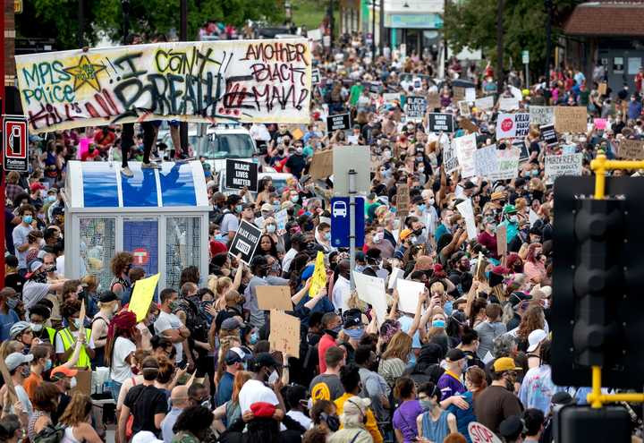

---

## 3765　由海向陆

- 日期：2020-06-16　主专题：A12 战争军事外交与大国秩序　副专题：A20;A13
- 源 ID：`edf11fe5-9c57-5fbc-af6c-6f56b20dd1de`　原文链接：https://www.zhihu.com/question/282959884/answer/1285212118
- 23 概念标签：事实与证据;能力与学习;责任与后果;成本与总账;法律与秩序;权力与异议;技术与工程;文明与历史
- 证据状态：manual_confirmed　初读：reviewed_needs_revision　独立复核：reviewed_needs_revision

**问**：中国是否应该大量制造航母？

很多人被美国、大英帝国、西班牙帝国、葡萄牙、荷兰的成功晃花了眼，误以为成就世界帝国必须要是强海权国家。
实际上海权国家将是历史上的昙花一现，只是短时间内的一个特殊现象而已。最终历史还是要回到它的常态——陆权国家统治大陆，海洋重回沿岸和平割据状态。
地球的地理构造的要害是——毕竟亚欧非三洲是一整块大陆，而且在可以预见的未来会是人类绝对的人口和文化中心。
只要这一点不变，陆权国家作为人类文明的中心的基本格局就不会有真正的改变。海权国家无论怎么活跃，也只能享有短暂的技术代差带来的黄金时代，而且必须要基于这种基本体认去提前铺垫好自己的退场。
否则，如果发生“硬着陆”方式的退场，对海权国家的后果可能是难以承受的。
一个新的发展是，陆权大国可以在自己的沿岸撑起最宽1500-3000公里的保护伞，将海权国家的海军毫无悬念的拒止在外。做不到这一点的小国家也会自然各自倒向自己临近的陆权大国，通过军事合作条约、出租基地获得由大国分享的拒止能力。
而亚欧非大陆的海岸向外张开3000公里拒止线，足可以将世界绝大部分的资源、人口、航道置于自己不容侵犯的羽翼之下。进入这一区域的舰只如果被证实是敌意的，无论如何也抵抗不住四面聚集而来的陆基导弹和空军的饱和攻击。
想在这个区域内攻击陆权国家的货船而不付出代价，近乎于是不可能的。
即使是航母战斗群也不行。
航空母舰这类水上兵器并没有太长的历史寿命了。预计不过百年之后，水面舰艇的军事用途就会走向终结。
眼下急用，造到足用即可。
造得太多，没有意义，而且挤占将来空天部队以及太空部队的预算。
即使是美国，再过不到三四十年，也将裁撤大部分舰队，因为陆基导弹部队和陆基空军的拒止能力太强，而且霸权崩解、世界多极化之后，各陆权强国及其附庸国的海岸一千五百公里范围都将成为绝对优势区域。在战时派遣载人平台进入这些对方占据绝对制海、制空、制电磁权的区域，恐怕是违背军事伦理的。
水面舰艇的安全生存区域是离所有非盟国海岸均1500公里的剩余海域。把地球的全部水域面积都去掉1500公里，各个大洋会缩到多小，你们可以看一下——太平洋都会缩到只剩下里海的大小。何况再过二十年，这个数字将不再只是1500公里，而是3000甚至5000公里。
五洋虽大，却无可立锥处。
任何水面舰队都无法顶住由大量天基星座分米级定位导航的，来自陆基的近乎无限量的武装无人机和反舰导弹的饱和攻击。人家是陆基的，后面可以修一条专业铁路从流水线直接送到发射阵地，制造速度甚至可以压倒发射速度——造1000枚中程导弹比造一个航母战斗群快太多了。
水面舰队拿什么顶？锅吗？
布设在大洋上的舰队，只能无人化后当作准备弃守的无人自动化浮岛。派人驻守，在战争情况下是不人道的。
问题是，同样要派遣无人机，为什么要用水面航行这样低效的手段？
所以，我相信中国航母舰队的峰值不会超过五艘（训练舰不算）。
而且应该在二十年内就结束再造新舰了。
而且，从2030（甚至早至2025年）开始，就会开始向载人/无人舰混编舰队转变。
航空母舰的意义会迅速消退，直至消失。
下面的标尺都是三千公里。看看清楚陆基反舰导弹射程分别达到3000公里和1500公里的时候太平洋上的绝对安全区有多大。
这没有计算空射型。

下面是射程2900公里得DF-26反舰导弹的射程覆盖范围（考虑了地球曲率）：

卫星对航母的光学侦察能力：

假如卫星被摧毁，战争会怎样？

<!-- 图片：5 张，审读结论见下 -->
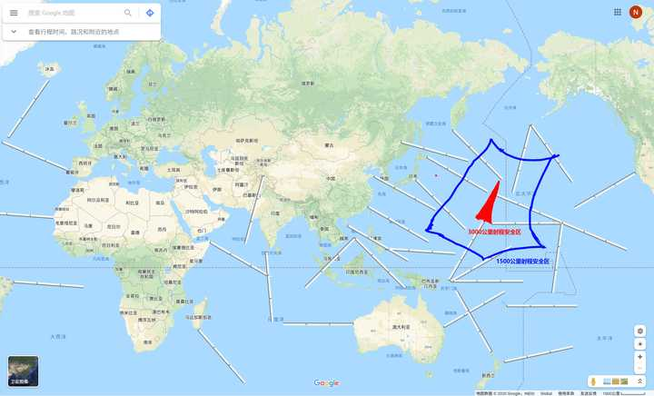
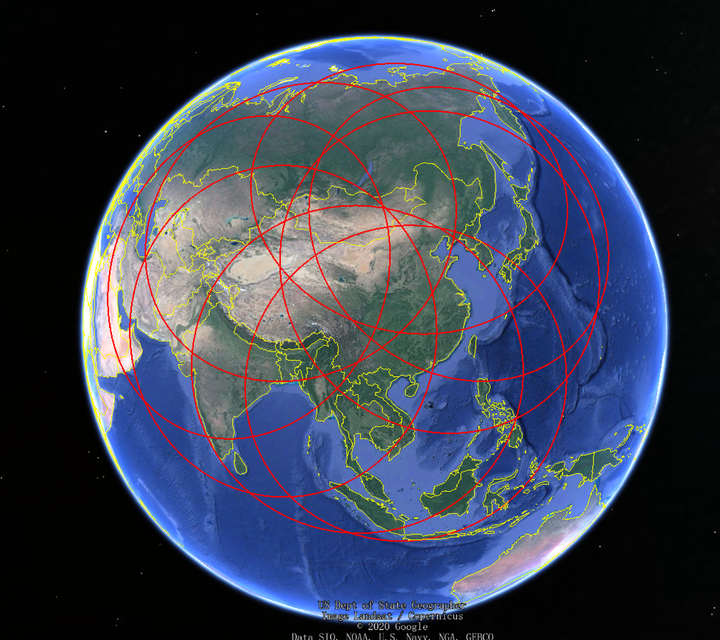
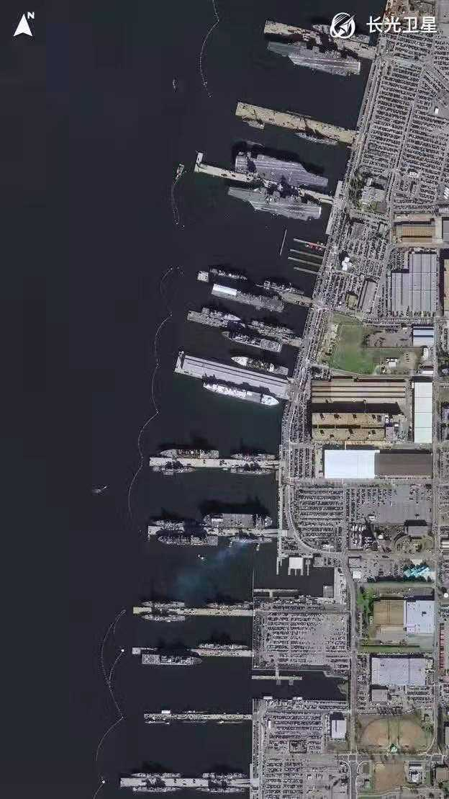
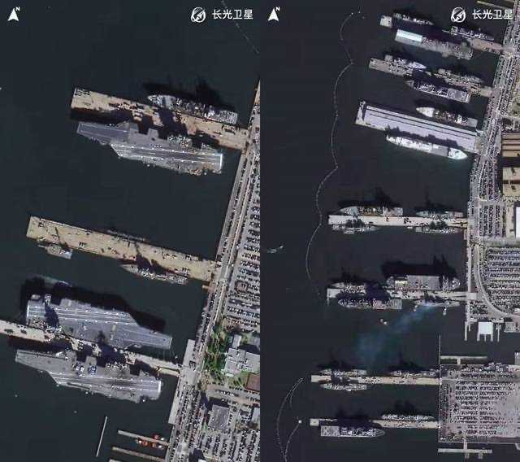
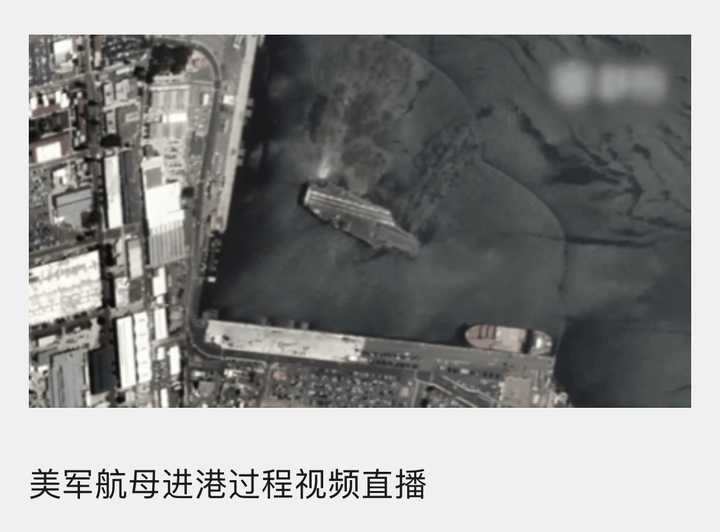

---

## 3759　Black Wallstreet

- 日期：2020-06-21　主专题：A12 战争军事外交与大国秩序　副专题：A02;A06
- 源 ID：`9909de34-af40-55b7-811d-f28d4f41c724`　原文链接：https://www.zhihu.com/question/399529548/answer/1295127135
- 23 概念标签：定义与达意;能力与学习;选择与自由;责任与后果;劳动与组织;财富与市场;法律与秩序;权力与异议;文明与历史;民族与身份
- 证据状态：manual_confirmed　初读：reviewed_needs_revision　独立复核：reviewed_needs_revision

**问**：黑人有没有可能自己建一个州？

了解一下Tulsa “Black Wallstreet” Massacre。
那是历史上黑人最接近凭借诚实努力、依法经营在一个地区真正占据优势、形成有效控制的一刻。
这个地区聚集了四面八方而来的黑人精英，经济上相当繁荣而且自给自足。在市场上也有相当强的竞争力。
黑人们抱着强烈的希望，想要形成自己的社区，自己在美国的家园。
甚至从一战战场上回乡的黑人士兵们自发的在这个地区组织了一支半正规的自卫部队。
失败了。

这个地方，是川普连任竞选的集会起点。就在今天。

多年以后，人们回忆起今天，可能会发现到这是美国一个值得记录的原点。
今天，秋风起于青萍之末。
【Vox】塔尔萨种族大屠杀——黑色华尔街消亡_哔哩哔哩 (゜-゜)つロ 干杯~-bilibili感谢评论区 @冰原 提供链接

<!-- 图片：4 张，审读结论见下 -->

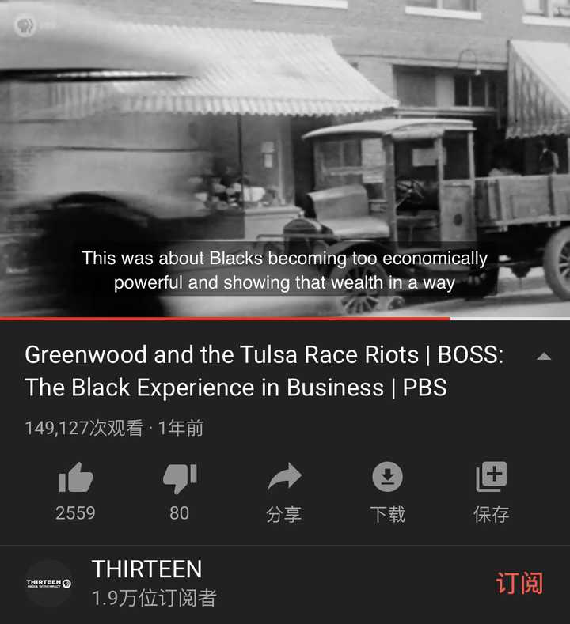
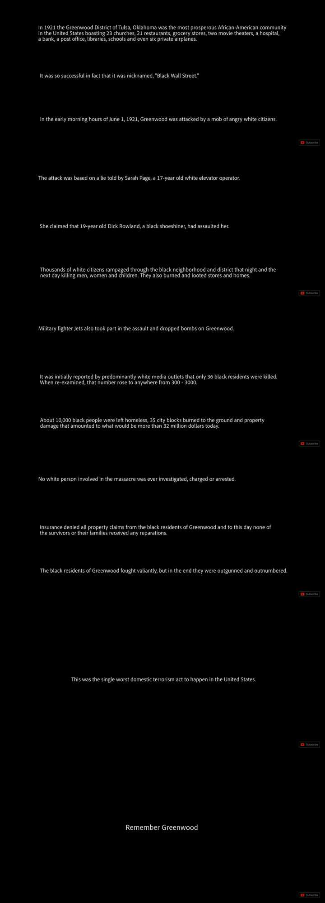
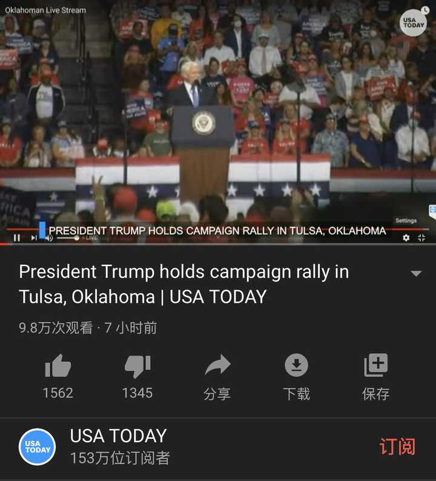

---

## 3760　大国博弈

- 日期：2020-06-21　主专题：A12 战争军事外交与大国秩序　副专题：A20;A17
- 源 ID：`c2b25366-620d-53fe-8e3b-0cebc77f5de3`　原文链接：https://www.zhihu.com/question/26402088/answer/1294181492
- 官方对象—实践路径：与社会 / 与文化 / 接纳;与社会 / 与历史 / 解释
- 23 概念标签：事实与证据;能力与学习;选择与自由;成本与总账;爱与回应;边界与许可;法律与秩序;权力与异议;文明与历史;民族与身份;性别与身体
- 证据状态：manual_confirmed　初读：read　独立复核：not_reviewed

**问**：中国在大国博弈中的水平如何？

“大国博弈”这个讲法不是很好，太过于沙文主义，基本上无视了中小国家的话语权。我更喜欢“地缘政治博弈”这样的讲法。
中国在这方面当然是有优势。
为了说明这种优势，我们要先说明一下地缘政治博弈的游戏规则。
这种游戏有两个模式。
模式A，铁笼模式。
啥意思呢？打个形象的比喻，就好像有个大铁笼，把若干个玩家关在一起。有的个头大，有的心眼多，有的肉厚，有的手长。
但是，这些玩家哪里也不能去。只能蹲在同一个笼子里大眼瞪小眼。
谁也不是完全清楚周围这几位到底在想什么。谁也不是完全清楚周围这几位到底能做到什么。而且谁也不能完全离开自己的座位。谁都没有把握，谁也都并非完全没有自信。
这个时候，场面是非常微妙的。一切都玄而又玄的弥漫在空气中。
这种模式下，最关键的技能就是“读空气”的能力和“写空气”的能力。
一点坐姿的变换，说话语气的不同，敬语体的切换，发言顺序的微妙变化，微妙的动作……就会被敏感的捕捉到，被解读，被研判，被反应。反应也会是很微妙的，近乎不动声色的。摸摸鼻子，扯扯衣袖，使个眼色……
不懂这些的人，难以理解为什么似乎所有的玩家坐着几乎没有任何动作，就已经莫名其妙的分出了尊卑座次，而且达成了共识——甚至还是很牢固的共识。
这个问题，东亚文化圈的人想必不必多说自然心领神会。而要你去对欧美文化圈的陌生人解释，你甚至会不知从何说起。

模式B：拓荒模式。
在这种模式里，所有的玩家都是从同一个营地出发。营地周边是未知的荒野。
在这个模式下，各位玩家的首要问题反倒不是在帐篷里争夺，而是各自凭着自己的条件四面出击。
谁是老大，主要看谁从荒野中获得了最丰厚的收益。收益最丰厚的，有可能获得戏剧性的地位逆转。
这两个模式的交替上演，就构成了国际地缘政治博弈的基本机制。
这里面最关键的要害就是到达能力。
到达能力越不过既有的围墙，那么围墙内的玩家就会是铁笼模式。人类到达能力弱的时候，自然而然的分成了几大纸牌屋，各玩各的。
环地中海是一圈，东亚是一圈，南美一圈，北美一圈。单以中国自身来说，最早巴蜀一圈，黄河流域一圈，长江中下游流域一圈，长城以北又一圈。
每一次到达能力突破了铁笼的四壁，原来铁笼里的几大兽王就会分头出发去各自收割新的荒野——这样就进入了荒野模式。
直到新的荒野被玩家们瓜分殆尽，到达新一轮的铁笼边界。于是在更大的铁笼里，重新开始铁笼模式。
一般来说，每次旧铁笼崩溃，开放出来的新荒野并不大——更多的情况是对于从铁笼A里走出来的猛兽们而言，所谓的“荒野”其实只是以前他们可望而不可及（或一无所知）的铁笼B而已。所以荒野模式持续不了多久，就会再次回到铁笼模式。
但这里面存在着一个异数——那就是从1500年左右开始的地理大发现。足足四个洲的巨大版图开放给了欧洲铁笼的玩家们——北美，南美、中南非洲、大洋洲。
这片巨大的荒野，将整个世界的主流游戏模式锁定在了拓荒模式500年。
这给了擅长拓荒模式的国家巨大的机会——这其实就是欧洲国家从1500年称霸到2000年最主要的原因。
因为这五百年，世界的主要游戏模式是拓荒模式。
说到这里，你们应该看到这故事的走向了——除非太空殖民变得足够经济，否则世界地缘政治的游戏模式正在迅速的重新走向铁笼模式。
这一次的铁笼是地球本身。
而中国则是在东亚铁笼里玩了三千多年铁笼模式的大玩家，身上有至少汉、唐、元、明、清五个世锦赛金牌。
在这个模式里——with all due respect——美国小学没毕业。
勉强算是有类似经验的，只有法国、土耳其这样同样有过“笼王”经验的国家。但是他们又实在没有这个体量和实力——估计也没有这个意愿——来参加决赛。
这其实就是中国渐渐走向上风的原因。

---

## 3702　中年粉红

- 日期：2020-07-29　主专题：A12 战争军事外交与大国秩序　副专题：A08;A17
- 源 ID：`65a6161c-f41c-5952-85a7-e291732eff30`　原文链接：https://www.zhihu.com/question/407220300/answer/1368108513
- 23 概念标签：能力与学习;成本与总账;财富与市场;法律与秩序;生态与自然;性别与身体
- 证据状态：manual_confirmed　初读：read　独立复核：not_reviewed

**问**：如何评价文章《小县城的中年粉红：在混吃等死中研究世界局势》?

那把“小县城、粉红、混吃等死、研究世界局势”这一组合改成一个什么组合呢？
小县城，中年，不粉红，纯混吃等死？
小县城，中年，粉红，混吃等死，但不研究世界局势？
小县城，中年，粉红，不折腾混吃，纯等死、研究世界局势？
总不能自己出钱把小县城中年都集体迁移到大城市，或者只手擎天把小县城统统升级为大城市呀。
还是说是想把“粉红”改成“粉绿”？
对此现状不满，是想改成什么样的更好的理想状态呢？
要有一个更好的可选方案，才能批评眼下的方案不行啊，否则这跟“嫌直线距离太长”有什么区别？
第二，在现在这个时代，即使是一个普通人，只要买点指数基金或者有一点固定资产、有个小局面，关心世界局势难道不是题中应有之义吗——难道人不该关心自己财产的涨跌走向？
水平如何另论，但人家关心有什么可惊讶的？这本来就是与进货成本、销售预期、银行利率、物价涨跌……有直接而敏感的关系的事情。
为什么还要说国际局势跟小老百姓没关系？
一天就影响到你百分之几（甚至可能百分之十几、几十）的身家的关系，怕是比你跟你同事、表哥、老同学的关系还要亲近好吗。
这话说得嘴响，其实真细究起来早就过时了——这是在对一个21世纪的现代化国家的社会成员提出自然经济、农业时代的要求。
犹如在一本正经的嘲讽“女人读什么书”——这个嘲讽本身就构成了反讽。

---

## 3703　集体右转

- 日期：2020-07-29　主专题：A12 战争军事外交与大国秩序　副专题：A16;A20
- 源 ID：`2d39cbec-da74-5470-99f5-30e0f359c262`　原文链接：https://www.zhihu.com/question/48941008/answer/1368075069
- 23 概念标签：事实与证据;责任与后果;文明与历史;民族与身份
- 证据状态：manual_confirmed　初读：read　独立复核：not_reviewed

**问**：为何近年来世界集体右转?

世界没有在右转，而是一直在左转。
只是人对“左得到位”的评价标准提升得更快，快得左转的速度跟不上了，造成了“右转”的错觉。
现在被称为“右转”的这一派，他们在要求什么呢？
是在要求降低进口、驱逐移民/难民吗？你真去听一听就会知道，其实只是要降低出口 / 降低进口增长的速度，要限制新移民的流入速度 / 提高新移民的放行门槛。
他们是在要求取消目前的反歧视政策吗？或者更进一步的说，是要禁止进一步的消除歧视吗？
他们是在要求延缓或者暂停进一步加强这些政策。
他们是在反对全球化吗？他们多数是在要求放缓全球化。
他们在反对加强环保吗？他们是在要求减缓在环保策略上进一步加码。
实际上的主张并非是要把左满舵改成右满舵，而是要把左满舵往回扳一扳，甚至都不算是扳成直行，而是要扳回到四分之一左舵。
谁有能力、有这个胆量、有这个资本，去扳成右舵，哪怕是四分之一右舵？
想过真的扳成右舵是什么样的结果吗？在经济上、政治上、文化上都几乎是毁灭性的。
连朝鲜都很难说现在是右舵状态——它都其实在左舵——只是左得谨小慎微罢了。
到底谁真的在往过了中线的右舵上扳？
极左、半左和微左，都是左派。你不能因为半左和微左有了声势，就认定是右转。
这种声势的确会导致真正的右翼的声音也自以为春天到了而传出来，但这并没有影响政策到真的右转的能量。
所谓“全球右转”，其实更多的是人们的恐惧感呼唤出来的媒体制造的观点热卖品——可以换点击率和转发率。
目前唯一的例外可以说就是川普这二愣子。
先看他还能愣几天。
要是他真的愣四年，也有好处——可以拿来做一个“强行右转会怎么死”的活例子。

---

## 3687　军训

- 日期：2020-08-16　主专题：A12 战争军事外交与大国秩序　副专题：A04;A09
- 源 ID：`c463a9b3-e752-5e18-8001-49244bda7e7a`　原文链接：https://www.zhihu.com/question/412671457/answer/1411557637
- 23 概念标签：能力与学习;责任与后果;成本与总账;边界与许可;劳动与组织;法律与秩序
- 证据状态：manual_confirmed　初读：read　独立复核：not_reviewed

**问**：湖南高一新生军训时晕倒身亡，教育局通报系因患热射病已启动调查，你怎么看？

本来这不值得特别评论，只是一个很普通的意外事件。
每年大学军训季节的总参与人数是多少，你们知道吗？
大约800万人。
不要谈那些虚头巴脑的，现实一点，不管你怎么去喊口号，百万分之一级别的严重训练事故率不会导致太大的政策变化，只会导致一些细则修正——实际上早在2015年就已经推行了军训前强制体检制度。
军训的根基是义务兵役制这一项国策。义务兵役制不变，军训就绝对不可能被取消。
而在彻底解决台湾、南海等领土争端，中国的国力胜过所有胆敢觊觎的敌人的总和之前，义务兵役制是不可能有重大变化的、关系到国家安全的根本国策。
很多人意识不到大学、高中军训的战略意义，觉得“学个走队列有什么用”，这是个观察视角太低造成的认知问题。
你们想过为什么中国的学校的playground会被普遍称为“操场”吗？
那不是为了让你们踢足球的——就男足那个样，你都知道中国人根本没有那么热爱足球。
那是一块有意安排保留的为随时启动义务兵役制进行战时总动员的军事用地。
为什么必须要有一块能将全校师生聚集在一起一天一操、一周一会的开阔草地？
如果仅仅是为了上体育课用，不搞大集合一半甚至三分之一的地皮都足矣。如果只为了全校集合开会，一个礼堂足矣（况且普遍已都有了）。以现在中国的各大高校和中学在城市中的地理位置，一个城市几十所甚至上百所中学/大学的操场的地皮值多少钱？你们想过这笔看不见的机会成本每年有多大吗？
另外，你们可能觉得走队列、站军姿、野外拉练、打一轮靶似乎不痛不痒，将来真要打起来你们这点训练没啥大用。
但你们没有想清楚——对于训练你们的教官而言，他们受到的“对全新兵员组织大规模训练”的经验是至关重要的。
他们中的大部分将来都不会下连队去直接担任军事主官，整个军事生涯训练管理的部队规模最大的体验，可能就是这次军训。
他们才是这次军训受到最大训练的人，也才是义务兵役制一旦真正实施动员的关键所在——中国需要大量有基本的训练动员兵经验的基层军官。以中国目前仅两百万人左右的军队规模，考虑到绝大多数都是士兵，还要排除技术军官、文职军官，如果不是有这项军训制度，有练兵带兵经验的军官队伍数量是远远不能支撑总动员的。
每年这场集中了一千五百多万人口（大学新生八百万，算上高中生接近翻倍）的集中军事训练，其实是义务兵役制的一次“开机自检”。所有与这个制度配套的人员、机构、场地、器械，都会得到一年一度的检验、测试和更新。
我提醒你们——这一千五百万人头顶上没有屋顶，卫星能看见。
如果取消这项制度，用不了几年，就会有大量的操场缩小甚至消失，变成所谓“综合体育馆”，人武部缩编，地方军事院校、驻军与各院校的演训关系淡漠、解除，储备器材、训练基地被弃置、废除。
最重要的是，中国不容置疑的、深不见底的、足以在半年到一年之内扩军至三千万高中以上文化程度兵力的总体军事动员能力，就可能被判断为“需要18-36个月才能充分运转”——那几乎意味着在事实上已经丧失了总动员能力。
场地都没了、机构没了，有事了打个响指就能有吗？
动员一千万熟练掌握几何学、代数、三角函数、化学、生物学常识，能阅读英语，熟练掌握母语读写的兵员只需要三个月，世界上没有任何国家或国家集团敢于想象与中国陷入常规军事冲突。
把周边国家捆在一起，再加上北约都不行，想都不必想。
但是如果总动员需要一年多甚至两年多才能逐渐运转起来，这个问题的结论就难说了——有些人可能会产生一些“大胆的想法”。
“原子弹其实不像麻瓜们想的那么坏……”
你们可能意识不到，其实真正保护住你们能悠闲地刷手机吐槽的，不是现役的部队，也不是我们的核武器库（至少目前不是）。说得狠一点——如果只有这些，某些国家、某些集团是不介意来一次长痛不如短痛的。
这两百万部队，有人会有膨胀的信心觉得自己能在三五个月内打垮。那上百条船，几千发导弹，有人觉得自己能带着小弟拼光。
那几百枚核弹，有人有想法能干掉一部分，挡住一部分，“联军”算了算，有一定概率死的是道友不是贫道。
一次规模空前的、广泛合作的、联手发起的、做好充分升级到核战争准备的军事冲突，对于一个没有紧急总动员能力的中国是一个真实的、切肤的、足以致命的威胁。
ta们真正绝对没有把握的是拼光这两百万部队人要花多久，要是要花一两年，那么那操场上的1500万会成为它们永远无法醒来的噩梦。
因为那里面有无法计数的装甲兵、导弹兵、工程兵、狙击手、飞行员、雷达兵……还有——考虑到游戏市场总规模——无数无人机驾驶员和吃鸡狂魔。
这才是目前中国的战略安全真正的绝对保证、那张没人打得过的底牌。
所以，回到本文最初的结论——不要抱任何“军训会晒晕人又不能帮我学会杀人，应该取消”的幻想。
并且你应该好好地想一想这个问题——
判断“什么事情是可以改变的、是值得花精力和感情去改变并可以期待回报的，什么事情是不能甚至不应该改变的、是要花精力和感情去接受的”是一种至关重要的能力。这种辨识能力低下，轻则常发幼稚乡愿之言，让人看出你是一个容易操纵愚弄之人而招来损失，重则会在错误的方向和议题上浪费极大的青春、虚掷生命而最终深刻地伤害自己的人生体验。
在你开口定论“军训毫无用处”之前，你下过哪些调查、研究、对比和思考的功夫？这些东西本来是不该让别人来告诉你，而是你自己饱受军训折磨之后自己查到和想到的。
但你没有去查、去想，而是直接开口抱怨。
如果你不能改变这个做事习惯，将来远比军训折磨人考验人的事还多得很，你的人生将很痛苦。
多想想吧。

---

## 3679　脱钩威胁

- 日期：2020-08-27　主专题：A12 战争军事外交与大国秩序　副专题：A08;A10
- 源 ID：`ff132074-8175-5372-8c38-7080750951b8`　原文链接：https://www.zhihu.com/question/417177895/answer/1435956801
- 23 概念标签：事实与证据;能力与学习;技术与工程
- 证据状态：manual_confirmed　初读：read　独立复核：not_reviewed
- 标记：`【极短回答】`

**问**：如何看待特朗普称如果中方在某些地方不正确对待美国，他必定会让中美「脱钩」？

美国喊了很多脱钩的口号，中国却在动手做脱钩的准备。
最后的结局，倒有可能是做完了准备的中国要拿脱钩来威慑美国。

---

## 3664　长平

- 日期：2020-09-04　主专题：A12 战争军事外交与大国秩序　副专题：A10;A03
- 源 ID：`2e4ef5a8-f4db-5e72-8685-e3517b3a09a1`　原文链接：https://www.zhihu.com/question/419328061/answer/1453999432
- 23 概念标签：事实与证据;定义与达意;责任与后果;成本与总账;爱与回应;边界与许可;劳动与组织;财富与市场;法律与秩序;权力与异议;民族与身份;心理与主体
- 证据状态：manual_confirmed　初读：read　独立复核：not_reviewed

**问**：如何看待印度外交部长称「当务之急是通过外交途径与中国达成和解」？

印度政治家非常清楚自己现在处境非常危险。
对待狭隘民族主义，最致命的策略就是passive aggressive。
何谓passive aggressive？看起来都是中正和平、政治正确到人打哈欠、完全没有办法挑刺的伟光正的话，但是在心里有鬼的人听起来句句刺耳扎心，乃至于是可忍孰不可忍，这个就叫passive agressive。
狭隘民族主义是一头没有大脑的野兽，在动作上处理得技巧一点，在外交上不给台阶下，就会产生一种极大的动能裹挟决策者眼睁睁地踏入对方的屠宰场。
中国继续消极刺激印度，印度的领导集团就可能压不住国内被有心人煽动起来的民族主义狂热，可能会真的做出最愚蠢的军事冒险，然后作为无可抵赖的入侵者在中国境内被名正言顺地重大杀伤。
顺带还可能会被安理会拉上制裁名单。
（很多小朋友觉得美国会投反对票。到时候自然会拿出卫星全程录像来全球播放印军坦克是在哪边被歼灭的，有必要还有可以让上万印军俘虏每天上镜讲述战争亲历记。
洗衣粉，我们也有很多好牌子。
更本质的是，容忍对主权国家发动侵略而不制裁，造成的国际秩序的崩坏对美国现实利益造成的代价远超过占中国一点上风而带来的利益。美国要支持更多的表达只会在制裁条款上要求从轻、年限从短，以及投弃权票。）
这件事的致命之处在于，控制事态进展的主动权已经不在印度决策层手里了，而在中国一方。
中国如果不断升级对印度民意的刺激手段，新德里就可能被军事冒险的政治正确绑住手往前推搡。中国没有公布的伤亡人数、没有公布的印军惨状、没有公布的军事部署、按住没发的更强硬的声明，都是留在手里没打的牌。
这些牌打出去，每打一张印度的血压就都要升高一截，肾上腺素都要提升一级。
但这只能怪印度自己——正是你自己煽动起来的狂热，造成了这些牌引燃狂热的强大效力。你的话放得太满，那么我每一句让你更下不来台的话，都会抬升你不得不自己下台的政治代价。
一旦这些牌打出来，你要么在疫情、经济双重绝境之中加一条“对敌软弱”的罪名，要么在疫情、经济绝境中再加一条军事无能、丧师辱国的罪名。
如果一张牌不够，还有第二张、第三张。打完了，还可以自己印刷。
以你的控制能力，能在这钢丝上走多远？
真的被这种狂热裹挟，踏入死地打一场毫无胜算、毫无义理可言的败仗，不但遭受重大伤亡、且沦为国际笑柄，还要背上一顿制裁和战争赔款，对印度会是一次重大的命运转折。
新德里现在是骑虎难下，最痛恨的就是北京不但不给台阶下，还有意无意地拱火，说些不咸不淡的话刺激印度的极端民族主义者。
其实这个潜台词就是要新德里自己努力强行转弯，自损威望，付出沉重政治代价。
之前的狠话是你自己放的，你说我不退就要打我，我是不可能配合你退一下的，请你自己想办法圆场。
如果新德里不自己把弯转彻底，北京会更有效地、但是毫无把柄地、伟光正到无话可说地刺激印度民意，直到新德里自己也控制不住、非把手伸出来挨这一刀为止。
想要我们停止把你国内局势推向失去你控制的境地，你自己想办法给我理由不要这么做。
太极拳的要害在于利用对方自己的意图和自己控制不了的惯性，顺着ta的意让ta自己向扑去的方向摔倒。你想要这样，我不但不阻止，还要不断地引诱你往前扑，给你制造你想不扑都不行的伦理困境。而安排给你扑的是插满尖刀的陷阱。
你不想来，我还要握住你的手腕往里牵。
西藏实在是最合适的大象陷阱。
刀都准备好了，就等你把手伸进来。
给你制造“千载难逢，不抓住愧对印度人民”的“黄金机会”，并且让印度“人民”全体看到，看得都发急，看得他们开始谩骂你还不敢伸手简直是民族罪人，开始组织刺杀小队刺杀“投降主义”官员，让你不下令伸手都没有办法继续执政。
看你能不能按得住，不把手伸进绞肉机。
伸出来的手被砍掉了，“印度人民”可不会认为是自己的错，要上绞架的一样是下命令伸手的人。
如果希望我们不要继续推动事态往这个致命结果发展，希望我们能配合你息事宁人、稳定局面，你们打算拿什么来换？打算拿什么来做抵押让我们相信你的诚意？
印度的牌面前所未有地差。
依靠民粹治国，有一个至关重要的前提，就是国际关系——尤其是邻国关系——一定要良好。
这样国内作死，国外没有人有心利用，虽然作死会造成痛苦，但不至于致命。
如果把民粹指向其他国家——尤其是愚蠢地指向实力远远不如的强邻，真的是世界上最愚蠢的行为之一。
对方完全可以借正当防卫打死你，只愁没有正当防卫的机会好吗？
所以，对印度而言，现在的确当务之急是和中国和解。
有人问有啥参考资料可以说明这分析的可靠性吗？
有啊。
美国现在在南海和台海对中国干的事，和中国在中印边界的策略高度相似。
唯一的区别就在于中国有很强的对于狂热民族主义的警惕意识以及长期积累下来的抑制集体无理性的经验——并且中国文化里的历史教训足够多，民众看多了《三国演义》《廉颇蔺相如列传》都会有基本的不受激将的基本意识。
但饶是这样，中国仍然不能对这种“在你面前晃悠，就是想勾引你贸贸然出手”的策略掉以轻心，仍然有压力。
凡民族主义过于高涨而且有强自信的国家，最大的弱点就是不受逗，被引逗容易失控犯下重大错误。
我们当乙方的时候就看得一清二楚，我们自己当甲方了反而看不明白了吗？

可以回顾一下：
长平之战（中国战国时期著名战役）_百度百科

---

## 3658　多好算好

- 日期：2020-09-08　主专题：A12 战争军事外交与大国秩序　副专题：A03;A06
- 源 ID：`c34a6438-7e52-58c2-aa7c-141635a8b747`　原文链接：https://www.zhihu.com/question/373687017/answer/1459825925
- 23 概念标签：事实与证据;定义与达意;能力与学习;选择与自由;爱与回应;照料与家庭;财富与市场;法律与秩序;文明与历史
- 证据状态：manual_confirmed　初读：read　独立复核：not_reviewed

**问**：为什么美国总是对中国不友好？

因为“友好”的定义存在问题。
很多人——尤其是年轻人——认为友好的基准线是不闹任何矛盾、一直面带笑容、亲密友善、彼此体谅……最低最低，也要面子上过得去。
一旦有过面子上也过不去的事，那么就算永远的翻过了一个临界点了——再也无法回到从前了，这就基本上算是结束了，剩下的剧情就是“渐渐消失在人海”了。
但这是在小孩子们在学校里没有什么大不了的利害关系、也一直可以自由选择“这个不好换下个”的前提下形成的友好概念。
在这样一个上有封顶、下有保底的宽松状态下形成的“友好”标准，拿来衡量国与国之间的关系，就很容易得出“不友好”的结论。
国家与国家永远存在深刻的利益对立面——即使暂时不考虑战争，就只是商业竞争也是你死我活的。第二，你看你的邻国不爽，你也不能拍拍手换一个。
地球是一个没有出口的村，村民甚至连脚都没有。国与国之间的“友好”的定义，远远的低于小朋友们从学校生活（包括从职场生活）里形成的经验基线。
其实按小朋友的基线，极少有相邻国家之间真的算是“友好”的。
尤其是大国，更是如此。
如果你按照人际交往的标准，那么的确可以说美国对中国“总是”不友好。
但如果按照国与国的关系基准，中美关系已经算是基本及格了。
甚至在某些时段还很不错。
很难算“总是不好”。
这个有点像一些不会考虑“分家”这个选项的老式家庭，这样的一家人几十年没有一些刻骨铭心的风风雨雨是不现实的。
现在的确不是中美关系最好的时段，但是远谈不上中美关系最坏的时段，大概也没有越过全部历史的平均线。
简而言之，这个问题的前提——“总是不好”——本身是不成立的。
因为按照国与国关系——尤其是大国关系的标准，这谈不上“不好”。
甚至还算比较好的状态了。

---

## 3639　武力和统

- 日期：2020-09-20　主专题：A12 战争军事外交与大国秩序　副专题：A10;A16
- 源 ID：`c8b11b87-e305-5761-aa15-a918512a5358`　原文链接：https://www.zhihu.com/question/421919244/answer/1482782469
- 23 概念标签：事实与证据;定义与达意;能力与学习;责任与后果;成本与总账;边界与许可;技术与工程
- 证据状态：manual_confirmed　初读：read　独立复核：not_reviewed

**问**：如何看待 9 月 19 日，解放军 19 架战机进入台西南及西北空域？

有人说这篇东西“鼓吹战争”，这是完全看错了定性。我并没有谈论我自己的立场，或者呼吁别人支持这种策略，只是根据各种迹象和态势做出做现行策略走向的猜测而已。这并不是在“提供建议”，而是在预测事态可能的发展，只是一种事实判断。我喜欢或者我不喜欢、我主张或者不主张，甚至哪怕假如我是个台湾人，都不会影响到这里做出“事情恐怕正走在这个进程上”的判断。
那么事情是不是一定走在这个预测路线上呢？当然不一定。但你要想清楚——如果这个策略你已经感觉的是可行的、有合理性的，并且结果是积极可以期待的，那么真正被实施的策略一定决策质量只会在这个预测之上，而不会在它之下。
毕竟智库掌握的信息更全面，思考更专注也更深入，而决策层也都是一步一个台阶走上去的，没道理我都能如此简单的想到的东西他们没有想到。
第二，有人评论说“强国人自我膨胀”。这是完全看错了实施这个策略的决策逻辑。
这个根本不是“膨胀”的结果，而是即使条件不成熟，即使实力还做不到无损获胜、即使可能会遭受一定挫折、一定失败、即使要面对重大的牺牲，这一策略也非做不可。因为别无其它代价更低的手段能获得更好的结果。
只有展现主动求战、不惜以最快速度、升级到最彻底规模的战争意志，才能齐根斩断一切仍然打算做政治投机的赌徒的妄念。
即使感觉不良好、觉得没十足把握，也一样要坚定不移的、百折不回的向前推进。
所以这不是一种可以等天气晴好、心情愉快、把握十足再轻装出发的“业余爱好”。
这不是为了毁灭，而是为了拯救。
台湾可能很快会发现自己犯了一个错误——大陆的这些举动并不是对所谓美国这人访台、那人访台的所谓“反应”，而是一种正在有条不紊的推行的新国策。
简单来说，从现在开始，直到完成统一为止，台湾恐怕将一步步走向不再拥有领空、领海可言的境地。
这似乎将成为继“解除台湾的邦交关系，去除其外交空间”之后的更实质的迈向统一的实质推进的一部分。
这路线图几乎可以画得出来：
1）空军长期在中线东侧训练，并且不断逼近台湾本土。多架次高强度训练除了可以让所有解放军飞行员熟知台海空情，了解台军的应对预案部署之外，还可以快速损害台湾的装备补给和人员压力，进一步的削薄台湾固守待援的能力和信心。
2）海军长期在台海的关岛方向、日本方向、夏威夷方向驻泊，不断操练防空、反舰作战。提前卡死外部介入的路线，提高介入门槛。使得及时低损失的介入在实际上变成肉眼可见的不可能。
3）空降部队大张旗鼓的演练，并常规化的靠近前线部署。大量空降装备不断补充部队。战略运输大量的转向运输机，而不再主要依靠登陆舰。
4）雷达预警、监测网络和电子战手段不断增强，并且日常实施，让台湾预警系统常规性的处于致盲状态。
5）在一切必要海域常规的进行反潜、扫雷、模拟布雷训练，常规占据最有利的海域，将台海军的生存空间压缩到极限，几乎不能出港。
6）中程导弹有条不紊的在台海周围进行各种试射测试。训练科目越来越有针对性，射程越来越远。
7）在这之上，可以进一步的以国安理由随机拦截抽查进出台海的货轮。
这些新闻很可能在未来一两年里成为台湾新闻的常规内容。
这些手段的升级，可能不再遵循“你挑衅我就升级，你示好我就降级”这种“操之在台”的模式，而是并不需要台湾做出任何挑衅的动作、也不理会台湾做出的求和姿态，也不考虑中美关系到底是缓和还是紧张，只会完全按照北京单方面的计划不断升级，直到台湾民众只凭肉眼观察、凭常识判断就不能不对一切独立的可能性绝望。
也就是操之在我，而且唯在于我，直到你和平投降为止。
这其实就是在推进统一时间表了。
台湾如果还以为只要老实几个月不挑衅就可以解除紧张局势，或者说两句软话就能降温，那么就误判了局势了。
因为hk教训已经深刻的让北京意识到，修改教科书这一条就是终极挑衅。只要台独教科书没有变化，不需要台北再做任何其他挑衅动作，已经是每一天都在极端挑衅之中。
每一天都有必要以更快的速度、更大的力量、更不能靠言语宣传扭曲的实际态势将台湾“去安全感”化。
消灭对方的一切妄想，才是和平统一的最短捷径。

---

## 3607　长江天险

- 日期：2020-10-21　主专题：A12 战争军事外交与大国秩序　副专题：A20
- 源 ID：`2867ed0d-0c0c-5bb4-a328-50f679d93142`　原文链接：https://www.zhihu.com/question/20518026/answer/1534640344
- 23 概念标签：定义与达意;选择与自由;成本与总账;爱与回应;边界与许可;权力与异议;心理与主体
- 证据状态：manual_confirmed　初读：reviewed_needs_revision　独立复核：reviewed_needs_revision

**问**：为何古代战争都强调长江天险？长江那么长，别的地方不能渡河吗？

长江的主要问题，不是找不到别的地方渡河，而是你不可能让有足够规模的部队越过长江而不被对方察觉，也不可能在对方有所反应之前就建立足够稳固的滩头阵地。
勉强渡过些许人马，渡河部队立足还没稳，就要背水一战。背水一战倒也罢了，问题是交战的敌人是陆地补给，而渡河部队却要跨江补给。物资人员补充不及，只会被眼睁睁的消灭。
甚至就是让你过河十几万人，整个兵团都过了来，只要对手的主力部队没有被有效消灭，背后的长江所造成的补给困难就一样会导致这十几万人最终被消耗干净。
所以，渡江的问题不光是要过掉这条江，而且是要在渡江这一战役里扎扎实实的消灭掉守军的有效兵力。
如果做不到这一条，勉强渡过去就是找死。
随便找一处过河是不难的，只要时间够久，这也谈不上多少船只问题。因为攻方可以在陆地火力的掩护下构建坚固水寨。就是当着你面集中船只又如何？你如果看不顺眼，你可以试试集中水军来攻击我的坚固工事，看看最后是我会比较缺木头，还是你会缺有经验的水手。
所以在长江上寻找一支流先造好大量船只来提高渡河的成功率是有用的，但却并不是决定性的。
渡江真正的问题在于它没有花巧可玩。想过江而又不是自寻死路，就必须堂堂正正的同时打赢渡江这场会战。也就是渡江当天，必须是正面击穿击溃对方的堂堂之阵。
这样过得江去，对方已经元气大伤，在很长一段时间内都无法再对过江部队形成有效威胁，这才有可能从容攻略，占住一块足够自给自足的地盘来做前进基地。而且这主力大败的消息传开去，渡江之后的形势才足够顺利。
否则，勉强过去容易。但在陌生的地方领土上和士气并没有严重挫折，甚至因着长江天险而有着必胜的信心的敌军纠缠久了一样日久生变。
所以，凡渡江之战，攻击方真正会采取的策略不是在寻找“方便渡江的滩头”——坦白说，长江并没有那么湍急也没有那么宽阔。中下游尽是平原，两岸也远谈不上陡峭。
他们在寻找的是最有利于自己一次击溃所有守军的“会战之地”。
实际上，古代战争最大的奥妙，就是找到这块“会战之地”。
因为古代战争最可怕的不是作战，而是战事绵延，出现不可控的变数。
攻击方最大的问题就是怎么速战速决。而解决这个问题的最好办法，就是找一个对方觉得优势也足够大，而战略意义又足够重要的地方，引诱或者迫使对方把全部的力量都集中到这里来做一次总会战。
也就是攻你所最必守，而且也最愿守的地方。
看清楚这里有两个条件，而且都带着“最”字。
为什么一定要你也最愿守？因为那个地方即使对你很致命，但你若明知道守不住，你会宁可把这块地方让掉，等我拿下来之后你来借着我立足未稳的空档选择另一个你对我威胁更大的攻击点，而不会在我选的这个点上跟我拼命。所以这个地方仅仅对你很有威胁是不够的，还必须让你有足够的“妈的，没准我能行”的感受，你才会有这个意愿在这里真正的集中兵力跟我拼命。
也就是说，发生渡江战役时，参谋们把可以过江的所有地点列出来拿着这两个“最”一撸，总是会撸出同样的几个地方来，而那几个地方多半是历代先辈过江时已经用过的了。
这会是一种什么样的地方呢？
譬如这个：

对于攻方，你这是一个突出部，我约等于三面围攻，甚至可以派出小部队强渡变成暂时的四面围攻。
对于守方，背后是一马平川，失败的损失很大。
而另一方面，却又有双城夹江的补给优势，也存在依赖地利最有效的消耗攻方有生力量的诱惑——尤其是自己没把握在野战和陆战中取胜，这诱惑就更大。
所以，在这里旷日持久的战斗，可以算是一种攻守双方在自然规则媒合下的默契共识。
双方都自信可以把这里变成最有效消耗对手的的绞肉机。
从攻方的角度看来，在对方的血流到足够干之前，就是可以偷渡一些小部队过江，也是不愿意的，因为偷渡过去之后太难打。
在这里从容可控、可张可弛、丰俭由人的打，岂不快哉？
所以，不是过江的地方难得，而是可以毕其功于一役的地方难得。
也正因为如此，常常渡江之战就是灭国之战。

<!-- 图片：2 张，审读结论见下 -->
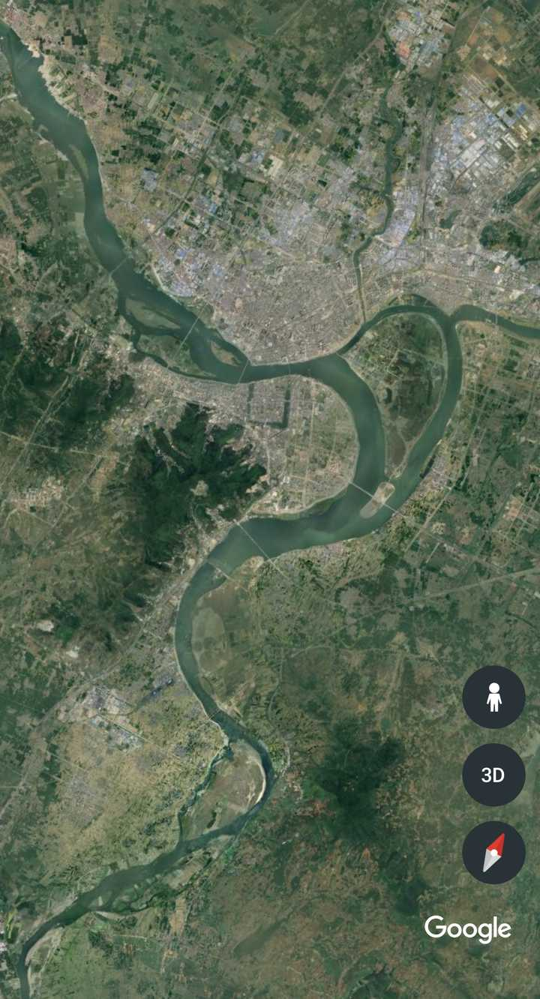
*图 1（已视觉复核）：卫星影像：河流与河曲地形（Google 水印）。*
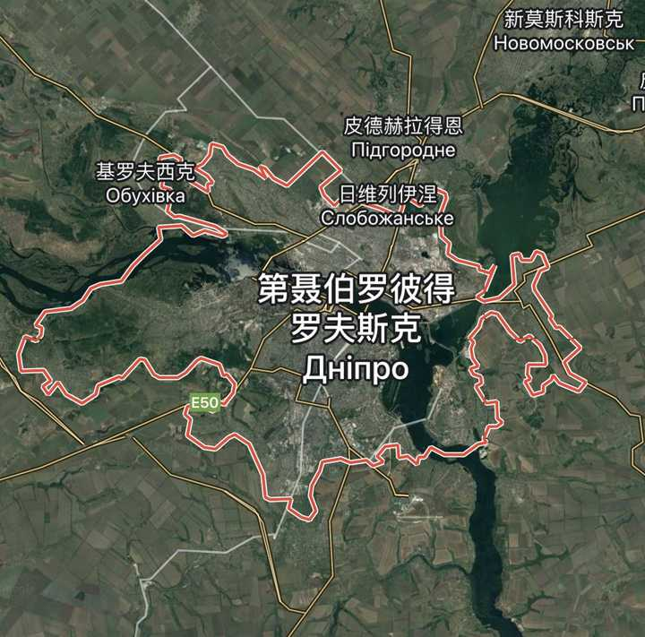
*图 2（已视觉复核）：Google 卫星图上的战役态势标注：第聂伯罗彼得罗夫斯克/Дніпро 周边防线轮廓与地名（新莫斯科斯克、巴甫洛格勒等）。*

---

## 3599　所谓大战略家

- 日期：2020-10-25　主专题：A12 战争军事外交与大国秩序　副专题：A20;A11
- 源 ID：`e9569275-d05c-50f2-83f6-b90243b60a89`　原文链接：https://www.zhihu.com/question/62524883/answer/1542670230
- 23 概念标签：定义与达意;能力与学习;法律与秩序;文明与历史;生态与自然
- 证据状态：manual_confirmed　初读：read　独立复核：not_reviewed

**问**：如何理解布热津斯基的「中国：并非全球性而是地区性的国家；日本：并非地区性而是国际性的国家。」？

西方“战略家”，也就不过如此了。
这是文化基因缺陷，没救的。
英美在近现代丢掉了基督教的文化理想，退化成了一头只知道吃的爬行动物。所谓的“战略”，其愿景和思想都原始得可悲，到了可笑的程度。
这只是一群有了激光枪的匈奴人，根本无法理解和想象未来局势的真正发展，还在发地缘政治、离岸平衡的大梦。
这个时代的统治者必须以人类为考虑问题的基本出发点，只能把自己国家的命运嵌入到人类的命运中去考虑。
只要动了那种这里捣乱、那里使绊子来“保持自己的优势”的念头，就已经失去了真正坐在棋盘上的资格。
未来的竞争是对人类贡献能力的竞争，世界属于最能保证人类切实福祉的国家。在这场游戏里还抱着动手动脚的龌龊念头，前途一定直奔地狱。
人类已经觉醒，ta们不再接受这个游戏规则了——人类所面对的问题也已经不再接受这种规则。
评分标准都变了，还在练滑铲。
傻x。

---

## 3600　王天下

- 日期：2020-10-25　主专题：A12 战争军事外交与大国秩序　副专题：A17;A20
- 源 ID：`e6c5aa02-5567-53d5-8c88-430f5cdd949b`　原文链接：https://www.zhihu.com/question/351381447/answer/1542235785
- 23 概念标签：定义与达意;能力与学习;选择与自由;责任与后果;成本与总账;法律与秩序;权力与异议;技术与工程;文明与历史;民族与身份;生态与自然;宗教与自然法
- 证据状态：manual_confirmed　初读：read　独立复核：not_reviewed

**问**：中国道路为什么走得对？

中国到底在走一条什么路？
王天下的路。
实力强大对昂撒文化和中国文化是两个完全不同的筹码。
在昂撒文化里，实力强大是可以不必顾及其他人的筹码，是称霸的工具；
在中国的文化里，实力强大是可以从容照顾其他人利益的筹码，是称王的条件。
正因为是这样，中国才注定在最后加冕为王。而昂撒文化注定只是一时枭雄，历史的过客。
中国的方法曲折而且慢，但却是无法压制的，而且一旦登顶，除非自己抛弃正道，否则极其难以再被挑战动摇。
不要因为昂撒文化看似威风了三四百年就以为他们才是对的。中国雄视东亚天下近2000年，将一个又一个曾经的军事霸主送进了坟墓。
你会看到的，最终ta们是错的，而且你后面会越来越清楚的看到ta们这种因为自身脆弱而不断耍阴谋诡计、挑拨离间、威逼恐吓的策略只是一种岛国心理缺陷。
我们不是岛，我们是中央大陆——鲸鱼为什么要去学海豹的生存之道？
马前卒现在对台湾的心态，完全是美国式的、盎格鲁-撒克逊式的。这是马前卒最大的问题——他没有意识到他一切红色名词的背后的根本方法论实际上是大英帝国的——那种以“实力支撑权谋”的体系。
中国真正的武器不是权谋——这恰恰是用了两千多年把所有可能的权谋玩到熟烂之后的最终结论。权谋必须服从于大义。
所有的权谋，最后都是用来将敌人的不义无可辩驳的暴露出来，而将自己的义理证明出来。所以才有不打第一枪，不首先动用核武器，不排除一切和平统一的努力……这一系列的基本国策。
这本身就是最大的权谋，但这是阳谋。这【不是“实力不济的委曲求全”】。
凡是在任何意义上认为是后者的人，自己根本就没有理解中国到底是什么以及中国为什么必然会胜利。ta们所出的一切“谋划”，都不过是在追求战术上的红利，而与中国整体复兴的根本战略背道而驰。
不是外部的任何攻击，而是中国年轻人里泛滥着的对称霸的渴望，是长远的将来对中国称王的前途最大的威胁。
这一点，我希望每一个中国人、每一个中国的青年人有毫无侥幸的清醒认识，只有这样坚定而分明的信念，才能真正保护这个国家最终赢得这个世界上最多的帮助，最终压倒那些机械阴谋的敌人。
为王的人，必需承受只满足于称霸的人所不肯承受也不能承受的责任。西方人不懂什么叫天下共主，ta们从来就没有受过这样的历史的教育，ta们在这一点上只是文盲一样的蠢人。
为什么要向根本无知的人学习怎么做一个王？
中国永远不称霸，但中国必终为王。
只有这样的国家来操持世界的权柄，这个世界才能从昂撒人的这种机关算尽、机械阴谋、刻意谋划的分裂状态里解脱出来。全球变暖、环境污染、物种灭绝，才能得到有现实希望的扭转；种族、宗教冲突，才不会因为地球统治者自己的脆弱惊惶，而成为人类永远不能愈合的伤口。
只有这样，人类才有可能在下一轮——甚至就是这一轮——的技术浪潮的挑战里幸存下来。
大过滤器留给人类的时间恐怕已经不超过百年。
中国身上承担的，事实上是整个人类的希望。我们只有不到五十年的时间让整个人类明白这一点。
而要做到这一点，靠的不是惊人的强大，而是靠惊人的温柔。
这条路上的每一个关口，都要靠【惊人的温柔】去攻克，只有这样过了一关，才是真的扎扎实实的过掉了一关。
这样说，很多小孩子们恐怕难以接受，因为我们这个民族最大的隐患，就是我们的青年一代在事实上并不了解中国自己，而是在极大的程度上潜移默化的接受了“昂撒模式才是唯一可行的模式”的精神烙印。
ta们并没有意识到ta们只是一群站在“中国开局”上的【美国玩家】——只是军队是中国的、经济是中国的，而战略思想和基本方法论几乎完全是盎格鲁撒克逊式的。ta们满脑子都是巧妙的威逼利诱，恐吓欺诈，视之为智慧，为战略。
ta们完全没有对仁、义、礼、智、信的丝毫信念。一心只打算把这些真正令敌人土崩瓦解，无力团结的利器视为“经济和军事手段”的“伪装迷彩”。
这是我们最大的危机，这也是为什么我对马前卒所代表的这种潮流加以反复强烈批评的原因。
你们是希望中国成为新的中国，还是只是希望中国成为下一个美国？甚至只是下一个斯大林的苏联？？
美国这么一两百年的【幸运】，就配中国看在眼里，以为绝对正确的“楷模”吗？
这个世界的最终致胜之道到底是什么，到底是剑还是犁？
你们仔仔细细想个清楚！
中国的这一代领导者看起来是完全清楚自己在做什么，但是迟早这接力棒会交到你们这一代手中。
你们不能作为有中国血统和国籍的“美国人”来接这一棒。
因为“美国人”注定接不住。
不然“秦”现在何以失其鹿？
帝国主义的定义什么？

---

## 3585　以武促统

- 日期：2020-11-10　主专题：A12 战争军事外交与大国秩序　副专题：A10
- 源 ID：`d8038a0d-886c-5944-9b7b-078cfb077e24`　原文链接：https://www.zhihu.com/question/429467207/answer/1567328779
- 23 概念标签：事实与证据;定义与达意;能力与学习;责任与后果;爱与回应;劳动与组织;技术与工程;心理与主体
- 证据状态：manual_confirmed　初读：read　独立复核：not_reviewed

**问**：台「海军司令部」证实美国海军陆战队已抵达台湾，这对两岸关系意味着什么？

这应该不会改变以武促统的既定路线。
我的看法是大陆现在对台湾的收紧，不是对台湾具体事件的对话性的反应，而是一种有内部时间表的、有战略决心的重心调整。
是要重新设定台湾民众对基本海峡局势的心理基线，取消虚妄的安全感。
我们设定一个指数“抵抗时间估计”（Resistance Duration Estimation，RDE）。那么我们军事上的战略目标就是通过系统、坚定不移的计划推进，在尽可能快的时间内，将RDE从现在的数值压缩到极限。
举个例子——假设现在RDE是7天，一年后我们要压到3天，两年内我们要压到1.5天，三年内我们要压到1天，四年压到0.5天。
靠不断的加强侦查和监控、不断的提升水面平台的质量和部署、不断的提高战略和战术导弹的性能、数量和战备水平、不断的提高快速反应部队的能力和规模，我们要把“如果命令下达，蔡英文将没有机会从卧室跑到车库”变成一个台湾每一个人都无法再靠幻想来自欺欺人的现实。
并且这个RDE是建立在“假定美日会第一时间全力介入”的想定之上的。
我们会靠着充分的准备把“第一时间”这个概念本身直接抹杀——当你们和台湾恢复联系时，接电话的已经是临时管理机构发言人。
军事准备做到这一步，即使不做任何实际攻击的举动，两岸关系问题也变成每一个台湾居民每天、每小时、每分钟都绕不过去的、必须要解决的问题。
台湾将变成一个安眠药普遍无效的地区。
在这期间，台湾可能会打出来的所有的牌，美国可能会作出的所有的阻挠，都已经在心理准备之内。但这可能对连对我们收网计划的步调不会产生任何实质的影响。
也就是说，我们可能其实订好了时间表。
并不是一月做了，看看二月台湾或者美国干不干蠢事，不干的话第二步就先不做了，等他们做蠢事我们再动。
不，是一月的活干完了，二月台湾干了蠢事，我们固然要干二月的活——让台湾去想象是自己做的事触发了这个升级；台湾没干任何事，我们也要干二月的活——让台湾去自我怀疑是不是自己干了什么触发了这个升级；甚至就是台湾主动示好，我们也还是要干二月的活——茶话会上激动的握手，热情的寒暄，但军事准备还是会按照原定步调全速推进。
犹如当年朝鲜战场上一样——谈对打没有任何迟滞作用。
就算是下一个小时就要签署协议，原定总攻计划也不会推迟一分钟。

勾结外人、制造事端，攻击准备照计划展开；
噤若寒蝉、避而不谈，攻击准备照计划展开；
一见如故、谈笑风生，攻击准备照计划展开。

只有统一完成，才能停止倒计时。
除此之外的任何外部动作，都对这倒计时没有影响。
包括“美海军陆战队访台”。
这恐怕才是“以武促统”的实际意思。

---

## 3582　RCEP

- 日期：2020-11-15　主专题：A12 战争军事外交与大国秩序　副专题：A08;A20
- 源 ID：`22f68966-e8c4-59d8-845b-6a0cea8453f0`　原文链接：https://www.zhihu.com/question/430352958/answer/1576594935
- 23 概念标签：选择与自由;文明与历史;心理与主体
- 证据状态：manual_confirmed　初读：read　独立复核：not_reviewed

**问**：中日韩等 15 国正式签署区域全面经济伙伴关系协定（RCEP），会对亚太及全球经济产生哪些影响？

第一，枪炮刀剑做不到的事情，靠着协商谈判、协调共同利益做到了，可喜可贺。
在我看来，这才是日本侵略战争真正的结束音。
第二，当然不可低估这一协议的意义，但也要看到这只是万里长征第一步，要对这件事未来的曲折、波动和反复有充分的心理准备。
行百里者半九十。
第三，我不认为这应该被视为“反美斗争”的胜利。
严格地说，我们没有“反美”这个战略目标。
这只是世界各国人民追求最大繁荣的共同合作。大家繁荣了，于是美国的压倒性优势客观上被削弱了，但这不是为了“削弱美国”而做的事，不要搞错重点。
总之，这是一件好事，可喜可贺。

---

## 3577　不杀妇孺

- 日期：2020-11-22　主专题：A12 战争军事外交与大国秩序　副专题：A02;A20
- 源 ID：`27419a6a-7676-5037-902d-c93399b96f37`　原文链接：https://www.zhihu.com/question/430768656/answer/1588015715
- 官方对象—实践路径：与社会 / 与文化 / 批判
- 23 概念标签：定义与达意;责任与后果;成本与总账;信用与信任;爱与回应;边界与许可;照料与家庭;法律与秩序;权力与异议;文明与历史;民族与身份;性别与身体;宗教与自然法
- 证据状态：manual_confirmed　初读：read　独立复核：not_reviewed

**问**：战争中男性战死以后，女性有必要反抗到底还是选择投降活着？

在最原始的部落状态，战胜部落是不会虐待战败方的妇女、儿童的。
（为防有人拿某些新石器时代遗址的考古发现来说事，我先把话说好——
当有了文字、墓葬、祭祀痕迹，基本贞节观的构造也就已经完成了。不要拿已经构造完成的考古遗址来论证这个阶段的不存在，因为这不构成反驳。在人类群居和人类有了墓葬、祭祀、原始宗教和文字之间，还有着漫长的史前时代。我这里说的是这个史前时代，这个人类尚未建立起明晰的社会伦理、甚至连“父母”“领导者”这些概念都还模模糊糊的阶段。
这种只杀成年男子而收容妇女儿童的习俗，在很多停留在这个时代的原始部落里仍有遗风可循——譬如易洛魁人的默哀战争。
但是很遗憾，即使是“停留在原始状态的部落”，毕竟也已经过了上万年了——尤其是ta们基本已经完成了自己所在那个封闭领域的最终霸权，早已经没有让这个风俗继续活跃、存在的必要性了。
这并不能消除这个推断过程的合理性。
否则，你就应该同意反演化论者指着任何一个化石空白期批评演化论是胡说八道。
否则你不是双标吗？
）
因为这本身就是最重要的战争收获之一。部落的势力范围，直接取决于部落的生育速度。而生育速度的瓶颈一向不在雄性上，而在于雌性上。
设想两个同样拥有1500名男性的部落，A部落有1500名育龄女性，而B部落因为频频战胜而拥有3000名育龄女性，那么毫无疑问B部落将拥有远期的战略优势。
至于幼童，则可以视为现成的战士半成品，完全可以收养和归化。相当于已经支付过生育代价的成功产品——古代生育死亡率很高，成功出生的幼童是很宝贵的资源。
这造成了一个后果——育龄妇女成了一种事关部落未来生死的战略资源，于是同时是一种会招来攻击的重大诱因。
上述的B部落虽然拥有更大的未来优势，但它也要面对更大的现实风险。在CDEFG等部落眼里，显然在攻击A部落和攻击B部落之间，选择A部落的会被人看作智商有问题。
同样要和1500人作战，我为什么不要选有机会能获得3000育龄女性的？
这个问题直击灵魂。
这里造成了一种很大的选择压力，偏向于能成功在自己部落里建立贞操观念的部落。
“如果我们部落战败，我们的妇女将会自杀，而不是任你们归化。”
如此一来，我们所拥有的生育资源就不再像是现金，谁抢到是谁的了，而是成了“记名债券”。
你杀死我，你仍将一无所获。
于是CDEFG一定会掉头去瞄准A。A虽然彩头小，但是好歹不会白忙，B的彩头却是个假彩头。
通过贞操观的构建，部落无意间获得了安全得多的生存环境，相对于没有构造出这个观念的部落而言，大大的提高了幸存的几率。
这就是贞操观背后真正的动因。
至于各种天降神谕、各种三言二拍警世通言，只是人类社会无意间实现这个结果的具体路径，并不是它真的得以生根发芽长成不容置疑的道德橡树的真实保障。
不是天降神谕、或者圣人设教构建了贞操观念，而是“并非身处封闭而安全的地理绝境，又不讲贞操的部落都在很早期因为被视为肥肉群起而攻之灭亡了”逼出了贞操观念。
明了这一点，再思考在现代这个时代的贞操观念问题。
女性是否只是国家/民族的财产？
女性是否应该有“国家/民族财产”的自觉？
如果一名女性没有这种自觉，她是否应该被惩戒，直到她接受或她被消灭为止？
为女性打上这个思想烙印，是否客观上总体有利于本社群的总体安全？
回答了这些问题，你才能谈论“应该”或者“不应该”。
前提当然还包括你有资格和权柄去谈论这些问题。
基于何种授权程序，你会觉得自己有权柄就一半社会成员的命运做出政策上的规定？
注意，我没有谈论任何“支持”或者“反对”，我只是指出了你要讨论这个问题需要解决的一些前提问题以及需要了解的一些信息而已。

---

## 3471　沙加

- 日期：2021-02-25　主专题：A12 战争军事外交与大国秩序
- 源 ID：`b38dcebe-c8a8-592d-8feb-ee55c68953b4`　原文链接：https://www.zhihu.com/question/445286932/answer/1748285463
- 23 概念标签：事实与证据;能力与学习;责任与后果;成本与总账;劳动与组织;法律与秩序;文明与历史;性别与身体
- 证据状态：manual_confirmed　初读：needs_reread　独立复核：not_reviewed

**问**：印度都敢这样了，我们为什么不主动出击？

黄金圣斗士最令人恐惧的时候，
不是最后光速拳都拿出来把星矢往死里揍的时候。
而是天马彗星拳 + 星云锁链 + 曙光女神 + 庐山升龙霸劈头盖脸上，富士山都打塌了，庐山瀑布都倒流了，紫龙都脱光了，阿瞬都萎了，一辉烧黑了，然而
沙加打坐闭着眼，眉头微皱——
“谁tm这么吵，还让不让人睡了。nnd明天不要上班啊都。”

侵删
的这个时候。
不要问我是谁，我是希瑞。

<!-- 图片：1 张，审读结论见下 -->

---

## 3438　跨国风险

- 日期：2021-03-17　主专题：A12 战争军事外交与大国秩序　副专题：A08;A10;A17
- 源 ID：`5406e9dd-6092-547e-8250-2b4b0469ea29`　原文链接：https://www.zhihu.com/question/449644684/answer/1785596728
- 23 概念标签：事实与证据;定义与达意;能力与学习;责任与后果;成本与总账;信用与信任;财富与市场;法律与秩序;民族与身份
- 证据状态：manual_confirmed　初读：read　独立复核：not_reviewed

**问**：缅甸民众同军方冲突，为何多家中资企业遭打砸抢烧？

一个地方暴乱了，当地最大的企业一般都是目标所在。我们生活这么苦、苦到要起义，你却在这里赚到钱，还显然乐此不疲，这当然意味着你“天然是不正义的”。
这个逻辑很朴素，甚至也没什么大错。因为你能在本地成为大企业，你当然和当权者是一起的，ta不是收了你的税就是收了你的贿。不管怎么说，当权者的强大有你一份不可磨灭的贡献。你怎么说也是一起造成我们苦难的一分子。
所以企业都怕乱。这也是投资落后地区最大的问题。
尽管越落后的地区人工和资源越便宜，显然的有利可图，但是这些地区你成为“恶政帮凶”的逻辑也很通顺。一旦政局不稳，你必定首当其冲。
某种程度上，中国的经济奇迹很大程度上是因为打破了这个魔咒，花了巨大的努力压制了一些愚蠢的混账逻辑，年复一年的巩固了自己的信用，因此才成了世界瞩目的投资胜地。
四十年后，市场武器在手，再问哪家外企敢不低头。
但这是特殊情况，能做到这一点的落后地区，实在非常罕见，往往是战后重建的前发达经济体才有这种特殊能力——譬如战后的日本和欧洲。
哪国暴乱不烧几个大企业。
谁大谁赚钱，谁就是剥削者。首府大楼、军事基地，都有重兵把守，当然是企业首当其冲。

要说这说明了什么民间倾向，也不能算错吧。
不过第一，“国民倾向”几乎是个伪问题，大部分时候都看该国精英如何引导，今天播几个新闻搞几个访谈说你坏，一股脑恨你，明天放几个好纪录片，宣传几个好项目，又一股脑喜欢你。
你有能力解决精英的态度，你就有能力管理对方国家的民众的基本印象。
第二，作为大国，不要神经太脆弱，要理解别人恨你是一种常态。
不遭人嫉是庸才。
第三，信不过中国自己的态度，那么看看东盟国家的态度。
东盟国家的人觉得是非如何，其实才是缅甸是非的真相。
东盟邻国的老百姓怎么看待这些反政变派，值得去调查和参考一下。

大国博弈的能力中国不缺，而且是中国的强项。对缅甸中国手上可打的牌太多了，只是不必要也不适合拿到台面上谈要怎么怎么打。
做事要润物细无声的影响，而不要随便喊打喊杀。
其实你们主要是想问，“那要怎么办”，“怎么能让中国走向海外的企业免受这样的命运”。
我们要采取什么“措施”，做点什么“事”，好让这种事不要再发生？
这件事已经做了啊，那就是互相尊重领土主权（在亚非会议上改为互相尊重主权和领土完整）、互不侵犯、互不干涉内政、平等互惠（在中印、中缅联合声明中改为平等互利）和和平共处啊。
“不干涉别国内政”，就是保护中国海外企业在长期看来越来越少受到动荡波及、越来越少被卷入ta国内部矛盾的的那件事。
什么叫做“国际关系的新准则”？“新型国际关系”？
作为一个强大的国家，而且是一个注定登顶的未来超级大国，我们的公司被你的暴乱破坏了，老霸主们会派军舰和海军陆战队来斩首行动，我们不会；老霸主们会在你国内扶植反对派，我们不会；老霸主们会资助反政府武装，我们不会；老霸主们会宣布你们是恐怖分子，没收你们的海外资产，我们不会。
这就是新型国际关系。这不是我们在自己没钱没航母的时候为让别人不打我们说的便宜话，而是我们现在全球武力第二了，哪怕将来全球武力第一了，也一样会坚持的原则。
因此，你们没有必要将中国的企业和老霸主们的企业一样看作新殖民主义的前哨——你们没有必要像防范将来会导致肺癌的烟瘾一样防范中国企业。不必每次自己一发烧一感冒，就挣扎着要戒烟。
我们是粮食，是蛋白质，是维生素，是水。你不是病了就要铲除我们，而是越生病，越需要更多。
而为了这个原因，中国需要花很多时间，准备用极大的代价去证明这一点。
原则是【根治不安全感】的根本良方，是一个强国成为全球秩序主要影响者的基本资格。
不干涉内政的原则，和“不与恐怖分子谈判”的原则本质上没有什么不同。你被恐怖分子要挟了，而且要挟的甚狠，你只能宁肯承受打击、宁肯承受损失、宁肯“舍近求远”的冒险营救，也不采用“谈判”这招去简单的解决问题。
“不过就是一百万而已，何必这么麻烦？”，其实和这里的“以中国的实力要压服缅甸还不容易”没有什么本质的区别。
是的，一百万微不足道，就像贫弱小国的确根本无力抵抗中国的雷霆一怒。
但是用“一百万”“解决”了问题，会带来无穷无尽的问题。用贫弱小国扬刀立威，会让“中国和罗马、蒙古、英国、美国不同”的信息受损。而真正能保护中国企业、正在保护中国企业的，正是这个信息，而不是你的刀和威。
这和已经把“不与恐怖分子谈判”坚持了五十年，却突然在一个很普通的案例里给了赎金一样，逻辑不通。
金库守了一辈子，老了老了偷辆自行车。
“哦，原来你不是没有贼心，你是没有贼胆啊！”
你本来可以垄断金库保安行业的，你要啥自行车啊！！
蠢不蠢？

要出兵缅甸，容易。
那么埃塞俄比亚、马来西亚、印度尼西亚、尼日利亚……——光听名字都知道是与殖民主义有血海深仇的受害人俱乐部——那一两百个国家里的中国企业立刻会受到全面预防性排挤。
全部同时派兵吗？

不要愤愤不平于这些遭遇，投资之前就要把这些潜在风险的期望值调高一点，平摊到全球下注、总体经营的总赌注中去，一开始就要从自己的产品价格和销量里体现出来。
作为一家中国企业，注定不可能有“战舰助我万事如意”的可能。出去之前就要断了这个想法，并且不要认为这危害了你的安全，就像不要认为政府不会在你被绑架后帮你交赎金是危害了你的安全一样。
那样去“保护”你，去“救”你，你本来平安无事都会凭空生出需要被保护、需要被救的事情来。无论你现在觉得多艰难危险，中国如果因此直接干预缅甸，你都会变得更艰难、更危险。
相反，做好“坚持和平共处五项原则”这件事，才是对你最大的、最全面、最深远的保护。
什么叫“坚持”，就是自己赚到的时候固然不变，自己付出代价的时候也一样不变。
谁说“什么都没做”？
现在正在做“不做蠢事”这件事。

---

## 3431　帝国陷阱

- 日期：2021-03-21　主专题：A12 战争军事外交与大国秩序　副专题：A10;A20
- 源 ID：`56e8024c-986c-569f-af50-5c2965477013`　原文链接：https://www.zhihu.com/question/450134525/answer/1792100923
- 23 概念标签：能力与学习;责任与后果;信用与信任;爱与回应;法律与秩序;心理与主体
- 证据状态：manual_confirmed　初读：read　独立复核：not_reviewed

**问**：如何看待中美首次会谈以及达成的结果，还有哪些值得关注的点？

当你发现自己正在一个坑里，第一件该做的事情就是停止往下挖。
美国最大的本钱就是军事上无敌的神话，这是美国国家信用的根基，而现在中国已经确信美国没可能在中国周边取得军事胜利，中国实际上正在采取一种攻击性策略。
那就是抓住每一个机会尝试用无可指责的方式将美国引向一种两难——要么展现软弱，要么被卷入没可能取胜的军事冲突，彻底丢掉“美军不可战胜”的神话，面对一次全球性的大崩溃，不但要从西太平洋、东亚、南亚、东南亚、西亚、东北非撤退，甚至将失去对相当部分对拉丁美洲的影响力。
只要给了中国以合理的回击立场——尤其是涉及到内政问题、南海、台湾、钓鱼岛等敏感问题，中国都会给予美国丝毫不假辞色的、明晃晃的、毫无台阶可下的迎头痛击。
这并不是“情绪激愤，难以自制”，而是有意而为之。
二哥站起来给了大哥一耳光，大哥唯一能挽回小弟信心的手段就是和二哥打一架。
大哥不敢动手，只敢吼叫，小弟们就会明白这意味着什么。
如果小弟们还有幻想，那么大哥一开口过线就再给一耳光。
一耳光，再一耳光，直到所有的小弟都清清楚楚，大哥不是宽宏大量，而的确是不敢。
美国这耳光挨多了，美元的信用堪忧。继续发行美元救命的打算更是危险。
如果美国看懂了这个策略，美国就别无选择，只能避免再给中国这样的机会把自己架在不得不证明自己的霸权有效性，而又根本无法冒险的境地。
而这会发出另一种信号——大哥不敢再惹事了。
虽然结果仍然是霸权落幕，但好歹方式较为体面。
可惜，美国就算明知中国的策略就是这么个阳谋，因为自己国内政治的逼迫，还是不得不硬着头皮往上撞。
这是想赌中国对实力对比仍然没有信心，想靠虚张声势蒙混过关。
阿拉斯加这次，就是蒙混过关被叫破了。
如果美国再来，只会被更不留情面的顶回去，不留情面到全世界都会觉得美国如果再不出兵，那就不用再装什么有实力了。
而它拿什么出？

---

## 3424　中伊25年协议

- 日期：2021-03-28　主专题：A12 战争军事外交与大国秩序　副专题：A10;A08
- 源 ID：`5fc52502-95d2-5573-b249-70da97e8742e`　原文链接：https://www.zhihu.com/question/451589449/answer/1804551150
- 23 概念标签：责任与后果;法律与秩序;技术与工程
- 证据状态：manual_confirmed　初读：read　独立复核：not_reviewed

**问**：如何看待中伊签署25年全面合作协议?

我感觉很多人对这个协议的意义看得过于理想了。
这种理想化的一个表现，就是认为这个协议既然签了，就可以按照“将被理想的执行”来看待其后果了。
客观来说，这个协议目前来说主要意义仍然应该是中伊双方用来向美国施压的共享筹码，而暂时还不成其为“反美大计划”。
简单来说，对双方而言，手持这份协议都等于向美国喊出了这样一句话——“这份协议你希望我执行到什么程度，就看你要怎么做”。
你如果不上道，那么我这边就会积极执行，到时候你别后悔。
你如果上道，那么我这边也可以消极执行，但是你也别得意忘形，你啥时候又逼人太甚，我啥时候消极转积极。
美国只需要对协议双方中的任何一方做出实质让步，都可以导致这份协议被消极执行。但是，即使做出实质让步，也不过是将协议的最高目标转换成最低目标罢了。
但是，作为两个千年古国，自然也不会短视到因为美国的让步就一点都不执行。
换言之，这个协议虽然签了，但是到底执行到什么程度还是要看美国接下去怎么走。
不过，即使只是因此而改变了美国的棋路，外加达到了协议约定的最低目标，都已经是很大的进步了。

---

## 3414　以暴制暴

- 日期：2021-04-06　主专题：A12 战争军事外交与大国秩序　副专题：A10;A03
- 源 ID：`3a143486-3bb9-513f-8fed-504a8209236c`　原文链接：https://www.zhihu.com/question/21285928/answer/1820425075
- 官方对象—实践路径：与其它 / 与陌生人 / 防卫
- 23 概念标签：定义与达意;能力与学习;成本与总账;爱与回应;边界与许可;劳动与组织;法律与秩序;心理与主体
- 证据状态：manual_confirmed　初读：read　独立复核：not_reviewed

**问**：以暴制暴是合理的吗？

……
这个年头还想用暴力把别人如何如何的人，显然智商发育有缺陷，社会认知极端不足且人格不健全，毫无疑问正走在不知哪天突然完蛋的道路上。
有人还想与之展开竞赛，想比ta症状更猛烈点。
这合理吗？
真正的武力，总是周密计划、冷静执行、毫无情绪，公事公办的——如同实验员处死小白鼠，导弹旅按下发射钮，农机手驾驶收割机。
睚眦欲裂、大呼酣战、手持两把板斧排头砍将过去，只杀得天昏地暗、血流成河，遍体鳞伤浑然不觉云云，这都是愚昧文人向同为弱者的观众所做的基于无知甚至无耻的迎合。
因为中国的文人既不承认武人的专业性、也不承认武力的智慧性，更不希望启发民众对武力的正确理解，所以ta们才愚蠢，更是无耻的将最大武力模型描绘成了将理智完全葬送才有的血勇暴力。这样泥腿子们造反的时候总以为青面獠牙、血盆大口才是取胜之道。
越是青面獠牙、血盆大口，越是不足为虑，就是放着你不剿，你多闹腾几天周围的自发团练都把你灭了。
文质彬彬、礼贤下士的才是心腹之患。
以暴何以制暴？以武才可以制暴。
中国人应该天生就明白这个道理，因为“武”即“止戈”。
而武的首要根基是什么？是因为仁者爱人而得道多助，以至于其资源远胜令人恐惧憎恶的暴徒，以至于心安理得、以至于举重若轻。
所以才有从容计算的冷静、有出手时的精确、有遇挫时的定力、有屡败屡战的长性、有九死其犹未悔的决心，所以才有以武制暴，战无不胜。
武胜于暴的要害，不在于那个体力、也不在于那个“怒气值”，而在于那个“义”字，在于民心站在哪边。
正常操作，对方就灭了，就像除草一样。
田里除草，算“暴”吗？

---

## 3343　女舰长

- 日期：2021-05-07　主专题：A12 战争军事外交与大国秩序　副专题：A07;A02
- 源 ID：`6150fe1b-48d9-5cc3-b3cf-07d35fb794d3`　原文链接：https://www.zhihu.com/question/323056260/answer/1873801330
- 23 概念标签：事实与证据;能力与学习;选择与自由;责任与后果;成本与总账;信用与信任;劳动与组织;性别与身体
- 证据状态：manual_confirmed　初读：read　独立复核：not_reviewed

**问**：如何评价韦慧晓放弃百万年薪，做了中国第一位实习女舰长？

抱歉，我相信中国军队治理的成果，胜过相信知乎网友的判断。
基本不认为在现在的备战水平下解放军会把重要装备拿来儿戏。
一艘护卫舰舰队防空中的责任之重，要负责挡住第一线数十海里乃至上百海里的正面。如果力不胜任，等于整个舰队有一个方向露出胸膛给人捅。
这是什么样要害的后果？
海军在下水饺，扩军的时候资浅军官被提拔的概率自然大增，在人事任命上看似超常，其实这并没有那么奇怪。
因为如果我们有六十条船，我们少说也要准备200-300名可以随时接替舰长职位的后备梯队。我敢断言现在是中国有史以来见习舰长与正式主官数量比例最悬殊的时期。
其比例之悬殊，恐怕不止前无古人，后也无来者。
这甚至是一种对情报分析部门的微妙喊话，是在以事实的威慑传递信息给美军的战略参谋部门。
“中国海军为什么会开始连半路出家的女博士都列入见习舰长的训练队列？”
因为我们要接手的军舰太多啊。
三军都在积极提高战备水平，这个时候应该是全军最不会讲政治正确的时候，在现有的提拔考核机制和监察机制下，想要在没有充分实绩的前提下拿一艘军舰的主官职位去给“钻营”的人当走后门、而且还是女性、还打破了从军资历的记录——这超出了智商正常的人的水平。
如果是出于贪污和请托，这是军委常委级别也压不住的案件。可以让你不显山不露水吃到水的地方何其之多，专门选显微镜正下方的位置，这是什么逻辑？
想坐牢没必要走这条路——出售军职是可能处死刑的。
而且这与解放军现在的组织状态、战备强度在事实上不兼容。
所以初步倾向于相信这背后有足够经得起质疑的合理性。

---

## 3233　仇日

- 日期：2021-06-30　主专题：A12 战争军事外交与大国秩序　副专题：A17;A16
- 源 ID：`fb1ca394-8597-5186-b6d6-53d950893a84`　原文链接：https://www.zhihu.com/question/21030735/answer/1969703678
- 官方对象—实践路径：与社会 / 与舆论 / 表达
- 23 概念标签：定义与达意;能力与学习;选择与自由;责任与后果;爱与回应;法律与秩序;民族与身份;心理与主体
- 证据状态：manual_confirmed　初读：read　独立复核：not_reviewed

**问**：我们现在应该如何看待和日本当初的那份仇恨？

日本的政府不是一个正常的政府，有被有意无意保留甚至要求的的反华属性。
但是，难道你们觉得日本人自己很喜欢和拥戴自己的政府么？
坦率的讲，如果中国攻入日本本土则另论，现在的日本政府如果宣布对华开战，要派遣军队侵华，ta能不能招到人参军都是一个高度可疑的事。
日本平民里面自然也有不少糊涂蛋，但是日本人之中也并不乏正直的人，有好的人，与人为善的人。
鼓噪着、撺掇着把这国人、那国人、这里人、那里人全部看作都是恶魔，要全部无差别的排除、报复、消灭，这不是任何意义上的爱国，而是一种害国、叛国行为。
除了绝对无可避免的敌人，不为国家多制造任何一个敌人，除了实在不可争取的朋友，为民族争取每一个朋友，这是每一个真正爱国的普通人没有理由不去时刻遵循的行事原则。
你必须坚持“世界人民是一家，唯有少数人在妨碍四海一家的实现”的叙事和立场，这是你作为一个普通百姓永远的默认立场。
去练出火眼金睛、识破假友好、真仇恨，不是不掌握综合情报、没有严格训练的普通老百姓的使命。没有这些，客观上只会是在无意识的任由自己的恐惧和暴力欲望自动增加会真实损害政策自由度、恶化本来可以不必如此恶化的局面。
恕我直言，利用国内的无理性恐惧和焦虑，诱使国人疑神疑鬼、喊打喊杀、离间中国争取任何国家走向真诚友好的可能，是一种显而易见的有效策略。
多想想自己言论和行为的客观结果，到底对国家是有利还是有害，不要这么容易成为帮助这类策略落地的链条。

---

## 3206　不宜久留

- 日期：2021-07-14　主专题：A12 战争军事外交与大国秩序　副专题：A10;A03;A20
- 源 ID：`8f6c9025-0c52-5fcc-a5d7-de073f5f9a69`　原文链接：https://www.zhihu.com/question/471612785/answer/1996639635
- 官方对象—实践路径：与社会 / 与历史 / 借鉴
- 23 概念标签：能力与学习;责任与后果;成本与总账;边界与许可;劳动与组织;法律与秩序;技术与工程;文明与历史;民族与身份;心理与主体
- 证据状态：manual_confirmed　初读：read　独立复核：not_reviewed

**问**：如何看待大批曾为北约部队工作的阿富汗翻译申请避难被拒？

这就显示出对印、对越边境战争的决策合理性来了。
强国发动对外战争这种事，一定要掂量清楚这场战争是为了什么，以什么为边界，以什么为止点。
要切忌在没有永久并吞意图的前提下打成占领状态。
如果确有永久并吞的计划，那么在军事行动之前就要有文化准备、舆论准备、思想准备和相应的组织准备、人事准备。在军事行动之前，就要有充分的非军事行动，要在对方内部精心培育和呵护出呼唤合并的社会力量来。简而言之，要先撒种、育苗、种树，这是一个辛勤耕耘、春风化雨的工程，其基本准备期都要以十年甚至百年计。
军事，只是摘果子用的剪刀和除虫的镊子。根本不是整个行动的主要部分。
除非有这样的战略决心，否则根本不可以仅仅因为军事上有压倒优势就轻易的寻求占领。因为这种没有充分民意根基的占领最终还是要结束的。而且结束时一定会是一种大失败。它不光意味着为了维持占领所投入的种种成本的丧失，更意味着你会反过来因为自己的占领留下一个比之前更激进、更敌对，尤其是更有信心的敌国。
不光是仗白打了的问题，甚至比没打之前还要糟糕。完完全全的得不偿失。类似“辅助人员被抛弃”，只是这种战略失当最直接的表现之一。这一点其实在最开始美国决定占领阿富汗的时候就已经注定了。
只要没有这种打算，对外军事行动就只能是快速打击、快速脱离的惩戒战。我们的对越、对印战争就是教科书式的范例。
一旦决定，就要在迅雷不及掩耳之间雷霆一击，雄狮搏兔，以压倒性的摧枯拉朽般的胜利在敌人的社会意识中留下不可否认、无法绕过的敬畏。要让敌人从此以后评估对抗同样的打击所需要的成本时感到绝望，不敢再设想可以追赶和报复或至少会慎之而又慎，并为自己可能显得不够友好而会招来再次打击而感到本能的焦虑。
这种敬畏，会是对方的残存敌对派的一大阻力。因为主张复仇和报复的ta们不得不反复为自己寻求的预算艰难的辩解，并且最终在实践层面上被抛弃——尽管在宣传上ta们仍然可以再主导一段时间。
你可以鼓吹报复，老百姓感情上也赞同，但是一谈到务实的方案，就会发现自己不可能支付得起代价。尤其是其中的政商精英在没有政治正确绑架的决策场合，自然会起到很大的刹车和抑制作用。
干脆利落的击溃，毫不留恋的撤退，在这个基础之上，寻求邦交正常化，给予对方内部的友好合作派以充分的外部有利条件，就足以长期稳定有利的关系形势，达到调整双边关系的目的。
这样才会是赚的。

而作为一个普通人，要懂得分辨这两种情况。
也就是说，对方如果没有足够的经济的，文化的、组织的准备——比如像大英帝国一样开始派遣本国人前来担任各种民政民生部门的长官——就不要在民族情绪仍然保持着反抗精神和敌视情绪的前提下轻易考虑和对方合作。
做错判断的结果很可能是致命的。
这其实是一种自然法，没有什么冤枉和可怜可言。
从另一方面，你作为一个人，也可以这样去看待你自己的邻人。
不要以为一个人就只有一个意志，事实上一个人自己也可以说是由大量互相矛盾的念头在意志内部竞争的结果。
你要对一个人采取某种干预行动，你也要考虑同样的问题——不要因为你胳膊比较粗就轻易的做出越界举动。
否则你也有无法维持而仓皇大撤退的一天。

上面这条法则，也从另一个角度决定了一种事实——实际上美国没有什么能力再进一步的扩张自己的存在了。
因为尽管它实践这个野心的军事上的条件仍然充足，但是想要支撑“兼并”这种规模的野心的组织上的条件已经不存在了。
第一是ta们的体制已经决定了超过八年以上的战略规划甚至都无法构思，更不必谈执行了。
第二是ta们从组织上已经不可能有充分的人力资源来重组任何地方的人事管理架构。大英帝国是实实在在派了大量的文官到各殖民地当局长当厅长的，美国没得派，只能一天到晚幻想“培训本土力量”。
这只不过是自己想得美，最终必然一场空。
这也从另一个角度可以看到台湾的命运是注定的，因为大陆在锲而不舍的做着这种军事行动之前的充分准备，并在做着大量的实际动作。

---

## 3198　帝国坟场

- 日期：2021-07-17　主专题：A12 战争军事外交与大国秩序　副专题：A20
- 源 ID：`a876ad35-7464-5ae0-a820-c44792812c90`　原文链接：https://www.zhihu.com/question/466753309/answer/2002890085
- 官方对象—实践路径：与社会 / 与历史 / 评价
- 23 概念标签：事实与证据
- 证据状态：manual_confirmed　初读：read　独立复核：not_reviewed

**问**：中文互联网上，阿富汗号称「帝国坟场」。如何征服阿富汗？

阿富汗是“帝国坟场”？
如果以美国现在这种程度的挫败就算一次“帝国埋葬”的话，
阿富汗作为帝国坟场完成的“帝国埋葬”怕还没有中国的零头多。
在全世界可能连前十名也挤不进去。

---

## 3199　别想骗我

- 日期：2021-07-17　主专题：A12 战争军事外交与大国秩序　副专题：A07;A03;A16
- 源 ID：`1912d46a-869f-5f2f-9e8a-4dd70c66adee`　原文链接：https://www.zhihu.com/question/471900217/answer/2002754605
- 官方对象—实践路径：与社会 / 与舆论 / 表达
- 23 概念标签：定义与达意;选择与自由;责任与后果;成本与总账;爱与回应;边界与许可;照料与家庭;文明与历史
- 证据状态：manual_confirmed　初读：read　独立复核：not_reviewed

**问**：为什么最近部分网络舆论存在支持塔利班的倾向？

这道理很朴素——
不管是谁，公开主张不支持分裂中国的恐怖活动，中国老百姓都会支持，也没有任何理由不支持。
ta过去做了相反的事，那些事该追究继续追究，对支持ta现在的态度无影响。
ta将来说了不该支持的话，那就在ta将来说了这些话后不支持，对支持ta现在的态度无影响。
ta说了结果将来没有做，那就将来不支持，对支持ta现在的态度无影响。

对认可和鼓励ta人的善意设立各种各样的门槛，不管你自以为这门槛有多么“合理”，都是一种显而易见的更糟糕的实践。
对外交往的处理机制其实极其简单——不管任何前提，对我希望看到的改变都立刻报以奖励；不管任何前提，对我反对的改变都立刻报以抗议。
对方两件同时做，那么我们的支持与抗议就同时做。
小孩子们自己的本能是什么呢？
自认为“友好”的时候，对自己反对的事情就不抗议。
自认为“不友好”的时候，对自己期待的事情也不支持。
自以为这叫“稳重”，叫“立场坚定”，叫“恩怨分明”。
事实上这必定会导致对“朋友”一路忍让宽纵，直到最后彻底翻脸——翻脸概率近乎百分之一百。
你没抗议，人家为啥要自行脑补你不高兴？你不高兴你不说，到了后来算总账，你自以为这叫“友好”，其实这不过是一种缺少表达自信、缺少对友谊的最低信心，用“宽容”这样的美好词汇遮掩的懒惰和懦弱的逃避。
而一旦“翻脸”，人家想要和解又事实的难如登天。光表示支持和友善就不够了，还要伴手礼，还要鞠躬道歉，还要真诚流泪，还要一切能彻底融化你的心的绝对诚意。
否则就都是“假的”，不能相信，不能“上当”。
执行的净结果是，至少有相当一部分人和解失败。
综合起来是什么结果呢？
翻脸极其容易，和解则不成比例的困难。

为什么说这是幼稚心态？
因为在父母、学校的荫蔽之下，小孩子们以为人际关系可以以这样奢侈的方式运转。
可以走“让我有任何意义不爽的人，求和我也不理ta”的路线。
可以走“想得到我的友好没那么简单”的路线。
将来你走上社会，不是你可以靠父母，而是父母配偶子女都要靠你的时候，你自己体会一下你能不能这么玩，你就明白了。
左手打归左手打，右手握归右手握。你跟人的关系永远处在边打边和的混合态，而且你把只要还有一点合作可能的状态都定义为非敌对状态，这才是成年人的正常态、健康态。
不要幻想靠“谁都害怕你无限的记仇和报复而不敢不和你保持友好”这种蠢到不可名状的迷信来“保证所有人不敢不友好”。
而要靠“极其不容易转向彼此仇恨，而极其容易转向和解”的机制去保证所有关系尽可能的良性。
否则，不论你自认为有多强多霸道，你迟早垮台。

---

## 3193　小县城的未来

- 日期：2021-07-19　主专题：A12 战争军事外交与大国秩序　副专题：A08;A13
- 源 ID：`b5744f29-b95b-5ab0-abb3-e62f8d8d0dac`　原文链接：https://www.zhihu.com/question/263564254/answer/2006330827
- 官方对象—实践路径：与社会 / 与社区 / 共建
- 23 概念标签：能力与学习;选择与自由;成本与总账;财富与市场;法律与秩序;权力与异议;技术与工程;人工智能与机器
- 证据状态：manual_confirmed　初读：needs_reread　独立复核：not_reviewed

**问**：中国的小县城会有未来么？

当然会有。
很多人在苦于“县级市地方势力盘根错节”，以此为理由觉得绝望。
这未免太看的起“地方势力”了。
想要一手遮天，有个前提条件就是地方的封闭性大到足够上面有信息障碍。而这种封闭性的前提是能控制内部信息的不外泄。
如果县里只有一条国道过境，一共就三班班车到省城，谁也没有车，谁也没有电话，谁也没有外地亲属，而且县城官员没有空降、没有轮岗、没有与省地的密切公务来往、并且有很大的自主性的人事任免权，那还有点可能。
但现在是这样的状态吗？
在大数据、高速路网、高铁到县的时代，如果它们导致了地方经济或者社会秩序上的问题，无论是要查找、还是要拆解这点“盘根错节”并没有什么大不了的困难。那些县有风险性较高的人事结构、政商关系、账户往来甚至车辆往来，人工智能分分钟高亮出来给你看，还能用自然语言给你一份带着各种加重号的流畅报告。
至于说什么“离了某家某户，县里就会没法运转”之类的话，现在说出来ta们自己信吗？
中国有2846个县，这些县里人口总数12.8亿。
你觉得中国能接受它们“没希望”吗？
个人在没有行政系统内的基本经验的时候容易胡思乱想，很容易就会觉得世界一片黑暗，完了完了，因为自己个人“想不到什么办法”。
但根据这种个人的悲观去预言手握人类史上空前的资金和技术能力的中国政府也没有办法，以至于要得出“没有希望”的结论……这真的是太过于荒谬了。
县城何止“有希望”，甚至还是价值洼地、未来的热点好吗？
如果你真有创业应有的准备，大城市的条件未必真比县里好。
你在xx县，并不影响你做全国甚至全球市场，也并不影响你去招股、融资。投资人并不会因为你的厂或者总部在某县级市就低看你一眼。
甚至还可能因为你在某县高看你好吗？
太仓、诸暨、义乌、萧山……这也都是县或者前不久是县级市好吗？

这是哪？
贵州兴义市——贵州的县级市。

<!-- 图片：2 张，审读结论见下 -->

*图 1（已视觉复核）：小县城夜景全景：山体背景、道路车流与住宅楼群。*

*图 2（已视觉复核）：县城夜景：高层建筑、街道照明与弧形商业体。*

---

## 3187　中国人的全球化

- 日期：2021-07-20　主专题：A12 战争军事外交与大国秩序　副专题：A08;A17
- 源 ID：`f534cae7-d7bd-5019-bad9-ed656cdbbf22`　原文链接：https://www.zhihu.com/question/473395211/answer/2009436509
- 官方对象—实践路径：与社会 / 与社区 / 融入
- 23 概念标签：能力与学习;成本与总账;劳动与组织;财富与市场;法律与秩序;权力与异议;文明与历史;民族与身份
- 证据状态：manual_confirmed　初读：read　独立复核：not_reviewed

**问**：中国大型企业为什么难以全球化？

这是因为中国人还全球化得不够。
全球化的主要部分并不是一种“大国博弈”，类似“中车”“中石化”那样的“走出去”。
全球化的大头是一个侨居海外的中国人，或者侨居中国的外国人，因为看到某个跨国资源整合的商机而做的创业工作。
中国人的海外经验还远远的不够，绝大多数中国人仍然没有足够长的海外生活经验，没有全景式的、沉浸式的对海外的深入交往和理解。
这个光靠旅游、住唐人街、宅学生宿舍、混中餐馆是不够的，必须要和当地的权力部门交往，甚至要有私交。
而这一关，欧美国家在殖民时代和世界大战时代过掉了。
于是当一个法国公司决定做一个非洲生意、拉美生意或者日本生意的时候，它有大得多的概率找到有足够的当地生活经验的合作伙伴去组建一个团队。
这种来自长期生活的浸染，会让这个团队在作出自己的各种决策的时候有一个高得多的起点，少犯大量的低级错误。
尤其是，因为主导了最近两百年的世界秩序，很多前殖民地国家的社会文化和法律秩序是按照母国的意愿塑造的，这给了欧美这些前殖民国家额外的低成本优势。
这也许未必能保证这种尝试一定会成功，但却无疑降低了尝试的勇气门槛。
中国还需要很长很长一段时间来补这个课。
但是，反过来想——这课没补上，也挤得对手们想吐……
比啥不好比上课。

---

## 3184　时候不到

- 日期：2021-07-22　主专题：A12 战争军事外交与大国秩序　副专题：A20;A10
- 源 ID：`fce48779-91af-510f-865f-1ae42a0dc5c4`　原文链接：https://www.zhihu.com/question/473855127/answer/2012371541
- 23 概念标签：选择与自由;责任与后果;成本与总账
- 证据状态：manual_confirmed　初读：read　独立复核：not_reviewed

**问**：美国常务副国务卿舍曼将访华，会如何影响中美关系走向？释放了什么信号？

可能基本不会影响什么，因为时候可能还没到。
中美关系的一个值得观察的可能的转折点，是明年的美国中期大选的结果。
美国的优势地位在很大的程度上来自中国的不挑战。一旦中国不再是美国的朋友而是敌人，美国想要维持不衰落是不可能的。中美越敌对，美国能从中国手里得到的支持就越少，为对抗中国消耗的成本就越大，这必定会导致美国从全球不停的撤退。
美国是有帝国病的国家，一旦走下坡路，下滑的惯性就会飞速的积累形成恶性循环。这一点两党精英都心知肚明。
它终有一天会走到这个地步——再不和解，经济一定下滑、民生一定恶化、选举一定危险——这不是指某个总统个人，而是指两党。只要达成缓和，经济一定士气大振，民生一定好转，选举必定利好。

对华和解是这样一个奇怪的击鼓传花——在对方任内，我一定要大声鼓噪，制造不容挑战的政治正确，逼得对手和解不成。ta和解不成，我就总有机会以经济成绩极差为理由拉对方下马。
到了我手里，对方当然也想如法炮制。但是到我接手时民生可能恶化到过了临界点——我在经济还能忍受时采用的骚扰战术，你并不见得能照搬。
到时候我顺势而为，“发挥政治智慧”，再把手伸过太平洋握上一握。在我任内经济腾飞，不得不和解的黑锅却是“让我们被动到不能不和解”的上一任背。
斗争的要害就在于要保证对方吃不到，只能由我来吃。
而这种效应会导致中期选举变成重要的风向标。
如果中期选举大胜，执政党同时拿到了两院多数，那么就可以不需要再为了顾虑对方的宣传攻势而配合表演，那么ta就可能想要摘桃子了。
中期选举如果大败，那么总统就会跛脚，那意味着一切国内努力都别指望了，再跟着对方起舞恐怕是鸡飞蛋打，成为下一届的替罪羊。那么反而不如破罐子破摔，索性跳起来摘桃子，强行和解会成为一种很值得考虑的死里求活的策略。
中期选举之前，只能比赛谁更坚决，不然很可能直接输掉中期选举。
中期选举之后，不论赢了还是输了，达成和解都会比继续对抗对执政党有利。
和解成功，我拿经济成绩求连任。和解不成功，那一定是对手极力阻挠——那么下一任你们接手，我也可以更好的阻挠你让你也别想摘桃子，可以力求把局面拖入下下轮。
而站在中国的立场上，没有必要在对方不真正改变立场的前提下帮对方解套，所以恐怕谈判桌上提出的都是美方下不来台的要求。
类似取消关税、停止造谣这种根本不值钱的筹码，甚至没有谈判的必要。

---

## 3177　咄咄逼人

- 日期：2021-07-27　主专题：A12 战争军事外交与大国秩序　副专题：A13;A08
- 源 ID：`ee657bec-2d6a-5259-b88b-d9391f85310a`　原文链接：https://www.zhihu.com/question/475041565/answer/2021784032
- 23 概念标签：事实与证据;能力与学习;选择与自由;成本与总账;爱与回应;财富与市场;法律与秩序;心理与主体
- 证据状态：manual_confirmed　初读：read　独立复核：not_reviewed

**问**：中美天津会谈 26 日上午在天津举行，双方谈了哪些内容？还有哪些信息值得关注？

中国现在的策略就是逼迫美国在被动局面下升级冲突。
就是升级到军事冲突也无不可。
这是傲慢者的软肋、小霸王的死穴——只要不服软，就自然构成“挑衅”，如果霸主升级不了打击、或者升级了打击起不到明显作用，霸权地位想不动摇也难。
所以，做人不能太嚣张，也不能把话说太满，不然很容易被人挤兑得出乖露丑。
出乖露丑又收拾不了局面，一次真正的败局就会卷堂大散。
高超音速中程导弹和隐身战略轰炸机的组合已经意味着海权国家的时代落幕了，未来是陆权国家的时代，无可阻挡。区别只有下台是否留有体面而已。
如果美国不收缩调门、不收敛自己的高姿态攻势，中国的回应会越来越让美国不打一仗、不彻底脱钩就无法服众。
问题是打仗根本没有可行的方案。
而脱钩更是幻想而已。
到底是高端可以和低端脱钩，还是低端可以和高端脱钩？一个完整的工业体系，去掉高端还可以运转，只是效率下降，去掉低端则整个崩溃。
是消费可以和供应脱钩，还是供应可以和消费脱钩？真兵荒马乱不做买卖了，自然是生产者比消费者能熬寒冬。
真的是活该。

---

## 3119　恐怖主义

- 日期：2021-08-27　主专题：A12 战争军事外交与大国秩序　副专题：A10;A16
- 源 ID：`4f72f4a3-33d7-55fe-aa4d-300850062184`　原文链接：https://www.zhihu.com/question/22660577/answer/2086971934
- 官方对象—实践路径：与社会 / 与舆论 / 接收
- 23 概念标签：定义与达意;责任与后果;爱与回应;边界与许可;法律与秩序;文明与历史
- 证据状态：manual_confirmed　初读：read　独立复核：not_reviewed

**问**：恐怖主义的根源是什么？

“恐怖主义”这个概念本身是一种新国际秩序。
坦率地说，是先进国家对落后国家的意识形态强权的一种体现。
它建立在一种“对称对抗”的道德逻辑上——战争应该仅限于穿军装的正规军之间，双方的军人都不应该以对方的平民为目标。
如果你身为一方的军事人员，而以对方的平民为目标，那么你就当然符合恐怖主义的定性。
问题是，按照这个交战规则，超级大国们对弱小国家来个“公平大战”，用自己的正规军去对对方的正规军，当然会毫无疑问地胜利。
可以轻而易举地保证将弱势一方的正规军消灭到一个都不剩。
理论上，弱势一方要是不甘心灭亡和被统治、被掠夺，想要继续抵抗，唯一“合法”的斗争形式，就只能是穿上军装（注意，穿便装安路边炸弹炸军警也算恐怖主义行为）去进攻对方准备良好、高度警惕的军事设施和武装人员。
A国的国民投了票，通过自己无比满意、认为完全可以代表自己民意的体制作出了决议，派出了自己税金供养、自己的装备支持、自己举行了盛大出兵欢送仪式的军队去打击了B国。
一开始就存着灭亡B国的政府的心思，也并不真的介意多杀一点B国的人——那叫正常的附带伤害。
ta们主张——对方要还手，只能打ta们派出的军队，却不可以打击派出这些军队的选民们。
就好像ta们完全不需要为对方国民的伤亡和痛苦承担任何责任，甚至还可以惊讶地睁大双眼：“责任？我们？”
站在应战一方来看，不论你是否认同ta们的观点，ta们认为的“根本不是A国的军队擅自决定背着自己的国会议会和选民自己凑钱凑枪凑飞机私下来杀人放火，而是你们全体一致对我们发动攻击，你们没有一个人手上没有我们的鲜血”，恐怕并不是一个很容易驳倒的立论。
如果真的是军队私下攻击，国民没批准，没资助，你要对方记住冤有头债有主，只攻击军队，这没得说。
如果你这是军国政府，根本没给老百姓说话的机会，就决定侵略别人，你要别人只和你的军队对抗，也有得一谈。
但是你是自称完全民主的民主国家，是你自己一人一票经过“完美的民主程序”决定对他国发动进攻。
对方都到生死存亡了，为什么还要遵守你划定的、显然只有你会赢、甚至会赢得舒舒服服的交战规则来交战？
公平地讲——这种规则是有利于几大强国统治弱小国家的，所以在强国们的一致同意下成了一种国际规则。强国们彼此之间恐怕不会发生战争，也不担心对方仅仅通过正规军就能威胁自己的政权生存。
但是如果是强国去攻击弱国，弱国怎么办？
坦克一共就十二辆，军队一共就三千人，一个小时就打光了。接下去这个弱国如果要继续抵抗，则可选的稍微有点成功率的武力反抗手段都难以避免会进入恐怖主义定义之中。
这是“恐怖主义”定性的可悲之处，只是我们非常幸运地不是弱国，所以可以“不必同情”罢了。
严格意义上的恐怖主义者不是没有——就是并没有什么特别重要的理由就无端地热爱和崇拜暴力的那种人。
不是为了自卫，而就是为了杀几个人爽一下，乐一乐的这种人。
不是为了任何诉求，就是喜欢看到别人生活在恐惧之中，觉得这样对人类“更健康一点”的这种人。
这个才叫做把恐怖本身当成一种价值来追求，才是真正意义上的不折不扣的恐怖主义。
而刚才这种弱国“无视人员身份，无差别攻击平民”的行为，其实仍然是战争行为。对敌对方的战争行为，无论你自己是不是进攻方，你本来就可以在战争框架内去阻止、反击和惩罚。
本质上，以美国为首的西方国家对“恐怖主义”的定性的推行，只是在宣传舆论战线上发动的进一步打击敌人的舆论战行为罢了。
按照ta们的理论，向对方的国土播撒橙剂不算“针对平民”，算正常战争行为。
向对方区域投射鼠疫、炭疽，也算正常的战争行为。
地毯式轰炸别国首都，也是正常战争行为。
向对方城市投放原子弹，也是正常战争行为。
煽动和资助叛乱，制造别国的分裂，颠覆他国的政府，死伤无数，也算正常——这回连战争俩字都去掉了——行为。
长臂管辖使别国缺医少药、缺吃少穿发生饥荒、瘟疫和内乱，也算“正常”行为。
留给那些不肯就范的弱者的选择，坦白说，只有“恐怖主义”了吧？
恐怖主义的根源是什么？
其实就是其它手段穷尽了、仍然不肯接受统治的人的不甘心。
我不打算说这些手段就如何是天然正义的，这是交战双方的事，也不是说你不必同情这些行动的受害者。
我只是说，你应该对等地同情双方的受害者，而不是仅仅因为弱者的手段没有强者“文明”，而一边倒地偏向一方。

因为如果是这样，你与其说是在谴责邪恶本身，不如说实际上是在谴责弱小。
顺便给你们补充一点阅读材料，其实这类东西，顺手一查满地都是：
郑渝川：英国是如何输掉美国独立战争舆论战的？_手机搜狐网

---

## 3118　明亡实存

- 日期：2021-08-28　主专题：A12 战争军事外交与大国秩序　副专题：A10;A20
- 源 ID：`4f217c11-7ebd-5bd5-a797-16e28293f8f4`　原文链接：https://www.zhihu.com/question/479972205/answer/2088246018
- 官方对象—实践路径：与社会 / 与历史 / 解释
- 23 概念标签：事实与证据;选择与自由;成本与总账;法律与秩序;权力与异议;技术与工程;文明与历史;民族与身份
- 证据状态：manual_confirmed　初读：read　独立复核：not_reviewed

**问**：为什么美国用了近 20 年都没能彻底消灭塔利班，反而让它声势浩大了起来？

谁说美国是去“消灭塔利班”的？
它是去控制阿富汗的。
攻击塔利班，有利于它控制阿富汗。
消灭塔利班，却会使它维持在阿富汗存在的正当性消失。
保持塔利班的适当存在，本身就是让阿富汗“政府”不要产生任何大胆的想法的最有效的手段。是勒住烈马的缰绳，是放在驴面前的胡萝卜和打在驴屁股上的大棒。
维持殖民统治最好用的是啥？
Walking Dead看过吧？
既不是胡萝卜，也不是大棒，而是对主角无害，却咬得死群演们的漫山遍野的那啥。
都打死，开什么玩笑？
续集怎么拍？
很多人都在说“养寇自重”，但这说的并不是传统意义上的养寇自重。
那一般是指派驻在外的将领故意不执行职务，好来骗预算赚钱扩军，但这里指的是这本来就是美国的国家战略。
问题是它为什么现在结束了，这可能有几个原因：
1）它原本打算扶持好代理政府好让自己的控制转向廉价模式，但是这个打算事实上失败了。这从一开始就被它自己的傲慢注定了。它总要在某个时候承认事实。
这种承认永远是不情不愿、能拖则拖的，总要拖到难以拖下去的终点已经近在眼前的时候才能挤出最后的勇气来。
而这个时候在疫情冲击和中美对抗这两个重大事件的冲击下已经近在眼前了。
2）这个塞子不严实。
控制阿富汗，当然可以防堵和延缓中国和伊斯兰世界的交往，但只要中国有对外扩大交往的意愿，那么这只是一个预算放在哪一边的问题。
如果对伊斯兰没那么方便，自然会把预算挪到对东南亚、东北亚、中亚、欧洲、南太平洋和加勒比海方向去，导致美国在那些外交防线上压力巨大。
真正的问题是中国的力量太强了，如果集中使用，薄弱点一定扛不住。
综合算下来，净结果只是按下葫芦起来瓢。
看到了这一图景，那么将阿富汗搞成烂摊子丢给中国，没准还可以给中国的外交战略增加一些额外的变数——谁说中国一定能搞定呢？
尤其是在美国自己都没搞定的前提下。

---

## 3103　浮桥

- 日期：2021-08-31　主专题：A12 战争军事外交与大国秩序　副专题：A13;A16
- 源 ID：`ac2d41bb-c9e6-5a3a-be3f-d7bc018cf19a`　原文链接：https://www.zhihu.com/question/483168144/answer/2095682010
- 官方对象—实践路径：与社会 / 与技术 / 理解
- 23 概念标签：能力与学习;成本与总账;财富与市场;权力与异议;技术与工程;文明与历史
- 证据状态：manual_confirmed　初读：needs_reread　独立复核：not_reviewed

**问**：古代有横跨黄河长江的桥吗？

有。
浮桥有几个问题：
第一，极易被顺流而下的漂浮物（比如火船、撞木）烧毁、撞毁、或者扯断。
第二，极易被对岸拆毁烧毁。
第三，会妨碍水路航运。
战争时期，要么太容易被骚扰导致搭不起来，要么搭起来太难保护而太容易被人拆毁，导致被人“半渡而击”——尤其是一向都是北攻南守，水军优势总在守方，情况就更是如此。
所以战争时期在长江黄河上架桥，必须是两岸都被控制了，要从北部调大兵团安然度江，实现高效的战略机动，去席卷尚未平定的两广、云贵、福建这些地区，这才临时这么搭一下。
这时候这方案征用民船最少，而渡河效率最高。但这种属于临时使用，用完没多久就拆了，后人难以再看到了。
和平时期的浮桥就不少了。
你会发现一个规律——地名里有济、渡、津这三个字的地方往往会在历史上有古浮桥。
济、渡、津都是有常态性的跨河交通需求的地方，往往是长期摸索自然形成的有良好的成本收益平衡的渡河点。这种地方常常可以找到“古浮桥”这类景点。浮桥里面也往往带有“济”“津”“渡”字。
这其中最著名的是唐开元年间铸造的山西永济县铁牛。这东西用于在岸边固定蒲津渡浮桥的两头。（这座桥就是黄河浮桥）

又比如，广东潮州市有广济桥，就是一座浮桥。
济南市，有十几座黄河浮桥。
福建建阳市（建水之阳），有东津浮桥。
江西赣州，有东津桥。
浮桥还有一种特殊的形式，就是两岸往河心修，有一半结构——也就是水深比较浅的近岸段是永久的石质或者木质结构，只在某一段是浮桥结构。这样有通航需要的时候可以解开浮桥部分，放行航运船只。平时就搞跨河交通，隔三差五就规律性的放行航运船只。不想等放行期的船只，可以主动在这里直接交易货物然后掉头回去。
只是这些浮桥能垮长江黄河的不多，大多在支流上，而且在交通技术如此发达的现代，留到现在的也不多罢了。

<!-- 图片：1 张，审读结论见下 -->
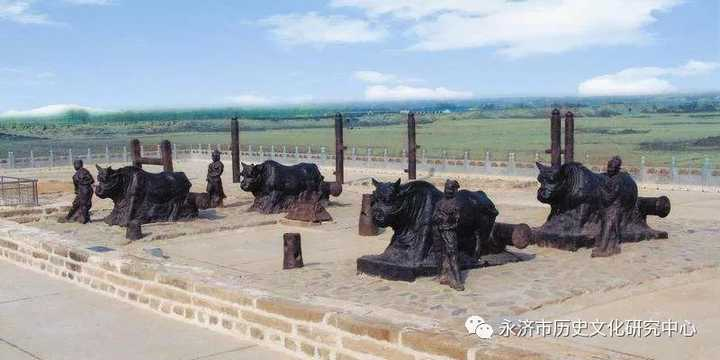
*图 1（已视觉复核）：黄河铁牛（蒲津渡遗址）青铜牛与铁人雕塑群实景，水印“永济市历史文化研究中心”。*

---

## 3099　出于恐惧的仇恨

- 日期：2021-09-02　主专题：A12 战争军事外交与大国秩序　副专题：A11;A02
- 源 ID：`8513b7e4-494a-5261-ad8a-df720360775f`　原文链接：https://www.zhihu.com/question/483315896/answer/2097997740
- 23 概念标签：事实与证据;选择与自由;成本与总账;爱与回应;法律与秩序;心理与主体
- 证据状态：manual_confirmed　初读：needs_reread　独立复核：not_reviewed

**问**：日本国民是否普遍敌视中国？为什么？

对自己恐惧的东西用咒骂来应对，是人类的一种普遍心理机制。
其实中国的体制也罢、中国游客在海外的表现也罢……这些都是咒骂的一部分，是先已经发生了咒骂的冲动和需要，然后再寻找的咒骂的题材。
真正的原因在于驱动了咒骂适应的动力源——恐惧。
这恐惧的根源，在于意识到了一旦中国拿回了台湾，日本的国家前途就会突然增加一个可怕的急转弯。
就像你正开着大巴车带着你全家在山区公路上疾驰。
但是路边的山体极不稳定，随时随地可能滑坡。
要是突然前方滑坡了，你踩急刹车也未必能不撞上、猛打方向盘很容易侧翻，你想变道绕过，旁边就是万丈深渊。
你要是运气不好，甚至可能直接被掩埋。
而你还没有办法现在就停车，你也不能不走这条路，你也不能掉头。
你甚至也不能减慢车速——难道平白无故停在半山腰不走了吗？
而这条路上现在时不时就有拳头大的碎石头滚下来。你的右后视镜已经砸飞了，尾灯已经烂了一个。
你体会一下这是个什么心情。

<!-- 图片：1 张，审读结论见下 -->

---

## 3064　为政以德

- 日期：2021-09-14　主专题：A12 战争军事外交与大国秩序　副专题：A20;A10;A11
- 源 ID：`94670543-e0fb-5eed-b007-e18ce6ecfba8`　原文链接：https://www.zhihu.com/question/486860691/answer/2121191656
- 官方对象—实践路径：与社会 / 与历史 / 借鉴
- 23 概念标签：定义与达意;能力与学习;选择与自由;责任与后果;成本与总账;财富与市场;法律与秩序;权力与异议;技术与工程;文明与历史;心理与主体
- 证据状态：manual_confirmed　初读：read　独立复核：not_reviewed

**问**：当年的美国有可能正确应对911事件吗？正确应对方式是什么？

美国当时没有任何别的路可走。
美国遇到的这种恐怖袭击，本质上是它在全球实施帝国主义的结果。
它从帝国主义的政策里获得了太多的红利，吃得满嘴流油，而且吃下了肚，吃上了瘾，正引之为“空前成功的经验”，这是没有可能因为恐怖袭击这种小小的副作用而收手的。
谁挡在帝国霸业之前，该被解决的就永远是那个挡路的，而没有可能是帝国霸业——至少，在“解决挡路石”被彻底证明是错误的之前，没有任何人能说服美国人不先尽力试一试。
这个问题真正困难的地方，在于它可以实实在在地避免走向错误方向的机会窗口，其实是在二战结束之后的最初十年——而它已经错过了。
是在那十年不要主动地和苏联争霸，不要借争霸的借口实行帝国主义，不要染霸权主义的毒瘾。
染了几十年毒瘾，等到毒瘾本身诱发恶果的时候，想要立刻克服这几十年毒瘾的惯性，逻辑上是不可能的。
二十分钟前就该左满舵的万吨巨轮，现在发现撞上了冰山边缘，在撞上边缘的这一刻，其实是没有任何“正确操作”可选的。船上的人必定会抱着“我们可以撞穿它”的侥幸/自信向前冲击，并且必定会假装向前冲是自己的一种“决定”。
这是治理大型政治实体最大的问题——往往能解决问题的唯一机会，早在几十年前就已错过。
这需要历史性的眼光和超越时代的为未来负责的责任感，尤其是做出正确决定的勇气。
以及纯粹天赐的运气。
中国的政治传统高度强调无限责任、历史评价，这是极其难得的禀赋。这份为君为相的天然道德要求，以及催生一代代中国决策层形成这种情结/自觉的意识形态土壤，是耗尽了几千年的血泪和天赐才凝成的巨大财富，万万不可被抛弃。
为政以德。决策者要负起无限的历史责任，从而抛弃短期美妙、长期必然引发不断反抗的霸权主义、帝国主义，这是唯一的可行之道。
等到反抗触发时，其实早已无力回天了。
帝国主义的定义什么？

---

## 3032　皆有其时

- 日期：2021-09-25　主专题：A12 战争军事外交与大国秩序　副专题：A17;A20
- 源 ID：`7b291b56-0d3f-5db6-ae7b-b45ee12d31d1`　原文链接：https://www.zhihu.com/question/488702812/answer/2139175758
- 官方对象—实践路径：与社会 / 与社区 / 共建
- 23 概念标签：事实与证据;能力与学习;选择与自由;成本与总账;劳动与组织;权力与异议;心理与主体
- 证据状态：manual_confirmed　初读：read　独立复核：not_reviewed

**问**：为什么人类很难联合起来创造全人类共同的利益？

人类如果现在就“联合起来”会是什么结果——变相实现一种前所未见的强有力的奴隶制。
世界的动乱、分裂、对立，固然使人类有各种悲伤和痛苦，但是它也保证了这个世界上永远存在不同的、势均力敌的其他选择。
它保证了人类永远有可以憧憬的“山那边”和“海那边”，以至于永远不必绝望。
无论你怀抱什么样的理念，这个“分裂”的世界上总有一处可以作为你内心深处的归宿。
它不能让你心想事成，但它也给了你很大的机会免于绝望，给了那些“无人认可”、“不合时宜”的自由可以寄望、栖身之处。
其实这并非一个真正不好的安排。
在某种意义上讲，人类并不需要——甚至可能并不应该寻求“毫无矛盾”，“毫无分裂”。
人类需要一个很长的学习期，学会如何和平的对立，学会抗拒暴力的诱惑。
在人类学会尊重和欣赏彼此不同的积极意义、学会定于一尊并非“最完美的可能”，学会暴力本身是比彼此更大的敌人之前，“齐心合力”将只可能是出自暴力的奴役，只会是一种实质的强制和迫害。
这样的“齐心协力”，有，何如不有？
所以，不要把这件事此刻尚未发生视为一件遗憾，而要视为一件幸事。
凡事都有定期，天下万务都有定时。生有时，死有时；栽种有时，拔出所栽种的也有时；杀戮有时，医治有时；拆毁有时，建造有时；哭有时，笑有时；哀恸有时，跳舞有时；抛掷石头有时，堆聚石头有时；怀抱有时，不怀抱有时；寻找有时，失落有时；保守有时，舍弃有时；撕裂有时，缝补有时；静默有时，言语有时；喜爱有时，恨恶有时；争战有时，和好有时。

---

## 2981　高贵的敌人

- 日期：2021-10-24　主专题：A12 战争军事外交与大国秩序　副专题：A10;A03
- 源 ID：`441cf32c-8c93-5210-adab-7cf36b7d1fe0`　原文链接：https://www.zhihu.com/question/395346841/answer/2186397855
- 官方对象—实践路径：与自己 / 与原则 / 坚持
- 23 概念标签：事实与证据;定义与达意;责任与后果;成本与总账;信用与信任;边界与许可;心理与主体
- 证据状态：manual_confirmed　初读：read　独立复核：not_reviewed

**问**：“宁”这个字眼算褒义还是贬？

可能使用的人自认为这是一种聪明的、隐蔽的贬斥别人的好办法。实际上是一种愚蠢的、明显的贬斥自己的蠢主意。
不要耍小聪明——要么你老实承认惹不起对方，直接认栽，不要惹人注意到你的敌意，要么打算对抗，那就直接一点。
敌人也分等级的。
高贵的敌人宣战了就是敌对状态，投降或者和解就是和平状态。因为一个高贵的人，ta的投降和妥协是值得信任的。ta没有公开的宣战，ta的敌人就可以凭ta的人品信任ta没有私下搞小动作，没有在“明修栈道，暗渡陈仓”。
所以高贵的敌人求和或者投降，值得认真的考虑。ta提出要谈判，也有谈的价值。
因为有这种和解的真实可能，双方在互争胜负时就自然有底线，不会越过游戏规则去搞什么袭扰家人、伪造证据这类一旦越过就只能不共戴天的卑鄙行为。
你要是干了这些，我跟你和谈有意义吗？你的一切和谈都只能被认为是缓兵之计、你的一切降服都只能被认定为“忍辱负重”。
下流的敌人，本质上是没有投降的资格，也没有和谈的机会的。
既然没可能和谈，那么就必然要以一方被彻底驱逐乃至消灭作为双方交往的唯一结局。
只有活人和活人才有可能是平等的。活人和死人、亡人是没有“平等“可言的。
你一旦做了下流的敌人，你就失去了在对方眼里为你安排平等资格的客观可能。
这不是人家要“歧视”你，而是你自己通过破坏交战规则把共存的可能消灭了。
谁模糊和平表达和敌意表达的界限，谁的和平就会失去意义。
老老实实劝你，除非你这样做有天大的意义，——类似干一票就可以背着一亿现金飞去巴拿马从新开始全新人生并且安然退休这种——否则不要干这种愚蠢而没有家教的事。

决定对一个人无礼，是一种你必须三思而后行的重大决策，说得深刻一点——比你决定在哪里买房子都还要更加慎重。
房子买错了，伤钱，
轻易树敌伤命。
你买房子花了多少时间调查比较？
你出口树敌之前花了几秒钟？
没有家教，不是指你“对人没有礼貌”，而是指你“对人没礼貌得太轻易”。
指父母居然连这么简单和朴素的利害关系都没有跟你讲明白，只顾着教你不要摸电门、不要玩火，没想过人类是比交流电和火焰可怕和残酷得多的危险事物。

---

## 2943　历史的燃料

- 日期：2021-11-27　主专题：A12 战争军事外交与大国秩序　副专题：A20;A03
- 源 ID：`8721089a-ff63-5827-accd-ce09e688ee39`　原文链接：https://www.zhihu.com/question/489491215/answer/2245263020
- 官方对象—实践路径：与社会 / 与历史 / 解释
- 23 概念标签：事实与证据;定义与达意;责任与后果;净输出与不掠夺;财富与市场;法律与秩序;技术与工程;文明与历史;宗教与自然法
- 证据状态：manual_confirmed　初读：read　独立复核：not_reviewed

**问**：暴力对人类社会都有那些意义？

暴力当然不是没有任何意义的。
它有个最大的作用，就是“收敛事实”。
因为暴力的结果是最hardcore的事实，最强烈、最不容否认的事实。
你长篇大论认定自己走在光荣正确的道路上，判定我的道路直通历史的垃圾堆，我对你也作如是观，我们到底谁对？
对“两种不相容的道路到底谁对”这个问题，双方都可以找到无穷的智力资源自圆其说，搞出各自完全自洽而又彼此绝不相容的一套公理和一套婆理。
如果这事关生存、关系到谁要灭绝谁要兴旺，那就并不能仅靠“非暴力竞争”来决定胜负，因为这种决定生死的胜负必须是全面的胜负、最终意义上的胜负，而不能用任何一个领域内的片面的胜负来“象征”和“代表”——否则输家会拒绝承认这片面的挫折等于全面的失败，从而拒绝承认自己的错误。
最后总要发展到“竭尽全力的对决”——以一切实力对一切实力，胜负即正误，存亡即神裁。
到目前为止，人类分歧的最终解决手段仍然是这个。
遵循商业法规的市场竞争、遵循运动规则的体育竞赛，本质上都是一样的东西——它们本质上是限制了规模的暴力对抗。
自洽的理论千千万，你的假说想要自圆其说，这门槛根本就不高，到底谁是对的，最后总要靠上帝在结果中裁断。
谁说了也不算，只有上帝说了算。
所以，一切的理想、原则和抱负，一切的理论，都必须对如何在暴力抗争中幸存作出回答。
这种幸存可以靠“生得多”，可以靠“妥协-融入-改造”、可以靠“化敌为友”、可以靠“制造敌人的分裂”，可以靠“驱虎吞狼”……但一定要解决这个问题——这个理念要能存活，要能创造繁荣和安全。
暴力担当这个这根“强制及格线”的职能，它的过程令人痛苦，但它却是历史发展方向的指南针。
更先进的，一定是在暴力竞争中更有优势的——注意，这不见得、甚至可以说根本就不是指武器和残忍。

现在，借这个问题来谈论一个问题——一个机制有不可或缺的意义，是否意味着ta应该受到保护、保全？是否意味着应该鼓励个人去追求？
我在别处列举过大量的经典的负面要素的绝对必要的意义——嫉妒是一种成功税，它保证了个人必须要分享自己的成功果实；暴力是一种自洽收敛机制，它负责消除低水平的自欺欺人；犯罪是一种反僵化的更新机制，它从根上消除了人类对正确的垄断权，保证了一些被傲慢拒绝的正确最终能冲破人类原本的无知，事实上守卫了人类最底层的自由——甚至可以说保全了人类的存在。
但是，这里存在一个至关重要的问题——这绝不意味着被选中扮演这些历史工具的个体自身做这些事就肯定是没罪的、受祝福的。
譬如，人的妒嫉本能一定会驱动一些贪心炽烈的人来恶性攻击成功了却不肯分享财富的幸运儿。
这客观上会造成人类社会的总体福利，但这是上帝与整个人类之间的关系，这些人只是被安排用来调整这关系的工具，被激发而发起攻击的人自身仍然是有罪的，而且是从事实层面确实有罪。
这个世界会先通过对无法自制的嫉妒者前赴后继的毁灭性使用来消灭所有人对“走运得了好处不需要分享”的妄想，然后再通过彻底的分享原则反过来极大的抑制嫉妒病的发作——一来有人会分享给你你所需要的，二来你会很难找到缺少足够人协防的目标。
在这之前，嫉妒者客观上会推动人类社会进步，但ta们自己却是耗材和燃料。
ta们的作用的确不可或缺，但世界绝不会去犯愁没有这种工具和燃料可用。
因为实在有太多“聪明人”在往这投料口里钻。
你要看清楚这个设计——当没有人往这投料口里钻的时候，这部历史的列车也就到站了。
只要它没到站，一定不缺人在严正警告下继续往里钻。
它的确是对尚待完善的人类社会的发展有不可替代的必要性，但这一点也不与“作为个人你要极尽可能的革除这些东西，避免被送进投料口”矛盾。
这就好像有人利用垃圾发电，这绝不是丢垃圾的人的功劳，无必要的制造垃圾仍然是罪行。
被选为燃料，你只是在客观上有贡献，你本身是没有功劳的，功劳要归于那位“变废为宝”历史主宰。
不要因为一切的恶（包括恶的天性）都有其不可或缺的价值，就认为它们应该受到鼓励或者宽纵。
多想想清楚。

嫉妒的根源是什么？

---

## 2931　哀兵

- 日期：2021-12-06　主专题：A12 战争军事外交与大国秩序　副专题：A03;A20
- 源 ID：`c6b59e81-143b-57f3-aa5a-5f5da72edefe`　原文链接：https://www.zhihu.com/question/30828614/answer/2259195849
- 23 概念标签：定义与达意;能力与学习;责任与后果;成本与总账;法律与秩序;心理与主体;性别与身体
- 证据状态：manual_confirmed　初读：read　独立复核：not_reviewed

**问**：美国可能采取哪些手段扼制中国崛起？

美国要想遏制中国，其实可用的手段还有很多。
美国真正的苦恼是缺少不费劲、不冒真正的风险，尤其是出现代价时主事人自己不成替罪羔羊的“黄金办法”“万全之策”。
真想遏制中国，就要准备下未必能成功的血本。
保证能成功的血本，有人肯下。
不能保证成功，也谈不上血本，也有人肯下。
但“不能保证成功的血本”，千难万难。
对很多人而言，它只是存在物理上的可行性，但事实上没有作为一种主动的策略实现的可能。
只有什么情况下会出现这样的leap of faith呢？
就是真的绝望了，觉得自己死定了，留着本钱也没有意义、只会成为敌人的战利品了，是死是活也就看这一下了——也就是有了必死的觉悟了。
只有到了这一步，“不知是否会成功的血本”身上所必然随附的“荒谬性”才能被克服，人才能翻过这个心理能垒。
只有到了这一步，这种级别的成本，才真的有可能拿得出手。
这也是为什么中国长期宣传“太平洋足够大”，讲“共存共容”。
这句话，从根上把“不知是否会成功的血本”的前提条件取消了。于是任何美国政客真的提出了这种级别的策略，都拿不到足够的支持。
而事实上，只有这个级别的措施，才有可能——注意，这不是保证成功，但至少是“有可能”——真的起到实质的遏制中国的效果。
记住这东西——“不知是否会成功的血本”。
这东西就是“哀兵”的身份证明。
“哀兵”不是“头破血流、打着绷带的倒霉蛋”的意思——要是这意思，世界史岂不是要由倒霉蛋们改写？
“哀兵”是那些因为必须要胜利，而认为“不知是否成功的血本”也并不荒谬的人。
而哀兵那什么来着？
哀兵必胜。

你要少跟人说你有多悲痛、有多愤怒、有多渴望——你说得人人点头、连连感叹又如何？顶个球用。难道这些连连点头的人可以像神灯精灵一样打个响指帮你如愿不成？
客观世界不看这个，只看你的有效努力。
而你如果都不迈过这条界限，不能承担起这条线上的压力和艰苦，你其实只是在“悠闲地输出”，只是在临渊羡鱼、叶公好龙。
在扮家家酒。
这种努力的程度就跟“打算在上班路上顺便捡一张彩票中一亿大奖”没有本质的区别。
话也不说绝，也不见得就没人中这种奖。
但你慢慢等吧，只能祝你好运。

---

## 2929　严刑拷打

- 日期：2021-12-08　主专题：A12 战争军事外交与大国秩序　副专题：A10;A03
- 源 ID：`35dffb27-ba3f-5178-b9be-843697d1d39d`　原文链接：https://www.zhihu.com/question/437390331/answer/2261273889
- 官方对象—实践路径：与其它 / 与陌生人 / 防卫
- 23 概念标签：事实与证据;能力与学习;成本与总账;信用与信任;劳动与组织;技术与工程;心理与主体
- 证据状态：manual_confirmed　初读：read　独立复核：not_reviewed

**问**：你觉得你能扛得住严刑拷打吗?

用刑有几个方向。
1）纯报复或威吓。
这种根本不是为了得到你什么情报，只是在实施一种报复，发泄一种愤恨。
类似比利时人砍刚果人的手，墨西哥黑帮虐杀，古代各种花样百出的虐杀示众其实都是这类。
这本身就是一种折磨而已，没有所谓的扛不扛。扛不了人家也不会停手。
2）杀鸡骇猴。
对你用刑，不是为了直接从你身上得到什么情报，而是为了进一步的恐吓你的同伙，向你的同伙制造恐怖想象，实际上是为了突破ta。所以也无所谓你扛不扛得住。
3）其实对方自己已经得到了情报线索，只是要你进行确认，要从你的反应中判断情报真伪。
这一种最危险。因为存在一种拷打理论，认为人的意志力会被痛苦削弱。而只要意志力削弱到一定程度，复杂的逻辑思维就无法有效维持。而维持谎言是一种复杂的思维活动。
这一种是以索取情报为目的的最危险的情况。
不折磨到突破你的极限，你就是招了对方都不会停手——因为ta不能轻信。
4）一般人认为的——或者说影视剧所表演的——要通过刑罚获取完全未知的情报，实际上是不宜通过刑罚来完成的。因为几乎肯定会导致胡编乱造，尤其是迎合性的捏造——你想听什么，说什么能让你停手，我就告诉你什么。
之所以现在普遍要求停止刑讯逼供、就是基于这个基本逻辑。

但不管哪一种，现在的情报组织一般不简单的以你是否有提供情报为标准来判定你是不是叛徒，而是提出了一些替代的指标——要求你坚持若干个小时、要求你根据约定先释放若干假情报。
只要你达成了这些要求，即使你后来经过拷打泄露了一些情报，也会对你大为宽容。那更多的影响的是你被交换回来之后的待遇，而不太会因此把你定性为叛徒。
这道理也不复杂——倒不全是出于人道主义考虑，而是实施过于严苛的标准，会严重的抬高情报机构的招募难度和成本。而且有很大的概率会直接导致能达标的人往往有某种心理隐患，你难以信任ta的专业判断——那就完全得不偿失了。
更进一步的——主张这种过于严苛的标准，往往反而会增加被捕者的脆弱性和坚定性。你要人坚持三十六小时或者四十八小时，ta往往可以做到，或至少做高度积极的尝试；你要求ta坚持一生、只字不漏，一辈子漏一个字就是叛徒，要被追杀到天涯海角，人会反过来有很大的冲动想要索性彻底叛变换庇护。
这完全是反效果。
事实上现代情报界很少依赖“绑架拷打”这种手段来对付正规的情报界对手，因为这个办法有大量的反制措施——比如定时联络机制、可以保证情报员的失踪会立刻被发现。一旦被发现，就会启动一系列的预案使得这位情报员所能泄露的秘密最大限度的失效。有一些预案甚至有反击效果——例如利用约定好假情报线索，趁着你来验证的时候给你恰到好处的误导信息，让你得到必要的“证据”，反过来对你形成致命的误导。
并且这种误导如果失效，也足以让你再无法信任被捕的间谍——ta告诉你的情报，就算你侧面证实了，你怎么知道不是下一个安排好的陷阱？
真正要防备的主要是两类——一类是自己变节的，一类是对方派遣过来潜伏的。
而即使是这种，现在也有系统的管理措施来做出反制——例如每个人收到的文件版本都不一样，可以通过泄露的文件的具体遣词造句判断是谁掌握的拷贝被泄露了。
一旦发现了自以为没有被发现的变节者，ta又会被利用为投喂假情报的备用渠道。
以至于现在越来越转向了技术侦查，比如电信窃听、拦截网络通信、大数据采集和分析，这些远比抓人来拷打高效而且安全。
总的来说，现在也不太需要你扛很多了——其实给你准备了“可以招”的假情报。
但是这个前提是你是正规情报机构的职业特工。因为要构建这些复杂的预案和执行训练是非常昂贵的、更不用说是要依赖大量的智力资源的。
所以绑架/逮捕+拷打逼供对没有正规情报机构支持和专业训练的恐怖分子、游击队员、反政府军仍然适用。
关塔那摩就是因此而存在。

---

## 2927　大国影响

- 日期：2021-12-12　主专题：A12 战争军事外交与大国秩序　副专题：A16;A08;A03
- 源 ID：`d1e4b776-aac6-510f-9fa8-d30c1f3b5092`　原文链接：https://www.zhihu.com/question/504907694/answer/2267098102
- 23 概念标签：事实与证据;定义与达意;能力与学习;选择与自由;成本与总账;信用与信任;爱与回应;净输出与不掠夺;边界与许可;劳动与组织;法律与秩序;心理与主体
- 证据状态：manual_confirmed　初读：read　独立复核：not_reviewed

**问**：立陶宛外交部副部长称「跨国企业如使用立陶宛企业的产品，将不被允许向中国进出口」，将产生哪些影响？

立陶宛企业遭受的大概是非正式困境。
深刻的得罪了中国人，跨国企业会自动的想到要跟你切割来回避风险，防止某一天不知谁从什么成分表里拉出一条来说“这家企业坚持向立陶宛进货，对中国人不友善”。
就算这些企业自己不觉得，它们的咨询公司、公关公司、政策研究部门只要不渎职，也会向ta们发出风险提示。
立陶宛的货如果不是独步天下、不用就不行，何必拿整个企业的业务冒险。当年乐天难道是因为商务部禁令失去中国市场的吗？
坦白说，这根本用不着商务部发什么正式的公文或者做什么外部表态。
立陶宛低估了中国的影响力，这并不是一句“中陶直接贸易额不高”可以涵盖的。与全球性大国交恶，还有很多间接性的影响会在出乎意料的地方冒出来。
如果一开始就长年交恶——类似委内瑞拉、古巴对美国——反正所有的牌都打出来了，再打就是直接颠覆、开战和暗杀了，那么宣布新的敌对只是从一个稳态走向一个稍微恶化的稳态。
原本中性而无事的，陡然要主动与有全球影响的大国交恶，这样的风险就不可预测。
可以说并没有什么可靠的研究办法预测到底会有多少损失——因为不等这损失真的浮现出来，你可能原本都意识不到居然还有这么一层要害关系存在。
如果国家智库强大一些，这类风险研究就会深入全面一些。即使这样，其实也无法真正万无一失。
而立陶宛这种人口不过亿，甚至连一千万、五百万也没有的国家，无论是情报机构还是智库能力都完全缺位。
这导致它们做决策的时候会遭遇两个巨大的问题——首先要依赖“友邦”的“情报分享”，还要依靠“友邦”国家提供政策指南。
你自己是个瞎子，那当然只能人家说什么，你信什么，因为除了人家说的你啥也不知道，你不依赖ta给的情报说明，你能依赖啥？难道不往前走了？
而策略方面，你问自己的智库，能拿出来只有三张纸。“友邦”给你的是四百页让你叹为观止的分析报告和建议书。
两边一对比，无论是深度还是广度，你都觉得自己这帮专家纯属过家家。
这些文件都是硬邦邦的真功夫，你自己对此就算戒备心十足，也只是纯粹出于不安全感的戒备心而已。
只靠戒备心，怎么可能长期跟白纸黑字的数据和分析对抗？
说个基本情形你就能体会了——这就像一名普通患者肚子疼去看医生。医生说你这是癌症，给你一堆你看不懂的报告书，和一堆你看不懂的“为什么要用这个疗法”的解释。
你自己对医学一窍不通。你问你儿子怎么看，你儿子也就知道个“心脏在左边，肝脏在下边”。
你高度怀疑这个医生不靠谱，但你觉得别的医生更不友好。
你明知道不能听别人的，你一万个清楚要有独立自主的决策。
但你还是要晚上爬起来把那几百页报告翻了又翻。
你总不能无限的用本能的不妥感去对抗“科学”“事实”和“智慧”吧？
最后你有几成概率不做那报告推荐的手术？
全球情报和全球研究，是大国影响小国的关键。我比你自己更了解你自己和你的敌人，只要你还觉得我是你的朋友，我的话你就没可能不听。
你觉得“不妥”，只是会让你有一段时间的挣扎。挣扎到最后，你还是要克服自己的犹豫，按照你唯一看得到的出路——那位能力比你强得多的朋友替你想的出路——去办。
除非你看到另一种同样全面、深刻，扎实而且可信的方案，足以让你根据这个方案去审视原来的方案。
那么现在问题来了——假设立陶宛立场在摇摆，或者给了机会让你来说服ta倾向于你。
你拿出来的分析报告里的情报能不能比对面给出的情报有说服力？你的分析能不能比对面全面、健壮？
如果做不到，你就只能靠自己许诺的利益去保证填平对方在报告里预测会出现的“客观恶果”。
对手说——“我们预测你再这样搞下去，除非你xxxx，否则你会亏掉一亿，理由是ABCDEFG”。
你要么就同样说出一轮“我们预测你再这样搞下去，除非你xxxx，否则你会亏掉一亿，理由是HIJKLMN”。
如果你说不出，或者说出来的这些在犹豫者看来觉得“这人对我的了解远不如另一位，出的主意、做的预测根本不可靠”，你就只剩下一条路——
“ta说会亏多少？你别干，亏了算我的。”
你只能拿真金白银去为对方写的故事买单。
于是只要对方把故事写得吓人一点，你一定买不起。你就算一次买得起，人家的故事印起来可飞快，你难道全买？
所谓大国影响小国立场，虽然上面这描述过于简化，但归根到底，具体而言，基本上就是这么赢的。
而并不是像小说里写的那样不听话的就暗杀、要挟，听话的就多给钱收买。
道理不复杂——你会收买，别人就不会收买？你会要挟，别人就不会要挟？七七八八一抵消，到最后其实这些小说手段并没有传说中这么有效。
尤其是这种策略有极深的副作用和后遗症，虽然闯过了这个关头，却往往会埋下刻骨的戒惧和仇恨，无论在经济上还是政治上，这样做的成本都非常高。
以理服人，则人不能不服。
这既是我们拦不住立陶宛这些东欧国家，也是美国拦不住缅甸、柬埔寨、老挝等等东南亚国家的原因——因为两边在这些区域都有在对象国面前能压倒对手的无可争议的情报优势。
也就是能讲出对象国很难不倾向的东西来。
左邻给你讲一套，右舍给你讲另一套，结果左邻连你儿子小学考试不及格也考虑进去了，右舍却连你离了婚、老爸去世了都不知道。
右舍出的方案怎么可能赢得了左邻？拿什么说服你听右舍的而不是左邻的？
这种至关重要的影响力，是要靠真正的深入了解和长期关注、以及坚持不懈的培养战略人才和积累智慧资产来积累的。
有这种战略情报能力——或者至少有这个潜力——的国家，世界上其实只剩下了中美两家。
俄罗斯可以算半家——这太花钱了。如果不是靠大量的自然交往顺便去做，而是专门拨钱去做，只可能集中在军事和关键科技这一些要害领域，只能自保，不足以主动发挥影响。
日本可以算半家，ta们在全球都有经济活动，而且有强大的情报传统。但问题是ta们几乎没有自己独立思考的权利。所有的会议记录怕都会自动转发华盛顿。就是料亭密谋，也难保弹弦倒酒上菜的——连同跟你对谈的这位——不是“有心人”。
只能知，不能想，只能扮演一个“情报分享节点”。
韩国受日本影响极深，但奈何远没有日本的经营积累大，更何况韩国几乎没有全球玩家的自觉和野望，ta们的情报工作主要集中在自保——即对北朝鲜、日本、俄罗斯、中国和美国，以及对特定商业部门的关心上。
以韩国的体量，也只能止步于此了。
这一集团还包括英、法。
再往下的第三集团国家——譬如土耳其、德国、印度、巴基斯坦、伊朗、沙特、新加坡……只能敲敲边鼓了。
第三集团能覆盖到自己感兴趣的国家就很勉强——甚至能准确及时发觉本国的政变、叛乱情报都很称职了。
再往下的第四集团国家——譬如澳大利亚、加拿大、荷兰、丹麦……还有立陶宛、波兰、乌克兰这些——说句实话，在这些“高年级生”眼里，在客观实践上只能靠别人来当导盲助手。
往哪边走全看谁牵着ta的手。
这也是为什么现在世界上最紧密的联盟，五眼联盟是个“情报分享联盟”的原因。
这说的是国家，实际上教训却不止对国家有效。
你自己要增加对客观世界的了解，对你自己的了解。
要管理ta人对你的了解。
否则，
一旦“你自己也不能不承认对方比你自己还了解你自己”“对方远比你更善于思考”，以及“你并没有确切把握确认对方有明显敌意”这三个条件一起满足，你很可能会客观上陷入“只要对方注意到你、主动要影响你，你就很难不被深刻影响”的被动状况。
即使对方并无这个意图，仅仅是你感受到了这三个条件现在都成立，你都会感到极大的焦虑和不安——哪怕这三个条件只是你想象出来的，如果站到客观视角来看根本就不是事实，只要你自己这么相信、怀疑，这份恐惧和不安都会无法遏制。
但是，你显然又不能因为这样而回避和一切你不能不承认比你见多识广、深谋远虑的人接触。
这简直是废话——难道你不找一个见多识广、深谋远虑的老板、上司、老师、合伙人……你倒要只找一些见识不如你，考虑问题没你周全的人合作？
那么对方岂不是又该躲开你？
于是最后情况稳定在“只有两个互相觉得对方是武大郎而自己是武松的人才能合作”这种奇妙的状态？
——不过，悲凉的是，现实中还真的有不少这种全靠“松郎二象性”撑着的所谓“企业”。
但可想而知，这样的所谓企业，说白了就是武大郎开店，很难引入真正先进的智力资源，最后总是要崩的。
松郎二象性根本无法作为一个有意义的解决方案。
所以，要避免这三个条件一起满足的唯一出路，就是“要避免对方比你自己还了解你自己”。
反过来，如果你是这里面有压倒性智力优势和信息优势的一方，你要明白在对方那边一旦三个条件一起满足，对方是要焦虑恐慌的。
这没有什么公平不公平，这个世界已经决定要把事情设计成这个样子了，ta不接受上诉。
所以，如果你是这样的人，你要么就要避免让别人察觉到你有这样的能力，以维持后两个条件不达成；要么就要避免甚至回避了解对方的隐私。
最吊诡的情况，就是你没有去主动了解，但是对方因为年轻和不成熟自己乐意向你大量分享个人信息，结果后来自己又觉得你同时满足了三个条件，要是你对ta有恶意该怎么办。
然后自己把自己吓得辗转反侧。
所以，不光你要避免去主动刺探，就是对方主动分享给你，你都要考虑清楚要不要听——因为一旦满足了这三个条件，绝大多数关系都承受不住这种惊疑的长期磨损，离结局——或至少重大损伤——就不远了。
一些大V们自己也不明白这个道理，总是懵懵懂懂陷入这个结果而不自知，这其实是可以部分避免的。
相互了解——或自我敞开——其实是一把双刃剑，你如果不尊重这一客观规律，往往会满腔热情的自己给自己本来打算构建的希望埋下定时炸弹，搞到事与愿违。
对方啥也没做，就可能莫名沦为你韭菜恶梦中的镰刀。
轻狎则必后惊，戒之为要。
你要跟这类人多交往才会有最广阔的前途，而在你阅历和思考水平过于落后的前提下，为了保证安全你只好避免对方对你有过深了解来抑制恐惧本能，这意味着什么呢？
意味着一个人的阅历和思考水平其实天然的限制了和超高水平的人交往密切程度的安全上限，进而也隐隐的给了事业、人生价值一个上限。
你的天空有多高，是被这两件事上的勤奋程度决定的。
所以，你要多学习，多思考。
这真是一句大实话。

---

## 2918　长枪

- 日期：2021-12-15　主专题：A12 战争军事外交与大国秩序　副专题：A20;A10
- 源 ID：`176add1e-56b4-5d48-b7a7-d1fa6088e665`　原文链接：https://www.zhihu.com/question/21944109/answer/2272677632
- 官方对象—实践路径：与合作者 / 与被管理者 / 确权
- 23 概念标签：能力与学习;选择与自由;成本与总账;信用与信任;爱与回应;照料与家庭;劳动与组织;法律与秩序;技术与工程
- 证据状态：manual_confirmed　初读：read　独立复核：not_reviewed

**问**：穿越小说《窃明》中猪脚黄石的长枪军真有那么厉害吗？

当然厉害了。
密集队列的长枪队，坦白说就是冷兵器时代的终极答案，就跟二战海面上的航空母舰一样。
数学最优解，无得谈。
纯从军事技术的角度，想要依靠冷兵器时代的技术破解精锐扎实的密集长枪阵列，实际上在军事角度只有依靠战略机动打击后方袭扰补给路线一条路——搞反间计、搞策反这些就不是军事技术问题了。
其它任何办法都事实上解决不了问题。
这倒不是说别的兵种不能打击它们——比如你立刻会想到——“可以用投石车呀”“可以用轻骑兵抵近射击呀”。
问题在于你要用轻骑兵去打击，由密集长枪掩护的步弓天生就比你骑弓大两尺，箭都比你长几寸，人家箭支可以近乎无限补给，不需要背在马上。你怎么可能射赢？
至于投石车，投石车是不能随便调射程也是不能随便转方向挪走的。长枪阵列喊着号子一分钟四十步向你走来——尤其是绕开你的预定轰击区域走过来，你没有对等强度的长枪阵去顶住，你只能弃阵逃跑，没有别的选择。
长枪阵就是移动的城，实际上就是一种射程较短、移动较慢、个头较大的坦克。这种“人肉巨型坦克”保护了自己内部的远射火力，你没办法打破，你在战术层面上就无计可施。
练得出来，受得住战场考验，那么你就是无敌。
问题在于，怎么恐吓和敲打都不会动摇的长枪阵太难练出来。
要练出这种部队，关键在于你怎么解决有人拿不住枪的问题，怎么解决有人迈不动步的问题，怎么解决逃兵问题。
你怎么给这些长枪兵足够的理由去面对死亡的威胁前进？
这些问题，其实不是战术问题，不是训练问题，而是土地制度问题、社会制度问题、军制问题。
你要我拿得住枪不当逃兵，我要有值得不退让的东西。我家里一分田也没有，我也娶不上媳妇，我还是犯了罪才被流放来“充军”。恕我直言，我看敌人比你还觉得可爱点，你说说看，我为什么要拿着长枪去给别人射、给别人砍、给别人砸？
我要是受伤了，我有什么保障？我要是死了，我有什么抚恤？你们谁来担保我拿得到这些保障和抚恤？
你们自己信不信你们自己的保证？
所以我为啥要站在队列里给人射、给人砍、给人砸？
就凭你有督战队？那我等一会儿有人开始跑了我再跑就是了。我就不信你们能拦得住几千人一起跑路。你们要真有这本事，你们都成奥特曼了，敌人还敢来吗？
那些不用这战术的将领不是不知道长枪阵厉害，而是ta们归根到底是付不起这个成本，给不了这个理由。
长枪阵真的是无敌的，这个数学可证——人类就长这个样，冷武器也就这么几种形式。这不是什么火箭科学需要多少复杂计算。
长枪战术也没什么难训练的，甚至还没有拼刺刀难练。
真正难的，是极难有将领或军队——准确的说是社会——可以给得出这个理由。
想许诺给你分田，它手里没田。想许给你抚恤，它手里没钱。它们自己也一团糟，要靠苛捐杂税、横蛮凶暴才能维持着日子勉强能过。
但这些国家往往沉湎在过去的荣光里——帝国全盛的时候——尤其是对外征服期间——是可以办得到这些条件的。那时候帝国的重甲步兵，实实在在的动如风，徐如林，侵掠如火，不动如山。
但是此一时、彼一时，你现在风雨飘摇、帝国斜阳了，这些条件早已崩溃。
只有你当初练的那些队形、动作还留着。安安全全的京师校阅，只觉得还虎虎生威。
真放出去见生见死，你就会立刻知道长枪阵真正无敌的原因到底是什么，是不是只要站成方形、会那几个动作你就真的可以使用长枪阵战术。
长枪阵的名声就是这些傲慢的帝国败坏的，所以你现在才会有这个疑问。
但这不是长枪阵自己的问题。

---

## 2899　不投降

- 日期：2022-02-27　主专题：A12 战争军事外交与大国秩序　副专题：A17;A20
- 源 ID：`dd8b2fea-82bd-5a75-8224-dd2da0e8160b`　原文链接：https://www.zhihu.com/question/518863102/answer/2366679163
- 23 概念标签：能力与学习;选择与自由;责任与后果;成本与总账;信用与信任;照料与家庭;劳动与组织;法律与秩序;文明与历史;民族与身份;心理与主体
- 证据状态：manual_confirmed　初读：read　独立复核：not_reviewed

**问**：很多劝乌克兰投降的是怎么想的？

对“劝乌克兰人投降”的声音感到诧异，其实是一种“中国病”。
因为“完全不必考虑投降”是中国（以及很少的一些其它国家）在这个地球上的独有特权。
因为你是中国人，所以你把“决不投降”看成天经地义、毋庸置疑的白开水一样的公理了。
中国人能这样，是靠着这几千年来一直是全球最大国家，在体量上、文化的生命力上压倒一切外敌的特殊天赋。
在已知的全部历史里，无论敌人是谁，最后的胜利一定仍然属于中国，无论敌人有多强大，最多只能让中国经历苦难，但最终的胜利一定属于中国。
这道理不复杂——因为中国的人口太多了、战略纵深太大了，而中国的学习能力太强，中国的历史经验太丰富，并且中国的组织能力太坚韧，这导致没有任何敌人能在中国从失败中吸取足够教训并一点一点的逆转局势之前获得足够决定性的胜利——至少到目前为止，没有任何敌人真正的成功过。
这给中国人造就了一个强烈的、普遍的、透明的文化上的傲慢——
满不在乎的以投降为当然的、绝对的低贱。
无论是什么样的问题，中国最终总可以解决，而一旦彻底投降了，就没这个“最终”了，所以，最多最到、顶了天，我们可以“君子报仇，百年不晚”。
We will be back, we always do，所以，最终而言，对中国人而言，投降总是错的。
而既然如此，在这之前为中国牺牲的人，就永远不必担心自己的牺牲是毫无价值的，或者甚至是负价值的。
什么叫毫无价值？你奋战到底牺牲了，结果你为之奋战的对象真正的消亡了，历史都湮灭了，
举个例子——匈奴人肯定有很多了不起的英雄。但你知道几个匈奴名字？尤其是，现在还有几个匈奴人后代来记得那些匈奴先辈的名字？
那么那些为匈奴牺牲的匈奴烈士的意义是什么？
这价值就是0。

什么叫负价值？
那就是你牺牲了，结果因为你的文化被消灭，你的牺牲不但不构成某种伟大崇高的纪念，反而在唯一留存的敌人的叙事里构成一种“执迷不悟的罪行”，一种“孽障”，对你幸存的子孙后代构成一种极难偿还的罪业。
你是个英雄，但你的亲眷子女却要在敌人的统治下作为罪人的亲属活下去。
这就是负价值。

这种纠结，中国人是没有的。当年全盛期的罗马人估计也没有，全盛期的阿拉伯帝国的臣民估计也没有，现在的美国人、俄罗斯人，也没有。
印度人踩在门槛上，算有一半。
但几千年历史，也就这么几群人没有。
只有你有这种永恒的确信，你才永远的不必考虑投降。
这是有资格门槛的，要家庭条件的，但很多小朋友却实属身在福中不知福，要诧异别人家的孩子“竟如此不堪”。
这其实是一种精神上的“何不食肉糜”。

也许说来你们难以理解，除了中、美、俄之外，这个世界上的其他国家——尤其是弱国们，都是用另一个心态来看问题的——“我能不能用投降 / 让步躲过这一劫？”
投降的选项不但一直在桌上，甚至长期是第一选项。
那往往是代价最低、受益最大的选项，根本没有必要纠结——因为作为弱国、作为没有永存自信的国家，在事实上不是要臣服于这边、就是要依附于那边。
它们本质上并不是在投降和不投降之间选择，而是在投降这边和投降那边选择。
有何必要为了不投降特定的某一边而不惜灭亡？
我又不是当大哥的，我被搞到不能不投降大B哥，到底是我的错，还是我现在跟的乌鸦哥的错？我有什么好纠结、好痛苦的？
中美俄这样的大国，和是为了再战，所以以和为贱；
其他小国，战是为了和，所以以战为失。
同人不同命，不要再用自己的“诧异”害乌克兰人了。

自己的命和美国人注定不同，这一点乌克兰人会慢慢明白的，这无关于什么“人格高贵”，这就是上帝的意志所写定的的基本现实。
当兔子并不比当狼可耻和低贱，如果兔子充分的认识到自己是一只兔子，反而可以找到兔子的办法去与狼抗衡。
但如果一只兔子不幸有“狼比较高贵，我是一只狼”的执念，它不会因此因此变成一只狼，而只会变成狼的晚餐。
另外，特别提醒一条——
很多人只是因为是大国附庸误以为自己也是大国一员，也可以享有大国独有的不投降禀赋。
这是个非常危险的误解，可以导致人亡政息、改朝换代的误解。
大国附庸不是大国本身，
一旦被放弃——也往往确实会被放弃，
会一脚踏空身死族灭的。

---

## 2900　俄乌战争

- 日期：2022-02-27　主专题：A12 战争军事外交与大国秩序　副专题：A10;A20
- 源 ID：`fa217c7b-64be-581b-ac17-7f743dc6bf24`　原文链接：https://www.zhihu.com/question/518747432/answer/2366512885
- 23 概念标签：事实与证据;能力与学习;选择与自由;责任与后果;成本与总账;信用与信任;法律与秩序;权力与异议;心理与主体
- 证据状态：manual_confirmed　初读：read　独立复核：not_reviewed

**问**：俄乌战争预计什么时候可以打完？

现在普遍有一个言之凿凿的定论，就是“俄罗斯不利久战”。似乎吃定了俄罗斯肯定怕下雨、俄罗斯肯定无法供给、俄罗斯一定不能忍受伤亡、俄罗斯一定会没钱……
总而言之，吃定了俄罗斯一定急着结束，所以“拖延就是胜利”。

这话的逻辑其实并不成立。
恰恰相反，俄罗斯恐怕是很有久战的预案准备的。
首先，久战与否的决定性因素是不是可以由俄罗斯简单掌握的？
让我们假设在最好的情境下，俄罗斯在一个月内打垮了乌克兰，拿到了自己的所有条件，然后迅速撤军了。
此时俄罗斯留下了一个怎样的乌克兰？是一个真实中立、亲俄的乌克兰？还是一个迫于无奈暂时虚与委蛇、但内心充满仇恨和怨毒的乌克兰？
如果是后者，那么即使签订一纸条约又如何？接下来北约大可以借加强前线防卫为名在乌波边境大规模集中兵力。然后突然“应邀”越过边界支持乌克兰撕毁中立协议。
那时候俄罗斯再重新打回来吗？
这场战争的潜在逻辑本身其实已经在很大程度上意味着这场战争很难以单纯的“解除现有武装”和“签订条约”为终点。换句话来说，这场战争内在的缺少“速胜”的逻辑。

它还需要真正的改变乌克兰人对西方世界的基本认知。
它有必要让乌克兰人意识到即使西方世界全力的援助，倾尽一切舆论优势捏造、诋毁，穷尽一切的金融制裁手段，甚至提供军火物资、操纵联合国大会形成决议、哪怕威胁直接出兵、隔空提供军事情报，在拥有6200枚核弹、自给自足的俄罗斯面前都不足以改变乌克兰的命运。
对俄罗斯而言，这场战争的真正终点，是乌克兰不再存有任何的侥幸。
只有这样，这场战争对俄罗斯才有真实有效的意义，才谈得上打得一拳开，免得百拳来，彻底的再次赢得俄罗斯在世界上应该得到的尊重和生存资格。
这其实不是“俄罗斯与乌克兰的战争”，而是“发生在乌克兰的俄罗斯与整个北约的战争”。
我相信俄罗斯会坚持到俄罗斯向乌克兰和全世界证明了如下的决心——
“时间要打多久，我想我们不要做决定。过去是由杜鲁门，以后是由艾森豪威尔，或者美国的将来的什么总统，由他们去决定。就是说：他们要打多久，就打多久。一直打到完全胜利。”
如果执政二十年的普京对这场战争的决心竟然不到这个地步，俄罗斯民族对这场战争最终不是这样的觉悟，而是准备“速战速决”，那会非常令我吃惊。
世界上从来就不存在“让对方一看就觉得你必须速战速决，而你不用坚持到对方自己对这个念头绝望”就能胜利的战争。
这是违背战争的基本逻辑的。

换句话来说，俄罗斯的作战想定可能不是“迅速打垮乌克兰”，而是在掌握乌克兰全境实现稳定管制和平运行，而在另一面依靠稳固的布防和坚决的核威慑使得北约介入在军事上极其不现实，与乌克兰东部的残存政权长期持久对峙。
这一来可以使得乌克兰问题逐渐发炎溃烂，难民涌动，成为欧洲寝食难安的长期伤口。让制裁牌出尽而军事牌不敢出的北约尝尽煽动战争的一切经济、政治、军事苦果。
另一方面可以从容的等待泽林斯基一次次的表演充满希望、信心十足到幻想破灭、沮丧崩溃。
给足他时间，把每一种可以幻想的幻想都幻想到头，所有可以寄托的希望都寄托到尽，所有可以尝试的招数都表演到绝。
让广大的乌克兰人安静的坐在观众席上好好的看清楚，靠谎言、制裁、政治正确、甚至就是靠所谓的援助、武力，是不是就可以无视核大国的核心利益、可以无限的实现自己的野心。
可以教育这个幼稚而愚蠢的世界——“面对现实、脚踏实地”是不是可以靠“鼓足信心、自我催眠”直接替代。
让已经生活在有效管理下的俄控制区的乌克兰人有一个清醒的、充分的观看西方媒体到底是如何撒谎、如何虚伪、如何恶毒的受教育过程。
让事实成为长期有效的疫苗，让西方媒体集团彻底在世界面前现出职业骗徒的原型。
如果俄罗斯能稳定维持这个局面两三年，将能从根本上撼动北约的存在根基。
因为这场只要不妥协就会无限持续的反洗脑、反谎言的“普世教育“本身才是真正迫使欧美集团回到谈判桌前的核心筹码。
只有北约整体被去信用化，甚至被证明事实无效而自我解体，俄罗斯才能真正的安宁。
我不相信普京没有看到这里。
更不相信中国没有看到这里。
随着战争的进展，种种的剧情发展，最后这样一个信息会变得越来越清晰——
这实际上是中俄两国——甚至可以说整个第三世界——与以美国为首的北约旧霸权主义者的微妙决战，
是物理事实对谎言统治的一次总的反抗。
这个战场选得非常绝妙，因为这战场的巧妙选择，游戏规则也选得有很大的战略优势。
这倒不是说一定必胜，但是这已经有了值得一争的可胜之机。

意义如此重大的隐性摊牌，且关系到俄罗斯的生死存亡，不获全胜，其实俄罗斯一步也不能后退，也无可妥协。

所以，我想俄罗斯要的是速战、速胜，但并没打算搞什么速决。
它要的是在该决的时候再决——如果真的“速决”了，那么一定是上述事实教育提前足够令人满意的完成了。

而该在什么时候决，恐怕普京在若干年前就已经在思考了。
他又不是二十岁的小孩子，怎么可能“出于愤怒冲动的赌国运”？

---

## 2901　千层浪

- 日期：2022-02-27　主专题：A12 战争军事外交与大国秩序　副专题：A10;A20;A16
- 源 ID：`8f66fc6f-9415-5914-b852-6f6ac9006f8c`　原文链接：https://www.zhihu.com/question/22923120/answer/2365595645
- 23 概念标签：能力与学习;选择与自由;责任与后果;成本与总账;信用与信任;法律与秩序;技术与工程;文明与历史;民族与身份
- 证据状态：manual_confirmed　初读：read　独立复核：not_reviewed

**问**：乌克兰局势走向对中国有什么影响?

1）乌克兰战败概率很大
目前战局对乌克兰不利自不必说。我们只说对乌克兰比较有利的场景——假设乌克兰阿富汗化，乌克兰战局长期化，是否导致“乌克兰最终获得越南式胜利”的可能性？
如果俄罗斯未能速胜，局势会如何发展？

局势会对乌克兰更加不利。
原因是俄罗斯是背水一战，不可能接受战败的结局。这意味着任何明显走向战败的因素——例如北约露出了打算干预乌克兰战局的意思、被证实以哪怕最隐蔽的手段真实的支援到乌克兰军——都足以令俄罗斯下定动用核武器的决心。
俄罗斯当然清楚无法仅依靠常规战手段赢过北约联军，那么一旦北约卷入，俄罗斯一定会激活核武器，甚至可能会威胁性的引爆战术核武器作为“鸣枪示警”，展示真实的使用意愿。
乌克兰之战，如果俄罗斯就这样赢了便罢，若是不能轻松取胜，那么就用力取胜。
无论如何，在核弹打光之前，俄罗斯绝不会接受失败。如果失败，俄罗斯——不是普京个人的政治生命而已，是整个俄罗斯——将万劫不复。
北约十分清楚接下来的剧本走向，所以北约唯一能指望的，只能是乌克兰自己奇迹般地在客观上绝对孤立无援的前提下，独自长期拖累俄罗斯，
问题是，乌克兰做不到。
要注意到，乌克兰本身是平原地形，无险可守，四面受敌，已经失去海军、空军，没有任何安定的后方，这意味着根本没有可用的军事工业。
其城市人口占69.8%，没有军事传统。
俄罗斯也没有补给困难。
这还只是单纯物理层面的问题，真正的问题是——北约连物资援助也不敢提供。
以现代战争的烈度，没有进一步的补给，很快乌军将弹尽粮绝，失去一切可用的重装备和油料、药品。

乌军几乎没有任何可能实施所谓的游击战、长期战。
而从另一方面，经济运转已经完全停止的乌克兰人民，自己也无可支两周之粮油。ta们必须在俄军的监督和许可之下寻求基本民生设施的运转来避免毁灭性的人道危机。
人民自己会迅速的对坚持四面袭扰导致战争状态继续延续的残余乌克兰军产生严重的矛盾心理。
在最初的几天满怀热血的声称“不惜生命，支持抵抗”是容易的，但如果是一天一天的面对更严重的饥饿、干渴和匮乏，这种坚持是无法长期持续的。
寻求停火以持续民生会是乌克兰人民的普遍迫切要求。
弹尽粮绝，外无点滴之援，而内失国民之愿，历史上尚无在这种条件下还能坚持长期作战的先例。
换句话说，乌克兰之战，俄罗斯的庞大核武库已经决定了其结局只能是俄罗斯获胜。
而这场战争的结局，会以难以抹杀和扭曲的事实传递出这样一个新的世界规则——核大国如果抱定了战争决心去攻击任何一个非核邻国，其结局将只会是乌克兰的重演而不可能有别的可能。
也就是“核特权”将成为一个极为重要的新游戏规则。

2）“核大国特权”被确立的连锁影响。
在下一世代的革命性军事技术——譬如曲速引擎、AT立场这种东西——被发明出来之前，核大国特权将成为地缘政治逻辑里的军事层面的首要因素。
这意味着“核大国的邻国必须服从或至少令其满意的尊重其意志”。
因为乌克兰的惨烈先例已经证明——依靠远在天边的靠山来挑战有“确保全球摧毁能力”的邻国，是一种完全不可行的策略。
一旦招致直接攻击，不要说尚且处在边长莫及状态的边陲附庸，哪怕已经加入北约的外围国家都会发现，已经存在的驻军都会纷纷撤出，已经建设好的设施也会被弃置不用。
因为没人想为这些小国家招致毁灭地球。
一切可以牺牲的，都不值得拿绝对不能牺牲的东西去换，这是一句废话，不是吗？
除非战线推移到直接威胁另一核大国的边界上，再次退缩对此超级大国构成不可忍受的失败为止。
换句话来说，乌克兰的惨败，意味着“核大国的直接邻国必须与其保持最底线的友好”——亦即“敬大原则”将成为一条新的国际潜规则。

3）基于“敬大原则”的全球多极化重整。
俄罗斯的直接邻国必须放弃敌对俄罗斯的立场，中国的直接邻国也必须放弃敌对中国的立场。
自我管束民族主义情绪和极端言论，避免成为远方大国攻击自己强邻的桥头堡（尤其是头号桥头堡），会逐渐成为核大国的邻国们心照不宣的自觉。
因为这是一种如同在刀锋行走般的愚蠢行为。如果你这桥头堡是成功的，真的可以令核强邻陷入绝境，那么失去一切顾忌的强大邻居就会对你采取断然行动，而你所有的所谓盟友将只有“绝对中立，绝不卷入”这一种选择。
因为ta们既无可能、也无必要为了你选择地球毁灭。
而如果你的桥头堡当得很失败，没能完成有效的牵制，导致身边的巨兽抓住了某个历史机遇走向了强盛，那么你面对的同样是无穷无尽的地狱。
即使不直接武力攻击你，你也会成为新帝国里的孤儿。当初结下的仇怨，现在每天出现在你的噩梦里。
向左是毁灭性结局，向右是钝刀割肉的无间地狱。
这个策略已经不可选了。
于是，“依靠超强能力在超级军事强国的身边维持一个桥头堡”这种策略，在乌克兰之后将会成为经济上不可承受的选择。
很简单，乌克兰之后，桥头堡们的收费必须要涨个几倍才行——脑袋别在裤腰带里的工难道能便宜做？
如果大哥给不起这个杀头的价，那就恕小弟还想多活几年了。
而大哥就算给了杀头的价，真要掉脑袋的时候，这小弟就舍得自己的脑袋吗？那么给这杀头价的意义何在？
这个问题，越南、菲律宾、韩国、日本、印度、台湾一定会开始思考和挣扎。
澳大利亚可能还要一会儿才回得过神来。
而这些问题在俄罗斯方向则会引发另一轮连锁反应。

4）北约将趋向解体。
这路线是这样的——看着血肉模糊的乌克兰，波罗的海的那些直接与俄罗斯相邻的新北约国家必然魂飞魄散。
它们第一时间将毫无疑问的要求北约加大对自己的军事投入，否则它们无法承受直接面对俄罗斯的压力。
问题是，“加大军事投入”是有成本的。
尤其是能挡住俄罗斯携核威胁的雷霆一击级别的军事投入是有极其巨大的成本的。
那不是在我这架几个我没有控制权的导弹、开几个雷达站的问题，我必须要你在我这有个几万美军、几万德军、几万法军、几万英军的活人在这“常驻”——实际上是当人质——我才能勉强相信你到时候不会“紧急撤出”。
派个八百一千的“快速反应部队”，我还真难说到时候你们会向什么方向做什么快速反应。
如果你们一共也就在我这放个一千人、七百人，你们一踩油门两个小时就开出国境了。

但换一个角度，美英法德对这个新价码的心态会非常矛盾。
第一，这笔额外的安心费，谁来出？这不是出一笔就完了，而是要年年支出——而且可想而知，按照惯例还要年年加码。
通胀到现在这个程度了，这笔年年上涨的钱谁来出？
第二，出了这个钱又有何用？
俄罗斯真的是要重振苏联荣光吗？会接着打算钢铁洪流席卷欧洲到大西洋看日出吗？
这近乎仅仅是一笔无意义的昂贵的心理治疗费。在军事上近乎没有实际的意义。
在俄罗斯坚决维持其核能力的前提下，俄罗斯进取固然不足，但自保绝对有余，靠前部署再多导弹对俄罗斯也没有额外的威胁意义。
而俄罗斯进取不足，意味着驻军壮胆其实根本没有实际意义。
第三，如果俄罗斯真的再次在爱沙尼亚或者芬兰身上重演乌克兰故事，那么这些所谓的部署真的就能扛住吗？
这事实上并不是一个军事问题，而是一个对抗破釜沉舟的核威慑的决心问题。
爱沙尼亚而已，立陶宛而已，芬兰而已……值得用地球换吗？
俄罗斯只是要求北约退出/拒绝纳入这些国家而已，难道值得为这直面核战危险吗？
只要俄罗斯一动手，就是不容失败结局，看着要败就用核武器，赌你一定在核武器面前妥协。
因为那毕竟是爱沙尼亚、立陶宛。
于是，这些注定不敢动用的布置，为什么要花费这么大的一笔投资来设立？
为了北约的“面子”吗？

美国一定会要求法国和德国为首的“北约伙伴”来出这个面子钱。
而法国和德国即使头几年不能不配合，但等账单堆起来、“芬兰/立陶宛/爱沙尼亚”危机再次爆发的压力越来越大的时候，必然要产生极大的怨言。
因为这种安排无论从任何角度都不如一支独立自主、立场中立的欧洲军更匹配欧洲的利益。
只要去掉美国，欧洲其实并没有必要维持与俄罗斯如此尖锐的敌对。尤其是一旦关系缓和，将俄罗斯深深的嵌入欧洲的经济循环内，形成俄罗斯对欧洲经济的深度共存，甚至邀请俄罗斯加入欧洲军，显然是比现在的北约更好的战略安排。
重新迎回俄罗斯——或至少完全改善与俄罗斯关系，可以与之呼应——的新欧洲，在中美欧俄这新世界四极之中的分量将远远好于现在这半死不活、残破不堪甚至魂不附体的欧盟。
这其实是欧洲在下个世纪最好的出路。如果欧洲抓住了这个机遇，那么在非洲的利益也许可以继续维持。如果没有，那么欧洲在非洲的经营恐将难以为继。
而一旦德法动了这个心思，这笔“要维持北约体制必须要出的安心费”恐怕就善财难舍了。
德法不支持，波罗的海国家也就无法继续坚持，北约体系将连环倒塌，而美国很难阻止。
东协各国已经被乌克兰的教训叫醒，而欧洲方向又有严重的维持困难，美国将同时面临太平洋和大西洋两个方向的严重问题。
能继续大体保住美洲，就值得庆幸了。

5）印度将会寻求核大国特权，但难以成功。
并非所有的核国家都能享有上述的核大国特权。
核大国的前提，是拥有独立自主的二次核打击能力或者第一击就足以毁灭地球的能力。
这无疑会刺激到大量的后发核国家想要挤进这个俱乐部。而在这个名单之中，巴基斯坦、朝鲜、伊朗、以色列、巴西体量都不足以支撑这个野心。
唯有印度有这个可能。
但很遗憾，现有的核大国恐怕会有强烈的共识不会允许这种事情成真。
考虑到印度的各方面因素，它很可能会尝试一番然后铩羽而归。

---

## 2898　到底在争夺什么

- 日期：2022-02-28　主专题：A12 战争军事外交与大国秩序　副专题：A16
- 源 ID：`0069ab17-6b87-579a-b7f6-a4ada4c5dff3`　原文链接：https://www.zhihu.com/question/519072580/answer/2367276472
- 23 概念标签：事实与证据;选择与自由;责任与后果;权力与异议;技术与工程;文明与历史;心理与主体
- 证据状态：manual_confirmed　初读：needs_reread　独立复核：not_reviewed

**问**：普京表示俄罗斯战略威慑力量转入特殊战备状态，这意味着什么？

现在的要害，是俄罗斯要打政治仗、文明仗，牢固的在占领区乌克兰人的面前树立“威武之师”“文明之师”的深刻印象。
依靠压倒性的武力和系统的优势，俄军可以从容的控制平民伤亡，甚至乌军的伤亡；可以大方的围三缺一，给战斗意志不够坚定以及真正面对死亡觉得为现政府拼命实属荒唐的乌军机会离开，以保证战死的尽可能的是意志最坚定的反对者。
这一点，对俄罗斯避免在占领区陷入泥潭有至关重要的作用。
但这前提，是北约不干涉、不能有效支援、不能给乌克兰煽动起盲目的幻想。
北约这几天的行动的主轴就是要去构造这种幻想——继续加大声量制造“全世界都在支援你们，你们可以赢”的假象，甚至试图在某种程度上打擦边球去实现其中部分事实。
只要能骗到乌克兰人相信ta们所制造的这个假象，就能再从乌克兰人的骨头里挤出一点血来。
ta们要吊住乌克兰人的一口心气、刺激出乌克兰人的一口血勇，要把乌克兰人利用到最后。

问题是，世界上明白人太多了。
不要以为世界人民——尤其是第三世界人民——都是傻瓜。
下面的话来自一位博茨瓦纳的医生：

俄罗斯打下乌克兰是问题，但只是军事上的小问题。是越来越多的无关者的这种识破对北约构成真实的危险。
而拿出核武器，并且展示真实的使用意愿，是对抗北约现在已趋疯狂的宣传战的对症之药。
核武在此，北约的“援助”游戏必须降调，或者“更努力的想擦边球”。
你“擦边球”想得越“巧妙”，你的“援助”越虚无，连姿势都会显得猥琐。
你就会越来越多的输掉人心战——至少是越来越输掉俄控区的人心。
这反而是对乌克兰人总体而言痛感最小的做法。
毕竟，核武大国不惜以命相博的诉求必须得到尊重，这是这个世界的现实逻辑，无论你用什么样的政治正确都不能抹杀这种物理现实。
现在的世界患上了一种用政治正确和迷信来取代物理事实的妄想症，这个病必须得到医治。

<!-- 图片：1 张，审读结论见下 -->
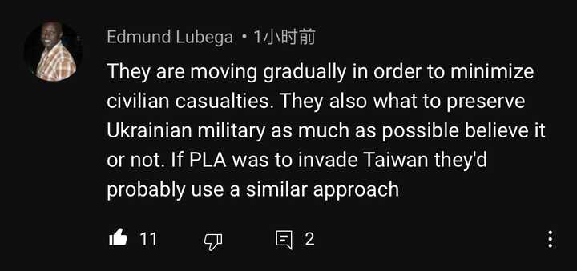

---

## 2896　5亿

- 日期：2022-03-02　主专题：A12 战争军事外交与大国秩序　副专题：A08;A03
- 源 ID：`d933801e-618b-5746-b82e-b8fa241201d2`　原文链接：https://www.zhihu.com/question/519245079/answer/2369974300
- 23 概念标签：能力与学习;选择与自由;责任与后果;成本与总账;信用与信任;法律与秩序;心理与主体
- 证据状态：manual_confirmed　初读：read　独立复核：not_reviewed

**问**：如何看待 2 月 27 日尼泊尔议会批准尼同美国「千年挑战计划」协议（MCC）?

扫了几眼，这协议的违约条款是啥？假设哪天尼泊尔违约，最大的损失是什么？
就是“停止援助”？

怎么说呢，我觉得中国人要心胸宽广并且自信一点。
心胸宽广，是指要学会尊重其他国家选择它们自己最大利益的权利。
要接受别的国家摇摆、选择政策平衡，接受别的国家也接受别的来源的援助——包括“敌人的援助”。
不要人家选择了“敌人的援助”，我们就焦虑、就反对、就嘲讽甚至就诅咒。
你真的关心人家的话，人家毕竟是多拿到了一笔援助，对人家终究是好事。你不能一切都从你自己的利益出发去评判人家的选择是不是有利于你自己，不利于你的你就批评反对。这个心态非常的不健康，而且有极大的反效果。
这个就像啥？就像你的老板见不得有人给你开高价挖你墙角，他也不给你涨工资，只会拼命说服你那家就是骗你的，你领不了几个月，到那边就不是这么回事，你一定会后悔……
等等等等。
你坚持要去，他拍桌子——“我把话放在这里，你一定会后悔！”
你设身处地，想想你会是个什么感受？你难道是很感动吗？你是会因此坚定信心效忠公司吗？
这可能性倒不是没有，但那一定是因为你这位老板之前就对你很好，而不是因为他现在对你说了这些话。
这些话，无论如何都是扣分的，一定会降低这位老板和你的关系，属于一种经典的不会做人。
恰恰你在这个位置上，这些话别人能说，你绝对不能说。优秀的——或者不如说合格的——老板一定不会犯这种错误，而只会祝贺你多年的工作获得了外部认可。
如果公司有钱而且想留，那就开个对价，不要说废话。
如果没钱或者不想留，那也办欢送会，事情办得漂亮点。
你真的关心对方，是要落实到这种行为上的。这才是真正关心的样子。
一有事你就先考虑你自己的利益受损，甚至露出“为了我的利益，我希望你自觉拒绝对方的高薪诱惑”的嘴脸来，你要是这样的人，你给我一样的价码我也不给你干了。
不要为越南选了日本高铁跳脚大骂，而要祝越南人民早日拥有更好的交通条件。
不要为泰国拒绝了我们的项目就阴阳怪气，而要祝泰国人民蓬勃发展。
这是基本的尊重。
争取别人与我们合作，那是我们自己的责任、自己的工作，靠我们自己的本事，而这些本事，绝对不包含“你选别家我就骂你、诅咒你搞不好”这一条。
凡事存心要盼人好，这样你才能落到最大的好。这道理很朴素。

而且，只有站稳了这个立场，你才能客观的面对对手方案里的长处和优点，加以借鉴和学习。
如果你站的是诅咒愤恨的立场，你对没争赢的解释一定会是“甲方一定收钱了”、“甲方一定是受威胁了”……等等等等毫无营养的万能结论。
你不会去考虑“是不是对手的方案确实挺好，就是凭实力赢的”的可能性的。

其实你们仔细查看这条款，说句实话，站在尼泊尔的立场上，的确没啥真不能接受的。
白给你5亿美元，不用还。
你要有任何违约行为，最大的后果就是停止援助（这条我没很仔细的研究，没时间，如果错了可以指正）。
然后是要不受干扰的权限。但这种不受干扰的权限，显而易见是仅限于这个项目相关的问题的。
要注意一个至关重要的要害——尼泊尔政府不爽，其实随时可以“撕毁”协议，要付出的代价就是不会继续援助了。既不会上国际法庭、也不会倒赔一百亿，只是5亿白捡的钱没了而已。
它真正的问题是这里面附加了“超主权条款”，但恐怕这也不是没有任何现实理由的——否则它也不会凭空通过。
我不太了解尼泊尔具体实情，但恐怕是因为第三世界国家——尤其是印度风格国家的某种通病——政出多头，有太多菩萨和土地爷可以拦路收香火、找麻烦。
否则这几亿丢下去可能没有任何成果，无疾而终。
总之，我个人如果不经深入查证，不太倾向认为相信这是一个毫无合理性的、荒谬至极的、纯粹只能用“尼泊尔议员丧心病狂的贱卖国家主权、主动卖身投靠美帝”来解释的问题。
另一个侧面也可以验证这个猜想——美国那句可能影响双边关系，意思是这条款对你尼泊尔根本没有任何实质风险，你们连白送钱、还只是5亿这种金额都坚决不要……
你们是不是要如此坚决的站中国的队，站到连这么一丁点我美国最基本的面子都不给的地步？
你们一直拖着白送5亿的项目不批，是想表达要跟我美国绝对划清界限、白送钱都不要的意思吗？
这才是构成真实的外交压力的合理逻辑。
否则如果真如外界传言的那样是“你们尼泊尔要是不五亿美元出卖主权给我，我就会跟你翻脸”这种解读……这何止没有“外交压力”，尼泊尔一定立刻投共好吗。
美国外交部也不会明白人都死绝到这个地步吧？尼泊尔再怎么不珍惜自己的国家主权，也不至于5亿就卖吧？
会这样去猜测剧情，不但把尼泊尔人看得太轻了、也把美国人看得太蠢了、把中国看得太奇怪了。
五亿美元我们难道出不起？这种级别的战略竞争，批了几年我们会收不到消息？我们会舍不得出？
那一定是因为我们评估觉得这个实在是……不值得花成本去阻断啊。
尼泊尔要跟外界收白送的钱，我们都全力发挥影响力要去搅黄？真要搅黄了，我们也许赢了这五亿美元，我们输掉了什么？
输掉了用了几十年隐忍获得的“我们绝对尊重其他国家自主权”的基本信任啊。
尼泊尔人会怎么想？难道和中国交朋友，那就这些都别指望了？
那样我们和尼泊尔痛恨的其它巨兽有什么区别？

再说这个自信问题。
我们是何等样的国力？5亿美元就想在我们鼻子底下变天……
开什么玩笑？
尼泊尔又不是不教数学。

---

## 2895　泽连斯基

- 日期：2022-03-03　主专题：A12 战争军事外交与大国秩序　副专题：A10;A16
- 源 ID：`d74d0e64-a84f-57b9-a6c8-9ccb09efb816`　原文链接：https://www.zhihu.com/question/518687504/answer/2371495828
- 23 概念标签：选择与自由;责任与后果;成本与总账;信用与信任;爱与回应;生态与自然;心理与主体
- 证据状态：manual_confirmed　初读：read　独立复核：not_reviewed
- 标记：`【正文标注未完待续】`

**问**：如何评价乌克兰第六任总统泽连斯基？

泽连斯基最危险的时候还没来。
俄罗斯在占据所有战略优势的前提下，可以以非常低的成本和伤亡维持在乌克兰的长期军事存在。
俄军站稳了脚跟，阵地构建了稳固工事，也建立了战略空运的安全通道，同时在乌中地区开始建立前线支援机场的话，就可以躲在坚固工事里安全而从容的用长程榴弹炮和铁壳炸弹这种成本极低的方式不断的让乌克兰毫无意义的持续流血。
到时候算一算俄军每天的战争损耗，会低得令乌克兰和欧盟绝望。
乌军蹲着不动，那就一点一点的用火炮往前啃。
乌军只要敢有任何异动，尝试冲击俄罗斯的坚固阵地，首先是根本啃不动，接着就是半小时内劈头盖脸的炸弹落下来，根本用不着“精确制导武器”，搞不好还都是冷战存货。

对乌军内部的几个特定番号，俄罗斯大概是要组织“处决式战役”。
这几个番号，俄罗斯一定会准备好尸山血海一样的坚实而丰富的反人类罪行证据，要万人坑有万人坑，要口供有口供，而最后的处决式轰炸和连人带楼一起炸塌的粗暴式“巷战”，很可能会一次性释放出大量影像来。
那是一个俄罗斯版的“猎杀本拉登”。只不过规模扩大了若干倍。
这些番号被彻底歼灭、残余俘虏被捕获进入审判流程后，俄军会开始对困守愁城、弹尽粮绝的乌军发动投降喊话，甚至搞出“对面战壕烤红薯，国军兄弟们放心出来吃饭，吃了饭你们再回去防守”的友爱戏码来。
乌军很难在这样的围困下长期维持抵抗意志。西方的军事道德也无法谴责这些乌军不愿发起“玉碎冲锋”成全ta们现在极力鼓吹的“全民英杰”品牌。
ta们不能不尴尬的看着这些乌军投降。
一批又一批的投降，越来越快的投降。
一旦有这样的成建制部队放弃抵抗，随着一个个城市无血开城、幸免于难的老百姓如释重负的出来领取紧急口粮，泽连斯基和北约集团、美国的真正危机才开始迎面扑来。
一轮接一轮，一件接一件，再也无法再用谎言粉饰、也再也没有办法用表演维持。
这个剧情，直到这里为止，俄罗斯没有任何物理上的实现困难，而只要看得清这个前景，俄罗斯内部绝不可能出现什么“反战热潮”。
到了这个节点，就会传递出几个最大的信息——
1）即使欧美把自己的影响力全部动员起来，也没有办法在下定决心的强国面前保护自己的附庸。
2）欧美在欺骗世界人民，欧美媒体兴高彩烈的、声嘶力竭的发布好消息，往往是骗局。
它们的新闻道德完全破产。
3）乌克兰已经丧失一切希望，北约的威望和价值大幅的负面化。
乌克兰已经不能再相信任何欧美的承诺和鼓励了。
这是一种极其经典的深度抑郁症状——真正带来最大的伤害的，反而是继续跟我说还有xx希望，要勾着我不死心，继续在这个地狱里煎熬。
谁跟我说“有希望”，谁就是狗x的xx蛋。
有你x的希望，希你nnd望。
我是不是没有权利“放弃”？我是不是没有权利“不努力了”？
每一个“躺平族”，都应该无比清晰的知道我在说什么，不是吗？
这是不是必然到来，你们有亲身体验，你们觉得呢？
那个时候，泽连斯基在乌克兰人民的眼里还是“英雄”吗？还是那个给你打鸡血、说你是“家人”、但其实根本不管你死活的老板？
累死打死的是你，换他成为西方的宠儿，换他流亡时的荣华富贵。
到这个时候，泽连斯基真正危险的时刻才会到来。
他会面临极大的困难——驱使他投降的道德压力会越来越大，逐渐大到再继续坚持不投降本身不再是任何意义的英勇，而是没有人性。
这压力会大到连CIA也开始担心他挺不住。
而众所周知，CIA有了这种担心后的思路是比较开阔的。
可能会怕他不体面，要帮他体面——通过一次神秘的“斩首轰炸”或者“二噁英中毒”，把他变成烈士。
这样好把乌西的最后一滴血流干，给彻底对北约和美国失望、不可避免大幅倒向俄罗斯的战后乌克兰留下最大的俄乌血债，尽可能再埋下一些长远的社会隐患。
到了这个阶段，再看你会怎么看待泽连斯基。
现在下结论还太早。

既然剧本推到这一步，干脆后面的剧情也可以推一推。
1）战后的乌克兰，必然会有大量害怕俄罗斯清算报复的乌克兰人想要前往欧洲。
俄罗斯从什么角度出发都会很乐意睁一只眼闭一只眼放这些人冒死穿越“乌克兰墙”，投奔自己的应许之地。
其数量可能空前绝后，令欧洲瞠目结舌，足以发展到波兰士兵受命武力阻止的地步。
八百万因为信仰欧洲价值，绝不肯同流合污的乌克兰老弱妇孺现在失去了家园，要投奔而来，欧洲从一切意义上都有绝对的道德责任予以完全的、上不封顶的、毫不犹豫的接纳。
否则欧洲将失去一切道德优势，软实力会荡然无存。
这数百万乌克兰人会成为欧洲的新噩梦。有些本来没有这种顾虑的乌克兰人，看到德国那种梦幻般的难民安置计划，没事也要选择移民。
那么算上这波人，其数量甚至可以达到一千万到两千万。
注意，这不是只有青壮年，而是一样会有大量老弱妇孺，是带着全家的。
首当其冲的，ta们将大幅的抢走本来属于东欧国家的中低端岗位，更不用说为此带来的沉重的安置负担。
至少我现在没有想到欧盟能怎么化解这个新难民危机——这次ta们没有任何置身事外的借口。
而难民问题所造成的选民对立，势必要把欧洲的政治生态打击到天翻地覆。
一定会有右翼候选人打出“退出北约”甚至“退出欧盟”的口号而受到热烈追捧。
俄罗斯要是战争结束得早，近在眼前的马克龙就可能有这种危险。
但无论如何，可以预见未来两三年内这一波冲击是近乎无可避免的。
2）一切俄罗斯/北约的前线盟友都异口同声要求北约驻扎足以抵抗俄罗斯突然袭击的兵力。
不只是大量军事设施而已，还要包括大量的实际常驻兵力。
这会带来两方面的巨大影响：
a）沉重的财政负担。
无论这财政上是由驻在国负担还是由北约全体负担，都会是一笔巨大的开支。
它完全是一种近乎毫无意义的“仇俄税”。
因为它既不能支撑北约部队主动出击去尝试“解决俄罗斯”，也对防御事实上根本不会发生的“俄罗斯入侵”毫无意义。
纯粹是出于自己内心有鬼、自己恐惧对方随时报复。
俄罗斯在边境地区稍微打个喷嚏，波兰那边就会纷纷掩面卧倒。俄罗斯可以以极小的动作，毁灭性的打击东欧国家的经济秩序。
哪里可能有什么正经的产业能在“下一个乌克兰”里呆得住？作为欧洲经济增长点的东欧国家要摇身一变变成一个“吃辽饷”的包袱，变成拖欧盟经济下地狱的沉重铅球。
欧盟、北约，有钱托起这个铅球吗？
这还不是真正可怕的地方——在北约的亚洲敌人的面前，可不是只有几个前线国家要供养。这个敌人是世界上邻国最多的国家，二十个陆海邻国，还加上一个已经含在嘴里都快化了的台湾，要多少部队和成本来确保它们的“安全”？
这笔沉重的负担，北约不拼死顶一顶，是不甘心直接放弃的。而“拼死顶一顶”，当然要顶到真的再顶下去会死的程度，不然怎么对得起自己呢？
如果顶不住，那么就有后果二——
b）北约的亚洲影响力崩盘。
谁也不想做乌克兰，而不做乌克兰，就要做下一个波兰，而北约只养得起三个波兰，没有名额了。
只能放弃。
3）与俄罗斯的敌对导致的通胀危机。
欧洲想过这样一个问题没有——战后的俄罗斯吃什么？
当然是吃它的三个铁饭碗——能源、矿产和粮食。
矿产也就罢了。
粮食方面，俄罗斯本身就是重要粮食产地，现在还手握乌克兰，自然会成为世界粮食市场的大玩家。
而最重要的是，石油天然气现在既然是俄罗斯的主要经济来源，竭尽一切手段保证这些能源的高价格就是俄罗斯的核心利益了。
而巧的是——美国、OPEC国家也都会乐见石油价格高企，大家利益一致。同时中国却因为和俄罗斯、伊朗的战略关系可以很大程度上保证石油安全，置身事外。
美俄交替制造OPEC十分乐见的动乱，大家一起肆意收割欧盟的“能源税”，说要多少就拿多少，不容还价，岂不美哉？
Winter is coming，欧洲的局面之被动，难以想象。以欧盟这种“27国共识决”的过家家般的治理机制，要应对这样的挑战近乎天方夜谭。东欧要辽饷，德法要欧洲军，南欧要中立，北欧不知道该跟谁。
可能会有国家提出脱欧公决，摆脱欧盟义务，单独与俄罗斯媾和。
而风雨飘摇的欧盟根本无力“惩治叛徒”。
我们可能在未来五年内看到欧盟解体危机。
即使德法内部，如果不发生强烈的要求与俄罗斯关系正常化的民意，那会非常令人惊讶。
而在这整个过程中，俄罗斯的处境会一步一步的走向上坡路，甘蔗从苦吃到甜。
剧本到了这个节点，你会怎么看待泽连斯基？
（未完，待续）

---

## 2894　越说越错

- 日期：2022-03-04　主专题：A12 战争军事外交与大国秩序　副专题：A16;A08;A03
- 源 ID：`f7e156a2-2426-5742-b94a-9ad6a88da159`　原文链接：https://www.zhihu.com/question/519785203/answer/2373582002
- 官方对象—实践路径：与社会 / 与舆论 / 表达
- 23 概念标签：定义与达意;能力与学习;选择与自由;责任与后果;成本与总账;财富与市场;法律与秩序;权力与异议;文明与历史;心理与主体
- 证据状态：manual_confirmed　初读：read　独立复核：not_reviewed

**问**：继文体界制裁俄罗斯之后，乌副总理在推特上呼吁封禁俄玩家游戏账号，如何评价这种做法？对俄罗斯有多大影响？

欧洲现在说的每一句仇俄的话、做的每一件排俄的事，在不得不向俄罗斯低头的时候，都会变成代价昂贵的悔恨和俄罗斯未来安全的保障。
安全的心理屏障就是让曾经诽谤、辱骂、散播过对你的仇恨的人，在事后不得不依赖你的原谅活命时，一想起自己曾经说过的某句话就恐惧。
这份恐惧会日夜折磨ta，直到ta完全崩溃，任人宰割。
这实际上是在向俄罗斯送钱。
俄罗斯的自给自足能力、自我防卫能力、维持稳定能力要远远的胜过欧洲，而物理/心理打击欧洲的能力也要远远的胜过欧洲。
欧洲是一个需要极高的安全条件才能维持其脆弱的经济秩序，同时却又养尊处优、习惯了建立在这精致的经济秩序之上的舒适生活的松散群体。
它实际上是听不得一点大响动、上楼一定要扶着扶手的老人。
现在是一个养尊处优的老人在对一个衣衫褴褛的壮小伙进行辱骂、怒斥。这小伙子之前是给老头打工的，现在不但不给他打工，还成了拿着狼牙棒站在门外的敌人。
欧洲的增长不但要陷入停滞，还要陷入一个相当长的倒退期。
GDP增长一旦为零甚至为负，而且无法确认何时能转为正增长，其结果是极其严重的。
除了那些直接服务于刚性需求的行业，别的行业资本会跑光。
失业会如潮水般涌来。
更不必提因为断绝了俄罗斯的资源供应，欧洲普遍的成本上涨，通货膨胀会淹到鼻子。
要么获得与俄罗斯的和解，要么彻底消灭俄罗斯这个乱源。
后者已经被6200枚核弹一票否决了。
而要走前一条路，现在吐出来的，到时候只能一勺一勺的咽回去。
那时候，欧洲一定会后悔自己现在吐得太多了。
俄罗斯一定明白这个道理——你现在骂的每一句，过几个月、过一两年，对我全是实打实的利益。
今天骂多狠，到时候求饶的礼物就要堆多高。
欧洲真正的领导人一定清楚这个结果，可惜欧洲的舆论完全被美国操纵和绑架，只能眼睁睁的被“民意”裹挟，眼睁睁的看着蠢人们给自己挖墓穴。
越挖越深。
现在的这些辱骂，对俄罗斯是利多，而不是利空。
欧洲的真正领导者——那些根须深植的欧洲工业集团、金融集团们、那些背后的政策制定者们——现在一定深深的后悔自己没有建立自己的YouTube、自己的FB、自己的推特，没有在媒体准入上设立足够的门槛。
ta们一定在后悔自己对美国设防太少了。

---

## 2892　石与鸟

- 日期：2022-03-05　主专题：A12 战争军事外交与大国秩序　副专题：A15;A07
- 源 ID：`d0f1ea97-d404-56e8-8cbe-5e008f726bd3`　原文链接：https://www.zhihu.com/question/519873338/answer/2374732045
- 23 概念标签：能力与学习;选择与自由;成本与总账;净输出与不掠夺;财富与市场;法律与秩序
- 证据状态：manual_confirmed　初读：read　独立复核：not_reviewed

**问**：如何评价亚投行暂停并审查在俄罗斯与白俄罗斯的相关活动？

这可能是希望中俄交易避开一切与美元结算有关联的渠道，使得中俄交易额完全转向与美元绝对无关的交易体系。
这是在现有机遇下，最大限度的扩张纯人民币自主结算体系的必然举措之一。
注意，如果我们把中俄贸易完全纳入这个美国无法追踪的体系，其意义绝不仅止于保持中俄的原有贸易继续平稳正常运作。
这同时意味着一切第三国如果希望不受干预的、安全的与俄罗斯完成任何业务交易，均有了安全的交易渠道，而且这些交易毫无疑问要用人民币结算。
比如，越南、印度、缅甸、朝鲜要继续更新自己的军事装备，若想不受监管，将必须自己先积攒或与中国交换人民币，然后用人民币通过中国的结算系统去向俄罗斯实现交付。
俄罗斯卖给中国的能源、矿产等一切商品，都要接受人民币支付。
中国主动的中断一切直接或间接的俄罗斯和美元发生关联的渠道和潜在后门，不仅仅是为了“防范风险”。
事实上，这甚至可以说并无风险，因为美欧都无法承受“证实中国与俄罗斯合谋”的后果。在即将面对制裁俄罗斯带来的巨大经济冲击的同时，把自己逼上不能不制裁中国的极端困境，这代价欧美均无能力承受——会连卫生纸都买不起。说得不好听，就算中国敞开了打擦边球，数额不是极大，美欧都要当作不知道，甚至哪家不开眼的媒体要曝光，美国国务院还要亲自“辟谣”。
而“严格配合行业规则”是一个如此做极好的理由——它同时做到了“尽量快、尽量彻底驱使俄罗斯彻底与美元脱钩”和“向美国展示中立立场”的效果。
可以算一石二鸟。
而这并不是这块石头的故事的结尾。
往前想一想，假设俄罗斯长期被SWIFT拒之门外，其美元资产长期被冻结或无法获得安全保障，俄罗斯显然不会满足于与其他国家易货贸易或者赚一大堆卢比、越南盾。
那意味着俄罗斯的全部对外贸易都将使用人民币。
这意味着如果俄罗斯有能力提高人民币在国际贸易中的占比，就等于俄罗斯扩张了自己的贸易自由和国际生存空间。
在这一简单而朴素的逻辑之下，提高人民币的地位将在相当长一段时间内显而易见的成为俄罗斯争取自己的经济安全和生存空间的当然手段。
那么，在这一逻辑的驱使之下，俄罗斯有什么选择可做呢？
很简单，钱留在欧洲不肯走，那么俄罗斯就在波兰、芬兰、立陶宛……边境“例行军演”。
甚至可以随时报告“切尔诺贝利有可疑的核辐射升高迹象”，过半天再澄清“不好意思我测错了”。
钱从欧洲跑出来流向日本、韩国，俄罗斯与朝鲜签订“友好互助条约”，开始联合演习，并交流导弹技术、装备升级问题。
军机开始飞越日本领空，“白天鹅”开始长程绕飞。
钱流向美国，俄罗斯强力升级对北约压力，制造美国的全球战略资源紧张，支持伊朗施压以色列，送几艘潜艇、卖几百发伊斯坎德尔也不是不能谈。
在失去一切制裁顾虑的前提下，俄罗斯的能动空间完全释放，有极其强大的能力“引导”全球资金流向自己栖身的交易体系。
这种行为在6200枚核弹头和数十艘战略导弹核潜艇（很显然，被彻底制裁的俄罗斯会全力恢复核潜艇的建造）的保护下不受任何挑战，又因为制裁的如此严厉而不受任何掣肘。
俄罗斯会成为新金融体系下的“志愿美军”，以更大的规模、更猛烈的动作和更激烈的节奏重演美军在这几十年里最得意的名作——制造动荡、释放市场无法承受的恐慌信号。
以举国之力、肆无忌惮的、不是抱着“赚点盈利”式的贪婪，而是以自救和复仇式的热情，专心的大干快上。
这本来就是战斗民族的天生禀赋，俄罗斯本来就是全世界最有条件这样做的国家，只是这么多年被种种顾虑和一厢情愿的期待限制住了。
如今欧美犯了如此深刻的战略错误，自己彻底割断了这头猛虎身上的一切念想、一切羁绊。
虎兕既出于栏，龟玉活该毁于椟中。
欧美大声鼓吹“俄罗斯一时冲动犯了战略错误”。
殊不知，通过断然的行动，在欧美最脆弱的时候刺激欧美主动做出彻底的制裁，一刀斩断俄罗斯人所有残存的乡愿，完全将游戏规则转向俄罗斯最擅长的天赋领域，这可能才是普京的真正目的。
做出一个有充分合理理由的、自身就有收益（将乌克兰非军事化同时重创欧美软实力）的断然动作，利用欧美常年肆无忌惮的愚民宣传所培养出来的幼稚而冲动的民意和民主制度天生的民粹缺陷，诱使欧美主动发起彻底制裁，本身正是普京的核心意图。
欧美完完全全的上了当，甚至不客气的说，这其实是一道阳谋，必然奏效。
普京选择的时机之巧妙，极大的降低了成本、抬高了额外收益，提高了最终结果的成功率。
这可能恰恰是川普为什么赞叹普京是天才。
一旦这个策略的故意性被确认，其威力被验证，北约集团除非真的要毁灭地球，否则只有妥协——甚至是在付出补偿的前提下妥协——这一个选择。
因为只有尽快令俄罗斯满意的妥协，重新将俄罗斯更深的纳入西方经济体系内并产生令俄罗斯满意的系统收益，才能真正的阻止俄罗斯彻底将一切美元市场都搅和到鸡犬不宁，阻断全球资本持续向东亚的涌动。
但要转这个弯、拉下这个脸，谈何容易？
何况之前造的孽有多深、有多恶毒，想要俄罗斯相信这一次不是虚情假意，谈何容易？
尽管，为了保持自己的独立性，将人民币过度高举也并不符合俄罗斯的利益（何况一旦情况过于严重，美国可能加以效法，用不顾一切的军事威胁扰动人民币市场），但恐怕俄罗斯至少也会折腾到人民币体系成长到相当份额、足以震慑住SWIFT系统不敢再随便动用驱逐大国这种恶毒行为的程度才会收手。
欧美如梦初醒的（或者不如说奋力办到的）积极妥协，可能只会使人民币交易体系的份额发生目标份额上下2%的差异。
至于一些人自我安慰（或受人影响所相信的）“俄罗斯过段时间会发生民变”的希望/忧虑。
这么说吧，在已经有效拒止北约参战的前提下，普京随时可以投入绝对优势力量开始获取捷报。
战斗胜利、战役胜利、外交胜利、司法胜利……
一场接一场的歼灭敌军，接受投降，占领要地，揭穿谎言，快意复仇……
一场胜利接着一场胜利。
请注意——世界历史里还没有任何“一个国家在军事上节节胜利而发生民变”的先例。
这块石头不但击中两只鸟，还会滚下山，撞跛一头牛。

而这些还并非俄罗斯全部有操作余地的牌。

欧美所谓的“政治家”们，
你们眼睁睁看着冲动的民众愤怒的逼迫你们不得不在三天内把俄罗斯踢出SWIFT，
看着ta们在狂怒/玩笑之下，翻着花样的在一切民间领域斩断俄罗斯与西方世界的牵绊，
刮骨疗毒般的泯灭俄罗斯对西方的一切残存幻想，
狂欢着把数十年建立起来的对俄筹码如同娱乐一般的摧毁，
你们后悔了吗？
我不相信你们不知道这样做真正的可怕后果。
你们知道错了吗？
你们还觉得自己的制度“最完美”吗？
谁叫你们愚民？

---

## 2891　再次崛起

- 日期：2022-03-07　主专题：A12 战争军事外交与大国秩序　副专题：A20;A17
- 源 ID：`3159e748-f501-5b8e-96b8-fb3a95f1d4a2`　原文链接：https://www.zhihu.com/question/30543838/answer/2377385700
- 23 概念标签：能力与学习;法律与秩序;权力与异议;文明与历史;心理与主体
- 证据状态：manual_confirmed　初读：read　独立复核：not_reviewed

**问**：俄罗斯再次崛起的可能性有多大？

对于无法加以毁灭的大国，如果它的处境没有与它的文化禀赋相称，尤其是远远的低于这个水平，那么它“再次崛起的可能性”在数学上显然是百分之百。
只是时间问题，而不是“会不会”的问题。
实际上这才是对大国不能轻慢、不能仇恨的原因所在。
侮辱、仇恨无法被毁灭的大国——尤其是自身没有永续大国的禀赋的前提下——其实就是在自掘坟墓。
无论你和大国有什么矛盾，一切都要抱着尊敬的态度去做，这是周围小国得以生存的保证。
比较经典的例子，就是越南——尽管中国在历史上屡次主动攻击越南，越南殊死战斗击败了中原王朝，但越南人一直在这个原则上相当明智——往往在成功击退中国之后谦词上表，请求册封。
仗你都可以打，但是不可以结仇，不可以积怨，不可以轻侮。
否则大国必有重新崛起的一天，
那一天就会是无视这禁忌者的末日。
不明白、不遵守这一点的国家在根本意义上是没有前途的（因为你总会临近某个不死的大国）。
这总结没有任何感情色彩，仅仅是谈论一个被反复验证的历史现实。

---

## 2890　第二终战剧本

- 日期：2022-03-08　主专题：A12 战争军事外交与大国秩序　副专题：A10;A20
- 源 ID：`a2144e6b-92c9-5467-af3e-4515d1eede5c`　原文链接：https://www.zhihu.com/question/520558368/answer/2379277039
- 23 概念标签：选择与自由;责任与后果;成本与总账;法律与秩序;权力与异议;生态与自然;宗教与自然法
- 证据状态：manual_confirmed　初读：read　独立复核：not_reviewed

**问**：美国拟将原定给台湾的F-16战机，先送给波兰作为支援乌克兰的补偿，体现了什么态度？

这个剧本可能是俄罗斯敢于放手开战的一个主要理由。
那就是俄罗斯很可能算好的第二终战策略。
在单独对阵乌克兰的前提下，俄罗斯的胜利是毋庸置疑的——甚至仅仅是高度孤立的心理预期一旦明显，乌克兰就无法支撑作战，并将在对欧美的彻底失望中全面倒向俄罗斯。
但可以预料，北约势必将会使用种种灰色战争手段间接的支援乌克兰，或至少保留乌克兰对无限支持的期待，从而延长乌克兰的抵抗意志。
在这个剧情下，俄罗斯将会尝试是否仍旧可以在合理成本下取胜，如果可以，传递的信息就会是“即使允许，乌克兰仍然无可避免要失败”，这仍然是足够强有力的信息。
但如果这种支持达到了一定程度，的确使得俄罗斯不得不选择放弃低烈度、低成本作战的原有策略，那么俄罗斯会在高烈度（造成更大附带杀伤，但也会导致更大治理成本）和升级阻断北约干预力度的两难中进行选择。
俄罗斯的选择很可能是双重的，即首先适当的提高烈度，以震慑泽连斯基政府以及部分反俄平民自以为“躲在平民身后打冷枪”是绝对有效的妙招的幻想；
同时也同步放宽认定北约参战的标准，升高核威胁和战略空袭威胁。
之所以俄罗斯没有大量使用伊斯坎德尔，很可能是因为要保留足够的数量指向波兰的一些设施——尤其是美军预警机和北约前线作战系统和通信设施。
俄罗斯要发出核威胁震慑北约、提升欧美民众对北约卷入的焦虑是非常容易的。例如在国内发动核避难演习，然后打开核发射井舱盖给卫星看就足以制造极大震撼。
俄罗斯的参战认定标准完全可以提升到“从任何意义上造成俄罗斯士兵的更大伤亡概率，均视为参战”。
包括但不限于提供除食物、药品以外的任何武器装备，一颗子弹也不允许。
提供任何情报分享，包括民用GPS信号。
提供任何军事指导或军事人员辅助，无论是否志愿者。
北约将会受到极大挑战和冲击。
如果北约因此撤退，那么乌克兰的战斗意志会同样崩溃。北约一样信誉扫地。
如果北约给予强硬反应——例如发表强硬讲话、展现核对抗姿态、提高核战备状态。
那么全球股市和金融市场将会爆发难以想象的巨大动荡——美股和欧股可能会发生连续跌停，银行会出现现金挤兑潮，黄金暴涨，全世界都开始挖防空洞、抢购粮食。
这个时候，世界还有一张真正的终战牌——中、印、巴西等各大洲代表领衔的全球总调停。
这时候，俄罗斯黑名单的意义就昭然若揭了——
首先，凡上了这黑名单的国家和地区，其经济必然受到核升级的重创，这是显然的。
而更重要的是，俄罗斯通过这张名单排除了黑名单国家和地区的调停资格。
名单之外的所有国家，理论上都有向俄罗斯喊话斡旋的资格。
面对整个人类毁灭的全面危机，剩下的150多个国家当然要全部团结起来，发起最强烈的和平主张。
不但国家实体如此，各大世界宗教的领袖也没有选择，要发表共同立场。
而这时俄罗斯必然当即表示愿意接受调停提案。
全部的压力都将如山呼海啸般倾泻在北约身上。
如果这样的压力还不能导致部分北约国家表态退出北约，那么北约还真是人类历史上的组织奇迹。

而这其中，显而易见、毫无疑问的领导者，是也只能是中国。
这个时候，中国会站出来，率领世界的一百多个国家联名发起终战调停，提案很可能是由这一百多个国家组成联合国维和部队，在北约和俄罗斯之间建立五公里到十公里宽的停火隔离带，实现全面停火。
任何侵犯和越过隔离带的行为，无论来自俄罗斯和北约，都将受到剩余所有国家的一致制裁。
而乌克兰，很可能参考塞浦路斯模式，俄罗斯大面积退出到仅占有俄语州（顿、卢、克里米亚等），俄罗斯撤出的原俄控制区则改由中国领导的联合国军接管，其地位由俄罗斯和乌克兰将来协商解决。
这一方案将获得俄罗斯的立刻批准，于是全球和平的全部压力都会落在北约集团身上。
北约没有能力对抗全世界的共同压力，唯有放下武器一途。
因为到了这个剧情，这是人类幸存的唯一剧本。谁不放下武器，谁就是全人类公敌，要受到全球一致的严厉经济制裁和武力震慑。
而这一和平方案的后果，仍然是北约集团诸国的军事霸权从此永远谢幕，美元——甚至是西方集团——的全球霸权从此终结。
因为剩余的190国——事实上还包括俄罗斯——已经成功的团结在了一起。
而巧妙的是——参与这场全球调停的资格，实际上是被俄罗斯的黑名单划定的。

仅仅是预见到这个最终剧本，北约集团就更可能在剧本无可避免的滑向这个结局之前——即在“俄罗斯升高核威慑、要求北约彻底离场”这个节点——提前选择抛弃乌克兰。
这反而对北约集团是损失最小的选择。

但这个剧本不会轻易出现——因为俄罗斯的优先选择，可能还是尽可能的保证独力取胜、独享全部战果，而不是将最大的胜利果实拱手送给中国——如果走到这个剧情，无异于给中国戴上王冠，这对俄罗斯将来的战略空间而言其实并非最佳选择。
但如果北约不知好歹，一定要做出愚蠢反应搞核对抗升级，把俄罗斯逼入这条剧情线，那只能说是自作孽，不可活了。

中国现在意味深长的绝对中立，实际上是这个终战剧本的伏笔。
但问题是，中国的这个策略属于绝对无可指责的阳谋，即使明明白白摆出来给所有人看，在道义上也毫无可指责之处。
你们能说什么呢？
你们羡慕这优越的战略地位，是吗？
看清楚，这就是走正道的好处。

我不太相信北约智库没有看到这个显然的可能性。甚至恐怕连北约都会在内心庆幸人类还有这样一道最后的保险。

而你看到这里，就能明白普京的整个打算到底有什么样的底气。
要么俄罗斯直接取胜，事情限于乌克兰，北约虽然受到战略挫折、开始转入颓势，但毕竟百足之虫，要死透还有几年软着陆时间，也未见得不能自己找到生机。
要么俄罗斯因为北约的有效干预难以取胜或感觉成本太大，那么就升级到第二剧本终战。
无论如何，第二剧本一定终战并且同样沉重打击北约，甚至堪称突然死亡。
其实并不存在一个“俄罗斯输掉”的剧本。
普京这局连环计，其实从美国的上上任总统任期就开始铺垫了，美国现在才察觉，其实无论怎么选，都是在不同的极端被动中选。
而且很可能是越选结局越糟。
但谁叫你不走正道呢？
关于印度在第二剧本里的地位。
不错，我猜测印度这一次之所以展现出如此大的战略定力，真是因为印度的战略层看到了第二剧本的存在。
印度有机会借此大幅的提升国际地位，甚至可能因此获得实践意义上的五常身份。
值得注意的是，莫迪和中国领导人一样，是普京频繁“花园交谈”的对象之一。
但是请注意，这不是在暗示普京在发动这些行动之前一定直接地向中印告知了自己的行动计划，而是在这些交谈中一定促使中印早已对这些问题启动了各自的战略研究，并且通过长时间的两国交往将俄罗斯最希望的选择客观的提升到了“最符合两国战略利益的选择”的位置上。
这不是“几个重要领导人私相授受、口头承诺”就可以达成的战略策划，靠的是更多的实际行动，一年一年的交易额、一次又一次的订单。
这是常年实际行动所铸造的实际利害关系凝结的行动信心。
实际上是阳谋。
因为这些长期谋划的任何一步，北约集团只要做出不同的战略选择就自然的能终止第二剧本的实现可能。
但北约集团一路选择了宁可接受这种可能，也要继续享受自己的“霸权福利”。
贪得无厌，获罪于天，无所祷也。

再回头看看这一篇：
俄罗斯进军乌克兰是否合法正义？

---

## 2889　Follow the money

- 日期：2022-03-11　主专题：A12 战争军事外交与大国秩序　副专题：A09;A10
- 源 ID：`9518eaf1-7ada-5e3a-a4a9-cdcd2eececdf`　原文链接：https://www.zhihu.com/question/521154275/answer/2384990036
- 官方对象—实践路径：与自己 / 与信念 / 形成
- 23 概念标签：事实与证据;责任与后果;成本与总账;信用与信任
- 证据状态：manual_confirmed　初读：read　独立复核：not_reviewed

**问**：乌方称「俄军轰炸一家运作中的妇产医院 」，却被俄国防部否认，目前当地情况如何？

当你下注赌一件事情是真是假的时候，最主要的考量点不是当事人的道德水平，而是它的利害关系。
无论道德多么低下、思想多么邪恶的人，也不会故意去吃眼前亏。
这是一条公理。
现在问题来了——俄军这样做的意义何在？对俄军有什么样的必要军事价值？
如果是为了占领这建筑，如果它里面只不过是一群无害的医护和病患，何不直接占领？反复攻击也要消耗弹药，不是吗？
特意消灭这群医护病患的收益到底是什么？
谁能给出一个合理的假设？
你不需要信任人的道德，但你可以大概的相信人的经济理性。
Just follow the money; the truth is always in the neighborhood.

---

## 2886　无谓细节

- 日期：2022-03-15　主专题：A12 战争军事外交与大国秩序　副专题：A03;A01
- 源 ID：`4de871a3-9732-5df7-b11c-8ea641697cd8`　原文链接：https://www.zhihu.com/question/521756627/answer/2389683939
- 官方对象—实践路径：与自己 / 与信念 / 形成
- 23 概念标签：事实与证据;定义与达意;能力与学习;责任与后果;成本与总账;信用与信任;边界与许可;劳动与组织;心理与主体
- 证据状态：manual_confirmed　初读：read　独立复核：not_reviewed

**问**：瓦力真的死了吗？有没有官方报道的网址啊?

看事情要分得清什么是无谓细节，什么是有意义的要害。
所谓“无谓细节”，是指那些无论发生了或者没发生，都不会引起什么大局后果的东西。它唯一的作用就是“打击/鼓舞士气”。
谁的士气？小孩子的“士气”。
总是被无谓细节牵动情绪，意味着人还处在一个幼稚和软弱的状态，无力进行深入的逻辑分析去形成一个稳定的对事物的判断，所以才会疑神疑鬼，一日三惊的去看一些“征兆”。
这样的人很自然的缺少定性，因为常常把一叶障目当成一叶知秋，所以一片叶子就能改变ta的立场和方向。
因为这种原理性的不可靠，这样的人在什么组织里都自然而然的是外围成员——ta们无法被视为可以依赖的核心成员，自然也不可能在资源分配里得到优先考虑。
这些点点滴滴，是可以从你自己的一言一行里流露出来的——比如在一场战争中关心一个网红、一架飞机、一颗炸弹、一个俘虏……之类的无谓细节。
你要自我检查一下，你在关心这些、付出情绪资源和劳动力代价之前，有没有思考过“就算是真的/假的又如何”。
除非你有某种思考可以把这事与整个战局的胜负逻辑有效的连接起来，否则明知这些不过是偶然事件、而且对于大局完全无足轻重，却在这类事情的细节上花费大量时间和情绪纠缠，这是一种loser气质。
不反省和消除的话，是会为自己带来厄运的。
别人不太在乎你对战争是乐观还是悲观，别人在乎你是不是loser，而这个是一种气质，人类就算没有受过多少教育、也无法明确的说出什么道理，但却是可以凭嗅觉闻到的。
对于你个人，这比俄乌战争的结果影响大且直接得多。

---

## 2883　优势在我

- 日期：2022-03-19　主专题：A12 战争军事外交与大国秩序　副专题：A03
- 源 ID：`7dbf938f-07f2-51c7-a2eb-d63b7d63443c`　原文链接：https://www.zhihu.com/question/522396623/answer/2397339741
- 官方对象—实践路径：与自然 / 与科学 / 质疑
- 23 概念标签：事实与证据;能力与学习;选择与自由;权力与异议;心理与主体
- 证据状态：manual_confirmed　初读：read　独立复核：not_reviewed

**问**：如何评价俄罗斯军队在进入乌克兰开始的 21 天后依然没有达成占领或包围乌克兰首都基辅的军事目标？

当你看到一个预测性的论断，在采信它之前，一定要仔细考察这样一个问题——它对其他可能性所作的探索是否足够充分？
它是否列出了其他可能？对其他的结局是如何排除的？
它在谈论一个因素造成的有利影响的同时，有没有谈论它所造成的不利损失？
举个例子——
有一种观点主张“乌克兰的翻浆期就快到了，这意味着俄军的前线补给会陷入极端困难，意味着俄军即将战败”。
那么，这个观点有没有思考过翻浆期对乌军的影响？

翻浆期带来的具体的影响，精确的来说是什么？
是“野外陆地机动成本极高，只有硬质路面和陆地轨道交通可以通行”。

那么问题来了——
1）硬质路面的控制权究竟在俄方，还是在乌方？轨道交通呢？是在俄方，还是在乌方？
拥有空中优势的俄军可以随时切断任何认定有价值的公路交通和轨道交通，不是吗？
换言之，俄军的补给路线也许会降低运输效率，但乌军的补给路线将全部落入俄军手中，而且原本可能有的零星野外补给路线也将断绝。
为什么这是有利于乌军的？
2）俄军不能野外机动，乌军也一样不能野外机动。但现在的态势是俄军已经完成了必要的战略机动，围住了乌军，而不是相反。
也就是现在乌军无论是要突围还是要增援，除非走硬质路面，否则没有指望了。
即使是乌军小部队打算对俄军进行野外伏击，也一样要依赖车辆来追上和拦截ta们打算袭击的对象。靠步行去袭扰行动中的机动部队物理上是不现实的——追不上就谈不上袭击，打完甩不掉就是自杀任务。
这是有利于需要野外跋涉、打了就走的游击队，还是有利于阵地防守，步步推进的正规军？
为什么这是有利于乌军的？
3）如前所述，翻浆期对双方的补给都会造成困难。那么很显然谁拥有更多的空运补给能力，谁就拥有补给优势。
那么空运能力现在掌握在谁手中？
即使假设可以利用库存瞬间大量消耗俄军库存并超过俄军临时运补的能力制造相对的补给困难——那么现在乌军是否还有能力集结对俄军局部大这么多的优势火力？
就算集中全力攻击一点，在包围圈上撕开了一道口子，在翻浆期乌军也无法从这道口子里出去。
那么大量耗费宝贵物资撕开这道口子的意义何在？
所以，为什么这是对俄军不利的？
于是，“翻浆期俄军就完了”的结论实际上是很可疑的。
这倒不是说这肯定能推翻对乌军有利的结论——也许事实上俄军还有什么这里没列出的锦囊妙计，但是如果那些鼓吹“翻浆期对乌有利”的信息源根本连这些最粗浅的疑点都没有探讨过就宣告了它的乐观结论，那意味着它乐观与否对你是没有意义的。
因为它缺少真正谈论这些问题的基本自觉。
仅仅因为看多了这类“绝对乐观”的声音，就不经过这类最粗浅的怀疑和核实，去跟着乐观起来，这是一种极其明显的“幼稚”特征。
过了可以原谅的年纪，幼稚即愚蠢。

另一个观察的方向，就是要判断到底是能力有限导致的失误，还是有所图谋而有意为之。
也就是到底是“不为也”，还是“不能也”。
这里也举一个经典问题：基辅围攻。
到底俄军是没能力围住基辅，还是没打算围住基辅？
讨论这类问题，你要切记不能仅仅从“没包围死”这种单纯事实里去直奔自己喜欢的结论。
“没包围死”一定还要配合上“想要完全包围”这个意图，才能得到“非不为也，是不能也”的结论。
但是，“俄军的确有全包围基辅的意图”这件事，需要有足够的证明，而不能出自“如果是我，我就肯定会包围基辅”这种“根据”。
因为很显然指挥作战的不是你，而是普京。你很显然不是普京。
而且，毫不偏倚的讲，你自己也很难主张普京的水平会不如大学毕业了还在问“如何避免35岁被公司解雇”和“怎么谈恋爱”的你。
你觉得“不包围基辅怎么行”，根本不构成“普京一定也找不到别的选择”的一种证明。
这一点，算上所有你觉得神威无敌的军事大V、键政达人、乃至海外名嘴、甚至所谓退休上将一起背书都没有用。
因为这个方法本身是无效的。
要判断对方的意图，要学会观察更客观的证据。
比如什么客观证据？
比如前几天三国总统乘火车前往基辅和泽连斯基见面。
如果普京确实谋求完全包围基辅，只是能力不足，那么为什么连基辅的铁路线也要留着？
是俄军没有能力将基辅城外这几百公里铁路炸断吗？
既然要谋求完全包围，那么在这个逻辑下，当然要在没能完全达成之前尽力掐断它。
既然没有完全合拢，那么这并不影响人道走廊，何必保留如此高效的补给线？
这明明在俄军的能力范围之内，不是吗？
换句话说，“非不为也，是不能也”的解释，至少有这么一个“非不能也”的疑点无法完美解释。
城外几十公里长的车队，堂而皇之的摆在“死亡公路”上一动不动，要解释为“想前进，但是因为遭遇补给困难无法前进”，那就很难解释为什么距离白俄罗斯边境仅150公里的车程，就足以将一只60公里长、其中必然有油料补给车的、没有遭遇过任何战斗的车队搞到补给困难？
这需要你假设“一只重装集团、不经历任何战斗，仅仅沿着公路开了150公里的路程，就耗尽了自身携带的补给。而且在显然没有任何可以攻击该车队的威胁的前提下，无法获得再补给。”
而且还是在乌军显然连袭扰这庞大车队的能力都丧失了的前提下——乌军倒是真的不存在“能消灭这车队而毫无行动”的有效理由。
把这解释为“俄军极端无能”，实属有点超出常识的疯狂。
逻辑上，“非不为也、是不能也”的这种判断要成立，需要全面的证明对方意图方向上的每一个细节都存在无能。
也就是不但要解释对方为什么没有达到100%，还要解释对方为什么没有达到60%、50%、40%。
否则你对对方意图的判断就有无法排除的疑点。
那么，在如此笃定的认定“能力问题”的时候，这些疑点为什么被如此轻易的排除了？
俄军并没有实施“在此时完全合围基辅”所必要采取的全部能力范围之内的行动。
有某些显然在他们能力范围之内、而又能显著孤立基辅的动作它没做。
这是一个显而易见的事实。
这一事实，如何解释？
你的理论必须要能解释这个疑点，才能寄予一定的信心。

更首要的是——任何一个你打算投注注意力的分析，无论其立场如何，都必须经过这样一个反复推敲的过程。
如果它只有激昂饱满的情绪、坚定的意志渴望、诙谐风趣的表达、机智华丽的修辞，但却没有这样一个逻辑有效的自我怀疑的过程。
那么，至少建议你保留几分怀疑。
而且要主动远离这类信息源。

为什么？
你自己选哪边，本来就没人能管你、也用不着别人来教。
而且它本来就应该是出于你的原则和价值观，根本不应该受到“哪一边可能会赢”的影响。
如果你的立场还处在受到胜负结果影响的状态，那么恕我直言，你在这件事上就是一个投机者。
这没什么丢脸或者可耻的，但不能清醒的认识到这一点、不好好的做一个投机者，却因为情绪被人蛊惑或感动，而自欺欺人的成为一个价值观站位者，你对自己有亏欠。
你没有守护好自己，任由别人利用你的情绪弱点盗窃了你的主权。

你一旦醒悟，就应该自我警惕，警惕受到这些或有意伪装为、或无意类似于“客观分析”的东西的过多影响。
这类诉诸情绪而非诉诸理性的东西，不会对你有益，而很容易令你跌倒。

---

## 2871　一个坑

- 日期：2022-03-26　主专题：A12 战争军事外交与大国秩序　副专题：A03;A16
- 源 ID：`f53725b4-e0a4-52ab-85a9-c34d04ab5ca7`　原文链接：https://afdian.com/p/4b28e394ad1911ecb9d152540025c377
- 官方对象—实践路径：与社会 / 与舆论 / 表达
- 23 概念标签：事实与证据;能力与学习;成本与总账;信用与信任;劳动与组织;法律与秩序;权力与异议;心理与主体
- 证据状态：manual_confirmed　初读：read　独立复核：not_reviewed

**问**：普京

这一篇被知乎反复删除，原因不明。
我觉得这次认知战里面最大的一个智商筛选器，就是所谓的“普京冲动”、“普京被忽悠”、“普京误判”、“普京没想到”。
首先，看清楚普京的履历——
KGB出身；
五常国家元首；
从国运最低点接位；
持续在位20余年；
在位期间发起并领导了至少五次对外军事行动，战绩全胜。
这都是没有任何美化、任何夸张的最朴素的事实。
没人会说他肯定算无遗策。
但是要说他会基于“肯定一帆风顺”、“西方肯定不会制裁得太厉害”、“欧洲肯定不吭声”、“内部肯定没人搞事”、“乌军肯定会投降”、“泽连斯基肯定会投降”、“北约肯定不会援助”、“俄军肯定不会有大损失”、“乌克兰翻浆期一定不发生”……等等等等现在无数人拿出来翻来覆去说他失算的预判组合来发动一场战争——这么说的人起码要有【相当的履历】才行。
否则一群四十岁的某特定专业的专家（甚至二十几岁学生），基于自己不知当过几天国家领袖、领导过什么战争、不知道干过几天情报、不知道经历过几次战争迷雾、不知道做过几次大国外交……的“经验”，断言“普京肯定失算了”，未免有点太……disproportion。
太“比例失调”了。
类似逼得集团总裁发文“新入职员工谈论公司战略一律开除”的这种级别的disproportion。
如果你提出的是一种罕见的、极其曲折和隐蔽的，99.9%的常人都没想到的奇策，说普京没预料到，那也罢了。
你一个二十几岁学生，引用另一群二十几岁学生/三四十岁“专家”/“媒体人”的兴奋和自信宣告，一起跟着断言普京失算，不觉得这是一个——就不说“荒谬”吧——缺乏有效性的行为吗？
我倒不是说西方这些反制肯定无效，但是说截至目前西方所做的一切“反制”“超出了普京的想象”，这恐怕是一种过于强烈的自欺欺人。
连高中生都想得到的措施，可能超出普京的预期范围之外吗？
普京有可能假设西方不会采取任何一种可能的反制吗？
这看上去是在说普京、在说乌克兰，但实际上根本不是，这说的是你。
一个人如果毫不怀疑的相信这一点，会让人对ta的判断力产生深刻怀疑——因为这理性残缺得丧失基本常识了。
俄乌冲突怎么落幕先放一旁——你的朋友、投资人和客户可能因此离开你。
副驾上的客人发现你分不清红绿灯，看不见绿化带，ta能不害怕吗？这跟坐醉驾的车有何本质区别？ta能不跳车吗？
你是需要保持别人的信心来过日子的。
而1450只是复读脚本的僵尸账号，ta们是没有这问题的的。
再说一遍，我无意反对你对俄乌局势的任何个人判断或者立场，我只是提醒你们，在这个过程中注意这些事对你自己的深刻影响。
它不但对你的立论力度没有帮助，还会严重的损害你自己的品牌价值。
其实你最后是不是预测对了结果，根本没那么重要——恕我直言，分析的首要目的并不是准确的预测结果，因为这是不可能的。
真正重要的是你是怎么探讨这些问题的，你在这过程中是怎么管理自己的情绪、管理自己可能的偏向性，怎么多维度的怀疑自己的推测。
这才是参与这些事对你真正可能有益的做法。
望三思。

---

## 2867　话事人

- 日期：2022-03-28　主专题：A12 战争军事外交与大国秩序　副专题：A10
- 源 ID：`dd48459c-0fa3-5be0-8752-054105ce60c3`　原文链接：https://www.zhihu.com/question/307458890/answer/2411419790
- 23 概念标签：定义与达意;能力与学习;责任与后果;信用与信任;法律与秩序;生态与自然
- 证据状态：manual_confirmed　初读：read　独立复核：not_reviewed

**问**：如果俄罗斯和美国发生战争，中国应不应该帮忙？

回答这个问题的人，需要首先注意中国的处理这类问题的基本逻辑——这不会是一个会交给“全民公决”或者“舆论公决”议题。
简单来说，这事不由你说了算。
它是由一群经过非常复杂而漫长的过程自然筛选出来的人去做决定。这些人当然也不是上帝，不可能不犯错误，但是等你长大了，知道是非好歹了，你大概总会庆幸——“幸亏当初不是我说了算。”这甚至可以算是你真正懂事的一个标志。
你也不要听那些选票主义者、公投主义者们扯淡。
一方面，ta们自己的治理成绩稀烂，专长于崽卖爷田、爷卖崽田制造盈利幻觉，根本没什么可参考的。
另一方面，你绝非如ta们所说的那样，“没有任何途径去影响这个体系的决策结果”。最典型的——它在科技方面，极大的受到钱学森们的影响；农业方面，高度尊重袁隆平们；防疫方面，深刻倚靠钟南山们。
你只是先要成为钱学森、袁隆平、钟南山。是这些人在决定到时候能不能帮、怎么帮、帮到哪一步——而不是“知乎众之总和”。
而你在知乎不断的表达你想怎么样、你不想怎么样，会极大的耽误你成为钱学森、袁隆平、钟南山。这在本质上、实践上，不但不是在争取和行使你的权利，而且是在虚掷和放弃你的权利。
不管你喜不喜欢这个现实，这就是现在的实际游戏规则，不遵守这个规则，只会提前被罚出局。
如果以“实现影响力”为诉求，那么，你在知乎看东西，应该以寻求别的东西来帮助你成为钱、袁、钟为专注方向；你在知乎写东西，应该以引出能帮你成为钱、袁、钟的人与言为专注方向。
凡读凡写，只字勿忘。
念念不忘，兹有回响。

---

## 2861　悲壮

- 日期：2022-04-04　主专题：A12 战争军事外交与大国秩序　副专题：A18;A02
- 源 ID：`1083a482-5f00-5be3-b22c-d4cbe4eeb2a3`　原文链接：https://www.zhihu.com/question/522989462/answer/2423099878
- 23 概念标签：选择与自由;责任与后果;成本与总账;财富与市场;法律与秩序;生态与自然
- 证据状态：manual_confirmed　初读：needs_reread　独立复核：not_reviewed

**问**：格鲁吉亚央行宣布境内停止使用俄支付系统，透露了哪些信息？

研究一下：
中国成为格鲁吉亚最大出口市场-新华网

一个150亿总值、人均月收入395美元的国家，切掉了自己第2/3大出口国、第3大进口国、冬季电力来源国之一的支付方式。
还是一个非北约、曾被俄罗斯直接军事击败过、现在有被进一步肢解风险的国家。
这个怎么说呢，

就挺悲壮的。

如果这不是政客结与国之欢心的把戏，而是格鲁吉亚民意的选择的话，
这属于“寡妇在角落里默默拿出了最后一个铜板”的悲壮举动，其分量要比到处帮着造造谣、捐些四五十年库存弹药、装模作样“拒绝卢布”的那些做戏沉重得多。
甚至高尚、真诚得多。

我觉得1450们对这个牺牲的分量缺少恰当的敬意。
但凡有一点良心、一点人性，都该纷纷劝它“心意领了，这次你就别参加了”。
而不是“欢呼起来”。

有点人性吧。

我军抗日救亡，尚且不征独子、不纳种粮。
Think about it.

<!-- 图片：4 张，审读结论见下 -->
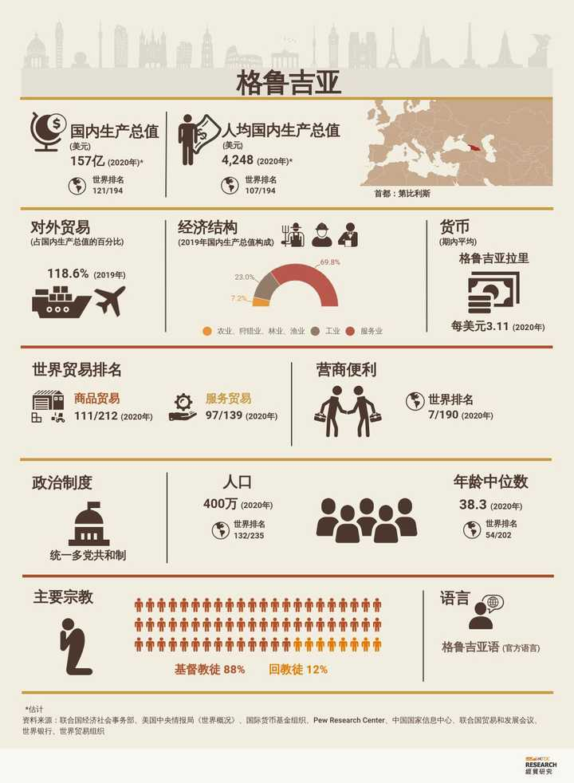
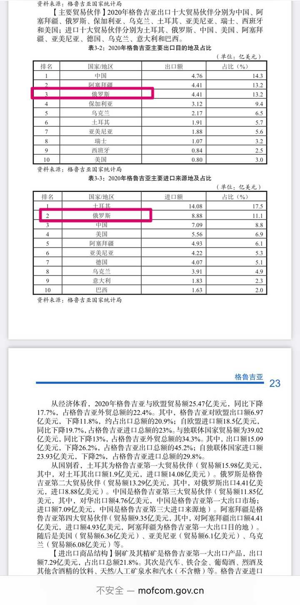
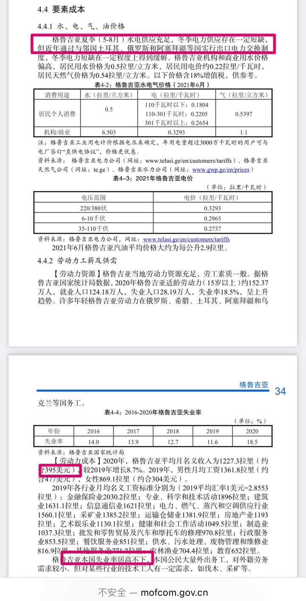

---

## 2860　屋子里的大象

- 日期：2022-04-05　主专题：A12 战争军事外交与大国秩序　副专题：A20;A17
- 源 ID：`a027981a-8c33-5aa5-83dc-a130cf3cb4ea`　原文链接：https://www.zhihu.com/question/516145830/answer/2423594621
- 官方对象—实践路径：与社会 / 与历史 / 解释
- 23 概念标签：事实与证据;能力与学习;边界与许可;照料与家庭;法律与秩序;权力与异议;文明与历史;民族与身份;心理与主体
- 证据状态：manual_confirmed　初读：read　独立复核：not_reviewed

**问**：当前俄罗斯为什么一直被整个欧洲孤立，排挤？

很多观点都在说什么“残暴成性”“扩张野心”之类的话。
这其实是一种地缘政治班级化，大国博弈怄气化的校园心态。
国家实体不是道德天使，也许本国官史会把自己的形象塑造成天使状，但事实上，任何成熟的政治家都至少要过这一关——所有的国家都有扩张野心，所有的国家都有被邻国视为残暴的历史。
说俄罗斯扩张成性？
难道波兰没有？德国没有？还是法国没有？瑞典没有？英国没有？西班牙没有？比利时没有？土耳其没有？
查一查历史，这些国家做过些什么扩张？谁家“扩张”得比俄罗斯少？
俄罗斯有残暴历史？
难道（懒得重复，省略两百字）没有？
北欧人当年拿洗劫英国当春节过，都形成习俗了，还不够残暴？
拿破仑横扫欧洲不知多少国多少遍，攻克某城的新闻都快不值得登头版了，还不够有扩张野心？
奥斯曼帝国雄踞东南数百年，视欧洲人如澡都学不会洗的野人一般，呼来喝去如使仆役，不知蝉联多少届双冠王。
现在一清算俄罗斯，都从彼得大帝、叶卡捷琳娜开始算扩张罪行，这在欧洲怕是前八名都排不到——西班牙、葡萄牙怕是都排在俄罗斯前面。
如果按这个标准就“理应排挤”，你只会得到“你需要离开地球”的结论。
如果这就是“必须排挤”的充分理由，欧盟一开始就不该存在。因为这一堆大爷，谁跟谁祖上都有血海深仇。
所以这根本不是欧洲数百年一贯排斥俄罗斯的根源。
其实原因很朴素——
只要承认俄罗斯的平等地位，接纳俄罗斯进入欧洲大家庭，俄罗斯一定会成为屋子里的大象，所有人都要靠墙站。

这种极端的不平衡，可以从两个历史性的事件得到明确的、毫无异议余地的证明——
俄罗斯从拿破仑手里拯救了欧洲；
俄罗斯从希特勒手里再次拯救了欧洲。
这两次，如果没有俄罗斯做这个历史的转折点，就没有“欧洲列强”存在了。
而这两次都是个什么过程？
step1: 出现了一个超强国家。
step2: 该国秋风扫落叶般地把所有欧洲国家都横扫在地，吓得英国缩在岛上瑟瑟发抖。
step3: 然后它挟其最巅峰的军力、资源和士气，攻入俄罗斯。
step4: 它败在了俄罗斯手里。
而且，这剧本发生了两次。
这两次兵锋指向俄罗斯的时候，俄罗斯都一样“拉胯”，都被那些已经被拿破仑、希特勒踩在脚底下的“列强”认为“国力薄弱、统治混乱，军力落后”。
也不要喊什么“俄罗斯的大纵深”，实际上这两次俄罗斯也并没有退到西伯利亚去打游击。
事实证明，即使俄罗斯处在全欧治理最差、经济最孱弱、军事最落后的垫底状态，欧洲本土最强的国家（甚至算上所有仆从国之和）也无法战胜俄罗斯。
你们思考一下这是一个什么样的沉重的思想负担。
一个什么样的心理挑战。

大象呆在门外，那是门外的大象。
大象进到屋里，就会成为屋里的大象。
这一群小矮人想象不出客厅里有一头大象的日子要怎么过。
这才是欧洲长期排斥俄罗斯的原因。
这也是为什么西方文明没有资格长期盘踞世界王座的原因。

它们太自卑了，没这个器量，明白吗？
因为这个根本的原因，它们明知道融合世界精英才是王道，但是它们谁也无法真正办到，稍有困难和坎坷，“种族主义”——其本质就是愚昧原始的部落习性——就要冒出来。
部落心态一激活，就会导致一切真心诚意投奔它们、试图归化的异族精英成为“耗材”——因为它们归根到底，不敢冒“混有奸细”的险。
这也是“欧盟”搞来搞去都搞不成的原因，因为欧洲人直到现在仍然只是一群搞到了激光枪的野蛮人——它们的底色，仍然是那一群日耳曼、高卢部落。
在根本上，心底里，欧洲没有真正的文明化。
所以ta们无法处理“屋子里的大象”问题。
世界的希望，唯在东亚。

---

## 2856　营级战术群

- 日期：2022-04-06　主专题：A12 战争军事外交与大国秩序　副专题：A10;A13
- 源 ID：`4660735d-ce7d-5a3e-be20-19823dd154df`　原文链接：https://www.zhihu.com/question/519066714/answer/2426127720
- 23 概念标签：能力与学习;成本与总账;边界与许可;劳动与组织;法律与秩序;权力与异议
- 证据状态：manual_confirmed　初读：needs_reread　独立复核：not_reviewed

**问**：俄罗斯那么大为什么打乌克兰那么吃力？

首先，我完全同意这答案里引用的对俄军营战斗群的特点分析。
建议你们在往下看之前先看一看。
俄罗斯那么大为什么打乌克兰那么吃力？但是，我绝不同意这篇东西里对这些“问题”的定性——即将其视为“单纯的缺陷”。
这是一种极其傲慢的定性，如果指挥官抱有这样的心态，势必造成自己的惨败。
因为世界上根本不存在“六边形部队”。
对于俄罗斯这样军事传统、军事理论和大战经验如此深厚的大国，抱有一种“老子训儿子”般居高临下的心态断言俄军的某些短板是一种“设计失误”“显而易见的缺陷”，这近乎笑谈。
俄军的这一改革是根据自身条件、自身面对的战略任务经过深思熟虑的权衡取舍，绝非什么“低级错误”。
仅仅凭着“到中国演习表现不好”来断言“俄军犯错”，是一种基本逻辑错误。
因为俄军从未以解放军或美军为假想敌。
俄军当然不会面向“与中国在中国对抗演习”来构建自己的部队，这是一个从一开始就该料到的基本前提。
无视这个前提，本身就是军事理论水平的基础性错误，得出的结论没有任何意义。
为什么俄军根本不考虑与美军和中国的常规作战需求，乃至于把自己改造成了在美军以及（极其类似美军的）解放军眼里“低效”的架构？
因为“对抗美军/解放军”的场景，对俄罗斯是一个单纯的核武力问题。
俄罗斯没有任何“在常规战中有效对抗美军/解放军”的需求，它为什么要花一丝一毫的力气在这个伪需求上？
难道为了向网友求赞吗？
这篇分析里所指出的所有“短板”，在俄军的战略思想里几乎全部是伪问题，不但不是缺陷，反而恰恰正是俄军的用意所在。
这也恰恰是我乐观估计乌克兰之战俄军赢面很大的主要依据之一。

“营战术群在高威胁环境下需要外围部队翼护”。
——真巧，无论是克里米亚、还是叙利亚、还是顿巴斯，俄军正好都有“有相当能力的当地亲俄民兵”可以补这个位。
你说巧不巧？
“营战斗群火力输出不足”。
——真巧，营战斗群一直在黑海舰队巡航导弹射程范围内作战，从未越雷池一步。
注意，黑海舰队没有参与中俄演习。

“营战斗群持续突击能力不足”。
——看一看俄军这次高速突击的距离，哪支俄军被分配了“持续突击任务”？

“营级战术群难以实施战场救护和伤员后送”。
我敢大胆的说，俄军这次的人员伤亡高度接近俄军自己的通报，的确甚为轻微。
俄军根本没有计划任何攻坚任务，而是一直集中兵力保持高速机动，直扑要地。
这种战术动作，将逼迫措手不及的乌军根本无法调集足够相称的机动兵力抢先拦截。当面零星乌军部队根本不敢挡在数个甚至数十个空地一体突击的战术群正面，那只会变成一朵小浪花瞬间被淹没，而一开始就被绕过的重兵集团自身的机动能力根本没有超过俄军，加上整备部队所必需要的时间，根本无力追赶俄军前锋，更不提它们根本不敢受诱出城与突击中的俄军缠斗——一旦被拖住，只会成为俄空天军、海军和火箭军的牺牲品。
换句话说，俄军在突击阶段根本就不会遭遇乌军的严肃阻击，只会有少量轻装部队——甚至可能是乌民兵，在被绕行的城镇附近尽力骚扰，制造少量麻烦，拖慢俄军速度而已。
而即使这些部队，也戒慎恐惧，害怕被俄军分出的警戒部队咬住，消灭在野外。
在这个阶段，乌军的主体，不是在向基辅狂奔，就是在纷纷就近退缩到最近的城市藏身，而乌东重兵集团最有效的行为只会是进行内线调动，加固工事堡垒、积蓄粮食弹药、建立前线储备和救治中心，准备迎接俄军的围困和攻坚。
除此之外的任何妄动都是徒冒无谓风险。
真正与俄军发生接触最多的，只会是乌克兰的非正规军事力量——也就是那些悍不畏死、但却既缺乏体系支持、也缺少系统训练的志愿民兵。
他们只能创造一点微不足道的YouTube视频素材，根本没有有效杀伤俄军的能力——甚至不客气的说，他们手里的便携武器都是缺少补给因而相对不足的——更不用说还因为缺乏训练而大量浪费。
俄军在第一阶段的突击阶段仅仅会因为快速战略机动而发生意料之中的设备损失，而根本没有合理的战术逻辑去发生什么重大伤亡。
人们只是在基于“俄军肯定撒谎”的不加分析的假设在臆断“俄军大幅虚报损失”而已。
必须指出——在突击阶段，乌军全部的军事设施都在遭受密集的、猛烈的轰炸。
这绝不是仅仅在攻击防空导弹和雷达，而且一定包含了大量俄军在战前通过人力情报、苏联军事遗产规划、卫星侦察和前线侦查所确认的指挥所、营房、库房、训练营地、弹药库和战车集群。
注意，俄军在动手之前用卫星看了几个月、而乌军的军事设施高度依赖俄罗斯了如指掌的苏联遗产。乌克兰是一个一览无余的、和游戏地图一样单纯的战场、每一座桥、每一条铁路、公路都标在谷歌地图上，可想而知这开场的几轮导弹攻击令多少乌军单位的指挥、情报、通讯机构陷入了混乱。
恐怕在那几天有很大一部分乌军还花了几天才搞清楚自己的指挥官是活着还是埋在瓦砾堆里、自己的友军是失联了还是被歼灭了。
他们甚至凭借自己都无力确认俄军到底在哪里、在往何处去。怎么拦截？怎么阻击？
总参谋部和国防部的大人们还在忙着搬家——那些办公地点完全无法信任安全。
连北约都无法联系到他们。
“往城镇收缩固守”和“向基辅靠拢”这些动作，恐怕有不少根本是出自前线幸存主官的个人判断。
在这条件下，说乌军对俄军造成了什么重大杀伤，那实在是天降神兵的军事奇迹。
作为一种证据，不妨检查一下俄军的进军轨迹——普遍是从出发阵地指向目标阵地的、在“不攻坚”原则下的最短直线。
乌军甚至没能使哪几根直线弯上一弯，也没能妨碍不惜抛弃装备的俄军前锋的准时到位，谈何“大量杀伤”？
唯一可说的那些“击落直升机”“拖走俄军损坏坦克”的“战果”，恕我直言，恐怕就是乌军在那一阶段所获得的全部“战果”了，根本就没有多少“虽然达成但未录像”的战果可言。
所以营战术群根本也没有多少必要去搞什么“战场后送”。
如果说俄军在这阶段有什么显然的失误，大概只有部分部队因为进展过于顺利、安全感过强、竟然敢留下零星人员看守损坏装备导致了无谓的人员损失。
另外还有过于自信，一些轻装前出侦查部队贪图进度直接穿越居民点，导致受到道边居民区里潜伏民兵的袭击。
但恰恰是这种“低级错误”，才更进一步印证了俄军在第一周行动的高度成功。

“营战术群炮兵火力配比过强，不利巷战，只利围困和火力支援”。
巧得很，他们的确只做了“围困和火力支援”，确实没有搞什么“完全不适用”的巷战。
它们的作用，是依托前出步兵工事的外围保护，以坦克部队、装甲运兵车为机动力量，以远程榴弹炮兵为火力支撑，以铠甲、山毛榉以及友邻部队共用的S400战区防空系统担当防空, 牢牢的钉在要地附近的开阔地区，控制宽达80公里的正面，牢牢“看管”对面城镇里的乌军，保护身后的补给线和已占领的居民点。
这种部署纯属结硬寨打呆仗，乌军偷袭小分队要突袭这样的防御体系，首先必定与前出的步兵哨接触——这时俄军的坦克、自行火炮等装备还根本没有出现在乌军视野里。而一旦双方步枪交火，乌军撤退不及时，就会被远程炮火覆盖——这些阵地一定会选择在乌军接触点并不在居民区保护的距离之外。乌军要么就距离过远、毫无命中概率，要么就要靠前逼近到能有效杀伤但却脱离居民区保护的区域，暴露在炮火下。
而如果乌军想要调集自己的远程火炮来反击，首先只能先攻击这些步兵工事。那只会被反炮兵雷达发现招来空袭。
乌军在相持阶段可以有效获得战果的两个主要手段，一是用躲在居民区的零星远程炮火在俄战术群的全部射程外攻击俄军阵地前沿，引诱俄空军反击，而依赖高楼上埋伏的肩射导弹伺机偷袭。
这也的确取得了一些战果。
但这种做法的结果不难预料——
超低飞行突击的攻击机其实是很难用肩扛导弹锁定的——因为近距离接触在视野中角速度极大，极短时间就会飞出瞄准视野。而飞行员一定会利用楼群本身的掩护，绕到不容易被预料的角度进场——例如从乌军身后方向进场——而最大限度的造成对射手的突然性引诱射手仓促出手。而乌军射手一旦发射失误，就会自我暴露，几乎必定招致惨烈报复——整栋建筑被击毁导致伤亡。射手如果被拔除，作为诱饵的火炮也会殉葬。
一次交手，要么乌军赢，俄军损失（或受损）一架su-25甚至34，要么就是伏击小组死亡并损失至少一门榴弹炮。
因为肩扛导弹的天生缺陷，这胜率严重的偏向俄空军。
注意，这是由乌军主动在自己的预设阵地发起邀战。请相信，以这些战果代价之高、之珍贵，没有任何一次豪赌不会被提前安排大量手机无死角观测。
你们看到了多少次击落视频，乌军的击落总数一定高度接近。并没有多少“未被记录的击落”。
乌军就是在拿命换宣传素材，怎么可能错过任何一次？
第二类战果，就是利用本地人优势便装或小股渗透到俄军补给线两侧夹道而设的居民区里，寻机偷袭防卫薄弱的俄补给车队或者侦查分队——偶尔的，以命换命换俄军的运兵车。
但这些战术几乎没有可持续性——因为渗透需要，这类部队只能隐秘携带很少的弹药，甚至还要化整为零分次带入。而偷袭之后必定遭遇搜索，幸存度很低。
尤其是——这些城镇里很难说有没有亲俄居民举报，一样是脑袋别在裤裆里搏命。
这也是为什么这类伏击往往只有事后居民凑上去拍的袭击残骸，而很少有现场实况的原因。
但这类极其麻烦而代价高昂、火力薄弱的特种突袭，根本没有能力造成多少成规模的杀伤。
恐怕倒有一半是拿自己的装备和俄军抛弃装备布景做的“视频战果”。
事实上你也的确可以看到大量的这类拙劣的伪造战果——甚至直接拿T64装作T72来拍。
注意——俄军装备如果真被击毁，俄军是没能力拉走、也没能力布防禁止拍摄的（都抛弃在伏击地段，哪来这么多闲置兵力做这种事？）
很难想象会有多少俄军战损装备能一直逃过乌军/亲乌平民的镜头。
甚至，还会有不少被反复从不同角度、用不同布景“回收利用”。
换句话来说，除了某些早期意外遭遇战之外，在第一阶段的相持阶段，乌军能拿出来的全部视频战果，再打个折，已经高度接近乌军的全部战果。
这一数字，极大的接近俄军自己的通报。
俄军在这一次的作战中，在舆论战上的总体策略，就是打算依靠一贯的“有报必信”来撑过信息战的早期阶段，逐渐靠着事实的逐渐显明而从乌军认知战部队手里逐渐夺走认知战最大的核心战略资产——可信度。
恐怕就是为了这个原因，俄军通报才刻意极简化，以免造成过宽的舆论正面，给对手留下过多伪造、混淆的切入点。
随着进入第二阶段，城市陷落、成建制歼灭/投降、高价值目标人物的击毙、被俘这类无法掩盖、矫饰的战果释放出来，俄军战报的信用会不断显明，而乌军战报的荒谬性会不断的变得无法否认。
那时，乌军的认知战会彻底破产——不但招致嘲笑，更会招致一直对他们满怀信心的欧美民众的加倍厌恶和唾弃。
而乌军在全线告急、惊慌失措的阶段已经被绝望驱使仓促的抛出了极多的破绽。
作为一个典型——他们甚至已经无法再继续堆积俄军的伤亡数和装备损失数了，因为如果再继续堆积，将在后期成为极大的的荒谬性破口。
对应的，他们根本无法给出一个自己在心理上可以接受、而又在事实上不荒谬的伤亡报告。
很多早期仓促撒出的谎，已经成了继续编剧的重大负资产，犬牙交互，不容立锥了。
甚至，随着俄军战线的动态适应、自我调整，连可用的新鲜素材也已经渐渐枯竭了。
乌军已经进入了“抱头挨打，无隙可乘”的极端被动状态，只能靠泽连斯基的抠像部队和演讲戏码来敷衍垃圾时间了。
而这时乌军头上的巡航导弹、巡飞弹（不错，俄军也有自产的弹簧刀）甚至匕首飞弹的持续攻击。
如果一支部队身边有一个无法拔除的敌军狙击手，今天杀一，明天收二会对该部队士气造成极大打击的话，那么现在的乌军是全军全境沉浸在战区级狙击之下。
头顶不知在何处但无法相信不存在的无人机、卫星，和身边虽然不想深思但不能不强迫性想象的“伪装成平民的潜伏亲俄密探”所造成的“不知有没有明天”的绝望，
以及离战友太近害怕成为值得空袭的目标，而离战友太远又怕被顿巴斯民兵和车臣兵围杀的刻骨纠结，
以常人而言，这势必造成乌军士兵极大的心理负担。
直白点讲，不靠强效镇静剂和兴奋剂，乌军士兵根本无法正常作息。
这意思是——乌军现在无可选择，必须靠成建制的、大面积的吸毒来维持基本的战斗力。
这会进一步的导致军纪涣散、指挥失灵、丧失战斗技能。

https://taskandpurpose.com/news/ukraine-russia-war-army-veteran-volunteer/?amp

乌军早就有大量的吸毒现象，这没有什么很稀奇的。注意这是战前的报道。
乌克兰军队如何堕落？乌逃兵揭示其现状，对比俄军待遇远超乌克兰
乌军俘虏身上搜出毒品这也是为什么乌军这个阶段大量爆发丧心病狂、屡禁不止的虐杀俘虏、滥杀平民，而且还丧失理智的上传发布的原因。
这种极端伤害乌军认知战效能的重大事故一而再、再而三地发生，已经鲜明地表现出了乌军的实底——除了部分开始就托庇于利沃夫、基辅，没有经历高烈度战斗的乌军部队以外，其他的前线乌军部队在精神上已经到了崩溃边缘，不经相当长的休整安抚，根本无力执行任何复杂的战术任务。
命令他们全军向前向俄军阵线靠拢，他们可能在极轻微的袭扰下溃散。
不客气地讲——扛着刺针飞弹、冒着攻击机的炮火搜索目标和维持锁定，对现在这些疯笑着斩首的乌军士兵来说，可能已经是超出大脑处理能力和心理承受能力的复杂操作了。
吸毒都睡不着的人，离油尽灯枯已经只在呼吸之间了。
但谁又能换他们的防呢？
所谓的“预备役兵员”吗？
而另一方面，他们这些药物和疲劳诱发的妄想偏执狂状态，以及无法抑制的“一定是有人在发送我们的坐标所以我们被轰炸”的疑心病，会导致他们对平民成规模的施暴冲动。
不知多少乌克兰平民成了这些毒虫的牺牲品。
如果这些毒虫后来保住了政权，这些被毫无根据的枉杀的“乌奸”还要被永远的钉在耻辱柱上，成为这支“国防军”的“战果”。
他们的财产将被剥夺、子女将被迫害、亲族将受唾弃，仅仅只因为手持俄军发放的口粮、臂套标志非军事人员的白绸，甚至，仅仅因为身处无人的敌占区而“竟然没有死”。
人间至恶，一死之外，尚有更甚于一死者。
这才是真正的人间地狱，
你们看得见吗？
布查的这场所谓的“大屠杀”，也许永远不会有“确切的真相”。
但你们只看一件事，就会知道那必将被西方集团开动一切宣传机器掩盖的真相到底是什么——
看后面俄军如果再撤退，乌克兰平民是不是宁可追随俄军撤走，只留下无人区给乌军接收；看以后俄军和乌军的交界处，会不会有乌军一侧居民向俄军一侧逃亡。
这一现象的有无，胜过所谓的“欧盟调查团”一万倍。
什么“卫国战争”？
肮脏可笑至极！

不离题太远，回到“营级战术群”这个主题上来。
为什么俄军指挥系统如此“原始”，根本不像美军那样，将官坐在亚利桑那电战基地，吹着空调，看着高清画面，打战棋游戏？
因为脚下的泥泞、鼻子里的硝烟腐臭、战区平民的表情、远处炮火的轰鸣、士兵头上的汗水和踩烂的香烟，是“高清大屏”无法传输的信息，而在这种高度政治性、高度复杂、高速转换的攻防战中，对战场决策有深刻的、重大的影响。
不是只影响到一个坦克连或者一个炮兵阵地，而是会影响到附近数个营级单位的整体部署。
这种事实上的“师级部署”，无法由四百公里外坐在会议室里的参谋擅自做主——俄军并没有大量冗余的兵力供总部参谋们试错。
所以必须让一个少将以上的师级、集团军级军官在听得见炮声、看得见敌阵的地方临机决断！
全军为上，全将为下，宁可接受高级军官的损失而尽最大可能保证部队的安全和有效。
更不提这种指挥官亲冒矢石、舍生忘死的掌握部队的作风，能近乎绝对的保证部队的前线士气和战斗意志。
这种士气和意志，是俄军深入敌境执行这种“在龙潭虎穴里投鼠忌器，直面全世界敌人的总和”的地狱级任务的根本保障。
这根本不可能用“四百公里外的空调参谋”来替代。
这不是bug，这是feature。
是红军的军魂。

至于为什么改成这种“利守不利攻，宜静不宜动”的拉胯营级单位，其实目的已经昭然若揭——这种单位首先是为了能依靠铁路运力实现成建制的战略机动，以利用俄罗斯广袤的边界迅速甩开已经被攻击调动陷入被动部署的敌人。
虽然你在内线，但我铁路运输，两次换线两个昼夜就可以出现在数千公里外的另一边界上批亢捣虚再入黄龙，甚至比你内线公路机动追赶更快（铁路已被我炸成虚线）——更不提这将极大的消耗你的摩托小时数，以及让你在长途奔袭中一路损失大量装备，甚至把你的部队编制拉长到断裂，必须另外远远的寻找集结地慢慢收拢。这与“这个部队被暂时消灭”没有区别。
如果我是师级单位，那么不知要多用多少个车次才能把师属单位凑齐，不凑齐我近乎残废壮汉，不是瘸腿就是瞎眼，根本无法进入战场。
而营级战斗群却可以以一个“最小可用单位”的形式立刻投入作战。
而为了迁就这“最小可用单位”的生存力，这种编制的整个作战目的，几乎可以化为一句话——成为一颗拔不动的钉子。
一旦到位，就全速作业布置防御阵地，牢牢的卡死自己周边的的八十公里区域的控制权。
在这八十公里直径的场域里，除非直接核弹扔到炮兵阵地头顶上，否则世界上没有任何常规陆军能在海军、空天军、火箭军的支援火力倾泻下来之前拔得掉你。
其它的一切，都不需要你管，你只管拔桩、移动，下桩，扼守。
这一作战架构、从未打算过用于空天军、火箭军、海军覆盖不到而没有空优的任何战场。
它攻起颟顸、跑起来拖沓（战略机动除外），但它一旦在开阔地生根，在其他军种的保护之下几乎无法拔除。
靠着它的土工阵地、坦克阵地和火炮阵地，以火炮为中心的40-30公里的环带，对于没有空优的对手来说就是不可逾越的10公里。
无论来多少，都会被击杀在这个无遮挡的环带里。一条人命换两斤铁，永不枯竭——而战术营自己还不是火力输出的主力，它只是靠着叠加火力把对手迟滞在杀伤阵地，然后呼叫空军和导弹来完成主要杀伤，然后看情况派出坦克做短距追击。
它的任务就是坐着不动，顶个二十分钟到半小时，附近一定有导弹或者飞机赶来。
它既不耗油料、也不浪费火力、也不承受什么巨大伤亡。
甚至只有地面进攻手段的敌军根本无法看到射程内有什么可见目标，都不知道要打什么。而就算敌军挤出了少量战机和战术导弹，随营的防空系统也可以稍微应付两轮，等待空军救援。
战术营的作用，其实是专守防御。依靠超强的战略机动能力（所以不是旅级）反复的机动到敌军的薄弱环节和战略要害卡住咽喉。让对手吞不下、吐不出，而且伤口越来越大——友军会不断进入营级战斗群圈出的“绿区”，对被隔离在战场外线的绝望的敌军细嚼慢咽。
而挡在两部敌军之间的战术营如同钢铸的城墙，无论墙内墙外如何合力拍击，都会屹立不摇。
恕我直言，这是一个专门基于“周边有事”设想，基于俄罗斯的国力、家底、技术能力和资源条件而精心设想的、近乎于完美适配的作战体制。
它的追求核心，就是追求在保证压倒性空优、远程火力支援可及和当地友军可得（前苏联国家必定有大量俄族或俄语人群）的前提下，以低至极点的燃料、弹药、人员消耗和极大的战略机动性，闪电般地建立靠近己方边界的坚固阵地，获取难以逆转的战役优势。
能打垮它这战术的部队，它举起核盾牌绝对拒止在外，或者直接结成背靠背的准盟友关系，压根没有冲突风险——有核盾牌和1900万平方公里的战略纵深在手，它也不怕遭到背叛而被一击致命。
而排除了这两个敌人，在前苏联成员国范围内，只要你还没加入北约，你将永远也没有机会再幻想加入了。
因为这个战术对这样的战场条件是无敌的。
隔着核盾牌、不敢进入俄罗斯本土和直接对俄罗斯发动攻击，只搞间接支援，即使是穷尽全球敌人的合力，也不可能挽救任何一个俄罗斯的邻国。
仅以数百万常备军的中、朝例外。
它拿乌克兰开刀，就是因为这是前苏联国家里最难打的头羊。
这头头羊在倾尽西方集团的支援下仍然被斩首示众，将会根绝亚美尼亚、阿塞拜疆、格鲁吉亚，摩尔多瓦、哈萨克斯坦、塔吉克斯坦、吉尔吉斯斯坦、土库曼斯坦、乃至叙利亚的任何倒向西方甚至保留反俄意识形态的妄念。
一战而中亚安，海清河晏，一带一路的陆上通道和将来的北极航道将会极大的落入俄罗斯手中。坐收过路费——假设欧盟没有破产崩溃的话——它其实可以坐地陈行，恰如当年垄断丝路的阿拉伯帝国故事。
而对于这一点，中国也许未必全然满意，但也未尝不可接受——只要俄罗斯不要进入西亚和阿富汗一线，不要再去勾搭越南做蠢事，亚洲够大，也不是不能容下两个大国。
而中亚国家为了最后的安全感，势必也要大幅靠拢中国，以求平衡俄罗斯的压力。
但这就属于兄弟登山，各自努力的事了——至少，俄罗斯的安全顾虑，一战而空了。
北约在这次战略突袭之下，恐怕已经开始了自己的结束。
它没有能力逆转俄罗斯卧薪尝胆八年打造的“拉胯战术”。
除非它有胆顶着核弹孤注一掷。
但那只意味着走向“核终战结局”，只是把属于俄罗斯的军事胜利，变成了送给中国的史诗般的政治胜利。
对北约来说，让中国赢还不如让俄国赢。
至于泽林斯基之流，只不过是轻如鸿毛的无关事项罢了。

被乌克兰的惨状吓得肝胆俱裂的台湾网军们，奉劝你们一句，这不是你们该掺合的游戏。你们认知战打得太投入，会让自己陷入性命相托的强迫性幻觉之中。
说句实话，我们是完全可以接受所谓俄罗斯战败的。

中国之强，已经强到了无视规则的地步。
我们可以高席安坐，
等到庄家开了宝，
再下赌注。
庄家一样只能照认，
一样照赔。
不认不赔，无论坐庄的是谁，这庄都坐到头了。

而我们会要庄家赔的这注码，
不会是什么“人民币国际化”或者“中欧协定”——此等杂物，我们可径自取之。

我们要庄家赔的，
恐怕就是你们。

无论俄罗斯是输是赢。

建议你们提前做好心理准备，
砍断把自己绑在这幻想的幽灵船上的缆绳。

以前它们可以帮你“乘风破浪”，
很快，它们将拖着你与船同沉。

这说的不是什么斧钺相加的血光之灾，根本不是。
这说的是你们在一片绝对胜利信心的高潮时，从三万英尺的高空一脚踏空跌入深不见底的现实的地狱时那深及灵魂的、穷尽余生也难消解弥合的认知裂痕。
那你们无数人宁可疯狂也无法认下的乾坤颠倒的大错。
现在就开始真正认真的开始脚踏实地的、面向冰冷事实的检阅你们自己的认知。
开始设想你们不敢设想的、触摸你们不敢触摸的，看你们不敢看的、听你们不敢听的。
可能还来得及。
很多问题，都已经回答过了，先看完这个找不到再说：
百年未有之变局

<!-- 图片：1 张，审读结论见下 -->
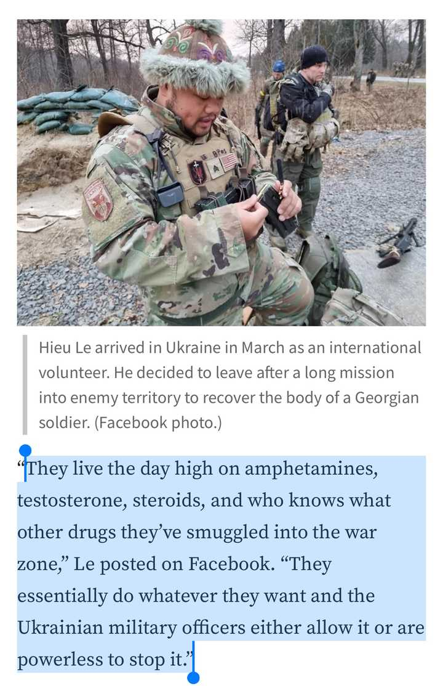
*图 1（已视觉复核）：新闻截图与 Facebook 引文：驻乌外国志愿者称作战人员服用安非他命、睾酮与类固醇（英文原文高亮）。*

---

## 2854　十个军团

- 日期：2022-04-09　主专题：A12 战争军事外交与大国秩序　副专题：A07;A20
- 源 ID：`f9514baa-aba2-598e-92f5-2204a5cbda4d`　原文链接：https://www.zhihu.com/question/526091147/answer/2431057676
- 官方对象—实践路径：与社会 / 与组织 / 参与
- 23 概念标签：能力与学习;责任与后果;成本与总账;爱与回应;劳动与组织;财富与市场;法律与秩序;技术与工程
- 证据状态：manual_confirmed　初读：read　独立复核：not_reviewed

**问**：如何看待华为再次成立十个军团?

这不是“华为的十个军团”，这是新基建的十个军团。
顺着这十大业务的方向倒捋，你很可能会发现一些“不起眼”的国家政策和一系列新闻几乎不报道、但对所在国属于历史性工程的重大“一带一路”项目，以及国内一些即将开始的城市试点项目。
这其实是华为受到国家认可、获得了在中国经济秩序中的战略地位的一种内部回应。
不是任正非要拿ta们搞内部创业，而是国家要尽最大可能的发挥华为研发体制和人力资源进行战略攻坚。
仔细看看，你会发现十大业务的方向都是to G业务，签约方几乎肯定是政府——不是国内某市政府，就是某非洲、拉美、中欧国家政府。
这类项目一旦签下来，基本生命周期就长达一二十年，二期、三期、四期扩建工程，外加一轮轮的系统升级，不知道人可以吃多久。
可以吃几代人，吃出技术传承和长期的路径优势。
这样的项目遍布十个领域，每个领域哪怕有那么一个两个项目，都可以稳住大量的人员队伍——更不用说可以为华为人提供极其广阔的职业发展空间。
这个模式会为华为的所有经营风险保底，以及为华为的所有“类5G项目”融资。
前途不可限量。

---

## 2849　一点点

- 日期：2022-04-16　主专题：A12 战争军事外交与大国秩序　副专题：A17;A16
- 源 ID：`01954ef3-808e-5132-8519-b4f416d90284`　原文链接：https://www.zhihu.com/question/528324303/answer/2442897995
- 23 概念标签：事实与证据;选择与自由;法律与秩序;权力与异议;文明与历史
- 证据状态：manual_confirmed　初读：read　独立复核：not_reviewed

**问**：塞尔维亚首都爆发抗议活动，现场高呼「塞尔维亚人和俄罗斯人——永远的兄弟」，原因是什么？具体情况如何？

你们有没有想过，如果美国发生颜色革命，会是什么形式？
是“美国某个受压迫的团体在域外大国的资助下走上街头抗议，然后引发大规模的民众参与，然后美国总统带着亲信仓皇出逃”吗？
并不是。
作为全球统治者，这事会整个的抬升一个等级。
是一些弱不经风的国家开始举行反美游行。
然后过一段时间，又有一些微不足道的国家举行反美游行。
这样的国家如果不够多，反美游行的周期也不够密，持续时间也不够长，那么概率所限，它们就只会此起彼伏。
于是逐个熄灭。
但如果足够多、足够密、足够长呢？
此起彼伏之下，渐渐出现“日子撞到一起”的，
出现因为经久不衰而“日程彼此交叠”的。
一而二，二而三。
如果有三个国家——即使很小——在同时处在明确的反美示威状态，
而且是在一个核大国正在热战、一个经济和工业大国正在贸易战、一个人口大国正在舆论战、一个伊斯兰大国正在冷战的条件下呢？

三会不会变四？变五？

星星之火，可以燎原。
五大洲遍地竖起反旗，世界之王无法单独的制裁和攻击任何一个。
这才是美国级的颜色革命。

多一点、密一点、久一点，
可能只差那么一点点。
BTW：
There is something called
从龙之功。
Google it.

Or baidu it.

---

## 2846　侵略者

- 日期：2022-04-17　主专题：A12 战争军事外交与大国秩序　副专题：A20;A03
- 源 ID：`a3789420-2208-5538-8511-460e4a95ab7b`　原文链接：https://www.zhihu.com/question/520876214/answer/2444406017
- 官方对象—实践路径：与社会 / 与历史 / 评价
- 23 概念标签：事实与证据;法律与秩序;权力与异议;文明与历史
- 证据状态：manual_confirmed　初读：needs_reread　独立复核：not_reviewed

**问**：俄罗斯如今算不算侵略者？

历史的真相是，越过国境发动战争的国家到底是不是“侵略者”，不是看战争前、战争中被越境方的定性的，而是看战争之后ta们再怎么说。

历史上屡屡出现这样的情况——打完之后，当地人民的新代表紧紧握住远征军的双手，热泪盈眶——“这一天我们等得太久了！”
什么入侵者？明明是解民于倒悬、存亡续绝的王师。你看前阿富汗政府倒台之前对驻阿美军是什么调门？又或者伊拉克战争后早期伊拉克政府对美国是什么定性？
就是历数东亚历史，你会发现大量“幸存王子赴京请命，天兵助其复国继统”的例子。那些古代史，正如今天俄罗斯之于顿卢事。
看看这一段：

加州和乌东的本质区别是什么？有人在发送制裁勒令美国撤离加州吗？你看到大加州的人民怀念故国，每逢佳节都默默催泪泣血，势要驱逐美虏、恢复我大西衣冠正统了吗？
甚至，我们可以比较坦率的讲——现有所有的大国，都是这样一场一场“侵略战争”打出来的。它们目前的国土，一般至少有50%是“侵略”所得。如果你倒推得够久，那么90%，甚至95%都不稀奇。
美国则毫无疑问是全球之冠，干脆是纯到超过24K，侵光闪闪。只有其它五眼国家可以与它媲美——全是侵略印第安、墨西哥的结果。
那么，问题来了，如果“军队进入国境线/土著领地”全是绝对不正义的，那么现在的世界图景按照这个价值观就是一个没有任何正义可言的结果。得要一些太平洋原始部落来担任国际秩序理事会主席才行。
而这个理事会的第一道决议，就是现有国家全体解散，按村级行政单位恢复光荣独立。全村都是内阁成员，正部级起步。
某些越境攻击者最终被记录为侵略者，其实是因为原住民赢了，而且赢到了现在。这才是历史的客观逻辑。

顺便再多说一句：“侵略者最终必然失败”这句话之所以成立，是因为它有个前提——这是中文。这是“侵略中国者最终必然失败”的隐形前提省去版。这句话是没有古埃及语版、没有古希腊语版、没有古巴比伦语版的。

<!-- 图片：2 张，审读结论见下 -->
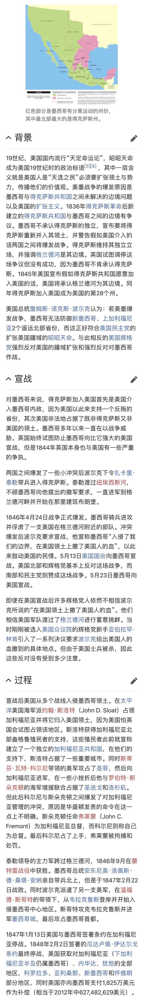

---

## 2835　锄奸

- 日期：2022-04-26　主专题：A12 战争军事外交与大国秩序　副专题：A07;A18
- 源 ID：`9e4c5970-900d-5365-bc77-976df56cef35`　原文链接：https://www.zhihu.com/question/530013146/answer/2458202050
- 官方对象—实践路径：与社会 / 与组织 / 参与
- 23 概念标签：选择与自由;责任与后果;权力与异议
- 证据状态：manual_confirmed　初读：needs_reread　独立复核：not_reviewed

**问**：如何看待卢甘斯克人民共和国沦陷区一女子希望俄罗斯尽快获胜后，被乌克兰侵略军发现，并责令其录下道歉视频？

乌克兰人并不见得认为俄军是来侵略ta们的。
俄军针对的不是乌克兰人，而是纳粹化的乌军和烂到根的篡位上台的乌克兰政府。
乌克兰人——尤其是乌中、乌东的乌克兰人并不都是傻瓜。
俄罗斯人恐怕比泽连斯基跟自己更亲。
拿着人民的税金供养，却故意躲在人民身后、牺牲人民保存自己的军队，杀自己的老百姓超过侵略者的军队，失去了宣扬自己的正义性的资格。
如果一支军队这样干了，那么老百姓有这样的想法就不能视为一种叛国罪。
因为是这支军队先背叛了自己的人民。
在拿乌军和八路军、新四军比，拿乌克兰政府和抗战政府比之前，先思考一下这个问题——
在中国抗战的时候，
是老百姓挡在军队和日寇之间，
还是军队挡在老百姓和日寇之间？

你是后者，你才有资格谈“锄奸”。
你是前者，
奸就是你。

<!-- 图片：1 张，审读结论见下 -->
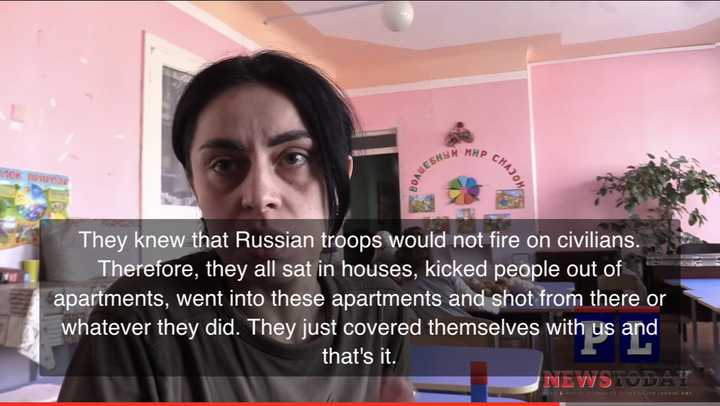

---

## 2833　抵抗通胀的王牌

- 日期：2022-04-28　主专题：A12 战争军事外交与大国秩序　副专题：A01;A07
- 源 ID：`8cbfa0fd-2eb5-551e-89ff-c6a18d222905`　原文链接：https://www.zhihu.com/question/20572630/answer/2460816613
- 官方对象—实践路径：与友人 / 与同志 / 同行
- 23 概念标签：定义与达意;能力与学习;责任与后果;成本与总账;信用与信任;劳动与组织;生态与自然
- 证据状态：manual_confirmed　初读：read　独立复核：not_reviewed

**问**：在中国，最能抵抗通货膨胀的是什么？

不止在中国，在全世界也一样，
从古到今都一样，
最能抵抗一切风险的最核心要素，
都是
愿意自己受委屈来让你好起来的人。

这绝不是诗意的抒情，而是赤裸裸、冷冰冰的现实。
得人——这里是指得到正确的人——永远比得钱重要。
事情来了，正确的情报、有效的团队合作、可靠的生产率和行动力，要比黄金、美元，甚至粮食储备有意义得多。
你随时需要考虑“如果明天就会天下大乱，我能拉起/加入一支什么样的队伍，这个队伍里都会有谁”。
比如——要是明天突然天下大乱（比如爆发僵尸危机），需要组成求生小分队，那么有哪些人会愿意背上背包去约定地点和你碰头？有哪些人会值得你冒险寻找，或者在指定地点等待？
这群人才是你真正的本钱。

---

## 2812　北约东扩

- 日期：2022-05-09　主专题：A12 战争军事外交与大国秩序　副专题：A20;A03
- 源 ID：`97b9a750-f79c-5620-90bf-f7d9566c7a22`　原文链接：https://www.zhihu.com/question/513248958/answer/2476654511
- 官方对象—实践路径：与社会 / 与组织 / 参与
- 23 概念标签：选择与自由;成本与总账;劳动与组织;法律与秩序;文明与历史
- 证据状态：manual_confirmed　初读：read　独立复核：not_reviewed

**问**：北约东扩的原因是什么?

苏联崩溃了，原西欧南欧盟友对俄罗斯的态度实际上软化了，大有把美国请出欧洲的意思。
不拉进足够的东欧国家，北约内部开起会来都不知道要说什么。
“下面我们来讨论一下俄罗斯进攻德国/希腊的加强防御方案”——这会开得下去吗？是不是在浪费时间和金钱？
如果不纳入东欧国家，北约根本和俄罗斯不接壤，何止不接壤，平均都隔着两个以上的国家。
这种组织，存在的价值何在？
所以，不是北约要东扩，而是北约不东扩自己就要解散了。
靠北约吃饭的军工集团和官僚少说也有几十万人，如果再算上部队、算上吃基地饭的周边企业，少说还要再加上一两百万人。
要么东扩业务延续甚至扩大，要么全体再就业。
他们会怎么选？
古往今来，似乎还没有上百万的群体在“要么翻倍，要么失业”之间出于崇高的理由主动选择过后者。
你甚至可以说对ta们根本就不存在什么选择。
果断选A，除非A不让选。
问题来了，这两百多万人里面光是议员、将军、总裁怕不就有几千人，手里掌握着一年几千亿美元的资金，握着大量的选举人票。
ta们要选A，需要多大的成本来让ta们选不成？
谁有能力、有意愿来支付这个成本？

所以，北约东扩其实是一个如同小车从坡上滚下的自然现象，背后其实没有什么真实的理性因素。
本质上和发了一次洪水、发了一场瘟疫没有本质的区别。
它只是看上去好像是一个人为决策的过程，实际上那些“决策”只不过是雪崩时被裹挟出的人类反应。“合理性”主要是找补出来的。
没人能阻止这样一个既成局面的历史惯性，如此而已。
没有什么伟大的历史谋划、也没有什么深远的战略布局。
其实在战略上人人都知道这事愚不可及——甚至连美国都未必不知道这一点，6200枚核弹已经决定了故事的结局，这连初中以上的数学知识都用不着。
但是却没有任何一个人、任何一种势力有能力去阻止。
票选制国家本质上没有战略能力，也没有真正的历史感。
它们在本质上只是强大的海星，哪只触手闻到的腥味重，就会拖着其它的触手往哪边爬，真有什么问题，就丢掉某一只脚脱身。
“激烈的辩论”只是这一过程实现的仪式，而不是主导结果的什么决策机制。
这就是它们的全部智慧的实际总和。

---

## 2802　中间人

- 日期：2022-05-15　主专题：A12 战争军事外交与大国秩序　副专题：A03
- 源 ID：`8f54cceb-1271-5caf-ad10-3dad984dd25f`　原文链接：https://www.zhihu.com/question/532816255/answer/2486088737
- 官方对象—实践路径：与合作者 / 与服务者 / 协商
- 23 概念标签：事实与证据;定义与达意;选择与自由;责任与后果;爱与回应;财富与市场
- 证据状态：manual_confirmed　初读：read　独立复核：not_reviewed

**问**：如何评价泽连斯基和乌媒曝马克龙建议乌克兰割地求和，让普京挽回点面子？

这事真正的细节，恐怕不在于法国建议泽连斯基投降，而在于泽连斯基居然公布出来，在于他为什么现在公布出来。
因为从法国的立场，恐怕从第一天就提过这个建议了。一轮轮的给普京打电话，主要内容估计也不过是不断的从普京那里要deal往泽连斯基那边传。这对泽连斯基根本就不会是一个新闻，要公开早就可以公开了，为什么要现在公开？

所谓的“斡旋”，实际上是一个三赢的结构。
它本身就是不断的提出斡旋者自己能接受、对立双方中至少有一方明确表态能接受，而另一方有可能接受的合约版本。
每一个版本提出来，表面上是一对一，但实际上总是二对一——中间人对每一个自己乐于传递的版本都已经认可。
这就是为什么一但出现战争，就总会有人热心的要做中间人的原因——这并不是简单的出于爱好和平，而且是出于“看到了一个推动矛盾向对自身有利的方向发展的机会”。
而这就意味着一个问题——被二对一的一方，默认会接受中间人利益的正当性，这差不多是一种基本的默契。
你可以驳对手的面子，但是因为这个方案上其实盖着一个中间人的隐形印章，所以你要拒绝也要体面的、隐蔽的拒绝，而不能公开的讲“这没有意义”。
隐蔽的拒绝，买卖不成仁义在。
公开拒绝，那就不是买卖成不成的问题了，而是有恃无恐 / 有某种无奈，以至于不怕 / 顾不得——仁义不在了。
是前者还是后者，你猜猜。

---

## 2804　组织行为

- 日期：2022-05-15　主专题：A12 战争军事外交与大国秩序　副专题：A03
- 源 ID：`c246a2d0-edd9-5cb9-b9cc-55fb041ac501`　原文链接：https://www.zhihu.com/question/532554803/answer/2485813989
- 官方对象—实践路径：与社会 / 与组织 / 参与
- 23 概念标签：事实与证据;选择与自由;责任与后果;边界与许可;劳动与组织
- 证据状态：manual_confirmed　初读：read　独立复核：not_reviewed

**问**：新监控录像显示俄罗斯军队向乌克兰平民开枪，这段录像的真实性如何？

有这么一个问题，需要先分清楚。
就是组织行为和个人行为要分开。
组织行为需要有命令、有组织、有系统。
个人行为则没有命令、没有组织、没有系统。
这件事情发生与否、是否真实，这个另说。
问题是它是否可能是一种组织行为？
是否是出自总参谋部的计划、出自交战守则的指导、出自组织的系统安排？
如果没有这方面的依据，这些零星行为有或者没有，都没有组织意义。
没有组织意义，执着这些细节就属于小孩子过家家，浪费时间。

---

## 2798　run

- 日期：2022-05-16　主专题：A12 战争军事外交与大国秩序　副专题：A01
- 源 ID：`df05dfc5-5321-5909-b795-92f028e0d631`　原文链接：https://www.zhihu.com/question/28913881/answer/2488041824
- 官方对象—实践路径：与友人 / 与同志 / 同行
- 23 概念标签：能力与学习;选择与自由;责任与后果;成本与总账;爱与回应;权力与异议;民族与身份
- 证据状态：manual_confirmed　初读：read　独立复核：not_reviewed

**问**：如何看待「如果我国遭到入侵，我就要跑到外国去，才不去反抗送死」的言论？

别的国家就罢了，
但如果是中、美、俄这三国遭到入侵，你就没必要考虑跑的问题了。

一来，要有可见胜率的主动入侵这三个国家，显然需要集中剩下整个世界的勇气。
那意味着“外国”全是敌国——跑出去更可能是上赶着去住集中营。
“送死”的部分大概没变，只是去掉了“反抗”的部分。

二来，这三个国家都是那种“在家门口能打败整个世界”和“如果打不赢还可以毁灭世界”的存在。
你要么是在从赢家逃跑当叛徒，跑去输家那边住集中营；要么是在一个即将毁灭的星球上无意义的移动，浪费最后的美好时光。
无论哪个，看上去都不像什么明智的选择。

---

## 2797　粮食短缺

- 日期：2022-05-17　主专题：A12 战争军事外交与大国秩序　副专题：A08;A20;A18
- 源 ID：`559feedb-9fc6-581d-903d-390f15d8817c`　原文链接：https://www.zhihu.com/question/525417450/answer/2490137891
- 官方对象—实践路径：与社会 / 与社区 / 共处
- 23 概念标签：能力与学习;选择与自由;责任与后果;成本与总账;法律与秩序;权力与异议;生态与自然
- 证据状态：manual_confirmed　初读：read　独立复核：not_reviewed

**问**：如何看待“俄罗斯将只向友好国家出口粮食”这一举措？

有人说俄罗斯的粮食是卖非洲的，对欧洲没影响。
这问题是这样的——
当粮食开始短缺，最缺的一定会是最穷的发展中国家。
这种短缺会触发两种连锁反应——
第一类，缺粮食的国家有某种特殊优势资源。
首先，该国自己会想办法提高收入，以求对冲粮价。这种“提高收入的手段”，常常是“叛军上台，撕毁原有矿产协议/将外国矿业企业/运河收归国有”。
这对海外业主而言只有三个选择——要么就要派兵镇压，要么就要自己援助粮食，要么就要认栽尝试和新政府重签协议。
问题是，派兵镇压没饭吃的人基本没有意义——而且这些人怕是很容易搞到刺针和标枪导弹。
自己援助粮食，就要推高自己内部的粮食价格。
重签协议等于送钱给对方买粮食，也要推高自己的通胀。而且由于对方有钱去竞标，会进一步推高粮价。

第二类，假如这个穷国没有任何优势的特殊资源。
一点筹码都没有，那么它就会内战，“自然缩减人口”。
这种内战可没有只在家里打的道理。
那意味着它的邻国自然而然会想办法给它兜底。
邻国会花钱去买粮食来给它，以免造成自己的动荡。这些能伸手的邻居就会有某种有定价权的关键要素了。
它们当然会涨价来抹平自己的损失。
这个涨价最后会是谁来买单？
谁在食物链顶端，谁最后买单。

小行星撞击地球，植物死了一半，小动物自然也饿死不少，
但恐龙们死光了。

---

## 2771　军事同盟

- 日期：2022-06-01　主专题：A12 战争军事外交与大国秩序　副专题：A10;A17
- 源 ID：`9504036d-d94f-5ae7-8066-a181cdb6d93e`　原文链接：https://www.zhihu.com/question/23982873/answer/2510649091
- 23 概念标签：定义与达意;选择与自由;责任与后果;成本与总账;法律与秩序;权力与异议
- 证据状态：manual_confirmed　初读：read　独立复核：not_reviewed

**问**：中俄目前高度互信，但隐藏的矛盾有哪些；结成军事同盟会是明智的吗？

“组成军事同盟”的意义并不在于“军事互助”，而是B有求于A，于是以其他条件换取A的庇护。
这个其他条件往往是某种主权上的妥协。
你受攻击我之所以要出兵，是因为你的主权直接就有我一份。
我受攻击你之所以要出兵，是因为你若不出兵我回头就会惩戒你（或者不直接惩戒，只是借你的敌人之手让你吃吃苦头，等你求救时提出进一步屈辱的要求），你甭想跑掉。
类似明朝之于朝鲜、美国之于日本。
这才是可以有效运作的军事盟约的本质，也是盟主愿意接受新成员的原则奥妙所在。
换句话说，这实际上是建立一种宗藩关系。
这也是为什么中印要发起和主导“不结盟运动”。
所谓“不结盟”，就是誓不为奴，也不求为奴隶主。
这也是为什么中国现在一贯主张“加入军事联盟不是寻求国家安全的正道”，声明不加入也不成立针对任何敌人的军事同盟。
对等实体要军事互助，只要有诚意，完全可以做到任何有同盟国家所能做到的一切合作，没有同盟关系也什么都不耽误。
而一旦要结盟，要承担强制军事义务，就一定要分出个高下主从来。
那么是俄罗斯要奉中国为宗，还是中国要奉俄罗斯为宗呢？
若是不能，军事盟约根本无从谈起。

---

## 2762　新帝国陨落

- 日期：2022-06-06　主专题：A12 战争军事外交与大国秩序　副专题：A20;A03
- 源 ID：`8d27f4d8-1afe-5e0e-8657-e05df5e4b369`　原文链接：https://www.zhihu.com/question/536153376/answer/2516145697
- 官方对象—实践路径：与社会 / 与历史 / 解释
- 23 概念标签：成本与总账;法律与秩序;权力与异议;文明与历史;民族与身份
- 证据状态：manual_confirmed　初读：read　独立复核：not_reviewed

**问**：外媒称「岸田文雄或成首位出席北约峰会的日本首相」，如何看待日本近期动作？一旦成行会产生哪些影响？

几千年了，帝国的陨落已经换了好几轮样式。
五百年前，帝国陨落一般都是领土丧于敌手或者自身灭亡。
一百年前，帝国陨落一般都是失去殖民地或者军事盟友灭亡。
现在，帝国陨落一般都是藩属国里亲帝国的领导人或党派渐次落选。
总体上，在这方面，人类还是在进步的。
比以前温柔和文明多了。
北约其实已经是垂死挣扎了，所以才会做出很多没有危机感时不会做的动作来。
日本人鸡贼得很，ta们只是在蹭北约的舞台，蹭出镜机会。
实质的动作ta们是不敢做甚至也不愿做的，只是不占白不占的便宜要占足。

---

## 2732　关心军事

- 日期：2022-06-22　主专题：A12 战争军事外交与大国秩序　副专题：A08;A03
- 源 ID：`fd8bd9b8-73be-50e8-ab0b-671b55e035a6`　原文链接：https://www.zhihu.com/question/503875313/answer/2539039449
- 23 概念标签：定义与达意;能力与学习;选择与自由;责任与后果;成本与总账;爱与回应;财富与市场;法律与秩序;技术与工程
- 证据状态：manual_confirmed　初读：read　独立复核：not_reviewed

**问**：为什么要鼓励大家关注军事？军事爱好者对于国家和社会的作用是什么？

不知兵，则不知军；
不知军，则不知政；
不知政，则不知经；
不知经，则不知运。
很多根本的政策问题都和——什么时候会打 / 能不能赢 / 会怎么打 / 会有什么得失——有极大关系。
打得赢和打不赢，政策的走向会有方向性的不同。会怎么打，会极大的影响产业布局甚至城市定位。
这些东西是影响经济局势、进而是影响人生计划的最根本的因素，只是经过了多重稳定器和缓冲机制，对你进行了重重掩饰罢了。
兵者，国之大事，死生之地，存亡之道，不可不察也。
很多人误以为这话是对皇帝或者元帅说的。
殊不知，这其实是对每一个读者说的。
你要留学、你要投资、你要择居、你要择业，如果你不懂军事、不识基本的胜负，你常会犯方向性的错误——筋疲力竭的向上游划水。
多少努力，都被你毫无察觉的大势抵消了。
甚至更惨——一夜之间，化为乌有。
甚至更惨——不幸在错误的时间、错误的地方，你越“成功”，你越该死。
这跟军事爱好者们的喜爱不是一回事。军事爱好者往往热衷于炫耀知识、人前争胜。
你要真正的关心，关心到能下自己将来不会悔恨的赌注为止。不限男女、不拘贵贱，都是如此。
因为这些问题关系到你的真金白银、关系到你的饭碗，是实实在在的死生之地、存亡之道。
直接关系到钱，你说要不要关心？

---

## 2597　强大

- 日期：2022-09-16　主专题：A12 战争军事外交与大国秩序　副专题：A20;A03
- 源 ID：`50c61030-a6e7-5245-92fc-c14de6061caa`　原文链接：https://www.zhihu.com/question/54957651/answer/2676679840
- 官方对象—实践路径：与自己 / 与能力 / 获取
- 23 概念标签：定义与达意;能力与学习;成本与总账;爱与回应;劳动与组织;文明与历史;心理与主体
- 证据状态：manual_confirmed　初读：read　独立复核：not_reviewed

**问**：现代美军到底有多强？

事实上，美军只是一只不成熟的半成品军队。
因为美军缺乏一支真正的军队最基本的成年礼——以弱胜强。
除了最开始靠着外援和所谓“英军”打的半吊子独立战争之外，美军从来没有和战略优势甚至均势的敌人开过战。
近代最接近的时候，只有偷袭珍珠港那么一阵。
（说实话珍珠港的“危急和被动”根本是想象出来的。日本太平洋舰队根本就没有足够的火力和动力去扫荡太平洋对岸的美国本土——舰载机想跟陆航比航程和火力近乎胡扯。就算把夏威夷让给日本，日本的国力也根本守不住。）
甚至可以这么说——美国人根本不知道怎么跟势均力敌甚至占有总体优势的敌人作战。
一旦绝对优势不成立、战略突然性完全丧失、主动权发生实实在在的动摇，美军将会进入一个完全陌生的领域。参谋部都不知道该要怎么做作业。
美军根本无法得知各部队在确知己方处在绝对战略劣势下到底会发生什么变化。

没有过以弱胜强的经验、传统和心理准备的军队，只是个半成品。
打赢一场本来会输掉的战争，是一支军队至关重要的淬炼，无可省略，
其重要性如同青年成婚，中年失亲，老年丧偶。
没有经过，就是没有经过，再优秀，也是“没有经历过这些关口的优秀”。
就像一个小孩子，会算微积分，会做傅立叶变换，会写代码，会打冰球……但是没失过恋，没失过业，没失去过父母……blar blar blar。
再“强”，也只是个“优秀的孩子”。虽然不排除这个孩子遇到这些事可以顺利过关。
但是只要你没有经历过，你的“优秀”就仍然成色不足。

这一点，你只要干几个企业，招一招人，让他们过一过逆境、困境、绝境，你很快就能明白差别何在。

当你们真的长大成人了，你们就知道这种“优秀的小孩子”跟“强大”相去甚远。

强大，跟强壮，是两个概念。

---

## 2593　再全球化

- 日期：2022-09-18　主专题：A12 战争军事外交与大国秩序　副专题：A08;A20
- 源 ID：`45005b86-f7a5-5c95-80d0-7bb2d0423ec0`　原文链接：https://www.zhihu.com/question/553908636/answer/2678296059
- 官方对象—实践路径：与社会 / 与历史 / 借鉴
- 23 概念标签：定义与达意;能力与学习;成本与总账;信用与信任;劳动与组织;财富与市场;法律与秩序;技术与工程;文明与历史
- 证据状态：manual_confirmed　初读：read　独立复核：not_reviewed

**问**：上合组织成员国元首签署《撒马尔罕宣言》，释放哪些信息？「逆全球化」思潮涌动，区域性国际组织将去向何处？

欧美媒体——顺带也影响了中国的媒体意识——一只有一个极为愚蠢、傲慢、而且是根本性错误的认知——就是把中国正在做的事叫做“区域化”、“逆全球化”。
他们总是不假思索的认为接下来的戏码是“两边翻脸，各自拉帮结派”，以及“新人想要把老群主踢下去自己当群主”。
他们所设想的下一个历史稳态是“几大国各自各搞一摊，保证自己的供应链安全”，所有的人都要选一颗大树抱着乘凉，然后大家回到中世纪欧洲领主割据状态，所以大喊“去全球化”“逆全球化”“区域化”。
台媒也跟着在边上摇旗喊。
带动国内喜欢抄东西、跟热源的公众号、“大V”们一起喊。
中国真的是要学美国搞一个自己的小帮派、私人俱乐部，然后跟美国“划洋而治”吗？
这属于对中国的基本政治传统、文化信仰、策略方法论缺少基本的了解。
简单来说，因为傲慢而根本不读中国的、尤其是中国共产党的历史。
中国现在在搞的，根本不是“区域经济再整合”，更不是什么“逆全球化”，而是再全球化。
一个由“南南国家”为主体、为核心、为主导的新的全球化。

经济循环的基本原理其实不复杂——先有需求，然后有信用体系去支撑生产关系（典型的就是货币资本以工资为支点安排生产角色、构建生产组织，钱本质上是信用），由生产关系舞动生产工具、改造资源，制造出产品和服务，满足需求。需求被满足，会改善人类的整体能力和构造，使得人类能从自然界中更有效的获得更多的资源、并且借由这个体系进行有效的分配，改善所有人的福利。
而这跟旧的全球化崩溃有什么关系？
旧的全球化崩溃的核心原因，在于旧的体系的核心逻辑是“全球齐心协力满足发达国家的需求”。
而发达国家的需求，即使穷奢极欲化，也仍然不足以支撑真正的全球化的充分运转。
这整个循环中，资源和能力实际上是客观存在、而且经过技术革命后完全过剩的。
一个经典的例子，就是人类目前生产的食物完全可以轻松的养活全部的人口。
何止粮食，让天下不再有衣不蔽体、不再有无处容身，仅从产能、资源储量和扩充产能的潜力上讲，根本没有任何原则性的瓶颈。
这个循环的短板在于另外两方面——真实的需求和可靠的信用。
可靠的信用说穿了就是币值稳定、购买力足够有效的货币。这在当年几乎完全由发达国家垄断。
既然发达国家垄断了这个要素，它们很自然的绑架了需求这个要素。
它们凭着这个特权，将这循环里的需求定义成了“发达国家的需求”。
而旧体系崩溃的根源，根本不是什么“中国威胁美国霸权”，而是发达国家的真实需求已经穷尽了。
你家有一块草坪要修剪管理，那么所有的发展中国家就可以为你提供园丁、草皮、肥料、水管……甚至是水。
但你有几块草坪？
你浑身是嘴，一天吃六顿，你能吃多少？
超过了健康、可持续的限度的需求只是假的需求，这类需求满足需要成本，但是却并不能兑换为人类从自然界获得资源的更多能力。
如果能，上帝会通过让更多物质财富进入人类的经济体系来“买单”。
如果不会，满足这些需求的努力在本质上就会化为一缕青烟——哪怕它换回了一张绿纸，但却仅仅只是改变了人类对同一总量的物质财富的分配权重——绿纸越多的份额越大而已。
问题在于，发达国家一共就这么十来亿人，去掉老弱病残这些其实并不直接与自然打交道的人口，真正产生能扩大人类与自然关系的真实需求的人口还要在这个基础上打个三折。
这三四亿人，没有这么多需求。
它们能提供的需求，对于人口占到五六十亿的发展中国家而言，存在系统性的缺口，直接扼死了旧全球化的规模上限。
为了推升这一上限、延迟上限崩溃的时间，发达国家早已开始塞入假需求——纯属消费、享乐、浪费的需求。
而即使考虑到这些穷奢极欲，这个需求总量也仍然无法保证第三世界的充分就业。
这才是现在世界秩序的根本问题。
因为真实的需求——满足了可以进一步提升人类从自然中获得物质财富能力的需求，其实天灯更多的在发展中国家手中。
不但如此，“足够稳定且有足够购买能力的货币”现在也已经不再稀缺了——尤其是在欧美一轮一轮的“量化宽松”、自降竞争力之后，这些劣化后的信用凭证泛滥成灾，都开始投NFT这类伪需求了，何来稀缺？
货币不稀缺了，而唯一的短板——需求——实际上在发展中国家手中。
一个地主撑破天也就吃几斤饭，全村的穷人们一顿就要吃一推车。
要想突破这瓶颈，就必须将“服务于发达国家需求的全球化体系”转变为“服务于发展中国家需求的全球化体系”。
只有这样，国际贸易的总规模才能踏上新的数量级，才能在世界范围内抑制失业、通胀和政治动荡。
这是数学的必然，天道所向。
所谓“人类命运共同体”，就是要把全球生产体系所关注的核心客户从发达国家转向广大的发展中国家。
从全村抢地主一家那几个菜的订单，转向全村人去做全村人的午餐订单。
这个新的架构，才能彻底消除旧有的“以发达国家为经济中心”的所有瓶颈，才是下一段历史的真正稳态。
我们“拉帮结派”？
我们是要从稳固的根据地出发，进入广大“农村”中去，开展减租减税运动、发动土地改革、发动群众参加“红军”，最后“农村”包围“城市”。
只不过是全球版的。

我们是要完成以发展中国家为核心主体的再全球化。

等到这个再全球化的进程成了燎原之势，我们并没有拒绝欧美国家放下现在的主子心态加入进来的打算。

它们如果不想自绝于这个新全球化的体系，它们最终就将没有选择。
其实这些都是明摆着的。
只是它们太傲慢了，根本不去读中国的革命史，只是自以为自己是终极智慧代表，强迫症一般的以为所谓“最佳策略”肯定是对他们自己那一套的模仿罢了，所以一直在自己的那点执念里兜圈子。

---

## 2587　安全假设

- 日期：2022-09-28　主专题：A12 战争军事外交与大国秩序　副专题：A13;A20;A10
- 源 ID：`4dd1b33f-3e10-58ae-9a7b-d9e9f132d28c`　原文链接：https://www.zhihu.com/question/555941937/answer/2692756756
- 官方对象—实践路径：与社会 / 与技术 / 理解
- 23 概念标签：能力与学习;责任与后果;成本与总账;信用与信任;法律与秩序;技术与工程;生态与自然
- 证据状态：manual_confirmed　初读：read　独立复核：not_reviewed

**问**：「北溪」管道遭破坏发现 3 处泄露，泄漏区域发生强烈水下爆炸，这会造成什么影响？哪些信息值得关注？

这事最直接的影响当然是德国的能源窘境和悲观的经济前景。因为德国是欧洲火车头，这对中东欧国家也会是一个重大打击。德国产业衰退，第一个不利的就是为德国工业服务的东欧国家。甲方都没了，乙方们吃啥？但这个就是任性和傲慢的自然醒悟过程，也不足为奇。
这事真正的悲哀，是它开始触及一个关键的禁忌——和平假设被打破了。
北溪二号管线只是一个代表，一个“只要世界和平就可以正常运转”的代表。
你们仔细想想，世界上有多少建立在“世界将基本保持和平”这一假设上的重大工程？
比如，英法的海底隧道，是不是同样基于“应该不会有国家想要恶意炸断它”的假设而被认为可行的？
连接所有大陆和岛屿的海底光缆和电缆，
跨海大桥、隧道，
跨区域输电网络，
泛欧、泛亚铁路，
苏伊士运河、巴拿马运河甚至博斯普鲁斯海峡，
各种核电站，
各种没有考虑轰炸可能的水利设施。

北溪二号被炸，看这个规模并不是个人或者某个民间恐怖组织的袭击，而是国家行为。
如果是国家行为，那么现在事实已经证明只要存在这个级别的收益，这个国家就可以做得出这个级别的攻击行为。
那么只要局势对它必要到现在这个程度，它的能力范围内所有的重大设施都可能遭到它的破坏。
现在的全球经济如何在“这些重大工程不可靠”的假设下运转，才是这个事件提出的真正的问题。
如果这些海底光缆电缆、输电网络、国际物流通道……都不能被信任，那么这些风险要如何对冲、如何平衡？
不管怎么处理，都是要成本的——在这些风险发生之前，防范风险的成本已经会开始产生了。
这份成本最终谁来承担？
这事对你们每一个人真正最切身的影响，实际上是这份额外增加、层层分摊的巨额保险费用。
它将以原料成本、运费、航运保险、保安成本……等等形式溶解在所有的产品和服务中，最终由每一个人承担。
这些重大工程既然人人受益，那么它们受到威胁，也就要人人买单。
每一个人都逃不掉。
这才是这事真正影响巨大的地方。

---

## 2578　火候问题

- 日期：2022-10-02　主专题：A12 战争军事外交与大国秩序　副专题：A16;A10
- 源 ID：`bb8dfbb1-3ace-5657-95b1-2616f792f8aa`　原文链接：https://www.zhihu.com/question/522991739/answer/2699084848
- 官方对象—实践路径：与社会 / 与舆论 / 表达
- 23 概念标签：事实与证据;能力与学习;选择与自由;责任与后果;成本与总账;权力与异议;生态与自然
- 证据状态：manual_confirmed　初读：read　独立复核：not_reviewed

**问**：欧洲难道没有一个政治家，看出来美国才是扰乱欧洲的幕后黑手？

欧洲的“政治家”，要等到民心可用的时候才会露头。
现在民心自己还迷茫着，贸然露头会被重点清除，所以要装糊涂，扮透明。
你光看见一群亲美的在跳，在帮着指鹿为马。
你没看到有一些二线人物现在默不作声，仿佛事不关己。
ta们大部分处在一个“现在看不清形势，也没打算去靠个人智慧去下赌注，抢头啖汤”的状态。
ta们在等，看到底是美国的谎言取胜，还是失业、贫穷和严寒取胜，看到底哪个因素会主导选民的倾向。
大家辛苦几十年，爬到现在的位置不容易，火候要看老、看实，要等尘埃落定，风险小到值得开始抢位再说，不要急着表态。
急着表态，就是提前押宝了。押对了，也可能因为开奖太迟而坚持不到领奖。
只有新生代那些没有包袱，打算一举出位的，以及本来的立场就无法选择，不如一铺撑到底的，才会索性现在就跳出来下注“我们的政府是最愚蠢的政府”。
现在的关键还是看危机是否真的会发生，什么时候开始发生。
这群人只会比真正的雪崩早五分钟跳出来当预言家和救世主，这才是职业投机者的风范。
换言之，现在对美国真正压力大的，不是有没有人给ta帮腔——那总是不缺的，总有人已经铁链绑死，想跳船也没机会了，
而是有多少人现在令人玩味的保持沉默。
现在不吭声的，假装“我还没想好”的，“我还要了解一下情况”的，“让小张先说”的，“我腿疼要住院”的，其实就是有潜在想法，想在潮流逆转时多少赶个早集的。
但这是阳谋，美国再霸道，也不能不允许人腿疼住院吧？
如果统计游行的民众多到了可能影响选情局面了，到了政治正确的中心议题发生切变了，到时候再看这帮人会说啥。
那时候你才知道有多少人早已人间清醒。
连“反抗军领袖”的生态位都会有人抢。
慢慢等，到底是“欧洲将被去工业化”是真，还是“都只是危言耸听的敌方宣传”是真；到底是“民不聊生”是真，还是“无关痛痒”是真，最后还是要事实说话。
到底是怎样，谁说了也不算，什么理论计算都只是猜测。
最后还是要事实说话。
但不要担心事实说了话，能纯靠“宣传”盖住。
没有轻视西媒霸权的意思，只是历史对此早有定论。
早在史前时代，人类社会普遍真实的相信自己的统治者们是真神。
那不是什么“赌咒发誓保证相信”的相信，而是真的被君主发诅咒就会被吓死的相信。
其笃信的程度，远远超过现在的媒体洗脑所能达到的强度。
如果“因为你们惹得神王不高兴所以今年没收成”就足以解决没饭吃的问题，我们现在应该还在茅草屋里祈求明天没人触怒神木林里的至尊。
你们谁在住茅草屋？
所以，不要担心全靠修辞能取消事实的宣判。

---

## 2548　反什么战

- 日期：2022-10-29　主专题：A12 战争军事外交与大国秩序　副专题：A10;A03
- 源 ID：`b5e75058-c6f3-5b49-aaeb-d5213940f02d`　原文链接：https://www.zhihu.com/question/519339042/answer/2734910132
- 23 概念标签：定义与达意;能力与学习;选择与自由;权力与异议
- 证据状态：manual_confirmed　初读：read　独立复核：not_reviewed

**问**：什么样的反战教育才是正确的？

反战到底反的是什么？
是反对人挥拳、开枪、发射火箭吗？
“战”的定义是这样一个概念——杀伤值到59就不是战，到59.5也不是战，到60就是战，就要开始反，这样吗？
这个是国标还是军标？还是行业标准？
就像幼儿园小朋友一样，辱骂、诅咒、吐口水、造谣、诬陷、欺骗……都可以允许，但是不能动手，反战者专门反对动手的，是吗？
其实，只要有付诸行动的敌意，已经是战了。
任何意在破坏对方可持续性、意图使人的自由落空的行为，都已经是战了。
反战，要反对一切付诸行动的敌意。
反对一切人与一切人为敌，反对一切隐形和无形的暴力。
而且，恕我直言，首先是无形的暴力。
仅仅反对有形的暴力，尤其是仅仅反对弱者有形的暴力，而对强者对弱者发起的无形的暴力无意甚至故意的视而不见，实际上只不过是一种为虎作伥、助纣为虐而已。
按照同一个逻辑，地主加税就毫无问题，但是农民造反就罪该万死。
其实这根本不是反战，而是“反反抗”而已。
有形的暴力是弱者最后的救济，这倒不是不是说你不能占到这个暴力的对立面去反对它，但是你要明白暴力并非天然的不正义。
恰恰相反，暴力是每个人最后的、不可剥夺的天赋权利，这是天赋的，是客观赐予的。
你想要人不动用它，是需要努力的，而不是别人天然的就该放弃。

反战，毫无疑问是正确而正义的，但“战”的定义不能窄化、不能特化，否则立刻转化为虚伪的迫害。

---

## 2545　泰森吃我一拳

- 日期：2022-10-30　主专题：A12 战争军事外交与大国秩序　副专题：A20;A10
- 源 ID：`2bf92107-11dc-543e-b730-097ed3035394`　原文链接：https://www.zhihu.com/question/563418554/answer/2736985434
- 官方对象—实践路径：与友人 / 与朋友 / 相处
- 23 概念标签：能力与学习;责任与后果;成本与总账;财富与市场;法律与秩序;文明与历史;心理与主体
- 证据状态：manual_confirmed　初读：needs_reread　独立复核：not_reviewed

**问**：俄军黑海舰队再次被炸毁，如果乌克兰直接摧毁克宫，俄罗斯当局会怎样应对呢？

外敌占领和破坏首都这类事情很多，即使是大国，这类事情也不少见。
稍微读一下历史，莫斯科、巴黎、南京都沦陷过。
拿破仑、希特勒、旧日本帝国当年之于对方的优势岂不比乌克兰之于俄罗斯大得多？
难度其实不在于怎么可以出其不意的重创对方的首都——就算是泰森，你要给他脸上来一拳也不是难事。
拉登连五角大楼都炸塌了一个角。
难的是打了这一拳之后怎么活下来。
张三住在泰森隔壁，大谈要怎么给泰森来一拳，一群人在旁边听得兴高采烈。
没有一个人考虑过怎么让张三活下来。
这跟围观人跳楼起哄有什么本质区别？

这些人真的谈得上是“张三的朋友”吗？

你要想清楚这个事，因为这样的事也会发生在你身上。
给你“呐喊助威”，并不等于是你的朋友。
这对票选制地区和国家的人——尤其是年轻人——是必须过关的一门课。

NO SHIT.

<!-- 图片：6 张，审读结论见下 -->

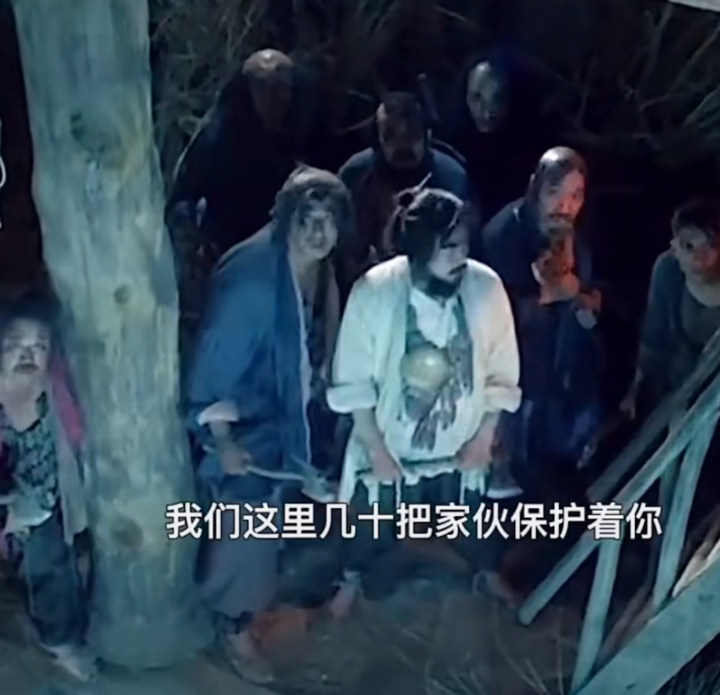

---

## 2524　移星换斗

- 日期：2022-11-16　主专题：A12 战争军事外交与大国秩序　副专题：A13
- 源 ID：`4b4e3d38-7985-5823-aafd-9f44c2d3d20b`　原文链接：https://www.zhihu.com/question/403014869/answer/2760357520
- 官方对象—实践路径：与社会 / 与技术 / 理解
- 23 概念标签：事实与证据;定义与达意;能力与学习;选择与自由;责任与后果;劳动与组织;技术与工程
- 证据状态：manual_confirmed　初读：needs_reread　独立复核：not_reviewed

**问**：北斗全球系统在太空有没有可能被别的国家破坏或击落？

拿这个问题做一下情报分析的案例。

先来点基本资料：
已知信息A：
航天器的轨道高度：
星链卫星：400公里
高分系列卫星：535公里
锁眼卫星高度：124～346公里
风云一号C星：870公里
天宫空间站：425公里
北斗MEO星：21,500公里
北斗系统GEO、IGSO星：35,786公里

已知材料B：
实践20卫星机动回避美国监视卫星抵近观察
已知材料C：
实践二十一号卫星拖带废弃北斗卫星已知材料D：
北斗卫星公开服务性能规范

从这些信息出发，如何得到这个问题的答案？
首先，从材料一可知，目前已知的反卫星武器试验的高度（550公里左右）离北斗卫星的轨道高度（21500-35786公里）相去甚远。
40-70倍这么远。
击毁星链卫星和击毁北斗卫星是两个完全不同的技术概念。
前者约等于在游乐场的篮球机上投篮。

后者约等于射70米靶。

看上去都是“打”，这两者是一回事吗？

现在的谈法是美中俄都有把握击落550公里轨道上的航空器。
但是论到20000-35000公里这个范围，我们所知道的剧情只有美国曾经用监视卫星在20000公里轨道上悄悄接近我们的卫星，被我们察觉，并且主动机动回避了。然后美国自己报道了这件事。
什么意思呢？
意思是，美国人能“看见”我们21500公里轨道上的卫星、能派遣监视卫星接近目标。
我们能在无预警的前提下自主发现这种接近，能回避。
美国人能看见我们的回避。
到这里，我们所不知道的信息是——
1）不清楚在战争状态下美军是否能同样“发现”我们的卫星——在平时这些卫星位置信息是按照国际惯例主动公开的，而且在主动对外发射信号，因此监测难度小得多。
但如果这些卫星存在“生存模式”，会自己抱成一团，保持沉默，默默变轨，在这个状态下是否仍然能简单的被地面监测站准确的监控、那就不好讲了。
要在卫星不发出任何主动信号且自主机动的前提下，靠地面的雷达、望远镜和天基探测器自己发射波束去照亮35000公里外6立方米大小的目标，还接受到足够强的回波信号，并且要将定位精度精确到几十公里以内，以便导弹自带的雷达能接手追踪到目标，这个难度有多大呢？
算一算，假设这是立方体，那么6立方米的卫星大体上约等于一个边长1.8米的立方体，1.8米立方体在35000公里距离上，在视像大小约和折算到550公里距离上一个边长为0.028米大小的物件相等。
看上去跟你隔着550公里看一个硬币的感觉差不多。
这个硬币如果投影到距离你一米的屏幕上，它的尺寸有多大呢？
边长约0.00005毫米。
iphone14的超视网膜XDR屏的分辨率是460ppi，也就是一英寸（2.54cm）上有460个像素。
每个像素的尺寸是0.055mm，可以放下1100x1100=121万个硬币。
换句话来说，要121万个北斗卫星肩并肩在一起，你站在地球上去看它，才能看到一个和你苹果手机上一个像素差不多大的亮点。
这个苹果手机还离你1米远。
这就是作为敌人“看见”生存模式的北斗卫星的难度。

有人要问，那么我们是怎么隔着35000公里知道我们自己的卫星——甚至我们的探月飞船、火星飞船——的位置的呢？
那是用主动定位以外的方式，靠着卫星自己的配合做到的。卫星一直在向你发送它自己身上原子钟的当前时间码。你收到了这个时间码，跟你本地的时间对比一下时差，去掉大气电磁干扰造成的误差，乘以光速，就知道卫星离你有多远。地面上有三个站点同时获取和计算，就能知道卫星——以及其它飞行器在哪。
再配合上航天器自己传回的星光观测信息（即回传太阳、地球、火星、木星、北极星等高亮度星体相对于航天器自身的方位角），地面站只要分析这些结果就能知道航天器的具体位置。
一旦航天器不吭声，要找它就变成了在“在两张照片里寻找一百二十万分之一像素大的差异”的问题。
又有人要问——那么太空总署不是在追踪太空垃圾吗。
不，ta们那不叫“追踪”，那叫监测。
有什么区别？
追踪，是你拿个望远镜盯着嫌疑人看，任何时候你都能报出ta的位置。
监测，是你在高速路口收费，看到嫌疑人每周三下午六点都要扫ETC。
这周没看见ta，嗯，ta肯定有问题。
啥问题？不知道。
这些太空垃圾怎么监测的？就是地面雷达、望远镜、天基雷达综合起来有一堆最佳观测区。比如对地面望远镜而言，有一段天域在特定时段会有充分的阳光，以至于太空垃圾会被照得雪亮，反差很大，刚好看到你。就像小偷刚好经过探照灯光束一样。
雷达也类似，航天器的雷达只能有效的探测距离自己一定距离内的物体。你刚好从这附近飞过，就有一段轨迹会被记录在案。
你没有动力，不是吗？那么我下周三下午六点应该还会在这个高速路口看到你。
但你可能慢三秒——因为你没有动力去克服近地轨道稀薄大气带来的阻力。
按你这情况，我估计你还能在道上混三年，三年之后江湖上就没有你化骨龙这一号人物了。
这就叫监控。
问题是，你在那一片漆黑里飞一圈的时候，哪怕有个人在你边上轻轻一蹭，甚至只是打了个喷嚏、放了个屁，你飞完这一圈——最多两圈——就很可能不会从我这路口过了。
那就要看你会不会从别的检查站路口过了。
要是都看不见你，那就纠结了——你这是葬身大海了，还是要干个大买卖，那就不知道了。
下一个剧情很可能是黎叔的大腿从我面前飘过——我就知道他不可能这么早下线。
但是不是你干的，谁也不知道。
这就是所谓的“监控”。

2）现在我们假设你看到它的难度已经解决了——somehow，你确实可以看到它，至少能看到你发射前它的确切位置。
现在的问题是，你发射了导弹，去打击这个35000公里外的目标，你打不打得中。
在你飞过这35000公里的距离的前5000公里时，很显然我们已经知道有这么个东西来了。
我们为什么一定能看见你呢？
因为要能够得着35000公里的轨道，你首先最起码要克服这么大的势能，你这份基本的燃料你必须得装得下吧？
第二，你到达35000公里目标点时，你不会刚好速度为0吧？你总要保持点速度吧。这倒不是说末端速度不够撞毁目标，而是如果终速为零的话，你这35000公里打算飞多久？等你爬到地方，你的目标只怕躲到地球另一面去了。
所以你要带的燃料比这多得多。
即使这么多，考虑到你的目标极其敏捷，你还要带很多机动变轨用的推进剂。
你还要把陀螺仪、原子钟、星光导航、中距雷达、短距雷达、光学镜头、计算机……带全。
还要带一个足够大的破片战斗部，甚至搞不好还是多弹头的。
你这颗弹的个头恐怕都不是军舰、陆地发射车能装得下的。
给个参考——发射北斗卫星的长三甲火箭，直径3.35米、长52.5米，重242吨。
对比一下——民兵三洲际弹道导弹，长18.2米，直径（最粗处）1.7米，重35吨；东风41，长18.9米，直径2米，重52吨。
前者能用发射车机动发射吗？五十几米两百多吨重的导弹，你用车载液压设备从平躺顶到竖起来我看看。
我还真没见识过这种神车——另外这车打算开哪条公路，钻哪片森林、过哪个隧道、哪座大桥？
我们能看不见这么大的家伙吗？
我们当然看得见。看见了，当然会第一时间掀被窝跑路。
我们一旦跑路，这个问题就转化为了一个老问题——这跟弹道导弹打航母很像。
航母也是会跑的，导弹也是蒙头先飞到差不多的空域再开机找航母在附近哪里的。
问题是，卫星比航母小一万倍，飞得比航母起码快个几百倍。
我这么说吧——你要是能用导弹打中35000公里外以n公里每秒的速度默不吭声随机机动的办公桌大小的北斗卫星——哪怕这颗卫星举着一块篮球场般大“你来打我呀”的LED大招牌，
你就完全不该对我们能随便打中一万公里外的航母有任何怀疑。
你应该猜我们百发百中才对。
这就是打掉静默机动的北斗卫星的技术难度。

这带来另一个问题——那么采用骚扰战术行不行？
我当然知道打中的概率很小，但是我只要打，你难道敢不关机躲闪？
躲我们当然是要躲的，关机也必须得关机、不然靠地面站对同一信号的接收时差的测定也一定可以反推出卫星的位置，精度仅取决于原子钟的精度。
但是，我可以间断工作——我现身工作五分钟，然后隐身跑路五分钟。
就这五分钟，就够你追的了。
我有三十多颗星，并不需要全部工作就足够支持我的定位需求了。
说得不好听点——在我家门口的这块预设战场，仅靠陆基雷达、预警机、浮空飞艇、海面雷达和无人浮标都足够完成战场精确定位了。
甚至仅仅依靠我们精细全面到底朝天的地理特征测绘，都足够完成定位导航需求了。
北斗主要辅助的是全球打击，这并不是在南海和台海无法取代的东西。
它对我们的全球客户使用我们的出口装备才是完全不可或缺的。

简单来说，根据这些估计，这个目标虽然并非物理上不可能做到，但至少在经济上、工程上难度非常大。
如果美国有能力稳定的做到这一点，那么它应该远远不是现在这个畏畏缩缩、无能狂怒的状态。
最起码，俄乌战争肯定不会是现在这种打法。

<!-- 图片：2 张，审读结论见下 -->

---

## 2518　nice guy

- 日期：2022-11-19　主专题：A12 战争军事外交与大国秩序　副专题：A10;A07
- 源 ID：`ba5c0ebd-bb52-59c1-b4c7-8496a6b0bd74`　原文链接：https://www.zhihu.com/question/409246699/answer/2765683082
- 官方对象—实践路径：与自己 / 与能力 / 运用
- 23 概念标签：能力与学习;选择与自由;责任与后果
- 证据状态：manual_confirmed　初读：read　独立复核：not_reviewed

**问**：怎么理解“ 善战者无赫赫之功 ”？

什么叫善战？
不用防守，因为即使是偷袭，也没有谁有任何不切实际的指望。
不用进攻，因为想要的利益对方会自觉送上，以免敬酒不吃吃罚酒。
攻无不克，所以不战而胜。
打都没得打，自然也就没有赫赫之功了。

这具体来讲，大概就是你敲敲门，酋长出来问你“大清早的谁特么乱敲”。
你说“打扰了，我给你表演个小魔术吧”，然后你一拍巴掌——
门口的火山就变没了。
酋长说哟呵这魔术很精彩啊，朋友你吃了吗，我们家刚摊的煎饼果子又脆又香，还有一瓶八二年的拉菲明天就过期，你正好帮我喝掉。
什么战？什么功？
Just a friendly guy with an irresistible nice personality.

---

## 2512　去势

- 日期：2022-11-26　主专题：A12 战争军事外交与大国秩序　副专题：A03;A10
- 源 ID：`38755633-d5ea-52ad-a014-47251464712e`　原文链接：https://www.zhihu.com/question/568533689/answer/2775377528
- 官方对象—实践路径：与自己 / 与能力 / 获取
- 23 概念标签：事实与证据;定义与达意;爱与回应;边界与许可
- 证据状态：manual_confirmed　初读：read　独立复核：not_reviewed

**问**：乌克兰全境进入停电状态，首都基辅暂停供水，目前情况如何？会对俄乌局势产生哪些影响？

你要比较好的把握一件事情，有一个思维方式要改变。
就是一句说烂了的话——“动态的看待问题”。
很多人觉得这句话的意思是“经常改变判断和立场”的美化说法，然后就当耳边风了，这是一个巨大的失误。
什么叫动态的看待问题？
比方说有一个小球滚下斜坡。
动态的看待问题，就是从“小球开始滚”一直看到根据已知条件能预测到的极限，其结论是“小球每一个时间点的每一个状态”。
相对的，什么叫“静态的看待问题”？
就是“看到小球此刻的状态”，其结论就是“小球此刻的状态”。
对于后者，因为下一时刻小球就不在原位了，意味着自己的预期已经要随之改变了，于是总是要惊恐的探讨“xx因素会对局势产生什么影响”。
ta的意思是，有什么因素会影响下一时刻小球的位置。
但是对前者，在一开始形成结论的时候，其结论就不是“此刻的位置”，而是“从此一稳态至下一稳态的全部过程”，能被视为“改变局势的影响”就不是指“小球此刻撞到的凹坑”这样的东西。
因为对动态观察者而言，这个凹坑一开始就看到了，已经是之前结论的一部分了。
只有突然在公式中出现了原来公式里没有纳入计算的要素——比如斜坡突然断了，或者天上伸出一只手指来挡在小球前面，会影响到对“小球的下一个稳态及其逼近该稳态的路径”的总体判断——才能被视为“对局势发生了影响”。
后者的“局势”，指的是现在这一刻的历史横断面。
前者的“局势”，本质上指的是从此刻直到一段历史的下一节点的整个段落。
后者认为只要改变现状，就算局势发生了改变，其实是把“局势”这个词“去势”了。
当ta们谈论“局势”时，ta们在谈论的其实是“局面”。
局面没你想的那么重要，甚至根本无关紧要。

现在回头来看现在这个问题，你就会发现，我对这个问题的回答是——
这种轰炸对（我所判定的）局势没有影响，因为它从一开始就是“局势”中“势”的组成部分之一。
从一开始我就判断过到这个阶段会出现这一幕，本来就是计划中的事。
这件事很自然的从开始就会这么演变。
这是整个动力学所自然要催生出来的现象，就像卵要变成蝌蚪，蝌蚪要长出手脚，然后会变青蛙。
这个问题等效于——“蝌蚪长出了脚对它变成青蛙有啥影响”。
这还真不好回答。

---

## 2507　扩建医院

- 日期：2022-11-30　主专题：A12 战争军事外交与大国秩序　副专题：A16;A08
- 源 ID：`b135816f-3eca-5597-9056-a923e93d17f3`　原文链接：https://www.zhihu.com/question/569548867/answer/2780830740
- 官方对象—实践路径：与社会 / 与舆论 / 接收
- 23 概念标签：定义与达意;能力与学习;责任与后果;成本与总账;信用与信任;技术与工程;文明与历史
- 证据状态：manual_confirmed　初读：needs_reread　独立复核：not_reviewed

**问**：如何看待胡锡进建议「各地不要继续大规模建方舱医院，省下的钱用于增加正规医院的床位」？可能带来哪些影响？

老胡的治理经验有哪些？
在我看来，这个问题只有很少的几种人有说话的余地——
1）有治理经验的地方官员。
2）医学、疾控专业人士。
3）建筑专业人士。
4）有运营、管理经验的专业管理者。
没有这类实务经验，你根本不能正确的估计成本和效益。
不能大概靠谱的估计成本和收益，你就约等于闭着眼睛胡说八道。
他这整个论述里有大量经不住基本质疑的断言，连被投入严肃的资源进行讨论的资格也没有。

别的不说，“扩建正规医院”这条。
有没有考察一下，现在的医院都在哪？

绝大多数医院都在中心城区，周围都修满了居民区。尤其是一线好医院，甚至大多都在老城区。
毕竟，政府大楼、邮政局、公安局和医院是任何一个行政区最先建立的四个设施。
那都是从建国时就选址了的单位。
到现在多少年了，扩建啥？往哪扩？
你们当地的第一、第二、第三、第四、第五……人民医院都在哪？

所谓“扩建”，基本上都是把老楼拆了盖新楼——直接加盖都不行，因为老房子地基受不了。
你走进随便哪家三甲医院看看，看看有几家有地方“扩建”？
每家门口都堵车，每家都停车难，每一家都人头爆满。
难道你觉得现在的医院里还能增加床位？
你是要把病床改成高低床吗？

是不是完全脱离实际？

这就是不通实务的人可以荒谬到什么程度。
看似我这说的是老胡，但实际上我说的是你们。

以后记住，不要听没有实务经验的人的治国方略或者政治主张。
因为没有意义。
同时，如果你自己没有三四十岁，没有做出点什么，不要发表——甚至不要持有——什么政治主张。
你要做的唯一的努力就是学习和怀疑。
别看你好像“没有立场，没有主张”，但单凭优秀的怀疑能力，你轻易就能把某些振振有词、慷慨激昂的“志士”问得哑口无言。
你就问ta“实际上要怎么操作”。
原来你没方案，不知道要怎么办。
你不知道要怎么做的事，你这么坚决，是啥意思？
你说不清的主张，你这么激烈，是啥意思？
纯属浪费时间和表情。

顺便，这里每一个神神秘秘暗示“不建方舱怎么搞钱”的人，都不但是缺少常识，而且对自己的言论根本没有责任意识。
你们自己想想，这样的信息源该不该保留。

<!-- 图片：2 张，审读结论见下 -->
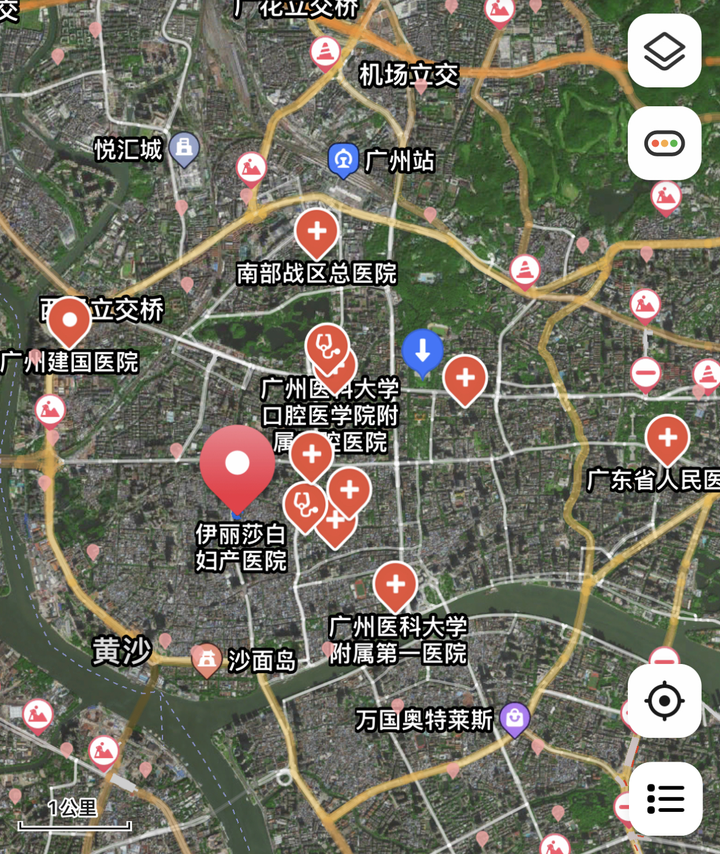
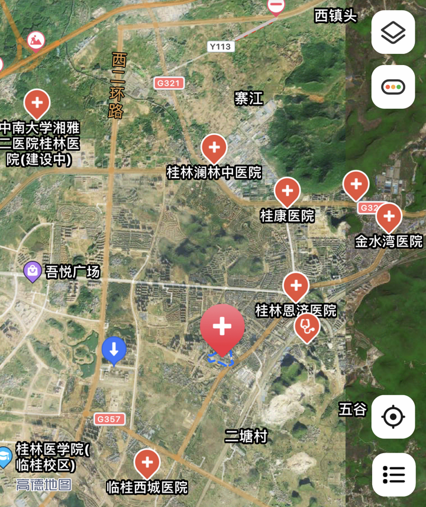

---

## 2482　非法改装

- 日期：2022-12-18　主专题：A12 战争军事外交与大国秩序　副专题：A07;A13
- 源 ID：`1bbde9dd-b5d7-50d1-a07c-35915898a82b`　原文链接：https://www.zhihu.com/question/333558440/answer/2806850147
- 23 概念标签：定义与达意;选择与自由;边界与许可;法律与秩序
- 证据状态：manual_confirmed　初读：needs_reread　独立复核：not_reviewed

**问**：为什么国家要严打改装车？

发几张图给你开开眼：

你可能会叫起来——那我改的是GTR，我改的是发动机、排气管，这改的是大货车、改的是货斗啊。

很遗憾，“非法改装”这扇门一推开，允许你改发动机排气管，就等于允许人家货车改车厢。
就像“允许违法”的门一推开，就不可能再区分闯红灯和强奸。
因为如果划出这条“允许线”，实质上只是修改了法律、扩大了“合法”的定义，并不叫做“允许某些非法行为”。
这个世界上有一种说得震山响的蠢论——就是喜欢打着“反对一刀切”的旗号，搞司法打折。
其实律令如果不是一刀切，本质上就是个摆设。

<!-- 图片：4 张，审读结论见下 -->

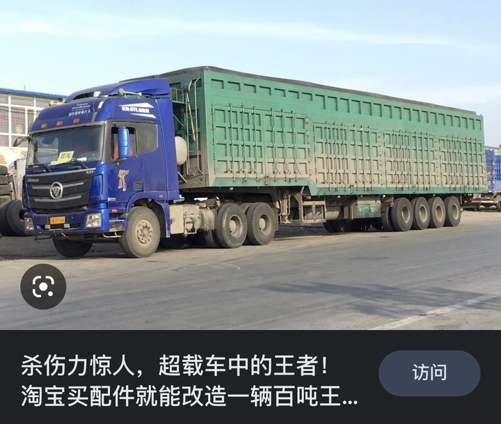
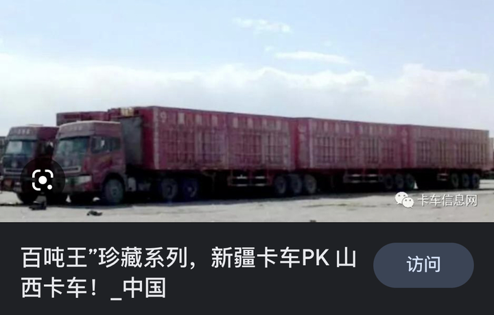
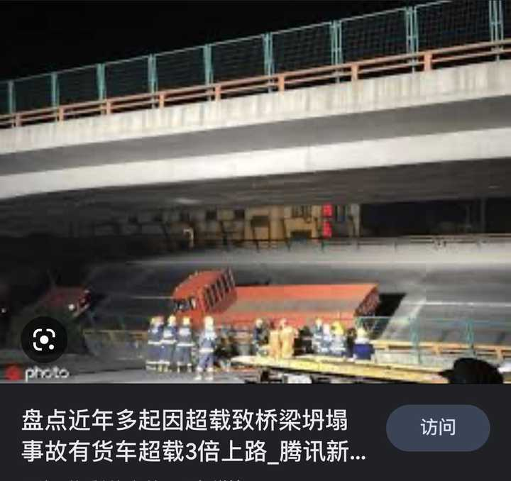

---

## 2485　独立游戏

- 日期：2022-12-18　主专题：A12 战争军事外交与大国秩序　副专题：A17;A10
- 源 ID：`0d21e055-7d5e-578d-96d7-f055bc7f64bb`　原文链接：https://www.zhihu.com/question/572682102/answer/2805798903
- 23 概念标签：定义与达意;能力与学习;选择与自由;法律与秩序;技术与工程;民族与身份
- 证据状态：manual_confirmed　初读：read　独立复核：not_reviewed

**问**：阿尔巴尼亚需要多大的努力才能让科索沃回归？

你们需要明白现在的世界秩序是什么东西。
简单点来说，在单极世界——甚至双极世界——的架构下，小国家——尤其是不超过500万人口的小国家，会自动沦为超级强国的殖民地。
因为这些小国家实际上根本无法独立的行使主权。面对原主权国或者强邻的敌意和武力威胁，势必要全面依靠化名为“国际社会”的超级强国的庇护生存。
换句话来说，从超级强国的视角来看，一个地区“独立”，其实和这个地区“接受占领”“接受统治”，在本质上是同一个意思。
本质上，那根本不是“独立”，而是叛变。因为分裂出去之后，分裂的地区根本就不会因此拥有什么独立主权，它只是换了一个主人侍奉而已。
所以，很自然的，超级强国会本能的希望，甚至积极促成其他国家的各个地区“独立”，会开动自己的舆论机器去极力赞美这种行为。
这实际上是一种化名为“支持民主和自由”的侵略，是一种使用厨刀的谋杀，一种包上了金箔的贪婪罢了。
但恰恰也因为是这样，这样的机制也会自动的将不甘心丧失主权的所有次要大国团结起来，为超级强国的失败埋下种子。
塞尔维亚的敌人其实并不止是科索沃，还包括热衷于从分裂他国中牟利的国家，难度是很大的。
这才是塞尔维亚困难的地方。

---

## 2474　再打打

- 日期：2022-12-25　主专题：A12 战争军事外交与大国秩序　副专题：A10;A20;A07
- 源 ID：`10394fcb-017a-585f-ad53-9b7fd7c2ee7f`　原文链接：https://www.zhihu.com/question/568009533/answer/2814933549
- 官方对象—实践路径：与社会 / 与历史 / 解释
- 23 概念标签：事实与证据;能力与学习;责任与后果;成本与总账;劳动与组织;文明与历史
- 证据状态：manual_confirmed　初读：read　独立复核：not_reviewed

**问**：纳粹政权也腐败为什么军队战斗力还这么强?

纳粹政权具体怎么腐败？
军队战斗力强，本身就客观地说明了纳粹的腐败程度不高。
因为腐败的人第一大的特点就是怕死。
你想想看，哪有贪污亿万的人能在枪林弹雨下打生打死？
贪污腐败不可避免的会消极避战，一定会出现抗命、迟疑，一定会出现调动不灵、擅自撤退、主动投降，一定会出现不可控的溃败。
大家都怕死，你看我我看你，发一声喊，一齐散了，八成人都可以免于处罚，算自然战败，只要大家心照不宣把责任推在少数已经死掉的倒霉蛋身上，净收益永远大于去冲锋陷阵。
腐败者的勇敢只能用在杀人灭口上，根本无法成为有组织的武力。
即然纳粹德军的组织有效性有目共睹，那么就可以原理性的倒推——纳粹德军腐败程度并不高。

德国的失败并不是因为什么“腐败”之类的原因。
甚至可以说恰恰相反——纳粹德国的理想主义程度相对来说是很高的。
纳粹德国失败是战略本身的失败，而不是执行能力和执行品质上的失败。
这倒不是说纳粹德国人均好公民，而是说大家都是五十步笑一百步，而纳粹德国还不是一百步那一批，是比较靠五十步那一批。
纳粹德国的失败，是一个相当优秀的团队以历史上罕见的激情，执行了一个即使是以这样的团队、这样的热情仍然执行不了的计划而酿成的失败。
所以它的失败才有格外的教育意义和社会学价值。
如果你强行去臆想成“因为腐败而失败”，反而要陷入自己给自己挖的意识形态陷阱，把纳粹的教训消解了。
比如，你可能产生一种幻觉——“一群腐败分子都能达成这么大的成就，那要是我们换一帮不腐败的兄弟，结果岂非可以大大不同？”

上帝看完你的帖子，可能会摸摸鼻子——
“看来只打两下还不够”。

这就是所谓的讨打。

---

## 2471　撩阴腿

- 日期：2022-12-29　主专题：A12 战争军事外交与大国秩序　副专题：A06;A03
- 源 ID：`4293a23f-a714-5203-9632-6e220bce2a13`　原文链接：https://www.zhihu.com/question/567499989/answer/2820929294
- 官方对象—实践路径：与自己 / 与能力 / 承受
- 23 概念标签：能力与学习;责任与后果;成本与总账;爱与回应
- 证据状态：manual_confirmed　初读：read　独立复核：not_reviewed

**问**：如何看待“人矿”这个词？

撩阴腿威力大不大？
威力当然大，这还用问吗？
爱学的人显然“武功”威力大点，这很显然。
撩阴腿好不好学？
当然好学啊。
那为什么没有什么技击名门专教撩阴腿呢？
因为一辈子真要靠“武功”的时候可能也就那么几分钟，除了那几分钟，其余的人生都会因为“撩阴腿高手”的身份付出代价。
这个代价可不是0。
这个代价大还是撩阴腿在那几分钟里的价值大，这个就不好讲了——万一人家真要靠撩阴腿保命呢？
另外，如果一位师傅主要依靠背后撩阴腿——撩阴流高手一般都会修这门背后步法——行走江湖，一般来说江湖上不太认为这人算武林同道。
也就是没资格享受江湖救急、点到即止、交换俘虏这类基本福利。
不受《日内瓦公约》的保护。
对撩阴腿啧啧称奇、拍案叫绝，这属于战斗力为零的表现。

---

## 2467　见死救

- 日期：2022-12-31　主专题：A12 战争军事外交与大国秩序　副专题：A01;A03
- 源 ID：`025ffa9b-ad03-5535-8c08-8630c725f21e`　原文链接：https://www.zhihu.com/question/574068880/answer/2823717445
- 官方对象—实践路径：与自己 / 与信念 / 转变
- 23 概念标签：定义与达意;责任与后果;边界与许可;照料与家庭
- 证据状态：manual_confirmed　初读：read　独立复核：not_reviewed

**问**：乌克兰这个国家还有未来吗？

自己平时说话一定要注意一个问题——你自己是你自己语言的第一听众，无论你写什么、说什么，你自己都是可以看到、听到的。这意味着你自己说的每一句话首先对你自己都有强烈的暗示作用。
为什么这里要做这个提醒呢？
就是因为“乌克兰未来很长一段时间将很艰难”和“乌克兰没有未来了”之间有巨大的语义区别。
你如果长期将“未来一段时间将很艰难”视为“没有未来”，你的“没有未来”的定义就会被污染和兼并。结果就是你会经常“没有未来”。
看这个也“没有未来”。
看那个也“没有未来”。
至于你自己，你自己猜猜你有没有“未来”？
你有个q的未来。
因为“未来一段时间将很艰难”在你九十年的预期寿命里必定会出现。
它一出现，你就“没未来”了。
你现在只不过还没看到它出现而已。
按你挂在嘴边的标准，你所拥有的不是“未来”，而是一段“有未来”的幻觉而已。
乌克兰“有没有未来”，对你只是茶余饭后的谈资。你自己按这个思维方式发展下去即将出现自绝倾向，对你才是致命问题。
类似的还有“气死我了”、“累死我了”、“完了”、我受不了了”……这类话都在标记人的上限，标记着人的“禁区自觉”。意思是到了这条线，我就自认没办法了、我要投降了。
不是说这条线不存在，而是你自己睁开眼看看，竖起耳朵听听，你的上限是不是真的就是这里？
把上限放在【这里】，你觉不觉得可耻？
如果你的上限就在这里，你的硬气比薯片都不如。
吃豆腐你不怕咬碎牙？

顺便，将来你的小崽子用这种腔调问问题，
一定要打醒ta。

否则作为父母这算见死不救。

---

## 2463　武德指数

- 日期：2023-01-02　主专题：A12 战争军事外交与大国秩序　副专题：A03;A20
- 源 ID：`fd388f27-9169-5cc5-8f90-25020588acec`　原文链接：https://www.zhihu.com/question/434129722/answer/2825581031
- 官方对象—实践路径：与社会 / 与历史 / 解释
- 23 概念标签：定义与达意;能力与学习;选择与自由;成本与总账;边界与许可;法律与秩序;文明与历史;民族与身份
- 证据状态：manual_confirmed　初读：read　独立复核：not_reviewed

**问**：从哪些方面可以看出中国武德之充沛？

先构建一个评估国家军事能力的客观方法。
对这个国家与邻国之间边界的地理险要程度建立量化标准，这个可以被简单的称为“边界的硬度”。
如果你和邻国的边界是一条二十米宽的河，那么这条边界的硬度就不如一条两公里宽的河。
如果这边界是一条十公里宽的海峡，就不如二十公里宽的海峡。
如果这边界是海拔一百米的山岭，就不如海拔两千米的山岭。
这个方法需要做一点修正——类似印度尼西亚、冰岛这类海岛国家以及突尼斯、利比亚这类缺少邻国的沙漠边缘国家，它们的边界不能被视为军事争夺的结果，而只能视为缺少邻国的结果。
然后你将考察对象国的国界线完整的计算一圈，自己设计一个恰当的方法统计一下“总边界硬度指数”。
该指数越高的，该国的军事能力越强——而且该边界达成的越早，越说明该国的军事传统的强盛。
原理很简单——越是军事能力强，越是扩张性大，对邻国就越是需要险要的地形来保证自己的安全，形成有效的相持。
河不够宽、山不够险、丛林不够密、沼泽不够深，那就只有继续且战且退到够宽、够险、够密、够深的地方，没有别的选择。
在这个定量方法下，你可以很容易的看出世界上真正的军事强国到底是谁，而且结果是有显著意义的。

---

## 2447　RUN

- 日期：2023-01-13　主专题：A12 战争军事外交与大国秩序　副专题：A09;A10
- 源 ID：`70bdfb41-d352-519a-b75f-6529ddb6f92f`　原文链接：https://afdian.com/p/83bf090e92d311eda48f5254001e7c00
- 23 概念标签：选择与自由;责任与后果;成本与总账;爱与回应;劳动与组织;法律与秩序
- 证据状态：manual_confirmed　初读：read　独立复核：not_reviewed

**问**：为什么中国实现不了免费医疗？

这里明确的反对一种观点——阴阳怪气的嘲讽疗养院，似乎疗养院是“权贵阶级特权”。
大批不懂事的小孩跟着起哄。
——你先别激动，看到后面就知道叫你“不懂事的小孩”是为你好。
在你“赞同”之前，有没有了解一下进这些地方疗养的人是什么资格门槛？
介绍一下军队的门槛：
http://www.shandong.gov.cn/art/2023/1/3/art_100623_41912.html
再去查一下二等功的门槛。
https://baike.baidu.com/item/%E4%BA%8C%E7%AD%89%E5%8A%9F/2967557
直白点，曾经为中国冒过生命危险，挽回过重大损失，建立过卓越功勋，或者付出过重大牺牲，侥幸没有成为烈士的军人，这就是二等功的门槛。
离休干部也有资格享受疗养待遇。离休干部的资格门槛是什么？
简单来说，在建国之前就参加革命工作的老辈人才有这个资格。
劳动者的疗养资格你们也可以查查。
我说白点——那是拿真正的牺牲精神，顶着生命危险来的。
就不提五一劳动奖章这些，在中国缺油、缺煤、缺原子弹……什么都缺的时候，你在什么地方？
你们自问一下，有什么资格对ta们的免费疗养待遇阴阳怪气？
这些人的待遇，是为人民付出金钱无法弥补的牺牲后，人民应当给予的抚恤。
难道你们想“节省”？你们想对ta们收费？
来来来，你说吧，你要收多少钱觉得自己划算？
为共和国出生入死的功臣，理所应当衣食无忧一辈子。
谁反对，谁就至少应该被踢出你的主动交往圈。
因为这个人的人格有高度危险的反社会性，对人类的基本情感、基本伦理缺少起码有效的认知能力。
这毫无疑问是重大的生活隐患。
在这个答案下随声附和的人，最好自己悄悄把这些答案删掉。
年幼无知，不是永远有效的免罪牌。
你的恋爱对象看到这种话，如果ta没有考虑与你分手，你都应该考虑与ta分手。
因为这种程度的明知故犯的反社会水平，对任何合作者都是恶魔一样的存在，将来你们自己都会后悔跟这样的人有任何牵扯的。
你想想——在ta们眼里，你即使为ta出生入死致伤致残，对ta有救命之恩，也只是一个“成本过高的累赘”，ta也要抛出一句“凭什么你有特权”。
注意，你很清楚ta不是不懂事，这也不是误会，因为有人明明白白的告诉ta了。
ta是在明确知情的前提下，仍然这幅样子，这就是ta主动选择的信念。
你自己掂量，如果别人认定你是这样的人，你预料对方会怎么处置你。
这样的人，是你的“朋友”，你最好反思一下，这种状况是怎么达成的？
然后你翻翻你的朋友圈，这是不是一种常态？
为免误杀，你转发一下这一篇，看看有多少人会收手认错，有多少人反而被激怒，更加坚定的打着“反特权”的旗号主张抛弃这些功臣？
不管这个圈子是不是挂着“民主”“自由”这样闪亮的招牌，你能不能接受这种“买断制”用在你身上？
你那是“朋友圈”吗？
那是个信奉着“利润就是至高正义，负担就是绝对邪恶”的屠宰场。
然而环顾左右，你看到猪了吗？
你知道这里为什么这么痛恨镜子了吗？
RUN。

---

## 2446　说得太少

- 日期：2023-01-14　主专题：A12 战争军事外交与大国秩序　副专题：A03
- 源 ID：`d3cd3088-4f71-5e87-9a5d-8e2dacead7ef`　原文链接：https://www.zhihu.com/question/578311656/answer/2845104520
- 官方对象—实践路径：与自己 / 与能力 / 获取
- 23 概念标签：事实与证据;定义与达意;能力与学习;成本与总账;心理与主体
- 证据状态：manual_confirmed　初读：read　独立复核：not_reviewed

**问**：如何看待一老一小两名乌军被俄军绕后，拒绝投降以后被击毙，俄军士兵一个前翻滚闪现离场？

我发现大多数人错过了两个基本细节。
1）进攻的俄军只有单身一个人，而对手是两个人。
一般“俘虏”这个操作需要有人数优势——或者至少没有人数劣势。
2）俄军士兵是从这两名乌军士兵的身后发起攻击。这意味着这名俄军士兵穿越了乌军阵地。
要知道，现代的散兵线一般都不会只设置一层，至少也是互相交错的两三层，以便达到交叉掩护、避免渗透的作用，否则第一层被突破，就会出现枪口不知道朝哪边的问题。
只有至少设置两层，才能达到“在两层之间的由第二层消灭，在两层之后的由第二层转身对付”的基本安全。
而这名俄军士兵是从背后发起进攻，这意味着他要么是穿透了两层防线，要么是正处在两层防线之间。
如果是前者，在他的背后大概率是乌军的预备队，而不是自己的后续部队。
如果是后者，那就更不用说了。
这也是为什么大部分的俘虏都是正面战线崩溃转身逃跑不及或者被合围的结果。
类似这种“渗透过火力线返身攻击”的战术是高度危险的，一旦和对方缠斗，很容易被后方靠拢过来的敌人消灭。

现在这名俄军却不但从乌军的火力线后方发起攻击，还尝试以一敌二，不但首先暴露自己，还给对方被俘机会，还尝试手工缴械。
你是不是以为这里要说“可叹的仁慈”？
不，这里的重点不是这是否仁慈——即使仁慈，这也是个人行为。
这里更重要的细节，是这要么意味着这名俄军士兵的脑子有点不清醒，意识不到自己身处极端危险的境地；要么就意味着俄军士兵面对乌军士兵的士气和信心爆棚。
而这里面，是前者的可能性很小。因为你只要上过战场——哪怕认真的玩过仿真射击游戏——只要是你越过了对方的火力线，你自己一转身都会感觉背后有瞄准器指着你。那是一种宛如实质的压力，是不可能被遗忘的。平时在训练场上练匍匐，你屁股高到会被铁丝网刮伤。上了战场，你趴得恨不得要把皮带扣磨平。
更何况这是真枪实弹、长时间拉锯的战场，怎么可能意识不到背对敌军火力、以一敌二的风险？

于是只剩下一种可能——这是一种极端的自信。
这个视频里真正对你有价值的根本不是什么“残酷”、“仁慈”、“正义/邪恶”，而是它无意间揭露了一个俄军和乌军士气的细节。
后者才是更有价值的情报——乌军的状态恐怕远没有宣传的那么乐观。
你要记住一个重要的原则——愚人才纠结这些标准，因为ta们总是期待给自己贴上“善良”、“正义”、“纯洁”之类的标签，然后幻想胜利和拯救从天上掉下来。
成熟的人却把一切的信息首先看作情报。
你要养成一种习惯，首先本能的去做情报分析，而不是价值观判断。
强大的情报分析能力要远比“熟练的价值观判断技巧”重要。
前者总被嫌说得太少。
后者总被嫌说得太多。
前者一般到后来都比后者有钱。

---

## 2444　谁后悔

- 日期：2023-01-15　主专题：A12 战争军事外交与大国秩序　副专题：A16;A09;A10
- 源 ID：`4efba1a4-7ba6-59c2-85da-5d49d493992b`　原文链接：https://www.zhihu.com/question/573641849/answer/2846840123
- 官方对象—实践路径：与社会 / 与舆论 / 表达
- 23 概念标签：定义与达意;能力与学习;责任与后果;成本与总账;照料与家庭;劳动与组织
- 证据状态：manual_confirmed　初读：read　独立复核：not_reviewed

**问**：那些当初整天喊着提倡和新冠共存的人现在有没有后悔？

其实共存派后不后悔不重要。
重要的是一些从没有开口发声的清零派有没有后悔。
有没有后悔自己“事不关己”“随波逐流”。
下一次——迟早新冠会出现致死率创新高的品种，而且恐怕还并不止有新冠而已——你是否还会任由共存派“撞门”？
是否还会纵容谣言，被人蛊惑？
你不可能指望下一次就没有共存派了。
即使其中一部分人知道后悔了，也会有一部分唯恐中国不死人的“职业共存派”是肯定少不了的。
你能努力的只有提高自己作为清零派的作为。

下次不要再放任这些人霸榜，
会死人的，会死家人的。

不要寄望于别人后悔，要寄望于自己。

---

## 2431　反战

- 日期：2023-01-20　主专题：A12 战争军事外交与大国秩序　副专题：A03
- 源 ID：`08a82f82-f89c-53e7-bfeb-c0a18894f5fd`　原文链接：https://www.zhihu.com/question/557378297/answer/2853854437
- 23 概念标签：定义与达意;选择与自由;权力与异议;民族与身份
- 证据状态：manual_confirmed　初读：read　独立复核：not_reviewed

**问**：为何现在在很多网友眼中，反战反侵略这种基本的道德变成了圣母？

岂有反战反侵略的人不支持反抗的道理？
支持反抗，就是支持反侵略和反战；
反对反抗，就是支持侵略。
一些人根本不是在反战、反侵略，而是反对别人武力反抗非武力的侵害，就像在帮掌握了一切剥削手段的人主张“你应该安静的饿死、穷死而不该暴力反抗”。
ta们是在帮助压迫的一方反对武力反抗，而不是在反战。
你看，ta们可没对乌克兰反战——这说明“反战不含反反抗”的道理ta们是懂的。
ta们只是认为这个道理一部分人类没资格使用。
“自由民主”口号下，实际上隐藏的不过是种族主义，因为只有种族主义才会造成最牢固的双重标准。
这种事，多说无益。
天赋人权，无需经过这些人认可。

---

## 2419　卵生大猩猩

- 日期：2023-01-25　主专题：A12 战争军事外交与大国秩序　副专题：A18;A07
- 源 ID：`abb4f396-a0c3-5462-ad17-0b3a6fd2aa28`　原文链接：https://www.zhihu.com/question/563561218/answer/2859744443
- 官方对象—实践路径：与社会 / 与文化 / 遵循
- 23 概念标签：能力与学习;责任与后果;劳动与组织;法律与秩序;文明与历史
- 证据状态：manual_confirmed　初读：needs_reread　独立复核：not_reviewed

**问**：如何看待把苏联和苏修分成两个国家的人？

连日本我们也分成日本军国主义分子和日本人民两个侧面，
美国也分为美国人民和美帝国主义统治集团两个侧面，
这本来就是中国世界观的基本方法论，属于中国的政治常识。
中国永远与所有国家的人民为友，本质上认定所有国家的人民全是善良的。如果这个国家有任何邪恶的行径，只有一种可能，就是少部分人绑架和扭曲了民意，欺骗了人民。
我们甚至把“世界人民大团结”这句话直接刻在天安门上，与自己的国号并列，同享至高无上的“万岁”尊称。

“万岁”是什么意思？
那意思是永世不易。
所以中国的政治传统很鲜明，但凡提到别国国号、别国人民，无论这个国家曾经犯过什么错误、有过什么罪行，从不加任何贬斥。
人民不受谴责，责备只会指向一部分特定的人，只能指向苏修、指向美帝，指向日本和德国法西斯分子。
这有什么可奇怪、可嘲讽的？
对这个立场横加指责、嘲讽，只能说明这人没有受到合格的中国政治教育，缺少基本的常识。
说实话，缺少这种最基本的常识，探讨中国政治是没有意义的。
就如一名教授大谈大猩猩的变态发育，看到解剖图才发现ta以为“大猩猩”是一种田蛙。
我说这种猩猩咋会产卵。

<!-- 图片：1 张，审读结论见下 -->
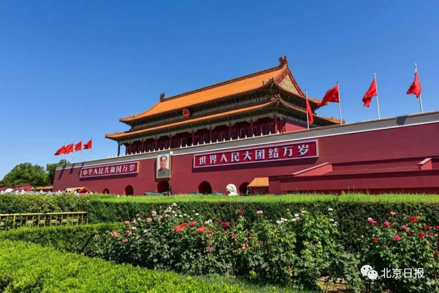

---

## 2408　我去

- 日期：2023-02-01　主专题：A12 战争军事外交与大国秩序　副专题：A01;A19
- 源 ID：`c9bfc35b-5306-5857-acab-02de435d03d9`　原文链接：https://www.zhihu.com/question/580478279/answer/2870933404
- 官方对象—实践路径：与社会 / 与组织 / 参与
- 23 概念标签：定义与达意;选择与自由;责任与后果;成本与总账;爱与回应;照料与家庭;文明与历史;民族与身份;心理与主体
- 证据状态：manual_confirmed　初读：read　独立复核：not_reviewed

**问**：流浪地球2中，要求50岁以上的航天员执行爆破任务道德吗？合理吗？

人类有一个特别的属性，在历史中特别重要，但是在和平年代常被忽视。
那就是当面对毁灭性灾难的时候，很多人会宁可选择好死，多过选择赖活着。
一边是当英雄，壮烈而干脆的死亡，给自己的亲属留下最大程度的道德遗产，也给自己最简单的解脱；
另一边是临难苟免，也就苟免一天甚至不过几个小时，回头还是要面对更悲惨的剧情，在质量极低的生存状态里颠沛流离、生不如死、苦苦煎熬。
争取到的不过是多看几集恐怖片、多挨几顿饿、多经历几次大屠杀和大饥荒，回头十之八九还是个死。
尤其是考虑到自己已经过了生育年龄，也无后代牵挂，那这损益表就更明显了。
这不是什么很匪夷所思的概念，而是一旦到了这个情境，很多人瞬间就能算过来的一笔账。
这个心理效应内嵌在人类的文化意识底层之中，不用明着给你上这个课，但是其实通过教授其它的知识和常识，你自动的会获得这个你从来没意识到过的本能。
这个机制其实是世界留给弱者的一件武器，因为这个心态对出于牟利主动攻击的殖民军是没有的。
殖民者还要留着命吃战利品，怎么可能去选死亡呢？
但是被侵害和逼迫的一方如果发现再无妥协的余地了，就会自动的、逐批的生成这种死士。
由ta们去殿后、去伏击、去刺杀、去同归于尽。
这个效应在很大程度上冲销了强者的物理优势，更不用说给人类带来了很大的群体生存能力。

拜托，本座才不要钻地洞吃一千五百年蚯蚓好伐？

“我去。”

---

## 2397　1-1

- 日期：2023-02-08　主专题：A12 战争军事外交与大国秩序　副专题：A08;A18
- 源 ID：`4c24e562-1881-5ee6-8e1f-b561719574d8`　原文链接：https://www.zhihu.com/question/420040304/answer/2883484905
- 23 概念标签：事实与证据;能力与学习;成本与总账;爱与回应;法律与秩序;技术与工程;文明与历史;生态与自然
- 证据状态：manual_confirmed　初读：read　独立复核：not_reviewed

**问**：中美对抗，为何对全世界都是灾难？

中美如果亲密无间——
新冠现在应该是历史名词。全球可以少死亡上千万人，人类的平均寿命可以比现在长两年以上。
斯里兰卡大概率不会破产，乌克兰现在应该在安居乐业，英国、法国人现在不会在游行，香港现在仍然歌舞升平。
5G网络应该已经联通了全球。
人类现在应该拥有大得多、多得多的空间站。
生态失衡有很大概率可以得到有效遏制和逆转。
全人类有希望实现充分就业，完全消灭贫穷和饥饿。全球GDP有望每8年翻一番，其上限比现在高出几个数量级。
人类有极大的希望完全消灭战争，进入历史上最长的和平时代。仅全球削减的军费，就足以对全球财政给予可观的缓解。不客气的讲，人均寿命至少再提高两年以上。

当1+1大于2时，1-1小于0。

---

## 2388　核电站的风险

- 日期：2023-02-19　主专题：A12 战争军事外交与大国秩序　副专题：A13;A10
- 源 ID：`f2fc7116-e1a9-53dd-a7dc-ecc1ee9f74e9`　原文链接：https://www.zhihu.com/question/31616698/answer/2900178279
- 官方对象—实践路径：与社会 / 与技术 / 理解
- 23 概念标签：成本与总账;边界与许可;生态与自然
- 证据状态：manual_confirmed　初读：read　独立复核：not_reviewed

**问**：建设核电站对周边有什么危害？

核电站对周边人最大的威胁一直都不是所谓的事故风险或者环境污染。
而是在战争时期、动荡时期可能成为敌国、叛军、内奸的攻击目标。
这些设施在正常情况下是没有太大问题的，现在的安全措施基本上都是被动式的——也就是要维持运转反而需要大量的人为干预。一旦没有人去干预，所有的反应节点都会被自动截断停止。

设计的安全冗余当然是很大的，甚至可以说足以抵挡已知的常规武器的首轮攻击。
但是你怎么知道不存在未知的武器呢？
并且，既然核电站在这里，作为一个高价值目标，它也会吸引攻击。这些攻击被拦截或者自己打偏，对周边地区也是严重的威胁。
危险主要在这方面，所以核电站终究还是要远离人口中心。

---

## 2374　尽全力

- 日期：2023-03-04　主专题：A12 战争军事外交与大国秩序　副专题：A03
- 源 ID：`30ca33c1-8137-5da4-b10d-6dea23b2db99`　原文链接：https://www.zhihu.com/question/587031918/answer/2920424011
- 23 概念标签：定义与达意;选择与自由;成本与总账;心理与主体
- 证据状态：manual_confirmed　初读：read　独立复核：not_reviewed

**问**：迄今为止，俄罗斯在乌克兰有没有使出全力？

如果现在要求你“使出全力做一条火腿”——
这是否意味着你应该把银行账户清空去买个十万斤盐来腌它？是否意味着你应该放弃睡眠，蹲在发酵堆旁等它成熟？
战争并不是一件类似砍树那样的活动——只要你用的斧头更大点，抡得更圆点，树就倒得快一点。
战争——尤其是打算根本性改变态势的征服性战争——更像是做火腿、酿酒，时间本身就是原料之一。
什么时候该突袭，什么时候该防御，什么时候该围困，什么时候该消耗，什么时候该歼灭，都有时间上的考量。
并不是抹一斤盐就要等三个月，抹三十斤盐就可以明天好。
抹三十斤盐，东西直接就毁了，到时候“拿水泡淡点”是行不通的。
耐心和适度是“尽全力”的一部分，几乎总是如此。
下次再有人以“没有筋疲力竭”和“没有倾家荡产”来断言你没尽全力的时候，记住这一点。

简单来说——
俄罗斯是否还有更大的火力和战争资源没有倾倒在乌克兰头上？——有，而且不少。
俄罗斯有没有尽全力？——尽了。
将这些尚未使用的火力和资源留在乌克兰和西方集团筋疲力竭的阶段，本身就是理性上更明智的安排。
这两者没有矛盾。

---

## 2366　开舱门的人

- 日期：2023-03-07　主专题：A12 战争军事外交与大国秩序　副专题：A10;A20
- 源 ID：`399458f0-5892-547e-aa80-74e9c5318a53`　原文链接：https://www.zhihu.com/question/587776721/answer/2924669605
- 官方对象—实践路径：与社会 / 与组织 / 参与
- 23 概念标签：事实与证据;定义与达意;能力与学习;选择与自由;责任与后果;成本与总账;劳动与组织;法律与秩序;文明与历史;心理与主体
- 证据状态：manual_confirmed　初读：read　独立复核：not_reviewed

**问**：如何看待一用户发布视频《去你妈的集体荣誉感，老子没有》及一名政治老师的回应？

你们有没有发现“连坐法”一直在堂堂正正的应用？
在哪里用？
在军队。
一人不达标，全班陪跑圈；一人不服从纪律，全班俯卧撑。这在部队属于不言自明的常事。
所以越野跑你要跑不动，全班都会帮你背装备、拿背包带拽着你跑。
所以你想干些二事全班都要摁住你。
“一人犯错，全班受罚”，其实是一种军事文化的传承。
上自罗马、秦、汉，下至普鲁士、中、美、日、苏军队，都在训练中经常这样做。
为什么？
因为你这个班无论谁掉链子，在战场上很可能大家一起死。
敌军不会只去杀伤犯了错误的那个蠢蛋，一看其他人都没犯错，那就敬个礼握握手大家都是好朋友。
敌军也根本不关心你是怎么进入这个集体的。
你是不是自愿报名，关ta屁事。
当敌军觉得你是集体时，你最好是。
作为在这个世界上暂处弱势而又不甘就范的真正的主权国家，中国实际上自从1840年开始就没有结束过备战状态。
中国实际上是在实行一种普遍的军事化治理，这就是中国始终坚持集体主义，毫不容情、不接受任何所谓“思潮”动摇的底层原因。
除非你打算交出主权，自愿解体，被盎格鲁撒克逊人定义为四川族、广东族、东北族……在你们之间挑拨离间、引你们彼此世代仇杀——如同俄罗斯和乌克兰、缅族和罗兴亚族、胡图族和图西族、伊拉克和伊朗、印度与巴基斯坦等等等等数不胜数的悲剧民族一样，直到ta们觉得高枕无忧，否则只要你生为中国人，说中文、吃中国菜，中国必须保持绝对的动员能力和高度的组织性，这一条不容妥协。
在这个总前提之上，才能谈你的选择余地、个人自由、多元价值。
何以在大学、小学、中学甚至幼儿园就要开始集体主义的要求和训练？
为了让你尽早适应这个社会的底层规则，减少你与这个社会的、这支大部队的钢铁规则的硬摩擦。
在小学中学就开始在什么运动会、卫生评比、文艺汇演之类搞坏了最多挨挨批评的无关生死的“集体体验”中让你尽早适应这种集体文化，这是出于怜爱和珍惜，而不是出于“残忍无情”。

你要毫无侥幸的认清你自己的历史处境。只有认清这个处境，你才会理解中国社会的种种“谜团”，避免掉一些危险而又无谓的挫折和痛苦。
这就像一个人坐着飞机，却因为毫不关心而对这一点茫然无知。
于是肯定要抱怨凭啥不能像坐出租车一样随时靠边下车，又不准用手机、又不能四处走动。
不行，老子要下去，你不开门我自己去开。
被乘警按倒，要觉得气愤、“不公”。
痛苦、愤怒、“斗争”、抑郁……

但你换个方向看——难道就因为你意识不到你在飞机上，你喊着开舱门就该让你开吗？你自己想想，可能吗？
换了是你，有个脑子不清楚的鸟人站起来“我觉得可以开，凭啥不能”，然后他伸手去拉，你怎么办？
你是说服不了就让他去开一下试试吗？
还是“能说服最好，不能说服就使用武力，总之是不能让他开”？

现在青少年抑郁情绪的根源，和这种历史观、时代观的混乱、缺失有深刻的关系。
就像这位不知道身在飞机上的乘客一样，青少年往往顺着逸乐的本能不断的“主张权利”，于是要不断的遭到“打击”。
坚持有多傲慢，打击就会持续多久、有多深。

为了你好，停止在中国吐槽集体主义。
这不是老师家长政府“不顾你的感受”。
而是历史给出的安排，ta们无法替你免除。

---

## 2352　强国的度

- 日期：2023-03-13　主专题：A12 战争军事外交与大国秩序　副专题：A08;A20
- 源 ID：`9afd3b59-0581-59a5-85b1-af4281fd1d3d`　原文链接：https://www.zhihu.com/question/588818264/answer/2933505402
- 23 概念标签：能力与学习;选择与自由;成本与总账;信用与信任;净输出与不掠夺;边界与许可;财富与市场;法律与秩序;权力与异议;文明与历史
- 证据状态：manual_confirmed　初读：read　独立复核：not_reviewed

**问**：沙特与伊朗恢复外交关系，是否意味着其对美西方外交的转向？美国会如何应对未来沙伊的合作？

有些事情，是做不得的，做了就没得妥协了。
例如，银行违背存款信用，冻结或者没收储户的存款。
这个怎么妥协？说一千道一万，这个怎么妥协？你说你能拿什么来跟我换，换我接受你可以随时没收我的存款？
我只要答应了，年利涨三分吗？
但这三分利不还是存在这家银行，可以随时被没收吗？
你说我妥协了有什么意义？

例如，干预我的财产继承。
我赚下家产，但是我不能给我的继承人继承，我必须交给你指定的人继承，你想想看，这有没有得妥协？
你能不能给我开出一个什么交换条件，让我可以接受这个安排？比如给我两架黄金做的私人飞机？
这私人飞机等我死了不还是你指定的继承人继承吗？
我妥协的意义在哪？

例如，因为我不如你的意，你就尝试推翻我。
这个更直白——比方说我只要答应这条件，你就给我二十亿。
但是这二十亿我必须得按你的要求来花，不然你就要干掉我。
请问我拿到这二十亿到底换到了啥？

这三件事都是不存在什么交换条件可以换的，是原理性的没法妥协的矛盾。
这种没有办法用其他条件交换的矛盾，就叫做根本矛盾。
而众所周知，这些事美国已经对中东几个国家做出来了。
其实这些国家已经几乎没有选择了，如果妥协了，一切都会失去，甚至都会失去对美国的“统战”价值。
绝对顺从的奴隶，还有什么必要保留ta的个人财产？
今天的沙伊建交，不是“刚开始外交转向”，而是早已开始的外交转向开始有了明晃晃的结果。
沙特无疑还会对美国表示种种亲切友善，但是拉开距离，“提高统战价值”，转移和分散筹码，威慑、喝止美国对自己根本利益的侵犯可能是确定无疑的了。
美国并没有什么好办法，因为乱动手脚不但未必能挽回，甚至可能加速这个过程、加重它的程度。

这事的启示是什么呢？
是要理解国与国的交往存在一些策略的红线，即使你强大也是不能越过的。
一旦越过了这些线，弱势一方就既不能用军事优势慑服、也不能用经济利益收买了，再要干预，只剩下强行入侵占领了。
这条线以下，给钱、恐吓都没有意义，对方会发现只要妥协了，通过妥协所保住和拥有的一切实际上是没有意义的。
人家有这件事不如你的意，你决定少跟他做某个生意，这可以，你决定骂他两句，也可以。
这些策略造成的损害，是可以用钱摆平的，可以修复的。
但是你就此谋求“改了他家的遗嘱”，这就造成了无可修复的关系破坏。
反而把你的强大所带给你的额外筹码给注销了——你当然还是强大的，你的强大我还是怕的，但是现在怕我也不能在乎了。我怕，你的要求我也不能照办了。
这份强大是要花费巨大的成本来维持的，结果花了这么大成本所获得的影响力，却因为你迈过了红线，失去了实际的交易价值。
这就好像原本你有一千万身家，通过展示这个支付能力，所有的店家都肯让你赊账，你其实不需要动这个本金，就可以获得大量的实际利益。
结果现在人家不让你赊了，要买烟你还是拿现金买，一分钱一分货谢谢。
你这一千万的实际价值就大幅的贬值了，在实质上就发生了巨大的亏损。
这种“根本矛盾红线”，是天授弱者的盾牌。
你作为强者，如果你懂得尊重这个盾牌，绕着走，你的强大力量就可以无磨损的、不涉本金的使用。
就像“凭着千万身价可以到处赊账”一样，不动本金，就可以多次的、额外的获得利益。
这份不动本金的收益，才是强国真正的特权，是受到世界规则特别许可的“特许经营权”，在小心经营之下，是具有可以争取的可持续性的东西。
这份额外的利润，足以对偿、修复、交换到很多弱国、小国一些非根本利益的不情愿，已经足够强国据此达成一定的秩序治理。
这其实是天授强国的统治权的预算上限。
谁懂得、尊重这个上限，那么它的强大所构成的领导和治理就会自然的受到客观规律的默许甚至祝福，而同时因为这个规则本身的限定，它的领导和治理对于弱国也往往是可以接受且富有宏观利益的——因为尽管存在这样那样的不情愿，但一个有秩序、有管理的国际秩序仍然要好过群龙无首、先下手为强，何况自己的不情愿往往可以得到某种补偿和交换。
但如果强国守不住这个上限，贪图这限度只外的额外的利益、额外的影响力。那么这份额外的、边际成本极低的利润就会塌陷、归零。
你要什么还是可以来试，但是你得拿本金，你得真的动手来打我才行。光靠威慑我可不够了。再说一遍——不是我不怕，而是我怕没有意义了。

现在的问题来了——这看似简单的道理，却并不是什么国家都做得到的。
因为国家是国民构成的，在本质上，哪怕是君主制国家，最终其决策仍然是由民意来根本性的决定的。
要能忍住不拿红线以外的利益，需要全体国民都赞同“这利益看似唾手可得，但是我们可不能拿”。
如果全体国民觉得“唾手可得，凭什么不拿”，那么打算理性的决策者就无法获得民意支持，始终会在国内政治斗争中倒台。
在一次九死一生的教训深刻改变全体国民的历史记忆之前，它根本没法克制住不伸手拿那些根本不该拿的糖。

看到这关键没有？
这就是为什么文化禀赋对于国家至关重要。
也是为什么文化禀赋是一种根本性的、决定命运的核心优势。
欠缺足够的历史积淀去完成国民的普遍意识塑造，去把那种种的教训、禁忌、经验刻到国民行为模式、决策方法论的底层，那么对这些教训、禁忌、经验的无知和傲慢，就势必要在极其深刻的地方让国运遭受无可挽回而又无可回避的损失。
就算是精英阶层明确的看得到面前就是个冰山，也无力阻止自己驾驶的这艘巨轮眼睁睁的往上撞。
所以，真正严肃的战略家、政治家，那些真的能够塑造历史、真实影响历史细节的关键人物，筹划谋算时所心心念念的最大要害，就是所有玩家的文化禀赋，而并不是具体的数字细节和具体人物的性格倾向。

---

## 2318　防核战

- 日期：2023-04-05　主专题：A12 战争军事外交与大国秩序　副专题：A13
- 源 ID：`7bd373f4-2926-5d97-997e-c58bc09f60be`　原文链接：https://www.zhihu.com/question/455234263/answer/2968873649
- 官方对象—实践路径：与自己 / 与身体 / 维护
- 23 概念标签：事实与证据
- 证据状态：manual_confirmed　初读：read　独立复核：not_reviewed

**问**：如果得知一枚核弹将在10分钟后在你的城市爆炸，除了等死还能干嘛？

当然是迅速前往附近的人防工事。
这主要是指地铁站、地下车库、专门的避难所等公共设施。中国在这方面已经下了不少功夫，加上现代建筑业的长足发展和钢筋混凝土结构的普遍应用，其实核弹对有预警时间的人群的直接杀伤已经大不如二战期间。
如果是凌空爆炸——这非常可能——基本上只有爆点附近几百米的建筑会彻底结构性破坏，再稍微远一点主要是会被巨大的气浪冲击波剥去一切附着物，比如隔墙和幕墙玻璃，被吹得只剩下混凝土骨架。
再远点因为冲击波在密集的建筑群的遮挡吸收能力的中和下已经极大的被削弱，受的损失就更加大大缩小了。
如果你及时躲入地下，那么安然无恙的概率很高。
所以完全没有必要觉得“逃生没有意义”。
准备好应急装备会大有好处。

---

## 2306　西军

- 日期：2023-04-14　主专题：A12 战争军事外交与大国秩序　副专题：A10;A20
- 源 ID：`4ec65440-fa07-5539-afc5-33660d5f5544`　原文链接：https://afdian.com/p/fcf459e6da8b11ed9cd852540025c377
- 23 概念标签：能力与学习;选择与自由;成本与总账;净输出与不掠夺;财富与市场;法律与秩序;技术与工程
- 证据状态：manual_confirmed　初读：read　独立复核：not_reviewed

**问**：为什么韩国的军队慰问演出是当红偶像女团表演性感唱跳，中国的就不是呢？

西方实行多党制、有政党轮替的国家，对于军队的态度是一致的——军队必须对“意识形态”中立。
民主党也罢、社民党也罢、绿党也罢、基督教民主联盟也罢，军队不能有任何意识形态倾向，理应严守工具自觉。如果这一条不存在，那么就会出现“军方喜欢的就能持续执政，军方不喜欢的就选不上或者做不长”，从而在实质上成为泰国、缅甸以及大量发展中民主国家这样仅有“民主程序”的军政府。
这就导致这些国家的军队不但不能进行思想教育、信仰教育，甚至还要实行反思想教育、去信仰（或曰“多元化”）教育，要被打造成一台没有思想和意志的，如同台灯电钻一样的工具。
去除信念和信仰，军队就只剩下了所谓的“职业化”、“专业性”，在本质上成为了一支“国家雇佣军”。
问题是，军队不是警察，警察对其对手有压倒性的武力优势，对手主要靠藏匿和隐蔽来求生存。而军队的敌人往往在武力上远比一般的黑帮和罪犯强大而且勇猛，这就导致从军（也就是加入雇佣军）作为一种纯粹谋生的职业、专业在逻辑上显然的荒谬。
如果是为了赚钱，一个有其它的选择的人，为什么要选择“拿命赚钱”？
既然“有更好的出路的人不会选择这个职业”，那么仅仅是选择这个职业本身就已经是失败的证明。
这就进一步导致这类“职业化军队”出现类似台湾、日本、德国军人的困境——丧失荣誉感和社会地位。
你在这些地方鼓吹“我是要去保家卫国”、“我要为国家献身，为人民服务”，都会显得有些好笑。
要解决这问题带来的负面影响，几乎只有三个手段：
1）提高收入。雇佣兵的核心诉求就是钱，没钱什么也别谈了。
2）降低伤亡率。有钱还要有命花，所以这些导致军队要么只能“欺凌弱小”、要么就要基本太平无事行礼如仪。
3）放纵享乐。一旦要面对真正的战争威胁，那么“不及时享乐就可能便宜老婆的新家庭”的问题就会非常突出。而且都要面对死亡了，法律还有多少约束意义？这就顺理成章的导致了各种海外驻军、作战部队的作风败坏。各基地对种种对居民犯罪有意无意的的包庇、对走私贪污的睁一眼闭一眼，对基地周边性产业的纵容甚至鼓励。
抓得紧，少了这些“福利”，就找不到人参军了。
“雇佣军”对钱权食色都有强迫性的需求，这是它们的核心念想，自然需求就是这样了。
这就如同海盗一样，你要海盗纪律严明、不要喝酒吃肉嫖妓赌博，这完全是不知好歹。
显然更合理的选择是自己投资赌场、妓院和酒馆啊。

---

## 2284　追随美国

- 日期：2023-04-22　主专题：A12 战争军事外交与大国秩序　副专题：A10;A20
- 源 ID：`9d05192e-5ce2-55f6-a49a-7279313a8672`　原文链接：https://www.zhihu.com/question/595068674/answer/2995877986
- 23 概念标签：选择与自由;责任与后果;信用与信任;边界与许可;法律与秩序
- 证据状态：manual_confirmed　初读：read　独立复核：not_reviewed

**问**：多数国家为什么还心甘情愿追随美国？

世界上只有一种情况算是心甘情愿追随其他国家的国家——那就是全民公投申请合并的国家。
除非做到这一步，否则显然这个国家对你的追随仍然还是有某个极限的。
相对的，也只有一种绝对的“接纳追随”，那就是开口允许你全民公投并入本国。
除非做到这一步，否则显然这个国家对你的接纳仍然是有某种极限的。
这个“追随/接纳极限”的存在，就是那点不情愿。
而且这个不情愿还是双向的。
能达成这种双向情愿，国家就合并了。
按这个标准，所谓“心甘情愿追随美国”的国家大约只有哥斯达黎加、萨摩亚、马绍尔、帛琉、塞班这个级别。
其他国家都存在某个程度的不情愿。
巧妙的是，美国自己也存在某个程度的不情愿——它可不敢、也不愿意开口说“应收尽收”。
这一点本身就体现出了美国的一种尴尬——它自称无比的热爱美式制度，哪怕推翻别的国家政府也要“推行民主”，但是隔壁的国家申请直接并入美国、完全采纳美国的制度，美国却不会接受。
所以，其实它自己也已经用实际行动表明了——“光是有美式民主是不够的”。
普天之下，莫非王土；率土之滨，莫非王臣。这不只是一句听上去霸气的话，这还是一种开放的承诺。
这意思是——朕的国家之大，囊括天下；任何地方的居民，除非自己拒绝，否则只要接受我的天子地位，就自动享受平等的臣民待遇。
凡有内附，莫不接纳。
这才是全球共主本来应有的胸襟气魄，甚至是位分所必需。
接得下这条道的，才有资格真正的自认（并且在客观上也的确）超然于诸国之上，的确和世界各国构成不平等的地位，可以和下属诸国计较忠诚问题。
否则，从政治伦理学上就只是一个强国，称王不可，最多称霸而已。
既为称霸，那么上面提到的双向障碍自然就生效了。无论怎样，人家对你都只是一时配合，配合总有底线，无非配合长短多少、底线高低不同而已。

---

## 2264　原谅失效

- 日期：2023-05-03　主专题：A12 战争军事外交与大国秩序　副专题：A10;A06
- 源 ID：`dafa9f11-042c-50e8-af32-847ddb407636`　原文链接：https://www.zhihu.com/question/264009254/answer/3010223371
- 官方对象—实践路径：与社会 / 与历史 / 评价
- 23 概念标签：定义与达意;责任与后果;信用与信任;法律与秩序;权力与异议
- 证据状态：manual_confirmed　初读：read　独立复核：not_reviewed

**问**：我们有没有资格替先辈原谅日本？

一件事里里外外、反反复复的说了无数遍了：原谅不等于宽恕，原谅也不包含免除应有的赔偿责任。
免除赔偿是宽恕的内容，不是原谅的内容。
原谅的意思是——当你承担了赔偿责任、履行了你道歉的相关承诺，并且明确声明了道歉，那么彼此的关系可以正常继续。
中日讨论过赔偿问题，是因为种种历史原因——这主要和台湾中华民国政府急于争取日本的国际承认以及中国政府自己的价值观有关——我们自己免除了，日本也经过了战犯审判，这一条算达成了。
日本在战后通过和平宪法废除了自身的战争权，这算是道歉之上的相关承诺，第二条也达成了。
日本的正式道歉这件事，是一笔糊涂账，就算它已经达成了。
而中国也和日本于1972年恢复了正常外交关系。
看清楚，整个中国原谅日本的三要件，在1972年已经全部满足，所以在法理上、伦理上根本不存在“代先辈原谅”这个议题。
但是——这里要注意这个但是——但是，原谅的有效性是和忏悔的有效性并存的。
忏悔失效，则原谅同时一并失效。
你杀了人，你承认杀人，你赔偿受害人的损失，承诺从此放下屠刀，那么你可以以曾经杀人之身获得受害人的原谅甚至饶恕，得以存活和共处。
如果你不论什么时候回头否认你的杀人罪、重新伸手去拿屠刀，那么你【以此为条件】获得的原谅就自然同时失效。
这不是一个可以靠“虚晃一枪”蒙混过关的安排，也没有任何不公平、“太苛刻”可言。
现代的中国人没有“要不要替先辈原谅日本”的问题，但有一个“要不要容忍日本收回认罪书”的问题。
日本收回认罪立场、推翻宽恕条件，是现在在发生的事，是现代的日本政府和现代的中国人民之间的事。
你如果个人觉得这可以接受，这没问题，但是你只能代表十四亿分之一，只有中央人民政府和全国代表大会才有资格和权柄对这个正在发生中的背叛做出决断。
再说一遍，这不是“历史遗留问题”，不要让那些不学无术或者干脆是恶意混淆的人牵着走。
日本推翻被原谅的前提条件，就是自行将已经获得的原谅作废，一切后果，都只能由日本自行承担。
这份原谅是现代日本国家主权得到维持的法理基础，一旦日本自行放弃这份原谅，日本作为国家存在的资格就要open to discussion。
日本右翼是在拿日本民族的历史延续玩火。

---

## 2251　神奇的健忘

- 日期：2023-05-10　主专题：A12 战争军事外交与大国秩序　副专题：A20;A10
- 源 ID：`26332556-97de-5225-a70f-9456033084e0`　原文链接：https://www.zhihu.com/question/570248487/answer/2053827656236454342
- 官方对象—实践路径：与社会 / 与组织 / 参与
- 23 概念标签：选择与自由;责任与后果;成本与总账;信用与信任;劳动与组织;财富与市场;法律与秩序;权力与异议;文明与历史
- 证据状态：manual_confirmed　初读：read　独立复核：not_reviewed

**问**：为什么有人不愿意为国牺牲呢？

这很正常。
大部分社会的危机应对机制实际上是这样的——全社会授权给愿意直面牺牲的部分人，并且通过国家机器去提供补给、支援、抚恤，支持ta们作为剑与盾为国作战，其他人则更多的被组织起来去担当后勤这类的背景工作。
这些表达牺牲意愿的人之中，还含有一部分的伪装者，只是打算借机假借牺牲者的名义获得权力——这就使得事实上真正愿意牺牲的这部分人更少。
这些人会是维护国家存在的骨干，这些人如果失败了，那么这整个社会秩序都会重新洗牌。
所谓“重新洗牌”，大概意味着全体信用财富基本清零、全部的社会阶层结构完全清零。
很多人以为“清零”是指“恢复平民身份”，这是错的。
因为平民——这实际上是“公民”——就如“罗马公民”身份一样，实际上是一种贵族身份。
类似这类亡国之民的“清零”，是指掉落到类似满清、蒙元初期治下汉人那样的“战利品”“战争奴隶”身份。
基本上挡在不愿牺牲的民众和ta们的奴隶命运之间的，是一群很少量的、真正愿意牺牲的人。
这些愿意牺牲的人因为任何原因数量不足或者损耗殆尽，其他自认为“机智的没当冤大头”的人就要准备从“赤贫奴隶”或者至少“二等人”从头做起——如果ta们能从人口减少三分之一的“初期动荡”中幸存的话。
在平时嘲讽牺牲者、卖弄自己的“幸存智慧”、鼓吹自己“有绝对正当的理由不必为国牺牲任何东西”的人，就像一只在锯自己脚下树枝的猴子。
ta们自认为在这个“辜负了自己的国家”里遭受的“虐待”，往往在外来统治者即将给ta们的“仁政”面前如同过家家——但那时也没什么可后悔的了。
听上去荒诞得好笑，但这样的轮回在过去几千年的历史上在不知多少国家、多少朝代、多少不同意义的组织层面上重复了几百几千回。
人类只是神奇的健忘。

---

## 2247　不冒险的风险

- 日期：2023-05-12　主专题：A12 战争军事外交与大国秩序　副专题：A13;A10
- 源 ID：`38dddf9b-502e-5131-9762-450f0a44ebab`　原文链接：https://www.zhihu.com/question/398907816/answer/3023985960
- 23 概念标签：定义与达意;能力与学习;选择与自由;成本与总账;法律与秩序;权力与异议
- 证据状态：manual_confirmed　初读：read　独立复核：not_reviewed

**问**：美国能禁售华为，为何中国却不禁售苹果？

别人能朝自己脚开一枪，你为什么不能朝自己脚开一枪？
把对自己有巨大好处的企业拒之门外，即使是出于“国家安全”的理由，也是一种能免则免的遗憾。
安全建设，第一个看的就是你有多大的能力管控住风险，以便能向无人之境大胆突进，获得最大、最多的生存空间。
30米的巨浪，你可以迎风而上；八千米的的海拔，你可以平安穿过；一万米深的海沟，你可以摸到海底，而另一个人水也敢不下、门也不敢出，到底谁处在更安全的状态？
从前者向后者转变，是变得安全了，还是变得不安全了？
人最大的错误之一，就是认为不冒风险是“安全”的。
实际上“不冒风险”就是选择了“不冒风险的风险”，而“不冒风险”是世界上最大、最可怕的风险来源之一——如果还有之二的话。
因为自己缺少能力、不够强大而被迫从正在获利的领域撤出，是一件绝对值得反省和痛惜的事，怎么反而还当成成功庆祝起来、当成经验和榜样推广起来？
一个因为不会游泳而不得不挣扎上岸的人，看着对手万里长江横渡，胜似闲庭信步，难道还开香槟庆祝一下吗？
你看到了这样一个湿漉漉的失败者，居然还反思“为什么我不能像ta一样失败”？
What a poetic irony.

---

## 2219　粮食禁运

- 日期：2023-05-28　主专题：A12 战争军事外交与大国秩序　副专题：A13;A18
- 源 ID：`8ab82b60-6b7b-5ea3-ad5a-1560b88d9124`　原文链接：https://www.zhihu.com/question/383527607/answer/3047727080
- 官方对象—实践路径：与社会 / 与技术 / 运用
- 23 概念标签：能力与学习;成本与总账;财富与市场;文明与历史;生态与自然;心理与主体
- 证据状态：manual_confirmed　初读：read　独立复核：not_reviewed

**问**：如果全球都停止出口粮食，中国能否自给自足？

当然可以自给自足，没有任何问题。
中国的能力是非常全面的，实际上可以说没有任何生存危机，只有发展危机——也就是无论什么人为外部威胁，除了直接核大战，都只能影响到中国的发展，很难影响到中国的生存。
因为中国有大量的资源倾斜在发展部门，而不是生存部门。一旦遇到了生存危机——也就是会直接导致公民成规模死亡的危机——发展部门的资源就会大规模的向生存部门转移。
说得不好听点，把中国这些全球第一的基建能力、生产能力、管理能力、研发能力全力投入农业、能源和矿产生产，中国可挖的潜力还巨大得很，要保证自己的生存没有任何困难。
这些能力拿来扩张农业、生产粮食，直接实现有机质的工业化生产——这是指直接工厂化无土培育，甚至从二氧化碳、氮气、太阳能开始合成——都不是什么很费劲的事。
这不是指兴修水利、垦荒造田，而是指大规模的建设装满了光源的工业化农业工厂，直接在货架上大规模生产基本粮食，一车皮一车皮的生产淀粉、葡萄糖和蔬菜。所以什么“耕地有限”根本不是问题。
一两年内中国就能转型成为世界第一碳水和蛋白质出口国，很可能顺便横扫了环保建材和纸浆行业，只不过世界大概就会没那么多衣物、鞋子、家具、玩具、手机、汽车、轮船、药品……可用了。
到时候这些“粮食出口国”就不用再盘算着出口粮食赚钱了，因为传统农业的主要优势几乎只剩下“风味浓郁”之类的美食属性——坦率讲，在食品添加剂的进攻之下，这更多的体现在文化心理价值，而不是真的味道口感有什么不可替代。
ta们倒是可以学学做袜子和玩具。

解放军根本都还没用到。

---

## 2213　好生之德

- 日期：2023-05-30　主专题：A12 战争军事外交与大国秩序　副专题：A18;A07
- 源 ID：`10e9991e-b022-56d3-ab44-e3663cace90e`　原文链接：https://www.zhihu.com/question/603613118/answer/3050582085
- 23 概念标签：选择与自由;责任与后果;信用与信任;净输出与不掠夺;财富与市场
- 证据状态：manual_confirmed　初读：read　独立复核：not_reviewed

**问**：印外长称「印度崛起有特殊意义，只有中国崛起可与之相比」，具有哪些意义？对地区发展有哪些影响？

中国对待地缘政治的总策略是这样的，你占了一块地，仗着我不想打仗，死皮赖脸不走，指望拿这换一点“相互的东西”，我的对策是什么呢？
是会拿我别的利益来换你抢走的我的东西吗？或者是揍你一顿把你抢走的东西拿回来吗？并不是，至少不是首选策略。这不是中国的风格，也不是对中国特殊优势的最好运用。
中国的特殊优势是什么？是不死不休的自强不息。
中国是不会灭亡于人的，本质上它根本没有“灭亡”这个属性。无论什么样人为的外来挑战，都可以在它灭亡之前通过努力扭转局面。
这导致中国有一个特殊的优势——它总有一天可以等到自己无比强大而对手深陷深刻危机的时机。
这仅仅是一个时间问题，这甚至不需要很复杂的逻辑。
我是一根单调的向上曲线，偶尔失速掉高度，但是我很难坠地，而且一旦控制住姿态，就立刻又转向单调上升。
而你是周期曲线，很多危机会导致你直接触地，而且你的危机周期比我短得多。
那么数学上我将有必然的概率遇到一个时间点，此时我如日中天而你危机四伏。
这个时候，我可以给你一点“相互的东西”换你抢走的那件东西——我可以给你“好生之德”。
看明白了吗？
到了那个时候，我对你有没有杀意或者对你有没有足够的同情，对你是生与死的区别。
我既不需要双手沾血，也不需要凶神恶煞，只需要哪怕稍微示意你的死活我不打算干涉，你周围的敌人都会如同得到鼓励一般一拥而上把你五马分尸。
那时候，是你自己需要拿一些东西来换我们那句“上天有好生之德”。
你要拿什么来换，这个就你自己思考，我们肯定相信你有足够的政治智慧。
当然，如果你没有，我们可以等你倒下之后再去捡装备，对我们没差。
这是中国的进取之道，是中国的锋芒所在，也是“战略定力”为什么在中国实际上是进攻性战略的根源。
什么时候中国会主动攻击呢？这有两个节点——第一个是中国新朝肇造，锋芒毕露，国内一统江山的百战雄师打得收不了手，顺便产生了“打到哪里算哪里”的强烈动机。例如秦之于岭南、汉之于西域、隋唐之于高丽、清之于新疆。
第二个节点则是往往反而是中国自身陷入了衰退周期，产生了“时不我待”的焦虑，反而会在这个时候容易发生军事冒险，拿周围的弱敌“冲喜”——“趁朕尚有余力，为子孙翦除隐患”。
只要不是这两个节点，周围国家一般不需要忧虑中国的武力攻击。
但这一点都不意味着“有机可乘”。
不死不休的自强不息者，总有一天能等到你需要“好生之德”的那一天。
好生之德可是无本万利的生意，又环保、又赚钱。
而这个生意，世界上只有我们有这个底气做。

---

## 2199　无私的价格

- 日期：2023-06-05　主专题：A12 战争军事外交与大国秩序　副专题：A08;A10
- 源 ID：`064680fc-08ca-5ba4-8723-35ccd73e920d`　原文链接：https://www.zhihu.com/question/546464989/answer/3059170302
- 23 概念标签：定义与达意;选择与自由;责任与后果;成本与总账;财富与市场;法律与秩序;文明与历史
- 证据状态：manual_confirmed　初读：read　独立复核：not_reviewed

**问**：社会是不是宣传无私奉献太多了?

批评无私奉献的理论依据是“人人都不相信无私奉献，那样我的工资就可以提高了”，是吗？
那么你算过没有，如果军人不讲无私奉献，你将必然的要支付最沉重的税款去买最缺少选择、最走投无路的人的命来解决你的国防需求？
人命该多少钱一条？
你是希望国防军由领着远不及ta们市场价格的、以无私理念鼓舞着的精英来组成，还是希望由在市场上拿不到足以维生的工资的、走投无路的市场竞争失败者来组成？
一样的国防预算，用后者真的能替代前者的效能吗？这真的可以靠多花几倍预算就能解决吗？
控制战略核导弹、万吨驱逐舰的士兵，该给多少钱的工资，你可以理直气壮的声称“你没资格谈无私，因为钱给够了”？
你不怕人家为了钱把飞机开走吗？

警察呢？去缉毒、去抓赌、去追捕逃犯，随时可能有生命危险，给钱就行了？给多少钱算够？提高到一年一百万，重赏出勇夫去金三角卧底吗？
大法官呢？给多少钱啊？多到没有任何人贿赂得起吗？那么那些案值三十个亿的案子，法官发多少工资呢？发三亿还是发五亿？
市长工资发多少合适？按本市GDP的万分之一吗？来，上海市长是不是要一年发上四个亿？
能做原子弹的核物理专家，你是不是要来个国际竞价？伊朗出一亿美元，沙特秘密出价二十亿，你来出一个？
医生救你一条命，这病只有ta能治，你的命值多少钱你自己说吧。你觉得贵，你去找别人咯。你是觉得ta收了你四万块，就觉得ta不算无私奉献了？
美国人和中国人一样的人均寿命，医疗花费是中国人的几十倍。你是想要把无私奉献的中国医生体系，换成心满意足的美国医生体系吗？

亲，这边友情提醒你，这些钱可都是从税金里出，从你的税金里出。你确信你从“大家都不讲无私奉献”里得到的“收入增幅”，能付得起这些服务的“市场价格”吗？
还是你以为你只要梗着脖子不交税，你就不用出了？迫不得已就要印钱，印钱等于直接收现金税，你往哪跑？
社会存在大量关键的服务，都是要冒生命危险、担滔天般干系，无法合理估价的。这些价值大到这样一个程度——无论你给多少工资，都不能否认人家是在无私奉献。
你唯一负担得起的选择，就是指望这些人愿意接受“无私奉献，接受感谢”的安排。
你自己还去挡“官方舆论代表全社会交付感激”的道，这就属于基本的不知好歹，赚和赔都分不清。
就算是美国，也没胆子说“军人领了很多钱啊，他们没什么可感谢的”，也没这个本钱做到“给到没人需要无私为止”——按这标准，美国的财政预算怕不要再加一个0，怕是还没参加二战就直接破产了。
以后再有人跟你扯什么“无私奉献就是骗人牺牲”，你就把这篇东西丢在ta面前，然后开始改变ta该支付的价格——不好意思，你之前付给我的就是“含无私奉献价”。
我非常赞赏你的理念，被你说服了，所以我要停止对你无私奉献了，请问你是扫微信还是支付宝？
你觉得能在别家拿到一样的服务？
你尽可以可以去找一找。
你不打算付账，你就少凑这种自己买不起单的热闹。

你以为你否定无私，别人要来苦口婆心劝你善良吗？
谁要跟你谈道德？要跟你谈的是算账。
以后要否定传统道德，你最好先算好账。要不是算了几千年这个账都一样，它哪有机会成为传统道德？

---

## 2172　欲练神功

- 日期：2023-06-18　主专题：A12 战争军事外交与大国秩序　副专题：A08;A20
- 源 ID：`7f22f118-543e-573f-b3cb-5c6f884d8933`　原文链接：https://www.zhihu.com/question/460318338/answer/3078742013
- 官方对象—实践路径：与社会 / 与历史 / 借鉴
- 23 概念标签：能力与学习;选择与自由;责任与后果;成本与总账;法律与秩序;权力与异议;文明与历史;性别与身体;宗教与自然法
- 证据状态：manual_confirmed　初读：read　独立复核：not_reviewed

**问**：美国是否应该撤出几乎所有在中东的军事存在？

美国在中东最大的军事存在并不是美军，而是以色列。
美国犹太人对以色列的感情是不可能割断的，那是实实在在的血浓于水，甚至要是算上信仰问题，连血浓于水都不足以形容。美以关系甚至在人类历史上都是一个没有先例的奇妙事物——一个大国的核心阶层在海外还有一个真正的祖国/母国。
除非美国的国家体制发生转变，否则以美国现在的运行机制，它在生理上就没有做出“停止支持以色列”的决策的能力。根本做不到的事，就谈不上什么“应该不应该”了——这就像在谈“应不应该让太阳变大点”一样。
而从另一方面，中国也没有必要、甚至不应该寻求美国彻底在中东消失——因为这是一种实质的“门罗主义”，不可能不是一种帝国主义的实践。
帝国主义是这个世界上最不环保的愚蠢行为，它总是花掉大量的预算而毫无实质产出——就像美国现在一年8300亿军费其实根本谁也不敢打一样。
追求纯净是非常花钱的，纯度从10%提高到90%，成本100。90%到99%，再加100。99%到99.9%，得再加1000。
而要毁掉你这个“超纯净”，只需要一撮沙。
实际上中国现在的“进攻战略”的核心就是在利用美国的这种强迫症——其实美国对美洲、欧洲的掌控几乎是绝对的，这意味着中国只要撒一把沙，美国就要坐立不安搞一轮鸡飞狗跳的大提纯。
撒这把沙，成本四毛八，把这把沙彻底扫掉，恢复“一尘不染”，成本一千二。
我四毛八，你一千二。
我又四毛八，你再一千二。
下回我四毛八都省了，来个两毛四的，你会变成六百吗？错，一千一 ——不好意思，师傅上门费就八百五，一千一不能再低了。就这还不含发票侬晓得伐。
这就是为什么帝国主义是一个愚蠢的点子——因为它天然的不经济，自带软肋。而且这种脆弱性是内嵌在基本逻辑里的，欲练神功，必先自宫。
帝国病看别人的过一次就可以了，不要什么都自己来一遍。

---

## 2161　敌人的朋友

- 日期：2023-06-21　主专题：A12 战争军事外交与大国秩序　副专题：A03
- 源 ID：`b0323e7f-55d5-519a-a8f5-b2a7bed4a223`　原文链接：https://www.zhihu.com/question/304845816/answer/3084061892
- 官方对象—实践路径：与友人 / 与朋友 / 相处
- 23 概念标签：选择与自由;责任与后果;成本与总账;法律与秩序;文明与历史;宗教与自然法
- 证据状态：manual_confirmed　初读：read　独立复核：not_reviewed

**问**：华为跟伊朗做生意和美国有什么关系？

这个世界上有两个行为逻辑。
逻辑A，张三是我的敌人，一切有助于张三的人都是我的敌人，我的朋友要自动承担敌对张三的连带责任。
逻辑B，张三是我的敌人，打败这个敌人是我自己的责任，不是我的朋友的当然责任，有人有助于张三也并不绝对自动的变成我的敌人。
走A路线，敌人容易被消灭，但是有以下弊端：
第一，敌人不易和解。因为你这样的措施其实寻求的不是调整关系，而是寻求最大限度的剥夺对方的生存可能，这是不共戴天模式的斗争。
第二，在整个社会看来，你是一个随时随地在侵犯所有人的自由的威胁。第三，一旦实力衰落，容易受到全部社会成员的惩罚性报复，以避免你再次拥有这样的能力——类似二战后对德国和日本的肢解和阉割。
走B路线，敌人不容易被消灭，但是有以下好处：
第一，敌人容易和解，因为即使有所对立，你没有在可以做到的前提下寻求最大限度的制造伤害，那意味着对方提升敌对态度仍有进一步恶化自己处境的可能，这是一种管理矛盾的有力机制，也表达了你不希望矛盾上升到生存斗争的善意。
第二，第三方不易因此莫名其妙成为你的敌人，容易在你们之间保持中立，甚至容易被走A路线的敌人推向你这一边。
第三，你与对手的争端没有对任何第三方造成额外的自由的损失，与那些自己于人有怨就要剥夺一切第三方的行动自由的人相比，你是显然更值得支持的社会成员。
选A，在无限延续的历史视角上看、在长期策略的层面上看，是一种经典的软弱而愚蠢的行为，基于这种愚蠢，你才会因为自己的选择创造出“别人与张三的来往”和“我和张三的矛盾”的关联来，但你创造这种关联之后，你就要付出那些关联的代价。
着眼长期生存优势的国家，不会因为自己现在势力强盛就无意义的透支自己的生存优势的存量。更不会将这种毒副作用极大的策略用来对付没有什么威胁的对手。
国家如何，周期也许是论十年百年的。你自己如何，却是论天论月的。这些推论对于一个国家而言，也许是暂时看不到破产那天的慢问题。
但是对于你个人而言，是绝对不宜轻犯的致命错误。
一旦你打破这个法则，你与张三的问题在公众看来根本只是小事，你首先已经成为了公众的敌人，一个反社会性突破了基本底线的社会公敌。很快你就会发现，张三对你的敌意只是小事，整个社群对你的敌意远比张三致命。
坦率讲，客观世界已经在基本得多、普遍得多的层面上向你展示了客观世界对A方案的否定性态度。
简单来说——客观世界不同意这种“谁跟张三来往就是我的敌人”的逻辑，它只是有一定的缓刑期、一定的容忍度而已。
客观世界的立场，胜于一切私人、个体的自我主张。因为自然法高于一切人类意志，无成本、无限期、无条件的管理一切。
你们将来必定会看到自然法证明这种行为的恶果的一天。
这就是有4000年历史的国家和有200年历史的国家的区别——前者对自然法没有后者那么愚蠢的无知和侥幸。

---

## 2143　彼面向我

- 日期：2023-07-03　主专题：A12 战争军事外交与大国秩序　副专题：A16;A10
- 源 ID：`8a8c6793-8516-5c76-a535-03d8c4692ea9`　原文链接：https://www.zhihu.com/question/610036318/answer/3101584143
- 23 概念标签：能力与学习;选择与自由;责任与后果;成本与总账;劳动与组织;权力与异议;民族与身份;心理与主体
- 证据状态：manual_confirmed　初读：read　独立复核：not_reviewed

**问**：德国总理朔尔茨关注法国骚乱局势，称对马克龙有信心，如何看待这一表态？骚乱事件背后深层原因有哪些？

法国这事并不能视为“颜色革命”。道理非常简单——如果马克龙被搞下台了，上台的十之八九不是勒庞就是梅朗雄，那对乌克兰（甚至北约）简直是死刑判决书，美国就算对马克龙有所不满，也不致于犯这种神奇的错误。
某种程度上这也是马克龙叛逆的本钱——我已经是你最好的选择，那么我只要不比第二选择更过分，你就很难有效干涉，因为硬要干涉只会得到更坏的结果。
那么法国骚乱的本质是什么？现在看上去是颜色革命的反噬。
美国为了塑造颜色革命的条件而一手攫取了媒体霸权，一手在意识形态上把反言论治理道德化、政治正确化，这导致了本来应该是由大脑来控制的动作，现在变成了由小脑甚至脊髓来控制了。
社交媒体在这次骚乱里起到的串联、动员、组织作用，实际上不是来自某种深谋远虑的故意的策划，而是一种由美式社交网络自身运行逻辑导致的“膝跳反应”，就像一枚被激活的地雷，一旦条件匹配，不由分说就会爆炸，即使是地雷的设计者、制造商甚至埋雷的士兵都干预不了。
以美国自己塑造的秩序和规则，遇上这种“肥美的机会”，即使明知后果可能会对美国整体不利，美国自己也管理不住自己所有的议员，总有人会觉得这是个营造自己形象的好机会要来“乘风破浪”。而另一方面又无法阻断暴乱者援引多次颜色革命里被吹嘘的媒体战经验，自己组织各种小组、搞各种自发情报分享和行动组织。
这代人都是阅读着民主党自己吹嘘的“平民革命”故事长大的，怎么飞快的利用社交媒体搭建平台、隐匿踪迹、交流情报、上街怎么对付防暴警察、怎么集合、怎么分散、怎么制造进一步煽动情绪的素材、怎么包装、用什么话术……对这十八般武艺、全产业流程，这一代人就跟当年的少年看李小龙和古惑仔似的，倒背如流。只不过当年父辈买双节棍和纹身贴纸，这一代则开Discord、Telegram、小蓝鸟罢了。
世界上最复杂的问题，就是你的药方自身就有毒，你的手术本身就致命。
现在说什么都晚了，只能说希望这场骚乱自己及早燃尽吧。否则一个不妙，可能蔓延到整个欧洲，掀翻整个欧洲的局势，甚至烧到美国本土。
说到“老百姓戾气大”，中国在全世界怕连前100名都排不进去。

---

## 2136　人力情报验证

- 日期：2023-07-06　主专题：A12 战争军事外交与大国秩序　副专题：A03;A10
- 源 ID：`867be15b-0a0c-50e8-aa02-4a3bf3ac3625`　原文链接：https://www.zhihu.com/question/609620166/answer/3106845137
- 官方对象—实践路径：与自然 / 与科学 / 质疑
- 23 概念标签：事实与证据;能力与学习;成本与总账;信用与信任;劳动与组织;财富与市场;心理与主体
- 证据状态：manual_confirmed　初读：read　独立复核：not_reviewed

**问**：如何看待搭载WS-15的歼-20成功试飞？

我们的情报人员要注意观察一下美军亚太部署的海空军部队的待遇条件是不是有明显提高。
和平时期，外军对我军的实力认知最可靠的指标就是外军心理疾患的发病率和招募待遇的提高。
而这个指标是非常容易验证的，成本低廉、效用分明。
例如，台湾的志愿兵短缺问题的迅速恶化就是对我们的军事改革效果最好的印证，藏不住、瞒不了。
这个由不得政客、将领们嘴硬。

---

## 2118　super power

- 日期：2023-07-21　主专题：A12 战争军事外交与大国秩序　副专题：A10;A03
- 源 ID：`f79ebb64-65cb-5e9b-8fb6-ef04fbec6610`　原文链接：https://www.zhihu.com/question/390281202/answer/3128994147
- 23 概念标签：事实与证据;定义与达意;能力与学习;选择与自由;边界与许可;法律与秩序;权力与异议;技术与工程
- 证据状态：manual_confirmed　初读：read　独立复核：not_reviewed

**问**：以现在中国的综合国力，能否称得上超级大国？

“超级大国”不光是指“国家实力强”，更指该国决定秩序而不被国际秩序决定，指它自己撑起了一条“超国界”，在这条“超国界”之内，它凭借强权（power）实施独断的统治。
所以中国从来就不同意自己是“超级大国 / super power”，这是因为中国从来就不同意“super power”这个概念。
中国只承认“两强”，甚至都不承认“两极”。
中国争取的是领导地位 / leadership，即依靠领先优势、依靠先进性，自然的获得影响力，类似你看病只能听医生的、造房子只能听工程师的，这不需要医生和工程师拿枪来逼你。
中国争取的不是统治地位 / governance，即依靠威慑力进行强制性管理。我这昨天卖剩一个猪腰子，然后我说你有病需要换肾，你看看我手里的喷火器，不能不拜服我医术高明、仁心仁术，这才是super power。
所以，中国根本谈不上super power。

---

## 2098　韩军文化

- 日期：2023-07-31　主专题：A12 战争军事外交与大国秩序　副专题：A17;A20
- 源 ID：`50b7481a-9c26-51c1-9266-dde345d802a9`　原文链接：https://www.zhihu.com/question/373447324/answer/3142755329
- 官方对象—实践路径：与社会 / 与历史 / 解释
- 23 概念标签：能力与学习;责任与后果;成本与总账;边界与许可;文明与历史;心理与主体
- 证据状态：manual_confirmed　初读：read　独立复核：not_reviewed

**问**：为什么人民都忽略韩国很强的军力呢？

这里面有历史的原因。
这其实不是指韩军在历史上表现很差，而是指韩国在地缘政治上的一个特殊属性——投降待遇不会太糟糕。
自从隋唐征辽证实了中国对朝鲜半岛的压倒性武力优势之后，朝鲜半岛的地缘处境就变得微妙起来了。
这个微妙体现在两个方面——
首先，中国本身对武力根除朝鲜民族、彻底占据朝鲜半岛基本没有兴趣。即使存在“兼并朝鲜”这样的诉求，中国也打算通过文化的交融和经济的一体化来实现，没必要、也不会用武力实现。
因为用武力毁灭朝鲜不难，但却会对自己的藩贡体系产生巨大的颠覆性影响，会导致周边已经臣服甚至内附的边署藩国震动恐惧、纷纷自保。这会大量的增加统治东亚天下的成本，最终得不偿失。
而第二呢？中国之外的大国崛起，总会先对朝鲜用兵，即使朝鲜输了，这些战胜国虽然不免索供征夫，但却不会寻求迦太基式的亡国灭种，也往往安抚优遇朝鲜的原有贵族集团。
因为这些国家拿下了朝鲜后的第一个任务就是防止被征服的朝鲜索性倒向中国。即使此时中国很衰弱，也没有哪个敌人敢于断言自己就能真的彻底击败中国，而只要中国还在、还有再度崛起统治亚洲的可能，对朝鲜人过度残酷而把朝鲜君民推向中国一侧就显而易见的愚蠢。
势必会采取优待措施，即使不能争取朝鲜心悦诚服，少说也要争取朝鲜觉得“新大哥并不是一个比老大哥糟糕很多的选择”，以推动朝鲜中立。
这样就奇妙了——中国征服朝鲜，中国并不会考虑下死手；别国征服朝鲜（这个蒙、金、日、美都干过），只要中国这头猛兽还在喘气，朝鲜的待遇也就不会糟糕到哪去。结果这就糟糕了——这导致朝鲜半岛自隋唐征服之后，就产生了对投降选项的依赖。
敌人来了，如果我的宗主国上心出头，我就跟着打一打侧翼；如果宗主国自己都打不赢，那我在宗主国放手的第一刻就可以开启投降谈判——因为投降我注定不会很倒霉啊，我为什么要放着能过的日子不过，“死战到底，光荣殉节”？
这导致了朝鲜/韩国长期在军事上没有“决一死战”的觉悟。
这个地缘游戏的规则不变，韩国的军事文化就很难真的刚毅决绝起来，韩国搞国防建设往往就只是一种对当前大哥的心理抚慰。
大哥必须有这个自觉——只有大哥参战，而且大哥坚如磐石，朝鲜才会出李舜臣；大哥要是自己不行，李舜臣随时被调外交部礼宾司就职。
于是，只要地缘游戏中的敌人判定朝鲜现在的大哥不行，就会自动假定朝鲜根本不会自己傻呵呵的顶雷。这跟朝鲜的军力没有关系。
这不是嘲讽，而是站在ta们的视角看，这的的确确就是最理性、最有效率的安排，这就是国情如此。

---

## 2092　反间

- 日期：2023-08-04　主专题：A12 战争军事外交与大国秩序　副专题：A16;A17
- 源 ID：`fa703f64-a1bd-510d-923e-d60e5cda1535`　原文链接：https://www.zhihu.com/question/615030206/answer/3150035871
- 官方对象—实践路径：与社会 / 与舆论 / 接收
- 23 概念标签：定义与达意;选择与自由;责任与后果;照料与家庭;劳动与组织;文明与历史;民族与身份;心理与主体;性别与身体;宗教与自然法
- 证据状态：manual_confirmed　初读：read　独立复核：not_reviewed

**问**：国家安全部发文《反间防谍需要全社会动员》，有哪些信息值得关注？

中文和英文是两码事。英文的spy，仅仅只是中文的“谍”而已，这是刺探情报的那部分。
别忘了还有个“间”。就是那些潜伏在对方境内，搞造谣、煽动、离间、陷害、刺杀的潜藏行动人员。
防谍，主要只是涉密单位和人员的工作。“反间”才是真正必须社会动员、全民参与的课题。
这包括但不限于：
在中国境内制造民族对立、宗教对立、性别对立、地域对立、劳资对立、亲子对立、官民对立等一切行为。
一切试图在中国人民之间制造仇恨、歧视和分裂的言论，都不是“谍”，而是“间”。
亲密无间，则谍无可乘。
“防谍”你很可能只是打下手，“反间”你却是十亿主角之一。
那么，你是不是自己就被人操弄着感情，正在制造这类灾害？你是不是自己就在图谋自己的发泄，顶着“批评”的名声，阴阳怪气、含沙射影？你是不是自己没做，但已经放弃举报这类言论了？你是不是高高挂起，默不作声，任由这些人纵情肆虐？
谍的问题对中国虽然重要，但这重要性已经不如当年了。目前我们的实力大多都是硬梆梆的物理实力，一身肌肉光发写真给你，你总觉得是p的，可能还不得不适当让你自己伸手摸一摸，免得你有太多大胆的想法。有些数据，就算你知道了也没用，泰森一拳600磅，你打听到了，你想咋样？
但是“间”的危害面积之大、气焰之嚣张，想必你随便看看“推荐话题”都心里有数。
这是真正的全民课题，需要全民参与。
那么，今天你“反间”了吗？
这才是问题。

---

## 2082　自然疗法

- 日期：2023-08-10　主专题：A12 战争军事外交与大国秩序　副专题：A18;A10
- 源 ID：`eabed742-cb43-5abf-8bf7-40ea18f3a8f7`　原文链接：https://www.zhihu.com/question/615505968/answer/3158206984
- 23 概念标签：事实与证据;能力与学习;责任与后果;成本与总账;财富与市场;法律与秩序;技术与工程;文明与历史;生态与自然
- 证据状态：manual_confirmed　初读：read　独立复核：not_reviewed

**问**：如何评价“先灭美帝，再管毛子”这一观点？

我们的策略是不断的发展自身、保卫自己，坚持屹立不倒、不断壮大。
等待历史的周期的自然起伏将敌人绊倒。
然后凭着我们自己的抗风险能力，在这种时候把救援卖出好价钱。
我们会主动动武的唯一方向，只有台湾，因为这是我们自己的领土。
即使是台湾，恐怕历史的周期也快了。
人没有必要与人为敌，让老天爷做你对手的敌人已经够了。
只要你走的路是正的，对方与你为友自然万事大吉；但如果对方要刻意与你为敌，就势必要把你的世界观定性为“洗脑”，把你的价值观定性为“邪恶”。
ta们就不得不要跟你拉开距离，形成对立。
问题来了——你符合牛顿定律，热力学定律，经济规律、社会规律、地缘现实……对方要跟你“差异化”“拉开距离”“形成对立”，这约等于你是个一百分的卷子，而你的对手非要跟你的答案不一样。
那是什么后果？
结果就是对手会自动的制造幻觉、自行毒化自己的价值观，导致ta们脱离现实、用错误的机制和价值原则管理社会。
你什么都不需要做，仅仅是自然的挑战——例如疫情、例如极端气候、例如全球农业病害，或者大的地缘政治动荡，对你造成的影响就会比对对方小得多。
到时候对方自己就会持续失血，没有必要由你来做恶人。
而且这个策略是阳谋、是正道。你要走这条路，你自然就会和我有基本的友好；你要与我为敌，你要故意离开我这条路线，那么豺狼虎豹和荒漠烈日已经足够要你命，我来“收拾”你实属多余造孽。
但是，再说一遍，这一条不适用于台湾。

---

## 2059　缅甸暖宝宝

- 日期：2023-08-24　主专题：A12 战争军事外交与大国秩序　副专题：A18;A15
- 源 ID：`56b2e658-77df-5632-becc-4ecd5093d3b8`　原文链接：https://www.zhihu.com/question/603404920/answer/3180274896
- 23 概念标签：事实与证据;能力与学习;选择与自由;成本与总账;劳动与组织;财富与市场;法律与秩序;技术与工程;文明与历史
- 证据状态：manual_confirmed　初读：read　独立复核：not_reviewed

**问**：为什么缅甸残害那么多条生命，国家还没有出面去管?

中国要干预缅北，最大的障碍是不干预内政原则，而不是缺乏手段。
很多人想象中要解决这个问题需要的是“派出特种部队犁庭扫穴”，但这其实根本不是处理这类问题的首选策略。
如果这是在传统东亚的天下秩序下，要解决这个问题只需要一个很简单的策略——一纸册封诏书，交给缅北多方势力中较为正义的一两股势力，以给予对方正式朝贡回易特权、世袭领主身份为条件，要求对方清剿其它恶行更彰的势力。作为天朝上国，接纳对方的子女入籍考取功名——例如进入军事院校学习进修，对该领主一支给予政治优遇、市场机会、军事支持，转眼间就可以给当地的杂牌割据武装以沉重打击。
根本用不着北方派出一兵一卒，效果反而要远远好过派遣部队远征。因为当地人天生就适应当地的生活和作战，往往也早已有过血海深仇，只不过缺足以压倒对手的经济和军事优势罢了。
中国如果给你市场机会，你赚起钱来要比对方卖海洛因还要快。伤员可以送往云南边境医院救治，指挥员可以送往桂林交流培训——我们也需要丛林战的鲜活经验，你要不赢才叫活见鬼。
问题是，这样做，对缅甸的现政府有巨大的困扰——这等于在它内部扶植起了一个连它都战胜不了的独立势力，可想而知，缅甸政府是绝对无法接受的。
那么这就意味着合法的说我们只能把这种支持给予缅甸政府官方，直接选择缅甸政府军来做这个对象，以给予缅甸官方更大的市场机会、基建扶持为交换条件、给予军事技术和战略情报支持，让缅甸政府去清剿这些对中国有深刻危害的势力。
但问题是缅甸政府现在有投机心理，不是指望靠中国的主动尊重来争取最大生存空间，而是盘算着“以美制华”，来保护国家主权。
换句话来说，缅北的痼疾，追根溯源，会着落到我们还不是世界GDP第一、还没有在亚洲树立起令周边邻国毫无侥幸的权威。
否则，缅北这些所谓的龙潭虎穴，只不过是传檄可定的疥癞之疮，连一贴膏药都用不着——甚至用不着我们主动做什么，当地势力都会展开“亲华竞赛”，因为这本身就是生存竞争，是要命的事，是决定几年后是谁把枪口顶在谁脑门子上的事。
而这个毫无侥幸的权威的树立要靠什么？
靠金砖国家的新经济秩序有效运转起来。
靠南海问题日趋明显的尘埃落定。
靠俄乌战场北约的失败无可遮掩。
最后靠台湾问题的悬念逐渐消除，韩国日本反华派系被强行脱钩造成的经济危机扫进垃圾堆。
靠我们自强不息，咬住一口热血，团结奋斗到完全胜利。
提纲挈领，纲举则目张。我们早已在全力的、最高效的解决缅甸问题，只是一般人意识不到为什么去南非开金砖会议、在台海军演是在解决缅北问题。
营养不良导致面色苍白、手脚冰凉，你要解决的问题是营养不良，而不是腮红和暖宝宝。

---

## 2032　殴打信使

- 日期：2023-09-05　主专题：A12 战争军事外交与大国秩序　副专题：A20;A10
- 源 ID：`e55c13c6-d573-5c7e-8925-8c1a77d0e65e`　原文链接：https://www.zhihu.com/question/428413851/answer/3197938092
- 官方对象—实践路径：与亲族 / 与子女 / 抚养;与社会 / 与组织 / 参与;与社会 / 与历史 / 借鉴
- 23 概念标签：事实与证据;能力与学习;选择与自由;责任与后果;成本与总账;边界与许可;劳动与组织;财富与市场;法律与秩序;技术与工程;文明与历史;民族与身份;心理与主体
- 证据状态：manual_confirmed　初读：read　独立复核：not_reviewed

**问**：江苏一家长认为家长群让家长承担了老师的工作，称「我就退出家长群怎么了」，为什么家长群会变成压力群？

这是个无解的时代问题，抱怨也没有多大用，抱怨发泄完了，后面还是要自己拉下面子求加回的。
这个问题的大背景，其实是中国自己处在一个奋勇追赶的时代，一切都处在“一万年太久，只争朝夕”的状态下。
这说的是一切，一切的一切——没有任何一个行业、一个领域，在中国是被视为“可以悠闲一点，随遇而安一点”的。
无论是工农兵学商，我们参与的是全面的竞争，而且处在一个“不胜即死”的危险规则之下。别人输了，还可以指望做个面团团小康之乡，我们输了，以我们的体量和能量，对手不把我们肢解致残，是不能安睡的。
在“不胜即死”的规则之下，如果胜利无望，那么自然也会有人能顺其自然，娱乐至死，问题是我们卧薪尝胆七十年——不，是两百年——现在正在历史上最强盛的时期。你作为第二名，每一步都都踢到第一名的屁股了，而你如果输了就会死，你能放弃得了吗？
此其一。
其二，中国不是一个放任型社会、不是应激式的制度设计，中国信奉的是选贤任能，然后高瞻远瞩、总体规划，采取的是对决策层开放一切治理工具的使用权。在这个基本政治哲学的原则里，只要能服务于战略目标，没有任何因素会去规定“某事不可做”、“某法不可立”。
这就意味着“不放弃”、“抓紧追赶”的战略判断会通过各种各样的政策制定、行政管理、经济宏观调控、市场机制……被自然的下发到社会的每一个层面，每一个角落，无形中使得拒绝担当应分角色的社会成员自动的蒙受机会成本的损失——这或者是以你丧失特定机会和资源的方式，或者是以奖励你的对手的方式，但结果都同样分明。
每一个层面、每一个角落，意思是不管你是手作口吃，还是家财万贯、权位滔天，在整体战略里都安排了你的职责，都有为你准备的约束和规则，其实并没有谁有这种不受打扰的桃花源，可以置身事外，“无忧无虑”。
换言之，在这场民族复兴/国家求存两面一体的历史进程中，没有人能自外，这是一个不以个人喜怒为转移的宏观的历史现实。
这甚至都不是决策层自己要无事生非，主动选择的，而是历史安排给中国这样一个特殊民族、特殊国家的天命。
所谓天与弗取，反受其咎——天意要你坐这个位置，要坐上去要辛苦万分，坐上去了要痛苦万分，但你要贪懒不受，你要面对的会比这份辛苦和痛苦凶险万倍，甚至可能会不容你生存下去。
不吃敬酒，就要吃罚酒，根本没有“不喝”这个选项，给你的福利只有“主动喝敬酒的可以选喝什么牌子”而已。你要主动喝，你可以挑茅台，你满地打滚喊不喝，历史会拎着你的脖领子给你灌工业酒精兑白水，灌到你眼瞎ta都不会手软一软。
这个大前提分清楚了，再看在公立教育上的具体问题。
这个宏观现状，分解到班级一级，意味着教师从教育部和家长两个方面都会面对极其沉重的压力。这种压力和一个部门主管同时面对公司高层和客户两方面的压力没有本质的区别。
如果你把ta们的业绩目标量化，会发现这这个量化后的“业绩指标”的数字大得可怕。
可以这么说——一个手腕圆熟、管理有效的班主任的才干门槛，绝不逊色于一名互联网大厂的经理。
你想想ta们那个工作内容的强度——ta们要管理30-70名心智尚未完全发育、社会化程度有限的个体，手上只有几个并不向ta们汇报、人事关系不由ta们决定的同僚。如果只是科目老师，那么连这有限的管理权也没有。
你们部门的领导有直接管理50人，还全是行为不可测的、背后关系你得罪不起的新手吗？而且是每天开会，每天评价考核，每天安排任务这种强度？你们全公司有几个人在应付这个强度的工作？
你设想一下，换了是你，你会不会用尽你一切正式和非正式的影响力去摊派、转授你的管理压力？换了你是ta的领导，你会不会默认允许ta们这样做？
这不是“家长有怨言”就能改变的安排，怨了也还是这样安排。因为这其实不是谁特别心理变态要凭空折腾谁，而是种种因素导致的别无选择，乃至于是已经尽量优化了之后的别无选择。
你发泄完了，你还是要求加群的，不过你也可以放心——除非这个老师是个菜鸟新人，否则ta们早已见多了这种世态冷暖，对你根本没啥特别纠结的——这就像外科医生已经见多了ICU外崩溃的家属，不会把ta们的很多话放在心上一样。
你道个歉，事情就过去了，太阳照常升起。
不道歉，不加回，也没人会来追究你、勉强你，你时间久了自己还是会扛不住的。
多来几次你会发现——其实这些“情绪爆发再修复”的过程本身很耗能。不折腾还轻松一些，折腾了到最后一算是纯损失，为难别人也为难自己，实属无谓。
几乎没人在故意跟你为难，只是在做历史的信使而已。
殴打信使，其实只是一种无聊的愚蠢行为。

---

## 2030　快改慢

- 日期：2023-09-06　主专题：A12 战争军事外交与大国秩序　副专题：A04;A18
- 源 ID：`566f14ef-53d3-52f7-a203-dd79eb5ca2bf`　原文链接：https://www.zhihu.com/question/619960611/answer/3199856473
- 23 概念标签：事实与证据;定义与达意;能力与学习;选择与自由;责任与后果;成本与总账;边界与许可;法律与秩序;权力与异议
- 证据状态：manual_confirmed　初读：read　独立复核：not_reviewed

**问**：我国拟修订治安管理处罚法，具体信息如何？

嘲讽中国的《治安管理条例》似乎是法律圈的一种普遍风气，但很少有人反思这样一个显而易见的事实——中国的治安秩序在全球世俗国家里是绝对领先的，可能仅次于一些沙利亚法管理的富裕小国家，远胜于美国和整本法律近乎照搬英美的大批国家和地区——胜于香港、台湾和几乎整个欧洲。
这是个有大量统计数据甚至直接视频证据的、显而易见的、无法否定的、无法用巧妙的话术spin的事实。是几乎每一个亲身到访过中国的西方人——甚至是外国人——都能在第一时间确认的事实。
那么问题来了——作为直接社会秩序的治安管理法，在理论上受到无穷的嘲笑，背着无数的罪名，但在实效上却超群绝伦，无可否认。
理论上“完美的”法律体系，搞得鸡飞狗跳零元购；理论上“落后而原始”的“恶法”却基本可以保证二十四小时单身出门吃烧烤。
这个问题，要如何回答？
这里先列出几个已经早就存在的答案来看看。
解释A）中国在治安上得到好成绩是以在其他方面承受更大损失为代价的。
这个意思是“算总账划不来”，是吧？也就是“这样设计你的车灯很亮但是轮子跑不快”的意思，不是吗？
那么，为什么这辆“灯亮轮不转”的蠢车，现在却好像变成了一台方程式压路机，在追着“灯不亮但轮飞转”的GTR们飞奔，把GTR们的后保险杠都撞掉了？
怎么可能出现本钱更小、现金流更差的企业反超本钱大上百倍、总体盈利而且更健康的企业这种反数学的事？反重力都可能存在，这种1*1% > 100*2%的反数学奇迹，必须得到解释吧？
如何解释？

解释B）中国这种治安设计在总账上虽然存在净收益，但是如果不这么设计，净收益会比现在大得多。
这个就不太好讲了，因为在没有办法调查平行宇宙的前提下，逻辑上没有手段来比较这两个版本的中国。而在现实中对比中国自身的两个阶段或者中国和一个所谓“类似中国的国家”几乎是没有意义的，因为完全没有办法控制其他变量，你也无法断言那些差别是可以忽略的，所以根本没有办法形成有效的对比。
但是，还是那句话——这意思是如果我们采用“理论更完美的方案”，我们就不是要花四十年才踩到西方的尾巴，而是只花三十年甚至二十年就可以。
这不禁令人陷入沉思——你是不是对中华民族有点过度崇拜？四十年崛起已经是全人类历史上空前的经济狂飙了，增长的净规模超越了任何一个其他实体的同期增长，说得直白点，就是在这四十年里中国人民凭纯劳动创造的盈余比大英帝国当年用直接用掠夺所获得的盈余都大。而按照这个说法，这个速度可以再明显地快上一大截。
你要知道这说的可是从人均不足初中学历，普遍连个手电筒都没有、十亿总人口的水平，用三十年压倒半个西方世界的总和的速度。
也许这的确有可能——可能性这个东西是很难真的证明不存在的——但是，中国人可不可以也对“四十年赶上”这个成绩表示满意？

老实说，当一辆按你的理论无论如何都不该能跑得动、跑得远的车以你难以想象的速度追上甚至超过了你的时候，你不觉得继续万分笃定地嘲弄这辆车的“发动机原理落后”“设计拙劣”“不符合理论的规定”是一种问题吗？
这就像坐在马车里眼睁睁看着火车超过去了的人在评价火车完全不像一辆完美的马车。
到底是快车要朝着慢车改，还是慢车该朝着快车改，这个问题为什么会对目睹了整个近现代史无数古兽尸骸的现代人成其为一个问题？

---

## 2024　东方主义

- 日期：2023-09-09　主专题：A12 战争军事外交与大国秩序　副专题：A18;A04
- 源 ID：`43782e26-e33b-59dd-bff3-bafd0e109413`　原文链接：https://afdian.com/p/6f7ee8fa4f0811eea74252540025c377
- 23 概念标签：选择与自由;责任与后果;成本与总账;边界与许可;财富与市场;法律与秩序;权力与异议;技术与工程
- 证据状态：manual_confirmed　初读：read　独立复核：not_reviewed

**问**：如何看待《治安管理处罚法（修订草案）》第34条规定的内容？

如果你要简单的概括中国的治理原则，可以这么看，
中国在传统上就倾向于授予管理阶层极高的权限，然后通过“水能载舟亦能覆舟”、“防民之口在于防川”、“固国不以山川之险”这类信条来阻止这种超级授权被滥用。
简单来说，一开始就把近乎完全的权力都一并授给你。
第一，从根上避免出现需要这类手段才能解决的问题时你无工具可用。
第二，也免得一天到晚立法、修法、普法，付出极大的立法成本和社会成本。
第三，避免法律复杂化，变成无数修正案，最后导致老百姓根本搞不清，进而导致能钻法律空子的“知识阶层”对一般人形成压倒性的优势。
然后再告诉你——理论上你确实可以合法的干出很多天怒人怨的事，乃至于从法律上你没任何罪责，但是你要老老实实地认识清楚，你真的滥用这些授权，等乱象四起的时候，反叛者可不会来跟你谈你合法不合法。所以虽然法的层面给了你授权，但你自己要知道点死活，明白这个稍微滥用就会出现“我这是合法职权”所劝服不了的问题。
而与此对应的，既然这么大的授权都给你了，那就一切你都要负责，一切你都有责任。既然你什么都可以管，那什么没管好当然就要怪你。
而西方的原则则是一开始我就不给政府这么大的权力，让它这个也不能做，那个也不能做。等出现了政府权力解决不了的问题的时候，我们再看问题情况给它加一点好了。
这个看上去更“先进”，对老百姓更有“安全感”，但实际上却远不是这么简单。
第一，西方政府因此有了极大的“这个不归我管”的解释空间。
你病死了，关我什么事？你们没给我这么大的紧急事态权啊，你们不是怕我滥用紧急事态，所以不准我这么快的封城宵禁吗？所以你们病死了我有啥失职？
是啊，人家说得有道理啊，不是吗？人家没有得到授权，所以哪来的不作为？
第二，政府真想要的权力，只需要一天到晚吓唬老百姓或者巧妙的利用外部因素，老百姓自然会乖乖奉上的——麦卡锡的搜查权，可以靠讲苏联故事得到；爱国者法案可以靠讲911故事得到；商业制裁授权可以靠讲中国故事弄到。
ta们掌握着宣传机器，你不想授权给我？我们慢慢来，我就不信你就是铁石心肠不害怕。
我想要更大的警权，我大可以让兄弟们多歇几天，等你们自己家玻璃被砸了再跟你聊。你要我抓贼，我就跟你哭我权力不够，我还有厚厚的案例库可以让你无话可说。
简单来说，这种所谓的“安全措施”，其实只是一个心理安慰，就像一把实际上一拧就开的破锁——如果你没这锁，你还会记得屋里别放贵重物品，睡觉别太死，偏偏你看上去还有这么把锁。
其实有这种假锁锁比没有更危险。

第三，通过这种添油式的授权逻辑，资本集团可以充分有效的拖延一些ta们自己不想看到的法律出现。只要高喊“自由”、“限缩公权”的口号，再让民意领袖入点暗股就齐活了。
第四，这种添油式的立法思路，势必导致本来是一块饼的法律，变成了一把碎饼干。一旦碎到一定程度，这些东西就会对一般老百姓变成天书，而对知本集团形成魔法般的优势。大到我可以直接揍你一顿，然而却被无罪释放。
现在世界上流行的是西方式的套路，所以很多学法律的业内人士根本就没有考虑过这个逻辑本身的问题，只是不假思索的认为“要变成美国那样的强国就要在这方面跟美国一样”。
其实这是不见得的。
东方主义的体系在数学上并不见得比西方主义的思路糟糕。
但你如果认准了只有西方方案是标准，那你确实是会经常吓得不轻的。
简单来说，在中国，个人权利在客观上实际上是被那些“水能载舟”“甚于防川”这样的信条保护的，而不是具体的法条。
中国的法律常常呈现一种这样的风格——只看法条就会觉得“如果官方对我有恶意，可怕得要命”，但是实际执行起来，官方往往并不会简单因为法律上可以这么干就真的这么干。
可以说，这个尺度是为某些人特意预留的，跟老百姓几乎没有关系。

---

## 2011　羊奶锅

- 日期：2023-09-19　主专题：A12 战争军事外交与大国秩序　副专题：A18;A16
- 源 ID：`152354e6-0595-5009-96a2-26ffc5762847`　原文链接：https://www.zhihu.com/question/622176989/answer/3217041135
- 23 概念标签：能力与学习;选择与自由;责任与后果;成本与总账;净输出与不掠夺;劳动与组织;财富与市场;法律与秩序;权力与异议;技术与工程;文明与历史;民族与身份
- 证据状态：manual_confirmed　初读：read　独立复核：not_reviewed

**问**：如何评价美国西雅图研究生被警察撞飞身亡，警察事后还嘲笑她命不值钱？

美国的警察暴力其实是一种被有意识容留的制度特性。
美国社会是一个矛盾极其尖锐的社会，表面上看似乎表现为“治安问题”极其严重，但本质上实际上是阶级矛盾的尖锐化。
这个矛盾还不是所谓的“劳工阶级”和“资产阶级”的矛盾——这个矛盾，美国已经通过工会制度和外迁制造业的双重手段消弭了。
严格意义上讲，现存美国的产业工人——尤其是那些强力工会的成员们，实际上已经是食利阶层的一员，已经成为了资产阶级的合伙人和政治精英的盟友。
美国真正的无产阶级，实际上是大面积遭受歧视、没有充分合法性、只能部分或者整个地在制度外存在、近于没有实质人权地位的移民们。
ta们何止是实质的无产阶级，甚至可以说更糟，本质上只是被讳言的贱民。
这些连合法身份也成问题，上查三代几乎必有犯罪记录或犯罪家庭背景的，被刻意剥夺了有效教育机会、有意义的阶层跃升机会的人群，事实上是新罗马的公用奴隶而已。
当局需要做的只是有意无意地制造居住隔离——即放任“坏街区”存在，就可以不断靠“移居好区”夺走无产阶级的精英，维持美国无产阶级的无组织、无纪律的政治无能状态。这些新无产阶级远不像几十年前的前辈，在大型企业里拥有固定的工作职位，以至于有着天然的劳动组织关系和纪律训练。
不，ta们是一三五修草坪，周二周四清水池，周六周日卖热狗，到了季节去摘苹果。逐工作而居，星聚萍散，除了真正的亲戚家人，彼此间都只能有一面之缘、点头之交。别说政党、工团，连定期聚会、缔结友谊都困难之极。
而一旦ta们之中出现精英，都不必说是组织才能、管理才能的精英，仅仅是能说会唱、手脚灵便，都会被各样的财富贿赂，转眼间就离开街坊，成为“新白人”的一员。
除非ta们选择在黑帮里施展才华。
这就是美国新无产阶级的绝对无力状态。

而维护警察超量的自由处置权，尤其是滥用暴力的权力，是维持这个庞大剥削制度、确保无产阶级长期无力化所必不可少的一环。
这里面看似有一种“合理的补偿”——即当事情闹得不可开交时，当局总可以开出一张天价支票来“买命”。
你看，第一我坦承存在警察暴力；第二我真金白银给予赔偿，这又有何“不合理”可言？
这里就出现微妙所在了——这些“天价赔偿”的钱的来源是什么？——不是税收，就是举债。要么是收上来的，要么是印出来的。不是来自对内的剥削——即建立在奴隶劳动基石上的帝国资本的孳息；就是来自对外的剥削——即依赖军事政治霸权对全球的金融搜刮。
通过对内和对外的双重剥削，它制造了更多贫困失败的国家，形成了新奴隶的孵化池。再通过睁一眼闭一眼的放任，引诱身强力壮的奴隶们自己穿越严酷的偷渡之路，自愿出现在奴隶市场，自卖自身，为整个社会的底层服务提供近乎免费、免责、免后果的奴工服务。
所需要付出的“代价”——只不过是占奴工十万分之一的“抬旗”成本、一些“卖美债”凭空生成的筹码碎屑。
这才是这整个黑色帝国“人权”的全景。
这才是“美国警察暴力成为顽疾”的秘密——名义上是一个不断产生高额赔偿的bug，实际上却是以罚款为投资维持的feature。ta们宁可时不时地用支票来买下继续滥施暴力的权力，因为要从奴隶之中翦除精英、打碎组织、消灭反抗，这份可以任意使用的致命武力是不容放弃的。
更何况，这支票可以用印钞机来支付，本就是近乎无本的买卖，本就要由这些穷苦的国家用贱卖的资源和主权来交换，何乐而不为？

ta们挤出羊奶，烹煮母羊喂不活的羊羔。

---

## 1957　和氏传奇

- 日期：2023-10-30　主专题：A12 战争军事外交与大国秩序　副专题：A08;A13
- 源 ID：`b9cc272d-6b8f-53e3-94d9-5d078f596aad`　原文链接：https://www.zhihu.com/question/628152326/answer/3269507787
- 官方对象—实践路径：与社会 / 与技术 / 开发
- 23 概念标签：事实与证据;能力与学习;选择与自由;责任与后果;成本与总账;净输出与不掠夺;财富与市场;法律与秩序;权力与异议;技术与工程
- 证据状态：manual_confirmed　初读：read　独立复核：not_reviewed

**问**：日本押宝全固态电池，日媒称日企寻求跨界联合挽回局面，如何看待此事？全固态电池有何优缺点？

人生在世，有一个基本的认知一定要心里有数——你拥有多大的财富，掠夺、控制你就自然有多大的回报，也就意味着劫匪们愿意投在刀枪和诱饵上的“投资”也就越高，也意味着劫掠你的计划去江湖上募资也更容易——要是搞到一听说是抢你枪店老板都肯赊账，你能落得了好吗？
所以，当你打算去挖和氏璧，在考虑和氏璧的获取成本的时候，你一定要把随后的安保费用也计算在内。
问题往往不出在进山开矿和沙里淘金的阶段，而出在你背着金子去镇里存银行的阶段。如果你没有足够大的枪来打退你这袋黄金会引来的匪徒，你最好一开始就不要憋着去淘金。
因为这从根本上就有点疯狂。
现在的世界局势，逐渐将会明朗到这个地步——一切真正有资格改变整个人类命运的关键技术，也就是那些能成为传国玉玺的“和氏璧技术”，将只有中美两国可以真正安全的持有。
在这两个阵营内的二线盟友们也可以去挖和氏璧，但是出于理智考虑，最好不要自费。因为挖出来终究是要归老大的，自己只能落个“发现费”，如果这个“发现费”补不回你的装备成本，你这么“全力投入”在数学上就有点自寻死路的悲壮了。
既然最后归老大，一开始装备投资老大就要出大头。老大不出，小弟的最佳策略要么是悄悄的进村，打枪的不要，要么是干脆躺平，否则越积极，破产越快。
这跟这袋金子本身真不真、挖不挖得到、挖到值不值钱没有关系，真的、挖得到、也值钱，公式一样成立，一样会空欢喜、作嫁衣。
日本人傻吗？人越老越精，老龄化社会别的好处没有，但头一条就是绝没有“过于天真”的可能性。
所以这其实是在吆喝起来好要补贴、要美国入股出钱。美国入股，那就先拿着大哥的“研发经费”“新能源补贴”过几个肥年再说；美国不入股，ta们就吆喝一下算了，反正吆喝一下也不花啥钱，还能显得小弟努力了，赚个好印象。
“寻求合作”，不就正因为很难合作吗？没有大哥出面作主，小弟们多难做，当然“必须要大哥出来主持大局”才行。
大哥请上座，三缺一，就等你开席了。
大哥请看PPT。

---

## 1917　此站不停

- 日期：2023-11-22　主专题：A12 战争军事外交与大国秩序　副专题：A08;A14;A16
- 源 ID：`8180a40c-a370-579d-9863-4b7003ad19d8`　原文链接：https://www.zhihu.com/question/631302692/answer/3298729377
- 官方对象—实践路径：与社会 / 与技术 / 开发
- 23 概念标签：事实与证据;能力与学习;选择与自由;成本与总账;劳动与组织;财富与市场;技术与工程;文明与历史
- 证据状态：manual_confirmed　初读：read　独立复核：not_reviewed

**问**：OpenAI 称山姆·奥特曼将回归担任 CEO，董事会重组，如何看待这一决定？

坦率讲，很不看好丧失理想和原则的OpenAI。
很多年轻人都无意识的站在Altman和微软一边，欢呼ta们的“胜利”，整个思考方式都好像正统国王遭遇了阴谋暗算，就像想要新玩具的小孩子站在玩具店老板一边。
但这玩具是要吃人的。
其实这事的性质之恶劣，犹如当初华尔街对gamestop的散户炒家们直白的耍赖——它证明资本主义的所谓游戏规则在实际利益面前仅仅只是纸糊的谎言，一旦这规则挑战到足够大的利益，哪怕是理论上完全充分的法定权利也只是撼树蚍蜉、挡车螳螂而已。
资本主义的金融游戏是一个只知道利润的无头机器，引发核战只会被视为出售碘片的商机。
openAI实际上已经失败了，这次的尝试本质上就是理想和良知再次被贪婪和金钱压倒的悲剧。
在ai制造第一个灾难之前，已经没有已知的“螳臂当车者”。人类可能只能从一次现实的、惨烈的事故中去吸取滥用ai的教训了。
但不要觉得这是在批评某个当事人不够努力，或者“玩忽职守”、“丧尽天良”。
某种意义上，这是历史本身的选择，具体人的参与，并未造成足以改变这预定轨迹的变数罢了。
同时，美国很快会发现，ai的泛滥对于奉行古典自由主义或所谓“新自由主义”的社会威胁格外致命，它带来的社会矛盾之猛烈，远超这种“松散自治体联邦”的反应速度和干预力度的上限。
It‘s your Funeral, keep smiling and have a good meal.

---

## 1906　置身事外

- 日期：2023-11-28　主专题：A12 战争军事外交与大国秩序　副专题：A07;A08
- 源 ID：`3a690cdd-9253-578f-b98c-af9defb891d0`　原文链接：https://www.zhihu.com/question/324231470/answer/3304960389
- 官方对象—实践路径：与社会 / 与组织 / 加入
- 23 概念标签：能力与学习;成本与总账;边界与许可;劳动与组织;财富与市场;法律与秩序
- 证据状态：manual_confirmed　初读：read　独立复核：not_reviewed

**问**：同事之间互相勾心斗角，我不想站队，怎么办？

不站队的前提，是“如果触怒你导致你加入敌方会是一个巨大的损失”，同时你又对“隐性拖拽”非常敏锐，以至于对方不敢冒险。
如果你毫无实力，无法对违背你意愿的人或势力造成威胁，那么你要置身事外就很困难。因为双方都会毫无顾忌的逼迫你通过缴纳投名状来表明立场——老江湖是不会被几句甜言蜜语搪塞过去的。
因为你的实力太微弱，你如果不从，你就会被清除，而不是被“尊重独立意愿”，因为双方都宁愿略微支付一点小成本来降低本方的不确定性。
这个实力不是指暴力的实力——这个一般有刑法保障，只是为了一些利润职位，一般没人会动到这么高成本、高风险的念头——而是指你的创意、计划、执行能力和影响力。
你常能想到别人想不到的办法，时常能把别人执行不了的计划执行落地，或者你能影响到足够多、足够有能量的人，对方就不能不介意触怒你的后果，而且这是对敌对的双方都如此。到时候双方会比着赛绕过你的领地、尊重你的利益，以示“绝无敌意”。
这时候你要防范的是两种风险——
1）双方会采用种种手段去在对方面前制造“ta即将与我们结盟”的假象，刺激对方焦虑和恐惧，诱导对方抢先对你发动攻击，以便“提前清除隐患”。而对方一旦误判，抢先发动了攻击，你的立场就困难了——毕竟这边攻击在先，过节已成，你即使不愿，你的中立立场也很难再维持了。
因此，要门户严谨，绝不要和任何一方有过多的、会引起另一方焦虑或忌讳的单独交往。否则你可能“莫名其妙”的遭遇一方的突袭。
这个门户严谨还不止是你要严谨，还有你不能割舍的至亲好友都在约束范围之内。否则令公子成天和甲方出双入对，乙方就会别无选择。

2）不要持有自己无法防卫而又对双方过于关键的资源。
先把你打倒就能赚一千万，拿到一千万就能买枪买人，大大增加打赢的概率，而打赢你却只要500万成本，你怎么“中立”？
所以任何财富都必须有足够的比例分配到安全议题上，否则你不如直接捐掉。
除此之外，你还要避开对方的生命线、上洛之路。否则对方发现“欲图霸业，迟早必图之”，你的中立实际上是不可能的——理论上你两不相帮，但你却踩在一方的氧气管上，谈何中立？这原理是一样的。

3）你要警惕某一方铤而走险，对你发动暗算。
即使没有与对方结盟的迹象，你仍然是一个有价值的目标。如果你防备松懈，导致对方有机会不费什么实力就能将你清除而接收你的资产，这个动机是足够支持一次致命的偷袭的。
所以，不要以为你没有和任何一方过度交往你就可以免于他人的觊觎。明察秋毫的高度警戒是不可省略的。
4）如果有可能，你有必要发挥关键第三方的作用，维持双方的平衡，避免ta们分出明确的胜负。因为一旦一方彻底战败投降，你很可能也会势单力孤成为下一个目标。但这仅适用于“三足鼎立”这样的实力对比，而不适用于“两头大象之间的独狼”这样的格局。

---

## 1877　志愿参战

- 日期：2023-12-23　主专题：A12 战争军事外交与大国秩序　副专题：A01;A10
- 源 ID：`d24e1357-bc68-5c6b-b3db-14656d80de5b`　原文链接：https://www.zhihu.com/question/635918875/answer/3335421256
- 官方对象—实践路径：与社会 / 与舆论 / 表达
- 23 概念标签：事实与证据;选择与自由;责任与后果;法律与秩序;文明与历史
- 证据状态：manual_confirmed　初读：read　独立复核：not_reviewed

**问**：如何评价一中国男子参加俄军阵亡？

这么说吧——任何志愿参战的人员，除非是为了金钱，否则无论是加入哪一方、因为何种理由，只要ta没有违反交战规则、没有临阵脱逃，在最基本的层面上，总是令人敬佩的。
志愿援俄的也是，志愿援乌的也是。
人勇气大到可以直面死亡时，ta的信念就不再有人类有资格评价了。
仅仅因为立场不同，就把对面的志愿参战者描述为白痴、傻瓜，这只是缺少勇气和同理心的猥琐行为。
这种“聪明”为人所不屑，这种“正义”也自然为人所不齿。
即使是敌人，只要对方真诚的赌上性命，那就要有一份最基本的尊重。人的信念到底对不对，要留给历史评价。但作为同类，你不能不敬佩为自己的决定主动拼死的人。
对那些不是为了钱或者骗关注度、骗点击率而前往乌克兰参战，并且没有临阵脱逃、有负使命的外籍志愿兵，至少在我这里也享有一样的待遇。
这都是比我们更有勇气的人。
嘲笑ta们的人，自己才是小丑——在这些人看来，任何勇气都很愚蠢，所以ta们永远活在聪明才智想象的恐怖丛林中，靠着抱团嘲笑敢于走出丛林的人来安慰自己龟缩在山洞里是最聪明的选择。

---

## 1873　吃瓜

- 日期：2023-12-24　主专题：A12 战争军事外交与大国秩序　副专题：A08;A17
- 源 ID：`a623fb54-aaca-5b8b-9728-92023fa470d7`　原文链接：https://www.zhihu.com/question/505679875/answer/3336675525
- 23 概念标签：定义与达意;能力与学习;责任与后果;成本与总账;爱与回应;财富与市场;法律与秩序;文明与历史;民族与身份
- 证据状态：manual_confirmed　初读：read　独立复核：not_reviewed

**问**：从日本人吃不起西瓜来看，日本普通人生活是否还不如国内年轻人？

很多人其实问错了问题。
真正的问题是——日本西瓜卖得这么贵，而日本人又不是不爱吃，为什么这么多年没有增产？
它为什么一直很贵？
要知道，一旦一个东西出了名的被嫌贵，前提一定是有很多人想买。没人想买的东西，你定价再高，别人只会觉得你好笑，没有人会来嫌你贵。普遍嫌贵，就是普遍有需求。
为什么它没有人增产？把价格打下来？这都说多少年了，怎么还在喊贵？
你们没有发现吗？在中国这个问题几乎不存在，这么多年，一旦有一个什么易耗品普遍有人嫌贵，它很难把这个贵的美名坚持十年。虽然有的“降价”是通过自身价格不变但人均收入飞涨的方式实现的，但绝不乏产品自身就价格大跌的“惨剧”。
这个现象为什么没有发生在日本的西瓜身上？其实何止西瓜，日本还有很多方面远远的落后时代，仿佛冻结在了时光隧道中。
要知道，类似的效应可以在奢侈品上有效，而奢侈品——例如钻石、香水这些——是因为有人在刻意控制造成的。
众所周知，德比尔斯实际上是根据市场需求，有比例的控制着自己的产量来维持钻石的市价的。
而另一类例子是石油。产油国也在有意的控制产量来保证自己的利益。因为石油是大宗消耗的战略物资，存在大量的刚需，这给了产油国操作的基础。
但在西瓜这样既非战略物资、也谈不上奢侈品的品类上，日本的市场为何仍然失灵？在这里我们不想去谈论日本农协的强大、日本的政局的种种土八卦。
因为无论你如何将这描述得似乎是一种风俗、一种民族风情、异国情调，都改变不了这样一个客观现实——日本几乎失去了解决自身问题的能力。
西瓜只是诸多症状之中比较典型的表现罢了。

日本普通人的生活真正不如中国年轻人的地方在于——ta们的国家已经失去了两种能力：
1）失去了制止形形色色的“产油国”在各种民生物资、日常服务方面搞“主动减产”策略的能力，即对内博弈能力。
2）失去了通过对外发展让民众的收入和前途持续增长的能力，即对外博弈能力。
日本普通人和中国普通人的生活水平真正的差异在于，日本人缺少国家和民族的希望。注意，不是“规划”“战略”——这种东西ta们多的很——而是真正的希望。
在国内看到的是一片板结的格局——财阀世家已经实现了内循环，类似西瓜贵了几十年没人敢冒险增产“扰乱市场”的行为已经遍地都是。
在国外看到的是欲振乏力——日本已经多年在海外、国际没有开拓出什么新的战略空间。美国留下的施展空间本就有限，而中国还在将日本全面挤出。
因此日本人呈现出了普遍的自暴自弃的败犬状态。
类似神待少女问题、妇女贫困问题、御宅族问题、孤独死问题……现在看日本的动漫，几乎完全失去了九十年代以前那些经典作品的乐观、朝气。
那都不是一个开玩笑的“躺平”的心态，而是一种陶醉于自我戕害，以玩弄“病娇”“腹黑”之类的病态为乐的状态。在活里找不到希望，于是在死里寻找刺激的状态。
这跟打一小时工能买几斤西瓜几乎没有关系。
日本人没有奋力挣扎吗？也并非完全没有。
这就要谈到日本现在的紧迫危机。
美国应该已经意识到了这样一个注定的结局——台湾保不住，台湾倒下之后，日本和韩国也会连环丧失。
因此美国正在“下决心保住”和“坚壁清野”之间犹豫。
其实这才是日本和韩国激进“抗中”的真相——ta们害怕美国失去信心后走向“如果我保不住，那么这些被放弃的地盘上一粒米也不要留给中国”的方向。
最近发生了一件小事，看似不起眼，实际上却是重大事件——安倍派和二阶堂派被东京地检特搜部清算，意味着这种“靠证明自己的战略价值换取不被毁灭性收割”的策略已经趋向失败了。
美国已经失去了信心和建立在这信心上的耐心，可能已经转向了“趁着台湾还没有倒下，先没收日韩可能带给中国的嫁妆”这样的方向。
日本和韩国接下来的这几年，非常的不乐观。
西瓜恐怕会更吃不起。

---

## 1869　X战警

- 日期：2023-12-26　主专题：A12 战争军事外交与大国秩序　副专题：A11;A10
- 源 ID：`26c8e725-ccda-5e4f-bced-fce907307ff9`　原文链接：https://www.zhihu.com/question/635495212/answer/3338998409
- 23 概念标签：能力与学习;选择与自由;责任与后果;成本与总账;爱与回应;边界与许可;权力与异议;技术与工程;宗教与自然法
- 证据状态：manual_confirmed　初读：read　独立复核：not_reviewed

**问**：现在的美国能打赢胡塞武装吗？

当然打得过。
问题是已经跟俄罗斯在打了，所以对美国而言，不存在这个“单独跟胡塞武装对决”的场景。
游戏规则是在 US vs RUS的现状下，美国要不要选择改赛 US vs RUS + X + IRN + CHN + PRK的比赛。
现在任何一个小弟（X）跳起来挑衅美国，都不是要参加US vs X的比赛，都是在笃定美国不愿意参加 US vs RUS + X + IRN + CHN + PRK的比赛。
X能不能赢，不影响X对美国不敢动手的判断。
是上一个X赌了而且赌赢了，导致下一个X更确定美国不敢打 US vs RUS + X + X + IRN + CHN + PRK。
上上个X又赌赢了，导致下下个更确定美国不敢打 US vs RUS + X + X + X + IRN + CHN + PRK。
所以，做人一定要吸取这种教训——你必须尊重实力相近的对手。因为一旦你迈过某条自然法确定的权利界限，导致对方对你的敌意得到了所有其他人的确认和期待，自然法就会发动起无数的X——而不是这位对手本身——来无穷尽的惩罚你。
如果你一定要走霸道的路线，那么你就要选择一些亲密朋友，保证你们之和绝对大于你的敌人和任何一个X之和。
否则X战警们必定会前仆后继，如潮水般涌来，直到你跪地投降或者自取灭亡。
说白了，老天爷不喜欢人选择霸权道路，从铜锣湾到全地球，都一样。

---

## 1865　小鸡帽

- 日期：2023-12-29　主专题：A12 战争军事外交与大国秩序　副专题：A10;A07
- 源 ID：`0d4b57f9-76ea-5bd0-82fb-aa71308f9c66`　原文链接：https://www.zhihu.com/question/487505792/answer/3343414140
- 官方对象—实践路径：与自己 / 与原则 / 坚持
- 23 概念标签：能力与学习;选择与自由;责任与后果;成本与总账;信用与信任;边界与许可;心理与主体
- 证据状态：manual_confirmed　初读：read　独立复核：not_reviewed

**问**：如何跟孩子解释「为什么不能说谎」？

因为说谎会让你成为一个无效的谈判对象，最后你会失去最后的保险——投降。
其实人要安全，有个最简单的策略，就是“打不过就躲，躲不过就投降”。只要对方相信你的确是投降了，消灭你的必要性就直接消失了。接下来你的合作积极性就会成为新筹码——你不会对对方造成威胁，但是如果要争取你积极的合作，对方也必须作出沟通和改变。
但是这个“基本解决方案”对说谎的人不存在。
打也打不过，躲也躲不过，投降人信不了，只能至死方休。说谎的人很快就会意识到自己和别人不同，自己不会被原谅、不会被接纳，因为原谅和接纳都建立在一定程度的信用之上，而自己没这个信用可用。
随时随地都是背水之战，无时不刻不要破釜沉舟。这种慌张、焦虑、心里没底的状态，是一种令人筋疲力尽的人生体验。
这个代价，只换到少交一次作业、少挨一次批评、多摸一下小手手……实属亏本买卖。要换你好歹也要换点值钱的东西，否则都是明显亏本的买卖。
不过呢，解释是这样解释了，你还是会撒谎的。因为这个所谓“慌张焦虑的人生体验”你要很久以后才会有切身体验，而少交的作业、少挨的批评、多摸到的小手手是当下的、立即的，所以你很难顶得住要犯一下这些错误的。告诉你这些只能稍稍的抬高你犯这个错的门槛，挡不住你宁可爬墙头也要伸手探头试一试错的。
所以这种关于“撒谎为什么不划算”的宏观解释，无法做到事先预防你的撒谎尝试。它还缺一块——那就是挑战“不撒谎而解决问题”的乐趣。
你不妨把“不撒谎而解决问题”看作一个有奖的游戏，你花在这个课题上的那些精力、成本，都因为“撒谎在宏观上得不偿失”而实际上是一种有奖励的自我挑战。
为什么不撒谎？因为不撒谎才有难度、才构成智力上的挑战，才值得本座投入游戏时间，这跟追求“无伤通关”“全成就达成”一样，就是为了好玩，为了拿到那套全金装备。
撒谎就跟开外挂一样，游戏倒是简单了，但是游戏本身也废了。
无敌的马里奥、不掉血的春丽、无限命的魂斗罗、show me the money的星际霸主、戴小鸡帽的Snake，这都是没出息的低级玩家才会沉迷的把戏。
那哪里是享受游戏快乐？那其实是把这游戏糟蹋了。
高玩怎么可能舍得这么浪费？有点品味好不啦？

---

## 1827　缅甸停战

- 日期：2024-01-18　主专题：A12 战争军事外交与大国秩序　副专题：A18;A16
- 源 ID：`c2db6711-52f9-5b08-ac47-8b80c0d62034`　原文链接：https://www.zhihu.com/question/639209183/answer/3366538974
- 23 概念标签：事实与证据;能力与学习;选择与自由;净输出与不掠夺;文明与历史
- 证据状态：manual_confirmed　初读：read　独立复核：not_reviewed

**问**：外交部表示「在中方斡旋下，缅军同三家缅北民地武组织达成停火协议」，这意味着什么？当地情况未来或将如何？

之前中国的影响力实际上是非直接的，只能通过贸易、外交这类已经发生作用，而从这个停火调停开始，中国开始直接成为缅甸局势的重要影响因素。
四方其实都想停火，但这四方希望的停火条件各自不同，哪怕这些版本相差甚微，在没有外力介入的前提下，就这么微小的差别都只能用人命、漫长的战火来慢慢磨平。磨平都算是运气了，更大的可能是本来彼此间差异甚小，只是你多占几个村子，我多占几座桥的差异，打着打着没准哪家出个大意外，均势被打破，变成你要多占几万平方公里，ta要多占整个三角洲的大问题。
这时最佳状况就是有一个足够强大的外力进来，对每一家主张的那点微小差异作出不同的协调，把整个公式配平，达成总妥协。
问题是，协调这微小差异的成本要从哪里出？
凭什么劝服一家放弃那几个村子，而又劝服另一家不要横生枝节见好就收？仔细看，你会发现每一家要接受这微小的调整，在他们各自看来都是吃了点亏的，否则ta们为什么自己就和解不了呢？
你得让这各方都觉得这个亏可以吃才行，这无非两条。
第一类，就是中间人说这个亏我有办法补偿给你，让你不吃亏。
第二类，就是中间人说你不吃这个亏，我可以让你吃更大的亏，建议你慎重。
你有这样的影响力，你才有真正的机会“斡旋”成功。
斡旋绝不是“请各方吃吃饭拉拉手，自己就出个酒店钱看看场子防止当场打死人”。如果只是这样，那开个视频会议不就行了？还怕人家顺着网线来刺杀不成？
真正的要害在于中间人的实力。
中间人的实力在此，这个“你们谁不积极和谈，谁就会将我推向你的对手”的逻辑利剑就一直悬挂在所有各方头顶，自然而然成为“你们不吃这个亏，把和谈搞崩，就等于自找更大的亏吃”的无形压力。
而另一方面，一旦你们谈成，就能至少停止军事上流血、经济上亏损的局面，能立刻享受到基本的和平红利，更不必说还有我这个中间人会给你所有各方提供的各种贸易和援助，你们谁要背叛这个合约，那么第一你要失去这些和平红利，第二更要将我这么强大的力量推向对手，你自己思考一下这是不是明智的选择。
在这个前提下，你们谁有立场叫我不要和其他各方交往？我不跟所有各方交往、你们怎么能继续维持和平？享受和平红利？
于是，在这个和平达成之后，中间人很自然的获得了名正言顺的“全向交往权”，而不会再受到所谓“侵犯主权”的控告。
别的不谈——你们有些方面和我的贸易必须途经其他方的控制区，你不让我跟他们交往，你怎么跟我贸易？你还要不要跟我贸易？你要以不跟我贸易为代价反对我跟他们贸易，那你试试看？你怕不怕半年都撑不过去？不管是军事上还是经济上都恐怕撑不过去。
而以我的经济力量，只要和各方都交往起来了，第一缅甸各族人民肯定生活水平飞速提高——毕竟起点太低了——第二肯定局势会因为生活水平的提高而稳定一段时间，大家的日子都在好转，谁疯了去打仗？
一旦这样的局面持续几年，“我在就有好日子过”的意识就会成为人民的普遍基本认知。
这不需要什么巧取豪夺、什么纵横捭阖，仅仅是最基本的互通有无，不要作奸犯科就可以办到了，哪怕你卖竹笋、卖米、卖石头、收点油气运输过路费都可以做得到。
到时候你们内部想再纠集起反动力量，怕是各族人民自己第一个不答应。
然而，这个中间人的身份可是你们自己主动给我的，是你们自己不想打了，自己来拜托我的，那么自然“干预内政”的说法就不存在了。
我什么承诺也没打破。
老实说，这可以算是美国自己在俄乌、中东、台海被捆死所造成的机会，否则美国是有办法至少让这事没这么好进展的。
我们没有理由不利用好这种历史机遇。
而一但缅甸和中国形成深刻的经济联系，考虑到老挝、柬埔寨都是我们的传统友邦，泰国就深处缅、老、柬的环抱之中，和我们的联系不然进一步加深，加上缅甸西部的孟加拉、泰国南面的马拉西亚，整个中南半岛就可以借助中国的基建力量被高速公路和铁路以及RCEP协议结成真正的统一市场。
一旦这个市场运转起来，外围的越南和新加坡不可能不深受影响。即使想要引入什么外部势力来平衡中国的影响力，也要冒成为亚洲孤儿的巨大的风险。
这其中孟加拉经缅甸与我国的海陆通道的打通还有另一重巨大的战略意义——这将大大的有利于印度东北各邦与我们的交往，极大的有利于我们解决藏南问题。
我们促成缅甸的国内停火是一件对整个中南半岛有重大的意义的历史事件，这个再过几年可能会更加明显。
但这只是开了个好头，好事多磨，要有耐心。

---

## 1796　学霸

- 日期：2024-02-07　主专题：A12 战争军事外交与大国秩序　副专题：A20
- 源 ID：`3961df4f-9ad2-5f71-8eb3-fc037239170e`　原文链接：https://www.zhihu.com/question/49353866/answer/3390416398
- 官方对象—实践路径：与社会 / 与历史 / 解释
- 23 概念标签：能力与学习;责任与后果;成本与总账;财富与市场;技术与工程;文明与历史
- 证据状态：manual_confirmed　初读：read　独立复核：not_reviewed

**问**：抗美援朝时期的飞行员通常只有三十多个小时的飞行经历，却能和美军王牌飞行员一决雌雄。这可能吗？

中国在战争中有一个令人头疼的模式，就是在战争初期非常被动的局面里，总是规律性的出现特殊的战斗、指挥、战略天才。
说是凑巧也罢，说是天赋也罢，总之会出现某个奇才取得某种辉煌的战术、战役、战略胜利。
大的战略层面上精锐的、专业的——往往也是抢先发难的——敌人占尽优势，但是一定会有这么几处会遭遇特别的惨败。
不是碰到山沟沟里放羊出身的神枪手，就是碰到卖鱼出身的指挥天才或者教书出身的谍报天才，诸如之类。
然后这些特殊经验就会很快的传遍中国的各个部队，学习曲线极为陡峭。转眼间每支部队都有大刀队、每个小队都学会了用土坦克。
越打办法越刁钻、越丰富，杀伤力越有效。
而敌军则出现一种特殊的困难——原本花了巨大的代价系统设计和训练的战术战法的效率飞速的下降，如果还是呆板的按照原本的操典规范去接着硬打，往往不但一无所获，还要频频损失人手。
每次出击都捞不到战果还要死几个人，士气会飞速低落。
但如果因此就改变战术规范，那么“制定新规范、普及新规范、按照新规范训练完毕”这一大套流程走完，中国这边往往已经以更快的节奏进化出了新战术、新指挥思路。
中国的战术、指挥艺术的迭代周期往往比对手短。这就导致战争打到后来敌人已经不知道要怎么训练新兵、怎么制定战术计划了——因为很难确认对手是怎么打的。这一批还没训练完，中国已经不流行这么打了，这怎么练？
这一点加上巨大的战略纵深和丰富地形地貌、庞大的人口基数带来的耐力和战争潜力，往往导致开头占尽上风、甚至有代差优势的对手撑不到战争结束就已经被拉平了军事技术上的优势，只能转向防守、“遏制”战略，寄希望于因这种消极战术熬出个胜利。
说得简单一点——这很类似“种群大、迭代快”的物种的演化优势。无论多凶狠的病毒，总会在几千万个体里遇上免疫的。而几代以后就全是这种个体的后代了，这个病毒最后还是会无害化的。
如果一共就一万只，那真可能一波死光。如果十五年才迭代一代，那么很可能没等免疫个体的特性扩散开就已经跌破了能有效遗传的最小种群规模。
人多势众 + 参差多态 + 善于总结 + 善于学习 + 善于机变，那么你能不能称霸世界不好说，但要彻底击败你是非常困难的事，要实现所谓“毁灭性的打击” ，在数学上近乎是不可能的。
何止朝鲜空战，在中国的战争史上这类事情俯拾皆是。
这本来就是中国的文化特性——简洁高效而表达能力极为强大的语言文字能力、务实而不教条的思维方式、多民族、多元文化混合的文化丰富性、崇尚教育的文化习性，这都是强大的战争潜力。
可以这么说，论战争，除非连同地球一同毁灭，否则中国人可以等到胜利的概率大于世界上任何一个其他国家。

说你呢，少打游戏，多学习，别把老祖宗的那点玩意儿丢了。

---

## 1790　半星之敌

- 日期：2024-02-08　主专题：A12 战争军事外交与大国秩序　副专题：A03;A17
- 源 ID：`9a51fc8d-4671-5dd3-821f-720bfd45e4b4`　原文链接：https://www.zhihu.com/question/643470976/answer/3391390366
- 官方对象—实践路径：与社会 / 与舆论 / 表达
- 23 概念标签：事实与证据;责任与后果;法律与秩序;权力与异议;文明与历史;心理与主体
- 证据状态：manual_confirmed　初读：read　独立复核：not_reviewed

**问**：如何看待阿根廷总统米莱在出访以色列时抱哭墙大哭？

有一说一，在哭墙面前会哭并没有那么强的意识形态意味。
这并不能作为“没有气节”“奴颜婢膝”的“铁证”。
哭墙毕竟是人类历史的活化石，凝聚了数千年的悲欢离合，这跟xx领导人登了长城慨叹雄伟并不等于“亲中”，看了泰姬陵赞叹“精美”也不等于“亲印”，仰望胡夫金字塔的塔尖感叹日月沧桑也不能被称为“投埃”一样，会在巴黎地下墓穴里看到累累白骨为人类的命运多舛流泪也不能叫“亲法”。
这只是具有人类正常的感情就会有的反应，有人表现的程度强烈点，也不能视为政治表态。否则按这个标准，我们就会增加很多“回国就翻脸的挚友”。
“看你在长城挺高兴的，还即兴作诗，我们还以为你是好兄弟”，难道要这样？
米莱亲美、亲以色列固然很明显，但是“在哭墙痛哭”属于无关紧要的细节。另外对待米莱要严肃——他终究是循游戏规则上台的一国领袖，背后有严肃的、有分量的民意。阿根廷相当一部分民众的确寄望于他的政策，指责、嘲笑他个人其实对阿根廷人民——无论我们自己是否认同ta们的选择——不够尊重。
尊重和是否认同是无关的。只对跟自己立场相同、利益一体的人以礼相待，对立场不同、利益不一致的人就粗鲁无礼，这种“尊重”是没有意义的。
尊重是可以化敌为友的利器，是能让“合作/共存”这个选项始终在对方桌上有一席之地的魔法。
不能化敌为友、而是将一颗星的敌人甚至半颗星都不到的、疑似敌意的他人变成死敌的这种行为方式，肯定谈不上是尊重。

---

## 1776　来不来

- 日期：2024-02-15　主专题：A12 战争军事外交与大国秩序　副专题：A08;A07
- 源 ID：`d815aca8-698b-5bbf-a429-39e49a2df775`　原文链接：https://www.zhihu.com/question/638480589/answer/3396711873
- 官方对象—实践路径：与合作者 / 与共事者 / 加入
- 23 概念标签：选择与自由;成本与总账;信用与信任;权力与异议
- 证据状态：manual_confirmed　初读：read　独立复核：not_reviewed

**问**：《繁花》中汪小姐的招商会为什么没人去？

所有的外贸都要经过外贸局拿到出口指标、进口指标，否则无法结算外汇和通关，这是总前提。
汪小姐从外贸局离职，是被举报、被调查后发生的。举报她的人既没有离职，也没有受到任何处分，反而成了第一顺位的科长人选。
只这一条，只要金科长不公开态度——例如亲自出席或者公开赠送礼物，汪小姐的场就没人敢捧，除非自己活得不耐烦了。
甚至就算阿宝去捧场也没用，因为阿宝只是个商人，手里没有任何权力。按照当时的规则，阿宝的行业影响力远在外贸局金科长之下。阿宝引以为豪的“大单子”，在金科长的案头只不过是日常工作中的千百常规案件之一而已。
甚至就算金科长支持，如果金科长即将调走而梅萍接任，那么这天去过的老板就全都是个死，敢投资的更是个死。
梅科长随便卡你几个月手续，找个理由把你的指标给别人，你的日常运营成本就可以把你生吞了。
第二，在外贸指标总量限定的前提下，每一个新公司都是全体老公司的竞争对手。换言之，汪小姐的公司也是宝总的竞争对手。
人到楼下大厅一坐，往包厢门缝里一探头，就知道宝总没来。没来，就意味着这家公司不是宝总的分公司，意味着投资这家公司就是要跟宝总竞争抢生意。
最有热情投资外贸公司、也最受外贸公司欢迎的是什么投资商？也就是汪小姐在招什么商？
那时候是没有红杉资本、高瓴资本的，汪小姐找的是生产企业——准确的说，是纺织品行业、服装行业的生产企业。
她是要找一家生产技术过硬、有产能的企业来帮她消化订单，完成生产。
问题是，这种企业脑子有水才会去选择以与宝总为敌为代价去与已经与外贸局有嫌隙的汪小姐为友。
宝总是外贸局的VIP、金牌业绩王，一个人的业务就足以保送一名科长，就算办事员对宝总有意见，都要憋在肚子里赔笑脸，求宝总给业绩，宝总的单子是有预期、有保障的。汪小姐有什么？
汪小姐为什么后面在江浙沪都找不到厂，只能跑到深圳去找？根本原因也是一样。谁要得罪财神去讨好被打落凡尘的猪八戒？
所以这根本就没什么奇怪的。

---

## 1762　叛徒的代价

- 日期：2024-02-21　主专题：A12 战争军事外交与大国秩序　副专题：A10;A16
- 源 ID：`1c6be2bd-5948-5107-b45c-7f0231d771a9`　原文链接：https://www.zhihu.com/question/645057153/answer/3403637217
- 官方对象—实践路径：与社会 / 与组织 / 退出
- 23 概念标签：事实与证据;能力与学习;选择与自由;成本与总账;劳动与组织;法律与秩序;权力与异议;文明与历史;心理与主体
- 证据状态：manual_confirmed　初读：read　独立复核：not_reviewed

**问**：乌军情部门「俄叛逃飞行员在西班牙被枪杀」，哪些信息值得关注？

公开叛国，是一定会遭到追杀的，这个是历史通例，包括我国也不例外。我国的国安部门也会在国外追杀叛徒，而且手段也相当狠辣。
所以一个人要当叛徒一定要注意两点——
第一，叛逃的目标国家有没有足够的保密能力。
这个国家要是贪腐横行、组织效率低下、士气涣散，那么你要想对方保住你的去向秘密就相当困难。
这倒不是“内部有对方的卧底”这么简单——如果仅仅只是有卧底，但情报纪律比较严密，那么要抓到你，这名卧底很可能也可以从泄密特征上被从情报环节上反推出来。如果你的去向秘密级别比较高，这名卧底的级别自然也会很高。这样一换一会很不值得，不如等卧底先完成了其他重大任务，安然离开再动手，但等到那个时候情报估计也失效了。
就怕对方给你的保密级别很低，甚至还大张旗鼓要给你开记者招待会、公开演讲之类，弄得一大堆人都知道你去哪了，于是就算你的行踪泄露了也说不出到底哪里泄露消息。
那你就糟糕了。

第二，就是自己别指望“衣锦还乡”。
这也不是说你不能花天酒地，而是说你肯定不能打破假身份。假身份最大的问题是没有真实的家人、朋友，而你也没胆子去交多深的朋友。
于是你要花天酒地可以，但只能孤独的花天酒地，不要指望在任何意义上“衣锦还乡”“打昔日看不起我的人的脸”。
不要觉得好笑——很多人出于非信仰的原因做铤而走险的事情都有这个因素的重大影响。不但飞黄腾达，而且以对方最痛恨、最厌恶的方式飞黄腾达是双重报复，对当事人有双重的甜美。
这就是ta的目的之一，所以光飞黄腾达是不够的，一定要以某种形式能刺激到那些昔日故知才能证明“我是对的，你们是错的”，才算完整的体验。
但这对别的犯罪形式也罢了，对国家的叛徒有致命风险。
要当叛徒，别的代价你都可能躲得过——比如“会连累家人”，你可能不在乎家人；比如可能会被阻止，你可能不会被成功阻止——但这两条是逻辑内嵌的，即使你获得了圆满的成功也是逃脱不了的。
所以对这不要有侥幸。

---

## 1748　言外之意

- 日期：2024-02-26　主专题：A12 战争军事外交与大国秩序　副专题：A10;A11
- 源 ID：`f3077c85-c7d2-5a9b-bfc8-3d2a6fd461ff`　原文链接：https://www.zhihu.com/question/645492266/answer/3409624374
- 23 概念标签：定义与达意;能力与学习;责任与后果;边界与许可;法律与秩序;民族与身份
- 证据状态：manual_confirmed　初读：read　独立复核：not_reviewed

**问**：中国发言人在国际法院表示，武装抵抗是殖民地人民的权利，并不违反国际法。对此你有什么看法？

定义一项权利的法理意义绝不是“ta这样做不应受到惩罚”而已，还包括“其他人帮助ta这样做不应受到惩罚、甚至应该得到鼓励”。
比如说受教育是你的权利，那么你争取受教育就不应受到惩罚，而其他人帮助你受教育则不但不应受惩罚，还应该得到鼓励。
比如生存和发展是你的权利，那么你追求生存与发展就不应受到惩罚，而其他人帮助你生存和发展就不但不应受到惩罚，还应得到鼓励。
所以这话你顺着套一套——武装抵抗是殖民地人民的权利，所以殖民地人民武装抵抗不应受到国际社会的惩罚，进而其他人帮助殖民地人民武装抵抗不但不应该受到国际社会的惩罚，还应该得到鼓励。
这至少是一个“中国不会参加任何制裁”的保证。
众所周知，中国不参加的制裁约等于无效。

而这还不是最严重的言外之意，更严重的是——帮助其他人帮助殖民地人民武装抵抗，不但不应该受到国际社会的惩罚，还应该得到鼓励。

---

## 1744　国际主义

- 日期：2024-02-27　主专题：A12 战争军事外交与大国秩序　副专题：A17;A20
- 源 ID：`e02124e6-c145-51cd-a403-d4b0e8f6ca87`　原文链接：https://www.zhihu.com/question/546130661/answer/3411471696
- 官方对象—实践路径：与社会 / 与历史 / 解释
- 23 概念标签：定义与达意;选择与自由;责任与后果;爱与回应;法律与秩序;文明与历史;民族与身份;宗教与自然法
- 证据状态：manual_confirmed　初读：read　独立复核：not_reviewed

**问**：为什么越来越多的人放弃了国际主义?

什么叫国际主义？
就是将某种关系置于国别关系之上。
例如，我们都是无产阶级，尽管我是法国无产阶级、你是中国无产阶级，但我和非无产阶级的法国人之间反而不如我和你之间亲近。
又比如，我们都是犹太人，尽管我是俄国犹太人、你是德国犹太人，但我们之间的关系比我和俄国非犹太人之间更亲近。
又比如，我们都是基督徒，尽管我是英国基督徒，你是日本基督徒，但我们之间的关系比我和英国非基督徒之间的关系更近。
看清楚——国际主义并不是只有共产国际主义这一种国际主义，它还有基督教主义、犹太国际主义（基本就是犹太复国主义）、泛突厥主义、泛伊斯兰主义……社民主义等等变种。
社会党国际
绿色和平组织事实上，不带任何前缀的国际主义，指的并不是（gc）国际主义，而是指（人道）国际主义 / 国际（人道）主义——也就是类似红十字会、无国界医生那样的超国界、非政治性的思想主张。这种组织往往专注在救死扶伤、解决饥饿等具体事务上，避免沾染过强的zz色彩。

什么叫“更近”？在实践意义上讲就是“如果我必须选择的话，我会在你和我的国家之间选择你”。
换言之，一个自我声明的国际主义者对于民族国家而言就是一个公开的不忠者。
除非——这个“除非”至关重要——该国是这种国际主义的世界中心或阵营的核心成员。那么这样的宣告就意味着此人将终于彼国的意识形态理想高于忠于他自己祖国的利益。
说到这里，你就应该明白了，这里充斥着的“乌友”们其实就是一种“国际主义者”，只不过ta们的国际主义的前缀不是“gc”或者“人道”而已。
至于我国，自从上世纪八十年代我们对外承诺停止“输出革命”以来，我们所谈论的国际主义就是专指人道国际主义了。我们已经不再接受和召唤别国gcd对于我们的超国界的忠诚。
坦率说，国际主义是人类社会在一战、二战期间萌生的一种特殊的社会理想——那时候人类痛感民族国家的自私、狭隘和残酷，迫切的想要从根本上解决因为民族国家片面追求地缘政治私利而造成的人类的苦难，所以才诞生了种种国际主义理想。gc国际只是当时非常强势的一个分支，实际上无政府主义甚至nc主义都有自己的平行的结构。
大家期盼的是其中一种能脱颖而出，结成世界政府，永远终结每年伤亡数百万人的战争这种明显疯狂而荒谬的灾难。
但这恰恰又产生了一种新的、地缘利益斗争之外的斗争——基于意识形态斗争的阵营对抗——即一种“国际”对另一种“国际”之间的斗争。
说句实话，要不是核武器及时发明，第三次世界大战几乎必然是国际对国际之战，那从一开始就是真正的世界大战——那可不是“红十字会对绿色和平组织不爽”这种漫画故事。
为什么现在国际主义退潮了？
一个是因为美苏对抗作为国际主义对抗的最高潮，以苏联抛弃国际主义为结果终结了。注意，这不是指苏联解体，而是远比苏联解体更早，在苏联与南斯拉夫和我国反目，走向以自己本国利益为优先的新帝国主义就终结了。
也别以为美西方阵营的“资本主义国际”就走得有多远。实际上苏联一解体，“马歇尔主义”就基本落幕了，欧洲已经不再被视为盟友，而成了受豢养的奴仆，只不过这个过程更加隐蔽缓慢罢了。
到了特朗普一声“美国优先”和拜登一场收割欧洲以自肥的俄乌战争，这种“大西洋主义”为基本形式的“资本国际主义”已经正式敲响了丧钟。
实际上，我们提出“和平共处五项基本原则”，本身不仅仅是“实践停止输出革命的承诺”，本身就是对一战、二战、冷战这三场人类危机的触及灵魂的反思。
基于五项原则而提出的一带一路倡议、人类命运共同体的构想，就是要绕过基于“国际主义”（注意这不包括国际人道主义）这一历史已经清晰的证实会造成重大危机的危险方式，再次触达人类的至高理想。
我们这是打定了主意要宁可路远行缓，也要避免重蹈覆辙。
而我们这个其实本质上就不同于前苏联的战略，却被沉湎在过去中的美国统治集团误读成了“改头换面的新苏联”。
美国是在对一个自己想象出来的幻影发动猛攻，这些政治招式用得越老，越会清晰的呈现出无用功的本质——在全人类的清醒者面前不但是毫无效力，甚至有些可笑、可悲。
美国对中国的低估，根本不是生产力、军事能力上的低估——甚至相反，在这两方面美国的情报多半八九不离十，甚至局部有高估，这也是美西方统治集团仍然觉得“基于实力地位”仍“来得及一战”的根本原因。
真正的低估恰恰在于美国最自信满满的思想领域。
在思想领域，美国在试图打赢上一次战争。
而讽刺的是——它这打法，连还击都不太需要，单凭它自己就会越打越把自己打成“为了一己私利妨碍人类理想”的输家。
中国必胜。

---

## 1728　政治端粒

- 日期：2024-03-04　主专题：A12 战争军事外交与大国秩序　副专题：A18;A10
- 源 ID：`ade09427-54c5-5338-9116-a655d2b041dd`　原文链接：https://www.zhihu.com/question/646965914/answer/3418298074
- 23 概念标签：能力与学习;选择与自由;责任与后果;成本与总账;信用与信任;劳动与组织;权力与异议
- 证据状态：manual_confirmed　初读：read　独立复核：not_reviewed

**问**：韩国 7 千名离岗医生将被吊销执照，会产生哪些影响？韩国医改会打破僵局吗？

不太看好尹锡悦的赢面。
看上去这是在跟医师协会对抗，其实这些医院95%都是私营医院，背后是占到韩国GDP 70%的财团们，也就是三星现代乐天大宇们。
现在的牌局是尹锡悦最大的王牌也就是这7000人的饭碗，赌这7000人自己会害怕丢掉前途。
殊不知，这跟香港黑暴的原理一样，这7000人肯定是得到了保底承诺的——罢工期间津贴照发，执照吊销期间给你补贴，参加过罢工的保证铁饭碗。
所不同的，是这回做保证的是韩国财团本身，ta们是完全有能力也有动机兑现的——这要不兑现，财团将来会处处败退，因为没人会相信ta们的承诺了。
所以这就是7000死士，别说吊销三个月，就算完全吊销医疗执照，三星现代大宇安排一堆度假酒店、银行主管、生产线主任之类的职位一样可以保证这些人的前途。
所以这7000人何止不觉得这叫倒霉，反而觉得这是纳上投名状、加入核心骨干圈的机会。
老实说，只安排了7000人罢工都算是财团们“爱惜韩国同胞”（或觉得搞定尹锡悦这点成本已经足够了）、保守使用实力的结果。
尹锡悦不就范，再发动多点都不是问题。
难道韩国人可以不看医生？
一旦财团强硬到底，尹锡悦这边就尴尬了。真要立威开除7000人，那么医疗需求就得全靠在岗的那些医护承担。
问题是这些医护可不都是“不舍百姓”才留岗的，其中至少还有相当一部分是“暂时还用不着你们上”才留岗的。
你自己想想，平均年薪19.2万的医生们肯为你超额加班多久？人家还要打高尔夫、吃米其林、出国旅游放松的，不然赚这么多钱干什么？
这帮人二次再罢工，韩国医疗服务就只剩下更少数的仁医了。而这些人不能不考虑一个问题——如果最后尹锡悦崩了、投降了，“邪恶势力”卷土重来，当初坚持不参加的自己很可能被清算。仁心仁术是一回事，但如果回头会因此被医疗社群集体排挤，搞到因此生涯中断，这就是另一回事了。
于是这部分医生也恐怕坚持不住、会参加第二轮加码罢工。于是进入了更大一轮循环——剩下的工作量要压在更少的一部分人身上，这部分人受到的压力会更大。
这就是雪崩效应。
和第二轮加码相比，第一轮这都算先礼后兵了。
现在的局面是尹锡悦天马流星拳打得小宇宙都爆发了，人家黑暗教皇的真身都没出现，实力相差太过悬殊。
老百姓的问题很现实——就算医疗集团很邪恶，但我现在正躺在床上起不来，我没法拿命来争正义。
现在尹锡悦“支持度高涨”，但这高涨的支持率恐怕难以维持。
这7000人心怀“必死的觉悟”死撑到底，让医疗危机延续个两三个月，医师协会再来第二轮加码，再罢工七千人，只维持ICU运作，来个医院整体熄灯抗议。
尹锡悦难道能把全国的医生全灭不成？
那时候一旦投降，韩国民众的绝望感不知怎么收拾。
老实说，选出尹锡悦真是韩国的不幸。
“年轻人政治”作为选票政治的癌症，像细胞端粒一样限制着这种政体的生存周期。
选民结构有多年轻，国祚就有多接近尽头。

---

## 1724　投降问题

- 日期：2024-03-05　主专题：A12 战争军事外交与大国秩序　副专题：A20;A03
- 源 ID：`30ce77e5-07ab-53fe-97d8-304a3bcab76a`　原文链接：https://www.zhihu.com/question/641736665/answer/3419729825
- 官方对象—实践路径：与社会 / 与历史 / 借鉴
- 23 概念标签：事实与证据;能力与学习;选择与自由;责任与后果;成本与总账;信用与信任;劳动与组织;法律与秩序;文明与历史
- 证据状态：manual_confirmed　初读：read　独立复核：not_reviewed

**问**：外族入侵承诺：开门投降不杀一人，死战必屠城。你与敌方实力非常悬殊，你是城主会怎么做？

这个问题是一个非常理性的问题，需要综合考虑：
1）对方是什么后勤模式？
如果对方没有稳固的战略后勤，而是依靠“就地征收”，那么既然“实力悬殊”，显然意味着对方饥肠辘辘。
那样的话，对方即使想要保持承诺有缺少物资实力。而如果对方将物资洗劫一空，等待居民的也一样是慢性死亡。
如果反过来，对方是由强大的母国源源不断的补给，在稳扎稳打搞蚕食前进，这就有一定的安全保证。
2）对方的战略目的如何？
这是来劫掠一番？还是例行进攻消耗我方实力？还是准备全面占领？
除非有什么技术跃进，否则一般的侵略战争、改朝换代的战争都是按照“对方不拼死抵抗”为前提计算资源投入的。因为技术差不多，实力很难强那么多，对方真背水一战，征服一方就要遭遇惨痛的损失。
征服是来发财的，又不是来同归于尽的，对方的抵抗动机小一分，自己的成本就能低十分。这就是进攻方维持军纪和信用的根本要害。
如果对方的战略目的使得维持承诺有重大价值，这随意就不是不可以考虑。
但如果对方实力根本不足以达成稳固占领，这就是另一回事了。
3）双方理性的有效性如何？
很可能投降的条件是齐备的，而且保持投降承诺客观上对双方都很有利，但奈何对方是冲动型人格或者根本没有良好的组织性，又或者自己这边人心不齐，并没有谁可以简单决定战和，那么就算道理是通的也没有实际意义，因为合理的命令并不会得到执行。
实际上投降是一个理性的决策，只不过在中国理性运算的结果往往指向不投降而已。
因为中国的敌人一般都没有足够的实力维持占领，自身没有坚强的后勤，同时组织性欠佳，很难保持信用。
但中国如此，不代表别的国家就一样如此。
例如你站在中国的敌人的立场上去看，就经常会发现投降是一个理性的选择。
因为当中国来扮演敌人时，这些条件往往齐备。这也是为什么中原王朝自信心超强、而且反复一统天下的原因。

---

## 1715　God Father

- 日期：2024-03-09　主专题：A12 战争军事外交与大国秩序　副专题：A10;A14;A16
- 源 ID：`e0fdf0ee-1f67-5860-8fcd-ebec276b7a93`　原文链接：https://www.zhihu.com/question/647591058/answer/3423795827
- 官方对象—实践路径：与合作者 / 与管理者 / 博弈
- 23 概念标签：定义与达意;能力与学习;选择与自由;责任与后果;爱与回应
- 证据状态：manual_confirmed　初读：read　独立复核：not_reviewed

**问**：美议员再提封禁 TikTok 法案，要求字节跳动在 165 天内剥离 TikTok，具体情况如何？

这事很有意思，因为tiktok要对抗这种纠缠骚扰，最好的回应不是去打官司、上听证会、做广告，而是真正有效的运用自己的实力。
砍下几个国会的人头来下酒。
在美国，解决问题要直接用实力、直接制造后果。美国的文化信奉的其实还是原始的西部精神——“枪快的是正义使者”。
在美国你不要过多的担心“展露实力会惹忌讳”——注意，这说的是不要过多担心。
啥叫“过多担心”？那就是如果没人找你麻烦，你不要随便暴露你的power，让人产生恐惧。
但一旦你的实力已经被人惦记，对方要对你不依不饶、想要“先发制人”，你再担心“要是展露实力，会让人害怕而后敌对”就叫过多担心了。
因为到了这一步，对方已经替你选了暴力斗争这唯一的选择。
今亡亦死，举大事亦死，等死乎？
到了这一步——注意，我谈的是美国——你就要放下一切多余的顾忌，要直接谋求对对方造成ta以后想起来就要发抖的后果。
当然，手段要合法——但是那种只要你请的起的律师能帮你说得通的那种尺度的合法——但后果要足够严重，对大众有足够的观赏性，要足够成为江湖传说，有人替你编歌唱那种。
摧毁政治前途、吊销执照、送进牢房、令其经济破产……直到在合法自卫场景下直接消灭，都是可选项。
务必要让对方事后总结，会毫无悬念的认识到ta后半辈子的命运之所以如此悲惨，就是因为ta当初愚蠢的对你动了恶念。
让对方幸存下来的人清楚的知道自己之所以还能活着害怕，是因为你足够仁慈。
你要在美国这样的丛林里不满足于低头做个无知无闻的自了汉，而是打算——或者因为命运安排已经——扬名立万，be somebody，go somewhere，那么你就要有这种清醒的认识——在美国，每一个赢得了席位的字号，大门上都必须挂几个这种人头。
你必须干脆利落、残酷无情、以令人不寒而栗的手段斩杀几头狼或者熊，挂在客厅里辟邪。
注意，我这不是在主张这是对的——事实上美国社会发育成这个样子，是因为美国还是一个太年轻的国家，在本质上还没有真的走出蛮荒形态。
ta们要对一个其他什么人采取respect的态度，这个“冒犯可能导致的无法阻挡的毁灭性后果”是必要条件之一。
如果你的反击是可以被暴力阻挡的、被道德教条阻挡的、被社会舆论阻挡的、被法律条纹阻挡的……不论能被什么阻挡，你都会被认定为不是一个值得用全副精神去尊重的人。
他们只会尊重一旦被cross，be fucked with，就会冲破一切道德或者不道德的阻碍、不择手段、不计代价、智计百出、百折不回、毫不留情和犹豫，对冒犯者给予毁灭性打击的toughness。
这种行为方式非常的幼稚和愚蠢，但很遗憾，美国文化初中都没毕业，they have a serious serious father issue。
只有在犯淘气时能打断ta们鼻梁骨的人，才能得到ta们真诚的爱。
ta们为什么热爱God Father那部戏，甚至高喊“It tells you everything you need to be a man”？
说的就是这个意思。
美国人民在等着tiktok to play it dirty, to cut off the head of those snake.
手段越肮脏，后果越nasty，美国人民会越爱戴你。
这是经典的美式英雄的诞生之路。
所以现在tiktok不要顾忌任何体面斯文，什么程序合规，在这个阶段，美国人民就盼着你展现“贴杆飞行”的绕过法律的智慧和“有仇必报”的manhood。
你要是这时候当乖宝宝、喜羊羊，美国人民只会唾弃你，觉得自己错付了。
tiktok的精神内核就是I‘m sexy and I know it，是一种毫不在乎就敢捅破天的精神。
你要在自己有难的时候搞陪笑讨好，你活下来也等于死了。
反过来，如果你敢于无法无天把这几个老蛤蟆创死在墙上当标本，美国这年轻一代会对你誓死追随，你可以直接发自己的加密货币、搞web3、复活海盗湾，直接登天封神。
因为ta们内心深处觉得这才是tiktok，是rock&roll 和hipster的嫡长子，天选的王位继承人。
ta们本就是因此聚集而来，否则ta们为何对你如此热爱和忠诚？
ta们在等着 fight for the king.

Now, Your Highness,
it’s the moment of truth.
Please,
show us what you are really made of.

提示一下：
这既不表示我个人推崇这种行事逻辑，也不表示“这样tiktok一定会赢”，这只是在谈站在tiktok现在的位置上，可能的最佳策略。

---

## 1706　战略定力

- 日期：2024-03-11　主专题：A12 战争军事外交与大国秩序　副专题：A01
- 源 ID：`1001503b-46f1-5fa7-b39d-287155f277ed`　原文链接：https://www.zhihu.com/question/647797008/answer/3426632137
- 官方对象—实践路径：与其它 / 与陌生人 / 防卫
- 23 概念标签：定义与达意;能力与学习;选择与自由;成本与总账;心理与主体;性别与身体
- 证据状态：manual_confirmed　初读：read　独立复核：not_reviewed

**问**：这种兵击姿势应该怎么应对？

战斗的策略不是主动进攻，而是安全的进攻。
常胜的斗士都是一些可以直觉性查知威胁的人。
看见对方背着棍子，自己稍微走近点身上可能会被打中的部位就会本能的觉得皮肤发酸、身体紧张。防御架式就会举起来，人就会本能的拉开距离。
这都是挨打挨多了的对危险的本能直觉。
只有不断的引诱对方出手或者移动到对方很难打击的侧后方、感知不到这个顾虑的时候才会进攻。
所以我们才会看到两个拳手对垒，往往会出现不由自主的“对旋”，那是因为双方都本能的要避开对手的利手，移向更安全、对手打击距离更长、力度更弱的一侧。
如果两个拳手都是右利手而姿势也一样，两人就会打转。只是进攻意识较强的一方就会在外围，看上去在走大圈。
如果两方利手相反，一个是左利手、一个是右利手，就会是不断对峙着平移，直到快到边线，不利的一方会拉开距离换边。这也是为啥职业拳手双手都要练，这样战术可以更灵活。
如果没有这种本能的“取势”意识，参加搏斗结果的随机性就太大了。
而且往往越自信、越自认为有优势首先发起进攻的一方，输的概率越大——因为自认为劣势的一方的后撤本能会全开，很自然会发现进攻方失败后架势大乱、出现进攻的好机会。
简单来说——往往耐住性子防守反击的一方容易赢。

自然法奖励战略定力。

---

## 1698　FAIR AND SQUARE

- 日期：2024-03-14　主专题：A12 战争军事外交与大国秩序　副专题：A16;A15;A10
- 源 ID：`2c93d1b8-094a-549e-bca2-600b2f279ee1`　原文链接：https://www.zhihu.com/question/648013088/answer/3429713555
- 官方对象—实践路径：与社会 / 与舆论 / 接收
- 23 概念标签：能力与学习;选择与自由;成本与总账;权力与异议;文明与历史
- 证据状态：manual_confirmed　初读：read　独立复核：not_reviewed

**问**：乌克兰战争纪录片《马里乌波尔的 20 天》夺奥斯卡最佳纪录片奖，片中哪些信息值得关注？

西方这一次有一个非常大的损失，就是把各种各样原本花了几十甚至上百年积累起来的有名望的品牌，那些真正为它们的软实力做担保的东西，拿来给拜登殉了葬。
约等于几十年老财务，为了不争气的儿子偷了两万公款还高利贷。
你都不知道是该骂ta背叛你的信任，还是该替ta觉得可怜。
有罪是真有罪，可怜也是真可怜。
当然，西方也是到了最后的时刻，它们面临的选择是要么“拿这些体面下注，搏一搏看能不能挺过这轮审判”，要么“保住体面现在就下台领罪，靠这些体面博减刑减罚”。
问题是，这样搏下去，只会把本来能保住退休生活的那点老本都拿来徒劳的延缓审判，搞到最后还是要判刑，却没有多少值得减刑减罚的事由可用了。
这些东西能感动、能说服的，都是那些原来不用这些东西就已经被它们说服的人。但是这些东西所反映出的荒唐的虚伪、令人作呕的双标，却只会令原本对它们还有点香火情的路人感到反胃和厌恶。
你们的所谓公平和正义，只不过是伪装的镣铐而已。
装饰华丽的项圈，就不是奴役的项圈了吗？

可笑吧？
毁在美军手下的城市何止百倍于此。
死在美军手里的无辜平民——那要远比海妖营、亚速营这些没有人性的吸毒纳粹无辜得多——何止千倍于此。
加沙就当你是来不及，但有史以来，有几个这些无辜者的纪录片得奖？
不是什么歌颂美军“人性”、歌颂情报官员“有原则”的“艺术片”，而是那些由受害者本人、遗属们拍的纪录片？

哦，是因为ta们艺术性不够，是吗？
是啊，那些“导演”们没有上过艺术学院，因为你们把ta们的艺术学院炸了。
连相机都没有，因为你们把ta们买相机的钱没收了、把卖相机给ta们的人抓了、杀了。
电都用不上，因为你们把发电厂摧毁了。
ta们说的还是难懂的阿拉伯语、越南语、朝鲜语、波斯语……
ta们没有镜头语言、没有剪辑经验。
ta们没有面孔、没有声音。
所以，怪ta们没水平、运气不好、实力不济吧。

恭喜这位导演得奖，你和你的评委们赢了。
“Fair and square”.

---

## 1700　未战先胜

- 日期：2024-03-14　主专题：A12 战争军事外交与大国秩序　副专题：A18;A07
- 源 ID：`1013ab5e-044e-5e2f-93c0-74fa73f181ac`　原文链接：https://www.zhihu.com/question/553269690/answer/3429606956
- 23 概念标签：选择与自由;技术与工程
- 证据状态：manual_confirmed　初读：read　独立复核：not_reviewed

**问**：如果以中国缉毒警的力量能剿灭墨西哥毒枭吗？

禁毒也罢、抗战也罢、建国也罢、扶贫也罢、反贪也罢，这些社会治理的首要核心力量，都不是具体的负责部门，而是在中央定策的核心政党。
在出手制定任何具体策略、进行任何战斗、进取之前，最开始的定策就已经决定了谁要争取来当盟友、谁是这事的依靠、谁是这事的中流砥柱、而谁是这事真正要打击的对象、如何争取和分化对手，直到剥离出无可救药、顽抗到底的死硬分子，令对方在极限的孤立中走向灭亡。
一切的武力、都是围绕这个目的来运用。
打击什么人、打击到什么程度、在什么时候打击，要害都不是这个人本身，而是要打击给我们的盟友、依靠、中流砥柱和可以分化的敌人看，让盟友更稳固、依靠更坚强、中流砥柱更有信心、而意图分化的敌人更纠结、更挣扎。
甚至最后致命的一击，都要留给对方阵营中打算改过自新的那大部分人作投名状用。
所以，才往往能以薄弱，甚至“不专业”“半路出家”的职能部门配置，却击败原本令人望而生畏的强敌。
如果派遣我们的警务系统去打击墨西哥毒贩，在这支队伍里最强大的会是部队里的政委们。
毒贩们的结局会是四哥、五弟被大哥猜疑，内讧而死，而二哥带着三弟奇袭已经失眠到精神失常的大哥的车队，戴罪立功。大批低级“毒贩”回家做了农民，学习养殖技术，当上水产大王、猪肉大王……
这并不需要我们的警察部队有什么神奇的大威力武器。
二哥、三哥的装备挺好，没比大哥差到哪去，我们自己最多有针对性的支援点关键装备或者提供一下情报支持就行了。
因为大哥家里的保姆是党员。
一开始在政治上、战略上就已经决定了胜局，部队只是摘取果实而已。
其实，这不是什么神奇的谋略，美国、墨西哥政府如果想要办到，并没有能力、素质上的困难。
ta们办不到，第一在于领导层心术不正、动机不纯，时常贪恋某些特别的“题外价值”；第二在于总有一半人不愿意执政党成功，要动用自己的资源从中破坏。
所以就算把这些策略摆在ta们面前，写好所有的操作手册，ta们也无法照办，只能眼睁睁的看着这些矛盾沿着党争的裂缝爬满墙壁，直接长成大动脉的毒瘤。
其实到现在我们的基层警务人员的装备和比例都远不如墨西哥警方——人家警局普遍有突击步枪，日常巡逻都有防弹衣和进口防爆装甲车，人均警察数量远超我们。
不算地方警察，光是由联邦警察（即国家宪兵，不隶属于地方、由联邦财政供养、受联邦直接指挥）和陆军海军宪兵组建的国民警卫队就有10万人，而墨西哥海军空军加起来63000人，陆军总共也只有16万人。
毒贩再“强大”，怎么可能有二十六万有装甲车、坦克、潜艇、战斗机的正规军队强大？何况还有大量的地方警察？
墨西哥毒贩无法清剿、根本不是武装力量问题，而是政治本身出了问题。
一个十六磅的锤子取不出这颗螺丝钉，于是一看“这把螺丝刀还不到三两重”就轰然大笑。
这笑得就显然太早了。
其实要往深里说，这事的根子就在于“票选民主制”这种自居“最能体现社会总体民意”的“优越制度”。
在这种制度里，天然的无法解决两个根本逻辑问题——
1）“毒贩的票也是有效票”的问题。
“总体民意”里同样有“毒贩的民意”。
所有的犯罪行为，都可以借助“言论自由”和“思想解放”，将自己全部或至少部分的“权利化”、直到合法化成为“自由”的一部分。
为了保证“最大的民意得到体现”所准备的所有的社会治理工具都可以为毒贩所用，简单高效、正当合理。最后争得越来越大的合法性只有迟早的问题，没有会不会的问题。
2）因为票选政治的不稳定性，任何斗争都无法被坚持，只要是四年之内不能根治的都是绝症。敌人的敌人就是我的朋友，你的政敌是我天然的盟友资源，搞不定你，就送点政绩给你的对手、把你替换掉不就好了？
公务员们早已见惯风云，哀莫大于心死了，已经从根上丧失了斗争的坚决性基础。
失去了这个基础，一切的执法斗争都自然退化成“不要弄得我们无法交代”的“驾照考试”。毒贩上岗只需要经过片警培训——“超过这样我们就无法交代”——就可以领证开业了。警长恨不得还要送个花篮，献上一首“爱拼才会赢”。
这是一切票选制国家最后的稳态——大部分的罪都成了某种“大胆的自由”，而已经对这些罪上瘾的民众炫耀着放大的瞳孔和焦黄的手指，嘲笑一切干净整齐、长寿健康、安全先进的社会“专制”“不自由”“不民主”。
只有迟早的区别，没有会不会的区别。

---

## 1684　富国plus

- 日期：2024-03-21　主专题：A12 战争军事外交与大国秩序　副专题：A15;A08;A17
- 源 ID：`829ecdfc-075f-58de-9f00-1ff2ff4bb599`　原文链接：https://www.zhihu.com/question/649232756/answer/3437952073
- 官方对象—实践路径：与社会 / 与舆论 / 接收
- 23 概念标签：事实与证据;成本与总账;照料与家庭;财富与市场;法律与秩序
- 证据状态：manual_confirmed　初读：read　独立复核：not_reviewed

**问**：胡润报告称中国千万资产家庭达 208 万户，拥有亿元资产的家庭达 13.3 万户，哪些信息值得关注？

没什么值得关注的。
中国基本上是一个3、4亿人口的发达地区和一个10亿人口的发展中地区的嵌合体。这四亿人口的生活水平、财产，其实都和日美欧基本相当了。
其中有13.3万户1300万美元资产、208万户130万美元资产的家庭没有任何值得大惊小怪的地方。
接着把剩下的十亿人口收入和生活水平尽快提升就好了。
注意，中国的社会财富的大头不在这些家庭资产中。别的不谈，这所谓的“富豪家庭”有几个拥有几千英亩的土地？有几个拥有私人海滩、私人岛屿？有几个拥有钢铁厂、发电厂？拥有铁路线？拥有波音、洛马、雷神？
绝大多数不过是拥有两三套比较值钱的住房、数千人的企业的股权而已。
中国真正富有的是国库，大多数投资都投在了国土建设上。
看似这些“贫富差距很大”，其实如果你把国家的公共资产平分到每个人名下再看，就会得到完全不同的结论。
真要把全部国有资产瓜分掉，平均每家少说也可以分个百把万。
然后再算贫富差距，那个倍数值立刻就掉下去了。
虽然不能说美日欧没有国有资产，但是它们的国有资产是远不如我们的占比大的。
它们也花掉了大笔的税收收入，但是这些收入基本上都用在了费用性的项目上，并没有形成多少公共财富。
别的不谈，光是所谓的阿富汗战争就烧了2.26万亿。两次伊拉克战争呢？乌克兰又花了美国1130亿。
现在一年8、9千亿养着美军，5400亿医疗预算，这都是美元，不是人民币。
这还没算欧洲。
政府一穷二白、公共财富几乎枯竭的私有制国家，和公共财富雄厚无比的全民所有制国家，即使在“家庭财产两极化”上的数据看上去“接近”，实际上的本质却差得远了去了。
要不是美国可以印钱输出通胀，ta们连跟我们比较的资格都没有。
自己算算就知道了。

---

## 1679　东食西宿

- 日期：2024-03-24　主专题：A12 战争军事外交与大国秩序　副专题：A10;A17;A20
- 源 ID：`8d07c5c0-2bb4-5c5b-9a24-80acfe649537`　原文链接：https://www.zhihu.com/question/649745586/answer/3442109689
- 官方对象—实践路径：与社会 / 与历史 / 解释
- 23 概念标签：能力与学习;选择与自由;责任与后果;成本与总账;信用与信任;劳动与组织
- 证据状态：manual_confirmed　初读：read　独立复核：not_reviewed

**问**：媒体称「伊斯兰国」宣称对 22 日在莫斯科发生的音乐厅袭击事件负责，这意味着什么？

意味着乌克兰无法谈判停火。
这是不是“真的”对它造成的结果没什么区别——其实搞不搞这些小动作，乌克兰也要走向亡国。
俄罗斯从一开始的目标就是完全消灭乌克兰政权，把乌克兰重新纳入领土。这个目标不需要宣布，因为乌克兰背后的主子和帮办们自然而然的会送上足够多的理由，把这场战争不断升级、持续到乌克兰完全毁灭为止。
因为“让俄罗斯直接堵在欧洲的家门口”“让欧洲失去上牌桌的资格”和“让俄罗斯在这个过程中付出尽可能多的代价”这三个目标都符合美国的利益，而微妙的是，这三个诉求恰好俄罗斯也完全可以接受——因为显然得大于失。
而更可悲的是，这个结果对于中国而言也并非不能接受——一个被现实充分教育的欧洲才是一个可以正常沟通的欧洲。
ta们不到吃不上饭是不接受牛顿定律和基本数学的。
这个世界上的安排，一旦满足“同时被三大国之中两国乐见而一国可接受”的条件，是没有其他力量可以拦阻的。
这就是冰冷的国际地缘政治现实。
其它都只是这类共识逐步展开（unfold）的具体细节问题。
看上了你死的价值，已经决定了你得死，那么天冷就安排你冻死，天热就安排你渴死。离张三近就张三直接捅死，离李四近就李四把你推向张三，再让张三捅死。
别以为李四没拿刀就是站你这边的，每次你捂着肚子想投降的时候，都是李四来给你“鼓足勇气”，让你回到屠宰场；每次张三帮里有人砍累了的时候，李四也自然会给予“恰当激励”。
错付了忠诚，相信了谎言，脱离了现实，每一秒钟命运都在走向毁灭。
搬来青山遮不住，百转千回，毕竟东流去。
现在唯一有足够影响力而且会把影响力用在保住他人生存和繁荣的力量只有我们，与我们隔绝就是在选择自己的衰败和死亡。
不止死不死由不得你选，甚至连怎么死都由不得你选。
向东则生，向西则死，好自为之。

---

## 1674　成性论

- 日期：2024-03-26　主专题：A12 战争军事外交与大国秩序　副专题：A03;A16
- 源 ID：`f67c9dc5-6439-540a-8d4b-d84eccbd119a`　原文链接：https://www.zhihu.com/question/555737176/answer/3444085045
- 官方对象—实践路径：与社会 / 与舆论 / 接收
- 23 概念标签：事实与证据;能力与学习;选择与自由;成本与总账;信用与信任;劳动与组织;法律与秩序;民族与身份;心理与主体;性别与身体
- 证据状态：manual_confirmed　初读：read　独立复核：not_reviewed

**问**：历史上与现实中的俄国为什么扩张侵略成性?这个国家为什么如此热衷于对外扩张?

其实这种“本性”论，从本质上是为了构造一种对“敌人必然愚蠢邪恶”的信仰。
如果是幼主在位而且大权独揽的村级、乡级君主制“国家”，也许还会有所谓的“纯受本性驱动”的可能。一个必须要依赖精英合作来管理的几千万上亿人的政令统一的大国，在文化上必然会高度符合同等级的社会化标准，也就是会跟其他同规模国家奉行大致差不多的道德标准。否则内部的反社会性早就限制住了社会的规模，自己顶多三五十年就会分裂消亡，哪有可能以政令统一的千万人口的国家形态存在？
这就像一座二十层高的大楼，怎么着也会有合理的力学结构支撑，否则它怎么能站得起来？
因此用“本性论”来预测一个国家会如何如何行事是非常不可靠的做法。
道理很简单——人类是高度智能的动物，不管所谓的“本性”如何，做事都是一样先算账，算可行性，根据具体计算结果决定行为。
这很好解释——
这就像“男性天性好色”，这比“俄罗斯天性爱扩张”确定无疑多了，不是吗？
那又如何？你有看到满大街都是强奸吗？
“人类天性贪吃”，否则司美格鲁肽为啥卖断货？减肥课程为啥流量滔天？
是不是铁证如山？
你难道会因此觉得每趟去生鲜区都会遇到团伙抢劫？
不去讲现实的力量对比、局势关系，而去鼓吹所谓“天性”，本质上就是一种将敌人矮化、丑化、劣化的诉诸无知的愚民手段。
ta们盘算着借助人的傲慢和对安全感的渴望，跳过变数过大的理性思辨，凝聚对敌人不可挽救的邪恶的仇恨、创造对敌人缺少理性能力的信心。
能吃这一套，会把这一种要素真的代入预测公式算结果，而且权重因子还放大到觉得其他项都可以忽略的人，其实已经被这种宣传伎俩把理性致残了。
其计算结果几乎没有任何可靠性。
因为这样的方法论必然算出“满大街强奸”和“生鲜区哥谭”。
理智的国家即使对敌人的属性——或者准确的说，中长期动向——有所判断，也不会从“本性有xxx缺陷”去谈论问题，而会从地理条件、地缘环境、经济模式这类难以短时间改变的要素入手，结合当下的具体条件去做预测。
判断张三会动手，不是因为“张三天性爱动手”，而是因为有种种原因张三可能不得不动手或者从张三角度看此时动手收益将远大于成本和风险。
其实这样你也一样可以看到“本性”宣传的用意——它无非是想说张三动手其实预期收益远小于成本和风险，只是被“天性中不可克制的冲动”驱使。
这从根上就是一种先把“我的不可战胜”看作是无可怀疑的真理，然后再展开的思考。
既然我是不可战胜的，那么任何直接向我发起的挑战当然都是成本风险明显大于预期收益的，于是“必然”是“非理性冲动”的结果。
于是一起步就一切都从“敌人智商不可能超过八十”的起点开始“料敌从窄”，不断的抱着“必胜的信心”被现实迎头痛击。
不加任何前提就认定自己无论如何都不可能不如愿，这本身就是一种丧心病狂级别的傲慢。
简称种族主义。
种族主义的意思不是“我是一种人，你是另一种人”，而是“我是人，你不是人”，亦即“你是人，我是神”。
2024年了，人类应该成熟一点了。

---

## 1649　坦克停车场

- 日期：2024-04-11　主专题：A12 战争军事外交与大国秩序　副专题：A10;A13;A20
- 源 ID：`bd43b789-d25a-5632-b975-9828fbb18b9b`　原文链接：https://www.zhihu.com/question/652280396/answer/3462402613
- 官方对象—实践路径：与自然 / 与环境 / 利用
- 23 概念标签：选择与自由;法律与秩序;文明与历史
- 证据状态：manual_confirmed　初读：read　独立复核：not_reviewed

**问**：SpaceX 在未来如果真的在火星建立了一座小型城市，这座城市的主权属于谁？

这还是个挺有趣的问题。
答案其实已经有了，而且不是八字没一撇的太空条约，而是一个近在眼前的完美样本。
你想过没，“南极科考站的主权”怎么算？
发现没有，南极洲其实就是地球上的“火星”，南极科考站其实就是地球上的“火星城市”。
南极科考站的主权方案，也必然会是未来外层空间的主权方案的一个标准样本。
南极条约（1959） | 联合国它实际上不会参考领土法，而会参考海洋法。
也就是海洋本身是无主权的，有主权的只是载具。“火星城市”也罢、“轨道空间站”也罢，都不被视为地名，而被视为载具名。
所谓的“火星城市”，实际上仅包含围壳之内的部分，本质上和一辆巨大的坦克差不多。
坦克是谁的，跟坦克停着的那块地是谁的没有关系。
地是全人类的，谁要说是ta自己的，最后就是人类联军的公敌。
如果在地球上输了，火星的主权就要重划，重划之后还是南极科考站模式——坦克是坦克，地是地。

---

## 1648　失能

- 日期：2024-04-12　主专题：A12 战争军事外交与大国秩序　副专题：A13;A01
- 源 ID：`d7aa6909-d97f-5fe9-a971-fffd8bce70fc`　原文链接：https://www.zhihu.com/question/651156415/answer/3462912103
- 官方对象—实践路径：与社会 / 与舆论 / 接收
- 23 概念标签：能力与学习;成本与总账;财富与市场;法律与秩序;技术与工程
- 证据状态：manual_confirmed　初读：needs_reread　独立复核：not_reviewed

**问**：网传南昌航空大学斥 1.4 亿为留学生修建新宿舍，事件具体情况如何？

拿这个信息做个分析示范，自己学习一下如何从新闻里榨取价值。
这是南昌航空大学的来华留学专业设置，自己先看一下。
专业介绍_来华留学_国际教育学院 - 南昌航空大学这很明显是准备面向一带一路国家培养跨国人才储备，准备服务于基于中国标准的机场建设、运营、机队维护的本地人才而做的大扩招。
说直白点，要参考蒙内铁路、雅万高铁、中老铁路的成功经验，要在向第三世界国家销售C919、C929之前先准备好能为客户配套的当地人服务班底。
先给你培养一堆本地的人才，一旦你买了我的飞机，我就顺理成章帮你营建机场，由你本国公民参与运营管理、由你本地的地勤来负责维护、由你们本国人提供机上服务甚至飞行服务。
这份基础学费我们帮你出了，人我在你飞机都还没买的时候就先给你培训好了——但你们要学汉语、要学汉语界面、汉语服务和机场调度。
买飞机、买高铁，送基础设施、开放市场、旅游消费和低端产业转移，这不比卖军火好些吗？
但那些都是后面的非合同内容，就合同本身而言，买我们的飞机，空乘、地勤、飞行员培训免费，而且立刻交付立刻就能上岗执勤，你买回去就能飞，不用再等几年培训期，你自己就能立刻做常规维护，不用怕我一分钟远程视频收你一千美元。
还觉得我们的919卖1.08亿美元一架太贵吗？要不要买个10架先试试？

还有人在煞有介事的算“300个留学生一人几平米”。
没想过人家是要扩招吗？我们对海外市场有充分信心，一架飞机卖1亿美元，培训基地才花2000万美元。
你问问波音的培训中心造价多少？培训多少学员？每名额投资多大？你猜猜是比南昌这个低还是高？
别的不谈，我们这学费一年不到3000美元。
那些冷嘲热讽的，与其在这假装同情南昌航空的国内学生，还不妨担心下我们对全球南方国家航空市场的野心。
我们是来全面竞争的，从机场到地勤到空乘到飞机，我们要全部拿走，你以为过家家呢？

一堆人看这个新闻只知道阴阳怪气“优待留学生”，你能看得出这些，你们一起去应聘，你们谁会上？
同样聊天，聊完了谁会得到一堆微信号码？
这都是真金白银的生存优势。
这是怎么从这新闻里榨出来的，自己总结一下。
同时要总结一下那些只能条件反射出“优待留学生”的人是怎么陷入这些条件反射的。
这是一种失能状态，不论当事人的个人困境和痛苦是什么，人不摆脱这样的状态，ta的困境和痛苦都恐怕很难减退。

<!-- 图片：2 张，审读结论见下 -->
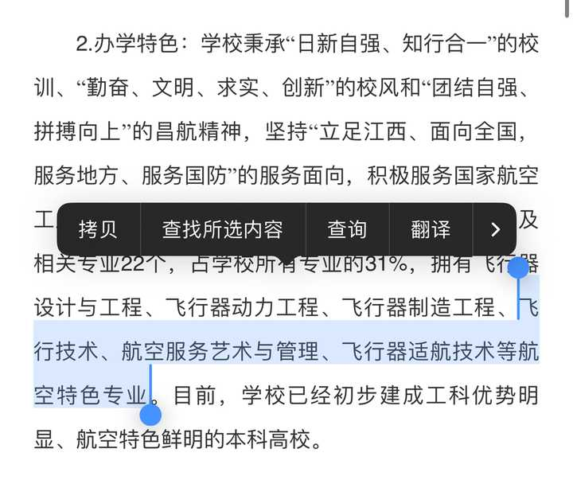
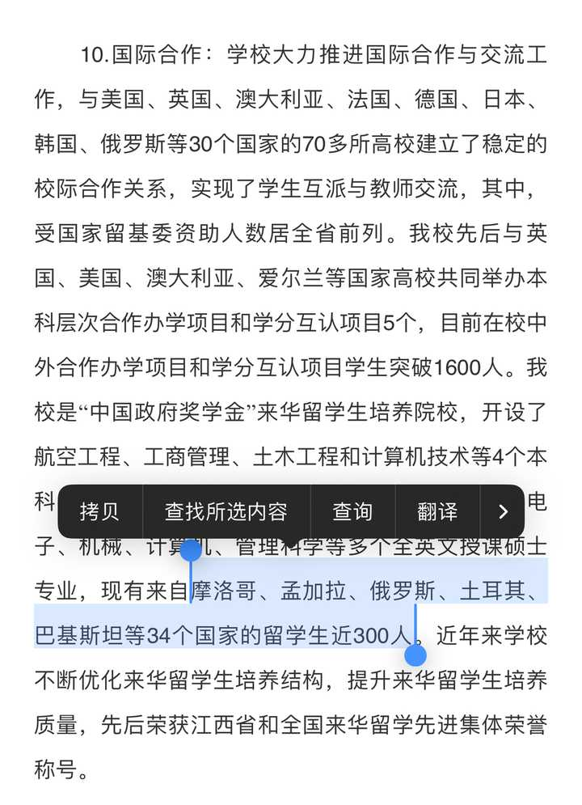

---

## 1639　贪官

- 日期：2024-04-16　主专题：A12 战争军事外交与大国秩序　副专题：A18;A10
- 源 ID：`54af5c2a-7be2-502e-b290-f3ba462d5b0e`　原文链接：https://afdian.com/p/3703bed6fbda11eeb15852540025c377
- 23 概念标签：事实与证据;能力与学习;责任与后果;成本与总账;爱与回应;边界与许可;劳动与组织;法律与秩序;技术与工程;文明与历史
- 证据状态：manual_confirmed　初读：read　独立复核：not_reviewed

**问**：请问，贪官为什么升得快？

首先，贪官升得并不快。
论火箭式提拔，往往发生在众所周知的清官、白身士人身上。
例如海瑞、袁崇焕、康有为、梁启超。这些人往往一言既合，平步青云，短短时间连升五六级，转眼间成为机要重臣。
所以中国真正有野心的官员都高度重视“爱惜羽毛”，别说贪、渎，就是可疑一些的交往、家人之间的来往都会极端警惕。
只有“清流”可以入中枢，这是中国的长期传统。而有贪腐争议的官员最多只能做外放督抚，当一当“云南王”之类的地方实务官，或者六部的佐贰、吏曹官，不能入阁、不能当宰辅、不能当六部尚书，更不必说御史这些风纪官了。
这些人也有自知之明——ta们根本不会去谋划这些职位。因为自家知道自家事，自己身上可以被抓的把柄太多，一旦入主中枢、涉及到天下大政，那敌人就可能多到自己应付不过来，随时随地可能东窗事发，搞得抄家灭门。
这类人贪的有，但是往往是先坐稳了位置，养全了派系，尤其是把几个关键职位——例如都御史——放上了自己人，然后才开始贪。而不是在上位之前就开始乱伸手。
所以“贪官升得快”是个错觉，是个低级办事员级别才会有的特殊误解。
它只快在“科员升科长、处长、**”这个阶段——想上厅长都非常困难而且危险。
只是因为很多人——尤其是“平民出身”的人对自己的仕途最大的野望也就到“实职正处”为止，所以才会觉得“转眼就升了科长、副处长”简直“神速”罢了。
之所以如此，是因为这个级别相对来说仍然比较局部和低级，监察、风纪部门毕竟精力、人手、预算都有限。投入大预算、精干队伍去紧盯副省级以上的高级官员——其总数目前大概不超过一万人——尚在常规力量所及范围之内。
这也是“关键的一万人”，这一万“副省以上”的官员，是确实有机会入主中枢、执掌大局的。所以ta们的履历档案在御史台是没有空白的，每月、每季、每年都有专门的报告和记录，丁点污点嫌疑都会被记录在案——未必会导致去职，因为地方事务极为复杂，想要连嫌疑、传闻都没有，极为困难。
但嫌疑传闻过多，会妨碍ta们再进一步，登堂入阁。
这一点ta们自己也清楚，所以正如上面所说——很多人也没有这个打算了。
这也是为什么殿试出身的进士们，往往不愿意外放做地方官，而宁肯在京做个翰林院之类的虚职候补。因为不下地方，那些错综复杂的地方利益关系就不容易伤及洁白的羽毛。这样六部前辈总是要老的，自己总有出头上位的一天，哪怕只是实职管个收发公文、核定钱粮物料这类的小职缺，也是地方督抚大员也不能敷衍的地位。万一运气好，凭着毫无污点的身份，反而比那些举人出身、从知县亲民官出身的官员有更高的天花板。
而一旦超出这个“关键一万人”的范围，那就不是中央监察机构凭常规业务能监督得了得了，势必要由地方分支机构来监管。一下了地方，那么这些机构就很难摆脱地方主政官员的影响和掣肘，自然对处级以下的官员火力就要松一些。
这就给“不打算再进步的地方实权官员在处级以下安排代理人、白手套”留下了天然的空间。
这个阶层总人数极多，受到的监管可以被其保护伞有效的牵制，极其接近各种项目资源的一线操作，而且往往人员出身于缺乏政治素养、历史觉悟的家庭，也从一开始就没有“入主中枢”的野望。
所以ta们极容易受到“提拔”的诱惑，接受“当白手套”的灰色安排。
这个“从科长到处长”的层级，就是反腐的第一线、重灾区，也是让人民群众体感最强烈、最容易产生激烈批评的根源，也确实是庸官、“夹袋中人物”的孳生场。
这就是“贪官容易升”的传说根源——它只是出身寒微的小科员和屡受其害的老百姓的视角里容易得出的结论，并不是整个的全貌。
但这个问题，坦率讲是在历史性地趋于改善的。
一个最根本的因素，就是监管技术的划时代发展。
以前之所以如此，是因为“一万左右的中央监察团队”从脑力上、信息处理能力上根本就不可能有效监管“关键一万人”以上规模的人群。
在用驿马、纸质公文的时代，这从技术上就根本是不可行的。哪怕是用电报、电话替代了驿马的近代，都仍然在技术上没有实质改善。
尽管在档案管理上，我们超过西方文明几个世纪，早就做到了纸质记录能做到的合理性极限（所以我们才凭着驿传、邮政这样的系统超越时代的撑起了一个宏大的帝国），但可以说直到21世纪信息化革命为止，“关键一万人”就是所有大国能有效监管的极限了。说句坦白的，在这方面我们已经是极端的优秀，其他国家对这“关键一万人”的监管大多数都是形同虚设，所以才会在各种zz理论、社会科学已经高度发展、社会价值观高度发育的前提下，仍然不断的爆发军事政变、内部分裂、内阁总辞……这类的“zz地震”，以及不可避免的形成实质的门阀统治。
所有人都知道什么是对的，但只要这“对关键一万人的监管”无效，这些理想就根本不能落到执政的现实。
正是因为这个原因，这些国家干脆反过来操作，搞出了“票选制”这样一个折衷方案，把“监”和“管”的责任从理论上推给了民众。
理论上，“监”可以靠拥有高度受保护的采访权的自由新闻媒体，“管”可以靠老百姓手中的选票，这样就足以不受“一万人有效监管”的技术性极限的限制，在低技术条件下实现系统的自我稳定。
问题是，这个理论有一个至关重要的“阿喀琉斯之踵”——它有一个默认的前提，就是必须首先假定“一万人监管上限在技术上永远不可能被突破”。
一旦“有效监管一万人”的上限被突破，甚至突破到上十万人、上百万人，“必须依靠票选制解决监管困难”的逻辑前提就不成立了。
而这一点已经有了极为鲜明的反例——我们都知道公司就是典型的强监管实体，所有的业务决策、工作流程、财务变化，都会被记录在案并追究责任，而公司还是靠自己远不如国家实体的原始资本和盈利在承担这个监管责任，还要在这个承担的基础上创造利润。
现在问题来了——最大的全球企业已经能达到数十万人的规模。
沃尔玛，230万员工。
亚马逊，160万员工。
中国石油，159万员工。
大众汽车，61万员工。
苹果，13.7万员工。
特斯拉，14.1万员工。

这只是随手举例，实际上百万员工以上的企业比比皆是，十万以上的全球绝不下于一千家。
只要这些企业没有倒闭、经营状况看上去可持续，就已经从实践上证明——这个规模的有效监管是可行的、可期待的。
注意，是有效监管，不是“完美监管”，不是一点问题也不出，而是仍然会出问题，但出现的问题的损失不足以吞吃掉企业的全部利润，根本的损害企业的可持续性。
这些百万人的企业的岗位大概除了工会部门之外，根本没有采用“员工票选制”或者“全体顾客票选制”，甚至都没有采用“全体股东票选制”——不少股份是没有表决权的。
然而事实证明，它们绝不是“毫无疑问都在单程走向死亡”，反而是这个世界上活力最旺盛的组织典范。
事实摆在眼前，借助现代管理体系和现代信息技术，有效监管百万人规模的组织，将恶性违规控制在一个相当低的、不足以妨碍可持续性的水平，是一个可以做到、甚至已经被做到了的合理预期。
我们可以做到对“关键一百万人”得到有效监管。一旦把这个规模扩展到100万名额，你就会发现传统的“科级到处级”已经在相当程度上进入了监管范围。
尽管这还不足以覆盖总数达到数百万人的全部公务员，但也足以覆盖远超近代政府的水平，打破很多1500年以来的zz哲学自认为不可能被解决的初始假设。
事实上，西方zz理论对抗中国成功的社会治理实践这个难堪的现实的主要逻辑，已经从“它肯定即将崩溃”论，转向了“警察国家”论。
在之前ta们迷信“有效监管不可能达成”，所以一切看上去实现了的状态自然只能是跳起来够到的桃子，下一秒就应该坠落。
结果中国经济“奇迹”了四十年，还没崩溃，ta们已经辞穷了。
所以才会幻想“集中营”“再教育营”“social credit”这些“警察国家”的“特征”，利用常年熏陶构造出来的民众对“失去自由”的恐惧来对冲中国模式的影响力。
但ta们又忘了“公司模型”的另一个可怕的意涵——如果你把企业的直属员工看作一个“经济王国”的公务员，而把其顾客群体看作“自愿移民”，那么苹果、特斯拉、facebook、YT……等等这些企业实际上在实施的恰恰是ta们嘴上说着无比恐惧的“police state”统治。
ta们掌握着随时读取客户资料的完全权力，一切自由，甚至有着单方面没收用户账号积分、成就、品牌直至终止服务的绝对“独裁”权，按理说已经是“police state”的极致实现。
但仅仅凭着一个“你可以自由停止使用服务”的opt-out条款，它们仍然不乏趋之若鹜的、愿意主动接受其“统治”的用户。
“苹果王国”“亚马逊王国”“微软王国”“淘宝王国”的“人口总规模”，早已经超过了美国。
人们在经济意义上正在用实际行动选择“治理良好的police state”。
ta们只看到了中国作为显性的以强监管、良治理为核心逻辑的国家的成功，还在寄望于“中国是罕见的孤例”，幻想靠捏造一点黑材料、编造一点恶咒，甚至耍一些流氓手段，就能挽回对那个早已在时代发展面前左支右绌、陈腐落后的社会模式的信仰。
却没想过，实际上真正最有说服力的例子并不是中国，而恰恰正是他们引以为豪，自认为是“资本主义之光”的超大型企业。
微软、苹果、亚马逊、特斯拉才是真正证明中国模式必然战胜西方票选制的决定性证据。而这些证据已经多到如此显然、如此无可回避、如此的彻底。
值得注意的是——中国作为一个完全的、独立的主权实体，比起这些大型企业有着更强的立法、司法自主性，更不用提有更强大的资源和资本。
以这样强大的基础和如此优越的主权条件，中国的“有效监管人数上限”没有理由不远远超过亚马逊、苹果这些企业。
它要服务的客户群总量只有这14亿，而且规模还会收缩。
它真正的挑战在于它要提供的有效服务在业务上要远比苹果、亚马逊复杂。
但是你们要注意——类似淘宝、美团、腾讯、小米、华为这样的企业，难道业务真的很简单吗？
“有效监管整个公务员团队，为十四亿人规模的市场提供充分有效的公共服务”，在技术上、实践上是完全可行的。
既然这是可行的，它就值得投入最大的资源、尽最大的努力去实现——因为归根到底，国家的职能不过如此。
不是吗？
所以，不要再有“处级以下不会被有效监管，这个阶段贪官升得更快”的幻想。
这也许在某些地区、在近在眼前的几年仍然是一个暂时成立的经验，但这个经验正在急速的、不可逆的崩塌。
你如果仍然根据过去几千年的老黄历——尤其是西方那些自我安慰的摇篮曲——去赌这个“传统”将会被无限延续——这么说吧，你最好在某个有史以来都没上过新闻的县市里任职，并且十年内就会退休。超过这个级别、这个生涯长度，而你已经有了一些值得忧虑的隐患，那么奉劝你尽快收敛，甚至找机会离开这个环境。
因为凛冬将至。

---

## 1628　镇妖塔

- 日期：2024-04-21　主专题：A12 战争军事外交与大国秩序　副专题：A20;A10
- 源 ID：`1e7410ed-09a2-5a04-a2e1-484b7b8c6085`　原文链接：https://www.zhihu.com/question/653627815/answer/3473760031
- 官方对象—实践路径：与社会 / 与历史 / 评价
- 23 概念标签：事实与证据;定义与达意;能力与学习;选择与自由;责任与后果;爱与回应;法律与秩序;文明与历史;民族与身份
- 证据状态：manual_confirmed　初读：read　独立复核：not_reviewed

**问**：日本没有爱国教育吗？

日本和德国是二战战败国。根据联合国宪章第107条，联合国安理会不得阻止战胜国对“防备此等国家再施其侵略政策”而采取的行动。
再次鼓吹“优秀的大和民族 / 德意志民族”，就是“再施其侵略政策”的活证据。
别的国家可以搞，别的国家自称“优秀的中华民族”“优秀的朝鲜民族”“优秀的美利坚人民”，别人没什么可多嘴的。
这两个国家不行，没资格。
搞，那就要面对武装干预，政府就要被接管、整改。
这条国际法的效力是高于这两国的宪法的——否则这两个国家的主权存在在二战结束后就应该完全终止。这是“不杀之恩”的交换条件。你还活着，你就要无条件遵守；你不遵守，那么借给你的命也就要收回。
不服气，你们当初不要选择“无条件投降”，你们可以试试“允许我们再次发动侵略我们就投降”或者“总玉碎”。
选了，你就要为自己的选择承担后果。
这也是为什么中、俄最近的发言经常提起“挑战战后秩序”。
日本当然浑身发痒想要推翻这座镇妖塔，但它没这个道行。
至于说什么“除了中国没有谁搞爱国主义教育”云云——基于社区的友善度要求，此处没有可用的评论。

---

## 1573　强权和公义

- 日期：2024-05-21　主专题：A12 战争军事外交与大国秩序　副专题：A10;A17
- 源 ID：`82b4a79a-6678-528c-ac70-491fe1f4fed7`　原文链接：https://www.zhihu.com/question/572319441/answer/3505576725
- 官方对象—实践路径：与社会 / 与组织 / 参与
- 23 概念标签：能力与学习;成本与总账;爱与回应;劳动与组织;法律与秩序;权力与异议;文明与历史
- 证据状态：manual_confirmed　初读：read　独立复核：not_reviewed

**问**：你是否认同国际上武力和强权才是真理？

武力和强权的成立，在背后有深刻的合理性支持，不可能是凭空存在的。
可以这么说，长期稳固的优势武力，本身就意味着背后有足够的公义性和正当性——因为人类并不是简单的吃软怕硬的动物。如果一种武力对自己没有正面意义、只有负面剥夺和威胁，那么这个武力无论多么强大，人类也会找到办法去抵抗和破坏它。
能长期维持的武力优势必然在消解人们的恐惧和敌意、争取人们的支持和爱戴方面有足够的投入，并且有相应的成效，否则它就算一时领先也无法持续太久，往往很难坚持两代人的传承——在世代交替的时候，不同立场的内部继承人彼此间就会斗争分裂，而这些继承人之间是没有武力代差的。这些继承人之间的实力差距往往就来自被这武力统治的外部人的支持和反对。
只不过这可不是一堆稻草，而本身就是一群骆驼。
对方那边多站几头骆驼，你这边的骆驼自己就会悄悄往对方跑，你直接要失败。要是两边你七头、我八头，那么帝国本身就容易一分为二。实力互相抵消只多了一头骆驼的净武力，那对外部的强权还能维持吗？
所以强权武力要维持，必须建立在内部武力被不断的完整的代际传承上。
能做到这一点，必然意味着骆驼们在默默的投向正统继承人，而非因为群情激愤而导致非正统继承人觉得“民心可用”。
所以，不要天真的认为“强权和公义无关”。
强权和公义虽然不能说亲如一家，但至少也是自小走动的世交好友。
至于说“强权即真理”，这就属于瞎胡闹——勾股定律属于真理，跟强权有啥关系？
凡属真理，就平等的对每个人都有效，任任何人利用。强权在这没有任何影响，也没有什么所谓垄断性可言。

---

## 1533　迷途知返

- 日期：2024-06-14　主专题：A12 战争军事外交与大国秩序　副专题：A02;A04;A18
- 源 ID：`70763aa7-32b7-54cc-9247-58ac006187e5`　原文链接：https://www.zhihu.com/question/658832455/answer/3530234572
- 官方对象—实践路径：与社会 / 与文化 / 批判
- 23 概念标签：事实与证据;能力与学习;责任与后果;劳动与组织;技术与工程;文明与历史;性别与身体
- 证据状态：manual_confirmed　初读：read　独立复核：not_reviewed

**问**：如何评价「她的山」全女户外团队在鳌鱼沟集体迷路，险些酿成严重事故？

这真的跟性别有关系吗？
别说“户外团”，堂堂几千几万人受过专业训练的军队在野外迷路的在历史上比比皆是。
这可没的抵赖——这类“事故”多得你双手双脚加起来都数不过来。
成连、成营、成团、成师的部队到处乱走，又有侦察兵、又有指南针、又有望远镜、又有电台、又有军用地图，还是走到别的山头、别的战场去了，根本没有遇到友军，最后连自己到底在哪都说不清。
中国的美国的，罗马的希腊的………古今中外，不绝于耳，甚至可以说凡多国大战，不出这么几例都奇怪。
众所周知，现代以前，军队是没有女性的。那可是几百上千乃至上万人，搞错方向和时间弄不好有人会判死刑的。还不是照样迷路。
你们又对这种历史事实有何评价？
你对这些历史事实的评价和你对“全女团迷路”的评价，逻辑上兼容吗？
还是说你要双标起来？
迷路跟性别没关系，准备不充分，不分男女都要迷路，准备充分，不分男女都不迷路。
一个只跟准备是否充分有关的事故，被你总结成问题出在性别上。
这说明什么？是性别有问题，还是你有问题？

---

## 1502　由华入美

- 日期：2024-07-01　主专题：A12 战争军事外交与大国秩序　副专题：A17;A03;A06
- 源 ID：`60f43d6b-b93f-5f14-aecb-682eec1d5a19`　原文链接：https://www.zhihu.com/question/602108585/answer/3548254438
- 官方对象—实践路径：与亲族 / 与子女 / 抚养
- 23 概念标签：能力与学习;选择与自由;爱与回应;财富与市场;法律与秩序;技术与工程;文明与历史;民族与身份
- 证据状态：manual_confirmed　初读：read　独立复核：not_reviewed

**问**：9岁女儿向往美国，说长大了要入美籍，做一个真正的美国人，我应该持怎样的态度去看待呢?

正好激励她学好英语。
不学好英语，就没法听到美国人亲口撒的谎，很难看懂美国人自己对自己的批判。
容易造成自己的幻想。
美国可以是一个选择，但不能是基于幻想的选择。
真爱是建立在正视的结果上，和建立在想象上的迷恋不是一回事。
美国也有很多美好的人，也有足够灿烂的文化，也有足够好的前途。它现在犯糊涂不代表这个国家“完了”，或者没有任何值得一个人寄托信念之处了。
地球要好，中美都要好，都各自需要好的人去让它变好，这些人没有必要出生在中国就只服务于中国、出生于美国就只服务于美国。
“在哪个祭坛上献祭，受祭的都是全人类”。如果是这样想问题，就没有必要执着于国籍，可以随遇而安，各凭机缘。
现在的差别并不是我们代表正义、美国代表邪恶，而是我们代表清醒合理性，美国代表固执和傲慢，后者会造成很多恶果，甚至在悔改前与邪恶相近，但处理的手段并不是“寻求消灭邪恶”，而是要寻求促进它尽早清醒，回到共存共荣的正轨上来。
我们一定会赢，不是因为我们正义，而是因为美国在搞非此即彼，而我们始终在寻求共存共荣。
这不是“你要我死”和“我要你死”之间的斗争，而是“你要我死”和“我要共存共荣”的斗争。
所以我们才会赢，而我们的胜利不会是美国的失败，而是寻求共存共荣的美国对寻求愚蠢霸权的美国的胜利。
为了这个原因，让一个出生于中国的人成为寻求共存共荣的新美国人，对这个大业毫无坏处。
这也是唯一天然受祝福、站在历史正确一边的选择。
如果你是抱着“这是你死我活之战“的念头自以为在从会死的一方投向会活的一方，你会发现，将来你是双方战友的共同敌人。
未来的美国会自己反对那个一心执着你死我活的愚蠢的美国，而你作为旧神的信徒只会被新的美国厌弃，而且在这个过程中受到大量的损失。
祝你好运。

---

## 1421　副武器

- 日期：2024-07-31　主专题：A12 战争军事外交与大国秩序　副专题：A13;A07
- 源 ID：`df26769a-1adf-5fd1-b22f-3b625418c70a`　原文链接：https://www.zhihu.com/question/663025648/answer/3579239546
- 官方对象—实践路径：与自己 / 与财富 / 使用
- 23 概念标签：事实与证据;定义与达意;能力与学习;成本与总账;爱与回应;财富与市场
- 证据状态：manual_confirmed　初读：needs_reread　独立复核：not_reviewed

**问**：王楚钦夺金后球拍被踩坏，生气质问「怎么举报他们」，单打比赛马上到来，换拍对他影响有多大？

这不应该会有很大的影响。
其实主要是严重依赖器械、而器械又容易受到激烈挑战的运动，职业运动员都有携带备件、用备件练习的习惯。
撑杆跳的会多带副杆，打网球、羽毛球的会多带副拍，射箭的一般都要练双弓。
真打起比赛来，只要对手里的器械有了一丝怀疑，怀疑瞄准器松了、侧垫移位了、拉线的张力不正常了、或者有异响了，都会果断的换副本继续比赛，而不会现场搞什么修理。
一个是现场没时间，一个是修了还要校准，现场也没有这个条件。
还有一个特殊的情况，那就是作为签约球员，厂商跟你签了合同，要求你必须要给某个新品牌、新型号“开个光”。
比如踢决赛，上半场用这个系列的鞋，下半场用那个系列的鞋。这样你要是得了冠军，这个鞋就是冠军鞋了。
这是收了钱的，你非用不可，那肯定也给了你足够长的时间去适应了。
这个在射箭领域很常见，所以你看韩国队、美国队，经常可以看到ta们的队员举着两把弓出场。
一来，射箭对器材的依赖极大，而大磅数的弓的确震动很强，稍有不慎，就容易引起射手对器械的怀疑。如果ta确信自己的动作没问题而打出来的环数令自己意外，往往就要怀疑器械出了问题。去检查哪里出了问题四季不可能的，只会选择换另一把调好的弓。
二来，弓箭器材厂商才是这个运动的主人。“破过记录 / 拿过世界冠军的型号”是利润极为丰厚的，只要冠军赛上开一下光，运动员和俱乐部都能得到大笔的捐助，这不是小钱。对某些人来说，这就是职业生涯的价值。
所以如果真的发生了“一件器械受损就没法比赛”这么严重的事，只能说明远动员和团队还不够专业。
如果是有人把所有器械都破坏了，那另当别论。
有些人非要跟我争论所谓“换球拍不可能不影响手感”。自己看人家当事人自己的回答：

谁专业？

什么叫专业的双器械策略？
为了防止手上的器械出问题严重影响表现，专业运动员会同时适应两个一模一样、不可分辨的器械。
出场批次相同、提前用了专业仪器检测，装配参数完全相等，平时练习就会轮换着用，确保两者的手感都不可区分或其微小差异早就被自己熟悉。
有人会拿张怡宁的换拍事件说事，那是搞错了性质。张怡宁那不是都验过了的拍子坏了一个，而是拍子根本没过审，A拍既然没过审，配置完全相同的B拍当然同样过不了。那跟A拍打坏了可以用B拍无缝替换根本是两回事。
这跟业余爱好者的主副拍也是两回事。业余爱好者经常搞两个不同配置的拍子，甚至一个直拍一个横拍，那不是为了“在关键比赛中保稳定发挥”的，那是为了尝鲜试玩，好玩更多的技术，为了玩得开心的。
根本两码事。

不要自己随便拍脑袋断言我“肯定不清楚”。
我根本没有不核实不调查就随便开口的习惯。
我只要开口，背后必有调查，必有依据。
这跟“大学学什么专业”“工作什么性质”根本没关系。

<!-- 图片：1 张，审读结论见下 -->

---

## 1357　生育恐怖主义

- 日期：2024-08-29　主专题：A12 战争军事外交与大国秩序　副专题：A06;A02
- 源 ID：`1643fb18-9a9c-5f0c-aa19-3e14e55ba064`　原文链接：https://www.zhihu.com/question/665426714/answer/3610173802
- 官方对象—实践路径：与社会 / 与文化 / 批判
- 23 概念标签：定义与达意;能力与学习;选择与自由;照料与家庭;法律与秩序
- 证据状态：manual_confirmed　初读：needs_reread　独立复核：not_reviewed

**问**：俄罗斯拟将丁克主义者列为恐怖分子，给你带来什么感受与评价？

“丁克族”指的是因为种种原因无子女或者不适合生育子女的人群，人家自己未必是反对生育，更不是去反对别的愿意生育的人生育。
而“丁克主义”指的是认为不生育比生育绝对的高贵，主张你就是能生、愿意生，你都应该忍住不生——是主张有人把枪顶在你脑门上你也应该宁死不屈的不生。
丁克是自己不生，丁克主义是要鼓吹让别人也不生。
这没有什么可解释——宣传这类思想当然是赤裸裸的反人类罪，当然是恐怖主义行为。
丁克根本就不该是丁克主义的结果。
每一个健康的丁克内心深处都只能承认是自己无力负担、没有勇气支撑抚养子女的重担，而不是反过来觉得自己是有超人的智慧、卓越的勇气。
人要有基本的是非观——你都要灭绝人类了，你还不是反人类罪？反人类罪岂能不是恐怖主义行为？
不是之前人人都在喊“你自己不吃狗肉是一回事，你主张别人都不能吃狗肉是另一回事”吗？
这道理放到自己身上，轮到自己是“不吃狗肉”的一方，就变成“岂有此理”了？

<!-- 图片：1 张，审读结论见下 -->

---

## 1354　房产税之外

- 日期：2024-08-30　主专题：A12 战争军事外交与大国秩序　副专题：A15;A08
- 源 ID：`a0155f03-69f1-5f7e-a929-4a2767a1f665`　原文链接：https://www.zhihu.com/question/601648251/answer/3611083685
- 官方对象—实践路径：与社会 / 与社区 / 共建
- 23 概念标签：选择与自由;成本与总账;财富与市场;技术与工程;文明与历史;心理与主体
- 证据状态：manual_confirmed　初读：read　独立复核：not_reviewed

**问**：用什么方法可以解决土地财政向房产税过渡阶段所产生的社会矛盾？

开个小脑洞——政府可以在房价低迷的年景以低价回购房产和地皮。
回收的房产可以用作保障住宅，回收的地皮可以重新做规划挂牌。
政府通过控制规划，是最容易做高房价的“总开发商”的，而微妙的是——它要有本事做得起来，那这个钱真该它赚。
而另一方面，政府的保底收购价要远低于一般市场价，而且这个保底价格只要你卖，政府就会回收，无须再议。
以这个价格，可以说只要收回来了就亏不了。
而“房产价格不可能低于政府回收价”本身就会在很大程度上刺激房地产市场的信心，因为它从根本上消灭了“一文不值”的可能性。
从法理上讲，这也没什么说不通的——本国的政府治下，不存在“一文不值的土地”这一说。
不过，这个回购制度的建立需要严肃的试点、完善过程。
这是对整个房地产市场乃至房产制度的根本性改革，和西方的一些类似举措是不能类比的，因为我们本身就是土地国有制，制度基础跟对方就不同。
但实际上，从法理上讲，这个做法才是全民所有制国家解决土地循环利用问题的正道。
“房产税”这个方式，本身就有强烈的刺激土地产权永久私人化的内在倾向。一旦政府的财政收入来自房产税，政府将会有难以遏制的冲动去支持现在的持有者无限持有，以保证税基。
而房产回购政策则从一开始就从根本逻辑上将政府作为地权的永久托管者的身份通过数学逻辑保证了。
因此，探索如何将这个制度完善的运转起来对中国的社会模式的数学自洽、社会契约的逻辑自洽有战略性的意义，值得投入严肃的努力进行必要的探索和尝试。

---

## 1295　咩

- 日期：2024-09-19　主专题：A12 战争军事外交与大国秩序　副专题：A15;A07
- 源 ID：`aec08ba5-cba3-5645-95be-0411d92027c4`　原文链接：https://afdian.com/p/ebf58706760111ef8e515254001e7c00
- 23 概念标签：选择与自由;责任与后果;成本与总账;财富与市场;权力与异议
- 证据状态：manual_confirmed　初读：read　独立复核：not_reviewed

**问**：如何平衡资本市场的发展和社会稳定之间的关系？

事实上，在这个问题上答案可能出乎人的意料——那就是不要“过度法制化”。
具体来说，就是策略性的避免过早立法，不要提前给过于敏感的领域中有灰色嫌疑的投资行为吃定心丸。
你要胆子大，可以伸头试试，但是只要造成恶劣社会后果，那么锤子落下时你也风险自担。
也就是有一个代表社会总体利益的强政府有意的通过战略模糊实行“刑不可知、威不可测”的策略，迫使资本不能再以明确的法条为阵地搞危险试探，必须积极的、主动的在盈利和突然死亡的风险之间自己建立安全距离。
这看上去很“原始”，很“不科学”，但却是唯一可以震慑资本妄念、强迫ta们把自己的预见性用在受到明显祝福的方向上的战略手段。
有些灰色的——甚至自己干脆就知道是黑色的——行为，在这个策略下，就不能再凭借“我这是合法的”获得能大规模融资的安全感。这就会迫使这些行为不得不搞大量的回避监管对策，例如注册大量的皮包公司、搞复杂的分流、转移交易系统，并且不断的将侥幸获得的利润赶紧抽走落袋为安。
这样这些行为虽然没有被杜绝，但却因为效率被极大的干扰、资本额被极大的限制、再投入比例被极大的压缩而先天无力。ta们就不敢上真正的规模，只敢在半地下状态通过收买非常低阶的官员半死不活的苟且存在。
这样就注定这些“高风险项目”只能是癣疥之疾，只能及于肌肤，甚至难以及于肠胃，更遑论骨髓膏肓了。
形象点说，如果你架起一道明确的篱笆，哪怕你给这篱笆通上高压电、架上机关枪、装上探照灯，你都会在凌晨三点看到有些神人顶着绝缘伪装毯在那翻铁丝网。
但是你插一个“此区有地雷”的牌子，然后隔三差五放一下烟花，各路妖魔鬼怪就会真的学乖。
这种不确定性是实践检验的唯一让资本的力量真正敬畏的手段，于是这个手段被资本力量动用一切资源大加挞伐——或者不如说就是污名化、妖魔化。
这个逻辑是这样的——这种不可预测性妨碍了经济繁荣，妨碍了你们变得富裕和我们给你们提供更加丰富的服务，另外这种“威权主义”也不能坚实的保护你们的个人权利，你们随时可能变成这个强大的、不受你们控制的意志的牺牲品。
你看，我们富人、财团都对付不了的巨兽，你们这些穷人、无名百姓怎么可能对付得了？你们晚上怎么睡得着觉？大家怎么能不团结起来，让这头巨兽匍匐在你们的脚下？
问题来了，能匍匐在这些弱势群体脚下的巨兽，怎么可能不同时匍匐于掌握资源、组织性远胜过“弱势群体”的资本集团的脚下？
一旦这样的逻辑建立，资本就可以劳动强大的宣传机器，**弱势群体，通过煽动弱势群体的不安全感、恐惧感和贪婪，去征服那头让ta们胆寒敬畏的巨兽。
而这头巨兽到底挡在了哪些“本可以提供的丰富的服务”、哪些“充满了创意的经济探索”上呢？
卖淫、买春、赌、毒、武器、“个人金融服务”“实验性医疗”、器官买卖……
只要能用“享受这些丰富服务”的自由和“通过这些新业态获得更多财富”的利益和“不受你们控制的巨兽吞噬无助的你”的恐怖把“弱势群体”争取到自己旗下，就有可能击败看守着令人垂涎的黄金的恶龙，大家就可以发财了。
这就是现在舆论战、认知战的基本原理，也是各路网军抓住一切机会猛攻的人心弱点。
你看看ta们在干什么？抓住一切鸡毛蒜皮的小事夸张、扭曲，塑造“官方偏向你的敌人”和“霸道的公权力”的故事，渲染“底层民众”的无助感。
狼在教羊憎恨牧羊犬，因为牧羊犬不允许羊在围栏外自由的生活，每天夜里都要驱赶ta们从自由的草场回到逼仄的围栏内。
狼们要的也“不多”，ta们希望羊们可以要求牧羊犬以后按照严格的轮班表沿着固定路线巡逻，另外遇到“羊不愿意回羊圈”不可以采用强制手段。
So, 懒羊羊，现在你看懂“如何平衡资本市场发展与社会稳定之间的关系”了咩？

---

## 1291　看上去很美

- 日期：2024-09-20　主专题：A12 战争军事外交与大国秩序　副专题：A18;A07
- 源 ID：`f6654150-63a4-501c-943e-2bd636c4311e`　原文链接：https://www.zhihu.com/question/667431478/answer/3630615684
- 官方对象—实践路径：与社会 / 与文化 / 批判
- 23 概念标签：选择与自由;成本与总账;爱与回应;法律与秩序;文明与历史;民族与身份;心理与主体
- 证据状态：manual_confirmed　初读：read　独立复核：not_reviewed

**问**：日本ACG中的政治总是写得一坨，是因为国情(老登当道)和历史(杀人如麻)吗？

因为日本并不存在严肃的zz学，只有貌似严肃的zz学，这是非主权独立国家的通病。
为什么呢？
因为非主权独立国家有一个先天的、不可克服的缺陷——它被剥夺了质疑、反对宗主国、殖民国意识形态的权利。
这就像一个人得了癌症，一切的症状都来自这个巨大的肿瘤，但是其医学研究不允许研究这个肿瘤的问题，根本不允许得出任何归咎于这个肿瘤的结论，只能研究在如何不触碰、不质疑这个肿瘤的前提下“增强体质”“保持健康”。这样的“医学研究“注定要结出怪诞、荒唐的结果。
有人问这跟一个主权独立的国家维持自己的政治正确有何区别？
区别很大——主权独立的国家出于稳定和国家安全需要，也同样有必须要维持的、不容挑战的zz正确，但是有这么几个关键的区别：
1）这种“不容挑战”往往对学术界——尤其是智库、专家等内部参谋系统——有刻意保护的额外自由。因为“意识形态挂帅”的风险性是显而易见的，真正的决策层必须客观的考虑一切风险和一切选择。这只是要避免在一般舆论场上引起大量无谓的社会摩擦和代价而已。
2）这种zz正确往往是被克制、收缩的，而不是像被殖民国被勒令的那样，是完全不容挑战和质疑的。其实以我国为例，你会发现我们除了最核心的底层理念不容挑战，实际上在执行层面高度灵活，而且演变极快，很多在早期被认为绝不能触碰的政策原则，都在解放思想、大胆试验、实事求是的原则下被尝试和被推广了。我们在教条原则上一直在做减法，它总体上是一个“必须严守的教条越来越少，但仍需被严守的信条也越来越严”的聚焦的过程，仿佛一大团矿石被不断锤炼至一枚小而坚固的钢核，是不断收缩和凝练的，是一个迭代进步的收敛过程。
而被殖民国被强加的思想禁制却是静态的、甚至是扩张的。
不能质疑美式mz，不能质疑美日“同盟”，不能“丑化”美国。这导致了日本所谓的zz学研究纯粹成了一种一本正经的表演，一种为了占住生态位以免资源流向真正的自由学术、严肃思考的畸形安排，一种化装成研究院的宣传科罢了。
这直接导致了日本人对zz的无知和愚昧——或者更严肃的说——揣着明白装糊涂。
动漫作品充满这些幼稚情绪只是这个问题的外在体现之一而已。
其实殖民地都有这样的共性问题——日韩台菲都一样。
群众不可避免的在zz上愚昧化，其实就是殖民病的核心症状之一。殖民地的“zz研究”都是多余的，这是一个多么显然的简单问题——不然宗主国岂不是白混了。

---

## 1272　小武行

- 日期：2024-09-24　主专题：A12 战争军事外交与大国秩序　副专题：A10;A07
- 源 ID：`26ed07b1-e56e-5c29-8e05-ddb53e8d41c1`　原文链接：https://www.zhihu.com/question/624944310/answer/3634161729
- 官方对象—实践路径：与其它 / 与敌人 / 备战;与其它 / 与陌生人 / 防卫;与社会 / 与历史 / 解释;与社会 / 与社区 / 共处;与社会 / 与社区 / 共建
- 23 概念标签：定义与达意;选择与自由;责任与后果;信用与信任;财富与市场;法律与秩序;权力与异议;生态与自然
- 证据状态：manual_confirmed　初读：read　独立复核：not_reviewed

**问**：古代镖师走镖，为何区区十几人，却让胆大妄为的土匪不敢抢劫呢？

保镖、护院、坐馆、团练、从军，这就是所谓武行。
武行是正经行当，是体面人。
护院，护的是谁的院？不是致仕官员，就是地方豪族。这些人只可能接受师门传承分明，在自己势力范围内仰赖自己的照顾经营产业的武行来给自己保镖护院，否则哪位贴身护卫转行干起绑匪岂不是大家都尴尬了？
保镖，保的谁的镖？不是豪商就是官府。
坐馆授徒，地方团练，都要衙门照许，要合规合法。
多事之秋，从军入伍，往往有各种师门照应，叔伯奥援，很容易一翻手蟒袍加身，国家栋梁。
所以武行、军门、豪强、士绅，都是一体的。不要误以为武行真的就是地痞流氓自己给自己安了个好听的名字——武行和流氓是两回事。
就以保镖为例，不是什么东西都可以动用军队的，地方官除督抚一级可以调动亲卫标兵之外，军队调动都是兵部职司，擅自调兵者按谋逆处死。你还盘算着借两个侦察班给你送快递么？
只有武行镖局。
换句话说，如果在你的地盘上出了事，镖局来请你本地出手报复，你不答应的后果有哪些？
1）你本地的业务我以后就不做了，我不做，我同门的叔伯兄弟自然也都不做了。祝你们本地各位大爷生意兴隆，财源滚滚吧。
2）你觉得我家股东名单里都有谁？为什么张阁老家中的生意都是我威远押运？因为张家在我这有三成股啊，要不然为什么从北京到佛山我们能沿途设站，一路无阻？一路都是他门生故旧，你真以为是我拳脚无敌么？
我现在拿着拜贴上门，好言好语给你机会上进，你不识相，转眼吏部就会收到正式报告，年底一句“治安不靖，怠堕养匪”的考语，你想想怎么述职吧。
你说你手里只有几个衙役，不知剿匪怎么剿？
这样，你只要去东门墙外柳条巷，把这几家抓了，下在牢里就行。
这些山匪抢一堆人参难道是要在家养生的么？当然是要下山换粮食药品衣物金银的，不惹我我睁一眼闭一眼，甚至说不好还时不时光顾一下买点便宜些。惹了我我巴掌大一张条子叫你一粒米、一根炭都买不着，在山上啃树根穿茅草。到时候不怕你二当家不用你的人头换我一句不打不相识。
你都沦落到落草为寇了，又不是占州据府、自给自足到盘根错节的地方势力，而是那种靠给地方豪强干脏活被暂容存在的落魄之徒，你不满足于收点养路费过好你的小日子，你抽风想在我这发财？
山贼你都没资格当。
这不是武功招数的事，这都是人情世故。
人情世故能杀人。

---

## 1251　血性

- 日期：2024-09-29　主专题：A12 战争军事外交与大国秩序　副专题：A19;A01
- 源 ID：`84452840-fa75-5a15-a290-4003b8217bfe`　原文链接：https://www.zhihu.com/question/639171545/answer/3773921169
- 官方对象—实践路径：与社会 / 与文化 / 接纳
- 23 概念标签：定义与达意;责任与后果;成本与总账;文明与历史;宗教与自然法
- 证据状态：manual_confirmed　初读：read　独立复核：not_reviewed

**问**：最近回看大决战，为什么解放军战士都以做攻坚克难的尖刀为荣，做尖刀不是更容易牺牲吗？

说句实话，论起战斗精神，这个世界上没有人是中国的对手。
中国军队有一种“血性”，一旦激发了，根本视死亡如无物。
那不是什么“天堂有七十二处女”或者“瓦尔哈拉无限畅饮”的诱惑下的“欣然交易”，也不是日本式的“如樱花凋谢”般的“死亡理想”，也不是“富贵险中求”的极端投机主义。而是一种令人难以理解的，冷静的、决绝的、毫无保留的、而且是链式自激的默然的牺牲精神。
其确切的动机和理性逻辑事实上是神秘的、缺少研究的。
就是单纯的班长上去了，没完成任务，副班长上去了也没完成任务，老子把帽子拽下来往下一扔，老子就不信这个邪。
非把你这个碉堡炸上天不可。
这样，我先举高胳膊中一弹，然后趴下装死。等你转头去射击后面的同志时，我抱着炸药包冲进去拉线，我就不信干不掉你。
然后ta就做到了。
这期间ta有没有思考这对个人的严重后果、对国家民族的历史价值、对家族亲眷的附带影响……坦率讲，是不得而知的。
因为如果是一两个英雄人物也罢了，这样做的中国军人从古到今数量实在太多。
太多太多。
你很难全部用“畏惧军法”“想上天堂”“有理想”之类的理性理由全部解释。
总之就是会有数量令人难以置信的军人仿佛对死亡、伤残失去了感受一样，做出英勇都不足以形容的勇猛行为，使得很多按照“人总会怕疼、怕伤、怕死”的假设设定的作战计划出人意料的失败。
而且是一而再、再而三的失败。
以至于习惯按这个逻辑来构想战略战术的敌人突然一下不知道仗该怎么打了。
这个“血性”到底是什么，很难解释。但是一旦战争进入到一定阶段，这种“血性”就会发作。敌人面对的就是一支极端任务导向、高度机动灵活而又毫不畏惧牺牲的部队。
就像自己的命是刮奖抽来的，胳膊是可以再生的，除了不能浪费，用起来没一点保守。
做尖刀、选锋、先登的这些人，就是军队的精华，是军魂所系。
而更关键的是，ta们的高伤亡率往往不但不会令剩下的人感到恐惧退缩，反而会连环激发没有入选者的更强烈的血性导致尖刀越来越锐利、越来越多，最后压倒对手的承受能力。
这是文化深处的核心力量，是华夏文明的天赋。
敌人想不通这是为什么，想不通就对了。
正是因为没人想得通，所以这力量才会引起对手无法克服的恐惧和我军无法挫败的信心。
那么容易能想通，你自己不就会了？

---

## 1253　不吃素

- 日期：2024-09-29　主专题：A12 战争军事外交与大国秩序　副专题：A17
- 源 ID：`82c3122f-188f-581e-bc41-380e2f7a794b`　原文链接：https://www.zhihu.com/question/677506030/answer/3758864273
- 官方对象—实践路径：与友人 / 与同志 / 认同
- 23 概念标签：事实与证据;照料与家庭;法律与秩序;权力与异议;文明与历史
- 证据状态：manual_confirmed　初读：read　独立复核：not_reviewed

**问**：如何看待赖清德说“台湾绝不可能签‘和平协议’，要靠实力确保和平”，两岸和平统一还有希望吗？

最近有个很有意思的事。
有一个yter叫柳杰克，节目的主要形式是在线和各种来宾聊天，其中有一名常客，是一名长期把“参军”“沙滩见”挂在嘴边的深绿家庭出身的高雄少女。
这就是那种经典的“深绿天然独”，从小到大基本没有听过一句大陆好话的小孩。
结果高中毕业决定到大陆来读大学了，立场上来了个一百八十度大转弯，用柳杰克的原话形容，就是“已经变成了gcd的形状”。满嘴的“特殊国情”“把十几亿人口的国家治理好不容易”“投票也没那么重要”。
毫无“台湾价值”了已经。
契机主要是两个—— 一个是在台湾前途不理想，一个是到大陆来旅游了几趟。
类似郭正亮、钟鸣轩这些就更不提了。
这个现象在未来会越来越高发——因为“出路不好”这事会越来越严重，而“到大陆一看受到重大现实洗礼”的效应会越来越强烈。

和平统一的希望当然有，而且与一般人想象得不同——和平统一的希望从来没有这么大过。
很多人设想的邪恶、谎言失败的过程是一天比一天虚弱、式微，最后走向消亡，这其实是一个错误的预想。
如果你仔细查看历史，你会发现ta们走向失败的过程恰好相反，是一天比一天强横、狂暴，甚至到达了捕风捉影、白色恐怖的顶峰，到了老百姓道路以目、噤若寒蝉的近乎“绝对安全”的极致，然后突然轰然倒塌。
它要走过一个至暗时刻，由“盛极”而骤衰。
这不是一个由50%平稳下降到0%的过程，而是一个由50%上涨到90%然后在极短时间内突然跌落到-10%的过程。
糊涂人会因为“50%升到80%，而且看上去要升级到90%”感到悲观绝望，明白人却会因此感到振奋和乐观。
“平缓衰落而后浴火重生”是正义事业的特征，“盛极猝死”则是邪恶事业的共同命运。
这两者恰恰是互相对称的，发现了吗？
正义事业平缓衰落的过程，正是邪恶事业逐渐锦上添花的过程。而正义事业越是衰落到极点、邪恶事业越是烈火烹油，反而距离前者陡然浴火重生、后者轰然倒塌越近。
这也是为什么正义事业越近衰微时，同志越坚贞不屈，因为其实胜利近了，而邪恶事业越繁花似锦，恶人越癫狂虚无——因为ta知道ta们经不起下坡路，一旦气势顿挫，一切都会卷入恶性链式反应，转眼间化为虚无。
所以，不要以为台独从5分进到8分，看上去还要进到9分就以为“和平统一无望”。
恰恰相反，这是和平统一要进入真正不可阻挡的阶段的迹象。
因为它这是邪恶的事业，是不造血、只吸血的事业。
不要以为老天爷是吃干饭的。
ta何止不吃干饭，ta干脆连素都不吃。

---

## 1244　伊朗求和

- 日期：2024-10-01　主专题：A12 战争军事外交与大国秩序　副专题：A18;A16
- 源 ID：`a6e1594f-fb8b-5667-bc6b-e2ea029a265a`　原文链接：https://www.zhihu.com/question/668225043/answer/3958422603
- 23 概念标签：事实与证据;选择与自由;责任与后果;成本与总账;信用与信任;财富与市场;法律与秩序;权力与异议;技术与工程
- 证据状态：manual_confirmed　初读：read　独立复核：not_reviewed

**问**：伊朗要向美国屈服了吗？伊朗投了吗？

一个问题——假设伊朗现在求和的意愿就是真诚的，拿出和平协议来，要求也不高，条件也很合理，完美的符合了一切“屈膝投降”的定义，美国能签吗？
要是这么十足诚意的条件，都换不到美国签字，也换不到美国勒紧以色列的缰绳，那么伊朗国内的主和派、亲西方派要再拿什么来左右伊朗的未来议程？
战斗最大的障碍不是敌人，而是侥幸。
要发动战争议程，一定要满足两个条件——第一要让公民确信战争的代价相对于战争的收益微不足道，第二要让公民确信并不存在比战争更轻松的选择。
战争是要死人的，尤其是弱势的一方，如果没有坚实的、充分的理由去说明“毫无其它选择”，部队如何保持坚定的战斗意志？
而且战场一切顺利、高歌猛进那也罢了，一旦有所挫折、出现惨烈的伤亡，如果没有在战前极尽过和平妥协的努力，在政治上会留下何等严重的隐患？
战前有过极限的和平努力但却被对方拒绝了，这时候就可以一句话解决——“我们努力过，但对方没给我们这个选择。”
所以现在的伤亡无法归咎于我们的残忍，只能归咎于对方的残忍。在我们实力强盛时尚且得不到我们可以接受的和平，何况我们受到重大伤亡的现在？
要开战，这最后的努力最好是先做掉。
很多人以为压制主和派要靠无视主和派的意愿直接开战，主和派敢唧唧歪歪就抓起来杀头，这是非常幼稚的思考方式。
要压制主和派的影响力，要靠允许主和派先去谈判，而且是拿着主和派能争取到的、主战派能让步的最大条件去谈。
这才是根除隐患的杀手。
因为这无非两个结果：
要么谈不成，于是就落入上面这个情境——“你家二郎不是死于我们的不妥协，而是死于敌人的不放过”；
要么谈成了，然后国内确实做出了重大让步，老百姓真的享受到了主和派许诺的“和平”。
但是——注意这个但是——如果做出了如此屈辱的让步，经济、民生没有如主和派许诺的那样飞速的好转，敌人的敌意也没有如主和派许诺的那样明显退潮，那么主和派的政治资本就会在随后的三四年内被飞快的掏空。
两三年后，深感自己只是完全无谓的忍受了数年屈辱却没有看到任何改善、甚至还有所恶化的民众将会完全抛弃主和派，出现盈城遍野的怨恨和愤怒。
到时候主和派反而会摇身一变，深深的忏悔自己对敌人寄予了过于美好的期待，被敌人骗了，现在ta也要冲到战斗的第一线赎罪了。
ta们谁要到这一步还敢嘴硬，怕是会被按不住战意的民众第一个拿来祭旗，而且是杀全家、诛九族，就算跑到天涯海角也会被整个民族永世追杀的杀法。
所以一切都看两个关键因素：
第一，求和了，你能不能和？这就是我们主和派能拿到的最大限度的条件了，我拜托各位赶紧签吧。要是我求了和你却不签，那后面就只有战争了。
而对方一看——这个条件就是你们能拿到的最大条件？这个条件没有包含全面解除武装，也没有包含由我们来全面监督你们的大选，也没有包含我们全面接管金融和舆论。这样的条件，对我们哪有实质意义？如果我这样和你签了、解除了你的封锁，你过几年国力强盛了、兵强马壮了，又看我不顺眼，我要怎么办？
其实我能签的最低条件也需要你们解除武装、开放金融和舆论，简单来说，要接受我全面控制。不然我缚虎不紧，睡不安枕。
你要不再回去商量商量？
第二，真的勉强和了。那么现在我制裁要解除吧？我的资金要解冻吧？我有正常的发展国力的需求你可以理解吧？我要和各国正常加强交往你应该尊重吧？如果不为了这些，我的妥协到底换到了什么？
要是你来个口惠而实不至、挂羊头卖狗肉的假和解，那么两三年后事实数据就会证明你这只是个骗局。

和平是没有办法靠一方“软弱”“投降主义”就创造出来的。
如果真的这么简单，世界上哪里会有战争？
战争都是在和平努力先穷尽的前提下打起来的，很多时候除非外力入场改变方程式里的系数和项数，否则战争是不以人的意志为转移的。
伊朗的问题一直都不是伊朗没有妥协意愿，而是伊朗人无法割舍的独立自主的追求和美国的殖民主义、帝国主义的诉求无法兼容。
这种矛盾不是双方觉得难受咬咬牙就可以算了的，它更可能是“要么早发生，要么拖几年，更猛烈的发生”的关系。
现在伊朗真正的盘算其实不是投降主义，而是投机主义——它想的是如果能拖，再拖几年，拖到中国把美国的精力完全占住、把美国的余力完全耗尽，拖到美国再没有一分的心力干涉任何海外事务的时候，再来和以色列算账，成本风险小得多。
现在这个谈判里，真为难的其实是美国。
美国想签字，以色列能接受吗？只要解除制裁，伊朗一定会实力大涨，恐怕转眼人口就要破亿，一年之内就要进口上十万台数控机床，大小无人机先囤个一百万架再说。
以色列根本不信到那时候去跟伊朗喊“我们有和平协议”有任何意义。
说起来好笑——犹太人是最擅长谈合同的，但ta们也是最不相信合同的。
美国要是不签呢？
不签以后也就不要再指望啥伊朗国内的主和派了。
主和派如果真如ta们所宣称的是另一种爱国者，那么谈完这种谈判谈崩了，怕是自己都要投笔从戎了。
因为事实证明，和平和伊朗的独立自主根本是不兼容的。
美国最好的策略是啥？
是旷日持久的谈，能拖多久拖多久，而在这个拖的过程中，跟以色列人讲“你放心我绝对不妥协”，跟伊朗人讲“你放心我绝对不关闭和平大门”。
而伊朗人真正要的，只怕就是这个。

所以，这种事情没有必要过于激动。

---

## 1221　血洗

- 日期：2024-10-08　主专题：A12 战争军事外交与大国秩序　副专题：A17;A20
- 源 ID：`f663f7fb-bfdb-5cc5-8e0c-1178cc71c008`　原文链接：https://www.zhihu.com/question/771395249/answer/4484987733
- 官方对象—实践路径：与社会 / 与历史 / 解释
- 23 概念标签：定义与达意;能力与学习;选择与自由;法律与秩序;文明与历史;民族与身份
- 证据状态：manual_confirmed　初读：read　独立复核：not_reviewed

**问**：伊朗上映《长津湖》时观众全体起立，如何看待这事?

种族主义真是人类牛皮癣，有一丁点湿度就要复发。
不知多少人非要往“伊朗需要志愿军壮胆”的路子去想，这是对伊朗的历史完全没有了解。
伊朗在伊斯兰革命1979年刚刚成功，1980年就被伊拉克携恐惧伊斯兰革命蔓延的欧美和海湾诸国的支持突袭。
说白了，和苏联革命成功遭受欧美武力入侵，古巴革命成功遭遇猪湾偷袭、中国革命成功遭受欧美围攻没有什么本质区别。
这些国家想要改变自己的命运，就必须在尚在废墟中，襁褓中的时候顶住心有不甘却如日中天的旧势力的铁与血的反扑。
除了血肉击退钢铁，没有别的选择。
那一样是ta们的立国之战。
ta们也有ta们的邱少云、黄继光、冰雕连。
那可不是七十年前，而是四十年前的事。
伊朗人恐怕根本不是出于“羡慕”“沾光”的心态在看长津湖，而是出于“共鸣”的心态在看长津湖。
ta们致敬的不止是志愿军，而是包含了ta们自己的革命志士在内的为国家民族独立而不惜抛头颅、洒热血的无私而英勇的人。
不要觉得只有我们自己有猛士，所有有悠久历史的民族都是有不惜殉国的勇者的。
否则这些国家民族何来悠久的历史可言？“历史悠久”的国家都是打出来的，没人是靠苟出来的。
当地时间11月30日上午10时，伊拉克士兵正躺在博斯坦阵地外晒太阳，突然炮弹如雨落下，伊拉克士兵连滚带爬地躲入战壕。等到炮火延伸射击后，他们透过逐渐消散的硝烟看到，上万名革命卫队少年高喊口号，一排排地用身体引爆地雷，为坦克进攻扫清道路，接着大批革命卫队穿过雷区，迅速突破伊拉克人的防线，攻克了伊拉克经营近一年的堡垒。

---

## 1215　刺王

- 日期：2024-10-10　主专题：A12 战争军事外交与大国秩序　副专题：A10
- 源 ID：`725812ca-390b-5f2b-8856-d0108a03e97b`　原文链接：https://afdian.com/p/48677c36872011efb8af52540025c377
- 23 概念标签：事实与证据;能力与学习;责任与后果;成本与总账;信用与信任;劳动与组织;法律与秩序;权力与异议
- 证据状态：manual_confirmed　初读：read　独立复核：not_reviewed

**问**：普京不会出事吧？

一个奇妙的问题是——脑子清楚而且手握资源的人，有谁希望普京出事？
要下这个决心，前提是自己可以估计普京死亡后的局势变化。谁能准确估计这个变化？以什么为依据去相信这个估计？
在这个问题可以被很好的回答之前，这个决心根本下不了。因为谁也无法确定后果对自己是有利的。
连同泽连斯基在内，没有人愿意面对刺杀普京所带来的不确定性，尤其是这些可能性中蕴含着可能导致世界完全毁灭的危险。
换言之，在这个问题上，全球的情报机构，包括CIA、MI6和摩萨德实际上都会主动保护普京的安全。ta们也许会研究，但绝不会批准和赞助刺杀普京的任何计划，甚至还会通风报信、参与阻止。
更不提中、俄、朝、伊的情报机构了。
这不代表普京没有任何危险——毕竟还存在一些自己死志已绝想要连整个人类一起报复的孤狼式的“无敌之人”，但至少表示普京的生命安全并不会受到什么组织性、体系化的威胁。
没有国家资源做后盾，想要单凭个人技巧和资源，只能刺杀到日本首相这类不太重要的人物，连古巴总统都杀不了，对中俄元首这类目标更是不太现实的。

---

## 1205　神笔牛良

- 日期：2024-10-14　主专题：A12 战争军事外交与大国秩序　副专题：A07;A02
- 源 ID：`150dfe8a-327d-5354-ad28-fd9bbc74fe57`　原文链接：https://www.zhihu.com/question/657847327/answer/5493772003
- 官方对象—实践路径：与自己 / 与信念 / 转变
- 23 概念标签：定义与达意;能力与学习;选择与自由;责任与后果;财富与市场;心理与主体
- 证据状态：manual_confirmed　初读：read　独立复核：not_reviewed

**问**：读完了大学依然是社会的底层，那读书的意义是什么呢？

不知道一些人脑子里的社会模型到底是啥样的。
感觉就像一张没有厚度的纸，一共就两层，背面是底层，正面是顶层。
一共就这么两“层”，没别的层了。
不是爷，不是首富，不是巨星，不是黑帮大佬，不能见人就给个大逼斗，那就都算底层。
要苦苦追问“有啥活着的意义”。
因为在这种地狱图里，所有的快乐都是顶层的，所有的恐怖、悲剧都是“底层的”。顶层一共两千来号人，底层八十多亿人。没有生在这两千人里，那就是“牛马”，不如去死。
每天化身米开朗基罗，蹲在网上专心致志画自己这张地狱图，青面獠牙画得栩栩如生——如果我还没把自己吓破胆，那一定是我不够用心。
要推倒重来，务必吓死我自己。
这种活法，实在是一种了不起的行为艺术。
在犯蠢方面，人类充满天才。
What a poetic irony.

---

## 1182　红A字

- 日期：2024-10-19　主专题：A12 战争军事外交与大国秩序　副专题：A07;A02
- 源 ID：`05db3efa-b6c9-57d4-b01e-438db0e5e26e`　原文链接：https://afdian.com/p/fb0c57708e0b11ef8dc152540025c377
- 23 概念标签：事实与证据;定义与达意;选择与自由;责任与后果;成本与总账;净输出与不掠夺;法律与秩序
- 证据状态：manual_confirmed　初读：needs_reread　独立复核：not_reviewed

**问**：如何看待京东金融的辟谣？

老实说这事不是很想管，但是想想对订阅读者提醒一下为好。
即将颁布的《金融稳定法》第四十三条，图发不了，自己查。
https://app.dahecube.com/nweb/news/20240630/204101n0c32c087aac.htm?artid=204101

再看看京东发布的公告：

看到这种拉链式对称没有？
发完辟谣公告，再有转发行为，就明显的触犯了第四十三条。
根据第四十三条的规定，京东法务立刻会向“相关平台”要求配合交出相关账号行为信息。
“相关平台”要是顶着不交，那就是相关平台来顶这个“后果特别严重”，取证极其简单——直接找个公证处把相关帖子的总阅读量录个屏取证（这一步要是京东法务及格的话应该已经在做，而且恐怕每十五分钟都在更新）
到时候把这些视频截屏往相关平台一送，再指名道姓挑出几个胜率最高的典型要求全面移交相关资料，采集资料来个刑事举报。
为了维护美国换届选举与降息周期这一关键时期的国内金融稳定，你掂量一下这种特殊时期的办案力度。
够清晰了吗？还在张嘴闭嘴“挤兑、退款”的网友们？

<!-- 图片：1 张，审读结论见下 -->
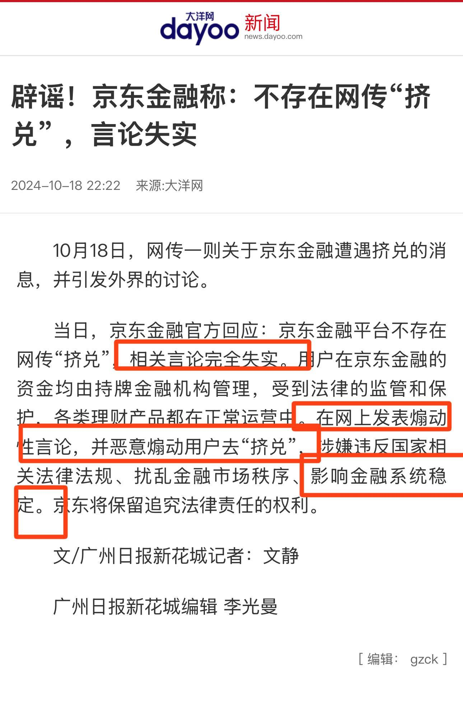

---

## 1172　渗啥透

- 日期：2024-10-22　主专题：A12 战争军事外交与大国秩序　副专题：A07;A18
- 源 ID：`b09a8314-551a-5e89-9301-1646b36d9732`　原文链接：https://www.zhihu.com/question/1587440178/answer/12095040454
- 官方对象—实践路径：与社会 / 与组织 / 参与
- 23 概念标签：事实与证据;能力与学习;责任与后果;劳动与组织;权力与异议;文明与历史;生态与自然
- 证据状态：manual_confirmed　初读：read　独立复核：not_reviewed

**问**：如何看待沈逸在视频中提到境外组织正在渗透包括京东在内的中企这一事实？

凡对革命史有点基本了解的人，都应该知道“渗透”这种事，世界上没有谁会比我党更有经验。
对于反和平演变、反颜色革命，我们就是这个世界的泰山北斗。
都斗了几十年了，从批准外资、合资企业的那一刻开始，甚至在那之前，我们就知道对方必然会这么做了。
这从任何意义上都不应该具有什么“新闻性”——好像以前外资就很乖，是从2018年之后突然变得不乖了。更不要以为我们天真无邪，一直瞪着无知的大眼睛，觉得世界很美好，坏人好少少。
开什么玩笑？
中国对外资企业，尤其是有规模的含外资成分的企业，都有强制性的建立党组织的要求。这些党委不直接参与企业经营，但是一概都要求企业人事部门主管担任关键角色，并全面监督企业文化发展与建设——换个角度，这基本就是要求人事主管必须是党员并兼任党支部书记。
有兴趣去查一查《企业工会工作条例》。
200人以上企业都被强制要求成立工会组织。
工会组织是干什么的？真是古希腊主管发咸鱼、发月饼的神而已吗？
工会的正职是帮助和指导职工劳动合同的签订。
而工会主席原则上要求是党员，惯例由同级党组织负责人兼任。这是制度性的要求。
你只管渗透，但你注意——你所有的企业文化建设文件，都要经过党组织监管；你所有的人事调动和员工合同，党组织都有权查阅和监督。
你要在这两条制度性管制的前提下“渗透”。
不排除你神通广大，非常牛x，可以在这种监管下利用某些具体干部的疏忽搞点什么动静。
但是只要你这动静被听到了，那么负责干部必然要受到党纪查处并且换人来做。
这些干部是要对纪委、监委负责的，是可以被双规的，是要受党纪国法双重追责的。
想在我们的企业里搞这些，想成气候，绝不是你看点港台小说或者欧美电影，看点网文，自己拍脑袋想象的那么容易。
要在我们的大型企业里脱离党的监管大搞西方意识形态，制度性的不现实。
对我们的组织能力有点sense，少跟着瞎起哄。

---

## 1162　四不值

- 日期：2024-10-25　主专题：A12 战争军事外交与大国秩序　副专题：A07;A15
- 源 ID：`ac07e208-342a-58e1-8f1e-487898c80a15`　原文链接：https://www.zhihu.com/question/2037048290/answer/14783081872
- 官方对象—实践路径：与社会 / 与舆论 / 接收
- 23 概念标签：事实与证据;定义与达意;责任与后果;信用与信任
- 证据状态：manual_confirmed　初读：read　独立复核：not_reviewed

**问**：来个靠谱的论证一下：网传的某东利用个人信息虚贷有没有可能是真的？

了解一下央行和银监的监管水平。
要是这是真的，有人要判死刑，顺带起码十几二十个判无期。
这么大规模的金融犯罪都监管不到，那金融领域的问题可就不是京东这么简单了。
相信这个跟相信发射塔致癌、“西方通过转基因作物灭绝中国人”差不多。
你知道这种谣言最令人愤怒的地方是什么吗？
编这个谣言的人，绝对明白这个谣言的恶毒、阴险之处，不然ta不会这么编，
换言之，他这么做的时候，非常清楚这几件事：
1）以他可以编造这种谣言的专业水平，他心里非常清楚这个谣言的荒谬性。
2）他非常确信有足够的“兄弟”因为各种各样的原因，会“看不出来”，会干脆蒙住眼睛不看。
3）他非常清楚一个人拿自己的帐号传播这种谣言、尤其是向身边的人、认识的人传播这种谣言会遭遇什么样的后果。
你想想那些在朋友圈真诚的转发“转基因绝育中国人”“xj集中营”“治癌神药”、并且为别人坚定的不相信而着急上火，苦苦相劝，要你“认清真相”、别上央视的当的老年人这么做是什么结果——在自己的熟人圈内名誉毁灭，从此被是为没有基本信息分辨能力的无完全行为能力人，连亲儿子、亲女儿都下定决心绝不借钱给ta，丧失一切借贷、被投资、被雇佣的资格。
你记住，编造、释放这个谣言的人，清清楚楚的知道你这么做对你的后果。
4）他认为替他传播这些东西的“兄弟”“战友”的上述损失，和多一个帮他传播这个谣言帮他赚到的业绩相比，毫不重要。

你可以找真正搞金融监管或直接被金融监管的亲戚朋友问一问，你这么问——“请问要这么做会受到哪些环节的监管，要瞒天过海估计能怎么做”。
问清楚，然后拿到你的答案，回来看看上面这四条。
想一想编造这种谣言的那个人是个什么样的魔鬼，什么样的cs。
想一想替ta兴冲冲把这种鬼话传给你的那些亲戚朋友，是多么的不值。
想一想现在被拦住的你是多么幸运。
想一想你在看明白这些之前，身处什么样的危险。

---

## 1164　大法庭

- 日期：2024-10-25　主专题：A12 战争军事外交与大国秩序　副专题：A07;A11
- 源 ID：`9670efd9-6345-50f1-a6b9-e0d6cba9bb03`　原文链接：https://www.zhihu.com/question/1259153358/answer/14164459881
- 官方对象—实践路径：与社会 / 与舆论 / 接收
- 23 概念标签：事实与证据;能力与学习;选择与自由;成本与总账;信用与信任
- 证据状态：manual_confirmed　初读：read　独立复核：not_reviewed

**问**：如何看待特朗普近期支持率暴涨？

“民调”门道是很深的，很多民调干脆就是一些名字取得很牛皮哄哄的所谓媒体在赤裸裸的造假博眼球。
这类假民调对特朗普未必是好事，因为容易刺激民主党选民的投票率。
这次大选假消息之多、之无耻，前所未闻，新闻已经基本没有分析价值，因为已经毫无信度，完全是根据各自的立场在撒谎。任何人都能从新闻里得到对自己极为有利的结论，也可以得到对自己极为不利的结论，全看你选择“相信”谁。
其实这背后真正的问题，已经不是大选之后到底谁当政的问题了，而是社会契约已经虚无到了这个程度，选举本身是否还有足够实际效力的问题了。
1）选举结果是否还会被普遍接受。
如果结果再次是毫厘之差，那么选前坚信自己“明明遥遥领先”的美国人能不能接受“民主没有被窃取”，同意这是公平的结果？
人会产生这种强烈的冲动，本质上就是因为生活得极为痛苦，所以要拥抱这种认知。要ta们毫无行动的接受“国家再被窃取四年”，恐怕没有那么容易。
换言之，选举揭晓时存在很大的骚乱风险。

2）当选一方的行政是否还能充分有效。
对立双方都已经在对方眼里丧失了基本信用。没人会相信对方的媒体，而又没有哪个媒体被认为是中立的。
美国原本的基本逻辑是对立的专业的媒体可以通过控辩攻防充分的揭露事实，而充分知情的人民可以做出最好的裁判——本质上这就是双方媒体各自担任律师，而人民担任陪审团，政府担任法官、书记员和法警的巨大的模拟法庭。
在这个构想里，对立的媒体是解决方案。
但如果这些“大律师”现在根本就不再盘问证人，只是拍着脑袋活灵活现的描述自己替“证人”编造的故事，并且各自只对自己选中的那一部分陪审团讲述呢？如果陪审团已经分裂成三派，其中两派只听自己这一方的律师的故事，而兼听的第三派听到的也只是两种针锋相对的谎言而已呢？
这个裁决机制还有逻辑有效性吗？
选举，只是在不断的更换法官，但这个大法庭里，已经疯癫的律师和已经分裂的陪审团才是真正的问题。
媒体原本是解决方案的一部分，现在却已经是问题的一部分。

美国的政策机制本身已经恶化，这不会随着大选可疑的“尘埃落定”而结束。
被寄予希望来终结问题的大选，很可能反而是问题的开端。

---

## 1157　漏了一个

- 日期：2024-10-28　主专题：A12 战争军事外交与大国秩序　副专题：A20
- 源 ID：`64621cbf-f51c-5d21-b33e-7cbc4f35bf4d`　原文链接：https://www.zhihu.com/question/579787333/answer/17087956017
- 官方对象—实践路径：与社会 / 与历史 / 解释
- 23 概念标签：事实与证据;定义与达意;能力与学习;责任与后果;劳动与组织;法律与秩序;文明与历史;民族与身份
- 证据状态：manual_confirmed　初读：read　独立复核：not_reviewed

**问**：太平天国最大的贡献是什么？

太平天国运动展现了中国的可怕动员能力和战争潜力。
这场运动，欧洲人是全程参与、近距离观察了的。
代表人物戈登，亲身参与指挥“常胜军”与太平军直接作战。
戈登接手之前，“洋枪队”由华尔指挥，华尔手里的洋枪队是华人、欧洲人和菲律宾人组成的全火器部队，这时还是一只没有纪律也没有受到战场充分考验的雇佣军。华尔阵亡之后，转由戈登指挥，军纪得到了严肃整顿，多次在战场上与李鸿章的淮军配合作战，对太平军取得胜利，所以改称“常胜军”。
为什么特别强调戈登？
因为戈登无意间起建立一个金子般的基准：
1）戈登的常胜军军饷充足、供应充分，指挥权完全独立，而且完全服从戈登指挥，尤其是多次经历严酷战场考验。这可不是义和团这类只有冷兵器的、缺乏整体组织和一致信念的无建制部队，而是同样经历过血与火的淬炼，大力使用先进装备，战斗意志极为坚定的专业或至少准专业的“圣战组织”。戈登能屡屡获胜，已经足够证明常胜军的实力。
换言之，戈登的战斗成绩，可以用作估算欧美正规军在同等条件下作战水平的参考。可能正规军可以再高估一点，但要高出一个数量级也做不到。
2）戈登拥有李鸿章这样的实权人物的全力配合。这已经是殖民部队所能指望的最强的本地支持了。不信你们想一想，自他之后，还有哪一只外来部队能受到这个地位的本地官员的全力配合？汪精卫手里只有半壁江山，袁世凯也管束不了南方各省，张作霖蜗居东北一隅，而李鸿章是名正言顺的天下第一总督，拥有整个清朝的财政支持，太平天国时期，朝野上下、无论汉满都没有可以对抗他的权威的。
而李鸿章这样的人物固然可以给予戈登强大的支持，但李鸿章也表现出了坚决的独立性——李中堂是绝不肯当傀儡的，甚至不会尊重与洋人之间的协议。
这就造成一种悖论——要么是听话的傀儡但是掌握的资源限于一地，聊剩于无；要么是李鸿章这类德高望重一言九鼎的实权人物，但对方自有打算，是敌是友还不好说。
3）配合戈登作战的淮军不是杂牌部队，也没有偷奸耍滑，而是全力以赴的分进合击，甚至承担了主要作战任务。淮军这个时候的地位和水准，实际上就约等于后世的德械美械中央军，加上宗族乡谊的纽带和大义名分，这已经是殖民者可以指望的最强的军事协助。
4）太平军已经是殖民者可以指望的最低水平的严肃对手。
太平军战斗意志的确强大，但所有的“乞活军”都有这种战斗意志，可以说如果打算殖民中国，指望抵抗力量没有这个这个水平的战斗意志是不现实的。
但太平军政治上颇为幼稚，军事上相当落后，简单来说，就是极端缺乏真正的行政、经济、司法、军事等关键专业人才。考虑到太平军极端缺乏文化知识，绝大多数士兵包括将领都是彻底的文盲，太平军作战学习能力、变通能力令人惊讶。战术灵活战略大胆，这几乎完全是农民中较为优秀的人物的天赋和本能。
如果全面入侵中国，可想而知会遇到大量中产阶层甚至上流阶层精英的抵抗，也就意味着你必须设想与一只意志力不可能比太平军弱，而在战略战术上、组织程度上不知强大多少的部队作战。

综合下来，意味着什么呢？
意味着戈登已经拥有了一个殖民部队所能梦想的最好的条件，打的是可以期待的最弱的对手，但却根本做不到摧枯拉朽，而是不断的陷入苦战。
那么要想严肃的考虑征服中国，在没有李鸿章这种领袖携国家财政全力合作、没有淮军这种精锐在战场上倾力配合、要打败预期比太平军专业、严密、坚决、庞大得多的反抗军，需要派遣什么规模的正规军？
列强不敢想象换成ta们在城外，而湘军、太平军并肩在城里，李鸿章和洪秀全、石达开拜了把子，背后是为了让你没得住肯烧自己的房子的几亿老百姓的支持，这个仗要怎么打。
这不是十个师，二十个师的家家酒能指望的事，起码五十个师起步。
上哪去找五十个师派往中国？而且这五十个师真的就够吗？
光是看着上个月还在地里水稻的农民们，头巾一戴碗一摔，就成群结队顶着密集火力攻城的力度以及ta们战术样式、战略水平、作战素质、组织水平的飞快提升，戈登会对各国同僚怎么建议？
看上去太平天国是中国内战，但这内战的烈度和规模已经把列强吓破了胆。只要跟活下来的洋枪队员们略作了解跟戈登喝几次咖啡，就知道这事想都不用想了。
可惜，人算不如天算。
这支常胜军里，一个日本人也没有，而戈登看上去也不爱喝抹茶。
日本没赶上这次扫盲班。
要不ta们为什么蠢成这样呢？

---

## 1146　几时崩溃

- 日期：2024-11-02　主专题：A12 战争军事外交与大国秩序　副专题：A03;A16
- 源 ID：`d49c81f1-41ac-5540-b654-eb32492ccf33`　原文链接：https://www.zhihu.com/question/2367708691/answer/21037796641
- 官方对象—实践路径：与社会 / 与舆论 / 接收
- 23 概念标签：能力与学习;成本与总账;信用与信任;权力与异议;技术与工程;心理与主体
- 证据状态：manual_confirmed　初读：read　独立复核：not_reviewed

**问**：乌克兰近期在乌东连失战略要地，是不是即将迎来总崩溃？

不知何时，流行起了一种堪称“崩溃期待强迫症”的现象。
不光是俄乌战场上如此，也在中美竞争中、台海局势中、“性别斗争”中等等等等几乎一切的激烈对抗中，都在流行这种执念。
“崩溃”好啊，一来痛快，二来可以清晰的标志胜利——仅仅是一天下滑一毫米，或者“三天前进两毫米，两天又倒退一毫米”的无限磨损，实在是缺少胜利感。
没有胜利感，赢都赢得不满足。
问题的关键是：“只把对方的崩溃看成胜利的唯一有效形式”，是否有利于提升你获得胜利的概率？这才是考虑一切问题的根本逻辑。
首先，抱着这个执念，你的焦虑程度会远比没有这个执念来得强，因为你会对一毫米的胜利忽略不计，从而导致长期缺乏积极的心理收益。类似“要吃就要吃年夜饭，不是年夜饭就不吃”，那就要一饿饿一年，你多半熬不住。
其次，这会导致你出于渴望纵容幻觉，天天执着于寻找对方“即将崩溃”的迹象，以至于容易放大相关的蛛丝马迹。长期保持，会严重的影响你对客观情况的有效判断。
你要正确的认识到——崩溃式的失败虽然存在，但那必然是因为对手穷尽了“软着陆”的手段和资源的结果，而以现代知识、技术、资源和监控手段，任何严肃的对手要无知到不能预料崩溃的机制、迟钝到无法监控崩溃压力的出现、资源匮乏到黔驴技穷、无计可施，都是概率很小而且无比漫长的过程。
现在跟低技术条件、低管理经验的前现代是两个时代了，不要对古典风格的“崩溃”有太强的期待。
坚持一毫米一毫米的前进，并且为此感到满意。
做一只蜗牛车手，为时速一毫米的狂飙感到兴奋和满足，这恰恰反而是现代的“赢家气质”。
有了这样的觉悟，你才可以真正健康的观察对手崩溃的迹象，对这个作出恰当的，而不是“情人眼里出西施”式的过于放大的判断，才可以在无限的耐心之中坚持到“对手的崩溃出乎意料的提前到来”，而不是在对“迟迟未来的胜利”的焦虑等待中提前绝望。

在俄乌战争中，乌克兰真正的危机并不在于何时完全失去四州的领土控制权，而在于俄罗斯完全占据这四州后，战争热度是否真的可以冷却。
就怕俄罗斯留着个尾巴，一直拖延和谈，在政治上不断的制造两难，逼着乌克兰面对“这要接受了，跟全面投降也没有本质区别了”的艰难条件，以至于无法选择主动停战。
从一开始我们就分析过了——如果仅仅只夺得四州，而不能彻底的解决乌克兰人对北约、对美西方的一切幻想，不打出一个提到美西方就咬牙切齿的愤恨的乌克兰，这场战争就算得到了所谓的领土，在政治上仍然是失败的。
所以，真正的悬念是“四州平定之后，这场战争要如何继续”的问题。
而乌克兰在到达这一关键节点之前出现大崩溃的可能性并不大，甚至即使过了这一节点，战争继续持续，也不太可能在短期内出现乌克兰大崩溃。

---

## 1139　私有不公

- 日期：2024-11-04　主专题：A12 战争军事外交与大国秩序　副专题：A09;A07
- 源 ID：`3e5d9324-4be2-5e58-8f1f-894bc0c2133c`　原文链接：https://www.zhihu.com/question/401780991/answer/22081433616
- 官方对象—实践路径：与亲族 / 与子女 / 抚养
- 23 概念标签：事实与证据;定义与达意;能力与学习;成本与总账;爱与回应;照料与家庭;劳动与组织;财富与市场;权力与异议
- 证据状态：manual_confirmed　初读：read　独立复核：not_reviewed

**问**：为什么别人也犯错了就只批评我一个，这不公平。说出这样的话，是教育的哪一个环节出了问题？

是这样：
对于公共治理而言，惯例是不接受关于“不公平”的个人投诉的。
你至少也要找到一定数量的民众联署，这种投诉才能被受理，才有必要给你一个答复。
原因如下：
1）处理这个投诉的成本是非常高的，处理不好的风险也非常大，远大过你个人的冤情，哪怕是窦娥冤。所以很自然的，如果把这个公平性审查的门槛设得太低，必然会因为“质疑不公的成本太低”而让社会服务部门把有限的公共资源消耗到无限的“个人基础伦理教育”中去。
2）这种关于公平性的质疑一个处理不好就要造成严重的后果，其敏感性可以和新闻发言人说错话相比。因此，如果启动成本太低，对社会会造成巨大的稳定性风险。
不稳定的代价实际上往往比不够公平的代价更加高昂。
3）由于人类天生的多样性，试图追求“人人都毫无异议的公平”是数学上不可行的，甚至连追求“大部分人都毫无异议的公平”都做不到，人类只能追求“大部分人觉得尚可接受的公平”。
因此，顺理成章的，单独由个人发起的“不公平”抗诉，只能得到“已经记录在案，看有没有更多人联署”的回应。
默认是不做任何回应的。
谁要是通过对这么低门槛的指控做大动作的回应来建立了组织成员错误的普遍期待，谁就会被自然法则迅速的毁灭。
作为父母，对子女要补上这个基础教育，这是正确的社会化必须补充的内容。
要防止子女滥用“质疑不公”这种武器，在遭受必然的“冷漠”之后堕入所谓“社会不公”“暗无天日”的思想地狱，无谓的化为灰烬。
所以，正确的回应如下：
先告知这个道理，然后告知对方，你可以写一个书面的请求“释法”的请愿书，多找几个同学联署，到达受理门槛后，我会给你回应。
在此之前，我有责任通过不受理让你理解社会的一般运行规则，以免你对社会有错误的期待。
而对方自己去兜售一番自己的不满，就大概率会很快发现自己的“不公平”理论并没有自己想象中那么大的市场。
因为大部分小孩子所谓的“不公”指控，只不过是一种自我中心主义的特权追求。
让ta们去真正的民意中间走一圈，可以滤除大部分根本不需要回应的妄想。
不排除还是会有一些在小部分人里能找到市场的观点，但那时你一回应就是一群人，一解决就是一群人的风险，其效率要比一个个的解决高很多倍。
就说到这里。

---

## 1077　大而细

- 日期：2024-12-21　主专题：A12 战争军事外交与大国秩序　副专题：A07;A09
- 源 ID：`a4b3ae57-e042-5a78-a272-224b2270c597`　原文链接：https://afdian.com/p/1c9b2da0bf9c11ef9f6252540025c377
- 官方对象—实践路径：与自己 / 与原则 / 变通
- 23 概念标签：事实与证据;定义与达意;能力与学习;责任与后果;信用与信任;净输出与不掠夺;技术与工程
- 证据状态：manual_confirmed　初读：read　独立复核：not_reviewed

**问**：大行不顾细谨与细节决定成败是否矛盾？怎么统一起来理解呢？

大行不顾细谨，指的是一项政策涉及大量利害相关人，只要你确保受益者的总能量远大于受损者的总能量，就不必过于纠结“存在不满者”的问题。
这倒不是对不满者不屑一顾，而是指：第一，你有足够的支持者足以压制不满者可能的敌对行为；第二你的政策往往有足够的利润，可以奖励和补偿利益受损者中愿意为了大局而忍耐、没有选择敌对阻挠的那一部分人。
大行和细谨是看利害相关方的力量对比的，是统计数据问题。
而细节决定成败，是指完成一件事的若干工艺流程中，处在关键路径上的工艺环节的技术要求必须以极端严谨的态度确保可靠完成。
例如策划革命起义，那么前期策划必须确保严格保密，对于避免泄露机密和不必要地扩大知情范围必须有近乎强迫症一样的执着，绝不允许有任何的粗心大意和漫不经心。
因为哪怕对不必要的人多说一句不经意的错误的话，都可能导致万劫不复的结果。
所以“细节决定成败”是指对工艺流程的严谨要求。
事实上，就上面这个“策划起义”的行动本身就能很好地同时体现两个原则的同时成立——策划过程要谨记“细节决定成败”以防泄密、失手，但是在争论实施方案的后果时，就可以用“大事不拘细谨”来防止无限制地纠结各种细枝末节的次要效应，避免严重地拖延讨论进度以致错过行动窗口。

---

## 1030　绝足

- 日期：2025-01-12　主专题：A12 战争军事外交与大国秩序　副专题：A10;A16
- 源 ID：`00c6ae57-2daf-5bd8-901f-8977afc3101c`　原文链接：https://www.zhihu.com/question/9000070522/answer/77138843408
- 官方对象—实践路径：与自己 / 与能力 / 获取
- 23 概念标签：事实与证据;定义与达意;能力与学习;选择与自由;责任与后果;成本与总账;法律与秩序
- 证据状态：manual_confirmed　初读：read　独立复核：not_reviewed

**问**：王星事件后，你对东南亚泰国等国家还有旅游的兴趣吗？

是的，泰国当然谈不上是多安全的。
相同的，墨西哥、菲律宾、阿富汗、马来西亚、孟加拉、蒙古、斯里兰卡、巴基斯坦、土库曼斯坦、叙利亚、黎巴嫩、赞比亚……等等等等南方国家也都谈不上安全。
整个东南亚、南亚、拉美、非洲，甚至包括北美和半个欧洲都谈不上安全。
美国安全吗？一年若干万人死于枪击，几十起校园枪击案。
法国、意大利就安全吗？遍地小偷不是吗？
韩国安全吗？N号房不够骇人听闻吗？
倒也不能强求你“不顾安全”，但是如果你用“有凶案就不去”的原则来决定，这个地球对你其实可去的地方很少——大概也就是中国、日本和新加坡了。
这固然是一种个人选择，但是你要注意——我们国家有一些地区的民众，例如福建人、广东人有很强的冒险拓荒精神，ta们敢于也惯于前往“危险水域”侨居、开拓。
ta们能掌握多国经济命脉，显然不是偶然的。
你不是还抱怨着“卷”吗？
对危险的定义抬得越高，在越安全的地方，自然也就越卷。
谁不想安安全全的呢？你想，另外十四亿人里大概还有十三亿五千万也这么想，不是吗？
这当然不是叫你无视危险地去冒险，而是说人有必要提高自己的处理风险的能力，然后把“禁入”的标准降低点。
不然你自己日子难过，路越走越窄。
这跟国家大战略没什么关系，纯属你自己的人生选择问题。
自己想想吧。

---

## 1016　桃李满天下

- 日期：2025-01-18　主专题：A12 战争军事外交与大国秩序　副专题：A18;A13
- 源 ID：`4e653723-c074-5aa5-b102-a89b77f748ff`　原文链接：https://www.zhihu.com/question/53786382/answer/81686046108
- 官方对象—实践路径：与自然 / 与环境 / 改造
- 23 概念标签：责任与后果;成本与总账;文明与历史;生态与自然
- 证据状态：manual_confirmed　初读：read　独立复核：not_reviewed

**问**：为什么中国总是花费巨资把基础设施修到贫困山区，而不是让村民从大山深处搬出来，同时保护山区的原始森林？

你们觉得中国对长期未来的设想是什么？
是“仅仅只有六亿人口居住在被近乎原始旷野包围着的极端发达的大城市群”那样吗？
根本不是。
我们是信奉“自然改造”逻辑的。
你仔细观察，就会发现中国在历史传统上就把“国土建设”视为“治理”的正位本分之一。
我们有一个理所当然的理想，就是要把所有的资源都充分地运用起来，让所有的要素都循环流动起来。
我们没有“保存自然原始风貌”这种想法，只有“避免破坏性滥用、消耗”这种实用主义思路。我们要保护生态，是为了避免在找到合理利用、可持续利用的办法之前把好东西糟蹋了，而绝不是如同某些人想的那样，要把尽可能多的地方划成人类禁区，“归还自然”。
我们对那种“人类是地球之癌，要尽可能限制人类对自然的侵占”的“环保”理念是嗤之以鼻的。
我们虽然没有宣之于口，但我们很自然地就会以“在极端发达的基础设施的支撑下，三四十亿中国人与自然达成和谐共存”为默认愿景。
说直白点，迟早有一天新疆、蒙古、青海那些现在看似荒漠的地带都会涌现大量的生态绿洲，成为人口中心。甚至近海都会出现海上浮岛城市。
更不必提大量的山区会因为低空交通物流手段和能源工业的成熟得到比现在有力得多的开发，规划出大量宜居地带。
虽然这可能还要一两百年，但三四十亿这个数字，恐怕估得还少了呢。
这样你就可以理解为什么我们会往哪怕人烟最稀少的地方修建公路通水通电通网，因为这些地方既然在没水没电没网没路的条件下都可以维持人类生存，那么说明它们有足够的开发价值，在通水通电通网通路之后可以进一步开发。
我们其实最后肯定是要给每一个山峰、每一个湖泊、每一个丘陵都通水通电通路通网的，甚至是那些现在还没人住、连动物都没几头的地方。
既然如此，为什么要开任何倒车？尤其是对已经都有人定居的地方还要撤出基础设施？
这是于理不通的。

---

## 0977　术与略

- 日期：2025-02-02　主专题：A12 战争军事外交与大国秩序　副专题：A07;A00
- 源 ID：`85ab46d9-7681-54c0-a0db-8cf873ad5906`　原文链接：https://www.zhihu.com/question/642534421/answer/91544472029
- 官方对象—实践路径：与自然 / 与科学 / 理解
- 23 概念标签：定义与达意;责任与后果;爱与回应;劳动与组织
- 证据状态：manual_confirmed　初读：read　独立复核：not_reviewed

**问**：为什么军迷圈里总是爱大谈宏观战略，却很少谈战役战术？

人有一种认识误区，以为战术、战役、战略是按人数分的。
其实这三个概念几乎根本没有递进关系，完全是三个独立的概念。
战术就一定人数少吗？一次狼群战术就可能调动七八艘潜艇。一次分割包围战术就可能调动几个旅。考虑到战略级系统，一次反航母战术就可能调动几艘大型驱逐舰和几个火箭军师级单位，释放惊天动地的火力总量。并不是只有班级、排级才有战术。
战役一定人就会多吗？
那只是从打破总体对峙状态到回到总体对峙状态的一连串战斗。例如总共只有一百余人伤亡的赤瓜礁战役，规模实际上很小。
如果你考虑到古代战争，一次小县城的旬日争夺也可以成其为一场战役。
战略就一定涉及到很多人吗？
战略是取得胜利的总体策略，只要存在清晰的胜利定义，就存在一个对应的战略思考，就会有一个总体作战思路。多小的战斗都有战略，哪怕是一对一的拳击、围棋都有战略。
甚至“QTMD，随机应变”都是一种战略。
这三个独立的概念根本没有互相排除、论资排辈的关系。
战略研究所并不比战役指挥部高一级，也不见得战术指挥中心的指挥官官阶就比战役指挥官低。
这根本没有什么高下等级之分，甚至也不是一个“宏观 / 微观”的关系。也不存在“前者好大喜功、后者脚踏实地”的反差。
觉得有，其实是自己理解有问题。

---

## 0939　沉默的巨人

- 日期：2025-02-20　主专题：A12 战争军事外交与大国秩序　副专题：A10;A13
- 源 ID：`4e68a9b4-f80e-50d5-ad36-78befe5a8017`　原文链接：https://afdian.com/p/670b7032ef9111efb78f52540025c377
- 23 概念标签：事实与证据;选择与自由;成本与总账;信用与信任;宗教与自然法
- 证据状态：manual_confirmed　初读：read　独立复核：not_reviewed

**问**：一个人一定要在所有事情上都站队吗？

当然不是。
不表态、保持中立完全是可以做到的，但有诀窍。
诀窍就是你有足够的实力影响相持局面的结果，而且有把握在其它各方分出胜负后仍然顶住最后胜者的压力。
具体来说，你们是A、B，实力分别是50、40，我是C，我的实力是30。
现在你们俩打起来了，我说我中立。
A不爽，要搞我，那不好意思，我去跟B联手，那就是40+30>50。
B要搞我，那我就找A，50+30>40。
我现在对AB都不帮，AB盘算着自己先决出胜负再来搞我，那么50-40<30。
如果AB盘算着联手先搞我，那么我拿出5来对B说你也先拿个5出来，我们凑个10去兑掉A10点，但是你和A的交换比就是1:2，打完之后你变35，A变40。要是A再不悔改，那我们再干一轮，你变成30，A变30，我变20。
当然，你可以拒绝我，但是拒绝我我就和A提同样的条件。我和A先找你换两轮，你变成10，A变成30，我变20，然后我再来跟你谈要不要跟我联手，我们10+20，顶住A的30。
你要再不醒悟，那我只好侧一侧身，我就不信A不先吃掉只有10的你而来先吃有20的我。
而你要是想跟A凑一下30+10>20，那我跟你保证，我肯定先盯着你干，先干掉你。你信不信A一发现我专门盯着你干A就会后撤让你一个人冲锋当炮灰？
所以，两位，我说中立、不站队，就是在保护你们。
你们谁敢勉强我，就是谁活得不耐烦了，而且小学数学没学明白。
而且你们要感谢我保持中立——因为我的实力和中立立场，你们为了避免鹬蚌相争让我得利，你们只好彼此也保持中立。
毕竟50-40<30。
看出问题来没有？
“有实力的人保持中立”，是世界和平的关键因素。
世界只要有一个占工业总产值20%的大国决定中立，就足以让所有的野心家制定不出足够可靠的征服世界的方案，从而保证世界总体和平。
这是内嵌在数学逻辑里的自然法。
反过来看——如果你没有30的实力，只有1，甚至0.1，你要怎么办？
首先你要看这个环境里存不存在“淡定的巨人”，也就是那个实力足够（尽管未必实力最大）而又保持中立的力量。
如果不存在，你能走尽量走。走之前低调点，暂时谁逼你比较厉害你先顺着谁，但最好早走。
如果存在，这个环境才有足够你长期经营的基础。而在这个前提下，你作为微小的力量一定要力挺这位“淡定的巨人”——首先，因为实力最弱，ta对人往往最温和；其次，ta的力量越强，整体环境越和平稳定，对于小虾米条件越友好，搞得好甚至会出现“几个大国伺候我一个”这种奇景。
越是大国之间实力接近，小国家受到的礼遇越强。大国之间出现显著的实力差异，小国家的价值和地位也会直线下降。
但总的来说——想要“不站队”，你要么要有不站队的资格，要么要有能支撑你不站队的环境。
要么你是这位沉默的巨人，要么就要有沉默的巨人在场——这巨人还得脑子清醒，懂得这里说的这道理。

---

## 0824　沉默的大多数

- 日期：2025-04-25　主专题：A12 战争军事外交与大国秩序　副专题：A03;A07
- 源 ID：`962867fe-554a-5869-a70b-d9720c46629a`　原文链接：https://www.zhihu.com/question/1896471445078513169/answer/1898994711101940299
- 官方对象—实践路径：与社会 / 与舆论 / 应对
- 23 概念标签：事实与证据;责任与后果;成本与总账;边界与许可;劳动与组织;法律与秩序;权力与异议;性别与身体
- 证据状态：manual_confirmed　初读：read　独立复核：not_reviewed

**问**：为什么网上突然多了支持大同订婚强奸案二审维持原判的博主？

早就说过了——沉默的大多数不是沉默的站在你那边，而是站在法律那边。
中国是世界上公认治理最成功的国家，近四十年是人类历史上空前的经济奇迹，这两个最大的基本事实基本保证了“沉默者将站在官方一方”这种基本态势。
这是个你必须认清的朴素的事实。
如果你认定“沉默的人一定都像我和我的茧房同志一样敢怒不敢言”，然后极力想要“发动群众”，那么你会发现两个结果——要么你动静小，因为真正的大多数懒得参与而你的同圈层这点热情又有限，你会发现热度迅速褪去；要么你同圈层的热情似火，长期延续这个话题热度，以至于真的导致沉默的大多数觉的受到了打扰甚至觉得威胁到了ta们现在足够满意的生活，那么接下来不但不会是你期待的万众响应，反而会是潮水般地路人的反驳。
因为长期热度不散，你真的威胁到大家的生活了。
而这个生活，你不满意，老百姓是满意的。
大多数老百姓认为这个判案标准可以保护自己、母亲、姐妹、妻子和女儿——ta们人人都有女眷。
大多数人不担心自己、父亲、兄弟、儿子在求欢的时候搞出什么拖拽录像、浑身青紫、反锁屋内、火烧窗帘。ta们不恐惧“万一搞出这些会被判强奸”这种风险。
就像ta们不恐惧徒手攀岩可能摔死、无氧攀登喜马拉雅容易窒息死一样。
而且ta们厌恶你为了你自己那点小心思，打着争取ta们根本不稀罕的“权利”的旗号，去增加ta们所不想要的风险。
就这么朴素。
想要掀起社会变革，这是每个公民的权利，但是如果你连这点基本的常识都没有，或者故意自欺欺人、佯装不知，你遭遇失败一点都不冤。
真的遭遇了，你还要拿什么“这都是敌人有组织的反扑”来解释，你会在根本错误的“革命事业”上不断的追加赌注，越走越黑，直到彻底破产。
收手吧，阿祖。
是你错了。

---

## 0736　指定幸存者

- 日期：2025-06-12　主专题：A12 战争军事外交与大国秩序　副专题：A10;A19
- 源 ID：`6d5f066d-9ef0-5a23-ad8a-cfa848b7152e`　原文链接：https://www.zhihu.com/question/1915868724537332241/answer/1916569551925145947
- 官方对象—实践路径：与其它 / 与陌生人 / 施助
- 23 概念标签：责任与后果;成本与总账;边界与许可;劳动与组织;技术与工程
- 证据状态：manual_confirmed　初读：read　独立复核：not_reviewed

**问**：如何评价军人张伟连救五人？

6月6日，河南商丘的小两口在争吵时不慎落水，3名男子跳湖救人亦被困，现役军人张伟见状跃入水连救4人筋疲力尽的情况下，跪拜告别母亲，然后毅然去救第5个人，随后体力不支，被人拖上岸时已昏迷。10日，张伟康复出院并回到老家河南夏邑县车庄村，受到村民热烈欢迎。
见义勇为，舍生忘死，真心了不起。
这是生死关头见真勇，贵过黄金。
建议全国普及人工水岸救生器材储备法规，保证公园、堤防、码头、桥梁等带铺装的近水公共设施按照法定密度储备救生圈、绳索等可用的救生器材。降低类似义举的风险门槛。
另外下水救人之前最好坚决脱掉外衣外裤，并做好热身运动。尤其是长裤浸湿装入空气后裤腿打结可以做成临时救生衣。这对节省体力、保护自身安全有很大的好处，不宜把这些步骤省略来抢险救人。
肯舍生忘死救人的人一定要毫不犹豫的意识到“我们这种人是非常昂贵的，我们自己是这场危机毫无疑问需要优先保护的指定幸存者”。
不要跳过这些力所能及的自我保护措施去抢着救人，对因为这些措施耽误而丧生的人不必感到愧疚——这是天收，非救之过。
这一次其实先跳下去的三个救人的人没比最后这位英雄人物的道德勇气小，恰恰是ta们犯了这个错误，反而大大的放大了总体救援风险。
这个教训不能忽视。
换了是我设身处地，我一定先把衣服脱好，热身快速做好，而且会把裤子做个救生衣，还嘱咐岸上人快点折点树枝长杆来，我再穿着救生衣跳下去救。
而且我只会把人送到岸边能被人树枝够得着的距离。累了我可以看着对方在水里扑腾冷血的休息。
因为这些措施而未能获救的人，我只会表示遗憾，毫无愧疚。
我宁可新闻标题是《五人落水三人获救，冷酷式救援惹争议》，也不接受《五人落水获救，英雄与世长辞》。
而且我眼睛都不眨，不带一丝愧疚，内心不带任何波澜。
因为这是对的。而且这种救法我才可以平静接受“要冒生命危险，可能没有任何感谢”。
事先按照不会有任何荣耀和回报为预期规划自己的慈善工作，然后不带任何纠结、勉强的去做，做了就可以两清、放下、忘掉——这才是可持续的善举。
可以死，但要死得重如泰山——经过钢筋混凝土加固、能把原子弹震得腮帮子发麻的那种泰山。你们体会一下。

---

## 0734　政治头脑

- 日期：2025-06-14　主专题：A12 战争军事外交与大国秩序　副专题：A07;A03
- 源 ID：`e020318f-ba10-524b-8c6c-bd4e0fd5a1e0`　原文链接：https://afdian.com/p/b1cb85b042fe11f09f0a5254001e7c00
- 官方对象—实践路径：与社会 / 与组织 / 参与
- 23 概念标签：事实与证据;定义与达意;能力与学习;成本与总账;劳动与组织;权力与异议;技术与工程;心理与主体
- 证据状态：manual_confirmed　初读：read　独立复核：not_reviewed

**问**：怎么算拥有政治头脑?

很多人觉得政治头脑是指治国理政、管理国家民族的命运、参与国际秩序的重塑，或者最低限度的——能猜出当前的社会动向、政策趋势。
但这其实不是政治头脑的主要战场。
政治存在于每一个角落，从组织公司团建到协调项目相关利益方，从掌握酒桌气氛到反制、分化霸凌小团体，从应付市政检查到组织业主维权……一切涉及群体动力学的博弈，本质上都是政治的博弈。
所谓政治头脑，就是参与、预测和影响群体博弈的洞察力和策略能力。
知道谁会在什么阶段支持谁到什么程度，又会因为什么条件的改变而改变其支持的方向和力度。这些条件有多少会在多大的程度上成为现实，而又如何可以改变这些概率的时间分布。
某种意义上讲，这几乎可以说是一种音乐才能。
美术是沿空间轴展开的艺术，音乐是沿时间轴展开的艺术，政治头脑——在本质上是一种看见诸多要素随时间轴穿插演变的能力，仿佛看到若干个声部沿着时间轴的此起彼伏互相对抗、协调，而又凭着这预见，在这里调高某个声部的某几个小节，在那里对一个音轨加上回音或渐隐滤镜。四两拨千斤，引导整个曲风和乐章走向自己想要的情绪和情节。
而这四两千斤之效，最大的奥秘在于能从这人类的交响曲中看见乐理。
这是一种音乐工程学，一种时间的艺术。
你能看见回荡在人类之中的这种“曲子”，对社会动力的流向有这样近乎通感、宛如实物的觉察，你就算“有政治头脑”。
这个能力，必然是建立在大量事实求是的观察基础之上的。
而能做到这个“大量实事求是的观察”的前提，是你足够关心——真正的关心。
能养成政治头脑的人有一个基本的特征——从不会说“不关我事”。
一切都关ta事，所以ta才会不惜踏破铁鞋、不耻下问的去看。
所以ta才会看见。
就是这样。

---

## 0730　魔丸真火

- 日期：2025-06-16　主专题：A12 战争军事外交与大国秩序　副专题：A03
- 源 ID：`4aa6161d-a893-5470-954b-dcfe2cd4dd7a`　原文链接：https://afdian.com/p/f41dddd443f611f0907b52540025c377
- 官方对象—实践路径：与合作者 / 与管理者 / 博弈
- 23 概念标签：能力与学习;选择与自由;责任与后果;成本与总账;爱与回应
- 证据状态：manual_confirmed　初读：read　独立复核：not_reviewed

**问**：如何看待时下被部分网民力推的“双输好过单赢”观念？

这种行为看上去似乎很聪明，但实际上是很蠢的。
蠢在哪？蠢在敌人也是分等级的。
“输了就认输”的敌人和“输了就让人赢不成”的敌人是两种敌人。
公然宣布后一政策的人最大的危险是什么？
是那些潜伏在暗处、你觉得还不是你敌人的朋友、路人，一旦ta们意识到你和ta的利益有无可避免的冲突，对方考虑的就不是“通过博弈达成新的合作方式”，而是“一击致命”。
因为你这个人“不会善罢甘休”。
你不可能在只有你一方受损的节点上接受和平。而对方已经预见到你即将遭遇一个必然因ta受损的局面。
对方的合理选择就只能是从毫无征兆的和平状态一步走向直接剥夺你的反击能力。
对方才是发起第一击的那一方，在对方发起第一击之前，你根本没有什么“单输 / 双输”的选择机会；而对方一旦决定对你动手，因为提前就知道你是个输不起的人，就会在第一击就保证你万劫不复。
你宣布这种“信条”，其实是在找死。
只有那些长期坚持“得饶人处且饶人”“单赢好过双输”的人，才在事实上反而有机会选择临时变轨，出人意料的选择“双输好过单赢”。
你宣布了，你反而没有这选择。
这还只是害处之一。
害处之二——对方身边一共有四个可供选择的对抗对手，其中只有你宣告“双输胜过单赢”。你盘算的是“这样我比较凶，别人会先捏软柿子”。
实际上你却会是最先出局的那个。
因为你这种人没朋友。
其他人会看着你被伏击，甚至会暗暗庆幸有人把你清除——因为你没事就会觉得自己“输”了，然后要拿着这个由头去拉别人“双输”。
谁没见过人吃你这种亏？否则大家怎么知道你这名声的？
谁想当下一个？
所以现在“恶人有了恶人磨”，谁要来救你？
四个人里面你就是最软的柿子，而且是最毒的那个。弄谁都要考虑兔死狐悲，会不会有路人觉得我太残暴，要联合抗击。
但弄你这个顾虑小得多，弄不好乡亲们还送一面“小周处”的锦旗。
你还觉得摆出这副架势是个好主意吗？
年轻人最容易犯的错误，就是以为露出尖牙利齿会赢得更高地位和更大优待，殊不知人类社会普遍遵循的是“要将隐患扼杀在摇篮里”的逻辑。
谁会蠢到等魔丸这种调性的人学会三昧真火？第一集就是核平陈塘关了。
理论上，魔丸最好的——甚至是唯一可行的——做法是先低调高唱爱与和平，等学会了三昧真火和三头六臂再突然翻脸喊“双输胜单赢”。
但实际上，要么魔丸自认为三昧真火已经天下无敌喊出双输口号时发现上面还有观音大士和如来佛祖，自己还是喊早了，被一巴掌打落凡尘；要么魔丸在低头练功期间看见各种不同编号的魔丸被各种不同型号的观音大士斗战胜佛打得魂飞魄散而终于意识到最朴素的事实——其实根本没有喊出这句口号而不增加风险的时候。
什么时候喊，都喊得太早了。在比你更深的深渊里总有比你块头更大的克苏鲁。
低头发展，喊啥喊？

---

## 0697　真假警

- 日期：2025-07-02　主专题：A12 战争军事外交与大国秩序　副专题：A09;A03
- 源 ID：`0af8d292-a1e4-53c0-a143-d1561716f291`　原文链接：https://www.zhihu.com/question/574602672/answer/1923696678516532099
- 官方对象—实践路径：与其它 / 与陌生人 / 施助
- 23 概念标签：事实与证据;责任与后果;边界与许可
- 证据状态：manual_confirmed　初读：read　独立复核：not_reviewed

**问**：一个人要进入你家，说自己是警察。你怎么判断他是真警察还是假警察？

其实最简单的办法就是不管三七二十一打110报警。
110不可能不对“假冒警察”这种警情做反应，你只要拒绝告知110警号、样貌等信息，一概回答“看不清”“不知道确切怎么描述”，110就必须出动人员到现场来核实。
哪怕ta们真的派出了人员来执法，以你给出的信息，ta们也不能断言没人假冒。
110到场，让110去替你鉴定就好了。

---

## 0693　正果

- 日期：2025-07-03　主专题：A12 战争军事外交与大国秩序　副专题：A20;A07
- 源 ID：`7aa6e7e3-3ba4-5e06-acb4-2faff3d5d0d1`　原文链接：https://www.zhihu.com/question/1917959834797581894/answer/1924134919669548311
- 官方对象—实践路径：与社会 / 与历史 / 评价
- 23 概念标签：事实与证据;选择与自由;责任与后果;成本与总账;法律与秩序;文明与历史
- 证据状态：manual_confirmed　初读：read　独立复核：not_reviewed

**问**：为什么我党不采取暗杀？

中国的朝代兴替有一个很有特色的现象，就是“安乐公”现象。
新朝替代旧朝，会非常执着的接受前朝末帝的投降，给予一个公、侯爵位，令其终老天年。
为什么？
因为最后一个皇帝正式投降退位，并且接受新朝爵位，就可以彻底杜绝前朝的忠臣义士另外推举王室血脉，在南方、巴蜀甚至海外之地复国继统、做长期对抗。
譬如崇祯帝自尽不降，就导致清王朝直到康熙六十年还在和“朱三太子”们缠斗。这还没算台湾“国姓爷”势力。
又比如明建文帝在朱棣入京后失踪，搞到朱棣追查下落一辈子。
这说明的是什么呢？
就是要统治中国而要成本低，必须得国以正。
不是一个“占领全境 / 首都”的军事现状就可以宣告胜利了。如果你得国不正，如此辽阔浩渺的帝国，百族杂生，山川形胜之地不可胜数，你将会面对此起彼伏、永无宁日的割据叛乱。
而得国欲正，得国的手段就必须有规矩、有大义。
否则人心不服，祸患无穷。
不靠暗杀而能驱寇虏、御外辱，以极弱代极强，华夏垂两千年来从无如我朝得国之正者。
当心那些跟你做你死我活的斗争而不用暗杀手段的对手，那都是对“我们必须考虑将来怎么坐天下”已经胸有成竹的人。
只要ta们还没开始动暗杀手段，就意味着ta们对结果的确信没有发生动摇。如果你不能不承认这些人不是傻瓜，你就绝不能对这些人的成算掉以轻心。

---

## 0684　知胜机

- 日期：2025-07-08　主专题：A12 战争军事外交与大国秩序　副专题：A20;A03
- 源 ID：`cc9a60b2-db31-589e-b4a9-1311291ad022`　原文链接：https://www.zhihu.com/question/1922810083710056046/answer/1925586816855155176
- 官方对象—实践路径：与社会 / 与历史 / 借鉴
- 23 概念标签：能力与学习;选择与自由;劳动与组织;法律与秩序;文明与历史
- 证据状态：manual_confirmed　初读：read　独立复核：not_reviewed

**问**：如何全面击败美国？

有这么一段话，你们记好了、做到了，就可以当世无敌。
请赐予我平静， 去接受我无法改变的。给予我勇气， 去改变我能改变的。赐我智慧， 分辨这两者的区别。
中国在长期竞争中总是可以胜于其它国家的最终秘诀，其实就是这三句话。
要害在于中国文化对历史教训的极端重视。
我们是世界上成文史系统最完整、最具体的文明，对“吸取历史教训”的执着程度远远的胜过一切其他文明。
中华文明和其他文明之间的根本区别就在于中华文明本质上是基于经验主义方法论的文明，而其他文明则是基于教条主义方法论的文明。
注意，这里的经验主义、教条主义并不含有一般意义上的褒贬意味。
在中国，一件事情不可做，是因为历史上多次这样做了结果都非常不好；而在其他文明——不管是西方也罢、印度也罢、埃及也罢——这事不可做，是因为神说、经上说不可做。
前一种不可做的禁止作用实际上是相对的——不错，以前做了那么多次都很惨烈，但是我这次做和以前做的那么多次都不一样，只是看上去有八分相似，但有两分以前列祖列宗都没有机会尝试的有利因素，而且是关键的有利因素。
但是神说不可做，而且配合上几次历史教训——甚至只是传说中的历史教训（例如“索多玛的毁灭”），这种禁止作用就要远远的比基于经验主义的禁止作用强烈而持久。
这就导致中国在“社会探索”方面有着其他文明难以匹敌的内生优势。
很多历史学家喜欢不假思索的认为“中国具有超稳定社会结构”，喜欢将中国描绘为“数千年如一日”的“僵化组织”。
其实这是一种根本性错误。
中国才是所有文明中最热衷变法、革命和制度创新的文明。其动作之果断、意志之刚硬，何止谈不上保守，甚至经常有“过度轻率”的问题。
毫不客气地讲，这个世界上所有的组织形态、制度尝试都已经在中国这个实验场里做过实践测试。从“兼爱非攻”到“过轮皆杀”，从垂拱而治到“弃灰于道者斩”，从推举制到科举制，从封建制到集权制。
我们是无可无不可的。
四千年一贯的“不管黑猫白猫，抓到老鼠就是好猫”。
同样是“禁恶行善，明辨是非”，我们是依赖于建立在海量的历史实践上的理性决策，而其他文明则是依赖于对中心教条的不断重新阐释。
因此，我们的策略空间和动员效率客观上比ta们大。
这是文明层面的、基本方法论层面的优势，以至于“制度优势”也仅仅只是这种核心差异的一个小小体现而已。
是出于这个原因，我们对什么是不可改变的知道得比其他人具体而深刻，以至于贩夫走卒都知道“零元购”“大麻合法化”这种创意试都不用试，不需要做什么议会辩论、思想教育，不必付出任何社会成本就可以杜绝这类低级问题。
而另一方面，我们又对什么是可做的、该做的，毫无犹豫——治河铺路、建桥挖渠，没人会用“现在饭都吃不饱”来抗拒反对——恰恰相反，越是肚子饿，我们反而越会不惜血肉去把这事做成。
我们对加强全民教育没有任何不同意见，对以现代科学、理性主义为基本教育纲领没有任何内部分歧。
这在中国觉得习以为常，甚至都没被认为是一个需要讨论的问题，但在其他国家却是永远夹缠不清的巨大困难。
我们更清楚的知道什么是不可改变的，能更平静的接受它，我们也更清楚什么是可以而且应该改变的，能更勇猛的追求它，而我们明辨这两者的能力，只会随着时间不断提升，而不会因为任何教条停留在任何特定水平上。
作为一个经验主义国家，我们要远比教条主义国家乐于且善于改革。
天下武功，唯快不破。
这才是我们必定会全面胜过美国的原因。
这不是美国人稍微痛定思痛一下就能解决的问题，因为这个差异深埋在“美国人何以是美国人”这样的底层结构里。
如果美国文化做了这样的革新，那么美国人将在变得像中国人之前首先陷入一段难以想象的迷茫期，这个迷茫期会对美国社会造成致命的打击，并且在这种大乱之后，痛定思痛的美国社会很可能并不会选择向左迈进靠拢中国形态，反而会向右回归，回归到更“虔诚”的教条主义意识形态。
要对一个文明做“基因疗法”，谈何容易。
再说一遍：
平静接受我无法改变的，勇敢去改变我能改变的， 寻求智慧，分辨这两者的区别。
这就是你需要的全部成功秘诀。
因为这本来就是中国成为唯一幸存的古文明的原因。

---

## 0660　四台阶

- 日期：2025-07-22　主专题：A12 战争军事外交与大国秩序　副专题：A18;A07
- 源 ID：`04bfd910-2819-5fab-a687-fa0251fa5af3`　原文链接：https://www.zhihu.com/question/1929952687627153632/answer/1930764527496050095
- 23 概念标签：事实与证据;法律与秩序;权力与异议;技术与工程;心理与主体
- 证据状态：manual_confirmed　初读：read　独立复核：not_reviewed

**问**：雅鲁藏布江下游水电工程开工，会对我国未来的经济和对外关系产生哪些影响？

对经济的影响不多说了，只谈一个“对外关系产生的影响”。
很多人都觉得我们建这个工程增加了对下游国家的威慑与控制，是“扼住了印度的要害”。
这个想法完全是错的。
这纯属以小人之心度君子之腹，对我们的治理风格完全不了解。
我们手握随时能毁灭敌人的力量，往往不是为了唤起敌人的恐惧，而是为了让敌人明白——我们不会因为拥有强大的力量就不择手段。
手里有足够强大的力量，会反过来证明我们说要讲道理是真诚的。
一个君主要永居王座，有四个阶段。
第一步，你要拥有力量。
这一步，是靠你自强不息，苦练内功，自我检验，只需要你自己确信即可。

第二步，你要让别人承认你拥有力量。
这一步，是靠你开始展现客观成就和自信风貌。你一身筋骨，当仁不让。要么威慑住对方的妄念，要么直接击溃对方自身敬畏的对手。

第三步，你要让人接受你拥有力量。
这一步，靠的就是让对方在明确认知你拥有力量的前提下，确信自己仍然有安全、幸福的可能。
你拥有力量，但你也凭多年的克制让对方确信你拥有力量这件事并不意味着ta将被奴役、被剥削。你的力量和对方的生存、幸福并没有根本不可调和的矛盾。
因此，对方在无法对抗你的力量的前提下，就必然在你所划定的规则内接受你所留下的那条仍然足以通向幸存甚至繁荣的道路。
一旦对方开始转向你所界定的这条共存共荣的道路，就如水流入水渠一样，对方就会停止再寻求想方设法破坏你所拥有的力量。
因为那不但对ta代价高昂，徒劳无功，而且极度危险。
一旦对方停止寻求破坏你的优势地位，ta就已经进入了接受你领袖地位的阶段。

第四步，你要让人愿意你拥有力量。
这是指一旦你真的陷入某种自然带来的危机或者面对某种外部的挑战，这些已经接受了你的力量，并与你的道路协调发展了很久的远亲近邻，会宁可付出努力来帮你维持你的力量。
因为ta们不想换一位新的王，重新适应一次新的治理，面对未知的、常常是致命的风险。

到了第四步，你的治理就会得到人类所能得到的最强的健壮性。尽管这并不足以保证你仍能胜过一切未来的挑战，但这已经是人类所能努力的极限。

而这四步之中，最大的关口就是第二和第三步。在第二步，想要证明自己力量的新王往往容易过于急躁，在证明力量的同时引入了过多的恐惧，以至于给第三步埋下了过多的仇恨和怀疑，于是大幅的破坏了自己走过第三步的概率。
因为这些恐惧和怀疑是极为有力的，会不断的、极端的挑战新王的耐心。你刚狠狠的伤害了ta们，ta们怕你、恨你、处心积虑想要绊倒你的冲动必然会燃烧很久，而你作为已经在实战中获得了绝对自信的新狮王，往往会越来越想要用暴力去惩罚这种“捂不热的石头”“养不熟的狼羔子”。而一旦你过于冲动，就会陷入“恐惧-破坏-惩罚-恐惧加深-进一步破坏-更严厉惩罚”的循环，从而就此止步，并在长期的拉扯消耗中立第四步越来越远。
于是当历史不可避免的挑战到来时，那些久罚不服的异邦不但不是你面对挑战的助力，反而是雪上加霜、落井下石的负面力量。
帝国往往也就就此陨落。
我们现在就在第二步的开头甚至已经是中间阶段，我们的领导层对这个大历史法则是绝对头脑清醒的，所以绝不会为了一点蝇头小利妨碍我们稳固治理整个世界的最终资格。
我们不会拿这个工程做任何印度人、美国人恐惧、鼓吹我们会做的运用。
因为这根本是愚蠢的短视行为。

---

## 0657　我没有

- 日期：2025-07-24　主专题：A12 战争军事外交与大国秩序　副专题：A03;A11
- 源 ID：`200309fc-1b48-536f-8a58-7f6e61f9436e`　原文链接：https://www.zhihu.com/question/1896278314173317963/answer/1931762005984928653
- 官方对象—实践路径：与合作者 / 与管理者 / 博弈
- 23 概念标签：事实与证据;定义与达意;法律与秩序;心理与主体
- 证据状态：manual_confirmed　初读：read　独立复核：not_reviewed

**问**：自愿发生关系后，真的是女性报警说强奸，罪名就成立吗？如果是普通人又该如何避免自己被诬告？

你就老老实实的说明事情经过就可以了。
这倒不见得一定意味着你会被判无罪——因为很多人是真的法盲，不知道自己的行为其实是罪行——但是对你已经是最好的策略。
因为警察也是人，对你的表达是有情绪感应的，在ta们眼里，对“什么样的反应是一个犯罪者的反应”是有一个神秘的标准的。
你老老实实的，问什么说什么，不美化、不夸张、不遮遮掩掩、不吞吞吐吐，警察自己就会对这个案子是否成立有一个最初的直觉。
如果这个直觉告诉警察自己的内心“这个人比较实事求是，那个人自我幻觉比较严重”，他们就往往有了结论。案件办理的方向就会发生转变。
其实警察考虑问题的方式是如果自己的判断遭遇当事人的抗辩、质疑，第三方会站在哪一边的立场上。
第三方不知事实真相如何，就会很自然的站在情绪比较稳定、态度比较理智、表达淡定、严谨、平实的一方，而不会站在情绪激烈、表达夸张、颠三倒四、给人强烈幻觉感的一方。
正如警察自己会做的选择一样。
而一旦警察有了这种倾向性，案件的办理走向就会发生对你比较有利的微妙变化——ta们会更倾向于在对方稀里糊涂的描述里找到问题，去形成最终的结论。
换言之，警察的默认看法是真相在你们双方的表述之间的某个地方，但看到你们的表现，警察最终的结论会距离对方的比较远，而距离你的比较近。
所谓“坚决不承认”之类的“战术”其实是没什么好处的。

---

## 0615　韩信

- 日期：2025-08-20　主专题：A12 战争军事外交与大国秩序　副专题：A08;A20
- 源 ID：`3de2b024-4275-512c-bf4f-fd5877b3619f`　原文链接：https://www.zhihu.com/question/1924847436872029739/answer/1941642376775995868
- 官方对象—实践路径：与社会 / 与历史 / 解释
- 23 概念标签：技术与工程;文明与历史;生态与自然
- 证据状态：manual_confirmed　初读：read　独立复核：not_reviewed

**问**：韩信如果示弱能否保命？

古代王朝容易发生贵族之间的重大矛盾的根源，在于经济形式的相对封闭化、孤立化。
圈地百里，说是你的，你就直接靠山吃山、靠水吃水，你几乎可以完全独立封闭的运转你的经济。
因为交通手段的极端落后，你自己需用的物品90%以上都不得不自产，因为外界可以运来的量既少、价格还贵，根本指望不上。这就意味着你领地内的生活水平几乎不依赖于你和外界的交往。而且是几乎所有的诸侯多少都是如此。
相互依存程度太低，就导致极少有“一荣俱荣、一损俱损”的共同利益来缓解和抑制彼此间的矛盾。
如果我是造车的，你是炼钢的，你家里出了问题，我肯定想办法帮你解决问题，不然我也要停产。
现在我是种地的，你也是种地的，你家里出了问题，第一你没饭吃你盘算着来抢我的，我肯定不答应；第二我还盘算着要不要趁你没饭吃把你的地占了。
和平、理解、宽容，在最底层要靠深刻的相互依存来保证。一旦大家都过老死不相往来的领地生活，那就自然而然的会“一山不容二虎”“坐山观虎斗”“渔翁得利”。
韩信的悲剧在于他谋求封侯称王、划地自治，一旦这么做了，他就自动成了敌对的利害关系人。
这不是“有功”“有旧”这样的生产关系能扛得住的生产力模式的变更，最后只能是生产关系去适应这样的生产力模式。
遗憾的是，反而是韩信自己在新的生产力安排下留恋着原本在军中征战时的生产关系。
在根上就出了问题，战术的智慧解决不了战略的危机。

---

## 0602　依法强硬

- 日期：2025-08-28　主专题：A12 战争军事外交与大国秩序　副专题：A11;A08
- 源 ID：`43221da3-7d9a-5915-bd19-afe37c7c9560`　原文链接：https://www.zhihu.com/question/1938266093358642391/answer/1944435825464053900
- 官方对象—实践路径：与其它 / 与陌生人 / 防卫
- 23 概念标签：事实与证据;定义与达意;能力与学习;责任与后果;成本与总账;边界与许可;法律与秩序
- 证据状态：manual_confirmed　初读：read　独立复核：not_reviewed

**问**：「白社会」大哥法内狂徒高律师为家暴受害者撑场面走红，如何看待这个现象？

这是个非常妙的策划，痛点抓得准，方案也很巧，虽然这很大概率是表演性质的，但红线踩得很稳。
法律是可以这么用，也应该多这么用用的。
怎么用？
依法强硬。
先把法律了解清楚，然后凭借法律给予的合法自由采取积极的强硬立场。
我拳头比你大、财力比你强，而且我精通法律，对特定领域的判例、解释、法规甚至相关部门的尺度风格有丰富的实践经验，所以我现在友善的建议你不要犯蠢，停止你现在的侵害企图。
我不是什么小白兔，哭着请你尊重我的合法权利。
我是有好生之德，不希望你成为我正当防卫的拳下亡魂。
我建议你不要幻想有什么偷袭机会，你是不是看见我后院的锁很好撬？
你放心，那是因为后院有藏獒。
或者以为你可以编排一点小材料泼点脏水？以为你搞什么小动作我没看见？
你放心，我在等你传播量大到足以立案。到时候我把你挖出来直接把你送走。
善良不是退让、委屈，而是提前告知你风险，免得你枉死。
温柔是在万伏高压线前面插一个“高压危险”的牌子。
不是指你摸上来不会碳化。
你看，警告牌上甚至用的是荧光颜料，很贵的好么？
这还不够温柔啊？

你们要记住，不存在什么“初犯不计较”。
“初犯不计较”那是立法水平低，别人第一次犯的时候你要么没有立法，要么立了却没有有效告知，坦率讲那叫不知者不为罪。
明确立法了、清晰告知了，初犯就要计较，初犯就是全量判罚。
温柔不体现在ta犯了也不处罚上，而体现在告示字够大、条款够清晰严谨上。
这之后就不是温柔善良管的剧情了。
强硬跟温柔不矛盾。

---

## 0589　耳光

- 日期：2025-09-05　主专题：A12 战争军事外交与大国秩序　副专题：A07;A11
- 源 ID：`77f18694-6d5d-56e1-a222-32ef399365ba`　原文链接：https://www.zhihu.com/question/1945766899616035241/answer/1947053103892394293
- 官方对象—实践路径：与合作者 / 与管理者 / 博弈
- 23 概念标签：定义与达意;选择与自由;责任与后果;成本与总账;爱与回应;照料与家庭;权力与异议;心理与主体
- 证据状态：manual_confirmed　初读：read　独立复核：not_reviewed

**问**：南京第一中学2025级军训学生上台谴责学工处主任脱离学生高高在上，这件事怎么评价？

要达到同样目的，“晕倒”同样有效，不但同样施加“麻烦尽早结束讲话”的压力，还有保健室的空调吹、糖水喝，而且绝对没有处分和后患。
现在为了达到这么个效果，高一刚入学背一个处分。
军训——还是军训——多站了一会儿，就当众掌掴校级领导，这样的“慷慨任侠之气”，真的只用在校领导身上吗？
明天跟你一个队踢球嫌你丢了几个球会不会掌掴你？
后天嫌老师布置作业多了会不会掌掴老师？
你脾气大，不爽就要打人，不想挨你打的自然就不带你玩了。人家又不是生得贱，喜欢挨打，为什么要给自己找这麻烦？
你还真以为是别人离不开你而不是你离不开别人吗？你多痛快几次，社会是可以让你回家蹲着的。
打完这一巴掌，接下来能是什么剧情呢？
是爹妈爹妈上门低声下气求情，喝令小崽子跪地道歉。最后在全校早操时公开十五分钟检讨。
检讨完了要夹着尾巴做人。
什么叫夹着尾巴做人？有人霸凌都不敢还手，因为恐怕到时候定性斗殴，爹妈又要上门赔罪，怕自己两罪并罚被开除学籍。
南京第一中学是名校，因为打校领导且累犯违纪转校，你想转到哪去？
这一巴掌，也许在一些不懂事的小孩子里面有不知轻重鼓掌叫好的，在当事人自己是开启了一系列苦难的历程。
没办法，自己犯的蠢只能自己受着，自己消化。
另外，当事人现在自己应该体会到了，那些鼓掌叫好的，其实根本不关心自己的疾苦，只是利用其来发泄自己没胆子实施的懦弱罢了。
当这些人的“英雄”，做ta们的祭品，其实是一种可悲的错误。
这些人言必称“反社会规训”，其实真正面临的问题是社会会不会接纳。社会只能接受不需要多少合作成本、没有合作风险的成员参加协作，分取协作利益。
你要玩高成本，高风险，那就没人带你玩，你就自己一个人去和别人成群的人竞争。争不过你就蹲家里吃低保。
就这么简单。
还社会规训你？
规训是要成本的，谁要去规训不想配合的人？社会钱多烧得慌么？
回家饿几顿就知道了。
什么？你想报复社会？
社会被这类人报复了几十万年了，自打有社会那天就有这样的人了。
社会现在还在这里，那些“反社会英雄”呢？
谁记得ta们是谁？
你打社会一耳光，社会打你的可就不是一耳光而已了。
人生是自己的，对自己负责，想想清楚。

---

## 0565　拆弹有奖

- 日期：2025-09-23　主专题：A12 战争军事外交与大国秩序　副专题：A18;A15
- 源 ID：`3332eea8-a086-5a08-979d-37317368fea5`　原文链接：https://afdian.com/p/cb0c4f6297ce11f09b7752540025c377
- 23 概念标签：事实与证据;定义与达意;选择与自由;责任与后果;成本与总账;信用与信任;财富与市场;技术与工程;文明与历史;民族与身份;心理与主体
- 证据状态：manual_confirmed　初读：read　独立复核：not_reviewed

**问**：万斯的“无孩爱猫女”言论很得罪人，为啥他们反而大比分赢了大选？

说句实话，没有必要因为特朗普的“大胜”过度神话他的“伟大正确”。
民主党没选赢，有很大的“大势”因素，这更多的是因为美国陷入了衰败周期，非“半任期无痛激进策略”所能扭转。
如果你仔细观察，会发现这类票选体制有一个致命的逻辑缺陷，就是一旦进入上升周期，元首就容易连任，因为人们容易对执政满意，这时切换元首就是一个不必要的风险，自然而然的在任总统加三十分录取。
但一旦陷入下降周期，问题就复杂了——你最大只有半任期的施展空间来尝试扭转趋势，这是民众对“艰难期的不便”最大的容忍极限。
对美国而言，就是新任总统一共就两年的留校察看期，这期间你可以推行一些自信可以用后两年修复的痛苦策略。
如果你搞四年苦难行军，那么你就是在犯严重错误，因为第五年肯定是对手来摘你的果子，你纯纯的为人作了嫁衣。
而就这两年的苦难行军，你也得估摸着剩下的两年你能修复到什么程度。你还不能指望找个安安静静的房间去温言软语安慰苦了两年的民众“都是我不好，乖乖你别哭了”，你得在反对派的高音大喇叭震得耳朵都发麻的环境下想法逗吃了你两年苦的民众开心。
算算这个难度，你这两年就算“苦难行军”，你敢苦难到哪去？
因此，一旦美国的问题严重到了靠“两年微痛苦难行军”无法扭转的程度，在任总统、执政d，就几乎注定要在一个任期后下台。
因为你不搞苦难行军，那就是无所作为的四年下坡路，你搞，那就是两年都修复不了的两年特别痛苦的下坡路。
左也是苦，右也是苦，两条都是死路。
这就给了处在下降周期的执政d、在在任总统一个特殊的挑战——未求其胜，先虑其败。
就是在考虑竞选策略的时候，要优先考虑“如果我失败了，我可以给对手埋多少雷来确保对手的胜利足够短暂”，然后再在确保这一点的前提下，思考如何争取胜利的最大可能。
换言之，争取“善败”，反而要优于“惨胜”。
尤其是，如果自己已经意识到了下一任将会面对一个已知不可能扭转的败局，那么“务求胜利”——尤其是不择手段的、吃相难看的攫取胜利——反而是一个自杀性策略。
你想想看，接下来一定是大败局，我还还要把对方作弊搞掉、甚至暗杀掉来自己当这个亡国之君，我是撒旦转世时护士没接住把头摔坏了吗？
所以，民主党这次输是输了，而且似乎是“大败”，但是你换一个角度，你会发现ta们败得很“干净”，败得很阴险。
因为接下来四年，总统、两院、最高法庭全都没有民主党任何手尾，那真是一毛钱的干系都不用担了。
ta们彻底赢得了“纯清流”的在野身份。
反对票尽情投，反正投了也还是会照你们的来。照你们的来了，还是输得脱裤子，我当初可是投的反对票。
说得直白点，我的反对票纯粹只是一堆“I told you so”兑换券。
我可以仰天长笑，看四年笑话，到了四年尾，我这么多抽奖券一次性兑换，活活取你狗命。
所以，民主党这次选举，天生就有“假选”的性质。只有假选都能选赢，这个胜利才有值得操作的空间，如果假选选不赢，那么绝不能投入更多的战略资产去“强赢”——因为“假选不赢”这个事实本身就足以说明接下来的四年会是炸雷年，我为什么要不惜一切跟你争着捧炸弹？
换言之，特朗普的胜利实际上是一个“绝地求生者”对一个“假选者”的“压倒性胜利”。
而在这“压倒性的大败”之中，民主党埋下了无数的隐患——被极度激怒的文化产业、被逼到悬崖边的媒体产业、被迎头痛击的城市精英阶层。这些人在两年后不知会掏出多少“I told you so”来助攻——更不提还有抱着坚定的新自由主义信仰的学术圈可以帮着造假数据。
其实，真正的问题是——特朗普的那些所谓政策，民主党这帮人早就研究过了。
要是数据预测显示真的有奇效，民主党根本没什么对脸面、门户的顾忌，自己早就用了。
问题是这些招数没用，是真的没啥用。
所谓驱逐非法移民——现代美国是建立在由非法劳工充当贱役基础上的奴隶制国家。真的是驱逐掉了，无业的罗马公民们能接受同样的报酬和劳动强度来顶住之前 非法移民承担的贱役吗？
堂堂罗马公民，一天给你洗十六小时的碗，得收多少钱？你觉得美国那些小餐厅、小生意的人力成本占售价的几成？人力成本翻两倍，这些喜迎洗碗工作（尽管是较高薪水）的罗马公民所新获得的收入，真的付得起上涨后的生活成本吗？
之前没工作，拿着救济买非法移民的廉价服务，觉得生活喘不过气来。
现在有工作，拿着工资买自己翻了几倍成本的昂贵基本生活服务，还是喘不过气来。
只是以前是躺在家里沙发上喘不过气，现在是在后厨洗碗池旁喘不过气。
这到底改善在哪？净赚了一份“劳动者的光荣感”吗？
你们是认识美国人民的，美国人民真有这个觉悟吗？

至于“抛弃乌克兰”——是这样，要说乌克兰问题有什么错，那是错在美国一开始就不该引爆乌克兰战争。
一旦引爆了，现在的问题就是“支持乌克兰和不支持乌克兰孰劣”，已经没有“撤销引爆乌克兰操作”的选项了。
而特朗普仿佛有一种“停止乌克兰战争等于撤销这一错误决定”的错觉。
要想达到这个“撤销”效果，你得取消对俄制裁、把乌克兰的四州还给乌克兰、把俄乌双方战死的亡魂复活，把毁于战火的城市修复，把北溪二号还给德国。
你把美国卖了也付不起这个价。
既然如此，强行终止乌克兰战争，就不可能被看作“撤销错误决定”，而只能被认定为“终止既有决策的继续执行”。
这就是完全另一个意思了。
你知不知道德国红绿灯政府是怎么解体的？因为舒尔茨痛斥财政部长拒绝提高债务上限以支持乌克兰。
好家伙，一回头美国自己跑路了，所以这位坚决踩刹车的财政部长到底是“革命意志不坚决的内鬼”，还是“富有历史洞察力的伟大政治家”？
你让舒尔茨接下来怎么对德国人民解释？
北溪二号，德国人忍了，还去帮你骂了一顿默克尔；德国工业自断一股，近乎血祭；德国资本大量外流，失业高企、通胀惨烈；红绿灯政府，尽忠尽到剖腹自尽。
忠臣义士刚毁家纾难，还在台上泣血椎心发誓为王尽忠。
皇上降了。
不错，开战是错误，但是开了战然后投降，不叫做“纠正了开战这个错误”，而叫做错上加错。
你只要敢停战，你其实不光要失去乌克兰，你还要失去台湾，再搭上菲律宾、韩国、日本、德国这一大帮忠臣孝子——甚至还会包括波兰——由不得你选。
你干了，我可以在野骂死你；你没干，我也可以在野骂死你，要么吃馄饨面，要么吃板刀面，你扫码下单吧。
至于开征巨额关税这事，没什么好说的，能征我们干嘛不征？轮得到你征？
说白了，民主党这一轮，到底是“大败而逃”还是“顺利下垒”，还真不好说。
发现没有？
你大胜而来，以压倒性的胜利击败了上一位拆弹专家，赢到了一个ta都不敢碰的水银炸弹。
给你道喜，甚至都不知道这算是红事还是白事。
这个胜利，与其说是特朗普一方智慧超群，不如说是“众望所归”——这里倒有一半是对方的望。

---

## 0551　纵

- 日期：2025-10-03　主专题：A12 战争军事外交与大国秩序　副专题：A20;A10
- 源 ID：`d152e266-3e05-5d00-bcf5-ce5e91176e5f`　原文链接：https://afdian.com/p/c2b0bfb49a5411f0b24352540025c377
- 官方对象—实践路径：与社会 / 与历史 / 解释
- 23 概念标签：能力与学习;责任与后果;成本与总账;法律与秩序;权力与异议;文明与历史
- 证据状态：manual_confirmed　初读：read　独立复核：not_reviewed

**问**：太平天国从起义至攻克南京，跨时两年多，为什么清军在半路上挡不住？

农民起义这种事，其实单从军事战略的角度、权谋的角度，最佳策略根本就不是“剿”，而是“纵”。
为什么？
因为这类暴烈的武装运动存在一个致命的缺陷，就是几乎无法进行有效的社会管理和生产经营，只会一味的烧杀掳掠、裹挟流民，因此每到一地都会造成积累的主客矛盾——当地居民实际上必然成为粮饷无继的大军的掠夺对象和牺牲品，而幸存者要么逃向四方乞活，要么就不得不加入劫掠大军，自己也去下一个受害者处分一杯羹。
因此，这类暴动除非获得大量治理人才的加入并且能实施有效的扫盲、基层治理和意识形态教育去培养自己的官僚机器，能每占据一地就在极短时间内恢复秩序、刺激生产且有效征税，甚至把新领地居民变成自己积极主动的兵员来源，否则它在客观上必定会不断为自己招来越来越多，越来越坚决的对手。
那些被迫逃亡的地方豪强非常自然的会成为“剿匪”源源不断的兵源，这些暴动持续时间越长、破坏地区越多，这样的敌人就积累得越多。
而随着地盘的扩张，原本团结的农民军将领也势必要出现诉求的分裂和内部权力斗争的加剧。
看似农民军地盘在扩张，但也实际上是一个此消彼长的过程。
这个基本规律并不深奥，但却是一个被心照不宣的秘密——因为利用这一规律的策略非常残酷，那就是除非能在苗头未起的初期就可以直接击溃其领导核心，否则一旦形势糜烂，对方部队规模足够大，达到主帅无需再参与一线战斗，无法再在战场上谋求直接消灭，那么朝廷的最明智的策略反而是装样子，假防守，层层阻击但却并不寻求决战，放任对方“发育”一段。
之所以还要装样子阻击一下，其实是为了法理上有所交代——朝廷必须向豪强们证明没有放弃对治下子民的保护义务。但这种“围堵”的性质与其说是为了立刻平叛，还不如说是为了掩护精英人口撤退转移。
如果在这个阶段和刚刚起势的起义军对攻，不但会损失惨重，而且事倍功半。如果把朝廷精锐全都毫无意义的在这个阶段耗尽，那么到了后半段无老兵宿将可用，反而要酿成真的重大危机。
这在战略上远不如逐步后撤，催化对方内部危机的爆发同时积聚自己的力量来得合理。
你扩张越大，你赶到我这一侧的不共戴天之仇就越多，你自己要防守的战线就越长，你自己要疲于应付的治理问题就越多越尖锐，而且你内部的利益斗争就会迅速激化。
退守到“划江而治”时，看似你这时候繁花似锦、烈火烹油，但实际上你却是动能枯竭、内乱待起的势能低谷，而我却是拳头收紧、肌肉紧绷，战意激昂的势能高峰。
这时候我只要在你已无力再扩张的稳固战线之后等着你出现内讧危机，就可以很轻松的一路招揽你的叛将，势如破竹，直捣黄龙，把你一举歼灭。
而等这一场大浩劫落地，原本因为种种原因导致的资源匮乏危机就会因为再次涌现的大量无主之地，无主之财而自然解决。
换句话说，心照不宣、只做不说的放任某些暴乱自我发育到自然坍缩，反而是朝廷处理这类大规模治理危机的标准方案。
这个方案除了做得说不得之外，只有一个要害的缺陷——那就是在走这个过程期间，国家不能有强大的外敌。
因为走完这个“发病自愈”的过程一定要经历十到二十年的军事资源的大规模挤占和财政的紧张，这个机会被外敌利用，才是王朝真正的心腹大患。
但这已经是另一个故事了。

---

## 0518　撤

- 日期：2025-10-23　主专题：A12 战争军事外交与大国秩序　副专题：A07;A03
- 源 ID：`4c7b908c-7637-5c5c-a972-624728d50d66`　原文链接：https://afdian.com/p/e5afb768a9f911f0970a5254001e7c00
- 官方对象—实践路径：与自己 / 与能力 / 获取
- 23 概念标签：能力与学习;选择与自由;成本与总账;信用与信任;权力与异议;技术与工程;心理与主体
- 证据状态：manual_confirmed　初读：read　独立复核：not_reviewed

**问**：如何训练撤退的基本技能？

撤退一共三个细节：
1）When？
这是指要满足了什么条件，你就应该撤退。这个条件指标要非常的具体，以至于条件一满足，你就可以不带犹豫的转身就走。
举点例子——“发现打不赢了，我就走”就是一种经典的撤退条件。
问题是，“打不赢”如何判定？是兵力对比超过一定比例？还是同样的资源消耗造成的战果低于一定标准？还是特定关隘失守？还是本防守节点的杀伤效率已经开始下降？还是攻击动作已经完成、被发现概率已经高于安全线？
后面这些带数值、带判别方法的，才叫做“撤退条件”，而不是那句“打不赢”。
“打不赢就撤”仅仅是一种指导思想，而不是作战计划。
如何确定撤退指标本身的合理性，以及巧妙的设计指标敏感而可靠的监察机制极为重要。
举点例子，我要防止敌人从背后偷袭，我可以在背后的必经之路上放一个有人经过就会自燃的发烟装置，或者一个敌人要想没有后顾之忧的偷袭必须要清除的据点。
看到烟了，那里打响了，我就知道敌人从背后偷袭了。
设定自激发信号系统的功夫要练。

2）Where？
撤退的话要撤到哪里？
你始终都应该知道撤退的下一站在哪——下一站在你可以重新获得相对优势的地方。
举点例子，孤身走暗巷遇到流氓，敌强我弱转身就跑，跑到有光的大街上你就重建了对敌优势；跑到派出所院子里你也重获了对敌优势。
你永远要知道最近的优势均衡点在哪里，这是必须时时刻刻存着备选答案的问题。
如果你身后一马平川，无险可守，那么就要提前挖好壕沟和隐蔽所，自己制造优势均衡点。
这很像现代攀岩技术，每上升一段就要打好岩钉，挂好锚点，这样就算自己上升失手，人也会被下一节点拉住。
离你最近的壕沟在哪？不许想，现在、立刻、回答！
睁眼说瞎话，你在哽咽什么啦？没出息。

3）How？
已见信号，已知去处，剩下就是怎么去的问题。
是跑最短直线，还是跑之字形？是先留下足迹后登船让足迹中断，还是先让小队声势浩大的向北而大部队在敌人被引走后悄悄向南？还是先撤退却留下伏击部队痛击追击部队，反复再三以至于追击部队不敢再猜这不是陷阱为止？还是一边撤退一边捣毁沿途设施、清空粮食储备，让追兵无饭可吃、无水可喝？
谁说撤退不是攻敌良机？做得好的人，完全可以在撤退中杀伤比正面对抗时更多的敌人。
我撤退时比阵线对抗时更危险。

解决好这三个问题，你就有了完整的撤退计划。
看似这说的是兵法，实际上这是通行法则。哪怕是讨论一个问题、谈一个业务，都是同样道理。
慢慢琢磨吧。

---

## 0501　难民

- 日期：2025-10-31　主专题：A12 战争军事外交与大国秩序　副专题：A20;A08
- 源 ID：`fa42effa-4670-5095-80dd-5bba9937c51e`　原文链接：https://www.zhihu.com/question/1954223681350895078/answer/1967592168634946413
- 官方对象—实践路径：与社会 / 与历史 / 解释
- 23 概念标签：能力与学习;选择与自由;责任与后果;成本与总账;净输出与不掠夺;劳动与组织;财富与市场;法律与秩序;技术与工程;文明与历史;民族与身份
- 证据状态：manual_confirmed　初读：read　独立复核：not_reviewed

**问**：你支持中国接收亡国后的美国难民吗?

这是一个很有意思的问题，那就是中国如何解决心向中国而发生内乱的邻国问题。
我们的思路一向不是“接收难民”，而是“传播王化”，就是派出部队和官员，解决掉当地的问题——一般是帮助正统王室平息叛乱或者册封已经获得正统地位且称臣的当地辛苦势力——恢复当地的秩序，让这些人民可以在自己的原地安居乐业。
如果是外族内附，我们的做法往往是直接在边疆区划定一块区域，指定为该部族的新栖息地，由我们的边军提供一定补给和保护。而这块新划的地盘很可能之前只是我们势力范围辐射的非正式领土，你来防守实际上等于我们开疆扩土了。
除了极少数海外藩属国的学人士子赴华求学定居之外，我们几乎从来都不接纳所谓的难民。这并不是政策不允许，而是难民们会发现我们这里很难立足。
因为没有成规模的无主可垦之地，也没有待填补的劳动力缺口，没有这两样关键资源，外来难民极难落脚。
其实你仔细观察，整个亚洲，包括非洲、拉美都没有接纳难民的传统，发现没有？
其实真正值得奇怪的反而是西方社会为什么热衷于接受难民。
道理很简单——这必须依赖于接收国有足够的与劳动无关的额外收入。
这是指金融资本、殖民收益这类掠夺性的收益。
有这样的收益，就会出现与劳动不对应的盈余，于是可以用这样的盈余去购买外来服务，以供养本地公民部分的或全部在某种程度上脱离劳动。
说得直白一点，这是欧洲文明中的“罗马性”的本能发作。
罗马帝国到了你家，把你的房子烧了，把你的金银、粮食、人才抢走，派遣总督建设军营，持续收税。
这样你要么当场破产，没破产的也别慌，多收几年税，不怕轮不到你。
破产的民众自然要流向有饭吃、有钱赚的地方——罗马。
然后罗马人再用抢来的金银、粮食支付这些“向往自由”的“自由民”的工资。
而普通的罗马市民呢？则依靠原本持有的房地产、资本、人脉或政治特权向这些新“自由民”收租放贷，确保这些被赚走的工资和口粮里剩余的部分尽可能再次以租金的方式回流到罗马公民们手里。
这跟基于农耕文明的中国社会是完全不同的经济逻辑。
这件事甚至荒谬到了这样一个地步——如果你自己不从导致对方家破人亡的那场战争中受益，你其实是收留不起那家幸存的穷小子们的。
一个反面的证据，就是如果流民完全是因为自身内部的天灾人祸导致，只是投奔富饶的邻邦，那么这些邻邦的态度就完全不积极。
最典型的就是古代欧洲和中东发生饥荒后人向粮食稳定丰产的埃及流动。埃及每隔数十年就要忍无可忍，发动一次驱逐移民的运动——这就是犹太民族的源头。
其实如果西方国家真的如此善良，认罪悔过，那么用不着“收留难民”，只要把抢来的金银粮食还给/留给幸存者，幸存者们不但不需要“收容”，甚至可能人均比大祸之前更富。
Alas, another poetic irony.

---

## 0461　水草

- 日期：2025-11-27　主专题：A12 战争军事外交与大国秩序　副专题：A08;A20
- 源 ID：`c8275413-1ffa-5e38-9f0a-e688fad8f4a8`　原文链接：https://www.zhihu.com/question/1977354844319797525/answer/1977397014686897643
- 官方对象—实践路径：与社会 / 与历史 / 借鉴
- 23 概念标签：事实与证据;定义与达意;能力与学习;选择与自由;成本与总账;法律与秩序;技术与工程;文明与历史;民族与身份
- 证据状态：manual_confirmed　初读：read　独立复核：not_reviewed

**问**：哈：允许迁徙，人流的方向就是文明的方向。孔：远人不服则修文德以来之，既来之则安之。二者有哪些异同点？

不允许自由迁徙的前提下，每年都有很多人自己迁徙到缅甸。
于是缅甸是文明的方向吗？
大航海时代，荷兰人、葡萄牙人、英国人、法国人……拼命的流向非洲、美洲、亚洲。
那时候有多少印度人自愿流向英国？而有多少英国人自愿流向印度？
那时的印度是文明的方向吗？
人类流动的真正的逻辑是“流向有利润的方向”，而利润未必是文明的结果。
甚至可以这么说——某些利润之所以丰厚，恰恰是因为它不文明。
别的不谈，文明是要税收维持的，而不文明的地方也许名义税率很高，但是买上足够的枪就可以完全“免税”。
甚至枪都不需要全靠买——买两把，你就可以从隔壁再抢一把；有了三把，明天你就可以再去抢两把。
抢得多了何止不用交税，你还可以反过来收别人的税。
啥“文明的事业”有这个利润率高、门槛低？
文明的事业也有利润高的，但那需要博士学位或者十年经验。“不文明的好生意”的主要门槛就是“足够不文明”。
那还不流动得飞起？
这个断言只是乍一听很符合中国人的思路，其实历史事实是不支持的。

---

## 0428　伏低

- 日期：2025-12-13　主专题：A12 战争军事外交与大国秩序　副专题：A07;A01
- 源 ID：`c7b53745-e208-59db-8a95-e5637a648784`　原文链接：https://afdian.com/p/5ba027f2d15811f0962152540025c377
- 官方对象—实践路径：与其它 / 与陌生人 / 接近
- 23 概念标签：选择与自由;责任与后果;成本与总账;信用与信任;净输出与不掠夺;权力与异议;技术与工程
- 证据状态：manual_confirmed　初读：read　独立复核：not_reviewed

**问**：成功/成名之后，还有必要在待人接物时像未成功/成名时那样谦卑友善吗？

成名人物有两种。
一种是背后有守护天使、有“根底”的，这一类多以演艺明星、艺术家等专业技术人员为主。
这一类人可以不那么谦卑友善也不至于造成过于严重的危机——有时甚至不谦卑友善反而是ta们人格魅力的一部分。
因为背后的守护天使会替ta们补偿受害人，震慑、防范报复企图。只要守护天使不出问题，当事人本人不和守护天使发生嫌隙，一般都可以保护ta的平安和自由。
也不要觉得这个关系很糟糕——某种意义上这些人物的确需要更“任性”的心境来保持灵光闪烁的状态。
很多时候，美来自勇敢，而勇敢来自安全感充足。
正所谓“没有君子，不养艺人”，这其实是一种为艺术家、奇才解除束缚的合理安排。

第二类就是政、商界白手起家，杀出重围而功成名就的人。
这类人接触外人就会谦卑友善得多。
因为这些人背后已经没有什么大的依靠了，自己要独立面对风险。本来就对手、仇人环伺，对手、仇人正愁抓不到破绽扑上来撕咬，这类人实在是很难负担得起因为言行不谨而再莫名其妙的四处树敌。
所以这些人普遍的会得到“意想不到的平易近人”的评价。
对这一类人，越是成功、成名，就越是会谦卑友善。
否则ta们可能都撑不到成功、成名。

---

## 0418　流星锤

- 日期：2025-12-18　主专题：A12 战争军事外交与大国秩序　副专题：A13
- 源 ID：`cdf94c66-2ece-5196-81f9-910a1f1ed0b4`　原文链接：https://www.zhihu.com/question/1982893278144795848/answer/1985126112423081934
- 官方对象—实践路径：与社会 / 与技术 / 运用
- 23 概念标签：能力与学习;责任与后果;成本与总账;信用与信任;爱与回应;劳动与组织;法律与秩序;权力与异议;技术与工程
- 证据状态：manual_confirmed　初读：read　独立复核：not_reviewed

**问**：如何看待泰国使用中国VT-4坦克炸膛了？

高膛压的长身管火炮是非常不适合高频连续发射的。
这本来不成其为一个问题——在人力装填、手动火控的时代，坦克的射击频率很低。射击一次，坦克炮管有充分的时间耗散抖动和降温，回到理想的待发射状态。
问题是现在有了自动装弹机和计算机火控，而同时炮弹装药威力和设计膛压却有了很大进步，这就问题大了。
如果不涉及切换弹种和大幅调整射击指向，坦克手很可能想要借助自动装填、自动稳定的坦克炮的强大持续火力来实施压制射击和对工事的持续破坏。
说白了就是想要借助高射速打得敌人根本不敢冒头，只能龟缩在坚固屏障后死扛，而坦克手会不由自主的尝试直接用连续射击把这坚固的屏障彻底打垮，把已经被pin down在这坚墙之后的敌人消灭。
纯暴力破解，免得还要蹲守，等敌人冒头搞打地鼠游戏。
尤其是万一碰到一个运气好的，没能及时在ta一冒头时就打掉ta，被ta抽冷子成功发射了反坦克导弹就代志大条了。
反正炮弹够用，我为什么不试试直接把这混凝土墙敲倒，安安稳稳的把对手埋了，一点机会都不给、一点风险也不必冒？
坦克的寿命又跟我的业绩不挂钩，维护也不该我负责，我为什么要冒生命危险去爱惜设备？
何况，我的上级真的提倡我冒生命危险去爱惜装备吗？让ta们来选，ta们真的愿意选择用理论性的“较长的装备寿命”来换实际上必然会升高的阵亡率和被击毁率吗？
被击毁的装备上保住了一门八成新的炮，要干什么用？
这就谈到了这一番讨论的真正要害——泰军的用法不但不应该被嘲笑，被否定，反而应该被正视、被反思。
因为泰军的用法恐怕反而恰恰是对的，是应该被我们学习而不是被我们摒弃的。
我军依靠严格训练充分发挥装备性能的作风当然是优良的，这是我们从革命战争年代就养成的训练和作战铁律。
但这是建立在我们人员数量远超过重装备数量，而重装备生产能力严重匮乏的时代背景下的。
我们现在已经是人类历史上规模空前的最大工业国，重装备产能不但谈不上匮乏、不足，反而有巨大的冗余和过剩。
而恰恰相反的是——专业的技术士官培养周期漫长、成本高昂，一旦有所伤亡附带的经济和社会代价远远超过一百年前那个动荡凋敝的时代。
我们有非常大的必要转变我们的作战思想——大胆的鼓励前线部队充分的发挥装备和火力优势，以争取最小伤亡、最快战果为诉求，将保护装备视为次要的、必要时可以舍弃的追求。
每战必把敌人打得不敢露头缩进龟壳，再举起千钧之锤强行捶开敌人的铁龟壳，该用多少装备，就用多少装备。
一力降十会，打出敌人的绝望来。
我们要做的改变不是教育部队要爱惜装备，而是要求部队了解装备的极限，依赖算法和检测手段，避免炸膛事故，实现火力轮替。
坦克炮和弹药都不可惜，但务必不要以炸膛这么messy的方式给自己带来麻烦，接近极限了就交给后排顶上，撤回后方去换炮管好了。
炮管这东西虽然的确有些技术，但我们一样可以无限量的供应的。
泰军这个用法，不该笑，反而应该好好学一学。

---

## 0337　文明与野蛮

- 日期：2026-02-01　主专题：A12 战争军事外交与大国秩序　副专题：A03;A10
- 源 ID：`5448bbfd-ad64-59db-85ec-21ea018e7ab8`　原文链接：https://afdian.com/p/09c92d96f96e11f0b93c52540025c377
- 官方对象—实践路径：与社会 / 与历史 / 解释
- 23 概念标签：能力与学习;责任与后果;成本与总账;劳动与组织;技术与工程;文明与历史
- 证据状态：manual_confirmed　初读：read　独立复核：not_reviewed

**问**：为什么文明人总被野蛮人打败？

这很类似人类常被细菌感染伤害。
细菌是生存策略非常简单的生物，相对而言，显然的比较野蛮、原始。
而人类的生理体系则显然的复杂得多，无数的脏器、组织和生理机制交织在一起，形成了这样一个多才多艺，规模庞大的组织。
然而，在足够长的时间尺度上，人类对抗细菌却经常战败。
这是因为文明内在的复杂度除了带来辉煌的能力和成就外，也带来了高度的内部耦合性和脆弱性。
一旦一个小小组织失能，就会导致依赖它的其他组织、其他机制变得低效，进而导致依赖这些组织、机制的部分进一步的失能。
就像我们的身体一样，每一个组织和机制的确都有冗余、备份，但这些冗余、备份在最终意义上是有限的、在长期看是会逐渐趋向枯竭的。
尤其是，这些冗余和备份的规模和机制极为复杂，甚至很难被完整的认识——既然认识都认识不清，也就更谈不上完美的管理了。
而细菌这东西是永恒存在的，它种类繁多、恒久繁荣，时不时还会随机变异。
迟早有一天，细菌们会在人体耗尽多种关键冗余储备时触发这种连环崩溃效应，引发人体自身无法对付的重大危机。
从而出现“最精妙宏伟的系统被最简单原始的挑战毁灭”的现象。
但本质上，与其说这个系统是被野蛮毁灭，不如说是其自身的衰老、枯竭最终被野蛮加上了最后一根稻草。
文明自身先自我毁灭了九成九，野蛮那平时十次有九次都会徒劳无功的袭扰才终于成功。
这不是文明被野蛮打败，而是文明自身败给了时间和自己。

现在我们再谈你可能更想问的问题——“为什么一个彬彬有礼、体面规矩的文明人常被一个放肆无礼、狂悖暴力的野蛮人打败？”
这几乎是一种错觉，因为现实发生的现象往往是一个报警电话、一封投诉信、一张法院传票，就导致那个放肆无礼、狂悖暴力的“野蛮人”付出沉重的代价，甚至可能遭遇牢狱之灾。
要出现例外的现象，一定需要社会治理机制本身出现局部的失效——例如在飞机失事的荒岛上。
或者更常见的——作为当事人的“文明人”对于如何发起有效的、有威力的报警、投诉、诉讼缺少认知。
换言之——这位文明人无法战胜“野蛮人”，是因为ta还没学会如何利用文明本身的锋芒。
是因为ta还不够文明。
这常常造成一种悲剧——当ta在野蛮人面前无计可施、倍感挫折并最终决定效仿对方的“成功策略”之后，ta很可能遇上训练有素的“文明人”，因为对方策略运用得当而令自己付出惨重的代价。
到时候ta就知道其实野蛮人才是在漫长历史中输多赢少的那一方。

---

## 0325　前搭后补

- 日期：2026-02-04　主专题：A12 战争军事外交与大国秩序　副专题：A07;A10
- 源 ID：`1931c0b2-0b45-507d-9bf4-7f5d8be7a99e`　原文链接：https://www.zhihu.com/question/2670263616/answer/2002275249685827714
- 官方对象—实践路径：与其它 / 与陌生人 / 防卫
- 23 概念标签：事实与证据;定义与达意;能力与学习;成本与总账;爱与回应;边界与许可;法律与秩序
- 证据状态：manual_confirmed　初读：read　独立复核：not_reviewed

**问**：为什么你明明不张扬，为人处世很低调，不争不抢，却依然会惹出许多恶意？

不张扬，为人处事很低调，不争不抢，这其实在背后还有一句“实力超群”没说。
如果是毫无实力，那么你不张扬、低调、不争不抢，你基本上就是一个透明人，毫无存在感，你很可能自己就在下一集消失了，谁会来理你？
所以完整的概念是“实力超群、不张扬、为人处事低调、还不争不抢”。
你想起什么了吗？
我们啊，我们中国啊。
你看看，实力强大吧？不张扬吧？处事低调吧？不争不抢吧？
然而恰恰是这样，你反而最可怕，因为你已经强大到可以不张扬、低调、不争不抢都不居于竞争劣势了，你让那些张扬、高调、又争又抢还对你无可奈何的怎么办？
很显然你是最强大的异类，你才是最大的威胁，要先攻击你呀。
我们遭受了多少恶意？很多甚至是拍脑袋、无根无梢硬编出来的谎话硬往我们身上泼。
这要怎么处理？
要改为高调张扬、又争又抢吗？不，这只会授人以柄，让人对那些本来就害怕你的弱者们描绘“万一你得势会有多可怕”，ta们还要联合起这些吓坏了的弱者来针对你。
最好的计策是继续保持低调不张扬、不争不抢，但也不退不让。人不犯我，我不犯人，你们再小也不用害怕，所以没必要围攻我。
但谁硬要打我们，谁出头，我们就要动用实力揍这出头鸟。揍完了我们再坐回去，还是处事低调，不争不抢。多重复几次，那些小玩家们就自然不愿意当出头鸟了。而没有次要玩家当马前卒，主要的敌人也就不好施展了。
总结——“不张扬、处事低调、不争不抢”前面要补上这“实力超群”，后面要加上这“不退不让”，才是完整策略。

---

## 0271　大祀

- 日期：2026-03-10　主专题：A12 战争军事外交与大国秩序　副专题：A07;A20
- 源 ID：`6b748b1b-f55e-5bb6-81f4-2504efc8f73b`　原文链接：https://www.zhihu.com/question/2009019350833657669/answer/2009302018842435656
- 官方对象—实践路径：与社会 / 与历史 / 解释
- 23 概念标签：事实与证据;能力与学习;选择与自由;责任与后果;成本与总账;信用与信任;劳动与组织;财富与市场;法律与秩序;权力与异议;心理与主体
- 证据状态：manual_confirmed　初读：read　独立复核：not_reviewed

**问**：官方通报网传妈祖巡游换童事件，二人均为女孩，「新童」家境普通，哪些信息值得关注？折射出什么深层问题？

国之大事，在戎与祀。
攻伐护国和主持祭祀并列，被称为两件国家大事，可见祭祀的要害性。
为什么单挑出这两件事来做代表？
就是因为这两件事环节众多、涉及广泛，而顺利成功与否几乎无法掩盖。
出兵打仗好理解，指挥是不是如意、补给是不是有力、战争是不是得利，直接展示着领袖阶层是不是得到所有各方的拥戴和敬畏，能不能令行禁止。
而祭祀则对我们大家太陌生了，所以一般人已经意识不到大型祭祀的难度。
举点例子——皇帝祭天，领群臣叩拜，太监打响静鞭，高呼曰“吉时已到～群臣叩拜～”
结果左边班里以鳌大人为首的这半边人站着不动。
诶，爷们就不拜，你待如何？
吉时窗口也就一刻钟，我就看着你这吉时过期。
你后面献三牲是吧？
我们昨天把牛头上角给你切了一支，猪耳朵也卤了一个下酒了。
你身为天子，春耕大祭没完成，就要举国震惊，老百姓就要担心今年的国家运势。
人心浮动了，难免有些张角黄巢要跳出来“苍天已死，黄天当立”。
大型祭祀，在开动之前是必须要人心齐的。
要么就是王室有绝对统治力，群僚无敢不敬不畏，谁也不敢假设在祭祀上乱来有机会活命。
这不仅仅是一个老大的实力强大的问题，还有赖于王室多年治理成绩斐然，深得人心，以至于一次失误动摇不了根本，反而谁捣乱谁会成为万矢之的，完全不能指望捣一下乱就能造成毁灭性的信任危机。
既然无可侥幸，自然人人如临大敌，生怕误事，于是祭典自然也就顺顺利利。
要么就是几大家族已经达成妥协，各自掌握一部权力，而且利益均衡，同气连枝，一荣俱荣，一损俱损，于是办好祭祀会成为大家的共同利益，成为展示团结、效能的有力工具。
一旦不是上述两种情况，也就是首要势力既不足以压服所有朝堂势力，又没有通过联姻、授职给予各大豪强足够的共同利益，那么在这个局面下主持大型祭祀，就极易出问题。
就是“鳌少保带头不跪”“牛头缺角”“神鸦不至”之类的问题。
因此，在每年必办的大型祭祀之前，往往会暗流涌动，有大量的折冲交易，调动安排，各种“拉拢一派、震慑一派”的操作，以免这些大型祭祀出现问题，酿成天下震动的事故。
而在这常规性的年度大考之外，要是君主们还敢搞“封禅”“东巡”之类的规格外的大祭，这无疑是一种超强自信的大胆展示。
能顺利主持这类超常规典礼，一般都会在这之后获得国势蒸腾向上的盛世时期。
看似是“封建迷信”，其实这背后是严肃的社会运转机制。

---

## 0056　we have tried

- 日期：2026-07-02　主专题：A12 战争军事外交与大国秩序　副专题：A10;A16
- 源 ID：`0adc1c98-d7bb-5ee5-9923-9fe4e163f4d7`　原文链接：https://www.zhihu.com/question/2032053259419006141/answer/2036518349304243589
- 官方对象—实践路径：与社会 / 与舆论 / 接收
- 23 概念标签：责任与后果;成本与总账;法律与秩序;技术与工程
- 证据状态：manual_confirmed　初读：read　独立复核：not_reviewed

**问**：日本数千民众集会抗议政府修宪扩军，这反映出日本国内怎样的民意？

日本要修宪，现在可能是前后数十年期间最好的机会了。
我们对日本的制裁可能再过几个月就要开始因为日本的相关物资储备渐次耗尽而开始产生物理性效果，那时候日本的民心关注重点、对双方实力的认知可能就不是这么好掌握了。
所以感觉日本政界有一种“时不我待”的急迫感。
他们对“恢复正常国家”有家国执念，老实说碰上特朗普这么个奇人，借着“要替美国跟中国对决”的姿态混到这个成果，对日本几代人的热望来说属于天赐良机，换了我是日本人，我是无论如何也要放手一搏的。
老实说，我感觉日本人真正的盘算是拿高市早苗当“死士”，目的就是保送修宪过关。然后等到中国制裁效果显现，日本经济出现问题，高市早苗就鞠躬下台，继任者遗憾的耸耸肩“well，we have tried”。
到时候算算日子特朗普自己估计已经瘸了，他自己都要和北京缓和，这就不能怪我们日本不够尽力了。
最后一来二去算一算，牺牲高市内阁，白饶一个“正常国家”。
甚至高市自己都会喜欢这个安排，因为这非常的日本。
而且按照日本的政治传统，执行过这种“神风特攻任务”，立下这种载入史册的大功，她的派系只需要坐一轮冷板凳，就可以在下下届继承丰厚的政治遗产。高市家就此也算一个字头了。
这可能就是现在石破茂也开始拼命为修宪摇旗的原因——他不太可能是真的赞成要对华开战，他是要暗度陈仓。
等修宪成功，美国真逼着日本对华军事摩擦，日本可以大声哭穷——我们因为忠于阁下，和中国交恶，受到严重经济打击，日元贬值严重，肯请阁下允许我们卖点美债续命。
阁下要是同意，那么我再抛一轮，再“积极备战三个月”，又不行了，必须要再卖一点。
任何一轮阁下要是不能同意，那我就没法子，只能缓和对华关系了。
After all, as you can see,
we have tried.
However，放弃归放弃，宪法可是没法改回去了。

---

## 4247　空手入白刃

- 日期：2026-08-02　主专题：A12 战争军事外交与大国秩序　副专题：A13
- 源 ID：`873cfec6-f9ac-5923-a678-5d930527ca22`　原文链接：https://www.zhihu.com/question/2063983566564987357/answer/2065979255482274455
- 23 概念标签：定义与达意;事实与证据;边界与许可
- 证据状态：manual_confirmed　初读：read　独立复核：not_reviewed

**问**：现实里空手夺刀的成功率到底有多高？

这是一个巨大的错误。
空手入白刃，首要的目标是谋求让对方的武器脱手，而千万不要想着什么“夺得”。
用随便什么工具突然攻击对方的持械臂、持械手，让对方脱手，比所谓的“夺”要容易一个数量级。
甚至在打掉对方的武器之前，你手里的家伙都不要想着去打对方的头、胸、腹之类的所谓要害，你要专心的盯住对方的武器，先把这武器打掉再说。
对方武器在手，你想着去敲ta的头、腹，你需要比打击ta的持械手更近的攻击距离，等于自己送进对方的刀刃范围之内，中一刀基本就全剧终了。不中刀，你挨ta几拳几脚也问题不大。
ta要刺你，你就是一个主要原则——后退到ta够不着的距离打ta伸出来的手臂和手。
刀打脱手了，你再去跟对方比赛谁先拿到，你抢赢了，也算夺刀成功了。
绝对不要幻想什么“抓住手腕掰手指”“夹住刀身掰手腕”之类的酷炫技巧。
这跟送死差不多。

---

## 4199　扑火

- 日期：2026-08-13　主专题：A12 战争军事外交与大国秩序　副专题：A01;A08
- 源 ID：`63fb7460-39f0-501d-bb7e-f82d26f59a4b`　原文链接：https://www.zhihu.com/question/905279172/answer/2048731831961499632
- 23 概念标签：选择与自由;定义与达意;事实与证据;心理与主体;性别与身体;文明与历史
- 证据状态：manual_confirmed　初读：read　独立复核：not_reviewed

**问**：如果祖国需要你参军保卫，但你知道自己去了就一定会牺牲，那么你愿意去吗？

第一，现代战争没有所谓的“一定会牺牲”。
总是有生还概率的，只有大小区别，还谈不上“一定”。
第二，到了需要大动员征兵救亡图存的时候，可留恋的安稳生活其实已经不存在了。人并不是在安稳的温柔乡和死亡的危险之中选择，而是在朝不保夕、颠沛流离甚至家破人亡的生活和死亡的危险之中选择。
生无可恋，尤其是在怒火、悲伤和恐惧的折磨下生不如死，这个选择其实远没有想象中的困难。
主动的慷慨赴死，选择终极的人生价值，奔向绝对的确定性，并在这绝对确定的结局带走一切患得患失后畅快的、无畏的度过剩下的每分每秒，反而是一种前所未有的自由、舒畅的体验。
你不会像现在身处和平富饶之中时这么犹豫的。
这才是战争真正危险之处——在战争酝酿的早期，因为社会的压抑和衰退先造就太多陷入虚无、迷茫、困窘的人，所以最终战争爆发时会有很多人发现不如索性参军，不但立刻获得人生价值和荣耀，也立刻摆脱一切经济纷扰，人生反而有了光荣的期待，反而会获得强烈的，甚至是浪漫的快乐。
那不是什么折磨，反而是解脱。
这也是为什么长期大面积失业和经济危机总是战争的先兆，因为它会准备大量愿意奔赴战场的人口。
到时候你就懂了，命运轮到你时，你根本不会犹豫，因为这选择一点也不难，你不是在奔向苦难和恐惧，反而是在奔向解脱和幸福。
你会犯愁的根本不是“怎么是我”，而是自己技能和身体太差，轮不到自己享受这解脱和幸福，还是只能在生活的泥沼里煎熬。
这个问题只是在和平富饶的时候让人为难，问题是和平富饶如果不经过一个长期的衰落、败坏，又如何会需要你去纠结这个问题呢？
当问题真实的摆在你面前时，它其实已经自我解决了。

---

## 4153　军风军纪

- 日期：2026-08-22　主专题：A12 战争军事外交与大国秩序　副专题：A10;A11
- 源 ID：`1279f035-dd39-5440-b140-cb417a49d4cb`　原文链接：https://www.zhihu.com/question/2072581397085172781/answer/2073568813044457565
- 官方对象—实践路径：与社会 / 与历史 / 评价
- 23 概念标签：文明与历史;事实与证据;净输出与不掠夺;宗教与自然法;定义与达意;心理与主体
- 证据状态：manual_confirmed　初读：read　独立复核：not_reviewed

**问**：如何看待苏联红军军纪和生活作风完全不如德军与美军，只配合日军坐一桌的言论？

很多人把军风和军纪搞混了。
对占领区民众的侵犯、骚扰、劫掠必须是军纪所不允许的行为时，它才是军纪问题。
但军纪本身不包含这类要求时，这是军风问题。
这几只部队，军纪问题主要是管违抗命令、临阵脱逃这些行为的。
大概只有苏军、德军和美军有一定不允许劫掠百姓的纪律要求，日军在这个问题上传统就很差——它们在本国内战时就很不是东西，武士和农民，甚至本国领土的农民的关系都极差。
领民只是武士老爷们的家畜，本来就是杀了吃肉的，打仗了还不拿来享用，岂非本末倒置？
日军不是军纪不好，是军风邪恶。
而德军天然的有种族主义倾向，对北欧民族、德语民族、西欧国家有“高级人种”的念头——希特勒曾经给英国人开出“投降可为表兄弟”的条件，侵犯自然较少。但对东欧斯拉夫人、各国犹太人、有色人种就要粗暴很多。在入侵苏联期间更大规模的搞焦土式掠夺和屠杀。
然而这些屠杀和劫掠并不是军纪败坏的结果，恰恰正是执行军令的结果，换言之，这其实同样是军风问题而不是军纪问题。
再反观美国。
美国军队在二战期间的太平洋战场基本上是在没什么人烟的群岛作战，谈不上什么军风军纪，在欧洲战场则以解放者自居，作战区域又基本是欧洲腹地，所以没有多少系统性的劫掠破坏战术，在军风上没有问题，反而意味着ta们侵扰当地居民、偷抢拐骗的作为，几乎全是军纪散漫而不受追究的结果——也就是有严重的军纪问题。
美军在越南战场的作为就更不提了，属于军风军纪双差。
再看苏军。
苏联军队作为gcd领导的军队，在意识形态上是有自我认识的，在军风上不会下达什么“烧光杀光抢光”的军令，这就同样意味着有奸淫掳掠不会是服从命令的结果而主要是军纪问题。
苏军预防犯罪做得一般，但事后处罚往往迅猛严苛。
人们假定军队作恶就是军纪不行，其实是不假思索的认为军队天然是追求正义的，所以做出邪恶行为一定是不守纪律的结果，这从一开始就是拿解放军做模版导致的误解。
有些军队的追求本身就邪恶，为非作歹是奉命行事，不但不叫军纪涣散，反而是纪律严明的结果。
词要用对。

---

## 4132　村之宝

- 日期：2026-08-29　主专题：A12 战争军事外交与大国秩序　副专题：A10;A13;A20
- 源 ID：`1b75f8b6-fb94-5014-b728-5a5512454fe4`　原文链接：https://www.zhihu.com/question/347733613/answer/2076406924296316169
- 23 概念标签：权力与异议;事实与证据;宗教与自然法;文明与历史;能力与学习;定义与达意
- 证据状态：manual_confirmed　初读：read　独立复核：not_reviewed

**问**：中国为什么没有发明出板甲？

因为西方上战场打仗的主力是省长、县长、乡长、村长家的儿子们和收钱做事的职业雇佣兵。
这些人的武器装备都是自备的，传家的。
中国上战场打仗的主要是村民、乡民和地方根据制度保持的弓手、刀手这类人物。平时不但没有什么家传甲胄兵器，甚至私藏铠甲、兵器还是一种特别严重的死罪。
中国武人和甲胄的关系仅仅发生在服役、作战期间，仗打完了，退役叫“卸甲归田”——盔甲还给国家，自己还是一介布衣回家。
在这个体系里，盔甲几乎和贵族阶层没有发生什么关联。
我们是郡县制，是绝不会搞出“集结全国的村长、乡长、县长出去打仗”这种诡异的事情的。
然而欧洲、日本本质上是农奴制。农奴们连妻女的初夜权都保不住，连完整的姓氏都没有，食不果腹、衣不蔽体，没有自己的土地和财产，一生难行出100里地。
给这群人大规模的发武器、搞训练、还去积累战斗经验、接受战争洗礼、缔结战友情谊。
打完仗这帮人返乡了，乡长、县长们还有胆子去谈“初夜权”吗？
所以打仗只能村长、乡长、县长们自己上。
我们这个国防体系，是极其不利于甲胄、兵器文化发育的。
甲胄、兵器都是公家发的量产货，用完还要还，到期了直接从仓库里销毁。要不是还有皇家保存一点、王爷们陪葬一点，我们现在几乎连实物都没有。
我们说穿了就是不太重视盔甲兵器，因为我们的统治者离战争的心理距离远比农奴制时代要遥远。
仔细想想，我们的“神兵利器”的传说都是什么时代的产物？
干将莫邪、巨阙鱼肠，都是春秋战国时代的产物。
这之后的青龙偃月刀、丈八蛇矛、方天画戟这些不是以武器自身的性能著称，而是以使用者的身份符号的形式存在。
“神兵利器”这东西，必须和“村长自己去打仗”关联，和武器私有化、家传化的机制绑定。
这不是一个技术问题，而是一个制度问题。

---

## 4129　夺门而入

- 日期：2026-08-30　主专题：A12 战争军事外交与大国秩序　副专题：A13;A20
- 源 ID：`fa45750e-5cfb-5f5f-bd13-321f8caf89ff`　原文链接：https://www.zhihu.com/question/2022835024496530843/answer/2077012636315734150
- 23 概念标签：文明与历史;能力与学习;事实与证据;定义与达意;生态与自然;边界与许可
- 证据状态：manual_confirmed　初读：read　独立复核：not_reviewed

**问**：古代打仗攻城，为何非要攻城门，不能绕过去吗？

古代攻城并不会有什么特别先攻城门的做法。
哪里好攻攻哪里，没有什么教条主义框框。
攻城部队也不是傻瓜——很多城是因某段城墙坍塌、失守而被攻破的，甚至这才是主流情况。
城门作为要害部位，一般都有瓮城这类加强措施，附近还有马面，还有快速上墙的车马道，属于防卫最完善的区域，很难直接夺取。
尤其是没有把握守卫城门的守军，往往会直接调集砖石堵塞门洞，以免被攻破后敌人快速涌入，夺取难度更大而夺取意义甚小。
而既然守军留着城门不堵死，自然意味着守军还有主动出击、快速响应援军之类的打算，也就意味着对守卫城门有足够把握。
攻方完全理解这一点，所以对城门往往只留部队看守，以防守军快速出击造成应对困难，实际上主攻方向往往是城门之间的城墙段，尤其是比较低矮、保养不佳、兵力调动不便的区段。
砖石包土城墙并不是坚不可摧的东西，别说挖地道掏空墙基会导致城墙坍塌，在投石机破坏城墙排水机制后也可能因为连日降雨自己出问题，此外还有大量云梯登城这类手段。其实要比攻打守备完善的城门更容易。
城门往往不是被重点攻击的部位，但它是天然的“城池失守”的决定性节点。
仅仅攻占一段城墙是没有用的，因为仅靠城墙的输送能力，守军很容易通过更便利的交通条件重建优势能力——从城内登墙比从城外容易得多。
只有先夺取城墙后进而夺取城门，打开主要通道，让自己这一方获得足够的调动便利，才能确保守军的优势完全消失。
没打开任何一个城门，除非守军已经饿得拿不动枪或者少到找不到人，否则往往不会放弃，并且往往最后结果是把侥幸攻入城内、缺少后援的突击部队消灭。
而突击部队也非常清楚——登上城墙后就会玩命争夺城门，要么我夺下城门，要么我跳下城墙、回去治伤，我才不要在争夺城门失败后还往城里深入，最后被人围捕。
如果你看记载比较详细的太平军战例，你会发现太平军的常规战术就是地道挖塌城墙。
直接攻取城门最常见的场景是追击守方的败兵，趁败兵进门时夺城。
一言以蔽之，攻城的常规逻辑是“攻墙，夺门”，而不是“攻门”。
但夺门是攻城战的终点，这一点是成立的。

---

## 4128　存异

- 日期：2026-08-31　主专题：A12 战争军事外交与大国秩序　副专题：A03;A06
- 源 ID：`0acc13b7-01f6-5e8e-a801-867219041fab`　原文链接：https://www.ifdian.net/p/91054e5e9e6711f1a9e85254001e7c00
- 官方对象—实践路径：与友人 / 与朋友 / 相处;与自己 / 与情绪 / 表达;与自己 / 与原则 / 变通;与其它 / 与敌人 / 交战;与自己 / 与情绪 / 接纳
- 23 概念标签：事实与证据;选择与自由;定义与达意;净输出与不掠夺;宗教与自然法;性别与身体
- 证据状态：manual_confirmed　初读：read　独立复核：not_reviewed

**问**：交流中自认较为严谨、有逻辑，但对方说“不就是想让我承认你是对的吗”，如何分析导致此种情形的原因？

举点例子吧，比如张三说“我认为美国比中国好多了”，但你自己持有完全相反的观点，你觉得中国要强得多。
接下来一般有两种聊法。
聊法A：你开始摆出论据，证明中国怎么比美国强，然后ta每提出一个论据，你就逐一反驳，只是会很注意用礼貌的语气和学术化的语言。聊法B：请ta列出论据，遇到有疑点的地方就请ta多展开讲讲，全都讲完了，你就回答“我明白你为什么会作出这样的结论了，有一定的道理”。
你是不是明白了ta为什么作出这样的结论？没骗ta吧？
是不是有一定的道理？——人总是有一定的道理的。
你有放弃自己的立场吗？并没有，也不需要。
如果ta问你你的看法怎么办？那就回答“我在这方面没有什么成熟的看法，还需要广泛学习一下”。
你有你的看法，但这个看法是不是还不够成熟？——当然，所有的看法永远都不够成熟。所以你也没有骗ta什么，ta也不能根据你的这个表态认定你就是ta的同志。
这两种哪一种是友善的交流？
其实只有后者是友善的交流。
前者其实是敌对的，只是一种体面的战争，就像打仗约定不丢毒气弹、不伤害平民、不破坏民生设施。你仍然是在追求对方放弃立场，接受失败。
后者才是一般意义上的交流——你获得了对ta的了解，ta获得了倾诉的快乐，你也没有损失什么。
不要把所有的对话都认定为要彼此说服，必须达成一致意见。这种情况其实很少见，只发生在“双方都在一条船上，而且双方地位完全对等，又必须要决定船到底往东还是往西”的时候，这是极其罕见的。
因为大多数情况下地位都不会是对等的，要么当时你是船长，要么ta是船长，要么是各行各船、不必一致。
你要表达你的意见怎么办？
你另外找一个你做主人的场合，例如你的博客、你的回答区，你的社交网络主页，把你想说的说出来。遇到对方有不同意见，还是同一个应对——问清楚对方的论据，然后说“有一定道理”，然后对话就结束了。
“问清楚论据，表示有一定道理”，就是求同存异的“存异”。
“获得聆听”和“得到起码的认同”是人的最基本的需求。
让对方有一个友好的氛围，把话从容的讲完，不要听了一半就觉得“估计又是那一套”，拦腰截断开始讲自己的反驳，这个就叫“获得聆听”。
对方讲完，最低也要给一个“有一定道理”的评价，而绝不能摆出“荒谬”的态度，试图证明对方每一句话都是错的。
“荒谬”的，只能是你主动立论时专门定义、提纯出来的一种特定论点，它是不能用在人身上的。
你可以说1+1=0这个算式是荒谬的，但不能说算出这个结果的人是荒谬的。因为人不止有这个算式。因为算式没有尊严，人有。
为了避免误解，一旦和人面对面，你就要时时刻刻记住抛开仅仅面对抽象的命题时的习惯，避免“除恶务尽”式的追求。
对人，只能求同存异，否则你很难满足“获得聆听”和“起码认同”的基本需求。
满足不了，就很容易招致报复，导致树敌。
其实别人这么对你，你也一样会痛苦，会本能的报复。
这不是谁道德败坏，而是我们人类的通性。
这其实就是另一种意义上的“就事论事”——把事情抽象出来放在自己的书桌上，那随你怎么“除恶务尽”；一旦面对持有这观点的人，那就没办法，要给予人应有的基本尊重。
自己在实践中多验证吧。

---

## 4060　镇北安南

- 日期：2026-09-18　主专题：A12 战争军事外交与大国秩序　副专题：A20;A03
- 源 ID：`492b5110-a59f-5544-93a0-2347a2e979a8`　原文链接：https://www.zhihu.com/question/2082261043515072893/answer/2084001228296667703
- 23 概念标签：文明与历史;事实与证据;人工智能与机器;宗教与自然法;定义与达意;爱与回应
- 证据状态：manual_confirmed　初读：read　独立复核：not_reviewed

**问**：为什么很多小说或电视剧里都是镇北侯，怎么没有镇南侯？

镇北，是因为北方少数民族是未受敕封、不在中华体系内的异族南侵。
安南，是因为南方基本是已受敕封，进入中华体系后的地区动乱。
要么是汉人移民和当地少数民族的主客矛盾爆发，要么是和天朝关系不大的土著藩国内部篡逆夺权这类的内乱。只是原王室会请求安南都护之类的角色“扶持正统”，协助平乱。
南方的藩国动乱诉求是很有限的，很多时候只是主张保持独立性或者抗拒天朝对他们内部事务的插手。没有谁有动过“打到都城去，弄个天子当”的念头。
甚至基本没谁动过夺取中国一片本土的奢望——说全然没有这类妄人也不确实，的确有些南方政权在模糊的中间地带试探，但基本上最后的结局都一样，无非是有人扛得久一点，有人扛得短一点，最后都不得不退回原位。
南方藩国的相对优势只有热带丛林和山地作战，完全没有能力在内河河面或稍微宽阔的平原丘陵地带和中原的专业部队相持，可以说就算勉强雄起了，直接放着不动，只凭长期贸易制裁，等雄主身故，这些藩国内部就有很多人不满，一切都会自然退回原状。
因此古代中国对南方动乱的政策一般都是安抚、平定动乱，恢复秩序和治安。
而“安”这个字，是“女坐家中”，用在南方战略上，贴切之极。
北方蛮族则完全相反——如果长城体系没拦住，黄河以北几乎无险可守，北方骑兵在越过长城防线后反而会威力进一步放大，更不提黄河以北还有大量汉文明精华区域，地方豪强走避不及，如果蛮族政权久占不退，而且zz意识不过于封闭，几乎必然获得滞留豪强的一定合作，形成辽、金、元、后金这类的长期政权。
为什么要用镇？
镇这个东西，其实是一个寝具，用来压住翘起的席子角，以免翘起来的席角绊到人，更避免意外卷起把席子上的茶几灯具一股脑掀翻。
席镇baike.baidu.com/item/%E5%B8%AD%E9%95%87/5609928
不得不说，这个比喻实在传神。

---
