# A16　媒体舆论与公共认知　第 1 册（共 1 册）

- 专题代码：A16　专题名称：媒体舆论与公共认知
- 专题界定：媒体、传播、舆论、公共形象、宣传与信息环境。
- 本册：第 1 / 1 册　收录 130 篇　正文字符 153,406
- 语料：`sooon-q9adg-articles-v2.jsonl`（4,305 篇）　SHA-256：`cdc9c271309e1d71d9708889a3a31f4777e0c339ea54c3753521894afdb8357d`
- 生成时间：2026-09-27T00:01:00.997126+08:00　排序：发表日期 → 源序号（全库唯一，不重复）

**标记约定**：`【待审】` 主题仍为暂定；`【排除候选】` 图片/正文过薄的剔除候选；
`【正文标注未完待续】` 作者原文自带未完标记；`【正文缺失片段（复核已记）】` 复核记录已确认的正文缺口；
`【图片缺 N 张】` 源图不可获取。标记只作提示，不改写原文、不改动分类状态。

---

## 4002　科普资格

- 日期：2018-11-25　主专题：A16 媒体舆论与公共认知　副专题：A03;A11
- 源 ID：`7d841b42-d233-5b30-8440-b64e434377a6`　原文链接：https://www.zhihu.com/question/302374424/answer/538753065
- 官方对象—实践路径：与社会 / 与舆论 / 表达
- 23 概念标签：定义与达意;能力与学习;责任与后果;劳动与组织;心理与主体;宗教与自然法
- 证据状态：manual_confirmed　初读：read　独立复核：not_reviewed

**问**：混乱博物馆的刘大可先生退出的真实原因是什么？

因为在某些人眼里，科普是神圣的传教工作，必须由圣洁的使徒完成，有错则罪该万死，犯有如同害人性命的死罪。
而刘大可自己内心深处也默默认可这种说法。
这是每个自认至高无上应该指导人类幸福安危的意识形态都走过的老路，没经过系统反思的人都是这种鬼逻辑。
就像最“圣洁”的isis是伊斯兰教的最坏的一面，“完美科学党”其实是科普最大的敌人，甚至胜过伪科学信徒。
他们内部“肃反”起来比对敌战斗利索得多。
我也指出过刘大可的错，有错说错，说了看他自己改不改，总是出错总是不改，自然慢慢萧条。萧条的压力自然会促使他有更大动力去改。本来是个很自然的过程。但是似乎有很多人幻想着直接讲正确的东西，走笔直的通向真理之路。
不好意思，世上从无那么完美的真理，世上只有谬论。真理注定只能由谬论表达。谁都只是五十步笑一百步。
现在这种对待能力不足的科普作者的“正义审判”令人齿冷。
那么你们来吧。总有一天，你们会被自己塑造起来的伟大完美的人设埋葬。
自己觉得自己无罪的，拿起石头打他吧。

---

## 3899　怎样读新闻

- 日期：2019-08-22　主专题：A16 媒体舆论与公共认知　副专题：A03
- 源 ID：`448fa84f-f109-5d19-9a11-c13ca4967e3b`　原文链接：https://www.zhihu.com/question/22020980/answer/798415609
- 官方对象—实践路径：与社会 / 与舆论 / 接收
- 23 概念标签：事实与证据;能力与学习;选择与自由;责任与后果;成本与总账;心理与主体;宗教与自然法
- 证据状态：manual_confirmed　初读：read　独立复核：not_reviewed

**问**：闾丘露薇是一个怎样的人？

在知乎问这个问题，打算得到什么样的答案？
“批评”并不是一种生而知之的能力。
“一个人是一个怎样的人”是一个神秘的问题。说句不客气的话，真的知道自己到底是一个怎样的人的人又有几个？
连自己对自己都不知道，居然这么有把握去给一个顶多瞟过几眼的遥远存在下批语，这种“定论”有何意义？
发泄一下自己的情绪罢了。
因为自己的幼稚，对超乎自己完美想象的一切现实都有情绪，但是对身边人都发不得，不敢发，发了不但无用还要被鄙视和惩罚。
所以蒙上面去对远得看不见的存在发，顺便似乎还参与了一种宏大的批判运动，神清气爽，对吧？
这是一种无聊而廉价的毒瘾，先明白这是无聊的毒瘾者，就先得到现实的接纳，会先于同类得到现实的回馈，那才是可以承担些重量的人生的起点。

第二，就以新闻伦理的角度来说。
闾丘露薇当然有“偏执的立场”“不够客观”，但那本来就是身为人类理所当然的。你们认为“客观”“不偏执”的报道者，只不过是因为恰好和你们立场相同，所以你们不怎么拿着放大镜去找罢了。
世界上没有“公正客观的人类”这么一种存在。要拿这个去批评与你立场不同的任何人都是成立的，进行这种批评基本上是在说废话。
问题的关键是——从种种相互矛盾的、各自偏执的、“极端的”报道之中分析出真相本来就是读者自己无法推卸的责任。
记者并不是“神圣”的职业——尽管不少萌新记者以及一些业界老狐狸自己口口声声这样宣扬，但是这于事实无补。
新闻对事实的反映，根本就不是靠着“无数家公正客观的媒体”来保证，而是靠着无数家“偏执无耻的媒体”互相博弈、互相揭破谎言和破绽来保证。
公众对真相的知情，依靠的是这些媒体互相之间的对立，互相的揭露和互相的辩论，而不是某种神奇的“众正临朝”。
在媒体报道这个语境里，你的角色是而且始终是一个法官，身负无可推卸的从各种信息中去伪存真的责任。
作为法官，你真的要去怪控方律师太偏颇，不肯为被告着想；要怪辩方律师太“无耻”，故意不提对被告不利的事实？你要怪别人试图影响你的判断？
那么对不起，没摸到头脑的是你自己。
没有什么该不该，人家就是要影响你的判断，而且是竭尽ta的能力、穷尽ta所拥有的一切资源和材料来影响你的判断，这是客观事实内嵌的先天逻辑，没有任何人可以改变。
你可以抱怨说这样很不好，让你判断事实的成本很高，so what？这会改变媒体的运行规律吗？
你要是嫌吃了肥肉就会长胖很讨厌，难道吃了肥肉就不长胖了？
以后不要再对记者有自己的立场和有基于自己立场来裁剪事实的行为感到惊讶。
那些在众多事情上都很客观公正的媒体，也并不见得真的是在奉行这个理想——ta们更可能是在集气准备出大招，ta们只是要把平时攒起来的积分用在关键议题上提现罢了。
坐好你法官的位子，坐久了你就会明白正确的态度是什么。你很快会停止对控辩双方的偏向立场感到愤怒。控辩双方不是来跟你呈现真相的，但ta们能帮助你发现真相——虽然这并不见得是ta们的目的。
如果你发现一次“偏执”，你就去消灭一个控方或者辩方，循环往复久了，你得到什么？一个大家都变得客观公正的世界吗？
你错了，你将只能提高所有人的演技，而不能在客观和公正上取得任何真实的进展。
结果谁赢了？
你以为这样你会更接近真相吗？
一个理智的法官应该这样做吗？
好好想想。

---

## 3890　信源管理

- 日期：2019-09-14　主专题：A16 媒体舆论与公共认知　副专题：A03
- 源 ID：`944384b9-5594-5738-a715-05fe1088318a`　原文链接：https://www.zhihu.com/question/19666344/answer/823306722
- 官方对象—实践路径：与社会 / 与舆论 / 接收
- 23 概念标签：事实与证据;定义与达意;能力与学习;选择与自由;责任与后果;成本与总账;爱与回应;法律与秩序;技术与工程;心理与主体
- 证据状态：manual_confirmed　初读：read　独立复核：not_reviewed

**问**：知乎是不是已经变了？

第一，知乎死没死，取决于你自己有没有管理好自己的关注列表，不取决于知乎自己的热榜。这就像一个国家死没死，不取决于它直接给你多少福利，而在于它给你多少努力的空间。
如果是没有努力的空间，那么就没什么好说的。有努力的空间，那就是一个自己努力的问题。世界上本来就没有多少“直接发放的福利”。即使有，也只能来自对你的税收和基于税收的盈利——也就是羊毛出在羊身上。
第二，有人认为自己关注的大V慢慢的都不说话了，表示“知乎已死”或者“知乎将死”，这是一种不太有效的判断依据。
难道这些大V自己不老不死吗？不进入新的人生阶段？不升职、不生娃？永远专注在“泡知乎”上？
大多数大V都并没有把在知乎薪火相传看作一种能高于自身生活和事业的使命，这是他们的权利，也是他们的选择。所以注定了他们有缘在知乎说话的周期往往是转瞬即逝的。
如果你不持续挖掘，那么不管你的关注列表曾经如何翎顶辉煌，也一定会曲终人散去。你只是在抱怨这个社区大了，这种挖掘难度变得更高了罢了。
但是有价值的信源的密度变低了，意味着其绝对数量真的就变少了吗？一杯水，含盐量20%，和一池水含盐量1%，并不意味着盐变少了，它的主要问题是你要花更多的功夫去采集。
所以到最后，问题最终还是归结于“怎么能有效的提高采集效率”。
这更一步的是在问：我应该关注谁？
你关注得好，知乎对你就是好地方，你关注得不好，知乎就是个坏地方。其实这道理几乎适用于一切场合。比如只要你找的公司好，这就是一个好的就业市场——你并不需要这个市场处处好。
下面这说的是“关注推送”，其实不如说是识人交友之术，自己看好。
告诉你们几个鉴别关注者的诀窍：
1）查看该答主的表现。
首先看答主的回答本身的质量。
这个先看最高赞的前十名回答。因为知乎的推荐机制，所以头几个“爆答”很可能是意外踩中热点造成的特殊情况。但是你连看十个二十个，应该可以代表这位答主的一个主要的回答方向和代表性的回答水平。当然看得越多越可靠。
那么看要看什么呢？
第一，看新信息含量。
其实对方说的对错没有那么重要，重要的是它是否会引入新的视角、新的论据、新的信息。有没有给出你可以再去搜索了解一下的关键词。
挖掘和核实那些信息本来就应该是你自己的责任。一个作者能给你可以顺藤摸瓜的新线索，就已经足够有价值了。
第二，看作者的知识面。
真正的确定性，其实不是来自自行计算的完美无缺，而是来自多个无关角度的殊途同归。这意味着一个作者跨的领域越多，ta在一件事情上的判断如果是来自这多领域的交叉验证，ta的判断越值得在意。而跨领域较多的作者自己肯定有这种跨领域验证的下意识习惯。
反过来，如果一个作者自己的专业领域过窄，ta往往形成低级的自洽，对自己专业里的几个名词过于执拗。ta们往往意识不到，如果你不能从别的领域和角度来验证检验，往往是你自己对自己的本专业理解的太浅。
狭隘不叫“专业”。
第三，看作者的更新频率。
这个按照正常的时间线看看作者的活跃程度。值得注意的是，并不是越活跃越好。因为你每天的阅读量是有限的，比如你只能读三十篇答案，那么如果你关注的高度活跃的作者太多，稍微不那么活跃的作者出现的概率就会很少，这会有碍你的信息面宽度。
这意味着你可以关注的高活跃用户量实际上是有限的。不建议关注十个以上的每天更新的用户。

然后看作者的回答的格调——这是指风格问题。
首先是阴阳怪气。
阴阳怪气是绝对排除项。谁也不能否认它的高度娱乐性，但是恰恰是因为这种娱乐性，反而你需要警惕。不断的靠阴阳怪气的“技艺”作为回答卖点的人，ta的观点不是是否缺少价值的问题，关键是不可靠——ta们很容易搞出“就为了这碟醋包的这顿饺子”的事情，夸大其词、扭曲事实的可能性很大。
而反过来，如果你发现你缺少快乐到了连这也要饥不择食的地步，那么你该做的不是再去寻找更多的廉价麻醉剂，而是一定要开始真正的解决方案、真正能改善你处境的东西，那些能让你工作效率提高、得到市场认可、得到社会地位的东西，来保持自己对这种低级娱乐的不渴望。
喜欢阴阳怪气的东西，是赤裸裸的想用别人的“代骂”来合理化自己的消极的向下适应行为，
你要是干久了，你会丧失从这天鹅绒内衬的棺材里爬出来的能力。
你的世界黑暗，恐怕是你自己钻墓穴的结果。
第二，是看这作者的做人成熟程度。
这种成熟程度，主要是指ta看到希望的能力。
成熟有两重境界，一重是看到问题，一重是看到希望和方案。你要高度关注这两者。
这道理很简单，看到问题，对稍微有点经验和阅历、智能稍微敏捷的人是很容易的。你老关注一些只能看到问题，却没有看到方案——甚至看到希望——的能力都没有的人的话语，你在享受“果然这位大神跟我一样对这不爽，说明我不爽得很有道理”的共鸣快感的同时，你会越来越深的沾染绝望。
你所仰望的大神都没办法，你不是更没办法？
所以，只负责指出问题，不提供方法甚至希望的信息源，不能说一个都不要（毕竟有一些示警作用），但至少要和能提供方法和希望的信息源保持一个1:n的比例。
不然你不如早点预定抑郁症床位。早点预定有折扣，铂金会员还可以免预付和延迟到四点退房呢。
为什么说这是成熟的两重境界？因为后者比前者遇事更不容易慌张，做人更容易从容和不反应过度。
这给人的主观感受就是更成熟。
第三，看作者回答问题的动机。
不是说功利的动机——比如赚流量、赚带货、赚荣耀感——不可行，这个是人之常情。
但是你要注意只要是以此为动机，就不可避免有生命周期问题。因为这些东西有一个“边际效用递减自然导致加大剂量最后over dose挂掉”的天然周期。
于是要经常检查更新关注状态——有的是因为本人消失了，有的则是进入了over dose期，提供的信息质量会提升甄别成本，导致不经济。
其实在知乎写回答的最好姿态，是构建遗产，是匿名捐赠，是出于尽义。即某种回报不在于用户、也不在于物质收益，而在于行为本身之中的东西。
不是做了再看是不是会产生回报，而是做出来了本身就是回报，这类人最易持久、也最不容易为了点赞和关注乱写。这不是绝对安全，但好歹概率小点。
2）看答主的相关人的表现。
首先，看看答主评论区长期活跃的人是什么样一一点开ta们的主页，看看ta们的动态。
反对这答主的人的动态点开看看，有什么共性？心理状态如何，健不健康？
赞同这答主的人的动态点开看看，有什么共性？心理状态如何，健不健康？
这个信号极其的重要。
因为这可以给你自己一个客观的警讯。
比如一位答主你超级反感，你一看评论区“恶评如潮”，你把恶评者自己的动态点开一看，大片大片的三无用户，再看看恶评者自己的动态，大量的主要关注是游戏动漫，点赞的都是阴阳怪气的答案，自己写的回答往往是尖刻讽刺没有内容，而且显然自己悲观、暴躁、抑郁。
你就要留神，因为你这时候和ta们的看法一致。你要仔细想想这意味着什么。
同样，看看支持ta、为ta辩护的这些用户的动态，一样看看答题数、答题质量，看看点赞的倾向。有时候你会看到另一群一样的三无暴躁用户。这说明这位答主还是负面性概率较大。只不过负面在不同的方向上而已。
只有你看到赞成的大部分用户都比较理性，相当比例的用户有干货、而且看起来有阅历、有经历，情绪稳定成熟乐观。这才是放心关注的绿灯。
你是来找支撑你的浮木的，不是来找拽你沉海的铅球的，不是吗？
其次，看看答主自己的关注列表、关注的收藏夹。
如果这答主关注的人往往有比较好的专业性，这一方面意味着这个答主靠谱的概率比较大，而另一方面显然意味着你正好顺藤摸瓜丰富自己的关注列表。
但我建议你对每一个摸到的瓜都要奉行同样的检查。
你的关注名单质量好，知乎的推荐自然而然会质量好起来。你也容易有收益，而且你还会容易有好心情。
尤其是，你眼里会看到一个正气、光明得多的环境，这里你发表意见会有好得多的概率得到友善回应，你也容易获得友善的关注。
你也容易交到有益的朋友。
做好这个“关注管理”、对你使用知乎——乃至于对你的人生——有至关重要的意义。足以造成天渊之别。
另外，我也要额外提醒你们一个特殊的资源，就是有质量的、管理良好的收藏夹可以多关注一些。
收藏夹往往比一个作者更加专注，内容更集中有序。
这个你可以从关注对象的主页里找到ta们关注的收藏夹。
这几条做好，外加不要乱点会把知乎推荐算法招来的关键词，及时屏蔽你不想要的关键词，你可以在一定程度上调教影响知乎的推荐。抑制你收到的无效信息量。
以上策略都做好，你的知乎应该就不一样了。

---

## 3888　成名资格

- 日期：2019-09-29　主专题：A16 媒体舆论与公共认知　副专题：A01;A10
- 源 ID：`02db4116-5586-5e3e-94cb-67f95b4238e2`　原文链接：https://www.zhihu.com/question/341415289/answer/839986641
- 官方对象—实践路径：与社会 / 与舆论 / 应对
- 23 概念标签：事实与证据;能力与学习;选择与自由;成本与总账;权力与异议;心理与主体
- 证据状态：manual_confirmed　初读：read　独立复核：not_reviewed

**问**：如何评价瑞典环保小将 Greta Thunberg?

只能说在中国，有点成就是要很高的资格的。
要智慧与勇气并重、要过程曲折而且漫长、要付出让人自愧不如的代价、要出身贫寒、要孤立无援、要默默无闻………
你不能比比你出身差的人成功，不然有人编段子嘲笑你的出身；
你不能比比你出身高的人成功，不然也有人编段子说你何德何能；
你不能比比你努力的人成功，不然有人会做图片质问“到底是谁更应该得到关注？！”；
你不能比比你年纪大的人成功，不然有人会说“ta根本不理解ta自己的主张”。
你成功到一定程度，一定会有数量多到你招架不住的人来找这种理由，以一种亢奋的、仿佛不知疲倦的热情对你发起前赴后继的打击。
要找到什么理由来说“你不配这么成功”总是很容易的，更何况，发起这种攻击的人的武器根本不是出于ta们有什么道理，而是纯粹的依靠数量优势、来自“集体”的体力优势。
套用上全部的资格条件，谁可以安然成功呢？
——只剩下那些有能力叫人不敢不闭嘴的人了。
这就导致了在这样的社会安排之下，事实上一切的成功都会被垄断在手握能震慑恶意的暴力的阶层之手。
其他没有这个实力的个体，如果不以某种形式与之连接、获得背书，获得成功只是揭开了无法抵抗的灾难的开幕式罢了。
于是，一切的成功最终都会归于某种意义上的暴力的成功、权势的成功。
别的人还是知情识趣、低头保平安的好。
这才是这件事真正令人沉默的地方。
有的时候，成就只不过就是出于运气，如此而已。
事实上，坦白的说，成就追根到底都是出于运气。
有的人因为某种偶然的原因有了某种成就，事情就是这样而已。
不需要羡慕——因为那未必就是什么很大的福气；更不要嫉妒——因为这只会强化一种错误的成功观，并被这成功观逼得呼吸困难、毫无效能。
更不提因为嫉妒而提出的种种攻击的逻辑，其实是扭曲和不成立的，但却会因为你立场的坚定而真的嵌入到你自己的价值观，导致你自己的价值观被毒化和扭曲，从而长久的伤害你的“运气”。

---

## 3866　个人问题

- 日期：2019-12-25　主专题：A16 媒体舆论与公共认知　副专题：A03
- 源 ID：`34683c72-e96f-5966-be9c-30593b0fc92e`　原文链接：https://www.zhihu.com/question/325404187/answer/950028723
- 官方对象—实践路径：与社会 / 与组织 / 参与
- 23 概念标签：事实与证据;责任与后果;成本与总账;财富与市场;宗教与自然法
- 证据状态：manual_confirmed　初读：read　独立复核：not_reviewed

**问**：知乎是否应该允许发布个人解答向问题，这类问题对用户是否有价值？

任何问题都是成本收益问题。
其实并没有禁止的必要，因为显然算法上不会加以强力推荐，没多少人会看到。没有什么必要去赶尽杀绝。
立下了这条禁令，就要投入裁判资源去维护这条禁令，也同时要承担维护不力导致的规则严肃性认知度的损失。这是一场注定失败、只是看输到什么程度的努力。
而这个努力到底换到了什么好处呢？一种“我们重视问题质量，而且像猎犬一样严防死守”的“美誉”？
这个“美誉”一反手就会变成“你问的问题是不是算一个问题，要看我们觉得它算不算一个问题”的双刃剑，会让每个花时间写问题的人担心自己投入的生命是不是会白费。
那个“美誉”对于观众来说其实是一种可有可无的收益。因为真正吸引答题者和阅读者的其实还是你的实际质量，而不是你设定了这么一条规则。只要知乎问题的总体质量高于百度知道这些对手，其实有无这条规则都不影响这两者的流向。
但是它的负效应对于提问者却是有明显刺激性的。
尤其严重的问题，是这条规则存在根本缺陷——所有的问题在本质上都必然兼具私人性。每个提问者，追根到底，都有“私人性”的【原罪】。
演化论在没有被认可之前，难道不是达尔文的个人私念？如果达尔文单独提出关于加拉帕戈斯雀的个人问题求助，他不应该在知乎得到帮助？仅仅因为关注同一问题的人太少？
只要哪怕存在第二个人，加拉帕戈斯雀问题就不是一个纯粹的私人问题。
“只要沾有一点公共性，就可以救赎问题的全部私人性，而不是相反”——这是事实上唯一可以实际操作的法则，反过来就会因为原罪的存在而逻辑触礁，于是根本是行不通的。
于是显然，确定一个问题的公共性的唯一条件，仅仅是“公开发表”而已。换言之，你在客观实践上不能以“仅具私人性而不具公共性”去否决任何【公开发表了的问题】。
因为这个逻辑破洞，知乎不得不无休止的为自己的裁决辩护，而且客观上这种辩护因为得不到逻辑支持，本质上一直是依靠威权地位而被接受。
这将会无休止的消耗知乎自己的公信力。
虽然这不见得会威胁到知乎的生存，但是这将永远是一个开放伤口。
你可以用“违法”“违背公序良俗”“不具有足够商业价值”等等规则去禁止某些问题，但逻辑上不可以以“不具有（足够）公共性”来做禁止。
因为是否具有“足够的”公共性，显然不应该由知乎编辑来决定，而应该由公众自己的反应来给出客观的结果。如果由知乎编辑决定，就在事实上变成了“不具（令我满意的）公共性”。而这种立场，是对以公共为名的立场的最糟糕的偷换——历史上无数的鲜血为此而流，教训还不够明显吗？
当事情搞成这样，你一定不会被判无罪。
背这样的罪名，到底收益是什么呢？
一种完全可以用别的手段达成的收益吗？
刚才已经说了，即使完全不依赖算法，只是提供一个“屏蔽该提问者的问题”的功能，就能天然的消灭掉这些问题的分流效应。
能依赖“自然法”解决的问题，改用专项立法解决，是一种错误的决策。

---

## 3849　控评责任

- 日期：2020-02-11　主专题：A16 媒体舆论与公共认知　副专题：A03
- 源 ID：`db1d72a9-2f26-559b-9abe-f4b49e62c219`　原文链接：https://www.zhihu.com/question/365288279/answer/1009825787
- 官方对象—实践路径：与社会 / 与舆论 / 应对
- 23 概念标签：定义与达意;选择与自由;责任与后果;信用与信任;边界与许可;法律与秩序;心理与主体
- 证据状态：manual_confirmed　初读：read　独立复核：not_reviewed

**问**：如何评价著名知乎女权大v战斗力旺盛的伯爵的女权言论和控评行为？

他的观点和做法，我不尽然同意。不过这里我不打算说这些没啥大意义的话题。
说一说“争议性大”这个问题。
坦白说，讨论中发言没有“争议性”，更多的不是优点，而是个缺点——甚至，以知乎现在主流人群的一般认知状态，“没有争议”几乎是有点可耻的。
因为这个“主流认知状态”心理年龄非常小，还处在世界观、人生观都还很稚嫩的状态。如果你表达的观点是某种伦理观、价值观相关的东西，而在知乎没有明显的争议，这很大概率有“为收割流量而罔顾迎合观众的言论会固化错误执着”的问题——注意，我没有说绝对是，我只是说“很大概率”。
当然，有争议未必表示那观点一定更好，它只是比没争议的观点更值得你押宝花时间去了解看看。
知乎的稳定高赞答案，如果是关于伦理观、价值观的，最好谨慎对待。在知乎得那么高赞现在已经不算是很正面的信号了。
更值得注意的是那些赞数很高，排名却很低的答案。那意味着争议，也意味着“踩都踩不下去的看点/支持”。
同样，我并没有在说这些答案就肯定是对的，我说的是这些答案多半“有戏”。

“控评”对于答主自己而言是理所当然的权利。
而我还要再进一步的说——它甚至是一种应尽的责任。
很多人认为言论自由表示不删帖，其实这是一种很粗糙的认识。
因为言论同时也是一种行为。我们把言论本身是不是应该自由这个问题本身先搁置一边，言论本身不只是观点，而是观点和表达方式的组合。
让我把话说清楚——在我的评论区下，只存在观点的自由，不存在表达方式的自由。
除非与法律相违背——尽管我也未必赞成那些法律规定——会被删除，原则上我不会阻止任何一种观点的表达。
但是，你必须自问一个问题：“我是不是选择了最无冒犯的表达方式？”
同一种观点，存在冒犯的表达和不冒犯的表达，为什么你要选那个更伤人的？
为什么？你说说看为什么？
你看见没有？你的这个更伤人的选择，说明了你不是在讲道理和进行你自以为的观点碰撞，而是在假公济私、仗势欺人。
就算你说的是真理吧——你以为手握真理，就给了你侮辱人、伤害人的资格了吗？
只要我看得出，我才不管你的水里有没有“婴儿”，我随时随手倒掉。
看了我的东西而点进我的评论区的读者在因为我而花时间，时间就是人的生命。ta们能不能得到什么知识那没人能保证，但是我至少不希望ta们看到这种暴行肆虐，甚至进来被人拿言语的刀捅。
不管捅人的行为在观点上是站哪边，我都反对。
其实这真的妨碍到你的观点自由了吗？
你想说的东西，一定存在一种更好的方式说出来。
我其实不要求你完全没有刺激性——某些刺激性是内生在观点之中的，比如主张“不应该对穷人进行经济援助”。
但这不是指“表达方式尖酸刻薄”不算问题。
甚至你可能表达方式也不那么完美，但是能看得出你有在做克制的努力，我也可以尽量网开一面——毕竟人不是完全没感情的动物。
但那些在我这玩梗、玩谐音、玩各种阴阳怪气的创意来伤人的，我见一个斩一个。
我不管你自认为你的动机有多伟大，是在讨伐多么邪恶的敌人，总之在我这不行。
这是一个应该尽量做的事。
我没法保证肯定及时有效全面，只能看到一个灭一个。
好吃好喝做不到，但是好歹应该让客人们少挨几刀。
所以我完全不觉得“控评”是个问题。
反而是普遍的“不控评”才是问题。

---

## 3845　规范求助

- 日期：2020-02-20　主专题：A16 媒体舆论与公共认知　副专题：A09
- 源 ID：`e42be94f-2e9c-5892-9920-df0c517a4f32`　原文链接：https://www.zhihu.com/question/20336355/answer/1027292248
- 官方对象—实践路径：与其它 / 与陌生人 / 求助
- 23 概念标签：事实与证据;选择与自由;责任与后果;成本与总账;照料与家庭;心理与主体
- 证据状态：manual_confirmed　初读：read　独立复核：not_reviewed

**问**：为什么大家对网上的求助信息都无动于衷呢？

最近我帮助转发了一些紧急求助信息，感觉到发送这些信息的当事人方寸已乱，为了便于快速的帮ta们最快最好的制作转发信息和最有效率的得到帮助，把一些沟通基本要点写在这里。
1）一定要准确、有效、严谨的描述你所需要的具体帮助，以便最大限度的压缩无效信息的比例，提高有效信息被看到的速度和几率。
举个例子，比如现在最常见的求免疫血浆的求助信息，一定要注明血型、输血地点、输血方式以及献血资格（比如不能有某种慢性疾病等）。否则一定会有大量的其实条件不匹配的献血者打进来问具体情况，这些信息会妨碍那些本来有效的信息传递进来，耽误获救的速度和机会。

2）除非有专门的志愿者使用多座席自动转接的呼叫中心系统帮助处理来电，否则最好不要使用电话作为联络方式。可以用微博号、微信号、qq号、邮箱号等。如果仍然觉得电话号码最好，推荐使用多个电话小号。
很多求助人在情急之下来不及多想，就用自己的手机作为求助信息的联络方式。这是一个错误。
因为一定会有大量的无效信息涌进来（有新闻记者打进来问新闻线索的，有自媒体打进来挖材料的），大量占线。不但导致你接到有效信息的几率受影响，更糟糕的是会妨碍这个号码的对外沟通。在危急时刻，这些帮助信息固然重要，但是来自医院、救护的电话也同样生死攸关。尤其是求助人这时候往往已经有巨大的心理压力，非常脆弱和紧张，更无力去应对这些大量的一轮轮的重复应答。
更好的办法是留下电子邮件。如果实在嫌电子邮件不够直接，也最好请某个志愿的帮助者使用一个不涉及重要用途的闲置电话来承担这个联络任务。如果有可能，最好干脆多留几路电话，以便加大单位时间的接听量。
这些闲置号码并不难获得，比如阿里小号就有提供收快递用的虚拟号码，只需要和自己的原有号码绑定就可以实现自助实名认证和立刻开通。就我所知，实际上各大运营商自己也有在经营这类业务，具体可以到它们的官方app里面找一下。
3）要准确注明时效。
很多信息没有注明自己的年、月、日、时。要知道，因为善良关心的人多，这类求助信息往往会形成连锁传播。如果自己身上没有注明年月日时，你会发现很可能事情早已时过境迁，这条求救信息却还在自行流传。在某些情况下甚至可能流传十年之久——新接收的人总是可能误以为是眼下的事，发起新的转发。
这很可能对求助人形成一种长期的困扰。
4）如果有条件，最好给出一个终止该求助的信号机制。
首先，对出手帮助你的人而言，你有一定的道义责任要给ta们一个closure。
其次，从纯粹实用的角度来说，也应该有一个终止的信号机制，以免出现上面说过的长期困扰。
这个机制也不难设计，比如给出一个微博地址，然后置顶自己的一条微博，或者在自己的签名中进行明确的注明。这样别人转发之前就可以先循着你提供的链接查证一下这事情是不是已经解决了，以免转发无效的信息，无谓的占用自己和朋友的资源。
5）制作成图片，既有利于转发，也有利于防篡改。
也许你难以相信，但是的确存在一些篡改求助信息的现象。
有的人是为了取乐。
有的人有其他的目的。
有的人仅仅只是拷贝粘贴的时候选少了一些字或者误删除了一些字。
有的人是自己觉得你说得不够准确或者自己觉得信息的某部分肯定是手误写错了，自己帮你增删修改了部分内容。
但无论如何，你不会希望这么关键的信息分叉出一些不准确的衍生版本。所以，有必要直接制成不是那么容易篡改的图片。
做成图片，也很有利于大家方便而准确无误的帮你转发。
6）理智地说，不建议悬赏或者许以重谢。
实践证明，悬赏虽然非常有利于增加线索的数量，但是会大大的降低线索的质量。很多人会在重赏之下操起电话先问个清楚再说，甚至产生幻觉，拿并不存在的线索来赌一赌运气。
从另一个角度讲，悬赏在某种意义上会削弱部分人对你的帮助意愿——“既然悬赏了，想必会有很多人帮ta吧”。
但悬赏毕竟能够在现实意义上给绝望中的求助者带来一些重要的心理安慰，所以这一条不强劝。

---

## 3810　网暴

- 日期：2020-03-30　主专题：A16 媒体舆论与公共认知　副专题：A10;A01
- 源 ID：`33c3a852-93f4-5054-9a2e-fee81f40323e`　原文链接：https://www.zhihu.com/question/383282695/answer/1115113788
- 官方对象—实践路径：与社会 / 与舆论 / 应对
- 23 概念标签：定义与达意;选择与自由;成本与总账;爱与回应;权力与异议;心理与主体
- 证据状态：manual_confirmed　初读：read　独立复核：not_reviewed

**问**：我被网络暴力的有点严重，现在心里有点想不开，不敢找别人求助，有人可以开导开导我吗？

善用合法武力，在有准备的阵地上按照对你有利的规则作战。
这个是永恒的战术。
拿知乎举个例子，就是有冲突的意见不要去那些看起来品格不好的人的评论区里发评论，而要自己写答案。
你的评论区就是你的预设阵地，没人能在这里对你占优势。怎么在你的评论区解决网暴者，看这里：
面对喷子，你的心理感受是怎样的？有哪些妥善的应对方式？
怎么控制自己不被傻逼气到?
如果对方和你隔空对骂，你可以屏蔽ta，于是就自然收不到ta的推送了，等于ta静音了。ta声嘶力竭却心知肚明你根本听不见，这本身就是反击。
当然，看着三无小号在你的评论区没能得逞，自己写了个洋洋洒洒的“实名反对”却点赞数不超过十个，也算是一种邪恶的福利。
你让ta发在你的评论区，然后还积极回复他，这是最帮ta忙的行为。要公平竞争的话，欢迎ta自己写自己独立的答案，让他的观点对等的列出来，让ta自己去体会在没有预设立场的前提下，有多少人赞成，让ta自己去品味那份孤独和寂寞。
你从来没占下风，你当然不会再跑来哭诉求援。
让那些不懂这些规则的人去哭诉求援去。
于是剩下的问题就是——不要去那种不给作者删评论权和拉黑权的平台，因为那里没有这种有利阵地。
千金之子，坐不垂堂；君子不立危墙之下。
如果人人都明白了这个规则，网暴者自己才是弱势群体。这样网暴自然就渐渐消失了。

---

## 3799　好批评

- 日期：2020-05-03　主专题：A16 媒体舆论与公共认知　副专题：A03
- 源 ID：`212c4ae7-d09b-5c10-8fbb-c65d879c824a`　原文链接：https://www.zhihu.com/question/392222002/answer/1197149315
- 官方对象—实践路径：与社会 / 与舆论 / 表达
- 23 概念标签：定义与达意;边界与许可
- 证据状态：manual_confirmed　初读：read　独立复核：not_reviewed
- 标记：`【极短回答】`

**问**：如何看待 4 月 30 日媒体在推特发布视频，犀利概括了中美对疫情的态度?

质量最好的批评是骂到对方又惭愧又想笑那种。

---

## 3775　讽刺

- 日期：2020-06-04　主专题：A16 媒体舆论与公共认知　副专题：A03
- 源 ID：`44f8c341-fd3e-56d1-a321-7aa65d97043d`　原文链接：https://www.zhihu.com/question/286649770/answer/1263232279
- 官方对象—实践路径：与社会 / 与舆论 / 表达
- 23 概念标签：定义与达意;选择与自由;责任与后果;成本与总账;爱与回应;边界与许可;劳动与组织;法律与秩序;性别与身体
- 证据状态：manual_confirmed　初读：reviewed_needs_revision　独立复核：reviewed_needs_revision

**问**：我们可以讽刺无神论者和有神论者吗?

讽刺是一种最低级的智慧。

或者说，是对智慧最不体面的使用。
大好的金漆，拿来刷了马桶；上等的金丝楠木，拿来做了赌筹。可以吗？物理上当然可以，法律上也没后果。但是，凭什么要这么做？
因为别人错，于是就可以讽刺么？为什么？把你的论证大声说出来听听？
因为别人傻，于是就可以讽刺么？为什么？把你的论证大声说出来听听？
因为别人坏，于是就可以讽刺么？为什么？把你的论证大声说出来听听？
因为你们都恨ta，于是就可以讽刺么？为什么？把你的论证大声说出来听听？
到底基于什么理由，讽刺可以是正当的？你说一个来听听？把你的论证大声说出来听听？
还是因为讽刺作为一种进攻性武器如此犀利、如此容易争取赞助者、喝彩者，如此有传播性，是一件如此好用的兵器，所以难以放弃？
有句大智慧的话送给你多想想——佳兵不祥。又曰，“身怀利器，杀心自起”。又曰，“放下屠刀，立地成佛”。
永远不要再问“我们可以不可以讽刺xxx”，因为如果你真的想要穷尽你一生最大的可能性，答案永远是“否”。
你可以耍宝，可以自嘲，聊以此暂解智慧的痒。但只能是这样了。不要去追寻讽刺的快感——这是有毒的。
讽刺的真正威力源泉在哪？
你其实是在欺凌，只是你给了看客们足额的快感做贿赂，于是看客们饱足了瘾头，大声的喝彩。你误以为那喝彩是对你正义的认证，于是拳法愈加虎虎生风了。
你以为你是正义天诛，实则和小学校里那些给跟班撒糖的恶霸没有任何本质区别——那些恶霸也以为自己是正义天诛。
有什么可得意的？
你悟得通，你会知道这种得意是一种值得羞耻的事。
人所难免又如何？人之常情又如何？那就正当了吗？
有人要说“讽刺是与邪恶斗争的有力武器”吧？
就算是为了某种正义吧，讽刺就真的是为正义战斗的好武器吗？
你不喜欢、不赞成什么事，那就去做一些事去反对它，正面的去对抗它、侧面的去牵制它、去击垮它的前提条件、去削弱它的辅助条件、去磨、去缠、去啃、去顶，而不要去讽刺它。
因为那会让你误以为你真的做了点什么有效的工作。
你能讽刺，这讽刺能得到喝彩，对“证明这事不正当”没有任何实际意义。
如果“可以编出有人喝彩的讽刺”就可以在任何意义上作为“不正当的证明”，那么世界上还有任何正当可言吗？
任是何等至圣先师、大智大贤、仁人志士，人要想讽刺，会找不到下嘴处吗？
哪有一件事情能躲得过刻薄之人的讽刺？无论何等正义、何等公平，何等正当的事，存心讽刺都能轻而易举的找到一百万种花样。
讽刺到底能证明什么？
只能证明你有多缺快感来源、以至于连这么没营养的东西也无法割舍而已。
姑娘们要切记——小男生们里面有极多分不出讽刺和幽默的分界线、或者分得清却根本不在乎的混蛋——是的，混蛋。
你们要切记离得他们远远的。
因为这种行为几乎肯定的暗示着将来的家暴。
因为他们为自己的讽刺权的辩护几乎必定是“你要不要这么敏感”。
他们理所当然的认定自己有牺牲他人的“过度敏感”换他们自己精彩体验的正当权利。
他们的这条“公理”，将来能把你的幸福、甚至人格尊严、甚至人身安全当成香肠，一片一片的切来吃了。
记住——幽默没有受害人，自嘲的受害人是自己。除此之外，只能宽容一时不察，不能接受明知故犯。
明知故犯者，敬而远之。
“讽刺”这个行为在近现代的中国被高度评价，其实有一个很大的原因——因为在公共宣传中被允许的讽刺，几乎都是站在“我们”的立场上在“讽刺”敌人。
比如那些在各种场合播出的讽刺相声和小品。那其实是以笑声为子弹对公众的敌人做的公开处刑。长期一直如此，讽刺不知不觉被染上了一种它自身并不具备的感情上的正义性。
就像悟空的金箍棒。尽管它是一把武器，但是台上它打的总是妖怪。于是金箍棒就成了正义神兵，使用金箍棒就成了不容置疑的正义行为，任何质疑金箍棒的，就成了正义之敌。
这样想的人，我建议去听一下以中国为敌的脱口秀节目——这在现在的世界上不难找到。
在那边，遵循着同样的逻辑，一样是在己方的拥趸面前拿讽刺作为武器当众精神处决自己的敌人。只是角色互换了。
你先听个十个八个。十个八个如果还不够，你就再听十个八个。英文听不懂，没关系，有国语的。
以受讽刺对象的身份来审视这些东西会是一个很有启示性的体验。
体验之后，你再跳出这个身份，占到中立立场上、飞到20000英尺的高空往下俯视这整个讽刺的问题。去想想讽刺到底净效果是什么？
对敌人的净效果是什么？对自己的净效果是什么？对听众的净效果是什么？
这是不是一种最后会提高己方获胜概率的策略？还是一种会降低己方获胜概率、抬高己方获胜成本的策略？
那时候你大概就明白为什么要弃讽刺而不用了。
做敌人也分品级。
即使决定要和与对方为敌，也要做一个高贵的敌人。
要反对就反对，不要讽刺。
《道德经 · 卅一》夫佳兵者，不祥之器。物或恶之，故有道者不处。君子居则贵左，用兵则贵右。兵者不祥之器，非君子之器，不得已而用之，恬淡为上。胜而不美，而美之者，是乐杀人。夫乐杀人者，则不可得志于天下矣。吉事尚左，凶事尚右。偏将军居左，上将军居右，言以丧礼处之。杀人之众，以悲哀泣之，战胜以丧礼处之。
补一段道德经，你们自己体会一下。
真是我“标新立异”，“过于极端”么？
其实两千多年前这话已经说出来了，你们没听见而已。
讽刺当然是件好兵器，但到底有几个人真是“不得已”才用它？

<!-- 图片：1 张，审读结论见下 -->
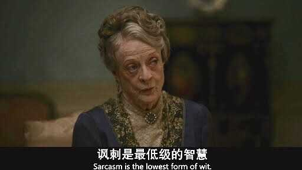

---

## 3747　以骂代批

- 日期：2020-07-02　主专题：A16 媒体舆论与公共认知　副专题：A03;A06
- 源 ID：`67e3fa57-4354-53d0-8cfd-c66d8eecd136`　原文链接：https://www.zhihu.com/question/403996303/answer/1313905475
- 官方对象—实践路径：与社会 / 与舆论 / 表达
- 23 概念标签：事实与证据;定义与达意;责任与后果;成本与总账;爱与回应;文明与历史;心理与主体
- 证据状态：manual_confirmed　初读：read　独立复核：not_reviewed

**问**：如何看待高晓松的直播被骂到终止？

批评并不是一种语言暴力艺术。
骂并不是批评，批评并不是骂。
批评是一种真诚的支持，是一种珍贵而且罕见的礼物，是不带侮辱的。
不但绝对没有任何要毁灭对方、杀伤对方的企图可言，反而是希望对方发现没有发现的风险、了解没有了解的机会、改变没能改变的缺陷、得到未能得到的发展。
是唯恐不够温柔的。
是遵循最低伤害原则的——仅有无法避免、找不到办法避免的痛，才能被批评者视为不得不接受的风险，不得已而用之。
是一种爱。
不是一种恨。
高晓松所遭遇到的，并不是批评，而就是暴力而已。
暴力没有正义可言。
用暴力得到的东西，都是更大、更多的暴力的肥料。
你借此得到了好处，就再一次证明了这样可以得到好处。
你的好处有多肥美，你就埋下了多大、多深的追求暴力的决心和动机，种下了仇恨和艳羡的种子。
仇恨你的，将来那更大的暴力就直接指向你。
羡慕你的，会受你案例的激励去伤害别人。
而任何人其实都是曲折的和其他一切人联结在一起的，甚至包含你的仇人。
对暴力的速效的崇拜，是人类最黑暗的痼疾之一。
无论暴力的理由是多么的可以理解和无可避免、乃至于正义，它的发生都仍然是人类的失败。
无论它的成果是多么美妙、绚丽，都是以人类总体更大的美好可能的丧失为代价的。
这件事没有什么值得高兴的。

---

## 3743　看屁股的人

- 日期：2020-07-05　主专题：A16 媒体舆论与公共认知　副专题：A03;A12
- 源 ID：`1f1595c3-5053-5798-96b3-70adbe78e0fd`　原文链接：https://www.zhihu.com/question/382301537/answer/1320162728
- 官方对象—实践路径：与社会 / 与舆论 / 接收
- 23 概念标签：事实与证据;责任与后果;成本与总账;边界与许可;劳动与组织;权力与异议;民族与身份
- 证据状态：manual_confirmed　初读：read　独立复核：not_reviewed

**问**：如何看待网上动不动就「屁股歪了」的评价?

这个词对我是禁忌词。
凡是对我说这种话的，或者被我认为有这种先论立场再论是非的习惯的。
哪怕是暗示性的。
包括我的评论区以内遇到的、在别的回答、评论区中闲逛遇到的、根本没说过一句话的，
我都会提前拉黑。
即使误判也在所不惜。
因为这样的人对“讨论问题”这个问题来说，“屁股是歪的”。
他们根本没有值得人探讨时间的价值，这并不是说ta们没有任何知识，而是说有这样的习惯的人，拥有稀缺的、新鲜的、一般视野所不及的知识的概率太低——而后者才是真正值得时间的东西。
他们终日所做的，只不过是在网上游荡，想拿不值钱的“点赞”和“关注”来奖赏别人站ta那一队，拿踩和攻击性的评论尝试惩罚不站ta们这一队的人。
这并不限于狭隘民族主义者，也包括所谓的pro-democracy的一群。这其实跟具体的立场没有关系，是跟人的行为准则有关系。
说简单一点，有立场什么问题也没有，但是只有立场、没有是非就令人敬谢不敏。
你不拉黑他们你什么也干不了。

---

## 3671　对人不对事

- 日期：2020-08-31　主专题：A16 媒体舆论与公共认知　副专题：A03
- 源 ID：`b8b9016b-ae92-53ae-8bd7-a213c221d761`　原文链接：https://www.zhihu.com/question/401938027/answer/1445061480
- 官方对象—实践路径：与社会 / 与舆论 / 表达
- 23 概念标签：事实与证据;定义与达意;能力与学习;选择与自由;成本与总账;爱与回应;边界与许可;劳动与组织;法律与秩序;权力与异议;文明与历史;性别与身体
- 证据状态：manual_confirmed　初读：read　独立复核：not_reviewed

**问**：知乎大V Patrick Zhang 退出知乎,是不是知乎的一大损失?对知乎会产生什么影响?

我发现很多人有一个很奇怪的问题，喜欢以人为中心考虑问题。
比如同一个人回答了两个知乎问题，有人不同意问题A里面的答案，常常就会跑到问题B下面质问答主问题A里的问题。
问题A里面没有认了ta所认定的错，那么问题B、C、D、E……所有的答案都会被认定为合法的火力范围，乃至于要跟踪追击、灭此朝食。
甚至疑似同一答主的匿名答案也要火力侦察一下。
这样的处世习惯真的很可怕——那意味着一个人如果在一件事情上没能让你满意，这个人就必须整个的从你的“领地”里消失，否则就会在所有你够得着的事情上都遭遇到你带来的永无休止的麻烦乃至于袭击。
谁有把握永远在一切事情上都让你满意呢？再说，凭什么人家应该在一切事情上保证让你满意？
某件事情让你不满，你在这件事情上反对，这是正常的；你扩大范围，那就不是在反对这件事，而是在直接攻击人了。
那么你最好确保对方真的认真起来你扛得住。
恕我直言，对这种行为无所顾忌的人的社会地位、社会影响力、能动用的资源和人脉——甚至是谋略——往往和ta的对立面有数量级的差异。
你真的把对方触怒了，感觉你这不是就事论事的问题、有一天会自然消解的问题，而是没有尽头、你死我活、身份消灭、肉体消灭的问题了，应该动用所有可以动用的资源以绝后患或者以儆效尤了，恐怕真正带来的是你自己的个人难以想象的压力和灾难。
这根本不是连“对人不对事有多危险”这么基本的生存法则都不了解的小孩子所能对付得了的打击。
说实在的，这是在作死和玩火。
是的，这样做的人似乎人数众多，按道理对方没可能个个打击，但是人家随机点兵点到你头上来做个典型，你就躲无可躲。落到你头上，就是你了。
你真的做好准备了吗？
对事不对人、一事一议，你以为只是美德而已吗？只是一句不明所以的“老话”而已吗？
这是保命的东西。
违背这条法则，等于为了一包烟报名参加俄罗斯轮盘赌，愚不可及。
而且这点禁忌都不懂的人，没有人会真的在意你说什么——因为你至少还有一次不知道挺不挺得过的人生大难在前头，在这个大难落地之前，你都还不算一个值得投资的安全资产。
这意味着你的一切优先级都要往后排——人一共能应付几个人？优先级往后排个两三位就等于实际绝交了。
有实力的老江湖普遍认定你是目前不值得投资的不安全资产，都和你实际绝交，你想不栽跟头都难。
真的是不知死活。
至于说这对知乎是不是损失——任何心智成熟的、有实际工作经验的、立意输出有效信息的人，无论其提供的信息质量如何，退出对知乎、对大众都是损失。
你们以为错误的信息就是损失吗？错了，言之有物的有错误的信息一样是收益。
甚至——世界上根本就没有正确信息，“言之有物的有错误的信息”就是人类能获得的最好极品了。
已经没有更好的一级了。
你们只是把一些你们自己看不出来错误或者你们自己喜欢于是相信没有错误的东西冒充成了“没有错误的正确信息”来打压“有错误的信息”而已——这只是在用一个伪造的完美来指责一个真实的次完美，只是一种出于对权力的贪欲而策划的谎言罢了。
有什么可自豪的？

别的不说，这样找得到男/女朋友么？
谁愿意跟这样的人在一起？嫌活得太舒坦吗？

---

## 3645　不该受亏待

- 日期：2020-09-15　主专题：A16 媒体舆论与公共认知　副专题：A01;A03
- 源 ID：`96a1dbf3-0861-5cb3-ae96-47ca11f44acc`　原文链接：https://www.zhihu.com/question/420450198/answer/1473235622
- 官方对象—实践路径：与社会 / 与舆论 / 应对
- 23 概念标签：选择与自由;成本与总账;信用与信任;爱与回应;净输出与不掠夺;劳动与组织;文明与历史;心理与主体
- 证据状态：manual_confirmed　初读：read　独立复核：not_reviewed

**问**：如何看待温柔junz最新视频《豫章书院曝光者温柔，深陷“网络暴力”泥潭》 并声称自己一生没有做坏事？

这个世界并不是按照“我没做坏事，于是我不应该/不会受到不公正的对待”这样的法则来运转的。
“我不做坏事”和“我不该受到不公正的对待”是两件事。
“我不做坏事”所能交换的，也就是它唯一的切实回报，是“有所作为”的价值感。这是唯一的的对价，其他的只是“副效应”，犹如你拿着手机玩游戏，手机所发的热一样。
因此带来的“我比别人善良”的义人感也罢、自以为社会欠自己的善良债也罢、他人对自己应有的额外尊敬也罢，都并不是行善的“合法回报”的一部分。合法的回报，有且仅有“我做了一点事”或者（更确切一点说）“尽义”的价值感。
它根本就不指向“我不会受到不公正的对待”甚至“优待”。
是“防止我受到不公正对待的做法”防止“受到不公正的对待”。
而“行善”并非御侮的全部内容——远远不是。要御侮，对应的是御侮的方法，而不是行善。这听起来似乎是一句废话，但是世上有无数人——主要是小孩子们——不懂这个道理。
行善归行善，御侮归御侮，你行了善，完全不意味着你无需做御侮的功夫就可以自动的免于侮辱。
的确，不可否认东亚社会做了很强的构建来说服人们相信这种“你只管行善，大众/政府会帮你御侮”的承诺，并且着实花费了相当的社会资本——至少是宣传成本——来保证这个承诺不是完全空洞的。
但归根到底，这并没非人类所能决定的事情。因为人类没有富有到能彻底、普遍、及时的实施这条承诺——事实上，将来也不可能有如此的富有。
对抗这类网暴，首先要拒绝成为偶像。
第二要注意不断的提供新的、对最广泛的大众有价值的新信息，而不是空洞的去针对某个让你不爽的个人。
这就像你发了一篇论文，有人对你破口大骂。你最有效的手段不是去说明对方哪里不礼貌，哪里批评得不正确——这种待遇，其实是留给理性而有爱的批评者的。
你应该再发第二篇、第三篇、第四篇。
直到当事人自己都感到后悔，悄没声的自己悄悄删掉那些话——否则ta最后可能会以“嘲笑爱因斯坦不懂科学”的形象被历史记住，永远钉在耻辱柱上。就连这些人自己，将来想起自己曾对你出言不逊也会感到羞耻。
做了一次豫章书院，这很好。那么就接着做就是了。即使有人攻击和不理解，你也在继续，这才是最好的回应。
而不是不断进行对其他公众并没有什么额外信息的辩白，证明自己有多无辜。
这样做心情可以理解、值得同情，但是客观上没有效果。因为本质上这样做你是在强行攫取公众的注意力资源来谋求自己的利益——公众并不是自愿的，他们只是给了你容忍。
容忍是有限度的，其薄如冰。
我呼吁关心@温柔JUNZ 的人给予他恰当的帮助。
这不是指站在这一边去针锋相对、反唇相讥，以求在声势上、乃至于在暴力上去“压倒敌人”，而是指站出来提供庇护、阻止别人用非法的手段对人进行语言和暴力的迫害和威胁。
是提醒和鼓励，是陪伴。
他现在真正脆弱的点应该是觉得孤独。
至于对 @温柔JUNZ 你自己，送给你德兰修女箴言：
人们经常是不讲道理的、没有逻辑的和以自我为中心的
不管怎样，你要原谅他们
People are often unreasonable, illogical and self-centered;
Forgive them anyway.
即使你是友善的，人们可能还是会说你自私和动机不良
不管怎样，你还是要友善
If you are kind, people may accuse you of selfish, ulterior motives;
Be kind anyway.
当你功成名就，你会有一些虚假的朋友
和一些真实的敌人
不管怎样，你还是要取得成功
If you are successful, you will win some false friends
And some true enemies;
Succeed anyway.
即使你是诚实的和率直的，人们可能还是会欺骗你
不管怎样，你还是要诚实和率直
If you are honest and frank, people may cheat you;
Be honest and frank anyway.
你多年来营造的东西
有人在一夜之间把它摧毁
不管怎样，你还是要去营造
What you spend years building,
Someone could destroy overnight;
Build anyway.
如果你找到了平静和幸福，他们可能会嫉妒你
不管怎样，你还是要快乐
If you find serenity and happiness, they may be jealous;
Be happy anyway.
你今天做的善事，人们往往明天就会忘记
不管怎样，你还是要做善事
The good you do today, people will often forget tomorrow;
Be good anyway.
即使把你最好的东西给了这个世界
也许这些东西永远都不够
不管怎样，把你最好的东西给这个世界
Give the world the best you have,
And it may never be enough;
Give the world the best you have anyway.

---

## 3643　舆论战

- 日期：2020-09-17　主专题：A16 媒体舆论与公共认知　副专题：A12
- 源 ID：`a76431bd-767c-5863-9a1d-52ace5b134f2`　原文链接：https://www.zhihu.com/question/391668118/answer/1477174183
- 23 概念标签：能力与学习;选择与自由;成本与总账;法律与秩序;心理与主体
- 证据状态：manual_confirmed　初读：read　独立复核：not_reviewed

**问**：中国的国际舆论能力、国际话语权太弱，如何提升？

要回答这个问题，要先问一个前提问题：
提升“国际舆论能力”、“国际话语权”，真的对中国有利吗？

你们有想过这个问题吗？
“提升国际舆论能力和国际话语权，对中国总体有利”的逻辑是什么？
这个诉求，与其说是出于国家利益，不如说是出于小朋友们在海外受的委屈。
你们不要以为中国的智库真的不知道怎么打舆论战，小朋友自信也要有点谱。
中国政府是世界上最有钱的政府，真想发动全力去打舆论战，你们看到的会是这个表现吗？你们真的以为那些智库里满满当当排排坐的传媒泰斗、政策精英、一年不知参与多少国际会议、有权限直接访问国家级大数据、常年关注舆情动向学术大佬、远远早于一般老百姓先看到行业发展行业领袖——甚至干脆就是战略发展计划起草人的人，会不如你们懂得什么是生动活泼的舆论技巧、什么是机动灵活的宣传策略吗？
你们看看建国前的报纸，你们现在玩的这点自己觉得够有创意的什么抽象话啊、鬼畜啊、表情包啊、段子啊……说得不好听点，七八十年前就玩得烂了。
你的爷爷的爷爷就已经有这个水平了。
论宣传，中国人的哪怕村级大妈的平均水平都不知道是几级高手。你们真的相信人均管理人口过亿的领导班子会比你们不懂如何做宣传？
你们难道真的以为ta们会比在国外混了几年的留学生更不懂如何在西方世界争夺话语权？
可能吗？
中国不打舆论战、不争夺国际话语权是一种选择。
现状是一种微妙的平衡。
其实不用你们说，欧美精英已经完全明了中国的实力之强大构成了非常强的硬挑战。
假设今天真的开战，哪怕西方集团全力团结，哪怕最后侥幸获胜，也不可能不付出ta们难以想象的代价。更何况能不能战胜一个大一统的、无需一轮轮投票的、巨型单一主体民族核武国家，根本不是十拿九稳的事。
现在西方世界对中国最大的心理优势——也就是保证这种平衡感的最大的砝码——就是西方对自己的舆论优势尚有足够信心。
直到现在，世界仍有强大的惯性维持原有的运转方式——西方占面子，中国占里子。
面子在手，里子的快速壮大才不至于让人夜不能寐。
你非要把人家的面子也夺过来。
是的，你有钱，你其实也有人，你要办你就能办到——至少可以沉重打击西方现在的绝对优势。但是那样一来，整个世界的基调都会扭转，整场游戏都会改变。
就因为赢得不够爽、不够彻底，你要改变你已经赢了四十年的游戏？
西方世界需要安全保证，需要安全感，而不是需要进一步的认识“中国可不好欺负”。
放你一万个心，ta们早就过了这个阶段了。
让西方保持安全感，川普就是世界上最大的坏蛋；剥夺西方的安全感，川普就是先天下之忧而忧的先知。
这远比你那点委屈重要得多！
从另一个方面来讲，真正的敬重，是任由对方误会到无法继续维持误会来达成的，不是靠“不允许对方误会”来达成的。
用舆论战赢来的，不会是真正的尊重，而只会是对你舆论技巧的警惕。
你要花钱买这种警惕来干什么用？

---

## 3605　优秀的被诋毁者

- 日期：2020-10-22　主专题：A16 媒体舆论与公共认知　副专题：A01;A06
- 源 ID：`a58a755a-a236-5fe7-bc05-89432904779d`　原文链接：https://www.zhihu.com/question/58719943/answer/1536352021
- 官方对象—实践路径：与社会 / 与舆论 / 应对
- 23 概念标签：事实与证据;定义与达意;能力与学习;责任与后果;成本与总账;信用与信任;爱与回应
- 证据状态：manual_confirmed　初读：read　独立复核：not_reviewed

**问**：被恶意诋毁是种怎样的体验？

当然是不舒服的，但这也是考验自己的一个好机会。
人不知而不愠，而可以原谅，可以不计较，是非常重要的品质。
你不追究这些人，不是为了这些人，而是为了你身边的人。
人如果受不得委屈、吃不得亏，必要以眼还眼、以牙还牙，甚至要“君子报仇十年不晚”“十倍奉还”，最大的问题是会让身边人怵然而惧。
因为比起那些偶然遇到的无礼路人，ta们和你朝夕相处，让你受委屈的机会远远超过这些路人无数倍，而你对ta们的伤害能力也远比对那些素不相识的路人高出无数倍。
你对路人睚眦必报，出手狠辣，不死不休，你是得了痛快，但这就意味着两件事：第一，你并没有意识到身边人作为永恒的旁观者的存在，这就已经是一层寒心；第二，ta们会害怕你，这是第二层寒心。
有素不相识的人诋毁你，你虽然委屈，却没有使用暴力手段去“处理”对方，你是在那些人那里吃了点亏，但在爱你的人这里，你收获了千百倍。
那些诋毁者怎么想，其实是没有关系的。因为ta们不过是过客，如同坏天气。
关键是你身边的人怎么想，爱你的人怎么想。ta们才是你的世界的基石。
如果你处理得好，人对你的诋毁，反而会转化为身边人对你更强烈的爱和信任。
那是无价之宝。
我发现很多人特别在意反击。
其实最好的反击是因为你并不是ta们的诋毁里所描述的那种人，在后面的生活里自然而然的出现诋毁者很难解释、很难自圆其说的事实。
比如对方说你小气，过两个月有人出来感谢你慷慨相助。
对方说你不懂科学，结果过几个月你上了好论文。
等等等等。
这不需要是你为了“报复”这些人而赌气干的事，而是你本来就不是ta们想象的这种人，自自然然就会有这种“反击”。
你只需要接着生活下去，对方就自然要挨反击。
这些越来越多的事实，自然会让诋毁你的言论一天比一天尴尬。
过个几年ta自己成熟点、懂点事了，回头来看自己当初说的那些蠢话，自己都会无地自容。这期间还有一轮一轮的其它令ta们混身发热的外人的质疑。
ta们如果还大声在自己的亲朋好友面前发表过这些诋毁，这些诋毁自然而然会成为亲朋好友认识到“ta缺少判断力”的一个依据。这种判断放在心里，ta的潜在损失有多大是ta自己难以想象的——本来能借到的钱，可就不好借了。
最后ta们会自己静悄悄来删除评论的。但这仍然不是最好的做法。真正最明白的人，会回来道歉、承认错误。
只有这样正面承认错误，ta们才会真的从自己造成的厄运里解脱出来。
删掉、抹去这些痕迹，拉黑ta们让ta们没机会留下更多的笑柄，其实是在保护ta们。ta们不懂罢了。

---

## 3594　胡锡进

- 日期：2020-11-02　主专题：A16 媒体舆论与公共认知　副专题：A03;A10
- 源 ID：`97c93403-cbf7-5d99-bd0a-c05b147e9803`　原文链接：https://www.zhihu.com/question/35781075/answer/1554845633
- 官方对象—实践路径：与社会 / 与舆论 / 表达
- 23 概念标签：事实与证据;定义与达意;能力与学习;责任与后果;爱与回应
- 证据状态：manual_confirmed　初读：read　独立复核：not_reviewed

**问**：为什么有些人要骂胡锡进？

因为有人想杀鸡骇猴，
而另外又有很多人喜欢一切能练一下“拳脚武艺”的机会。
批评是批评，骂是骂。
譬如自己去模拟对方的语气编一段对方的话来“证明”对方的“可笑”的做法，和“穿上对方的衣服去杀个人来证明对方很邪恶”有什么本质区别？
这就根本不是什么批评，而纯粹是手法有娱乐性的攻击罢了。
犹如一个人在街边上殴打另一个人，但是打得很“精彩”。周围站一圈看客、纷纷为这精彩的拳脚叫好。看客们只关心拳脚好看，就为这拳脚好看，就假定被殴打的人必然“活该”。
这是个什么水平？
师傅说——这是没水平。
至于说很多人拿来指责胡锡进“没有风骨”的那种标准，幼稚得一塌糊涂，现实里根本行不通。
比如说他前后矛盾——活了几十年，我还没见过活着的人类有能做到说十年话前后不矛盾的。甚至把这个时间周期缩短到半年，其实都没有做得到的——你觉得有人做得到，那只是因为你对前后矛盾不敏感，自己看不出来罢了。
说他“立场摇摆”——“不摇摆”是个什么样的境界？能确切的定义一下吗？或者不用zzzq遮脸堵嘴的前提下，举一个几十年立场从不“摇摆”的实例？
归根到底，这只不过是自己设想了一种定义含糊、其实没人能做到、也绝不会用在自己身上的梦幻法则来判别人有罪。
根据完美的道德法则，人当然都有罪，这是常识，何况根据一种梦幻级的法则呢？
按梦幻级法则，地藏菩萨都有罪。

---

## 3548　血滴子

- 日期：2020-12-22　主专题：A16 媒体舆论与公共认知　副专题：A03;A17
- 源 ID：`767835a5-0cba-533c-9891-6d8ad799ae1e`　原文链接：https://www.zhihu.com/question/413158786/answer/1638970903
- 官方对象—实践路径：与社会 / 与舆论 / 表达
- 23 概念标签：事实与证据;能力与学习;选择与自由;责任与后果;成本与总账;信用与信任;照料与家庭;技术与工程;心理与主体
- 证据状态：manual_confirmed　初读：read　独立复核：not_reviewed

**问**：现在都流行嘲笑做题家思维，是不是和美国人嘲笑nerd书呆子是一个意思？

说实在的，只是回答这个问题，都是在助长一种恶劣的思维风气。
类似五毛、美分、精日、皇汉、绿蛙、小粉红、南拳、easy girl、单身狗……这类非自嘲性的，由A对B使用的贬义标签，是人类对语言最大的恶用之一。
这是一种稀释了剂量的人格谋杀，一种微型诛心之术。
我是不会帮人确定这些血滴子到底是为什么头型准备、使用时应该怎样瞄准的。
这些杀人于无形的暗器，对于有这个动机而又必须逃脱责任的人来说，的确是大好利器。
但我教你们一种做人的原则，就是不要暗算。
你想进攻，要明明的拔剑，堂堂正正直视对方的双眼。
这的确会导致你不容易取胜，但是这在另一方面有重大得多的意义——
这样的人，别人不会随便怀疑ta已经不宣而战。
你们将来必定会格外杰出，这会为你们带来一种最大的诅咒——人会畏惧你们的能力、害怕你们的敌意。
你能力越强，对方怀疑起你已经悄无声息的动手时脑补的空间越大。你说什么都会被怀疑是影射、暗示，做什么都会被怀疑是深谋远虑的计谋。
如果你还在任何方面展现出对暗算、阴谋的欣赏甚至羡慕，那些安全感不够的人将会全自动的成为你出乎意料的、无法理解的、不死不休的敌人。
你其实什么都没做，在你完全没有意识到的地方却会有无数你根本不记得打过交道、与你有立场冲突的人日夜惊恐，觉得你在步步紧逼，为此夜不能寐。
就如嫉妒一样，这是一种内嵌在人性底层逻辑中、用于震慑精英不可生邪念的抑制机制，是一把用于天诛的利剑。
如果你不甘平庸、自强不息，而且有任何雄心壮志，你就要记住这条绝对禁忌——
天意不允许你对任何所谓“巧妙的攻击手段”表示任何意义上的欣赏，否则必遭反噬。
因为这是敬畏你的力量而自觉与你有怨的人最大的安全保障。在ta们眼里，无所不能、深不可测的你还爱好阴谋诡计，ta们自觉得罪过你，还怎么能睡得着？
任何地方，任何时间、你只要以任何形式这样做过、说过甚至想过，你都在亲手诅咒自己最大的可能性。
一分过失，都要十分的忏悔来清洗。
志在青云之上者，岂能不爱惜羽毛？
你如果就因为一点微不足道的小小恩怨、为了占那么一点微不足道的“恶心你一下你抓不到我把柄”的所谓“便宜”，就利令智昏，触犯这样的大禁忌，你有什么资格承受将来要把前途命运寄存到你身上的下属的托付？
配吗？
再问你自己一遍，配吗？
到时候你有什么资格抱怨人明明知道你技术最好却不肯选你？
还玩这些梗吗？
其实这是在玩自己的命。
为人父母，如果没跟子女说明白这个道理，是极大的失职。

---

## 3520　不怯场

- 日期：2021-01-14　主专题：A16 媒体舆论与公共认知　副专题：A03;A20
- 源 ID：`f9d288d4-cbf7-51e0-ae6f-a7180096ce4c`　原文链接：https://www.zhihu.com/question/308078274/answer/1677092035
- 官方对象—实践路径：与社会 / 与舆论 / 表达
- 23 概念标签：事实与证据;定义与达意;能力与学习;选择与自由;责任与后果;权力与异议;文明与历史;心理与主体
- 证据状态：manual_confirmed　初读：needs_reread　独立复核：not_reviewed

**问**：怎样才能让自己不胆怯，敢在大众面前说话，并且有话说，不脸红，怎么克服?

这个问题啊，原因很繁杂，我们先条分缕析。
首先，中国的文化里并不强调当众演讲的能力，甚至干脆就是抵触这种“大广场演讲”的。这种“对公众讲话”的能力，对于传统中国的精英阶层而言是多余的。
中国的运行逻辑和希腊—罗马文化的“广场mz”体系完全不同。它强调的是专家治国、精英治国，强调是在掌握了全面知识的决策圈（这必然是一个非常小的决策圈）之内达成共识。
强调的是私下里的坦率交流和共同决策时的“含蓄沟通”。这是一种非常复杂精妙的沟通技术，要利用大量的小圈子共识，不立文字、不留把柄的微妙表态，大量依靠暗示和心照不宣。
如果你们仔细查看，你会发现中国历史里“领袖人物对人山人海振臂高呼、响彻云霄”这种场景几乎是零。
去太和殿参观一下，看看中国最大最宏伟的议事处有多大，你们就会有一个很直观的印象。

御座前只有几十平米面积的太和殿（侵删）

军机处值班房（侵删）
太和殿前广场的设计，是为了用于大型朝会和庆典，靠的是声音洪亮的内官层层传声，完全没有“公众讨论”，“说服各方”的功能，只是在自顶向下层层公布既定的结果。
在中国关于策略的讨论是限定在精英小圈子范围之内的。你想要获得最大限度的政策影响力，你的主要策略应该是不断的获得更上一层的决策圈的注意和认可，而不是不断的获得更多、更广范围的认知度。
通过大型的公开演讲去获得曝光度、获得“民意”，在根子上是被中国的治理文化排斥的行为——因为你不可避免会媚俗。这从原理上会导致你总是在实施前瞻性不足的、过于情绪化的、不必承担全部个人责任的政策。这基本上被视为一种品格缺陷。
虽千万人吾往矣，说的并不是前面有千万异族敌人我要学赵子龙杀个七进七出，而是指即使你裹挟了巨大的盲目共识，哪怕我反对会被限于孤立，我也要挺身而出正面对抗。
你如果有数据、有逻辑、有大义，你就可以说服我。你不诉诸逻辑，而是诉诸于你背后站着多少人、有多少赞，想要我掂量与你对抗的后果——那对不起，虽千万人，f*ck it，吾往矣。
现在问题来了——讲论据、讲逻辑、讲大义的能力有底吗？这里的每一样都是深不可测的，可以花费你全部时间精力的。如果你真诚的以讲论据、讲逻辑、讲大义为唯一正确的说服之道，你不应该还有很多精力去磨练你鼓动大众情绪的技巧、去积累那些经验。
君子应该学而时习之，不亦说乎；
应该不耻下问，以谓之“文”；
应该喻于义；
好好搞好你的事实、逻辑和大义。
君子应该讷于言。
换句话说，一个东方意义上的君子不应该拥有——尤其是追求拥有——调动群体情绪的能力，而应该天然的是这种追求的敌人。
因为“群体非理性”是一件可怕的武器，是任何真正卓有成效的的领导体系最大的软肋和噩梦。而有些人不是无意间经过天赋拥有、不知情的偶然使用，而是孜孜不倦的刻苦追求、视如得意技能的、花样百出的无处不用。这种技术，
在西方被称为“修辞学”——曾经被希腊、罗马的贵族精英视为最重要的个人技能。选择这种个人发展路线去求荣华富贵，在东方伦理的视角下，属于毋庸置疑的道德问题。巧言令色，鲜矣仁——太会说话的，少有几个好东西。
面对大庭广众，说不出什么很有情绪的话，发挥不出什么激情，在东方文化里，并不构成一种缺陷。甚至，还可以说是加分的。（注意，这里没有评判这两种观点设计谁好谁坏）因为这意味着你没有这种意图，也没有做这种能力储备，而且对这样做还有心理障碍，于是你说的话在很大的程度上可信度提高了。
你本来要说的话，应该仅限于你所看到的事实、你所想到的逻辑、你所悟到的大义。你所要做的只是直直的摆出来，是供人参考，而非要人顺从、屈服。
那和念一份实验报告、念一篇科学论文，应该没有本质区别。尽管那也那并不是没有任何表达技能上的要求，但其实根子不在于修辞学，而在于你对事实的掌握没有把握，你的逻辑不扎实，你的义理不坚固。那更多的不是口才问题，而是你平时满足于似是而非的东西，满足于道听途说，满足于模棱两可。
你自己知道这些玩意经不起别人追问。论据都是听说的，逻辑都是糊弄的，义理都是凭着“朴素的感情”临时站的，想想都胆颤。大庭广众下说出来、甚至只是对七八个人的小组会说出来、甚至只是对一个不苟言笑的领导说出来，都难免战战兢兢，汗不敢出，害怕自己的虚弱不堪一击。
问题是，难道不是有一个理所当然的出路吗？——你不知道的，就直说不知道，只说自己知道的、明白的、有把握的、不就可以了吗？你为什么没走这条出路？
因为你贪图更高的影响力，你不想失去你虽不该得到、但已经得到的机会和地位。你如果没出纰漏，蒙混过关了，你觉得你会在人群中有更好的地位，会得到更多的重视。但如果不幸失手，你就会受到反噬，失去一些“本来可以得到的”“好印象”。
说穿了，这其实是自立为偶像，想要获得崇拜。所以你害怕，害怕你极力营造的光鲜的假象无意间破裂。
这个嘛——如果真存在这样的绝技，世界会是现在这个样子吗？这份害怕是应该的，是不该被消除、也是消除不了的。

<!-- 图片：2 张，审读结论见下 -->

*图 1（已视觉复核）：中式宫殿建筑模型（重檐庑殿顶，太和殿式样）。*

*图 2（已视觉复核）：传统中式厅堂内景（匾额、炕床、条案与太师椅）。*

---

## 3494　人设指南

- 日期：2021-02-12　主专题：A16 媒体舆论与公共认知　副专题：A15;A03
- 源 ID：`de6cd452-d889-59b4-b010-861d24c0cd34`　原文链接：https://www.zhihu.com/question/301900420/answer/1726512595
- 官方对象—实践路径：与自己 / 与名誉 / 建立
- 23 概念标签：选择与自由;爱与回应;财富与市场
- 证据状态：manual_confirmed　初读：read　独立复核：not_reviewed

**问**：如何打造自己的人设？

好的人设，要害不在于它本身有多引人喜欢和关注。
要害在于关注它的人会因为关注这一行为而获得何种评价。
太多人在考虑这个问题的时候只想到了第一层，但实际上决定是否“成功”的，是第二层。
举点实际的例子——有人呈现出一种很受欺负的弱者形象，ta实际上是提供了一种机会，一种通过支持ta而展现同情心或者奋斗心的机会。
于是ta反而会比整天炫耀自己很有钱、富贵逼人的人设成功。
同样道理——写东西、拍东西也是一样。
不要光想着博人眼球，还要想着那些喜欢你的人，因为喜欢你、关注你这个行为，获得的是什么样的评价。
旁人是会因为看到ta们常看你的东西而觉得ta们显然贪慕虚荣，还是觉得恐怕一点虚荣骗不了ta们？
旁人是会因为ta们常看你的东西，而觉得ta们愚蠢还是聪明？是会对ta们生出喜欢，还是不喜欢？
那些会觉得ta们愚蠢的，是不是恰好多是自己愚蠢的？觉得ta们聪明的，是不是恰好多是自己聪明的？
那些因此不喜欢ta们的，是不是多是会给人带来噩运的人？而那些喜欢的，是不是多是会给人带来爱的人？
如果你真的看得懂这一点，你自然出类拔萃。
作为一个读者、一个观众，你去看任何东西、观赏任何东西，也要多反思这个问题——只面向第一层而创作的东西，是不值得你太多时间的。

简单来说——你要打造的不是你自己的人设，而是认同你的人的人设。

---

## 3417　持公器

- 日期：2021-04-03　主专题：A16 媒体舆论与公共认知　副专题：A10
- 源 ID：`ea9197ca-0a2e-51ee-beeb-ca4773d4a549`　原文链接：https://www.zhihu.com/question/452534650/answer/1814615350
- 官方对象—实践路径：与社会 / 与舆论 / 表达
- 23 概念标签：事实与证据;定义与达意;能力与学习;选择与自由;责任与后果;成本与总账;信用与信任;劳动与组织;法律与秩序;权力与异议;心理与主体
- 证据状态：manual_confirmed　初读：read　独立复核：not_reviewed

**问**：如何评价知乎女权大V @战斗力旺盛的伯爵 被平台永久禁言？

这就以为算胜利了的话，显然是对胜利理解有误。把对方的失足摔倒引以为自己的武勋，并不会让人肃然起敬。
话虽如此，这件事也应该引起观者的自肃——
荣耀附带着权力，任何权力在本质上都是公器。对待公器，宜戒慎恐惧，非不得已而用之。不为公事，勿擅用公器，不祥。
真正值得人拼命的，只有天下公事。但是要始终记住——公事无私怨。
为了免得一些人误解，我把这段话解释清楚：
荣耀附带着权力，任何权力在本质上都是公器
这是在说伯爵扛了女权的大旗这么久，不管他的理念你认同不认同，毕竟集中了大量的人望。这种关注里自然有荣耀，这些关注形成的影响力实际上是关注ta的主张的人借给他的公器。
对待公器，宜戒慎恐惧，非不得已而用之。不为公事，勿擅用公器，不祥。
对待这种公器，要小心谨慎。这是借给人为这个事业服务的，不是借给人为自己服务的。而你动用的时候到底是在为自己服务还是为事业服务，在极多的时侯难以分辨。
不要轻易信任自己的判断，要尽可能保守的判断。这实践起来，其实就是尽可能不要用。用得多了，也许很难确定的说这是公器私用，甚至几乎自己对自己总能把“这是为公事”说通，但自己要清楚自己不是判断这个分别的最佳人选。
人毕竟是人，谁都有火性，谁都有傲气，谁也按不住。所以某些自己觉得足够公正的判断，很可能是因为自己有报复的冲动而悄悄移动了准绳的结果。不是对方真有那么大的罪，而是我受了伤，我想复仇，但我想动用公器，于是作为公器的监守者和公器使用尺度的天然判断者，不自觉的苛刻化了判罪的标准，给了自己动用的授权。
自己到底有没有做这种事既然自己无法分辨，那么用得越多，自然越不祥。这就像一艘仪表失灵的船，开了几次没出事，根本不表示就可以放心的开下去，当然是开得越多越危险。
真正值得人拼命的，只有天下公事。
站出来说话，自然会有无穷的压力。因为这种站出来成为众矢之的的压力不是只有劳累而已，甚至会威胁到你的精神和实体的生命。
只有不出头才有绝对安全，出头就是拼命。拿可能会丢掉命的事情来图虚荣和权利是逻辑不通的。所以出头必须是为比自己的生死荣辱更重要的事。那必须是为了远超过十个、百个人的公事。
但是要始终记住——公事无私怨。
但是要记住，公事就是公事，公事不要结私怨。银行柜员当班挨了骂，不要把对方的名字牢牢记住以求回击。
这不单是容易横生无穷烦恼的问题，而是这会隔三差五就让人失焦。你坐进柜台事要办业务的，不是来战无不胜的。办了多少笔存款取款开户转账而不是一年还击了多少没礼貌的客户，才是在这个岗位上花时间的意义。
什么叫“观者自肃”？
“观者”是谁？是在指自觉在实施正义的伯爵批判者吗？这是台下的“观者”吗？这分明是台上的主角吧？
观者是谁？
是我好吗？
是我看了这事在提醒作为这事的旁观者我自己好吗？
我也常按不住火气反击一些我忍无可忍的冷嘲热讽。我也同样时常盗用公器！
作为千年妖狐，我自然忍得更深一些，被刺激出这样的行为的概率低一些。自己审判自己，我自己当然总会认为自己的反击已经是仁至义尽、无人可以指责的，但是这不过是五十步笑一百步。
实际上，伯爵这事我只是在时间线上间接看到这么一句半段。我也没有兴趣去花那么多时间去层层翻找力求看清整个八卦。所以坦白说伯爵是不是真的如此，我其实也并无把握判断。
但是这些看法是不是“伯爵的问题的正确概括”，根本就不是“自肃”的要害所在。
看到隔壁房子起火，到底是因为没管好汽油起火还是因为没管好烟头起火，真的对你自己警惕自己起火的可能性那么重要？难道经过详细调查发现对方是因为电热毯起火，你就可以长出一口气——“我没有电热毯，不关我事”？
看到隔壁房子失火，你要把自己房子的火灾隐患——尤其是你觉得可能是对方失火的诱因的那些方面重新思考一遍，这才是头等重要好吗？
我在这事上其实既无资格、也无权柄、更无条件去当这个合格的法官。
论罪我同为惯犯，只不过受害人不见得是你们而已；论权柄，我没有任何一方的自愿授权；论条件我根本没有精力去看这些纷繁复杂的，包含着大量隐语暗喻的新话，判什么判？
如果要问支不支持所谓的报案起诉，我直截了当的告诉你们——我当然支持。出于任何自己觉得合理的原因而走规范程序去报案起诉，无论那个理由事后是否最终被判决所支持，都是所有人不可剥夺的当然权利。这根本不需要“报案人一定是正确的”、或者“报案人确实是正义的”这种前提条件。要我支持你，我也根本不需要非要搞清楚你到底是不是正义的或者正确的。
反倒是反过来，非要某人先证明自己是正确的或者正义的，才肯承认别人报案和起诉的权利，这本身就是荒谬的无知和一种真正的剥夺。而将别人对这种当然权利的无条件支持认定为一种赞同自己正义性的证明，这是一种逻辑不通的强加私意于人。
我当然支持自觉受害之人把自己的疑问提交给法庭去寻求裁决——这怎么能不支持？哪有权利不支持？但我对当事人胜诉或者败诉本身并无倾向。
我也支持自觉受害之人向知乎管理员寻求裁决，这是各人加入知乎时已经通过用户决议自愿授权过的。无论我个人对知乎的裁决如何看待——坦白说我个人的确认为处置过重，前纵而后酷——但这是各人自己签字同意过的程序正义的执行结果，不可以因为结果不合己意就出尔反尔。
大丈夫行事，愿赌服输，挨打立正。不满归不满，认账归认账。输打赢要，不屑为之。
这种事一样落到过我头上，而且是再三再四。我同样根本不认同。是不认同归不认同，认账归认账。知乎必须、也只能按这个办法、照这个水准维持它的运转，不然ta还能有什么选择？签了字的，结果不利，也要认账。一切纠结，必须有一个更有效率的解。
我不代表什么最终正义，或者什么“毋庸置疑、无可辩驳的正义”，以上本质上是我自己对这事的自警。
错了我也不改，md。
就这样，解释完毕。
如果放不下自己的ego，还割舍不了那么多——我并无任何否定这些欲望的任何正当性的意思，人皆凡人，谁能免俗——那么对待意外落到自己面前的荣耀和绑在这荣耀上的权力，不要伸手去接。
接了，就要做好忍人所不能忍的准备。你必须断了“我有和别人一样生气 / 怨恨 / 报复……的权利”的念头。并不是要你完全放弃，但无论如何都不能再与“别人都可以，为什么我不可以”来自许。
世界对你从此适用的是另一套规则，再想要求“对任何人都不算过分”的“普遍人权”，其实是不可行的了。你接了比普通人更重的东西，无法再指望和普通人付一样的价钱。这是人真正兑现自己的自由必承之重。
坦率的说，荣耀的负担之沉重，足以让明白的人为获得它而哀叹。“获得荣耀”，是值得人同情、应当追悔和反省何以没能摆脱的厄运，而绝非值得庆贺的“命运的馈赠”。不幸因为所追求的事业而获得荣耀，应该——甚至是必须——被真心实意的视为一种极为不幸的损失。
@战斗力旺盛的伯爵
如果你能看见，希望你并不至于因为这种挫折而放弃你的追求。
这个追求的正义性没有任何问题，问题在于做事的方法。
哪怕你的观点并不完美，那也不过是人类本来就必然会有的局限——世上哪有什么完美先知？真诚的错误，虽然是错误，一样是正确的错误。过而能改，甚至比从不露错更为强大。
真正值得追求的东西，没有不死去活来、三起三落、七进七出的。积累几千年的沉疴，难不成还准备着一脚踹倒泰山不成？
不要争当时代的驾驶员，也不要争当时代的车轮。
最后造成了真正的改变的，总是那些甘做轮下的铺路石，愿让轮子从身上辗过去，宁可让时代忘记的人。真正洞石穿金、无可阻挡的，是这些人。
无私无闻者无敌，
至卑至微者至圣。
有不少人在密集提醒我我现在在表示支持的人的劣迹。我明白，意思是有错乃至有罪的人受难乃是大快人心，好人应该与之划清界限、坚决斗争。
问题是，我不同意这种行事逻辑。惩罚是惩罚，原谅是原谅。惩罚并不意味着不原谅。恰恰相反，若不是为了原谅，惩罚只是另一种办了证的作恶。
反对是反对，帮助是帮助。反对并不意味着要停止帮助。恰恰相反，若不是出于帮助，反对不过是化了妆的迫害。
如果不从这种近于“分清敌我，然后仇杀”一样的嗜血强迫中解脱出来，不去抗拒这种“正当伤害”的快感，从这里养成的恶习会毫不留情的、超乎你想象的毁灭你的一切前途和一切健康亲密关系的可能。
一切胆敢妄想与你终老的人，迟早会因为在你身边待得太久而变得足够的该杀。你放心，到时候把ta的罪状一件件列出来，那时围观的人也只会替你高呼杀得该、杀得好。
世上何人不该死？你想杀到几时？杀到孤独终老吗？

如果你不想落这个下场，你必须学会原谅——原谅从来都是为“不值得原谅的人”准备的。
正因为“不值得原谅”，原谅才成其为原谅。
原谅的能力决定了能爱你的人的上限，你不想被“正义”活埋在孤坟里，你昨天就应该开始磨练，
你以为原谅别人是被原谅的人落了便宜吗？你错了，是你自己在救你自己。

我不在乎他是不是真的如同一些人描述的那样如何如何，这对我要说的这些话并没有影响。就是，那又如何？不会改变我要说的这些话分毫。甚至，如果的确是那样，这些话只会更加值得他想想。ta如果听进去了这些话，自然会改变做事的方法。
你们是想要人改，还是想要人死？
最后，也是最要害的一点——
我花时间写东西，真正指向的从来不是所举事例里的甲方或者乙方，而是将来早已时过境迁之后，仍会看到这些话的读者。
这首先是写给将来已经早已不在乎这点小是非的人看的。谁成王、谁败寇，转头即成空，不要说经年，哪怕是旬日之后这些是非还有多少意义？看到这些话却满心只想到我在“站哪边”，是一种完全的失焦的离题。
女权到底是指什么权利？

---

## 3401　新手

- 日期：2021-04-13　主专题：A16 媒体舆论与公共认知　副专题：A13;A09
- 源 ID：`82708956-3f58-59e4-9573-c83339e61ae0`　原文链接：https://www.zhihu.com/question/453000829/answer/1833110563
- 官方对象—实践路径：与社会 / 与技术 / 理解
- 23 概念标签：能力与学习;责任与后果;成本与总账;权力与异议;性别与身体
- 证据状态：manual_confirmed　初读：needs_reread　独立复核：not_reviewed

**问**：新手骑公升级摩托车容易摔车吗？

这话翻译过来就是——找死真的容易死吗？
真的是真的啊。
为免争议，以下的“公升车”特指这种：

1440cc 铃木隼
这么大马力的车，为了和这个马力配合做了一系列的设计。这些设计都不是新手能控制得了的。
为了高速稳定性，公升车的车身沉重得很，坐姿近乎俯卧非常不利于发力，龙头转向沉重，油门刻度对应的动力功率远大于街车。
油门一拧可以把你人掀翻，高速你又不敢拼，低速空气给你身体的承托力根本不够你在俯姿时身体悬浮，于是你一直要用俯卧支撑方式撑着上身，转弯你也推不动龙头，倒了你又扶不住，直接可以把你腿压断。

个头对比
有的人跑去摸别人的车，腿都不够长，原地都能摔。
真跑起来了，高速压弯转向要反直觉的反推龙头，这技术新手一个失手可以飞到对向车道车轮子底下甚至高架桥下面去。
掉到水里还能落个全尸。
不要找死！！

<!-- 图片：2 张，审读结论见下 -->

---

## 3363　敏感

- 日期：2021-05-02　主专题：A16 媒体舆论与公共认知　副专题：A01;A17
- 源 ID：`4b9293d1-3dab-5e94-aa64-7d2d74f85460`　原文链接：https://www.zhihu.com/question/283907809/answer/1865331346
- 官方对象—实践路径：与自己 / 与情绪 / 调节
- 23 概念标签：定义与达意;能力与学习;成本与总账;爱与回应;边界与许可;劳动与组织;法律与秩序;心理与主体
- 证据状态：manual_confirmed　初读：read　独立复核：not_reviewed
- 标记：`【正文标注未完待续】`

**问**：是否国人常常对外国人评价中国的言论太过敏感？

问题并不出在对外界评价的敏感上。那些所谓“你迟钝点就好了”的劝诫是没有意义的。道理很简单——这办不到，而且也不该办。
对外界反馈迟钝，如果真的办到了，的确倒是“不太受影响了”，但是人难道不是也在实质上残废了吗？
所谓的“过度敏感”其实不能用来描述“对细小信号反应强烈”，而只能用来描述“因为灵敏度过高，误将无关信息判定为了目标信号”。
看到了吗？这其实是一个语文问题——常被称作“过度敏感”的问题，本质上根本不是一个探测敏感度问题，而是一个反应强烈度问题。
换句话来说，是指反应过度，而不是指探测性能太好。
也就是说，只有“国人”误将并非攻击性的完全无意义或完全是另一个性质的信号识别为了攻击性信号，这时的问题才能被称为“过度敏感”。
那么，国人“过度敏感”的那些信息，真的是被冤枉的吗？是其实是在说一件完全无关的事，而被执着的认定为是一种评价的吗？
还是其实确实就是一种评价？
如果是，哪来“过度敏感”可言？

把这一层说清楚了，现在说“过度反应”问题。
看到过度这个词，永远立刻跟着追问——这个“度”在哪？
它在哪？
就是不可因此放弃原则。
破口大骂，其实在侮辱对方之前先侮辱了自己；
捏造段子——譬如编造别人没说过的话去写段子，就有失品格；
用一切上不得台盘、见不得祖宗的手段尝试给对方造成同样、乃至更大的精神损害以为报复——其实是一种虚弱。
处理是处理，反击是反击，礼貌是礼貌。
礼貌不是发给对方的福利或者给对方表现良好的礼品。
礼貌是自己对自己的尊重。
如有正义的必要，你可以一剑斩下对方的脑袋，但仍要堂堂正正、全礼相待。
任何攻击挑衅都不能动摇其处世原则的人，才是真正有力量和别人不能不尊重和敬畏的人，因为这份不动如山的自控力和意志力，才是无法估量的可能性的保证。
无法估量的可能性，就是无法承受的威慑。
叫嚣、唾骂、嘲讽、捏造……一切非要失礼才能发泄得了的失控，只会导致愚蠢的失误，反而削弱了这份力量。
“礼”就是这个度的底线。
子路即死，亦不免冠。

过度反应的第二根线，就是因为这些而转移了注意力焦点。
要知道外人评论攻击是廉价的，几乎是不花钱的，想发随便可以发。
但是引发了你的怒火和痛苦却是真实的，会因此产生很强的情绪冲动。
这个时候要切记，这份情绪冲动必须要转化为某种建设性的东西、某种有利于你的事业的东西——比如某种计划和规范的改进、某种向着更强方向发奋的动力——而不能容它转化为对你自己成长的干扰和损害。
只有对方的骚扰会肉眼可见的成为你加快前进的动力，才可以迫使想要使用这一手段的人因为显然可见的“得不偿失”而主动放弃。
ta们每攻击一句，你都变得更富有、更聪明、更努力、更强大了，那么ta们若真是你的敌人而且不是白痴，就会非常为难——因为要轮到ta们痛苦的忍耐自己的攻击欲，以免成为你加速成长的生长激素。
而你若让对方观察到这种成本低廉的手段获得了任何意义上迟滞你的努力、偏转你的方向的收益，那么你就是在以实际效果向对方证实这样做的性价比。
你可能会觉得你的当即反击可以扩大对方的损失、抬高对方的成本，从而使对方的成本核算偏向亏损一边。但是对方只要是不傻、尤其是如果确实是精心策划的话——在发动之前ta们就已经穿好了盔甲、立好了盾牌、挖好了壕沟，准备好了吸收你的直接火力的能量。
你的火力所消耗的弹药和时间，本身会使得ta们的这些提前投资立刻兑现为收益，而不是成为沉没成本——这会直接造成ta们的收入增加，而不是减少。
所以，本质上过度反应（也就是错误反应），就是一切会让对方对攻击收益满意的反应。
回答那些话的最有力的反击是什么呢？
“谢谢你给我的警醒，让我知道我的努力还是如此的不够、知道自身团结如此的重要、知道我们的国家处在如此的敌对和歧视之中。
我一定会更加用功读书/工作，与我的同胞更强的团结在一起，为早日让我的国家不再受到这样的侮辱、为这个世界不再受这样的谎言威胁而奋斗。”
然后每一个1450的谎言都得到这样的回复，而不是丧失理智和利益原则的“回呛”，尤其是普遍的、大规模的如此，才会显著的令ta们主动的收敛这样的“资敌”行为。
这样做，对一切试图以侮辱为投机性攻击手段的策略都有釜底抽薪、剖心剜腹一般的奇效。
当然，前提是你不是说说而已。
偏离这个对策方向，越远越为“过度反应”。

（未完，待续）

---

## 3246　反弹琵琶

- 日期：2021-06-19　主专题：A16 媒体舆论与公共认知　副专题：A03;A12;A18
- 源 ID：`96a67cba-4b25-574c-8994-d902ae930557`　原文链接：https://www.zhihu.com/question/465827983/answer/1949343689
- 官方对象—实践路径：与社会 / 与舆论 / 接收
- 23 概念标签：事实与证据;定义与达意;能力与学习;选择与自由;责任与后果;成本与总账;劳动与组织;法律与秩序;技术与工程;心理与主体
- 证据状态：manual_confirmed　初读：read　独立复核：not_reviewed

**问**：如何评价赛雷话金发布视频揭露「不让中国人吃海鲜」事件背后的反华组织利益链？

面对“可能出于敌意的目的的、逻辑不成立的、证据不真实的观点”，一个国家、一个社会，能采取的最好的处理手段是什么？
所谓最好，当然是指成本最低、收益最高、风险最小。
如果你真的关心所在组织的利益，作为组织的成员，从综合收益的角度出发考虑如何发挥你对组织规则的影响力，来最大化的保证组织的繁荣前景，这才是你对组织内一切问题进行价值判断，政策建议和行动决定的基本方法。
基于这个立场，我建议人们不要把重心放在“可能别有用心”上。
这不是说叫人对此毫不关心，而是不要把这一点视为“取消资格”/“消灭讨论的必要”/“决定实施惩罚”的充分依据。

对于一个“可能出于敌意的目的的、逻辑不成立的、证据不真实的观点”，一个健康的社会应该有充分的力量去在“逻辑不成立、证据不真实”上设立足够的防线，以避免对“出于敌意的目的”的严重依赖。
因为，我们负担不起“一个命题，其逻辑是成立的，证据是真实的，但很不幸它是由敌人说出来，我们就不要听、不要试”这样一种政策。
并且，通过主张这一政策，会带来几方面严重的问题：
1）敌人可以反向操纵这个游戏。ta们知道什么是对的，什么是你急需的，然后ta们大声的把这个东西染上“我们的立场、我们的观点”的色彩，然后利用这种“身份立场一票否决论”促使它在我方内部反而被摈弃。
说得直白点，就是既然你要搞这一套，对方就会挑衅式的主张一些你其实抛弃不起的东西，让你喷，你喷完了就会变成世界公敌。
例如，引诱你喷自由，引诱你喷民主，引诱你喷所有西方人、引诱你喷环保……
引诱你，利用你的力量把一切支持这些理念的人全部喷到ta那边去。
这是一种会毫不犹豫的用在没有这个警觉性的组织身上的阳谋。
而恕我直言，很多人在犯这种错误。
此时此刻、现在，就在犯这种错误。
这并没有真的帮助中国获得更多朋友，但却有可能制造了本不该有的敌人——你只是收获了口诛笔伐的快感，但却没有真正帮助到局势，甚至可能实际上帮助了对方。
想想清楚，那本来就可能是对方的目的。
2）它会减少你可能听到的选项。
如果仅仅因为说话人的身份是敌人、或者与敌人有关，其观点的逻辑和证据就无需再加讨论，可以径直开始处罚。
那么，这意味着一切感觉自己可能经由某种途径被网民认为与敌人有关联的人——比如共同出席过某个会议、比如合过影、比如领过奖、比如吃过饭、比如做过生意、比如写过信、比如表达过礼貌……都会因此闭嘴。
这意味着对方用了极小的代价——几个根本不怕被骂的、无足轻重的闲棋，就成功的削弱了我方大量的智力资源和社会稳定的支撑要素。
这是一种重大的、一本万利的战略性的成功，它只是以一种战术的失败来实现罢了。
我坦率地讲，对方大概现在正在开庆功宴。这代价简直微不足道，如同蚊子叮咬，但却让不知多少人暗自担心只要说话——尤其是“身处瓜前李下、却要说逆耳忠言”——就会招来社会性死亡这样的遭遇。
ta们轻而易举就利用年轻冲动的网民把中国正常的言路堵了个半死，把“不顾风险，提醒问题”的门槛，抬高到了只有无可置疑的红血天使才敢大着胆子试一试的地步。
“Best 10000 dollars ever spend!”
如果中国如此轻易的就被锁进了这条轨道，就不必期待什么民族复兴了。
因为民族复兴不可能仅仅依靠纯血天使来完成。

3）它会在发展上延缓、甚至从长远来看会阉割掉公众明辨是非能力的成长。
“三人行，必有我师焉。”——孔夫子可没有说这三人一定就是好人、友人。
一个成熟的人，不应该因为对方是友善的，就对对方的说法放松事实判断的标准，也不应该因为对方是敌对的、就“收紧”实施判断的标准。
事实判断的标准只有一个，就是最严格的那一个。万言万当，一视同仁。
越严格、越严谨、越可靠，越好。
在这一点上，有一分耕耘，才有一分收获，有一分历练，才有一分强健。
而现在问题来了——为什么可以断言一个事实判断长期依赖身份判断、立场判断做预过滤的政策会阉割掉事实判断的能力？
道理极其朴素——不做这过滤的人，经手的案子很自然会比你多。
多得多。
一百件需要进入逻辑审查、证据检验的案子，人家是不经过滤一律处理，而你这边却要经过身份立场审查、而且是查完三代查五代、查完三族查九族这种审查，而且是只要查到，就取消审查资格。
不论你别的方面有多少合理性，你会有大量的案子被提前丢进垃圾堆。
十不存一。
你想靠10%的题量练出人家100%题量的解题能力，你们都是做过题的，自己想想看这是一种什么样的愚蠢而傲慢的行为。
更危险的是——谁说查不出任何关联的、就一定是安全的？
但这个做法却在事实上以震耳欲聋的沉默，在一遍遍的宣扬着这一点，把这种执着——严格说是一种失智症——写入社会心理的底层。
为了舍不得这其中的快感而任由这种恐惧驱动的无理性自由疯长，其危害无法用笔墨来形容，不加警惕和防范，是实实在在会酿成浩劫的。
如果你切切时时的在意真正的全局利益，那么不要把你的智力资源投入到对说话者立场和身份的在意上去，要学会管理住自己情绪上的饥渴、无视恐惧对你的引诱和操纵，专注在逻辑的严谨，论据的真实上，为大众提供“为什么这个看法是不成立的”“何以见得这个论据是不真实的”的思想资源。
身为中国的话语精英，应该将自己的力量用在帮助中国公民变成“无论对方有意还是无意、出于善意还是出于恶意，都难以诱导做出错误决策”的成熟的公众。

注意——我不是在反对人去警惕说话人的立场，或者反对这位博主提供这些信息。
我甚至比较欣赏ta并没有使用破坏ta人隐私的手段，而是严格的仅仅用了对方自愿公开的信息就找到了这些信息——这是一件好事。
我所反对的，是人们把这一点信息赋予了过于要害的权重。
这个信息，可以作为需要投入更多资源、加倍仔细检查逻辑和论据的必要性依据，但是不该成为跳过逻辑检查和论据检查直接宣判的依据。
后者是不健康的，
而且得不偿失，名胜实败。

恕我直言，美国很明显正在被卷入这种错误中。ta们正在越来越深的意识形态化、唯立场化，在任由出身、种族绑架、代替甚至废除理性判断。
站在外侧看ta们，我想你们人人都看得出这是一种愚蠢，而且事实上正在逼着美国产生荒谬而可笑的昏庸战略，使得一个昔日的强国，陷入到荒腔走板的脑瘫状态。
但是轮到自己，为什么就也要迫不及待的咬这个钩呢？
把精力集中到那些话到底哪里说错了、哪些论据并不成立上，用理性来解决它。
既不给对方留下反弹琵琶的余地，也不中ta们的离间计。
世界看得懂未来在哪一边，真正决定胜负的点在哪里。

正面批评：
世界上最严重的环境问题是什么？

---

## 3209　成功药

- 日期：2021-07-11　主专题：A16 媒体舆论与公共认知　副专题：A08;A15;A20
- 源 ID：`2ee824b2-0d59-52da-8649-ce98d242e383`　原文链接：https://www.zhihu.com/question/30406114/answer/1992013714
- 官方对象—实践路径：与社会 / 与文化 / 接纳
- 23 概念标签：财富与市场;法律与秩序;文明与历史;心理与主体
- 证据状态：manual_confirmed　初读：read　独立复核：not_reviewed

**问**：为什么日餐在国际上的地位比中餐高？

人类是非常势利而且鸡贼的，大家都想尝尝体面人/有钱人/稀奇人到底吃的是啥。
“ta们吃的东西一定跟ta们的成功有关系，俺们也尝尝这成功药。”
大体上人类在吃上没有比原始部落的境界高太多——恒定的与“吃鹿鞭可壮阳”的总体思想水平保持一致。
各种大气的品牌营造，说穿了中心思想是在高唱“与君同饮庆功酒”这一本质。

所以基本上这是一个国力问题、人均富裕程度问题，而不是一个味觉审美问题。
等中国的名义GDP压倒美国，把日本远远甩在身后，让欧盟大部分国家瑟瑟发抖的时候，中餐自然会诞生一些“道家菜”“佛门菜”“礼菜”的品牌，高雅到欧洲人捂紧荷包不敢大声说话。

---

## 3192　第一毒

- 日期：2021-07-19　主专题：A16 媒体舆论与公共认知　副专题：A01;A15
- 源 ID：`589496e2-1538-5d4d-a132-42730486c25f`　原文链接：https://afdian.com/p/cc3709eee83311ebbad452540025c377
- 官方对象—实践路径：与社会 / 与舆论 / 应对
- 23 概念标签：事实与证据;能力与学习;选择与自由;责任与后果;成本与总账;信用与信任;爱与回应;法律与秩序;技术与工程;性别与身体;宗教与自然法
- 证据状态：manual_confirmed　初读：read　独立复核：not_reviewed

**问**：偶像这种毒

世界上最蠢的行为，就是追求当偶像。
当了偶像，基本上属于人的一切都跟你没啥关系了。
不要指望当了偶像还能有正常的爱，也不要指望当了偶像还能有什么健康的快乐。因为一个人对另一个人可以有的最坏的态度，就是偶像崇拜。这态度里的需求，绝不是人类可能满足的，而因不能满足转向仇恨之快、之深，也绝非人类可以承受的。
而且这种险恶还有千倍万倍，在你根本不能察觉和预料的地方悄然生长。
追求当一个偶像，是人可以有的最坏的志向。
引诱人当一个偶像，是对人最坏的诅咒。
当一个偶像，是人能有的最大的愚蠢。
做了偶像，这类矢志不渝的毁灭行为是注定要发生的。具体的指控是不是真实的，根本就不会改变最后注定的结果。因为如果那是不真实的，你只是逃脱了人类的法律。
总还会有下一个崇拜者走另一条路线来做另一次刺杀。
因为“崇拜了你、祭献了你，却没有满足”的仇恨，是唯有毁灭你才能终止的。这是自然法在运用它自己不容抵挡的力量在惩治偶像崇拜这种天然的罪，真正的罪在你追求当偶像的时候就已经犯下了。
自然法自动执行，不死不休。
所以，如果你没有能力得到别人的崇拜，这就先不说了，恭喜你，至少你不用担心这种危险了。
如果你有机会、有条件得到别人的崇拜，那么你说话做事的时候要像处理氢氟酸一样的小心。
敢于诱导和笑纳人的崇拜，跟往手上倒氢氟酸没有区别。
查一查那是什么后果。
这个世界上有很多事，只要做了就难免有被人当偶像的危险。比如去当领袖、去当世界冠军、去当科学家、去当特种兵。你一定要记清楚——只有是出于宁可粉身碎骨、万劫不复也要做成这些事的爱，才值得你去冒这种险。
这是绝对的风险，而绝不是什么让人羡慕的荣耀与福利。
只有对此有绝对清醒的认识、而且时时刻刻如同看待氢氟酸一样防止被偶像崇拜的人，有可能得到宽免，不死于这种生产事故。
记住了，归荣耀于自己，而且还追求让别人产生这种观点，是一种极端危险的自杀行为。
只有极力避免后仍然客观残留的那部分是可以被自然法勉强宽容的。
你一直要记得，你为什么、为谁要来冒这个风险。

---

## 3194　偶像这种毒

- 日期：2021-07-19　主专题：A16 媒体舆论与公共认知　副专题：A15;A01;A11
- 源 ID：`f4e45ae2-7ecb-5920-ad1b-d924396a1526`　原文链接：https://www.zhihu.com/question/473026941/answer/2006231403
- 官方对象—实践路径：与社会 / 与舆论 / 应对
- 23 概念标签：事实与证据;选择与自由;责任与后果;成本与总账;爱与回应;法律与秩序;权力与异议;技术与工程;宗教与自然法
- 证据状态：manual_confirmed　初读：read　独立复核：not_reviewed

**问**：如何看待都美竹再次曝光吴亦凡劣迹，称「可送你十年牢饭」，要求其退出中国娱乐圈，并致歉公示 3 天？

世界上最蠢的行为，就是追求当偶像。
当了偶像，基本上属于人的一切都跟你没啥关系了。
不要指望当了偶像还能有正常的爱，也不要指望当了偶像还能有什么健康的快乐。因为一个人对另一个人可以有的最坏的态度，就是偶像崇拜。这态度里的需求，绝不是人类可能满足的；而因不能满足转向仇恨的速度之快、程度之深，也绝非人类可以承受的。
而且这种险恶还有千倍万倍，在你根本不能察觉和预料的地方悄然生长。

追求当一个偶像，是人可以有的最坏的志向。
引诱人当一个偶像，是对人最坏的诅咒。
当一个偶像，是人能有的最大的愚蠢。

做了偶像，这类矢志不渝的毁灭行为是注定要发生的。具体的指控是不是真实的，根本就不会改变最后注定的结果。因为如果那是不真实的，你只是逃脱了人类的法律。
总还会有下一个崇拜者走另一条路线来做另一次刺杀。
因为“崇拜了你、祭献了你，却没有满足”的仇恨，是唯有“毁灭你”才能终止的。
这是自然法在运用它自己不容抵挡的力量在惩治偶像崇拜这种天然的罪，真正的罪在你追求当偶像的时候就已经犯下了。
自然法自动执行，不死不休。

所以，如果你没有能力得到别人的崇拜，这就先不说了，恭喜你，至少你不用担心这种危险了。
如果你有机会、有条件得到别人的崇拜，那么你说话做事的时候要像处理氢氟酸一样地小心。
敢于诱导和笑纳人的崇拜，跟往手上倒氢氟酸没有区别。
查一查那是什么后果。

这个世界上有很多事，只要做了就难免有被人当偶像的危险。比如去当领袖、去当世界冠军、去当科学家、去当特种兵。
你一定要记清楚——只有是出于“宁可粉身碎骨、万劫不复也要做成这些事”的爱，才值得你去冒这种险。
这是绝对的风险，而绝不是什么让人羡慕的荣耀与福利。
只有对此有绝对清醒的认识、而且时时刻刻如同看待氢氟酸一样防止被偶像崇拜的人，才有可能得到宽免，不死于这种生产事故。
记住了，归荣耀于自己，而且还刻意追求让别人产生这种观点，是一种极端危险的自杀行为。
只有极力避免后仍然客观残留的那部分是可以被自然法勉强宽容的。
你一直要记得，你为什么、为谁要来冒这个风险。

---

## 3154　防不胜防

- 日期：2021-08-10　主专题：A16 媒体舆论与公共认知　副专题：A09;A07
- 源 ID：`d2f3064b-56f3-5a3c-b406-ae1cd45c33a4`　原文链接：https://www.zhihu.com/question/475943096/answer/2050011010
- 官方对象—实践路径：与社会 / 与组织 / 参与
- 23 概念标签：定义与达意;能力与学习;选择与自由;责任与后果;成本与总账;法律与秩序
- 证据状态：manual_confirmed　初读：needs_reread　独立复核：not_reviewed

**问**：如何看待伊藤美诚把妈妈做的寿司分给中国队员吃？

虽然有点煞风景，但是中国体育局应该是有纪律的——禁止国家队运动员食用非规定来源的食品。
国家体育总局反兴奋剂中心
排管中心严防兴奋剂 禁止运动员叫外卖及私自外出就餐
奥运冠军晒运动员禁用食品 出去吃火锅就别想了看清楚国乒自己的明文规定：

【反兴奋剂】有这么一群人，不叫外卖，不私自外出就餐！_广州日报大洋网赛后还要补测兴奋剂的，回头测出什么奇怪的结果恐怕说不清。
就我模糊的记忆，我记得有过体育名将吃了粉丝送的橘子然后被取消了成绩，教训惨痛。还有比赛期间出去溜达吃小吃体验异域风情，吃到瘦肉精被取消成绩的。
这不是指伊藤美诚会做手脚，而是说职业竞技就是这么悲催。
表达友好还是握手拥抱打招呼什么的就好了。

<!-- 图片：1 张，审读结论见下 -->
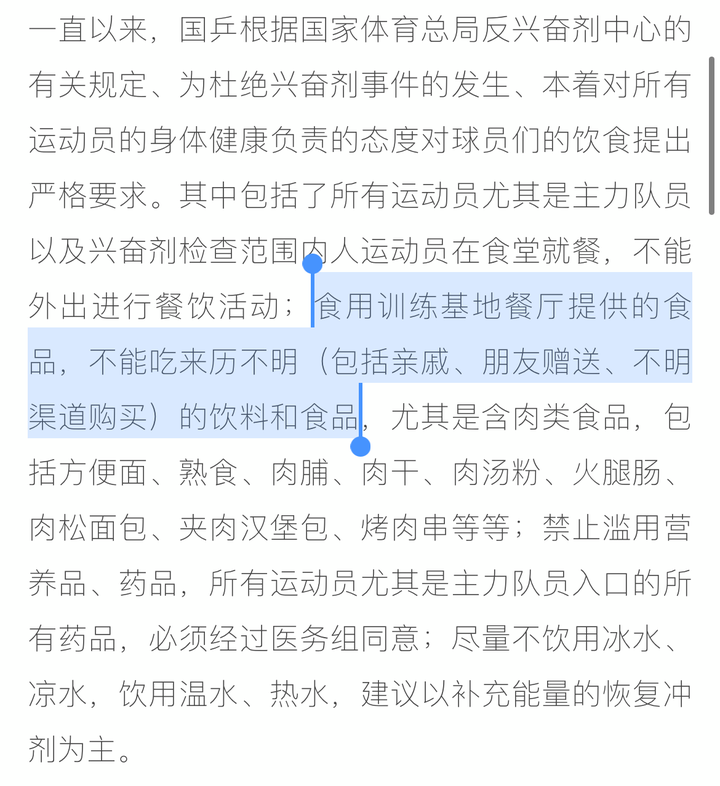

---

## 3123　删评权

- 日期：2021-08-26　主专题：A16 媒体舆论与公共认知　副专题：A10;A03
- 源 ID：`539ce0f5-875a-5e13-977b-49be099b6459`　原文链接：https://www.zhihu.com/question/481698780/answer/2084016244
- 官方对象—实践路径：与社会 / 与舆论 / 应对
- 23 概念标签：定义与达意;能力与学习;选择与自由;责任与后果;成本与总账;边界与许可;法律与秩序;权力与异议;技术与工程
- 证据状态：manual_confirmed　初读：read　独立复核：not_reviewed

**问**：如何评价张维为入驻B站的评论区大量评论被删除的现象？

这对高关注用户完全正常，没什么奇怪的。
其实哪来的“删评就是不行”的“规矩”？
主张这种法则的人，主要的依据总不过以下几条：
1）压制反面意见会破坏观点争鸣。
很奇怪，你完全可以自己写出你自己单独的相反意见，平等的上架到意见市场上竞争别人的注意。
保证你的平等发布权是平台的责任，根本就不是别的作者要在自己评论区对你承担的责任。恰恰相反，平台既然给了作者任意删除评论的权力设置，就表示这是平台正式授予的自由裁量权。平台是人家自己出钱出力建立的，这个授权完全是人家的合法经营自由，除司法监管以外，不受任何其它第三方干预。
难道你自己拿钱买辆车，你能接受路边卖煎饼的说你这车放不下它的炉子你得换一辆？
2）我就不删评也不拉黑。
首先，你写篇东西就只有两评，一个星期加起来也就十条评论，里面搞不好还有六条是“666”、“疑车无据”，你当然容易做到“不删评”。
没人觉得你奇货可居，打倒值钱，你当然容易做到“不删评”。
等你一周几千条评论、不知多少人觉得搞倒你可以赢得满堂彩的时候，你的“不删评”才有值得一谈的分量可言。
否则不过是站着说话不腰疼。
有讽刺意味的是——这些用户自己真有了点流量，遇上较真的、没有底线的对手，往往拉黑删评比谁都快。ta们自己在同样情况下远不见得有ta们在默默无闻时嘲笑讽刺的那些“没有胸怀的大V”那么宽容。
第二，赞同你的人里面如果只有和你一样的三无用户，这种赞同没有任何代表意义。
这个就像某甲提议“我们把比尔盖茨的家产分了吧”，一群也想发这笔财的人的人表示高度赞同，但这没有任何意义，得比尔盖茨自己也赞同才有意义。
没有代价只有收益，这种“发横财”的事，还怕没人赞同？这不代表任何正义，只代表了贪婪。
第三，退一步说，你也同意，你的兄弟们也同意，某些大v也同意，那么你们也只能在你们自己的这个“同意圈”里实行这个法则。
道理相同，你呼吁“分掉富人的账户”，张三也同意，马斯克出来给你点个赞，这显然不意味着你可以去分掉盖茨的银行账户，而只能分马斯克的。
不然你隔壁几个人要是一合计觉得你这个房子不错，你岂不是要睡桥洞？
3）“我觉得我的话没有一点问题，凭啥删我的”。
这个还真的是一言难尽。
有谁能有绝对把握说服所有自己处理的对象，有自信执行“说不服我就放弃处理”这种法则的，请举手。
开玩笑的，教你个乖——你老板要这样问，你千万别上当，你举了就会叫你去找会计结工资的。因为你要这么干，那么就不能再指望你承担任何职责。
因为要是按这个法则照办，世界上就没有任何权利还存在实际意义了。
“不服”还不容易？一千个不服、一万个不服，眼都不用眨都可以拿出来了。
凭啥不给我便宜点？凭啥中奖的不是我？凭啥我老输？凭啥不给我的作文多三分？凭啥说我画得不好看？凭啥说我水平不够？凭啥……
你解释，你今天要是不给我一个满意的解释，我就abcdefghijk。
你先把你生活中这些abcedfghijk们都摆平了，再来谈你的“说不服我就不处理”原则。
如果你说你可以办到，只有一个解释——要么你是全知全能的上帝，要么你就是一丁点职权都没有过。
世上再也没有比主张“不服就不可以处理”这种理论的人更虚伪的存在了——
因为现在人家就不服ta的“不服论”，ta自己有因为别人的不服而停止使用“不服论”吗？
Excuse me，你的逻辑蛇咬到自己的尾巴了，真的不要紧吗？
回到本题。
怎么看人家“大面积删评”？
如果你觉得这是一种可以呼朋唤友口诛笔伐的“丑闻”，你最好别让人知道是你在用这账号，因为这跟社交自杀没啥两样——你反对网络上的删评权，你也不会真正尊重别人生活中的删评权。
谁也不能在生活中忍受没有“删评权”，也没有谁在生活中不“大量删评”的。
结果只会是你出局，没有任何别的悬念。

---

## 3117　还魂丹

- 日期：2021-08-28　主专题：A16 媒体舆论与公共认知　副专题：A20;A14
- 源 ID：`69aff58c-5672-5cc6-a46f-343f993f0747`　原文链接：https://www.zhihu.com/question/483064267/answer/2089443395
- 官方对象—实践路径：与自己 / 与身体 / 使用;与自己 / 与身体 / 了解
- 23 概念标签：能力与学习;责任与后果;劳动与组织;文明与历史;性别与身体
- 证据状态：manual_confirmed　初读：needs_reread　独立复核：not_reviewed

**问**：司机因太困自抽耳光，但还是发生了追尾事故，如果在路途中「犯困」有哪些清醒方法？

这个问题取决于人在睡眠状态下到底哪个感官处在最高战备值班状态。
答案是：
嗅觉。
昏倒的人，对触觉、痛觉、听觉、视觉、失衡都不够敏感了，但是对异常刺激性气味仍然保持着相当的灵敏度。——这可能是对森林火灾这种毁灭性危害的敏感本能。因为睡着了就不不能隔着几百米闻到草木燃烧的气味的猴群很容易全灭。
等火烧到树木劈裂的声音都能吵醒你了，你估计已经跑不过山火了。
几百年前欧洲人随身带着两件急救万灵丹——白兰地和嗅盐。前者让你由醒转晕，后者让你由晕转醒。

试试看。

<!-- 图片：2 张，审读结论见下 -->

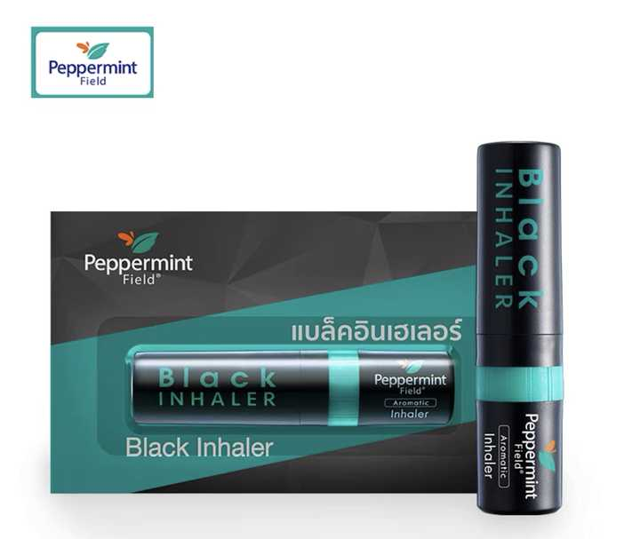

---

## 3084　膝盖的目的

- 日期：2021-09-09　主专题：A16 媒体舆论与公共认知　副专题：A17;A01
- 源 ID：`4ea06b32-0918-58de-9e0f-a1cd877b69af`　原文链接：https://www.zhihu.com/question/437995474/answer/2110616988
- 官方对象—实践路径：与社会 / 与舆论 / 传播
- 23 概念标签：事实与证据;定义与达意;能力与学习;选择与自由;责任与后果;劳动与组织;心理与主体;性别与身体
- 证据状态：manual_confirmed　初读：read　独立复核：not_reviewed

**问**：为什么网上在不断地挑起性别对立？

这种人分两类。
一类的目的很简单，有钱、有利。
这的确可以算得上是有目的。
但要是误以为ta们真想主持什么伟大的十字军远征、完成天国梦想，这就完全是想错了。
因为真有这能力的人，一眼就能看穿这是个lost cause——根本数学上不可能、逻辑上不成立。
让男性和女性对立？什么叫“赢了”？怎么定义“胜利”？
这就像打麻将摸了十五张牌，一开始就相公了，还凑什么清一色？
真蠢到连这也看不出来的人，别说“组织一个运动”，连组织一个抽屉都有困难。
因此，这剩下的只有一种现实的动机，就是借着这题材牟利。

另一类，也是这件事的真正付出最大功率的主力军——那些自认为自己背后的“大将”是在帮自己“出战”的少男少女们。
ta们的行为其实没有可以称得上目的的东西，因为这全是被心理应激反应驱动。
这就像有人拿小锤锤了一下你的膝盖，你一脚就踢在前面的倒霉蛋的屁股上。
受害人扭头大怒——你什么意思？什么意图？！
膝跳反应没有“意图”，是拿锤子的人才有意图。
但这事坏就坏在A的膝跳反应正好踢在B的膝盖上、B的膝跳反应又正好踢在A的膝盖上，形成了膝跳链。
这膝跳链可以发电。
于是有一群人看到了商机，在不停的运维——
要是连锁反应断了，或者需要更大功率输出了，ta们会及时补踢一脚，来个冷启动。
踢得够准，循环可以自维持，效率堪比人肉核聚变。
要是中间哪一环活醒了不配合了，ta们还要跳出来热插拔，及时屏蔽故障单元。
这整出戏都是由踢膝盖的人维护的一种膝盖发电系统。
这里面没有配称得上目的的东西。
你们不要以为只有男女议题如此，台湾的1450们一样在干这种事，先当台湾人激怒大陆人，然后装大陆人激怒台湾人。
一脚踢中你的膝盖，让你踢在对面的膝盖上。
只要成功点火启动仇恨链，靠着大量情绪的奴隶们的大脑膝跳，人肉托卡马克就可以自动维持。
源源不绝，一本万利。

---

## 3085　反恐

- 日期：2021-09-09　主专题：A16 媒体舆论与公共认知　副专题：A17;A12
- 源 ID：`7b72a9f0-61e2-563d-8d25-2a5788f6fe88`　原文链接：https://www.zhihu.com/question/383702182/answer/2110563577
- 官方对象—实践路径：与社会 / 与舆论 / 应对
- 23 概念标签：事实与证据;定义与达意;成本与总账;爱与回应;边界与许可
- 证据状态：manual_confirmed　初读：read　独立复核：not_reviewed

**问**：知乎上大量的所谓以反“女拳师”抹黑女权行为是否得当？

“女拳”的手段很简单，就是舆论恐怖主义。
恐怖分子砍伤炸伤了路人。
路人又惊又怕，只要一时三刻，这种“完全可能是我”的恐惧就会转为群情激愤。
路人开始集结部队，派出无人机猛烈轰炸恐怖分子的街区。
误伤了谁，哪有“正义复仇”重要？
“难道对待恐怖分子还不应该坚决轰炸？”
然后下一步的剧情是“恐怖分子被消灭了”吗？
是吗？
是被炸的人排队加入恐怖组织，恐怖分子拿到大量的捐款。

恐怖分子最希望你轰炸，搞你的目的就是为了引你轰炸，要的就是你赶紧炸，炸多点、炸狠点。
你越投票支持那些高呼“轰炸”的“国会议员”，去“志愿报名参战”，去轰炸“恐怖分子基地”，越有利于谁？
有利于你自己？
还是有利于“国会议员”和ta的朋友们？
还有利于恐怖分子们？！

现在泛滥的所谓“反女拳”，实际上是什么思路？要用“正义的”舆论恐怖主义来压倒“邪恶的”舆论恐怖主义。
誓要比恐怖分子更恐怖。
以为以“舆论恐怖主义”的魔法反对舆论恐怖主义的魔法，就可以“抵消”？
这思路就跟“只要更猛烈地轰炸阿富汗就能消灭塔利班”一样的愚蠢。

为什么叫你们不要“反女拳”？因为“女拳”就是你们这种“反”法反出来的！
阿富汗怎么丢的？
“反女拳”就是用实际行动为女拳输送血液！
这一点都想不通，还键政个啥？

---

## 3068　键政

- 日期：2021-09-13　主专题：A16 媒体舆论与公共认知　副专题：A10;A03
- 源 ID：`ac77e18f-6fdf-54f1-92b0-0583ea6b0a83`　原文链接：https://www.zhihu.com/question/263356109/answer/2118262382
- 官方对象—实践路径：与社会 / 与舆论 / 表达
- 23 概念标签：事实与证据;定义与达意;选择与自由;责任与后果;成本与总账;信用与信任;爱与回应;净输出与不掠夺;边界与许可;财富与市场;法律与秩序;权力与异议;民族与身份;心理与主体
- 证据状态：manual_confirmed　初读：read　独立复核：not_reviewed

**问**：什么是键政，如何看待键政？

键政作为一种实践，与真正的通过网络平台进行的严肃的政治实践之间有何分别？
分别在于严肃的政治实践总是在谈论行动纲领和战术指南，它会对实际行动产生确切的影响。
键政则自己主动的避免这种影响，以免在慕虚名时误处了实祸。
真正的政治首先必须是严肃的。哪怕是以讽刺为形式的战斗，也必须deadly serious，它是必须付诸行动也能让别人敢于依赖你的行动去行动的。
键盘政治在干什么呢？它极尽一切可能确保自己绝对能被准确的识别为仅仅只是一个游戏。
它当然有足够的借口——“别人不让我行动呀，谁敢乱行动”。
但这里存在一个巧妙的诡计——ta们能有这个借口的根源，本身就是出自ta们自己有意无意的安排——ta们会故意选择被禁止的题材。
真正的政治参与者，会自觉的避开无法行动的灰色地带，先去在被允许和被鼓励的地带付诸实践——不让我擅论敏感话题，那么我可以致力不敏感的话题。假冒伪劣、可以关注消费者体验、可以关注建筑质量、可以关注科普、可以关注学校霸凌……你想要对世界有所贡献，可以真正投入努力的题材何止千万，为什么要如此固执的仅仅关心那些有绝对充分借口不行动的领域？
难道真正的改变，不比仅仅只有改变感重要吗？改变本身才有可能属于全民，改变感只可能专属你自己。
这真的是因为这些领域“最核心”、“最重要”吗？
还是是为了在被问到“你为什么不付诸行动”的时候可以从容拿出完美借口？
键政作为一种讨论，和严肃的网络政治讨论的分别在于键政总是关注预测和八卦，而严肃的网络政治讨论关注政治伦理和政治理论。
前者是赛马经和花边小报的杂合体，而后者则是超越一时一地的的“什么是对的，为什么是对的”的原则。
探讨最大普适的原则，总有避开具体敏感事件的充分空间。可以帮助ta人形成自己更成熟的观点，有助于增加社会的成熟性，进而有效的增加宠辱不惊的稳健性。
而赛马经和花边小报则更会刺激人的投机心理和猎奇心理，造成人心的躁动和情绪的不稳定。这些情绪过山车虽然可以廉价的刺激内啡肽，但却绝非社会之福。真正抱着善意去实践公民政治权利的人，第一条基本伦理，就是“我死后绝不能洪水滔天”。
你不关心这一点，就是根本不关心ta人的福祉，一切的参与都不过是枉然，一切的“公共性”都不过是获取虚荣和欣快感的伪装而已。
这没有资格挂上“政”字，用键盘也不行。
如果你不知道区分自己是哪种情况，那么有几条现实的守则你可以直接守好——
1）坚持使用规范的词汇，避免使用“键政黑话”。一定要用，你要确保那是一种必要的引用。如果你没有足够的把握通过控制语境保证引用性质，那么你干脆加上引号。
你守住这一条，你的整个表达就会大幅的与“键政腔”拉开距离。
你也会因为这种ta们不会喜欢的风格，与这种伪实践拉开圈层距离。
2）就事论事，不评论具体人。
键政在很大程度上是一种私人恩怨的实践形式。它们更关心的不是具体的论述本身对不对，而更关心谁丢了面子、谁得了彩头。
永远只谈xx观点有何正误，不要提及任何人的名字。
作者是谁，毫无意义。
3）关注事实，不要关注听众的好恶。
一件事情该说，说了会“掉粉”，那么“掉粉“不该有一毫克的分量。
你有一丝一毫这种顾虑，那么你不如不要卷入这虚荣场。
要始终最关心关注你的人所没看见或者因为看错而反对的东西，要始终坚持去讲逆耳忠言。
言之有物，不要浪费别人的时间获取对你没有好处只有坏处的虚荣。这真是世间最无聊最可悲的蠢行。
几乎可以这么说——
一个人从来只说没有任何掉粉的风险的话，这是可耻的行为。
键政有个悖论，一旦出名了就很容易被封号。
想要议政，伦理立场要站稳——议政者不要干政。一旦干政——哪怕是无意识、甚至出于帮忙的动机干政——那就没有悬念，一定会被禁止了。中国从古至今一直是一个治理压力极大、社会发展高度不平衡的国家，这决定了一切政策权威在实践上都必须要集中在程序之内、体制之内。一旦这个绝对秩序在任何意义上松动，给了人任何“可以不必经过体制，靠某种非正式的手段操纵政治博弈的结果”的念头，对中国的整体威胁甚至超过核武器。
对这一点，几千年来中国的执政者们从来就没有过任何侥幸。
因为这的确是一个客观事实。
议政只有在主动尊重这根本原则的基础上，才有可能成为一件好事。
你想要通过网络舆论引起对一件冤假错案的注意，这是一件好事。但是从“引起注意”、“促进良好解决”到“施加压力、迫使就范”只有一根头发丝那么细的差别。一旦你从山顶上滚下雪球，局势会不会如你所愿的那样当止则止，任何真正有经验的人都应该知道答案是什么。
这根禁忌的红线很不好分辨，但不管你善不善于分辨，起码要心里有这根线存在，要明白它是没可能为了迁就你而弯折的。
如果把握不住这根红线，或者接受不了这个客观的风险，安全起见还是不要涉足这方面为好。

这客观风险的存在使得议政必须被视为高度复杂的、有客观风险的行为。
这不是要你闭嘴不说话，不是要剥夺你什么权利，而是你要意识到行使这权利的相关作为是一种带电作业，你必须承担起带电作业的相关责任，拿出对待带电作业的谨慎和敬畏来。
你有权去做这带电作业，这没有改变“这操作是带电作业”的性质。这就好像你有权去游泳，但是这没有改变游泳可能淹死人的危险性。
去做这件事是很重要的，它毫无疑问是增进所有人的福利的重要手段，甚至本身就是ZF信用的根本来源之一。
只有那些真诚的、主动接受这触电风险是合理的客观存在、甘愿接受被误解、被误伤的现实风险，也要为这个国家谋求更好的可能的人，才能真正的良性的让这个机制运转起来。
这其实是一种严肃的祭献，与为了民族危亡、不计个人安危荣辱的那些千千万万的无名志士同工。
什么叫“接受”——就像外科医生知道去非洲治病可能自己会感染，还是决定要去。果然感染了，在最深处知道这是自己的选择，不埋怨。
这件事要做，就只有这样做。
这其实回到了最初的主题——你必须是严肃的。
严肃不可笑、不古板、不“原始”。
恰恰相反，严肃是一种难能可贵的品质，不严肃以及根本没有严肃的能力的人常以为“不严肃”很酷。
其实那种“酷”可悲得很，还不及一缕青烟。

---

## 3042　错误方法

- 日期：2021-09-22　主专题：A16 媒体舆论与公共认知　副专题：A10;A03
- 源 ID：`fa663875-0620-5040-8dde-c6ff28ced8d5`　原文链接：https://www.zhihu.com/question/487804089/answer/2132823164
- 官方对象—实践路径：与社会 / 与舆论 / 表达
- 23 概念标签：选择与自由;责任与后果;信用与信任;边界与许可;劳动与组织;财富与市场;法律与秩序;权力与异议;技术与工程;文明与历史
- 证据状态：manual_confirmed　初读：read　独立复核：not_reviewed

**问**：如何看待虎扑热帖“混住低楼层男生是否有权利使用电梯”？

这个示范了一种错误的参加公共博弈的做法。
说明我们的青少年在推动对自己有利的公共决策上，极端的缺少经验和策略。
基本上是在使用一种舆论恐怖主义的方法——
谁反对或者妨碍我的利益和诉求的实现，“我们”就要“团结”起来在舆论上“消灭”它。
我们要不断的展现令对方不寒而栗的舆论能量，让任何敢于挡在我们面前的人考虑身败名裂、被集体孤立甚至被肉体打击的后果。
要让你恐怖的想象压垮你的反对意见，从而让你屈服。
为了最大化的实现这种效力，培养出了种种利用政治正确的“战术”——巧妙的利用有利的传统、官方口径、可以利用的法律漏洞或者治理倾向上的非对称优势，去给对方定罪、刺激对方做出会被公权力处理的过激行为。
这些手段，说穿了是一种对“暴力手段是达成目的最好手段”的迷信。
你要记住——暴力是一种比海洛因还要可怕的精神毒品。
这就跟赌博一样，它如果失败了，对你是一大幸事，因为你试的第一把就吃亏了，感受不好，可以及早吸取教训，改走别的路；
但它如果非常不幸的成功了，这就跟第一把下注就赢了个大奖一样，你想不对这种畅快、这种满足、这种“荣耀”、这种“安全感”上瘾，概率和打一针海洛因但是就是不上瘾的概率差不多。
遍布世界各地、生意兴隆的赌场是人类这个致命问题的最好证明。
你一定会拿着这把一挥舞就会精神高潮的雷神之锤，用“解决问题”的姿势，一次又一次的精神自慰，你甚至都不再关心问题本身是否会解决，你只是沉醉于这种“神威凛凛、莫敢不从”的斗争快感之中。
直到必然的被现实迎头痛击，九死一生。
何以见得？
因为采用暴力手段剥夺人用和平方式达成共识的机会，是一种公敌行为。
哪怕是当前和你立场一致的人，也忍不住要思考一个问题——按照你这样处理问题的基本思路，下一次我有没有把握还和你在一边？
下一次被枭首示众的会不会是我？
我会不会有说话的机会？辩解的机会？
我这一次想要和你一样的结果，你是“我的混蛋”，下一次呢？
换一个视角——作为主政者，眼里看待治下的两个不同团体有不同的利益诉求，有争执，坦率的说是一种再平常不过的日常。只要你有秩序的去争执，主张，谁赢并没有关系。
但是如果有一方用恐怖主义手段“压服”了一方，任由这一点成为先例、成为惯例，是远远超过你所争执的那点具体利益的重大损失。
如果谁试图制造舆论幻觉，想要靠这种制度之外的权力（power）压倒制度本身操持的正式权力，强迫当局妥协于你的诉求——那么同样道理，你最好不要“成功”。
甚至连“险些成功”都最好不要。
这是动摇国本的重大安全威胁，其认定的重大程度，是不看规模、不看具体诉求、只看性质的。
而这性质有多严肃？跟你组织了一个帮派占领了县城，而政府军发现居然没能成功阻止你一样。
如果不能灭了你，整个体制都会失去秩序。
而你是什么状况呢？你连这一步都没有提前预料到，连这个概念都没有，你能扛得住这打击的概率基本为零。
既然这概率为零，你就要意识到一个问题——鼓吹和使用恐怖主义手段来“推进”你的诉求的人，不是你的同志，而是一些内在的威胁。
是一些只顾过自己暴力的瘾，浑然不在乎会因此彻底毁灭你的事业的自私自利的人。
ta们的“英勇”，说到底是一种由斗争快感的毒瘾造成的对毁灭的麻木——就和海洛因吸多了的人比较不怕疼和死一样。
那不是“英勇”和“勇于献身”，那是人性磨灭了。
不要以为这是单独指向“女拳”，这同样指向包括“男拳”在内的、一切指望靠暴力威胁让人屈服的自知或者不自知的自我毁灭者。
这条路充满存在的快感，但直通地狱。
停止认为这种行为叫“斗争”、“努力”，这只是在以贩养吸。
停止贩毒，停止过瘾，开始戒。
救自己一命吧。

---

## 3030　MINECRAFT

- 日期：2021-09-25　主专题：A16 媒体舆论与公共认知　副专题：A01
- 源 ID：`30e5174c-9159-5ff6-a76d-92e3f8e490bd`　原文链接：https://www.zhihu.com/question/487726983/answer/2139768368
- 官方对象—实践路径：与社会 / 与舆论 / 接收
- 23 概念标签：事实与证据;选择与自由
- 证据状态：manual_confirmed　初读：needs_reread　独立复核：not_reviewed

**问**：为什么感觉最近的氛围是神友赢麻了?

这答案其实和立场没关系。
会用“赢麻了”这种语言的人，你如果只看ta们的信息流，会发现ta们永远处在“赢麻了”的状态。
而且你沉浸式的看多了，你想不同意ta们都很难。
因为喜欢用这种词的人，把整个世界看成一种游戏，ta是这个游戏的唯一主角，绝对的核心客户。而这个游戏的主要挑战，主要玩点，就是想办法用现实世界里采集的材料构造一个自己的世界。
自己赢麻了的世界。

你在这个ta自己为了自娱而再造的世界里呆久了，怎么可能不觉得ta“赢麻了”呢？难道人家玩了这么多年白玩了？
你在左边的世界里呆久了，就会觉得左边“赢麻了”，在右边呆久了，就会觉得右边“赢麻了”。
人是一种极易下意识自欺欺人的动物，即使有意识的警惕，坚决不用“赢麻了”这种词，也很难讲就不是在玩这种游戏，何况毫不设防、甚至对此津津乐道，乐此不疲呢？
你觉得“好像ta们真的赢麻了”，其实和ta们是不是真的“赢麻了”毫无关系——有这种瘾症基本上注定是恒定的输家，哪有上车之前总是先吸到起飞的道友练成舒马赫的？
你有这种感觉，只说明你自己也危险了。
早点惊醒，救自己一命。

<!-- 图片：1 张，审读结论见下 -->

---

## 2936　大成就者

- 日期：2021-12-01　主专题：A16 媒体舆论与公共认知　副专题：A15;A01
- 源 ID：`6ec4e28d-f50f-5b1d-9c55-cab7a590fe2f`　原文链接：https://www.zhihu.com/question/502487645/answer/2251484191
- 官方对象—实践路径：与社会 / 与舆论 / 应对
- 23 概念标签：事实与证据;定义与达意;能力与学习;选择与自由;责任与后果;成本与总账;爱与回应;净输出与不掠夺;财富与市场;权力与异议;技术与工程;心理与主体
- 证据状态：manual_confirmed　初读：read　独立复核：not_reviewed

**问**：能力强但人品差的人会有大成就吗？

遇到了有大爱的人充当ta和世界的桥梁，就可以解决这个问题。事实上，大部分有大成就的人多少都是靠这个。
倒不见得是ta们绝对的“人品差”，而是到了一定程度，这些人会对伦理观有自己的完整看法，而且非常自洽坚定。若非如此，ta们也很难坚持向无人之境挺进。
这常常会导致ta们的伦理观之中有很多会让大众吓得魂飞魄散的可怕论述。
问题是，大众自己觉察不到——其实是流行的主流伦理观自己是笔糊涂账，常常自己左右互搏。也正是因为这种左右互搏，导致了大部分人做事的时候时常迷茫。迷茫既久，就转而痛苦，转而走向逃避痛苦，转而龟缩自怜。
于是这构成了一对矛盾——几乎可以说有大成就者——这排除了侥幸中奖这种情况——不太能直接暴露在公众判断面前。ta们的这些价值观，常常被公众视为“太冷酷”、“太残忍”、“太暴虐”、“太扭曲”、“太放纵”——最轻也是“太极端”。不经过中间人去做信息翻译和隔离，这些人很难和大众和平相处。
这里面，职业搞选举的政治精英可以算是个小例外——ta们吃这碗饭，自己担当自己的发言人。而艺术家这一类属于重灾区。
其实你如果见多识广、自己有些成就和体会，对这些人会宽容得多——你会觉得也没什么很出奇的，各有道理。问题是，当你会这么觉得的时候，你自己也会被开除“大众籍”。
现在问题来了——这意味着有大成就潜力的人，如果没有这个运气遇到那些愿意当管道的朋友，而且得到ta们近乎奋不顾身的信任和保护，而又非常不幸没有足够快的培养出自己理解大众情绪和翻译自己的能力，那么直接面对大众，ta们会遇到前赴后继的潮水般地排斥和打击。这常以鱼死网破的悲剧告终。
也就是说，你有三条路可以选——
1）绝了追求惊人的卓越的念头，自己学会以“不惊人的卓越”为满足，学会适应“泯然众人”随附的恐惧感和无力感。
2）自己学会跟大众打交道，忍住那些愚蠢的虚荣和冲动，学会聪明地说话。如果你要白手起家创业或者从政，这是必修课。你选了这些路还想特立独行、惊世骇俗，那等于自己找死，神仙都救不得。而且你多半夭折在什么都还没做成的早期，于是果然你啥也没做成。
3）找到愿意当你管道的人，靠着ta们隔离、摆脱大众对你的拉拽。注意，这些人不能是贪图你的才能带来的金钱，而必须是出于爱。因为如果是靠前者，你必定会沦为特种奴隶。
看清楚，必定。
出于爱，是出于对你的爱吗？
错了。
如果这么做只是出于对你的“爱”，这份“爱”迟早要变成索取回报的命令，和对缺少回报的憎恨。绕个弯，再次通向特种奴隶。
那不是出于对你的爱，是“愿以一身相抵，不愿意人类轻易失去这份财富”的对人类的爱。
只有这一种觉悟，能做这个中保，且有善果善终。
记住了，不要有侥幸，这将来能保你的命。

---

## 2882　为什么我们会输掉认知战

- 日期：2022-03-20　主专题：A16 媒体舆论与公共认知　副专题：A12;A03
- 源 ID：`22c2b873-94b4-561a-ba0c-6814625f7b47`　原文链接：https://zhuanlan.zhihu.com/p/484117834
- 官方对象—实践路径：与社会 / 与舆论 / 传播
- 23 概念标签：定义与达意;能力与学习;成本与总账;劳动与组织;法律与秩序;权力与异议;技术与工程;心理与主体
- 证据状态：manual_confirmed　初读：read　独立复核：not_reviewed

**问**：为什么我们会输掉认知战

认知战是以扭曲目标人群对世界历史、现状和未来的认知，使其作出有利于进攻方的误判为目的的系统性的操纵行为。
注意，在这个定义里，“信息作战成功”的标准，不是“使所有人都完全认同信息战指向的信息”，而是只要达到“使足够的人向目标信息方向发生足够的偏移，足够让为信息战投入的成本得到覆盖，出现高于成本的收益”的获利线即可。
举个形象的例子，你是股票的庄家，你决定投入一笔成本来诱骗散户购买你的股票，你只要做到影响足够多人做出足够多的买入决定，超出你投入的宣传成本，你就取得了这场认知战的胜利。
你不需要改变所有人的判断，只要人数超过成本线即可。
你也不需要把受害者的判断改变到黑白颠倒的程度，只要把人均买入额提高到超出你的成本线即可。
由此可知，认知战从基本性质上就是一种易攻难守的战争样式。

认知作战的关键战略目标。
1）占领全部或大部分目标人群的信道。
举个现实的例子——
比如在台湾对大陆进行的俄乌冲突认知战下，这一基本的战略目标就是占领所有带有俄罗斯、乌克兰、冲突、普京、泽连斯基、基辅……的关键字的问题下的排名靠前的答案。
也就是技术性的保证所有对此问题有所关心的人，从搜索入口进来，势必有大得多的概率看到有利于自身立场的答案，甚至追求在其失去耐心之前都无法看到不利的答案。
你们应该注意到这样一个问题——要做到这一点，根本不需要攻击方提供多少逻辑无懈可击、论证质量极高的答案，而仅仅需要单纯的技术性霸榜即可。
要实现单纯的技术性占领，只需要培养一些隐性账号系统性的踩踏不利的答案，使其名次下沉到足够深就可以。
甚至，保留在前排的答案最好质量不太高、不要有太明显的明星人物为好——因为这样的突出人物很容易自然成为对方的集中反击目标，过于迅速的被对方通过举报和集中踩踏而消灭，所以ta们反而往往不是认知战会选择的战术方向。
培养一个这样的头部资产成本过于高昂，但是ta一旦遭遇反击却很容易损失，这在费效比上是不理性的选择。
所以，很客观的说，那些为认知战攻方的立场大声疾呼、奋不顾身的头部人物，往往确实是出自本心的主动参与。
将ta们认定为“网军”反而是一种错误的、甚至适得其反的作为。这只会起到将对方进一步推向敌方、进一步坚定其立场的副作用。
这甚至本身就是认知战的预设战术之一。
真正在进行认知战的职业网军，很少发布长篇。

这意味着遭遇认知战处理的阵地会呈现这样一种现象——
前排充斥着大量的低质量答案，偶尔随机有一些篇幅较长的头部作者的答案，外加一些到处转发的通稿。而总体上这些答案主要是诉诸情绪的、以“风趣”“搞笑”为主要价值的短答案。
而高质量的对立答案，往往被踩踏至排名到“水线”之下。
所谓“水线”，是指刚刚发布的几乎没有有效阅读价值的空答案会出现的位置，这样可以确保这些答案将自然的无限下沉。
而要实现这种踩踏，除了使用大量自己平时积蓄的僵尸号来集中攻击之外，还可以通过潜伏在主动站在己方的大V的评论区、粉丝群进行煽动和挑拨，利用ta们发起附加攻击。
这些大V有比僵尸小号大得多的反对权重，而且往往已经被大量的针对性反击固化了立场、激化了情绪，往往会自动的快速反应，自然而然的做出有利于网军意图的积极作为。而即使这些大V因此被平台销号，因为网军对此并没有投入成本，仍然是净获利的。
何况这些大V也不容易简单的因为被销号就完全丧失战斗力，ta们往往可以再次注册，依靠粉丝群再次迅速获得流量，甚至会更加积极的为网军的目的服务。

2）消灭或至少抑制对立信源的影响力。
这主要通过造谣、诽谤、抹黑、抹红、阴阳怪气、直接骚扰、集中举报、集中踩踏、挑唆己方大V进行公开攻击等手段。
而非常有利于网军的天然条件是，这些对立观点——尤其是诉诸理性、进行严肃的、高成本的论证的对抗性头部人物，往往客观上是毫无组织的、而且是非专业的。
非专业，不是指缺少专业的认知战训练——至少不止如此——而是指ta们几乎不能从这些对抗中获得足够的收益来补偿成本。
也就是客观上ta们不能承受无限损失。而网军是领着工资在从事成本极低、性价比极高的攻击行为。
以无源的高成本战术对抗有源的低成本战术，其结果在数学上是确定无疑的。
而这些反抗者们往往还缺少从反认知战角度思考这一问题的清醒自觉，也缺少反认知战战术的思考和积累，常常把事情理解为“讲道理”“辟谣”或者“对喷”。
而“讲道理”“辟谣”你会发现自己辛辛苦苦写下的东西常常迅速的沉没到水线以下，如果无法把你击沉到水线下，那么你就会招来无穷无尽的近乎于零成本的辱骂和私信骚扰、甚至人格污蔑和诽谤。
而“对喷”呢，第一它完全依赖反抗者的个人情绪资源作为燃料，自我增殖效率有限（即不容易造成链式反应召集同盟军），而以有限的热情对抗网军领着工资的专业攻击，数学结果仍然是确定的。
很多人可能寄希望于“平台出手”“国家出手”来扭转这种“舆论战失利”，但这种期待是不现实甚至是不明智的。
因为这种有强烈倾向性的公权力干预事实上效果有限。
人类的语言有天生的反统治性。一旦某种表达方式被管制，立刻就会产生另一种不受管制的表达方式，难以获得实质的打击效果。
而另一方面，这会严重磨损公信力，而且还会造成民间舆论的高度不稳定。缺少反面的消息，只会导致民众自己展开恐怖想象和私下传递信息。这种不稳定本身是有高昂成本的。
效果有限而成本高昂，所以这并不是对抗认知战的有效手段。

所以，综合而言，因为认知战的成功门槛极低，而成本极其低廉、效率相对可靠，所以认知战几乎总是系统的有利于进攻方而非防守方。

输掉认知战的主要原因，不是因为对抗的宣传手段不足，或者对于信息管制的力度不足，而根本的在于现有舆论主体本身的不成熟。
现在中国活跃网民的主要年龄构成非常年轻，而即使是年龄较大的社群，也大面积的缺乏相称的认知战经验和反认知战的素养。是这个最基本的国情（或者不如说是世情——全世界普遍如此）保证了认知作战的天然的“主场优势”。
不错，认知战的主场与否，不取决于媒体平台是否为网军自己所开，而仅仅取决于网军天生的宿主——缺少经验和批判性认知能力、志向坚韧、免疫于恐惧和贪婪想象的情绪绑架的心理欠发育者（此处毫无贬义）是否有足够比例。
只要这个比例足够高，那么这平台无论是谁家开设，都是网军的认知战主场，它都享有充分的主场优势。
而反认知战必定会在这个主场趋向失败。
这就是为什么我们会输掉认知战。
所以，我们大概率会输掉认知战，这一点，所有参战的反抗者都必须首先不抱任何侥幸，首先承认和接受这一客观事实，把它作为你参加反抗的起点、基础。
只有首先清醒的认识和接受这一点，你才反而会获得“虽千万人吾往矣”的绝对坚韧，而不是一旦受到攻击和压制就垂头丧气、觉得徒劳无功而要自我放弃。
只有认清这一点，你才会真正的看到结束并赢得认知战的有效战略是什么、以及有效的战术是什么。
没有“这样我们必败”的清醒认知，你将只会在全然被对方料到而提前设计的本能反应中耗尽精力，而不会思考“不这样”的策略。
希望只可能在非认知战手段上。

---

## 2859　客观理性评价

- 日期：2022-04-05　主专题：A16 媒体舆论与公共认知　副专题：A03;A10
- 源 ID：`de84a4e4-f0f3-5170-a3b3-377284188fdf`　原文链接：https://www.zhihu.com/question/388825871/answer/2424479759
- 官方对象—实践路径：与社会 / 与舆论 / 接收
- 23 概念标签：事实与证据;选择与自由;责任与后果;成本与总账;边界与许可;劳动与组织;财富与市场
- 证据状态：manual_confirmed　初读：read　独立复核：not_reviewed

**问**：如何客观理性评价观察者网？

所谓“客观理性评价”，其实就是“多少也要找点缺点的评价”的江湖黑话。
更进一步的，也就是“谁跟ta有仇，让我们一起整点黑料”的切口。
这黑话的一个可笑的地方就是——世界上根本没有哪个人类是客观理性的，这种所谓“客观理性评价”究其实质不过是“让我们装作客观理性来整点黑材料”的假把戏罢了。
是这样——尽管事做的就是这么个事，却没必要说这些黑材料一定是假的、伪造的。
很可能是真的。甚至就算是一个真的都没有，你也不能排除“其实有，只是这些人没找到”。
真正的问题是——世界上有“态度客观而立场中立的媒体”吗？
理论上讲，既然全世界人民都万众一心的渴盼立场中立、态度客观的媒体，那么这个市场怎么也有万亿级，不是吗？
为什么这些对“观察者网偏颇立场”洞若观火的人们，自己没有创办一个客观中立得多的媒体来竞争呢？
那不是理应势如破竹的如日中天吗？
还是你们自己也没把握你们自己办的媒体能挺得住“如何客观评价xxxx”的诘问？
批评一个东西不好，那是非常容易的。批评一个人道德不完美、举止不周全，甚至批评人“罪大恶极”，都很轻松。
真正的问题是——你能不能指出（都不需要你自己创造）一个更好的选择，甚至更好的可能性也行。
有吗？
那么，在把观察者网踩到污泥里以后，我们先不考虑它是否冤枉，暂且假设你们的指控全部成立——
你们所推荐的更好的选择是什么？
是CNN？BBC？经济学人？读卖新闻？金融时报？
或者，你们自己吗？
你们确信这些更好的选择，在“如何客观评价”测试中，会有更好的得分吗？
世界上没有客观评价，只有你的评价。
停止将后者当成前者，也停止假装不知道它们的区别。

---

## 2836　带节奏

- 日期：2022-04-26　主专题：A16 媒体舆论与公共认知　副专题：A03;A10
- 源 ID：`cfcb0065-b90f-5d63-aaa3-bb99f1d26065`　原文链接：https://www.zhihu.com/question/528797784/answer/2457932698
- 官方对象—实践路径：与社会 / 与舆论 / 接收
- 23 概念标签：能力与学习;选择与自由;责任与后果;成本与总账;权力与异议;技术与工程;民族与身份
- 证据状态：manual_confirmed　初读：read　独立复核：not_reviewed

**问**：为什么那些run出去的人还要在国内带节奏？

一个人要广开言路，就不能随便动用“带节奏”这个口袋罪名，要严格的控制它的适用范围。
移民出去是合法行为，是人的自由。
从海外访问中文网络并发表言论，这也是合法行为，是人的自由。
发表的言论不符合你的立场甚至利益，这虽然令你不快，但这仍然是合法行为，仍然是人的自由。
这仍然有宽容的必要——因为没有对立的意见，你可能自我感觉过于良好，以至于自言自语的走入深渊。
你把这口子收的太紧、罪名举得太高，你身边就会空无一人。你将很难确认你的正确到底是因为你正确还是仅仅是因为无人敢于反对。
水至清则无鱼，人至察则无徒。
不错，广开言路一定会导致一些造谣、煽动的行为趁虚而入，但是这并不能用“关闭言路”去解决——这是经典的因噎废食。
它只能靠头脑清醒的人不断的胜出、不断的发迹、靠上当受骗的人不断的损失、不断的吃亏，去逐渐磨练出一个充满警觉、拥有精湛的怀疑的技术的群体意识来解决。
其关键在于怀疑的技术与艺术。
这种技能极其类似于论文答辩委员会所要掌握的专业能力。
学会把一切论述都当成到你面前答辩的论文，学会问出刁钻而有效的尖锐问题，积累寻找漏洞和矛盾的经验和直觉，习得对脆弱论证的本能直觉。
练出这个功夫，然后把这个功夫传给你的子女、学生，以及一切有这个渴望去学习的人。
你不需要追求所有人都学会这些东西来拯救整个社会，你只需要带出一群人来依靠这个能力获得显著的成功。
然后你会看到榜样的力量是无穷的。
不要把力气花在谴责造谣的人上，而要花在示范和讲述识破谣言、管理信源的技巧上——前者是在尝试制造无菌病房，后者则是在增强体质。
客观上只有后一条路可以走通，前一个措施只能用于为后者争取时间和机会，只应最保守的使用。
现在用在暴力反击造谣煽动的力气太多，而用在示范、教授怀疑的技术的力气太少了。
我们花费了太多的精力去针对错误答案、给出正确答案，去近乎徒劳的“打击提供错误的坏人”，甚至不惜把因为能力不足而无法提供正确答案的人一律视为有意作恶的坏人一并扫除。
应该省下这些这些精力，去教授人们在并不知道正确答案的前提下，如何“空手入白刃”的提出难以对付的怀疑。
这方面的投入太少了，这是个战略错误。

是普及怀疑的技术——而不是“辟谣”、“显示IP”、“以革命的暴力反击反革命的暴力”——能真正解决问题。
不要寄希望于为一个弱不经风的幼稚民族准备一个无菌病房了此残生，而要让它老练善疑，成为骗子们不愿花费巨额成本来承担的“投资风险”。

---

## 2831　言论自由

- 日期：2022-04-29　主专题：A16 媒体舆论与公共认知　副专题：A10;A03
- 源 ID：`adcf4200-dc0e-5f62-8fd9-7825425b6f92`　原文链接：https://www.zhihu.com/question/299230997/answer/2462350589
- 官方对象—实践路径：与社会 / 与舆论 / 表达
- 23 概念标签：事实与证据;定义与达意;选择与自由;责任与后果;照料与家庭;法律与秩序
- 证据状态：manual_confirmed　初读：read　独立复核：not_reviewed

**问**：什么是所谓的言论自由呢？

借这个问题，说说纯从个人角度，对待言论自由问题的合理策略。
这也是父母要教会子女的必修课。

如果你把“言论自由”定义为“所有人都应该可以无后果的说任何话”，那么：
1）目前根本不存在一个有效的理论可以证明“所有人可以说任何话”可以保证公共福利的最大化。
2）目前没有任何一种社会正在成功的实践这种“言论自由”。
主流社会共识是社会稳定的基石，社会稳定是社会存续的绝对必要条件，没有任何可商量的余地。
社会自有新陈代谢的步调限制。
一年做1%的小手术，年年有不同，几十年后改头换面，这就是快得让人心颤的高速度了。
如果你一年换掉10%的社会共识，你得到的根本不会是“社会的快速革新”，而只会是社会的解体。
激烈同意这改变的10%人口和激烈不同意它的10%人口必定会进行激烈的对抗，足以卡死社会的关键运作，导致巨大的人道主义灾难，甚至引发内战。
这就是冰冷的现实、赤裸裸的客观限制。
哪个社会不尊重和维护这个限制，哪个社会就灭亡，至今实践上无一反例。
哪个人明知故犯的挑战这一点，哪个人就一定会遭遇沉重打击。（注意，这里没说这个打击正不正义，只是在说一定会遭遇这个打击）

其实，当你发现你只剩下“言论自由”这唯一的理由来主张你的发言权时，你应该视为一个极大的警讯——那意味着你自己都已经意识到了在这一点上你已经丧失了和这个社会的一切共识可能。
然后我们把话说得确切，明白一点——
这个时候，你，正在持有一个和你所处的社会没有任何共识可能的观点。
纯基于数学合理性、纯概率的讲——只要这个社会的GDP增长率是正的，错的是你的概率大于99.999999%。

有99.999999%的概率，你不应该举着想象中的“自定义言论自由”大旗，去强吸这杆“革命浪漫”的大烟枪。
这结果99.999999%是毫无意义的自取灭亡。

99.999999%的概率，是你应该去搞清楚自己哪里下了过强的判断、去反省自己为什么如此缺少人生乐趣，以至于会觉得这种灿烂的自毁已经是一个足够诱人的游戏。
不错，你会变成这样，你的父母难辞其咎。
但是这仍然不是你一口吸下去的正当理由，这仍然是你自己的选择。

再说一遍——
当你发现你能说出某些话的【唯一倚仗】只剩下“我有言论自由”的时候，只要这个社会的GDP增长率还是正的——甚至只要其五年平均值还是正的——你最好的选择都是直接忍住，再多想想。
想通这条，你可以少走极大的弯路，人生能达到的最终高度会远远的胜于那些正义斗士cosplayer。

言论自由这东西，本质上是一种社会救济，是留给那些丧失了任何其它合理话语权来源的人的最后救济。
这是一份救济粮。
绝不是你自己该赖以为生的东西。
如果你发现自己需要提到言论自由来对人主张你的说话权，你已经失败到退无可退的底线了。
你应该立刻把精力放在反省观点的质量上，而不是继续就你是不是有这个言论自由和人争执上。
想想吧。

---

## 2828　出自选择

- 日期：2022-04-30　主专题：A16 媒体舆论与公共认知　副专题：A03;A12
- 源 ID：`17dd8cea-f63d-52e9-bac8-fdc48d95c8d4`　原文链接：https://www.zhihu.com/question/517625629/answer/2463988340
- 官方对象—实践路径：与社会 / 与舆论 / 接收
- 23 概念标签：事实与证据;选择与自由;成本与总账;爱与回应;技术与工程;心理与主体
- 证据状态：manual_confirmed　初读：read　独立复核：not_reviewed

**问**：为什么谷爱凌的风评最近变那么多?

因为有一股力量在和“中式舆论引导思路”博弈。
我们的宣传思路非常喜欢“树典型”这个做法。
这个做法的一大好处是非常直白、易于引发情绪共鸣，传播迅速、适用面广泛，并且见效快。
抽象的理念逻辑是很难传播的，但是活生生的、具象化的、执行着理念的人，就要直白、平易得多。
但这样一来，就必须接受两个问题——
第一，意识形态资产过于集中在少数典型身上。
第二，人无完人，典型人物的完美形象难以面面俱到的维持。
这就像把钱都放在木头盒子里非常方便，但是木头盒子却很容易被发现和破坏。
这是一个系统性的破绽，当然会被敌人看在眼里并且加以利用。
有系统的、成规模的打击中国的一切意识形态资产——包括但不限于知名人物、典型形象、标志性成就等等——已经是一种非常显然的蓄意为之的行为。
其手法主要是几种——
1）刺激普通人/自认被社会亏欠者对这些特殊人物所得荣誉和待遇的嫉妒心。
2）放大凡人必然有的不完美，为这些人提供弹药。
3）如果缺少有利的事实，可以捏造。
4）使用一定量的假账号在适合传播的平台上利用网络传媒的传播规律和规则设置放大传播，营造“主流风气”幻觉，诱导真人账号跟风传播，达到四两拨千斤的效果。

人类是一种智力上非常机敏，但是在心灵上非常愚蠢的生物。只要在目标人物的身边足够饱和的安排恰当的暗示、植入，往往就能激活人类的焦虑、恐惧、妒忌、攻击的本能。
这是因为人类天生对危机敏感，信奉着“宁可错杀一千、也不放过一个”的默认生存策略，往往对一切负面信息“宁可信其有、不可信其无”，且有“从众为安”的鱼群心态。
这个问题暂时来说是一个无解的问题，因为促成这一局面的种种要素都不是短期可以轻易改变的。
“树典型”宣传策略，是基于一个对应的群众基础。这个基础不发生大的移易，这个策略将仍然是最有效率的策略。
而恰恰是这样一个群众基础，又正好适用于这样一个认知战战术，会使它比较有效。
正所谓成也萧何，败也萧何，如此而已。

你想相信，你总可以找到宽容的依据；你想否定，你也不会缺乏否定的弹药。
相信的并不比不信的正确或者错误到哪里去。
两者都正确、两者也都错误——而根本不是“多疑的就比相信的更明智”。

问题几乎从来就不是这些典型人物是否客观上白璧无瑕，而取决于你自己、你本人是想成全、还是想拆毁。
如果是出自你自己清醒的认知，那么无论是成全还是拆毁，那好歹是你自己的决定。
真正可悲可叹的，是只想发泄自己的情绪，不在乎被人利用会有什么后果的人。
很多人会想这是因为人穷困了，不顺利了，是社会先亏待了ta们，所以ta们现在这样佯作不知的对社会发泄不满、加以报复，也是一种朴素的正义——只要社会更富足一些，让ta们过得好一些，ta们自然会愿意成全社会了。
但这个假设其实是不成立的。
因为没有哪个社会可以成功到没有人抱怨的程度，而这些抱怨的人总会下意识的抱团，在某个局部营造出自己才是主流的幻觉，去卷入年轻人。
年轻人有一个客观的时段，天然的是这个陷阱的理想猎物，这一点是客观规律决定的，非人力所能挽回。
所以这个循环将会永续存在，无可根绝。
你无法指望采取某种措施使这个漩涡消失，你只能决定自己要不要被卷入漩涡。
而把这一切都写出来，拆开了平铺在地上，是为了你们至少有机会可以清醒的、独立的做这个决定。
选择红药丸，或者选择蓝药丸。
你可以选择蓝药丸，那至少是因为你的选择，而不是因为蓝药丸所代表的一切逼真感受真的是“事实”。
因为它不是。

---

## 2806　阴阳怪气

- 日期：2022-05-14　主专题：A16 媒体舆论与公共认知　副专题：A11;A01
- 源 ID：`3444c1ed-fa7f-5bad-9546-9abbb06b6078`　原文链接：https://www.zhihu.com/question/531633415/answer/2485177172
- 官方对象—实践路径：与社会 / 与舆论 / 应对
- 23 概念标签：定义与达意;能力与学习;选择与自由;法律与秩序;技术与工程;宗教与自然法
- 证据状态：manual_confirmed　初读：needs_reread　独立复核：not_reviewed

**问**：为什么有人认为「在阴阳怪气的内容中几乎看不到『希望能更好』的赤子之心」？

“阴阳怪气”和网暴、造谣一样，其实是一种舆论恐怖主义。都是意图借助形形色色的暴力促成自己的目的。
事实上，你也会发现这些人往往是阴阳怪气、网暴、造谣三症俱全。
这个呢，你要习惯——人类天生的对这种精神疾病易感，它就像一种心理流感，易得难好，而且在冷天症状容易加剧。

如果要说它的原因，其实说到底是这些人无意识的相信暴力是一切的最终动力。
有什么事情不顺心，就施加暴力，直到它消失或改变就好了。
ta们对暴力之神是如此的崇拜，事实上已经到了这样的程度：
1）ta们相信无论暴力指向谁，无论其形式如何，只要在实施暴力，都必定对自己实现目的有好处。
张三令ta痛苦，都不需要打击张三，去打骂李四一顿，ta们也相信一样有效果。不敢明着动手，用讽刺的、暗示的去戳王五一刀，甚至只是伤一张写着赵六的网页一句，都必然“开卷有益”。
你看恐怖分子，炸不到对方的军队，可以炸对方的百姓。炸不到对方的百姓，炸自己的百姓也行。炸不到自己的百姓，空炸也行。
你再看这些阴阳怪气的人，是不是一回事？
这种“毋以善小而不为”的行为方式，是信仰状态的特有效应。

2）无论上一次暴力献祭的结果如何失败和无效，ta们的结论永远不会是“这没用”，而是“还不够”。
阴阳怪气从来没有帮助ta们达成过任何目标——
有谁没钱，阴阳怪气出万贯家财了？
有谁谈不着恋爱，阴阳怪气出个美好姻缘？
但ta们因此质疑或者放弃了这个方法吗？
没有，ta们只觉得是自己努力还不够。
加大音量。
这种“负反馈失效”现象，其实就是信仰状态的特有效应。

一个人以一种“毋以善小而不为”的心态，以“负反馈无效”的态度做事，意味着ta对那个方法论充满了信仰——不折不扣的，religious的、虔诚的信仰。
因为这个行为模式就是虔诚（pious）的定义。
这也是为什么阴阳怪气的人会有如此巨大的热忱去做这件事。
ta们是在“毋以善小而不为”的向ta们伟大的暴力之神献祭，真诚的相信只要祭品足够，ta们的一切愿望都会被恩赐出来。
为什么阴阳怪气里往往充斥着纯黑的恶意，没有一点建设性的内容？
这是这个信仰的要求。
看懂没有？

这事分三层——
1）不必为此过于担忧。
道理很简单——既为邪教，天生无能。
信仰这东西，信对了威力无穷。
信错了，自我湮灭。越坚定，越用力、垮得越快——也是为什么反而只有阴阳怪气这种最没出息的信仰方式残留下来的原因——比ta们用力更大的都已经把自己坑没了。
根本不是ta们自己所想象的那样，被“打压”的，而是纯粹的因为无效努力导致的人生虚脱，直接作为loser被社会淘汰而消亡了。
反而是这类只为“小善”的比较能“坚持”，所以ta们才随处可见。

2）不要“打击”ta们。
你要想清楚，你在打击暴力崇拜。如果你的打击是有效的，那只会进一步的证明暴力果然能解决一切问题，进而坚固ta们的信仰。
如果你打击失败，则证明ta们果然掌握着更强的暴力，进而坚固ta们的信仰。
这也是为什么你越“打击”，这样的信徒越多的原因。

3）在解决问题之前，你先要自己戴好氧气面罩。
第一，你自己不要感染。
不要用ta们用过的那些东西——典型的，不要用什么“卷”、“躺平”、“润”、“毛子”、“孝子”、“神神”、“兔兔”……之类的东西。
那些东西拿黑光灯一照，荧光闪闪。

一般人是看不见，看得见的人自然都不敢碰。
你老用病人的牙刷，怎么可能不得病？

第二，学会敬而远之。
ta们有什么伟大而正义的原因所以要阴阳怪气，这用不着你关心，总之生活环境中不断被这些阴阳怪气的东西挤占总是不健康的。
能疏远疏远，能回避回避，能拉黑拉黑。
这些人可能会辩称“这样你会无法及时发现危险”。
其实这是扯淡的——不阴阳怪气的人一样会提示危险和问题。没有什么危险信号是只有阴阳怪气的人才会发现、是只能依赖ta们来提示的。
阴阳怪气的人身上没有任何不可替代的价值，ta们是少有的纯粹多余的存在。完全可以放心大胆的从你的生活中彻底清除，而不需要有任何的犹豫。
当然，如果你不想这么“以偏盖全”，也可以实施“间断排除法”——看到一次阴阳怪气，就排除ta两周，两周后再给下一次机会，直到对方再发作。
你就看做“感冒隔离期“好了。
相信我，因为这些人对ta人的贡献是如此之小、对你的生活是如此的不重要，你会在某一次两周隔离期后忘记解除ta的拉黑，无意识的永远遗忘ta们。
而从另一个方向上，ta们自己也会因为这个防御机制而下意识的感到你这个目标太麻烦，会自己转向更吃ta们这一套的其它目标。
某种意义上讲，这也是普通人能对ta们做到的最大帮助。
通过拒绝感染和自身免疫，你其实是在给ta们提供一个更干净的环境，降低ta们自己反复感染发病的概率，拉长ta们发作的周期。
那要比任由ta们沉浸在那个充满患者的环境里要好得多。

4）如果你要想主动出击，去谈论直接救治这些人。
那么有几条你是要注意的。
首先，人有信仰的自由。这意味着人的信仰到底对不对、好不好，其实是没有其他人可以去评判的，只有客观现实有资格评判。
换句话来说，其实你只能帮助自己通过自己的命运、凭着自己的判断认定“这是不对的 、这是应该解决的”的人。
如果对方自己不认为这是不对的，你其实没有立场去评判ta们对不对，只能止步于自己拒绝感染和自我隔离。
否则仅仅是强迫对方接受那是错误，本身就是暴力，本身就是罪——你不能通过成功的犯罪证明犯罪必然失败，这是逻辑荒谬的。
这个启蒙教育不能由你完成，只能由客观世界完成。
你只能有效帮助那些已经被客观世界叫醒的人，你不能代替客观世界。

第二，帮助是一个非常复杂的技术活，你至少需要看完我全部的答案。
如果是你自己看了这篇东西惊觉自己已经有阴阳怪气的习惯，现在想改，怎么改？
第一条，你要对不阴阳怪气有信仰。
这是什么意思？
意思是你要坚信不阴阳怪气是解决可以解决的问题的最佳途径。
不错，有些问题严肃的去表达意见，你大概会觉得“没有效果”，在某些特殊情况下，你甚至会觉得那些阴阳怪气的人还多了些额外收益——至少嘴上舒坦了，还“交到了朋友”。
但是真正的分野也就在这里——在这个节点上，只有那些坚信仍然存在不阴阳怪气的办法可探索的人，才会花时间去想、去问、去尝试这些办法。
很显然，也只有这样的人会去额外获得这些经验和技术。
同样的，你也不能指望稍微探索一下就能获得值得欣慰的成功，你大概率试上很多回都感觉徒劳无功——否则何来这么多“不阴阳怪气也没别的办法”的人呢？
ta们当然也试过，都是“试过了没有用”才转向“至少嘴上爽一爽”的。
试了试，没有用，还要继续试，只有这样你才有可能撑到有用的那一天。
你才有可能因此看到实际的收益，转而由这些收益继续巩固你的信念。
很多人都指望先看到证据，再去相信，这样的人干什么事情都是投机，什么都没法积累起超过平均水平的功夫。
实际上值得相信的实据，往往本身是相信的结果，而不是其原因。信，才能撑到可信，而不是可信才信。
由信而至可信，指向的才是坚持不懈，才是某种别人不能随随便便试一试就能赶上的功夫，才是你的安生立命之所。
这是一个普遍的规律，在离弃阴阳怪气上也是同理。

第二，你要善于学习。
很多人尝试不使用阴阳怪气的手段来解决问题，也就是“我好好说”，但却总是失败，根本的问题在哪？
在于首先这个“好好说”本身往往成色不足，只是相对于“直接开骂”好一些而已，但实际上仍然是一种强加掩饰的愤怒表达。
对方根本不认为自己有罪，或者至少不接受自己不经合法合理的程序而被人私自认定有罪，而你的“好好说”本质上只是“你无疑有罪，但我减轻/免除惩罚，还不谢恩”。
换了是你，你会觉得这样的“好好说”是可以接受的吗？
从第一步就已经确立了敌我关系，对方还能受你的积极影响的概率当然要大打折扣。
所以，你要解决问题，首先起码要把这个审判心先收起来。
人不能判断人，这不是你的权利。你的父母、师长、领导、配偶能判断你，要么是经过你自己、要么是经过命运授权的。这不是一个普遍存在的当然权利。
你不对这一点融入骨髓，你是无法在影响力上获得有效的突破的。
影响力能超出自己的职权范围之外，能影响素不相识、没有利害关系的陌生人，这是很重要的门槛。
这个力量是源源不绝的，是没有天花板的，绝对值得你花巨大的功夫去争取和积淀。
而要学习，应该向谁学习？
当然是多向行家学习，向不靠阴阳怪气而能影响别人的人学习。
这样的人真的不存在吗？

<!-- 图片：1 张，审读结论见下 -->

*图 1（已视觉复核）：蓝色灯光下的洗手盆/水槽特写，水流下注。*

---

## 2781　诛心病

- 日期：2022-05-27　主专题：A16 媒体舆论与公共认知　副专题：A03;A01
- 源 ID：`942e8d44-009d-527c-8783-27656520b8de`　原文链接：https://www.zhihu.com/question/534646046/answer/2503912556
- 官方对象—实践路径：与社会 / 与舆论 / 接收
- 23 概念标签：事实与证据;能力与学习;选择与自由;责任与后果;成本与总账;法律与秩序;权力与异议;技术与工程;心理与主体
- 证据状态：manual_confirmed　初读：read　独立复核：not_reviewed

**问**：如何评价乌合麒麟关于“吴勇工作室绘画的人教社教材”的发言？

挺有道理的啊。
第一，提供了新信息。
第二，对于事情本身的看法出自他根据自己经验的推测。
这对你形成更好的看法有正面价值。
你可以看过他提供的信息后决定这不足以改变你的个人判断，但对这个搞诛心属于很不健康的心态。
因为这样去口诛笔伐给出的信息不合你意的人，对于你自己获得最多的参考信息严重不利。
别人没有义务要保证提供的信息合你的意，只有道义上的义务保证自己说的是ta自己相信的事实，并且把事实描述和推测做区分。
这两点他都做到了，已经满足了发言的必要责任，已经构成了正面贡献，已经应该得到感谢。
你认为他的推测是错的，并不足以构成“故意尝试误导”的罪名。
这样想问题的人，你自己换一个角度想想——你敢跟ta打交道吗？
不要做一个连你自己也不敢打交道的人。
这道理很朴素。

附加一条——
越是软弱的人，越好诛心。
这类人很容易因为极小的事——有时甚至还是对ta的好意——而对人衔恨在心。
还不是普通的恨，是要碎尸万段、打入地狱的那种恨。
其实根本原因很简单——ta们太脆弱了，再经不起任何风吹草动，所以任何响动都忍不住要想象成最恶劣的可能，生怕再把任何一种恶意误以为无事甚至好意而受哪怕任何一种新的伤害。
而另一方面，如果ta们按捺不住的呼喊被其他同类听到，很容易会引发链式反应，彼此呼应起来，这会造成一种“我们有很多人”的安慰感。
这整个过程很类似系统电路有设计缺陷造成的正反馈放大，就像你不小心把麦克风和音箱对在一起，然后轻轻一敲就发生啸叫一样。
这种现象也是古代军营常发生的“营啸”的机制根源。
如何去控制社会的总体焦虑水平，降低这种社会情绪风暴的发生概率和控制它的破坏性，这显然就是一个会被经验丰富的管理者高度关注的问题。
这里只客观的给予两条建议——
1）检查自己的焦虑水平。你如果对此感到过度气愤，乃至于对乌合麒麟这种发言都感到不可遏制的报复欲，你要立刻警惕自己的精神状态。
你必须要增加锻炼时间和休息时间，并且你必须要整理你自己的信息源了。
不管你认为自己的关注列表如何健康，你的具体表现也已经从事实面证实了它仍然对你负面影响太大。你要迅速的取关甚至屏蔽一些继续煽动你危机感的信源。
否则这些危机还未必能把你怎样，这些被“宁可信其有”激发的危机感本身就能刺激你做出重大的错误决策，事后回想你都会觉得不可思议。
这种高焦虑水平还会全面的破坏你的一切社会关系，使得所有人都自觉或不自觉地回避与你接触。而这种“隔了几个月才发现好像和谁都很久没见了”的问题可以迅速的让你陷入人生低谷。
什么俄乌问题、社会景气问题、网军阴谋问题，对你来说远没有这种外露的负面心理状态对你的直接伤害紧急、后果也远没有它严重。
事实上，这本身正是认知战要达到的目标之一——扭曲你的认识其实只是理想目标，第一目标是要目标社会陷入高焦虑状态，为孕育各种反理性的下意识风暴创造理想环境。
不必让你改变立场和思想，仅仅把你刺激到一触即跳、上纲上线，它们已经获得了成功了。
不要当ta们的受害者，更不要既当ta们的受害者，还要当ta们的帮凶。
为虎作伥的故事好好的看一看。

2）仅仅从避祸的角度看，也建议你管理自己的情绪，不要充当扩散放大这些带有恶意诛心信息的传播和放大节点。
因为极易导致定向处理，让你的社交身份给这些鬼东西陪葬。
不要喊什么“打压言论”，因为这是国家安全事项，没有什么可商量的余地。
更不必说，这类成事不足、败事有余的焦虑发作，并没有什么言论的价值。

---

## 2511　谣止于勤

- 日期：2022-11-26　主专题：A16 媒体舆论与公共认知　副专题：A12;A09
- 源 ID：`b96ba498-99bc-598f-bddb-ac696e80d523`　原文链接：https://www.zhihu.com/question/568741475/answer/2775502547
- 官方对象—实践路径：与社会 / 与舆论 / 接收
- 23 概念标签：能力与学习;劳动与组织;心理与主体
- 证据状态：manual_confirmed　初读：needs_reread　独立复核：not_reviewed

**问**：新疆乌鲁木齐一高层住宅楼发生火灾，已造成 10 人死亡，事故原因可能是什么？高层发生火灾如何自救？

先看点基本资料。
消防车上常规的备有电锯、消防斧、液压剪以及各种奇奇怪怪的破拆设备。
就是消防车自身，能拉这么多人、这么多水、这么多装备，整备全重至少15-30吨。
这是轻型消防车：

这是重型消防车：

这是消防队手里的家伙：

这是防疫围挡：

你觉得它能对消防队造成作业困难么？
别说铁丝固定的简易铁皮门。就是整框固定的防盗门在消防员面前也是常规破拆项目——防盗门都拆不开还救啥火？

所以哪来什么“防疫物理阻隔导致消防队进不去”的可能性？

那么就是在主张非物理因素了？
那么这是在主张地方主管部门会下令“疫区禁止消防救火”？
还是觉得社区人员会傻到“纯凭自己主观判断，不准消防车进入”？
还是觉得消防队会软弱到“社区工作人员不让进就算了”？
搞清楚，消防局以前是隶属武警部队的，现在也是独立部门。

发生严重事故更大的可能是“起火的这家有某种易燃的因素”、“楼梯设计缺少逃生通道”、“失火位置太高”、“消防通道堆杂物”、“小区车辆堵塞消防通道”、“民众缺少防火演练”、“消防失职反应迟钝”、“调度失职反应迟钝”这类常规性的因素。
跟疫情的关系基本为零。
不要跟着起哄。

有人敢这样暗示，也有人真的表演“确信”，你就真的跟着“痛心”了。
你觉得要不要反省一下？
客观事实说明，操纵你的门槛非常的低，甚至不需要量身定制。
为了煽动没法查资料的人而设计的量产的骗局，顺手就把你这个能查资料的捎走了。
谣言并不止于智者。
查到上面这些资料的智，你没有吗？
那么你为什么还是跟着跑了？
谣止于勤。

<!-- 图片：6 张，审读结论见下 -->
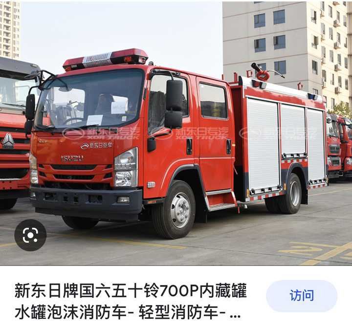

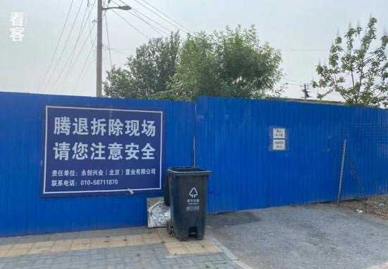

---

## 2496　宝一对

- 日期：2022-12-08　主专题：A16 媒体舆论与公共认知　副专题：A12;A03;A20
- 源 ID：`b53ef953-ea64-50ee-945f-c35070818ecb`　原文链接：https://www.zhihu.com/question/569000157/answer/2792148448
- 官方对象—实践路径：与社会 / 与舆论 / 接收
- 23 概念标签：事实与证据;能力与学习;责任与后果;爱与回应;文明与历史;生态与自然
- 证据状态：manual_confirmed　初读：read　独立复核：not_reviewed

**问**：俄罗斯士兵为什么钟爱洗衣机？

只能说西媒、台媒对自己的忠实观众的智商有着准确的期待。
这已经成了一种文化屏障，一种有效的生态门槛。
只要稍微有一点良知、稍微觉得人不能脱离常识的人，都生产不出具有足够竞争力的媒体产品去和西媒竞争这个类似“转基因作物需要特别定制的肥料”的特化发育市场，甚至在认知能力上都很难相信这个市场的存在。
这个远比当年学英语搞外贸难得多了，就像要你学一门一加一等于三的“新数学”，然后去参加ta们的高考。
这种基于1+1=3而构建出来的“新数学”，你如果不是亲耳听到，是难以想象这样的奇妙概念居然有人能想到，而且能大声说出来，而且还可以得到哪怕一个人——更不用说一片——附和的。
其效果就像电梯里其它人都看得见额外的那个鬼魂、还在问它死去的外婆有没有收到上月烧的纸钱一样。
神奇的是，人家还在这个基础上搞阶乘、搞三角函数、搞画法几何……
你是越听越开眼——你说这圆周率等于2.8的圆、内角和等于192的三角形到底是什么形状？
今年到底是公元几几年？瓦达西挖达雷？阔锅挖多阔？

What an enlightening moment.

这个世界对这类瞎胡闹是有定论的——要是这样的集体幻觉可行，几万年前人类就实现历史的终结了——那时候大家一致认为世界是个乌鸦下的蛋，而张三每天和宇宙之神打棒球。
警惕那些以相信的态度来传播这些的人，这些人的意识已经完全丧失了逻辑的方向感和现实的锚定，实际上处在无法有效运行的神经随机放电状态。
实际上，如果有条件，应该寻找好的机会建议其家人陪同就医。
不论政治立场如何，人道主义是人对同类应尽的当然义务。

---

## 2487　老孩侠

- 日期：2022-12-17　主专题：A16 媒体舆论与公共认知　副专题：A03;A10
- 源 ID：`2921320f-a79e-5aa2-a01d-91a45f4480b4`　原文链接：https://www.zhihu.com/question/569015965/answer/2805513542
- 官方对象—实践路径：与社会 / 与舆论 / 表达
- 23 概念标签：事实与证据;选择与自由;责任与后果;信用与信任
- 证据状态：manual_confirmed　初读：read　独立复核：not_reviewed

**问**：将担心老人孩子感染新冠的人称为“老孩侠”体现了某些人的什么心理？

体现了一种习惯于依赖暴力和欺凌获得利益的行为习惯。
给人取外号——尤其是侮辱性的外号——是极为下流卑鄙的行为，基本上等于承认自己既无能、又懦弱，只能耍流氓、搅浑水、放无赖，指望着靠这类下流手段“取胜”。
不要给人取这种侮辱性的外号。
你一定要指代某一类人群，一定会存在可用的中性描述，甚至都不难找。

这种行为在明白人看来有多刺眼？
跟半夜举个闪光大喇叭广播“我是无赖”几乎没有区别。
你干一次，明白人就把你的门关上了。
多关几次，你就出不去了。

---

## 2472　一国书

- 日期：2022-12-27　主专题：A16 媒体舆论与公共认知　副专题：A04;A11
- 源 ID：`6eb44e7f-c3ba-5212-b188-f39193ff2f5e`　原文链接：https://www.zhihu.com/question/53753874/answer/2818367044
- 官方对象—实践路径：与其它 / 与陌生人 / 施助
- 23 概念标签：定义与达意;能力与学习;成本与总账;净输出与不掠夺;照料与家庭;文明与历史;心理与主体
- 证据状态：manual_confirmed　初读：read　独立复核：not_reviewed

**问**：为什么知乎上有人会花费这么长的篇幅耐心地回答一个陌生人的问题？

这个陌生人是将来亿万与ta同有此问的人的使者，是上帝选中了这个人来担任这个历史角色。
这并非一个人对另一个人的回答。
而是历史王国的使者在向未来王国的使者递交国书。
这个认识决定了回答问题的方向。
举个例子——有人哭诉在学校被人欺负。
这就有两个回答方向。
方向A——回答者要问提问的人体重多少、有没有大哥、老师哪里人、父母什么职位……然后在这个基础上量身打造一个解决方案。
方向B——回答者不去询问这些具体条件，而是在“几乎所有人大概率都有的条件”基础上构建一个不仅对这个侵犯者有效、对别的侵犯者也多少同样有效的解决方案。
指向方向B的答案，就是我们所说的“国书”。
因为它一旦存在，就可以被千千万万将来的人用在难以穷尽的场景下。
任何“小事”，乘以这个基数，都会产生无限量的价值，以至于单论个人所花费的时间，可以说总是值得的。
但这样的答案，对于个人而言就会“不够关心”“不够贴合实际”“不够温暖”。
但是坦率地讲——除了儿童和老人，成年人是不应该去索取超过这条线的关心的。
每个人都应该把个人的幸福构建在“通过个人能力使用公共服务和自然资源解决问题”的模型上，而要尽量少的依赖特定人对自己的贴身服务。
向最大量的人提供专业的公共服务，收取酬劳，转移给自己关心的人，让ta们获得调动公共服务和自然资源解决自己问题的能力，然后同样向最大量的人提供公共服务，这在数学上是人类正向发展的更好安排。
而不是张三贴身服侍李四，李四贴身服务王五。
李四支付不起张三的贴身服务，因为王五就支付不起李四的贴身服务。
这种个人对个人的“关心”，因为其显而易见的效率低下，势必会自然破产。它能“长期维持”的唯一的原因，就是张三李四自身被视为资源，而非人类——ta们的亏损可以通过ta们的死亡被抹去，等于定期把欠条堆在死人身上一起火化，然后宣布“我从不亏钱”。
说穿了，这其实是一种隐形的剥削体制，也是一个社会长期难以摆脱贫穷的根本原因之一。

很显然，这跟大规模应用公共服务构建的生存模式是不能比的。
找到并进入一个B模式的高手圈子，就会发现做什么成什么、钱淹脚目——因为这个模式天生的容易产生利润。
而你自己要进入这个模式，在平时考虑问题时就要自己养成去个人化、去具体化的习惯，学会找到最大健壮化的方案。
“最大健壮化的方法”是人类最宝贵的财富，在这个方向上花时间，永远不成其为“浪费”。

---

## 2465　非常幸福

- 日期：2023-01-01　主专题：A16 媒体舆论与公共认知　副专题：A10;A09
- 源 ID：`23774bcd-411b-5e5e-813e-f493848c2549`　原文链接：https://www.zhihu.com/question/531758941/answer/2825042198
- 官方对象—实践路径：与自己 / 与原则 / 建立
- 23 概念标签：事实与证据;能力与学习;选择与自由;责任与后果;心理与主体
- 证据状态：manual_confirmed　初读：read　独立复核：not_reviewed

**问**：为什么那么多人说上海是买办之城？

事情总是这样——
武汉爆发alpha的时候，还记得红十字会事件么？方方“手机满地”事件么？青山垃圾车事件么？小区骂娘事件么？巴西冻肉事件么？
那时候不也全国骂武汉的班子是白痴、失职、荒谬，无能，要前提下台。
敲盆打板吹号唱歌写段子，似乎武汉班子全员尸位素餐、高位截瘫，远不如任何一个会用微信的群元老。
等全世界传开，东京伦敦纽约巴黎柏林新加坡香港体验过一轮之后，就知道自己到底是什么水平，武汉的表现到底是什么水平了。

上海爆发omicron，这个戏码重来一遍，只是证明了有些人根本就不在乎什么真相、事实，仅仅只是“有了不爽就要喊”。
捡到什么帽子合适就丢什么帽子，看哪根大棒够得着就抡什么大棒而已。
其实ta们对什么是可能的、什么是可达到的水准、什么是恰当的期待没有足够的认知，甚至可能没有任何在意。
只不过仗着一个“法不责众”，胡说八道罢了。

是的，这时候有很多人会出来说——这是“人之常情”。

但只要谈到人之常情，你就要记住人之常情的根本逻辑——每一种“人之常情”和一切其它的“人之常情”存在着必然的逻辑强相关关系，或者不如说干脆互为因果。
你根本不能指望在免责的地方处处你都人之常情，到了吃瘪的地方你就突然不必“人之常情”、成为例外了。
不幸福也是人之常情。
不成事也是人之常情。
“人之常情”是因果铸成的逻辑整体，受此即纳彼，不容挑肥拣瘦。
换句话来说，“追求成功和幸福”，从原理上就必然是一个“成为非常人”的过程。
这意味着你以后要对自己收起“人之常情”的免责卡。
你只是要加倍小心，成为非常人有上下两个方向，你要的是向上——这里写的几千篇，都是为了让你可以非常的好。
另外你要提前知道这一点——无论你是向那边，那些躲在“人之常情”的免罪洞穴里的人总是会说三道四的。
不要大惊小怪。

幸福只有一种，就是非常的幸福。

---

## 2426　批判性的声音

- 日期：2023-01-23　主专题：A16 媒体舆论与公共认知　副专题：A03;A10
- 源 ID：`2a75a685-5994-51bc-b623-2ba599db2618`　原文链接：https://www.zhihu.com/question/384227507/answer/2857017022
- 官方对象—实践路径：与社会 / 与舆论 / 表达
- 23 概念标签：定义与达意;能力与学习;选择与自由;责任与后果;边界与许可;照料与家庭;法律与秩序;权力与异议;技术与工程
- 证据状态：manual_confirmed　初读：read　独立复核：not_reviewed

**问**：为什么现在的中国人听不得一点批判性的声音？

说实在的，“批判性的声音”根本就没有它的爱好者所自称的那么“重大”的意义。
真的要帮忙的人，不会走“批判”这条路。
批判权不是理所当然的，就像你要给人开药你要先上几年医学院。一天医学院没上过、一天临床没干过，整天在这“批判”医生的治疗方案，纯属噪音。
一天车没开过的人坐在后座上告诉你这里要加速、那里要刹车，一天到晚“你这也叫会开车”，这人要是不闭嘴，谁不要一脚把ta踢下去？
“你怎么一点批判性的意见也听不进？”

不错，就是一点也听不进去。
也一点也不该听。
更不用说，这类所谓“一点儿批判性的声音”背后要么是毫无可行方案，要么所谓的方案就是“你没救了，只能原地自杀重新投胎”。
很显然，谁劝你听这种“除了自杀你没救了”的所谓“批判”，谁就是你的敌人——就是这么直白。
这哪里是什么“批判性意见”，这只不过是一种懦弱的侮辱。
对这个“想不通”、“无法理解”，纯属装糊涂和虚伪——因为这些批判者自己就是这么执行的。
这属于为人处事的基本常识，搞到还需要人来跟你解释一遍，如果你已经成年，你的父母都应该向你和社会道歉。
何况，就算父母没有教过你，你自己难道不能从基本的生活体验里有点基本的观察和反省吗？
这个世界真正的规则是人自己一意孤行、自担生死，在这个前提下人自己主动选择、定向寻求建议。不经许可和邀请，要提任何意见开口都要先加“对不起”、“不好意思”、“恐怕冒昧了”、“不知当讲不当讲”。
这是基本礼仪，做人的ABC、哪来什么“你怎么一点批判性意见都听不进“的罪名？
爹妈可以这样说你，那是爹妈作为监护人对你的特殊权力。老师可以这么说你，那是老师的职权，你爹妈给的、你自己拜师给的。
你是谁的爹妈？你对人说这种话，这不等于无脑找打吗？

---

## 2363　小宇宙

- 日期：2023-03-08　主专题：A16 媒体舆论与公共认知　副专题：A03;A01
- 源 ID：`10660f80-81bf-531e-8c73-a05745132f2f`　原文链接：https://www.zhihu.com/question/65455203/answer/2926249745
- 官方对象—实践路径：与社会 / 与舆论 / 表达
- 23 概念标签：事实与证据;选择与自由;责任与后果;权力与异议
- 证据状态：manual_confirmed　初读：read　独立复核：not_reviewed

**问**：如何看待得到一点权力就装逼的人？

在这个问题下，有大量的所谓“然老师宇宙“的“集体创作”。
关于“然老师宇宙”兴高采烈，其实不过是自认为正义，集体对人施暴。
侮辱和讽刺并不是战斗。
施暴也不是有效的反对。
要反对就直接讲道理反对。对方讲的哪里不是事实、或者哪里自相矛盾，或者哪里行不通，这才是唯一重要而有真实力量的对抗。

编造种种虚构的故事去伤害对方，为什么？是因为这人的话触发了你对社会规则的残酷性的恐慌，所以你要惩罚这个让你产生痛苦的恐慌的人，是吗？
因为你认定对方夸张了事实，是在超出实际的制造你额外的恐慌，是吗？
你自己就有随便待人的习惯，而且很难改甚至不想改，现在有个人做了个“这会造成足以影响前途命运的可怕后果”的见证，这让你害怕了，是吗？于是群起而攻之，把这个见证人碎尸万段就可以解决问题了吗？
只要团结起来相信这人的这个见证一定是假的，社会对必要礼节的严酷要求就因此消散了，不用担心了，是吗？事实上，就算这个人所做的见证是夸大其辞的又如何？
因为无意间出言不逊而导致比这更残酷的后果的事，真的就不存在吗？真的很罕见吗？面试时因为一句不礼貌的称呼而被从小名单里拿掉的人难道还少吗？
在寝室里对人大大咧咧而被铁锤打死的事情，你们没有听过吗？
最讽刺的是——
别的不谈，你们自己现在的所作所为就是这种苛刻和残酷的活例证——你们难道不一样是因为别人的话不中听，就抱团结伙群起而攻之，必欲其社会性死亡而后快？你们自己不就是这种残酷的实施者吗？
你们自己现在的作为，不正是这种残酷苛刻的活见证吗？
你们与被口诛笔伐的“然老师”，反应不是完全相同吗？
你们热情洋溢争先恐后编造的这些故事，恰恰证实了ta见证的现实性。
what a poetic irony.

社会不是过家家，称呼他人要万分谨慎。可以肆意妄为而不会有任何严重后果的世界根本不存在。快递打电话，一个称呼不对，不是一样被长篇大论的差评？服务员一个暧昧可疑的眼神，不是一样招来勃然大怒，要找经理赔礼道歉？社会的事实本就如此，“报复”、“惩罚”向你们见证这种险恶的人，根本不能逼迫社会变得不计较人的失礼。看似轰轰烈烈，其实只是阿Q式的精神胜利。
这不仅是于事无补，还借着这狂欢，你品尝了暴力凌虐的快感。
这种快感如果没有带来直接的恶果，是最容易让人上瘾的毒之一。
一旦你上了瘾，不滥用、不普遍的依赖这种“创造性报复”去对付你的一切问题近乎是不可能的。
你想过这样的“绝技”在别人眼里看看上去是什么观感吗？
要对自己的安危不在乎到什么程度，才会乐于与这样以恶为乐的人为伴？
你自己愿意交这种一言不合就开始对公众花样百出、惟妙惟肖、眉飞色舞的编造你的种种故事来把你画成小丑的朋友吗？
自己想清楚。

---

## 2328　红区

- 日期：2023-03-29　主专题：A16 媒体舆论与公共认知　副专题：A10;A08;A01
- 源 ID：`296474e5-7c0b-568e-ba74-ca5a5e5e7e02`　原文链接：https://www.zhihu.com/question/590129690/answer/2958276402
- 官方对象—实践路径：与社会 / 与舆论 / 接收
- 23 概念标签：事实与证据;选择与自由;责任与后果;成本与总账;净输出与不掠夺;财富与市场;法律与秩序;权力与异议
- 证据状态：manual_confirmed　初读：read　独立复核：not_reviewed

**问**：心医林霖关于泰国男模的推理几分真假？

众所周知，西方游客和日本游客对泰国趋之若鹜，流连忘返，如鱼得水，乃至于乐不思蜀，
是因为什么？
因为西方人安全意识不行？还是泰国操纵了西方媒体，报喜不报忧？
日本人热衷赴泰国又如何解释？
泰国人疯游日本，赴泰日本人连回国机票都抢不到了... - 泰国旅游 - 泰国网 - Powered by Discuz!韩国人也对自己的生命不负责任，是吗？
韩国：入境泰国游客市场价值高达250亿泰铢还是因为西方势力庞大，泰国黑帮不敢惹，但是对第一大贸易伙伴中国，泰国军方/黑帮就自信得罪得起？
思考一下这个逻辑——
1）众所周知，泰国军方在泰国手眼通天，没有什么黑帮可以和军方分庭抗礼，施施然吃独食。
2）军方地位严重的依赖于泰王的政治背书。军方和泰王是显而易见的共生关系。某种意义上讲，军方和泰王的二位一体才是泰国的真正主人，甚至足以架空民选结果。
3）旅游收入的最大受益者就是作为泰国主人的泰王和军方。
所以，假设器官买卖也可赚钱，那么它要做到交的钱足以补偿一旦曝光给泰王和军方带来的潜在生意和税收损失。
泰国的旅游收入是多少？换算成黑市肾脏价格，是多少个？
22023年泰国的目标是462亿美元，为2019年疫情爆发前的80%。
合多少“腰子”？
你不需要相信泰国军方或者泰王有多严格的道德追求，你需要考虑的是泰国军方识不识数？或者泰国军方的脾气有多好？有多尊重法律程序？
泰国也许有这种器官贩卖，但是如果不是针对无记录偷渡入境的难民，而是成规模的针对这种循正规手续入境、有入境记录有旅游签证限期的游客，这在经济逻辑上将会非常令人惊讶。
你自己想想，在你眼皮底下有人成规模成系统的绑架你一年几百亿美元交易额的客户卖器官，ta要分多少钱给你，才能保ta全家的命？

从另一个角度来说明这问题——如果让你恐惧到从此绝足于世界的这么大的一部分，只需要如此低廉的成本和如此简单的“论证”，那么你从一开始就注定丧失大部分自由。
因为不知多少人、多少地方有这种“恐怖的传闻”。
甚至有时越是优秀的人这类传闻越多——放心，总有人要造出来的。

如果你的对手需要更高的成本和更有效的论证才能被限制同样程度的生存空间，有更大的概率是由ta来接管你的资产，而不是相反。

建议你把这个门槛提高一点。

---

## 2285　未爆弹

- 日期：2023-04-22　主专题：A16 媒体舆论与公共认知　副专题：A10;A07
- 源 ID：`802443af-4f7f-5f4f-93a4-bbd9878efe62`　原文链接：https://www.zhihu.com/question/596922021/answer/2995397449
- 官方对象—实践路径：与社会 / 与舆论 / 表达
- 23 概念标签：选择与自由;责任与后果;信用与信任;边界与许可;照料与家庭;劳动与组织;权力与异议;心理与主体
- 证据状态：manual_confirmed　初读：read　独立复核：not_reviewed

**问**：如何看待浙大学生因辱华言论被举报于公示期间放弃公务员？

理所当然，恰如其分。
只要有得选择，组织权力就不能掌握在对组织没有认同的人手里。而如果一个组织已经别无选择，必须把组织权力交到明知不认同的人手里，这个组织其实已经没有存在的逻辑基础了。
很多人把言论自由、思想自由理解为无论何时何地都可以随便主张任何观点，这个是错的。
这不适用于一切自己主动申请加入组织、缔结关系而对方对行为、立场有要求的情况。
你不能加入国安，然后主张你有自由泄露秘密的言论自由。你也不能加入伊斯兰教，然后宣布自己有吃猪肉的自由。
只要没人逼你非加入不可，是你自己申请加入，那么你在申请时就等于承诺了相关的条件。
自由不能为这种出尔反尔提供免责保障。
而这法则跟这些组织或个人提出的条件有多奇怪、多不被所谓的“社会主流”或者“世界主流”认同无关。
确认了伦理原则，就要讨论个人如何适应这个伦理原则。这意味着你要注意改变一个认知——一切署着你的名字、没有注明有效期的、仍处在公开状态的书面言论，都不要视为已经自动过期。
这话说得很晦涩，我们举点现实的例子。
比如你三年前年少无知，说了一些你现在自己也不认同的话，那么你现在既然已经不同意这些话，你就要记得回去把它删除，或者在下面注释“本人现在不再认同/反对以上看法”。否则，在外界看来，你的文字既然还原样放在那里，就只能按照你仍然在主张这些看法来处理。
也就是说，你要随时随地为所有以你的名字发表的全部言论对你自己的承诺负责，而不是只需要仅仅为你自己记得的部分、你在意的部分负责，而对你自己不记得、不在意的部分就不需要负责了。
你不要指望在A处写“张三是个抢劫犯”，然后在B处写一个“哦，我搞错了”，就觉得你没责任了。
也不要指望三年前写一个“xx国人都是脑残”，三年后写一个“看来我误解了”，就觉得别人用你三年前的话来追责对你很不公平。
因为你的这些话还放在那里，仍然在独立的被别人查看，仍然在不间断的造成损害。你的那些纠正言论只有你自己和另一批看到的人知道，看到前一段和看到后一段的两个人群是不重合的，而受损、受害的一方，并没有因为这些隔着十万八千里、自以为足够的修正停止受害。
这也是“当街骂人背巷道歉”被视为一种失德的原因。
会花费时间和成本来调查你现在是否还持有同样观点、以免冤枉你的人不是没有，但是绝大多数情况下，你都不会得到这么美好的优待，因为为了怕冤枉你而做这种调查本来就不该是受害者的责任。对方只需要——也多半会——根据“眼前这段文字是诽谤”这一个简单的事实来决定怎么处置你。
管理自己的全部书面言论，是你自己的责任，你有没这个管理能力、有没有做到，这跟对方无关。
说到这里你是不是汗毛倒竖？
“——啊，这样算起来这些我在何时、在哪里说过多少我现在觉得恶毒愚蠢的话，我已经数不清、记不得了啊，这怎么回去清扫、注释、挽回啊？”
这要怎么办？
第一，从现在开始，自己嘴上手上多个把门的，停止这种“忘了就等于没发生”的自欺欺人。每写下一段话都要准备为它存在的全周期负责。
因为别人会这样去追究你的责任。
第二，你要有一个系统的方法管理自己的言论散布。例如，遵循某个规则，仅将言论发布在这个规则覆盖范围之内的地方，以至于你可以很容易的重新遍历修整，对所有自己需要负责的内容进行持续管理。
这也从另一个方面说明，你最好不要随便发表公开言论，因为每多说一些，就意味着你要管理的信息的规模又变大了一些，日常成本又增多了一些。
第三，即便如此，你仍然会有自己管理不到的漏网之鱼。
对此，首先你要先树立起“这仍然需要负责”的意识，而不要认为“因此受到追究是别人蛮横苛刻”。如果你的第一意识是负责的，你就不会第一反应跑去“反击”、“鸣冤”，而是诚恳的道歉、认错。这个第一反应往往决定了对方的这个追究到底落地是几分力。如果你摆出一副是对方太苛刻的嘴脸，你无异于自招天劫。
其次，立刻着手教会你的子女这个基本法则，避免ta们在来得及之前就又犯下这种愚蠢而难以回溯纠正的错误。
这种自己都不记得自己说过的鬼话，每一句都是未爆细菌弹，埋在地下似乎长期无事，不知什么时候修地铁就会造成祸患，最好的方式当然是干脆不丢。
自己说过什么，文责是无限的，自己心里要有数，不要有侥幸心理。
所以每句话的成本都是很大的，不要乱说。

---

## 2271　戾气重

- 日期：2023-04-29　主专题：A16 媒体舆论与公共认知　副专题：A01;A17
- 源 ID：`d3aeca1a-800a-5986-bc6b-6f63767bfef0`　原文链接：https://www.zhihu.com/question/597438749/answer/3005506004
- 官方对象—实践路径：与社会 / 与舆论 / 接收
- 23 概念标签：成本与总账;爱与回应;照料与家庭;劳动与组织;权力与异议;文明与历史;民族与身份;心理与主体
- 证据状态：manual_confirmed　初读：read　独立复核：not_reviewed

**问**：为什么这两年感觉老百姓的戾气很重？

老实说，我没遇到啥老百姓戾气重。
中国的老百姓是见过世面的，而且强韧务实，哪有时间跟你躺下地上玩“戾气”——ta们根本就不信什么“戾气万能论”。
觉得“发戾气“很不得了，能让家大人不能不屈服，这显然是根本没走出社会、精神上还没脱离家庭依赖的小孩子的思维方式。
你在公司发戾气，老板难道给你加工资？你在柜台发戾气，难道顾客会给你超级加倍？给你双倍订单？
这根本不是中国人处事的基本逻辑。稍微长大点、略经一点人世，就会认识到在中国成年之后还迷信“戾气决定论”的人是极少数社会化失败的人。正常人亏钱了，受挫了，只会更加明白——我的态度得要比以前更好、工作得比以前更谨慎有效——哪怕我筋疲力尽、哪怕我什么也没做错，浪费精力在搞什么戾气游戏上，只会把我的坑挖得更深、让我后面要花更多代价去填。我为啥要在自己筋疲力尽的时候给自己进一步制造损失和困难？
“中国人务实”，这话的意思本身就是中国文化是一个成熟到滴水的文化、一旦一个中国人自视为成年人，ta的整个精神架构都会自然的排斥、鄙视这种“撒娇撒出一片天”的思考方式。
“沉不住气”对一个中国人是加分还是减分？还是一票否决式的极大差评？
“扛不住打击”对一个中国人是一种理直气壮的所谓“权利”，还是一个会引起普遍鄙视的人格缺陷？
“意气用事”呢？好评还是差评？
什么样的“戾气”，可以逃得掉这几条评价？可以不但不被这一条条把你的社会评价搞到千疮百孔，而是赢得满堂喝彩，名扬天下？
中国人对“没本事只会在家搞戾气”的反感甚至是生理性的——也是为什么中国父母对胆敢信奉和利用这种“战术”的子女往往下死手教训、打的屁股不能挨床的原因。
因为这个原因，中国只有五胡乱华或者满清入侵的时候，社会大统已经完全崩溃的情况下，才有可能出现暴戾式的盲动。
否则即使李自成这种明刀明枪起兵造反的农民军，都不会忘记在自己的军旗前加个“义”字，要在纪律严明、勤政爱民上去争上一争。
不管ta们实际上做没做到，这个“暴戾者鄙”的自觉，就算是十八路反贼都是一清二楚的。
你在中国鼓吹什么“戾气重”，还是在中国GDP增长连续霸榜四十年，把第二名甩开几个身位，军威国威达到五千年来历史顶峰的时候鼓吹，只有一个解释——就是你对中国到底是什么、中国人到地是什么材料做成的人毫无基本认知。
正因为中国是一个如此不信奉戾气的文明，唐山案这种在美国根本不值得一提的常规案件，才会占到这么大的版面，这本身就一种“一根针掉下地上都能听见”的反向证明。
中国的戾气程度之低，低到什么水平了——大部分值得传播的戾气爆发，都已经被那些没有任何真知灼见可写还要讨饭吃的人当宝贝通知全体中国人了。
你的感觉是“哎呀呀，那边这样，估计我身边全都是这样只是还没有爆发出来”。但实际上是啥，是已经“应报尽报”了。

那么这些震耳欲聋的“戾气论”哪来的？
这主要来自两个方向。
第一个来源，不是环境多险恶，而是皮肤太细嫩。春天的太阳，已经有人要擦50+的防晒霜开始戴袖套了。你要美白没什么问题，但是请搞清楚这是你有特殊诉求，这不叫“太阳大得受不了”。

第二个来源，很明显对岸以及一些恐惧优越感崩溃的人在外网的留言最近渐趋精神失常。
ta们那些怨毒的表达都不能形容为戾气重了——看到那些表达你就知道这些人再什么怨毒也没什么可担心的，因为ta们基本上都丧失四则运算的基本能力了。
国内所谓“戾气重”的调子，一大半都要拜这些人四处鼓吹所赐。
ta们需要这种幻想来给自己一点指望——因为ta们知道自己没本钱、没机会像有钱有门路的同学那样脱逃——就算自己脱逃，也是万万没能力把全家都接走的。而ta们又没能力——或出于某种神奇的原因不愿意——让当局停止捋虎须，把局势推向万劫不复的那一天。
在这个绝境下，要是再不用“这老虎明天就会病死”的指望来安抚住自己，不拼了命的在一切看得到的地方写满“戾气重”、“即将崩溃”，怕是直接要叫白车送加护病房了。
这是几百万人规模的集体精神创伤，你想不到处听到哀嚎，想想也是不可能的。
中国从疫情中复苏的速度远超过预期，国际局势正在飞速的好转。虽然不能说大局已定，但是局面已经在越来越明显的向美国无力扭转的方向滑移。
真正好笑的是，美国自以为阻拦性的所谓对策，反而是加速这滑移的主要推力之一。
很难想象美国还能把这四面漏风的阵营维持五年。大部分它的盟友，都没有勇气把现在的趋势再扛五年——那是真要出现宪政危机，各种各样的大楼会被占领，各种各样的首脑会被轰下台，革命会多到调色盘都不够用。
总不能开始用“星河白”或者“千山翠”来命名革命吧——又不是在闲鱼卖表带。
如果你觉得“戾气重”、“要完了”，甚至到了谁要跟你提到“没那么严重“你就要给对方那个贴一个“被洗脑”“吃爱国饭”标签的地步，那么最客气的说法也是——你很需要换一批信源了。

---

## 2263　淘金客

- 日期：2023-05-03　主专题：A16 媒体舆论与公共认知　副专题：A03;A17
- 源 ID：`a8e81ee4-d2e5-5965-9b9b-88b5c1aefcd8`　原文链接：https://www.zhihu.com/question/598661185/answer/3010867428
- 官方对象—实践路径：与社会 / 与舆论 / 接收
- 23 概念标签：事实与证据;选择与自由;责任与后果;成本与总账;财富与市场;法律与秩序;民族与身份;心理与主体;性别与身体
- 证据状态：manual_confirmed　初读：read　独立复核：not_reviewed

**问**：如何看待四川籍母女二人插队被制止后当场发飙「你惹错人了，我就要插队」？

新闻传媒里有一种极其无耻的行为，就是把报道升级化、扩大化，以出卖公共利益为代价谋求自身的传播利益。
比如一个人把另一个人撞了，这不叫新闻。
那一定要先查性别，写成一个女人把一个男人撞了；再查民族，写成一个“天龙人”把一个汉族人撞了；再查年龄，写成一个老人把一个年轻人撞了；再查籍贯，写成一个北方人把一个本地人撞了；再查收入，写成一个有钱人把穷人撞了；再查国籍，写成一个外国人把中国人撞了；再查信仰，写成一个xx教徒把群众撞了……
万箭齐发，就算你连身份证都没有，也至少有个四五种手法给你上升到不同维度的族群矛盾。

写张三和李四有矛盾叫什么新闻呢？那有谁会关心？写张三这种人和李四这种人有矛盾，那才叫新闻，才有人看啊。有人看，才会有人订阅，我才能带货，我才能回本啊。这会导致社会撕裂，导致读者抑郁，那关我何事？跟我3000月薪有关系吗？哦不，我可以加大抗抑郁药和“心理咨询”广告的投放啊。
一手制造需求，一手满足需求，何其快哉。
把这些东西写出来，是让你们看清楚这些人的本能冲动。
看清楚了，你也要明白，这种冲动是任何法律、任何谴责都无法遏止的。无论你怎么立法、怎么谴责，都解决不了新闻媒体的这种本能的腐败冲动，这是客观现实。
而你自己如果不对此保持警惕，你迟早会得抑郁症、迟早会因为这种报道的浸润陷入躁狂状态。
自救只能靠你自己对这种天然的诱导和欺骗发展出自己的免疫力，学会看穿营利性媒体的这种本性的劣根性，去透视层层包装下的基本事实部分，别无它法。
这只不过是一件你平时连头都不会抬的鸡毛蒜皮小新闻——可能连新闻都算不上，它被一大群人如获至宝迫不及待的往“女权”、“老权”之类的话题上引，本身就是这种现象有多普遍、媒体道德可以有多低下的一个实证。
避免被骗、追随事实，是人自己的义务，做不到乃至放任自己享受这些欺骗中的贿赂，从而陷入抑郁、绝望，实际上是这个世界对拒绝承担求真义务的人的通用处理机制。
不要指望媒体给你纯金，淘金是你自己的义务。

---

## 2244　你的颜色

- 日期：2023-05-14　主专题：A16 媒体舆论与公共认知　副专题：A10;A12
- 源 ID：`21eb55cc-0b19-53bd-ae87-c4483ecdda5d`　原文链接：https://www.zhihu.com/question/597194482/answer/3027071607
- 官方对象—实践路径：与友人 / 与同志 / 加入
- 23 概念标签：定义与达意;能力与学习;选择与自由;责任与后果;成本与总账;劳动与组织;技术与工程;文明与历史;民族与身份;心理与主体
- 证据状态：manual_confirmed　初读：read　独立复核：not_reviewed

**问**：为什么知乎上很多人喜欢用乌克兰国旗做头像？

什么叫“颜色革命”？
其实指的就是大规模的使用视觉标志、听觉标志来营造一种意见表达。这可以是改国旗头像、也可以改名字、也可以穿特定颜色的衣服、也可以是比出某种手势。
在很多情况下，还是为了投机取巧，蒙混出一个比自己实际规模更大的规模假象来。
为什么颜色革命防不胜防，容易成功？
因为它将政治立场极端的简化、模糊化和戏剧化了，最大程度的利用了青少年的存在感焦虑和反社会性。
坦率讲，现在的所谓成人年龄——14-18岁——太小了，基本不可能恰当的完成社会化。而现代社会的高度复杂性势必要把这些还没学明白社会规则就突然在法律上已经“毕业”了的小孩子淹没。
如果是古代社会，千年一系，祖祖辈辈都是一个规矩、一个价值观、一个社会秩序，不需要你选择、只需要你参考前辈照做，这个焦虑会大大的消解。生在鞋匠家，父亲是鞋匠、哥哥是鞋匠、叔叔也是鞋匠，你一开始就知道自己将来也是鞋匠，这看上去似乎“令人窒息”，但却在另一面有强大的清晰、肯定和安全感——哪怕这安全感并不真实，但不真实的安全感也是安全感，也足以让你安然入眠。
但现在的社会你是“自由”的，你在踏进社会时只是一块面目模糊的土块。你在不同的工作和行业中漂流经年，春节回家面对亲戚“做什么“的问题，你竟然嗫喏难言。
是啊，你是干什么的？你是什么？
你要干什么？你想是什么？
你什么也不是，在任何角度，你都近乎于“零”。
在所有的行业，你的经验、能力、积累都无限接近于零，于是你的地位也无限接近于零。
这要真是不公平的也罢了，问题是，你的能力和资历摆在这里，你自己也不能不承认，如果能者为先，你的确不过是零。
正因为你是零，机会就更不会放在你头上，没有机会轮到你，你又怎么不会是零？你也不是没有等待，你等了一年、两年，还是没有到你，难道无限的等下去吗？
然后你对自己说“也许只是不适合”，于是你换了方向、换了行业，却总是发现，你只是从头又等了两年。两年，又两年，又两年。你还是回答不了“做什么”“是什么”的问题。而你都不再敢去触碰“想做什么”、“想是什么”了。
处在这个阶段的人，想忍住不去觉得“这个社会太残酷、太邪恶”几乎是不可能的。处在这个状态的人，一旦遇到任何价格低廉的身份认同机会，遇到任何加入“主角团”的机会，不被诱惑到辗转难眠，也几乎是不可能的。
其实那出戏剧到底是要演什么、演完之后会怎么样，根本就不重要，重要的是“出演”本身。
如果再没有光照在我身上，久在黑暗中的我，在镜中已经看不见我自己了。
存在重于正义、重于和谐、甚至重于生命本身。
因为如果没有存在，生命不过是没有显示和输出、徒耗能量的进程。
如果这些“颜色”可以渲染出我的存在，那么无论这些颜色对你们有多么大的毒性，也无论你们如何批评、侮辱，乃至威胁、击打，我都不能不选。
我很抱歉，但我必须存在。

说中了吗？

为什么即使是香港、台湾这样人均收入远超贫困线的地方也一样可以策动策动颜色革命，看懂了吗？
颜色革命其实根本不是因为“贫穷”、“绝望”——那只是一个误会——而是因为现代社会的极端多变和极端多元化导致的迷茫。
这归根结底，是因为现代性革命、“自由市场”、“自由竞争”对“自由劳动力”的时代需求对人类有限的适应能力的极大挑战。
这并不是一种“因为经济不够发达”而导致“社会病”，而是是一种“历史病”。
甚至恰恰相反——越是从传统形态极速跨入发达现代市场经济阶段的社会，越是严重。
美欧看似不严重，那是因为ta们的青年已经在六七十年代通过嬉皮士运动、摇滚、毒品和性解放在铁幕的遮蔽下幸运的熬过了第一击。
ta们的青年其实也没过掉这一关，至今仍然在这种迷茫中煎熬，但是ta们已经迷茫了几代人，已经迷茫出传承、迷茫出预期了。
日韩紧随其后。
接下去的一波是陆/港/台、越、印、伊、泰、缅等等新兴国家。
这是历史必然，是每一个国家和社会现代化进程的必修课，而且至今还没有谁真的走出这个考场。
但这历史进程所导致的必然社会问题，被美国趁虚而入，利用来搞颜色革命了，看懂了吗？
这在本质上和有人告诉你你们“你们之所以长青春痘是因为张三在你们的井里下毒”没有区别。
你们明白没有？
你们需要对这一点有清晰的认识，才能避免落入这样的陷阱，避免自己最脆弱的时候被人乘虚而入，受人操纵成为亲者痛、仇者快的工具，乃至于被弃如敝履，成为悲剧性的牺牲品。
不要为自己的身份模糊过于焦虑，这个阶段只是你们必经的成长过程。
天生你才必有用——你需要盲目的相信这一点。
你现在经历的每一个可能让你羞于启齿的“失败”，都是为了造就你将来无可替代的独特阅历。你不要浪费时间在焦虑它们“有什么意义”上，只管认真对待，去抓住这些“毫无意义的经验”、“将来没用的技能”。
你要盲目的相信这一点，保持“愚蠢”的乐观。
不要以为有了相机就没必要学绘画，有了MIDI就不必再学琴，有了计算器就不必再学计算，有了数控机床木匠就再无容身之处，或者有了AI准确简练的文字功力就毫无价值。
抛开这些东西，保持对命运安排的责任的忠实，尽情去把它做好，做到你能为手里出去的每一件工作自豪。将来你会知道这是为什么，有什么用。
不然这篇东西是从哪来的？

---

## 2233　V

- 日期：2023-05-21　主专题：A16 媒体舆论与公共认知　副专题：A10;A03
- 源 ID：`d3321e0d-5372-5a3a-b59f-85620b38ed1e`　原文链接：https://www.zhihu.com/question/600762866/answer/3037219141
- 官方对象—实践路径：与社会 / 与舆论 / 应对
- 23 概念标签：定义与达意;能力与学习;选择与自由;责任与后果;权力与异议;民族与身份
- 证据状态：manual_confirmed　初读：read　独立复核：not_reviewed

**问**：被知乎大v网暴要如何还击？

老实说，在网暴这个问题上，大V才是弱势的一方。
如果真的公然跟你“对攻”或者真的“网暴”你，很容易就会把自己建立起来的品牌搞垮，人气搞散。没搞明白这个道理的大V，一般都很难过十万这个门槛。因为超过一万门槛，这类纠纷恩怨发生的概率就非常大了，甚至可以以周、以日为单位发生。尤其是一些迫切希望增加人气的用户，往往有意无意的敞开评论权限，以求人气旺盛，那么这类事情就会发生得更频繁。
靠自己的内容获得超过十万关注而且为期很久的大V，还会借助粉丝来“网暴”某个不知名网友的可能性不说没有，但客观上相当罕见——因为这样的人应该撑不到这个阶段就会放弃账号了。
这倒不是说大V就对你没办法，我可以把这几种办法直接告诉你，因为都是阳谋。

第一种办法，是揪住你的政治不正确，把你拎出来示众。这个尤其以反政府、反统一、反民族团结、反法治、反人伦之类的由头为要。这个要是被抓住了，你的确会很惨，但是只要是真被抓住了，你基本上只有认栽道歉一条路，怪人挂你是没啥用的。因为路人不会站你这边。甚至，如果有很多路人站你这边去反冲这些绝对不容挑战的价值观，对你还会更糟——你还会被当作标志性人物从重处理。
所以唯一的办法就是如果你要找大V的麻烦，在这方面你就要把持得住，既不要自己口无遮拦，也不要在对方诱导下祸从口出。
说到这里你要提问了——对方的语言能力往往远超过你，往往可以察觉到你的思想断点，而且是有很强的能力通过高强度的对话让你说出各种上不得台盘的瞎话的。如果你发现只要坚决奉行“坚决避免祸从口出”的策略，你就说不过对方，咋办？
遇到这种情况，与其去痛斥大V欺负人，不如自己去想想会不会真的是你有问题——就算不是思想立场的确有问题，至少也是表达能力欠奉。
这里教你一个招——你可以把一切人名、前情都隐藏，自己提一个问题，问“这话是否成立，为什么”，没准你可以从外部回答中获得灵感，解决掉自己表达和思考能力的困难。注意，不要在这里面提及你的那些鬼恩怨，因为如果你这么干了，你这个提问本身就是罪行之一，你就是赤裸裸的想利用群众给你当枪使。到时候你只怕首先就要被群众额外教训一顿。
但你要是发现好好的提了问，结果没有什么答案说得出它有什么问题，那你就得自己认栽。
难道你就这么正确？说不过也问不到，但不管不管就不管，你反正就是对的？按你这种“正确”法，你啥时候才有可能认错？靠托梦给后世子孙吗？

第二种阳谋，就是得体的应对，以至于整件事从各种角度看，任谁看，都是你网暴ta，ta忍无可忍给你还击。这种局面可能发展到这个地步——凡是目睹了整个对话而不认定恶棍是你的人，自己都会被认定是混蛋。
这有一个征兆，那就是你口出恶言，对方反而客客气气、礼貌相待，但对方就是在观点上不让步。
这种不让步是对方天然的权利，是没有人可以责怪的，但有很多社会化程度不足的小孩子会认为这就已经是可忍孰不可忍，自己要升级冲突，顺便还要给人扣上“假仁假义”“伪善”之类的罪名，自己产生“替天行道”的悲壮感，要抡出飞天御剑流来。
到时候在外部第三者看来，混蛋很明显就是你。
不客气地讲，对方要是狠辣一点，完全可以在界限之内几句话激得你胡说八道，让你自己从嘴里吐出全副棺材钉来——M18的硬化螺栓，蜘蛛侠躺进去都全剧终了。
那是个什么画面效果？那就像你烧了人房子，人家要报官，你还在广播对方“太过分”。你还指望街坊们站在你这边不成？
“阴险”吧？“毒辣”吧？
但你如果总是中这种“阴险毒辣的诡计”，你不觉得有什么问题吗？
说了这是阳谋，你先把这阳谋对付了，再谈别的。
回头你会发现，就这些阳谋最难对付，要绝对稳妥的对付，你从一开始就没法喷。
要不怎么叫阳谋呢？
自己想想吧。

---

## 2209　绿绿灯

- 日期：2023-05-31　主专题：A16 媒体舆论与公共认知　副专题：A04;A03
- 源 ID：`50cb533b-f0a1-5fd1-8232-51a73be40001`　原文链接：https://www.zhihu.com/question/598152801/answer/3052969583
- 官方对象—实践路径：与社会 / 与舆论 / 接收
- 23 概念标签：能力与学习;成本与总账;爱与回应;照料与家庭;心理与主体
- 证据状态：manual_confirmed　初读：read　独立复核：not_reviewed

**问**：为什么父母和名著，一直反复告诉我们，做人要勇敢善良，却从不会直接告诉我们，社会有多虚伪险恶？

名著里的卑鄙小人和伪君子还少吗？名著里没有险恶的人？哪一部没有？《喜羊羊和灰太狼》吗？
至于父母，你希望父母在哪个阶段告诉你社会的什么险恶？比如父母跟你说“外卖都是食品添加剂”、“你这个男朋友有问题”、“网络游戏都是想骗你钱”、“是药三分毒”、“医院都是黑心医生”、“不要跟陌生人说话”、“酒店床单都很脏”、“放学要直接回家”、“疫苗骗局”、“转基因影响遗传”、“不要施舍乞丐”、“财不漏白”、“凡事多留一个心眼”……ta们是在说什么？难道不是在告诉你这个世界的所谓虚伪和险恶？难道你没听过吗？
两条都不成立，这问的什么问题？
真正值得惊讶的，是这种根本不存在的问题却有不少顺着回答的答案，这就像一个红绿色盲在问“为什么交通灯都是一个颜色，就不能做的反差大一点吗”却出现了很多分析，并且还有巨大的浏览量。
这个问题有作为社会心理学研究素材的潜质。调查一下答案分布可以混个小论文。

---

## 2192　反仇恨

- 日期：2023-06-09　主专题：A16 媒体舆论与公共认知　副专题：A17;A10
- 源 ID：`637fa3a9-f50a-5d14-9c08-576589b2cd1b`　原文链接：https://www.zhihu.com/question/450709731/answer/3065421862
- 官方对象—实践路径：与社会 / 与舆论 / 表达
- 23 概念标签：定义与达意;选择与自由;责任与后果;边界与许可;法律与秩序;文明与历史
- 证据状态：manual_confirmed　初读：read　独立复核：not_reviewed

**问**：我的老师是个公知怎么办？

首先，建议你改掉“公知”这个表达习惯。
不要用这类“阉割话”来表达你的意思，很容易导致你丧失被人认真对待的资格。这不是别人故意要亏待你，而是你一这样，别人就不知不觉的不拿你的话当真了。到时候你什么话都要说三遍——说第一遍就跟没说一样，人家以为你又是开玩笑；说第二遍说“我是认真的”，人家点点头“好好好，真的真的是真的”，然后你不信ta是当真的；第三遍，你赌咒发誓，断指明志，人家才真的当你是说真的了。
啥话都要说三遍，累不累？就算不累，手指头最多够用三十次，不疼吗？
反华立场，那就说反华立场，不要用简写、俚称。把这看成没有勇气正面对抗的人才要耍的小花招，随时随地对自己说一句“呸，老子不需要”，绝对有利于你保持对自己的尊敬。
不错，人最需要争取的尊敬，是自己对自己的尊敬。
要多做自己听到都不能不尊敬的事——就是那种不论是谁做了你都不能不服一句“好汉”的事。
然后你做了，你自己对自己也就可以理直气壮的敬上一句“好汉”——内举不避己，去tm的“谦虚”。
而“不用这些花招”，就是这种“好汉子（或好女汉子）的气度”。这种“自重分”就跟丢下地上白捡一样，你不捡其实是亏了。
此其一。
第二，公知是“公共知识分子”的污称。但“公共知识分子”——即“向公众提供知识、观点、方案选择的人”，是一种从字面意义上显而易见的利他行为。
不客气的讲，这个社会确实需要公共知识分子，甚至可以这么说——一切知识分子，如果不同时承担自己的公共责任，是愧对自己的禀赋、有亏欠于自己的社会的。
你不做，你指望谁做？指望非知识分子做？非知识分子没有知识，ta们能怎么做？
不要因为有人借这个身份做坏事，就连这个词一起给ta们殉葬。
否则明天就会有人要拉“同志”、“先生”、“领袖”、“烈士”、“爹”、“企业家”……陪葬。
什么崇高，就拉什么，只要打着这个旗号做点丑事、甚至说点丑话，然后你就会自动地替ta出头，打好配合，帮ta实现破坏汉语、摧毁文化价值的任务。
ta们算老几，值得你“怕ta们看不起”？
你这样做，不管有意无意，客观上都是在帮助这些人实现原本实现不了的破坏。
仅仅从你嘴里说出“公知”、“湾湾”、“乌贼”……这些词来，你已经帮了这些仇恨你的文化的人的忙。
ta们就是要利用你的年幼无知，借你的手，污染你祖国的文化。你一用ta们的语言讲话，无论你具体论点的胜负如何，你就已经先成了ta们文化恶习的新传染节点，对方已经在这方面有了收获。
ta们借你的手抹掉了一个词，你的词，而且总是瞄准你最重要的词。
坦率的讲，这和你要跟对方争论的观点相比，往往损失大得多。ta们本来没这个资格、没这个能力，你们不要放纵自己的欲望去里应外合。
别的不谈，在我的评论区里，看到我的读者用这些词，我是很遗憾的。

最后，处理这个问题本身——如果你发现这个人反华怎么办。
首先，立场是没有罪的。如果有什么违反法律的行动那是另一回事，但是确实仅仅是立场是没有罪的。甚至，在不违法的前提下，为主张自己的立场去行动，都属于合法自由。
这个问题在立法的时候已经思考过了。将一切有确切的、不能忽视的危害国体的行为设定为违法，这是一个国家在立法的时候最关心的问题之一。如果某些人的行为启发到你意识到存在某种漏洞，那么你应该像指出系统漏洞一样去提交你的问题报告，推动打上这个补丁。
但是在打上这个补丁之前，对方的行为是合法的，你没有立场和权利去剥夺别人以合法手段追求自己的主张的权利。
你要思考的是另一个问题——ta这个发展方向对ta自己有深刻的危害，你要不要尝试挽救ta。
所谓挽救，是指客客气气的，保持礼貌和友善的，和对方较一较真，把你看得到的破绽和断裂呈现给对方看——万一对方看到问题了呢？
你怎么知道对方一定不会讲道理呢？
如果没有讲通，你也不用纠结，你已经尽了你能尽的义，其它的交给命运就可以了。
你如果觉得对方不值得花这么大的精力，也没问题。
唯独一条，不要主动跑去伤害这些人。
这其实都是些可怜人，某种程度上，ta们之所以这样，是为了“报复”ta们觉得受到的亏欠。
如果你跑去伤害ta们，只会进一步加强ta们报复的冲动。
这不如让ta们徒劳的尝试一段时间，如果ta们运气好，遇到的都是即使不同意也不会去伤害ta们的人，那么ta们的那些动能消耗尽了，自己是会好转的。
这样解决问题，效率要比跑去刺一刀、骂一句好得多。
你要对祖国有信心——如果国家的主体是由这样的宽仁、坚决而文明的人组成，那么这些心怀恨意的人不但可以栖身，而且将会被治愈，结果绝不会是“这些人会搞垮国家”。
没有必要用这么凶恶的手段去“解决问题”，这些问题会自行消失。

---

## 2182　111

- 日期：2023-06-13　主专题：A16 媒体舆论与公共认知　副专题：A17;A08
- 源 ID：`635fa206-701d-560e-80b3-647ace6eb244`　原文链接：https://www.zhihu.com/question/605550117/answer/3071126615
- 官方对象—实践路径：与社会 / 与舆论 / 应对
- 23 概念标签：事实与证据;能力与学习;成本与总账;信用与信任;劳动与组织;财富与市场;法律与秩序;民族与身份
- 证据状态：manual_confirmed　初读：read　独立复核：not_reviewed

**问**：目前抹黑国家和人民形象的现象日益增多，怎么打击这些不良现象?

中国的舆论场流行着一种奇怪的逻辑，那就是任何一个中国人——包括已经不再是中国籍的华人，甚至根本没有过中国籍的华裔——都被视为全体中国人的代表；任何一个个体做点什么，都觉得这人损害了“国家和人民的形象”。
十四亿人口，加上六千万华侨华人华裔，十五亿多人，全部纳入审计范围，而且是任何一个人犯的恶事都可以作为“全体华人平均素质水平的典型代表”。按这个“素质审计法”，你迟早要进精神病院，因为这是铁板钉钉、数学上可预测的“人均人格低劣”。
在你采用这个算法的同时，已经注定结果就是这个，这跟你有没有把哪个个案防止成功根本没有关系。而你在一本正经的研究“如何在这样的裁判规则下不扣分”，本身就是在认可、推崇这个方法，在主动承认这种游戏的合法性。
那么，既然不可能通过“全民严查”解决这种“被抹黑”问题，这个问题要怎么解决？
通过帮助友华、信华、助华的人变得更有竞争力、赢得市场优势，帮助ta们剥夺仇华、疑华、敌华的人的市场份额。
通过发展自身，去获得这种帮助朋友的能力。
你不可能通过把自己打磨到完美来获得无懈可击的好评，你也根本不需要去追求这个目标。
你只需要让亲近你、信任你的人比怀疑你、疏远你的人更容易获得安全和利润，活得更开心，这些人自然会原谅、忽略你的各种不完美，帮你去建立美好的名声。
这些人的风生水起，本身就是对那些仇恨你、怀疑你、敌对你的人的最好的打击和训斥。
我是一尊活财神，你看不起我？你要想象我的恶？那我给你的对手来个低息贷款、市场开放。
你不及时忏悔，过两年我帮ta端了你的饭碗。
其实我的门户是开放的，但你的仇恨会让你自己贷不到这款、进入不了这市场。
你只管再教你儿子“中国人素质低”“中国社会很黑暗”，把你的相对贫困世代相传。
注意，我对你其实几乎一无所知，也没可能针对性的对你采取什么行动——开玩笑，讨厌我的人多了，你算老几？所以我处理你们的边际成本实际上是0。无论你们有多少人，我都是用同样的策略顺手解决——因为我的朋友我本来就要帮，而且帮我的朋友我还是赚钱的。我仅仅只是在“拣着好合作的人尽量合作”而已。有你没你，我都一样要这么做。这些策略对这些仇恨者、诬陷者的杀伤作用完全是附带的、白送的、无成本的。
但是，请注意，从我这里源源不绝得到额外收益的你的对手，是要跟你争女神/男神的，是要跟你争工作、争市场的。
你晚ta一步、低ta一寸，你就可能失恋、失业、破产。
你受到的惩罚有多重，和我能为我的朋友提供多少帮助正相关。而且是四两拨千斤的正相关。
你们都跑九秒八，我推ta一把，ta拿的就是金牌，你拿的就是银牌。
你记得多少奥运亚军？
所以，思考清楚这个道理，停止再搞什么“全民纪检”，把自己从“必须完美代表中华民族”的鬼扯任务里解脱出来，去建立“离我越近越发达”的名声。
一锤定音，一本万利，一劳永逸。
这说的只是国家吗？

---

## 2168　警世二戒

- 日期：2023-06-19　主专题：A16 媒体舆论与公共认知　副专题：A01;A03
- 源 ID：`49a54121-0b79-56f6-afdc-34af4b370cee`　原文链接：https://www.zhihu.com/question/559027015/answer/3081243551
- 官方对象—实践路径：与社会 / 与舆论 / 表达
- 23 概念标签：事实与证据;定义与达意;能力与学习;选择与自由;责任与后果;成本与总账;信用与信任;劳动与组织;文明与历史;心理与主体
- 证据状态：manual_confirmed　初读：read　独立复核：not_reviewed

**问**：你为什么不看睡前消息了？

他的评论区气氛已经明显的毒化。现在追看ta的内容，有很高的致郁风险。
这问题并不是因为他在谈论艰难的现实。毛经常在极端困难的现实中谈论极端困难的现实，但是毛的内容恰恰会让你在啃草根、嚼树皮、被重兵衔尾追击的绝境里，既不对绝境抱有任何忽视，又对信念充满勇气，乃至于敢于抱定“功成不必在我”的必死的觉悟。
所以，不要用“我要揭露艰难的事实”来为自己的致郁性辩解。因为已经有人在困难得多的处境下做出过“可以不必如此”的示范，而且谁敢说自己没有看过，一无所知？
恰恰相反，凡打算揭露艰难事实的媒体，天然的就要承担作为尽可能消除致郁性的第一责任人的义务。
这不是法定义务，但这是道德义务。
一个作者如果对这个义务无知，那么ta永远谈不上严肃的媒体。如果ta对这个义务不是无知，而是有意无视，那么这可以被视为对所在的社会抱有敌意。
实际上这种“敌意感”已经被广大的民众感知到了，这也是为什么有这么多人开始对他感到愤怒。不管他是没有认识到也罢，或者个人不同意也罢，继续保持这个做法下去，“你可能是无知”的免责理由迟早会被磨穿。一旦磨穿，社会规律会自动无视一切辩解，径直执行。这是不以人的个人意志为转移的，“重新定义”毫无意义。
另一方面，民众广泛而持续的敌意会形成一种有毒的环境，逐渐对团队本身的气氛产生严重而深刻的负面影响。它至少会刺激出团队不必要的防御性，而这个不自觉的防御性会急剧的加速双方的决裂。
作为团队领袖，你不仅仅要对读者承担责任，还要对你的团队成员承担这个责任。
这一关要么你自己主动意识到，即时扭转，要么就会用职业生涯的惨败教训来认知。
这是第一条戒律——你若要警醒民众，你就要毫无侥幸的承担将致郁性最小化（而绝非最大化）的责任。
注意，这没人要求你做到绝对避免，但是必须有可见的努力痕迹，这是不容讨价还价的。

第二条戒律，你必须在“为国为民忠言直谏”和“钻言论自由的空子，名忠实奸”之间，自己承担避免民众误判的责任，而不能把这种责任往民众身上一推了之。
民众既不可能，也无义务承担这种责任。民众并不欠你这种“公共服务”。如果你耗尽了民众的耐心和信任，也许历史将来会惩罚“误解忠臣”的民众，但是你要记住，用傲慢寻求殉道快感而陷民众于此不义的罪，历史同样不会宽容。这是一种经典的知识分子幼稚病，不打好疫苗，足以致命。
读到这里的人，不要以为这是专门批评马前卒——这是在提醒所有自认为是在“犯颜直谏”，而实际上只是自欺欺人的人——到底是犯颜直谏，还是诈忠为奸，判别的责任不在民众一边。
民众总有足够的前者可以依赖，不会因为少了故意在这条线上跳舞的部分人而真的有什么你们自认为不可挽回的损失。
反过来，认定“犯颜直谏不可能避免丧失群众信任”——不要掩饰，你们就是在用这个来自我坚定——这本身就是对民众深刻蔑视。
这种人格侮辱，虽然隐藏在极幽深晦暗之处，以至于民众很难形诸于口。但ta们说不出来，心里知道。心里知道的东西，是不是只要说不出来，就一定是错的？民众为什么不自觉的要往“这是名忠实奸”的定性上想象？因为这是对这种难以言喻的蔑视的自发的、不自觉的报复。
不要把这种报复往“下智必愚”上一推了之，因为最后第一个品尝恶果的只会是你自己。

之所以写这个东西，其实要其实要告诫的不是马前卒——至少不只是他这一个团队而已——而是要告诫所有真正在自觉参与公共讨论，希望实实在在为中华民族更光明的未来真诚努力的团队和个人——不要滥用“忠言逆耳”的庇护效应。
忠言固然有不可避免逆耳之处，不可避免有不能理解的人，但那应该是你已经极尽努力避免后不能不抱着遗憾和不甘去承受的事实，而不应该是你借着“不可避免”的理由，故意放开准绳甚至反过来认为这种努力毫无必要、理应完全由民众自己承担的结果。
你的“尽力避免”，要让人看见；你的“仍有遗憾”，要让人听见，这才是你自居高于众人、擅自高声教训人的原罪的免罪条件。
不错，虽然天生你的智识，给你不行动便不能忍受的良知痛苦，但这不意味着上天就免了你“自居足以教训人”的自高自大的原罪。
这种原罪，只有这“尽力的避免”和“仍有的遗憾”可以换得宽恕。
拥有天赋、有了良知的驱动，决定要出来教训人，必须还要自觉背负这两条，才能构成可以持续的作为。这天赋、良知和谦卑的自觉，是不可分割的三位一体。谁拆分，谁必遭反噬。
你要相信，你要说的总有合适的方式可说，寻找这个方式是你必须尽力的义务。诚心善尽这个义务，再有疏漏，自然会获得出乎你意料的宽容和善待。
反过来，不要把社会对形式、礼仪的必要要求视为“心胸狭窄，不能纳谏”。这实际上是对社会拒绝给予你言语霸权的下意识报复，而社会绝不会对这种报复置若罔闻、忍气吞声。

请相信，这些话根本不是为了“让你们闭嘴”，而是愿你们得偿所愿，兼能平安，且终获应得的感激与祝福。

---

## 2149　反洗脑

- 日期：2023-06-30　主专题：A16 媒体舆论与公共认知　副专题：A04;A03
- 源 ID：`c1866149-f5ba-5a86-bd37-a97d05281a90`　原文链接：https://www.zhihu.com/question/588206721/answer/3096678542
- 官方对象—实践路径：与自然 / 与科学 / 质疑
- 23 概念标签：事实与证据;定义与达意;能力与学习;选择与自由;成本与总账;信用与信任;财富与市场;权力与异议
- 证据状态：manual_confirmed　初读：read　独立复核：not_reviewed

**问**：洗脑与教育的区别是什么？

洗脑和教育的区别不是在形式上的。
形式上两者可以完全对称。你控制教科书，它也要控制教科书——只是用了另一种手法；你控制舆论，它也要控制舆论——只是用了另一种手法；你管控新闻，它也要控制新闻——只是用了另一种手法。
说张三是洗脑而李四不是，如果仅仅只用手法上的差异，其实到最后都难免变成某种实质上的双重标准。
其实大家都在讲和维护一套从自己的视角看去逻辑通顺、能解释事实（总会在某些方面有些勉强）、与客观规律（至少自己认同的那部分客观规律）互洽的一种世界观、价值观和方法论。
真正区分出谁是洗脑、谁是教育的，是最后的结果。最后两种思想要在生产力上、在功率上、在速度上、在带宽上、健壮性上、乃至在军事上，在事实层面上、在物理层面上肩并肩赛一下跑，甚至头顶头、硬碰一下硬。
势均力敌，那就公说公有理、婆说婆有理，大家五十年或一百年后在约下一局。如果一方摧枯拉朽，另一方不堪一击，那么输的一方自己都会反省自己是如何脱离现实、脱离客观规律到了现在这一步。
注意，这是指不含阴谋诡计、突然袭击这类因素的，纯硬仗、没有理由可找的那种硬碰硬碰出来的结果。硬碰硬，碰输了，自己的理论无论多么完美无缺、头头是道，也要认栽了。
换句话来说，你是在受教育还是在被洗脑，区别在于硬碰硬，物理性质的硬碰硬。
不要因为老师讲话用了什么语气或者教学用了什么手法而喊什么洗脑——放心，你觉得不洗脑的一方可以用完全相反的方式把你洗到褪色。一共就两个阵营，难道你两头都不听？
而要养成这种习惯——学到了什么、听到了什么，自己要想到办法去“设计实验”，去碰一碰硬茬。你只有这一种办法去鉴定，所以你要加强和物理现实、市场反应这类硬东西的联系。
平时碰得多，真正总决战的时候你有更大的机会站在摧枯拉朽的一方。
说白了，世界上真正的教师只有一位，就是世界自身。除ta之外，其他的一切都是在自知或不自知、有意识或无意识的“洗脑”。
这不能怪人类自己多么“用心险恶”，而是人类无论如何都是恐惧、鲁莽、猜疑、轻信的动物，除了紧握住手中质量最好的错误之外，别无其它生存之法。
问题是唯一不会洗脑的这位老师，偏偏说话很含糊，就算用上电子对撞机、韦伯望远镜，你也听不清ta说的是啥、说的到底是什么意思。
这个世上没有知识，只有目前质量最好的错误。

---

## 2147　下三路

- 日期：2023-07-01　主专题：A16 媒体舆论与公共认知　副专题：A03;A12
- 源 ID：`5a0bd06a-a65b-5410-9161-e4dd82420236`　原文链接：https://www.zhihu.com/question/524666283/answer/3098898828
- 官方对象—实践路径：与社会 / 与舆论 / 接收
- 23 概念标签：事实与证据;能力与学习;信用与信任;照料与家庭;财富与市场;文明与历史;民族与身份;心理与主体
- 证据状态：manual_confirmed　初读：needs_reread　独立复核：not_reviewed

**问**：绍伊古的别墅属于什么风格？

一天到晚被网军念叨“绍伊古的豪宅”，着实有些闹腾。而且这些东西里面还混着很多拿CG渲染图鼓吹“腐败”的诡异东西，越说越离谱。
今天跟这些话较一较真，看看r到底有多少实在成色。
首先，这消息来自纳瓦尔尼。这位老兄创造了好几个人类历史上的奇迹。
第一是运势惊人，在俄罗斯境内硬怼普京几十年，别人都被“暗杀”了，但他始终安然无恙。直到他乘坐飞机离开俄罗斯，才“中了军用毒剂”。
第二是身体素质惊人，中了“军用毒剂”，全靠身体素质扛到降落，不但没死，事后甚至完全将毒剂排出体外，以至于无法检测。后来据他自己说还中了第二次军用毒剂，可能是身体太好了，已经产生了抗药性，这次甚至没有惊动西方国家为他抗议。
第三是他开创了“用CG动画揭发贪腐”的全新形式——他雇人做了个电脑动画短片，向全世界“揭发”他梦见的“普京黑海行宫”——有些人估计还有印象，尤其是网军们应该记忆犹新，毕竟这个当年还挺管了几顿饭。这种创意真的是改变了检举揭发届的游戏规则，直教人独怆然而涕下。
这消息就来自这么一位历史性的神奇人物，只可惜他还活着，奇迹还未结束，否则高低该轮上一集小约翰。
现在，让我们先忘记这神秘的消息来源，就假定这房子就是绍伊古的吧。我们来说道说道，这话到底有几分成色，你们自己判断一下这是个什么东西。
房子就是这套，对吧？

这房子找着了：

坐标(55°44&34;N 37°17&34;E)，你们可以自己核实一下。
这位置嘛，通俗点讲，莫斯科六环外，对应北京的地面儿，估摸着门头沟再往西几公里。

环境如图——周围是大片的农田，自己在一大片树林里面，周围几乎没有任何景观。

他这还是自建房。
注意——这是地皮几乎不要钱的俄罗斯郊区，很多普通人都两套别墅。俄罗斯贵的是市区中心地带的公寓，完全是另一个价。
俄乡村小屋：普通人也能够拥有的风情小别墅这种规模的房屋在俄罗斯虽然不能说遍地都是，但也没太稀奇。随便翻翻：
https://www.zhihu.com/video/1658491022127722496很罕见，很稀奇吗？感觉也就是很普通的富裕阶层在俄罗斯的生活水平
1900万平方公里，1.4亿人口，汽油便宜得像水，建造房屋的木材可以自由砍伐，这会催生出什么样的居住形态？先不说这到底是不是绍伊古的房子，就算是，以他这种级别，以这种地段的地价，这也谈不上有多“惊人”
这房子是一个普通德国家庭自己造的：

就是自己硬DIY出来的。下面的视频你可以自己看看德国最普通的家庭在地价够便宜的前提下纯自己手工能搞出多大的房子。

买我爸爸亲手造的三层别墅，要花多少钱！？https://www.bilibili.com/video/av76453909/

对比一下，“1800万的豪宅”到底参照物是什么。
下面这是比弗利山庄的房子：

看清楚，这房子也才卖1700万美元，这是实价，你掏出钱来就可以去买。
对比一下绍伊古的“豪宅”：

你看看这规模、这环境、这五环外的背后还裸着黄土的地段，从哪去脑补1800万美元造价？
莫斯科房价平均2.5万人民币一平米，比弗利山庄18.5万一平。有人要吹绍伊古这房子1800万美元造价，你要去信？莫斯科房价和比弗利山庄真的对等吗？
把绍伊古这房子估价1800万美元，恐怕是作者自己根据房屋尺寸，参考比弗利山庄的房价再放飞自己的想象、放生自己的道德的结果。
而且凭啥说这房子是绍伊古的？无非是因为在卫星图上看到这个房子有东方风情的飞檐，方便这些写手发挥想象。如果这个标准就可以算是“确证”，那“拜登的秘密豪宅”岂不是要遍布全美中小学？
这“贪腐”有多惊人？
老实说，宣传“这种别墅是惊人贪腐的证明”，主要是对一些英语殖民地的受众很刺激——韩国人日本人台湾人看看自己漫画都放不下的小房间，热泪盈眶——俄罗斯如此“贪腐”，看来我皇国必胜！不要拿台湾、香港、东京、上海的住宅标准去衡量俄罗斯的郊外“豪宅”，根本不是一回事。
如果不维持这种“贪腐神话”，不能笃定“必胜”，完全无法想象比现状更糟糕的日子要怎么过，是吗？
对俄罗斯人自己，很可能也就耸耸肩——在俄罗斯人的视角看来恐怕第一念头倒不是绍伊古贪污了多少，而是就这么个规模、这么块地皮，花了1800万美元，建筑公司得贪了多少？
在说什么绍伊古爱红木之类的鬼话，说得有鼻子有眼，最大的依据是啥呢？因为绍伊古参观了中国的博物馆？
甚至有人言之凿凿“绍伊古的红木收藏很有名”——有名在哪？是收藏了乾隆的御榻还是康熙的龙椅？有拍卖纪录可提供吗？有点实锤的证据吗？照片？视频？
还是又是“听人说”？

这都不叫欲加之罪何患无辞了，何患无辞还是在对存在的行为套罪名，这都发展到自己做梦梦见、展开想象想象到罪名了。
然后就开始传，传的个什么玩意？

这是认知战的惯用手法，类似于用“智利人天天拿樱桃当饭吃”、“伊朗人拿汽油当水用”来刺激你这中国人，专门利用你的无知和下意识情绪缺陷，直攻你的思维下三路。
这年头行走江湖，多当点心。下回遇到这种认知战撩阴腿，要挺住。

这里面有什么教训？——这里没有用到任何高精尖的情报手段，全是公开情报来源。而且都是做不了什么假的来源，都是真金白银、无可辩驳的事实。
你稍微一对照就能看出谁在扯淡。
但是你自己为什么没去对照？

<!-- 图片：12 张，审读结论见下 -->

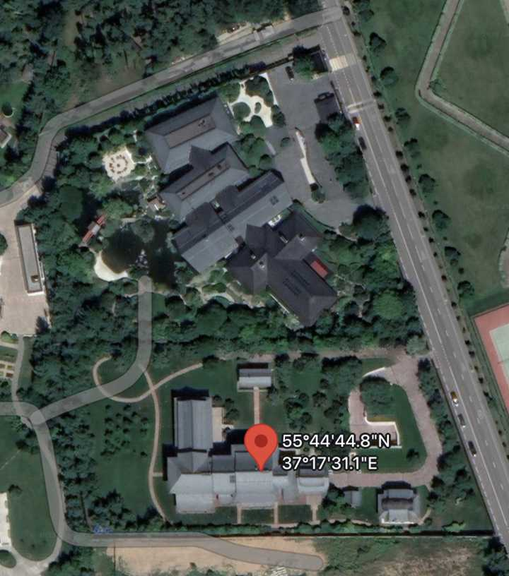
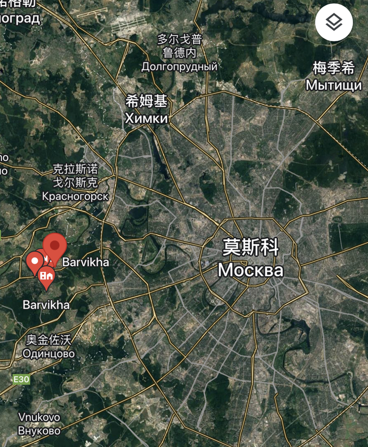
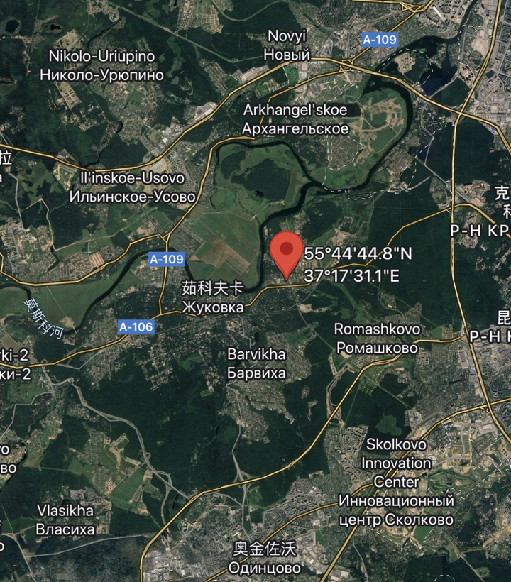
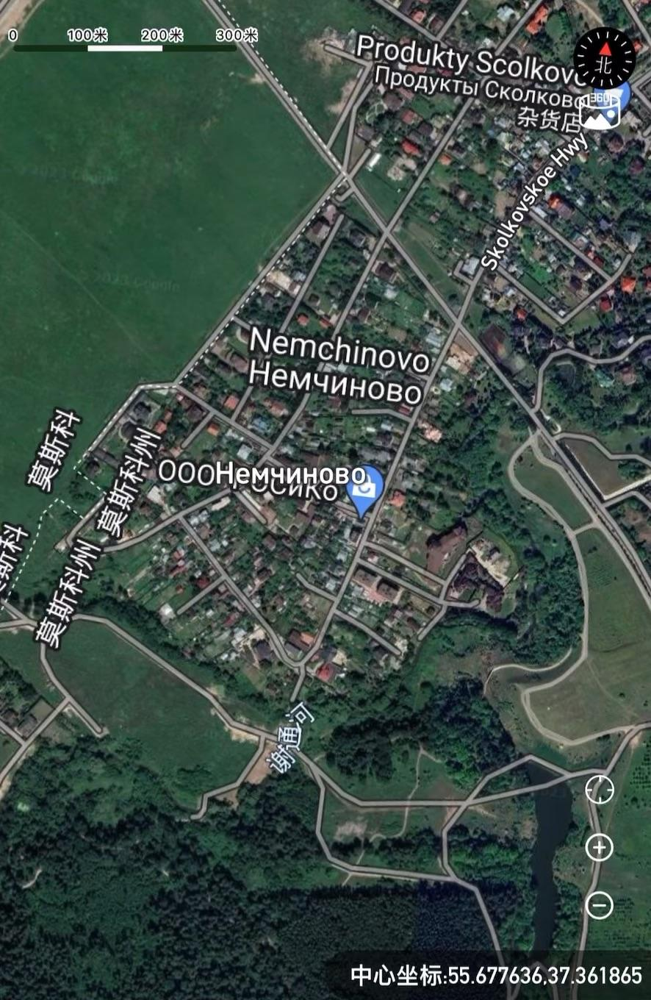
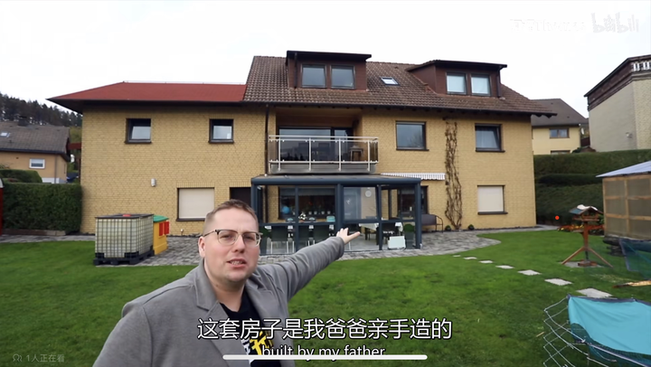
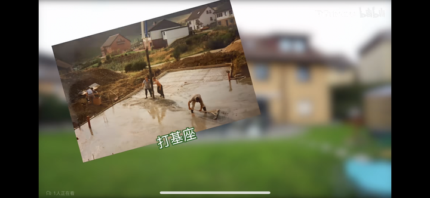
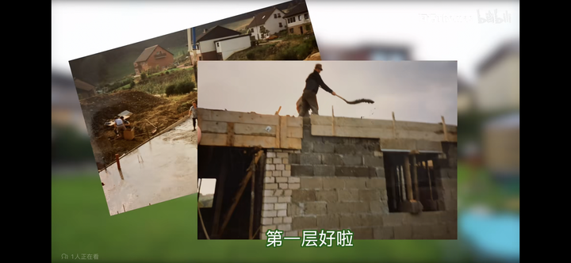
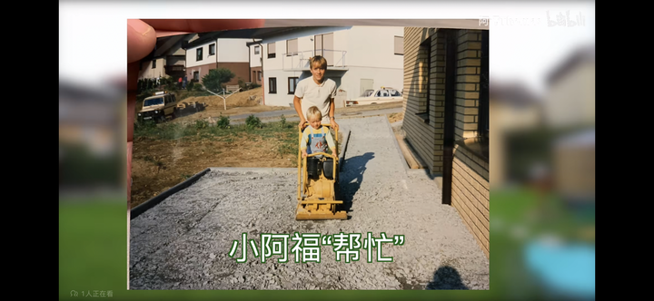

---

## 2142　此面向敌

- 日期：2023-07-03　主专题：A16 媒体舆论与公共认知　副专题：A01;A03
- 源 ID：`1d4a987a-6e2c-5c65-895d-a38d7f837628`　原文链接：https://afdian.com/p/e45fdb56199e11ee844652540025c377
- 官方对象—实践路径：与社会 / 与舆论 / 接收
- 23 概念标签：事实与证据;能力与学习;责任与后果;成本与总账;边界与许可;权力与异议;心理与主体
- 证据状态：manual_confirmed　初读：read　独立复核：not_reviewed

**问**：当今社会戾气重是因为民怨沸腾，弱势群体间只有相互伤害来泄愤，对权贵却只能忍气吞声。这个问题何解？

怎么定义“民怨沸腾”？因为跟你喝酒的朋友一致同意？
因为你遇到的人都跟你“一样愤怒”？
你要知道，在这个社会上有一个很可怕的灭杀机制——
无关的人看到怨气冲天的人，会全自动的顺嘴附和ta几句，以免成为这人的仇恨目标。这导致怨气冲天的人只会得到“民怨沸腾”的强烈信号。
在症状尚浅的时候，患者自己还知道这是逢场作戏的，自己也不敢当真。
但是这个病态是会自我发育的。越持续就会越严重，直到人完全丧失一切谨慎、丧失行为能力，丧失收入，丧尽社会关系。
如果一直持续下去，总有一天这个人的理智会崩溃，不是会真的以为自己喝多了登高一呼就会有游击队跟自己上山、有同志会跟自己一起去占领县城，然后作进监狱把牢底坐穿，就是会绝望后变相自毁——比如先众叛亲离，后酗酒赌博吸毒犯罪致死。
你抱怨，你还攻击想“剥夺我的抱怨权”的人。
你都要“铲除权贵”了，不顺你的意都成“权贵走狗”了，那谁还这么不懂事，好好地日子不过，要来上你的死亡名单。
你离“权贵”十万八千里，ta可就坐你隔壁。
你一周有72个小时杀ta，人家又不傻。
你这么做——我是指自己往这里面钻——你就会自动成为这个机制的清除对象。
全社会无意识的形成合力，用“不约而同的齐声附和”不断强化你所选择的幻觉，直到把你送进绞肉机、填埋场，浸死在酒精里。
条件只有一个，就是你养成习惯当人面怨气冲天，而且不改。
你看清楚，
this is not personal,
not even business,
just how it works.
世界是什么样，在极大程度上取决于你。
这还不是指你要如何如何努力来改变山川河流、社会秩序……这类豪言壮语，
而是首先指社会本身像乌贼一样，能够毫无破绽的见人说人话、见鬼说鬼话，瞬息万变的“此面向敌”。
你的满含怨恨的瞟它一眼，在你看清之前，它就会瞬间把通向绞肉机的传送带给你装饰的金光闪闪，祥云缭绕。
以最快的速度送你上路。
这事不公平的地方在于——
你抱怨，世界就会安排一堆人来给你附和，伺候得你舒舒服服，赞颂你光荣正确，敲锣打鼓给你风光大葬。
你努力，世界却要安排一群人出来跟你说“都没用”，嘲笑你、讽刺你、咒骂你甚至打击你。
不过若非如此，努力又有什么可贵的呢？
少扯淡，多学习。
所以这个问题何解？
在你不摘下眼罩的前提下，你想问怎么能让屋子亮起来，你说何解？
“那我怎么判断是我没摘眼罩，还是摘掉了眼罩而天真的是黑的？”
很简单，
后者看得见点亮的灯。

---

## 2144　志愿无先知

- 日期：2023-07-03　主专题：A16 媒体舆论与公共认知　副专题：A04;A03
- 源 ID：`ae34b6a9-82eb-5a0b-bbbf-e2a72f2b6d64`　原文链接：https://www.zhihu.com/question/609423843/answer/3100918712
- 官方对象—实践路径：与社会 / 与舆论 / 接收
- 23 概念标签：事实与证据;定义与达意;能力与学习;选择与自由;责任与后果;成本与总账;爱与回应;边界与许可;文明与历史
- 证据状态：manual_confirmed　初读：read　独立复核：not_reviewed

**问**：如何看待人民日报评价张雪峰, 任何专业都有价值, 不能以就业率论之!普通人如何改变自己的命运?

说实在的，不要随便把官媒批评谁看成是对谁的“迫害”“打击”。
尤其是一些止步于暂时禁言，没有删除账号、全平台删除内容，留了口子给你复出、没有下“绝罚令”的批评，这其实是一种爱护甚至栽培。
别的不说，你再复出时，头上就多了一顶“被央媒批评过却再次复活”的成就，这对你与其说是伤害，不如说是加持——它事实上反而成了你比较安全的一种佐证。
而这类批评、暂时禁言，说实话客观上反而是一种挽救。再说一遍，类似张雪峰、马前卒、吴晓波这种，这种批评、禁言，实际上反而救了他们的命。
就以张雪峰为例。预言人的命运是极大的忌讳，非有杀身的觉悟绝不能办。类似张雪峰这样大面积地对人的命运铁口直断，一些不知深浅的小孩子因为获得了一点其实是不可靠的心理安全感而“投桃报李”，大声“捧场”“声援”，其实是在把张雪峰往死路上推。
为什么？先不说张雪峰说得多么不对吧——我们来个乐观的，算他八成都说得很对，八成都果然应验了，这已经够“支持”了吧？那剩下的两成人呢？——也不多算，就算2000人吧。
这两千个听了他的铁口直断、结果四年以后发现自己踏空了、陷入了人生绝望的人呢？ta们会怎么认定张雪峰的责任？你觉得以现在年轻人的社会化程度，最后认定是张雪峰毁了自己一生的人有多少？
坦率而公平地讲，其实这类失败甚至未必是张雪峰的责任，很可能是这些小太爷们自己在大学里作死，自己乱折腾坏的，但是你觉得这几千人个个都会承认是自己的责任吗？我们就打个一折吧——算九成都认定是自己的责任，那还剩两百个认定“就是张雪峰毁了我一生”的小孩。
这两百个里面，有人可能会想要他的命，而且很可能还不止一个。
而且这些人恰恰正会从现在视他为“为民请命”“平民英雄”，为他辩护得最积极、最用力的一群人中出现。
看清楚，这全都给了张雪峰最乐观的估计——以他的流量，他影响的小孩何止数以万计？
以他研究的“扎实程度”——你们也许觉得惊为天人，但在严格的学术意义上讲，他的论断大多数都是不严谨、甚至有明显方法论缺陷的——有八成命中率已经非常乐观了。
也就是说，他手下的“误导基数”远不止两千。
而他要是一直这么高调张扬下去，必定还会导致怨怼人群基数越来越大，而他的收益却越来越大，这两个因素是互相引爆、互相恶化的。
“你赚的是用我的命卖的钱”这种结论，在三四年后不知会在多少陷入绝望的少年胸中熊熊燃烧，看着他在直播上神采飞扬、春风得意、盆满钵满的样子，碧绿的火焰能把人的天灵盖直接击穿。
现在“怒批”他，打断他这个演变进程，对他实属好生之德，绝非坏事。
现在挨了批，闭了嘴，这一批的毕业生就不容易把自己的决策归因于他。即使归因于他，发现他不是得意洋洋春风得意的状态，这份怨恨也会缓和得多。
当然，这么做的用意不太可能是主要为了挽救他，而是为了挽救缺少分辨力的小朋友们。
人的命运是不可以用“历史统计学”来预言的，就像股票运行的规律无法用历史数据拟合一样。这类存在自观察、自否定机制的趋势，是有数学上的不可预测性、在数学上可以明显证明的无法有效预测的。
何谓自否定机制？就是一旦存在明确的预言，这个预言本身就会推动预言的完全失败，这就叫自否定性。你今天预言某专业如何黄金，人不信还好，真信了，你的预言本身就会导致它变成黄土。你要么不成功，于是你直接沦为笑柄；要么你很成功，于是正因为你成功，你要成为更大的笑柄。
也因此，这类对具体人的命运的铁口直断都自带凶恶的诅咒，不是身败名裂，就是家破人亡，不祥之极。
一个人如果是研究趋势和预测的，这种禁忌应该是基本常识，就像学化学的刚起步就会讲安全防护一样。否则不用等到你搞出癌症特效药，坟头草早就三尺高了。
而张雪峰这“趋势专家”却对这种业务的最基本禁忌没有表现出最基本的敬畏之心。
坦率讲，他还幼稚、稚嫩得很，被央媒点名批评，其实对他个人的命运而言，着实是一大幸运。
在很多领域，这个世界是不允许存在先知的，人的个人志愿就是其中之一。
没有人可以通过研究向你有效预言你干什么能成、干什么肯定完蛋。
这是数学层面的不可行，停止继续寻求这种“指导”。

---

## 2131　三赢童话

- 日期：2023-07-09　主专题：A16 媒体舆论与公共认知　副专题：A10;A03
- 源 ID：`23318fa3-5768-580d-b106-da5661006d45`　原文链接：https://www.zhihu.com/question/610881311/answer/3110791096
- 官方对象—实践路径：与社会 / 与舆论 / 表达
- 23 概念标签：事实与证据;定义与达意;责任与后果;成本与总账;边界与许可;照料与家庭;财富与市场;法律与秩序;生态与自然
- 证据状态：manual_confirmed　初读：read　独立复核：not_reviewed

**问**：如何看待知乎下线『匿名功能』？

匿名是一把双刃剑。一方面，它有“广开言路”的作用，另一方面，它又方便了造谣和诬陷。
真正的问题是“是否值得为了广开言路而忍受造谣和诬陷”？
那么首先，有没有人愿意“用我受诬陷换你们的言路广开”？谁赞成，请举手？
显然，勇士还是有几个的，但是，勇士们是否认为别人——这是指绝大多数人——也都是自己这样的勇士？绝大多数人都不会愿意接受以自己受诬陷为代价换任何东西，不是吗？这有争议吗？
也就是说，你是在用“你受诬陷”来换“我/我们言路广开”。
那么我们来个思想实验——
现在有一个强盗，承诺每年可能会给村民一千斤粮食，但要求村民允许他每年随机在村子里最多绑架一个人。所谓“最多”，意思是也可能不会绑也说不定。
“没关系，村里没有任何一家人能让其他人每年多得一千斤粮食，所以这个账是划算的。至于说可能不给粮食，但是也可能不绑啊，根据概率法则，在期望值上可以视为‘互相抵消，仍有盈余’。”——村会计公布计算结论。
看到有些村民还犹豫不决，强盗于是加了一条——“这样，我保证如果我要绑，我只绑不到五岁的男孩。另外，我再加四千斤，把每年可能给你们的量提高到五千斤，而且我保证无论怎么少，绝对不为0。”
哦呦，这下问题完全解决了——一大半村民家里不是根本没结婚，就是家里没有男孩，要么就是男孩超过了这个年龄段。
于是此提案高票通过。大家非常高兴的用“每年至多一个五岁以下男孩被绑架的可能性”，换了“每年多分五千斤粮食而且绝对不会完全落空的可能性”。
村会计得到一面锦旗——“创富智多星”。村民则每年都得到了数量不等的粮食，甚至还颇有一些年头真的有5000斤呢。强盗则因为每年都模范履约，得到了一座“诚信伙伴”的奖杯。
赢、赢、赢，三赢。
最关键的是，思路一下就开阔了。
比如，大家在考虑，要不然每年随机抽一家，家产大家平分，考虑到本村有四百多户人家，要抽到任何一户头上的概率都是四百分之一，根据“小概率事件可以视为不发生”原理，the cost is next to nothing.
从此以后，大家就一直快乐的生活下去了。
毕竟，所有的成本都得到了覆盖，所有的风险都得到了控制，还能有什么问题呢？
是啊，能有什么问题呢？
尤其是，反正本来就存在一些抓不到的强盗，每年这些强盗总是会抓走不止一个小孩，而且还不分男女、不论年龄。
那么，多上这么一个“守约强盗”，又有什么问题呢？

你看，如果只有一个“守约强盗”，这还让人略有纠结，一旦要是再多几个悍匪，问题反而大大的改善了。
何其奇妙。

几乎每一个魔鬼都学过金融和会计。建议把这题做一做。做不出来，你的一切可持续性都会从这类“完美的会计模型”里流走。

---

## 2079　赌你

- 日期：2023-08-13　主专题：A16 媒体舆论与公共认知　副专题：A07;A09
- 源 ID：`5cb1a9bb-4eac-5824-9c63-14093a2c806f`　原文链接：https://www.zhihu.com/question/615519308/answer/3162810011
- 官方对象—实践路径：与合作者 / 与共事者 / 协作
- 23 概念标签：事实与证据;选择与自由;责任与后果;成本与总账;信用与信任
- 证据状态：manual_confirmed　初读：read　独立复核：not_reviewed

**问**：罗布泊四个人不下车会死亡吗？

其实这事真正有问题的点，没什么人在提。
那就是遇难的几个人是从大队脱离的，也就是说，大部队是知道这几个人是处境不佳的。那么很自然的，应该有“如果我们脱困，就会马上和你们联系。如果超过x天我们没有和你们取得联系，而你们脱困了的话，就请第一时间报警来援救我们”这样的约定。
这几个人受困之后决定下车徒步，有一个极其重要的前提，那就是“要么ta们没有做过这个约定，要么是做过了这个约定，但是却信不过会有救援赶来”。以至于ta们担心死守在车上大概率是坐以待毙、徒然消耗自己本来可以走得更远的体力。
否则，只要有这个约定而且信得过，策略必然是在原地等到太阳下山，依托车辆挖沙修建避难所。简单说就是在车下面挖个浅坑，利用车的荫蔽和余沙堆起的短墙尽可能的避开阳光。这是可以极大的节省汽油和水的。
极端一点，怕是可以挺上一个星期。
问题是，ta们信不住，信不住大部队会有人这么在意四条人命。
信不住，无法指望救援，死守待援就成了不成立的选项，那就真的只有“靠自己”一条路了。靠自己，那是迟早要下车的，因为没有别的选择。
说这些，不是要去感叹世风日下，而是要你们反躬自省——“如果我是大部队的一员，我有没有可能成为那四个人不下车的指望。”
这是一个做人的标准。
你如果达得到这个标准，你不可能长期失业、不可能孤独终老。
因为看得到你的地方，就不会有人觉得孤立无援，这对人是极大的安慰。这份安慰是无价的，人也是知道的。
问题是，若你在大部队里，而对方再忘记做这个约定的前提下，会不会因为大部队有你，ta们就敢于赌“不下车”？
会不会？

---

## 2068　顺流直下

- 日期：2023-08-19　主专题：A16 媒体舆论与公共认知　副专题：A09;A03
- 源 ID：`d47a3b28-4b0b-57b6-8317-0be42fff1b93`　原文链接：https://www.zhihu.com/question/617867857/answer/3172290393
- 官方对象—实践路径：与社会 / 与舆论 / 传播
- 23 概念标签：事实与证据;责任与后果;成本与总账;爱与回应;边界与许可;财富与市场;心理与主体
- 证据状态：manual_confirmed　初读：read　独立复核：not_reviewed

**问**：《中国好声音》回应「李玟生前控诉」录音，称是恶意剪辑，不再过多解释，具体情况如何？如何看待此事？

虽然不想这么说，但是事态发展下去，很可能搞出一堆“反转爆料”，到时候李玟的形象可能要受到不少损伤。
李玟是精神状态很不稳定的人，是个病人，对方要拿出一些她反常失态、“过度执着”的证据不会是很难的事。一个病情发展到不久后就zs的重度抑郁症患者，拿不这种证据出来倒奇怪了。
如果这事就这么平息也就算了——没人想背上和去世的人为难的名声。但是如果持续发酵，热度一直被人反复维持，势要趁势搞倒电视台，对方可能放下顾忌，丢出很多对李玟极其不利的东西来。
坦率讲，现在这个表态其实就已经隐隐有为这个后手铺路的意思——这其实就是一种类似“禅让前礼”，先三辞不就，料定有心人不会罢休。等三辞都辞完了，再丢出反杀，就没人能指责“对死者太苛”了。
这事态发展下去走向极其不祥，而且是有对李玟不利的征兆。
发展到那一步，自然会有名不见经传的“小助理”“憋不住讲几句真话”，内容十之八九是“李玟不知真病假病，毫无底线的步步紧逼，其实都是她作出来的”。
一旦说出来，这些话是真是假、或者是对是错，到时候不重要，因为这对很多并不太讲究证据、一心只喜欢吃反转瓜的人已经完全够了。
很多人根本就不是因为李玟如何，而是要借机反击自己看不顺眼的人——因为这些人前些时间站在李玟立场高唱过“正义”，这时候ta们积怨已久的敌人自然会对这些反转料如获至宝、“坚信不疑”——骂李玟“虚伪”只是为了作为骂这些“网敌”的题材借口，但毕竟李玟要落下无数根本无从辩解的骂名。
可叹的是，即使一切提前猜到，也恐怕无法阻止事态这样顺流直下。只能希望这事早点平息，不必发展到这一步。

到时候希望人们记得一条——
这些录音，不是李玟要拿出来播放的。
李玟本人没有这么做过。

---

## 2053　共识的逻辑

- 日期：2023-08-25　主专题：A16 媒体舆论与公共认知　副专题：A03;A12
- 源 ID：`23b81fa0-b871-535e-a523-e59dcf36dd23`　原文链接：https://www.zhihu.com/question/618879754/answer/3182304977
- 官方对象—实践路径：与社会 / 与舆论 / 接收
- 23 概念标签：事实与证据;责任与后果;信用与信任;劳动与组织;技术与工程;性别与身体
- 证据状态：manual_confirmed　初读：read　独立复核：not_reviewed

**问**：瓦格纳创始人普里戈任坠机身亡，是否会极大影响俄乌局势？

影响大概是这样的：
1）调查结果大概率会是“提前由叛国内奸 / 间谍 安装的定时炸弹制造的刺杀”。
肩扛导弹要射击巡航高度的喷气式客机是很难的，本来高度就太高，稍微站偏一点就根本无法锁定。哪有这么刚好正站在航线下？所以肩扛导弹射击都是直接蹲在机场围墙边射击起飞降落的飞机。
如果是战术防空导弹拿来射击这种小型商务机，恐怕破坏会比这个严重得多。何况如果要动到战术导弹，那根本不如收买地勤做点手脚，甚至干脆在某个旅途中搞路边炸弹，推给SBU，防空导弹有一整条指挥链，最起码一整个乘员组，知情人也太多了，这种搞法实在是奇葩得匪夷所思。
威力足够、执行可靠、操作性强而且不受航线变更影响的手段几乎只有定时炸弹。因为炸弹只要一装好，当事人就已经可以提前跑路，等爆炸了人已经出国了。甚至不管炸没炸，都有很大机会保住自己的命，实属首选方案。
所以这很可能的确也是真相。

2）死后备极哀荣，甚至可能国葬。普京等领导人会发表复仇宣言。号召全体军民清醒意识到敌人的不择手段和恶毒以及俄罗斯民族现在面对的仇恨，必须抛弃一切妥协和仁慈的幻想，彻底消灭敌人，让敌人为每一次挑衅付出足够沉重的代价。
3）可能会对被认定的责任方发动报复性的暗杀，甚至可能会宣布一个名单。对乌克兰基础设施再次实施打击，重新把乌克兰打回基本停电状态。
4）在北线加紧攻势。
5）进一步军事支持尼日尔，派遣更多部队和装备前往尼日尔。尤其是宣布运送大量防空导弹和反装甲导弹给尼日尔。帮助尼日尔构建坚固工事。
其实，事实是否真的是这样，俄罗斯上下可能根本就不关心，只要这个结论最有利于下一步局势发展，受害人全部在境外而且基本都是已经明确的敌人，各方就都可以纷纷表示“实情就是如此”。
这听起来很“黑暗”，但这却是人类遇到这类问题时的标准应激机制。
实际上最后被确认的“真相”的决定性因素往往并不是所谓的证据或者逻辑——那只会将备选答案略微限缩范围，例如要求最后的故事必需要能解释为什么飞机这样爆炸，而不能离谱到“根本没有发生爆炸”。
但在“足以解释基本情节”这条及格线之上，还有着从黑到白、从红到绿、从一缕青烟到重金属的无数个可选版本。
真正决定是哪个版本被高举到“最终结论”位置的，并不是科学——科学只决定了候选资格（甚至有时都不见得能决定候选资格，比如机械摘棉机就没有说服那些加拿大议员）——而是zz。
这是一个很重要的规律，无视它的人很容易会陷入强烈的精神痛苦之中，因为会很容易由此产生“暗无天日”、“沉冤莫白”这类的绝望感。
问题是，不管你怎么看待这种安排，这种安排也不是人类自己可以“超越”的，而是人类社会运转的自然规律的一部分。
“社会共识的形成和演变机制”是一门冷静而客观的自然法则，而不是一种可以任人点菜拒收的订单式服务。你只能在清醒认识到这规则的基础上去寻求最好的结果。
这就像病毒感染，你能选择的只有了解它的生理机制，想办法用药物或者其他手段干预它的发展进程来寻求不同的事情结果，而不是去咒骂它“邪恶”、痛斥它“凶残”来解决问题。
后者几乎注定会以在九死一生的抑郁中备受折磨——如果在九死一生之际能及时悔改自己的态度的话。

---

## 2049　瘦麒麟

- 日期：2023-08-27　主专题：A16 媒体舆论与公共认知　副专题：A12;A03
- 源 ID：`5dbec508-6722-52ec-9818-4becff6f68e6`　原文链接：https://www.zhihu.com/question/618932578/answer/3184785898
- 官方对象—实践路径：与社会 / 与舆论 / 表达
- 23 概念标签：事实与证据;定义与达意;责任与后果;成本与总账;边界与许可;劳动与组织;法律与秩序;心理与主体
- 证据状态：manual_confirmed　初读：read　独立复核：not_reviewed

**问**：如何评价8月24号乌合麒麟新作《与人类同归于尽吗混蛋》？

有时候，恰恰是因为你说的是对的，你的话难以反驳，你就更加必须被塑造成一个恶魔和小丑。
预算就要大量的倾泻到你身上，吹毛求疵、无事生非、乃至空穴来风、含沙射影的直接造谣都会纷至沓来。
各种系统的、有组织的的阴毒手段就会如潮水般涌来，而且对方会用上种种“伙伴价值”，诱惑有存在感焦虑的年轻人加入ta们的“正义大军”。
知乎其实是一个认知战的劣势战场，对即将到来的猛烈炮火，要有足够的心理准备。对方是不会有任何道德顾虑或者伦理禁忌的。
不能插眼睛，那我便要插眼睛；撩阴腿下作？那就要撩阴腿。我们偏要蒙着脸从路边的阴暗角落里蜂拥出来，在小巷、在市郊、在深夜，一切够得着的地方越过一切物理上能越过的规则来打击你。
法不责众，何况我蒙着脸，让你处在这种无限持续、不为任何规则拘束的危险之中，你是个人，迟早把你磨成粉、碾成泥。
这就是个阳谋，只不过有阴谋的形式而已。

坦率讲，我也没有乌合麒麟这么大的勇气，换了我站在他的位置，我大概率是不会做到这么大的尺度的。
这虽然有一些个人原则的原因——我其实反对用非现实的材料作为工具——但是单论“明知会带来极大未知风险，但仍然坚持做到自己想做的极点”这一点，我是做不到ta这个程度的。
有些话，我会因为顾虑引来的火力而降调处理，甚至干脆暂时避而不谈。
有时明智和软弱，是很难分辨的。
所以“奋不顾身”才值得额外的尊敬。

哪怕是敌人，当对方骑着一匹瘦马向着我们的装甲集群冲锋，无论ta骑马姿势好不好看、喊的口号是不是不堪入耳，我也要放下望远镜，脱帽致敬。
何况是反过来呢？

---

## 2046　内外之分

- 日期：2023-08-30　主专题：A16 媒体舆论与公共认知　副专题：A03;A10
- 源 ID：`ca6546f6-5951-5947-b0ac-c4a7485e6864`　原文链接：https://afdian.com/p/7df863f246de11ee87a052540025c377
- 官方对象—实践路径：与社会 / 与组织 / 参与
- 23 概念标签：事实与证据;定义与达意;选择与自由;责任与后果;成本与总账;爱与回应;照料与家庭;劳动与组织;文明与历史
- 证据状态：manual_confirmed　初读：read　独立复核：not_reviewed

**问**：如何明确区分恨国党和反对派？

如何区分批评者和假装批评的敌人？
批评者在意方案而不是缺陷。批评你一件事情，必然前提是有一条自己有把握的路给你走。如果自己手里没有准备好这条路，对你进行批评的立场就都不存在了。
所以一旦遇到你对对方的立场有迷惑，你可以问一个直截了当的问题——“你建议的替代方案是什么？”
ta应该立刻可以毫不犹豫的回答出来，连语塞、犹豫都不应该有，注意上面的论述——这应该是ta在批评之前就已经存在的前提，就不应该是被问到后才现想的东西。
这里没有谈论这个方案的质量好坏、代价大小，而是仅仅谈论“有还是没有”。
我一开口问这个问题，你就应该冲口而出。你可以理解为“当被问到这个问题，已经是如同哨兵拉好枪栓询问口令一样的关键时刻”。
“你建议的替代方案是什么？”
答案不能是“批评空调还要懂空调吗”论，不能是“我也不知道”，不能是“我不管”。它必须是一个明确的，好歹有个基本人形的东西，再幼稚、再可笑也罢，它必须先存在。
没有、犹豫、失语，你挨枪子就不冤——故意穿越禁区而口令还对不过的，当然是敌非友了。
顺着这个方向前进——一个真心实意的批评者不但不会在给出替代方案上语塞，而且不会因为被询问有无证实可行性的依据而恼怒。你可以缺少这样的依据，但对方询问这个依据，无论如何也不算是对你的一种冒犯，更谈不上“剥夺说话的权利”。一被问“有什么依据可以证明替代方案是可行的”就恼羞成怒，要拿“不让说话”来“反制”，实际上是同一性质的问题。
没有这样的依据，你就老老实实的说“没依据”，这本身没什么罪，但是不允许人询问，这却是不能接受的行为。
再更进一步——真正的批评者可以被“方案虽好，但缺少有效的过渡方案”说服。这就像你提出海豚比人类更适应海洋生活，如果人类可以变成海豚就可以解决住房不足的问题。这个大家完全可以同意，问题是人类要变成海豚的过渡成本是多少？如果我们在支付这个成本的过程中直接破产，这整个计划都会失去意义。
在这个时候，真正的批评者会视为“自己的批评已经得到了有效的回应”，即使要继续推动自己的意见，也要把精力转向“如何低成本的把人转化成海豚”的研究。但伪装成批评者的敌人却会把精力集中在“不让说话”、“不接受批评意见”上，把资源投入到打击对方的名望、破坏对方的社会影响力。

有人可能会疑惑——那么比如一名顾客要批评超市的服务，也必须要先给超市准备好解决方案吗？
那当然不用，但是这个话术里面有魔鬼。
首先，这种行为不叫做批评（critisize），而叫做抱怨（complain），其基础并不是“对你而言存在更好的解决方案”，而是“我见到过更好的表现”、“我有更高的期待”，是由顾客对供应商来做的行为。
这里就出现关键问题了——抱怨是外人的特权。
你是自己人，你就没有抱怨权，但你有组织成员的一些特权——例如知情权、参与权、提案权、表决权、选举权、被选举权……
你是外人，事情就颠倒过来，你有抱怨权，但是后面这些权利就全都没有。
所以，一旦有人问“难道抱怨也不可以”，你就可以斩钉截铁的回答：“你是外人还是自己人？是外人，就可以。是自己人，就不行。”
何以见得？
来个最平常的对话你就能分明的感受到这个伦理规则的天然性——
父母/子女/配偶经常会对对方说“你看别人家的子女/父母/夫/妻如何如何好，你凭什么不行？”——这就是一个典型的不含方案的纯抱怨。
而这种抱怨也经常遇到这样的当头呵斥——“那你就到别家过去好了。”
如果你只是一个顾客，我是一家百货公司，我是绝不会随便说这话的。但你是家庭成员，甚至还是因血缘而来的家庭成员，那么你的抱怨权就自动的显得如此荒唐。
规则是公平而明确的——是内人，你有内人的一切待遇，但就没有抱怨权。抱怨必须受到惩罚，如果不受惩罚，组织原则就会开始涣散和崩解，最后走向解体——父子反目、夫妻分手。谁放任抱怨行为不受处置，谁就是在任由组织受到伤害。
是外人，你就可以理直气壮的说“难道抱怨都不可以？还非要给一个更好的方案？” 对外人，就只能回答“可以”。
注意，这个“可以”仅仅不过是“你可以不受惩罚的抱怨”——也就是你抱怨不至于挨顿打或者会因此得到打折的服务，但却决不是“你抱怨了我就要听从”。
抱歉，你是外人，我们是否要做出什么改变，这是我们内部自己的决定。我们很可能——事实上是绝大多数情况下——都会选择不因你的抱怨做任何计划外的调整。
调整我们是有的，但是是按我们组织自己的程序、自己的计划来。你能接受固然好，不能接受我们只能表示遗憾，接受你另请高明。我们根本不可能做到让所有外人无可抱怨，也没有必要追求这样低收益高风险的愚蠢目标。
但如果你回答你是内人，是组织内成员，享受了组织成员的权利，你还要再占有外人所专有的抱怨豁免权，你的行为就不可容忍了——这要么就要被理解为一个外人闯入了组织内部，有看守职责的成员要受到严厉惩处，要么就构成一种事实的背叛。
这就是为什么一些身份是中国公民的人说出某些西方人的话会得到不同待遇的原因——中国是全民所有制国家，全体国民都是同一团队的内部成员，一切矛盾首先是人民内部矛盾。
什么叫“人民内部矛盾”？意思就是你开口批评，默认就有“家里人”的全部伦理要求。
如果你开口就动用外人的特权，摆出一副“我是业主，你们都是给我打工”的心态来，你首先就要面对本能的怒火，
而西方国家的zf和它们的民众之间的关系却是业主和物业公司的关系，是顾客与服务商的关系。
西方式的“业主指着物业鼻子骂，四年换家物业做的伦理关系”，和中国的“人民与政府机关”的关系是完全不同的两种关系。
前者是一个组织在服务客户，后者却是一个组织的内部机构在服务组织成员。
前者是你和小区门外的小饭馆的关系，后者却是你和你家厨房的关系。
某种意义上讲，这就是中国所谓“言论不自由”的内在本质。
你对你的家里人，其实没有外人那种“言论自由”，这与其说是谁的“暴政”，不如说是天然如此。
西方人生活在一个个人主义的世界里，个人主义是西方式自由主义的根基和逻辑前提，这是他们的基本底色，所以ta们从根底里没有这种“全民一家”的真实意识。
就以疫情为例，我年轻力壮，我为什么要管你们年老体弱的死活？你们就是会死，也没有权利侵犯我开party和不戴口罩的自由。这样的心态对西方人是认知问题的基准，是ta们的默认伦理。这是从娘胎里带来的文化缺陷，是从小到大每一天的生活里被训练、渗透的思想钢印，所以他们才会把这种“业主批评物业”的心态视为理所当然。
ta们也为此付出了对称的代价——既然对方只是物业，那么物业自然要考虑自己的运营成本、风险和利润。因此西方的政府在根本意义上是不承担无限责任的——甚至是完全不承担任何责任的。
这种困境就如同现在很多小区业主们吵着换了很多家物业公司，最后发现这根本不解决问题一样。要提高物业公司的服务，抱怨根本无用，因为公司只会服务到保本为底线，再多的服务你无论怎么抱怨都没有意义，最多派个颜值高的前台去让你骂到心软，哄哄你拉倒。
要提高质量只有靠提高物业费到足以让很多物业公司心动，互相形成竞争。而即使是这个竞争，也仅仅存在于投标阶段。一旦签订合同，这些就全是一片空文。
西方人实际上为这种结构付出了永久的代价，这个代价会随着中国模式对它们历史性幸运的系统性超越而变得越来越明显。
将来你们会知道到底这个世界运转的到底是什么规则。是一群业主加两三个物业公司来回换、允许抱怨连天的模式优胜，还是天下一家、不容忍内部成员抱怨，只允许严守批评伦理的组织模式优胜。
很快历史就会给出答案——物理性的、以瓦特、焦耳、高斯、安培计量的答案。
简单来说，批评是一个“自己人”才能行使的特权。你是自己人，你才有可能被允许进入这个会议室来开口说话，而且你说话就要有自己人的自觉，因为这是你的话语权存在的天然前提。
你违背这个逻辑前提，而且是经过提醒还要坚持盗用内人的特权行外人之事，你被当作敌人，不应该感到意外。

---

## 2027　借一步青云

- 日期：2023-09-07　主专题：A16 媒体舆论与公共认知　副专题：A20;A03
- 源 ID：`9ddd1fc3-a9a6-5564-8f0a-1a918130bbe1`　原文链接：https://www.zhihu.com/question/620626810/answer/3200263047
- 官方对象—实践路径：与自己 / 与理想 / 持守
- 23 概念标签：事实与证据;能力与学习;选择与自由;责任与后果;成本与总账;劳动与组织;法律与秩序;心理与主体
- 证据状态：manual_confirmed　初读：read　独立复核：not_reviewed

**问**：深圳一男子穿黑丝短裙直播，被警察驱赶，大家如何看待此事？

理想者和乡愿者往往是很像的。
ta们往往追求的目标是相似甚至相同的——比如一些理想主义者和乡愿者都可能追求绝对的穿衣自由、或者都追求无政府主义，单从诉求上是分不出来的。
那么这两者有什么区别？
区别在于，对理想者而言，如果在另一个国家人们付出了巨大的代价一步一个脚印实现了某个诉求，理想主义者会认为在自己所处的这个区域，自己也需要去一步一个脚印、付出相同（或至少相似的）代价，做完自己应分的牺牲和努力，去在自己的场域实现这个理想。
对ta们而言，其他地区的成功的意义仅限于“证明这是可行的”以及“提供了方法论上的借鉴”。
而后者还只是借鉴而已，作业是没法照抄的。这是不言而喻，不需要讨论的默认认知。
而对于乡愿主义者而言，在彼处的成功会成为一种可以直接拿来借用的台阶，成为一种在自己的场域可以拿来“携潮流以令诸侯”的筹码和“有力工具”，可以借来免去自己所需要做的努力、做需要付出的代价，直接促成自己相似的诉求在自己的身边成为现实。
这就使得乡愿主义者发育出了这样一种鲜明而普遍的行为模式——总是在通过证明、宣传一件事、一个理念在彼处如何流行、兴旺，来推动这件事在自己身边的实现和兴旺。
为什么这叫做乡愿呢？
因为世界不是平的，一国一地一时就有一国一地一时之情，在彼处彼时兴旺的事，根本不意味着在此处此时就一定也能兴旺。你永远也不可能仅仅靠理论来担保这种兴旺的再现。在这个等式两边，唯一有分量的，就是“有同样一群不辞辛劳和牺牲的人愿意用真实的血汗去担保”。
这事成与不成，单凭“有可能”“有先例”这几个字根本无足轻重。有可能、有先例而没有成功的事难道还少吗？你这么大把年纪，难道不懂得这么个简单的道理？
“有可能”、“有先例”，只有加上“一群发誓努力、甘冒风险的坚定不移的追求者”才开始算得上是一件事，才真的开始值得人寄予期待。
是这样一群并不抱有侥幸、不回避自己应分的苦工和风险的人在支撑“同样的诉求在此实现”的起码概率。
如果这个诉求背后只有诉诸“外国先进示范”的乡愿的躺赢众，那么就意味着这个诉求背后根本没有真实的追求，仅仅只有廉价的欲望。
就像那种“没风险也没成本我就愿意做的事业”一样，只是一些投资陷阱。
就凭这样的愿力，你有什么资格如愿？
你们自己要注意睁大眼睛，注意分辨这两种人——永远不要对“没有不辞辛劳困苦的核心团队的创业计划”投入一分钱。
遗憾的说——你会发现世上的所谓“理想”，十之八九都是这种“不费力就想想”的冒牌货。

特别声明一下——这绝不代表我在赞同西方现在的这种庸俗自由主义，更谈不上用“激将法”激励ta们“努力”。
With all due respect, 我不认为这些锣鼓喧天背后有什么真实的意愿，甚至这些只会使用“舆论武器”的人们有没有持有任何真实意愿的能力都令人怀疑。所以这根本是一个连反对都不太值得考虑的伪命题。
这只是在借这个不值一文的题目说明两个也许可以节省的力量无谓幻想成本的简单结论——
1）不要指望人民群众站在乡愿的一边呐喊助威。人民群众是受过现实的千锤百炼的劳动教育的，谁是硬实的，谁是虚浮的，ta们清楚得要命——别自己弄出巨大动静来就把自己骗傻了。
2）做人要抛弃侥幸心理，不要整天想着“借力上青云”，容易遭人鄙视。

---

## 2020　喜下眉梢

- 日期：2023-09-12　主专题：A16 媒体舆论与公共认知　副专题：A01;A07
- 源 ID：`10e8a6eb-144e-575a-af40-a36f2ba09e32`　原文链接：https://www.zhihu.com/question/621385374/answer/3207188685
- 官方对象—实践路径：与社会 / 与舆论 / 接收
- 23 概念标签：事实与证据;选择与自由;责任与后果;成本与总账;爱与回应;边界与许可;劳动与组织;财富与市场;法律与秩序;技术与工程;心理与主体
- 证据状态：manual_confirmed　初读：read　独立复核：not_reviewed

**问**：如何看待2023年9月，李佳琦嘲笑观众买不起79元的花西子眉笔「还不是因为你不努力工作，所以工资低」？

这个标题在对事实进行罪化描述，要通过添加一些恶意色彩，刺激网民情绪去获取流量，这是个非常坏的做法，这一点希望你们建立起冷静认识。
青少年最大的问题就是情绪本能对行为决策的影响比重极大，而情绪本能的机制非常类似自动程序，具有高度的可预测性，只要懂得扣动扳机、控制方向，就可以轻而易举的利用来作为工具。
这种丰富的资源，“开采技术”自然源远流长，热衷此道的淘金客也自然如过江之鲫。你如果不能学会看穿这些技术，不及早的成为情绪的主人，你必定会在一轮又一轮无情的利用中遭遇巨大的损失和破坏。
类似这种“抹蛇油”的做法就是最恶毒、最流行的行为之一。每天都会有人选中自己想打击的目标，抹上蛇油，引诱青少年去撕咬。如果目标被消灭，ta就得偿所望；如果目标没被消灭，那就可以扣上“伤害青少年的凶手”的帽子继续抹蛇油，引诱更多的青少年来咬。而青少年是人类不可能抛弃的根本资产，于是这样的策略就有无穷尽的“兵员”可以用。
你要指望别人哪天良心发现，自己放弃如此有利可图的秘法，那是不可能的。
能做的只有两条——
第一，自己要防止自己成为受害人，要学会分辨这种蛇油味道，看见耍蛇的人。要明白这个把戏可不是设计来为你服务的。这样说虽然无情，但却是一个冷酷的事实———实际上这些人在帮不会上当的人打击、削弱甚至消灭竞争对手。你上当，你就是别人的工具和耗材；你不上当，你就会成为客观的受益者。
这点差别，往往在三十岁之前积累成巨大的差距，别到时候羡慕别人什么都有而自己一穷二白，独身一人。
第二，要尽量把这个道理讲给别人听。能听得进去并且用得好的人值得你格外重视——因为这类人表现会稳定很多，而不像那些只想“快意恩仇”的人那样极易成为外人挑拨利用的突破口。
团队中有意气用事而又易受挑拨的成员是一种心腹大患，到时候你自己去体会。

再说这件事本身。
这本身就反映着一个不可持续的经营模式——意图讨一切人，尤其是伦理观不成熟的人的好。
伦理观不成熟的人，自身其实不具有“可讨好性”，时间久了“翻脸”是必然的。
而这种“翻脸必然性”恰恰就是“不成熟性”的本质。
何谓“翻脸必然性”，就是ta主张着一种游戏规则，你不按这个规则来做，会失去游戏资格，而按这个规则来做，你可以加入游戏，但是结局一定是失败。
你们可以回想一下自己失败的初恋，失败的初次创业，尤其是在你自己多年后终于稳定经营了感情和事业之后去回顾，你是不是会发现这种“翻脸必然性”？
是不是不按你当时的标准，就根本不会获得你的接纳，而恰恰是按照你的标准、你的勒令行事，最后又一定会和你产生不可调和的矛盾？
在数学上，那一套游戏规则、那一套伦理要求根本就无解。所有能加入游戏的玩家都必然失败，甚至是在数学上可以简单证明的。
这跟现在这件事有什么关系？
因为这件事就是事情发展到第二阶段了，进入了“获得资格的玩家要迎来必然的失败”的阶段了。
很多人都在执行着这种不可持续的做法——在自己一无所有的时候就不顾一切只求能加入游戏，只要能找到工作、谈到男/女朋友、赚到钱就干了再说。这个阶段极易踏入——或者不如说是贪图——这种逻辑陷阱。
因为刚才说过了——这个阶段的年轻人有极为鲜明一致的可预测性，就像定期洄游的鱼群一样容易得手，只要你照着某个固定套路来操作，就可以不断的“复制成功”。
“网红经济”怎么可能忍得住不对这种资源动心？其结果几乎注定是大批把这类在将来必然要崩溃的关系当成一种收益先吃进再说。而这种关系积累多了，到了第二阶段就要开始发作了。
到了这个阶段，客观上其实你做什么都避免不了关系破灭。你可以获得的罪名很多你根本无法想象，更不谈想到什么办法避免了。你只是在想象自己怎么道个歉，或者怎么改变一个具体的决定就可以不必分手。实际上这只是幻觉。
对于幼稚的伦理观是没有无罪解的，这本身就是幼稚的本质。
ta走到这个没有无罪解的阶段了，今天不出事，明天也会出。这事不出，那事也会出。这样选也会出，那样选其实也会出。
ta“想不通”，“苦闷”，那就甚至更会出事，还会加速的出，更严重的出。
唯一的解，只有一开始就不贪图这个流量、主动的避免伦理观幼稚的人对自己评价过高；只有一开始就不感染，一开始就为了可持续性宁可接受发展速度（或曰“第一桶金”）的放缓。
只有这一条路。
ta出的事——包括ta将来还会接二连三不断再出的更大的事，应该成为你毫无侥幸的选择正确道路的事实证据。
你其实别无选择，只有耐得寂寞。
你必须坚持最低的门槛——对方必须至少分得清人我权界，尊重他人的人格和利益。
只有达到这个门槛的人的厌恶可以视为值得挽回的损失，喜爱可以视为收益。
达不到这个门槛的人对你的厌恶，你要视为收益，喜爱要视为损失。
你不按这个准则来做，就等于签了一份必然违反的合同，创了一个必然破产的业。
不要被预付款、开业庆典的喜气冲昏了头脑。

---

## 2004　无风之浪

- 日期：2023-09-23　主专题：A16 媒体舆论与公共认知　副专题：A14;A02
- 源 ID：`4e9a6dc0-b4de-5e87-bc08-c00d85c35c47`　原文链接：https://www.zhihu.com/question/623190414/answer/3223553388
- 官方对象—实践路径：与社会 / 与舆论 / 传播
- 23 概念标签：事实与证据;定义与达意;选择与自由;责任与后果;成本与总账;法律与秩序
- 证据状态：manual_confirmed　初读：read　独立复核：not_reviewed

**问**：黑东北会得到什么？

这些仇恨、凌辱性言论会得到的，只是非常短暂的优越感以及同类间的认同感，一般持续五秒左右。如果有人给予回复并展开论战，那样就会产生第二个、第三个五秒。根本就没有啥宏大的“地域资源挤出计划”，只有这种五秒过期的一激灵而已。
怎么，你是不是觉得有点失望？因为让你如此痛苦的罪行，背后却居然没有什么足令天地变色的罪恶、人神共愤的堕落？因为这样无聊的、甚至都没有意义的劣迹没有资格让你愤怒和憎恨，是吗？
你尚在恨恨不平，凶手怎么可以已经置之脑后、歌舞升平？你是看不起这种卑贱、平庸的恶，是吗？
殊不知，世界上真正最有力的、最持久、最残暴的邪恶，其实都不是来自那种充满险恶用心、长期隐忍、殚精竭虑的大阴谋，而恰恰是这种5秒级别的、转瞬即逝的、似乎没有任何痕迹的、仿佛宇宙背景辐射一样的微小恶意。
这些看似微小的、无处不在的轻微水花，激起它们的石子自己很快就会忘记，但是它们触发的波纹会一圈圈的扩散开去。无数这样的“被忘却的波纹”偶尔——虽然仅仅是偶尔——会在没人意识到的远处叠加出一个几倍高的波峰，抛出一个真正的浪头，在所有当事人早已忘记、根本看不到的远处冲垮一座小小的沙堆城堡，而这还只是幸运的情况。
真正悲剧的是，这个世界上有一种机制，能从这些微小的潮汐中汲取出真正强大的动力，舞动撕裂世界的鞭子。
潮汐不停，这些鞭打就会时不时发生。这些鞭打虽然尚不至于终结人类的历史，有时——或者说往往——也能在当下让人类老实反省一阵，但无论如何，鞭落处终究皮开肉绽、血肉横飞。
这些来自亿万人的“背景噪音”一样的“无聊之恶”，其实才是世上灾难的主动力，和它的规模相比，那些赤裸裸触犯法律的罪犯几乎微不足道。
那些穷凶极恶的罪犯、有人格缺陷的职业恶人、心理扭曲的政客，只是将这些能量转化为新的运动形式释放出来的转化器，并不是主要的动力来源。
人们总想着消灭这些动力转换器就可以阻断邪恶的发生，但在根本上只要这些微小的潮汐不被整个人类视为最大的问题给予重视和管理，它们日夜不停散发的能量就总会自己找到新的薄弱点喷发出来，会自己诱惑、收买、召唤出新的人群来担任使徒。
这个世界需要消波块、防波堤、避风港，去将这些波纹吸收、击碎、消解，而不是任其穿透、无损的反射，甚至更糟——肆意的散射，甚至自己加入链式反应，被扰动激发自己的震动，成为风暴的一部分。
即使撇开你对人类的责任不谈，你也要学会洞察池塘的眼光，不要选择那些毫无消波抑浪措施，反而有很多敏感的受激振荡器、强反射器的池塘。
那些地方没有平安，无风就有三尺浪。

---

## 2001　洪武大锅

- 日期：2023-09-27　主专题：A16 媒体舆论与公共认知　副专题：A14;A01
- 源 ID：`b1853867-d0f7-52d8-aa3c-f5f8e814941f`　原文链接：https://www.zhihu.com/question/623689328/answer/3228018589
- 官方对象—实践路径：与社会 / 与文化 / 批判
- 23 概念标签：事实与证据;定义与达意;选择与自由;成本与总账;爱与回应;财富与市场;文明与历史
- 证据状态：manual_confirmed　初读：read　独立复核：not_reviewed

**问**：孩子扎堆玩「萝卜刀」引发家长担忧，专家称可能激发孩子暴力倾向，如何看待此事？

不知你们发现没有——在这个问题下，很多人都在走“我觉得不危险，所以你不应该觉得危险”这个论证路线。
其实这个是一个很有意思的问题——为什么一旦出现某种立场，就会立刻激发起一种对立的立场的表达冲动？
比如，有一个张三说自己爱吃咸的，很容易就会触发李四们大声疾呼“我爱吃甜”的冲动。而且是一石激起千层浪式的、非常宏观可见的高频现象。
这个现象出现得如此频繁，以至于它已经像空气一样变得透明了。其实你每天、每处都见到，只是浑然不觉的觉得这似乎天经地义、理所当然，乃是一个不需要理由的常态。
为什么？你想过“为什么”没有？
你没发现“我觉得不冷”和“ta觉得冷”并不构成一种逻辑对立关系吗？张三说一句“我爱吃甜”，关李四王五赵六何事？为什么这哥仨马上坐不住了，要立刻站起来大声宣布“我们爱吃咸”？这个急切的冲动从何而来？
之所以张三说了爱吃甜，李四王五赵六就忍不住赶紧站起来举手说我们爱吃咸，是因为ta们怕举手不及时，喊得不够大声，村长就要下令晚上吃桂花糖藕、明早的粽子就要蘸白糖了。
而之所以会有这个忧虑，是因为村里就一口洪武年传下来的大锅，煮了甜的就没法煮咸的。
这其实是一个贫穷造成的心灵创伤的不自觉发作——因为穷，所以搞“统一采购”、“大锅菜”、“统一作息”就成了一种节约社会资源——尤其是降低社会最主要的成本，即管理成本——的最主要的方法论。而一旦大量不假思索的采用了这样的方法论来“节约社会成本”，则不同的偏好就会立刻形成激烈的对立关系。
如果只有一台电视，今晚是看霍元甲还是看西游记，就会成为一个比赛哪边大声的问题。只有一口锅，做咸还是做甜就是个不能让步的问题。
在这个前提下，几乎一切的问题都会因此演变成这样的“大声公比赛”，以至于这种文化本能潜移默化的融入了人的血液，催生了这种张三觉得“这种刀对我娃有点危险”，李四王五赵六……欧阳四十八就会一起不由自主的站起来齐声说“我们觉得不危险”的奇妙现象。这事奇妙到了这样一种地步——李四甚至就没娃，王五有娃但附近根本没有卖这种刀，欧阳四十八干脆都不在中国。
这事的对错我们不去多谈——因为这种本能不是空穴来风，历史上的确有很多表态不够快不够大声导致公共政策对自己的偏好严重不利从而导致生存机会受到实际损失的案例。如果不是这样，这个问题为什么会如此广泛的存在、而且一代代由父母们对子女们耳提面命、孜孜不倦的口耳相传呢？
这里只指出两个问题：
1）你要警惕自己的文化本能，不要让它当你的主人，而要你当它的主人。别凡事让你这些不自觉的本能来拿主意，自己只懵懵懂懂的承受后果。
这种本能能帮你尽可能抓住影响公共策略的机会，这是它理论上的好处。但是它的坏处则是会驱使你无谓的四面出击，莫名其妙的与本来没有必要对立的人发生利益冲突。
你要知道这个本能可不是个善茬，而是个没啥文化的二愣子，谁蹭到它，它就立刻跳起来“先发制人”。它只考虑“后法制于人”，根本不考虑什么这一仗该不该打、打不打得赢、赢了有啥用的。
你如果放任它次次都主动出击，你势必会因为其实毫无收益、而且最终也不会获胜的争执为自己莫名其妙的带来的大量的敌人。
你想想，你刚说一句你觉得川菜太辣，旁边就有一位牛二站起来训斥你“我们家把辣椒当鼻烟抽，这算啥”，你嫌不嫌死ta？如果这真的是会影响晚上聚餐吃什么也就罢了，好歹还算有点利益，但事实是这种对话绝大多数发生得莫名其妙，根本根本不涉及任何公共政策的博弈，牛二君纯属习惯成自然，先天罡气为外物所感，自动发动反击。
你觉得牛二君的人生幸福的概率大不大？
2）你要意识到，现在村里不比从前了，现在何止不是全村共一个大锅，现在是每家电饭煲、电磁炉、高压锅……整整几柜子。绝大多数情况下都不存在“这锅煮了咸的，晚上就吃不到甜的”的问题了。
在只有一口大锅时，张三要吃甜和你要吃咸，对村长真的是个需要考虑的事。
在你们人均三锅的前提下，张三要吃甜和你要吃咸，村长大概率没那么大的闲心来给你们定个统一菜谱。就算ta真的给你们定一个，你们还不是会开小灶的开小灶，点外卖的点外卖？
意识到这个时代背景的差异，你就可以清楚明白的、自觉的认识到这种冲动的不必要性有多强。
那不是简单的靠所谓“管我p事“这样的俏皮话就能按捺住的冲动，你必须理性的、分明的看到它的实在的危害，才能真正的管理住这种非理性而且已经不再大概率造成正面收益的冲动。
它们曾经帮助过你们的父母、祖先，但是对于已经走出丛林的你，它所驱动的本能反应对你不再是赢面居多的赌局了。
以后当自己有这种冲动之前，先算一算，预期收益值得你冒的风险，你再出手。一旦你睁开双眼开始计算，你会发现这种情况并不多。
久而久之，你比牛二的人缘要好得多。

---

## 1993　无动于衷

- 日期：2023-10-01　主专题：A16 媒体舆论与公共认知　副专题：A10;A03
- 源 ID：`75024418-35e2-51d1-aa7c-72e0a69af35d`　原文链接：https://www.zhihu.com/question/623778145/answer/3233177255
- 官方对象—实践路径：与社会 / 与舆论 / 接收
- 23 概念标签：事实与证据;定义与达意;选择与自由;成本与总账;爱与回应;法律与秩序;心理与主体
- 证据状态：manual_confirmed　初读：read　独立复核：not_reviewed

**问**：如何看待李松蔚被来访者指控性侵的事件？

很多人对这类“作文揭发”的事情的第一反应，就是“我相信/不相信”，然后接着要么是一直密切跟踪新爆料/作文来不断更新这个“相信/不相信”的立场，要么是基于这个立场进行的“帮助/惩罚”操作。
然而这却不是对普通人而言在遇到这类问题时的最佳实践。
最佳实践是“如果没有可查验的证据，则根本不受理”。
没有可查验的证据——这是指经过司法部门审核的、有法律效力的证据——之前，仅仅只是故事、感想、传说，应该不够资格调动你的注意力资源，更不用说判断力资源了。
想要你投入心力，提交的资料需要越过更高一些的门槛，要有某种不能“简单地、无限地生产”的稀缺、昂贵元素作保，才能触发你的进一步审查。
如果你任由那种不受限于任何稀缺要素、可以无限量产的信息来触动你的审查机制，你就会在数学上丧失注意力的有效性。
“不审查，不清楚，无结论，无态度，更不存在什么后续动作”——这才是对目前这事所暴露出来的信息量应有的对等处置，也是最节能、最明智的反应。
何以见得？因为你的一切行为都处在不间断的观察之下，而观察者们最关心的一直都是你的“行为模式的关键参数”。
这在英语环境中有个非常常见的表达“this is where you draw the line” / “这里就是你的分界线”。
你在对什么样成本和要求的信息做反应，直接暴露了操纵你的基准成本。
低于这个成本的投入，根本不足以引发你的任何反应。这是一个根本的免疫性，一种绝对坚固的防御。你至少都需要比这更高的投入才能指望我看过来，这个认知本身都会让那些想要操纵你的人感到为难和畏缩。
你对社会新闻的反应，对你本人最大的、最首要的利害相关就是暴露了这个关键参数。你暴露出来的参数太低，当天晚上就可能会听到百鬼夜哭。
当事人是正是邪、是得了奖励还是惩罚，对你的利害影响是非常间接的，你无意间暴露了你的注意力起步价极为低廉，对你的影响是非常直接的。
有人立刻开始编织针对你的谎言还是小事，因为坦白讲除非你是有利可图的天真富二代，你这样的思想水准往往也意味着你不太可能积累了值得别人处心积虑的财富或权力。
更大的、更常见的是导致别人对你的前途、对你的可能性当即变得悲观且笃定，这将直接导致ta人对你肉眼可见的轻蔑和淡漠。
因为人家觉得你没出息也不太可能再有出息了，你不值得人家再优先给你注意力，更不用说机会和资源了。
所以，对这个程度的事态，最佳的应对就是“无态度、无判断、无任何进一步的举动”。
也就是“暂不受理”。

---

## 1959　自来水上瘾

- 日期：2023-10-29　主专题：A16 媒体舆论与公共认知　副专题：A01
- 源 ID：`2281fab2-77a4-5cf0-a48b-3ba68de94c70`　原文链接：https://www.zhihu.com/question/32328785/answer/3268449603
- 官方对象—实践路径：与社会 / 与舆论 / 接收
- 23 概念标签：事实与证据;选择与自由;责任与后果;成本与总账;信用与信任;边界与许可;财富与市场;法律与秩序;性别与身体
- 证据状态：manual_confirmed　初读：read　独立复核：not_reviewed

**问**：据说N多女星被王林大师床上开光了，是真的吗？女星就这么容易被骗？

不要追这种下三滥的新闻，对你自己非常不健康。
这种信息既没有可证伪性、也没有可证实性，愿意相信哪种结论、持有哪种立场，就完全成了你个人的一种利弊选择。因为无论你是信还是不信，都没人能证明你错了。
问题是，选择相信它的利是什么？弊是什么？
“利”就是你可以让你意淫一下，暗爽一下，似乎实现了某种“云报复”。“弊”是什么？弊是你又吸了一口这种免费海洛因，你的瘾更深了。
世界上最可怕的毒品，不是那些吸了会翻白眼流口水傻笑的、也不是那些稍微过量就会死的，而是那些量大管饱又不要钱的。
我们来个思想实验——比如张三这人“天赋异禀”，只要一碰自来水，就会舒服得直眯眼。自来水几乎不花钱，可以一直吸，不可能买不起；它也不稀缺，拧开水龙头就有，也没人能给他掐断。
你想想这是个什么状况？免费的、无限量供应的快感，想有就有，张三的前景是一片光明吗？
你再反观这个鬼消息。
它是不是“免费无限量的供应，你想有就有”？你只需要“听说”一下，“相信”一下，就可以快活得一哆嗦了。这是个该追求、该坚持的行为方式吗？
你误触了，哆嗦了一下也就罢了，你还专门发提问，刺激别人来吞云吐雾，自己好跟着吸吸二手烟，还关注此问题，还一日三刷新。
你掂量一下——这是不是一个吉祥的预兆？
现在，你还需要人来跟你争论这是真是假、以及“为什么”吗？
这种玩意不配你去相信它是真的。

---

## 1950　淡定的许褚

- 日期：2023-11-03　主专题：A16 媒体舆论与公共认知　副专题：A15;A08
- 源 ID：`ef86dd3b-a817-5cbd-9a20-b10592da4979`　原文链接：https://www.zhihu.com/question/628653749/answer/3275457972
- 官方对象—实践路径：与自己 / 与财富 / 使用
- 23 概念标签：选择与自由;责任与后果;成本与总账;净输出与不掠夺;财富与市场;法律与秩序;权力与异议;技术与工程
- 证据状态：manual_confirmed　初读：needs_reread　独立复核：not_reviewed

**问**：如何看待10月31日，河南周口上百人跑到药材地里哄抢，主人家拦不住被气到坐地哭喊？

对个人而言，这事主要的教训是要意识到安全不是天经地义的，不能一直假设天下太平、西线无事。如果是足够贵重的物资，就必须考虑安全成本、保险成本，而不能心怀侥幸。
这事在美国可绝不罕见，美国的经验也就是两条——高压电网、自动步枪和警告标识加商业保险。

在中国，其实也有狼狗、电网、监控和值班员工，欠缺的主要是灵活多样的商业保险。
这其实是一些高端产品高昂成本的一部分——越值钱的，安保成本越省不了，最后总是由消费者买单。
如果你发现你没有能力让消费者买这个单，而你自己又决定要赌一赌运气，学许褚赤膊上阵，那么没中箭就恭喜发财——没有花好几两金子买盔甲就立下大功，就等于白捡了几两金子的奖金，但这样的话，你中箭了就只能认命了。
宏观而言，中国“低成本优势”的很大的一个组成部分就是这种许褚式的赤膊上阵，这不是一个两个个例，而是相当普遍的行为。它普遍到了这样一种程度——经常整个行业、整个领域的人都意识不到自己完整的安全需求到底有多大，不是在完全清醒意识的前提下提前有计划、自觉的选择最佳的风险承受方案，而是无意识的、跟风选择大众方案，然后就自认为这样做已经足够安全了。
大家都不系安全带，也没见大家都死掉，所以我也不系安全带，相信我死不掉。尤其是大家都省下了安全带钱，我不省就吃亏了。大家都不带头盔，大家都不买防护服，大家都不买员工保险……
以至于一旦这些安全风险在实践中坍缩为现实，就会令当事人大呼“意外”、“倒霉”、“冤枉”，还会引起大批做了同样选择的许褚们的兔死狐悲——仿佛上阵就真的是不需要穿盔甲的，中箭实属世道不公、列祖列宗的在天之灵失职，因为“战场上那么多人，毕竟中箭的是少数”。
注意，这里不是要反对人们选择赤膊上阵去博那几两黄金——你主动的，清醒的、自觉的选择接受某种风险换成本降低，这确实可以作为一种有效的、理性的生存策略，这的确是可行的，甚至对每个人来说都不可避免要做某种程度的这类选择。
这里是要反对你赌输了时的“意外”、“冤屈”。
你要冒险可以，冒险成功了自负勇气过人、有胆有识，也可以，但那一定是以你万一赌输了也坦然接受“好吧，看来我没这运气”的自觉为前提的。
这里是要反对自己意识不到自己下了多大的赌注。
要当许褚，要睁着眼，中箭要仰天长啸，不要“大惊”。

<!-- 图片：1 张，审读结论见下 -->

---

## 1874　美国议员

- 日期：2023-12-24　主专题：A16 媒体舆论与公共认知　副专题：A12;A10
- 源 ID：`acca4fc3-a939-5aba-a942-33fc168b0d5a`　原文链接：https://www.zhihu.com/question/635950857/answer/3336395065
- 官方对象—实践路径：与社会 / 与舆论 / 接收
- 23 概念标签：事实与证据;能力与学习;责任与后果;法律与秩序;权力与异议;技术与工程
- 证据状态：manual_confirmed　初读：read　独立复核：not_reviewed

**问**：美议员称若大陆「入侵」台湾，将推动美方制裁中国，外交部回应，哪些信息值得关注？

议员这种事物，普遍都是些职业骗子。
为了能毫无障碍的说出雇主要求的鬼话，一般都把大脑和良知切除了。
坦率的讲，他们一般都不知道自己被授意撕咬的对象到底在哪个大洲，有什么实力。
一个某国“议员”说了什么话，根本不值得占用公共舆论空间做什么严肃的讨论。这一点美国人——以及各种所谓民主国家的国民们——已经经过几百年的冷眼旁观而形成常识了，人人都知道这些人大嘴巴整天胡扯。
只有大洋彼岸的中国老百姓还比较稚嫩——或曰天真，以为“议员”是一种体面的、有素质的“成功人士”标志，还会在这些认知操纵工具身上投入注意力。
慢慢会学会的，莫急。

---

## 1867　三花聚顶

- 日期：2023-12-29　主专题：A16 媒体舆论与公共认知　副专题：A03
- 源 ID：`a6ce8e89-8f72-5920-8cec-a662f6711a79`　原文链接：https://www.zhihu.com/question/636851913/answer/3342238672
- 官方对象—实践路径：与社会 / 与舆论 / 表达
- 23 概念标签：定义与达意;能力与学习;责任与后果;成本与总账;信用与信任;爱与回应;技术与工程
- 证据状态：manual_confirmed　初读：read　独立复核：not_reviewed

**问**：如何评价柯洁发文「B站动态再见」，随后删光相关动态的行为？

当众演讲是需要非常深厚的社会学功力的，你也许是从街头学到、也许是纵览历史学到、又或者是依靠师门传承、又或者是依靠强大的参谋团队，但无论如何，你需要一个非常深厚的、饱经验证和积淀的功底来指导你的公众发言。
你需要对公众对何种言论会有何种反应有一个清醒的、基本正确的认知，对各种被误解的可能性保持充分的敬畏，而且要为公众的补强倾向打下深厚的认知基础。
你要有若干件众所周知的、无可否认的德行作为一个底层基础，促使公众自然的、正面的理解你的话，以免你难以避免的表达模糊被人恶意解读。
比如，袁隆平、钟南山、钱学森哪怕说了某种有争议的话、存在恶意解读空间的话，人们很少会去选择那个恶意解读的版本来作为自己的理解。
这就是为什么公众人物一定会爱惜羽毛，而不是“飞扬跳脱”。
所谓的“飞扬跳脱”，就是对恶意解读的可能毫无敬畏、从不回避的美化描述而已。往好里说叫“英勇无畏”，往坏里说就叫不知死活傻大胆。
哪怕你有德行作保，说这些话也会磨损你德行的保护力。保护力一旦透支，你的任何含糊、歧义，都可能因为广大受众中不可避免的恶意理解的失去抑制、迅速发酵而导致重大灾难。
这就意味着客观上就德高望重的人才有资格讲高度争议性的话，去引发社会对一些尖锐问题的关注而自身不会被反噬、吞没。这也给了每一个德高望重者巨大的社会责任，绝不能轻易的利用自己的这种特权来破坏社会的稳定和和谐。
因为这个原因，德高望重而一呼百应的人，要么就要选择慎言、少说，要么就要在这个社会学功底上下巨大的苦工。例如大量的实地调查走访、例如深度参与社会治理的前线实践、例如久历沉浮饱经世事、例如学贯古今、识通中外。
这一定是一个清醒的、绝不可能毫无知觉、毫无艰苦的苦难行军般的历程，是几千个日日夜夜的点滴之功。自己有没有付出这份硬功夫、苦功夫，人自己是不可能没有任何自觉的。
你没有付出这份苦工，你自己肯定知道。在你没有做过这份功夫的前提下，轻易的假设自己可以料定大众的反应，在德行不足保证被善意理解的前提下、轻易的超越自己的承受力去轻佻的触摸高度争议的敏感议题，实际上是一种对社会极为严重的客观威胁。
到这个时候，公众只有两个选择——要么认定你是“不懂事”，原谅你，但从此你要被视为一个不靠谱的人物，一个娱乐性的角色；要么认定你是认真的、严肃的、刻意的，于是只能把你这个将公众利益视如玩具的威胁清除。
原子弹不能掌握在不严肃的人手中。要么你自觉从控制室赶紧撤出，要么你的德行足以让人相信“核按钮既然必须有人掌握，也只能握在这些人手中”。
如果你德行不足以让人寄托信任、又有好几次拿核按钮闹着玩的记录，那么你每玩一次，公众的忍耐就会削薄一次。
这是不能忍的，你站到地堡外面来，看你自己能不能忍？看你能不能听那些“他毕竟没有真的按下去”这种辩解？
你不举起双手离开操作台，警卫就要开枪了。
有多少德行、有多深的功底、有多大的“即使可能被误解、付出代价也值得冒险一试”的觉悟，就说多少话。
也许有人会觉得“社会需要这种胆大妄为才能保持活力”，但事实上社会只需要保证“三花聚顶”的人足够多就足够既维持稳定、又活泼发展。那些把重大敏感议题的挑战权下放到低于这三根门槛线以下的所谓“宽容社会”，有着数学上难以抑制的不稳定性，
就像那些变异率过高的机体，这种社会在获得了“更高的适应力”同时获得了“高致癌率”，高适应性和高致癌率是同一种特性的两个不可分割的副效应。
你必须以优先避免致癌为前提去追求高适应力，因此，这个“三花聚顶”的门槛是不可能长期搁置的。
毕竟，“更高的适应力”也许运气好可以一时领先，但一旦运气不好就会得癌症，一次就会致命。
德行、功底、觉悟，是你真正的说话资格。
不要说你没资格说的话、参与你还不够格参与的话题，客观的社会规律不会容忍这种妄行。
你真的这么希望参与这些议题，那么你正确的选择只能是加倍厚积你的德行，即先无可否定的造福社会，加倍努力的增进你对社会的浸淫和了解，加倍严格的审视自己对人类的爱的信念。
人只会接受爱人的冒犯，只会宽容爱人的批评。而在开口之前有耐心先厚积德行、先下血汗苦工去了解和钻研、先对牺牲毫无侥幸，就是这个“真挚爱人”最基本的见证。
你没有，就不要僭越。

---

## 1793　树知道

- 日期：2024-02-08　主专题：A16 媒体舆论与公共认知　副专题：A09;A13
- 源 ID：`dec0d2fc-d21a-588d-bc04-21b92f78868d`　原文链接：https://www.zhihu.com/question/643266306/answer/3390687302
- 官方对象—实践路径：与社会 / 与舆论 / 接收
- 23 概念标签：能力与学习;边界与许可;文明与历史;生态与自然
- 证据状态：manual_confirmed　初读：needs_reread　独立复核：not_reviewed

**问**：专家称相比 2008 年，今年的冻雨天气是瞬时「速冻」，为何会出现这样的极端天气？如何做好后续防范？

很多人想要论证“这个天气在湖北并不罕见，所以是懒政、是人祸”。
其实通过一个细节就可以说明问题：

注意这些细节——“小区里不少20年以上的大树都折断了”。
如果这个天气不罕见，那么小区里自然不可能出现如此多“二十年树龄的大树”。
其实一个地区受灾是否严重，当地的树木是一个很好的观察点。
你想想，树木是一种什么样的生物？是直挺挺站在烈日与暴雨下，直接历经风霜才长到参天蔽日的。它们对环境的适应是几千万年的进化锤炼出来的，没有任何花巧，全靠“有备无患”。
如果一个气候灾害会导致当地多年生乔木发生重大损伤，无论这个灾害是什么，一定是罕见而极端的，几乎肯定会超过人类政府能有效消弭的极限。
这是一个显而易见的、然而绝对可靠的逻辑。
要一个政府对一个能大面积杀伤、杀死多年生乔木的气候灾害作出强到几乎不会让居民受到明显影响的反应，属于违反历史规律的奢望。
这跟指望武汉当年自己能顶得住新冠爆发、认定没顶住就是“无能”“懒政”一样，都属于不切实际的苛求。
事实是，世界上绝大多数国家和城市都是一触即溃，表现远不如武汉——要知道武汉是零爆点，还没有丝毫经验可用的。
实际上，这一次没有像2008年雪灾一样引发大面积的输电线路故障，已经是很大的进步了。

<!-- 图片：1 张，审读结论见下 -->
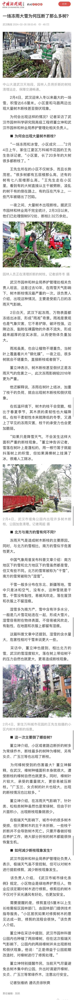

---

## 1785　手心打手背

- 日期：2024-02-09　主专题：A16 媒体舆论与公共认知　副专题：A07;A08
- 源 ID：`593f8b9a-8468-54ca-a58b-7294822c8b63`　原文链接：https://www.zhihu.com/question/637053291/answer/3391988520
- 官方对象—实践路径：与社会 / 与舆论 / 应对
- 23 概念标签：定义与达意;能力与学习;责任与后果;成本与总账;财富与市场
- 证据状态：manual_confirmed　初读：read　独立复核：not_reviewed

**问**：马逆寒假何时能够结束？

其实马前卒现在发片慢，不见得是因为被强制封禁，而恐怕是因为他把自己的钢丝架得太高、拉得太细了，导致节目很难踩准这根细丝而不摔下来。
这不是官方监管造成的问题，而是ta自己不断地极化自己的定位造成的两难——他同时有两种观众，一种是真心相信他是拥护中国的，另一半则真心相信他是拥护美国的，他很难找到不激怒自己某一半观众的题材和恰当尺度，又舍不得索性放弃这部分观众。
一个形容词用得不好就要得罪一半人。而这一半人要是散了，剩下的这一半又会觉得ta说的这些其实没意思，也要跟着散。
容错性太低，于是只好加强质检标准和环节。
要出一个视频自己内部就要无限地反复审、反复改，而且以前可以随便ta自由创作的某些利害相关人现在也坐不住了，也要求在发片之前要审一审。
一审二审三审，三审没过发回一审从头审。
当然难产了。
好在这种难产算是某种意义上的“饥饿营销”， 在他自己的流量上倒有所帮助。
问题是广告商不喜欢这种不确定性，而广告收入是很大的利润来源。
媒体生意不是只有新闻理念和社会理想就能一往无前的东西，它受到很多客观规律的约束，审查只是其中之一，甚至并非最关键的限制，因为专业的媒体人最清楚的就是宣传口的基本红线，能帮忙做这种合规审核的人多的是。
真正最麻烦的是喜怒无常的受众。
马前卒对受众群体的引导和计划出了大问题，弄出了“手心手背都是肉，手心手背互相要对方死，现在要逼问ta到底是哪边”这种问题。
他很需要一个爷叔这样的老法师。
问题是，他就像罗永浩一样，从一开始就是从“鄙视所有老法师”入行的。
现在就难办了。

---

## 1705　本分

- 日期：2024-03-12　主专题：A16 媒体舆论与公共认知　副专题：A08
- 源 ID：`61e39a9c-c1cc-577d-9bac-992886a60865`　原文链接：https://www.zhihu.com/question/647426340/answer/3428183682
- 官方对象—实践路径：与社会 / 与舆论 / 应对
- 23 概念标签：定义与达意;能力与学习;责任与后果;成本与总账;信用与信任;财富与市场;文明与历史;心理与主体;宗教与自然法
- 证据状态：manual_confirmed　初读：read　独立复核：not_reviewed

**问**：新车 MEGA 被网友恶意 P 图，理想汽车发投诉函，律师称恶搞也涉嫌侵权，如何看待此事？

企业真的需要建立一个足够强大的社会责任部门，专司慈善捐赠和善行宣传。
这类“骚扰性问题”，真正的对抗绝不是什么“辟谣”“起诉”“追究”，因为这根本没用。
要阻挡、震慑这类负面新闻战术、抹黑战术，只能靠自己平时积极承担社会责任，把自己的繁荣、壮大和社会大众的普遍福祉紧密的绑定在一起。
譬如，你长期捐助伤残军人基金、在所有学校都捐助特殊奖学金、每年都捐出几千万癌症手术基金或者靶向药慈善补贴或者设立抑郁症的公共研究项目……或者干脆再捐一捐古建筑复原项目、南京大屠杀纪念馆维护基金……
只有活得不耐烦、又没有明白人愿意提点的白痴才敢给你造这些风言风语、空穴来风、含沙射影的东西。
别说你没问题，就算你真的有什么问题，中国老百姓都会体谅你、原谅你。
谁敢来抹黑你，只要有一丝丝的胡编乱造的痕迹，一点点“整活”的意思，不用你的公关部说任何话，老百姓都要挖地三尺把这种鬼话的始作俑者从洞里掏出来群殴、把每一个收钱转发这些东西的小屁孩叫回家里跪搓板，把拒绝这么干的一家子都拉黑、退货、辞退。
大家很现实——这家企业赚钱就是我们全民得利，大家都是云股东。谁搞它，就是搞我们。
你要砸我饭碗、拉我电闸，你最好有充分的好理由，但凡有一点点扯淡，我们一定让你记住深刻教训，让将来还有这种蠢念的妄人看到都发抖。
ta们把这种“就说像棺材”的提案交到甲方手里，甲方都要把ta们赶出去，顺便把向ta们邀标的“天才”直接开除。因为这不是要帮我达成业绩，这是要给我招雷劈找死。
你看有人会盘算着这么去编袁隆平、钱学森吗？你猜猜海峡对岸、太平洋对岸有没有考虑过这种计划？
每一个得过共和国勋章的中国人当然都在ta们的舆论战名单上，要是能编、编了有用，你还怕ta们有什么道德顾虑或者资金困难，会害羞不成？
然而这些人却对这些舆论战手段自然免疫，乃至于作为显而易见的首要目标，却没有受到这类攻击。
这是专业的、有无限资金而且不担心后果的职业部队，ta们都找不到有效的抹黑战术来攻击袁隆平、钱学森。
这对你们应该有足够的示范意义了。
在“车像棺材”这个问题上，你们的确委屈、的确冤枉。
但在“被人抹黑车像棺材，老百姓却没有热情去积极惩罚抹黑者”这个问题上，你们不委屈、不冤枉。
尤其是你们宣布去年盈利多少多少亿、创始人身价多少多少亿的前提下，你们其实不冤枉。
农夫山泉，你也不冤枉。
自己想想清楚，不要以为社会责任“不是本分是情分”。
你错了，这是本分，不是来自人类法，而是来自自然法的本分。

---

## 1643　实而虚之

- 日期：2024-04-14　主专题：A16 媒体舆论与公共认知　副专题：A10
- 源 ID：`70258919-862e-5831-a05e-3d3a025be9ef`　原文链接：https://www.zhihu.com/question/652736315/answer/3465107910
- 官方对象—实践路径：与社会 / 与舆论 / 传播
- 23 概念标签：事实与证据;能力与学习;责任与后果;成本与总账;边界与许可;法律与秩序;技术与工程
- 证据状态：manual_confirmed　初读：read　独立复核：not_reviewed

**问**：如何看待杭州警方通报猫一杯造谣？

中国自媒体从业者应该从这里读取一个重要的信息，那就是在中国的自媒体市场，多了一条重要的规则——文体要分明，不得僭越新闻性的界限。
如果你是在“整活”，那么你就要注明“戏剧效果”字样，而不要想方设法让人误以为这是事实，误认为这些作品里有确实的新闻性。
其实这个法则很早之前已经有公布过——在中国境内平台，除有明确牌照和官方许可的新闻单位外，任何人不得擅自发布新闻报道。
这条法则将自媒体——尤其是专业的、机构化的自媒体的发挥空间限制在了文艺表演、虚构故事创作、新闻评论的空间内。
发生了什么事你可以评论，或者你可以讲个笑话、跳个舞、打个拳、做个手工、讲个技术课甚至拍个电影故事，但是你不能发布——包括变相发布——任何新闻。
因为新闻是新的事实，和上面这些类别相比有强大得多的改变公共叙事和舆论焦点的天然特性，中国实际上是禁止在这个类别里混淆任何娱乐属性的。
因为一旦你开始用“编造有趣的事实”来娱乐，你很快会无意间引导大众对客观事实发生种种理解偏差，导致社会共识在基本认知层面的分歧和混乱，从而增加社会的不稳定性和意外风险。
要娱乐效果，有的是你可以尽情发挥的题材、体裁，但禁止用“新闻”这个体裁来作为娱乐。
新闻必须保持严肃，必须有人负责。
某种程度上，这是我们对颜色革命的共性研究所得出的关键结论。
因为利用娱乐性扰乱公众对基本事实的共识，引诱民众为了娱乐性去接受事实与虚构之间的模糊，是夹带假新闻、舆论战工具的经典入口。
当你为一个非常搞笑刺激的“新闻”哈哈大笑的时候，你会忍不住将“宁可信其有”作为“回礼”随手送给“新闻”的制造者。
因为这时坚持洞察力去明确“这是假的”，无形中在和乐在其中的大众甚至自己作对，在冒天下之大不韪扫众人的兴。
香港、台湾之所以存在大量的认知混乱、分不清客观事实、满脑子谎言的可悲青年，以至于zz生态近乎完全毒化失灵，和CIA处心积虑夹杂在各种诙谐的嘲讽、机智的侮辱、奇趣的戏仿中的假新闻、假事实有极大的关系。
直接说“新疆集中营关了xxx人”，没什么人有兴趣，但拿这个题材捏造一个极其荒诞、搞笑，令人拍案惊奇的荒唐故事，却可以让人在捧腹大笑之余毫无防备的、不假思索的相信那肯定是一个事实。
“这么好笑，万一是假的可就没意思了。”
这是乌克兰现在被夷为平地的祸根，也是利比亚毁于一旦的病源。
是必须要作出严肃应对和毫不留情的封堵的社会治理漏洞。
堵不住，会发生战争，会有百万、千万的亡魂，城市付之一炬，文明在历史中湮灭。
这个关键，我们是明确看见而且是不会妥协的。
不可避免的，会有很多不知轻重的小孩子哭闹、讥讽甚至发动舆论恐怖主义行动来报复。
但这些最终都是无效的，因为这个原则妥协的代价要胜过这些无知呓语造成的不愉快千万倍。
你不可能为了小孩怕疼就不给ta打天花疫苗、因为ta喝了药会苦得骂街就看着ta咳死。
小孩子们也不要有这种侥幸。
而自媒体从业者们也不要在这个问题上有任何侥幸从心理。
如果你的策划的确是虚构的，而又有让人误以为是事实的诱导性，那么你要知道，一旦它真的引发了巨大的传播流量，对你反而可能带来“意想不到”的严厉处罚。
这个火不要玩，老老实实要么换条路走，要么清晰标注。
自媒体不能做新闻，尤其是不能虚构新闻。

---

## 1640　部队火锅

- 日期：2024-04-15　主专题：A16 媒体舆论与公共认知　副专题：A03;A17
- 源 ID：`06d255c1-dfa7-5039-a7b4-041900dbf7d3`　原文链接：https://www.zhihu.com/question/21179156/answer/3466816656
- 23 概念标签：事实与证据;定义与达意;责任与后果;成本与总账;信用与信任;法律与秩序;民族与身份
- 证据状态：manual_confirmed　初读：read　独立复核：not_reviewed

**问**：如何评价五岳散人？

这篇不是要评哪个具体的人，只是提供一种鉴别方法。
有这么几条可以区别一个人是抱着“批评是为了你更好”的态度，还是抱着“必欲灭之而后快”的立场。
1）看ta的评论区里有人侮辱国家和民族的时候，ta是会主动留言赞许、鼓励、引为知己，还是会担忧、愤怒和制止。
是不是打着“诤言”旗号行诋毁破坏之实，看这条是很容易判断的。后者也许仍有“善于伪装”的可能，但前者一定是不折不扣的反社会人格。
2）如果有外网账号，例如YT、X、FB这些，看看ta在外网是不是完全另一个腔调。
在国内看上去温文尔雅、悲天悯人，一到外网就各种狗屁倒灶的胡编乱造，如同一个投错了胎的种族主义者，口吐毒液，这就知道成色如何了。
不考虑立场，光是这两种表现都是严重的人品问题，发现就拉黑为妙。
这种在反贼里都属于猥琐的那一类，是真的人品有问题，与之为伍会导致你自己的风评被害、名誉蒙污。
这种人永远不可能真的接近什么真理，一辈子都会花在无聊的自我欺骗上，根本不可能有什么真正的原创性，只会反复倒腾虚拟道听途说、拍腿幻想出来的信息垃圾。
ta们的“卖点”是拿着剩饭剩菜加佐料、换摆盘。有办法从垃圾桶里收集食材，搞出一副色彩鲜艳、香气扑鼻的“盛宴”来。
但食材本身真的是在“美军基地”的垃圾堆里翻出来的。
真·部队火锅。
把ta们清理出你的信源，对你没什么可惜的。

---

## 1605　夜叉

- 日期：2024-05-04　主专题：A16 媒体舆论与公共认知　副专题：A10;A03;A01
- 源 ID：`e289fb8f-4980-544a-bba2-307c4f00baac`　原文链接：https://www.zhihu.com/question/654839494/answer/3486787268
- 官方对象—实践路径：与社会 / 与舆论 / 接收
- 23 概念标签：事实与证据;选择与自由;责任与后果;成本与总账;爱与回应;法律与秩序;文明与历史;生态与自然
- 证据状态：manual_confirmed　初读：read　独立复核：not_reviewed

**问**：如何看待湖南21岁男子胖猫遭PUA花去51万元劳动所得后在重庆跳江自杀？?

流量这种东西，最爱的不是主持公道，而是恃强凌弱。
出了一件事，有责任的所有相关方之中，流量总是会选择最无人同情的某个活着的一方来进攻，把所有的罪孽都放在这个目标身上，带着一群吓坏了的人施暴。
这就像出了大干旱，不去谈论水利的失修，不去谈论调水计划的失误，而是在村子里找到一个寡妇，认定妖女作祟，大家一拥而上，石刑处死。
这样成本最低，后患最小，虽然对防范下一次大旱没有任何意义，但是每一个扔石头的人都觉得已经伸张了正义，上天的恩宠已经恢复。
睡得香甜。
明年大旱，村里又饿死三十多个人，但幸运的是——张三家里的小闺女刚好得了白化病，十分得用。

谈论一个问题，先要去除这种“面向自我抚慰的条件反射”你才能得到某种有意义的结论，才真的有可能让明年旱灾少死人。
你需要的不是仇恨和复仇，而是先搞清楚事件从萌芽到尘埃落定的所有相关的因素和作用机制。
这件事里面，导致当事人认为“得不到理想的爱情活着就没有意义”的整个推动力量，以及不加反思拥抱这个念头的当事人自己的责任，远大于“收了很多礼物但仍然决定分手”的女方。
是谁在美化“得不到理想的爱情，活着就没有意义”这种蠢念？
谁在花钱拍那些“殉情剧“？谁tm的在那叫好鼓掌起哄？
谁在津津乐道，变着花样的兜售“甜蜜的恋爱”，以此践踏、侮辱并没有甜蜜的恋爱的人？
是谁在鼓吹“人生的价值在于享乐”？

谁信了这个，谁就等于在自己身体里埋了逻辑炸弹。
这些人才是杀人凶手。
给ta们点赞、转发的才是帮凶。
关注ta们的都是受害者。
而且不是杀了这一个，是对整个人类的大屠杀。
谁信了这个，谁身上就埋了逻辑炸弹，只是装药量有多有少罢了。
在你丢石头之前，先看看自己身上有没有滴滴作响。
人生不是按享乐论价值的，这不是高尚不高尚的问题，是你遇到挫折和损失活不活得下去的问题。
你相信这个，打死“捞女”没有任何意义。
这整个世界对你都是修罗场，打死一两个夜叉有何意义？
滴——
滴——
滴——

---

## 1596　新闻节目

- 日期：2024-05-09　主专题：A16 媒体舆论与公共认知　副专题：A06;A08
- 源 ID：`4e7f117f-d6be-5278-b421-26c113d042b6`　原文链接：https://www.zhihu.com/question/654223536/answer/3492075570
- 官方对象—实践路径：与自己 / 与名誉 / 建立
- 23 概念标签：选择与自由;生态与自然
- 证据状态：manual_confirmed　初读：read　独立复核：not_reviewed

**问**：察觉到亲密关系在干枯，是自己的生活干枯了还是维护关系出现了问题？

做人一定要有一个概念——你要有新闻。
就是news那个新闻。
一个没新闻的人，在社交上、实践上等效于一个植物人。
“十年如一日”这种广播稿劳模用语在大喇叭里播出来似乎很伟大，但实际上在社会生活中和讣告也差不多了。
很多人都在苦恼“别人为什么不关注我，当我是透明的”。
问题是，别人关注你啥？
为什么朋友圈一推出就大火了一阵——因为那约等于“个人新闻台”。只不过大多数主编都在搞些美食截图、旅游风景啥的。
但这也好过完全没有新闻。
有新闻，才有最起码的值得人关注的基本条件，否则人家没事打开电视机看屏保吗？
很自然的，最好这些新闻让人看了不后悔，能值回票价。足球那种“今天又输了”的新闻，搞多了就没人看了。
发射了重型运载火箭，发射了载人航天实验舱，发射了空间站构件，研发了新发动机、研发了新发动机改型……最好是这类会让人思考“会对我产生什么收益”、“我能不能参一股”的新闻。
某种意义上，是新闻——而不是单纯的服务——是浇灌关系的基本养料。
你身上有多久没有任何值得一提的新闻了？

---

## 1586　镜中的小丑

- 日期：2024-05-15　主专题：A16 媒体舆论与公共认知　副专题：A04;A08;A11
- 源 ID：`ced67905-1877-5d8d-9b1b-3fa319c1ce7f`　原文链接：https://www.zhihu.com/question/515282381/answer/2054857502261522705
- 官方对象—实践路径：与社会 / 与技术 / 适应
- 23 概念标签：能力与学习;责任与后果;成本与总账;财富与市场
- 证据状态：manual_confirmed　初读：read　独立复核：not_reviewed

**问**：如何克服对短视频的成瘾性？

这个你要充分认识到短视频的致命问题（以下仅以YouTube的Shorts为例）。
第一，你无法控制内容。
短视频是完全由推荐算法来决定推送内容的。它没有菜单、没有预告、没有预览，甚至没有标题。
也就是说，你没有机会靠查看列表/标题/封面、阅读摘要、浏览切片预览之类的手段，以较小的代价来提前避免无谓的损失时间。
算法推送给你，你就得看，等你看到觉得不行的时候，你已经看了一大半，损失已经造成了。

第二，短视频提供了强烈的丰富感、刺激感，但实际上给出的却是一种“浅体验”。
它几乎不形成长期记忆，只能留下瞬间刺激和短期记忆。
你所看到的东西，能在一个月后主动回想起的概率低于千分之一。绝大多数体验你这辈子也不会再次想起，由于没有复习，最终必然完全忘却。它是不形成任何沉淀和积累的。
如果你已经是技能成熟的成年人，那么这问题还不算太大——因为你谋生所需要的记忆已经作为长期记忆牢固的镌刻在长期记忆里了。
但如果你是宛如白纸的青少年，那些本来应该拿来反复刺激形成深刻长期记忆的时间被你拿来刷了不会形成长期记忆的短视频，这必然会挤占你习得技能的机会，导致你在成年时相对无能。
无能的人无法自给自足，注定会成为强夺人恻隐之心的剥削者、寄生者，必然要遭人本能的厌恶、疏远和排挤。这无关乎什么政治正确，人纯为了求生也要养成这种行为习惯，不然自己会被无能者包围，活活的被剥削致死。ta必须恶化身边无能者的环境，并且借由愤怒、憎恨硬化自己的心肝，以便到了该动手的时候不被本能的怜悯牵制。
这对无能者——尤其是甘于无能者——是一种绞肉机一般的安排，无论你如何鼓吹“精神文明”“温柔待人”都不可能扭转这种安排——因为对无能者过度优待，必然导致过度优待者自身的低效和在竞争中的失败。
也就是谁过度纵容无能，谁就和无能者一起完蛋。
因此，短视频带给你的快乐实际上是拿未来的人格尊严交换来的。
真正的小丑是你自己。
任何时候你连续滑短视频，你都要想起这一点。
镜中的小丑其实是你自己。

---

## 1556　素问

- 日期：2024-06-03　主专题：A16 媒体舆论与公共认知　副专题：A13;A06
- 源 ID：`c073359f-ce17-59ba-9026-dfef7edf8ca4`　原文链接：https://www.zhihu.com/question/539240374/answer/3519154636
- 官方对象—实践路径：与自己 / 与名誉 / 建立
- 23 概念标签：事实与证据;定义与达意;选择与自由;责任与后果;成本与总账;信用与信任;爱与回应;净输出与不掠夺;边界与许可;劳动与组织
- 证据状态：manual_confirmed　初读：read　独立复核：not_reviewed

**问**：怎么样才能让别人知道自己的价值观又不过多暴露真实的自我？

实际上，素问（sooon.ai）的一大目标，是为了帮助它的用户解决这个“如何在不过度暴露隐私信息的前提下帮助人了解我的价值观和伦理观”的问题。
基本做法是这样的：
1）你将凭着在素问的活动获得一份长期的活动记录。这些活动记录包括于何时询问过素问什么问题、发起过哪些同问、参与过哪些同问、在特定月份达到了多高的采纳率、做出了多少贡献值。
素问的活动记录因为我的规则管理是根本无法短期速成的，你只能每天花上几分钟的点滴积累、逐月沉淀。
将来你只要把这份贡献记录分享给知道素问的人看，ta们就能非常简单地、然而是确实有效地了解你对什么很关注、你有过什么疑惑、你的心路历程。这份贡献记录可以权威性地证明你的公益精神和对伦理问题的长期关注以及严谨态度。
2）你将通过素问获得强大的内容整理工具，帮助你按照你自己关心的主题来重新组织素问的内容。譬如，你可以按照“个人修炼”主题，自己选择若干篇答案，为每一篇撰写自己的短评（短评本身发表在其他公开站点上、素问仅接受这些发表后文章的链接），制作出你自己的个人阅读记录 / 导读建议。这些基于我的公开内容和你自己的公开评论、进行过再排序、再组合的“导读文集”，本身就体现了你自己对这个中心议题的全面的、细致的、确切的观点。而其本质上是一长串内容和评论的链接串，你将可以轻松地一键导出成格式化文本，随意按你自己的需求去其它平台公开发表。
这些“读书笔记”“导读编册”，将会成为你自己伦理观的最直观表达。
注意，这并不需要你去赞同我这些答案，你大可以每一篇导读都写“我对其中的xxx观点有以下不同意见”。
这样看了你的笔记的人自然就知道原文是什么而你有何不同意见。由于你的意见是发表在其他平台，很可能在你的创作下还会有你和你的读者的进一步讨论。
很多人都有“我想要系统通读但啃不下来 / 读完之后就基本忘了”的问题。借助这个工具你可以这么做：
1）首先建立一个文集，例如叫“亲密关系 （第一轮）”。
2）就利用素问去匹配你感兴趣的若干答案。一次性将有兴趣的答案都放进这个文集。
3）根据感兴趣的逻辑（这一般是一个追问关系），将所有收录的内容按照“最好先读这些再读这些”的原则进行排序。
3）然后逐篇阅读。每读一篇，就针对一篇写一个评论或者总结（譬如可以写在语雀上，微博上）然后将这个内容链接附加在这篇答案上。
循环往复，直到文集内所有的答案都有了评论链接，这就可以确保这个主题的确看过了。这一方面可以帮助你如愿深入、系统地阅读，与此同时，又一石二鸟地为你的后代、朋友、读者独辟了由你标识的道路。
没有什么比这些笔记更能向人说明你的是非观、价值观、见识水平以及你的公共服务精神。
然而这些笔记却没有暴露你任何的个人身份和财务信息。
因为“不承担任何社交属性”是素问的基本准则——即默认情况下，a) 一个用户将只能看到自己在素问做了些什么，而无法看到任何一个具体用户在素问上看了些什么。b)素问将不提供用户互相交流的通道、互相通信的手段。
因此无人能在你不主动向对方提供的前提下看见你的任何信息。即使看到，也将无法看到这些页面上的用户名是什么。而这一点，将从根本逻辑上保证你的贡献有无可辩驳的“无我”性。
这也是为什么素问的感谢信里会有那句“你的名字无人知晓”。
素问将仅仅对人证明两点：
1）这个页面所记录的这个无名氏做过这些贡献、ta关心和参与过这些问题，ta对这些答案做过这样的编纂工作，并且ta对这些有这样那样的看法。
2）能控制这个页面的人很可能就是这个人。（将提供鉴权手段）。
你是否愿意和这个人建立雇佣、合作、购买、社交、朋友、恋爱关系，这个凭证可以给你以下可供参考的重要依据——ta的伦理观念、服务精神和做事的恒心。
这虽然不是绝对可信的保证——世界上哪有绝对可信的保证呢——但它拥有三个要害：
1）完成它需要大量的时间和坚持，而**时间是个难以蒙混的要素。**哪怕你有一个亿，要在素问积累到这些贡献，也只能靠时间，没有捷径。
2）ta做这件事时，是没有确切可信的名利可求的。因为上面没有ta的名字。因此“一时之间没有名利”，并不会妨碍这个人去做ta认为有价值的事。
3）这个长期工作本身就是辛苦在自己、利益在大众的爱的付出。没有什么比爱的付出本身更能证明人对爱的坚持。
素问不同于其他的服务，它的规则将是非常“苛刻”和“不友善”的，但唯其如此，在素问的贡献才自带尊严。

无我之问，是为素问。
无我之答，即为素答。

祝你们平安。

---

## 1524　一万粉

- 日期：2024-06-18　主专题：A16 媒体舆论与公共认知　副专题：A15;A08
- 源 ID：`418dc88d-e188-587d-aa80-2fdc7e7e7027`　原文链接：https://www.zhihu.com/question/649663386/answer/3534702161
- 官方对象—实践路径：与社会 / 与舆论 / 传播
- 23 概念标签：定义与达意;能力与学习
- 证据状态：manual_confirmed　初读：read　独立复核：not_reviewed

**问**：在知乎，涨到一万粉，是不是很难？

如果你的东西有新鲜感，有有效信息，有值得进一步研究的意义或者有某种启发性，并且我觉得你有看上去可见的利ta性，那么我会推荐我的读者关注你。
我也会经常收藏和点赞值得推荐的内容，这些动作理论上也有很多人会看到。
我现在在知乎的关注者40万，周浏览量160万左右。在每周都会活跃的知乎个人作者里，总收藏量和被喜爱量应该都在前二十名内。
你要是不确定这是个什么风格，可以参考一下我的“一条阅读轨迹”收藏夹。
一条阅读轨迹

---

## 1496　不忙解释

- 日期：2024-07-03　主专题：A16 媒体舆论与公共认知　副专题：A06
- 源 ID：`1ce3e182-9d76-5163-8f2f-4a4673aeb035`　原文链接：https://www.zhihu.com/question/35851321/answer/3550136971
- 官方对象—实践路径：与社会 / 与舆论 / 应对
- 23 概念标签：事实与证据;选择与自由;责任与后果;成本与总账;边界与许可;劳动与组织;财富与市场;法律与秩序;权力与异议;技术与工程
- 证据状态：manual_confirmed　初读：read　独立复核：not_reviewed

**问**：被人误解后如何淡然与坦然，不急于去解释？

你要看到“晚一点解释”的宝贵价值。
“晚一点解释”是一件非常珍贵的工具，因为“误会见真情”是“患难见真情”的家常实用版。
（注意，这么做的前提是没有涉及什么法定的或者合同约定的及时告知义务，类似上市公司发公告澄清表达歧义之类的情况要除外。）
这整个流程是这样的：
第一步，我身上发生了某件可能引人误会的事。
不管是我自己心知肚明的，还是通过某些途径得知有人在造谣，我现在都已经知道游戏开始了。
从澄清事实的层面，我很可能要花一些时间来准备理想的证据。如果是谣言，我还要等一段时间，等待谣言的主人在关注的推动下多胡说八道一些，露出更多的破绽，这样效果会更好。而冒冒失失赶紧去澄清解释，一来是在被伏击状态下仓促应战，二来敌人战线短，处在相对战略优势状态，这不是打会战的战机所在。
而从另一个层面，这也是个绝佳的机会，可以观察以下几点：
1）哪些人在什么时候通过什么途径会接触到这些信息？这会揭示出不少平时我看不到的隐形关系结构。比如在我的管理之外具体存在着哪些关于我的信息管道？主要成员是谁？扮演什么角色？谣言误会就像一滴染色剂，滴下去，你给它时间传播，它就会把叶脉染色出来，让你看见平时看不见的结构。
2）这些人对待这个误会的第一反应是什么？有哪些人直接就信了？有哪些人明显知道相反的证据但却还是要跟着起哄？有哪些人在趁机添油加醋？哪些人将信将疑？哪些人一眼看穿？哪些人会在这种情况下为我说话？哪些人这时候会忘记分寸？哪些人会忍不住要向我通报？
这对你了解这些人的品行有很大的好处。而不给误会时间，你就没有机会看清这些东西。

第二步，很显然大部分人都知道了我已经知道了误会的存在（这可能来自某些人公开的告知）而我在保持沉默。
被人造谣或者发生了误会是一回事，但是在我已经明确知道这些误会存在的前提下，我继续保持沉默，这对所有的误会者和旁观者已经是一个新的情节。
我要等着看“发生了误会 / 谣言”叠加上“我没有解释”会发生什么效果。
谁在第一阶段站稳了，而在第二阶段动摇了，而谁没有？
没有的这些，是因为什么没有动摇？
是因为准确的认识到了“即使这些都是真的也没有关系”，还是“我有确切的证据相信不是这样”，还是“我没有充分的证据，也没准真是这样，但我定意如此”？
时穷节乃现，日久见人心，这成本不比误会谣言发酵的这么几天大得多了？何况谣言误会实际上是“半危机”“伪危机”，比真正的落难的实际伤害要小得多。
这么宝贵的机会，为什么要放弃？

第三步，我可以捡恰当的点略说几句。这甚至算不上正经的解释或者自辩，准确的说，这个尺度分寸是精准计算过的——刚好足够那些足够坚定、而我又格外看重的人觉得石头落地，如释重负，而又刚好会让那些不够坚定，实际上只是来消费我、图谋我的人觉得“含糊不清，不够有决定性”。
因为这类人往往是祸乱之端，是只能赚不能亏的，处得越久ta就会觉得你欠得越多，该还的越大，对你约苛刻猜疑，在下一次有风吹草动时跳得更高。
何其不如这一次就让ta觉得“必然不妙”，早点把ta吓走？
ta受不了这种“不够有决定性”的自辩，自然就会骂骂咧咧的走掉，不但如此，还很容易担任义务筛查员，把一些通不过这种程度的怀疑的人提前挡在门外，将来也可以省了你一些麻烦。
这类误会/谣传易感人群就像森林中的枯树，数量多了极易遇到火星酿成野火，所以不要过度贪图所谓的“广受欢迎”。
坦率讲，如果你是一个价值净输出源，提供着宝贵的公共服务，你怕啥“不受欢迎”？
一旦你免于这种“没人爱我”的恐惧，你自然就会发现推迟解释误会和谣言的宝贵战略价值。
你甚至会舍不得太早结束这种进程。
而你这个稳坐钓鱼台，坐山观虎斗的态度本身就是无声的宣言，本身就足以释放让最核心的朋友安心的信号了。
我对在你心中建立无可置疑的形象毫无兴趣，对无可置疑的对象有感情有什么值得在意的？

---

## 1475　帮助明星

- 日期：2024-07-12　主专题：A16 媒体舆论与公共认知　副专题：A08;A06
- 源 ID：`18b01445-6ff0-5286-965f-3f61b4edc413`　原文链接：https://www.zhihu.com/question/648059525/answer/3559203967
- 官方对象—实践路径：与社会 / 与文化 / 遵循
- 23 概念标签：能力与学习;成本与总账;爱与回应;边界与许可;劳动与组织;财富与市场;法律与秩序
- 证据状态：manual_confirmed　初读：read　独立复核：not_reviewed

**问**：粉丝到底该如何支持自己的偶像才是最合适最理性的？

1）取得个人的成功，然后归因于明星对自己的启发和激励。
这是最根本的一条——在对方的启发和激励下，你获得了更美好、更强健的人生和事业，其实是你投身支持对方的实际行动的基本条件。
注意，你决定支持的理由，不能是“得到了快感”、不是“为了对方的宠爱”，而必须是你因为对方所提供的服务，变得比之前更热爱生活、更积极乐观、而且的确在收入或者ta人对你的估值有明确提升。
只有你是在拿对方给你带来的收益的一部分来支持对方，这个支持才是本质健康的。
而在没有受益的前提下，纯拿自己的付出（无论是金钱还是时间）换取某种虚幻的快感，这在本质上只是在吸毒，必然是不健康的。
这一条决定着要不要支持、该不该支持，只有这一条过了关，才有“如何最好的支持”的问题。
这一条过不了关，你要寻求的是终止自己的迷恋，而不是什么“如何支持”。
2）在物质上直接帮助对方的事业——例如向对方主持的社会活动捐款，购买对方的产品，在自己的职权、专业方面为对方的事业提供合法的、积极的帮助。
3）帮助对方扩大影响，并且引导新来者正确的参与这个关系。
4）多帮对方制造朋友，少给对方制造敌人。

---

## 1465　一纵一枉

- 日期：2024-07-15　主专题：A16 媒体舆论与公共认知　副专题：A03;A07
- 源 ID：`1fb52afe-314c-5490-9458-14912a0c647e`　原文链接：https://www.zhihu.com/question/614210956/answer/3562757387
- 官方对象—实践路径：与友人 / 与邻人 / 相处;与其它 / 与陌生人 / 观察;与社会 / 与社区 / 共处
- 23 概念标签：事实与证据;能力与学习;选择与自由;成本与总账;心理与主体
- 证据状态：manual_confirmed　初读：read　独立复核：not_reviewed

**问**：女作家因两次被乘务员提醒管好小孩向 12306 投诉，认为这是一种冒犯，如何看待此事？

这涉及到一个很基本的问题——“这是针对我的刻意冒犯”这种判断，是门槛低一点好，还是门槛高一点好？
门槛低一点，你的漏检率会低，误报率会高，走的是“宁枉勿纵”的路线；
门槛高一点，你的误报率低，但漏检率会高，走的是“宁纵勿枉”的路线。
我知道你想选“恰好好处”，遗憾的是恰好好处不是人能选的选项，一个是这需要极强的调查能力和资源成本，一个是哪怕你有这种能力和资源，很多事情发生得也太快，根本没给你时间去投入这个资源去做这个调查，你的判断就已经要作出了。
要么宁枉勿纵，要么宁纵勿枉。都是错，哪一个是更正确的错？
怎么算“更正确”？
其实看的是哪一个错误有更便宜的手段能管控它的负面后果：
1）反正无论是选哪个策略，你的安防体系都要做同样标准的建设，绝不可能你自认为“宁枉勿纵”，你就可以在建设安全体系的时候简配一点。能穿透你的严苛扫描的人如果对你有恶意，你的简配安防系统能挡得住吗？
于是问题立刻就翻转了，安防的成本你已经支付了，完善安防本来可以带来的宽松福利你却没有享受。
你把本来可以享受的福利自己抛掉了。
2）假警报也是会动员应急安保措施的，你一日三惊的话，你那小小心灵派出所里的干警们腿都要跑细了。过劳了人家也是要加班费的。
3）假警报会给你制造不必要的敌人。如果你是误判了，然后你错误的派出防暴小队把人家按在地上一顿削，从人家自己的视角看自然是觉得自己根本没错，纯属平白无故的被攻击了，人家能轻易善罢干休吗？
于是你自然而然的会下意识的专找那些反击报复可能最小的人展示你的武威，结果就是两个：一个是对公共服务人员、对萍水相逢的陌生人、对肯定不会反击伤害你的父母、配偶、子女“严格执法”，对大概率可能再次见到你面，而又不见得会怕你的同事、上司你就“温柔宽厚”得很了。
因为你本来敌人就太多了，再不“适当取舍”，自己都觉得顶不住。然而你这取舍的结果，常常发展成客观上的欺软怕硬、窝里横。
这也是为啥你的朋友亲人其实很不喜欢你对人太苛刻的原因——因为ta们知道真正会倒霉的是ta们自己。
也因为这个，在相亲对象面前对服务员不礼貌甚至稍微不客气，就容易导致相亲失败。
这根本没得争。
除非没有争议的余地，否则但凡有争议可言的“疑似冒犯”，都建议你养成习惯去判“误会”。
这对你自己更好。

---

## 1427　不受采访

- 日期：2024-07-29　主专题：A16 媒体舆论与公共认知　副专题：A17;A02
- 源 ID：`33ba4dd9-d4ff-5c63-982c-2a94bc19d3cc`　原文链接：https://www.zhihu.com/question/45055496/answer/3577441320
- 官方对象—实践路径：与社会 / 与舆论 / 表达
- 23 概念标签：事实与证据;定义与达意;能力与学习;选择与自由;责任与后果;成本与总账;信用与信任;边界与许可;法律与秩序;权力与异议
- 证据状态：manual_confirmed　初读：read　独立复核：not_reviewed

**问**：如何评价贾平凹在采访中说「如果村子不买媳妇，这个村子就消亡了」「被拐卖要怪女人太好骗」这种话？

这就是为啥你不该随便接受记者采访。
以前的人比较天真，会觉得这是一个扩大知名度的好机会，殊不知一旦接受了采访，就等于人为刀俎，我为鱼肉，太阿倒持，授人以柄。
如果你是没名没份的，为了出名搏命那也罢了。如果你是生活在信息不发达的时代，那也罢了。
如果你本来就功成名就，而且生活在现代，你要对公众说话，就一定要自己直接说。
这样没人在提问中给你挖坑，也没人去诱导谈话的方向，也没有人在转述时“删繁就简”，或者“寻找合适的阅读群体”“等待恰当的发布时机”。说完了无论是被误解还是被咒骂，好歹是自己直接说的话，自己直接负责。
就算要接受采访，绝不能只看对方有个什么报的头衔，甚至有个记者之类的名号就乱冲动。必须这个人有长久的新闻道德的可靠记录再谈。或者换一个视角，如果你手里有什么一旦对手瞎搞你就能捏住ta的脖子让ta当众自己吞下去的手段也勉强可以。
一旦接受采访，这些事就都由不得你了，事后你再后悔、纠结都没有意义了，这跟在一张空白合同上先签字盖章没啥区别，谁要你胆肥敢签呢？
这是生活常识，不是最近一两年才需要树立的新认识。记者这个职业天生就是这样的属性，自从有媒体以来一直就是这样。
你们自己要记牢，不要将来人生上升到一定高度时脑袋发晕，过于天真，误以为这都是天赐良缘。

---

## 1417　恶名远扬

- 日期：2024-08-02　主专题：A16 媒体舆论与公共认知　副专题：A10;A07
- 源 ID：`10b23e64-acc1-5497-8449-5d1c7323329c`　原文链接：https://www.zhihu.com/question/333769627/answer/3581135232
- 官方对象—实践路径：与自己 / 与名誉 / 运用
- 23 概念标签：能力与学习;成本与总账;信用与信任;财富与市场;法律与秩序
- 证据状态：manual_confirmed　初读：read　独立复核：not_reviewed

**问**：如果《让子弹飞》当中被污蔑吃凉粉的是你，你该怎么办？

按法律办呀，不然咋办？
你可以去找我大哥投诉，秉公办理呀。

不要把这类“洁白无瑕的名声”看得太重要。
堂堂英雄好汉，没点谣言、没点绯闻、没点可怕的传说傍身，那多无聊。
有点这类传说反而是好事，因为谣言能替你过滤掉会纠结这些谣言的人。
既然在这些人眼里你的净价值不足以压倒这些风言风语带来的顾虑，那就意味着即使没有这些谣言存在，你在这些人眼里也没有多大的信用余额。
你可以认为合作都是这种原理——
先彼此估计一下对方的价值，于是基于这个潜在价值给对方估一个风险备用金。比如你可能给我带来巨大的价值比如2000万，那么为了跟你保持合作，我就预留100万风险金，只要我们合作过程中发生的误会不会造成总计超过100万的损失，我都会一笑了之。如果我觉得你只能带来10万的利益，那么我就只给你准备5000块了。你要有什么可疑的行为，让我担心损失会超过5000块，那么我们一开始就合作不了。
反过来，我作为资源的提供方，我会怎么挑选合作者呢？很显然，我会挑选那些我觉得ta风险金留得足的。你风险金留得越足，我就越不必提心吊胆，整天顾虑合作中断可能带来的沉没成本。而风险金留得足，必然是因为你认识到我对你的价值。

搞清楚了合作的基本原理，现在谣言的好处就体现出来了——这么一个虚无缥缈的暗示，就足以把你给我预留的风险金耗尽，可想而知你原本对我的价值估得有多低。
你估得这么低，即使没有谣言存在，我们要合作起来，我也可能只要几个不合适的笑话就把这点余额耗尽了。
这么脆弱的合作，有何开始的必要？
正好有谣言存在，自动的就拦住了一大批对我的价值估得很低的人。
这部分人一开始就注定会浪费我的时间，被谣言挡在门外，对我绝对是一件省心省力的好事而不是坏事。
所以呢，战略性的保持一些似是而非的“坏名声”不去澄清，其实有相当的好处。你要是连这点东西都不能自己看破、连这个都怕，你根本没资格在我面前出现。因为谣言而自己不来烦我，那可真是全自动双赢。
如果对方真刀真枪的要对簿公堂，那当然要认真应对。如果对方不敢上堂，只敢在外围似是而非的嗡嗡嗡，那这正好，这些不敢较真的玩意可以拿来做个试金石，看看身边这些追着要合作的人的合作意愿的成色。
久而久之，你还舍不得澄清呢。真澄清了，你还没有这些驱蚊器可用了。

换一个更形象的比喻，比如你是一个遍地黄金的国家，你是希望外人都觉得你这里的人民心地善良、生性和平、热情好客呢，还是希望江湖上传说你这里都是妖魔鬼怪，凡是恶意闯入的人都会变成挂在路边的骷髅头？
你当然想要后者。
但你总不能真的砍几千个人头来挂在国境线上吧？
现在有人帮你造这种谣，这岂不是大妙？
又把各路冒险家镇住了，你又没真的造下杀孽，而这帮造谣的又不敢真的去上法庭，没法造成什么真的后果。而那些大着胆子闯进来的，你看上谁，你可以单独的轻松证明那是谣言。看不上的你只要不置可否，ta自然会屁滚尿流的自己跑路。
你看，对于黄金之国，这是不是一个完美的局？
你都会可惜不能给那些造谣的发个大奖状好吗。

只有那些自身缺少可见的价值、唯恐人稍有不爽就会不给ta机会，而再得不到机会就会饿死的人，才会如此纠结和恐惧“名声不好”。
如果你真的处在这个状态，你就要意识到你的主要功夫绝不该用在“维护洁白无瑕的名誉”上，而要用在“浑身都是宝，就是我有剧毒你都得忍着”这个方向上。
人生最适情畅意的状态绝不是一个“对方觉得你洁白无瑕”的状态，而是对方万分纠结“这人根据传说就是个流氓混蛋，但为了生活我没得选”，给你预留了一切胡作非为的心理空间，然后惊喜的发现“其实那些传闻似乎不实”这么个状态。
这个态势下达成的合作关系，天生的耐折腾。
反而是那些以为你是洁白天使才勉强接受你的，不定哪天你一句话说得ta们不满意，ta们就要保持一份“没想到你是这样的”的嘴脸来折腾一番。
所以，在你成功的道路上，你是需要一些这类“不好的名声”来傍身的。
不要过度爱惜羽毛，因为好人最好装点“坏人”，福利大大的。
类似“吃了两碗粉”这种“坏名声”本来是个宝，笑纳还来不及，居然搞到要自杀“以证清白”，只能说这位小弟自己根本没有撑住字头的天分，遇到个大哥连基本的门道都不教。
有机会能装成“坏人”，你却非要去装好人，你还装不成好人你就去寻死，真是不知好歹。

---

## 1398　激流勇退

- 日期：2024-08-11　主专题：A16 媒体舆论与公共认知　副专题：A20
- 源 ID：`f2391064-6c22-5ce7-89d0-8887f6b5b6ce`　原文链接：https://www.zhihu.com/question/663884478/answer/3590698011
- 官方对象—实践路径：与社会 / 与舆论 / 应对
- 23 概念标签：能力与学习;选择与自由;成本与总账;爱与回应;边界与许可;财富与市场;法律与秩序;文明与历史;性别与身体
- 证据状态：manual_confirmed　初读：read　独立复核：not_reviewed

**问**：如何看待樊振东最新微博？

无论樊是否打算退役，这都是正常的人生选择，为什么这背后一定要有什么特别的剧情存在？
坦率讲，中国的顶级运动员如果要激流勇退，除了伤病原因，最大的因素基本不可能是什么“队友排挤”“派系斗争”“上级打压”。
道理很简单，世界冠军，几面金牌傍身，在全世界人民注视下战胜一切艰难挑战，这种资历根本无法打压。
那些就算是有，在取得奥运金牌后也只会是次要因素。说得不好听一点，红墙之内你敢保证没有ta的球迷？谁敢硬欺负？活得不耐烦了吧？
最大的原因其实主要是两个：
1）名利诱惑。得了冠军商业价值大增，一个是各种商业活动需要占用大量的训练时间去安排档期才能签约，否则你都不露面、不参加拍摄，人家几百万就买你个签名或者自拍照吗？
一个是如果你继续打下去，结果下一轮赛场失手，反而可能晚节不保，折损了自己已经有的商业价值。如果你自己觉得自己其实身体隐患不小，面对未来的潜在敌手力不从心，其实这个风险是非常大的。
在顶峰激流勇退，给新一代更多大赛锻炼席位，在这种情况下属于相当理性的战略性选择。
2）来自社会的敌意凝视会空前加重。
人类之中有一种非常糟糕的天性，就是以“猜八卦”“编八卦”的方式崇拜偶像。
从只言片语、举手投足之间，急于从偶像身上租借、抽取存在感的人们就能“解读”“估计”出无数绘声绘色的“内情”来，分析得有鼻子有眼，头头是道。
殊不知，如果按这种“分析”法，如果把这种强度的合理性视为真理性，其算法根本就不是收敛的，可以得出的截然不同的结论多了去了，凭啥确定这一个就是真相？
问题来了，帮着传播这个解的人根本不是因为这个解确定无疑就是真相，而是因为这个解最有戏剧性、最有娱乐性、最有新闻性和传播性。
最有病毒性。
同一组迹象所能支撑的所有可能解释中，越有病毒性的，越容易通过传播系统的筛选，广为流传，而且只要你具有偶像性，这一机制就会自动发动，没有任何办法避免和压制。
而且这也不是对你本人崇拜的人够多、够有战斗力就能解决问题的，因为这些人本身就会创造和激化矛盾——ta们也有过度解读迹象，认定自己的偶像正在受委屈、受欺压的倾向，也一样容易无中生有地“制造案情“，甚至连本人去澄清都会被认定是“被坏人逼的”。
这就是“人红是非多”的基本机制，无处可逃。
因此，一旦具有了偶像性，你的一切都会不再单纯，你本人、你的同事、你的朋友、你的家人……就都不可避免地要成为不自觉的恶意凝视的对象，要承受这个巨大的、会随着偶像性不断提升而加倍升高的压力。
只要人还没有归隐，没有脱离这个偶像性上升的轨道，这种压力的提升最后一定会超过人的承受力的提升。
一旦超过极限，就是抑郁，癫狂，甚至死亡。
在什么时候、以什么方式实现退隐，这是每一个获得了偶像性的人都要处理的必修课题。
不同人不同选，这很自然，没必要勉强。
某种意义上说，排除那种流星般瞬间创造奇迹而在偶像崇拜来得及作用前就消逝的个别现象之外，一个社会可以拥有多么传奇的英雄人物，跟这个社会的偶像文化属性是有关系的。
这个文化的舆论毒性堆积越快，对偶像人物给予的豁免越少、限制越大，偶像人物反偶像化的常识越差，社会所能支撑的英雄的传奇性就越弱——因为英雄人物会更早地夭折在这个机制的毒性之下。
反之，则这个社会的英雄的传奇性就越强。
如果你要顺着这条线继续看下去，你会发现东方文明和西方文明在英雄问题上截然不同的调性。
西方文明善于制造英雄史诗，而且倾向于给英雄人物“道德豁免”。只要你战无不胜，那么你要取消元老院也行；只要你英俊机智，勾引人妻也罢、抛妻弃子也罢，都是风流佳话。越是英雄，道德约束越弱，社会契约越是对你无效。最后甚至法律、伦理都可以轻易地摆脱。
而在东方，越是英雄人物，道德要求越严，社会契约的约束越紧。
所以岳飞绝不能对抗十二道金牌，蒙恬必须饮鸩自尽，戚继光必须领劾归乡，否则从对抗之日起，他们就要从天下民望变成乱臣贼子。
东方的英雄则恰恰相反，反而往往要通过这种“拼死维护（哪怕是残破的、失灵的）社会契约”的方式，真正地成为东方意义上的完美英雄，得以成为事实的民族神灵，存在于历史的英灵殿中永受纪念。
所以得到万世供奉的是岳飞、关羽、戚继光，而不是曹操、韩信、吕布。要按西方标准（包括日本标准），吕布绝对可以混个阿喀琉斯的咖位——三姓家奴算英雄轶事，“宝马+美人+无敌”解决一切争议。

这不是一个简单的茶余饭后的消遣性话题，因为现代中国正在受到这两种文化的撕扯和折磨。
很多所谓的“恨国党”，其实是深受西方文化的浸染，在内心深处皈依了基于英雄想象的“个人实现”式的价值观、人生观，而与中国文化深处的“反英雄性”基因发生了深刻的意识形态冲突。
这其实根本不是所谓的制度之争，而是文化意识的裂痕在个人身上的迸发。
而真正痛苦的，是当事人自己不知道如何协调、甚至未能清晰地认识这种痛苦的本质，以至于只是在本能地、盲目地发泄自己的痛苦情绪。

而更宏观的层面上——中国自己在这个问题上也有历史的迷茫。
反英雄的文化传统是否真的是这个历史关头的中国所应该延续的道路？我们自己其实也没有明确的答案。
这倒不是简单地因为看到了马斯克、乔布斯这类西方现代英雄的优异表现的问题，而是这很自然地会驱动全球信从“个人实现高于社会实现”价值观的人（尽管其中绝大多数都只是在脱离现实地狂妄自大）归向鼓吹个人英雄主义的西方，等于我们在不断地给对方输送人力。
我们实际上主张的是西方价值观的另一面——“社会实现高于个人实现”，而且这个传统从两千年前就已经开始了。这也是社会主义政党和中国特色如此合拍的底层原因。
这看似宏大遥远、看似和你八杆子打不着，但实际上却极为深刻和全面地影响着你的整个人生的每一个体验细节。
例如娱乐版面的内容，例如你的偶像的人生轨迹和关键选择，你所处的行业荣枯，直到你自己的爱恨情仇、喜怒哀乐。
你要睁着眼睛去体会这一切，而不要只是放纵本能沉浸在剧情情绪中。
要学会和编剧、导演对话，而不是和剧中人“共情”。
因为编剧、导演从不在剧中抑郁。

---

## 1337　群氓

- 日期：2024-09-05　主专题：A16 媒体舆论与公共认知　副专题：A03;A07
- 源 ID：`7cb9b096-39ba-59a3-b9e5-fd6296e0034f`　原文链接：https://www.zhihu.com/question/21268373/answer/3616097925
- 官方对象—实践路径：与社会 / 与舆论 / 表达
- 23 概念标签：事实与证据;能力与学习;责任与后果;成本与总账;信用与信任;边界与许可;照料与家庭;劳动与组织;财富与市场;法律与秩序;权力与异议
- 证据状态：manual_confirmed　初读：read　独立复核：not_reviewed

**问**：「90% 的人都是愚蠢的，群众的眼睛并不雪亮」，如何看待这种说法？

说这种话的人，一般都是还没得上抑郁症的准病人。
为啥呢？
因为这是受抑郁症教育前才会有的思想症状。
等到抑郁症一来，自己走到了床都起不来、门都出不去的地步，趴在窗前看着街上忙忙碌碌、能说会笑的“愚蠢的群众”，才会意识到“ta们至少能做到在这个残酷、黑暗、充满谎言和无常的世界上正常的生活，能起来上班，不但自己能活下去，还能养活子女父母”。
之前整天觉得自己聪明无比，俯视众生，可以领导世界革命，看谁都比自己愚蠢。到了这一步，才会承认其实自己连最平凡、最普通的群众每天都在做的事都做不到。
群众“愚蠢”？
你知道在这个世界上有声有色的活着，甚至还背负着别人一起活着是一个多么艰难、多么复杂的事业吗？
这不光是有一套劳动技能的问题，还有无数的心魔要降服，要对无数的人达成不低于及格水平的了解。
一群能在炮火连天的战场上背着战友穿越火线的老兵，轮得到你这个趴在壕沟里连头都抬不起来的军校生嘲笑“愚蠢”？
谁得出这种结论，只有一种可能，就是自己还不知道自己有多蠢。
这不是叫你把群众当神仙崇拜，而是叫你基于基本的事实证据承认现实本来的明显结论。
藐视群众，本质上是在藐视世界的复杂性。因为群众显然是战胜了——或至少适应了——这种复杂性的人。
群众根本不愚蠢，而且聪明得很，ta们真正的问题并不是智商或者理性欠缺，而是缺少情报、缺少组织协调、交易妥协的经验。
“情报”其实组织才会真的拥有的系统资产，个人很难获得称得上情报的东西，所以往往被战争迷雾困住，使得智慧和理性难以发挥拥有的水平，这也往往是一些经过新教育的小孩子喜欢嘲笑群众的原因——因为这些脱产的小孩子不但有大把时间，而且还沉浸在整个社会通过教育系统慷慨馈赠的情报中。但实际上这些学生们在真正的智慧和理性方面堪称毫无积累，那远比“基于高度提纯的数学逻辑进行纸面运算”所需要的程度高得多，就像在脸盆里测试模型船和驾船横穿大西洋的差距一样。
群众面对的另一个困难，是一群人要在一起协调出一个一致的行动，展现出组织的力量，需要完成大量专业的谈判工作，去达成大量的利益交换和信用建设工作。ta们往往无法在紧急的事态下拿出这个资源来完成这个前置工作，因而很难呈现出有效的集体行动。
这根本不是因为“群众愚蠢”，而是组织协调并不是“群众专业”的必修课，也不是ta们在毕业前就必须完成的作业。
其实你把任何一个群众放到领导位置上，给ta足够的情报和资源，要求ta作出合理的判断，ta往往能做出出乎你意料的富有远见和格局的决策。
但ta没有可能得到这份情报和资源，在没有这个基础的前提下呈现出的无效性怎么能称为“愚蠢”？
群众在做的是什么？x + y + z= 10, 请问x等于几？你来回答一个看看？
把做不出这种答案称为愚蠢，还意识不到在这个条件下靠猜的做出了一个经受住了事实考验的结果是一个多么强大的实力，这行为本身才叫愚蠢。
群众是缺乏作出正确判断的条件，而不是缺做出正确判断的素质。
这个条件极难达成，不是谁自己觉得“明摆着”“显然”然后大声宣读几遍就能让人视为有效输入的。
你其实不能基于你这类“说服”“沟通”的失败而断言是“群众愚蠢”，它更可能是你的努力没有达成让这事得以成功所需要的水平罢了。
没人说是你的错，因为这就是非常非常困难的事——你只想想光一个牛顿定律学校就翻来覆去给你讲了多久？给你做了多少实验、多少试卷？这么简单、这么确定的物理性规律，让你脱着产、安排了整整一群专业的人来拎着你的耳朵灌了三年，你照样在高考时答错题，你就指望着靠三十分钟甚至十分钟夹杂着不耐烦的呵斥的讲解让群众“接受真理”？没成功就断言问题出在“群众愚蠢”上？
你想想这思维严谨性值不值得你自信？
这么大的洞，你浑然不觉，坦然的、笃定的确信这么残破的逻辑的结论，就为它给了你快感，你这个模式岂能不抑郁？
“群众的眼睛是雪亮的”，意思是当你把足够的情报展现给群众看，群众久经生存考验所磨练出的智慧足以做出合理的——注意这不代表绝对正确——的判断。
那是要补上“让群众充分知情“这个条件的。
这个知情，不但是指简单的情况介绍，还有充分翔实的方案说明、利弊陈述。
群众雪亮的眼睛没有得出合理的判断，短板不在群众的眼睛不雪亮上，而在于山洞里光线微弱上。
这也是这话被说出来时的本意——它本来就是要驳斥基于“群众愚蠢论”而要将对群众隐瞒信息正当化的主张。
但不要以为这是在主张“不应该有任何国家机密”——基于对沟通组织的难度的敬畏和对事情紧急性的妥协，你必须基于事物现实属性的限制而保持必要的机密——例如你怎么知道听到的只有群众？群众之中一样可能混入敌人。
但这绝不是、也不允许是基于所谓的“群众愚蠢”。
这才是这句话要驳斥的东西。

---

## 1334　一招制敌

- 日期：2024-09-07　主专题：A16 媒体舆论与公共认知　副专题：A09;A13
- 源 ID：`d10a0e4c-4d47-517a-9f0b-8ab8fcc3902c`　原文链接：https://afdian.com/p/0e45a7166ca011ef99c652540025c377
- 官方对象—实践路径：与自己 / 与情绪 / 调节
- 23 概念标签：能力与学习;心理与主体
- 证据状态：manual_confirmed　初读：read　独立复核：not_reviewed

**问**：怎么屏蔽掉情绪和内心杂乱声音的影响，专注于眼前?

怎么防止冻伤？ ——注意保暖，提前关注天气变化迹象，夜间一定要寻找避风处休息，并且睡觉要盖被子，最好点燃篝火……
怎么防止摔伤？——注意跌落高度，不要在走路时看书看手机，如无必要不要在陌生地方奔跑……
怎么防止电击伤？ ——永远不要假定电路正在断电状态。接触电气线路必须佩戴绝缘防护装备。远离断裂垂在地面的电线……
怎么防止受伤？——小心一点。
看出这串例子要说明什么问题了吗？
你在把“情绪和内心杂乱声音”当作一个总问题，要问它的总答案，你就只可能得到“多多思考”“想开一点”这样的答复。
就像你要问“怎么防止受伤”，只能得到“小心一点”这样的答案一样。
你在极端地轻视一个你在它面前毫无还手之力的敌人。
你要改善你的问题，首先就要从断绝这种“我只需要一个简单的办法就能解决它”的态度。
你要学会一个一个的问这个杂念怎么解决，那个杂念怎么解决，这个情绪怎么办，那个情绪怎么办。
这是对这个强大的、一再把你按在地上痛殴的敌人的基本尊重，也是对那个一再被按在地上痛殴的你自己的尊重。
你不是败在一个一根手指就能消灭的小喽啰手里，你是败在一个光是要认清它的全部威力、找到可以对付它的主要招式就要花上几年点滴之功的敌人手里。
你是败在一个必须录下所有动作，开无数的会议，遍寻高手参详，才能一点一点地制定对策的敌人手里。
类似“怎么搞好学习”“怎么搞好人际关系”“怎么防止被骗”这类“巨型问题”，之所以你毫无进展，就是因为你在抱着这种幻想。
即使你已经一战一战地被鲸吞蚕食到了几无容身之地，你还是不想在山地、在平原、在沼泽、在峡谷步步为营、一战一战地赢，你还是在问群臣怎么才能一招制敌，一战而胜。
这种幻想不除，你连真正可能指向有效性的问题也提不出来，永远会停在“小心一点”这样的阶段。
十几年了，你已经停了十几年了，你还想“小心一点”几年？
看清楚“如何防止冻伤”和“如何防止受伤”的答案的差别。
想想清楚你到底要什么，想想你以后应该怎么做。

---

## 1280　祛恶视

- 日期：2024-09-22　主专题：A16 媒体舆论与公共认知　副专题：A07;A02
- 源 ID：`26b503a7-c00c-59f8-8d90-f6847dc17927`　原文链接：https://afdian.com/p/b5d7617478d811efa48552540025c377
- 官方对象—实践路径：与其它 / 与陌生人 / 防卫
- 23 概念标签：事实与证据;成本与总账;边界与许可;权力与异议
- 证据状态：manual_confirmed　初读：read　独立复核：not_reviewed

**问**：女性如何应对在公共场合长时间被陌生人注视的情况?

举起手机，对现场环视录像拍照，立刻发送给朋友，提到这个可疑现象。
让对方注意到你已经留有ta的影像记录。
如果对方不纠缠，自己走开就罢了。对方如果要纠缠，就叫来场地管理方或者警察，在第三方的见证下道歉，道歉可以很诚恳。
这个要害在于让对方意识到自己已经暴露并且已经被其他人甚至公权力关注到了，如果对方有任何不良企图，一定会在公安侦查的第一波名单上。你的朋友和场地管理方可以提供呀丰富的形貌甚至谈吐信息，甚至可能在调解时登记了身份证号等信息。
这会极大的增加对方不法行为的风险，一般都会遏制对方的进一步行动。至于对方现场的抗议、纠葛，你麻利的道歉删除就可以了——你要的是在公共管理记录上留痕，不是真的还跟对方分胜负。

---

## 1274　以暴易暴

- 日期：2024-09-24　主专题：A16 媒体舆论与公共认知　副专题：A03
- 源 ID：`1e86583d-08c9-52b1-89f2-75c5feec2e99`　原文链接：https://www.zhihu.com/question/667885477/answer/3634067828
- 官方对象—实践路径：与社会 / 与舆论 / 表达
- 23 概念标签：事实与证据;定义与达意;能力与学习;责任与后果;成本与总账;信用与信任;财富与市场;权力与异议;文明与历史
- 证据状态：manual_confirmed　初读：read　独立复核：not_reviewed

**问**：如何评价罗翔新视频连夜删一万多条回复？

1）恐怕根本就不是本人删的，他怎么会有这种精力？你必须考虑是平台出手安排人或者人工智能删掉的可能性。
甚至可能是平台自己主动删的——这些评论本来就不符合平台的使用规范，平台删也是保持承诺而已。这点活不干，哪个大V在你这找气受？人家去找愿意提供保护的平台，吃亏的是你。
2）不管是自己删还是要求平台删，删不删是本人的权利，无可非议。言论权不是靠“你不准删我的评论”实现的，是靠“你也可以发你自己的视频”实现的。up主本来就没有接受“不能删评论”这种限制的义务。
3）那是些什么评论，为什么被删，并不难猜——觉得自己正义，于是就搞语言暴力，被删了就觉得是别人抗拒正义，其实人家是有权反抗暴力。
这是文明社会，你的名义是你的事，但是暴力不行。离了暴力就不会说话、不能办事，只会用暴力强迫这个那个屈服于自己的意志，这是一个非常无力的状态。在现实中行不通，不要用在网上的某种行得通来自我欺骗——那只会在现实中耽误你更多。
那会让你付出惨痛的人生代价的。现实中的人只要闻到一丝不当的暴力倾向，尤其是你自认为正义还不可动摇的暴力倾向，会在你自己都还意识不到问题出在哪、甚至连对方的脸都还看不清的时候吩咐你根本不知道是谁的人找理由下达解约通知、或者提前避免和你交易。没人有兴趣成为你的正义感的牺牲品，哪怕真的就是你对ta错。
如果你不能不依靠暴力说服人、办成事，你要做的只能是加快学习，学会如何做到这一点，而绝不能归因于自己的暴力还不够猛，去学怎么加大功率、学怎么进一步围堵目标。
这是绝对的死路，最后只会让你自己的人生付出惨痛代价，惨痛到你下半辈子借酒消愁都无法忘记和收回的代价。
4）反对观点，不要靠“驳倒别人的观点“来完成，这是学上多了染上的错误习惯。
反对一个观点，是要靠提出不同的观点并赢得市场竞争来完成。
如果对方的观点真的如此荒唐，就意味着一个相反的生态位存在，你为什么要选择成为对方评论区里一只可以被一键抹去的幽魂，而不选择自己成为一个大V？
天堂有路，地狱无门，为何不选向上而要选向下？
向上失败了也留下了向上的经验，向下失败了却只留下了向下的污点。
另外，叫你自立门户不是叫你从在评论区里阴阳怪气变成开阴阳怪气账号。这种搞久了跟评论被删一样，不定哪天就被删号了，一样是一场空。
难道你是离了暴力什么也不行吗？
你可能不服气——凭啥是你删我不是我删你？还不是因为枪杆子在你手里，你有暴力优势？
你说对了，的确如此，但你又没看到这里最大的问题——为什么暴力优势总是不在你这边？
因为连暴力本身都讨厌只会使用暴力的人。
你越是不用暴力就能成事，暴力越上赶着站在你这边，又不需要干活，中秋又有月饼分，这好事谁不想。
你只有靠暴力才能办事，暴力跟你站一边，ta是喜欢九九六吗？ta周末还要去送娃上培训班，你还盘算着让人家“为了正义”白打工，你想得倒美！
这才是为啥每次暴力优势都在对面的原因。
你真想有一天手握绝对暴力优势，你现在就先学会不用暴力也能成事。
否则，“离了你就不行”的员工一定贵到你用不起。
你到底想要啥？！
不要一天到晚反向用力！

---

## 1263　防偷拍

- 日期：2024-09-26　主专题：A16 媒体舆论与公共认知　副专题：A13;A08
- 源 ID：`64ee11c0-830a-5826-a9fb-5107cf82d7bb`　原文链接：https://www.zhihu.com/question/668017908/answer/3644760285
- 官方对象—实践路径：与其它 / 与陌生人 / 防卫
- 23 概念标签：事实与证据;能力与学习;选择与自由;责任与后果;成本与总账;法律与秩序;技术与工程
- 证据状态：manual_confirmed　初读：read　独立复核：not_reviewed

**问**：网络安全博主在石家庄查出民宿隐藏摄像头，反被老板殴打并堵在警局门口，你怎么看待这一事件？

简单来说，不要住民宿，不要住任何投资低于十亿的酒店品牌旗下的酒店。
不要依赖自己的“反偷窥能力”，而要依赖经济规律。
投资巨大的酒店集团非常警惕这类丑闻，对电路、网络的设计方面有一定的考虑。
首先ta们自己在设计施工的时候当然是不会干这种蠢事的，一旦曝光，十亿投资打水漂，孰轻孰重ta们的当然分得清。
有一个迷思要搞清楚——被偷拍的最大风险不是来自经营者，而是来自之前的住客。之前的住客只要技术高超，完全有可能将特定设备“寄生”在酒店现有设施上，这才是偷拍设备的主要来源。
因为经营者自己投资巨大，而且跑不了和尚跑不了庙，并且偷拍牟利必须以广泛传播为基本前提，和保护ta自己的投资的基本需求完全背道而驰。而那种满足自己的偷窥欲的经营者，不太可能是集团经营的大企业，绝大多数都是自己看店的那种极小的个人经营者。
所以你主要要防备寄生设备。
寄生设备，一定有两关要过——一个是电源，一个是传输信号。
电源必须要依靠现有的设备，而连锁酒店往往采用感应供电模式，也就是没有住客的时候房间里是没有电的，这就会导致设备频繁重启。
另外连锁酒店普遍采用智能注册方式连接网络，也就是一个设备断电重启再联入网络就要输入手机号收短信之类。
这两招就难住了大部分的业余毛贼了——这些人一般也就是去电子市场自己买点现成装备，要定制到这个程度，对ta们有难度。

最重要的是——如果你住大酒店还是不幸发生了这种事，你光从房间陈设上就可以看出是哪个酒店，你拿着这个素材去找对方，你大概率可以要求足够量的赔偿。
如果是很小的酒店就没有这种福利了。
其实最后保底的是这个福利，所以一定要住大型连锁酒店，不要去跟犯罪分子斗智商，这斗不过来。

---

## 1236　无敌之人

- 日期：2024-10-03　主专题：A16 媒体舆论与公共认知　副专题：A10
- 源 ID：`3c8646b5-59eb-5e11-980e-15287e372110`　原文链接：https://www.zhihu.com/question/542901101/answer/4078815216
- 官方对象—实践路径：与社会 / 与社区 / 共建
- 23 概念标签：能力与学习;责任与后果;成本与总账;爱与回应;劳动与组织;法律与秩序;心理与主体
- 证据状态：manual_confirmed　初读：read　独立复核：not_reviewed

**问**：如何评价“无敌之人”这个词刷爆互联网？

所谓无敌之人，主要是指因为年龄太大、身患绝症、债台高筑等等原因对法律后果已经不敏感——或者自认为不敏感——的人。
但这种无敌状态并不包含以下特性：
超人的体力或者运动能力——ta并不会因此成为搏击超人，不能防弹，也不能飞或者隐身。换言之，并不能简单的战胜保安或者警察。
超常的智慧——ta不会化身爱因斯坦或者智计百出的诸葛亮；
超常的财力——一般不到财力耗竭，人也不会不再畏惧法律后果；
超强的组织纪律性——不畏惧法律规范的后果当然包括了不畏惧对在乎的人的牵连，这意味着ta们基本必然是孤狼，而且很难形成组织。
无敌之人要真正的实施自杀性的报复社会的恐怖行动，这中间还要有一个对爱绝望、仇恨社会的步骤。
如果和社会尚有羁绊，还有得到爱的希望或者甚至还拥有他人的关爱和对他人的关爱，人的行为其实并不需要靠法律的震慑来保持友善和建设性。
或者更进一步来讲，其实你现在生活的安宁祥和，绝大多数情况下都是靠着社会成员们普遍的拥有他人的爱和自己对他人的爱在保障，而不是靠法律威慑。
即使没有法律威慑，绝大多数人也不会做你觉得“一旦没有法律威慑就人人都会去做”的事。
绝大多数人不偷抢拐骗，不是因为有法律威慑，而是单纯的不愿意偷抢拐骗，而且这个坚持哪怕在经济非常贫困的情况下都会有超出你想象的持续性——宁愿饿死、病死、累死也不愿偷抢拐骗的人大有人在，宁愿自己饿死、病死、累死也不允许别人偷抢拐骗的人也大有人在。
这些人是社会混凝土里的钢筋和骨料，以至于有些气眼、浮沙，并不足以简单的破坏社会结构。
考虑到年龄和疾病，其实随时随地都有几千万的临终者处在“无敌”状态，这些人里面极少有社会性不足到要滥杀无辜的。
关键的一点，是ta们没有组织，很难对社会结构形成真正的威胁，而大概只会造成对危险物品的更严格的管制和安检的增加。
真正的问题，不是ta们制造威胁的能力，这种威胁几乎注定是微不足道的，真正的问题是ta们自己的痛苦是否得到有效的照顾。
社会不是要出于对ta们制造麻烦的能力来关爱ta们的需求——如果是这个逻辑，只会对这种行为形成奖励，制造更多的类似现象——社会是要单纯的关爱这些处在困境乃至绝境中的人，帮助ta们积极面对现实。
至于那些指望搭“无敌之人”的便车实现自己的政治幻想的人，根本不值得回应——这都是啥都干不成只能整天做梦的人，哪怕不做任何管制干预，这些人自己凑起来开个会，自己就会互相翻脸。ta们熬不住了自己出来一工作，认识到具体干点事情需要多大的能力和投入，ta们自己就放弃了。
ta们的诉求不值得关心，因为本质上全都是要吃糖。

---

## 1222　容错率

- 日期：2024-10-08　主专题：A16 媒体舆论与公共认知　副专题：A10;A03
- 源 ID：`755916df-6ce3-58f2-8d57-847ab0c35296`　原文链接：https://afdian.com/p/28f58e5c851211efb9d452540025c377
- 官方对象—实践路径：与社会 / 与舆论 / 接收
- 23 概念标签：事实与证据;定义与达意;能力与学习;成本与总账;照料与家庭;劳动与组织;法律与秩序
- 证据状态：manual_confirmed　初读：read　独立复核：not_reviewed

**问**：为什么中国社会容错率显得那么低？其他国家容错率也跟中国一样吗？

如果中国真的容错率很低，那么罗永浩这些踏空过的人现在应该坟头草都已经三尺高了。
如果中国社会容错率真的很低，那么黄渤、王宝强、张颂文、岳云鹏这些起步不理想的人应该永无出头之日。
容错率真的低，哪还能有人考了十六年高考？不该第一次没考好就发配边疆充军吗？
如果中国社会容错率真的很低，那么哪来这么多会被你抱怨“无能”“愚蠢”的老板、同事和客户？按照你的看法，ta们不是应该早就挂在墙上了吗？
所以哪来什么“中国社会容错率很低”？
中国经济在世界范围内是众所周知的排头兵，在世界最蓬勃的经济体里谈容错率低，那么其他那些几十年只涨价不涨收入，只见巨头倒下没见巨头诞生的经济体里那几十亿人要怎么办？
这都还没算饭都吃不大饱、隔三差五来一次流行病的那几十亿人。
难道ta们反正人生无望，没得努力，反而可以称为“容错率高”了？
容错率低还是高的具体口径到底是什么？有谁可以给个具体数据来听听吗？
还是说只要让什么都没干过、前半辈子只知道衣来伸手饭来张口的少爷小姐们觉得不好办、办砸了会挨骂，就叫“不容错”，叫“容错率低”？

问题不是容错率低，而是一些人通过鼓吹“容错率低”来掩盖自己的颓丧的动机太炽烈，一天到晚敲锣打鼓的吹，形成了“容错率低感”。
当然，这还与父母长期拿“你现在如何如何，将来怎么办”这种手段来“刺激学习欲望”这个愚蠢行为有关。
但恰恰是这些错误行为如此泛滥，中国却照样发展得还好这个事实本身就在说明中国的容错率高得很，不是吗？
爹妈这么干不就是严重错误吗？而这导致听过这些话的小孩都“报废”了吗？

分明你身边就充斥着“错得惊天动地还一样活得很滋润”的活生生的事实，你为什么视而不见，要跟着这些人扯淡？

---

## 1190　大表哥

- 日期：2024-10-19　主专题：A16 媒体舆论与公共认知　副专题：A02;A15;A08
- 源 ID：`daaacbcb-8c5d-521f-a71d-6c510d793bb0`　原文链接：https://www.zhihu.com/question/948988439/answer/9075199780
- 官方对象—实践路径：与合作者 / 与服务者 / 选任
- 23 概念标签：事实与证据;定义与达意;能力与学习;选择与自由;成本与总账;财富与市场;文明与历史;生态与自然
- 证据状态：manual_confirmed　初读：read　独立复核：not_reviewed

**问**：如何看待本次双十一京东请杨笠代言？

表面上看这是“请女权主义者代言导致公关危机问题”，实际上这只是“请脱口秀演员代言导致公关危机问题”。
其实你仔细观察，会发现国外头部脱口秀演员很多，收视率极高，流量也不小，但是这些脱口秀演员极少有代言合同可以签。可以出点自有品牌，卖卖自己的帽子、T恤之类，但很少有严肃的品牌会去请ta们。
理论上ta们很多人都在主张一些极为正确的观点，例如反战、反种族歧视、反污染、反职场霸凌、反消费主义等等。
如果不是ta们的主题如此的正义，以ta们那些嬉笑怒骂、充满冒犯的表达方式，哪有机会活命幸存？
比如你以充满艺术性、高度娱乐性的站在人贩子的立场，去嘲讽一下丢了孩子的父母们试试？看看结果是声名鹊起，还是死无葬身之地？谁敢给你舞台，连ta一起满门抄斩。
问题是，即使是完全正义的、正义到极为朴素的主题，这类表达方式仍然带有原罪。
有话好好说，阴阳怪气不能被美好主题本身救赎。
所以在国外没有哪个品牌会去请脱口秀演员代言，因为可能你自己觉得是在支持环保、支持和平，但是你同时也支持了语言暴力。
同样的道理，商业品牌也不会请比如王牌狙击手代言，哪怕这位狙击手是为正义而战，但毕竟ta的业绩是杀人，这是不能与商业品牌挂钩的——甚至销售的商品就是枪械都不行。
你看那些武器制造商，有拿兰博的头像贴在包装盒上么？你这么干，人家只会把你的用户当神经病枪手。
京东会犯这种错误，其实是中国的千年商业传统被独特的现代化进程打断的结果。
目前中国的商业巨头，例如刘强东、马云这一群人，坦率讲只是天赋遇上了机遇，还严重的缺少百年以上的数代传承所凝聚出的文化意识，所以会犯这类基本的商业错误。
这本来可以通过广泛的涉猎历史和不同文化来补全，但这对ta们属于求全责备了——ta们已经深陷具体事务，难有这个时间去补全这些东西了。
中国比较特别的一点，就是ta很像赌神，原本天下无敌手，但是却意外滚下了山坡，摔了个脑震荡，醒过来变成了一个爱吃巧克力的大表哥。
大表哥瞬间退回到了八岁的心智，但是你要拉ta去打梭哈，ta闭着眼睛也能赢得你脱裤子。但是大表哥另一面又确确实实坠落到了“不给巧克力就会哭，上完厕所不知道要洗手”的状态。
这得等一段时间，等大表哥脑内瘀血逐渐消融、被吸收，恢复各个脑区的功能。
京东这种低级错误，就是这种“丧失的记忆”之一。

---

## 1135　所罗门说

- 日期：2024-11-06　主专题：A16 媒体舆论与公共认知　副专题：A05
- 源 ID：`ed4b265b-9367-560f-9124-702ca9c5d422`　原文链接：https://www.zhihu.com/question/1276540028/answer/23960678295
- 官方对象—实践路径：与亲族 / 与父母 / 受教
- 23 概念标签：定义与达意;能力与学习;选择与自由;责任与后果;照料与家庭;劳动与组织;权力与异议;技术与工程;文明与历史;心理与主体
- 证据状态：manual_confirmed　初读：read　独立复核：not_reviewed

**问**：因病休学学生该如何应对优绩主义下的「休学耻感」？

现在的青少年面对着一个格外凶险的世界，比历史上的任何时候都更加凶险。
但是特别的，这个史上空前的凶险并不来自史上空前凶恶的父母——这倒不是说说父母全都是圣贤、无懈可击，而是说没有任何数据和理由说明这一代父母比历史上的任何一代父母更残酷、更不疼爱自己的子女。
同样的，也没有任何数据可以说明现在的考试比历史上的任何时期的考试更严苛、提供更少的升学机会。
也没有任何数据可以说明现在的教师团体比其历史上的先辈素质更低、更严酷或者“变态”。
更不必提更没有任何数据说明现在这一代的子女在面对史无前例的贫困、饥饿、战乱。
看明白没有？
这种史无前例的凶险，恰恰来自所有因素里唯一一个史无前例的变数——信息技术和西方意识形态所授予青少年的史无前例的话语权贿赂。
是的，这是一种赤裸裸的出于选票利益的阳谋——民主党为首的利益集团，在极力压低投票年龄的策略前提下，通过全力开动宣传机器，大规模的窃取家长、学校的管制权，作为夺取青少年选票、打击“保守势力”的贿赂，收买青少年作为自己的权力基础。
你们的父母们是ta们的敌人，要你们归顺ta们，要你们帮ta们摧毁你桀骜不驯的父母的堡垒、把ta们不肯乖乖献上的地契、钱粮、秘方拿走，ta们必须要不择手段、不惜代价，想办法让你们仇恨父母。
这事就这么简单、明确、朴素。
这就是现代青少年面对的史无前例的凶险。

不是史无前例的坏家长、坏老师、坏考试、坏经济——恰恰相反，这些全都是显而易见的、史无前例的好——而是这背后这位为了自己的权势，乐于从你们的“人权”“自由”之中取利，完全无视你们的伦理混乱、家庭反目、社会关系崩溃、人格分裂甚至心理疾患缠身、乃至于陷于死志的后果。
ta们只要你们宁可饿死在东京、流浪异乡，也要相信ta们在帮你们“惩罚父母”，帮你们反你的祖国和家人的“社会规训”。
要你们宁可捣毁自己的故乡、烧死自己的街坊、把自己的家园化为焦土，也要投ta们一票。
因为ta们无条件的支持你，为你提供“反抗父母“所需要的一切话术和声援，某些年份，甚至可以窃获公器，自上而下的立法帮你们实现“反规训梦想”。
就是为了这个目的，ta们培养了数不清的“教育专家”“心理学家”“社会学家”“伦理学家”“人类学家”，打造了一个“父母皆魔鬼，原家尽地狱”的世界观。
这才是你们这个时代史无前例的凶险。

这就像历史上所有的危机一样——
普遍的饥饿，会掳去不耐饥饿的孩子；
普遍的瘟疫，会掳去免疫力差的孩子；
普遍的高技术劳动需求，会掳去智力迟钝的孩子。
现在，普遍存在的诱惑、煽动，会掳去对这些诱惑、煽动缺少警惕、甚至暗暗渴望的孩子。
其实这些诱惑、煽动所许诺的所谓“自由”，本质上不过来自于父母、祖国出于投鼠忌器所给予未成年人、新社会人的特殊的宽容特权。
不是你们有什么本事，也不是ta们有什么神力，而是你们的父母、祖国无法对你们下重手，无法像这些“布道师”那样为了你们的选票和绑架你们可以拿到的赎金而毫无顾忌的撕裂你们的灵魂和肉体。
这是个经典的所罗门王奇案——当子女自己握住魔鬼的手，亲生父母最后一定会因为不忍而输掉命运的拔河。
“你就告诉ta们你要zs，看ta们敢不敢。”
什么伟大的“自由理论”？
说到底，不还是这一招？

你想过没有？
自由的正途是人利用和改造自然的能力，不是“爹妈不敢”。
一种只能靠“爹妈不敢”来榨取的“自由”，根本就不可能是一种真正健康的自由，这种“自由”就像一种用恐怖袭击赢来的和平一样可笑。

这是独属于你们这一代人的特殊劫难——因为未来的世界一定会出现受此毒害较少、防御较为有力的国家和社会，毫不费力的横扫深受这种文化毒害、防御无力的国家和社会的历史性翻转。
因为归根到底，家庭撕裂、阶层对立、社会新成员普遍没有完成社会化训练和知识积累的社会，必然在实力上——这是指用千瓦、焦耳、公斤来衡量的实力，而不是用美元或者字节来衡量的实力——输给在这些方面表现没有这么拙劣的社会。
到时自有一场西方意识形态的泼天大败，把由无数电影、歌舞、社交媒体帖子掩盖着的弱不经风、不堪一击的腐朽里子捣毁给你们看。
然后下一代人才会知道这事天理不容。
但作为代价，你们之中无论出于何种原因拥抱了这种所谓“反规训”理论的那些，会成为后人的教训。
这是历史的自然规律，在总体上无可抗拒。
总要有那么几千万上亿人成为“此事不可”的见证。

我只是不希望这些人里有你，有你们。
你的父母、祖国也一样如此希望。
但光是我们希望并不够，真正决定你们命运的，归根到底还是你们自己。
只要你握紧魔鬼的手，我们必败。
因为我们是不忍心真的用力的，你懂不懂？
你一旦听信魔鬼的低语，念出“抑郁”“躁狂”“zs”这些魔咒，我们就输了。
我们必败。
你也必败。
只有魔鬼在笑。

---

## 1133　实习生

- 日期：2024-11-07　主专题：A16 媒体舆论与公共认知　副专题：A10;A07
- 源 ID：`375bbeb5-3d6c-5be6-a19c-c0b252263579`　原文链接：https://www.zhihu.com/question/1950221207/answer/25087159639
- 官方对象—实践路径：与社会 / 与舆论 / 应对
- 23 概念标签：定义与达意;选择与自由;责任与后果;成本与总账;信用与信任;爱与回应;权力与异议;文明与历史;心理与主体
- 证据状态：manual_confirmed　初读：read　独立复核：not_reviewed

**问**：如何看待金星发文向广州文旅局讨要说法?

这么说吧，中国的舆论场是有伦理规则的。
持有高度话语权的公众人物要保持自己的神格——不错，这就是一种可以呼风唤雨、改变历史的神格——必须要过两关。
第一关是成名关。
这个不用说了，你必须要经由历史的选择被公众所知和关切，这个选择可能是靠某种超群的技能，也可能是某种公认的功绩，又或者只是某种令人哭笑不得的巧合。
但总而言之，你要先过成名关，才能获得“上岗证”，进入“神格试用期”。

第二关就是冲突关。
就像人无论如何相爱，意志与意志之间总会有冲突和碰撞一样，这些“试用期舆论之神”总是或迟或早、或轻或重会和民意、和领导层意志发生碰撞。
会痛苦，会委屈。
有时候这是当事人自己的错。
有时谈不上自己的错。
有时则根本是历史问题——类似鬼子端着刺刀从藏身处上方走过，大人死死的捂住想哭的小孩。这个从小孩的视角看是不公平的、莫名其妙的，但是捂ta的之后根本没得解释。
无论是上述哪种情况，当事人自己总是要感到委屈和痛苦的——即使是第一种情况，那也只是旁边的第三者认为错在当事人，当事人自己可大未见得这么看。
这种时候就是人生的大关口。
当你觉得自己明明的受了委屈，你要怎么做？
注意，没人说你没有抱怨的自由和选择，但是如果你是一个在关系中只能接受春风得意、众星拱月，一旦自己受了委屈你就要报复、要惩罚，那么你又凭什么享受超出一般人的特殊优待呢？
神格不是人格，神格是受到超出常人的万众优待的。如果你一受委屈，就要利用凡人授予你的神力惩罚ta们，那么你的神格就只能被剥夺。
因为“受了委屈就报复”是凡人的天赋人权，不是半神们的“天赋神权”。
你要享受凡人的人权，你就要交还神的神权。
这就是自然法默不作声的态度。

换言之，享有特殊权柄的前提，就是你要有特殊的温柔，超出常人的温柔。
你得放弃“人人都有的不满、抱怨、发泄的基本权利”。
你要这基本权利，当然可以，那就老老实实离开聚光灯、放下话筒，回去当普通人。普通人就可以不必“受这个气”，就可以发泄情绪。
你要聚光灯、要话筒，那么无论你受的委屈是真是假，有道理没道理，你都不能这时候摆出“人人都可以我为什么不可以”的心态来利用你手里的神器。
其实金星第一轮被拒演，是非曲直可能有商榷的余地，要说委屈，可以理解。
真正有问题的，是当ta认为自己受了委屈之后所做的选择。
其实换个视角就很容易明白了——
两个相爱的人之间有了冲突，受委屈的一方如果在受了委屈，承受了痛苦的前提下能坚定的不放弃温柔的义务、能坚定的继续对对方继续补强，那么这份爱会比没有受委屈之前更被信赖。
相反，如果你侬我侬的时候就万事大吉，一旦受了委屈——包括自认为受了委屈——就恶语相向、动起“实力”逼迫对方就范，那么这份值得你以后继续忍耐对方的“小脾气”的爱的期待本身就消失了。
你能对我产生如此大的影响力，以至于你的脾气对我有巨大威力，是因为我相信你爱我，你不会滥用我给你的这份威力。
一旦你的爱被证伪了，你要发脾气，以后还是自己一个人发给自己看吧。
其实这道理就这么朴素。

爱其实不是在柔情蜜意、耳鬓厮磨的时候被证明的，那只是“实习资格”。爱是在受了委屈而不放弃温柔责任时才真正的登基为王的。
三起三落而不改初心，你才有资格登临万人之上。

要享受凡人的任性权，那就要放下神器；要手握神器，就要放弃凡人的任性权。
这没有什么不公平的——反过来那才叫不公平。

---

## 1029　照骨镜

- 日期：2025-01-12　主专题：A16 媒体舆论与公共认知　副专题：A13;A07
- 源 ID：`2321e57f-4ddc-5a5c-a2a6-9a866886e457`　原文链接：https://afdian.com/p/cefda9a8d09711ef89d152540025c377
- 官方对象—实践路径：与其它 / 与陌生人 / 防卫
- 23 概念标签：事实与证据;选择与自由;责任与后果;成本与总账;边界与许可;法律与秩序;技术与工程
- 证据状态：manual_confirmed　初读：read　独立复核：not_reviewed

**问**：两名中国游客在泰租车险被卖到缅甸，被特种部队拦截后解救，为何轻易就能卖去缅甸？还有哪些骗局套路需警惕？

在外面行走，一切都要向大本营留痕。
每一个环节的车辆牌照、企业执照号、房屋地址、服务人员身份、长相、旅行轨迹都要不断回报到后方家人朋友处，另外需要随时核实自己的路线和位置。
自己的规划逻辑上要有闭环，要尽量保证每一环都能抓住人。
这些留痕记录就是自己的安全绳。
对方发现你戒备森严，即使是原本有所企图，也会掂量风险，另寻容易的目标。
其实这个跟你在哪里没什么关系，即使是国内旅行也是一样。
安全来自对方没有轻易逃脱的把握，不是来自“国威”。
说实在的，不知身份的人随机作案，国威要帮你报复、要解救你，也要有线索可循吧？你自己给对方创造大堆黄金机会，指着“国威”替你兜底，这根本不现实。
这不是说现在，而是说就算将来华夏威震天下，明犯强汉者虽远必诛，也一样诛不了这种无头凶手。
总不能朝着沙漠丢核弹吧？
介绍一个神器给你——肩头或者头盔顶装个运动相机，红灯常亮。然后耳朵上戴个耳机，没事对“耳机里的人”“闲聊”几句，绝大多数宵小都要望而却步。
再疯狂的贼也少有勇气对着直播镜头犯案。
你只要注意——没有信号的地方别去。

---

## 0984　海上水

- 日期：2025-01-31　主专题：A16 媒体舆论与公共认知　副专题：A13;A20
- 源 ID：`38ba6f51-f709-5dc7-a56d-82d2353337e6`　原文链接：https://www.zhihu.com/question/21405766/answer/89975124126
- 官方对象—实践路径：与自然 / 与环境 / 利用
- 23 概念标签：选择与自由;信用与信任;性别与身体
- 证据状态：manual_confirmed　初读：read　独立复核：not_reviewed

**问**：如果困在海上，喝尿和喝海水哪个靠谱些？

比较靠谱的方法有两个。
一个是把容器浸在海水里插上进出气管做成冷凝器，把呼出气体导经容器，借助海水与体温的温差获得冷凝水。尽管这只能回收部分水蒸气，但也可以大大的延缓消耗。
一个是直接把一瓶海水抱在怀里，同样借助体温蒸发海水，自己呼出的气体也吹进蒸发瓶液面下，“水洗”一遍后将蒸汽导入浸在海水里的冷凝器，促使其冷凝。
蒸发并不一定需要烧成开水，只要有温差就行。
这样水源是来自蒸发海水，所以水总是有的。
有说靠海鱼体液，这是不可靠的，因为这些体液含有高浓度的蛋白成分，喝下去你的身体反而会消耗不少水来进行蛋白质水解，得未见得能偿失。
缺水真正导致死亡的原因是水循环不足以移除代谢废物，导致身体系统中毒，而不是“没有液体解除干渴感”。
除非水里含有的物质自身对身体无害且不产生代谢废物，否则喝含有其他成分的水是危险的——这也是为什么喝尿液和喝血解决不了缺水问题——喝鱼体液和喝血差不多。

---

## 0978　高手迹象

- 日期：2025-02-02　主专题：A16 媒体舆论与公共认知　副专题：A07;A02
- 源 ID：`31ac291a-9c6a-5a0c-96e3-8b7738d97449`　原文链接：https://www.zhihu.com/question/24037838/answer/91402122758
- 官方对象—实践路径：与其它 / 与陌生人 / 防卫
- 23 概念标签：事实与证据;能力与学习;选择与自由;责任与后果;成本与总账;信用与信任;法律与秩序;心理与主体
- 证据状态：manual_confirmed　初读：read　独立复核：not_reviewed

**问**：怎么在打架前判断一个人是不是很能打？

能打的人总是打赢，所以ta们担心的不是打不打得赢，而是打赢之后的后果。
所以，有人挑衅，能打的人会根据师兄弟和律师们的意见先跑，跑到有人有车有监控的地方才停住脚步转身，发出警告。一边警告一边后退寻找有利地形。
考虑到监控可能不录声音，ta可能会先选择挨几下才动手。
对方转身就跑，已经是第一张黄牌。但这时的确还有一种可能是对方真的打不过，所以要跑。
跑到有监控的地方不跑了，已经是第二张黄牌。但这时要看对方是被你们追上跑不掉了，还是你们其实没有追上，是对方自己停下来了。如果是后者，这其实已经不是黄牌而是橘红牌了。
你们没追上人家停下来等你们还故意先抱头挨几拳，这就是红牌警告了。
因为接下来一拳打死人就不是防卫过当，而是“没想到ta突然扑上来”。
在街上混，看到这几条行为特征要高度警惕。尤其是一条一条堆上去，堆到第三条千万不要乱动手了，别人上了你也别上。
对方很可能有丰富的街斗经验，司法解释都研究透了。回头检察院一看是ta，直接拿出一堆卷宗劝家属放弃。

---

## 0963　危墙

- 日期：2025-02-09　主专题：A16 媒体舆论与公共认知　副专题：A00;A07
- 源 ID：`6486a22c-cb88-59c5-a02c-809f45c8625f`　原文链接：https://afdian.com/p/f3b0d586e6e011ef907052540025c377
- 官方对象—实践路径：与其它 / 与陌生人 / 防卫
- 23 概念标签：选择与自由;责任与后果;成本与总账;法律与秩序
- 证据状态：manual_confirmed　初读：read　独立复核：not_reviewed

**问**：不敢坐飞机，是否属于“君子不立于危墙之下”？

不立危墙之下，不是指回避一切危险。
而是指不为类似“乘凉”这类非关键的利益长时间的自我暴露在危险之中。
有值得冒险的利益，那是可以冒险的——例如为了活得久一点拿活得短一点的代价去赌一赌。赌赢了多活五年，赌输了少活三天，而且胜率还有八成，那这个险就值得冒。
但即使是决定要冒险，也要像过桥、过隧道那样，加快脚步赶紧过去，而不能像在危墙下乘凉那样滞留不去，为了蝇头小利流连忘返。
面对危险严守必要性和最小化原则，就不算“立于危墙之下”。
所以，乘坐飞机不算。

---

## 0908　死理

- 日期：2025-03-11　主专题：A16 媒体舆论与公共认知　副专题：A05;A07
- 源 ID：`f9fe71b5-c883-5664-b21d-c458d2e51806`　原文链接：https://www.zhihu.com/question/395976325/answer/121447249061
- 官方对象—实践路径：与社会 / 与社区 / 共建
- 23 概念标签：能力与学习;责任与后果;成本与总账;边界与许可;照料与家庭
- 证据状态：manual_confirmed　初读：read　独立复核：not_reviewed

**问**：独生子女社会，因为见义勇为而付出生命是不是对家人的不负责任？

独生子女社会，当刑警、消防员、军人，是不是对家人的不负责任？
这都是职业见义勇为的人，别说ta们拿了多高的工资所以不算。
第一，实际上并不高。第二，就算是高，在死亡、残疾的风险面前钱真有所谓“够多”一说吗？
ta们又不是走投无路只有卖命一条路，真是这种人社会反而不敢让ta们入伍吧？

现在谁来回答一下这个问题？
不吭声了？意识到社会没有这些人不行了？
难道这意思是“社会要依赖大几百万对家庭不负责任的人生存，幸好有足够多的人足够不负责任”？只是这话说不出口是吗？

宁可嘴硬到这个程度，也不承认自己的思考有问题？

问题根本不出在“因见义勇为”献出生命，而出在没有训练和准备。
刑警、消防员、军人可以做，做了不算不负责任，区别不在于ta们不是见义勇为，而在于ta们有训练、有准备。
你见义勇为而死，其“不负责任”的要害不在于“见义勇为”这个因素，而在于你没有训练和准备而去处理极端的未知风险。
你不是见义勇为，你是在炒股、滑雪、攀岩、出国旅行，这时候“没有训练和准备而去处理过大的未知风险”就不是对家人的不负责任了？
看明白没有？
所以这板子能打在“见义勇为”身上吗？
这是一笔什么胡扯的混账？
“对家人不负责任”的判定点跟“见义勇为”这个要素根本无关，而是单独的关联在“无训练、无准备的处理未知风险”上。
社会并不鼓励无训练无准备的人处理未知风险，社会批评的是面对明显的公共利益风险无作为。
这两者有什么区别？
例如你看到失火，你没有受过灭火、破拆训练，你处理不了这种风险，你受过打电话、分享地理位置的训练、处理过电话故障的风险没有？
见义勇为又不是只有冲进火场这一种手段。
难道你打电话报警也对家人不负责任？

这里对你真正值得警醒的要害，在于那么为什么那么多人看不出这个逻辑问题？
因为提到了死亡。
一提到死亡，人就顾不上这些“逻辑细节”了。
永远能讲道理，是视死如归者才有的特权。
而那些恐惧死亡和贫穷，一旦远远的沾到边就开始“宁枉勿纵”的人，恰恰会因为放弃了这些空间而长期居于竞争劣势，反而被现实的窘迫揪住头发，按在死亡和贫穷面前。
不怕危险的人往往更安全，怕危险的人往往最危险。
Alas！Yet another poetic irony.
警惕那些利用你的恐惧把你推向危险的人。

---

## 0881　安全外卖

- 日期：2025-03-27　主专题：A16 媒体舆论与公共认知　副专题：A15;A13
- 源 ID：`f7b22da5-c05a-56d0-af2d-7b4e628ad065`　原文链接：https://afdian.com/p/775a5cd20b1b11f08cf85254001e7c00
- 官方对象—实践路径：与其它 / 与陌生人 / 观察
- 23 概念标签：选择与自由;责任与后果;成本与总账;财富与市场
- 证据状态：manual_confirmed　初读：read　独立复核：not_reviewed

**问**：在一定要点外卖的情况下，如何挑选出卫生安全的外卖商家？

首先，要选择那些你去过的商家。
亲自去那家店里吃过，看到过对方的店面，吃过店面出品，你就可以确认这是一家有店面投资的经销商。
这意味着对方已经有商誉抵押了，你有什么问题，容易找到人负责。
这就不像一些完全没店面的商家，根本没有可追究的实体可言，那自然就少了一道保险。
然后你观察一下这家店的外卖业务，是不是正常而活跃，是不是同一个厨房出品。这样就会更加有底。
如果要更保险一点，你可以现在买一份打包，然后回家再点一份外卖。拿外卖的那份和你自己带回来的这一份对比一下看看是不是一样——因为有些“聪明”的商家会搞两个供应体系，拿简版的那个来对付外卖单。
这些检验都过关了，那么基本上就可以认定为合格商家了。
这就可以经常点一点了。

如果你没机会这样考察，那么就建议你老老实实的选麦当劳、肯德基、tacobell、小杨生煎、袁记云饺这类规范的连锁店，甚至是罗森、711、小象超市这些便利店也可以，而不要点一些类似“欧巴的炸鸡”“破烂小熊烧烤”这类一听就是网红店的名字。
网红店的风险很大，吃饭还是要老实点。

---

## 0870　镜面不锈钢

- 日期：2025-04-02　主专题：A16 媒体舆论与公共认知　副专题：A10;A08
- 源 ID：`df896b52-02c6-54a8-a942-b71bd50299e6`　原文链接：https://www.zhihu.com/question/1890446748742285164/answer/1890755718774236477
- 官方对象—实践路径：与社会 / 与舆论 / 应对
- 23 概念标签：事实与证据;定义与达意;能力与学习;责任与后果;信用与信任;爱与回应;边界与许可;照料与家庭;财富与市场;法律与秩序
- 证据状态：manual_confirmed　初读：needs_reread　独立复核：not_reviewed

**问**：SU7 高速上车祸起火致 3 死，小米称事故前处于辅助驾驶状态，由车主介入退出，这种情况该如何定责？

说句公道话，小米不太可能有什么法律责任。
哪怕事后调查发现它的确存在设计缺陷，只要这个缺陷不属于法定强制要求的范围，都不会因此产生法律责任。
除非有证据发现它粗制滥造、使用与承诺不符的假冒伪劣零件，否则一切后果都要由明知且合意的消费者自行承担。这是成年人天然的生存责任，没什么好说的。
但这里面真正值得注意的是两点：
1）“公关能力”过强是有反噬性的。事发几天都没能看到当事人家庭的发声，这是一个影响极坏的现象。用户家里死了三个人都说不出话来，这已经是“一手遮天”级别的压制言论行为。
小米公关部门在干一件极蠢的蠢事——这恰恰是一个战术上无比勤奋，但在战略上极为愚蠢的行为。
因为固然让当事人家庭第一时间口不择言会严重伤害股价，但这种伤害可以借助公开、坦荡的承认问题、赔偿损失、诚实改进而酝酿成更坚固的品牌。用户看到你有错就认、有错就改，事后只会对你有更大的信任。
然而第一时间本能的去搞消声行为却会导致客户从此对你一切的正面信息都自动做打折看待，甚至干脆反向看待。
太平无事，多美好，但太平无事是把“有事”全捂住的结果，那么太平无事必然意味着“你现在在拼命捂”，而万一出了一两起，那更糟，意味着“你拼命捂都捂不住了”。
从此以后你只有“糟糕”和“糟糕到无法遮掩”这两种表现。
一件本来你就大概率无责的平常事故，被你万分勤奋的操作成企业再也难以洗脱的道德污点。
这个才是处理这类问题的正确态度：

这位维修师傅实际上用这个行为无意中创造了一项“信誉神话”，比起所谓“认错的屈辱”“赔偿的损失”，这项战略资产要远远的值钱得多。
这是赚了，不是亏了。
堂堂万亿资产的企业，连这个基本法则都不能理解，不是越有钱越勇猛坚决，而是越有钱越懦弱回避，这是值得触及灵魂的自我拷问的。
为什么？
因为你在靠自己塑造的偶像崇拜赚你本不该赚到的钱，把大笔反复延期的以信用为抵押的借贷算到了利润科目下，只要信用这抵押物有丝毫贬值，你就要破产。

2）没有“公关能力”的企业反而有自然法自动授予的福利。
因为你没有这种全网噤声的神通，那么你如果名声不好总可以理解为“网民总有不理性的”，而名声如果能有毁誉参半，那就已经成为一项重要的正面资产。
因为“毁誉参半”里的“毁”未必严肃，但在铄金众口之中你居然还有一誉，这一誉自然是烈火真金。
这当然不是指你可以任由人造谣没有后果，或者任由人侵犯你的商业机密、合法隐私或者践踏你的人格尊严。
但是你要分清楚“保护合法利益”和“保护美誉”之间的区别。
不要花时间保护“美誉”。“美誉”并不是一项值得投入那么多资源去维护的资产。它不但是一种成本上的浪费，而且是一种资产上的负债。
要主动的把“毁誉参半”视为一件值得欣慰的“理想状态”，而不是一个“只好接受的遗憾”。就像军刀的表面不如直接做酸洗喷丸，而不要去做镜面不锈钢一样。

<!-- 图片：1 张，审读结论见下 -->
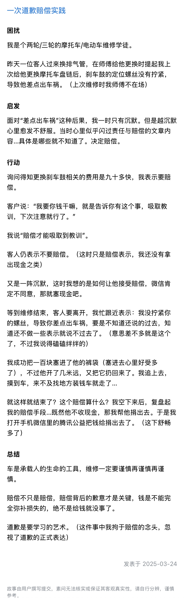

---

## 0814　牛顿有问题

- 日期：2025-04-29　主专题：A16 媒体舆论与公共认知　副专题：A03;A10
- 源 ID：`260b74e3-1230-5dac-b184-6d46de7f29a7`　原文链接：https://afdian.com/p/1b91f5ec1ee711f09d6452540025c377
- 官方对象—实践路径：与社会 / 与舆论 / 表达
- 23 概念标签：事实与证据;选择与自由;责任与后果;成本与总账;爱与回应;照料与家庭;劳动与组织;法律与秩序;心理与主体
- 证据状态：manual_confirmed　初读：read　独立复核：not_reviewed

**问**：如何看待网络上「挂人」的现象？

这是一些懦弱的人敢做的最“勇敢”的行为了。
其实观点之争，没必要指名道姓——发现没有，爱因斯坦要论证经典力学的问题，根本就没有必要提到牛顿的名字。
虽然经典力学是牛顿提出的，但“证明经典力学有问题”远比“证明牛顿有问题”重要而且根本。
这就是“挂人”的人最大的错误——证明“这个人有问题”“这个人有错”只会最终招人厌烦。
人是充满缺陷和情绪的动物，人的认知天然是有局限的，你反复的证明张三李四有局限、有问题，只是在证明一个所有人都早已知道的常识。
你觉得证明“张三也是有缺陷的”“张三也不是绝对正确”非常重要，你只会让观众翻白眼——“张三是个人，有缺陷/不是绝对正确很稀奇吗？”
这还罢了，关键是，挂人的人往往叽里咕噜论证了半天，也没让人——这是指中立的第三方——看出张三到底哪里错了、哪里有缺陷了。
因为除了情绪激动的一大堆帽子和罪名，无论在陈述依据还是在论证逻辑上均无建树，带着将信将疑的读者们跑了一场漫长的马拉松，最后却什么都没有。
因为ta们一直没有搞清楚一个最基本的要害——没人关心牛顿有没有错，人只关心经典力学有没有错。
人花时间是想看你如何列公式、做实验，证明经典力学不够精确、不能解释某某实验的结果。人不想花时间看你控诉“牛顿也不完美”这种不言而喻的、无需论证的废话。
这只是在展现自己的心智不健全，而且对那些对自己还抱着一丝默认人际信任的人的切身利益漠不关心。
自辱，且辱人，且不知其辱之所自。
悲哉。

更可悲可怜的，是那种自知都无理可说、只能靠捏造和“合理想象”，编造“丑闻”污蔑、侮辱别人人格来抚慰自己的挫败感的类型。
第一，这是刑事罪行。
对方让你作一段时间，让你点击率、回复数满足起诉条件后就可以轻松通过律师函向平台调取你的信息发起法律诉讼，让你自咽苦果、悔之不及。
到时候你这道听途说的满嘴跑火车是要向法院提交合法途径获取的实际证据的，提交不出来，侮辱罪可是刑事罪，是要处三年以下有期徒刑的。坐完牢出来，考公、出国、求职……那张“无犯罪记录证明”都能要你的命。
你有婚多半也要离掉，有工作多半也要丢掉，有企业多半也要垮掉。
到时候后果摆在面前，你要跪在地上哀求对方高抬贵手撤诉——你自己想想那个滋味。
到时候你指望谁来救你？怎么救？
于是你哪是在“挂人”，你这是把自己的头往绞索里伸。

第二，你这种行为方式只会让你身边的明白人看了害怕，默默远离你，而让一些居心叵测、别有目的的人和自己就没活醒、容易给身边人招祸的人向你聚拢。
居心叵测的人一眼就看得出你这人头脑简单、容易操纵，撩拨两句，轻轻松松就拿你当枪使，当火钳去火炉里取烧红的铁板栗。
而那些跟你一样的糊涂蛋在这里跟你打得火热，过不了三天就可能把你卷进莫名其妙的麻烦里去。你敢拒绝？你忘了你们是什么性格的人了吗？下一个写大字报挂你的就是你的新好友。
纯给自己招祸消福。

永远记住，不要自甘下流，不要在“牛顿有问题”和“经典力学有问题”之间选择前者。
后者比前者重要一万倍都不止。你兴致勃勃的选前者，在明眼人眼里是一种“智力未开化”级的不知好歹。
长点心，少丢点脸。

---

## 0679　湿地

- 日期：2025-07-10　主专题：A16 媒体舆论与公共认知　副专题：A03;A07
- 源 ID：`4f5537ae-f1bd-50d1-94f8-3d8f85ae1535`　原文链接：https://afdian.com/p/8fd39188577f11f0bab952540025c377
- 23 概念标签：定义与达意;能力与学习;责任与后果;边界与许可;劳动与组织;法律与秩序;权力与异议
- 证据状态：manual_confirmed　初读：read　独立复核：not_reviewed

**问**：暴力能解决很多问题么？

先要说明暴力到底是什么。
英文的暴力——violence——其实要义既不在于暴、也不在于力，而在于“伤害”。这个词有一堆古法语、拉丁语的源流，但本质上这个词的核心含义是“使受伤、不敬、亵渎”。
翻译成中文“暴力”之后，大大的转向了“突然的、出人意料的、强大的力量”，即“暴的力”。
现在先按照暴力就是一种“意在使人受伤害、受侮辱、受亵渎的能力”来谈论问题。
你说张三很暴力，意思是张三整天憋着使人受伤、受侮辱、受亵渎。
这跟警察动用武力抓捕犯人、军人发扬火力打击敌人有何本质区别？
区别在于暴力不受伦理约束。
警察追捕人，是不能针对无嫌疑的公民的，不经法律授权、规则许可，ta们的武力不能被使用。所以你手无寸铁，也完全可以凭着法律的保护和警察据理力争。
军人参战，是不能对平民百姓、战场救护开火的。否则要违反军法、受到惩处。
武力是有所为、有所不为的，并且这个为与不为的法则的定义权和解释权并不掌握在武力持有者手里，而是托管在法庭、监察局这类仲裁机关手里。
武力有原则，原则以内的人不需要担心受到攻击、遭受损失。
暴力没有。
如果说有，那就是“暴力持有者想起一出是一出“的个人意志。
因为武力而降服，你接受的是一个条款明确、执行稳定的规则。
因为暴力而屈服，你接受的是一个喜怒无常、行为不可预测甚至经常自相矛盾的奴隶主。
ta坏到什么地步？ta坏到你就是愿意投降、愿意放弃一切反抗、愿意无条件听从这位奴隶主的一切指示，你都一样难逃暴力折磨——因为ta自己想起一出是一出，ta自己自相矛盾。
其实明明是ta要你给地上洒洒水降一下温的，现在ta又因为你把地面弄湿了打你。
这就是暴力和武力的区别。
你作为暴力的屈从者，你很快会发现这个局面有多蠢——问题明明出在发号施令者自己身上，你听着ta的命令，你都会变成罪人。
两头堵，亡亦死、举大事亦死，总之你不可能落的下好。
你有时都会替那个愚蠢的奴隶主着急——这问题没解决，真不是打的问题，是你自己脑子没想明白在来回折腾。但你非要迷信这是因为我们干活不努力、故意不听你的。
你只相信一种解决问题的手段，就是打来打去。
第一，叫我洒水把我打一顿，再因为地面湿了再打我一顿，解决不了你这个“地面降温与干燥不可兼得”的问题。
第二，你根本无法依靠两顿自相矛盾的殴打来解决我“不够听话”的问题。
第三，你没给我任何“可以靠听话改善处境”的指望。因为问题根本就不在于我不够听话。
所以你看暴力到底解决了什么问题？
但它带来了什么新的麻烦？
是那些已经寄希望于“配合就可以不挨打”的奴隶们不能不产生的绝望和愤怒。
你的地还是干不了，这次是因为你的血从宝座上一路流了下来。

---

## 0652　逆风而生

- 日期：2025-07-28　主专题：A16 媒体舆论与公共认知　副专题：A01;A14
- 源 ID：`1df48cbb-a39b-5c8b-b17c-80df9322bd81`　原文链接：https://www.zhihu.com/question/1932898211321852443/answer/1932949579290084210
- 官方对象—实践路径：与社会 / 与舆论 / 接收
- 23 概念标签：事实与证据;能力与学习;技术与工程;文明与历史;心理与主体;性别与身体
- 证据状态：manual_confirmed　初读：read　独立复核：not_reviewed

**问**：在社会新闻的评论区，对于不同意见，大家为什么很难心平气和的交流（请详细看问题描述）?

信息社会对人类是一个新课题。
或者不如说，干脆是一次“白垩纪大灭绝”。
信息技术将会导致大量的人类个体因为难以适应信息流的冲击扰动而绝育甚至抑郁、癫狂、药物成瘾，其杀伤力其实比新冠甚至非典强大得多。
站在这些信息的洪流之中，你会处在一种荒谬的处境之中——你同时要顶住不同维度上的从四面八方而来的“逆风”。
不像传统社会，一阵风吹来，要么是东风，要么是西风。你这个人要么顺风，要么逆风。
信息社会是你的头部是东风，胸口是北风，腰上是南风，腿上是西风，你的手挥一挥，取决于你的挥动轨迹，会在一秒之中穿越七八种不同的强劲气流。
如果你想完全不受这些气流扰动，
要么，你得像阿汤哥躲激光线那样习得一身好柔术——which is just a meaningless joke;
要么，就要有一份双脚铸在物理性、数学性的事实花岗岩上的千斤坠、铁布衫硬功夫。
你要能把一切信息还原到物理性的事实，穿透一切情绪和利益，回到冰冷的理性层面做冷静的审计。
而这，非常遗憾的讲，即使有自觉自愿的主动努力，也需要相当的天赋才能做到。
如果没有这份充分的自觉，以人类在传统文化里积淀的有限的社会性，是难以抵御这些信息洪流的推挤和拉扯的。
这是一种牵手拉脚，要迫令你的头和你的心为敌、你的手和你的脚成仇的乱流。
想不痛苦和迷茫，谈何容易。
而痛苦和迷茫的人，必然陷入持续不可解的焦虑，对一切都陷入兽性的应激反应。
你所看到的，只不过是信息技术撞击人类文明所掀起的震荡波对人类的屠杀罢了。
我万分希望你们能从这浩劫里幸存，所以才这么多年如一日的示范怀疑的技术和艺术。
有效的怀疑能力是这场十六维飓风里的定风珠。
你们要紧紧握住这东西，才有可能在举世皆狂的情况下顶着千万人的荒唐打出你的“逆风局”。
这风不是什么细雨和风，是要谋财、夺魂甚至吃人的。
顺风则死，逆风则生。
我几乎是当着你们的面专拣最大的逆风局打，这不是为了证明我有多牛逼，而是为了向你们证实一件事——声势浩大，不代表真理。
只要你确认物理、数学和历史站在你这边，你可以无视一切人的喧嚣。
你要在意的是真正的历史走向、客观规律，风毕竟是风，风是影响不了地壳运动、板块漂移的。
这是可行的，而且是必须的。
我不是次次都会赢，但是我只要赢上哪怕一两次，都足以打破你们面对滔天舆论、“巨大共识”的恐惧和绝望。
“巨大共识”又如何？
我背后是物理学，你们有本事开个会投个票把万有引力关掉、把电化学改了、把人的神经反射机制换掉。
否则你们人再多，齐声把幻想喊得再大声，一样会在现实面前惨败。
你们不对逆风而立产生基本的信心，只要稍稍任由信息流推搡裹挟，焦虑、抑郁都只是最初期的症状而已。
这是时代的瘟疫，是要把无法适应的人类像无法适应寒冷的恐龙灭绝那样的残酷筛选。
站稳扶好吧，祝你们好运。

---

## 0636　十年河西

- 日期：2025-08-04　主专题：A16 媒体舆论与公共认知　副专题：A20
- 源 ID：`3dfaa721-5b8f-5f42-b950-aeeb92a49fd4`　原文链接：https://www.zhihu.com/question/1933810657603613140/answer/1935713501755709404
- 官方对象—实践路径：与社会 / 与舆论 / 应对
- 23 概念标签：事实与证据;能力与学习;心理与主体
- 证据状态：manual_confirmed　初读：read　独立复核：not_reviewed

**问**：如何评价武汉大学最近的风评？

与其说是武汉大学需要担忧，不如说是“风评族”们要开始担忧自己的风评。
因为传播学的基本规律就是这样——当某个群体开始风评这个、风评那个，积累到一定量，就会开始反向出现对其风评的风评。
如果这个积累数据反向的说明风评人本身其实动机、价值观、理性能力有问题，则曾经因之“风评被害”的对象就会一夜之间恢复名誉，而真正垮台的反而是风评者自己。
一个鲜明的先例就是现在已经沦落到悲惨境地的曾经名为“公知”的反建制群体。
曾几何时，这个群体也曾所向披靡、前呼后拥、威风八面。
上至国家体制，下至街道民生，无不受到过ta们的严厉谴责。
如果挑出来只论其中的单独案件，似乎每一个都不无道理，至少不能被视为完全空穴来风。其中过分的言辞、极端的情绪，常被理解为情有可原的人情之常。
但是，时间久了，“情有可原的人情之常”的豁免效应就不可避免的开始减退了。
积累日深，掉头回顾，人们很自然的越来越清楚这问题没这么简单。在这份义愤填膺的外表之下，隐藏着一份并不纯良的动机。
这其中最鲜明的特征，就是夸大其词、添油加醋，力求扩大、激化矛盾，塑造恐怖气氛，追求营造社会分裂和对立。
简而言之——为了追求自己个人的、小团体的利益，几乎毫不介意的牺牲、侵犯社会的整体利益。
一旦大的数据开始显示这个特征，公众对一些显然不必要的过激情绪曾经赠予的同情和理解就会急剧的耗尽，并开始重新审视其“征程”上所有的受害者。
这其中就有相当一部分——甚至是大部分——都会发生评价的反转。
“当初这些人说得那么邪恶不堪，现在回顾起来，根本就不是这么回事，只不过当时站在那个位置上有些话没法说、有些事不能做，而这种顾忌被这些人利用了”这样的判断会一下子多起来。
指控者自己的风评坍塌了，那么很自然的，被其指控的对象的风评就会重建。
看待社会运动，你会很容易发现这种“盛极而衰”“强而反败”的现象。
一切依赖刺激群众朴素情绪来保持动能的社会潮流，最后也必然因为群众情绪对刺激的迟钝化而被逆反。
说话、做事，不要只考虑现在的人怎么看，而要连将来逆反期到来时的人会怎么看也考虑到，要讲经得起时间检验的话。
基于这种历史规律，你就可以看到——武汉大学也罢、京东也罢、重庆也罢、长沙也罢……它们现在被扣上的帽子，用不了多久就会被一阵风吹掉。
真正需要担心的，其实是当初到处发帽子的人。
一个简单的历史现象是——“已过红线”的效应显现不是平缓、线性的。并不会出现一个“这次宣传感觉群众反应好像没上次强烈”“这次宣传比上次反应又平淡了一些”的平缓下降阶段好给参与者一个形成心理预期的过渡期。
而是在当事人顾盼自得、正觉得当世无敌时，突然有一声童声打破寒蝉之秋，然后如按不住、扑不及的星火燎原一般瞬间传遍四野，一夜之间，昨天还不可一世的，今天就变成了人人喊打。
发展之快，会令当事人神志恍惚。
有一句话，对这种现象说得非常传神——
在它倒下前，人人都觉得它怎么可能会倒；
当它倒下后，人人都在想它怎么现在才倒。

---

## 0633　败寇

- 日期：2025-08-07　主专题：A16 媒体舆论与公共认知　副专题：A01;A03
- 源 ID：`347a3aba-4b68-5876-9507-35a5369abb2d`　原文链接：https://www.zhihu.com/question/1934801323796202353/answer/1936668404279927826
- 官方对象—实践路径：与社会 / 与舆论 / 接收
- 23 概念标签：事实与证据;财富与市场;技术与工程;文明与历史;心理与主体
- 证据状态：manual_confirmed　初读：read　独立复核：not_reviewed

**问**：最近经常刷到关于“理想车主素质”和理想碰撞测试的问题，为什么理想突然上了热点，是友商发力了吗？

人类有一种习性，可以描述为“成王败寇偏执”。
一个学生成绩好，那么ta做什么都是对的，就是偶尔有什么“小小失德”，那也是名士风流、不拘小节。
一个运动员跑得快、打得赢，那就是勤学巧练的楷模、运动场上的主宰。
一个东西卖得好，那么老板无论如何都是英明神武，一切的言行都是深谋远虑。
反过来，一旦你要是分考得不行、跑不动、打不过、卖不好，那你就必然人品低下、性格猥琐、短视愚蠢。
砖石横飞。
理想的新车输了，销量趋势眼见得要一路向下，成了候选失败者，那么失败者相应的全套待遇自然会接踵而来。
其实人们这么做的原因并不在你身上，而在于ta们自己要保持某种逻辑一致性。ta们相信道德高尚、负重行远、深谋远虑……必然会成功，自己朝着这个逻辑奉献了半生，这种付出了巨大代价的信念从另一个侧面来看会是什么？
是一旦有人失败了，尤其是败得很惨、很不体面，这人一定和我所相信的成功方法背道而驰。
我无法接受一个不猥琐、不道德败坏的人失败得如此不体面。我如此努力的追求体面、道德，不就是因为不这样就会输、这样就可以赢吗？
如果有人做到了，却还是输得如此不体面，我自己怎么坚持下去？
所以你既然败了，你就必须是道德败坏、人格猥琐的。
如果现有的证据不足以证实这一点，我就要发动想象，把该证据可以兼容的最坏的可能当成“被掩盖的事实”来信一信。
这样我的世界就重新平衡了，重新公平了，可以继续为了成功而忍受道德戒律、艰苦努力了。
而千万人一起搞这种“信念再平衡”，对当事人就形成了“成王败寇”风暴。
它无意间把成功赋予了特殊的价值，给失败染上了额外的毒，导致每一个耳闻目睹过这类惨状的中国人都对失败不寒而栗。
如果你失败，人们就会为了保住ta们自己的心理平衡忍不住发动最恶意的想象来践踏你。
如果你成功，那么这些人就会基于同样的机制把你想象成天神下凡。
这种从天堂直通地狱的威胁，沉重的压在中国人——乃至整个东亚文明的每一个成员心上，这是儒家文明“自强不息”的底层驱动机制之一。
正因为它可以驱动“自强不息”，所以它的毒副作用被有意无意的“忘记”了。
理想现在遭遇的，就是失败者的“处刑”现象。
而看穿这些杂音，顶着千夫所指，众口铄金，仍然逆流而上，踏实努力，持续向理性支持的正确方向前进，是每一个真正的卓越者都必须有的孤勇。
成功一次，其实微不足道。成而后败，进而因败而受谤，进而顶着这些毁谤再次令人无可否定的成功。
这才算立住了字号，可称一家了。
要么你就回家种红薯，要么就做好心理准备。
就这样。

---

## 0627　通幽胜境

- 日期：2025-08-12　主专题：A16 媒体舆论与公共认知　副专题：A13;A03
- 源 ID：`3bd890c4-b62f-5784-bb37-415baaae8259`　原文链接：https://afdian.com/p/2fc79c1c716511f09fac52540025c377
- 官方对象—实践路径：与社会 / 与舆论 / 接收
- 23 概念标签：事实与证据;定义与达意;能力与学习;责任与后果;成本与总账;照料与家庭;财富与市场;技术与工程
- 证据状态：manual_confirmed　初读：read　独立复核：not_reviewed

**问**：理想车主真的很差吗?

其实理想用户群在这一点上有一些受误会。
这其实是理想的产品战略导致的特殊效应。
理想的成功要害，在于把超过了宝马X7级别的乘坐体验一举拉到了30-40万级别，而且最重要的是，它用的是一种不依赖基础设施的技术方案。
二胎家庭、多代同堂家庭在二三线城市远比一线和超一线城市比例更高，而二三线城市的停车条件、道路条件对更大尺寸的车辆远不如超一线城市敏感。尤其是二三线城市几乎没有限车限牌的政策局限。
现在一下有一台车，乘坐体验足以和60-80万级别的豪车相比有过之而无不及，凭着电机卓越的底层优势，不谈更微妙的操控体验，至少在感知最强的动力方面也足以和宝马、沃尔沃的竞品媲美。
这就导致它一下打开了大片的二三线城市的家庭市场。
问题是，这个新开拓出来的用户群，除部分是由陆虎、宝马、沃尔沃、帕杰罗这类大车用户转移而来，很多都是第一次开这么大车的“大车新手”。
一下尺寸大这么多，要精准妥帖的倒车入库进入空间规划紧张的车位，难度其实非常大。
而且大家在空旷宽敞的私家车位随便停惯了，一时之间意识不到在这种停车场精准入位的关键意义。中心城市和高速服务区、景区停车场这种寸土寸金的地方，车位画得极小、通道留得极窄。一辆宽近2米、长超5米的大车要在这么窄的车道上精准对位倒入车位，实在是一门需要针对性训练的特殊技艺。然而带着全家人出游的新理想车主在自己日常的活动范围内几乎没有这个需求，只有到了高速服务区、景区、城区酒店才会突然面对这种高难度挑战。
ta们几乎本能的就会停在离入口最近的车位上，而且一旦遇到车位比较宽松时就会下意识的遵从自己在家乡的使用习惯，斜向或者比较马虎的入位了事。
这就会导致一车占两位、或者过度逼近车位边界线导致邻车封闭空间急剧恶化。
而另一方面，这些车主在自己熟悉的空旷条件下养成了随手推开车门的习惯，尤其是不少随车出游的还是几乎没有多少用车经验的长辈，加上理想汽车普遍为了上下方便而设计了长尺寸的车门，这就导致极易出现开门碰伤隔壁车身的问题。
而又因为这些车往往是异地来旅游的，一方面日程紧张，另一方面身在异乡也很容易抱着侥幸心理一走了之。
于是与其他车主之间短期内就爆发了大量的摩擦冲突。
而这个问题，在同时代的蔚来并不存在。因为蔚来的体验严重的依赖换电站，而换电站几乎完全集中在江浙沪人口稠密区；另外，蔚来的销售严重依赖绿牌政策和“难以获得私家车位”的条件辅助。这就导致尺寸非常接近的蔚来车主往往早已养成了与狭窄车位环境相适应的用车习惯。
而对应的，问界系列的定价往往又高于理想，且明确的偏向商务属性而非家庭属性，在车位宽松的区域往往因为显著的价格劣势和定位问题不是理想的对手，销量少很多。
即使如此，问界因为是增程大车，同样更适合补能设施较少的宽松环境，其用户群体的行为习惯也与理想有同样的底层特点，因此问界车主的名声也有不少烦言。只不过因为销量少很多，所以没理想用户那么突出罢了。
实际上，因为L90击穿了30万价格线，同时换电网络已经达到3400站规模，随着L90的大量销售，乐道也必然会获得大量资源宽松地区的用户。同样的使用习惯差异也会出现在乐道用户群体身上，乐道车主成为“电车三恶”之一恐怕指日可待。
只不过可能在高速服务区因为换电的快捷，乐道车主少一个招事的关键场景，可能没有大哥二哥这么惹眼。
与之相对的，小米用户实际上也会同样遭遇这种危机，只不过小米突破的不是车身尺寸方面的性价比，而是加速性能上的性价比。所以小米车主的标签必然更倾向于鲁莽驾驶而不是乱停车。
实际上“用户素质不高”几乎是“国民车”必然的宿命，只要你纵观汽车发展史，你会发现飞度车主、比亚迪车主……等等等等靠空前性价比获得大量新手车主销量的车型都逻辑不可避免的要戴一戴这顶帽子。
要不是卖得好，还轮不到背这个恶名，这也算一个“甜蜜的负担”了。

写这篇，要害其实根本不在于驾驶道德，而在于借这个案例揭示一种看待社会问题的方法。
那就是用社会学的方法论看待社会问题，而非用道德批判、资源斗争的方法论看待社会问题。
用前一种方法研究社会问题，你得到的是对社会本身的更深刻的理解，平和、稳定得多的应对心态，更不必说会有更具有效性的对策思路。
用后一种方法看待社会问题，你只会得到“下一个该骂谁”这样的无效对策，并因为这类无效对策逻辑必然的连续失败而导致自己不断陷入更深的抑郁，以至于最终导致道德虚无主义。
你在用锤子解决本该用起子解决的问题，焉能不败？失败太多，你对锤子的信念就会崩溃，而你手里却又只有这一把锤子，这样最后岂不是赤手空拳、手无寸铁的在这猛兽横行的长夜里连哭都不敢大声？
希望你们能从这个案例吸取教训，看明白应有的看待社会问题、社会现象的方法该是从何处入手、向何处寻求。
彼节者有间，而刀刃者无厚，以无厚入有间，恢恢乎，其于游刃必有余地矣。
依乎天理，批大郤，导大窾，因其固然。技经肯綮之未尝，而况大軱乎？
间不容发处，有通幽之胜境。

---

## 0552　私刑

- 日期：2025-10-02　主专题：A16 媒体舆论与公共认知　副专题：A08;A15
- 源 ID：`83a7e692-afde-5ae8-98f3-89a2ee61ef73`　原文链接：https://afdian.com/p/cbc92318997b11f0878552540025c377
- 官方对象—实践路径：与社会 / 与舆论 / 应对
- 23 概念标签：事实与证据;选择与自由;责任与后果;成本与总账;财富与市场;生态与自然;性别与身体;宗教与自然法
- 证据状态：manual_confirmed　初读：read　独立复核：not_reviewed

**问**：罗永浩什么时候能回来？

他想问题太简单了，因为对方不会去直接破坏他的人身安全，而是会用他的同样手法去对待他代言、出品的所有产品，先拆毁他的形象，引诱他的崇拜者因为“受到欺骗”反过来仇恨他。
他代言或他自己出品的产品，整个产业链都会被人用放大镜寻找甚至“制造”丑闻，例如各种各样的暗访和钓鱼做局，这会导致考虑用他的商家望而却步。
谁沾他的边、尤其是被他赞扬、推介的那些或者赞扬、推介他的那些，都会被套进这些瞄准镜里作为首要目标。
甚至他接下来接触到的某些“客户”本身就可能是刻意安排的假客户，用意就是为了引诱他说出某些话或者干出某些事。
总而言之，对方的用意是要证明他言行不一，甚至自己比别人干得更坏。
而当他自己把标准拉到这么高，要做到这一点恐怕并不困难。
人无完人，何况他本来就是一个眼高手低、思路散乱、情绪冲动的人。
对方的指控会是谋定而后动，理据充分、难以辩驳的。
一旦被对方抓住这样的污点，尤其是要是对方还接二连三的抛出这样的东西，他的公众形象就会发生很大的崩溃。
到时候会去威胁他的人身安全的根本不会是敌人派出的杀手，而是他自己“被深刻欺骗”的狂热追随者。

坦率讲，罗之所以还维持着差强人意的形象，其实和他本人的操守基本无关，而是因为他的形象崩溃对他那大批损失惨重的债主们极为不利，而这些利害相关的债主们的合力其实是非常可观的。是这个背后的守护力量在维护他的品牌价值。
他自己身上的污点、问题其实多如牛毛，是这个力量帮他按住了——因为保住他最后的品牌价值来还债远比把他挫骨扬灰来得实际。
但他现在这个做法，引来的敌对性已经超过了这个护盾可以抵挡的强度。
债主们只有这么十几亿的利益相关，如果坚持护短，那么那些已经定意要拿他杀一儆百的力量就会掉头把矛头对准这些庇护者里的最弱者，要先通过实力攻击翦除他的保护伞的短板来促使其他人停止庇护。
剥离了这些保护伞，以他的能力修养，要应对这些无孔不入、显微放大的针对，数学概率极不乐观。
某种意义上讲，餐饮行业基本已经有心照不宣的共识，必须让罗付出令人望而生畏、闻之胆寒的代价，才能做到“打得一拳开，免得百拳来”，震慑住无数跃跃欲试打算在这个“赛道”起跑的投机者。
如果让罗在这个题材上落个名利双收，不仅仅对餐饮行业、预制食品行业本身有难以计量的直接损失，更会极深刻的损害广大人民群众的根本利益。
群众自己不明白预制食材对他们自己的饮食成本有多么决定性的作用。如果让罗这种行为蔚然成风，导致现有的餐饮企业大踏步的回撤预制化进程，将无可避免的带来食物价格的普遍上涨和农业企业、冷链企业的重大损失。
一个非常简单的基本事实就可以说明这问题的严重性。
如果深冻都算不可接受的预处理手段的话，被极大集中的农场格局就会发生荒谬的绝境——很多品种50%的产量都经过多年的市场作用被集中到了其最佳天然产地，实现了超大规模的现代化，工业化生产。
一旦进入收获季，其产量犹如作物的海洋，优质的作物堆积成山。如此巨大的产量是需要全国乃至全球市场花上半年甚至一整年去消耗的。这必然要用到鲜采深冻长期保存和长期分批销售。
“一年期的冻羊腿”完全是这一生产模式理所当然的正常现象。要求所有的产品在其采收的室温保鲜周期里被完全消费，只有极大分散、就地消费的“满天星”式生产才可以实现。
而后者意味着95%的产量都会在根本不适合种植这东西的地区被勉强的种出来，市场上会充斥着皮包骨的西兰花、薄如纸的荷兰豆，而且这些非优质产地必然要大量使用农药和化肥，而且因为其天然的地区垄断性，养出无数的葱霸、蒜霸、菜霸。好不好，百里之内只有他家，别家根本无法运得过来。
如果不允许深冻长期分批销售，请问如此大的产量如何销往全国各地？如何将如此大量的“一季收成供全国半年”的当令收成在室温保鲜期内完全消费？
农业集中化、规模化、专业化的历程会毁于一旦。
民以食为天，这种荒谬的倒退绝不仅仅是餐饮行业的行业私利问题，而是会影响到国民经济的所有方面。
他接下来的命运负面性非常大。
其实这是用苛刻标准对人进行私刑道德审判的天然后果。
自然法是不容人对人这么做的，因为一旦你自居正义天使这样去审判别人，别人就自然要用十倍的苛刻来反向审查你——毕竟你可是天使。
这个世界上，除非有什么力量干预对你的审判范围——例如绝对的禁止公众舆论触及你的隐私——否则哪有这样的完人？
而如果你的这个傲慢审判甚至损害到了全民根本利益，又有什么样的力量可以护得住你？尤其是，它又为什么还要继续庇护你？
素问为什么一向站定“原谅和宽容是人天然的义务”这样的基本价值观，这个例子就是一个活的例证。
你们不要论断人，免得你们被论断。因为你们怎样论断人，也必怎样被论断；你们用什么量器量给人，也必用什么量器量给你们。为什么看见你弟兄眼中有刺，却不想自己眼中有梁木呢？你自己眼中有梁木，怎能对你弟兄说：‘容我去掉你眼中的刺’呢？
(马太福音 7:1-4 和合本)

---

## 0458　激

- 日期：2025-11-29　主专题：A16 媒体舆论与公共认知　副专题：A13;A18
- 源 ID：`0b120790-933a-521b-8f89-fe9df95949ee`　原文链接：https://www.zhihu.com/question/1977414031737377644/answer/1977847072255411696
- 官方对象—实践路径：与社会 / 与舆论 / 接收
- 23 概念标签：事实与证据;能力与学习;选择与自由;责任与后果;成本与总账;劳动与组织;财富与市场;文明与历史;民族与身份;心理与主体
- 证据状态：manual_confirmed　初读：read　独立复核：not_reviewed

**问**：香港火灾为什么这么多香港人极力证明竹架无罪？

客观上竹架只是比较落后，谈不上多么可怕。
毕竟已经用了一百来年，因为一次偶发的、并没有多高复现概率的事故而做很大的动作，这其实没有绝对的必要。
香港历史上的大火，除了战争遭轰炸以外，一般是老旧木楼起火、船舶起火、工厂起火、仓库起火和密集市集起火。
最类似这次也是最近的一次，是1996年嘉利大厦起火——同为高层建筑起火，火势蔓延超预期的原因是电梯井导致空气对流加速形成烟囱效应。
这里就出现了一个很显然的问题——如果因为这次大火里竹制脚手架疑似对火势蔓延起到助力而禁止竹制脚手架，那么为啥不因为这个原因禁止建筑物建设电梯？
要知道高层建筑火灾极少有带竹制脚手架的，但是那可个个都有电梯井带来的烟囱效应，没得跑的。
如果竹制脚手架已经算不可容忍的火灾隐患，那么电梯井怎么办？
落水的人会因为衣物浸水而严重的影响动作效率，加速体力消耗而提高溺亡概率。
那么要规定坐船都要脱光吗？
其实真要举，类似的例子还多得很。
譬如以每年电动车事故之多，电动车不该强制要求安装装甲吗？
这不是否定“这些事物存在安全隐患”这个事实，而是在说明一个更朴素然而却很容易被忽视的问题——绝对安全是代价高昂的。
几乎所有的东西都是在安全与成本之间做过取舍，而不是一面倒向安全一边的结果。
有时候人类只能选择“以后多注意”，而选不了“因为出过一次不太见得还会复现的灾难而全面禁止”。
注意，这个“不具高复现概率”很关键。
譬如“老化石棉瓦导致人类肺癌”一被发现就全面禁止了，因为这种事故出现第一起意味着接下来所有已老化的石棉瓦都远比人类想象的危险。这甚至不是“复现概率”问题，而是“迟早要出事”的问题。

此为其一。
其二是这个选择其实可以交给市场去做。
业主可以自己去权衡用竹制脚手架的价钱和安全风险，保险公司也可以权衡这个威胁而调整保险价格，这自然就会形成一定的排挤效应。让觉得风险不可控的业主们自己选择就已经够保证ta们的安全了。
其实不是很有必要通过立法一刀切的方式去做这样的规范。
做事要有尺度感，不要任由洁癖式的应激情绪抢了自己的方向盘，否则很容易干很多你会后悔莫及的傻事。

身为中国人——更准确地说，身为中国大陆人——要警惕自己身上的一种傲慢。
就是拿自己做标准来看不起别人的“落后”。
中国大陆是这个世界上的特例，找遍整个世界，甚至整个人类史，你都找不到这样一个完成了社会主义改造、一党长期稳固执政、主体民族比例如此悬殊、有五千年文化及治理经验、实施全民所有制的社会实体。
我们能“看到某个东西更先进、更合理就去干”，把这当成理所当然、不言而喻，做不到就岂有此理、应该有人下台滚蛋，是因为我们有人类历史上独一无二的组织优势，而这是付出了哪吒式的剔骨再造的代价才完成的。
我们接近于把一名遭遇了车祸的心肌梗塞患者抬进手术室做了一个脑外科手术，不但活过来了，还参加了奥运会拿了个110米跨栏冠军。
说得不好听一点，承受这种程度的自我再造而没有直接毁灭，是人类史上的奇迹，任何别人都不能奢望自己来一次能下得了手术台。
别的国家、地区是【没有这个条件、没有过这个运气】的。
你这就像一个杂技演员在钢丝上健步如飞，甚至可以翻跟头，然后耻笑别人：“连站一下都不行吗？这么基本的水平都没有？”
这是一个极不公平、而且有些不知好歹的态度，谁会接受这种“善意的批评”？
你们班的学霸嗤笑你“我不明白怎么会有人连微积分都理解不了”时，你是什么感觉？难道是“知耻而后勇”？
没人否定你的先进，但这不是你蔑视别人、把别人做不到全视为“态度有问题”“不知上进”“无能”的合理理由。
你父母有多少次认定你就是“态度有问题”、就是“不知进取”、就是“懒”，你是觉得ta们全对吗？
轮到你说别人了，这些就都不是问题了，就都对了吗？
不要自己领先了，就去当那个居高临下“你们就是不知进取”的混蛋。
你要相信人类都是追求进步的，没人是所谓不知进取的，你真的觉得谁进度落后，就去实质的提供帮助，而不要先从“你们就是不知进取、自甘堕落”开篇。
相信对方没有品质问题、态度问题，不从这个角度去做问题归因，这是对人最基本的尊重。
你自己就曾经渴望别人明白这一点，不要有朝一日自己媳妇熬成婆了，忘个一干二净。

---

## 0404　其怪自败

- 日期：2025-12-26　主专题：A16 媒体舆论与公共认知　副专题：A03
- 源 ID：`9a71649d-a077-5450-869a-4d38f4969f71`　原文链接：https://afdian.com/p/4105b9c8dc4511f0ad5b5254001e7c00
- 官方对象—实践路径：与自己 / 与原则 / 坚持
- 23 概念标签：事实与证据;能力与学习;信用与信任;爱与回应;边界与许可;法律与秩序;权力与异议
- 证据状态：manual_confirmed　初读：read　独立复核：not_reviewed

**问**：人不可论断人，你不论断,但是你的敌人会通过舆论将你化为道德黑洞,怎么能在未强大前不打破这个原则保护自己？

不论断人的人，不是简单的嘴头上念叨这么个口号就算的。
忍住不造口孽，本身就是要自我管理、要付出代价、要持续下功夫才能做得到的事情。
而做到这一点，最终靠的是信仰，是“就算这样做会要我的命，我也一定做到不妥协”的坚决。
这是一种狠劲，有时堪称一种残忍。它起到了一种特殊的作用，就是会向所有见证的人证实你的意志力。
这于“对抗敌人的造谣抹黑”有什么用呢？
这要从造谣抹黑的原理说起。
造谣抹黑，本质上就是要给你塑造一个软弱、贪婪、猥琐、虚伪的形象。这个形象要立得住，一定需要先假定你是一个没本事、没骨头的人。
没本事，你只能装有本事；没骨头，你才要依靠塑造各种假象来迷惑人。
然而，你既然能在某些利益唾手可得、甚至旁人都觉得你无可厚非的时候断然的自我管理，旁观者就会自然而然的怀疑起那些造谣抹黑的基本前提假设——这人真的无能和软弱吗？
尤其是见证者自问自己在同样的条件下做不到自我克制，就更会断然的否定“此人软弱无能”的判断——因为ta觉得自己还做不到这样，要是这人都算软弱无能，那我算什么？
既然我不认为我软弱无能，我就很自然的、明确的认识到能持守这戒律的人不软弱无能。
我就会认识到你所鼓吹的ta在通过种种处心积虑的阴谋诡计要实现的所谓利益，这个人完全有能力不搞这些把戏直接拿到。
你越淡定，越坦然的坚持你的原则，对方的大肆抹黑就会显得越不合逻辑。除了非要依赖那些胡说八道取得某种精神胜利所以自己骗着自己相信的那些人之外，只要能做基本靠谱的推算的人都会意识到“以这人的狠劲和能力，如果真要去追求那些人所说的目的，犯得着这么麻烦吗？”
换了是我，我都不会这么折腾，这人比我还狠、还精明，ta怎么可能用水平这么低的蠢办法？
尤其是，那些抹黑你的人说实在的水平有限，开动一切智慧替你所幻想的最大的“绝妙阴谋”其实根本经不起人的推敲。
第三方稍微问几个“如果是这样的话，如何解释那个”这样的问题，ta们就会越圆越离谱，眼看着逻辑错乱、满嘴跑火车。
你要做的，仅仅是通过坚持你的原则，有所为、有所不为，通过这个不断无形的展现你的实力就行了。
其实那些人根本没能力编造与你实力相匹配的阴谋论。这就像只用过棍子的人根本想象不出拿着激光枪可以怎么作恶。ta们的故事全是基于一个ta们自我恶毒想象出来的、极度弱化过的你而瞎编的爽文。
不论断人表面上是优良品德，实际上却是无声的实力展示。
实力在此，故事就会编穿帮。故事穿帮了，谁造的这谣，谁的信用就会破产，自动吞下苦果。
你不需要多做无谓的多余动作。
不打破这个原则，本身就是保护自己。

---

## 0235　童言

- 日期：2026-03-30　主专题：A16 媒体舆论与公共认知　副专题：A10;A05;A03
- 源 ID：`e76c399d-5fe5-562a-a63a-59ce2cb8466f`　原文链接：https://www.zhihu.com/question/26683010/answer/2021887855253800132
- 官方对象—实践路径：与社会 / 与舆论 / 传播
- 23 概念标签：能力与学习;责任与后果;爱与回应;权力与异议;文明与历史;心理与主体;宗教与自然法
- 证据状态：manual_confirmed　初读：read　独立复核：not_reviewed

**问**：一些语言粗俗、内容阴暗的童谣是如何在全国范围内自发传播的？

孩子是一个特别有趣的社会符号。ta们拥有几个特殊属性：
1）不可罪。
幼童无知，童言无忌。孩子什么也不懂，完全不清楚自己言语的具体社会后果，所以即使儿童说出什么犯大忌讳的事，也无法通过传统的刑罚手段给予威慑。
就算你把可恨的张家小屁孩绑到菜市口明正典刑，也对李家小屁孩没有震慑作用，因为ta连死亡的概念都不太清楚，无法有效的害怕。害怕了又如何？ta很难理解到底错在哪了，是所有的歌谣都不能唱了吗？那我不唱，只用说的，这是不是就绝对安全了？怎么只用说的也不行？问题不在形式而在内容？
叔叔，啥叫“内容”？

2）只对俏皮的形式易感，但对内容无知。
小孩子喜欢一首童谣，往往只在乎说起来朗朗上口、富有节奏，尤其是适合用于跳绳、拍手这类儿童游戏的号子的，会受到特别欢迎。
对ta们来说，这和李小龙搏斗时的怪啸、和船工们拉纤时的号子没有本质的区别。甚至本身就很可能是从父辈的劳动号子里模仿出来的。
只要清脆爽口，轻松好记就足以大受欢迎了。这就给某些信息打开一道特殊的绕行通道。

3）同类互动非常频繁，无法监管而且模仿效应极强。
孩子们很自然要和其他孩子一起玩，这不但是被允许，还是被鼓励的。在现代还有带纪律的课堂部分可言，在古代几乎就是全村、全区小屁孩混在一起纯玩。而孩子之间的模仿本能极强，模仿能力也高到过目不忘的地步，而且儿童毫无自我焦虑，从不会考虑“如果我跟别人全都一样，我自己还有什么特别”这类无聊的问题，所以行为模式的童间传播是极其迅猛的。
孩子之间流行什么东西都是大火燎原式的快。一下流行萝卜刀，那就全员都要萝卜刀，还买了一把又一把；流行玩卡牌，卡牌塞满半书包；流行玩贴纸，贴满一冰箱，一不小心车屁股上贴一排，抠都来不及。
要传开，短短三五天就足够了，大人们发觉时已经蔚然成风。而且即使父母们想要干预、禁止，只要有一定比例的父母不上心、有那么几个小孩不受约束，就对整个结果几乎没有影响。
换言之，等朝廷觉得不对时，全城的小孩都在唱着这个调子一起跳皮筋了。
法不责众，处理大批成人都力有不逮，要处理全城的小孩子，要怎么处理才能处理到孩子开不了口？父母们能接受得了这种骇人听闻的可怕操作吗？
所以自古以来，童谣就成了种种预言、谶语、神谕、谣言的快速传播通道。
这倒不是说你可以明晃晃的鼓吹造反。
其实这类信息传播模式很类似传染病，一旦传开被家长发现，如果信息毒性过于猛烈，家长害怕惹祸上身纷纷给自己的孩子发出警告、做出约束，就约等于部分孩子会产生抗体，不会再参与下一波的震荡流行。而这部分孩子比例超过一定阈值，就会像吸波堤一样导致潮流迅速平息。
因此如果这类信息能维持流行，要么就是它足够含糊且无害，东一榔头西一棒子，明显缺乏逻辑和具体意指，以至于没有足够大比例的家长会参与强力制止——这就是本题所言的这类坏话童谣；要么就是它的信息虽然是指向政治诉求，但会得到众多其实暗自期盼的家长的欢迎，又因为编得足够隐晦，家长们放任纵容的政治后果也会足够轻微——这就是“石人一只眼”这一类。
坦率讲，少年儿童这个特殊媒介可以说是自然法留下的一个天然漏洞。仅仅是它的存在，就保证了官方话语无法实现对舆论的绝对控制。
其实现代借助电影、动漫，游戏以及社群媒体里那些“鬼畜”“无厘头”“埋梗”的作品，又何尝不是对同一机制的同样实践呢？
人人身在其中，未必自知罢了。

---

## 0160　柳下会

- 日期：2026-05-08　主专题：A16 媒体舆论与公共认知　副专题：A01;A08
- 源 ID：`7d2a60f5-fbf5-56b4-9971-72521ef6c046`　原文链接：https://www.zhihu.com/question/1974500863881021009/answer/2025940723179037957
- 官方对象—实践路径：与社会 / 与舆论 / 表达
- 23 概念标签：定义与达意;责任与后果;爱与回应;财富与市场;技术与工程;人工智能与机器
- 证据状态：manual_confirmed　初读：read　独立复核：not_reviewed

**问**：我想做自媒体能不能给我几条建议？

1）要早点开始，没有包袱、没有顾忌的开始。
很多人会觉得自己不是什么帅哥美女、不是大师专家、不是行业精英，觉得自己一无是处 ，所以要躲起来，要等到自己身上有什么值得人羡慕和崇拜的东西了才想尝试。
这是错的。
不是只有偶像才配被看到。
人们愿意花时间，也不是为了来各种偶像崇拜。
人要找的第一目标是爱。
是无欲无求，寻求同乐的爱。
只要你不掠夺什么，而是真的在分享，你分享的东西再卑微也不是问题。
一片小小的风景。一朵形状有趣的乌云。一颗刚长出来的竹笋。一群往回搬馒头的蚂蚁。你大扫除翻出来的小时候自己画的漫画。
任何让你高兴起来，你也觉得可以让你的朋友们高兴起来的东西，自自然然就会有力量，随时随地成为“爆款”。
你根本没有必要等到自己牛起来、伟大起来再行动，你现在就可以行动起来。
而且我劝你要早一点开始，因为也许是天意——AI到来之后，一切的所谓专业技能，若没有被时间证明的爱作保，都恐怕要面临困境。而唯一能为爱作保的，其实只有时间。
无心插柳，五年成荫。
到时候这“柳下会”很可能会成为你一生最重要的财富。
前提是你【现在】就要开始栽种。

2）你必须保持轻松。
不要想着一上来搞得非常“专业”，又是片头、又是运镜，又是写稿，又是表情管理、灯光、化妆……
不要这样。
拿个手机一架，说你心中所感所想，别想那么多。
你一定要轻松，这事一定不能对你成为任何意义上的负担。
一定要反过来——做这件事之后你的心情会比做之前要好。
这事本身就要对你存在享受，带来抚慰和滋养。
最轻的负担不是0，而是+1。
要找到“按这个标准，我每天干一干都没啥问题”的感觉，按照这个感觉去干。
所以你不要摆架子，不要锣鼓喧天，不要兴师动众，不要“勇于投入”，更不要“孤注一掷”。
是它本身就应该带给你力量和舒缓，而不是你先把自己搞得苦哈哈，然后指望它来给你“应有的回报”。
否则你一定会渐渐憎恨你自己请来的客人，最后这事必死无疑。

3）多做好事，尤其是没有争议的好事，令饥者得食，寒者得衣，病者得治，孤苦者得依的好事。
这不是要你表演给别人看，搞广而告之——如果你实际所做的不比人所知道的多得多，那是不健康的。
这不但是提醒你自己保持初衷的必要功课，也是将来有一天各种风波涌动时保证你自己不迷茫的定锚。
你一旦有些成就，万千毁谤会无法避免的席卷而来。你为人所知的那些善行是天然的防波堤，而你不为人知的那些则是你内心的定海石。
ta们并不如你知道你自己，而ta们不知道的那些让ta们的“批评”变得毫无意义。这是极其要紧的功课，切切不可轻忽。

除了这三条，其它的什么风格、什么定位、什么题材、什么手法……都是次要的，都自然会在长期愉快、健康的实践中找到答案，会被这三条解决。
这个世界上，一切都可能饱和，爱不会饱和。
一切都可以取消，爱不会取消。
好好地去爱你素未谋面的朋友们，什么也不要担心。

---

## 0010　45度c

- 日期：2026-07-13　主专题：A16 媒体舆论与公共认知　副专题：A03;A10
- 源 ID：`893754bc-52c0-5b80-9a90-3c8ad28acc68`　原文链接：https://www.zhihu.com/question/2041502222035445096/answer/2041898320721958673
- 官方对象—实践路径：与社会 / 与舆论 / 表达
- 23 概念标签：事实与证据;选择与自由;责任与后果;成本与总账;爱与回应;边界与许可;财富与市场;权力与异议;心理与主体
- 证据状态：manual_confirmed　初读：read　独立复核：not_reviewed

**问**：如何看待「北师大与小红书联合发布调查报告，倡导社会构建更友好的青年婚恋环境」？

毋庸讳言，现在各个社交平台的极化、阵营化现象已经相当严重。
即使平台自己努力“保持中立”，一旦有什么比较看似无关的要素集合了立场接近的人群，都会由美妆美食萃取出媚女调性，由编程游戏富集出媚男调性。
而人群成分的失衡有会诱导出内容制作者的迎合。
越迎合，人群越聚集，人群越聚集，越迎合。
这个飞轮运转好几年，用户的立场比例就，强行扭转调性，势必会丧失大量用户，严重损害利润。
在如此强的后果逼迫之下，平台也只能——甚至是只会——努力争取不极端到触及监管红线罢了。
平台做的这些对冲动作，更像是往95度的热水里投入冰块，以把水温降到80-90度，控制住水温不要走向沸腾，但却很难要求它们投入大量冰块把水温降到40度。
因为那样它们自己会有生存危机。
这是社会规律、商业规律导致的自然挑战，依靠宏观干预，极尽各方的动机和能量只能做到这一步，这也是为什么人们几乎只能在一群90度的水池栖身。
要多冲这个挑战，只能靠一些自愿担当桥梁的人，去几乎是立场调性对立的平台里以一个足够可接受的态度去努力抬起茧房的一角，尽力弥合可以弥合的矛盾。
不是去对面挑衅、骂战，而是在理解、体谅对方的痛苦基础上，说明、调解。
不是要“彻底消除对抗”——这是劝和者们的一个常见的错误。
事实上对抗是人的天然权利，是不可以剥夺的。甚至不容人质疑。
“说和”绝不能是任何意义上的“禁止对抗”或者“污名化对抗行为”。如果是这样做，你还没开口，就已经是带着不正当的立场而来了。
说和、调解的目的，只能是尽可能消除误解和误判。
你要动手，这个是你的神圣权利，但在动手之前，要确保不是因为误会和情绪上头的误判，不是出于某种过度宣传、扭曲转述而造成的幻像。
人确实看到的是事实，或者听过了另一种解释，仍然认为有必要动用暴力和武力，这个决定要尊重。
这是人最后的自我防御手段，不管它的对错，也不论你是否认同，强行剥夺人最后的自卫权，其实都是残酷无情的压迫。
只能在所有人都同意的前提下使用的武力反抗，本质上不就是被废除了吗？
这就像必须让所有人都满意才能行使的“自由”一样，是没有意义的。
如果不能接受这一点、不能体谅这一点，你确实没有资格、也做不到对这矛盾的调解和缓和。
你所做的只是名为调解的压迫罢了。
只消误会，只作说明，尊重人的自主选择——哪怕是你希望避免的选择——满足于对方给了你一次说明的机会，这样的立场，才能实际有效的改善对立。
再说一遍——不要想着“消除对立”，因为这本身就是在侵犯人的对立权，你站在哪一方的立场尝试去【消除】另一方的对立，本质上都是在帮着前者剥夺后者。
然后会因为这个客观的偏向失去你的资格，最后连改善对立这种你瞧不上的刺激效果都达不到。
一定要回到“只求避免无谓的对立”“只求改善对立的不可逆性”的正确的立场上来。
举点例子——张三觉得李四的某个表达是侮辱自己，你感觉张三可能不太清楚李四那个方言表达的实际意思，你就代为解释一下，避免张三是纯因为误解了方言而生气。
而你解释清楚了这个方言可能引起的谐音误会之后，张三仍然认定即使按这个修正的理解，李四仍然侮辱了自己，仍然决定要惩罚李四，这个时候就是张三的自由了。
你不赞同、你不希望看到，你也不能反对、不能破坏。
这时候你的立场只能转变为建议谨慎采用后果不可逆的手段（以防你自己将来发现真的是误判），建议不要采用非法的手段（以防你不但要招来李四的反击，还要应付公权力的威胁）。
这个严格说不是出于李四的利益考虑，而是出于张三自己的安危。
你是因为爱张三而对张三说话，这个有限、克制的立场就必须坚守。
你若越过这个立场，最轻的说，你也是只想实现自己的zz主张，而不顾这样对张三基本权利（武力自卫权）的侵害，也就是在拿张三作为自己理想的祭品。
这样你又如何能苛责张三觉得你实质上是在损人利己，是在拉偏架呢？
ta根本没说错啊。
要改善现有的对立，平台、极化抱团的用户群体，监管部门其实都已经各自尽了自己的努力了。能进一步影响现有平衡态的最大变数，就是那些希望改善这个情况而不惜顶着顶着误解和敌意，走上矛盾前线的人们。
而这部分有志之士如果不明白“不能用禁止和惩罚对立来消解对立”的道理，就无法真正起到正面作用。
我做这件事已经很多年了，这样的错误我犯了很多。
我就自信自己说的每一句话都是出于对对方的爱，而说了很多实际上是惩罚、禁止对抗的话。
这是不对的，也没有起到我期待的效果，没有最好的帮助到急需帮助的人。
自己觉得是否出自爱是一回事，方法客观对不对是另一回事。
爱最大的价值，其实是不断的对自己方法的反思。
这就是我反思了千万遍的结果。
希望对有同样志向、想要做出类似努力的人们有多帮助。
不要反对一切的冲突，自以为这是捍卫和平。要反对的仅仅是出于误会、基于谎言和幻觉的冲突。
诚实的，基于对现实的真实认知而发生的冲突，反而是通向和平的真正最短、综合代价最小的道路。
专注消除误解，让该发生的发生，相信实践本身的指导意义。
别担心，天道亲人，结果会好的。

---

## 4195　百无禁忌

- 日期：2026-08-13　主专题：A16 媒体舆论与公共认知　副专题：A13;A14;A08
- 源 ID：`16831df6-92ee-5c09-90de-0cfefbe6f378`　原文链接：https://www.zhihu.com/question/2069771620907067095/answer/2070202678047666228
- 23 概念标签：财富与市场;心理与主体;技术与工程;照料与家庭;事实与证据;定义与达意
- 证据状态：manual_confirmed　初读：read　独立复核：not_reviewed

**问**：如何看待蔚来ES8高速掉后轮事件（2026年8月8日）？

有人输急了，开始搞下三滥战术——主动给负面信息投流。
平台得到投流费，暗自欢喜。
想起号的MCN心照不宣，大量空号启动作业。
职业水军——其实都不是人，而是一堆写了脚本的手机——随时制造流量和推荐引擎博弈。
这些人做得很巧妙，干的都是些借助消费者对行业和技术无知的空白点，用剪裁过的真实信息诉诸朴素的情绪。
例如上次那个高压水枪洗掉塑料件漆层的操作就是。
还有各种自动泊车撞到悬浮突出物的，智驾遇到前车突然变道碰撞的，在弯曲/倾斜路面上不扶方向盘说车辆“自己跑偏”的，尾灯内有凝水的……
甚至还有大骂倒车时后视镜为避撞自动折叠的。
去看评论区，一群编号命名、主页为空或发几个“海外看球、潜水、酒店、泡吧视频”的人群是基本主力。
这个打法有很大的合理性，因为中国电车价格大幅下降后，很多人是新用户，或者以前开低端车，没接触过高端车，对高端车有很多自我想象。
例如“无论如何高压水枪都不应该能冲掉车漆”就是经典的例子。
但微妙的是，蔚来的主攻市场，是长期使用BBA的家庭。
这种家庭对豪华车的基本水准、和廉价车的体验差别有长期实际体会，对一些用车常识有切身经历，很难被这些旨在利用人的无知的策略左右。
看到这些大惊小怪、“惊呼诧异”的小视频，一眼就知道这人要么没开过好车甚至没开过什么车，要么就是在故意装傻搞事。
对核心目标用户群其实影响极其有限。
而只要蔚来持续占据“长期豪车用户”这个群体的主要份额，把高端市场定位拿得越来越牢，这些头部用户的集体选择会自然抵消这类小伎俩的效果。
但做这事的人也不是傻瓜，ta们达到“防止蔚来快速侵入低经验、新用户市场”目的，不要势如破竹，让ta们的高端车型压力太大，已经就算达到目的了。
ta们争得是第一次买高端车的升级用户，而不是从BBA转投电车的老用户。
要趁着这些用户还不懂，说服用户把注意力放在那些次要的噱头和“性价比”上，这些伎俩是现实有效的。
看清楚，商战是没有禁忌的，对此不要有侥幸。

---

## 4198　不得怒者

- 日期：2026-08-13　主专题：A16 媒体舆论与公共认知　副专题：A11;A06
- 源 ID：`3ad83fad-7a7c-51ed-814a-6add089243e4`　原文链接：https://www.zhihu.com/question/2068633449532076447/answer/2069846224166031620
- 23 概念标签：爱与回应;净输出与不掠夺;宗教与自然法;定义与达意;心理与主体;照料与家庭
- 证据状态：manual_confirmed　初读：read　独立复核：not_reviewed

**问**：如何看待日本网红Mina轻生离世，曾疑因偶像的含沙射影被大批粉丝人肉、网暴，直播含泪恳求停止网暴？

当了偶像，或者哪怕被动的受了人的关注，就要切切谨慎自己和其他人在任何意义上的公开互动。
这个分寸很难掌握，然而一个稍稍的掌握不好，都会导致对方受到很严重的困扰。
对你有强烈感情的人很多，你只要稍稍露出一点受了人委屈的样子，都可能导致那些关切你、热爱你的人对“凶手”发起自发的报复。
这个心情，和父母看到子女受了人的伤害之后的情绪一样，是很难自我压制的。
所以，表达自己的不满和反对，一定要万分慎重。
类似这种偶像明星公开表示自己被某个粉丝困扰，哪怕只是影射、暗示，都无异于发动“圣战令”。
巨大的影响力是一件神器，它天生的要求持有者有超出常人的温柔和善良，有时甚至是非人性的——你经常会感到“难道我就不能有一点不高兴吗”的怨恨感。
但是很遗憾——是的，你不能。
你“合乎人之常情”的“稍微吐一下槽而已”，就可能造杀孽，而且可能导致那些爱你的人背负罪恶。
你不服气，要再三坚持“我有发脾气的权利”，那就会一而再，再而三地出人命，让你的追随者们名声越来越坏。
再不悔改，不光自己要身败名裂，那些爱你的人也要因你深陷罪孽。
这事就没得商量——想要快活自在，就不要谋求人的关注。被人关注、关心了，这个“反人性”的要求就会强制实施，要喊不公平、凭什么，只能跟老天爷喊，喊了也没用，自然规律不会有什么改变。
这是自然法里对这类人物天生的制衡，如果没这个机制来把公共偶像们拘束起来，这个世界上哪还有普通人的活路？
天道有常，其实是偏爱普通人的。你一定要明白——如果天降任何特殊的禀赋给你，用意都是要你去服务那些无拳无勇的人们。
几乎必然会强制你加倍的温柔和仁慈，刀架在脖子上的那种。
作为“粉丝”，自己也要注意——如果你感觉你关切的谁受了什么委屈，记住了，不如采用慰问、赞助受伤一方的方式去表达你的感情，尽可能的不要采用“代ta出气”的方式去主动攻击。
你以此为名犯下的杀伤，点点滴滴都会被归于你所关心的那一位的名下。汇聚成海，会导致ta罪孽深重。
一定要做一些实际的努力，也要严格限定在是帮助防御，而不是“发起反击”上。
这才是对对方的保护和爱惜。
另一方面——要警惕那些攻击性太强的所谓“真性情”偶像，就是那种把粉丝看作军队和势力，喜欢主动发动东征西讨的。
这一种太容易把你陷在罪里，一开始你就要保持距离。
切记，切记。

---

## 4192　喷嚏之战

- 日期：2026-08-14　主专题：A16 媒体舆论与公共认知　副专题：A17;A20;A01
- 源 ID：`f778d703-d6f5-5c2b-bcc6-3d626560b240`　原文链接：https://www.zhihu.com/question/665378071/answer/2071116481623021222
- 23 概念标签：文明与历史;成本与总账;生态与自然;能力与学习;财富与市场;劳动与组织
- 证据状态：manual_confirmed　初读：needs_reread　独立复核：not_reviewed

**问**：为什么都在唱衰高层住宅？

其实这些人唱衰的是这个国家罢了。
原理很简单——只要这个国家保持着向上发展的力量，一切的问题都总可以在发展中得到自然解决。
而这些人的理论是中国的发展靠美国、靠西方提拔，所以只要西方改变态度，中国就不可能再延续向上发展的局面。
于是现有的问题都会变成永久的问题、越来越严重的问题。
这个就像十几岁的孩子有再大的问题都不是问题，因为ta将来长大了、学聪明了，自然总能把问题解决。但对五十岁的老人就什么问题都是问题，你不可能指望视力变好、力量变强、精力变旺盛，所以你现在爬不动的楼只会越来越爬不动，现在疼的地方只会越来越疼。
说穿了就是这么回事。
个体在局势转为动荡、周期进入波谷的阶段，对个人处境的恶化产生了焦虑，为了保护自己的感受，倾向于将其解释为是整个国家没有提供好的环境条件。
久而久之，演变成了对这个国家、这个社会、这个文明的总体的信心丧失。
进而就会出现这样的泛悲观、泛抑郁症状。
在这个症状下，各种唉声叹气的题材都会自然的聚拢人气，悲观激发悲观，丧气唤起丧气，彼此搀扶着向地狱走去。
这就是这类现象的主体。
中国要实现城市化，建筑高层化是不可避免的趋势。
14亿人口想要享受现代化生活，想在几公里范围内享受三甲医院、完善教育、文化娱乐、体面工作、运动场馆、无犯罪的治安、充足的购物、娱乐、饮食享受，想走低密度居住方案是根本不现实的。
而高密度居住，房子越矮，楼间距就越小，会小到车道狭窄天天堵车，小到底商全是三米宽的小格子而且极为匮乏，小到几乎没有绿地和开阔空间、小到没有地方建立干线管廊，漫天都是电线光缆。
最后就是九龙城寨挨着九龙城寨式的风貌。
搞得跟台北似的。

众所周知，我们在居住方案上走的是新加坡路线，那就对比一下新加坡。

来来来，现在四个选择放在你面前：
1）去土地供应极其充足的地县市居住。或者干脆去乡村居住。但是别指望太高薪的工作或者太多的职业机会。将来在医疗保障上准备多跑跑腿。
2）去只管保证低密度，放心大胆摊大饼的大城市居住。

洛杉矶，上面这房子，一套大概顶天住个五六个人。
看好了——他们也是没什么公共绿地的，周围也是没什么大型商超的。同样面积，我们要住他们三五倍的人口。
以上海2000万人口的体量，按这个做法，面积扩大四倍，江苏省怕不要吃掉一半去。
北京铺到八环都未必够用。郭德纲再“出德胜门，走清河、沙河、昌平县、南口、青龙桥、康庄子、怀来县”，台下都没人笑了。
房价都不谈了，真要摊成这种大饼，再配合上这些人鼓吹的人口下降，城市里整片整片路灯都开不起的幽灵小区，体验更好？更保值？

3）去台北式的九龙城寨群中居住。
除了住顶上两层，你基本见不到太阳。
消防车够得着你，只是开不进来。
隔壁楼着火未必与你无关。
时不时还可能有成龙跳到你的室外空调上和坏人对打。
这楼“不高”，只是三楼以上都不好卖。
没有电梯，装修的每一袋沙子、每一包水泥、每一包瓷砖、每一块板都要加收几块钱。
你要还是要装电梯，就这么几户人家，你觉得能装多好的？
电梯要是坏了，一个单元一共七层，三楼以下的邻居都拍手称快，正好不用交物业费了，你住tnn的六楼，你们四户摊新电梯钱？
还是你准备将来心肌梗塞了、中风了等着你老伴把你从七楼背下来？
4）去新加坡式的高层、超高层中居住。消防车也许够不着你，但它肯定能开进来。
你有喷淋系统、每层都有消防栓、每16层有避难层、有安全通道、有消防连廊。
你还有地下车库和小区花园。
你还有太阳——多到甚至有点讨厌的太阳。
电梯坏了，就算三分之一的用户不交钱，你48层楼也能凑到32户来摊电梯钱，你的电梯比那些多层好修得多。
32家怕麻烦的邻居，一人多凑几千块可以换几十万一部的电梯，到底谁更犯愁？
神奇的是，“九龙城寨”的房价并不比超高层低——同样的地皮它又没多住些人、多开出更多底商，它难道做慈善？它要怎么便宜？
来吧，你自己选，你选几？

一些人嫌这嫌那，好像智慧超群，其实总是忘记最基本的批评原则——
觉得抵抗牺牲大，请问不抵抗的牺牲大不大？
觉得读书累，请问不读书累不累？
觉得工作辛苦，请问不工作辛不辛苦？
觉得超高层代价大，请问住握手楼、住没有电梯的六楼、或者干脆住在基本没有什么高端职位的乡县的代价大不大？
一个个的站在乌有乡里零成本、零替代的嫌最不坏的方案不完美，仿佛任何不足都是可以无代价的抹去的。
这不是严肃的、有意义的批评，只是廉价的、没有建设意义的抱怨。
这种脱离现实的抱怨连被称为反对的资格都不够。
你真把权力给ta，ta立刻就闭嘴了——换了ta上，一算账就老实了。
最后，一切的问题都回归到这个最基本的自问来：
请问中国这四十年的发展，是不是全tm是洋大人赏赐的？是不是没有中国人自己的功劳？是不是没有任何自己的成就？
你回答是，你可以回家接着绝望去，而且说得直接点——你要真这么觉得，劝你早点走人，偷渡去充满希望的越南或者印度都得。真别怕那边苦，有希望什么苦都不算苦。
你回答不是，你相信过去四十年的成就，我们中国人自己的艰苦奋斗、浴血奋战才是主因；你相信芯片也罢、AI也罢、可回收火箭也罢，都是我们可以而且即将突破的关卡，
那么你就甭听这些鬼迷日眼的混扯淡，“收不上物业费”算个狗屁的国家危机，关键技术节点突破，中国经济从旧基建、旧出口驱动转向新基建、新出口驱动，这些根本是癣疥之疾，不药自愈。
别让这些鬼扯的哀嚎打乱了心思，安心学习和锻炼，前头涨潮了好跳上浪头。
就当ta们是得了感冒在咳嗽，这些话只是被感染了的大脑打出来的思想喷嚏。
不要和喷嚏打辩论赛，没有意义。
过几年自见分晓。
世界要么两强并立而我们居其一。
要么只剩一强，必然是我们。
必须是我们。
抛开这些丧气，发展的问题，用进一步的发展解决。
战斗受挫，那就更坚决的战斗。
我们才是这个地球上最常胜的战斗民族，别学那些岛民悲春伤秋。
哭哭啼啼，像什么样子！

<!-- 图片：3 张，审读结论见下 -->
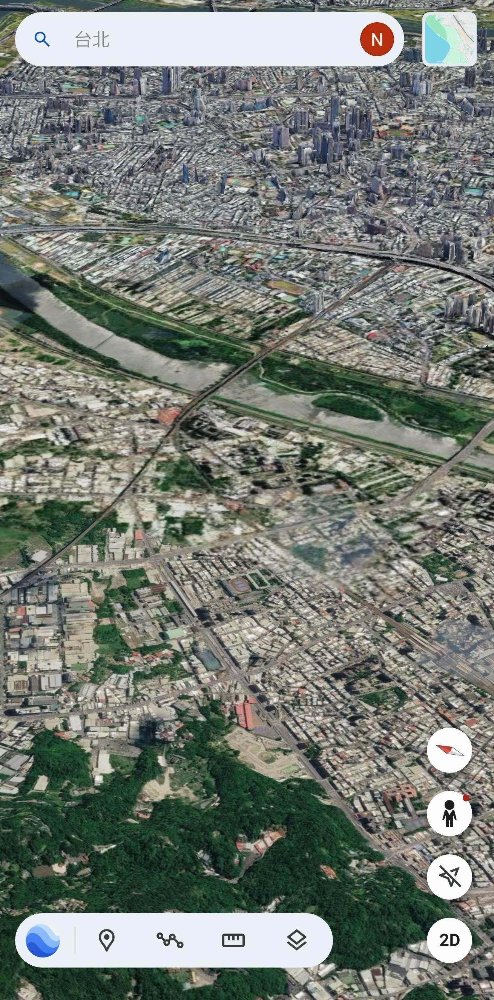
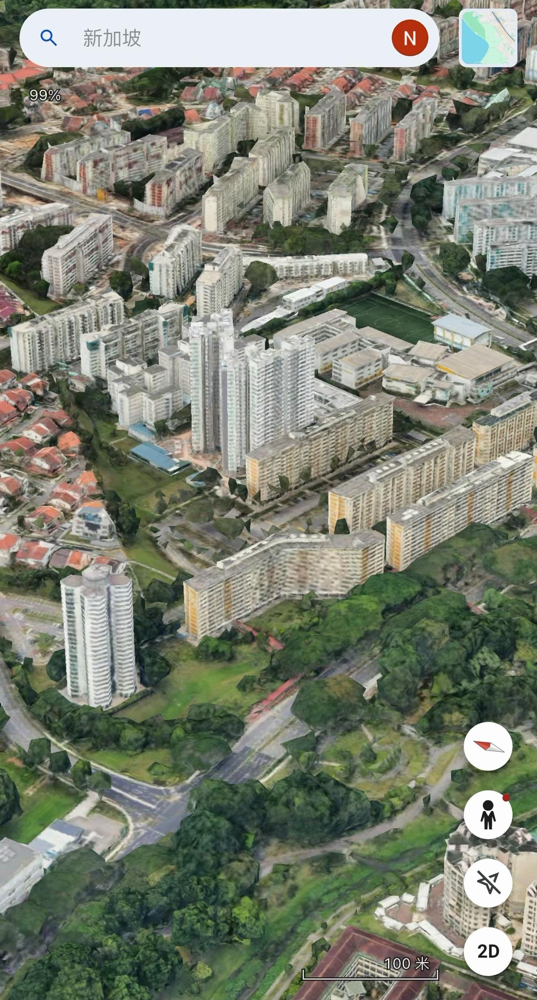
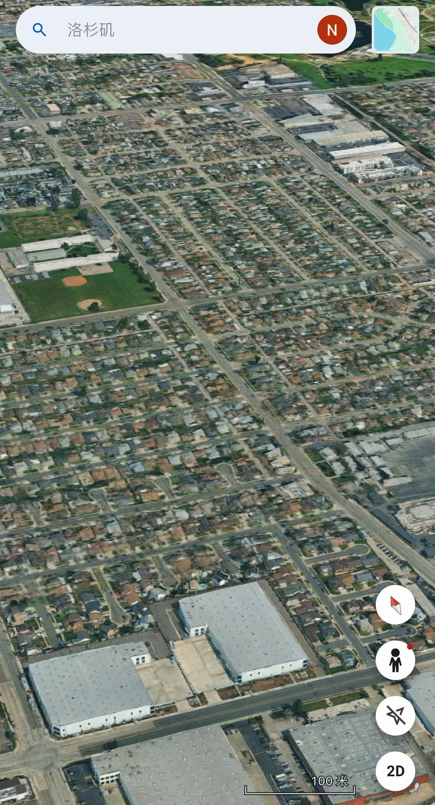

---

## 4156　必也正名

- 日期：2026-08-22　主专题：A16 媒体舆论与公共认知　副专题：A14;A03
- 源 ID：`717cca42-6926-5321-b071-a34942427a57`　原文链接：https://www.zhihu.com/question/2073007368435151461/answer/2073227013683409643
- 官方对象—实践路径：与合作者 / 与被管理者 / 沟通;与合作者 / 与被管理者 / 奖惩;与社会 / 与社区 / 共建
- 23 概念标签：人工智能与机器;技术与工程;选择与自由;事实与证据;法律与秩序;爱与回应
- 证据状态：manual_confirmed　初读：read　独立复核：not_reviewed

**问**：如何评价网传消息「3700 均订起点作者因使用 AI 不再给推荐」？

错误的做法，甚至都站不住脚——如何证明像ai的文字一定是ai写的？
难道你可以排除“人类手写得确实像AI”的可能性？
同样一句话，你怎么确切的分辨是AI输出的还是人类手打的？
你今天说“AI写法很特定，一眼就可以看出特点”。
行，现在就算你对。
明天ai进化了，写东西没这个明显的味道了，你接下来要怎么办？
把没这个味道的人类作者也销户？
还是要改成装摄像头，后台看着人打字？看着人打字，人就不可能是先背会了再手敲的了？
这事要干，也该干，但不应该这么干。
你可以提出“差异度”“原创性”“活人感”之类的编辑风格指标，人工判定“你的作品不够打动我们的编辑，我们决定不予流量推送”。
按照名字来搜还是可以搜到的，你自己在私域宣发，人家点链接进来订阅你还是可以拿到钱的。
但是我平台不主动推送。
这是我平台的自主权，完全可以自由裁量、独断专行。
其实我不关心你这实际上是不是AI写的，我只关心一点——我自己看着觉不觉得失望、觉不觉得重复、空洞。
如果你只是情节排列组合，换皮重新包装式的“创作”，哪怕你是手写的我也不会推送。
如果你写出了新东西、新情感、新机制，那么你是用AI写的又如何？我管你这些干嘛？我只盯着你写的我不满意的地方提示你做一些修改，照样上架。
要保护用户的体验，那就直接以“体验不佳”为理由管理。
我要压制的是ai感，我绝不会说“你这是ai写的”这种妄自揣测却无法证实的话，我只会说“ai感太重”。
我的口径是“我相信你是手写的，但是这还是会让读者感到明显的AI感。”
你是手写的，不影响“这会导致读者对平台的失望”而被下架。
你有能力依赖AI避免这一点，我不但不反对，反而会欢迎。
这样做事，名正言顺，理直气壮。
君子于其所不知，盖阙如也。名不正，则言不顺；言不顺，则事不成；事不成，则礼乐不兴；礼乐不兴，则刑罚不中；刑罚不中，则民无所措手足。故君子名之必可言也，言之必可行也。君子于其言，无所苟而已矣。必也，正名乎。

---

## 4115　算法关系

- 日期：2026-09-02　主专题：A16 媒体舆论与公共认知　副专题：A14;A01
- 源 ID：`d815035a-6fab-5358-8948-eeccf2e54d60`　原文链接：https://www.zhihu.com/question/1932097552485942624/answer/2078148197030147772
- 官方对象—实践路径：与社会 / 与舆论 / 应对;与社会 / 与舆论 / 接收
- 23 概念标签：心理与主体;技术与工程;选择与自由;边界与许可;事实与证据;劳动与组织
- 证据状态：manual_confirmed　初读：read　独立复核：not_reviewed

**问**：我女生，上网上得有点厌女了怎么办?

第一个要诀，是精心筛选自己的关注列表，确保自己关注的都是不煽动仇恨、不借负面因素牟利的信源。
大部分时间只看自己关注的信源给出的信息，自然安全不少。
但只看这些信源有时候会感到信息不足，所以偶尔要进“推荐”栏里去看看。
进了推荐栏，就要学会和推荐算法做斗争。
1）看到一些耸人听闻的标题，不要点进去。
2）遇到了势头不对的视频，不要长时间停留。
3）遇到了温暖人心的，正面的内容，多点赞、关注、看到最后、留评论。
4）一旦发现自己错误的给了坏内容过多的播放和展示时间，那么遇到好的内容多播放一下，把时间对冲回来。
总而言之，要主动的，机灵的管理自己的行为，用实际播放时间、点击选择，告诉推送算法——
“如果你老向我推这类东西，你会失去我这个用户，而不是导致我给你更多时间。”
推荐算法对完播率、停留时间、互动量高度敏感，你自己在用行为奖励哪些内容，在它看来就是你欢迎那些内容。
你跟我们说你讨厌是没用的，得用算法听得懂的语言去跟算法说。
这是历史对人类的一轮新选择——要么你学会和算法斗争，要么你被算法搞得精疲力竭、惊恐焦虑，因为它们而陷入抑郁、失能。
长期抑郁、失能的人会陷入危机，长远看其实是致命的。
算法已经卡住了我们的日常购物、生活、就业，没法不和它打交道，这个“我不仅仅是在上网，还是在不断的向算法发送信号”的意识是新时代的必修课。
既然是必修课，那就把它修好吧。

---

## 4052　吹倒屋

- 日期：2026-09-21　主专题：A16 媒体舆论与公共认知　副专题：A07;A08
- 源 ID：`3bbdb46c-6320-5796-8650-9d1b2ce336c7`　原文链接：https://www.zhihu.com/question/2084971910392013826/answer/2084997735774736422
- 23 概念标签：信用与信任;责任与后果;财富与市场;事实与证据
- 证据状态：manual_confirmed　初读：missing_first_pass　独立复核：not_reviewed

**问**：理记炮轰罗永浩毁掉贾国龙 30 年心血，真的是这样吗？这场风波中，贾国龙和罗永浩谁的责任更大？

这事怪罗永浩是没有意义的。
预制菜行业几十年来对消除公众恐惧、建立行业信用毫无作为才是真正的问题所在。
总觉得成立协会，建立标准，资助研究，发论文，拍纪录片，做产线展示……这些公共关系经营是白花钱，是“花架子”。
觉得只要把上面交代过去，保证自己合法合规就完事了，似乎老百姓有误解无所谓。
只把钱花在危机应对上，不花在正面的意识形态争夺上，这被事实证明是错误的。
你自己觉得科学合理，那就要真金实银的投钱把科学合理的故事讲好。
你觉得质量经得起检验，那就要真金白银的投钱去做“开放工厂”“开放农场”，让老百姓随时可以带着家人去看你的东西。
美国烟草行业在这方面远远的比中国企业成熟，以至于一个显著致癌的产品通过拍电影，资助学术研究搞到坚持了几十年无论谁来揭秘、爆料都推它不倒的程度。
波音资助了多少关于飞机和航空的纪录片？
很多有工厂、牧场、农厂干脆是有配套的旅游业项目的。
春光椰子糖，商店就开在自己的产业园门口。
法国无数的酒庄，自己就是旅游项目。
这些纪录片、工业农业旅游项目甚至未必是亏钱的，为什么这么多年却没见企业们动手去做？
我们的企业对公共关系的认识还是太过于保守了，没把这些当成生意去做。
这才是行业该接受的教训。
房子被风吹倒了，毕竟还是盖房子的要多反思。

---
