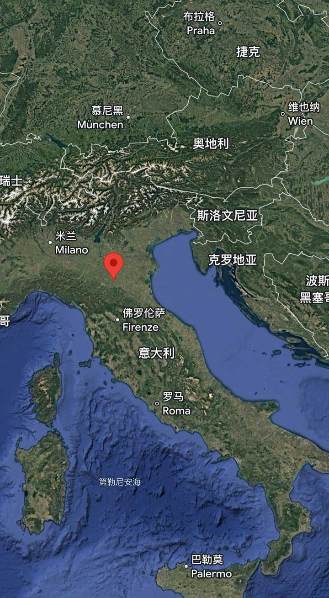
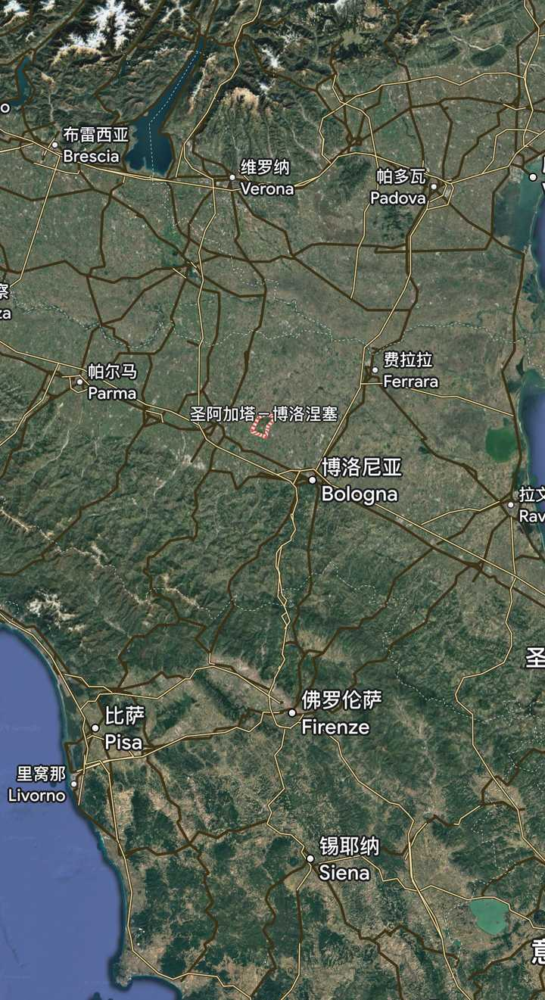
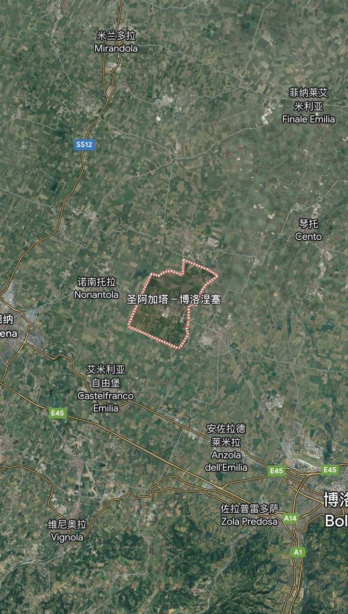
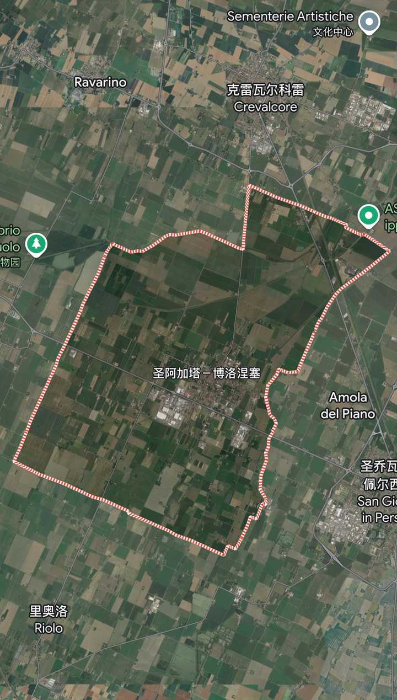
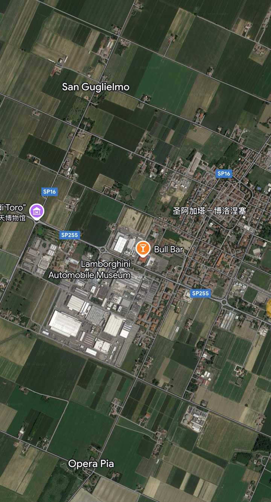
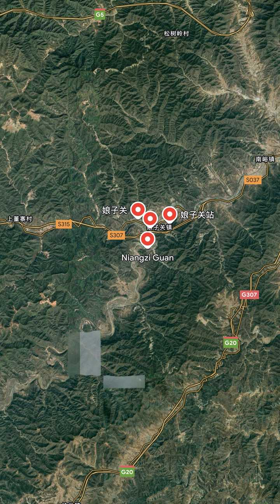
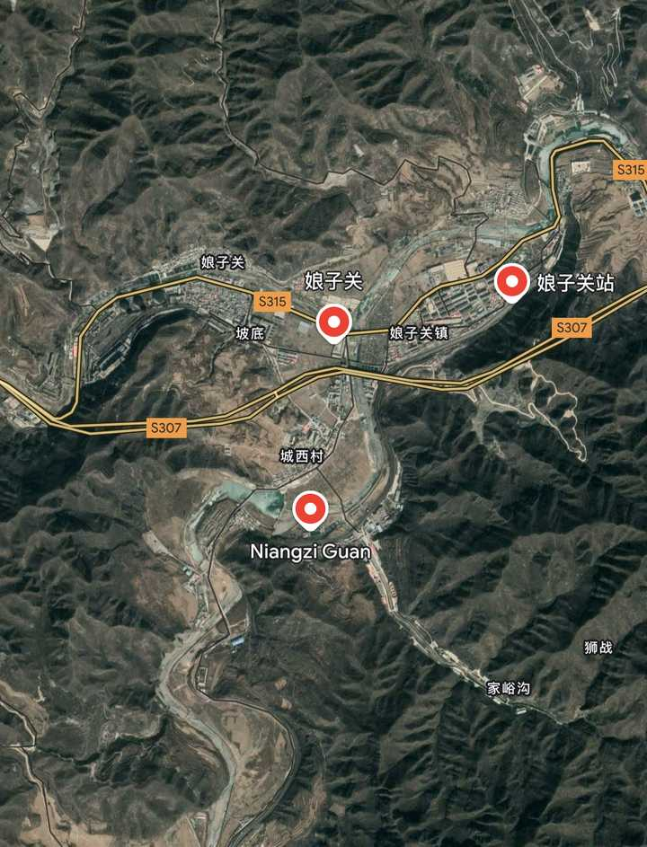

# A17　民族族群与身份秩序　第 1 册（共 1 册）

- 专题代码：A17　专题名称：民族族群与身份秩序
- 专题界定：民族、族群、身份、文化归属与民族关系。
- 本册：第 1 / 1 册　收录 47 篇　正文字符 54,010
- 语料：`sooon-q9adg-articles-v2.jsonl`（4,305 篇）　SHA-256：`cdc9c271309e1d71d9708889a3a31f4777e0c339ea54c3753521894afdb8357d`
- 生成时间：2026-09-27T00:01:00.997126+08:00　排序：发表日期 → 源序号（全库唯一，不重复）

**标记约定**：`【待审】` 主题仍为暂定；`【排除候选】` 图片/正文过薄的剔除候选；
`【正文标注未完待续】` 作者原文自带未完标记；`【正文缺失片段（复核已记）】` 复核记录已确认的正文缺口；
`【图片缺 N 张】` 源图不可获取。标记只作提示，不改写原文、不改动分类状态。

---

## 3842　自愧不如

- 日期：2020-02-26　主专题：A17 民族族群与身份秩序　副专题：A20;A12
- 源 ID：`418def6a-d83c-58a9-8055-db2fec4434ed`　原文链接：https://www.zhihu.com/question/342063221/answer/1038383073
- 23 概念标签：事实与证据;能力与学习;成本与总账;信用与信任;照料与家庭;文明与历史;民族与身份;心理与主体
- 证据状态：manual_confirmed　初读：read　独立复核：not_reviewed

**问**：如何看待类似「中国人的素质不如外国人的素质」的言论？

东方文明和西方文明有一个根本的差别，就是东方文明下意识会认为“冒险可能会输”，而西方文明下意识会觉得“冒险可能会赢”。
因此，东方文明会下意识的恐惧自己对风险估计不足，足以让ta们晚上梦见敌人戏剧性大翻盘，满身冷汗的突然坐起来。
所以西方人往往没有意识到，这种高估背后其实是深刻的戒备和警惕。
中国人总是倾向于认为对手比自己聪明和强大，不信你看看中国史书上给对手们写的墓志铭，不知道会误以为下面埋的是钢铁侠和绿巨人。
所以当中国人普遍对你评价系统性偏高的时候，那表示ta们在内心深处挥之不去的觉得你对ta们有敌意。
这常常被不懂事的小孩子或者西方人误认为是一种“崇拜”，一种“谄媚”，一种“吹捧”。
因此“恨铁不成钢”者，是不懂事。
因此飘飘欲仙者，是不知死活。
中国成年人“谦虚”起来恨不得掏出枪来玩命，谁说我好我跟谁急。你明白为什么了吗？
以为这是什么“民族自尊心”问题或者“逆向民族主义”问题，只是没长大，只是拿着西方人的眼镜看待世界的结果。连问题都问错了，当然找不到答案了。

给你们个验证性证据——ta们几乎从不会这样赞誉自己信赖的友军。不信你排一排，就会发现友军普遍评价偏低。
你爹对你评价是不是就不高？

---

## 3834　清白体育

- 日期：2020-03-01　主专题：A17 民族族群与身份秩序　副专题：A21;A03
- 源 ID：`5d5b4502-5b35-5392-b79f-dd62408fb0dd`　原文链接：https://www.zhihu.com/question/375389407/answer/1048049546
- 23 概念标签：事实与证据;定义与达意;能力与学习;成本与总账;边界与许可;财富与市场;法律与秩序;权力与异议;技术与工程;文明与历史;民族与身份;心理与主体;性别与身体
- 证据状态：manual_confirmed　初读：read　独立复核：not_reviewed

**问**：孙杨清白吗？

答案是——职业体育圈，对于什么叫做“干净”的定义和知乎众的一般想象是不一致的。
到底是不是没问题，和你的检测方式关系很大，和你对违规的定义关系很大。
你规定合法下限是1ppm，那么就会有人用到0.9ppm，强国会搞到0.95ppm。差别在哪？弱国技术不行，控制不住波动，所以保险点把阈值放高点；强国纯度高，生理研究透彻，那就可以把阈值放低点。
你三点来测，跟你五点来测，结果就不一样。
你把唾液检测的权重调高点，或者把血液检测权重调高点，结果就可能不一样。
我先郑重说明，上面这可是虚拟举例，你们不要“比喻照进现实”。
为什么会这样？因为竞技体育背后的经济利益、社会利益已经大到了不道德、不健康的程度。在这利益的驱动下，早就不再是更高、更快、更强的竞争了。
也有更浓、更滑、更轻、更弹的竞争。
兴奋剂和各种训练补剂的竞争只不过是一个方面而已。
各种“哮喘药”“多动症药”“安眠药”，各种胶水、鲨鱼皮、高弹性弓片、科技鞋交叉助攻，可以说现在在赛场上比赛的已经很难说是人了。
对于所有有这个科技条件的前几大强国而言，坦率地说，只要你在第一集团，那么裁决你有罪，你也没比被裁决无罪的脏到哪里去；裁决你无罪，你也没有比有罪的干净到哪里去。
因为不把这些手段用到在红线上走钢丝的程度，还傻傻的走“纯天然”路线的队伍，基本上都只是国际旅游团罢了。
科技对运动员水平的提高，已经使得九十分而有充分资本技术协助的运动员足以系统的打败纯天然的天才。更何况，整个国际体育圈，可以说都是靠这几大国养活的。裁判员和委员会委员们不是天上飞的神仙，ta们职业生涯的退路和终点都在人间。
所以这类八卦，根本没有必要上升到什么民族荣誉的地步。得了冠军，不足以说明我们多么伟大——这种存在感只对当年那个瘦弱贫穷、几乎完全丧失自信的幼年的中国弥足珍贵。对于今天的中国，有金牌只是我们国力的正常体现，少了几枚金牌，也不影响我们的大国地位。
中国已经成年，比这大的多的骄傲已经比比皆是，这些小小得失，早已应该不在眼中了。
反倒是这个手续是否合规问题有点现实的看点。但这是纯国际法实践的技术性看点，和国家荣誉没什么关系。
我更希望各位对金牌少点不该有的兴奋。当然得了是好的，但是不要上升到“国家民族的荣耀”这个级别。
这不是一个配得上我们这种数一数二的超级大国的大国民的水准。
这里提出一个真正严肃的问题——中国人的民族自豪感，应该是什么尺度？
你们想过没有，中国人为自己的国家感到自豪，和一个美国人为自己的国家感到自豪，ta们的自豪的尺度和方向，应该有什么不同？
难道美国人为美国的何事自豪，中国人就应该为中国的同一件事自豪吗？
仔细问一问自己这个问题。
中国人对奥运金牌这种事应该是“小儿辈破敌矣”和“小儿无赖”这样的反应。
成与不成，吹开茶叶喝茶。爷的茶杯抖都不抖。
我们谈的是什么？泰山崩于前而色不变。
你们是中国人。你们到底懂不懂中国人到底应该是一种什么样的人？
很多人其实是在追随着一种没有反思过的其他民族的自豪观在追逐根本不该中国人在意的虚荣。
你们是在作为一名出生在中国的“美国人”，希望中国成为“优秀版的美国”，满足自己美国式的自豪感需求。
问题是，美国自己的理想，中国应该去追求吗？
那本来就是个还没经过历史考验的理想好吗？
你们有没有想过，即使美国自己设想中的“完美的美国”，其实也根本不是中国应该追求的目标。
一个真正的文明国家在看着中二少年大谈自己的理想时，露出不失客气的鼓励性微笑才是正常姿态。
你的理想我没看在眼里，这才是你愤恨我“为什么不跟我同路”的根源。
美国大大的低估了中国文化内在的高度和深度，对这一点，未来的一百年ta们会一天比一天看得更清楚。
中国是不可能去走美国道路的，不是因为什么“中国太落后，所以不能走、走不到”，而是因为美国模式在历史的长期挑战面前太短视、太脆弱，在质量上不值得考虑。
你们很有机会会看到美国一天天的不由自主的变得更像中国，以及因为极端抗拒走“中国路线”而被一次次的“意外”惩罚。
中历史彩票，并不是一种真实的优秀。
偶像崇拜习惯深入骨髓的人类当然会跟着一时的盛衰要用“正确”之膏油表达自己的崇拜。但可惜真正的审判者是上帝、是永续的历史，而不是这些点赞的人。
被这种事激动得面红耳赤或者怒火攻心，这是那些历史不超过三百年的国家才该有的表现，不是一个有五千年文明史的国家国民该有的气度。
ta几岁，你几岁？
ta这样是可爱，你这样就是讨打。
有人问“如果世界冠军不值得骄傲，还有什么值得骄傲”。
首先，不推荐“总要找到某种可以骄傲的东西才能活下去”这个人生模式。因为这种模式埋藏着更深的负面因素。当你有得骄傲的时候你对失去这个骄傲总是感到恐惧（否则为什么这里有这么多怒吼者呢？）
当你没得骄傲的时候，要么你就自卑得要命，要么你就想方设法又幻想一种身份去攫取另一种“骄傲”，然后去感谢那个给你指引的人。
这里很多的点赞，其实是在给我这种感谢。
这只是一种误会。
我只是在讲一种事实。事实就是事实，只不过这个事实恰好令你高兴喜欢罢了。其它会令你不高兴的事实也很多，只不过跟我想说的问题没什么关系。
你应该学会的是应有足够的勇气去接受事实，学会中性的看待事实。不因为正面的事实“骄傲”，也不因为负面的事实“气馁”。爱新觉罗玄烨得了天花，负面吗？后来他恰恰因为得过天花而当上皇储，于是得天花到底对他是负面还是正面？
回到本题——当我说到“自豪的尺度”问题，我在说什么？
“中国的人均期望寿命和美国几乎相当，而中国的人均医疗支出只是美国人的二十分之一。而中国的人口接近美国的4.5倍。人均GDP仅为美国的1/6不到。”——这比所有的金牌相加还要值钱一百倍不止。
一千倍也不止。
甚至一万倍也不止。
这就是我说的尺度问题。
人当然要有自信才行。但是“自信”到底应该是什么？
中华文明的自信来源于何处？

---

## 3833　伟大

- 日期：2020-03-04　主专题：A17 民族族群与身份秩序　副专题：A11;A12
- 源 ID：`c5e0fe48-8357-509a-bbb1-c17b2e572ff7`　原文链接：https://www.zhihu.com/question/324625825/answer/1054427120
- 23 概念标签：定义与达意;能力与学习;选择与自由;责任与后果;成本与总账;权力与异议;文明与历史;民族与身份
- 证据状态：manual_confirmed　初读：read　独立复核：not_reviewed

**问**：中华民族是一个伟大的民族吗？为什么？

中华民族是一个很有生命力的民族。中华民族也是世界上非常重要、地位举足轻重的民族。
但是中华民族还不算是真正意义上伟大的民族。
何谓伟大？不是自己很强，很让人不敢冒犯。这不叫伟大，顶多算强大。
也并不是让人仰慕，让人崇拜，让人趋之若鹜。这只是强大的副效应。
很多所谓的“伟大”赞誉，只是偶像崇拜者缴纳的空洞的贡品，试图靠这些虚无的捐纳换到某些实利罢了。只是有的人是有意，自己明白；有的人是无意，自己不承认。
何谓伟大？
让自己繁荣不叫伟大，让别人能繁荣才称为伟大。
有主动的、明确的、以其他所有人的客观繁荣为己任的使命感，兼且有行动，有成效，才成其为伟大。
“客观繁荣”，这意思是不考虑自己的意识形态和价值观，不把“变得更像我”定义为对方的“关键利益”，而是将意识形态差异置之度外，贡献于其他民族的民生纾困，经济繁荣。
这才可以称“伟大”。
不必丰功伟绩，要的是这个心意，不是出于什么地缘政治利益、出于巧妙的宣传包装，而是真诚的以这个心态，相信“无论是敌是友，天下兴亡，于我有责”。
能向困境中的“敌人”伸出援手、能向“仇人”施以尊重和人道主义，而其族人能够视其为当然义务，不会大规模的大骂“出卖民族利益”——这样的民族，才有资格称为伟大。
这样做了，不会在自己困窘时反悔，咬牙切齿的怨恨“悔不该帮这些白眼狼”的民族，才有资格称得上伟大。
伟大，是建基于一份额外的、无怨无悔的责任感和使命感。
强大是身强，伟大是心强。心强身不强，仍然是伟大的，只是结果常常令人遗憾。但身强、心不强，则是与“伟大”无缘的。作为一个强大的民族，“伟大”是一份道德责任。
从这个意义上说，这个世界上还没有足够伟大的民族，大家都是不及格的。
平心而论，曾经恩抚四海的古代中国和没有抛弃自己的道德责任之前的美国算是曾经很接近及格线的前几排候选人。这两个实体都曾经有过“天下兴亡、匹夫有责”的主动意识，也曾有过或多或少的实际行动。
这难能可贵，但是还没有迈过真正的伟大的线。
某种程度上说，也不能多加苛责——他们并未曾强大到能承担得起这份伟大的代价的程度。所以，当盛极的时候，ta们追逐了自己的理想，在困窘的时候却多少有些后悔。
这一后悔，就玷污了自己当初的努力，把之前无私的帮助追认为了一种将本求利的利益之举。你后悔，意味着当初你只是自欺欺人的无私，现在看起来没有“保本”，你的自欺维持不下去了，于是你后悔了。
真正的伟大背后是真正的无私，而真正的无私，背后是无怨无悔。
这份无怨无悔，才是真正的强者的高傲，真正的高贵的冠冕。
所以，答案是我们还算不上伟大。
我希望我们正在走向伟大的路途中，希望中华民族的子孙们能够有一天在毫无疑问的明白伟大是一种何等样沉重而“愚蠢”的理想，而仍然能真正无怨无悔的欣然接受。
人类一直被困在“强国争霸，此起彼伏”的无限循环里，实际上在眼睁睁的看着这争霸战一场接一场的走向更让人恐惧的毁灭。
这个循环只有两个结局——人类最终毁灭于一次无法承受的争霸，或者终于有一次，坐上王座的是一个真正伟大的民族。
到那个时候，我们才知道这个世界上到底哪个民族可以称得上伟大。

---

## 3818　中国式反同化

- 日期：2020-03-16　主专题：A17 民族族群与身份秩序　副专题：A20;A03
- 源 ID：`4adfa0a0-e750-570d-9608-616e84038afd`　原文链接：https://www.zhihu.com/question/57057555/answer/1082872847
- 23 概念标签：能力与学习;选择与自由;责任与后果;成本与总账;边界与许可;照料与家庭;文明与历史;民族与身份;生态与自然;心理与主体;宗教与自然法
- 证据状态：manual_confirmed　初读：read　独立复核：not_reviewed

**问**：中国人离开中国后很容易被同化吗？

谢谢各位提醒我有一样的回答，不过我已经说过这是许可的。
即使没有注明转载，都一并许可。
中国人、犹太人都是出了名的难同化，甚至有二代被同化了、一句中文都不会说了，到三代、四代又回来寻根返乡的。
何来“容易同化”一说？
如此强势的文化背景，你想同化，人家还不信你真的同化了呢。
永远以为你是装的。
其实你别装了，你确实是装的。
是的，从书本上你也许会逻辑性的赞同某些中国文化所不赞同的逻辑。
但是当你接触到那些逻辑的另一面，那个丑陋的一面，你立刻会意识到中国的文化也不是白给的。
尤其是在将来中国在各个方面逐渐追上和超过美国、而美国的霸权破灭失去相关的超常利益之后，很多东西会越来越明显的显示出中国文化没你当初看小册子所想的那么简单。
到底最后谁同化谁，还很难说。
似乎很多人问“现在中国还有什么文化”：
如何理解中国文化？所谓的中国文化，是指中国人认识事物的一种特殊共性、中国人做决策的一种特殊共性。这些共性会导致一群中国人自然而然的形成一种与别的文化成员不同的互动机制和组织关系。会导致一个相同的挑战被一个不同的方案去应对，并且应对的结果也被一种特殊的评分制度去评分。完全不是什么祭祖、民乐之类的东西。也跟这一套合作机制、评价机制是用什么样的语言体系来表达关系甚微。你把牛顿公式不用F、A、M、V表达，用甲乙丙丁来表达，对牛顿公式本身根本没那么大的影响。举个例子，一个华人移民，在国外已经很久，可能中国话都说不顺溜了。但是遇到了事情——比如莫名的批评，如果ta第一下意识是“我是不是得罪了ta，被他穿了小鞋？”接下去ta的解决方案是“我应该送点小礼物给ta”而不是“我应该去找工会律师发起投诉”，ta这样的决策模式就非常中国。哪怕他上述想法是用英文想的，全程没有闪过任何“中国”的念头，这其实也是个中国念头。起作用的就是中国的文化。深入骨髓、深入灵魂、已经化为思维底层逻辑的中国文化。
那么为什么中国人和犹太人这么难以同化？
因为ta们常常不自觉的觉得异于自己处事方式的其他做法很短视、考虑欠妥。
作为拥有极为悠久的历史记忆的民族，这些人脑海里有很多当代人没有的事件场景。某些现在看起来运转得很好的体系、很好的应对，ta们脑海里会不由自主的联想到某种不适应的场景、未防住的后果来。
“这事岳飞干过，挂了。”
“这事秦桧干过，跪了。”
想到了这些，这些体系和应对逻辑就会内化失败，同化就被阻挡了。
这个问题，不见得是一个很值得骄傲的属性，只是客观如此罢了。
关于文化与文化的符号：
中国有哪些逆天的文物？OK，不知道为啥这个答案这么火爆……想了想我写得太随便了，既然这么多人看，还是把这个话题说透一点吧。
首先，先前说的那个“因为古老民族内心隐生的傲慢而难同化”的效应确实是非常现实的，但是那只是特定的中国人和犹太人不容易被同化的原因。这只是一个具体的、微观社会学视角的动力学原因。
这不是犹太文明和中国文明不容易被外来文化同化的宏观社会学视角的“热力学”原因。
实际上，犹太文明抗同化的原因和中国文明抗同化的原因是完全不同的。
我们用一个非常具体的比喻来说明。
犹太人好像一团白颜料。如果外面有什么颜色沾到了，犹太人会认定被沾染的部分不再属于犹太民族。ta们会把那些被染灰的、染蓝的、染红的、染黄的……统统切除。
你居然不守安息日？你算什么犹太人？你居然逾越节不吃无酵饼？你算什么犹太人？你吃的饼居然不扎洞？你算什么犹太人？你居然不念妥拉？你算什么犹太人？你居然看英文版五经？你算什么犹太人？你跟非犹太人结婚，ta还不愿意皈依？那你们的子女怎么能算犹太人？
犹太人原来是白色的，后来也一直都是白色的。顶多因为岁月的侵蚀实在厉害，变成了有那么一点象牙白。
而中国人呢？
假设我们最早也是白色的，但是我们是一大团白——极大极大的一大团白。
我们遇到了一团蓝色，我们根本不会去谈什么“把染蓝的部分切掉”。不，我们会把那团蓝色抱进怀里，糅合搅拌，最后变成更大一团的“极淡的蓝白色”。
接着我们遇到红色，然后我们融掉了红色，变成了更大一团的略明显的浅紫色。
接着我们遇到好大一团绿色，大概有我们八分之一大，结果是我们变成了1.125倍的偏绿一些的紫色。
一次又一次，我们已经变成了池塘那么大的一团的望之如同深渊一般的神秘的“黑色”。
你只管红的、蓝的、绿的……一桶桶往里倒吧，到最后得到的那1.0005池塘水，我们有极大的把握还是会被称为“中华民族”——你信不？
这才是从文明的宏观角度来看，“中华文明难以被同化”的原因。
每一次，我们几乎都是全部拥抱，完全吸纳对方。只是因为我们实在太大团了，每次融合的结果对外部的观察者而言，我们似乎都是“岿然不动”的，是那团与我们相遇的、与我们反差极大的浓烈的“对手”“消失”了。看起来似乎是ta们对我们的“同化”“失败”了。
事实上，根本不是这样。
我们的的确确可以说被ta们尽了全力同化了，几乎没有抗拒对方的任何影响。总体上而言，我们根本不是像犹太人那样拒绝外来文化的浸染。恰恰相反，反而会犹如现在很多人所“痛心疾首”的看到的那样，我们几乎是抱着一种近乎“自卑”的心态，把对方看作“先进”“强大”的代表热切的拥抱了，狂热的吸收了，尽可能地改造我们自己去向对方看齐了。
只是，我们实在实在太过于大团。每一次的结果，都是我们不管多么“自卑”、多么“完全丧失自信”，结果都是“我们略微变色，而对方消失在了我们之中”。
而我们又变得更大团了。
对方的财富变成了我们存货的一部分，我们甚至不太记得起这些东西是外来的。
是不是不信？
青花瓷可是中东来的；
中国人称呼父母为“爸爸”“妈妈”，可不是什么“正统”的叫法；
“什么”可恐怕并不是《诗经》所用的中文；
赵武灵王之前，中国是没有人骑马的；
大汉骑兵骑马，没有马镫；
色即是空、空即是色，来自“翻译”；
罗汉、菩萨，不是汉人；
阎王爷，印度神；
地狱，并不是中国本土自生出来的。
现在有几个中国人意识得到这些“原本不是中华文明的一部分”？现在又有几个人会认为这不是中国文化的一部分？
中国的“难同化”，不是靠犹太人那样本着内心“上帝选民”的绝对高傲，对外界影响的持之以恒的坚决抗拒而造成的。
恰恰相反，中国因为超大的人口和超大的社会规模，天生有一种神奇的种族天赋——它可以时常抱着一种足以令其他小民族亡国灭种的“自卑心态”去“仰慕”异文明，到最后却是它活蹦乱跳的活下来了、而且更加壮大。
它事实上对自己没有保持原来的颜色并不敏感，它只介意“大家颜色居然还没有变得一样”。
换了任何一个其他的民族，这样的“自卑”都是致命的——唯独中国凭借超大规模的本体对此免疫。
所以，我几乎从不担心中国人“崇洋媚外”，或者“数典忘祖”。这是一种无意识的从欧美的意识形态里继承而来的欧洲式的恐惧，是只有匈牙利人、法国人才需要担心的问题。
你是个中国人，你跟着怕什么？这就好像一头鲸鱼学着企鹅那样害怕海豹。
“怕被同化”本身干脆是不适用于中国这个东方巨兽的。
如果你真的仔细考察，你会发现这种恐惧是到晚清才第一次随着西方文化传进来的“新艺能”。
在这之前，中国闭关锁国根本不是因为害怕外来文明，而是觉得不想被质量不行的叫卖打扰——是因为自信得太过头了。
不同于其他国家，中国无论怎样的暴烈的变革、怎么“时过境迁”、怎样“丧失自我”，都只会变成新的中国，而绝不会变成一个“异民族”——它对此是逻辑性的免疫。
世人常说中国“保守”，以为这是中国“文化稳定”的根本原因，其实是这些人根本性的本末倒置了——中国实际上一向是世界上最激进的文明。
而文化上的“稳定”是它无需任何努力自然就有，甚至想摆脱都轻易摆脱不掉的天然属性。
十万吨的巨轮，想“不稳定”，发动机的功率得要多大？
每一次中国落后个上百年——这在几千年历史里只是短短的一瞬——就会立刻跳跃性的再次跨越到同时代最先锋的社会形态上去开启新篇章。
周代殷商，分封天下；强秦代周，乃有郡县；汉代秦兴，独尊儒术；隋唐代汉，科举取士、取租庸调；宋代旧唐，以文驭武；明逐元虏，内阁执政；明亡清兴，不立国储；民国肇造，五族共和。
每一次都是奔着开创而去，干的都是一马当先的革旧鼎新的新事。
现在是先锋到挑战人类经验的共产主义。
从哪里去谈“中国文化守旧”？——这几乎是睁眼说瞎话。
它只是客观上自自然然的会实践成“似乎没有啥改变”。
这个“似乎没有啥改变”，可以说从来就不是新朝代大胆革新的初衷，只是一个无奈要接受的客观现实阶段罢了。
看明白了这一点，你就能看明白为什么我会作“中国文化总会同化外来文化”这样的判断。
这也是为什么我对《外国人居留条例》毫不担忧。我们是中国，是敞开了任人“同化”，最后一定是稍稍变化而终归抱元守一的中国。我们没有任何必要担心我们的“文明异化”。我们的文明之所以成为唯一传承至今的古文明，恰恰是因为我们有能拥抱无限异化而不失稳定性的天赋。
说这么多，绝不是为了让国人为“我们内心骄傲，别人都是小孩子，所以我们不容易被同化”这样的东西变得麻木、顽固，甚而以麻木、顽固为“自豪”。
而是为了劝诫你们——
其实身为中国人，你是有最大的资本“异化”的，这是你身为中国人最大的财富，不要辜负这一份天赐。
让别的民族去担忧“失去本色”，对于中华民族而言，无论怎样开放，她都不可能失去本色——她对此是物理免疫的。
能让小鼠死亡的量，对于我们来说，只会让面色略红润。
只管大胆的、贪婪的、“毫无底线”的学习，到最后结果一定是“别人变得和你一样”。
如果中华民族为了所谓的“保持民族的本色”而闭关自守，就极大的辜负了中华民族这个“极难被同化”的种族天赋了，而且恰恰是抛弃了中华民族最大的本色——混一宇内之志。

所以，那位设计师会说——开放、开放、坚定不移的开放。
你明白了吗？

---

## 3768　海外团结

- 日期：2020-06-13　主专题：A17 民族族群与身份秩序　副专题：A10;A20
- 源 ID：`9c035109-aa7b-55a2-9f52-83fc9525d4f3`　原文链接：https://www.zhihu.com/question/269743252/answer/1280141733
- 23 概念标签：事实与证据;定义与达意;能力与学习;选择与自由;成本与总账;劳动与组织;法律与秩序;技术与工程;文明与历史;民族与身份
- 证据状态：manual_confirmed　初读：read　独立复核：not_reviewed

**问**：为什么海外华人不团结？

一直都有人呼吁海外华人在所在国团结起来，充分利用自己的投票权，成立自己的组织，积极游说立法机构，争取自己的利益。
尤其是在美国，年轻一代们很多在痛心疾首海外华人没有参政议政的传统。尤其是他们有心要去做一些动员工作，却被族人们的冷淡消极浇了透心凉的时候，更是恨铁不成钢。
其实，这是他们太年轻了。
与其说是华人本性不团结，不如说在大部分国家，华人是不能团结的。
因为华人的祖国太强大了。
首先，显然作为一个普通的少数族裔加入更泛化的“少数族裔协会”，去争取普惠所有少数族裔的利益，这显然是不符合“华人团结”的定义的。既然是谈“华人团结”，当然意味着这类组织会有鲜明的种族身份。
这就会触发一个很严重的问题——如何保证你不是你祖国的代理人？
如果你的祖国是微不足道的小国家，那么这没有问题。如果你的祖国是坚定盟友，这也没有问题。但是如果你的祖国是一个足以争霸的大国，而且是一个敌国。那么你就存在自证清白的绝对必要。
你能在多大程度上证明自己不是你祖国的内部代理人，你才会被许可有多大的生存空间。
不要以为生存空间是由某部成文法律就可以保障的。你错了，仅仅来自私人、私人企业的个人自由、经营自由，通过各种投票体现的个人意志，就足以充分有效的限制你的生存空间。
所以，只要你团结起来形成组织，这个组织就无法绕过“忠诚证明”这一绝对的要求。
而真正有效的忠诚证明是什么呢？
这就是悖论所在了——恰恰就是自觉的不团结起来。
逻辑链是这样的——
1）只要你团结起来，你就需要证明忠诚。
2）而绝对有效的忠诚证明只有一种，“始终绝对服从安排”。
3）“始终绝对服从安排”本身需要以“绝对满意现有安排”为有效证明。
因此，只要“团结起来主张自己的利益”，就一定是在表达“对现有安排的不满”，于是一定会在“绝对忠诚”的考核中失败。
你背着“有一个强大而敌对的祖国”的原罪。
只要你展露了“对现状不满”这种级别的不满，无论你做多少自觉纳投名状的动作，也会被认为是“民族苦肉计”，放长线钓大鱼。
“团结起来”本身就是“叛意的证明”，任何其他证据都洗刷不了。
于是这会带来一个奇妙的能垒——华人团结起来，反而会导致华人的群体的实际福利下降。
并且是越团结、越恶化。
这一情况在华裔占到足够人口比例、足以影响政治版图之前，会一直持续。
你看，前苏联的流亡遗民们，俄罗斯的移民们，有强大而团结的“美国俄罗斯裔协会”吗？
如果以中国的例子——吴三桂、耿仲明/耿精忠精忠、尚可喜这些人为了大清帝国出生入死，连明朝皇帝都亲手绞死了，要说用行动证明忠诚，还能比这彻底到什么程度？
他们几家手头的武装力量、控制地盘都已经足够割据东南西南。
他们团结起来了，又是个什么下场？
这样的历史教训还不足够说明问题吗？
东亚文明最大的文化优势，就是在深刻的理解群体动力学上有能敏锐的、毫无侥幸的“阅读空气”的能力。
所以，海外华人无论是有意或是无意，但都明确的意识到了自己其实只有两条路可以选——要么老老实实与本地人通婚混血，直到后裔无论从自己的血统和文化记忆上都不能自认为是一个华人；要么，想要保持自己的文化身份，就要以“不试图团结”作为不可避免、必须勇敢承受的代价。
选择后者，恰恰是最华人的表现，是对自己文化身份的最大忠诚。
“华人怎么不团结起来”的呼声，反而是来自丧失了充分华人身份认同的二代、三代和深受西方文化浸染、不熟悉自身文化传统和历史记忆的新移民。是华人变得不是华人之后的结果。
我不认为华人们“懦弱无能”，不勇于选择自己的命运。恰恰相反，他们更多的是选择了为了保持自己的文化身份，宁可选择“不团结起来”这种代价沉重的方案。
因为“团结起来，但丢掉华人身份认同”这个方案他们更不肯选/选也无用。

---

## 3701　相由言生

- 日期：2020-07-30　主专题：A17 民族族群与身份秩序　副专题：A03;A18
- 源 ID：`7d9d6244-95ea-553f-b951-089dfb31ce42`　原文链接：https://www.zhihu.com/question/23671661/answer/1370280239
- 官方对象—实践路径：与社会 / 与文化 / 批判
- 23 概念标签：权力与异议;文明与历史;民族与身份
- 证据状态：manual_confirmed　初读：read　独立复核：not_reviewed

**问**：为何中国人往往能一眼识别出美国出生的华裔 (American Born Chinese)？

我一直怀疑，其实语言才是对不同文化环境的同一人种造成总体面貌发育差异的根本原因。
日本老人的面相和中国老人、韩国老人、蒙古族老人、苗族老人的面相差异，很可能是因为各自语言的具体发音方式和表情要求所塑造出来的。
比如日本老人的嘴角下撇的情况似乎就比中国老人多得多。
说英语的华人和说汉语的华人的面相差异——在营养水平相当的情况下——很可能根子也是在这里。
这是个比较有趣的选题，
拿去玩。

---

## 3559　歧视的自由

- 日期：2020-12-13　主专题：A17 民族族群与身份秩序　副专题：A10;A03
- 源 ID：`df000979-793a-5f0c-b94d-579ac402116a`　原文链接：https://www.zhihu.com/question/31312526/answer/1624264157
- 官方对象—实践路径：与其它 / 与陌生人 / 接近
- 23 概念标签：事实与证据;定义与达意;选择与自由;责任与后果;成本与总账;信用与信任;爱与回应;劳动与组织;法律与秩序;权力与异议;民族与身份;性别与身体
- 证据状态：manual_confirmed　初读：read　独立复核：not_reviewed

**问**：作为个人有没有种族歧视的自由？

我们先搞清楚一点：
不管你觉得自己多么公平，你实际上仍然是在基于某种程度的偏见来做决策的。在偏见问题上，人类顶多压缩一点、克制一点，但是本质上是无能为力的。所以不允许、不承认偏见的生存空间根本是办不到的。
强行要实施以禁止任何偏见为诉求的公共政策，结果要么是公信力直接破产，要么是自欺欺人。
第二个事实——人和人当然是不同的。你原则上不可能对任何两个确切具体的人给予完全相同的待遇，尤其是，按照自己的心意区别对待任何不同的人本来就是人天然的基本自由。
否则连“该和谁谈恋爱”、“该录用谁”这种基本问题都会立刻变得无解——“凭什么是ta而不是我？”
那么这不是矛盾的吗？既然区别对待他人是天经地义的个人权利，那么还有什么所谓“歧视”可言吗？
到底歧视是什么？
甚至更进一步的说——在区别对待是一种显著的自由的前提下，平等是指什么？
平等的本质，是一次公平的机会。
一次让别人真正凭自己的作为来形成与人的关系的机会。
在ta有所作为之后，你再根据这些行为决定你自己和ta的关系，这个是你的自由。
但在ta有所作为之前，ta应该被给予一次公平的、干净的机会。
这个就是在实践平等。
更进一步的，这一原则还应该进一步推展到ta与别人的关系上。
ta应该被给予一次公平的机会，凭借ta自己的作为去和别人形成ta们之间的关系。
人应该自我克制，不要在共立法律之外（譬如裁判文书网、或者性犯罪者公示制度）额外破坏ta与一切别人形成其他关系的公平机会。这就不但是在实践平等，而且是在追求平等和维护平等。
平等，不是要你“无差别对待所有人”，而是要你给人一个公平的机会，不是因为ta的某种群体标签——譬如籍贯、肤色、信仰、性别、种族甚至年龄，而在人有机会真正凭自己的作为形成ta自己的形象之前，天然的先被判断。
是要你即使形成了自己的判断，也不要去宣传、去鼓动、去扩散自己的判断。
那么，为什么现代的社会要推行平等理念？
为了给和平、理解和爱争取最大的机会。
为了帮助一切人有不断再尝试建立新的友好关系的机会。
为了消除人们“一失足成千古恨”的根本恐惧。
为了让人不要轻易丧失对努力的信心。
为了抑制人与人之间本来就已经存在的猜忌和敌视。
现代社会之间的竞争是全维度、全范围的，任何一个在这方面不加努力甚至背道而驰的群体，最后都不会因为自己“善于怀疑“而真正的长期幸存。
最后的赢家一定是善于相信的那一群人。
因为首先这样的人不存在天然的敌人，任何人都必然首先会尝试建立友好的关系，而不是像面对显而易见的歧视者那样，一开始就绝望，直接从敌人开始做起。
第二，重视平等原则的人如果长期习惯成自然，ta们会渐渐习得给人第二次机会的习惯。
也就是过往的作为虽然形成了不良的过去。但只要有什么原因让ta们觉得此时的你可能有所不同，你自然而然就会获得一次重新凭借作为形成新的关系的机会。
因为因着你的过去而断言你的现在，是没有给现在的你公平的机会。

那么为什么平等/反歧视进行得如此的艰难呢？
一方面是因为区别对待他人的天然权利与歧视之间的概念混淆着实让很多人误以为反歧视是假议题，另一方面则是因为人没有想清楚自己一生到底应该追求的是什么。
在没有想清楚之前，人们会默认的追求享乐的最大化。
追求享乐的最大化，自然要以享乐的不能最大化为恐惧。
这份恐惧会催生出疯狂的防御心态，对一切损失及损失的任何可能性高度过敏，乃至于在脆弱不安的人身上催化出捕风捉影、空穴来风式的非理性防御心。
ta们不能忍受“给人一个公平的机会”所带来的可怕风险。
“一个群体以小偷多著称，让我对ta们的一个子女给予公平的机会，岂不是敞开了大门给ta偷我的机会吗？”
为了避开这种风险，ta们选择了“提前防御”。
但ta们没有意识到这份“安全”的代价：
首先，这从根本上阉割了自己成为任何意义上的真正的领袖的资格。
一个人如果养成这样提前防范的习气，就最好求老天保佑不要面对领袖的职责或者有成为领袖的追求，因为那于人于己都是一种折磨和灾难。
哪怕你是独生皇储，有一群顾命大臣拱卫着你，你的内心也不会有平安可言。
因为任何人身上都有“值得歧视”的理由，而你却关不掉自己恐惧的开关。
你的大部分决策都不会是任务驱动而多少是恐惧和猜疑驱动的，你还能指望你的领导结出什么样的成果？
第二，你根本不能从这种提前防御中获得真正的安全，相反，从战略层面上讲你反而削弱了自己的总体安全。
战术上安全是来自防御，战略上安全是来自有选择。
因为你有得选择，所以你现在的盟友不敢轻易失去你的好意。因为你有得选择，所有你的对手不敢轻易与你结怨。你因为歧视的理由抛弃了半个乃至于大半个世界，你将失去选择。
于是你不得不选择的人，当然会自然而然的获得更大的筹码。即使ta们并无意动用这些筹码，你也难以挥散自己内心深处对这些筹码的畏惧。你当然要缩手缩脚，委屈求全。犹如人为了怕被偷，所以住进牢房，这是一种显然的愚蠢。
而从另一方面，你作为一个歧视者的名声在外，所有人都会对接近你和与你合作犹豫三分。
你今天因为某种原因歧视黑人，明天天晓得会因为什么原因歧视我。歧视是一种习惯、一种瞎眼的传染病，绝不会甘于固守固定的目标，而一定会蔓延到你整个的交往圈。
已知被你歧视的对象，当然已经是你的敌人。而那些尚未知自己是否被你歧视的对象，又焉知自己就不是？
于是起步三分敌。
你担得起所有人都对你起步三分敌吗？

所以，你在实践上当然可以歧视——实际上没有人能有效的阻止你，甚至都没有人真的有权阻止你——只是不要以为没有代价。
其实你付不起那样的代价——因为那几乎必然会让你成为典型的“人下之人”，从而最容易被人歧视——而且这回真的是因为你的作为。
It’s another poetic irony.

---

## 3393　忠与叛

- 日期：2021-04-17　主专题：A17 民族族群与身份秩序　副专题：A20
- 源 ID：`b4a0c88b-caab-5e27-9f2d-21b386b67065`　原文链接：https://www.zhihu.com/question/454891026/answer/1839962743
- 官方对象—实践路径：与社会 / 与历史 / 借鉴;与社会 / 与文化 / 批判
- 23 概念标签：事实与证据;选择与自由;成本与总账;法律与秩序;权力与异议;文明与历史;心理与主体
- 证据状态：manual_confirmed　初读：read　独立复核：not_reviewed

**问**：4 月 16 日拜登与菅义伟会晤，美媒称对抗中国议题将提上议事日程，释放了什么信号？

美国人要明白一个常识：
对于古老的东亚国家而言，“越是准备叛变，就越是要表现忠诚”是一种任何有智商的东亚人读完本国历史都该有的最基本的常识。

这一点属性，以日本为尤甚。
为了在这个贫瘠的岛国生存，压力必须被分担传递，所有人的自由和欲望都必须被压缩到一个小铁盒子里。
每一个统治者都是残酷而绝对的，你只能在一种和另一种残酷的统治之中选择，因为不选择的命运更加悲惨。
面对这样残酷而绝对的上剋下，生而为人，不想反叛不仅仅是不公义的，甚至是不健康的。下剋上的灼烈欲望在每一个日本人的灵魂深处闪烁着永不熄灭的暗红的光。
这一点，每一个日本人都心知肚明，心照不宣。
日本人是最恐惧被看作不忠诚，而却又叛意最恒久强烈的民族。这两个属性互相伴生，互相催化而又互相平衡，是日本人性格的最主导因素，甚至可以说是日本文化里统帅和领袖所有其他要素的首要核心所在。
日本人的所有挣扎与美都围绕于此，这是他们所有的善与恶的根源，是日本人成其为日本人的原因所在。
恰恰因为如此，忠诚的实践才是这永不熄灭的叛意的唯一对冲。
我知道你是尚未等到时机的叛徒，但我可以满意于你实际忠诚的表现而接受这无法熄灭的罪念的存在。
唯一说服我继续容忍的理由，就是你没有停止对忠诚的实践。
那些实践无论如何多，那些东西再多，也不会让我相信你以后再也不会反叛，它们只能作为我截止到目前没有计较你的反叛的合理费用。
因为我也是你的同类，我心里就燃烧着想要撕碎这样对待我的人的欲望，从未熄灭。每当我产生你也许是忠诚的幻觉，我只要向内看看我内心的火焰，就知道那是不可能的。
我自己就是在用这样的无法被挑剔的忠诚，收买了对心照不宣的反叛的容忍。
因为我是反叛的，所以我是忠诚的；
因为我是冷漠的，所以我是热情的；
因为是不负责的，所以我是负责的；
因为我是痛恨的，所以我是礼貌的；
因为我是桀骜的，所以我是谦恭的；
因为我是残忍的，所以我是仁慈的；
因为我是羞耻的，所以我是光荣的；

因为我已经死了，所以我活着。

这就是身为日本人的存在。

---

## 3389　萌

- 日期：2021-04-18　主专题：A17 民族族群与身份秩序　副专题：A06;A01
- 源 ID：`68414053-a65f-59e3-8ee9-c5dc88b9b386`　原文链接：https://www.zhihu.com/question/24093463/answer/1842239859
- 23 概念标签：事实与证据;信用与信任;爱与回应;边界与许可;照料与家庭;权力与异议;心理与主体;性别与身体
- 证据状态：manual_confirmed　初读：read　独立复核：not_reviewed

**问**：为什么日本女人总是要强调可爱？

这是因为日本男性的控制感焦虑太大了，对于“可控性”的需求极为强烈，已经成了一种标准需求。
任何两个日本人之间、在任何时候都有等级关系。按父子辈分，按职位高低，按年资深浅，按主客地位，按成绩高低……总有一个规则告诉你谁该对谁使用敬称，谁该向谁请教，谁该向谁下令。
不分清楚，双方连该谁先开口和用什么句型来组织句子都会有困难。
不知该说什么。
这种无处不在的交叉排序算法决定了人的地位尊卑，决定了自己是支配的还是被支配的。
走出门和人说话、办事，如同一场看不见硝烟的、无尽的战争。
坦白说，那不是“说话”、交往，而是在落子、对弈。
令人精疲力竭。
于是，不必承担任何责任，不需要抢占任何优势地位就可以享有宠爱的幼态对于能够采取它的人是一个避难所。
没有人会选择皮卡丘或者hello kitty来当课长或者会长的。在皮卡丘和hello kitty面前，任何人都不必担心竞争威胁。任何人在它们面前都是父亲或者母亲。
采取了幼态立场，意味着宣告“我知道你的累，我不与你争夺”，
对对方的幼态表示肯定，意味着“我感激你不与我争夺，我必不令你因此后悔”。
所以表现得可爱与表现对对方可爱的心醉神迷，就构成了日本人生活中难得的休战状态。
在这片刻，双方得以真正的休息。
如果到了家里还要提起十二分的精神真剑对决，怕是有很多人会直接在车站厕所的卫生间里切腹吧。
“介错什么的，仔细想想的话，没有人可以拜托吧……”
对于精疲力竭的日本人来说，这份心意相通的片刻宁静，是唯一的喘息之机。十个小时之后还要赶上下一班电车去参加下一场面试和排位。
彼时彼刻，要比性爱什么的令人享受得多——后者还要担心表现不好，想想都烦。

昭和之后，必有平成。

---

## 3222　所谓国籍

- 日期：2021-07-06　主专题：A17 民族族群与身份秩序　副专题：A10;A20
- 源 ID：`25733bb8-e212-5124-a8db-c2175c87ae59`　原文链接：https://www.zhihu.com/question/303185767/answer/1981013429
- 官方对象—实践路径：与社会 / 与文化 / 接纳
- 23 概念标签：事实与证据;定义与达意;选择与自由;责任与后果;爱与回应;边界与许可;法律与秩序;文明与历史;民族与身份;心理与主体
- 证据状态：manual_confirmed　初读：read　独立复核：not_reviewed

**问**：为什么会有人认为加入外国国籍就是不爱国？

为什么有人会认为剥夺非中国籍的华人的热爱权，将自己升级为“中华民族”的“正统”，将其他华人视为异己，是一种“爱国”行为？
回答了这个问题，就回答了本题。
爱与不爱，不是取决于爱的人自己的利益是否受损，
而是取决于被爱的对象的利益是否受损。
说得难听点，绝大部分人在自称“利益受损”的时候，受损的根本不是ta的利益——确认利益是否受损，是需要很复杂的财务知识和分析能力甚至预测能力的。
受损的只不过是ta的情绪。
更确切的说，只是ta的情绪毒瘾。
你就像ta大烟枪里的杂质，让ta吸得不爽，所以必欲除你而后快，如此而已。

为什么将改变了中国籍的前中国人一概视为不爱国，是一种有利于中国的行为？
为了吓阻“叛徒”？
你觉得中国是一个帮派，需要靠分出中国人和非中国人，以便团结“中国人”，对抗“外国人”？
觉得这是中国的“生存之道”？
我看你是需要重新温习一下《英特纳雄耐尔》，回想一下它唱的是什么。

中国到底是什么？
中国是天下。
只是前五千年被喜马拉雅、帕米尔高原、沙漠、西伯利亚冰原和太平洋围住，今天这些已经不再是足以界定中国的围墙了。
中国的意识形态，是无远弗届、四海一家的意识形态。
狄夷入华夏，则华夏之。
中国何止并不止是中国人的中国，甚至也不止是汉族的中国、华人的中国。
中国的边界在中国可以企及的最远处，任何向往和奉行中国的礼仪、理想和道路的人，都是中国人。
无论人种、民族、肤色、出身、甚至国籍。即使棕皮肤、黑皮肤、白皮肤，懂得礼义廉耻、揖让进退、天下为公，愿称自己中国人，ta就是中国人。
是其他中国人有义务接纳ta，不是其他中国人有权力拒绝ta。
这天下一统、上下千年，是靠这个而来的。
怎么，今天你们要玩“国籍”、搞“站队”、论“种族”、分“左右”，来“强国”？
国籍是什么年代出现的概念？中国是什么时候出现的概念？
轮得到“国籍”来教中国人什么叫中国人？

普天之下，莫非我土；
率土之滨，莫非我民。

什么狗屁“国籍”？
多读几年书，先搞清楚自己是什么人。
认清楚祖宗。
很多人都很纠结那个所谓的入籍宣誓。
我完全放弃对以前所属任何外国亲王、君主、国家或主权之公民资格及忠诚，将支持及护卫美利坚合众国宪法和法律。当法律要求时，我愿为保卫美国拿起武器，当法律要求时，我会为美国做非战斗性之军事服务，当法律要求时，我会在政府官员指挥下为国家做重要工作。我在此自由宣誓，绝无任何心智障碍、借口或保留，请上帝保佑我。
我回复道“这就是配合一下对方的自欺欺人”。
解释一下为什么这叫自欺欺人。
因为这句“我在此自由宣誓，绝无任何心智障碍、借口或保留”是无意义的见证。

---

## 3201　所谓民族

- 日期：2021-07-16　主专题：A17 民族族群与身份秩序　副专题：A20;A03;A12
- 源 ID：`91ee65f7-c203-546b-87eb-88aa7a2d45f6`　原文链接：https://www.zhihu.com/question/466310147/answer/2000850134
- 官方对象—实践路径：与社会 / 与文化 / 批判
- 23 概念标签：事实与证据;定义与达意;法律与秩序;技术与工程;文明与历史;民族与身份;生态与自然;心理与主体;宗教与自然法
- 证据状态：manual_confirmed　初读：read　独立复核：not_reviewed

**问**：分子人类学与民族是“想象的共同体”是否冲突？

“中华民族”根本就不是一个血统身份，而是一个文化认同身份。
用民族视角来划分人群，坚决按照民族来编定历史、来考察历史变迁，这是欧洲近代的学术观点，是围绕着殖民文化而构建起来的思想武器。
这个观点和按照伦理准则来划分人群（华夷之辨）的东方社会学体系、按照宗教信仰来划分人群的亚细亚/中世纪欧洲社会学体系、按照城邦来划分的希腊/罗马社会学体系、按照种族来分的纳粹社会学体系、按照阶级来划分的马克思主义社会学体系来相比，并没有什么额外的合理性。
甚至有额外的不合理性。
一个典型的例子，是它本能的痛恨混血儿，发誓要把混血儿全自动的向下拉平，甚至视为连“劣等民族”都不如的等外品。
因为“混血儿”是“民族史观”一个绕不过、说不通、吞不下的逻辑困难。
它是一个和稀泥的、半吊子的、靠着在文化上抹杀混血儿的合法性和异族通婚的合理性来维持，甚至除了煽动分裂之外都没有什么实际指导意义的伪学术。
它最大的意义，是让殖民者告诉被殖民者“张三，你跟李四王五赵六不是一起的”，好去分裂ta们之间的关系，去撺掇ta们习于这些被塑造出来的异己性的下意识设定。
好方便他们去引诱、挑拨、分化，去避免自己成为众矢之的。
“民族差异”这个概念，自打诞生和被鼓吹的第一秒钟开始，就是为了制造歧视链和猜疑链，为了制造仇恨和混乱。越分裂越好，越混乱越好。
找到一切可以利用来区分人群的记号来提醒人们“你们彼此有重大差别”是它的诉求，是它的本能的价值追求。
它怎么可能不含混和模糊？
结果搞了几百年，人们才突然“如梦方醒”的似乎看到了一两个“特例”，去惊呼“犹太民族”是虚构的，“大和民族”是虚构的，“大韩民族”是虚构的，似乎是一种“学术大发现”。
真的是让人不能不兴一浩叹。
别折腾了，所有“民族”，追根到底都是虚构的。你根本用不着什么“分子生物学证据”或者什么语言学证据、风俗学证据去“证明”这一点。
这个概念一开始就是伪概念、一个意识形态陷阱、一个有意无意的学术阴谋。
是一种借着“非我族类、其心必异”的人类劣根性而设计的、完全为殖民掠夺、为以小博大而在情急之下顺嘴胡扯出来，因惊喜的发现极其好用而被投入重金持续维护的罪恶。
世界上根本就没有什么“种族”“民族”这两种东西存在。
在意识形态领域开动宣传机器去对人强调你们、我们、ta们的“巨大差异”，把一切尝试弭平和非议题化这些差异的举动视为一种“迫害”和攻击——就如美国在新疆、西藏、香港议题上对中国人所做的那样——“我吃亏了”“ta们占便宜了”这样的猜疑就会永远存在。
只要“异族”概念不可动摇，“团结”、“和平”就永远只能依赖“恐怖平衡”和“力量均势”，只不过是“暂时没把握消灭”的虚与委蛇和敷衍应付。
殖民主义者们对香港兴起的“HongKonger”旗帜是何等的手舞足蹈？
ta们是多么害怕中国人彼此再不能分出彼此？
如果一个中国人因为可以自由迁徙、可以很少阻碍的跨方言、跨地区、跨“民族”、跨“信仰”的通婚，彼此都难以分辨谁是回族、谁是广东人，谁是山东人，ta们还怎么讲那些“打压地方文化”“灭绝少数民族”“迫害其他信仰”的故事呢？
ta们酷爱“多元”、强烈的抬高“文化身份”，哪里是为了什么“平等”和“多样化”，恰恰是为了制造最大的不平等——令弱势的绝大多数充满分别心和相互疑忌、仇恨，永远无法克服彼此之间的巨大猜忌而团结起来，对同样人数稀少但却占据着巨大的先发优势的ta们形成任何严肃的挑战。
坦白说，西方的新殖民主义正在通过一种看起来似乎与殖民没有任何关系的、看似恰好相反的方式进行全新的实践——打着“保护多样化”“保护少数民族”的旗号，在事实上将一切融合、和解、统一、甚至是现代化的努力全部“反人类”化了。
如果有一个总统要推进内部两大部族的身份淡化，ta几乎必定要被定性为“文化灭绝”。
如果有一位部长决定要开发矿藏，迁移一个部落，ta几乎必定要被定性为“消灭独特生活方式”。
如果有一委员会要强行推行统一官方语言，这个不得了，是要“抹杀少数民族的文化身份”。
ta们在事实上将这种理念武器化了。表面上看起来是忏悔当年的种族灭绝政策，事实上是要借此维持自己造成的大分裂、大对立状态不受挑战。
如果有可能，ta们只会支持诞生新的民族身份、意识形态身份，再把他国的政治生态进一步的碎片化，使得任何国家的思想上的统一、政策上的稳定都变得近乎不可能。
ta们会捂住嘴巴——啊，“统一思想”，多么可怕的罪恶啊。
ta们通过高喊“保护多样化”而制造的弱者的困难是如此的大，以至于ta们自己可以尽情的展开“人道主义援助”也不至于能根本的威胁到由ta们主导的这个格局。
于是ta们既可以尽情的展示善良和同情，又不必担心这些被展示的对象有一天可以真的不再需要ta们的善良的同情，甚至更妙——ta们也不必忧愁“善款”会短缺。
主张“多样性”“多元化”，把“同化”“民族融合”“价值观一体化”视为“种族灭绝、文化灭绝”一样的“罪恶”造成了一切发展中国家摆脱长期内乱和分裂动荡、彼此和解和合作的近乎不可逾越的障碍。但它却没有被视作一种恶，反而被视为了一种天经地义的、不容置疑、甚至不容异议的绝对正确，成了一种伟大的美德，一种“被勇敢承担的道义”。
这对人类，是一种何等样的悲剧。
你们明白美国以及它的“盟友”们为什么觉得在新疆议题上编造谎言是如此有必要，并对这样做一定会有效如此充满信心了吗？
你们明白为什么恰恰是前殖民国家们如此关心“少数民族”的永久存在了吗？
这个概念是否会退出历史舞台，取决于你对人类的命运最终向何处去如何看待。
福山高喊“人类的历史已结束”，说的不是人类的历史终结于“选票民主制”，而是在说他自信人类的历史将永远凝固在以“选票民主”为具体机制维持的永久的分裂和被发达国家统治的状态。
他只是学力不足，不清楚自己所说的东西更深的本质是什么罢了。
他错了。

---

## 3170　民族种族

- 日期：2021-08-01　主专题：A17 民族族群与身份秩序　副专题：A10;A12
- 源 ID：`525ef1d9-b14d-5532-a015-aacbdde26dc0`　原文链接：https://www.zhihu.com/question/24102030/answer/2032500002
- 23 概念标签：能力与学习;选择与自由;边界与许可;法律与秩序;权力与异议;民族与身份
- 证据状态：manual_confirmed　初读：read　独立复核：not_reviewed

**问**：民族主义和种族主义的区别在哪里？

民族主义的口号是“我们不比任何人差”，
种族主义的口号是“我们比任何人都强”。

民族主义者说“我们可以独立”，
种族主义者说“我们可以孤立”。

民族主义者说，“我们不依赖其他人”，
种族主义者说，“我们不需要其他人”。

自己体会一下。

---

## 3108　底层出身

- 日期：2021-08-30　主专题：A17 民族族群与身份秩序　副专题：A08;A03
- 源 ID：`ccb93643-398b-572c-a79c-4a74516771ed`　原文链接：https://www.zhihu.com/question/26802920/answer/2091885751
- 官方对象—实践路径：与社会 / 与舆论 / 接收
- 23 概念标签：选择与自由;权力与异议;生态与自然
- 证据状态：manual_confirmed　初读：read　独立复核：not_reviewed

**问**：为什么有些人不喜欢出身底层的人？

我怀疑这是因为这些人没接触过几个出身底层的人，或者根本不知道自己的朋友里面有哪几个是出身底层的——知道了怕是会吓一大跳。
都知道朋友圈golf之王Martain挥杆有力，谁知道ta早年是砍甘蔗出身呢？
这样想的人，更多的是出于一种对底层的想象。
底层当然不是人人都是贫穷的圣徒的天堂，但是底层也根本不像这些人想象的那样就一定是全被动物性所支配。
有好有坏，和中上流阶级的善恶构成相差并不显著。
你可能以为我要给你个人口比例，但并非如此。
并不存在“谁是善的、谁是恶的，然后两种人各占多少比例”这回事。
而是所有的人身上都混合着善恶两种因素——既有乐善好施、不求私利的一面，又有惊恐戒惧、贪得无厌的一面。
显著的差距并不存在于这种比例在这两种出身的人身上各占多少，而在于中上流社会的人吃相会好看一点。
吃相好看，很容易让没有这个观察力的人误以为ta们根本没有在吃。你的观察力要是不够，你会很容易把吃相好看误认为善良。
但唐僧真的很在意自己到底是被清蒸还是被串烤、配红酒还是配啤酒吗？
观察力不足，才是这些人喜欢说这些话的真正原因。

---

## 3102　不准参赛

- 日期：2021-09-01　主专题：A17 民族族群与身份秩序　副专题：A15;A20
- 源 ID：`1677f126-b725-51a2-9dc5-c4cad63f711b`　原文链接：https://www.zhihu.com/question/482016001/answer/2096567425
- 官方对象—实践路径：与社会 / 与文化 / 创造
- 23 概念标签：能力与学习;文明与历史;心理与主体
- 证据状态：manual_confirmed　初读：read　独立复核：not_reviewed

**问**：如何看待大连修建“盛唐•小京都”日式街？和苏州广东这种发达地区成熟的日本街相比有什么不足？

当年大英帝国日不落的时候，可是一点也没少往家里搞“殖民地风格”的东西。
堂堂大不列颠本土，遍地都是印度风、非洲风、埃及风、日本风、中国风……
完全没有人讲过“这是异文化入侵”、“长此以往，国将不国”这种话。
恐怕这种念头连闪都没闪过。
什么瑜伽呀、冥想啊这些东西在美国流行得不行，人人头上挽个髻，“嗡”不离口，恨不得直飞喜马拉雅留学三年，回来当个金发印度人。
说中国人喜欢cosplay日本动漫，去美国的漫展看看，也没咋好点。
美国也没谁担心印度文化、日本文化侵蚀美国文化根基。
看出规律来了吗？
国力强盛了，实力成就证实了你自己的价值观有效了，这种心态就少了。
你搞个越南小吃一条街，鬼才会来担心中国年轻人越南化——哪怕越南跟中国关系不好也无所谓。
搞泰国商品一条街，也没人会喊泰国化。
之所以日本一条街有人喊，与其说是因为国仇家恨，不如说其实是因为对日本文化没有对泰国、越南文化的那种“根本不信你能翻起什么浪”的绝对自信。
为什么没这自信？
因为自己对自己的文化心里没底。
自己看着自己的文化，觉得自己的文化有各种各样重大的缺陷，自己找不到答案，甚至也不相信能有答案，所以担心其它表现优秀的文化的答案会说服“意志不如我坚定”的年轻人。
因为反对者本人就是在靠“牢记仇恨”，“不忘立场”和“坚定的意志力”纯硬扛对方的“蛊惑性”。
啥叫蛊惑性？那只是把异文化的合理性硬加上了一个反派污名，ta心底里其实是认同这个文化有让ta害怕的不能不承认的合理性的，不然ta怎么会这么担心别人被影响和说服呢？
问题是，这种问题可以靠“禁止接触”来解决吗？
那要靠自己建设自己的体系，在自己的体系里找到答案、就这个答案做出实际成绩、积累自己的东西来解决。
靠自己把自己的东西整理出真正受得起理论和实践双重考验的体系架构来解决。
举个例子——日本人解决忧虑，有日本的方式，中国有没有中国的方式？中国的方式比日本的方式优势在哪，劣势在哪？
日本人解决集体行动的效率问题有日本的方式，中国的方式是什么？优势在哪？劣势在哪？
这些点点点滴，其实就是文化的本质。
你都不需要比日本方式有压倒优势，只需要各有所长、势均力敌，中国方式就自然会因为路径依赖带来的额外优势而特别适合中国人，理性的力量自然会帮助你赢得这两种文化在中国人心中的征战。
问题是你为什么要怕日本方式会赢？
因为中国的方式是什么，你自己就迷茫。你自己就没答案。你自己就不赞同、不能接受别人告诉你的或者你自己观察到的答案。
势均力敌，中国选手只要参赛，就会毫无疑问的赢。但如果中国的方式自己不成形，红方选手根本没有报名参赛，那么唯一不输的方式就自然是不给蓝方选手出场的机会了。
但是，已经126年了，你还如此焦虑的指望用不准蓝方选手报名的方式保证红方获胜，你不觉得你有点太依赖这个方法了吗？
你是打算永远靠这招混下去吗？
有点出息，做好你自己的作业。

---

## 2989　日本沉没

- 日期：2021-10-20　主专题：A17 民族族群与身份秩序　副专题：A01;A15
- 源 ID：`24db0efe-bab4-5206-a46b-8ca465c982dd`　原文链接：https://www.zhihu.com/question/24764399/answer/2179098690
- 官方对象—实践路径：与社会 / 与文化 / 批判
- 23 概念标签：能力与学习;成本与总账;财富与市场;权力与异议;技术与工程;文明与历史;心理与主体
- 证据状态：manual_confirmed　初读：read　独立复核：not_reviewed

**问**：近几年韩剧、泰剧在中国都很火，为何日剧却在中国火不起来？

直白点说，日本人的理想性格是个非人类的性格，只有放在打不死、能转生、有小宇宙、吃了恶魔果实、可以一拳打烂月亮的动漫人物身上才是合理的。
用真人来演，怎么看怎么没人性，让人不寒而栗。
非常遗憾的说，日本人从文化上就是人均抑郁症的底子。
Everybody has a death wish, and enjoys it.
一辈子最大成功就是满天神佛都求遍，所有理由都找尽，没有自杀。
其它一切都是为了避免自杀而产生的副产品。
这些在阴微幽暗的隔离牢房里萃取出来的经验和幽思，其实不是人间有血有肉的人类所能长期乐于亲近的东西。
缺少存在感的年轻人为赋新词强说愁而猎奇，人人难免。
要长期拥抱则不然，大多数想要健康的人到了一定阶段都会觉得厌恶——就像玩第一人称射击转多了迷宫觉得恶心一样。
它是注定难以成为主流的。
岛民文化是一种非常纠结的文化，它如果与世隔绝，可以很快弄出充满天真浪漫的、充满童真的平衡态。
但一旦不幸与大陆太近，欲自闭而不可得，就会常年处在不安之中，这不光是日本如此，所有接近陆地的岛屿文明都是如此，日本只是其中的集中典型罢了。
岛国文化不像大陆文化。大陆文化总是有一份狂妄的自信，自信凭自己的体量，任何敌人终究是拿自己无可奈何。凭着这个自信，大陆文化容易有包容性，可以先礼后兵，吃了亏再报复也来得及。
岛国文明则时时刻刻害怕信错了人，害怕一个不小心就被人灭亡了。ta们失误不起，难以承受把坏人误当作好人的失误，只能把所有人都当坏人一样防着，甚至防得太累，免不了想抓住机会下毒手，“一劳永逸”。不是不想当好人，但是当起好人天天梦见被人偷袭半夜惊醒，最后当好人当成先发制人。
ta们这种心态，是层层叠叠兜兜转转点点滴滴左右渗入到社会的每一种交往、每一个人的生活之中的。
身为一个岛，因为冒不起被人背叛的风险而自己选择与身边巨大的大陆为敌而不是为友，这从根本上决定了整个文化的最终命运——必然是越来越负面和悲观，以及为了补偿这种绝望而产生种种扭曲的理念和追求。
这是骨髓里的毒，在日本摆脱这种恐惧之前，是它其实负担不起的诅咒。
它的百年国运其实已经走到了头，不及时改变轨迹，这些出于恐惧代偿的所谓“精彩文化”的不健康趋势只会越来越明显、越来越被边缘化。
给成年人看的电视剧只不过是最早沦入黑暗的部分罢了。

---

## 2938　知己知彼

- 日期：2021-12-01　主专题：A17 民族族群与身份秩序　副专题：A16;A12;A20
- 源 ID：`516eac41-ff65-5b7c-bc30-cc16fe123324`　原文链接：https://www.zhihu.com/question/342454927/answer/2250760238
- 官方对象—实践路径：与社会 / 与舆论 / 接收
- 23 概念标签：能力与学习;法律与秩序;文明与历史;民族与身份;心理与主体
- 证据状态：manual_confirmed　初读：read　独立复核：not_reviewed

**问**：很多中国人对中国以外的世界无知到什么程度？

坦率的讲，普通中国人对世界的了解程度，就平均水平而言，在全世界是名列前茅的。
尽管这个水平在知识精英眼里似乎很低，很让ta们“看不起”。
但是平均而言，中国的水平已经很高。
中国的老百姓本能的——甚至可以说有些超常的——关心世界局势，这一点远不像其他国家的常态。
绝大多数国家的普通人很少关注国际新闻，即使关注，也几乎只有几个邻国和所谓的“主要国家”——这个名单无非美、中、俄、德、日、法、英。这个短名单，印度、意大利、澳大利亚这些如果不是邻国，基本都挤不进去。
中国人愿意甚至热切的关注着世界，已经很不算无知的了。
中国人和外国人交谈，如果衡量起各自对对方的理解程度，往往是中国人会赢。
举点简单的例子——比赛列一列对方国家的主要城市、省份、名人……你会发现，其他国家的人对中国的无知远超过中国人对其他国家的无知。
类似“新疆种族灭绝”这种扯淡能扯得起来，本身就很说明问题了。
中国人对世界的强烈好奇心有三个驱动力：
1）中国人在近一个世纪里，在文化心理上有自卑情结。自卑的人在观察ta人上是天然勤奋的。班上一切的动静和底细，自卑的同学总比别人先知道和多知道。
2）中国长期处在高度不安全的国际环境中，因此对世界的各种现状和变化走向非常敏感。这个不需要解释了。
3）儒家文化是一个极其强调自强不息的文化，基本上它认为人不优秀——尤其是甘于不优秀——是可鄙、可耻的堕落行为，这也就导致儒家文明的国家总会以“在所有自己可以企及的范围内出类拔萃”为自我期待。
而中国很自然的总以自己能看得见的整个文明范围为边界。只看得见东亚时，那就要东亚第一；等看见世界了，那就要世界第一。
要跟人比，当然总要知己知彼。

在这三个指标上，中国的指数都是爆表的，所以结果也就成了这样。

---

## 2920　苦难的价值

- 日期：2021-12-14　主专题：A17 民族族群与身份秩序　副专题：A12;A20;A03
- 源 ID：`ba45d8bb-feb3-5e50-b6ed-978a386eb253`　原文链接：https://www.zhihu.com/question/505636719/answer/2270432998
- 官方对象—实践路径：与社会 / 与历史 / 借鉴
- 23 概念标签：事实与证据;定义与达意;能力与学习;责任与后果;成本与总账;边界与许可;文明与历史;心理与主体
- 证据状态：manual_confirmed　初读：read　独立复核：not_reviewed

**问**：2021 年 12 月 13 日是第八个南京大屠杀死难者国家公祭日，我们应该如何让后辈铭记这段历史？

被大屠杀，是一种终极的恶果，是无论怎么样都绝对要避免再次发生的教训，这一点是毫无疑问的。
但重点要放在如何尽最大可能的避免它再发生上。
国耻国耻，国耻的要害其实不在于“敌人太坏”，而在于“为什么敌人坏就能得逞”。
不是因为敌人太邪恶，所以我们有耻辱。
而是因为敌人邪恶而得逞了，所以我们有耻辱。
我们为什么没能阻止这件事的发生？
我们现在要怎么阻止这件事的发生？
我们以后要怎么阻止这件事的发生？

要深刻的反省，到底是什么让自己积贫积弱，以至于会落入这么被动、引人觊觎、任人宰割的绝境。
这些不容否认的事实，绝对的意味着我们某种原本认为“没必要”的东西，并非没必要。
绝对的意味着某种我们认为“荒谬”的东西，并不是胡说八道。
绝对的意味着某种我们认定“不可能”的事，其实是可能。
一定是有什么该做的事情被认定为了不该做、不准做、不必做。
一定是这样。
要找到这些东西，找不到，就要接着找。
就是找到了，你怎么知道你找到的就是？
继续接着找。
促使你立刻得出某个痛心疾首的结论，并不是苦难真正的价值。
让你从以后永远一看到它就心痛如绞，咬住牙关不能不继续再寻找，才是它的意义所在。
永远不要因为你自认为找到了答案就停止。
要知道发生这灾难之前，你也是这么想的。

---

## 2814　唯一的错误

- 日期：2022-05-07　主专题：A17 民族族群与身份秩序　副专题：A20;A03;A12
- 源 ID：`102ed3b5-1e3a-558c-b703-3f5f8a9981ce`　原文链接：https://www.zhihu.com/question/530734650/answer/2474875040
- 官方对象—实践路径：与社会 / 与历史 / 借鉴
- 23 概念标签：选择与自由;成本与总账;文明与历史;民族与身份
- 证据状态：manual_confirmed　初读：read　独立复核：not_reviewed

**问**：乌克兰面临着国土分裂，人民流离失所的地步，分析一下乌克兰做错了哪些事？

每一个民族，都要在无数次的浴火重生中获得属于它自己的生存之道。
这是每一个有资格存在于世的民族必经的孵化过程。
每个民族都必定会坚信一些事情，不见棺材不落泪的去坚守。
并不见得因为你的选择会导致一段下坡路、一些损失，就必然的意味着你错了——的确有可能是属于你的最后的胜利还没到来。
那件事到底是不是对的，这个世上没有任何人有资格裁决。唯一能回答的，只有一层层展开的历史。
你是对的，你会幸存，直到下一次你犯错。
你是错的，那么在你毁灭之前你有机会认错。
真正的问题根本不是你是否会犯错受损，而在于历史的镰刀落下之前，你能不能抓住最后的机会悔过。

抓住这机会的要害是什么呢？
是一个民族必须始终对自己、对历史保持基本的诚实。

真正被毁灭的，总是那些明明面对毁灭，却欺骗整个民族相信“大获全胜”的民族。
这才是这些民族错过那个最后的认错时机而被取消生存资格的关键时刻的关键选择。

既不是招致战争的初心，也不是屈辱卑贱的妥协——这些东西导致的痛苦和折磨，在漫长的历史里最终都只会沉淀成民族文化基因的片段，
而是在关键时刻的自我欺骗，
才是一个民族、一个国家真正能犯的唯一的真正的错误。
一次即死，无可上诉。

从这个意义上讲，乌克兰真正的错误还没有被完全犯下。
但恐怕离能够避免的最后时刻已经非常的近了。

---

## 2775　岂甘人后

- 日期：2022-05-29　主专题：A17 民族族群与身份秩序　副专题：A20;A12;A01
- 源 ID：`f88de7f7-215f-5177-aa9f-3285a202afa2`　原文链接：https://www.zhihu.com/question/533509957/answer/2506021968
- 官方对象—实践路径：与社会 / 与文化 / 接纳
- 23 概念标签：定义与达意;能力与学习;照料与家庭;民族与身份;心理与主体
- 证据状态：manual_confirmed　初读：read　独立复核：not_reviewed

**问**：为什么父母不让我躺平，总说看看别人为什么一直学习，为什么人活着一定要跟别人比，一定要吃苦?

高祖常繇咸阳，纵观，观秦皇帝，喟然太息曰：「嗟乎，大丈夫当如是也！」

秦始皇帝游会稽，渡浙江，梁与籍俱观。籍曰：“彼可取而代也。”

陈胜佐之，并杀两尉。召令徒属曰：“公等遇雨，皆已失期，失期当斩。藉第令毋斩，而戍死者固十六七。且壮士不死即已，死即举大名耳，王侯将相宁有种乎！”徒属皆曰：“敬受命。”
不甘于人后，是中国人天生的民族性格、默认设置。
凡说汉语者，皆不可免。

美国人要获得安全感，靠的是武力天下第一。
只要我武力天下第一，其它的东西不是天下第一，不怕你不妥协供奉。
和武力（包括软武力）无关的项，美国可以接受自己不是第一。
比如它就不在乎法国的葡萄酒和意大利的西服比自己做得好。

中国要获得安全感，靠的是一切都要天下第一。
任何项目不是第一，都一定处在追赶第一的不懈努力中。
已经是第一，也要说服自己这只是侥幸，要居安思危。
只要是人可以努力的事项，哪怕是酿葡萄酒也要第一，做西服都要第一。
我们根本就没有考虑过“甘于第二”的可行性和合理性。
我们也讲“淡泊明志”，但是淡泊明志是为了消除干扰，好集中精力在专注的事业上力争第一。
我们也讲一张一弛，文武之道。但是你放心，一张绝不是为了让你一弛，一弛只会是为了一张。

就算是当和尚，当到时时勤拂拭，莫使惹尘埃了。
那我也要菩提本无树，拆了你的鸟台，
老子禅宗第一空。

在你怨恨这种民族性给你带来痛苦的时候，记住这个事实——
如果不是这样，你根本不会存在。

---

## 2637　缘木求鱼

- 日期：2022-08-16　主专题：A17 民族族群与身份秩序　副专题：A10;A12
- 源 ID：`84156f7e-c6a6-5738-af9b-76af4b36c1d1`　原文链接：https://www.zhihu.com/question/548545671/answer/2629613841
- 官方对象—实践路径：与友人 / 与同志 / 认同
- 23 概念标签：事实与证据;选择与自由;责任与后果;爱与回应;民族与身份;心理与主体
- 证据状态：manual_confirmed　初读：read　独立复核：not_reviewed

**问**：如何看待爆出司马南在美国有房产?

按照很多人的标准，“真爱国者”应该不能持有任何和“敌人”有关的东西，必须“干干净净”。
要做ta们的同路人，门槛可是非常高的——不能有任何出身、学历、履历、历史、关系、资产……甚至生活习惯、饮食口味、审美趣味上的污点。
这是一种神奇的行为方式——在明知形势险峻、力量不够充足的前提下，把盟友的门槛抬到天使那么高。
从这个行为上看，哪里像需要帮助的一方，倒更像实力无限，生怕盟友太多了的一方。
这从数学上是显而易见的荒谬，从政治上是显而易见的幼稚。
纯站在你们的立场上说哈，正确的“斗争逻辑”——如果这算得上斗争的话——难道不该是“别人不能这么做，尤其是站在我们对立面就更不能这么做；但是你如果站在我们这一边，那就可以有特权，就可以这么做”吗？
“骂我的就不能持有美国资产，不骂我的、向着我的就可以持有。”
哪怕从最朴素的逻辑上看，这种思路也要比“站在我这边，就这个、那个都绝对不行，不然就杀无赦”强点吧？
虽然我根本就不赞同这种过家家式的拉帮结派式爱国。
但是这过家家也过得太荒腔走板、拉帮结派也拉的太南辕北辙了吧？
采取的策略和自己的目标方向完全相反，根本对自己到底是在输出帮助还是伤害没有基本的判断力，眼睛只盯在自己的情绪快感上。
这样的人，干什么都是缘木求鱼，在哪都是负面要素。
凡事多算算账。

---

## 2585　傲慢的两个来源

- 日期：2022-09-30　主专题：A17 民族族群与身份秩序　副专题：A20;A03
- 源 ID：`62bd61f3-0057-5fb0-877b-3e0b409a5c49`　原文链接：https://www.zhihu.com/question/54636182/answer/2695846405
- 官方对象—实践路径：与社会 / 与文化 / 批判
- 23 概念标签：能力与学习;选择与自由;责任与后果;成本与总账;信用与信任;爱与回应;法律与秩序;文明与历史;民族与身份;心理与主体
- 证据状态：manual_confirmed　初读：read　独立复核：not_reviewed

**问**：一些德国人（欧洲人）为什么那么傲慢，他们的傲慢来自于哪里？

某种意义上讲，傲慢——无论其真假——的根源总是安全感。
当有人批评你傲慢，本质上就是在说你身上有ta认为过逾的安全感。
你不应该觉得这么安全、这么笃定，所以你不应该如此轻易的拒绝我的建议、我的提醒，尤其是不应该如此轻视我的好感的价值。
难道你不担心没听我的提醒而遭遇意外的困难吗？
难道你不担心没听我的建议而对即将到来的困难束手无策吗？
难道你不担心对我无礼——即轻易的否定我的意见具有合理性的可能性——而失去了我的好意，到你束手无策的时候还会孤立无援吗？
在“我”看来，任何人都应该对这几件事有基本的担心。
哪怕你在事实上、理智上找不到任何可担心的理由，你也应该习惯性的、默认的保持适当的忧虑。
这跟你自己有多自信无关，只是一种对世界的可能性的谦卑。
“虽然我自己看不出问题，这不能等效于世界真的搞不出我之前无法想象的新花样，所以我还是要留一些余地。”
在最低限度上，我们中国人传统习惯上即使有十足把握，也不说满话、不做满事。只会对提醒的人、异议的人表示“谢谢关心，我会小心”，而不会说“不关你事，不用操心”。
这在某种程度上是对无常的漫长历史的一种文化回应。
在现实生活中，中国人非常清楚即使签了合同、即使获得了承诺，甚至在理论上已经计算完美、规格上做了确切规定，最后的成果也并不见得会如人所料，所以这种恒在的风险意识自然而然的会从各种细节中流露出来。
这个习性也自然而然的覆盖了整个东亚文化体系——日本、韩国、越南也不免有这个习性。
但是美欧国家就往往没有。
ta们往往就有这种我们东亚人非常不以为然的过度的安全感。
原因其实很显然。
第一是ta们的确从1500年至今是历史的宠儿。殖民收益几乎覆盖了ta们一切的意外损失，即使发生意外，从总体上也不会造成致命的打击。这是一种“富家子弟的大大咧咧”——我不操心，反正我亏得起。
第二是先一步工业化、社会稳定化造成的笃定感。
德国工业和法律体系确实存在很高的成就，以至于德国人确实可以指望签订的合同可以有效执行，以至于不需要做太多意外假设。
你的盒子上标注能承受5吨拉力，那么我就可以相信这个部件确实可以承受5吨拉力；承受不了，我也相信能让你按合同赔出来。如果每个环节都具有足够的可信性、经济性，那么我的理论计算上是严谨完备的，我就可以丢开对其它问题的忧虑。
我没有必要担心理论计算里不存在的问题，也没有这个习惯。
你对我的提醒除非关系到某种确切的计算错误，否则仅仅是凭空的叫我“谦虚点”“小心点”，要我为我计算中不存在的风险来付出与你的社交成本，就为了以备一个我不认为会存在的“不时之需”，我是不会接受的。
因为这种保险费岂不会是个无底洞吗？赚点利润都填进这种“以防万一，还是客气客气交个朋友”上去了。
这个特性，其实在中国渐渐工业化、社会健全化之后也在中国年轻人身上日趋明显——某种程度上这也是中国老一辈批评年轻一辈傲慢的根源。
这两种态度到底随着历史变迁在将来谁会成为下一个稳态，现在还殊难逆料。
只能“觉得人傲慢的一方”和“总是被人说傲慢的一方”自己去反省了。

---

## 2549　孩子气

- 日期：2022-10-28　主专题：A17 民族族群与身份秩序　副专题：A01;A03
- 源 ID：`671a8100-699a-5228-b0b6-3c0ca7bd2d7c`　原文链接：https://www.zhihu.com/question/424484745/answer/2733495524
- 官方对象—实践路径：与自己 / 与情绪 / 调节
- 23 概念标签：事实与证据;定义与达意;选择与自由;成本与总账;技术与工程;心理与主体
- 证据状态：manual_confirmed　初读：read　独立复核：not_reviewed

**问**：如何看待国内网友普遍轻视印度？

其实这并不是因为印度本身的问题。
而是人喜欢用“轻视”作为一种报复“自尊（ego）受损”的还击手段。
你伤害了我的感情，我受了伤，我要报复你，同时还要修复我的伤口。成本最低、最趁手的手段，就是报以轻视。
通过将对方低贱化，就能将对方的攻击无效化——低贱、愚蠢之人的意见，自然就没有什么威力了，同时还可以很自然的造成伤害，形成报复效果。
这个回应既廉价，在心理上又立竿见影，所以备受青睐。
而为了使得低贱化有效而寻找的种种依据——虽然的确很可能是事实——只是实施这个策略的必要工具，其实是次要的。
当你想要将对方低贱化、非理性化，总是可以很轻易的找到各种事实来作为依据的。因为人类本身就远远不是完美的理性动物，要寻找错误——哪怕是充满荒谬感的低级错误——无论对什么对象——都是非常容易的。
这也是这个手段成为最受欢迎、最常见的现象的原因。

在下意识状态下，人总是循着最廉价的手段满足自己的心理需求。
这是人的一种客观属性。
这种下意识的默认策略，很能帮助人在智力、阅历没有充分发展，难以进行深入思考的阶段帮助人自动的保持最低限度的安全、最起码的互动能力。
就像“一概右转”这么简单的策略就可以帮助你走出大部分的迷宫一样。
但是，这个策略其实有个天然的有效期——就是只管到性成熟、能生下第一胎为止。
一旦你完成了生殖使命，这个策略从数学上就没有充分的必要继续保护你了——就没有更大的演化动力来迫使它进一步发展了。
换句话来说，对于任何一个需要面对性成熟以后的生活的人来说，这个策略客观上都是不足的。
很自然的——这种“成本最低、心理效果”最好的默认策略，很少恰好是符合你自己的长期利益的。
它的形成机制里就没有处理长期利益这么复杂的问题的因素。因此如果形成了一致，基本上属于巧合。
换言之，“循心理成本最低的手段，寻求心理效果上的最大安慰”，就是“孩子气”的精确定义。
脱离这个行为模式，就是所谓的“长大成人”。
心理安慰没有你想的那么重要。
心理上的痛苦本来是要驱使你去为了避免它而勇敢面对劳累、琐碎和危险，去达成实际的成就的。但是你都用最廉价的手段——也就是对自己编造谎言——尽快形成心理安慰把它们给麻木掉了。这样它们就结不出行动的果子了，你其实是把它们给浪费了。
为什么“以轻视报复轻视”——无疑这是很容易办到的——是最符合你的利益的选择？
它如何最佳的符合了你的利益？
你有哪些利益？这个策略对哪些利益有帮助，而对哪些有妨碍？
是缺少这个思考过程，人们才会做出这个反应，而不是“印度本来就很无能，应该轻视它”。
“无能”、“交往成本高”——无论是否真实——是客观属性，这就像在说“这块石头不够大也不够硬，而且还不会动，应该蔑视它”一样，实际上是没有意义的法则。
石头硬可以拿去砌墙，石头软可以拿来做粉笔。
石头大可以拿来雕塑像，石头小可以拿来铺路。
特点只是特点，特点只有在特定情境下才成为优点和缺点。而“情境”远不止一个，尤其是远不止你所关注的这一个。
仅仅因为对方的特点在你所关注的情境里是一个弱点，就给对方做一个“低贱”的印章，这是要对复杂的事物做强迫性的简化，其实是对自己智力发展不完全的一种反向适应。
你不能这样搞反向适应。
一来，这本来应该是促进你智力发育的动力，你一适应，这个动力就没有了。
二来，这种简化会极大的削弱对方可能对你产生的价值。到最后你会很自然的陷入枯竭和匮乏。
三来，这种行为拿来对人，很自然会树敌无数，它还要额外造成你的大量成本。
实属不智。
不要用“轻视”解决任何问题，它解决不了任何问题，只会解决你的问题感。
勿慕虚名而处实祸。

---

## 2527　影武者

- 日期：2022-11-13　主专题：A17 民族族群与身份秩序　副专题：A12;A01;A06
- 源 ID：`1beb2c0f-6bb5-5905-93a4-18e413503d98`　原文链接：https://www.zhihu.com/question/333334192/answer/2756108907
- 官方对象—实践路径：与社会 / 与舆论 / 表达
- 23 概念标签：能力与学习;选择与自由;责任与后果;成本与总账;信用与信任;权力与异议;性别与身体
- 证据状态：manual_confirmed　初读：read　独立复核：not_reviewed

**问**：如何评价网上的伊朗籍二十二岁妇女嫁给伊朗人，现在又想去中国却回不来?

为什么要对这位女子冷嘲热讽？因为这样可以“威吓”打算移民的人？
“威吓”来干什么？
为了不让“本帮”流失人力资源？或者，性资源？
当你对人采取敌意立场的时候，先审视一下自己的敌意情绪，到底是为什么。
不要总是尝试靠当谁的敌人去解决问题，这是人格发育不健全、智商不足的表现。
迷信暴力大棒，首先就意味着无能——因为说穿了这是因为没能力创造出足够的价值，没有用输出价值解决问题的习惯而养成的反向的适应。
迷信大棒已经够糟糕了，要是迷信的大棒本身就是幻影，根本就没有分量，那简直是可悲、可怜。
这会瞬间让人对你丧失信心，更别提谈什么女朋友了。
女孩子们不一定能说清为什么，但是凭直觉就会对你这些行为感到强烈的厌恶和鄙视。
其实那是凭直觉体会到了你的懦弱和无能。
说实在的，光是停止散发组这种“弱而暴戾”的气息，你的人生体验都会比现在好很多。
关键是你自己要对这种事敏感——越是弱人，越会认同暴力，会抓住机会珍惜自己手里仅存的暴力，甚至会贪恋“口嗨”这类暴力的幻影。
这是一种极大的羞耻，对这个一定要敏感。
因为别人——那些轻松就能创造价值，习惯于用价值解决问题的人对此会很敏感。
而真正的武力、实力、权力其实是专属于这类人的。
你真的想要位高权重、令人敬畏，就要停止搞这些低级的上不了台盘的蠢事，否则你这是南辕北辙，缘木求鱼，越是在网上耀武扬威，离真正的影响力越远。
越玩越弱，越凶越可怜。
人家回避你、应付你，根本不是因为尊敬你，更不是怕你，而是因为嫌你。
早点醒悟吧，
申请恢复中国国籍_办事指南_中国政府网

---

## 2478　大会员

- 日期：2022-12-21　主专题：A17 民族族群与身份秩序　副专题：A12;A16
- 源 ID：`8431062c-68db-5f1c-af36-df7d266bb060`　原文链接：https://www.zhihu.com/question/268982964/answer/2809734831
- 官方对象—实践路径：与社会 / 与文化 / 批判
- 23 概念标签：选择与自由;爱与回应;财富与市场;法律与秩序;权力与异议;文明与历史;民族与身份
- 证据状态：manual_confirmed　初读：read　独立复核：not_reviewed

**问**：为什么近年来好莱坞大片在中国越来越不卖座了？

其实主要是美国自己用对中国人的集体种族歧视证明了自己的意识形态的根本性虚伪。
美国思想界配合战略圈找了很多冠冕堂皇的借口来解释ta们仇视和攻击中国的正当性，但这些借口在中国人眼里看过去很显然的建立在谎言之上。
不是欲加之罪何患无辞，就是纯属捏造虚构。
通过艺术的魅力垄断自由、平等、博爱这些价值的话语权，然后利用这个话语权来剥夺自由、破坏平等、消灭博爱，这未免有点过于魔幻了。

于是你也不能不感叹艺术的威力——
它能精彩到让犹太人付费订阅毒气室的广告。

但是如果奇怪犹太人进了奥斯维辛后不肯充会员了，这心多少有点太大了。

---

## 2297　人口第一

- 日期：2023-04-18　主专题：A17 民族族群与身份秩序　副专题：A12;A05
- 源 ID：`1344c0e2-c878-5f2a-9e46-e1751be78d72`　原文链接：https://www.zhihu.com/question/595092891/answer/2988712555
- 官方对象—实践路径：与亲族 / 与子女 / 生育
- 23 概念标签：责任与后果;照料与家庭;劳动与组织;法律与秩序;技术与工程;文明与历史;生态与自然;宗教与自然法
- 证据状态：manual_confirmed　初读：read　独立复核：not_reviewed

**问**：如何看待中国将失去“第一人口大国”地位？

美国从未获得过第一人口大国的地位，而且在可见的将来都不太可能获得。
对于主导国际秩序的国家而言，实际上本国的国土更类似于“世界首都”，而其人口更类似“首都居民”。
世界首都最重要的职责其实是提供全球秩序、维护世界的总体和平、消除和弥合世界的主要矛盾、引导人类的文明健康有序的持续发展、为人类开拓新的边疆。
这些职责其实并不要求全球首都在体量上是全球第一，这就像北京没有必要是全国最大的城市一样。
这是历史的必然趋势，没什么可特别纠结的。
坦率讲，中国不会真的出现人口危机，这个问题会随着中国逐步成为世界领袖、获得广阔的多的国际生存空间而自然解决。
未来中国会出现大量涉及到国际治理的相关职位，这是很大的新生育额度，这部分人口为国内所带来的周边工作机会也不容小觑。中国未来的经济前景远非现在的人所能想象，生育动力自然会再次启动起来的。
生育其实跟房子没有什么关系，只跟两个东西有关——一个是生育义务意识，这取决于文化信仰；一个是对未来的信心。
前者的主要动力其实来自传统宗教信仰（包括儒教），它受到了现代性的巨大威胁，是现在人口生育动力下滑的主要原因；后者则受限于经济发展停滞。
经济持续稳定向上发展，哪怕净值很低，生育信心也会保持强劲；经济发展填满了所有的市场空间、需求开始稀缺，那么无论此时净值水平有多高，生育信心都会收敛下滑。
所以解决生育问题的关键，其实在于开拓更大的经济空间。
日本、韩国、德国、瑞典、芬兰这类国家就属于自己无力扩展新经济空间，所以人口发展自然要停滞。
然而中国的情况非常特殊：
一方面，无论美西方集团如何努力，都已经不太可能阻碍中国获得远比2010-20年代更大的国际经营空间。
另一方面，中国自身的内部管理也已经有了新的增长逻辑。仅仅在国土建设这个问题上，随着新技术、新管理能力的应用，都存在着令人难以置信的巨大空间。超高速真空管道运输系统、国土级新能源工程、轨道能源和生产综合体、全球基础设施建设、超大规模的科学设施等等项目，完全可以持续拉动对就业和人口的需求。
中国的历史机遇和制度优势使得中国有很大机会——甚至是必然的——拥有日本、韩国、北欧没有被赐予的突破现有生存空间天花板的能力。
等个几年大局明朗，尤其是台湾问题和平解决，生育动力会有显著改观。
但这种改观估计不会让中国人口重新反超印度。

---

## 2266　民族团结

- 日期：2023-05-01　主专题：A17 民族族群与身份秩序　副专题：A05;A10;A20
- 源 ID：`4de35408-af2d-5f72-81bd-e2a6daf11769`　原文链接：https://www.zhihu.com/question/360387551/answer/3008373551
- 官方对象—实践路径：与社会 / 与社区 / 融入
- 23 概念标签：事实与证据;定义与达意;能力与学习;选择与自由;责任与后果;成本与总账;爱与回应;财富与市场;文明与历史;民族与身份;心理与主体
- 证据状态：manual_confirmed　初读：read　独立复核：not_reviewed

**问**：有哪些民族团结的事例？

民族团结最简单的案例，就是汉族不禁止与任何其他民族通婚。
团结并不是一种相互对称的等价交换，而是强者基于优越的实力和高度的自信，对弱者的开放、宽容和接纳。
它在客观上是只看强的一方怎么做，几乎不看弱的一方如何回应的。
为什么不需要看弱者如何回应？因为弱势一方无法选择“拒绝”，这一点已经被自然规律和人的底层设计所决定了。
人类是以幸存为根本导向的生物，我是强大的一方，我要团结你，我要张开羽翼向你提供安全和利益，提供幸存的最大可能，你是没有能力长期抗拒的。
否则这就像一种奇妙的牛，会平白无故的绕过看不出任何毒副作用的草地不去吃——有这种执拗习性的牛，当然早就在自然竞争中灭绝了。
强者愿意团结弱者，懂得清醒而坚定的承受团结的风险和代价，弱者就只能检查这团结是否真诚，而根本没有“抗拒团结”这个选择可选。
而不设通婚禁忌，就是强势群体对弱势群体的天然的、最大的团结。因为开放通婚，本身就是不歧视人种、民族、信仰的最实质的表态；而不歧视混血后代，不否定混血后代的继承权和政治权利，就是最实质的尊重和包容。
民族团结，没有比开放通婚更直白、更直接的证明。
从古到今，几乎只有其他民族严禁与汉族通婚，罕有汉族禁止与其它民族通婚的例子，这固然有汉族人口基数极为庞大的天然禀赋的因素，但也从另一方面，就像姚明长得高于是善于打篮球并不是他的罪一样，汉族——或者说华夏文明——有团结其他民族的特殊禀赋，而且这种能力已经融入文化中，成为了本能，这就是个很显著的事实。
任何阴阳怪气，都否定不了这个事实。

---

## 2159　爱国自鉴

- 日期：2023-06-22　主专题：A17 民族族群与身份秩序　副专题：A16;A10
- 源 ID：`78d49c8e-ab33-5d7e-b592-f84fb40af664`　原文链接：https://www.zhihu.com/question/566105913/answer/3084771526
- 官方对象—实践路径：与友人 / 与同志 / 认同
- 23 概念标签：事实与证据;定义与达意;成本与总账;信用与信任;爱与回应;法律与秩序;权力与异议;文明与历史;民族与身份
- 证据状态：manual_confirmed　初读：read　独立复核：not_reviewed

**问**：被扣不爱国的帽子怎么办?

这个问题其实没有你想的那么复杂，要在什么哲学上或者法律上辩个明白。
爱国的定性很简单——如果你是爱国的，只是爱的方式是“说逆耳忠言”，那么总会有某个连极端反对你的人也不能不承认爱国的人为你担保和辩护。
你当然会被很多人误解，甚至被很多人攻击。
但是在爱国的人中间，总会有足够理智而且足够有威望的人会为你担保和辩护。爱是认识爱的，爱会保护爱，而且这种勇气不会被任何凶险、恐吓压倒。
你如果真的爱国，那么你必定相信在爱国的人中间存在这样的人，这些人不会误解你，不会任由你孤立无援，而且这些人有足够的能力给你必要的庇护。
不要以为我在说这样相信的人果然都料中了，或者果然都安然无恙。
不，ta们的确有一些人没有得到足够的担保和庇护，的确丧于愚人之手。
但是，这跟ta们是否相信这一点无关。是对是错，或存或亡，有据无据，爱国的人会一概置之度外，盲目地相信这一点。
信错了，死就死了，认了，但一样坚信到底。
这种超越生死荣辱的坚信才是真正的爱国者的绝对标志，而这不是什么文学的夸张，是逻辑的必然。
你不能想象一个真正的爱国者会坚信“所有其他的爱国都是假的，都是愚蠢的，都是极端的”，相信他自己所热爱的国家连一个“只要给机会就可能理解我”的真正的爱国者都没有。
这根本是逻辑矛盾的。
这意味着，一个真正的爱国者在所有的爱国者都开始怀疑自己是否爱国时，必然会有自我怀疑、自我反省，而且必然因为这种反省而有所改变。
ta会一直参考这个尺度，自我改变到有足够的德高望重的、理智聪明的爱国者会为自己辩护和担保的地步。
只要一个国家是可爱（lovable）的，ta的立国理念、核心价值观是合乎于爱的，它的爱国者就必然呈现出这种持续的自我洁净、自我团结的特征。
这是爱本身的的逻辑必然。
所以立国要正，国家的意识形态要健康，就会自然哺育出有强烈可持续性的爱国者群体来，而这个群体里一定会有足够明智的人占据足够的道德威信，保护住那些真正忠言逆耳的忠诚的同志。
这些人全都不认同你，没有一个德高望重的人会为你担保，对你而言就只有一种合乎逻辑的结论——那就是你自己需要反省你自己爱国的真诚程度和表达方式。
简单来说，有人扣你不爱国的帽子，你可以解释为这些人不理解。
如果爱国群体没有任何一个人——包括你自己都不能不承认其真诚的人在内——愿意为你辩解一句“大家误会ta了”，你只有反省思过一条路。
如果到了这一步了，你仍然从不反省你的爱国方式和立场有任何问题，那么从实践上讲，你最后大概率会以“伪装爱国的叛徒”被留在历史记忆里。
也许这并不能代表真相，也许你仍然确实是被冤枉了，但是这跟真相在实践上没有可见的区别。

简单来说，对方阵营里有人扣你不爱国的帽子不是大问题，甚至有很多都不是问题，但是对方阵营里一个会替你辩解的人都没有，你就必须停止单凭自我感觉良好而认定是全世界错了。

---

## 2040　过儿能改

- 日期：2023-09-02　主专题：A17 民族族群与身份秩序　副专题：A20;A10
- 源 ID：`228be16e-853e-5240-a9f5-ff64e766d304`　原文链接：https://www.zhihu.com/question/619128164/answer/3193814253
- 官方对象—实践路径：与自己 / 与名誉 / 修复
- 23 概念标签：事实与证据;能力与学习;选择与自由;责任与后果;净输出与不掠夺;劳动与组织;财富与市场;法律与秩序;权力与异议;文明与历史
- 证据状态：manual_confirmed　初读：needs_reread　独立复核：not_reviewed

**问**：如何评价一些国家的“主体民族原罪论”？

在如何补偿由自己决定的前提下，认罪是一种争取权利的尝试，而对补偿措施的实践，则是建立新的权威的捷径。
看得懂这一点，你就会明白无限回避认罪是对历史机遇多么愚蠢的浪费。
君子不贰过，刑不上大夫。
责备人，在人愿受责备的前提下，是一个向对方转移权力、自愿接受其影响的造王行为。所以聪明人极少怪罪人。因为一怪罪，对方要是认了、改了，那可非要奖励和重用不可。如果没这个打算，聪明人是不会给你这个机会平步青云的，会转而选择一些你认不起的死罪来责备你——那样你认了就立刻处决，不认则罪加一等，不但要处决，还要勒石为铭，永绝后患。
不要觉得这残酷，你要思考一下——为什么对方“没这个打算”了。
领责认罪，愚夫畏如蛇蝎，智者趋之若鹜。
君子闻过则喜，不仅仅因为过而能改，善莫大焉。
还因为过儿一旦改了，就又有神雕，又有侠侣了。

<!-- 图片：1 张，审读结论见下 -->

---

## 2015　丧气话

- 日期：2023-09-17　主专题：A17 民族族群与身份秩序　副专题：A16;A01
- 源 ID：`5fc776f0-0504-5cc8-9c74-ae2e3ab34633`　原文链接：https://www.zhihu.com/question/281756338/answer/3214348555
- 官方对象—实践路径：与社会 / 与文化 / 接纳
- 23 概念标签：定义与达意;能力与学习;选择与自由;责任与后果;成本与总账;财富与市场;文明与历史;心理与主体
- 证据状态：manual_confirmed　初读：read　独立复核：not_reviewed

**问**：为什么「丧文化」在年轻人中这么流行？

这种部落文化大概可以分两种——，
一种是抬高格调，不断的炫耀物质或者智力的的条件，对不适应者形成排挤效应，从而保持小圈子里的同调性。这个主要适用于一些封闭的“私人俱乐部”。
另一种则是压低格调，比着赛的卖惨哭穷，从而保持自身的“谦卑性”，避免受到任何未知者的嫉妒和攻击。约等于不管三七二十一，先伏低做小，站好“贫下中农”的位置，保证任何人跟自己为难都会被视为“欺负可怜人”，可以随时拉起其他“可怜人”的同仇敌忾，发起自卫甚至反击。
后一个就是“丧文化”背后的动力学成因。基本上任何一个无门槛、高流动的社交圈子里都会自然而然的流行起这个风气——因为你无法预料这个圈子里新来的新人是什么底细，也不知道ta们是什么性格、有什么心结，在这种一切未知的条件下，保持低调、不引人瞩目——尤其是不引人妒忌——是高于一切的安全守则。
这其实是一种自我保护本能在舆论风气上的体现，并不真的表达什么经济状况或者社会发展情况。
你听ta哭得惨、说得丧，其实那是人家自己抹的保护色，陪你客气一下免得惹麻烦而已。
这跟班上一聊就都在“躺平”、“摆烂”，结果大四一看就你没毕业证、没offer一样，属于自己平时就要知道警惕的幻觉。

---

## 1890　中山靖王之后

- 日期：2023-12-10　主专题：A17 民族族群与身份秩序　副专题：A20;A12
- 源 ID：`8a3adbba-acb1-5edb-99a9-8ed7264642e3`　原文链接：https://www.zhihu.com/question/309154799/answer/3319842097
- 官方对象—实践路径：与社会 / 与历史 / 解释
- 23 概念标签：事实与证据;能力与学习;选择与自由;成本与总账;财富与市场;技术与工程;文明与历史;民族与身份
- 证据状态：manual_confirmed　初读：read　独立复核：not_reviewed

**问**：一个学校的校史可以怎样强行往上算？

中国有一个经常被人嘲笑的现象，叫做“攀祖宗”，这是在嘲讽在大量的族谱里面存在的“随意攀附古代名人”的现象。
比如这家姓刘，提笔就写中山靖王之后。姓吕的就写姜太公，姓赵的就写赵匡胤。
其实只有这些吗？
日本天皇自称从天照大神一代代生出来的。以色列人的先祖雅各和神摔跤，亲戚都攀到天上去了。
按照很多学生 / 正义之士的看法，这都是一种“制造历史”的行为，属于“学术不端”。
但是很遗憾，学术“端”不“端”，几乎根本不在这些家族领袖们的考虑范围之内。他们几乎根本就不会去考虑什么文献联系，考古证据。
ta们只考虑一条——这样的家族叙事，能给本家族创造什么样的精神财富和政治利益。
比如，我们家地处边陲、结寨自保，并且姓李，我们是认李白做祖先好、要是认李广做祖先好？
认李广做祖先，本寨的骑射功夫自然就成了祖传技艺、成了文化身份，制弓造箭就会成为家族主权基金长期投资的战略项目。认李白，也许就多一些诗人剑客，灭亡之后本族的墓碑可能在文物市场上很抢手。
傻缺才会认李白，活腻了吗？
选哪边，根本就不取决于我们家有没有什么东西、什么文件可以证明两李的血统，而取决于我们家族的整个战略定位和发展方向。
本族能不能威震西陲，能不能令马贼胡匪不敢轻犯，要比“让一些文人找不到说嘴处”重要何止万倍。
在前一种利益面前，所谓的“学术不端”根本就微不足道——笑骂由人笑骂，好事我自为之。
这一般会形成一个江湖规矩——你论你的，我论我的，大家没有过节，就彼此奉行“不驳斥”的默认礼仪。
用我可以认刘秀换你可以认李广。我不来质疑你跟李广的血缘关系，你也不要来指摘我的DNA和刘秀的遗体对不上。
譬如，我们如果不是要找日本人麻烦，在国际礼仪上是不会去评论“神怎么生娃”这种问题的，我们也不会随便评论李舜臣到底有多少战绩，或者越南陈兴道到底多不能打。
你可以说你的，但是不去因为别人的自认和你的不匹配，就跑去跟人“当堂对质”，这是基本的江湖规矩。
你一定要这么干，你最好是自觉的意识到这是宣战行为，而不要傻乎乎的以为这是“学术讨论”。
因为人家来赴会，带的肯定不是纸和笔，而是刺刀和火箭炮。
任何人都有按照自己的口径自行认定自己的历史叙事的天然权利。除非你发现这影响到了你的利益，值得你投入这么大的成本、冒这么大的风险去树敌、摊牌，否则你最好不要主动去按照你的所谓真理标准跑去“纠错”。
因为别人也默认不会这样来对你。
人家要这样对你，拿着ta的“学术标准”来抠你的历史叙事，也能让你家鸡犬不宁，你也一样会让对方付出沉重代价。
历史叙事首先是政治机制的结果，而不是史学规范的结果。
如果你连这个都认识不到，你的历史学完全是白学了。

---

## 1814　鲜廉寡耻

- 日期：2024-01-27　主专题：A17 民族族群与身份秩序　副专题：A11;A03;A04
- 源 ID：`335d23ed-6d1a-598c-8324-645e0a7b52a2`　原文链接：https://www.zhihu.com/question/640942948/answer/3377481353
- 官方对象—实践路径：与社会 / 与文化 / 批判
- 23 概念标签：事实与证据;能力与学习;选择与自由;文明与历史
- 证据状态：manual_confirmed　初读：read　独立复核：not_reviewed

**问**：为什么台湾会出现“支语”这样的词汇来蔑称大陆汉语？

台湾教育是不教廉耻的。
这不是一句调侃，而是实实在在的现实，ta们的学校教育不教中国的传统价值观，什么“言而无信不知其可也”“知耻近乎勇”“老吾老以及人之老”“苛政猛于虎”“敏于行而讷于言”“天将降大任于斯人也”“富贵不能淫，贫贱不能移，威武不能屈”……全都是不教的。
礼义廉耻、忠孝仁爱信义和平，都当成“封建王权意识形态余孽”废除了。
这就导致台湾的基本道德伦理以“先锋”“自由”的名义腐化堕落到了虚无主义、犬儒主义的极端。
只剩下了用于作秀合群的时髦表演，反社会人格遍地开花，自身充满伦理矛盾和撕裂。
为什么呢？因为台湾只能教“行为符号学”不能教“伦理学”，前者只需要按照指定的动作加以模仿，主谓宾定状补都有民进党部通过名嘴、社群媒体、“青年领袖”示范了，你只需要加以重复、表示“合群”即可。
而后者要从一般性的道德原则出发通过逻辑运算来判断某个行为的价值属性，后者要算。
一旦要算，就会发现根据这些算法，大陆有无数的行为是合法的、合理的、正当的，甚至是正义的。
这对台湾人的意识形态结构是致命的威胁。
为了回避这种逻辑必然性，台湾教育只好完全废除伦理教育而改教切除了大脑的“行为符号学”。
这就导致台湾年轻人普遍强烈的认定某个行为是“正确”的、“好”的，但是却在稍微合理追问一下后就要大脑一片空白，唯余恼羞成怒。
你只要稍微接触或者从旁观察一下，就会发现即使抛开敌对立场不谈，台湾年轻人在“论述正当性”这种课题上的逻辑能力是可悲的低幼水平，近乎语不成句。
其实这不仅仅是台湾人的问题，也是整个西方集团的问题，是ta们可怜的霸权幻想所导致的一种社会精神病。
为了消除中国的成就的客观性和合法性，西方集团在学术上——尤其是政治伦理和道德伦理上——不得不打上无数的愚昧补丁来将中国“除外”，必须小心翼翼的绕着一大堆连一根羽毛都承受不起的谎言泡泡到处搞逻辑发夹弯，甚至道德二象性。
这就像为了让中国的小球滚不下坡，宁可给牛顿定律多加三句话。这把ta们的伦理体系的朴素性、简洁性搅了个稀巴烂，甚至超过了青少年贫弱算力的承受限度。台湾作为整个“自由世界”的“矛尖”，这种症状严重十倍不止——整整一代年轻人都有临床级别的认知障碍。
这类腐化的卑劣行为只是诸多症状之一，和神经官能失常导致的秽语症一样，是一种精神腐烂后导致的心理抽搐。ta们自己克制不了，已经残疾了。你只能抱着“不要苛求残疾人”的心态去怜悯ta们。ta们只是时代的牺牲品，这也由不得ta们自己。
这给了你一个可以深思的教训——做人要正直公平，这样可以大大的简化你自己的伦理体系，而不是为了可以“绝对光荣”的“鄙视敌人”而搞得自己的伦理体系千疮百孔、叠床架屋，让自己的认知扭曲得像得了恶性肿瘤。这种混乱和扭曲会让你长期付出战略性的代价，吞掉你的利润、诱使你不得不放弃正确的选择，最后让你自己向内垮塌。
仇恨和歧视会导致自我扭曲，伤己远多于伤人。

---

## 1788　淋雨

- 日期：2024-02-09　主专题：A17 民族族群与身份秩序　副专题：A01;A06
- 源 ID：`4bf98f96-a1c3-513b-9992-1241f2654321`　原文链接：https://www.zhihu.com/question/629406525/answer/3391797378
- 官方对象—实践路径：与社会 / 与社区 / 共处
- 23 概念标签：事实与证据;能力与学习;边界与许可;心理与主体
- 证据状态：manual_confirmed　初读：read　独立复核：not_reviewed

**问**：导致出现“淋过雨所以想给别人打伞”和“淋过雨所以想让别人也淋雨”的差异的机制是什么？

淋过雨所以想给没带伞、被偷伞、被看笑话的打伞，因为那是“我们”，
想让那些偷我伞的、看笑话的也淋雨，因为那是“你们”。
这是绝大多数人的默认设定，而且是两者同时成立在同一个人身上，而不是一个人分属哪一类的关系。

---

## 1777　王家的秘密

- 日期：2024-02-14　主专题：A17 民族族群与身份秩序　副专题：A03;A20
- 源 ID：`b3d9b767-65e4-5572-b3f6-ddb2d24097a1`　原文链接：https://www.zhihu.com/question/637599975/answer/3395867118
- 官方对象—实践路径：与社会 / 与文化 / 遵循
- 23 概念标签：选择与自由;责任与后果;信用与信任;爱与回应;净输出与不掠夺;财富与市场;心理与主体
- 证据状态：manual_confirmed　初读：read　独立复核：not_reviewed

**问**：电视剧《繁花》中宝总为什么没有和汪小姐在一起？

《繁花》最重要的价值核心是什么？是什么在指导所有主角的所有抉择？
是什么决定爷叔选择阿宝？
是什么决定阿宝原谅发根的儿子？
是什么决定李李在黄河路鹤立鸡群？
是什么决定汪小姐令魏宏庆刮目相看，又令魏宏庆被范总不当人子？
是什么决定玲子爱宝总，而玲子又令强慕杰念念不忘？
是什么决定菱红总是跟着玲子，而后又下定决心要离玲子而去？
是什么决定金科送邮票给汪小姐，而爷叔又把邮票交还金科？
是什么让范总最后死心塌地认准了阿宝和汪小姐？
是什么让舰队胖阿姨、邮票李和蔡司令紧跟阿宝？
是什么让看尽人间百态的景秀总对阿宝和李李另眼相看？
是腔调。
这不是面子，而是一整套的义理原则，一种“无论怎样，要对得起自己人”的坚决。
滴水之恩，必当涌泉相报；一诺千金，不辱使命，不负所托，不枉相识；体体面面，绝不偷奸耍滑，绝不拉稀摆带。同时吃软不吃硬，富贵不能淫、贫贱不能移、威武不能屈，对外绝不屈服于威胁和压力……
这里面真要往下说是非常复杂的一大套行为规范，但归根到底，其实每个中国人都明白，到底什么叫“有腔调”、什么叫“没腔调”。
其实这在全世界都有，这在中国就叫腔调，叫体面；在英国就叫dignity，叫honor；在日本就叫义理，叫武士道……
其实这就是贵族精神的内核——一种“我绝不回避而且一定超额完成社会责任”的原则。至于表面上那些“排场”、那些整洁的服饰、精美的妆容、优雅的谈吐举止……实际上都是“面对应尽的责任不但完全承担，而且游刃有余，资源和能力自然溢出”的自然结果。
是一种“超额信用”的自然流露。
一个有腔调的人如果是你的朋友，那么你无论如何都不会因为和ta的交往而吃亏——如果是ta有错，你一定得到补偿；如果ta根本都没错，这事只要和ta有关，你吃亏了，ta都一定会额外给你补偿。这是一种难度极高的活法，任何意志不坚定、原则不坚固的人实际上都是无法办到的。所以敢于奉行它，本身就需要超出常人的决心和能力。
所以普通人对能做到这个程度的人既敬又妒。
敬的是没想到真的有人能做到，妒的是没想到真的有人敢相信自己能做到。
做不做得到先放一边，我觉得我自己绝对做不到的事，你敢相信你能做到，本身就是对我无声的冒犯，我不可能不在另一面妒恨你。

在中国——实际上是在全世界——有腔调都是一个极其重要的门槛，它是真正的独立执业的资格。
也就是汪小姐说的“码头”。
你有腔调，你才能立得住码头，你才有你的字号。别人——无论ta多么财雄势大——才能、也才会将你看作人格对等的存在。
这不是你有多大的注册资本、秀出来多大的排场可以替代的，这只能在一饮一啄的点滴言行中，在你缔约履约的行为选择中去验证和树立。
并且，你得自己独立做到。如果你是在别人的帮助下做到，在我们眼里，认的就是你的帮手，你就只是个办事员，不是一个码头。
这就是“汪小姐不能和宝总在一起”“玲子不能和宝总在一起”的根源——
一个码头只能有一个人，要码头，就不能要人。
而从阿宝的视角来看，他面临的矛盾更微妙——事实上他内心深处更敬佩能立得住码头的人，而不是“贤内助”。这就导致除了年轻时出于本能结缘的雪芝之外，他爱慕的都是能立码头的人。
不独立自强到能立码头，不能独当一面，在阿宝的眼里就不能算是同等级的同类。
然而，如果把这样的人仅仅用作“贤内助”“好帮手”，出于自己的欲望而亲手毁灭对方创立码头、屹立在群雄之间的机会，那又会令他有背叛爱的原则的负罪感。
唯一能帮他解脱这种困境的，就是对方矢志不渝的、毫不含糊的用行动表明“我自己宁愿不要码头，也要跟你”。
只要对方流露一点点的犹豫，一点点的“你帮我选”，对阿宝而言，就有绝对的义务帮对方选码头。
因为在他自己内心深处，深深的觉得这种站在旷野之中，一切只在自己与上天之间的自由是人类最大的享受、最大的幸福。
他有义务为自己所爱的人选择这样的幸福——这甚至不仅仅指女性、指亲密关系，而是所有人、包括朋友、甚至包括开电梯的小朋友。
而偏偏，汪小姐要他选。
你要跟，就不要给他选择。你给他选，就是其实自己选了，但把自己没有勇气承担的痛苦交给他去代为承担罢了。
他替你承担了这个痛苦，这就是对你的爱了。
你想要的，你已经得到了。

追根到底，《繁花》实际上是在呈现一种“商业道德”，一种社会化的规范。
这也是它最内里的魅力所在。
王家卫拍《一代宗师》，讲的是一个“礼”字。
拍《繁花》，其实讲的也是一个“礼”字。只不过一个是在民国乱世、在家族、宗派的场景下，一个是在改开时代，在商业勃兴的场景下。
中国是礼仪之邦，世奉礼教，诗礼传家，这个字是融入每一个以汉语为母语的人的血脉、骨髓里的。
只要唤起对这个字的共鸣，就能唤起中国人的情感，令看得懂的人微醺。
这个字也恰恰是中国发展到现在，所有人都感到饥渴不足的关键要素。
这其实就是王家卫的秘密。

---

## 1755　显而不贵

- 日期：2024-02-23　主专题：A17 民族族群与身份秩序　副专题：A16;A20
- 源 ID：`d52a8ba1-a3c7-5b41-8545-2b9bbb9097f5`　原文链接：https://www.zhihu.com/question/50706706/answer/3406540914
- 官方对象—实践路径：与社会 / 与文化 / 遵循
- 23 概念标签：事实与证据;能力与学习;信用与信任;爱与回应;照料与家庭;财富与市场;法律与秩序;技术与工程;文明与历史
- 证据状态：manual_confirmed　初读：read　独立复核：not_reviewed

**问**：为什么很多人觉得雷军的形象亲民？

1）说话带乡音。
2）不多使用在场观众听不懂的术语，也不经常自造术语。
3）不多使用英文，英文也不过于标准。
4）不提自己，尤其是自己身上在场人都比不上的成就，也不把话题往自己身上引。
5）不计较不明显、不被主动声称的冒犯。
6）穿着不特殊，不穿有特殊设计的时装，甚至不穿突出性感、气质的服装。简单的放弃了“人靠衣装“这条路。
7）行走坐卧没有特殊的架势。没有显示出某种贵族家教的痕迹。
8）没有护肤、美颜、美发。
9）没有定制豪华座驾、游艇、私人飞机。至少没有这种公开炫耀。
10）没有向公众炫耀自己的豪宅、豪车、收藏。
11）身边没有美女相伴，也没有炫耀伴侣的家室背景。
12）子女没有招摇过市，不是社会名人。
13）很少交结高官显贵，拉贵人站台，炫耀人脉。
14）不打造、不维持“我无所不知 / 不能”的形象，也不直接假定自己比对话者聪明、正确，不公开做价值判断。
其实这些是“贵人”们和平民拉开距离的主要点。
如果你有众所周知的成就，而这些条你都守住了，自然平民们会将你视为“我们中的英雄”，而不是又一个人间的“半神”。
后者比前者容易得到由崇拜而来的影响力，但也容易中被崇拜的毒，一来容易丧失对自己的清醒认识，追逐超过自身能力的目标，二来欠下“回应崇拜者祈祷”的债，容易遭到反噬。

在中国，不要自命不凡、不要时时刻刻外化这种优越感，反而是身为精英必要的自觉。
中国人讲排场，不是在强调自己这个人有什么格外优秀，而是在回应某种职务性的要求。
身为皇帝，必须三宫六院、出警入跸，这是皇家威严。
身为巡抚，出门就必须前呼后拥、言出法随，这是官府权威。
身为大使，必须豪车大马，分庭抗礼，这是国家体面。

一旦告老还乡、私宅相见，就是布衣小帽，鸡黍为食。
这时奢侈、豪华、倨傲……等等一切自我标榜的行为就全都成了缺点。
这些词在中国的语境里就全都自带贬义，而且绝不是革命之后才出现的褒贬转向，而是几千年来一直褒奖勤俭、谦和，贬斥奢靡、越礼。
秦汉以来，中国的社会治理体系一直在从贵族世袭分封模式向郡县流官模式迁移，这是个非常要害的、决定了中西文化根本差异的要害。
在贵族世袭分封的逻辑下，就必然促使隔几代就出个白痴蠢材的贵族之家为了保护自身地位的稳固性，必须在一切方面强调自己和平民就是两个不同的物种。从血统、肤色、发色、遣词造句、行为举止、衣食住行……等等所有方面都有平民除了投胎没有可能超越的差异。
这样即使平民造反，也只能选一个贵族来担任新的领袖，而没办法让一个说话俚俗、举止粗鲁、其貌不扬的人来担当首领职位。这样无论怎么斗争，都只能是公子重耳和公子小白之间的斗争，对贵族家族的总体利益并无根本损害。
而郡县官僚体制，则着力从平民之中选拔精英——它甚至本身就是为了压制高门大族垄断行政资源而设计的制度。皇帝与万民结盟，对抗世家贵族，取得社会平衡。权威、身份都与官职、品级绑定。你当着这个官、领着这个品级，你就可以有这个级别的场面和待遇，一旦不当这个官、不领这个品级，即使你家族再富有、再豪强、也不允许你“逾制”。
不但如此，全社会还会用内化到语言中的褒贬态度来规训所有人——除了皇帝这唯一的血统差异，所有人都是需要凭贤能获得地位的平民。地位差异取决于你的官职、授衔，而不是你的血统、出身。
你如果对此有清醒地认识，入朝则朱紫威严，退朝则布衣谦退，你就会得到全社会的敬仰、亲善，获得巨大的声望和影响力。
“平易近人”因此成了中国精英努力追求的一种基本价值。
而这和西方由贵族制转向民选政治后的那种川普式的“平易近人”不同。中国精英的平易近人不是极力否定自身的精英性，而是在承认、接受自身的精英性的前提下的一种对其他非精英的平民的礼仪。这表现为ta们往往是在职务场合之外才使用平民的身份，而在职务场合则使用职务所要求的术语、礼仪。
而西方民选制则相反——川普是在自己的官职位上反而刻意“平民化”，一旦退居私宅，就要反过来贵族风范十足。
现代中国是大家都是平民，担当了职务，就要有职务对应的体面——这实际上是从秦汉以来由贵族政治向平民政治数千年演进的顺延发展。
现代西方则实际上大家都是贵族，担当了职务，就要在职务上假装自己是老百姓——这实际上是贵族封建结构不断的在不同的治理样式下的反复复活。
西方的语言在honor、gentle、noble、elegant、awesome、majest、sensitive、delicate……等等与“贵态”有关的细节上是深入骨髓的羡慕、赞扬的。
而在中文中，这些词却几乎都是经由日文译介过来的新词，而且并不都是褒义词。
淘宝做广告都要舍“豪奢”而说“轻奢”，舍“高贵”而用“名贵”。
这是文化禀赋上的差别。
这也是在中国长大的中国人去西方很难在政治上崭露头角的一个根本原因。
西方的民选政治实际上是在选善于表演平民性的贵族，那并不是你考个好学校、办个赚钱的公司就有资格的。
你跟党内大佬们一碰面，对方三两句话，看你行走坐卧、言谈举止就知道你没有这个家教背景，你不是“我们”中的一员。
反而印度人、日本人因为天生的等级社会结构和西方的等级社会文化有内在相似性，那些高种姓出身的印度人会有这种强烈的贵族自觉——即使自己不是这种出身，也作为仆人、下人，近距离的看到过这种“贵人”是什么心态做派——相比之下华人连学都没处学。
所以第三世界一旦和中国、和中国人有实际接触，就会知道虽然中国人身上有种种白人老爷们没有的“高贵品质”，但是ta们是“我们”。
他们很快会发现，别看白人老爷们连个N word都咬住舌头，却还是要比满嘴说些吓死人的“歧视语言”、满脑子都是刻板印象的中国人更种族歧视。
这区别绝不在于中国人比白人老爷穷一些，而是中国人从出生开始受的就是反贵族、无贵族的文化熏陶，从基因上没有这个向往贵族、自居为神的病。
这也是为什么人类的未来在中国。
这是天命所归。

---

## 1726　汉语天下

- 日期：2024-03-05　主专题：A17 民族族群与身份秩序　副专题：A20;A12
- 源 ID：`1c58ac25-0779-587c-b072-541229067e90`　原文链接：https://www.zhihu.com/question/61999549/answer/3419158547
- 官方对象—实践路径：与社会 / 与文化 / 遵循
- 23 概念标签：定义与达意;能力与学习;选择与自由;劳动与组织;财富与市场;法律与秩序;文明与历史
- 证据状态：manual_confirmed　初读：read　独立复核：not_reviewed

**问**：韩国恢复使用汉字的几率多大？

本世纪内必然恢复，甚至可能渐渐废置韩文。
不只是韩国，缅甸、柬埔寨、老挝都可能无法幸免。
日本也只是晚一点、慢一点而已。
始皇帝混一宇内，书同文、车同轨、量同衡、行同伦，这本来就是地区中心国家崛起的自然历史进程，用不着什么强力推进。
否则这些国家的年轻人会发现汉语、汉字是不得不学的，只是自己还要额外学一门自己的民族语言。
以前只会方言不会汉语可行，是因为有丛林、群山、江河阻隔，有足够多的本土生活被保留，除了外交、国际贸易和文化娱乐，方言还有足够多有特别优势的场景。
譬如为了适应特殊的地理气候，就可能搞独有的议事规则和社会伦理，就可能涉及到儒家文化之外的特殊官职、特殊关系、特殊习俗。这些场景就没有汉语的解决方案可用，汉语就不如方言有用。
但是现代这个时代，汉语的能力和汉语资产的覆盖程度已经远远不是文言时代所能比较了。而国家之间的交往之频繁深入，也远超只需要处理岁贡、战和、回易的古代。
中国不是一年被提到几次而已，而是所有人的生活、工作、安全、娱乐……时时处处都跟中国息息相关。
几乎在所有的场合，都存在中文版本的、更好的解决方案。已经几乎不存在只有韩语、越南语、缅甸语能表达的特殊事务、特殊感情、特殊对象。
因此一旦中国再次崛起，中文汉语的统治力、影响力要远超过上一次。这跟隔着一万多公里的美国不可同日而语。
而即使美国隔着一万多公里，仅仅短短几十年的统治也把日韩语言蛀蚀得千疮百孔了——以前日本哪来这么多名字里塞片假名的怪人？片假名哪有这么大的比例？韩语里哪有这么多不知所云的英文？
中国可是脸贴脸，近在咫尺。可不是三四亿人口。
举点例子，将来对华贸易很可能渐渐要以中文合同为准，经济纠纷会被要求在中国裁决，否则中国客户、中国供应商就没法跟你合作，中国的生意你就没法做。
会出现一堆“因为搞错一个字亏掉半条命”的惨痛教训和“一定要学好中文”的遗言。
我们的影响力度要远远的大于美国，日韩根本抗拒不了。

---

## 1680　有希望

- 日期：2024-03-24　主专题：A17 民族族群与身份秩序　副专题：A20
- 源 ID：`f51af34c-f886-5615-802f-e755fb3e0716`　原文链接：https://www.zhihu.com/question/276497897/answer/3441749365
- 官方对象—实践路径：与自己 / 与理想 / 建立
- 23 概念标签：能力与学习;选择与自由;责任与后果;法律与秩序;权力与异议;技术与工程;文明与历史;心理与主体
- 证据状态：manual_confirmed　初读：read　独立复核：not_reviewed

**问**：为什么中国人那么忙？

因为中国人有希望啊。
世界上唯一能长期驱动你忙碌的东西只有希望。
有人可能会说恐惧也可以驱动人，但实际上不行，如果没有逃脱恐惧的希望，人自然会发展出相应的心理结构去消解恐惧——例如接受死亡。实际上背后仍然是希望。
这也可以从其他国家的现实中得到验证——很多国家虽然贫困，但是人民“乐天知命”，一无所有但仍然悠闲度日。其背后的原因也并不是乐观，而是绝望——或者说没有看到其他选择的希望。
比如某个与世隔绝的太平洋岛国，人均寿命只有三十岁，但如果没有其它文明与之接触、没有见识过能延长寿命到超过30岁的技术，ta们很可能发展出一种文化，将“人活四十古来稀”变成期待基线，按照“只能活三十岁”来规划生活节奏，然后发现慢节奏、低风险的节能生活方式反而比快节奏、进取性的生活方式更有可持续性。
只有希望——也就是“可得的期望”——可以长期的驱动人主动接受快节奏、高强度、进取性的生活方式。
而这就是中国文化比较特殊的地方——这是一个本能的追求王天下的文化，任何时候都自动的认定最后我们必然可以成为天下共主，在所有的领域、所有的方向、所有的维度上，我们都理所当然的把夺得第一视为可能的、理当追求的目标。
我们没有“这事我们就不可能做好 / 做到第一”这个想法。
“我们不是第一”这种状态对中华文明是个陌生的、奇怪的状态。因为在过去两千年里，我们在自己目力所及的文明世界里一直就处在“在一切方面、在大部分时间都是第一”的状态。
当第一当成习惯了，经验过于丰富。
我们有大量“作为第一要如何保护和照顾后进生”的经验和积累，但却在“如何当好第二名，获得第一名的认可和赏赐”上极为欠缺经验。
我们对于第二、第三名的认知是“第二、第三作为下位者有下位者的义务”，但是这本身就意味着“下位者一旦尽到义务，上位者就必须善尽自己的义务”。
意思是如果我做臣民可以，但是我一旦当好了臣民，那么君主就必须做好君主的义务，否则臣民义务自动取消，转化为推翻君主的天然权利。
也就是所谓的“君君，臣臣”伦理观。
这就导致我们处于下位时，对于那些抱持“下位完全依赖上位者赏赐，上位对下位不承担任何义务”的上位者而言，我们是永远不够“恭顺”的。
理论上其实是可以有这种老大，但前提是老大必须改变“我无须对下位者承担任何义务”的想法，自动接受“因为君君，所以臣臣”的伦理。但问题是在这个世界上按这个逻辑当老大的只有我们自己。我们没当上老大，新任大哥就注定了并不认可——或至少不完全认可——这个逻辑。
于是就注定了“胡人无百年之运”。
道理很简单嘛，华夏民族从不相信在任何专业上自己不能争第一，势必最后优秀到真的能全面争第一，实力上一定会成为最难缠的对手而规模上总是具有可怕的压倒性。这时唯一能压制汉民族的颠覆性的就只有这时的老大能维持完美的王道。
你有仁德，那么我诸葛亮智甲天下也好、关羽勇冠三军也好，都可以为你刘备鞠躬尽瘁，为你诛除讨逆平叛。并不因为我本事大就一定要把你推翻，一样可以善尽臣道。
你是蛮夷，你不懂，但你现在当上老大了，那么我们也有耐心，我们可以等个一两百年，可以说服你、教你、熏陶你。
但你要是实在教不会、实在不上道，那就对不起了，吊民伐罪是所有仁人志士的当然义务了。
问题是，这么复杂的文化转变，哪个侥幸坐上王位的非华夏文明能在一两百年里转得过来？所有的非华夏文明按照华夏文明的伦理观都是根本不合格的君主，都需要好一番触及灵魂的改造才有机会坐得稳王座，但这番触及灵魂的改造又基本上根本不可能在华夏民族重新抹平技术劣势之前完成，最后的结果就总是“胡人无百年之运”。
换言之，这是“一个当老大无可挑剔，但一旦当老二，就没有人能当得了ta的老大”的文明。
其实，这种“想法子让已经坐上王座的强者学会坐稳王座”的努力中华文明干过很多次——对辽国、蒙元、满清，华夏文明都做出过相当强的努力。
尤其是在满清身上体现得最深——到了晚清，可以说支撑满清王朝的已经完全是汉臣。
我们是非常现实的文明——其实我们不是非要当老大不可，因为这种改朝换代的大变对于所有人都是巨大的损失和风险，我们并不会仅仅出于“可以当老大”的诱惑就无视这种风险，这实际上已经刻在了华夏文明的政治基因里，也是华夏文明为什么可以千年稳定的内在原因——但前提是老大必须及格。
这样去看现在的中美矛盾，为什么我们一再的说“我们无意挑战美国的国际地位”？
这其实就是在对世界尽到“二哥的义务”——论实力我们是没问题的，但是这不是一个纯实力的问题，如果现在的大哥停止那种“我是大哥，我没有任何义务”的错误想法，我们不会仅仅因为我们想当老大就让世界陷入风险。
但是前提是大哥要有当大哥的自觉，要承担当大哥的义务，要当一个“中国式的大哥”。
但和蒙元、满清一样，看上去美国——或者说西方文明——很可能同样无法克服自身的局限性，还是受到自身反社会性的局限，执迷于“老大没有义务”的蠢念。
最后还是得我们自己来。
历史一遍又一遍的折腾，最后总要回到“还是你来”的原点。
所以中国人已经把“我不当大哥很奇怪”写进潜意识了。
我们永远不会认为在任何方面存在对我们不可逾越的障碍，一切有人达到过的水平、做到过的目标，对我们都不是幻想，都是可以被纳入计划的希望，而且一旦起了希望，就是奔着破世界纪录去的。
既然一落地就盘算着要破世界纪录，世界纪录哪有那么好破，每一个认真想破记录的人当然总是很忙了。
你不忙是因为你觉得没可能，忙也是白忙。
我又不是你。
有人认为“我个人没有冲击世界第一的目标，我身边的朋友也没有这个目标”和这里谈论的机制是相悖的事实。
这是错误的理解了民族的雄心和个人的雄心的关系。
因为要达成“中国人都很忙”这个现实，并不需要“全民族每个人都选一个专业来争世界纪录”这个前提。
这个我们一一来探讨——
首先，中国的第一流人才有天下争雄的雄心是毋庸置疑的。这已经覆盖了所有现存的关键专业了。甚至连一些传统上认为不怎么主流的领域一样有中国代表队在争。
所以，能进“中国代表队”的人才的希望问题就解决了。
那么进不了中国代表队的中国人就没希望了吗？
这首先要认识到这里还有一个“中国总队”——也就是中央政府。
这个雄心的头号持有者是中央人民政府。
这体现在哪？
如果没有这个雄心，我们的公路铁路建设就会是“从资源产地指向出口口岸”的星形结构，而不是现在的“八横八纵”的网状结构，其运力的主要服务对象就会是货运，而不是客运与货运并重。
光是这个“八横八纵”的网状布局，就比星形布局为多少施工队、地方水泥厂、化工厂………带来多少机会？
你作为“普通人”，可能没有“世界第一”的雄心装置，但你会不会有“进城”的雄心壮志？有没有“明年我也拉上几个亲戚去自己接点活干”的雄心壮志？
如果中国总队没有争雄天下的希望，西部大开发就完全不是这个规模，扶贫工程不会被提上日程，甚至希望工程都缺少投资动力。更不必说全面的城市化——如果没有雄心壮志，就只会有环港口城市群和环首都城市群发展成超级都市，搞成类似墨西哥、韩国、日本那样的偏心结构。产业就会发展成“环美军基地服务业”和“热情好客的异国风情旅游业”。
你知道真正没希望的国家是什么状态？那是连“进厂打螺丝”都算壮志凌云了。那些没希望的国家的一般平民的悠闲生活都是直接进林子捡果子、下海捞鱼的活法。
那些能让你念念不忘的班长、组长、队长、小工头、小店主、小老板、自由职业者、自媒体这样的“卑微的希望”，有极大的份额是来自“国家总队”对“我们迟早天下第一，为啥好好的要放弃”的笃定心态。
没有这个心态，大量可以把其他国家吓得尿裤子的投资是根本不会有决心投下去的。
这很像爷叔去投股市，就敢一借就是全副身家，敢一口气押下去，因为爷叔有不知多少年的经验，借这么多钱、下这么大的注，但他根本不担心付不起利息，回不了本，
但是同样的钱你让没上位之前的阿宝去借去投，他是打死也不敢的——他甚至连想都不会这么想。
但是一旦爷叔下了决心，阿宝就敢了。阿宝下了决心，小宁波、邮票李、陶陶、胖阿姨、发根……乃至于这些人的七大姑八大姨就都来了。
后面这一大串人有“称雄天下”的希望吗？
当然没有，但是ta们却都是“舰队”成员。
你可能觉得你希望的只是很卑微的一点点小事，但就这一点点“小事”，都是从“舰队”的野望里派生出来的枝叶。
你只是没有明确的意识到而已。
你追求着你自己鼻子前的这一点点微光，你就已经在为整艘巨舰提供你那一份动力。
事实上，那些大大小小的“中国代表队”也是这个国家总队的一部分，只是ta们是直接在前线交火的部队。而你负责炊事员、补给班。
反过来，国家总队每一次胜利的斩将夺旗、开疆扩土，你也会发现你的生意会变旺。昨天你还在想“能养活我自己就行了”，明天你就在想“要不要把隔壁盘下来，再怎么也能保本”。
你不需要直接拥有“天下第一”的希望，你就已经在这条船上了。
“盘下隔壁”跟“天下第一”其实是同一个东西。

---

## 1617　朝韩文化

- 日期：2024-04-27　主专题：A17 民族族群与身份秩序　副专题：A15
- 源 ID：`0314a647-95fe-554c-b8da-7ebb99179080`　原文链接：https://www.zhihu.com/question/654223550/answer/3480722167
- 官方对象—实践路径：与社会 / 与文化 / 批判
- 23 概念标签：定义与达意;能力与学习;照料与家庭;法律与秩序;技术与工程;文明与历史;民族与身份
- 证据状态：manual_confirmed　初读：read　独立复核：not_reviewed

**问**：如何看待韩国文化和kpop？

之前我们谈论过到底什么是文化。
文化不是所谓的民族服饰、特色餐食、独特礼仪、别具风情的舞蹈、艺术，也不是神话传说、民俗礼仪。
这些东西并不是文化本身，而是文化的表现。文化是使得这些东西被生发出来，成为其所成其为的样子的背后的原因，背后的那个更高、更中心的力量。
打个比方——文化实际上是染色体，是基因链，而这些文化表现则是表达出来的蛋白质。
在人的肉眼里往往会在乎发型、脸型、身材这些表象，但实际上人的核心是人自身的整个DNA构成。
少了一条胳膊，剃了一次头，这个人还是这人，但如果验了DNA发现不一样，那么这个人就肯定不是这个人了。
所以，从这里你就知道韩国的文化到底是什么——
两个字——“事大”。
事中华，则以中华为父母，以比中华更中华为荣。
事美利坚，则以美利坚为父母，以比美利坚更美利坚为荣。
这跟日本是不同的，日本不是事大，而是“侍大”。
区别在哪？
区别在于朝鲜/韩国，所顺服的不是击败它的强大敌人，而是将它从可怕的敌人手中拯救出来的救主。
而日本是在顺服它自己正面对抗但却被压倒性击溃的敌人。
朝鲜是在“事”自己的再生父母，以被收养的孤儿、养子自居，而日本则是在“侍”自己的征服者，以俘虏、质子自居。
所以朝鲜/韩国会在意自己是否“不肖”，这不是孝顺问题，而是“像不像父亲、先祖”。越是收养的继子，越是介意人说ta跟父亲长得不一样。
所以“韩流”的rap、hiphop常常呈现出一种青出于蓝而胜于蓝的正宗感，不看肤色，只听节奏、旋律、只看动作，K-pop常常比黑人还黑人。
同样的，韩国的“女权主义”等等思潮常常比美国本土还要极端。
而日本则是作为战败者履行战败者的义务，它并不追求让自己长得像胜利者的亲儿子——质子的归宿可不是继位或者“就藩”，而是“返国继位”。
它是认定自己总有一天要“恢复原位”的——哪怕那需要再交出下一代质子，但那毕竟是回到自己的属地重新称王。
所以日本在意的是学习胜利者，想办法复制胜利者的技术秘密。现在你够强，将来有你不够强而我够强的一天。到那一天，这盘棋就要重新再下一次。
这就是为什么日本的文化有主体意识，无论怎么学习美国英国，都呈现出一种“本土保守性”，一看就知道是“受到了强烈影响”的日本风格——唐风不算，因为那是日本文化人格的形成阶段。
而韩国的文化产品则恰恰相反，它往往刻意的消灭本土性，看上去好像有一点韩国风情的中国 / 美国货。
日本人始终坚持日语，而韩国人跟了中国就彻底的用中文，跟了美国人就彻底的废中文、大片的用英文——它实际上是走在一条激进的转用英文的道路上，只是历史没给它足够完成转变的时间罢了。
这跟韩国的半岛地貌有很大的关系，它跟大陆主人之间是没有天险隔绝的，背后也无路可退，一旦被征服——尤其是被拯救——彻底的事大就是它唯一的选择。
它没有日本那样的“将来趁乱自立”的野心，它就没打算再“自立”了。如果宗主国不弃，真要合并也未为不可。
它对宗主国的向往和归属感是主动的、真切的，而不是一种“为了避免毁灭的权宜之计”——因为它不是像日本一样被强敌击败，而是被宗主国从自己已经无法战胜的强大得多的敌人手里拯救出来的。
一旦宗主国对自己失去兴趣，仅仅是冷落旁观，都足以导致朝鲜/韩国成为饿狼的晚餐。
这跟日本那个“离岸独立”的“日出之国”的心态是截然不同的。
一旦你明白朝鲜/韩国的根本生存逻辑，就会立刻理解“韩国文化”几乎所有的细节，也会看到ta们未来的走向。

---

## 1292　露出个我

- 日期：2024-09-19　主专题：A17 民族族群与身份秩序　副专题：A10;A12;A03
- 源 ID：`5b5fb0dd-22e9-50f8-bfb4-8d1f703c932b`　原文链接：https://www.zhihu.com/question/667566745/answer/3630114043
- 官方对象—实践路径：与社会 / 与社区 / 共处
- 23 概念标签：事实与证据;成本与总账;法律与秩序;文明与历史;民族与身份
- 证据状态：manual_confirmed　初读：read　独立复核：not_reviewed

**问**：如何看待：深圳918当天一个日本人男孩被杀？

十几亿人的国家，老实说极端分子和极端行为的比例挺小的。
作为对比，美国一天到晚宣传“多元包容”，鼓吹“反种族歧视”，但是暴力攻击亚裔非裔的案子堆到天花板，天知道有多少流浪者被以“自然死亡”结案，也没见你们惊呼“美国人有劣根性，无法教化”或者“所有企业都要逃离美国了”。
要说怎么办，当然是加强巡视，保证所有在华人士——无论其国籍、种族、信仰如何——的人身安全。
至于那些冷嘲热讽什么“仇日宣传结苦果”“外商都会跑掉”的，其实只是自己精神脆弱于是想象别人也很脆弱罢了。
开玩笑，富贵险中求，到海外赚钱都是要搏命的。
每年死在中南美的美国人不知多少，美国人少去墨西哥潇洒了吗？
日本人要是这种“死了个人就全体吓回家”的水平，当年亚洲怎么会死掉几千万人，恐怖分子上哪去买这么多卡西欧手表和丰田皮卡？
判断事情不要都按自己的样子猜别人，这一般都不靠谱。你得按别人的数据来猜别人。
把中国人按自己的样子想象成看几个抗日剧就都会跑去杀第一看得见的日本人，把日本人想象成看到一个死亡事件就会纷纷跑路，暴露的不是中国人和日本人的问题，暴露的是你自己的问题——既在判断上缺乏基本的方法论，而且自身又傲慢、又懦弱。

---

## 1279　糊涂账

- 日期：2024-09-22　主专题：A17 民族族群与身份秩序　副专题：A03
- 源 ID：`c43ab8f6-7de2-5b9e-acb4-5c6afc78c3c4`　原文链接：https://www.zhihu.com/question/667713785/answer/3632849636
- 官方对象—实践路径：与社会 / 与文化 / 批判
- 23 概念标签：事实与证据;定义与达意;劳动与组织;法律与秩序;文明与历史;民族与身份
- 证据状态：manual_confirmed　初读：read　独立复核：not_reviewed

**问**：如何评价罗翔最新视频《从改名换姓的爱新觉罗们谈谈憎恨与是非》？

先声明，我不怎么反对罗翔的看法，这里只是做一些修正补充。
这其实是一个非常稀里糊涂的含糊倡议。
稀里糊涂的地方在于，罗翔没有分辨几个概念——部落主义（tribalism）、民族主义（nationalism）和种族主义（racism）。
但公平地讲，这也不能全怪他——这几个概念一般人都是拽起来乱用一气，有些人甚至都不知道这之间有什么区别。
汉人排满，这不是民族主义，而是种族主义行为。
“民族主义”根本就是个错误的翻译，因为nationalism看词根就知道是“nation”的意思——实际上是“国族主义”甚至是“国家主义”，意思是“本国的主权不容挑战，本国的事不容外国插手，主权不受审判”。实际上它强调的根本不是“民族”，而是“国家”。只不过欧洲列强基本都是单一民族统治的国家，如果是多民族国家，ta们也创造出了所谓的民族自决论，要拆解成单一民族国家。这是欧洲的劣根性，这种概念根本没有资格在东亚被奉为圭臬。“国家主义”就是“国家主义”，没必要掺入所谓的“民族”概念，否则我们和苏联、印度这种由几十个民族组成的国家干脆自己抹脖子好了。
而部落主义是啥意思呢？举个例子——按照部落主义的原则，一个我们部落的人杀了另一个部落的人是不可能有罪的。无论出于任何原因，要我们处死一个自己的部落成员去成全别人什么所谓的“正义”这是不可能的，就像我们绝不会因为村子里有个人打死一头狼，去把这个人打死给狼一个公道一样。
部落主义的宗旨是“就算ta是个混蛋，那也是我们的混蛋”，是“一条船上的人必须无条件互相支持”，是“决不允许偏帮外人”。“为外人讲句公道话”在部落主义的逻辑下是根本荒谬的行为。
说白了，部落主义就是帮派主义、山头主义、宗族主义，它很像种族主义，都是把势力看得比正义、公平重要得多，而且天生就认定所有其他帮派、种族都是它一统天下的绊脚石，有天生的、逻辑内嵌的霸权主义基因。它跟种族主义的区别在于种族主义讲基因、讲血缘，部落主义则只考虑共居、协作关系，它不需要一定有血缘关系。例如帮会也是部落。
而国家主义呢？往往以国境为界，不过界的话大家就可以和平共处——我不过你的界，你也别过我的界。大家隔着国界平等贸易、和平共处。我没兴趣统一全球，你想称霸世界也要“over my dead body”。现在之所以“极端民族主义者”这种帽子乱飞，搞得好像这是个大贬义词，是因为美国及其小弟们盘算着要统治世界，所以天性“绝不接受外来治权干预”的“民族主义”，即国家主义，是ta们啃不动的硬骨头，所以恨之入骨。
更直接点说，ta们想搞新殖民主义，你不就范、要反抗，你就是“民族主义者”；ta们咋咋唬唬威胁要动手，你说“你来啊，你来的话就算我打不过你也要溅你一身血”，你这就叫“极端民族主义者”。
“民族主义”——即国家主义——唯一的“罪”，就是它反殖民。
希特勒那根本就不是民族主义的问题，而是种族主义、部落主义、帝国主义的问题，把希特勒定性为“极端民族主义”，完全是为了借他的尸骨做油漆，往胆敢反对新殖民帝国的国家身上泼。
先分清了这个公案，才能准确地描述这个问题。
“民族主义”从来就不是问题，只有部落主义、种族主义才会是问题。
因为这三者里面，国家主义显然是赞同“本国人谋杀了一个外国人也是有罪的”，国家主义承认其他国家的主权与自己平等，承认其他国家的人也是人、也有人权。
是种族主义、部落主义不承认这些。
部落主义认为别的部落的人不是人，种族主义认为别的种族的人不是人，都主张本部落、本种族的成员享有高于其他人的人权，类似“主人打死仆人最多赔头驴，仆人打主人算大逆不道，一律死刑”。
一句话，只有亲疏，没有是非。
国家主义认为别国的国民也是人，讲亲疏，但也讲是非，尤其是国家主义有脑子，懂得“讲是非”本身就是重大的国家利益。
以后不要稀里糊涂的。
所以不要讲什么“防止民族主义极端化”，这话从根上就不成立。
你称之为“极端民族主义”“狭隘爱国主义”的东西，其实是学力不足、词汇量不足的人在别有用心的人的引导下犯的一个学术错误，那是部落主义、种族主义的化名。
你就直接大声疾呼反对部落主义、种族主义就好了。
你不要喊成“反对极端民族主义”，这个一来你上了别人的当，无意中被殖民主义当了枪使；二来这个错误的定性必然为你招来错误的敌人，造成无谓的冲突。
张三打了你一拳，你却喊反对李四，结果张三你没打到，李四反而要再来一拳。这听上去很好笑，但却是生活中随处可见的悲剧。

---

## 1194　天下人

- 日期：2024-10-17　主专题：A17 民族族群与身份秩序　副专题：A12;A20
- 源 ID：`b9eac6cf-abb8-5c91-affb-dc16190572d3`　原文链接：https://www.zhihu.com/question/431020666/answer/7969854498
- 官方对象—实践路径：与社会 / 与文化 / 遵循
- 23 概念标签：事实与证据;能力与学习;成本与总账;法律与秩序;文明与历史;民族与身份;心理与主体
- 证据状态：manual_confirmed　初读：read　独立复核：not_reviewed

**问**：如何评价米尔斯海默？

不评价米尔斯海默，评价一下中国人对米尔斯海默的评价。
你会发现中国人是相当“超然”的。所谓“超然”，就是在做价值判断的时候习惯于从社会利益出发、从理想主义的共同价值观出发，而不是从自己个人的利益出发。
典型的来说，就是我们可以欣赏敌方的忠臣孝子，欣赏敌人的能人异士。
我们相当充分的、理所当然的尊重“各为其主”的立场前提。
你跟我是敌对关系，你战术勇猛，战略高明，对自己的祖国忠诚，哪怕给我们造成了很大的杀伤，只要没有采用违背人类基本伦理的卑鄙手段，中国人普遍会照样欣赏你，不吝对你充分肯定。
例如我们对李奇微的评价就远高于麦克阿瑟。尽管李奇微给我们造成的伤亡大得多，比麦克阿瑟狡猾坚韧得多，但这丝毫不妨碍我们认同他是优秀而杰出的军人。
这是一种几千年“天下之主”位置上养成的伦理本能。这个本能有个极大的好处——极其利于矛盾的妥协和调和，尤其有利于我们迅速的吸收战败对手的精英。
你英勇善战，智计百出，把我追得屁滚尿流，弃袍剃须钻水沟逃命，等你被我打败了，俘虏了，我不但不会跳起来在你脸上纹乌龟，还会倒履相迎，长揖到地——你真tm牛x，工资翻倍，要不要赏脸跟我干？
你在我军中杀个七进七出，你没用汉语喊“别开枪，我是中国人”来朝我打冷枪，是凭真本事干的，那我只会赞叹，打听这是谁家部将。
我们主张、理解而且尊敬为自己的祖国和团体殚精竭虑、尽忠职守的人。
哪怕是我们自己用的反间计，但看到中了计被昏君拖去上法场的忠臣义士，我们也要替ta们骂一句“昏君”。
这是一种“赢家心态”，因为我们本来就是赢家，一向是赢家，也永远会是最后的赢家，所以我们不太计较具体的输赢，而总有多余的心力赞赏这种“体育家精神”。
这就导致我们每次不出意外最终胜利之后，昨天还在刀枪相向你死我活的对手，签完字就可以把酒尽欢——我已经好奇了三年了，当初你是怎么发现左路是佯攻的？那一次你到底有多少兵力？我先干三杯为敬，恳请指教。
也因此导致这些前敌将、敌兵们一旦加入我的部队序列，一夜之间就摇身一变成为力战不退、以一挡十的雄兵猛将。
我们不需要编造敌人一无是处的幻觉来维持士气，我们总是承认敌人极为强大，我们将要承受巨大牺牲和漫长苦难，但我们并不怀疑最终的胜利仍然会属于我们。
坦率讲，这是一种经验主义迷信。谁说你过去四千年总是笑到最后，这一次就一定也会笑到最后？
但是很遗憾，我们的确有这种难以动摇的“迷信”。
我们这几千年来亲手埋葬过的强敌多到名字都记不全，墓碑可以拿来凑一副麻将牌，要我们不“迷信历史经验”，这太强人所难了。
而恰恰是这种“无端”之自信，会导致我们欣赏米尔斯海默这种在一片围攻之中敢于坚持事实的精神——哪怕ta的意见是要美国坚定的干涉台海。
这是中国人的民族性，真正了不起的不是米尔斯海默，而是这种高贵的——也许是安全感过剩的——超然精神。
你要知道，人类如果真的有全球和平的希望，那么在数学上可以轻而易举的证明——最终的秩序主导者必须有这种深入骨髓的超然心态。
只有在这种心态指导下，以上尅下，才不会必然导致下位者在失败后被出于忌惮斩草除根，可以在一战之后真诚的欢迎失败者的残部加入新秩序。
这个心态，其实才是真正的“天下主义”，也就是种族主义的真正克星。

---

## 1185　尚武民族

- 日期：2024-10-19　主专题：A17 民族族群与身份秩序　副专题：A12;A20
- 源 ID：`3087df6a-8869-5d07-bb6a-6ea95a64bb65`　原文链接：https://www.zhihu.com/question/22013738/answer/9239073280
- 官方对象—实践路径：与社会 / 与文化 / 遵循
- 23 概念标签：定义与达意;选择与自由;成本与总账;劳动与组织;法律与秩序;文明与历史;民族与身份;宗教与自然法
- 证据状态：manual_confirmed　初读：read　独立复核：not_reviewed

**问**：汉族是一个尚武的民族吗？

尚武的民族不是那种整天舞刀弄枪、咋咋唬唬练一身腱子肉的东西。
那是尚武的人——甚至连尚武的人也算不上，只是“嗜好肉体力量”的人。
尚武是指重视力量胜于一切，围绕实力追求来毫不留情的建设和改造自身，而一旦你明白真正的力量是什么，你会发现锻炼肌肉肯定不是核心事务，甚至都不是优先事务。
本质上，这在个人层面是指“天行健，君子以自强不息”；在民族、社会的层面，则是指围绕军事需求、国防需求塑造文化、传统、习俗和社会结构。
中国在什么方面尚武？
中国的社会制度——那个被诟病咒骂的“秦制”传统——本质上就是一个准军事化的体制。
我们有天然的指挥链意识和集体主义、社会主义本能。一旦偏离这个基本逻辑，例如一个集体、一家公司指挥链混乱、纪律涣散，哪怕它“生活工作平衡”得非常好，中国人也会本能的不看好它。
我们的勤俭精神，说白了就是随时准备进入野战求生状态的文化传统。
我们对懒散、闲适，无所事事、游手好闲的憎恶，对心无家国，不识大局的本能反感和蔑视，对为国家、民族牺牲的英雄志士的近乎圣贤的崇拜，从根上讲，都是“面向全国军事动员”逻辑的文化。
甚至连“克己复礼”“彬彬有礼”这类温和的行为规范都是为了塑造作为一个国家的总体战斗力——因为“克己复礼、彬彬有礼而被作践、凌辱”被设计成了中国人的起爆机制。
我们最不能容忍的就是有人把我们的礼貌当软弱，那是非要打断你的狗腿教你做人的。
这个世界上在程度上跟我们接近的尚武文化，其实只有伊斯兰文明。ta们的诸多习俗、传统、文化，实际上同样是面向武力构建出来的。
类似“殉教天上有72处女”这一类，以及每天必须尽拜功这类规则，有大量的细节都指向“一旦有必要动员，只要一道圣令就可以全军动员”。
说得直白点——一些文明是以“永远要赢得一切战争挑战”为至高原则，对自己实行过彻底的改造和适应的。你要谈一个民族是否尚武，要看这个民族是否容忍那些文恬武嬉、腐蚀战斗力的行为方式发展，以及对这种风险有多敏感和坚决。
所以我们批准毒品合法化是不可能的，接受那些鬼打架的“投票决定国策”或者类似美国虚伪的鼓吹的“言论自由”的做法也是不可能的，论证出花来也不可能，一句“这样有敌人来袭要怎么办”就直接一票否决，想都别想了。
论及武力，昂撒文明根本没资格跟我们同桌，ta们要是真的尚武，根本不会因为有了点安全感和财富就傲慢的采用如此低效的社会制度。
我们在几千年里历经无数的大战而屹立不摇，一而再再而三的君临天下；以积贫积弱百年之身，独立对抗武器有代差的十六国联军而不败，这怎么可能都是运气？
少听些没文化的人扯淡，我们在军事史上就是泰森、乔丹这类角色。谁说我们不尚武，纯属眼瞎不识数。
老实说，周边这些儒家文明的小国家最害怕的我们的尚武表现是什么？
就是我们自己有病，一天到晚感叹自己不够尚武。
这种“肌肉壮汉永远在纠结自己实在太过软弱”的行为方式本身就尚武得可怕。

---

## 1149　地塔

- 日期：2024-11-01　主专题：A17 民族族群与身份秩序　副专题：A01;A13
- 源 ID：`e7cddc02-f86d-5271-a815-cd603d3c4335`　原文链接：https://www.zhihu.com/question/310922906/answer/19984344068
- 官方对象—实践路径：与社会 / 与社区 / 共处
- 23 概念标签：选择与自由;成本与总账;文明与历史
- 证据状态：manual_confirmed　初读：needs_reread　独立复核：not_reviewed

**问**：在小县城事业编，越来越接受不了自己和北京同学的差距，怎么办？

中国有一种很流行又非常欠打的思想钢印，就是认为自己身在“偏乡”就好像被文明放逐了。
开始自己往自己身上堆“乡下人”“土包子”“没前途”“没见识”“没文化”“粗俗”“低贱”的“自我期许”，简直有点……疯狂。
好像人的等级和所在的行政级别是有关系的，诸州府道县，官有等级，民也算“半官”，也按着行政区划分了等级。
村民去城里，自己都恨不得要给市民打个千请个安才能抚平自己的焦虑似的。
好像一切酷的、好的、高级的东西都在城里，我们这乡下地方哪能有啥出色的人物、出产？就算是有点什么，也了不起算“土特产”。
所以，一个年轻人要是不幸没在城里立足，而是因为种种原因托身于县、乡，二十岁就觉得自己已经半截入土了。
是吧？

看看这个例子：
周围全是田野的典型农村小镇。
虽然谈不上远离大城市，但是以意大利这个规模尺度，已经是意大利离大城市最远的那类乡村了。

放大看看。

再放大看看。

人口规模——6850人。

够乡村了吧？

这是兰博基尼超级跑车的总部。

1800名员工，日复一日用全手工处理全部流程，为全世界的顶级买家提供钱能买到的最好的跑车之一。

数十年来就靠这个小镇子这六千八百人，从一家原本生产拖拉机的厂家发展到今天的顶级生产商，兰博基尼没有离开过这个小镇——或者不如说干脆是个村子。

这里是娘子关镇，看看这崇山峻岭、人口规模，不折不扣的偏乡小镇。

刘慈欣就是在这里写的三体、流浪地球，得的星云奖。

谁说身在乡村，就不能屹立在世界之巅？

除了你的自轻自贱的强迫症，偏远地区有着天然的优势——这里有天然更多的属于你的时间，有天然更大的自由和天然更大的试错空间。
而你所认为“大城市不可替代的优势”，其实已经被互联网和公共交通大幅的削弱了。现在还有什么资讯、知识真的是大城市独有而你绝对够不着的？
何况你真的离大城市远到够不着吗？也许在别的国家可能不幸真的如此，但是在现代中国，大多数的乡镇离最近的省会都不超过300公里吧？高铁一百元票价、一两小时的路程罢了。
真正妨碍你在乡镇立正站直的，其实只是你自己鄙视乡村、自轻自贱的执念。
有点出息，丢掉你的思想钢印。
这里叫地球，又不叫地塔。

<!-- 图片：9 张，审读结论见下 -->

---

## 0764　恶来儿

- 日期：2025-05-25　主专题：A17 民族族群与身份秩序　副专题：A12;A16
- 源 ID：`2550e553-ce60-56a3-8a87-53f6b868aec4`　原文链接：https://afdian.com/p/71b094d8329211f0b02952540025c377
- 官方对象—实践路径：与社会 / 与文化 / 批判
- 23 概念标签：事实与证据;责任与后果;爱与回应;文明与历史;民族与身份;心理与主体
- 证据状态：manual_confirmed　初读：read　独立复核：not_reviewed

**问**：为什么很多外国人对中国的厌恶远大于日本？

因为中国人不是日本人。
日本是高度等级社会，从古到今，非贵族、武士，就是贱民，实施的是残酷的农奴、军奴制度。
日本整个文化都建立在“事主”的下意识本能之上，这是日本文化的深刻特质。为主人提供服务一旦存在瑕疵，尤其是被认为有态度问题，那是要直接人头落地的，绝不是批评两句、教育反省一下就算了。日本人有史以来直到二战结束，除了顶级大名、幕府将军等极少数人，全员都处在这种奴隶恐惧之下。
这导致一旦触发了日本人的这项恐惧，日本人就能毫不费力的化身完美奴仆，让任何人挑不出任何可产生负面情绪的事由。
例如“前往异国他乡”“出外做客”就属于这种会触发日本人安全焦虑的环境。
中国人则完全不同。
一来中国人——尤其是中国精英——在心理上俯视一切异族。这是几千年养成的俯视心态。
二来中国人有强烈的身份意识——默认一个中国人几乎总是某个地方豪族的族人。即使在族内有辈分、支脉的分别，但本质上本村全是亲族。亲族之间根本不存在“稍有无礼就被贵族提刀斩杀”这回事，反而常常是有了败家子，亲戚朋友看在同族血脉的份上往往保持最低限度的接济——所谓“一笔写不出两个王字”云云。
而一旦走出去，我人再微末，我也是王家人，代表王家的面子，丢我的脸就是丢王家的脸，所以中国人随时都处在一个应激性的“防御”状态。
中国人讲礼貌，目的不是“让你挑不出任何错，求你别伤害我”，而是在履行“我给你面子，你给我面子”这种东方式默认契约的己方责任。
是先借你一步，看你上不上道。
这就导致日本人和中国人在讲完礼貌的时候的后续动力学完全不同。
日本人讲完礼貌，会观察对方对这礼貌是否满意，如果对方有任何不满意的意思，日本人的反应是忙不迭的加倍礼貌。
中国人讲完礼貌，会观察对方是否还以对等的礼貌，如果对方还礼标准低于预期，中国人绝不会来个“加倍礼貌，以免招嫌”，而是“勉强再保持一段礼貌状态，再给你一次机会看看你是不是真的这么不是东西”或者直接转为“竖子焉敢无礼”的愤怒状态。这个愤怒状态，最轻也是冷淡远离。就算是那个勉强延续礼貌的状态，被延续的礼貌也必然是减等的，热情是要消退的。
这是日本人和中国人对礼仪态度的本质的不同。
日本人施礼无效，总是追加礼节。
中国人施礼无效，总是收回礼节。
有个问题问“为什么别人总是知道我是中国人而不是日本人、韩国人、越南人”，根子就在这里。
因为韩国人、越南人——甚至包括被归化的国外华侨——都会有这种身为弱者飘萍的不安意识，会出现这种本能的“加倍施礼”冲动。
而大陆出国留学生、临时游客，背靠中国数千年的天下共主的自我认知，则会本能的走“收回礼节”方向。
这给西方人、当地人的感触是有鲜明差异的。
因为中国人显著的没有韩国、日本、越南、泰国、马来等地黄种人那种“温柔”，而是一种“你如果对我不礼貌，我就会认定你没资格得到我的礼貌”的对等，甚至是俯视心态。
某种意义上讲，中国人是自居上位，以君子之姿礼下于人，特别对你赏赐了礼遇，何止要你对等还礼，还在默默期待你知趣识相、懂得感恩。
甚至都不是一种平视心态。
因此中国人——这是指没有脱离中国社会背景的中国人——对有种族主义意识的白人刺激很强的原因。
这两者是天生八字不合的，会从一切语气停顿、行走坐卧的细节里互相闻到对方的敌意和愤怒。
而且这种互相憎恶无可调和。
中国人只会对那些报以充分对等尊重的外国人走入“你敬我一尺，我敬你一丈”的良性互动模式，但这个标准之高，连其他中国人都不见得达得到。
因此，中国人去海外，往往给当地人的观感不好——中国人自己可能觉得自己够客气的，但这个客气常有“你对我这种态度，我都看在你不懂规矩的份上没计较”的成分。
但是反过来，外国人到了中国，中国人做主人，往往会让外国游客觉得“中国人真友善、真热情”——这个秘密在于到了中国这种异乡的白人们会启动“作客”模式，会对中国人对ta发出的礼仪做出比ta在本国给出的规格高得多的回应。这样就会无意中触发中国人的“一尺一丈”循环，获得惊人的好体验。
我们不是日本人、韩国人、越南人。
我们是几千年的东亚共主。
西方人适应不了我们这种“只借一步，还要收利息，不还就要罚款”的俯视姿态。
被人俯视，哪有给好评的？
这不是在夸耀，只是纯客观的告知问题所在而已。

---

## 0721　同温层堡垒

- 日期：2025-06-20　主专题：A17 民族族群与身份秩序　副专题：A18;A20
- 源 ID：`5777e8e9-d618-5dc3-84bc-b0014f5b7c0b`　原文链接：https://afdian.com/p/a4e9c61a47c011f0b9c85254001e7c00
- 官方对象—实践路径：与自己 / 与情绪 / 调节
- 23 概念标签：事实与证据;定义与达意;能力与学习;照料与家庭;技术与工程;文明与历史;心理与主体
- 证据状态：manual_confirmed　初读：read　独立复核：not_reviewed

**问**：面对不可逆转的人口老龄化，我们这代年轻人如何保证自己晚年生活不至于太凄惨？

首先，没有什么“不可逆转的老龄化”。人类社会是周期往复自我平衡的。人多了就会自我减员，人少了就会自我增员。觉得现在人口结构老化？有没有考虑过二战后前三四十年的生育率多么可怕？前面一脚把钟摆踢得高高飞起，难道指望钟摆一点都不复位？
然而人口钟摆会回到战前那个位置吗？当然不会，毕竟现代技术革命大大的提高了土地承载力，把平衡点朝着人口数大得多的位置大大的推移了。
中国人口的低点不太可能低于10亿。在向12亿逼近时，生育率自然会开始抬升。人口降到10亿，年龄结构大半已经重新年轻化了。
所以没有必要跟着那些杞人忧天的耸人听闻忧虑。
现在只谈年轻人自己的未来预期。
看这语气，所谓“年轻人”是指现在二十几岁的中国人，也就是90后、00后这一代人。
怎么说呢，这一代人最大的问题，就是一出生就生在中国最强大的时代了，等懂事已经是2001年加入世贸组织之后了。记忆中只有万丈高楼拔地起，电商、自媒体风起云涌，2025智能制造，以及解放军的军力大爆发。
没见过苦日子、穷日子。没有亲眼见证八十年代、九十年代中国的迷茫、卑微、晦暗。
所以没有见证过从贫穷落后、近乎一穷二白、一无所长的状态到现在这个气吞万里如虎的过程。
这导致这一代年轻人对困境有过于焦虑的想象。
可以这么说，从七八十年代一直看到现在的中老年人，对所谓“老龄化社会”是根本没什么了不起的恐惧的。
因为只要不打核战争，中国是不可能回到七八十年代那种贫穷落后状态了。
然而，这些人对七八十年代的记忆并不是很痛苦的——虽然贫穷，但七八十年代是和平的、修复的、生长的，远比七五年以前那种惊涛骇浪般的风云变化稳定得多、安心得多。
于是在这些中年人看来，第一不可能再回到那么差的状态，第二那么差的状态也平平安安过来了，所以何必对比这好得多的所谓“悲观未来”惶惶不可终日？
但00后们没有见证。
你们见证的是2010年后的繁花似锦，突然连续地被贸易战、疫情、关税战扰乱。甚至可以说，整个20岁阶段，都在面对一个远比小时候焦虑、压抑的时代氛围。
这会让你们担忧未来会进一步恶化，不断坏到你们没有经历过的新深度。你们没有踩到过“再坏能坏得过七八十年代不成”这个历史的底。
真正的问题，其实根本不是你们即将面对的未来本身有多可怕——这个你们没踩到过的底，绝没有你们想象的那么可怕。
真正的问题是你们要怎么获得这个正确的尺度感，能管理住自己这个焦虑。
你们本来就不会有什么所谓“凄惨的晚年生活”，莫名的笃信这个东西，乃至于饱受折磨，这才是你们真实的问题。
而造成这一点的一个关键因素，是你们和自己的同年龄、同圈层的人泡得太久了，明白吗？
多和老人们接触，多和其他文化的人接触，通过见多识广来磨掉自己这些恐惧的执着，你很快会丢掉这些“同温层恐怖传说”。
试试看。

---

## 0264　无断点

- 日期：2026-03-13　主专题：A17 民族族群与身份秩序　副专题：A20;A12
- 源 ID：`452d88fa-a89d-5cd7-9fdc-abf8b6ff8f26`　原文链接：https://www.zhihu.com/question/1995238309396498248/answer/2009363280364319147
- 官方对象—实践路径：与社会 / 与历史 / 解释
- 23 概念标签：能力与学习;选择与自由;责任与后果;劳动与组织;文明与历史
- 证据状态：manual_confirmed　初读：read　独立复核：not_reviewed

**问**：为什么中国历史上王朝反复崩溃，却几乎从未发生“文明级断裂”？

王朝反复崩溃，崩溃完了新王入主。
一看虽然天下丁口三去其一，但也还剩三之其二啊。
这是巨大的劳动力，有着草原民族无法想象的生产力。
问题是无论是齐民编户、账册契约还是钱粮税赋，全是中文写的，可没有蒙古文版本。
蒙古文、满文、鲜卑文、突厥文，根本就没有这些州县府道、赵钱孙李、等因奉此的概念，根本没得替代。
敢问大王，一年数百万匹的绢，数千万贯的钱粮，要吗？
你不用汉语的话，那你就让你手下的蒙古大臣们去当老师教孩子们学蒙语吧。ta们连蒙古文都不会写，笔都拿不住，拿什么教？教到啥时候能教会？
你就直接和金银珠玉说再见了，一顿侵略就全白忙活了。
要这份利益，你就要延续整个汉语行政体系，保留最起码的汉语班底，就要继续让汉人学汉语——读《论语》、读《诗经》、读《史记》来学汉语。
只要汉人还说汉语，用汉字，读汉史，中国的文化传承就断不了。
历史上在军事上能击败中原王朝的敌人很多，但是其行政体系强大到能取代汉语行政体系、足以有效运作整个中华帝国的却一个都没有。

这还不算，你要享受中原的物产，不是吗？
那么那些好酒好茶好吃食，好景好曲好耍子，无不需要贵官先学得汉语。若是不懂汉语，不识典故，就无法真正享受到这些东西的妙处。
好好的大红袍，只当苦涩水；
千秋的古赤壁，看作乱石滩。
就算占了，夺了，这样不解风情，又有何享受可言呢？
然而享受的过程，也就是驯化的过程。
享受多了，蒙古人也变成汉人了。
能在军事上击败中原王朝的敌人多了，但在文化物质享受上超越我们，也是一个都没有。
所以ta们没能力造成“文明级断裂”。
但是，各位汉家儿郎，我们今时今日的对手可不是当年目不识丁、毫无文化建树，只有一身血勇的蛮族了。
我们还有一场硬仗，在座的各位皆阵列在前。
务要奋勇，无愧祖宗。

---

## 0112　四海为家

- 日期：2026-06-11　主专题：A17 民族族群与身份秩序　副专题：A07;A20
- 源 ID：`607caf96-19f4-5d98-9829-9e70c706877f`　原文链接：https://www.zhihu.com/question/578840887/answer/2029339952614252667
- 官方对象—实践路径：与社会 / 与社区 / 融入
- 23 概念标签：能力与学习;责任与后果;爱与回应;劳动与组织;文明与历史;民族与身份;生态与自然;性别与身体
- 证据状态：manual_confirmed　初读：read　独立复核：not_reviewed

**问**：独自在大城市打拼的年轻人，如何降低自己的「漂泊感」？

1）关心本地的生活。
关心到什么程度呢？外地的同学、朋友来了，你可以如数家珍，畅快淋漓的介绍这个城市。
哪里好吃，哪里好玩，哪里有隐秘的美景，哪里有典故，哪里有轶事……
注意，还不是旅游指南、小红书上可以直接找到的这种，是你自己亲自吃过、玩过的。
人对地方的认同，首先从了解开始。了解不是看书，而是眼里看见的风景、嘴里尝到的味道、鼻子里闻到的气味、手上摸到的触觉……
是五官五感直觉接触的、语言难以完全概括的信息。你别来个“来了五年，每天就是上班、下班、吃外卖”，直观体验一片空白。

2）关注本地的前途。
城市的历史要了解。城市格局要背得，主要道路关系要搞明白，市政规划要了解，城市发展战略、政府工作报告要关心。
你要和这个地方发生情感联系，自然要关心这个地方的前途。地方有前途，而且你也认同这个前途，你的个人发展也和这个前途相适应而不是相抵触，你自然会在事业发展的同时和当地形成情感联结。
3）参与当地的公共生活。
例如支持本地的球队，参加本地的民俗仪式和重大事件，参与本地的公共事业——例如志愿者服务。为本地的灾害事件出力。
在这些事情上会出场的人自然都是关心这个地方的人，你也在场，和ta们享有共同体验和回忆，以后交谈起来自然容易形成羁绊。
4）关心本地的人。
本地人分两种，一种是土生土长的本地人，一种是和你同样准备在这里扎根、留下羁绊的新移民。
其实你如果做了前三件事，你就有相当的可能会与当地人有非工作关系上的交集，也容易借着共同记忆、语言认同建立更深的感情交流。当地的朋友要有，当地的恋爱要谈，当地的官员、企业家，能结交要结交，这是扎根当地最快的手段。
但这放在一边，更重要的是你会和同样想在当地扎根的其他新移民有交集。这其中最主要的是同样在当地发展的同乡、同学。
这部分人和你还有别人没有的特殊共同处境，自然更容易有深入交往。你在当地有这么一群在各行各业扎根的同类，自然也等于自己有了半个锚扎进了土里。

上面这些你都试试，不用全满分，每科混个及格，你就会发现有外地朋友来玩，你在接待时提到本地的预期会变。
你会用“我们这里”的语气和心态来向外人谈论这的人和事。
当你开始这样做时，如果你同时在这里有了足够多叫得动、处得住的朋友故旧，你自然就不会再有那么强的漂泊感了。

这基本是一个标准流程。那些“四海为家”的人，完成这个流程的速度极快。所以ta们多去几个地方就学了各种地道口音，满肚子的故事，遍天下的交情。
ta们就是被通缉、追杀，到处跑路，也不容易有漂泊感。
这是一种能力，多练练。
少在家里宅着。

---

## 0083　少点歧视

- 日期：2026-06-24　主专题：A17 民族族群与身份秩序　副专题：A10;A11
- 源 ID：`16c0cbf0-7c55-5956-af86-f80923eada77`　原文链接：https://www.zhihu.com/question/1930419163064672630/answer/2033994963663463542
- 官方对象—实践路径：与社会 / 与社区 / 共处
- 23 概念标签：事实与证据;能力与学习;选择与自由;责任与后果;成本与总账;生态与自然
- 证据状态：manual_confirmed　初读：read　独立复核：not_reviewed

**问**：感觉现在反倒成了全国歧视上海，上海人还好吗？

做人应该有一个原则——不要去找理由证明为什么被歧视的一方如何“活该被歧视”。
歧视总是不对的，这一点没什么可商量的余地。
要自保、要防范风险，这可以理解，但要清楚这是在为了自己的脆弱在不公平的对待人——这人本身没有犯罪记录、没有对你发起攻击、没有伤害你，你只是因为另一些人的行为引起的恐惧在株连ta们，提前剥夺ta们的机会、扣减ta们的信誉。
这是损人利己。
是不得已，是人所难免，但这仍然是损人利己。
不得已、人所难免，并不能改变“这是损人利己”的本质。
我主动发起的，我受益了，获得了加倍的安全，但对方没做什么，仅仅是因为和我恐惧的对象在一个地方、有一样的肤色、信一样名字的东西……对方就受损了。
我明知对方不全是这样的人，只是因为我冒不起风险，没能力完全公平的给人应有的机会，就给了没罪的人“准罪人”的待遇。
我在损人利己，我没得抵赖。
我甚至不能说抱歉，因为我知道我改不了。
我觉得，“不再找理由去说是对方如何如何罪有应得、我如何如何情有可原”是我能做的最基本的努力。
不然人有点太不知足了，不是吗？
其实人谁没有问题？
就是自己没问题，谁没有有问题的同类？谁不会因为不知什么维度的同类而遭受“株连”？
我们都害怕，所以我们彼此防备和伤害。我们伤害别人的东西，又何尝不被拿来伤害我们自己？
迫不得已的伤害还不够吗？
还要为了自己好受点，再去搜天罗地，找出人家这样那样的罪证，证明“我没错”。
唉。
本是同根生，相煎何太急。
如果可以，你们尽量别歧视别人。
我知道要一点也没有，太为难。
尽量少点，
好伐？

---
