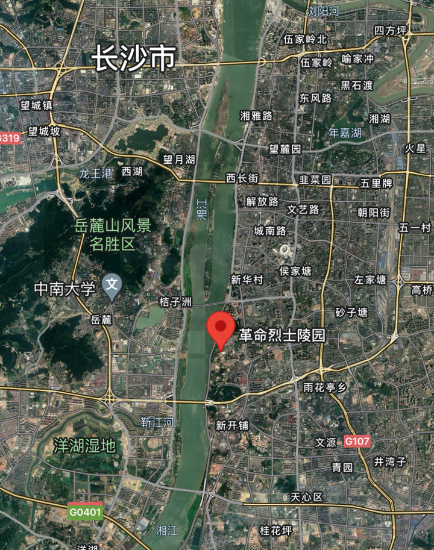
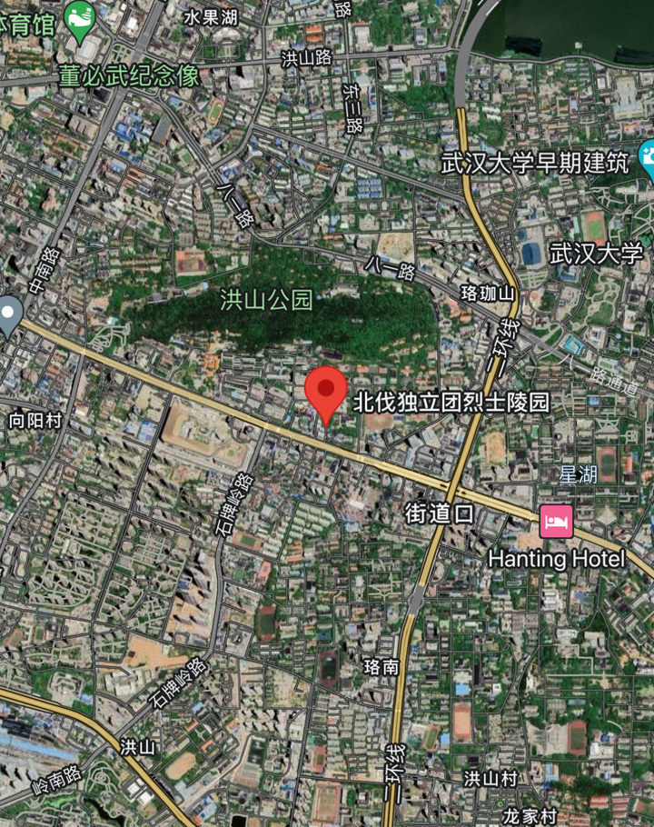
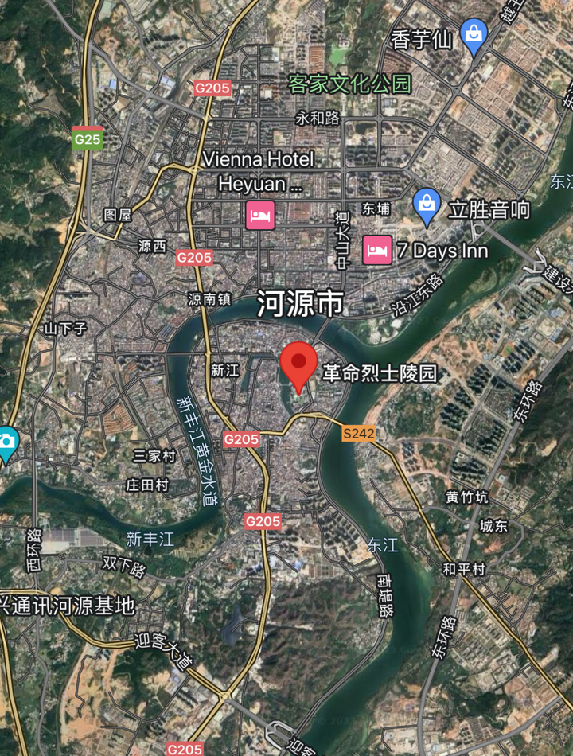
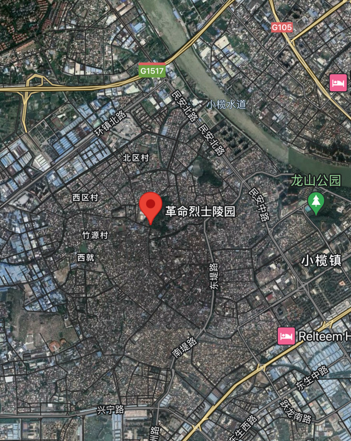
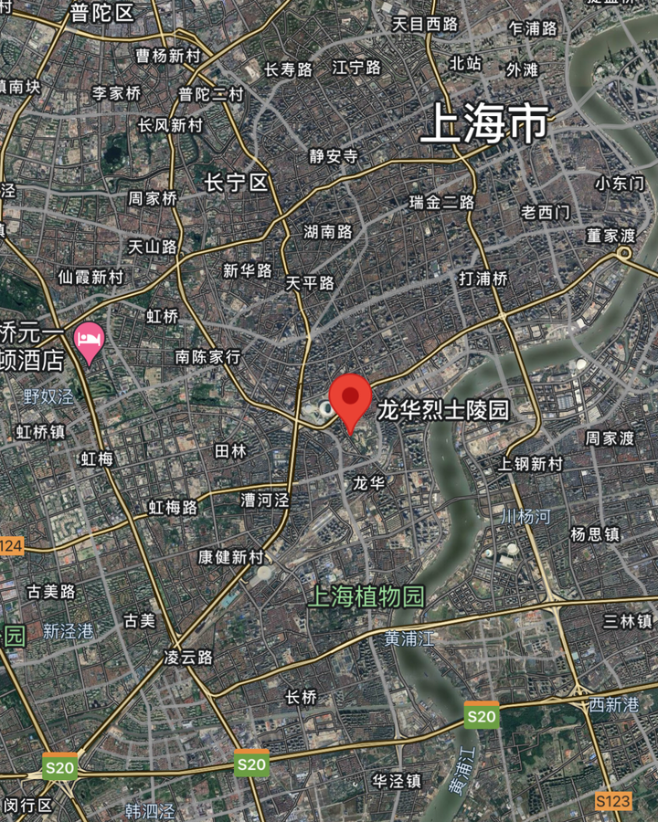
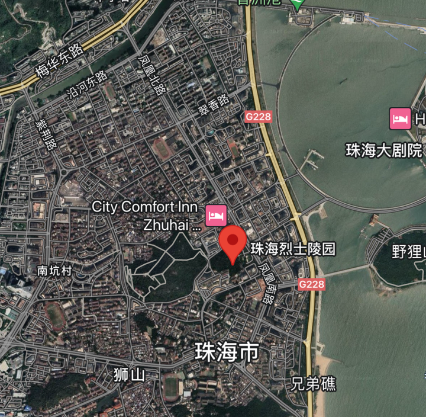
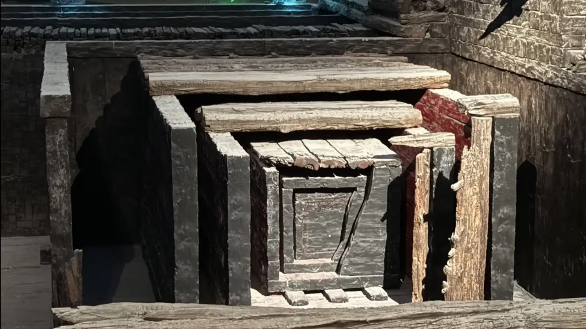
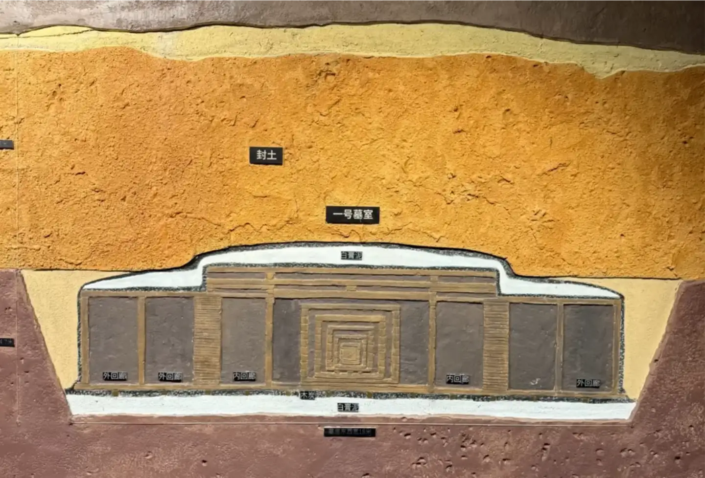

# A19　死亡祭祀与纪念　第 1 册（共 1 册）

- 专题代码：A19　专题名称：死亡祭祀与纪念
- 专题界定：死亡、丧葬、悼亡、祭祀、祖先、纪念与共同记忆。
- 本册：第 1 / 1 册　收录 38 篇　正文字符 36,413
- 语料：`sooon-q9adg-articles-v2.jsonl`（4,305 篇）　SHA-256：`cdc9c271309e1d71d9708889a3a31f4777e0c339ea54c3753521894afdb8357d`
- 生成时间：2026-09-27T00:01:00.997126+08:00　排序：发表日期 → 源序号（全库唯一，不重复）

**标记约定**：`【待审】` 主题仍为暂定；`【排除候选】` 图片/正文过薄的剔除候选；
`【正文标注未完待续】` 作者原文自带未完标记；`【正文缺失片段（复核已记）】` 复核记录已确认的正文缺口；
`【图片缺 N 张】` 源图不可获取。标记只作提示，不改写原文、不改动分类状态。

---

## 4039　攻克死亡

- 日期：2018-07-22　主专题：A19 死亡祭祀与纪念　副专题：A14;A18
- 源 ID：`6e00a9d7-d4d4-5578-9443-cf54d8b34d1f`　原文链接：https://www.zhihu.com/question/286304501/answer/448634740
- 23 概念标签：能力与学习;责任与后果;成本与总账;技术与工程;文明与历史;民族与身份
- 证据状态：manual_confirmed　初读：read　独立复核：not_reviewed

**问**：死亡如此可怕，为何全人类(或者说高层领导人)不主张把重心放在医学上？

把全部重心都放在攻克死亡上会立刻导致人类经济崩溃——因为把我们全部的资源都耗尽，目前也解决不了这个问题。
我们当然只有把重心放在更有效率的“让人暂时不死”和“让暂时死不了的人活得好一些”上。
甚至，应该“让必死的人不要那么害怕死亡”的投资优先级也要高于“让人不会死”。
历史上经常有“因为总体过于恐惧死亡反而导致更多无谓死亡乃至于族群灭绝”的例子——过于执着于求生和恐惧死亡对于整个族群来说是一种缺点。放大到千年的历史尺度，这种缺点会导致这族群很难挺过千年一遇的危机。现存的所有文明社群，都有接纳死亡的某种意识形态构建——譬如轮回论、永生论、取义论、奉献论、光荣论、解脱论等等等等。如果没有这些意识形态构建，遇到了必须要承受牺牲的危机，这个族群就只好覆灭。
而“将攻克死亡作为头等大事”首先就是和这种生死攸关的意识形态抵触的。强行推崇和追求前者，结局更可能是死亡尚未攻克，族群就因为甘于为族群牺牲的个体不足，无力应对危机而灭亡。

---

## 4032　宁不畏死

- 日期：2018-08-18　主专题：A19 死亡祭祀与纪念　副专题：A01;A20
- 源 ID：`8a49d412-0d16-53de-8b16-89f95e650b50`　原文链接：https://www.zhihu.com/question/290777932/answer/472110636
- 官方对象—实践路径：与自己 / 与情绪 / 调节
- 23 概念标签：定义与达意;能力与学习;责任与后果;成本与总账;边界与许可;照料与家庭;财富与市场;文明与历史;心理与主体
- 证据状态：manual_confirmed　初读：read　独立复核：not_reviewed

**问**：怎么处理对死亡的焦虑和恐惧？

慢慢自然会好，不要担心。
对死亡的恐惧来自两个层面的原因。
首先来自文化心理。对世界所有的现存文明而言，曾经最大的恐惧就是因人力资源不足而在军事和生产力斗争中失败。因此，它们不约而同的极力将死亡恐怖化和负面化（以及将生育和生存正面化甚至义务化），这是所有现代文明曾经的本能冲动——王朝必须人丁兴旺，意识形态必须要广泛传承。社会并不关心这样做对个体造成的心理创伤，正如自私的基因并不关心人类是不是会因为它们的遗传最大化策略而容易患上癌症一样。换句话来说，经过社会化的人类实际上普遍染上了文化有意塑造的“恐死病”。这也是为什么恐死现象往往发生在初高中阶段——这个阶段人基本完成了初步的社会化。但我们并不能简单的去责怪“文明”。客观说这是一种自然的安排，并没有哪个具体的人或者具体的阶层要为此负责——没有为自己的社会设定这个属性的文明也就趋向于灭亡了。
死亡恐惧的第二层力量来自人的乐观期望。青少年往往处在一个“高势能”地位——身上没有历史包袱，没有罪恶记录，可塑性强，时间资本丰厚，正所谓“天下无事不可为”“前程似锦”。在这样的未来预期之下，死亡自然被识别为风险。尤其是在耳闻目睹到各种意外死亡案例，已经切实产生了“无法完全防止一切死亡风险”的无力感时，会产生强烈的恐慌。
要想治愈这种“疾病”，首先你需要意识到“治愈”它的代价——如果你失去对死亡的恐惧，以你的阅历很容易导致对安全的漠视和对风险的低估，一个意外足以将你的人生马拉松变成四百米越野。死亡恐惧所造成的负担，客观上就像你为生命买的一份保险。你省掉这笔保险费的同时，也就接受了这项风险。你确信这对你是净赚的吗？
第二，对一切症状稳定的病症，都存在第二种治疗方式——适应。也就是依靠接受“刺激的边际效用随时间递减”的认知规律，静静等待自己对某个症状的刺激丧失敏感性。恐死也在这个名单里。也就是说，你可以选择“保守治疗”。随着你年龄增长，你对未来的美好预期会随着时间资本的不断削薄以及多次的时间投资挫折而发生很大的下滑，作为风险的死亡的重量自然也会大幅的下降，而你处理负面情绪的经验自然也会随着时间积累和增长。此消彼长，死亡所造成的精神压力很快会降低到你的管理能力之内，只是在某些脆弱的时候才会伴随着别的什么东西翻滚到水面上漂浮一会儿，倏忽之间就又消失在你思维的深渊里去了。这差不多也是绝大多数人的路径。
还有一条少有人走，更为艰难，但更为美好的路。
那就是更加深入的认识死亡，去除对死亡非理性的恐惧，代之以尊重前提上的敬畏；明白人生本身最好的样式，就是向死而生。
人在死亡问题上能有的最好样式，就是此刻有人告诉你你已必死，你可以长出一口气，欣喜于你终于可以名正言顺的休息了。

---

## 3973　永生酷刑

- 日期：2019-01-14　主专题：A19 死亡祭祀与纪念　副专题：A01;A11
- 源 ID：`b34ad449-cac8-588b-a2ed-92b0b4845cf1`　原文链接：https://www.zhihu.com/question/31756387/answer/573595040
- 官方对象—实践路径：与自己 / 与时间 / 失去
- 23 概念标签：事实与证据;定义与达意;能力与学习;选择与自由;成本与总账;信用与信任;法律与秩序;权力与异议;技术与工程;文明与历史;生态与自然;心理与主体;性别与身体
- 证据状态：manual_confirmed　初读：read　独立复核：not_reviewed

**问**：永生是否是一种酷刑？

你们的讨论中缺了一件事——谁说永生意味着不死？
永生有一天是可以做到的——譬如改造成某种忒修斯之船，哪里坏了换哪里。虽然技术上非常复杂和困难，但是至少逻辑是通的。
但这意味着“不死”吗？并不，那只是意味着你没被人砍死、没被车撞死、没有滑雪冻死、没有冲浪淹死……的话，你不会死。你再“永生”，有人冲脑袋来一枪也没救了。所以，永生是永生，不死是不死。（其实生理性的永生大概只意味着人的寿命延长个一两倍，然后人人死于意外或者自杀。）
穿一层盔甲、建一重堡垒、给地球装上二十四层轨道炮，你能防住超新星爆炸的辐射冲击吗？你能防住太阳的红巨星化吗？你能防住流浪的黑洞吗？
你如果得到永生，首先得到的只是对于失去永生的无限恐惧。
现在你英年早逝，失去的是三四十年的寿命预期；未来你三四十岁英年早逝，失去的是100-200年甚至无限年的寿命预期。
问题来了——那么还有什么样的正义值得你用生命去捍卫？一百年前，你二十多岁，因为世之不义生不如死，你会大喊“不自由，毋宁死”“引刀成一快，不负少年头”“去留肝胆两昆仑”，因为你作为赌注的，不过是十几二十年眼见得悲惨不堪的生活。一百年后，你预期寿命是永生，世界同样不义，你生活得同样不堪，你愿意押上你十拿九稳的【永生】去抗争不公吗？即使你愿意，你觉得你能有多少同志？
永生指向坚不可摧的奴隶制。

第二，永生带来的是对失去永福的无限的恐惧。
一百年前，关于小朋友应该学什么，父母们随意得很。天生天养——干什么不吃饭？干什么不是活一辈子？
现在父母们为了学区房、为了双语幼儿园、为了国际学校，堪称抛头颅洒热血。拼死也不让自己的孩子输在起跑线上。
为什么？因为幼儿时代的教育不良的代价扩大了好几倍。
人均寿命从30岁延长到75岁，人15岁后的寿命就从15年延长到了55年，延长了两三倍。
人的经验的净有效性是按复利累进的。假设同样一项技能，某甲在20岁掌握，某乙在30岁掌握。这项技能从第一个月开始每个月为掌握者带来一百元月收入。每一年，因为经验积累，这个月薪会提升5%。
计算一下，假如甲、乙都40岁退休，这项技能带来多大月收入差异？
100*12*( 1.05^20 - 1.05^10 ) = 1229.28
如果两人60岁退休呢？
100*12*( 1.05^40 - 1.05^30 ) = 3261.6
如果是200岁呢？4918503。
看清楚基数，100元，看清楚时间单位，月收入。
如果医学的永生得以实现，意味着一个人智力稍微优胜一点、出身稍微幸运一点，将绝对的凌驾于ta稍微不那么聪明、稍微不那么幸运的同类之上，不是高一层楼，而是高在云霄。
你觉得现在的儿童教育负担重，家长的竞争有些不理性？等人类寿命超过一百时再看看。
何止幼儿教育。任何会长远影响到你的未来的重大选择，都会造成当事人的焦虑。这焦虑在人均寿命70岁时，远远的要比人均30岁时大。一个选错，前者吃亏十几年，后者吃亏几十年。要是永生呢？那时候入错了行，耽误了三四年，你还能一笑置之吗？
不但是选择焦虑会呈几何级数上升，遭遇不幸的打击时，人均寿命长也意味着潜在的损失更加难以承受。很多人在遭遇打击时，心里想的是“如果我可以多活二十年，我就不会这么在意了，因为我可以东山再起”。这是错误的推算，看出来没有？因为没有遭遇这个打击的，你的竞争对手们也没有少活这二十年啊。

事实上，随着人类平均寿命的延长，这些永生诅咒已经开始收紧了——前推一百年，用飞机撞毁两栋楼房，是不会引发人类如此广泛而深刻的恐惧的。地球越“安宁”、人类越长寿，这诅咒越呈几何级数上升。这恐惧最终将让我们所谓的安全手段和一般治疗手段望尘莫及。安全手段本身就同时是可怕的威胁。核能源、空间开发、基因编辑。终有一天，一个错误将能释放兆亿的烈焰。
而“一般治疗手段”是心理治疗还是心灵培训班？还是毒品？
没有任何东西能向你保证乐观预期。没有乐观预期，你将无法在漫长的人生中保持乐观。这人生如此漫长，以至于极尽坚持，也会有好几十年要深入黑暗。
除非，你能超理性的、而且是不可动摇的拥有某种乐观来源——信仰。
无论有神还是无神，你必须要有一种任何负面事实都不可动摇的乐观源泉，你必须有。不但你必须要有，为了避免沦为奴隶制世界，人类也必须要有。
否则，永生即地狱。

---

## 3873　唯此为大

- 日期：2019-11-29　主专题：A19 死亡祭祀与纪念
- 源 ID：`34c70769-57cc-52fb-b839-f99b12466071`　原文链接：https://www.zhihu.com/question/358243958/answer/915544718
- 官方对象—实践路径：与自己 / 与时间 / 失去
- 23 概念标签：定义与达意;责任与后果;文明与历史
- 证据状态：manual_confirmed　初读：read　独立复核：not_reviewed
- 标记：`【极短回答】`

**问**：如果能在全世界人类脑中同时播放一句话，你要说什么？

你终有一死。
MEMENTO MORI.

---

## 3761　自杀率发展

- 日期：2020-06-21　主专题：A19 死亡祭祀与纪念　副专题：A20;A01
- 源 ID：`1edec003-9db9-501c-9345-43fc20e0d2c4`　原文链接：https://www.zhihu.com/question/402423795/answer/1294163591
- 23 概念标签：事实与证据;选择与自由;责任与后果;技术与工程
- 证据状态：manual_confirmed　初读：read　独立复核：not_reviewed

**问**：如果人类的自杀率在 50% 以上，社会将如何发展？

你问反了。
当人类全体获得无限寿命时，人类几乎100%都是自杀的。
所以，正确的问法是“社会发展到什么程度，人类自杀率会达到50%”。

---

## 3737　死亡

- 日期：2020-07-07　主专题：A19 死亡祭祀与纪念　副专题：A11;A20;A03
- 源 ID：`f975f3fe-005b-53dd-8f44-2741aefcda9b`　原文链接：https://www.zhihu.com/question/19795293/answer/1323213160
- 官方对象—实践路径：与自己 / 与身体 / 维护
- 23 概念标签：事实与证据;选择与自由;责任与后果;成本与总账;边界与许可;劳动与组织;财富与市场;技术与工程;文明与历史;心理与主体;性别与身体
- 证据状态：manual_confirmed　初读：read　独立复核：not_reviewed
- 标记：`【正文标注未完待续】`

**问**：死亡的意义是什么？

死亡这件事，一言难尽。
有件事你们可能没有注意到。
其实人类普遍相信“人皆有一死”是一件非常非常晚的事情——这不是一种事实，而是一种信仰。
死亡，是一种信仰。
不信吗？
那我问问你——你有什么证据证明历史上出生早于两百年前的人类都死了啊……
嗯？
啥时候普查的？
挨家挨户敲门问——“借问，你大爷死了没？”这样吗？
哦，你问完一遍了，能证明“所有出生早于两百年以前的人都死了”吗？
你能设计一个什么可行的手段来确确实实的【证明】现在绝对没有一个两百岁以上的人类正混在我们中间活着？
如何证明绝对没有一个实际活了一千多年的老太爷三百年前刚死？
你以为用DNA、用端粒效应这些就可以替代实际的验证吗？
这不叫evidence，这叫speculation with great confidence。你只是在基于一种你信心十足的、你没找到反例的理论在进行推测。
被实际证据推翻的信心十足的理论推测多了去了——整部科学史里的每一个案例几乎都是。
忘了比萨斜塔的铁球了？忘了火车上的光速了？
你看出问题了吗？
“人皆有一死”这么大的一件事，没有——事实上也不可能有——【足够充分】的事实证据。
你是个现代人，你都想不出办法来验证这件事，你觉得古代人——我都不说多古代，就解放前好了——真的认为人一定会死吗？
（很多人逻辑不行，所以额外补一句——证明“人会死”和证明“人必然会死”是两回事，停止在评论区尝试拿“人会死”的证据证明人必然会死。）
看到了吗？
“普遍死亡”并不是一件已经被（或者在任何时代曾经被）确凿无疑的、有充分解释力的实验证实过的科学事实。而且恐怕在可见的将来也没有可能做到这一点。
你想要相信有些人不会死，谁也没法用什么证据来驳倒你，因为ta们真的除了举一堆例子、一堆间接证据，手里真没什么硬货。没人能说相信人不一定会死的人真的就一定是错的。
在这里，就有耐人寻味的细节了——那么，我们为什么现在会如此普遍的、坚定的、彻底的相信人一定会死呢？
这里一定有什么重大的价值，在奖励着拥死派、打击着否死派，以至于拥死派在意识形态的斗争中占据了绝对绝对的上风，近乎于令否死派绝迹了。
你们要知道，在大约五六千年前，人们普遍的不认为人一定会死啊。
普遍。普遍到你随便敲开一家门，人家都会跟你说“我不认为人一定会死”——甚至有人会和你说我们村王大爷就活了四百来年，他见过孙悟空。
也就是说，死亡之中蕴含着一种价值，足以压倒人通过相信长生而得到的一切福利。而且不是局部的、一时的压倒，而是在这几千年文明史里，一天比一天更多的在更大的范围内压倒。它不但从无到有的孕育了“拥死派意识形态”，而且节节胜利、足足让拥死派从0%增长到了100%！
只凭这一点，你就可以确信死亡这种信仰一定存在至关重要的、至为强大的价值。
因为事实的证据实在太宏大了——整个人类文明史完全可以看作相信死亡的文化实体不断从精神和肉体上灭亡对手的过程。
问题是——这巨大的价值到底是什么呢？
也许说起来让你难以置信，但“人终有一死”是人类最大的宽慰。
作为年轻人，难免觉得前程似锦，天下无事不可为，尤其是现代人类社会虽有动荡，但总体上总算平安喜乐。人均寿命已经到了七十、八十岁。所谓的古来稀，已经变成了平常事。
所以现代人——尤其是尚未老去的婴儿潮（注意每个国家的婴儿潮的起始期不同）——眼下总觉得人生是一场可以延续七十几年的盛宴。
但对古人、对老人、对常在病痛、挫折、衰老、灾难困扰中的人们看来，“人终有一死”是最大的安慰。
无论多么痛苦的日子，毕竟总有一个尽头可言；无论怎样的逼迫，总有结束的一天。
你不需要在“干脆自杀”和“继续煎熬”之间无穷尽的选择，这是一个多么令人宽慰的事实啊。
如果你不相信你会自然死亡，那么你就需要按照“可以争取无限活下去”的样式活着。那到底是一个什么样的体验？
比如，某本经书说“唯有童子身能成仙，长生不老”。那可是长生不老啊，你难道不要长生不老？你想要长生不老是吗？那么你想要长生不老的每一秒钟，你都要顶住“破坏童子身”的一切诱惑。
某个传说说用处女的血洗澡可以返老还童，杀处女当然是罪大恶极，但那可是“返老还童”啊。在“返老还童”面前，有什么所谓“罪大恶极”？
永生如果不是绝望的，人类的整个伦理计算都会令普通的现代人瞠目结舌。
这甚至不是一个理论上的传说，而是现在就活生生的仍然在运行着——印度人大面积的相信“此生受苦、来生福报”的轮回式永生观，这毫无疑问地对种姓制度给予了显著的逻辑支撑。而这显然地阻碍了现代社会的普遍逻辑——即自由的劳动力和资源流动——在印度的实现。
因为现世永生的意义是如此根本和巨大，一旦被纳入基本议题，它就会深刻的影响社会的运行逻辑，使得一个社会极其的难以面对牺牲和危险。
举个最简单的例子——一个普遍相信靠巧妙的保养可以永远活下去的社会，要什么样的代价才能吸引到足够的成员参军？
仅仅这一条，就必然要求一切关于现世永生的理论做出修正，去解释为什么有一部分人——甚至是很大的部分人——先天的注定不可能追求长生不老。
这个限制必须是先天的，而不能是后天的——比如你不能说足够有钱就行，因为这只会引发全民大抢劫。这必须是某种你先天就不具备、也不可能在后天弥补的条件。
例如生辰八字不对，或者“没有慧根”“没有仙缘”。
不把这补丁打足，一个社群就很容易被另一个社群打垮。
这自然而然的驱动了一个“长生不老理论补丁大赛”。
只要交通技术发展起来，人类社会互相接界、技术所能支撑的帝国规模上限提高，这种补丁大赛就会开始起效，驱动“人固有一死”的理论逐渐占据上风。
因为不客气的说，这种关系到统治还是被统治的竞争，就是“敢死之士”的竞争。
实际上是客观历史自己通过技术竞争，逐渐的消灭了人类关于长生不老的执念。
换言之，死亡对你个人有何意义，其实是次要的，它首先是对社会的幸存和稳固有不可替代的意义，所以由此成为了你不容选择、只能接受的“意识形态预设”。
而这又反过来给了你一个接纳死亡的必然性的显然的意义——人类社会的存在实际上和个人的长生不老理想是不兼容的，这会导致人类社会的整个规则设计、运行逻辑会不由自主的、无休止的惩罚持有这个观念的人，让ta们“莫名其妙”的处处碰壁、不断的遭遇惨重的挫折，并且一日比一日孤独、一天比一天逼近有罪之身，从客观上让这些人生不如死。
这很类似你相信巫术，于是你被隔壁邻居的各种“疑似巫术”“妨”得心神不宁、彻夜难眠，你去告ta骚扰，法庭不会受理；你为此去砸烂对方的大门，警察会把你逮捕；你为此伤害对方的子女，你会坐牢。无论你怎么提告，法院都无法支持你“都是ta作法诅咒我，我只是正当防卫”的主张。然而你所遭受的心理折磨、生理损失却是真实的、无休止的。
反过来，你如果接受“人固有一死”的理念，你就能免于这种代价。
能免于这代价，本身对你就是现实利益，已经是实打实的、真金白银的价值和意义了。
（未完，待续）

---

## 3711　老有所依2

- 日期：2020-07-25　主专题：A19 死亡祭祀与纪念　副专题：A09
- 源 ID：`4ff7810c-9d49-578c-9b34-6fbe725ee959`　原文链接：https://www.zhihu.com/question/403290284/answer/1360171805
- 官方对象—实践路径：与自己 / 与身体 / 维护
- 23 概念标签：事实与证据;定义与达意;能力与学习;选择与自由;责任与后果;爱与回应;照料与家庭;劳动与组织;财富与市场
- 证据状态：manual_confirmed　初读：read　独立复核：not_reviewed

**问**：你心目中完美的养老院是什么样的？

很多人都觉得养老院是一个舒适的生活设施外加一个密切伺候设备完善的护理机构，换言之，是一个消费毕生积蓄，换取不必再付出劳动即可“纯享福”的地方。唯一的问题，是如何巧妙的安排娱乐项目和护理手段，既可以提供最大享受，又可以成本平衡，富有利润。
凡是这样想的人，必然要失败。
养老院首先应该是一所关于生存和死亡的学术机构。
它在本质上，首先必须是一种修院。
它不是在提供一种舒适的、“对得起余生”的活法，而是在提供一种平安的、向死而生的死法。
它应该是人解脱尘世执着和恩怨的修行所。
它应该是人探索和实践超越个人得失、成败、荣辱、生死，获取和传授这类知识和技艺的研究所、实践场和教学中心。
它应该是一所聚集了老年人、中年讨论者和幼年学习者的关于生和死的大学。
它应该成为一家制度性的、周期性的、本质意义上的、与社会有紧密而深刻的互动的学术机构和慈善机构。
访问这样的机构，和它们展开制度化的周期性探讨和交流，应该是义务教育学校、医疗教育机构、企事业机构、监管教化机构的常规制度性安排。
临终之人的价值，被非理性的死亡恐惧引发的病态讳疾忌医完全浪费了。
这既辜负和浪费了老人们最宝贵的价值，也让这个社会损失了极其珍贵的生死观的早期教育——这种教育，甚至不是加大金钱投资（或任何其他形式）可以弥补和替代的。
它最常进行的活动，应该是关于人的生命的哲学、伦理学的研究、讨论和传承；是在最后的同行中，尽管会屡屡失败、然而会锲而不舍的坚持的帮助原谅、帮助修和、帮助宽容、帮助放下和帮助送别的实践。
它的生活体验，不但不应该是散漫的、闲适的、无所用心的，反而应该是忙碌的、奋进的和矢志不渝的。
充满视死如归的无畏的激情。
它应该是帮助人最后超脱私己，成为无我之我的地方。是引导人体味面对人类而非自己（包括自己的子孙）做最后、最好的努力，并死于这种最好的努力这种最美好的人生体验的地方。
人生最大的遗憾，其实不是活的不幸福，而是因为恐惧死亡和匮乏，而没有真正毫无顾忌的、专心专意的爱过。
爱是世界上最美妙、最坦然、最安心的事，你一辈子为了怕活不了、活不好而耽误了，从没有好好学过，你错过了。
现在你终于“在劫难逃”了，你反而获得了这个最纯、最美、最无顾忌的机会。
但因为人一生疏于这样的学习和练习，也缺少这样的实践经验，这样的机会常常并不能转化为真正有效的、值得你安慰的实际效果，于是也很难真正带给你平安和喜乐的心态。
这个短板，才是一个“养老院”真正最值得补足、也必须补足的东西。这才是一家“养老机构”应该有、而且必须拥有的灵魂。
它会由此带给每一个成员带来身在凡俗时无法明白的荣耀。
否则，那些燃烧毕生积蓄的安乐窝、逍遥乡，反而是最令人心惊胆战的地狱。
是的，你在“享乐”，但你知道隔壁老张的房刚空掉了，上周老李——比你还年轻——被人从卫生间抱出来送走了。你闻到了黑色的死气，你估计他不会再回来了。
你的内心没有平安，无法和身边必然的高频死亡平静的共处，也找不到自己此刻的任何一点价值。
这样的地方，就算摆上一万台游戏机，摆满龙虾和鲜鲍，每隔一间房就是最先进的icu和最训练有素的护士，又怎么样呢？
那不过是一家好吃好喝的候刑室，和死刑犯行刑前一周受到的饮食优待、密切安排的医疗看护有本质什么区别？
你既然不能用好吃好喝好招待换人接受死刑，那么仅仅搞好吃好喝的养老院就是根本行不通的。
在看到养老机构明白这个理念、实实在在地实践起这个理念之前，他们的股票是不值得投资的。
最好的死法，是鞠躬尽瘁、死而后已。
如何树立正确的财富观？
很多人在问这样的机构岂不是太理想了吗？对大多数人并不适合啊……
对于不适合而羡慕的人，可以外围围观或者做短期交流。
但是对于要加入的人，这是要一轮一轮的谈论，一轮轮的实践，一轮一轮的试炼，一轮一轮的获得资格，一轮一轮的发愿的过程。
任何一环，你都可以完全自由的、毫无后果的改变主意。
直到你拿定主意。
走到最后一层的注定不会是很多人，因为这件事本来并非任何人都可以办得到。
这不是谁办了，你只要拿钱去申请就可以进得去的。
而是你自己从十几二十几年前就要开始寻找同路的人，找到可做的事。
这事不是随便什么事，它必须是与世无争的事。
它不可以转化为政治影响力，也不能转化为某种与世俗竞争的商品。
它必须是一种只要图利之人就觉得得不偿失，而所有人都苦于没人肯去做的事。
这事还要没有尽头，逻辑上就没有做成可言。
所以才能代代传承。

---

## 3678　长生不死的脑残

- 日期：2020-08-28　主专题：A19 死亡祭祀与纪念　副专题：A03
- 源 ID：`ac580308-0276-5166-ae63-b3d6978bc550`　原文链接：https://www.zhihu.com/question/417913464/answer/1438032852
- 官方对象—实践路径：与自己 / 与时间 / 失去
- 23 概念标签：能力与学习;责任与后果;信用与信任;爱与回应;劳动与组织;文明与历史;人工智能与机器;性别与身体
- 证据状态：manual_confirmed　初读：read　独立复核：not_reviewed

**问**：长生不老是完全不可能吗？

我换一个角度来说明这个问题。
首先，假设你在生理意义上的长生不死已经确实实现了。
那么接下来的一个具体的问题就是，你的记忆能力是否能无限的扩展，去记住你这无限久远的生命的经历？
这些基本记忆严格的构成了你的人格的基底，如果不嫌粗糙的话，从某种意义上说，如果换一个新鲜的载体，把你的记忆完全移植过去，在重新点亮的瞬间，这个新的副本在精神上就是你。
直接删除你的部分伤痛记忆，足以改变你的性格。删除你对某些关系的记忆，这些关系对你就会等效于不存在，进而这些要素对你的决策的影响也会消失。
那么问题来了——你的生理活动是无限延续的，你的“硬盘”却是容量有限的。
假设我们认定它的极限能装一百年的记录吧，那么当你活到两百年的时候，你的前一百年记忆要么被洗掉，要么就是留下部分，和后一百年的部分记忆挤在一起。
活到三百年的时候，就得自己精选一百年来留下。
活到六百年的时候问题来了——六百年的记忆只能留一百年的，随你怎么精心选择，你的人生回忆也怕要把你逼疯——故事线过于稀薄，处处都是缺少线索、无法回忆的空白和断头。
你的人格会崩溃，自我认知会解体，变成若干个人格碎片的杂合体。
或者，走另一条路线，不管三七二十一，只留最后一百年的连贯记忆。
但这带来另一个问题——你的前五百年记忆都被洗掉了。
那五百年的你其实已经死掉了。那五百年里你如果有什么丰功伟绩，六百岁的你将毫无记忆，听到别人转述、或者到纪念馆里看文物，你将毫无感受，如同隔着转世观看他人的事。
这样的永生的确切意义是什么呢？
让我们把这思想实验再往前推一步——假设有一天发明了大脑闪电接头，你可以扩容了。
大脑的记忆容量无限了，啥你都能记得。
那么问题解决了吗？
不要忘了，我们的计算机的硬盘就可以无限扩容，但我们的计算机真的能在求解时把硬盘的资料全部纳入思考范围吗？
不能，它还有个“运存”问题。它要把必要的资料从仓库里翻出来，摆到自己的办公桌上，它事实上只能处理能放在办公桌上的资料。不能同时放在办公桌上的资料，即使确实有登记在仓库里，也没有实际意义。
你的记忆硬盘可以无限扩展，你的运存也可以无限扩展吗？——要知道很多人看小说的篇幅长一些都会记不清前面出场的角色，这个实在无法乐观。
如果我们再进一步的观察，你会发现运算能力（时钟频率）本身也是个问题。
不然人家问你个问题，你先花3个月载入古往今来的一切数据，然后提出一个模型，那这一百多个P的数据验证一遍，得出结论再迭代一遍……
等你终于做好准备回答对方的时候，对方怕是孙子都生出来了。这还忽略了做这些运算所需要的能量和散热功率。
如果你不打算把自己改造成核动力供电和海水散热的话，你的运算速度恐怕不足以在保持几百年的记忆能充分有效运用的前提下保持正常社交所需要的语速。
也就是说，就算你的算力无限，只要你不想化身为核电厂附属设施，你终究还是要舍去大部分的数据和算力。
这仍然会导致记忆资源失去实际意义。
如果你非要硬着头皮外接核动力，你也会变成核潜艇改造的深海监狱里的、语速过慢的永久囚徒——还会有环保主义者无休止的围着你，抗议你破坏海底热平衡，在你身上喷满标语。

实际上是你的思维机制本身最终决定了你无法在真实意义上永生，不是新陈代谢，也不是所谓的端粒限制。

所以，停止幻想永生，认真的拥抱你的死亡，并且感谢它吧——它让你不必在这种恶心的两难中因为持续的软弱而最终变成深海铁棺材上的一块赘生物。
其实是死神救了你的命。
Another poetic irony.
我发现很多人都觉得“长时记忆可以令人满意的简略化”，把这视为一种输出可行方案。
实际上这是行不通的。
因为一种记忆和一种幻觉的本质区别，就在于记忆会有很多其他细节作为辅助背书。而这个“其他细节”也不是简单的三五件事，它们本身的真实性要靠极其复杂的系统性相互关联和协调来保证。
你有了一种回忆，要区分这个回忆到底是一个经历、还是一个被无意间记住的梦，你自己是靠搜索其他关联细节来鉴定的。
比如你脑海里浮现出一辆红色的自行车，你有些怀疑这到底是不是你的记忆，你会去搜索这辆车你是在哪里买的，最早是怎么动的这念头，你会记得拆开包装的瞬间，会有你骑着这辆车的身体记忆，会有骑着这车摔跤的回忆，会有骑着这车经过某时某地的记忆……
如果你想起了这辆红色自行车，而其他的信息你全部想不起来，也没有任何其他一般意义上被认为“无关紧要”的细节为这个“重要信息“作证；或者你记得买车的场景是在一座中东风格的商店里，老板悬浮在半空中，或者当天正是你高考的同一天——也就是这些相关记忆之间有逻辑矛盾——你都将无法将这个念头作为你的记忆来对待，你的大脑不允许这样工作。
你们看懂这问题没有？
即使你们自己回忆起来觉得自己似乎活了二三十年，直接记得的不过是那么几件事，但这根本不表示你只需要记住这几件事就“足够”了。
因为要让你自己确信这几件事不是幻觉、而实实在在的是真实记忆，你还需要冰山在水面下的底座。否则这个山尖会立刻大部分沉入海底。
被明确感知到的记忆断裂的威胁是摧毁性的，如果你不能令自己满意的把自己的人生经历用一根时间线连贯起来，你就将沿着空白线自我断裂。
比如，假设你因为事故有三个月的记忆丧失了——不是你在这期间没做事，而就是这段时间的作为的记忆丧失了——那么你将很难理解你现在正在做的这件事到底是为什么。你不能理解为什么你现在这么黑，而且手还断了。
你得依靠别人的讲述和说服、依靠自己对别人的相信来确认自己是在这三个月里天天卧底踩点、蓄谋抢劫、在逃跑的途中因为事故摔断了手。
讲述人拿出了你踩点时戴的墨镜，还有你踩点时买奶茶的收据，抢劫那天你穿的摔的稀烂的衬衫……还有据说是你亲笔写的、明显是你的笔迹的踩点笔记，向你证明ta的确没有骗你，你现在就是一个因为抢劫而被通缉的罪犯了。
你要不要接受别人对这段空白的写入？
你们有没有遇到过在街上遇到一个人，这个人认出了你，你却完完全全对ta没有任何印象这种事？
这人滔滔不绝的在讲述一次你记不起来的共同旅行，补充了无数细节。
你是否会就此接受这件事就确实发生过？
活到三百岁，你会有越多的记忆失去辅助支撑，并且会出现越来越多的断裂线。
以至你像是一部被岁月蛀空的小说——很多章节貌似还在，但其实它们只剩下了一个标题，有的甚至只是在目录里有一个页码而已。
这部小说只能有一百万字的上限，并且每天都会丢给你一千字要你决定把前面的哪一千字变成空白，或者由一个你不能控制的机制自动的吞吃前面的章节。
一本一万页并且每天都在变厚的小说，却只有一百万字的篇幅。最终的结局只会是变成一片不知所云、无法再总结出任何中心思想的乱码。
没有第二种结局可言。
现在我们再退一步，假设我们愿意接受笔记重生机制。
也就是我自己养成记笔记的习惯，然后我每天自己复习一下——或者在我自己觉得必要的时候复习一下——用来弥补我的记忆缺失。
永生是否是一种酷刑？
我发现很多人理解得有问题，那么再把问题说清楚点。
有一种观点认为“我现在就不记得一周前/小时候的事，我现在就没觉得有问题啊”。
我们假设你活到八十岁，能记住的内容约等于是三万小时的电影。八十年记住三万小时，就能保证你和现在这个状态一样健康的活着。
当你活到160岁的时候，你还是只能记住三万小时。
因为三万小时是你的上限，看懂没有？
活到240岁，还是三万小时。
活到480岁，还是三万小时。
随你怎么记日记，录视频，你看日记、看视频重新学习自己历史的份额，一样要列入这三万小时里面。
三万小时的篇幅维持你80年的人生经历也许够了，用来总结160年橡皮筋就已经拉断了，总结240年你甚至会看不出故事到底说的是什么，总结480年你必然要成为老年痴呆症患者。
至于说各种“增强大脑”的技术，我这么说吧，动完这手术，你确信在手术台上醒过来的这个人还是你吗？
好吧，这个问题一直有人追加这个“忘了也无妨”的主张，那么我举一个真实的案例，你们体会一下。
实际上，按照这个“忘了不要紧”的标准，世界上已经有人是“永生”的了。
这就是藏传佛教的活佛们。
活佛转世的基本程序，就是在前任死亡时留下线索，然后由人寻访数个候选人（转世灵童）。然后将转世灵童集中起来，让其在一堆混入了前任遗物的物品中挑拣选择，同时也由前任的身边亲随观其言、察其行，判断是否有前任的言行特征。
最终选出一个灵童来，认定为前任的转世。
从认定这一刻开始，所有人都将以对待前任的称呼、礼仪和态度来对待这位灵童。前任已经满面皱纹的弟子，也会恭恭敬敬口称上师。对继任活佛的所谓教育，完全以“您早已知道的，只是都忘了，请让弟子我帮您回忆”的角度进行。不但如此，还会帮助这位新活佛了解和回忆这个活佛所有前代转世的所有言行。
理论上活佛是无需教育的，因为他已知一切而且大彻大悟，一切都只需要重新想起。到最后，现任活佛——也就是之前的转世灵童——将会全身心的相信自己正是已经转世若干代的佛祇，不是所谓“继承者”，而实实在在就是本人。
这种安排甚至还有一个升级版，就是“双转世机制”，即不但活佛在转世，他的主要弟子也转世。活佛去世时，依靠这个主要弟子来做灵童鉴定和记忆恢复，而这个弟子本身也会基于几乎一样的机制转世。
这样从原理上说，教育每一代活佛的，也都是同一个弟子的灵魂。
你们看到了吗？
这其实就是你们前面再三表示“就算失忆也完全可以接受”的一个“离散数学版”。
那么，活佛是不是已经有效的永生了呢？
更强的问题是——如果你真的永生，那么或迟或早，你都将进入永远反复循环的“活佛机制”。
你余生的每一天，都在尝试重新通过学习记起你仍在不断延长的一切涉及到你的身份的重要的历史——就像活佛们的确会花一生时间复习所有前代转世撰写的著作一样。那些话是什么意思，绝不是很容易就能“回忆”得起来的。
哪天放弃学习，哪天你就会开始失去原有身份——比你忘记二元一次方程的解法还要快。
有人在说——找到办法把意识上传，或者外挂，或者用某种技术大幅改造人脑就行了。
其实是不行的。
与一般人想象的不同，人的意识是不能无损的与硬件基础分离的。这恰恰就是为什么人工智能无法意识到自身的存在的原因。
我们可以举一个最简单的例子——一个双目失明的人和一个能看见的人，这两个人的意识是存在重大区别的，这种区别远不是装了摄像头和没装摄像头的计算机系统所能比拟。
每月发作巨大疼痛和每月安然无恙、有伤和没伤、小时候受过虐待和没受过虐待……甚至吃的是什么食物，都会影响到大脑本身的发育，进而在很深的层面上影响到人的人格本身。
人类的存在从来就不是一种像计算机那样脱离硬件的纯软件，可以“拷贝粘贴”到另一个空白载体上。大脑作为意识的容器，每一个“容器”都是为它的内容物定制出来的，而这容器又反过来深刻的影响了内容本身。
你的意识的发育会影响到你的脑的发育，脑的发育会影响到你的意识的下一步发育，这两者交互作用，互相之间是紧紧的耦合在一起的。
改变容器，就是改变内容。爱因斯坦的脑里能装入的，只能是爱因斯坦。把你的意识强行“写入”爱因斯坦的脑，那些与“爱因斯坦大脑”这个容器不兼容的枝节恐怕就要全部剪掉。
装进一个“硅基大脑”存在同样的问题。
并且这个问题还没有止步于此——接下去你自己的人格进一步发育会严重的受到这个新平台的特性约束。
以前你吃到一个教训，对于人类的脑来说自有一种手段来进行适当的沉淀。现在你换成了硅基大脑，因为硬件性能的原因，沉淀出来的结果会大相径庭。某些东西你无动于衷，某些东西你敏感异常、印象深刻。无论这是何种样的差异，你都不能再简单的称为原来的你自己了。
“硬件改造”本身就是实质意义上的人格切换，这条路即使不是根本不通，也远不如人们想象的如云盘拷贝那么简单。
别的不说，去掉你的触觉和视觉，你还会和现在一样吗？

---

## 3207　生离死别

- 日期：2021-07-12　主专题：A19 死亡祭祀与纪念　副专题：A06;A01;A11
- 源 ID：`9dc3b9d2-a245-5444-9493-3bbcf8c32e39`　原文链接：https://www.zhihu.com/question/280659978/answer/1993168089
- 官方对象—实践路径：与自己 / 与信念 / 形成
- 23 概念标签：定义与达意;选择与自由;成本与总账;边界与许可;权力与异议;心理与主体
- 证据状态：manual_confirmed　初读：read　独立复核：not_reviewed

**问**：如何坦然地面对人生中的离别？

生离的意义很大，因为它是死别的预演。
你将会和一些人变得很难再见面，这是否意味着你“失去”了ta们？
仅仅只是知道对方还存在，无论多远也罢，总有再见的一天，这对你来说是不是一个足够大的安慰？
如果你相信人的存在以死亡为终结，那么如果一个人与你分离，而且不能乐观的期待会再相遇，并且你也知道彼此终究会渐渐停止联系，那么这个人在本质上对你来说等于实际死亡了。
你就不是在生离，而是在死别。
这一面就是这辈子最后一面。
于是“毕业”就成了至少一半同学的最终告别礼。何止毕业，在将来离乡打拼、同事离职、恋人分手——尤其是恋人分手，全都不只是生离，也同时是死别。
你可以尝试“保持联系”，但是很快你会发现你再怎么加强联系，终究也会失去一大部分人。何况，你有多大的力气加强？你能加强多久？尤其是，其中很多你不想失去的人，恐怕会把你的联系视为纠缠和打扰。
尤其是ta。
你也许会想，“那我走另一条路，我高度珍惜在一起的时间，分开了我就不想了。”
首先，不要欺骗自己，你只有一种珍惜的档位，你之前珍惜的程度，就是你做得到的最大的珍惜的程度，你根本没有“更珍惜”这一档可以上调。这个“决定”本身就是自欺欺人而已——你自己一清二楚。
第二，恰恰正是你这个“绝对不能接受分离”的态度，扭曲了关系中的人格和地位。你要绝对保险，你要忠诚证明，你要投名状，你要抵押权，你要卖身契。你要消灭分离的可能，只有没有分离的可能，你才能安营扎寨。
而这个所谓“消灭分离的可能”，只是“捕获并戴上手铐”的文言说法而已。
恰恰正是这个“不要分离”，导致别人要和你分离。
否则你又为什么会感叹——“别人明明不如我珍惜，奈何ta不识货”。
无论你怎么看待，你是无法用什么有效的手段“解决”这个问题的。

反过来，如果你相信人的灵魂是不灭的。那么这整个公式都会反转过来。
一切都不用急，也不必恐慌。
对方无论如何都存在，彼此也无论如何都有机会再见。这甚至不受人的寿命的影响。
既然时间不构成绝对的障碍，空间就更不成问题。一切和你同在一个世界中曾经相遇的人，你已经知道其存在的人，只要你记得，再相会时认得出而且愿意相认，在严格的意义上就从未与你分离。
同在一个世界，就是同在一处，就是终极而永恒的相聚。时间与空间的距离，对于无限永生灵魂而言是虚无的概念。
只要你识得到，记得住，而且愿意相聚，踏入了同一世界的不灭的灵魂永无分离可言——因为在无限的时间中一切可能的都终会发生。
你已经认识了，分离与否的唯二问题是：
你决定记住吗？
你愿意再相聚吗？
你记住、你愿意，那就没有分离可言。无论生离，还是死别，都化为乌有。
你于是可以放心毕业、放心留学、放心分手、放心离开医院。
你只要想，你谁也不会失去，根本不可能失去。
那么，你决定了吗？你愿意吗？

---

## 3152　星星

- 日期：2021-08-11　主专题：A19 死亡祭祀与纪念　副专题：A05
- 源 ID：`57146303-1714-5d24-b18f-8643040174f8`　原文链接：https://www.zhihu.com/question/477396986/answer/2052210098
- 官方对象—实践路径：与亲族 / 与子女 / 抚养
- 23 概念标签：事实与证据;能力与学习;选择与自由;信用与信任;爱与回应;心理与主体
- 证据状态：manual_confirmed　初读：read　独立复核：not_reviewed
- 标记：`【极短回答】`

**问**：孩子很认真问我「人死了是不是会变成星星」，我如实说不会，她就哭了。该如何与四岁孩子谈论死亡？

你怎么知道不会？
明明就会。
反正老子会。
嗯，就酱。

---

## 2842　生死契阔

- 日期：2022-04-22　主专题：A19 死亡祭祀与纪念　副专题：A11;A01
- 源 ID：`11df04ce-286f-534f-9f43-69112ff942fb`　原文链接：https://www.zhihu.com/question/529423798/answer/2452174568
- 官方对象—实践路径：与自己 / 与身体 / 维护
- 23 概念标签：能力与学习;爱与回应;心理与主体
- 证据状态：manual_confirmed　初读：read　独立复核：not_reviewed

**问**：男朋友去世了、我们相爱了两年、他4月20凌晨走了、我现在连呼吸都是痛、我该怎么办?

意外、病故、蒙冤而死、无辜被害、犯罪而忏悔死，属无咎之死，是命运的一部分，属善终。
只有犯罪而无忏悔死、自戕死，是自弃生命，属恶终。
人不必执着于自己什么时候死，而要在意自己将以什么样的姿态面对死亡。
善终即可，其他不必执着。

如果你能相信这不是一种损失和失败，那么你会得到极大的解脱。
这会从根本上消解死亡对你造成的胁迫。
相信这一点非常难，但相信这一点，你就能从现在的痛苦里得到真正的解脱。
不仅仅是节哀顺变，你自己也不会再被死亡的恐惧日夜惊扰。也不再思及父母、亲友的死亡而旦夕忧虑。
而且能把你自己死亡的沉重从你的亲友肩头移除。
尽皆松解，海阔天高。

这就是生死关。
尺阔之溪，千年难过。
想通与没想通，人的日子是截然不同的。
想不通这一点，你只是还没死。
想通这一点，你才活着了。

而遇上想不通它就过不去的难关，尤其是在年轻的时候，其实是一种幸运。

这是他给你的宝贵礼物，
你收好吧。

祝你平安。

---

## 2785　预备死亡

- 日期：2022-05-24　主专题：A19 死亡祭祀与纪念　副专题：A01
- 源 ID：`1f6d2379-e6ed-5e52-a24d-1bbb60aa586b`　原文链接：https://www.zhihu.com/question/532437441/answer/2499291627
- 官方对象—实践路径：与自己 / 与身体 / 维护
- 23 概念标签：权力与异议
- 证据状态：manual_confirmed　初读：read　独立复核：not_reviewed

**问**：我今年75，心里非常害怕死亡，怎么办？

试试开始写遗嘱。
写好了没事就修改。
每个季度搞个大版本公证一下。
写写改改，
改改写写。
什么时候你对遗嘱满意了，
你也就没这个害怕了。

---

## 2770　别时礼

- 日期：2022-06-01　主专题：A19 死亡祭祀与纪念　副专题：A01;A06
- 源 ID：`614df40a-0cae-5b44-b68e-324559dfc2c0`　原文链接：https://www.zhihu.com/question/373615534/answer/2511312536
- 官方对象—实践路径：与自己 / 与情绪 / 接纳
- 23 概念标签：选择与自由;责任与后果;爱与回应;边界与许可;财富与市场
- 证据状态：manual_confirmed　初读：read　独立复核：not_reviewed

**问**：我是一个34岁的妈妈，癌症晚期，可以给5岁的女儿留下些什么有意义的东西?

每一个已知必死的人，能留给所有所爱之人的最好的礼物，就是自己与死亡的和解。
不欢迎死亡，不迷恋死亡，不崇拜死亡。
不厌恶死亡，不回避死亡，不恐惧死亡。
和死神平辈论交，烹茶下棋，闲话家常。
自己认识这位朋友，再介绍给家里人认识。
通过自己的示范和努力，消除自己所爱之人对死亡的欢迎、迷恋、崇拜和厌恶、回避、恐惧。
当生则尽力生，当死即从容死。
示范这个健康的态度，成为一个家人朋友内心觉得可以效仿的例子，让ta们对死亡有一个健康、坦率、平和的态度，才是一个将死之人可以给予一切所爱之人的最大礼物。
这件礼物才是宝珠，其他的一切，无论是万贯家财还是谆谆教诲，都只是装珠子的盒子罢了。

---

## 2722　ToTheEnd

- 日期：2022-06-25　主专题：A19 死亡祭祀与纪念　副专题：A01;A06
- 源 ID：`e17f90d5-4085-5395-9be5-be3a2051882d`　原文链接：https://www.zhihu.com/question/536653100/answer/2543797753
- 官方对象—实践路径：与社会 / 与舆论 / 接收
- 23 概念标签：能力与学习;选择与自由;责任与后果;爱与回应;心理与主体;性别与身体
- 证据状态：manual_confirmed　初读：read　独立复核：not_reviewed

**问**：为什么有很多女孩相信"girls help girls"这种观点？

怎么，没带卫生巾，是男士们要挺身而出了？唇膏丢了，是哪位大兄弟要慷慨分享了？发现经期异常，是你要当知心大哥？没有奶，是你要当催奶顾问？你要帮她分析怎么处理性骚扰？你要陪她去谈恋爱？
女生不帮女生，你来？
你再说一遍，是不是要禁止女生帮助女生？
为了自己那点事，为了自己的欲望，居然要干预到人家从哪里获得帮助？
说出来不觉得有问题吗？

知乎现在流行着一种神奇的风气——连忠于祖国、见义勇为、努力奋斗、生育子女、尊敬父母、宽容他人、尊重信仰自由、民族团结、乐于助人、女性应该帮助女性……这样的价值观都要攻击。
一条两条也就罢了，当你发现条条都有你，你难道没感觉到这有点问题吗？
真的一点都没觉察到这个状态不健康吗？
当你发现某个人，条条都有ta，你不觉得你总是赞同ta，不是一个好兆头吗？
反对啊，反对啊，一条两条也就罢了。
条条都反对，势不两立的反对，要召集兄弟们骂死ta、打死ta的那样反对。
一路反对下去。
To what end, bro?

这些反对、咒骂、攻击的快感你领取了，这些东西你就自动摒弃了。
都摒弃了，换成什么？

To what end？
Bro？

你能坐好了想想吗？

---

## 2480　那山高

- 日期：2022-12-19　主专题：A19 死亡祭祀与纪念　副专题：A11;A01
- 源 ID：`e3301871-3696-5787-8878-1bbf15126a64`　原文链接：https://www.zhihu.com/question/288426457/answer/2808255002
- 官方对象—实践路径：与自己 / 与身体 / 维护
- 23 概念标签：心理与主体
- 证据状态：manual_confirmed　初读：read　独立复核：not_reviewed

**问**：人临死前是非常平静还是非常恐惧的？

不光是平静，甚至还有点期待。
但这个期待并不是“痛得不行，咋还不死”这种。
而是活有活的好，死有死的好，活的好已经耳熟能详，死的好尚未识荆。
具体来说，是望着天花板眼睛滴溜溜的转，暗自盘算怎么才能混个密钥，搞个周末通行证，从那边打什么擦边球传点消息过来。
这要是搞成了，岂不酷哉。

---

## 2350　去世之前

- 日期：2023-03-14　主专题：A19 死亡祭祀与纪念　副专题：A11
- 源 ID：`bad58134-0613-5973-843b-2bc93ebb9733`　原文链接：https://www.zhihu.com/question/288232772/answer/2935662809
- 23 概念标签：定义与达意
- 证据状态：manual_confirmed　初读：read　独立复核：not_reviewed
- 标记：`【极短回答】`

**问**：亲人在去世前，弥留之际家属到底应该说些什么最合适？

在前面等我们几年，没事多溜达，替我们熟悉一下环境。

---

## 2204　无常之祭

- 日期：2023-06-03　主专题：A19 死亡祭祀与纪念　副专题：A10;A01
- 源 ID：`571e42e2-865f-5a6e-af1d-cc2e64bdf7e4`　原文链接：https://www.zhihu.com/question/604447833/answer/3056636079
- 官方对象—实践路径：与自己 / 与时间 / 失去;与自己 / 与时间 / 使用
- 23 概念标签：事实与证据;定义与达意;成本与总账;心理与主体
- 证据状态：manual_confirmed　初读：read　独立复核：not_reviewed

**问**：武汉校内被撞小学生母亲跳楼身亡，当地警方正调查与网暴关联，网传其父坠楼系谣言，如何看待此事发展走向？

为这位父亲祈祷。
愿他的伤痛得到安抚，痛苦得到宽慰。
希望他能经受住这严酷的折磨，最后得享平安。
不要以为他只是格外的不幸，与我们这些没这么不幸的人无关。
他所经历的，随时可能落在你身上，
也随时可能落在我身上，对此不要抱有任何侥幸。
这并不需要你作过什么恶，犯过什么错，希望这位父亲能理解这一点，不要把哀痛导向自我折磨。
你唯一能做的，就是对此抱着清醒的认识和尽可能好的准备，尽力、尽兴的活好自己的每一天。
所有无辜受苦的人的痛苦，本质上都是警醒其他已趋懒散和享乐的人的祭献。对于其他人而言，不是那些短暂坚持的宽慰的（实际上是自我安抚的）话语、也不是那些微薄的抚恤、补贴，而是经由这同类痛苦的洗礼，端正自己对生活的态度、对人生意义的反思、对人生计划的再次观照，才是对伤者悲痛的真正祭奠。
你的猛然醒悟，是他人不幸命运不至于化为虚无、终为枉然的真正挽回。
希望你们在此默哀片刻，想想如果这事明天便不由分说落在你的身上、或者我的身上、或者不定任何你所在意的人身上，你会有多少不能甘心的悔恨。
所以，能和解的，尽要和解；能原谅的，及早原谅。
仇怨不要过夜，伤害不要固执。
正确的事，不要等待；错误的事，也不要等待。
其实所谓的勇敢与勤奋，其动力不该来自于贪婪和恐惧，而本该来自对无常的理解和接受。
如果你能一直保持这种警醒，那么当你如果有一天不幸遭遇这些时，在万般痛苦之中，将能有一息之力，护住你的心，那样你也许有更大幸存和康复的机会。
愿平安常与你们同在。

---

## 2194　死亡搁浅

- 日期：2023-06-07　主专题：A19 死亡祭祀与纪念　副专题：A01;A06
- 源 ID：`d1dcc73d-ffe0-5bb7-ae82-3830e32b1e11`　原文链接：https://www.zhihu.com/question/599292854/answer/3062318385
- 官方对象—实践路径：与社会 / 与舆论 / 表达
- 23 概念标签：事实与证据;定义与达意;成本与总账;照料与家庭;法律与秩序;权力与异议;心理与主体
- 证据状态：manual_confirmed　初读：read　独立复核：not_reviewed

**问**：高中时期有个极度讨厌的老师，如今得知她去世的消息，回了个泰裤辣，被同学骂了，我真的做的太过了吗?

你诅咒一个人或者庆祝一个人的死亡的行为，标定了你心目中的死刑标准。
而你的死刑标准有多低呢？
对你不礼貌、不批准你的请假……这对你就已经构成“死有余辜”——不，是“死有余庆”了。
死刑。
对你不礼貌、不满足你的要求，不是劝告、不是警告、不是训诫、不是罚款、不是记过、不是停职、不是拘留、不是徒刑，而是死刑。
看清楚，判死刑。
这个标准，对所有已经和你有关系、已经被你知道身份的人，都是架在脖子上的一把刀，套在头上的绞索。
而你还犹自觉得自己一点错都没有。
你没有意识到这种状态有多危险、多恶劣，而且你的年纪还已经高中毕业——也就是已经法律上成年了，意味着父母对你的社会意识的养成的确有很大的欠缺。
排除掉那些额外的情绪性，这客观上的确是家教上有遗憾。
建议自己引起警惕——因为这离众叛亲离很近。

以后再说“xx死了大快人心”这类话的时候，你要先想清楚——第一，这人死不死由不得你说了算；第二，你周围的人会因为这个标准对你有很多你不会希望看到的想法。ta们是否产生这个想法，也由不得你说了算。
你会立刻因为这话受到几乎无法修复的损害，哪怕立刻道歉、立刻收回都会留下裂痕，而你的收益只不过是几乎没有任何意义的虚拟的、懦弱的报复快感。
这个账算不清楚，应该打屁股。

---

## 2129　祭祀

- 日期：2023-07-11　主专题：A19 死亡祭祀与纪念　副专题：A11;A20;A08
- 源 ID：`c98fe747-68f6-59f2-bb60-d3c14d93ca6e`　原文链接：https://www.zhihu.com/question/20440782/answer/3112908916
- 官方对象—实践路径：与社会 / 与文化 / 遵循
- 23 概念标签：责任与后果;成本与总账;劳动与组织;法律与秩序;权力与异议;技术与工程;文明与历史;生态与自然;宗教与自然法
- 证据状态：manual_confirmed　初读：read　独立复核：not_reviewed

**问**：人类为什么要祭祀？

这东西有很大的经济原因。
举个例子，古希腊的献祭动物就是来自领袖家族的奉献。献祭会用掉牛的头和内脏，但是牛身的其他部位则会按照严格的手段烹饪、按照严格规则分给所有来参加祭典的民众。因为献祭者的慷慨，一次就足以让数百甚至上千人饱餐几顿，甚至吃上一周，所以十里八乡够资格参与的人——这往往是指家主——尤其是比较贫穷的那些，会非常乐于在这个时期进城参与祭礼。
在这种祭礼上，往往要宣读神谕，并且往往有用动物内脏占卜解读神谕含义、用动物血清洗罪孽或者认证新的祭司、加冕新国王，以及进行公共演说、辩论、举行选举这类环节。
其实你换一个角度就很容易看懂这种安排的必然性：
你有需要全民知情或者同意的事务，在文盲率极高、交通不发达的时代是不可能通过临时通知或者发布公告的方式来完成的。同时，物质又很匮乏，人民忙于土里刨食，也没有动力无来由的奔波几十里地。你要聚拢民众，为ta们解决食宿是必须的、起码的，不然这么多人来了吃什么？住哪里？
住的问题往往可以通过专门选择少雨而天气温和的节令来解决，这样只要简易的背阴的露天棚子就可以提供临时住宿。甚至直接席地而睡也问题不大。某种意义上，这也是希腊这种地中海气候适合搞广场民主的一大自然条件。这也解释了为什么祭祀对日期非常敏感。
但是吃就复杂了，那没法搭老天的便车。你不太可能要求来听你说话的人还自带干粮，而如果连吃的都没有，你根本无法把人群聚集起来进行任何事务。于是很自然的，奉献祭品就成了完成这类事务的绝对必要的物质基础。
很自然的，会大量奉献的人往往也是在这些公共事务中有重大利益的人——比如，要确立继承人权威的家族首领、要宣布战争的君主、要联姻的领主、希望当选的候选人、希望推动政策的政治家、要颁布新法令的总督、要当众执行审判和刑罚树立新权威的领袖……而由ta们大笔奉献，为聚拢人群提供美食，一方面是客观上的必要，另一方面也大大的有利于因此聚拢的民众对ta们的目的抱有善意。开玩笑，人家免费请你吃了一星期的牛肉、羊汤，每天都有精彩的神前演出供你观赏，无论对方要说什么，你怎么不会抱着最大的善意去赞成、理解、接受和原谅？
而从食品安全方面，献祭严格的仪式在这些食物的处理手法、完成质量上有极端严格的要求。要知道，这些食物首先要由神享用，献上有缺陷的动物、瓜果，那是对神的大不敬，不用说是显而易见的重罪。要是被人吃出老鼠头或者淋巴结，献祭的、屠宰的、监督的甚至烹饪的，自然有人要付出生命代价和沉重的政治代价。
你还有什么不放心的？
而巧妙的是，这些祭品要如何挑选、要怎么宰杀、要怎么切割、下几两盐、用什么柴、要煮多久……全都以宗教礼仪的方式做了明确的、严格的限定。那意思是你吃到的绝对就是统一的出品，而且每年味道都一样。所以质量如何，你跟周围的人比较一下就很容易知道，你想要借“这个我觉得不好吃”闹事是完全站不住脚的。
所以，实际上“献祭”是在古代推动公共事务、维持政治运作的关键要素。离开了献祭，一个部落、城邦、国家将根本无法在古代条件下保持运转。祭礼为公共事务提供了一切物质、形式、程序和效力上的保障——正所谓国之大事，在祀与戎。
你对此认识越深，你越会发现这种解决方案的优雅和绝妙——成本极低而成效极高，而偏偏几乎没有技术上的门槛。于是很自然的，一切文明古国都有非常丰富、完整和悠久的祭祀传统。
然而为什么在中国出现了显而易见的礼崩乐坏的问题，以至于中国人——甚至不止是现代中国人——极早就开始谈论“繁文缛节”“尸位素餐”问题？
那是因为中国社会在政治发育方面极为超常，在极早的时期就脱离了城邦、村寨自治的生态，进入了依赖行政官员、地方文化教育和文书、传驿系统来实施社会管理的模式。这不需要将全国臣民定期聚拢到首都，先请他们吃几天好的再聊。国家太大，这根本办不到。并且国家已经大到了这样一种地步——君主、总督们要面对的问题的宏观程度远远的超出了老乡们能通过听几场广场演说就理解明白的极限。
于是在中国，这些由天子执行的祭礼离一般民众极其遥远，也仅有意识形态上的作用，远不像希腊雅典或者罗马那样有现实的、全民的、具体的意义。绝大多数臣民一生都不会参加一次皇帝的祭天大典，甚至连转播都听不到、看不到。而ta们参加的家族、村寨祭典——这个十天半月就有——却根本不会讨论已经被国家管理的法律、行政命令问题，只能在此之外讨论一些婚丧嫁娶、营建、内部纠纷问题。这虽然仍然重要，但远远的不如祭祀礼仪对长期保持高度地方自治状态的其他文明的重要程度。
所以中国人对祭祀有特殊的疏离感，会觉得其他文明对这些宗教事务的虔诚态度莫名其妙。

---

## 2069　太空葬

- 日期：2023-08-18　主专题：A19 死亡祭祀与纪念　副专题：A13;A09
- 源 ID：`66abbe02-927e-54fa-a5da-e65c9da0d232`　原文链接：https://www.zhihu.com/question/617927402/answer/3171502393
- 官方对象—实践路径：与自然 / 与科学 / 运用
- 23 概念标签：边界与许可;法律与秩序;技术与工程
- 证据状态：manual_confirmed　初读：read　独立复核：not_reviewed

**问**：如果中国宇航员在空间站牺牲了怎么办？

当然是用完善的保护手段保存起来，等待货运飞船转运回地面。
这不仅仅是礼仪、伦理上的要求，还要注意在空间站发生的死亡都有重大的研究意义。这类案例对航天器设计、人员选拔、条令制定上的价值是难以估量的。尤其因其罕见，其意义要比空难遗体重大得多，对太空医学的发展有不可取代的意义。
可想而知，航天员签没签这些捐赠条款是选拔条件的重要考量。
所以，类似“太空葬礼”，这一百年应该是条件绝对不允许时的罕见现象。

---

## 2008　陵园

- 日期：2023-09-21　主专题：A19 死亡祭祀与纪念　副专题：A20
- 源 ID：`e8efc7f4-9d13-58cd-a7b8-2572233298ae`　原文链接：https://www.zhihu.com/question/479445940/answer/3220916465
- 官方对象—实践路径：与社会 / 与历史 / 解释
- 23 概念标签：事实与证据;能力与学习;边界与许可;财富与市场;文明与历史;生态与自然;心理与主体
- 证据状态：manual_confirmed　初读：needs_reread　独立复核：not_reviewed

**问**：如果你想买的一个小区附近一公里处有烈士陵园，你会买吗？

问题是你买不买得起——烈士陵园绝大部分都在市中心。
有不少都是“中山公园”的一部分，中山公园不是在中山路就是北京路要不就是解放路。你听听这名，你就知道这不是郊区的名。
其实倒不是故意要放市中心，而是这些陵园最迟也是1980年代对越反击战的产物了，那时候就算是放在当时的城市边缘，经过40年的经济奇迹，也早已经是“市中心”了。
更不提那些辛亥革命、抗日战争、解放战争烈士陵园了，那更不得了，离市政府超过两公里的都不多——那时候有几个城区半径超过两公里的？
所以你看广州、武汉这类辛亥名城的烈士陵园，都是在市中心的市中心——那时候这些城市都只有十几条街而已，“市郊”能“郊”到哪去？
而烈士陵园这种龙脉级别的东西，哪个规划局敢打它们的主意？难不成你盘算着拆了烈士陵园修CBD？你是金刚狼吗？脊椎骨是外星合金的？
这其实不是巧合，而是有内在历史规律的。

<!-- 图片：6 张，审读结论见下 -->

---

## 1925　家祭无忘告乃翁

- 日期：2023-11-16　主专题：A19 死亡祭祀与纪念　副专题：A20;A17
- 源 ID：`4a39b739-19ad-5499-a6fe-35a9475ece3b`　原文链接：https://www.zhihu.com/question/352323137/answer/3291146289
- 官方对象—实践路径：与社会 / 与历史 / 解释
- 23 概念标签：事实与证据;能力与学习;选择与自由;成本与总账;爱与回应;权力与异议;技术与工程;文明与历史;生态与自然
- 证据状态：manual_confirmed　初读：read　独立复核：not_reviewed

**问**：坟墓对中国人的意义是什么？

坟墓是文明的起点证据。
认为一种类人猿可以被称为人，最古老的证据并不是“会使用火/工具”——只要你不把火神话，看作是自然元素之一，那么这些动物也可以做到，甚至都不是很罕见——而是会埋葬同伴。
这当然也有技术性原因——比如也许当时原始人学会了唱歌甚至写诗，问题是这些无法流传到现在成为一种实物证据。
坟墓是第一种能长时间存在的历史实物证据，这一点非常非常的关键，甚至可以说型塑了整个中国的文明史。
这要从头说起——你们觉得人类文明史有多长？五千年吗？一万年吗？
目前公认发现的最早墓葬痕迹——这是指存在仪式性痕迹而非简单的“集中摆放”的墓葬——是以色列卡夫泽洞穴墓葬。距今8-10万年，一般认定为92000年。而就在几个月前，今年6月5日，美国一团队公布了一个在南非的墓葬——赖辛斯塔洞穴——测定时间是23.6-33.5万年前。
换言之，“没有实物历史证据”这个问题，在对我们存在这五千年之前，已经对五千年前的古人们存在了几万甚至二十几万年。
换言之，墓葬问题，是人类历史上用了最长的时间来解决的重大技术问题之一。在这二十万年里面，文字没发展，美术也几乎没啥大发展，口头语言可能有发展，但没有任何证据。既然没有文字，可想而知其它的所谓技术发展也基本聊胜于无。
二十万年，几乎唯一的文明进步，就只有墓葬礼仪。 这对这二十几万年内的人类有多重要，因为这段时间内人类是“无语”的，所以我们只有推测。
一些比较顺理成章的推测是——
首先人们发现不加处理的的尸体，尤其是靠近水源处不加处理的尸体很可能对定居生活造成风险，所以学会了寻找恰当的地方集中处理尸体。
第二他们可能学会了尸体如果放任不管，可能引来猛兽养成在自己居住区附近觅食的习惯——你想想，一头巨熊定期在你家门口发现百来斤肉，跟你一个形状，还连吐毛球都不用，这是什么行为？献祭吗？所以尸体非埋不可。
这两个问题对定居生活而言都是必备的基本要求，不照办就会出非常现实的风险，又加上人类死亡是常见事件，所以时不时就有新的埋葬需求，而这种埋葬自然也包括维护之前埋好的遗体。这是一个带客观“施工要求”的工作，是有专业性的行为。比如最早都是洞穴葬，就是把遗体背到洞穴里，然后用石头堵住洞口。然后是堆石葬，就是用捡来的石块堆在尸体上。这都有“如何选择石块，既让工作轻松、又保证野兽闻到气味也刨不开、尸体腐坏失去结构强度上面的石堆也不会自动解体崩坏”的问题。
而一切有专业要求的行为，就自然产生仪式感和仪式性。一些贱手小兔崽子你跟ta们讲道理ta们是不信邪的，只有跟ta们讲“死人侧放死舅舅”ta们才会勉强按照规范操作。
久而久之，“墓葬施工”就会发展出“墓葬专业”、“墓葬专业”就会发展出“墓葬礼仪”，墓葬礼仪就会发展出“墓地文化及其遗产”。
啥意思呢？意思是一个定居点，住了几十年上百年，就验证了这个墓葬地点和居住地点是相互协调的，是互相可以支持、互相提供可持续性的。别小看这一点，假设一个群落迁居到另一个地方，就要在新营地里首先处理“如何处理尸体”的问题。这是需要一番论年的研究、尝试和纠错的复杂问题——无文字的古人估计是没有系统理论的，只有靠“埋埋看”一点点试，每次搞错都要造成损失和代价，这是很大的一笔成本。
所以，一个已经用了上百年都没问题的墓葬地是一笔很大的财富，它自然而然的成了一个部族的“锚”，将这一族群固定在一个确切的地块上。
到这里，就有了所谓的“风水学”。
风水学最有名的是“看墓穴”，但实际上是把墓葬选址和附近的生活选址成套的勘测。在这一片区域里，墓葬要方便稳妥，易于防卫和维护，而生活又要交通便利、水源可靠、食源丰富、易守难攻。看似在看“阴宅”，实则在看“阳宅”、本质上是一个“城建规划理论”。
这个问题，基本上是一切农耕定居民族的文化核心。就像伊斯兰文化围绕宣礼塔聚居，因为教义规定的礼拜生活必须要求你听得见宣礼塔的呼召，而基督教文明围绕教堂、犹太文明围绕圣殿和犹太会堂，华人、埃及人、苏美尔人这些定居农耕民族就往往围绕墓地定居。
住宅区好迁移，但是墓葬就很难迁移。其实真正安土重迁的，并不是活人，而是已经入土为安的先祖们。
既然墓葬是一个定居区最稳定的部分，自然而然的它在意识形态上就有值得不断被开发和寄托的价值。这就像你买了辆防弹车，自然总盘算着要搬点东西放车上。放这里最保底、最安全。于是侵犯陵寝也就成了不可容忍的重大侵犯，要引起军事冲突和家族仇杀。这种文化资产的堆积，主要就是在堆积各种家族传承、特殊的历史经验，各种祖训、族规和特殊的家族制度。
这些东西的合法性，很大程度上来自于家族叙事的可靠性、可信性。我们家族禁止族人考公务员，为啥？因为我们有一代先祖在朝为官，九死一生差点搞到灭族，而思来想去发现这不是凭人力智慧可以绝对避免的风险，也不属于小风险，所以本族人不得为官。问题来了，过了几代人，如果没有任何连贯的纪录和传承、仅凭一些文化传说，是不足以贯彻这样的历史经验的。你这都是口说无凭，我凭什么要为了一句虚无缥缈的传说放弃我的人生机会？
但说这话的人埋在后山，见到ta说这话的人也埋在后山，一代代的见证人都埋在后山，这就是事实的锚，这些经验教训就不能仅仅被视为某个野心家聪明人现编的，它就会有足以约束族群伦理的合法性和有效性。
而这些东西，定义了中国人几乎所有的行为逻辑。
其实这整个脉络看下来，你会发现它就是环环相扣的铁连环。我们在冲积平原上定居生活，墓葬地就自然会成为我们生产生活的地理中心，进而成为精神、文化的中心、社会伦理的锚。
现代人完全改变了生活方式，才会失去对这个问题的直觉。
“王师北定中原日，家祭无忘告乃翁”，这是实实在在的真情实感，作为华夏子孙，这是不该淡忘的东西。

---

## 1547　临终关怀

- 日期：2024-06-07　主专题：A19 死亡祭祀与纪念　副专题：A01;A06
- 源 ID：`ea7dd942-d9c3-5ff8-8c2e-0cd8767e5d54`　原文链接：https://www.zhihu.com/question/452075166/answer/3522636629
- 官方对象—实践路径：与自己 / 与时间 / 失去;与自己 / 与时间 / 使用
- 23 概念标签：能力与学习;技术与工程;文明与历史;心理与主体
- 证据状态：manual_confirmed　初读：read　独立复核：not_reviewed

**问**：临终关怀到底有多重要？除此之外，老年人在生活中还有哪些方面需要切实的关怀？

临终关怀最重要的是什么？
是准备葬礼。
临终关怀最关键的规则是什么？
是尽早开始。
实际上中国的老人在传统上是有这个习惯的，就是在很早就会开始准备自己的葬礼。
很早就看好了地方，很早就准备好了寿材，很早就自己敲定了自己的葬礼的细节——请好了作祭文的人，拜托好了主祭……甚至准备好了葬礼上该吹奏的曲子。
ta们早在五六十岁就开始想象自己的死亡，早已敲定了离去的所有细节，而且在这个过程中和死亡达成了和解甚至是协议。
等到真的死亡的时候，ta们早就和死神混熟了。
所以才得以从容、有尊严的迎接死亡。
已经准备停当，那么这次不死固好，但死亦无不好。
人最大的毒瘾就是活着，乃至于很多已经上瘾的人一谈断药就有应激反应，要暴起伤人。其实这是错误的生存态度。
越聪明的人，越会在更早的时候想象甚至憧憬死亡。
比如，看到一个朋友时会想到——“ta会不会出席我的葬礼？我会不会出席ta的葬礼？”
而这两个问题的答案会深刻的揭示你和对方关系的本质。
你的朋友，有哪些是你相信、期望会出现在你的葬礼上的？
你的恋人、亲眷，有哪些会在清明来你墓前祭扫？
如果你心知肚明不会，那么为什么不把时间放在会的那些身上？
而那些你盼着要在你葬礼上一醉的人，你要怎么对待？
你期望ta们到时讲出什么故事？
有哪些人会在你走后记得你说过的话？会把这些话告诉别人，并告诉ta们是你说的？
你为什么要把时间放在那些不可能会记得的人，而不是这些人身上？
你怕不怕和某个你不想失去的人怄气，而在你没来得及解开之前你就走了，让你们最后的状态停在互相憎恨？
现在的所谓临终关怀，大多数都是为时已晚的徒劳无益，而且往往因为不知所谓而错误的专注在“你会没事的”“你要乐观”这类“善意的谎言”上。
实际上临终关怀是要逐一帮助活着的人解决身后的安排，一件一件的作出决定，让人免于“死得遗憾”“走得不圆满”的恐惧和焦虑，是帮人与死亡和解和建交。让将死者完成所有的忏悔、得到所有需要的原谅、对ta的遗产作出最慎重珍惜的安排。
其实需要临终关怀的人往往已经有些晚了，因为在极早就意识到这种功课的人早在盛壮之年就已经开始关怀自己的临终了。
活着的每一刻都是临终，“临终关怀”就是向死而生罢了。
这样的人到了终末的时候，不会给身边的人巨大的压力。而如果没有做足这个功课，那么给压力也未必能做好了。
其实逝者临终的情形本身就是对活人的一份礼物——亲眼见证过至亲弥留的人，目睹ta的欣慰和不甘，对自己应该如何度过一生自然而然、或多或少会产生“向死而生”的本能。
早点想好你的葬礼，想明白了，你才反而会活得更有效，而少胡闹。
这就是你自己最需要的临终关怀。
至于别人，你只能尽力而为——关怀得好或者坏也罢，终究不过一死而已。
那时候你会发现——那些生的毒瘾戒不断的人，面对死亡是何等的折磨。
就算侥幸逃过一次，只要这毒瘾不断，终究还是要狼狈收场。
你自己自然要吸取教训的。

---

## 1163　预期不良

- 日期：2024-10-25　主专题：A19 死亡祭祀与纪念　副专题：A01
- 源 ID：`4b1e17bd-d00f-5c60-b116-a268a6c4ce90`　原文链接：https://www.zhihu.com/question/2001437757/answer/14710245944
- 官方对象—实践路径：与自己 / 与信念 / 转变
- 23 概念标签：选择与自由;责任与后果;照料与家庭;劳动与组织;法律与秩序;心理与主体;性别与身体;宗教与自然法
- 证据状态：manual_confirmed　初读：read　独立复核：not_reviewed

**问**：上海女生患红斑狼疮赴瑞士安乐死，如何看待她面对死亡的态度？如何看待她自主选择结束生命？

这个事情，其实一直在关注，这就说几句。
问题在于你活着的“原理”是什么。
如果你活着的原理是“尽可能的享福”，那么这位女性的安乐死就在理性上完全自洽。
为了享福，然后通过科学的预测和对统计规律的认同确切的认识到了之后的生活无法提供可享的福，自然理所当然的会得出“不如去死”的结论。
剩下的只是“勇气问题”了，而不是明智问题了。
理论上，这属于人各有志，每个人都有权利选择自己的人生价值，但是实际上自然法会对人的这个选择做出反馈。
也就是虽然没有人有资格和权利来评判你这样想对不对，但是实际上自然法对你的价值观是有态度的。
这个态度就体现在你的价值观本身客观上是否有利于你的价值追求得到满足。
具体而言，“活着是为了享福”这种价值观本身，是否真的有利于你享到最大的福？
举个例子，你立刻就会明白。
比如你高考没考好，还得了一种现在暂时没法治愈的疾病，按照统计规律，你的未来大概率预期会比较痛苦。
这其实何尝不是一种“红斑狼疮”？
按照这个逻辑，你是不是就要考虑“活着还有什么意义”了？
你开始有点感觉了吧？
现在我们把这个再减量，你仅仅是和一个刻骨铭心的恋人分了手，你很难期待能再遇到这么理想的人了，而你又深深的认定，这个人能带给你的这种快乐如果得不到，你就再也快乐不起来了。
你是不是又要考虑“活着还有什么意义”了？
你中年失业，找了一年工作，四处碰壁，发现很难找到原来那种薪水的工作了，要你改行，你非常悲观，也就是此后你预期全是不快乐的生活了。
你是不是又要考虑“活着有什么意义”了？
你发现了没有？
“活着就是为了享福”这个想法，一旦遇到任何预期不良的挫折，就会发生剧烈的化学反应，立刻释放出强烈的死志。而“预期不良”这件事，又受到“心灵脆弱”这一因素的极大的加成。
这就出现了一个非常棘手甚至是致命的逻辑矛盾——你没有经历过挫折，你的心灵就会格外脆弱，而因为你格外脆弱，会导致你“预期极为不良”的事物就会浩如烟海。
成绩不好，预期不良；
专业不好，预期不良；
家道中落，预期不良；
风评被害，预期不良；
职业“低贱”，预期不良；
行业衰退，预期不良；
容貌受损，预期不良；
家人抑郁，预期不良；
家人重病，预期不良；
子女伤残，预期不良；
事业破产，预期不良；
投机失手，预期不良；
……
甚至还有
世风日下，预期不良；
乱党当政，预期不良；
国家衰退，预期不良；
世界动荡，预期不良；
……

而你一旦遇到一个，除非你已经撑过一次，有过经验，否则只要是第一次遭遇，由价值观本身造成的对预期不良的极度敏感就会立刻与之反应生成足以让你考虑死亡的抑郁情绪。
要是一个还没挺过去，就又遇到了从未遭遇过的另一个，你还能扛住的概率起码再打个对折。
叠加三个呢？对折，对折，再对折？
现在又来了——哪怕只叠加两个，你的精神状态都会严重的抑郁，然后你会发现另一个几乎必然存在的危机——你身边的那位要是也抱着“活着就是为了享福”的思路，那么“家人抑郁，预期不良”就会对ta成立。
要是ta再得个什么病、或者失个什么业，ta也要进入双重预期不良状态。
接着你也要叠上第三层——“家人抑郁，预期不良”。
对折，对折，再对折，剩余生存意志：12.5%。
你立刻就要面对生死存亡的大哉问，要进入濒死状态。
而且你越是年轻，越是上网过多，这种“恐惧的总和”效应对你就越易感、越易堆叠。
“活着到底还有什么价值”这个问题，甚至都不会再离开你的脑海。
它无时不刻不在你三重甚至四重“预期不良”叠加的大脑里滴答作响，投射在你看到的每一个画面上。
红点闪烁，系统消息，点开一看：“活着到底还有什么价值？”
你从中学开始，从第一次大考没考好、第一次结结实实的“掉队”开始，就已经陷入了无穷无尽的“我活着还有什么意义”的追问之中。
你能扛几年？
你甚至在想——我为什么要扛？
这时的你，只会羡慕这个女性的选择，羡慕她有钱去瑞士，羡慕她家里人没有拼死阻拦。
这就是你为什么在向她“致敬”，因为在“活着就是为了享福”这个逻辑下，她有着做出逻辑指出的理性选择的勇气。
你所没有的勇气。
但是你的敬佩且放在一边，你有没有重新审视一下这整个过程——这个价值观tm的哪里保证了“最大化获得实际幸福”？
这就像一个人认为“办企业就是为了赚钱”，于是从不做任何支出，然后没有赚到任何钱一样。人一问你，你就说“我的公司，我有选择经营思路的自由”，于是谁也没法多说什么。但是“办企业的首要目的就是为了赚钱”的公司没有“办企业的首要目的是为了服务大众”的公司赚钱啊。
如果你并不信奉“活着就是为了享福”这个价值观，那么“在享福方面预期不良”对你就没有根本的伤害。
比如，你的价值观是“为人类做出尽可能多的贡献”，那么当你发现你得了“绝症”，或者断了一条腿，你的思路就会是“我还没死，还没到完全动不了，我还有必要继续保持剩余的健康，继续生活和工作”。
只要你的工作还在继续产出，你个人的痛苦和困境无论多么大，都不足以推翻你“活着的理由”，你有最大的概率可以等到你的“绝症”被攻克、你的断腿被修补。
而且你这个等待期间的人生体验还远比忍受着同样的生理痛苦 / 财务困境的人来得好。
你在逻辑上就不会因为“容貌损毁”“预期不良”“每个星期都要透析”就直接在“活着还有什么意义”的无限拷问下选择“勇敢”。

虽然这里拿了“为人类做贡献”来做例子，但实际上“打破人类纪录”“完成这座建筑”“为张三的幸福奋斗到底”……等等等等各种各样的解法其实都比“人活着就是为了享福”要好。
你甚至可以说，在追求人生幸福最大化方面，“人活着就是为了享福”这个思路是最坏、最没效率、最容易破产、甚至最容易破坏幸福的思路。
当然，这仍然是你的自由，没有人类可以否定这一点。
但你要注意，确保“这是最不能实现最大化幸福的思路”这一点，并不是人类与你为敌、给你捣乱使坏来实现的，这是自然法则、数学逻辑确保的。
是自然法不同意。
人活着要幸福，首先要考虑的是自然法。
自然法判生判死，予取予夺，视“个人自由”为无物。
永远不要自恃“没有人有权评价我”，就以为自己不再受任何评价。
万有引力、光电效应、大数定律、勾股定理、遗传法则面前，没有“个人自由”。

自然法很显然的不赞同一个坚信“人活着就是为了享福”的人去嘲笑一个坚信“人活着是为了全人类最大的幸福”的人愚蠢。
它是不惜用一波接着一波的恐惧直接把前者淹死的。

---

## 1063　上邪

- 日期：2024-12-28　主专题：A19 死亡祭祀与纪念　副专题：A06
- 源 ID：`9404f210-6e88-56db-87a6-c04817f577ac`　原文链接：https://afdian.com/p/ba904c60c48411ef88b452540025c377
- 官方对象—实践路径：与自己 / 与原则 / 建立
- 23 概念标签：事实与证据;选择与自由;责任与后果;成本与总账;信用与信任;爱与回应;劳动与组织;财富与市场
- 证据状态：manual_confirmed　初读：read　独立复核：not_reviewed

**问**：四川西昌再通报学生跳楼，2 名邻班学生被处罚，学校及相关责任人被追责问责，暴露出学校管理存在哪些问题?

“西昌发布”微信公众号消息，2024年12月17日，西昌天立国际学校内发生一起学生坠楼死亡事件。事件发生后，西昌市立即成立由市委政法委、市公安局、市教体局、市卫健局等部门组成的联合调查组依法依规全面开展调查工作，现将相关情况通报如下。四川西昌再通报一学生坠楼身亡：2名邻班学生被处罚，学校及相关责任人员被追责问责|界面新闻 · 快讯​www.jiemian.com/article/12144837.html
人要思考一个问题——我的 death policy 是什么？
简单来说，就是“要满足什么条件，我就会认为可以不用活了”。
举个例子——“要是同时遇上又是星期五又是十三号，还刚好当天没出太阳，我就不活了”，这就是一种death policy。
然后查一查日历，查一查历史气候记录，那么根据这条policy的约定，是可以算出一个预期寿命来的。
这个预期寿命和你的活法有很大的关系。
比如我把上述条件修改为“星期五 + 阴天”，那我可以预期我就是再耍赖也大概率活不过今年夏天，然后我算算我还有二十万没花，那打今天开始我天天至少五星级起步。
如果我把上述条件改成“星期五 + 十三号 + 阴天 + 日全食”，那么很显然我就不能按这个活法来过了，我可能就盘算着省吃俭用报个班再订阅一下某人的爱发电什么的——还好几十年呢，不得从长计议么？
现在问题来了，很多人没有思考过自己的death policy，导致了一个特别悲剧的扭曲。
例如把这个设定为“见义必为，但绝不接受为义受辱、受损，若不能避免或者昭雪，我就不活了”，那么很自然地在数学上可以轻易地算出预期寿命不会太长。
又比如“被初恋分手就不活了”“被人瞧不起就不活了”“被孤立就不活了”“被传谣就不活了”“没考上985就不活了”“乌克兰输了就不活了”“今年找不到工作就不活了”……等等等等流派，都可以根据相当容易采集的数据算一算。
三年存活率多少？十年存活率多少？
很多人一算，五年内会发生death policy生效的概率是90%多，但ta却很可能在按照“预计要活一百年”的计划在展开人生。
这就会出现非常大的错位，显而易见地不经济。
看明白没有？
归根结底，death policy 是一个人天然的、不可剥夺的自由。毕竟手脚都长在你自己身上，真的定义如何，难道谁能绑你一辈子不成？
所以，谁来说你的死法在ta看来多么的不认同、多么的反对，对你都不是必须要解决的问题。
但这个天然的财务上的不合算不是什么人在凭着ta自己的喜好给你找麻烦，而是内嵌在数学逻辑里的。你既逃不掉它，也没法跟它抬杠。
只要你采用和你的死法不匹配的活法，你就是在明知故犯地找亏损。
你要避免你的death policy 和你的living style互相矛盾，否则不是别人主观上会来说你愚蠢，而是数学上会判定你这是客观的愚蠢。
这道理够直白吧？

现在问题来了——请你自问一下，你的 death policy是什么？
按照你的death policy，根据各个条件的平均月度发生率，预计你可以活多少个月？
这么多个月的预期寿命，你能不能跟人谈恋爱、生孩子？能不能签那么长的合同？能不能参与那么长的项目？
你别来个“客观一算，一共三个条件，每个条件都是每月必然发生一次，下个月你就有70%可能要举大事”，然后你跑去跟女神表白还要啪啪。
这就很不地道了——你是要留遗腹子拍伦理电视剧么？
我不管你选什么条件，也不关心你出于何种高尚和纯洁的理由要选择你当前的政策，这都是你的事。
不用听，相信你一定是很有道理的。
谁有资格非要你按另一个方式来？
不接受一个人的死法，其实就是不容一个人的活法。
除了未成年人的父母，其他人都是没有资格这么做的。而即使是父母，其实也只是空有职责，其实根本没有足够确保职责实现的权力（power）。
所以你觉得有道理，那就已经足够有道理。明智的人连听都不要听，以免自己天生反骨发作想要干预，徒然作恶。记得吗？不许你按自己的死法死，就是不许你按自己的活法活。
人们总觉得前者是功德，但其实前者就是后者。
而后者当然是罪。
所以，让你按自己的活法活，就必须接受你按自己的死法死。
人按自己的定意这样死了，通达的人不要觉得有过余的愧疚和遗憾，而要坦然——我并非在“阻止ta按自己的想法死”上失败了，而是在“接受ta按自己的想法活”上成功了。
所以唯一剩下的问题，就是你自己明知自己执意要制定“光荣而高尚的高概率death policy”，明知自己这个活法活不过两年，却为什么要活成一个看上去好像打算白头到老的样子，要骗人对你寄托期待，对你付出你必然会抛弃的资源？
别人的命不是命？
你要真想活一个对得起人的人生，要么就先把自己选定的死法先说好，让别人提前就可以选择；要么你要让人按照你会长命百岁的假设来和你缔结关系，你就要检查清楚你的death policy，确保数学上的确可以算出那么个预期寿命。

给你举点例子——
上邪，我欲与君相知，长命无绝衰。 山无陵，江水为竭，冬雷震震，夏雨雪，天地合，乃敢与君绝！

你看人家这条件设的，看明白没有？
另外，麻烦各位恋爱脑们，谈恋爱要了解的不是对方的车和房，麻烦问清楚对方的death policy。
你得先知道对方打算活几年，这更基本。

---

## 0859　既死即生

- 日期：2025-04-08　主专题：A19 死亡祭祀与纪念　副专题：A01;A08
- 源 ID：`6d77a92d-e56c-52ac-b5ee-02f7a518ff1c`　原文链接：https://afdian.com/p/b64f91160e4d11f0bfe25254001e7c00
- 官方对象—实践路径：与自己 / 与财富 / 维护
- 23 概念标签：定义与达意;选择与自由;责任与后果;成本与总账;爱与回应;财富与市场;权力与异议;心理与主体
- 证据状态：manual_confirmed　初读：read　独立复核：not_reviewed

**问**：明明有积蓄，却仍然恐惧「没钱就会活不下去」，有什么好的疏导办法吗？

你知道什么样叫穷人吗？
就是舍不得死的人。
为啥？
因为只要你舍不得死，一想到自己有一天会老到得重病，而医疗费上不封顶，无论你有多少钱，你都会觉得不够。
在长生不老的诉求面前，秦始皇都是五保户。
你得多想想你打算怎么闭上眼。
什么年纪、什么场合、什么状态，你就会长出一口气，觉得“行了，可以了”。
就可以放下一切，拂衣而去。
张三你要怎么办、李四你要怎么办。有仇的你要怎么办，有恩的你要怎么办。
最重要的，有爱的你要怎么办。
不能是什么泛泛的“没有最好，只有更好”，而是有一个确切的、有刻度、办得到的“怎么办”。
然后尽力把它办了。
办到可以放下，可以瞑目了。
你有这个计较，而且计较已定，你就有了一种可以接受的死法。
有了可以接受的死法，你才能反过来算出有多少钱就“够了”。
你才能有一个“不会活不下去”的数，才有能力觉得“这个进度还可以”，才有可能消除“没钱就活不下去”的无限恐惧。
因为你本来也没必要无限的活下去，本来也用不着无限的金钱。
甚至你现在的积蓄可能已经够了。

死是一件礼物，只有领受了这份礼物，你才能真正从容的活着。
而从容是一切快乐的起点。
不要忧愁，安然的死，从容的活。

---

## 0850　死因

- 日期：2025-04-13　主专题：A19 死亡祭祀与纪念　副专题：A01;A06;A16
- 源 ID：`b714caa0-a2f2-5d76-912e-6955b17ae2fd`　原文链接：https://www.zhihu.com/question/1894811606602457884/answer/1894892793593317291
- 官方对象—实践路径：与社会 / 与舆论 / 应对
- 23 概念标签：定义与达意;能力与学习;选择与自由;责任与后果;爱与回应;技术与工程;心理与主体
- 证据状态：manual_confirmed　初读：read　独立复核：not_reviewed

**问**：如何评价睡前消息第886期“没有胖猫的社会 是什么样？”?

唉。
胖猫这事最悲哀的一点在哪里？
在于这么多自称“同情”他的人，根本就不在乎他是怎么想的。
一个个的，满脑子只想把自己的利益、自己的心思塞进他的名义，拿他当实现自己欲念、解决自己问题的工具。
人已经死了，还要被用作法器。

胖猫根本就不是因为恋爱失败而死。

早在没有“恋爱”之前，他就已经死了，只是这意外的恋情推迟了他死亡的实现罢了。
他的问题根本就不是什么恋爱观的问题，这根本是本末倒置。因为即使按照各位恋爱专家的意见去无比正确的恋爱——例如“绝对不花冤枉钱”式的恋爱——以他的年纪，这些恋爱失败的概率也大到几乎必然。
如果一种问题要指望二十出头的年轻人“恋爱必达”来解决，那么这种解决必然是一种假解决。
而且世界上最可笑的行为，就是主张只要“恋爱观正确”恋爱就能“成功”。
凡这么说的人，你都可以扭头就走了。
因为这是胡说八道，而且是没谈过恋爱的人的胡说八道，是一种基于无知的狂妄。
无论你的恋爱观有多正确，有多少恋爱的技巧，爱这种事，都没有“必成”这一说。正因为如此，爱才不是一种“火到猪头烂”的厨艺、一种“水到渠成”的农活。
它不是一种你可以凭技巧和输出功率就能肆意实现的心灵操纵术。
但凡你这样想，你就连对对方自由意志的基本尊重都没有，甚至连爱的门都没入。你所有的，只是一种传说为爱的误会罢了。
胖猫根本不是因为爱而死，只是他不成熟的爱没能挽救他早已失活的心。
这就像一名已经落海的人，抓到了一个游泳圈，最后还是因为游泳圈的破损而溺死在茫茫大海中了一样。
人人都去痛骂那个游泳圈居然漏气，理直气壮、义正辞严。
却没有自问一句——为什么胖猫这个恋爱谈没了，既不留恋所谓“关切的姐姐”“挚爱的父母”，也没有通知什么“知心的兄弟”“亲密的好友”？
你们在哪呢？
他死了，你们“义愤填膺”、要钱要理。
他想死的时候却连跟你们说一声都觉得没有必要，为什么？
你们但凡有一个给了他一个普通人常有的亲情、友谊，他都不至于觉得“只要这个恋爱没谈成，这个世界就再也没有任何值得留恋”，他都会像其他数以亿计的二十几岁谈恋爱失败的小孩一样，哭唧唧六个月，然后去谈下一场恋爱。
你们在干嘛？
这是一个“因为恋爱失败而死”的案例吗？
还是一个“因为没有亲情和友情而死”的案例？！
你们不去自责让他落海，却去辱骂、践踏那个好歹托住他两天三夜的漏气救生圈，煞有介事告诫人“使用漏气救生圈的危害”。
不觉得荒唐吗？
你们真的在生活中看到胖猫——一个什么也不干，专心闷在小黑屋里打游戏的小孩——你们会去关心吗？你们伸出援手吗？你们愿意主动和他交朋友吗？
你们愿意、能够作为朋友弥合他和家庭的隔阂吗？
你们能作为同学，保护他对学业的热情吗？
你们能作为同事、前辈、雇主，让他对职业生涯抱有憧憬甚至雄心吗？
你们能作为路人，让他觉得这个社会还不错，不必为一时的挫折而绝望吗？
还是你们整天在用尽全力的制造猜疑、焦虑和恐惧，尝试再多让一个人绝望，好去帮你“抗争”？好恐吓“当局”去满足你的某种欲望？
这才是你真的同情胖猫该自问的问题。
他真的是死于恋爱吗？
他是死于道听途说然而震耳欲聋的恐惧。

---

## 0842　殉

- 日期：2025-04-16　主专题：A19 死亡祭祀与纪念　副专题：A10;A20
- 源 ID：`df3d518f-f0b6-50d5-ad42-f5eaccfb6d25`　原文链接：https://www.zhihu.com/question/1894688625788163796/answer/1895961093391763061
- 官方对象—实践路径：与社会 / 与文化 / 批判
- 23 概念标签：定义与达意;责任与后果;成本与总账;爱与回应;心理与主体;宗教与自然法
- 证据状态：manual_confirmed　初读：read　独立复核：not_reviewed

**问**：如何看待网友「蟹不肉」在妻子病亡后殉情离世？面对亲人离世该怎样走出悲痛？

始作俑者，其无后乎？
任何对“殉”的歌颂和美化，本质上不都是在“作俑”吗？
这其实对你有另一个提示——社会化是存在“过度”这个概念的。
类似逼死寡妇“殉节”换贞洁牌坊、歌颂“殉情”、歌颂剖腹殉主、殉夫，以至于美化“十万军民尽蹈海”，就属于这种“过度社会化”的表现。
伦理法则会因为这些人的自杀而进一步的神圣化，但是这些本来大可以活下去的人就这样湮灭了。
这就回到一个更本质的问题——社会究竟是人的手段还是人的目的？
是社会为人类的存在服务，还是人类的存在为社会服务？
社会是否可以基于其自身的利益要求人类自杀？
我们来一个小思想实验：
情景A）
假设载有全球所有遗传因子的人类的逃难飞船就剩最后两个驾驶员了，还是夫妇。
现在一方死亡了，另一方现在开始写诗悼亡、开始磨刀。
这个时候，请问，你是否赞同ta的选择？

情境B）
几十亿人都在安居乐业，各忙各的。现在有这么一对夫妇，一方死亡了，另一方开始写诗悼亡、开始磨刀。
这个时候，请问，你是否赞同ta的选择？

为什么这两个情景下赞同比例会有如此明显的差距？
说明一旦涉及到自己的直接利益，人类其实是不赞成“殉”的。
人们只是在殉不会对自己造成直接损失时，乐见其成。
因为这个时候殉可以进一步强化社会法则的有效性，对于仍然存活在这个社会里的自己来说有正面收益，而自己不需要付出代价。
这个时候，人甚至不吝于用“赞美”“歌颂”来奖励、引诱这种于己有利而无害的行为。
看出问题来了吗？
这是一种无意识的自私。

爱的目的不是让你离不开我，而是为了让你免于恐惧——包括失去我的恐惧。
我死了，你殉情，那就是我输了。
不必哀悼，继续欢庆。

---

## 0756　天意可鉴

- 日期：2025-05-29　主专题：A19 死亡祭祀与纪念　副专题：A11;A20
- 源 ID：`b89b9006-8d07-5708-a4df-7cae97fcc8f7`　原文链接：https://afdian.com/p/a964a87a366511f086bc52540025c377
- 官方对象—实践路径：与自己 / 与时间 / 管理
- 23 概念标签：定义与达意;选择与自由;责任与后果;宗教与自然法
- 证据状态：manual_confirmed　初读：read　独立复核：not_reviewed

**问**：总觉得自己无法预料天意，不敢定三年或五年的具体物质条件、人际关系的目标，这会拖慢人进步成长的速度吗？

天意本来就不是预料出来的，而是明晃晃摆在你面前的。
一般都呈现为一种带有惊人巧合的、唯一的，然而又是绝妙的选择。
所谓“惊人巧合”，是指这个选项之所以成为了一种选择方案，是因为你过去无意间满足了若干条件。这些条件缺了任何一条，你面前就根本不会出现这样一个可选项。就算出现了你也选不了。
所谓“唯一”，是指这时候这个选项是唯一选项，只有前进飞夺泸定桥一个选择，逃跑没得选、投降没得选、留下来硬拼没得选、就地解散没得选。你愿意不愿意，也就这一个可选项。你想得越久，越会发现其它选择都是假选择，不是根本办不到，就是办到了也没用。你也不用纠结要不要选了。
所谓“绝妙”，是指在这个危急关头，这唯一的可行方案、这条件苛刻到难以置信的任务，不但你因为过去的若干经历刚好满足任务条件要求，而且这个任务方案恰恰就是最适合解决这个危机的最佳解。
这事必须这么做，要这么做必须要求担当者有这样那样的经历和修养，而一旦这么做了就恰恰是最佳解决方案。
然后你发现你能做，你就是唯一能做的那个人选。
这时候你感受到的，就是“这是天意”。
你一点都不需要“猜”，因为这些要素太刺眼了，想装瞎都办不到。
这个问题一开门就问错了，后面自然也就不成立了。
很显然，你本来就要摸索一套不依赖于“预料到天意”这种条件的生活逻辑。
换个方向思考吧。

---

## 0707　天人合一

- 日期：2025-06-27　主专题：A19 死亡祭祀与纪念　副专题：A20;A01
- 源 ID：`12147b8f-6db7-5e4f-a7b0-475de51cbb65`　原文链接：https://afdian.com/p/5d10118e4cfa11f08fd652540025c377
- 官方对象—实践路径：与自己 / 与原则 / 建立
- 23 概念标签：事实与证据;定义与达意;能力与学习;选择与自由;边界与许可;技术与工程;文明与历史;生态与自然;宗教与自然法
- 证据状态：manual_confirmed　初读：read　独立复核：not_reviewed

**问**：“天人合一”到底是什么意思？

受天恩
明确的知道自己的一切如何来自客观世界。世界是如何从大爆炸的喷发中诞生。物质如何聚合到聚变点亮恒星。恒星如何走到终点抛洒重元素。重元素如何聚合形成星球并点燃裂变反应，如何生成大气和水，如何孕育遗传效应产生生命。生命如何在这熔炉中演化生成动物，动物如何演化出社会，社会如何演化出技术。
彼时彼刻，如何一路历经难以想象的造化，得出一个我，身处此时此刻。
对这整个过程了解越深，越明白你自身——无论你把自己看得多“卑微”——是一个何等的奇迹。
你是这整个宇宙中最精妙、最核心的针尖上的天使。
也许你在七十亿天使里排名第六十九亿九千八百万，但你的位阶已经高过了宇宙中绝大多数可动的存在——小数点后起码一万多个9的那种绝大多数。
觉得“不幸”，其实是很奢侈的。

顺天道
这是指你的所作所为不违背自然法则——例如你没在尝试开发永动机。
你没在追求暴力统治人类。
你没在追求各种在数学上明确的没有可持续性可能的理想或目标。
要做到这一点，你要学习大量的自然科学、社会科学知识，从而看见恢恢天网那无数根蛛丝。
这些纵横交错的蛛丝之间，就是你可安放的自由。

承天命
这些蛛丝分割界定的这个自由空间之中，其实是有风的。理论上你可以在这个空间中随意栖居浮游。
但这仍然有乘风和逆风的差别。
如果你是乘风而进，历史的潮流会为你节省大量的能量、弥补你大量的失误。乃至于你即使不小心被几根蛛丝挂住，借助这股罡风的力量加上你自己的挣扎，你都有机会从蛛网上逃脱。
而要看清这风的走向，看见这潮的起伏，你恰恰需要最前面那个由最初如何到现在的理解。
从现在到将来的这一段，至少在短期之间是顺着从过去到现在的箭头向前延伸的。
而且你向过去回望越深，自然能向未来眺望越远。

这三者都做到了，你就处在一个无违天道、天命所归的状态，世间的万事万物都会一齐为你效力，你的运气会好到足以支撑一切的乐观。
你预料的必然实现，你期待的必然到来，你坐在船上顺流直下，轻拨舵轮，你要的一切都会从你的船舷漂过，俯拾可得。
你的努力全在修船操舵，而不在划桨拉纤，因而是轻省、快乐、富余的。
航行越久，越充满信心，直到你毫不怀疑。
这就是天人合一。
这就是正确答案，不用再别寻了。

---

## 0651　铺路石

- 日期：2025-07-28　主专题：A19 死亡祭祀与纪念　副专题：A13
- 源 ID：`026dafd1-371b-551e-936c-51fc9e27c377`　原文链接：https://afdian.com/p/ef41553e659311f09ad052540025c377
- 官方对象—实践路径：与自己 / 与身体 / 维护
- 23 概念标签：事实与证据;责任与后果;爱与回应;技术与工程;性别与身体
- 证据状态：manual_confirmed　初读：read　独立复核：not_reviewed

**问**：去世后，你打算怎么处理自己的骨灰?

也许将来还有更好的主意，
但我目前的设想如下：

做成水泥砌块。
上面做上那种铜条镶嵌的盲道花纹。
找一个需要修盲道的地方铺下去。
然后等着你们将来跟我一起铺到天尽头。

这样，如果你看不见，
你仍然可以踏着我们在世上行走。

---

## 0650　无关紧要

- 日期：2025-07-29　主专题：A19 死亡祭祀与纪念　副专题：A03;A20
- 源 ID：`8016d7ab-47ef-5117-96df-fb34356d8e8d`　原文链接：https://www.zhihu.com/question/1932903320290296266/answer/1933322277572810742
- 官方对象—实践路径：与自己 / 与信念 / 坚守
- 23 概念标签：责任与后果;信用与信任;爱与回应;照料与家庭;劳动与组织;法律与秩序;文明与历史;宗教与自然法
- 证据状态：manual_confirmed　初读：read　独立复核：not_reviewed

**问**：释永信被抓会对目前佛教有什么影响？

基本不会有什么影响。
有信仰的人信仰的根本不会是什么偶像人物。打个简单的比方你立刻就会明白——
例如你发现爱因斯坦出轨、还抛妻弃子，对你信仰科学有什么影响？
牛顿炒股破产，对你信仰牛顿力学有什么影响？
拉瓦锡被法国大革命认定为反动分子，直接处以极刑，对你信仰物质守恒定律有何影响？
信仰的对象是一组自洽的命题，那是早就经过数千年的磨洗已臻于完美的思想体系，认为教派组织内部出现一点个人丑闻就会如何如何，反而恰恰是不知信仰为何物、只有偶像崇拜的本能的人的想当然。
这类人喜欢数学根本不是因为数学，而是因为数学老师，热爱军事根本不是因为军事，而是因为崇拜某位常胜统帅。
同样的，认同某个教派根本不是因为这个教派的理念，而是因为这个教派的和尚够酷会唱电音大悲咒。
这类因人混事已成痼习的人，才会不假思索的认为“xx人物出丑闻，一定会造成致命打击”。
因为ta们摸摸自己的鼻子，要是亲爱的数学老师有丑闻，那自己是绝不会再学数学的了。
ta们以为全世界的人都是自己这一款，既然自己这么优秀的人类代表都敏感、都受不了，那还能有谁不敏感、受得了？
这是一种纯纯的傲慢和幼稚，走出学校、离开父母的荫庇，非被事实撞得头破血流不可。
没人能一直这样幼稚，因为一直坚持这种傲慢的幼稚而不悔改的人，根本无法有效参与劳动，因此无法自食其力。
觉得自己受不了的别人一定受不了，就是幼稚的最普遍形式之一。
你现在受不了，将来非受得了不可的东西多了。
将来你自然会懂的。

---

## 0378　不死不休

- 日期：2026-01-08　主专题：A19 死亡祭祀与纪念　副专题：A01;A06
- 源 ID：`c0eb6790-410b-5c96-9263-4b503d09950d`　原文链接：https://www.zhihu.com/question/1926943974087725944/answer/1992618194133874254
- 官方对象—实践路径：与自己 / 与情绪 / 调节
- 23 概念标签：能力与学习;责任与后果;成本与总账;爱与回应;照料与家庭;心理与主体
- 证据状态：manual_confirmed　初读：read　独立复核：not_reviewed

**问**：一遍一遍地想到有一天自己会死，吓得不能正常生活，觉不敢睡，特别痛苦，我该怎么调适？

你知道我是怎么学会不怕死亡的吗？
因为爱上了人。
一旦你爱上了人，死亡的意思就完全变了。
我说的不是那种卿卿我我、耳鬓厮磨、缠绵销魂的“爱”，那样的爱反而会让你更害怕死亡。
这里说的是类似父母爱子女那样的爱。
下面这些基本上也就是你们父母的心声，不信你可以去问问ta们：
一千一万，唯愿你平安健康，茁壮成长。
我害怕，不是害怕我自己如何，而是害怕我哪里照顾不到，你这里磕到了，那里碰到了。
我怕你胡思乱想，我无法及时开导。
我怕你鲁莽冲动，我无法挽回。
我怕你孤苦无依，我无法抚慰。
我能为你效劳，让你少了痛苦，得了安慰，有所进步，对我是最大的幸福和快乐，是我最大的享受。
但这享受的背后，也就是这样无尽的担忧和辛劳。
我心甘情愿背负这样甜蜜的苦役，因为我确实觉得这是值得的，甚至是幸运的，我也沉迷其中，真希望能永远继续下去。
然而另一面，我也累，焦虑，恐惧，迷茫。人生是无常的，你面对的风险是无限的，而我是脆弱的、无能的。守卫你的幸福，对我这个凡人而言，无论如何努力都是巨大的辛劳。
我处在这样一种矛盾之中——这份幸福让我欲罢不能，而这份辛劳又让我望而生畏，但要我为了逃避这辛劳和恐惧去选择弃你而去，我却是万万不能。
我想到我会因为怕苦怕累而弃你于无助，想到你孤立无助的样子，我就根本无法接受，你明白吗？
这时候，“人终有一死”反而会是我的安慰。
再累、再苦又怎样呢？终有尽头。
我可能搞不定这事，但我没有必要自己提前跑路，因为死亡会自然帮我免责的退出，所以我没有必要考虑我有没有把握搞定。
我可能帮不了你全部的忙，但我能帮多少总是帮，我只需要无脑的去干就行了。
自从变成这样，我就很少去考虑死亡的恐惧。
真的，几乎连一闪念间都很少。
真的遭遇死亡风险的时候，我第一念头想的都是这个怎么办、那个怎么办、你们怎么办。但仅仅只是考虑到自己，我反而会觉得无所谓，甚至有一种可以松一口气的感觉。
我必然朽坏，从爱上你、你们开始，死亡对我就不再是毁灭，而是退休了。
这就是为什么说“要休息，等闭了眼有的是时候休息”。
我不敢说这一定是比“每天害怕死亡突然来临”更好的体验，因为牵肠挂肚什么的也并不是啥好安逸的事。
但至少，在恐惧问题上是好一些的，而且可以正常生活。

---

## 0299　布老虎

- 日期：2026-02-23　主专题：A19 死亡祭祀与纪念　副专题：A09;A03
- 源 ID：`fc18c411-c7ec-5199-a528-0827c9aa803e`　原文链接：https://www.zhihu.com/question/664314645/answer/2005707619080356140
- 官方对象—实践路径：与合作者 / 与服务者 / 验收
- 23 概念标签：选择与自由;责任与后果;成本与总账;照料与家庭;法律与秩序;权力与异议;技术与工程;心理与主体;宗教与自然法
- 证据状态：manual_confirmed　初读：read　独立复核：not_reviewed

**问**：孩子抑郁厌学，为什么看了心理医生还是收效甚微？

这个问题下，有一个很值得探讨的现象，就是心理专家要治疗抑郁，矫正行为，往往不如一位有名的神婆、巫师一句“这是丢了魂，戴上这个符，每天晚上都吃三颗豆子”来得立竿见影、效果显著。
这问题其实原理很唯物——
这就像一匹马总会被一丛青草吸引去啃吃，然后总是中毒。一般的心理咨询师总想要向这匹马解释这丛青草里具体有什么毒，怎么让你中的毒，希望说服马自己懂得不要去吃这个草。
但这对马来说难如登天——因为马看不出这丛草和别的草到底有何本质区别。难道只要马儿跑，马儿戒掉所有草？
而宗教大师们则简单得多，ta们直接弄个老虎玩偶趴在这丛草上。
其实这个老虎玩偶只是很逼真、不会真的吃掉马，但是它改变马的行为的效果要远远的胜过给马上毒理课。
甚至马越是不了解这老虎玩偶怎么做的，效果越好。
信仰文化里有大量这种工具可用，其实要比现代心理学、认知行为学的工具强大得多。
现代医学出于法律伦理的问题，只能限制自身，仅仅使用知的力量，指望依靠知的力量，将责任转移到获得知识后作出自主决定的患者身上。
但这些大师们使用的是无知的力量，一种比知的力量更强、只是会产生巨大法律风险的力量。
现代化否定了无知，而仅存的知却对这类问题效力低下，甚至根本无效。
这其实在某种意义上是现代性的悲剧了。

---

## 0064　无色无味

- 日期：2026-06-30　主专题：A19 死亡祭祀与纪念　副专题：A13;A18
- 源 ID：`8b35202b-98f5-56ef-b715-e232938a1c89`　原文链接：https://www.zhihu.com/question/1948918145973716373/answer/2054291729503761272
- 官方对象—实践路径：与社会 / 与技术 / 理解
- 23 概念标签：事实与证据;成本与总账;信用与信任;权力与异议;技术与工程
- 证据状态：manual_confirmed　初读：needs_reread　独立复核：not_reviewed

**问**：尸体埋在土里20厘米深能完全隔绝尸臭吗？

其实埋葬尸体防止气味外泄的要害在于棺材。
为什么要棺材？
因为如果直接埋，尸体腐坏之后地面会出现一个坑。原本的土层塌陷下去了，就会出现裂痕，就会出现气味外泄，引来食腐动物、警察和盗墓贼。
所以埋葬尸体一定要有棺材。棺材保证尸体降解完毕之前都可以保证地层稳定，这样堆在上面的土才能保住气味不外泄。
问题是，棺材是木头的，除非你用金丝楠木、水杉木这类高度防腐的名贵木材，否则想让木头不在水泡虫蛀之下快速解体，还需要相当复杂的处理。
说起这个，在“如何让祖先的陵墓不塌成一个大洞”这个问题上，中国研究得可就很透了。
讲究的棺材要分内外——内为棺，外为椁。
椁基本上是一间预埋在土里的小房子，棺是放在椁的里面，棺和椁之间放上随葬品。
棺椁还经常不止一层，棺外有棺，椁外有椁。
天子七重，诸侯五重，大夫三重，士两重，民一重。

棺和椁有什么区别？
区别在于，椁一开始就是建造在墓穴里面的，是墓穴基建的一部分，本质上就是一间甚至一整套地下的屋子；而棺要等待墓主人亡故入殓之后，才抬到墓地下葬。
简单点说，抬得动的那部分就是棺，抬不动、预埋在地里的就是椁。
椁不光分层，往往还要分室，用来装器皿、车马、其它陪葬棺木。
最外层椁与葬坑之间，常常会隔三层。
第一层是竹席，紧紧包裹椁的外壁。
竹席之外第二层，是木炭层，用来吸附水分和气味。
木炭之外第三层，是厚厚一层青膏泥（或称白膏泥）。这东西其实就是后来用来烧瓷器的微晶高岭土，土质极为细腻，质地可以参考一下现在做瓷器的素胎。这算是古代除了沥青、铅封之外最好的防水层。

严格说这层青膏泥做不到如同沥青那样完全防水，因为它主要是孔隙极小而依靠水的表面张力阻止水的渗入。所以这种防水措施一般都不能承受过大的水压。所以墓穴顶部的青膏泥层都会做成一个坡顶形状，促使水从两侧排走。
而更关键的是墓址都要选在南坡的半山腰上，远远高于地下水线。
虽然南坡下雨比较多，但是一来绝大部分水都会顺着山坡流走，而少量的渗水不易突破青膏泥层和木炭层的防护；二来南坡一旦雨停就会有阳光暴晒，阳光一出，地面会快速烤干，蒸腾作用可以大大的缓解墓室的排水压力。地表不积水而又干得快，棺室内部自然干燥。
而且水分阳光充足，植被郁郁葱葱，也可以自然保护墓丘的水土，避免千百年水土流失，导致墓穴暴露在外。
除此之外其实还有一套狠活，叫黄肠题凑。这个实在是超纲，也不是一般老百姓搞得起的，这里就不瞎教了。
下次埋尸体要是怕有气味，就按这个方案搞，包好。
质保一千年。
祖传的手艺，接好了。

<!-- 图片：2 张，审读结论见下 -->

---

## 0005　悼亡存活

- 日期：2026-07-14　主专题：A19 死亡祭祀与纪念　副专题：A05;A17;A20
- 源 ID：`a604bf02-e52d-5e1f-91c6-81dfade38ed7`　原文链接：https://www.zhihu.com/question/2041099712179197278/answer/2041943218405773323
- 官方对象—实践路径：与社会 / 与文化 / 遵循
- 23 概念标签：定义与达意;责任与后果;成本与总账;爱与回应;照料与家庭;劳动与组织;文明与历史;心理与主体
- 证据状态：manual_confirmed　初读：read　独立复核：not_reviewed

**问**：江苏一公园就地取材，用无主墓碑铺登山路，碑面刻有「先父」「贤妻」等字样，这会对游客带来不良心理影响吗？

祭祀不绝的念想是中国人生养子孙、繁衍家族的核心价值之一。如果这一点被社会的主流价值否定、被完全的抛弃、证伪，是会对生育子女的普遍意愿有深刻伤害的。
它甚至可以影响到亲子关系和人自身的人生价值焦虑。
古代的中国人不仅仅是为眼前的子女奋不顾身，而是在为以眼前子女为前导的整个无穷尽的子孙后代奋不顾身，为整个带有自身血脉和姓氏的家族冒险犯难，栽种维护。
想到自己的奉献有延续到无限久远的未来、可被代代纪念，永续不绝，人的勇气和信念是远胜于仅仅只能短暂的有利于这么几个孩子的。
更不提还不能保证这几个孩子——一个孩子——会乐于生育，传宗接代了。
这其实会改变人的整个人生观，甚至连对“生育子女”本身都会失去价值期待。
看似被漫不经心对待的是时代久远的墓碑，实则是家族代际传承的基本契约。
原本对家族代代相继有绝对信心可以造就的每一代人乐于深耕稳健的耐心，可以引导人们建造和维护家族声誉、家族品牌、资源和专业优势，可以天然的保障社会宏观层面的职业、经济稳定性，带来低得多的情绪和心理成本。
但这些被消除之后，每个人都几乎是面对历史单打独斗，而且最终湮灭无踪。既然无非是湮灭无踪，那么除了自身的、现世的尽情享乐，还有什么东西是有价值的呢？
一切的“谋万世”都是无谓的愚蠢而已了。
不严谨、不礼貌的对待亡者，其实真正受伤的是生者。不是亡者的子孙，而是所有活着、苦于意义的人。
纪念是最基本的爱，我们不该吝啬。

---

## 0001　奠仪几何

- 日期：2026-07-17　主专题：A19 死亡祭祀与纪念　副专题：A08;A05
- 源 ID：`9af3f757-ffb6-5c9e-b461-afdf9ccea949`　原文链接：https://www.ifdian.net/p/85097b3e7bd011f1978652540025c377
- 23 概念标签：选择与自由;责任与后果;成本与总账;信用与信任;净输出与不掠夺;照料与家庭;财富与市场
- 证据状态：manual_confirmed　初读：read　独立复核：not_reviewed

**问**：我爸爸去世，葬礼酒席是大伯操办的，礼金也是大伯他们记账收，我该不该问一下是否有多余的钱？

问当然要问，但你这个问法，真的是该打。
看看这个思路：
第一，你要问葬礼一共花了多少钱，你好支付给大伯。
原则是大伯出力就很让人感激，绝不能让大伯来出葬礼钱。
殡仪馆方面的费用我已经问过是若干，不知酒席和其他杂项是几何，希望大伯告知一个总数，我好一并还上。
为人子者，绝无父丧不自己出钱的道理，还望大伯成全。
大伯实无立场反对。
大伯说个数，钱立刻就给大伯打过去，还要再加上一笔大伯的辛苦费。
注意，这是要先打过去再说，打过去了再问第二句。

第二，我要问礼金明细，我好记住各家的恩情，方便回头一一道谢和往还。
将来这些人情是一一要还的，我得知道我每家各欠了多少情，将来还礼才能有个依据。尤其是我得知道哪些人给了，不能把人家给忘了，将来会令人寒心。
这道理堂皇正大，大伯也没有立场拒绝。
而且大伯给了这个账你，在你已经全额给了大伯酒席葬礼钱的前提下，大伯大概率会把礼金完整的还给你。
因为此时这个礼金钱他真是实在拿不得。在你已经把葬礼费用全额支付给他之后，他要是还拿走奠仪，有一点风声传出去，在亲戚之间都太难做人了。
两个数字都拿到，你想问的“有没有多余的钱”自己去加减去，那只是一个自然的结果。
但你要愿赌服输，因为真的可能“亏本”。但说实话，父丧还想赚钱，多少有点过于“经济”了。

现在再回头看你原本的选择——
你绝对不能问“是否有多余的钱”这种话，这样问性质完全变了。
按这个说法，就变成了你根本不关心大伯垫了多少钱，也不关心亲朋好友多爱戴你的父亲，只关心大伯有没有得着便宜。
是不是在讨打？
不要以为这只是在说一点巧问妙答，你要沉下心来思考这个做法背后的力量是什么，原理是什么。
伦理其实是一件武器，学会巧妙的运用，你可以为人的行为设立强硬的轨道，随时可以限制住事态向你不希望的方向发展。
话说的客气，但实际上没给对方留下余地，对方不选你留下的最佳选项，就会因为失礼、失德、示范把社会资本送到你的手里。
然而你处事得当，对方虽然不得不“就范”，但却没有勉强、屈辱的感觉，事后回想，自然知道你的干练和狠辣。这些认同随后都是你的信用和资本，是可以换到真金白银的借贷和支持的。
自己多揣摩吧。

---

## 4275　签字的人

- 日期：2026-07-23　主专题：A19 死亡祭祀与纪念　副专题：A09;A06
- 源 ID：`7f96f0e2-9eae-58c4-b579-c77aef67968f`　原文链接：https://www.zhihu.com/question/2042215326868362955/answer/2043650106117948774
- 官方对象—实践路径：与自己 / 与身体 / 维护
- 23 概念标签：责任与后果;爱与回应;选择与自由;事实与证据;边界与许可;信用与信任
- 证据状态：manual_confirmed　初读：read　独立复核：not_reviewed

**问**：美国公司用离体「缸中之脑」测试药物，宣称其「既非生也非死」，有伦理风险吗？对药物研究有何作用？

跟将来负责帮我签字的人或集体先说一声——
将来我到了这一步了，具体是否捐赠还是由你/你们掌握，但我本人不反对这类捐赠。
其实我觉得这应该是对待遗体捐赠的统一解决方案——先说好自己的态度，尤其是自己反对哪些捐赠项目，然后把其它的决定权交给自己所信任和爱的人。
这位受托人还应该被允许在尊重原有禁止性意见的前提下将决定权再转给其他人——收费转让也可以。
因为此时此刻，能作出最好决定的已经不是我自己，而是你/你们了。
如何让我的遗存对你们自己最有利，你们就怎么决定，除了我反对的，我都支持。
因为这时最重要的是你们了。
其实最重要的一直都是你们，只不过在我活着的时候，我希望自己来决定如何实现。
我无法决定时，自然就不该再由我决定，而应该由你们决定。
而这个安排，也是对“签了捐赠意向可能被黑恶势力盯上”这种风险天然最好的防范。
你的意愿悬而未决，别人无法提前获知，它被安全的保护在你所爱也爱你的人手里，再没有比这更好的安排了。

---
